# 057 单词

快速机器解析：语音为单模型转写，未进行独立交叉校对或人工复核；画面每秒采样并按变化选帧，短时文字和标记可能遗漏。截图时间约有 1 秒误差。图片有损压缩；遇到疑点请按时间查看 Google Drive 原视频。

## 00:00:00–00:00:30

Hello everyone, welcome to Capsule Academy. This is Leo. Today we're going to learn the Concept English Book Two Lesson Fifty Seven Words. 那老习惯进入正式课程之前，咱们先看几个问题啊。那首先如何表达哎看不起或瞧不起某人？好，第二个问题叫如何表达渴望做某件事情？OK，那带着这两个问题，Hope you gonna enjoy. 我们先看第一个小单词啊，看着音标一起读一下。这

### 画面 00:00:00

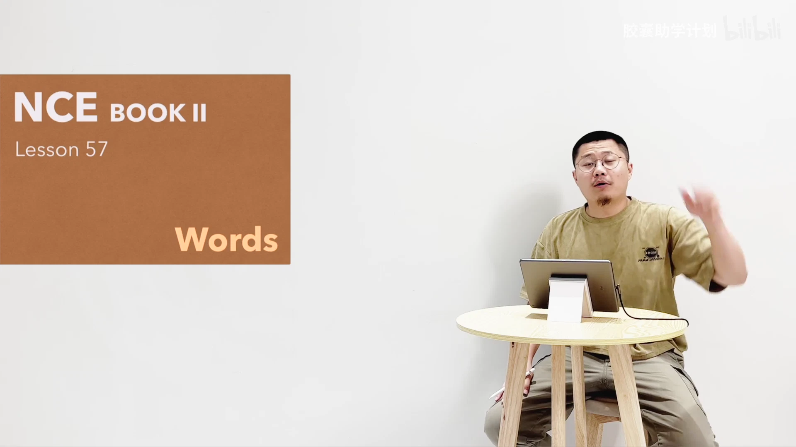

文字识别：NCE / BOOKII / Lesson 57 / Words

### 画面 00:00:05

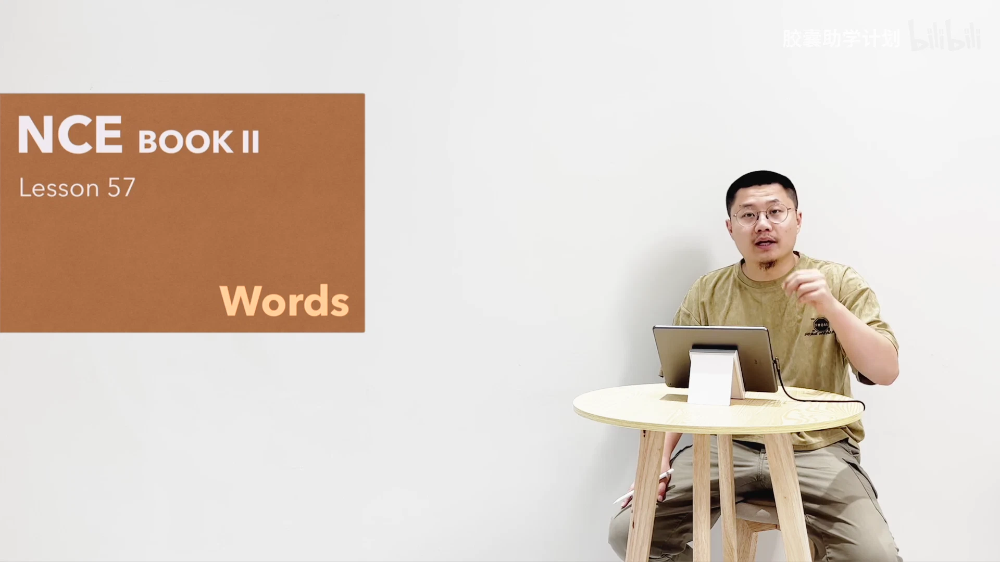

文字识别：NCE / BOOKI"I / Lesson 57 / Words

### 画面 00:00:08

文字识别：ROM

### 画面 00:00:10

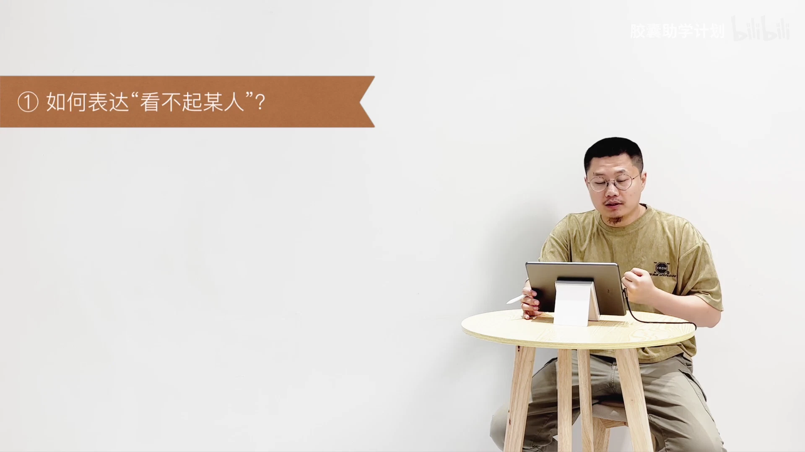

文字识别：①如何表达“看不起某人”？

### 画面 00:00:15

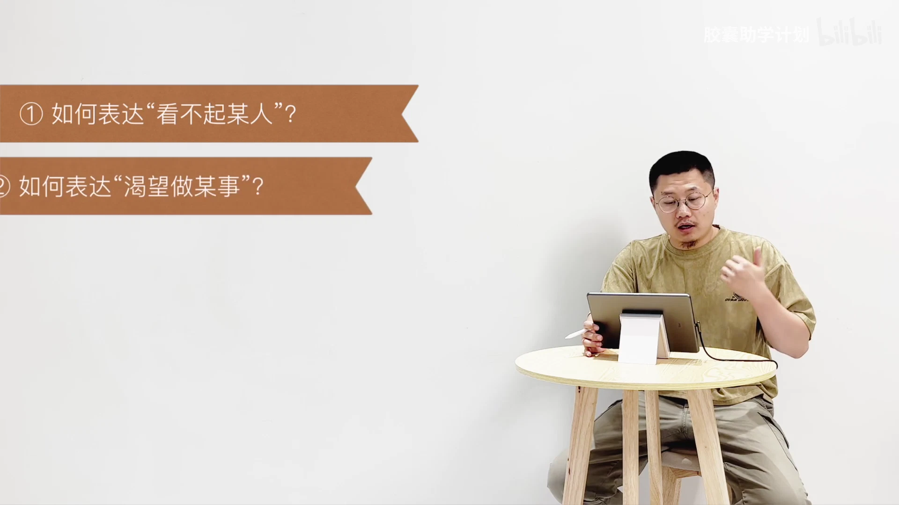

文字识别：①如何表达“看不起某人”？ / 如何表达“渴望做某事”?

### 画面 00:00:17

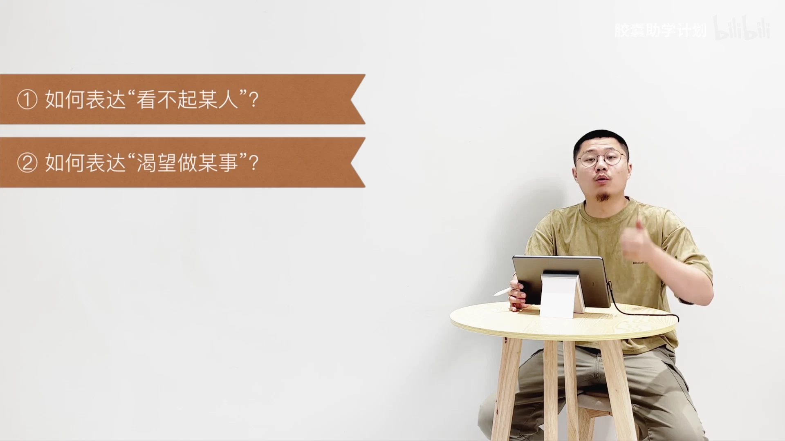

文字识别：①如何表达“看不起某人”? / 如何表达“渴望做某事”？

### 画面 00:00:22

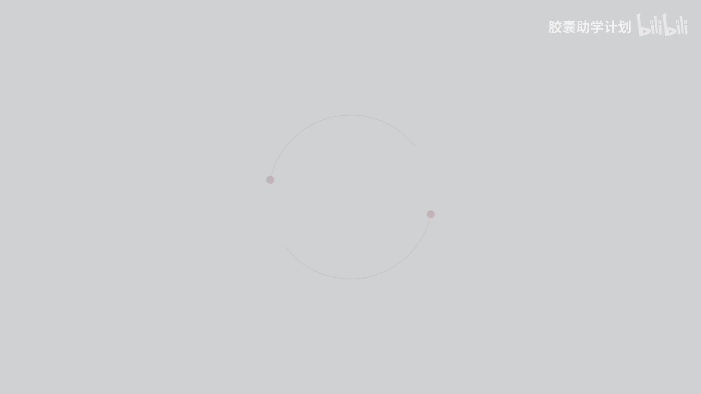

文字识别：胶囊助学计划bi出l

### 画面 00:00:26

### 画面 00:00:28

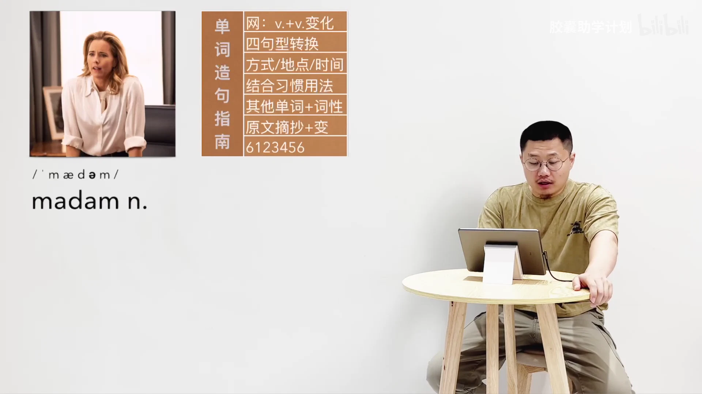

文字识别：单词造句指南 / 网：v.+v.变化 / 四句型转换 / 方式/地点/时间 / 结合习惯用法 / 其他单词+词性 / 原文摘抄+变 / 6123456 / / 'mæedam/ / madam n.

## 00:00:30–00:01:00

个单词其实对于各位来说很可能就不是新词了啊。我们新一也见过，一起读一下，叫做 madam，madam，对吧？呃，女士的意思。大部分情况下是怎么去用呢？就是基本上可能你觉得她成年了啊，十八岁一直到八十岁，你基本上口语当中拿不清楚该怎么去问人家，对吧？该怎么去称呼的时候，你总不能说 hey you，对吧？很不礼貌啊，在汉语当中也很不礼貌。你怎么办呢？你就可以说叫

### 画面 00:00:30

文字识别：单词造句指南 / 网：v.+v.变化 / 四句型转换 / 方式/地点/时间 / 结合习惯用法 / 其他单词+词性 / 原文摘抄+变 / 6123456 / / 'maæedam/ / madam n.

### 画面 00:00:35

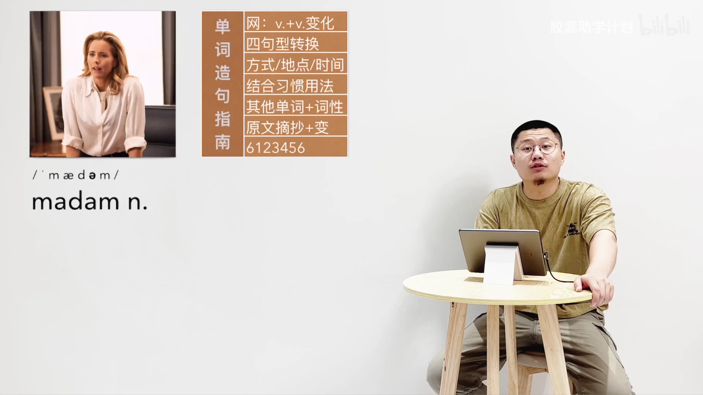

文字识别：单词造句指南 / 网：v.+v.变化 / 四句型转换 / 方式/地点/时间 / 结合习惯用法 / 其他单词+词性 / 原文摘抄+变 / 6123456 / / 'maæedam/ / madam n. / ON

### 画面 00:00:39

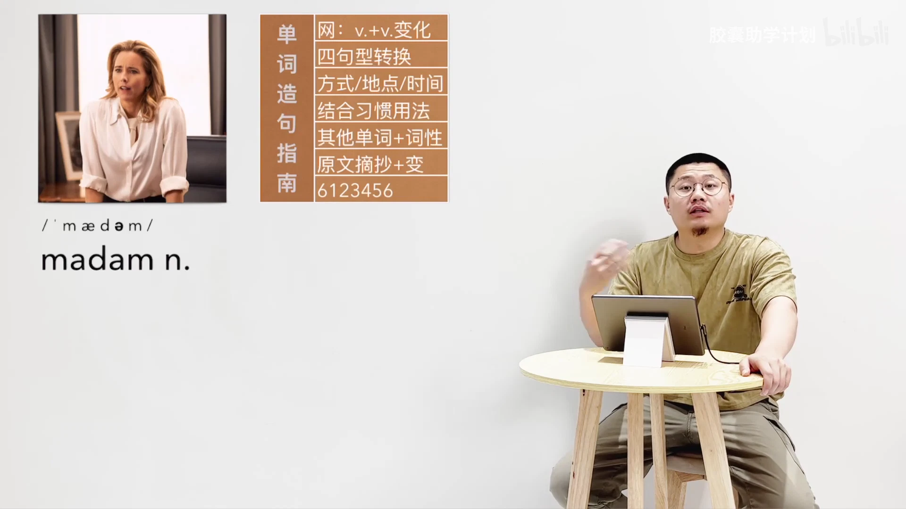

文字识别：单词造句指南 / 网：v.+v.变化 / 四句型转换 / 方式/地点/时间 / 结合习惯用法 / 其他单词+词性 / 原文摘抄+变 / 6123456 / / 'maæed am/ / madam n.

### 画面 00:00:41

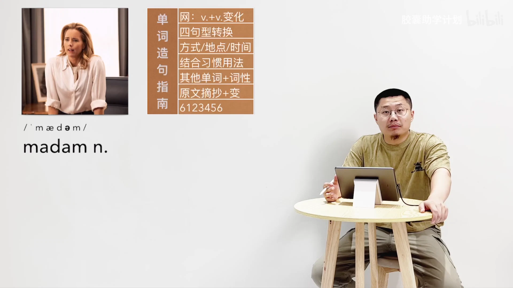

文字识别：单词造句指南 / 网：v.+v.变化 / 四句型转换 / 方式/地点/时间 / 结合习惯用法 / 其他单词+词性 / 原文摘抄+变 / 6123456 / / 'mæedam/ / madam n.

### 画面 00:00:44

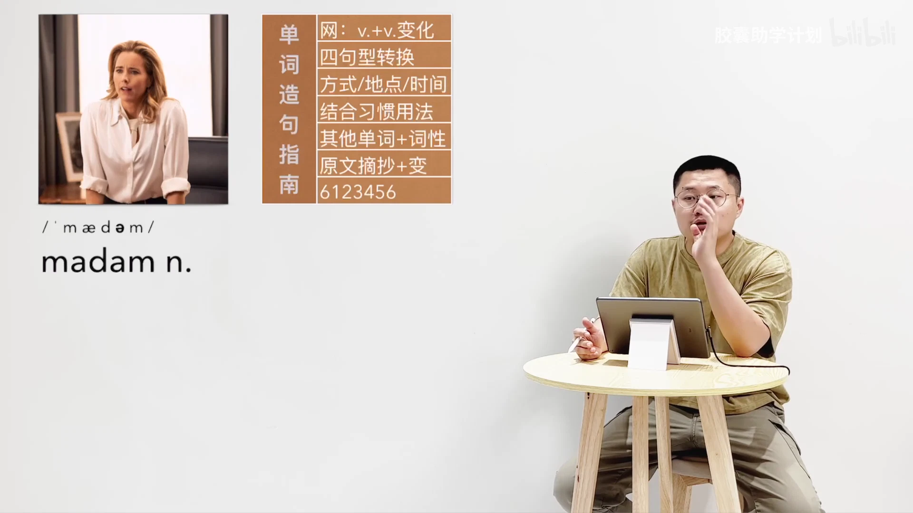

文字识别：单词造句指南 / 网：v.+v.变化 / 四句型转换 / 方式/地点/时间 / 结合习惯用法 / 其他单词+词性 / 原文摘抄+变 / 6123456 / / 'maæedam/ / madam n.

### 画面 00:00:55

文字识别：单词造句指南 / 网：v.+v.变化 / 四句型转换 / 方式/地点/时间 / 结合习惯用法 / 其他单词+词性 / 原文摘抄+变 / 6123456 / / 'mæedam/ / madam n.

## 00:01:00–00:01:30

做 Madam，是口语当中非常常用的一个小单词。那我们拿它去造句子，那我就肯定要跟口语结合起来。比如说电影片段当中出现了一句话叫 Madam， I don't know what to say。啊，哎，Repeat after me，别忘了啊，所有的这些句子你要跟着我去读，OK。然后呢，那它是五十课，实际上咱们五十课学了一个叫做 How to do something， Where to，对吧？What to，哎，这个当时我们讲过了，不知道各位还记不记得这个小的知识点？

### 画面 00:01:00

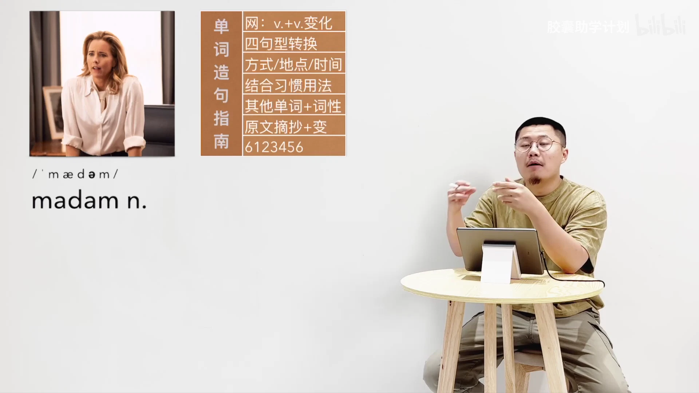

文字识别：单词造句指南 / 网：v.+v.变化 / 四句型转换 / 方式/地点/时间 / 结合习惯用法 / 其他单词+词性 / 原文摘抄+变 / 6123456 / / 'mæe d am/ / madam n.

### 画面 00:01:03

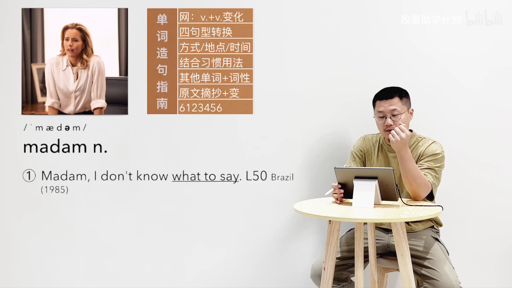

文字识别：单词造句指南 / 网：v.+v.变化 / 四句型转换 / 方式/地点/时间 / 结合习惯用法 / 其他单词+词性 / 原文摘抄+变 / 6123456 / / 'm æe dam/ / madam n. / Madam, I don't know what to say. L50 Brazil / (1985)

### 画面 00:01:05

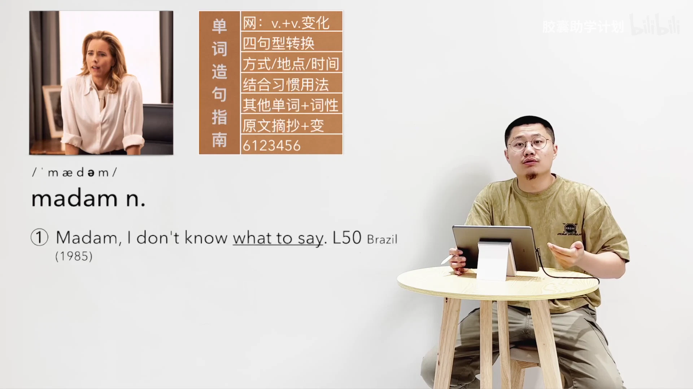

文字识别：单词造句指南 / 网：v.+v.变化 / 四句型转换 / 方式/地点/时间 / 结合习惯用法 / 其他单词+词性 / 原文摘抄+变 / 6123456 / / 'm æe d am/ / madam n. / Madam, I don't know what to say. L50 Brazil / (1985)

### 画面 00:01:10

文字识别：单词造句指南 / 网：v.+v.变化 / 四句型转换 / 方式/地点/时间 / 结合习惯用法 / 其他单词+词性 / 原文摘抄+变 / 6123456 / / 'm æ d am / / madam n. / Madam, I don't know what to say. L50 Brazil / (1985)

### 画面 00:01:13

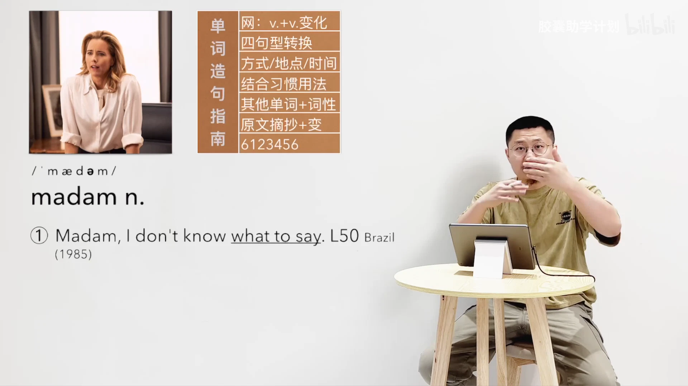

文字识别：单词造句指南 / 网：v.+v.变化 / 四句型转换 / 方式/地点/时间 / 结合习惯用法 / 其他单词+词性 / 原文摘抄+变 / 6123456 / / 'm æe dam/ / madam n. / Madam, I don't know what to say. L50 Brazil / (1985)

### 画面 00:01:15

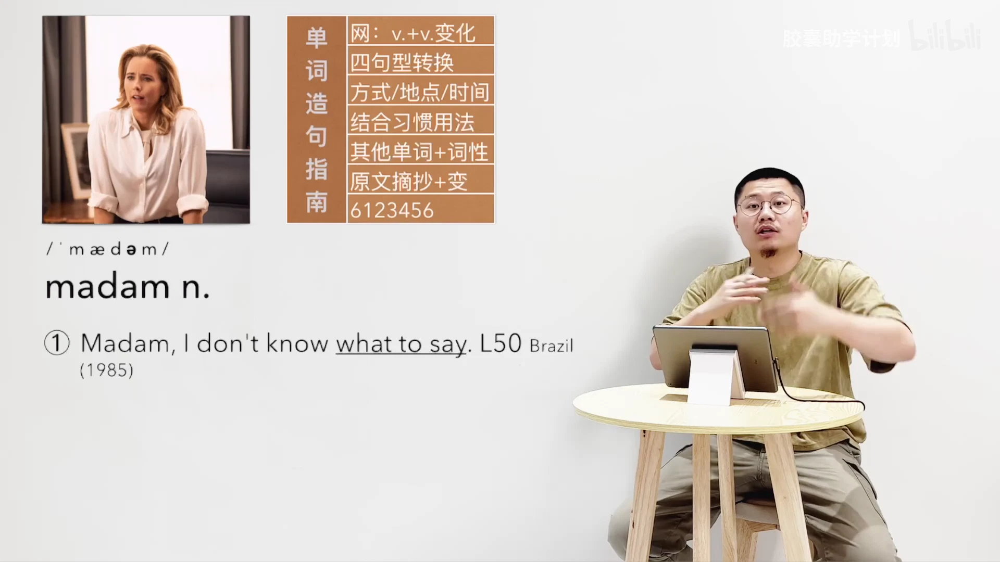

文字识别：单词造句指南 / 网：v.+v.变化 / 四句型转换 / 方式/地点/时间 / 结合习惯用法 / 其他单词+词性 / 原文摘抄+变 / 6123456 / / 'm æ d am/ / madam n. / Madam, I don't know what to say. L50 Brazil / (1985)

### 画面 00:01:17

文字识别：单词造句指南 / 网：v.+v.变化 / 四句型转换 / 方式/地点/时间 / 结合习惯用法 / 其他单词+词性 / 原文摘抄+变 / 6123456 / / 'm æ d am / / madam n. / Madam, I don't know what to say. L50 Brazil / (1985)

### 画面 00:01:21

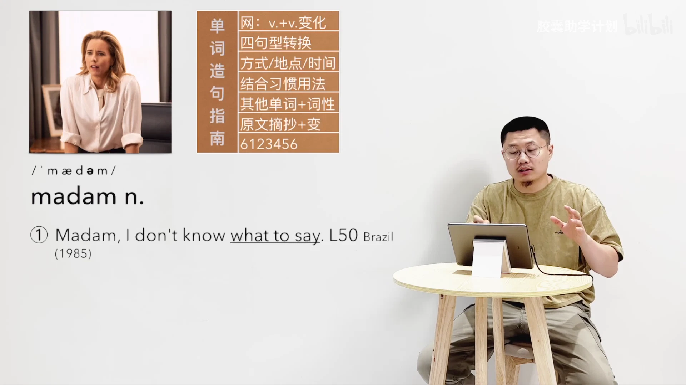

文字识别：单词造句指南 / 网：v.+v.变化 / 四句型转换 / 方式/地点/时间 / 结合习惯用法 / 其他单词+词性 / 原文摘抄+变 / 6123456 / / 'm æ d am/ / madam n. / Madam, I don't know what to say. L50 Brazil / (1985)

### 画面 00:01:25

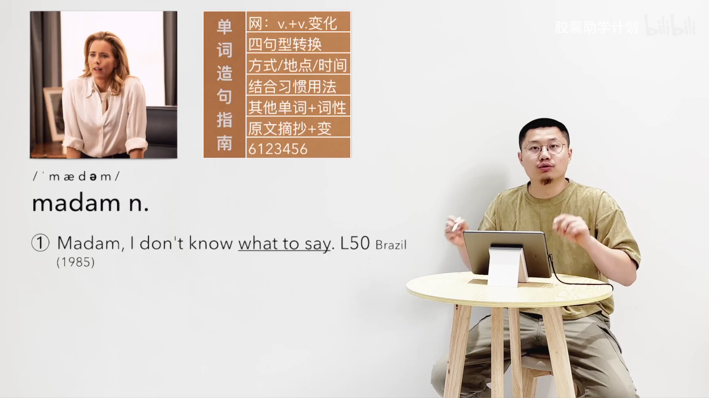

文字识别：单词造句指南 / 网：v.+v.变化 / 四句型转换 / 方式/地点/时间 / 结合习惯用法 / 其他单词+词性 / 原文摘抄+变 / 6123456 / /'m æe dam/ / madam n. / Madam, I don't know what to say. L50 Brazil / (1985)

## 00:01:30–00:02:00

OK，我们在这复习一下。所以这句话的意思是，女士，我不知道应该去说什么。OK，好，continue叫做Madam，Let me help you with that。说，哎，女士，让我来帮你做这件事情，对吧？或者帮你拿这个东西。OK，好玩一个，continue。说，Did you hear the sound, Madam？说你听见声音了吗，Madam？这是我们自己造的句子，结合了五十六课刚刚学过的，像hear the sound or hear a

### 画面 00:01:30

文字识别：单词造句指南 / 网：v.+v.变化 / 四句型转换 / 方式/地点/时间 / 结合习惯用法 / 其他单词+词性 / 原文摘抄+变 / 6123456 / / 'm æe d am/ / madam n. / Madam, I don't know what to say. L50 Brazil / (1985)

### 画面 00:01:33

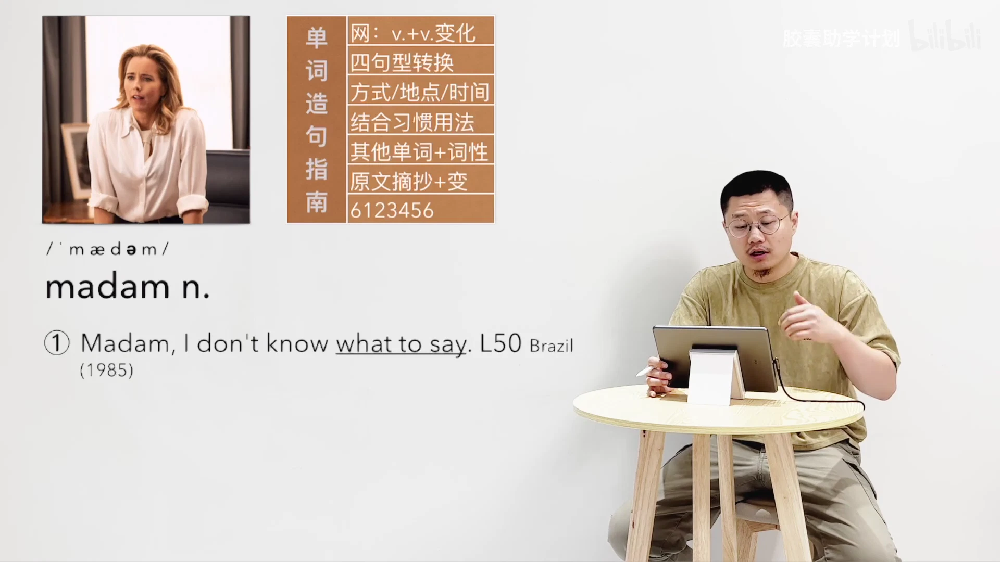

文字识别：单词造句指南 / 网：v.+v.变化 / 四句型转换 / 方式/地点/时间 / 结合习惯用法 / 其他单词+词性 / 原文摘抄+变 / 6123456 / / 'mæedam/ / madam n. / Madam, I don't know what to say. L50 Brazil / (1985)

### 画面 00:01:35

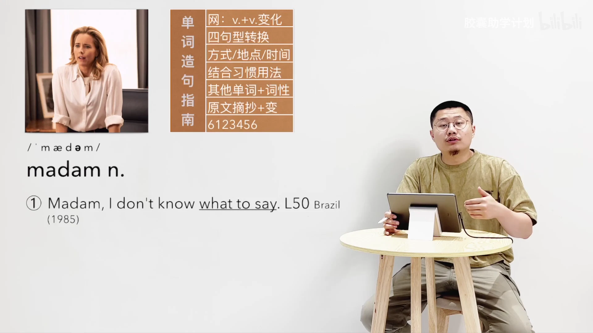

文字识别：单词造句指南 / 网：v.+v.变化 / 四句型转换 / 方式/地点/时间 / 结合习惯用法 / 其他单词+词性 / 原文摘抄+变 / 6123456 / / 'm æe d am/ / madam n. / Madam, I don't know what to say. L50 Brazil / (1985)

### 画面 00:01:38

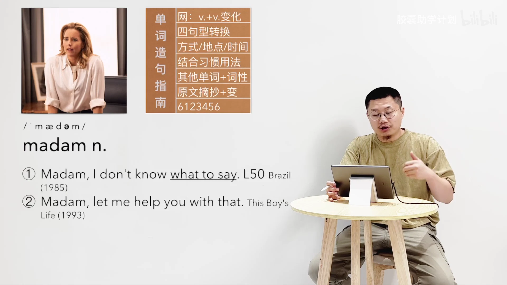

文字识别：单词造句指南 / 网：v.+v.变化 / 四句型转换 / 方式/地点/时间 / 结合习惯用法 / 其他单词+词性 / 原文摘抄+变 / 6123456 / / 'm æe d am/ / madam n. / ) Madam, I don't know what to say. L50 Brazil / (1985) / Madam, let me help you with that. This Boy's / Life(1993)

### 画面 00:01:41

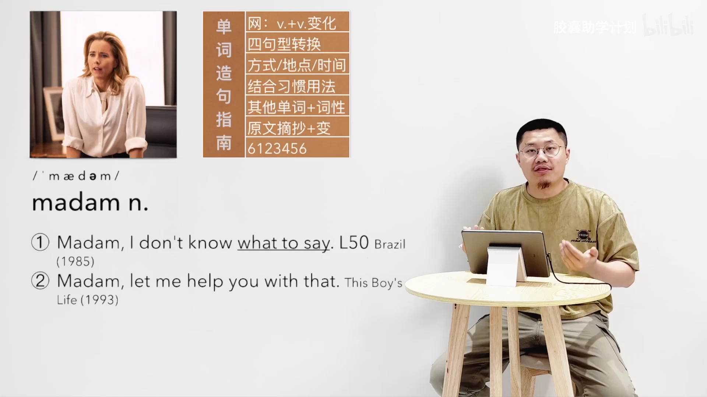

文字识别：单词造句指南 / 网：v.+v.变化 / 四句型转换 / 方式/地点/时间 / 结合习惯用法 / 其他单词+词性 / 原文摘抄+变 / 6123456 / / 'm æe d am/ / madam n. / Madam, I don't know what to say. L50 Brazil / (1985) / Madam, let me help you with that. This Boy's / Life(1993)

### 画面 00:01:45

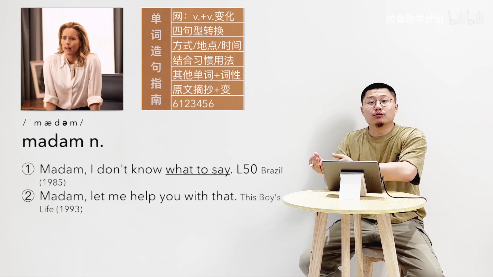

文字识别：单词造句指南 / 网：v.+v.变化 / 四句型转换 / 方式/地点/时间 / 结合习惯用法 / 其他单词+词性 / 原文摘抄+变 / 6123456 / / 'm æe d am/ / madam n. / Madam, I don't know what to say. L50 Brazil / (1985) / Madam, let me help you with that. This Boy's / Life(1993)

### 画面 00:01:48

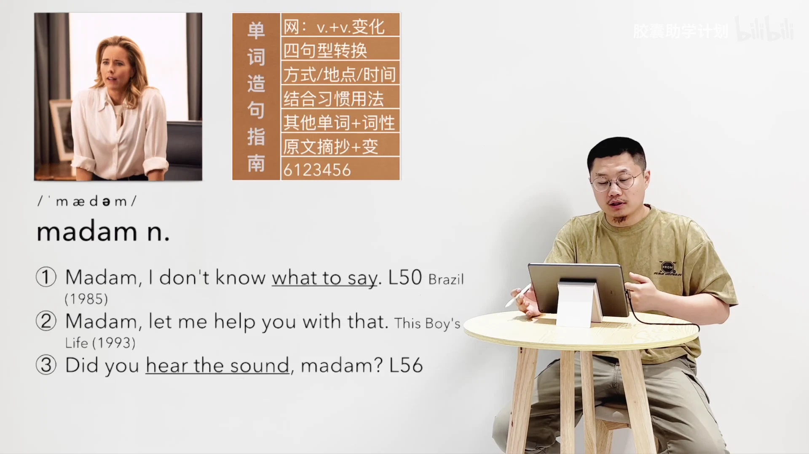

文字识别：单词造句指南 / 网：v.+v.变化 / 四句型转换 / 方式/地点/时间 / 结合习惯用法 / 其他单词+词性 / 原文摘抄+变 / 6123456 / / 'm æe d am/ / madam n. / ) Madam, I don't know what to say. L50 Brazil / (1985) / Madam, let me help you with that. This Boy's / Life(1993) / Did you hear the sound, madam? L56

### 画面 00:01:50

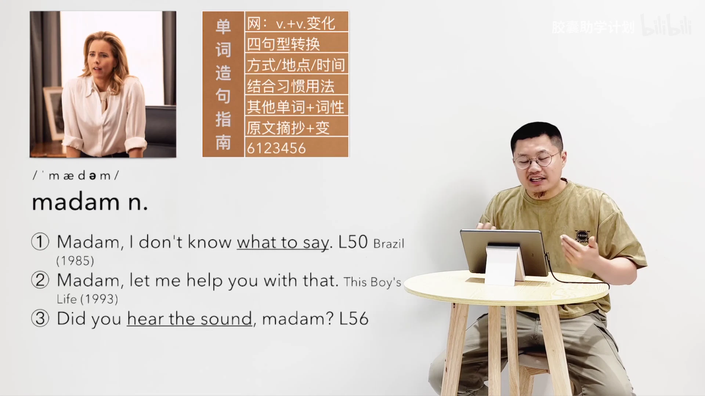

文字识别：单词造句指南 / 网：v.+v.变化 / 四句型转换 / 方式/地点/时间 / 结合习惯用法 / 其他单词+词性 / 原文摘抄+变 / 6123456 / /'m æe d am/ / madam n. / ) Madam, I don't know what to say. L50 Brazil / (1985) / Madam, let me help you with that. This Boy's / Life(1993) / Did you hear the sound, madam? L56

## 00:02:00–00:02:30

sound,都是可以的，由具体场景去决定，对吧？好，呃，再来一句话叫I'm sorry, madam, but we need to speed things up. 这是我们自己造的句子，结合了之前的习惯用法，叫speed things up。说很抱歉，女士，但是我们必须要，我们需要去加快这件事情的速度。OK, very good. 那接下来我们听一个电影片段，注意力集中。You need help with the bags, madam.

### 画面 00:02:01

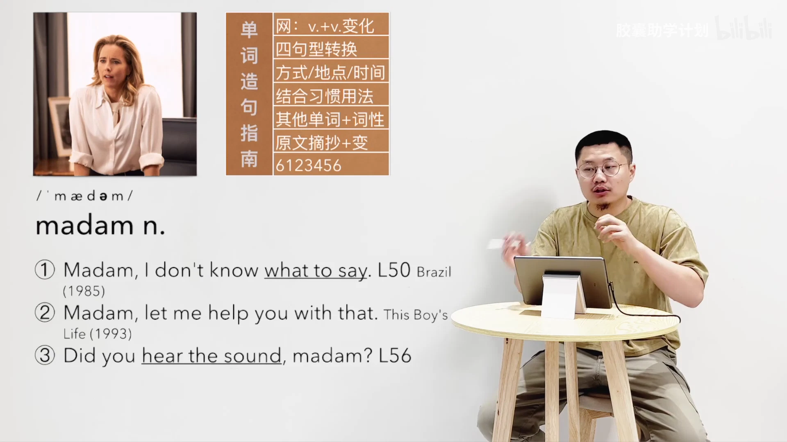

文字识别：单词造句指南 / 网：v.+v.变化 / 四句型转换 / 方式/地点/时间 / 结合习惯用法 / 其他单词+词性 / 原文摘抄+变 / 6123456 / / 'm æ d am/ / madam n. /  Madam, I don't know what to say. L50 Brazil / (1985) / Madam, let me help you with that. This Boy's / Life(1993) / Did you hear the sound, madam? L56

### 画面 00:02:04

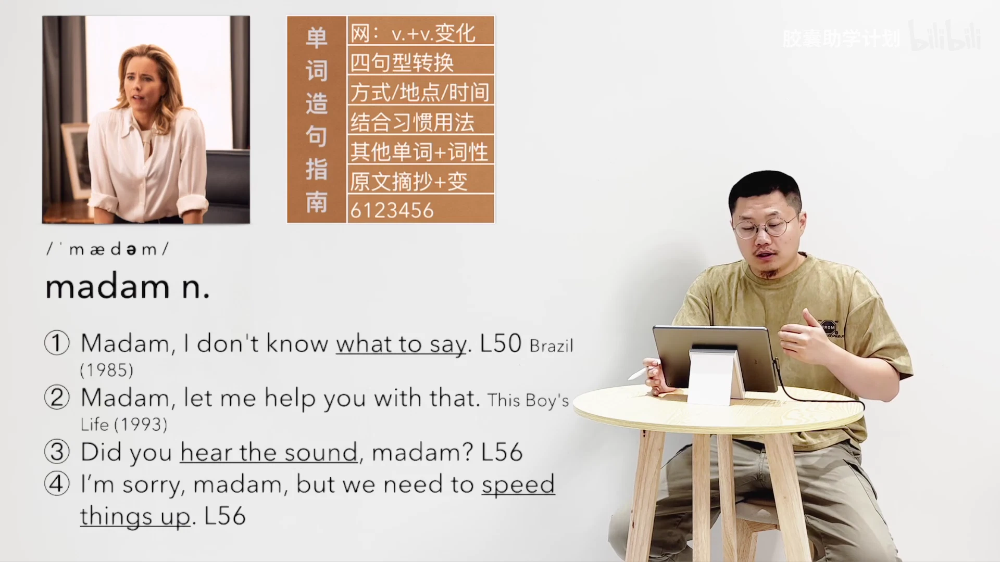

文字识别：单词造句指南 / 网：v.+v.变化 / 四句型转换 / 方式/地点/时间 / 结合习惯用法 / 其他单词+词性 / 原文摘抄+变 / 6123456 / /'m æe d am/ / madam n. / ① Madam, I don't know what to say. L50 Brazil / (1985) / Madam, let me help you with that. This Boy's / Life(1993) / ) Did you hear the sound, madam? L56 / ④ I'm sorry, madam, but we need to speed / things up. L56

### 画面 00:02:08

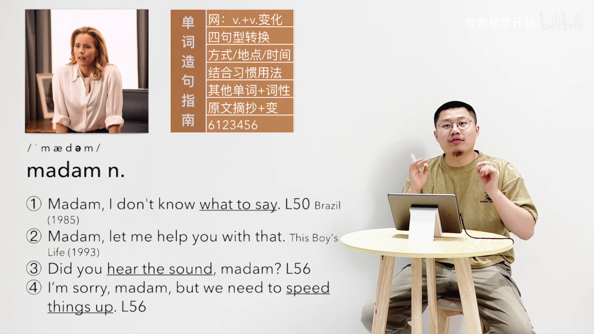

文字识别：单词造句指南 / 网：v.+v.变化 / 四句型转换 / 方式/地点/时间 / 结合习惯用法 / 其他单词+词性 / 原文摘抄+变 / 6123456 / /'m æe d am/ / madam n. / ① Madam, I don't know what to say. L50 Brazil / (1985) / Madam, let me help you with that. This Boy's / Life(1993) / Did you hear the sound, madam? L56 / ④ I'm sorry, madam, but we need to speed / things up. L56

### 画面 00:02:10

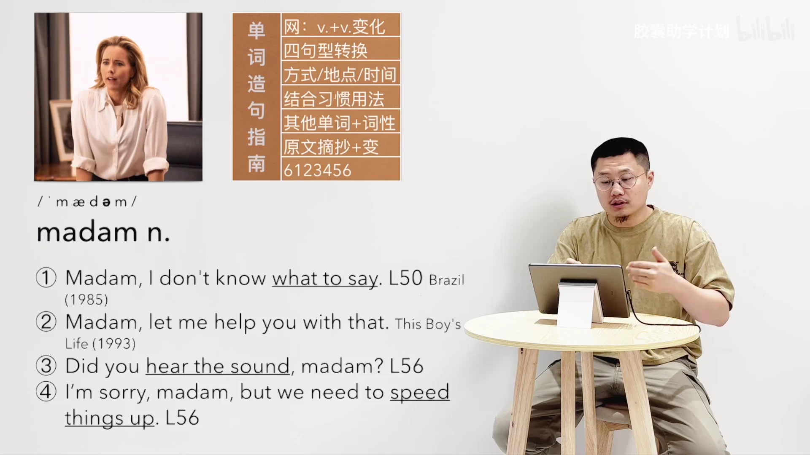

文字识别：单词造句指南 / 网：v.+v.变化 / 四句型转换 / 方式/地点/时间 / 结合习惯用法 / 其他单词+词性 / 原文摘抄+变 / 6123456 / /'m æ d am/ / madam n. /  Madam, I don't know what to say. L50 Brazil / (1985) / Madam, let me help you with that. This Boy's / Life(1993) / Did you hear the sound, madam? L56 / ④ I'm sorry, madam, but we need to speed / things up. L56

### 画面 00:02:15

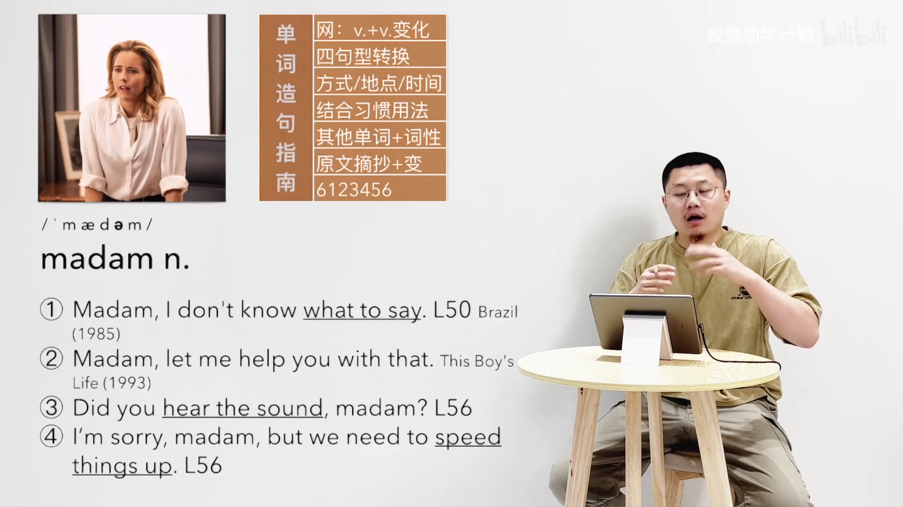

文字识别：单词造句指南 / 网：v.+v.变化 / 四句型转换 / 方式/地点/时间 / 结合习惯用法 / 其他单词+词性 / 原文摘抄+变 / 6123456 / /'mæe d am/ / madam n. / ) Madam, I don't know what to say. L50 Brazil / (1985) / Madam, let me help you with that. This Boy's / Life(1993) / Did you hear the sound, madam? L56 / ④ I'm sorry, madam, but we need to speed / things up. L56

### 画面 00:02:20

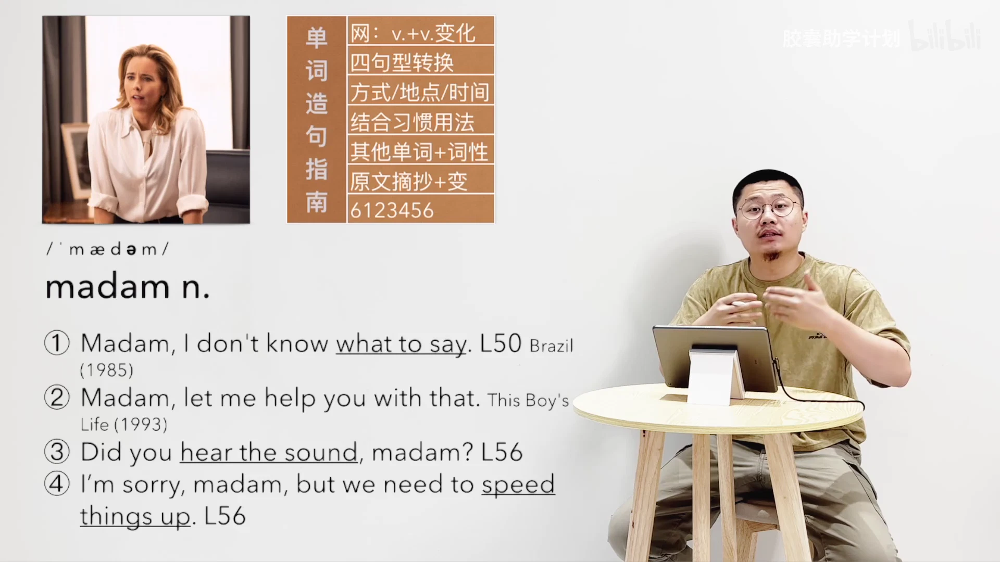

文字识别：单词造句指南 / 网：v.+v.变化 / 四句型转换 / 方式/地点/时间 / 结合习惯用法 / 其他单词+词性 / 原文摘抄+变 / 6123456 / /'m æe d am/ / madam n. / ① Madam, I don't know what to say. L50 Brazil / (1985) / Madam, let me help you with that. This Boy's / Life(1993) / Did you hear the sound, madam? L56 / ④ I'm sorry, madam, but we need to speed / things up. L56

### 画面 00:02:23

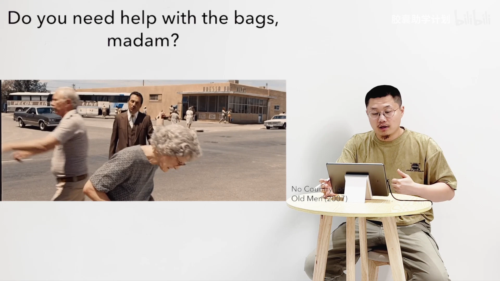

文字识别：Do you need help with the bags, / madam? / ODESSA BUS / No Courty / Old Men(2007)

### 画面 00:02:28

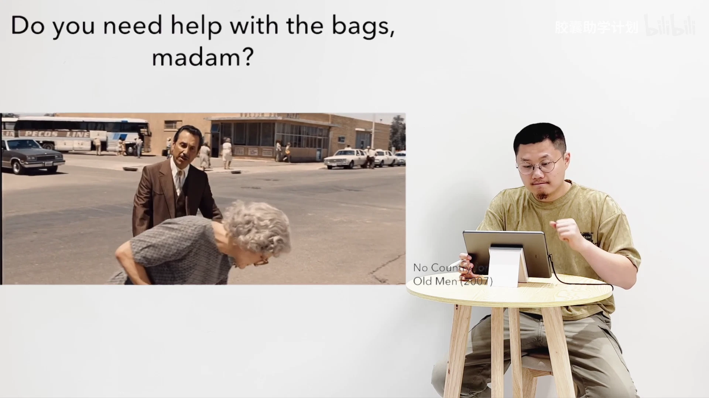

文字识别：Do you need help with the bags, / madam? / No CountfR / Old Men(2007)

## 00:02:30–00:03:00

Okay, very good. Ah, do you need help with the bag, madam? Okay, very good. Continue. 下一个单词，生活当中肯定是经常用到了，叫做 jeans. Jeans. 注意这个单词，它本身就是个复数形式，是吧？你可以这样去理解啊，它后面是加了 s 的。 Okay, 叫做牛仔裤。 Okay, 好，那拿它去造句其实比较简单，因为它本身是一个名词。你无非这个时候要做的事情是想一下其他的词性，比如说哪

### 画面 00:02:30

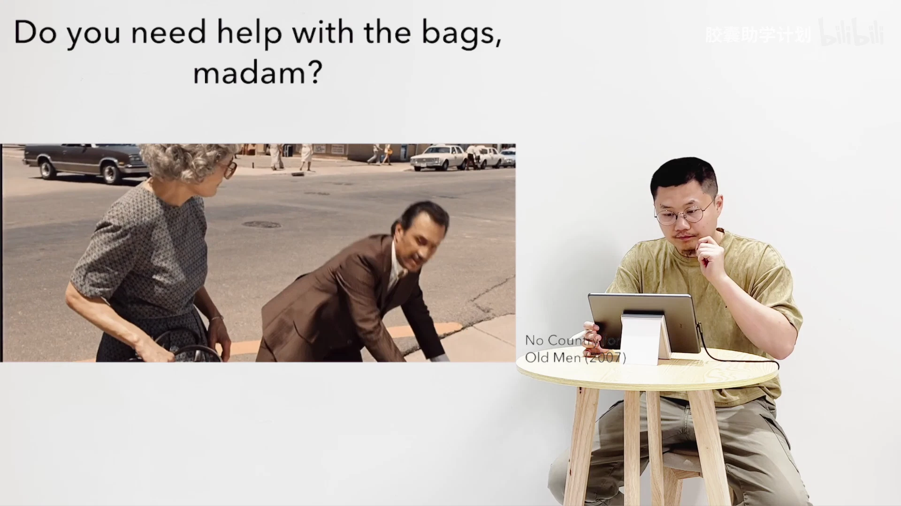

文字识别：Do you need help with the bags, / madam? / A / No Countr / Old Men (2007)

### 画面 00:02:35

文字识别：单词造句指南 / 网：v.+v.变化 / 四句型转换 / 方式/地点/时间 / 结合习惯用法 / 其他单词+词性 / 原文摘抄+变 / 6123456 / /d3iinz/ / jeans n.

### 画面 00:02:38

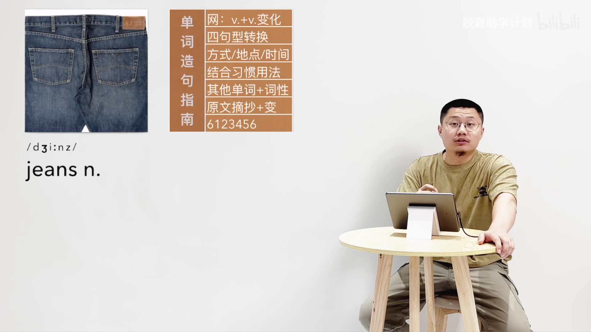

文字识别：单词造句指南 / 网：v.+v.变化 / 四句型转换 / 方式/地点/时间 / 结合习惯用法 / 其他单词+词性 / 原文摘抄+变 / 6123456 / /d3iinz/ / jeans n.

### 画面 00:02:41

文字识别：单词造句指南 / 网：v.+v.变化 / 四句型转换 / 方式/地点/时间 / 结合习惯用法 / 其他单词+词性 / 原文摘抄+变 / 6123456 / /d3i:nz/ / jeans n.

### 画面 00:02:45

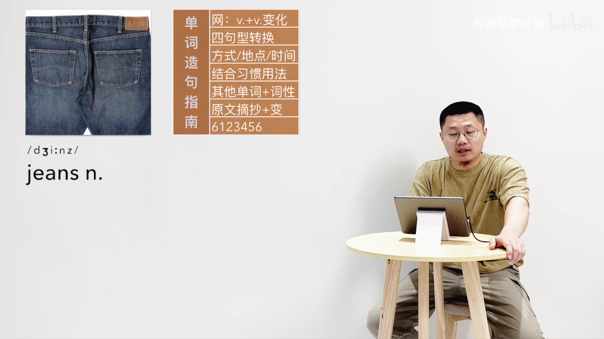

文字识别：单词造句指南 / 网：v.+v.变化 / 四句型转换 / 方式/地点/时间 / 结合习惯用法 / 其他单词+词性 / 原文摘抄+变 / 6123456 / /d3i:nz/ / jeans n.

### 画面 00:02:52

文字识别：单词造句指南 / 网：v.+v.变化 / 四句型转换 / 方式/地点/时间 / 结合习惯用法 / 其他单词+词性 / 原文摘抄+变 / 6123456 / /d3i:nz/ / jeans n. / ① The man who's wearing jeans is our captain.

### 画面 00:02:58

文字识别：单词造句指南 / 网：v.+v.变化 / 四句型转换 / 方式/地点/时间 / 结合习惯用法 / 其他单词+词性 / 原文摘抄+变 / 6123456 / /d3iinz/ / jeans n. /  The man who's wearing jeans is our captain. / 1

## 00:03:00–00:03:30

些动词可能经常是跟牛仔裤放到一起的？无非就是买卖、穿、洗、打理，对吧？哎，也无非就是这些单词。比如说，我们造一句话叫做 The man who's wearing jeans is our captain。这实际上我们用到了二十八课的定语从句，对吧？哎，你看，穿着牛仔裤的那个人就是我们的船长。Very good, our captain, 对吧？Next one, say, sir, you can't wear jeans

### 画面 00:03:03

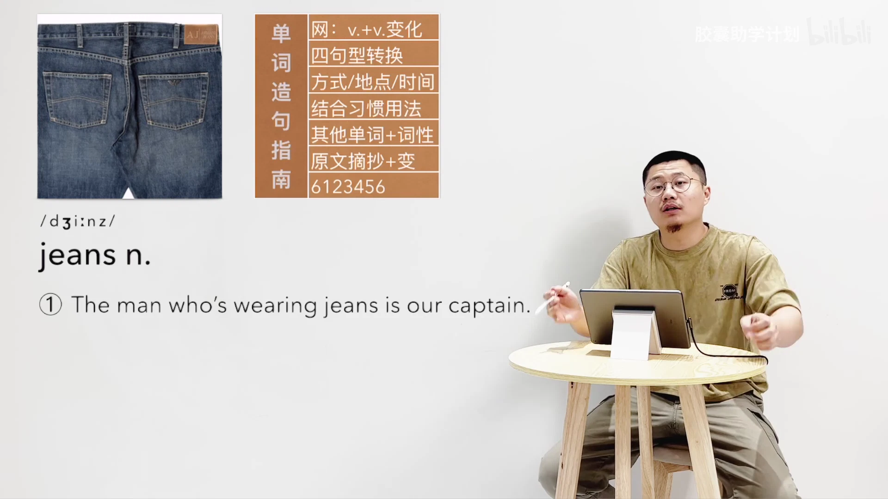

文字识别：单词造句指南 / 网：v.+v.变化 / 四句型转换 / 方式/地点/时间 / 结合习惯用法 / 其他单词+词性 / 原文摘抄+变 / 6123456 / /d3iinz/ / jeans n. / ① The man who's wearing jeans is our captain.

### 画面 00:03:06

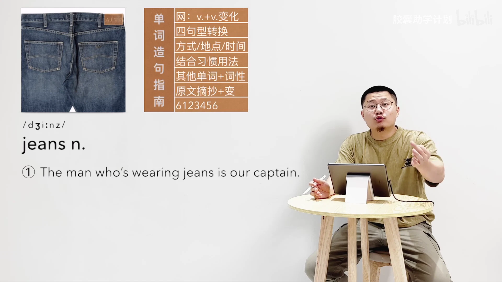

文字识别：单词造句指南 / 网：v.+v.变化 / 四句型转换 / 方式/地点/时间 / 结合习惯用法 / 其他单词+词性 / 原文摘抄+变 / 6123456 / /d3iinz/ / jeans n. /  The man who's wearing jeans is our captain. / 1)

### 画面 00:03:11

文字识别：单词造句指南 / 网：v.+v.变化 / 四句型转换 / 方式/地点/时间 / 结合习惯用法 / 其他单词+词性 / 原文摘抄+变 / 6123456 / /d3iinz/ / jeans n. / ① The man who's wearing jeans is our captain.

### 画面 00:03:29

文字识别：单词造句指南 / 网：v.+v.变化 / 四句型转换 / 方式/地点/时间 / 结合习惯用法 / 其他单词+词性 / 原文摘抄+变 / 6123456 / /d3i:nz/ / jeans n. /  The man who's wearing jeans is our captain. / 1 / Sir, you can't wear jeans here.

## 00:03:30–00:04:00

here.说先生，很抱歉，你不能在这里啊穿牛仔裤啊。这个是实际上西方的一些礼仪。呃，这个东西啊，呃，包括跟咱们文章其实有一些关系啊。我如果不补充这个小的背景知识，可能各位对于文章会有一些小小的疑惑啊。包括为什么我会造这句话，说有一些地方是不能穿牛仔裤的，对吧？因为牛仔裤其实虽然现在我们去看的时候，对吧，很多年轻人啊，他非常愿

### 画面 00:03:42

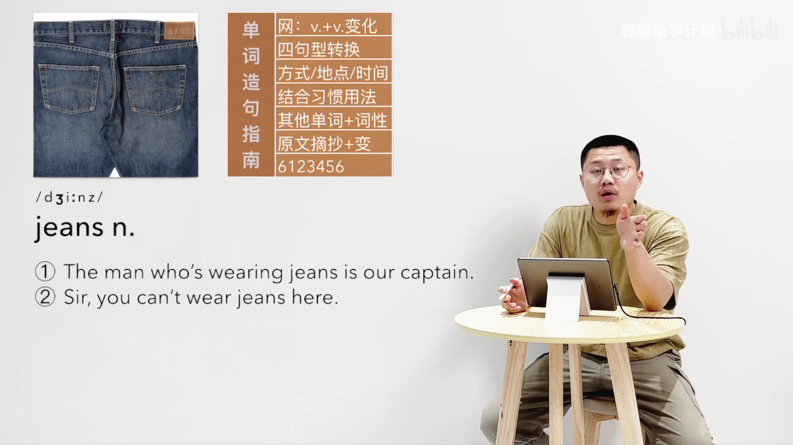

文字识别：单词造句指南 / 网：v.+v.变化 / 四句型转换 / 方式/地点/时间 / 结合习惯用法 / 其他单词+词性 / 原文摘抄+变 / 6123456 / /d3iinz/ / jeans n. / ① The man who's wearing jeans is our captain. / Sir, you can't wear jeans here.

### 画面 00:03:46

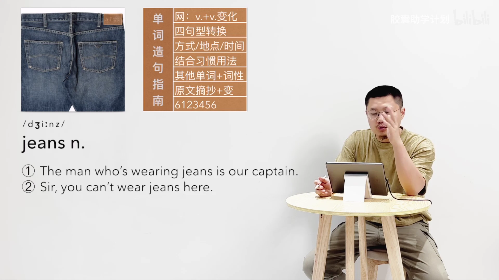

文字识别：单词造句指南 / 网：v.+v.变化 / 四句型转换 / 方式/地点/时间 / 结合习惯用法 / 其他单词+词性 / 原文摘抄+变 / 6123456 / /d3iinz/ / jeans n. / ① The man who's wearing jeans is our captain. / ) Sir, you can't wear jeans here.

## 00:04:00–00:04:30

意穿不同品牌、潮流样式、版式的牛仔裤，觉得很潮、很酷。但牛仔裤最开始出来的时候，呃，它基本上就是美国西部当年去淘金热的时候啊，工人干最辛苦的这些体力活的工人淘金的这些工人穿的。为什么呢？因为它不容易坏，不容易破，不容易磨碎，对吧？所以在很多比较正式的西餐厅，你注意啊，是非常正式的

### 画面 00:04:03

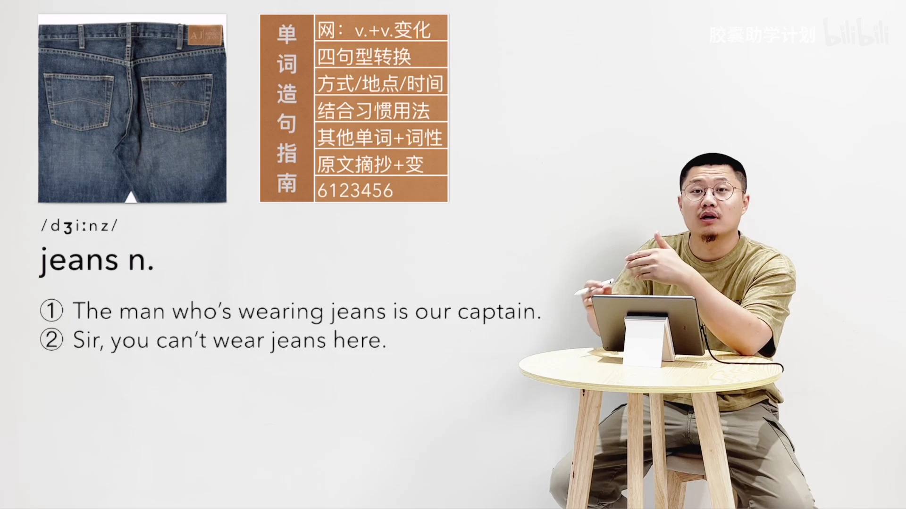

文字识别：单词造句指南 / 网：v.+v.变化 / 四句型转换 / 方式/地点/时间 / 结合习惯用法 / 其他单词+词性 / 原文摘抄+变 / 6123456 / /d3iinz/ / jeans n. / ① The man who's wearing jeans is our captain. / Sir, you can't wear jeans here.

### 画面 00:04:05

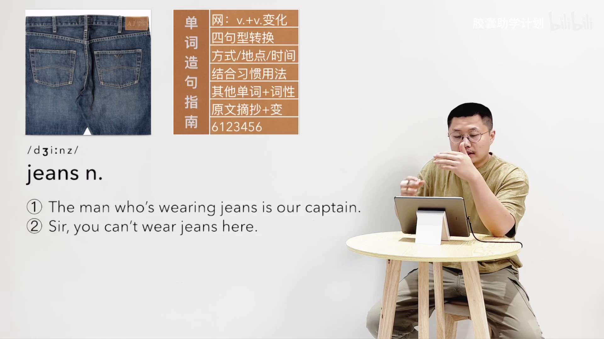

文字识别：单词造句指南 / 网：v.+v.变化 / 四句型转换 / 方式/地点/时间 / 结合习惯用法 / 其他单词+词性 / 原文摘抄+变 / 6123456 / /d3i:nz/ / jeans n. / ) The man who's wearing jeans is our captain. / 1 / Sir, you can't wear jeans here.

### 画面 00:04:10

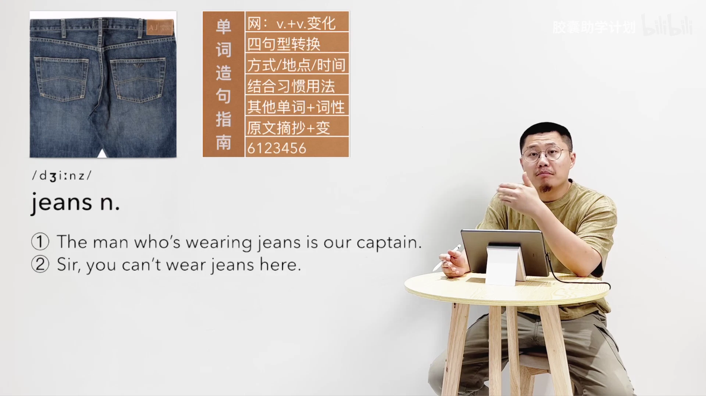

文字识别：单词造句指南 / 网：v.+v.变化 / 四句型转换 / 方式/地点/时间 / 结合习惯用法 / 其他单词+词性 / 原文摘抄+变 / 6123456 / /d3i:nz/ / jeans n. / ① The man who's wearing jeans is our captain. / ) Sir, you can't wear jeans here.

### 画面 00:04:16

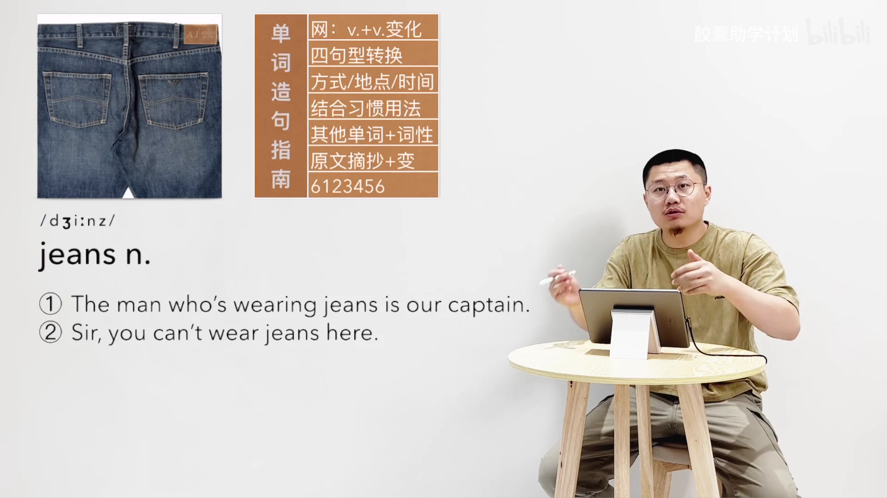

文字识别：单词造句指南 / 网：v.+v.变化 / 四句型转换 / 方式/地点/时间 / 结合习惯用法 / 其他单词+词性 / 原文摘抄+变 / 6123456 / /d3iinz/ / jeans n. / ) The man who's wearing jeans is our captain. / 1 / ) Sir, you can't wear jeans here.

### 画面 00:04:29

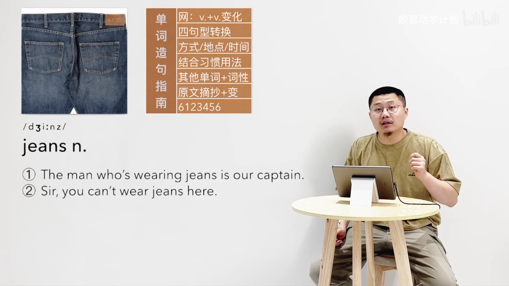

文字识别：单词造句指南 / 网：v.+v.变化 / 四句型转换 / 方式/地点/时间 / 结合习惯用法 / 其他单词+词性 / 原文摘抄+变 / 6123456 / /d3i:nz/ / jeans n. / ① The man who's wearing jeans is our captain. / ) Sir, you can't wear jeans here.

## 00:04:30–00:05:00

西餐厅，它对于着装是有一些要求的啊，呃，所以你可能是不能去穿牛仔裤的，或者某一种情况下，如果你去穿牛仔裤去一些比较正式的场合呢，别人会告诉你是 Sir, you can't wear jeans here. Go change that, 是吧？哎，回去把它换一下，它是不允许你入场的啊。 Continue, 说 They bought jeans last week. 这句话对于各位来说，新一期有七十一课或者说七十三课的语法基础就能

### 画面 00:04:35

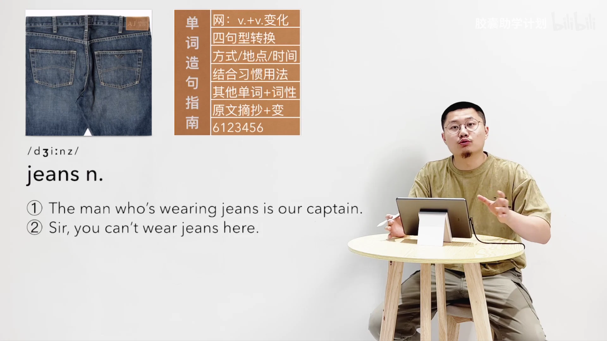

文字识别：单词造句指南 / 网：v.+v.变化 / 四句型转换 / 方式/地点/时间 / 结合习惯用法 / 其他单词+词性 / 原文摘抄+变 / 6123456 / /d3i:nz/ / jeans n. / ① The man who's wearing jeans is our captain. / ) Sir, you can't wear jeans here.

## 00:05:00–00:05:30

造出来了。然后我们做一些四句型转换，不多说。好，再来说，He's selling jeans in that market。无非就是刚才我说的那些动词啊，买卖，对吧？哎，买卖，呃，穿啊，穿着。然后四句型转换，这个时候各位可以暂停屏幕，口语变一变。OK，Next one，下一个单词，这是我们本课出现的，呃，我觉得比较重要的一个单词，口语当中、写作当中都很常用，叫做hesitated，hesitate。

### 画面 00:05:03

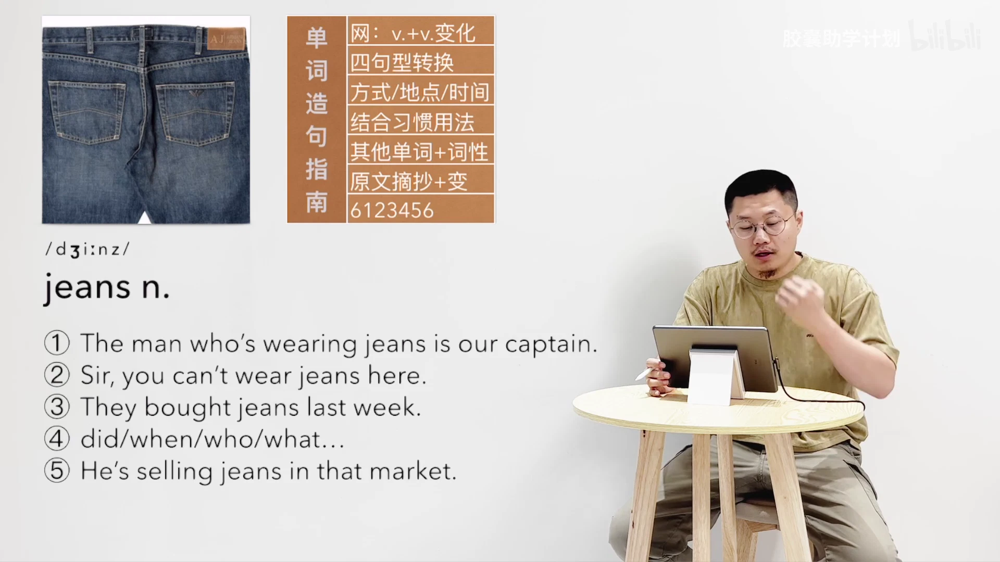

文字识别：单词造句指南 / 网：v.+v.变化 / 四句型转换 / 方式/地点/时间 / 结合习惯用法 / 其他单词+词性 / 原文摘抄+变 / 6123456 / /d3i:nz/ / jeans n. / ① The man who's wearing jeans is our captain. / Sir, you can't wear jeans here. / 2） / They bought jeans last week. / did/when/who/what... / He's selling jeans in that market.

### 画面 00:05:15

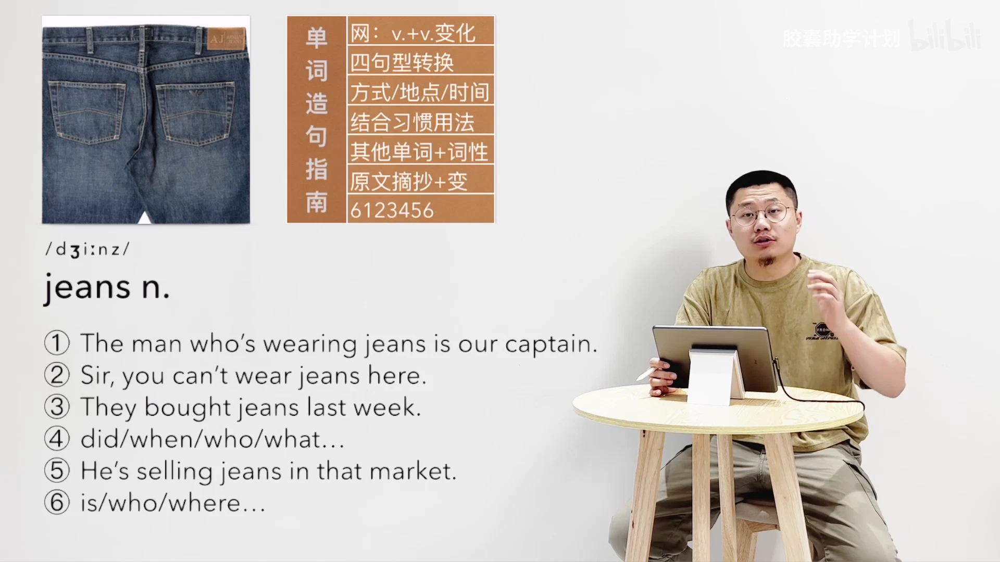

文字识别：单词造句指南 / 网：v.+v.变化 / 四句型转换 / 方式/地点/时间 / 结合习惯用法 / 其他单词+词性 / 原文摘抄+变 / 6123456 / /d3i:nz/ / jeans n. / ① The man who's wearing jeans is our captain. / Sir, you can't wear jeans here. / 2) / They bought jeans last week. / did/when/who/what... / He's selling jeans in that market. / ⑥ is/who/where...

### 画面 00:05:18

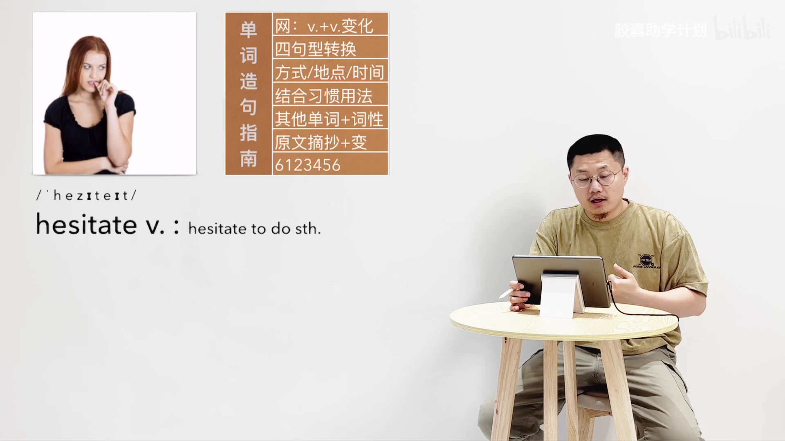

文字识别：单词造句指南 / 网：v.+v.变化 / 四句型转换 / 方式/地点/时间 / 结合习惯用法 / 其他单词+词性 / 原文摘抄+变 / 6123456 / /'heziteit/ / hesitate V. : hesitate to do sth.

### 画面 00:05:20

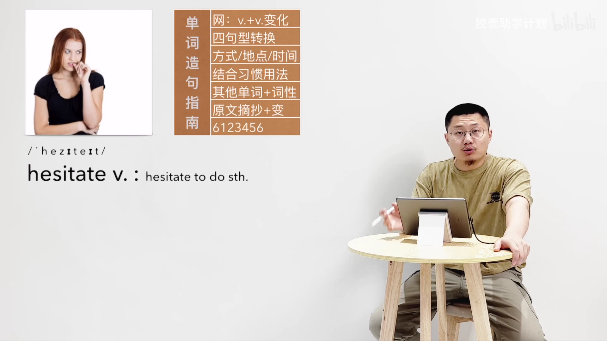

文字识别：单词造句指南 / 网：v.+v.变化 / 四句型转换 / 方式/地点/时间 / 结合习惯用法 / 其他单词+词性 / 原文摘抄+变 / 6123456 / /'heziteit/ / hesitate V. : hesitate to do sth.

## 00:05:30–00:06:00

hesitated,连起来读hesitated, hesitated. Okay, hesitate的意思表示的是犹豫啊。那我们比较常见的习惯用法之一叫hesitate to do something，对吧？叫做犹豫去做某件事情，或者去做某件事情有犹豫啊。那它经常其实用的否定，比如说叫don't hesitate to do something。一会儿我们再说。其次呢，另外一个小的呃习惯性表达，我们文章当中也出现

### 画面 00:05:33

文字识别：单词造句指南 / 网：v.+v.变化 / 四句型转换 / 方式/地点/时间 / 结合习惯用法 / 其他单词+词性 / 原文摘抄+变 / 6123456 / /'heziteit/ / hesitate V. : hesitate to do sth.

### 画面 00:05:45

文字识别：单词造句指南 / 网：v.+v.变化 / 四句型转换 / 方式/地点/时间 / 结合习惯用法 / 其他单词+词性 / 原文摘抄+变 / 6123456 / /'heziteit/ / hesitate V. : hesitate to do sth.

### 画面 00:05:56

文字识别：单词造句指南 / 网：v.+v.变化 / 四句型转换 / 方式/地点/时间 / 结合习惯用法 / 其他单词+词性 / 原文摘抄+变 / 6123456 / /'hezIteit/ / hesitate V. : hesitate to do sth. / ① hesitate for a moment / second..

## 00:06:00–00:06:30

了，叫 hesitate for a moment，啊，或者 for a second。那在这儿，second不是 literally a second，把不是真的就是一秒，它其实表示的意思有点像我们汉语当中三六九，比如说像九表示无限大，对吧？很多很多的意思，对吧？九重天啊，不是真的是一二三四五六七八九。OK，好，那接下来呢？所以你知道这里面的 second，刚才的逻辑是一样的，它其实想表达的意思，真的就只是说等我一下。

### 画面 00:06:01

文字识别：单词造句指南 / 网：v.+v.变化 / 四句型转换 / 方式/地点/时间 / 结合习惯用法 / 其他单词+词性 / 原文摘抄+变 / 6123456 / /'hezIteit/ / hesitate V. : hesitate to do sth. / ① hesitate for a moment / second..

### 画面 00:06:17

文字识别：单词造句指南 / 网：v.+v.变化 / 四句型转换 / 方式/地点/时间 / 结合习惯用法 / 其他单词+词性 / 原文摘抄+变 / 6123456 / /'heziteit/ / hesitate V. : hesitate to do sth. / ① hesitate for a moment / second..

## 00:06:30–00:07:00

其实跟 moment 在这儿可以理解为是同义词了啊，不多说。 Continue，比如说我们造一句话叫 she hesitated for a moment 啊 for a second，这是可以换成 moment 啊。 Before opening the door， repeat after me 啊。 She hesitated for a moment be a for a second before opening the door. Very good. 那这里的 opening the door，我后边加了一个 L 四十九问号或 L twenty 二十个问号，为什么呢？这我需要再解释一下，尤其是我们有一些学员是

### 画面 00:06:30

文字识别：单词造句指南 / 网：v.+v.变化 / 四句型转换 / 方式/地点/时间 / 结合习惯用法 / 其他单词+词性 / 原文摘抄+变 / 6123456 / /'heziteit/ / hesitate V. : hesitate to do sth. / ① hesitate for a moment / second..

### 画面 00:06:33

文字识别：单词造句指南 / 网：v.+v.变化 / 四句型转换 / 方式/地点/时间 / 结合习惯用法 / 其他单词+词性 / 原文摘抄+变 / 6123456 / /'heziteit/ / hesitate V. : hesitate to do sth. / ① hesitate for a moment/ second... /  She hesitated for a second before opening / the door. L49? L20?

### 画面 00:06:37

文字识别：单词造句指南 / 网：v.+v.变化 / 四句型转换 / 方式/地点/时间 / 结合习惯用法 / 其他单词+词性 / 原文摘抄+变 / 6123456 / /'hezIteit/ / hesitate V. : hesitate to do sth. / ① hesitate for a moment/ second... /  She hesitated for a second before opening / the door. L49? L20?

## 00:07:00–00:07:30

呃，不仅在学我们的课程，也同时在学其他老师的课程，对吧？或者您以前学过其他老师的课程，那在这儿可能就有一些疑惑。有一部分老师会把 before 在这里处理成叫做介词，啊，说后边的 opening 叫动名词，啊， before 介词后边要加动名词，这就是我们二十课的知识。有一部分老师，比如说我呢，就给他处理成了四十九课的那个知识点，叫做我在这里呢把 before 当成了连词，

### 画面 00:07:07

文字识别：单词造句指南 / 网：v.+v.变化 / 四句型转换 / 方式/地点/时间 / 结合习惯用法 / 其他单词+词性 / 原文摘抄+变 / 6123456 / /'heziteit/ / hesitate V. : hesitate to do sth. / ① hesitate for a moment/ second... / ② She hesitated for a second before opening / the door. L49? L20?

### 画面 00:07:10

文字识别：单词造句指南 / 网：v.+v.变化 / 四句型转换 / 方式/地点/时间 / 结合习惯用法 / 其他单词+词性 / 原文摘抄+变 / 6123456 / /'heziteit/ / hesitate V. : hesitate to do sth. / ① hesitate for a moment/ second... / ) She hesitated for a second before opening / the door. L49? L20?

### 画面 00:07:15

文字识别：单词造句指南 / 网：v.+v.变化 / 四句型转换 / 方式/地点/时间 / 结合习惯用法 / 其他单词+词性 / 原文摘抄+变 / 6123456 / /'hezIteit/ / hesitate V. : hesitate to do sth. / ① hesitate for a moment/ second... /  She hesitated for a second before opening / the door. L49? L20?

## 00:07:30–00:08:00

所以后面这个地方呢，我们管它叫做现在分词作状语啊。这取决于二十课四十九课，您学的非常好，我在这儿一说，你肯定就懂了。那这个地方就会产生一些疑惑，有一些老师不像我这样，两个答案都告诉你，他只告诉你其中一个，于是你就会产生一种疑惑，叫做是他讲错了还是我讲错了？好，我这么去说啊，这个地方如果你认为它是介词，就是我们去硬杠一下的话啊，你说它是介词，我就说它是连词；你

### 画面 00:07:30

文字识别：单词造句指南 / 网：v.+v.变化 / 四句型转换 / 方式/地点/时间 / 结合习惯用法 / 其他单词+词性 / 原文摘抄+变 / 6123456 / /'hezIteit/ / hesitate V. : hesitate to do sth. / ① hesitate for a moment/ second... /  She hesitated for a second before opening / the door. L49? L20?

## 00:08:00–00:08:30

说它是连词，我就说它是介词。所以其实某种程度上，你去查语法书的时候，他会告诉你，before after这样的单词很难去判断它到底在这是做动啊做介词也好，还是做连词也好。所以后面到底是加的动名词二十课的动名词，还是四十九课的现在分词，是我们没有办法准确判断的。注意，这是语法书非常权威的语法书告诉我们的，这是语法学家研究了

### 画面 00:08:00

文字识别：单词造句指南 / 网：v.+v.变化 / 四句型转换 / 方式/地点/时间 / 结合习惯用法 / 其他单词+词性 / 原文摘抄+变 / 6123456 / /'hezIteit/ / hesitate V. : hesitate to do sth. / ① hesitate for a moment/ second... /  She hesitated for a second before opening / the door. L49? L20?

### 画面 00:08:05

文字识别：单词造句指南 / 网：v.+v.变化 / 四句型转换 / 方式/地点/时间 / 结合习惯用法 / 其他单词+词性 / 原文摘抄+变 / 6123456 / /'hezIteit/ / hesitate V. : hesitate to do sth. / ① hesitate for a moment/ second... /  She hesitated for a second before opening / the door. L49? L20?

### 画面 00:08:20

文字识别：单词造句指南 / 网：v.+v.变化 / 四句型转换 / 方式/地点/时间 / 结合习惯用法 / 其他单词+词性 / 原文摘抄+变 / 6123456 / /'heziteit/ / hesitate V. : hesitate to do sth. / ① hesitate for a moment/ second... / ) She hesitated for a second before opening / the door. L49? L20?

### 画面 00:08:25

文字识别：单词造句指南 / 网：v.+v.变化 / 四句型转换 / 方式/地点/时间 / 结合习惯用法 / 其他单词+词性 / 原文摘抄+变 / 6123456 / /'hezIteit/ / hesitate V. : hesitate to do sth. / ① hesitate for a moment/ second... / ) She hesitated for a second before opening / the door. L49? L20?

## 00:08:30–00:09:00

一套之后说，我们很难去判断，所以语法学家最后给他定了一个叫ing form，统称为了叫ing形式，他就没有再去分是动名词也好，还是现在分词也好，对吧？所以讲了这么多，如果你就就是想告诉各位这么分享这么一个知识，就是如果那个老师讲的是二十课的，我讲的是四十九课，我们两个某种程度上都算是对的，对吧？或者更准确的说法叫做呃无所谓啊，

### 画面 00:08:32

文字识别：单词造句指南 / 网：v.+v.变化 / 四句型转换 / 方式/地点/时间 / 结合习惯用法 / 其他单词+词性 / 原文摘抄+变 / 6123456 / /'hezIteit/ / hesitate V. : hesitate to do sth. / ① hesitate for a moment/ second... /  She hesitated for a second before opening / the door. L49? L20?

### 画面 00:08:34

文字识别：单词造句指南 / 网：v.+v.变化 / 四句型转换 / 方式/地点/时间 / 结合习惯用法 / 其他单词+词性 / 原文摘抄+变 / 6123456 / /'hezIteit/ / iん / hesitate V. : hesitate to do sth. / ① hesitate for a moment/ second... / ) She hesitated for a second before opening / the door. L49? L20?

### 画面 00:08:36

文字识别：单词造句指南 / 网：v.+v.变化 / 四句型转换 / 方式/地点/时间 / 结合习惯用法 / 其他单词+词性 / 原文摘抄+变 / 6123456 / /'heziteit/ / he / hesitate V. : hesitate to do sth. / ① hesitate for a moment/ second... / ) She hesitated for a second before opening / the door. L49? L20?

### 画面 00:08:41

文字识别：单词造句指南 / 网：v.+v.变化 / 四句型转换 / 方式/地点/时间 / 结合习惯用法 / 其他单词+词性 / 原文摘抄+变 / 6123456 / /'heziteit/ / ne / hesitate V. : hesitate to do sth. / ① hesitate for a moment/ second... /  She hesitated for a second before opening / the door. L49? L20?

## 00:09:00–00:09:30

因为它对我理解这个句子是没有影响的。这句话的意思，不管是现在分词还是动名词，它都叫做在开门之前，它犹豫了一下，没有任何区别，翻译起来，对吧？哎，用法也没有任何太大的区别，都是 before 加 opening。 OK，好，不多说了啊，这个地方解决一个这样的小的疑惑。 Continue，说 if there is anything that we can do， please don't hesitate to tell us。说如果有任何事情我们能做，来说不要犹豫告诉我们，

### 画面 00:09:11

文字识别：单词造句指南 / 网：v.+v.变化 / 四句型转换 / 方式/地点/时间 / 结合习惯用法 / 其他单词+词性 / 原文摘抄+变 / 6123456 / /'heziteit/ / ne / hesitate V. : hesitate to do sth. / ① hesitate for a moment/ second... /  She hesitated for a second before opening / the door. L49? L20?

### 画面 00:09:18

文字识别：单词造句指南 / 网：v.+v.变化 / 四句型转换 / 方式/地点/时间 / 结合习惯用法 / 其他单词+词性 / 原文摘抄+变 / 6123456 / /'heziteit/ / he / hesitate V. : hesitate to do sth. / ① hesitate for a moment/ second... / ② She hesitated for a second before opening / the door. L49? L20? / If there's anything that we can do, please / don't hesitate to tell us. Limitless (2011)

### 画面 00:09:22

文字识别：单词造句指南 / 网：v.+v.变化 / 四句型转换 / 方式/地点/时间 / 结合习惯用法 / 其他单词+词性 / 原文摘抄+变 / 6123456 / /'heziteit/ / ne / hesitate V. : hesitate to do sth. / ① hesitate for a moment/ second... / ② She hesitated for a second before opening / the door. L49? L20? / If there's anything that we can do, please / don't hesitate to tell us. Limitless (2011)

### 画面 00:09:25

文字识别：单词造句指南 / 网：v.+v.变化 / 四句型转换 / 方式/地点/时间 / 结合习惯用法 / 其他单词+词性 / 原文摘抄+变 / 6123456 / /'heziteit/ / ne / hesitate V. : hesitate to do sth. / ① hesitate for a moment/ second... / ② She hesitated for a second before opening / the door. L49? L20? / If there's anything that we can do, please / don't hesitate to tell us. Limitless (2011)

## 00:09:30–00:10:00

如果有任何事情我们可以做的啊，不要犹豫告诉我们 hesitate to do something. Next one说 well listen if there is anything I can do, don't hesitate to call,是吧？不要犹豫去打电话。OK，那在其实这几课开始啊，我有意识的加上了很多电影当中的台词。首先，如果你是比如说实际应用派，所谓叫我不要去参加任何应试考试，那这里对于各位来说就是一个很好的消息，

### 画面 00:09:37

文字识别：单词造句指南 / 网：v.+v.变化 / 四句型转换 / 方式/地点/时间 / 结合习惯用法 / 其他单词+词性 / 原文摘抄+变 / 6123456 / /'heziteit/ / he / hesitate V. : hesitate to do sth. / ① hesitate for a moment/ second... / ② She hesitated for a second before opening / the door. L49? L20? /  If there's anything that we can do, please / don't hesitate to tell us. Limitless (2011) / ④ Well, listen, if there's anything I can do, / don't hesitate to call. Frailty (2001)

### 画面 00:09:41

文字识别：单词造句指南 / 网：v.+v.变化 / 四句型转换 / 方式/地点/时间 / 结合习惯用法 / 其他单词+词性 / 原文摘抄+变 / 6123456 / /'heziteit/ / ne / hesitate V. : hesitate to do sth. / ① hesitate for a moment/ second... / ② She hesitated for a second before opening / the door. L49? L20? / If there's anything that we can do, please / don't hesitate to tell us. Limitless (2011) / ④ Well, listen, if there's anything I can do, / don't hesitate to call. Frailty (2001)

### 画面 00:09:45

文字识别：单词造句指南 / 网：v.+v.变化 / 四句型转换 / 方式/地点/时间 / 结合习惯用法 / 其他单词+词性 / 原文摘抄+变 / 6123456 / /'heziteit/ / he / hesitate V. : hesitate to do sth. / ① hesitate for a moment/ second... / ② She hesitated for a second before opening / the door. L49? L20? /  If there's anything that we can do, please / don't hesitate to tell us. Limitless (2011) / ④ Well, listen, if there's anything I can do, / don't hesitate to call.Frailty (2001)

### 画面 00:09:50

文字识别：单词造句指南 / 网：v.+v.变化 / 四句型转换 / 方式/地点/时间 / 结合习惯用法 / 其他单词+词性 / 原文摘抄+变 / 6123456 / /'heziteit/ / he / hesitate V. : hesitate to do sth. / ① hesitate for a moment/ second... / ② She hesitated for a second before opening / the door. L49? L20? / If there's anything that we can do, please / don't hesitate to tell us. Limitless (2011) / Well, listen, if there's anything I can do, / don't hesitate to call. Frailty (2001)

## 00:10:00–00:10:30

叫做我们新概念当中学到的非常多的东西，在口语当中都是用得到的，对吧？好，那对于应试的同学来说呢，它也是一个好消息。为什么呢？叫做你一定要明白，口语当中用的多的东西，在听力当中一定多。我们国内的大部分英语考试虽然不考口语，对吧？但是听力是考的。那于是对于各位来说，这就是一个好的消息。你拿它多去读，你的听力慢慢也就提升了。叫

### 画面 00:10:10

文字识别：单词造句指南 / 网：v.+v.变化 / 四句型转换 / 方式/地点/时间 / 结合习惯用法 / 其他单词+词性 / 原文摘抄+变 / 6123456 / /'heziteit/ / he / hesitate V. : hesitate to do sth. / ① hesitate for a moment/ second... / ② She hesitated for a second before opening / the door. L49? L20? / If there's anything that we can do, please / don't hesitate to tell us. Limitless (2011) / Well, listen, if there's anything I can do, / don't hesitate to call. Frailty (2001)

### 画面 00:10:15

文字识别：单词造句指南 / 网：v.+v.变化 / 四句型转换 / 方式/地点/时间 / 结合习惯用法 / 其他单词+词性 / 原文摘抄+变 / 6123456 / /'heziteit/ / ne / hesitate V. : hesitate to do sth. / ① hesitate for a moment/ second... / ② She hesitated for a second before opening / the door. L49? L20? /  If there's anything that we can do, please / don't hesitate to tell us. Limitless (2011) / Well, listen, if there's anything I can do, / don't hesitate to call. Frailty (2001)

## 00:10:30–00:11:00

hesitate to do something. Okay,好，接下来我们看一个电影片段，注意力集中来了. But if I can be of any help, Marty, don't hesitate to ask. 嗯，如果我能帮忙，别犹豫问，对吧？直接就找我啊，让我帮你就可以了。好，next one，下一个单词叫做 serve 啊，我们新概念一册一百二十一课见过这个单词，对吧？哎，the man who served you 啊， behind the counter 等等的 serve 就是提供服务

### 画面 00:10:30

文字识别：单词造句指南 / 网：v.+v.变化 / 四句型转换 / 方式/地点/时间 / 结合习惯用法 / 其他单词+词性 / 原文摘抄+变 / 6123456 / /'heziteit/ / ne / hesitate V. : hesitate to do sth. / ① hesitate for a moment/ second... / ② She hesitated for a second before opening / the door. L49? L20? / If there's anything that we can do, please / don't hesitate to tell us. Limitless (2011) / Well, listen, if there's anything I can do, / don't hesitate to call. Frailty (2001)

### 画面 00:10:32

文字识别：But if I can be of any help, Marty, / don't hesitate to ask. / Spotlight(2015

### 画面 00:10:38

文字识别：But if I can be of any help, Marty, / don't hesitate to ask. / Spotlight(2015

### 画面 00:10:41

文字识别：But if I can be of any help, Marty, / don't hesitate to ask. / Spotlight(2015

### 画面 00:10:47

文字识别：单词造句指南 / 网：v.+v.变化 / VE BEEN / 四句型转换 / ERVED / 方式/地点/时间 / 结合习惯用法 / 其他单词+词性 / 原文摘抄+变 / 6123456 / /s 3 : V 1 / serve v.

### 画面 00:10:50

文字识别：单词造句指南 / 网：v.+v.变化 / VE BEEN / 四句型转换 / ERVED / 方式/地点/时间 / 结合习惯用法 / 其他单词+词性 / 原文摘抄+变 / 6123456 / / s 3 : V 1 / serve v.

### 画面 00:10:59

文字识别：单词造句指南 / 网：v.+v.变化 / VE BEEN / 四句型转换 / ERVED / 方式/地点/时间 / 结合习惯用法 / 其他单词+词性 / 原文摘抄+变 / 6123456 / / s 3 : V 1 / serve v. / ROM

## 00:11:00–00:11:30

或者比如说给你上菜啊，就都可以叫serve的意思。那它有更多的意思，一会儿我们再说啊，一点一点来。比如说，We don't serve biscuits. 口语当中很常用的句子叫做什么意思呢？哎，比如说你去了一家店，你说我要买鱼丸，他说我们不卖鱼丸，那叫做We don't serve鱼丸，是吧？你说你要买粗面，然后他说我不卖粗面，那叫做We don't serve粗面。你说那我要鱼丸粗面，对吧？他就说We don't serve鱼丸粗面，是吧？哎，麦兜。OK，好，

### 画面 00:11:05

文字识别：单词造句指南 / 网：v.+v.变化 / VE BEEN / 四句型转换 / ERVED / 方式/地点/时间 / 结合习惯用法 / 其他单词+词性 / 原文摘抄+变 / 6123456 / / s 3 : V 1 / serve v.

### 画面 00:11:10

文字识别：单词造句指南 / 网：v.+v.变化 / VE BEEN / 四句型转换 / ERVED / 方式/地点/时间 / 结合习惯用法 / 其他单词+词性 / 原文摘抄+变 / 6123456 / / s 3 : V 1 / serve v. / ① We don't serve biscuits. Sling Blade (1996)

### 画面 00:11:20

文字识别：单词造句指南 / 网：v.+v.变化 / VE BEEN / 四句型转换 / ERVED / 方式/地点/时间 / 结合习惯用法 / 其他单词+词性 / 原文摘抄+变 / 6123456 / /s 3 :V 1 / serve v. / ① We don't serve biscuits. Sling Blade(1996)

## 00:11:30–00:12:00

所以就是这样意思，就是我们不卖的意思。其实啊，好不提供这样的服务。再来，比如说，那你就可以问他说，那 Why don't you serve biscuits? 你为什么不卖呢？你这不是个糕点店吗？ OK，好，Next one，文章当中有这么一句话，我们做了一个小的变体，叫做 Man who served her didn't like her，说服务他的那名男士不是很喜欢她，给他提供服务的那名男士不是很喜欢他。好，我们就可以把它变成 Why didn't?

### 画面 00:11:30

文字识别：单词造句指南 / 网：v.+v.变化 / VE BEEN / 四句型转换 / ERVED / 方式/地点/时间 / 结合习惯用法 / 其他单词+词性 / 原文摘抄+变 / 6123456 / /s 3 :V 1 / serve v. / ① We don't serve biscuits. Sling Blade (1996)

### 画面 00:11:38

文字识别：单词造句指南 / 网：v.+v.变化 / VE BEEN / 四句型转换 / ERVED / 方式/地点/时间 / 结合习惯用法 / 其他单词+词性 / 原文摘抄+变 / 6123456 / /s 3 : V 1 / serve v. / ① We don't serve biscuits. Sling Blade(1996) / ② Why don't you serve biscuits?

### 画面 00:11:44

文字识别：单词造句指南 / 网：v.+v.变化 / VE BEEN / 四句型转换 / ERVED / 方式/地点/时间 / 结合习惯用法 / 其他单词+词性 / 原文摘抄+变 / 6123456 / / s 3 : V 1 / serve v. / ① We don't serve biscuits. Sling Blade(1996) / ② Why don't you serve biscuits? / [Story]: The man who served her didn't like her. / 3

### 画面 00:11:48

文字识别：单词造句指南 / 网：v.+v.变化 / VE BEEN / 四句型转换 / ERVED / 方式/地点/时间 / 结合习惯用法 / 其他单词+词性 / 原文摘抄+变 / 6123456 / / s 3 : V 1 / serve v. / ① We don't serve biscuits. Sling Blade(1996) /  Why don't you serve biscuits? / [Story]: The man who served her didn't like her. / 3

### 画面 00:11:55

文字识别：单词造句指南 / 网：v.+v.变化 / VE BEEN / 四句型转换 / ERVED / 方式/地点/时间 / 结合习惯用法 / 其他单词+词性 / 原文摘抄+变 / 6123456 / /s 3:v 1 / serve v. / ① We don't serve biscuits. Sling Blade(1996) / Why don't you serve biscuits? / 2) / [Story]: The man who served her didn't like her.

## 00:12:00–00:12:30

比如说，我口语造，各位听一下啊，闭上眼睛听一下，叫做 Why didn't the man who served her like her? 这句话什么意思呢？是不是就说的是叫做为什么给他提供服务的那名男士不是很喜欢他呢？ OK，那当然你也可以说 Who 了，对不对？我们不挨个说了啊。好，接下来呢，注意力集中，我们听一下这个电影片段。 Well, then let them go somewhere where they serve fried chicken. 好，这个地方我提一个小的事情，结合五

### 画面 00:12:00

文字识别：单词造句指南 / 网：v.+v.变化 / VE BEEN / 四句型转换 / ERVED / 方式/地点/时间 / 结合习惯用法 / 其他单词+词性 / 原文摘抄+变 / 6123456 / /s3:v 1 / serve v. / ① We don't serve biscuits. Sling Blade(1996) / Why don't you serve biscuits? / 2） / [Story]: The man who served her didn't like her. / 3 / ④ why didn't/ who ...

### 画面 00:12:10

文字识别：单词造句指南 / 网：v.+v.变化 / VE BEEN / 四句型转换 / ERVED / 方式/地点/时间 / 结合习惯用法 / 其他单词+词性 / 原文摘抄+变 / 6123456 / / s 3 : v 1 / CINA / serve v. / ① We don't serve biscuits. Sling Blade(1996) / Why don't you serve biscuits? / 2） / [Story]: The man who served her didn't like her. / 3 / ④ why didn't/ who ...

### 画面 00:12:17

文字识别：单词造句指南 / 网：v.+v.变化 / VE BEEN / 四句型转换 / ERVED / 方式/地点/时间 / 结合习惯用法 / 其他单词+词性 / 原文摘抄+变 / 6123456 / / s 3 : V 1 / serve v. / ① We don't serve biscuits. Sling Blade(1996) / 2 / Why don't you serve biscuits? / [Story]: The man who served her didn't like her. / 3 / ④ why didn't/ who ...

### 画面 00:12:19

文字识别：Let them go somewhere / where they serve fried chicken. / The Foun / (2016)

### 画面 00:12:23

文字识别：Let them go somewhere / where they serve fried chicken. / The Foun / (2016)

### 画面 00:12:25

文字识别：Let them go somewhere / where they serve fried chicken. / The Foum / (2016)

### 画面 00:12:27

文字识别：Let them go somewhere / where they serve fried chicken. / The Founde / (2016)

## 00:12:30–00:13:00

十五课我们刚刚学过的语法点，各位你回去回顾一下，这是个什么语法？我不给答案了，五十五课见分晓啊！五十五课自己回去看。那你看，这是 serve fried chicken，叫做什么？叫做提供什么什么服务，或者端上来什么什么菜，对吧？就是给你提供什么呢？ Fried chicken，炸鸡的服务。 OK，玩一个， continue，下一个 be proud to do something，看这儿啊，注意力集中。 I'm very proud to serve my

### 画面 00:12:31

文字识别：Let them go somewhere / where they serve fried chicken. / The Founde / (2016）

### 画面 00:12:34

文字识别：Let them go somewhere / where they serve fried chicken. / The Founder / (2016）

### 画面 00:12:41

文字识别：Let them go somewhere / where they serve fried chicken. / The Founder / (2016)

### 画面 00:12:43

文字识别：Let them go somewhere / where they serve fried chicken. / The Founder / (2016)

### 画面 00:12:53

文字识别：I'm very proud to serve / my country, yeah. / Jarhead(2005)

## 00:13:00–00:13:30

country. Yeah. 哎，我很骄傲自豪去给我的国家提供服务。这其实往往指的是从军了之后，经常用这样一句话啊，serve my country. Okay. 好，下一句话. Do you serve beer? Any alcohol? Do you serve beer or any alcohol? 说你这个地方提供什么服务吗？或者你们这里卖什么吗？卖啤酒或者任何含酒精类的饮料或者硬

### 画面 00:13:00

文字识别：I'm very proud to serve / my country, yeah. / Jarhead(2005)

### 画面 00:13:11

文字识别：Do you serve / beer or any alcohol? / Ghost World / (2001)

### 画面 00:13:13

文字识别：Do you serve / beer or any alcohol? / Ghost World / (2001)

### 画面 00:13:15

文字识别：Do you serve / beer or any alcohol? / PO / Ghost World / (2001)

### 画面 00:13:17

文字识别：Do you serve / beer or any alcohol? / Ghost World / (2001)

### 画面 00:13:19

文字识别：Do you serve / beer or any alcohol? / Ghost World / (2001)

### 画面 00:13:25

文字识别：Do you serve / beer or any alcohol? / Ghost World / (2001)

## 00:13:30–00:14:00

饮吗？对吧？哎，OK，叫 Do you serve？其实就是呃刚才那句话说 We don't serve biscuits 的另一个呃买方对吧？会这样问，那卖方就说 We serve beer or alcohol，对吧？And other alcohol，对吧？OK，好，Okay，continue下一个单词，这个地方不要忘了变一下音，叫做 scornfully，scornfully 啊，scornfully 指的就是轻蔑的、鄙夷的、鄙视的。注意它是个副

### 画面 00:13:48

文字识别：单词造句指南 / 网：v.+v.变化 / 四句型转换 / 方式/地点/时间 / 结合习惯用法 / 其他单词+词性 / 原文摘抄+变 / 6123456 / /'sko:nfali/ / scornfully adv.

### 画面 00:13:50

文字识别：单词造句指南 / 网：v.+v.变化 / 四句型转换 / 方式/地点/时间 / 结合习惯用法 / 其他单词+词性 / 原文摘抄+变 / 6123456 / /'sko:nfali/ / scornfully adv.

### 画面 00:13:55

文字识别：单词造句指南 / 网：v.+v.变化 / 四句型转换 / 方式/地点/时间 / 结合习惯用法 / 其他单词+词性 / 原文摘抄+变 / 6123456 / / 'sko:nfali/ / scornfully adv.

### 画面 00:13:59

文字识别：单词造句指南 / 网：v.+v.变化 / 四句型转换 / 方式/地点/时间 / 结合习惯用法 / 其他单词+词性 / 原文摘抄+变 / 6123456 / /'skoinfali/ / scornfully adv.

## 00:14:00–00:14:30

词。副词去造句的时候，那对于各位来说，重点就是你要去想，我这个副词重点是要去修饰别的形容词还是动词？那 scornfully 是那种鄙视的、鄙夷的，它可能我们凭语感去决定，它更多的是，当然我不是凭语感啊，我是查的语料库，对吧？好，我们是去进行备课的，但是大家可能从语感上能也能得到类似相同的答案，叫做轻蔑的问、轻蔑的笑、轻蔑的看

### 画面 00:14:04

文字识别：单词造句指南 / 网：v.+v.变化 / 四句型转换 / 方式/地点/时间 / 结合习惯用法 / 其他单词+词性 / 原文摘抄+变 / 6123456 / /'sko:nfali/ / scornfully adv.

## 00:14:30–00:15:00

轻蔑的说，对吧？好，我们动词找到了，接下来造句子。他说，Oh great, oh great, he said scornfully，对吧？Oh great，好，这个great并不是真好。他说，哎呦，我还真不错呢，阴阳怪气，阴间了瞬间，对吧？叫阴阳怪气。He said scornfully，这就是一个特别讽刺的说法。Continue， so they look at each other scornfully，啊，他们彼此瞧不起，对吧？彼此特别轻蔑的打量了，看了一下对方。Very good. Continue，

### 画面 00:14:34

文字识别：单词造句指南 / 网：v.+v.变化 / 四句型转换 / 方式/地点/时间 / 结合习惯用法 / 其他单词+词性 / 原文摘抄+变 / 6123456 / / 'skoinfali / / scornfully adv. / ask / laugh / look at/ said / ② "Oh, great" he said scornfully.

### 画面 00:14:39

文字识别：单词造句指南 / 网：v.+v.变化 / 四句型转换 / 方式/地点/时间 / 结合习惯用法 / 其他单词+词性 / 原文摘抄+变 / 6123456 / / 'sko:nfali / / scornfully adv. / ask / laugh / look at/ said / ② "Oh, great" he said scornfully.

### 画面 00:14:52

文字识别：单词造句指南 / 网：v.+v.变化 / 四句型转换 / 方式/地点/时间 / 结合习惯用法 / 其他单词+词性 / 原文摘抄+变 / 6123456 / /'sko:nfali/ / scornfully adv. / ask / laugh / look at/ said / ② "Oh, great' he said scornfully. / They looked at each other scornfully. / 3

## 00:15:00–00:15:30

四句型转换啊. Can he do that? He asked scornfully. Can he do that? Okay, 对吧？哎，你就问他，他还能干这事儿？哎，他特别轻蔑的问了一下. He asked scornfully. Very good. 这个地方补充一个特别小的知识点，但是口语当中、听力当中特别常出现，并且每个单词你都认得，并且我觉得可能我一讲你瞬间就能理解. Look down on somebody，

### 画面 00:15:01

文字识别：单词造句指南 / 网：v.+v.变化 / 四句型转换 / 方式/地点/时间 / 结合习惯用法 / 其他单词+词性 / 原文摘抄+变 / 6123456 / / 'sk oin fali / / scornfully adv. / ① ask / laugh / look at / said / ② "Oh, great' he said scornfully. / They looked at each other scornfully. / did/who/how/why... / ⑤ "Can he do that?"' he asked scornfully.

### 画面 00:15:05

文字识别：单词造句指南 / 网：v.+v.变化 / 四句型转换 / 方式/地点/时间 / 结合习惯用法 / 其他单词+词性 / 原文摘抄+变 / 6123456 / / 's k o:nfali / / scornfully adv. / ① ask / laugh / look at/ said / ② "Oh, great' he said scornfully. / They looked at each other scornfully. / did/who/how/why... / ⑤ "Can he do that?" he asked scornfully.

### 画面 00:15:20

文字识别：单词造句指南 / 网：v.+v.变化 / 四句型转换 / 方式/地点/时间 / 结合习惯用法 / 其他单词+词性 / 原文摘抄+变 / 6123456 / /'sko:nfali/ / scornfully adv. / ① ask/ laugh / look at/ said / ② "Oh, great" he said scornfully. / They looked at each other scornfully. / did/who/how/why... / ⑤ "Can he do that?"'he asked scornfully. / ⑥ look down on sb.

## 00:15:30–00:16:00

其实就是你，我们所谓叫汉语叫狗眼看人低，对吧？哎，狗眼看人低，狗眼瞧人低是吧？那这个 look down 不就是看人低吗？什么意思？你就应该懂了，就跟 scornfully 是类似的意思。接下来我们注意力集中，听个注意啊，听个这个电影片段。 You so perfect, you can look down on me. There you go. 下一个单词，跟我一起读一下，叫做 punish, punish,

### 画面 00:15:44

文字识别：Look, boy, you so perfect you can / look down on me? / Love & / Basketbal / (2000)

### 画面 00:15:50

文字识别：Look, boy, you so perfect you can / look down on me? / Love & / Basketbal / (2000)

### 画面 00:15:52

文字识别：Look, boy, you so perfect you can / look down on me? / Love & / Basketbal / (2000)

### 画面 00:15:54

文字识别：Look, boy, you so perfect you can / look down on me? / Love & / Basketbal / (2000)

### 画面 00:15:56

文字识别：单词造句指南 / 网：v.+v.变化 / 四句型转换 / 方式/地点/时间 / 结合习惯用法 / 其他单词+词性 / 原文摘抄+变 / 6123456 / /'pΛnI∫/ / punish v.

## 00:16:00–00:16:30

punish就是惩罚的意思啊。那比如说我们造一句话叫做 He's just trying to punish me. Try to do something.这之前咱们见过对吧？也是电影台词。就是他啊。我们不仅结合了之前的习惯用法，我现在其实又多给各位找了一个。这个各位不用去找啊。我备课的任务不是各位作业的任务啊。叫做 He's just trying to punish me.说他这么干的目的完全仅仅就是为了想要去惩罚我，对

### 画面 00:16:00

文字识别：单词造句指南 / 网：v.+v.变化 / 四句型转换 / 方式/地点/时间 / 结合习惯用法 / 其他单词+词性 / 原文摘抄+变 / 6123456 / /'pΛnI∫1 / punish v.

### 画面 00:16:04

文字识别：单词造句指南 / 网：v.+v.变化 / 四句型转换 / 方式/地点/时间 / 结合习惯用法 / 其他单词+词性 / 原文摘抄+变 / 6123456 / /'pΛnIS/ / punish v. / ) He's just trying to punish me. Crazy, Stupid, Love. / (2011)

### 画面 00:16:09

文字识别：单词造句指南 / 网：v.+v.变化 / 四句型转换 / 方式/地点/时间 / 结合习惯用法 / 其他单词+词性 / 原文摘抄+变 / 6123456 / /'pΛnIS1 / punish v. / ) He's just trying to punish me. Crazy, Stupid, Love. / (2011)

### 画面 00:16:14

文字识别：单词造句指南 / 网：v.+v.变化 / 四句型转换 / 方式/地点/时间 / 结合习惯用法 / 其他单词+词性 / 原文摘抄+变 / 6123456 / /'ρΛnI∫1 / punish v. / He's just trying to punish me. Crazy, Stupid, Love. / (2011)

### 画面 00:16:18

文字识别：单词造句指南 / 网：v.+v.变化 / 四句型转换 / 方式/地点/时间 / 结合习惯用法 / 其他单词+词性 / 原文摘抄+变 / 6123456 / / 'ρΛnI∫1 / punish v. /  He's just trying to punish me. Crazy, Stuoid. Love. / (2011)

### 画面 00:16:25

文字识别：单词造句指南 / 网：v.+v.变化 / 四句型转换 / 方式/地点/时间 / 结合习惯用法 / 其他单词+词性 / 原文摘抄+变 / 6123456 / /'ρΛnI∫1 / punish v. / ① He's just trying to punish me. Crazy, Stuoid.Love. / (2011)

## 00:16:30–00:17:00

吧？啊，Next one,说I'm not going to punish. I be going to do,对吧？之前学过的，说我不会惩罚你的啊，我会接下来好好跟你讲一下这个道理。Next one,说You can't punish me for something I did years before we even met.这句话稍微长一点，我们稍微慢一点看一下啊。叫做你不能惩罚我，因为一些事情，哪些事情呢？I did years before we even met.叫做甚至在我

### 画面 00:16:30

文字识别：单词造句指南 / 网：v.+v.变化 / 四句型转换 / 方式/地点/时间 / 结合习惯用法 / 其他单词+词性 / 原文摘抄+变 / 6123456 / /'ρΛnIS1 / punish v. / ① He's just trying to punish me. Crazy, Stuoid.Love. / (2011) / I'm not going to punish you. Lady Bird (2017)

### 画面 00:16:34

文字识别：单词造句指南 / 网：v.+v.变化 / 四句型转换 / 方式/地点/时间 / 结合习惯用法 / 其他单词+词性 / 原文摘抄+变 / 6123456 / /'pΛnIS/ / punish v. / ① He's just trying to punish me. Crazy, Stupid. Love. / (2011) / I'm not going to punish you. Lady Bird (2017)

### 画面 00:16:40

文字识别：单词造句指南 / 网：v.+v.变化 / 四句型转换 / 方式/地点/时间 / 结合习惯用法 / 其他单词+词性 / 原文摘抄+变 / 6123456 / /'pΛnI∫1 / punish v. / ① He's just trying to punish me. Crazy, Stupid.Love. / (2011) / I'm not going to punish you. Lady Bird (2017) / 2 /  You can't punish me for something I did / ③ / years before we even met. Love, Wedding, / Marriage(2011)

### 画面 00:16:44

文字识别：单词造句指南 / 网：v.+v.变化 / 四句型转换 / 方式/地点/时间 / 结合习惯用法 / 其他单词+词性 / 原文摘抄+变 / 6123456 / /'pΛnI∫1 / punish v. / ① He's just trying to punish me. Crazy, Stuoid.Love. / (2011) / I'm not going to punish you. Lady Bird (2017) / ③ /  You can't punish me for something I did / years before we even met. Love, Wedding, / Marriage (2011)

### 画面 00:16:51

文字识别：单词造句指南 / 网：v.+v.变化 / 四句型转换 / 方式/地点/时间 / 结合习惯用法 / 其他单词+词性 / 原文摘抄+变 / 6123456 / /'pΛnI∫1 / punish v. / ① He's just trying to punish me. Crazy, Stuoid. Love. / (2011) / I'm not going to punish you. Lady Bird (2017) / 2 / ③ /  You can't punish me for something I did / years before we even met. Love, Wedding, / Marriage (2011)

## 00:17:00–00:17:30

见到数年前之前，我和你是二零一零年认识的，一九九零年我做的这件事儿，对吧？你不能因为一个我和你认识之前十年前做的事情，而现在二零二二年去惩罚我，对吧？哎，就是大概这样一个意思啊。这句话说的，OK。那接下来呢，注意力集中，我们听一下这个电影片段，语速我觉得还挺慢的，并且呢，出现了I'm gonna punish。今天新学的，包

### 画面 00:17:02

文字识别：单词造句指南 / 网：v.+v.变化 / 四句型转换 / 方式/地点/时间 / 结合习惯用法 / 其他单词+词性 / 原文摘抄+变 / 6123456 / /'pΛnI∫1 / punish v. / ① He's just trying to punish me. Crazy, Stuoid.Love. / (2011) / 2 / I'm not going to punish you. Lady Bird (2017) / ③ /  You can't punish me for something I did / years before we even met. Love, Wedding, / Marriage (2011)

### 画面 00:17:14

文字识别：单词造句指南 / 网：v.+v.变化 / 四句型转换 / 方式/地点/时间 / 结合习惯用法 / 其他单词+词性 / 原文摘抄+变 / 6123456 / /'pΛnI∫/ / punish v. / ① He's just trying to punish me. Crazy, Stuoid.Love. / (2011) / I'm not going to punish you. Lady Bird (2017) / 2 / ③ /  You can't punish me for something I did / years before we even met. Love, Wedding, / Marriage(2011)

### 画面 00:17:19

文字识别：Besides, even if you didn't do it, / I'm gonna punish you / because I'm big and you're small, / and I'm right and you're wrong. / Matilda (1996)

### 画面 00:17:27

文字识别：Besides, even if you didn't do it, / I'm gonna punishyou / because I'm big and you're small, / and I'm right and you're wrong. / Matilda (1996)

## 00:17:30–00:18:00

even if, even though, right? Before, we have seen, called even if, even though. Come, attention, concentrated. Besides, even if you didn't do it, I'm going to punish you because I'm big and you're small, and I'm right and you're wrong. Very good. Next word, together read, called fur, fur. Ah, fur. We have learned before a mink fur, right? Fur. Ah, uh. Then we make a sentence, called with me. Could you recognize the voice of

### 画面 00:17:30

文字识别：Besides/even if you / didn't do it, / I'hgonna punishyou / because l'm / big / and / I you're small, / and I'm r /  right and / you're / wrong. / Matilda (1996)

### 画面 00:17:38

文字识别：Besides/even if you / didn't do it, / I'hgonna punishyou / because I'm | /  big / and you're small, / and I'm right and / you're / wrong. / Matilda (1996)

### 画面 00:17:40

文字识别：Besides/even if you / didn't do it, / I'hgonna punishyou / because I'm| / n big / and you're small, / and I'm right and / you're / wrong. / Matilda (1996)

### 画面 00:17:42

文字识别：Besides/even if you / didn't do it, / I'hgonna punishyou / because I'm /  big / and you're small, / and I'm right and / you're / wrong. / Matilda (1996)

### 画面 00:17:44

文字识别：Besides/even if you / didn't do it, / I'rgonna punish you / because I'm /  big  / and you're small, / and I'm right and you're / e wrong. / Matilda (1996)

### 画面 00:17:46

文字识别：单词造句指南 / 网：v.+v.变化 / 四句型转换 / 方式/地点/时间 / 结合习惯用法 / 其他单词+词性 / 原文摘抄+变 / 6123456 / /f3:/ / fur n.

### 画面 00:17:49

文字识别：单词造句指南 / 网：v.+v.变化 / 四句型转换 / 方式/地点/时间 / 结合习惯用法 / 其他单词+词性 / 原文摘抄+变 / 6123456 / /f3:/ / fur n.

### 画面 00:17:54

文字识别：单词造句指南 / 网：v.+v.变化 / 四句型转换 / 方式/地点/时间 / 结合习惯用法 / 其他单词+词性 / 原文摘抄+变 / 6123456 / /f3:/ / fur n. / ① Could you recognize the voice of the man / who sold you the fur coat yesterday. L54

## 00:18:00–00:18:30

the man who sold you the fur coat yesterday. 好，这一个定语从句，然后又来了一个叫 recognize the voice of somebody，对吧？哎，你能识别出来吗？Next one, my boyfriend persuaded me now to buy that fur coat last night. Persuade somebody now to do something，五十四课。Next one，呃，劝说某人不要做某件事情叫。In her spare time, she likes to wear her coat standing

### 画面 00:18:09

文字识别：单词造句指南 / 网：v.+v.变化 / 四句型转换 / 方式/地点/时间 / 结合习惯用法 / 其他单词+词性 / 原文摘抄+变 / 6123456 / /f3:/ / fur n. / ① Could you recognize the voice of the man / who sold you the fur coat yesterday. L54

### 画面 00:18:14

文字识别：单词造句指南 / 网：v.+v.变化 / 四句型转换 / 方式/地点/时间 / 结合习惯用法 / 其他单词+词性 / 原文摘抄+变 / 6123456 / /f3:1 / fur n. / ① Could you recognize the voice of the man / who sold you the fur coat yesterday. L54 / My boyfriend persuaded me not to buy that / fur coat last night. L54.

### 画面 00:18:21

文字识别：单词造句指南 / 网：v.+v.变化 / 四句型转换 / 方式/地点/时间 / 结合习惯用法 / 其他单词+词性 / 原文摘抄+变 / 6123456 / /f3:/ / fur n. / ① Could you recognize the voice of the man / who sold you the fur coat yesterday. L54 /  My boyfriend persuaded me not to buy that / fur coat last night. L54. / ) In her spare time, she likes to wear her coat / standing in front of the mirror. L52

## 00:18:30–00:19:00

in front of the mirror. 好，这个地方的 in somebody's spare time，复习一下，五十二课叫在某人空闲的时间。所以其实像 fur 这样的单词，想去造句的时候，理论上应该是最简单的，对吧？哎，你可以去找各种，啊，无非也就是买、卖、穿，对吧？以及你往前翻看之前哪些动词，或者是包含动词的习惯用法，对吧？短语能跟这个 fur 连起来，对吧？OK，玩

### 画面 00:18:38

文字识别：单词造句指南 / 网：v.+v.变化 / 四句型转换 / 方式/地点/时间 / 结合习惯用法 / 其他单词+词性 / 原文摘抄+变 / 6123456 / 1f3:/ / fur n. / ① Could you recognize the voice of the man / who sold you the fur coat yesterday. L54 / My boyfriend persuaded me not to buy that / fur coat last night. L54. /  In her spare time, she likes to wear her coat / standing in front of the mirror. L52

### 画面 00:18:40

文字识别：单词造句指南 / 网：v.+v.变化 / 四句型转换 / 方式/地点/时间 / 结合习惯用法 / 其他单词+词性 / 原文摘抄+变 / 6123456 / 13:/ / fur n. / ① Could you recognize the voice of the man / who sold you the fur coat yesterday. L54 / My boyfriend persuaded me not to buy that / fur coat last night. L54. /  In her spare time, she likes to wear her coat / standing in front of the mirror. L52

### 画面 00:18:46

文字识别：单词造句指南 / 网：v.+v.变化 / 四句型转换 / 方式/地点/时间 / 结合习惯用法 / 其他单词+词性 / 原文摘抄+变 / 6123456 / 13:/ / fur n. / ① Could you recognize the voice of the man / who sold you the fur coat yesterday. L54 / My boyfriend persuaded me not to buy that / fur coat last night. L54. / ) In her spare time, she likes to wear her coat / standing in front of the mirror. L52

### 画面 00:18:50

文字识别：单词造句指南 / 网：v.+v.变化 / 四句型转换 / 方式/地点/时间 / 结合习惯用法 / 其他单词+词性 / 原文摘抄+变 / 6123456 / 13:/ / fur n. / ① Could you recognize the voice of the man / who sold you the fur coat yesterday. L54 / My boyfriend persuaded me not to buy that / fur coat last night. L54. /  In her spare time, she likes to wear her coat / standing in front of the mirror. L52

### 画面 00:18:55

文字识别：单词造句指南 / 网：v.+v.变化 / 四句型转换 / 方式/地点/时间 / 结合习惯用法 / 其他单词+词性 / 原文摘抄+变 / 6123456 / 13:/ / fur n. / ① Could you recognize the voice of the man / who sold you the fur coat yesterday. L54 / My boyfriend persuaded me not to buy that / fur coat last night. L54. /  In her spare time, she likes to wear her coat / standing in front of the mirror. L52

## 00:19:00–00:19:30

玩一个。下一个单词是我认为本课比较重要的一个单词，因为它出现了常用的一个习惯用法，叫做 eagler，eagler啊，eagler什么意思呢？就像图中这个小姑娘一样。呃，我印象当中很深啊，我小学的时候回答问题都是我我我，对吧？手可劲儿往上举，对吧？到了这个小学高年级，老师就不让这样举了，就要这样去举了，对吧？然后到了初中、高中呢，连举手都不举了，有的时候，对吧？哎，好，就老师叫了，

### 画面 00:19:00

文字识别：单词造句指南 / 网：v.+v.变化 / 四句型转换 / 方式/地点/时间 / 结合习惯用法 / 其他单词+词性 / 原文摘抄+变 / 6123456 / / 'i:ga/ / eager adj. : be eager to do sth.

### 画面 00:19:08

文字识别：单词造句指南 / 网：v.+v.变化 / 四句型转换 / 方式/地点/时间 / 结合习惯用法 / 其他单词+词性 / 原文摘抄+变 / 6123456 / / 'i:ga/ / eager adj. : be eager to do sth.

### 画面 00:19:12

文字识别：单词造句指南 / 网：v.+v.变化 / 四句型转换 / 方式/地点/时间 / 结合习惯用法 / 其他单词+词性 / 原文摘抄+变 / 6123456 / / 'i:ga/ / eager adj. : be eager to do sth.

### 画面 00:19:16

文字识别：单词造句指南 / 网：v.+v.变化 / 四句型转换 / 方式/地点/时间 / 结合习惯用法 / 其他单词+词性 / 原文摘抄+变 / 6123456 / / 'i:ga/ / eager adj. : be eager to do sth.

### 画面 00:19:18

文字识别：单词造句指南 / 网：v.+v.变化 / 胶 / 四句型转换 / 方式/地点/时间 / 结合习惯用法 / 其他单词+词性 / 原文摘抄+变 / 6123456 / / 'i:ga/ / eager adj. : be eager to do sth.

### 画面 00:19:20

文字识别：单词造句指南 / 网：v.+v.变化 / 四句型转换 / 方式/地点/时间 / 结合习惯用法 / 其他单词+词性 / 原文摘抄+变 / 6123456 / / 'i:ga/ / eager adj. : be eager to do sth.

## 00:19:30–00:20:00

好，哎，到了成人，我后来教成人的时候，我们就不举手了，对吧？但是你想一下，你小时候那个小学啊，伸着手举手的那个感觉，就是特别渴望啊，会让我回答问题，be eager to do something叫做非常渴望做某件事情。好，造句子嘛，He's eager to help me to move into my new room.哎，他特别愿意，特别渴望帮我去搬到我的新家里面去。要么不想让我在这住了，要么是我好朋友，对吧？

### 画面 00:19:35

文字识别：单词造句指南 / 网：v.+v.变化 / 四句型转换 / 方式/地点/时间 / 结合习惯用法 / 其他单词+词性 / 原文摘抄+变 / 6123456 / /  iiga/ / eager adj. : be eager to do sth.

### 画面 00:19:39

文字识别：单词造句指南 / 网：v.+v.变化 / 四句型转换 / 方式/地点/时间 / 结合习惯用法 / 其他单词+词性 / 原文摘抄+变 / 6123456 / / 'i:ga/ / eager adj. : be eager to do sth.

### 画面 00:19:44

文字识别：单词造句指南 / 网：v.+v.变化 / 四句型转换 / 方式/地点/时间 / 结合习惯用法 / 其他单词+词性 / 原文摘抄+变 / 6123456 / / 'i:ga/ / eager adj. : be eager to do sth.

### 画面 00:19:46

文字识别：单词造句指南 / 网：v.+v.变化 / 四句型转换 / 方式/地点/时间 / 结合习惯用法 / 其他单词+词性 / 原文摘抄+变 / 6123456 / / 'i:ga/ / eager adj. / be eager to do sth

### 画面 00:19:48

文字识别：单词造句指南 / 网：v.+v.变化 / 四句型转换 / 方式/地点/时间 / 结合习惯用法 / 其他单词+词性 / 原文摘抄+变 / 6123456 / / 'i:ga/ / eager adj. / be eager to do sth. / ① He's eager to help me to move into my new / house. L52

## 00:20:00–00:20:30

哎，一看我搬到新家，比我都开心。Help me to move. Very good.好，next one.说My car broke down yesterday, and he is eager to repair it for me.说我这个车呀，昨天崩溃了，然后呢，他特别渴望帮我去修理它。Broke down刚学，对不对？好，好心人啊。再来说，I'm fairly confident that he's eager to do that.我很确定的是，他非常渴望去

### 画面 00:20:00

文字识别：单词造句指南 / 网：v.+v.变化 / 四句型转换 / 方式/地点/时间 / 结合习惯用法 / 其他单词+词性 / 原文摘抄+变 / 6123456 / / ' i:ga/ / eager adj. / be eager to do sth / ① He's eager to help me to move into my new / house. L52

### 画面 00:20:06

文字识别：单词造句指南 / 网：v.+v.变化 / 四句型转换 / 方式/地点/时间 / 结合习惯用法 / 其他单词+词性 / 原文摘抄+变 / 6123456 / / 'i:ga/ / eager adj. / be eager to do sth / ① He's eager to help me to move into my new / house. L52 / ) My car broke down yesterday and he is / eager to repair it for me. L56

### 画面 00:20:10

文字识别：单词造句指南 / 网：v.+v.变化 / 四句型转换 / 方式/地点/时间 / 结合习惯用法 / 其他单词+词性 / 原文摘抄+变 / 6123456 / / 'i:ga/ / eager adj. / be eager to do sth / ① He's eager to help me to move into my new / house. L52 / ) My car broke down yesterday and he is / eager to repair it for me. L56

### 画面 00:20:15

文字识别：单词造句指南 / 网：v.+v.变化 / 四句型转换 / 方式/地点/时间 / 结合习惯用法 / 其他单词+词性 / 原文摘抄+变 / 6123456 / / 'i:ga/ / eager adj. / be eager to do sth / ① He's eager to help me to move into my new / house. L52 /  My car broke down yesterday and he is / eager to repair it for me. L56

### 画面 00:20:18

文字识别：单词造句指南 / 网：v.+v.变化 / 四句型转换 / 方式/地点/时间 / 结合习惯用法 / 其他单词+词性 / 原文摘抄+变 / 6123456 / / 'i:ga/ / eager adj. / be eager to do sth / ① He's eager to help me to move into my new / house. L52 / My car broke down yesterday and he is / eager to repair it for me. L56

### 画面 00:20:21

文字识别：单词造句指南 / 网：v.+v.变化 / 四句型转换 / 方式/地点/时间 / 结合习惯用法 / 其他单词+词性 / 原文摘抄+变 / 6123456 / / 'i:ga/ / eager adj. / be eager to do sth / ① He's eager to help me to move into my new / house. L52 /  My car broke down yesterday and he is / eager to repair it for me. L56 / I'm fairly confident that he's eager to do / that. L55

## 00:20:30–00:21:00

做那件事情. Fairly certain, a confident that. 五十五课咱们学的，包括 fairly 这个小单词，对吧？相当啊， quite 有点像。呃，接下来我们看一个电影片段，但是在听之前，我提一件事儿，叫做这里我们简单说一下，它有一个小的连读，它读出来不是 meet you，而是 meet you, chill. 它是 ch 和 you 的音. Meet you. 啊，注意力集中听一下.

### 画面 00:20:31

文字识别：单词造句指南 / 网：v.+v.变化 / 四句型转换 / 方式/地点/时间 / 结合习惯用法 / 其他单词+词性 / 原文摘抄+变 / 6123456 / / 'i:ga/ / eager adj. / be eager to do sth / ① He's eager to help me to move into my new / house. L52 / ) My car broke down yesterday and he is / eager to repair it for me. L56 / I'm fairly confident that he's eager to do / that. L55

### 画面 00:20:36

文字识别：单词造句指南 / 网：v.+v.变化 / 四句型转换 / 方式/地点/时间 / 结合习惯用法 / 其他单词+词性 / 原文摘抄+变 / 6123456 / / 'i:ga/ / eager adj. / be eager to do sth / ① He's eager to help me to move into my new / house. L52 / ) My car broke down yesterday and he is / eager to repair it for me. L56 / I'm fairly confident that he's eager to do / that. L55

### 画面 00:20:40

文字识别：They're so eager to meet you! / Edward Scissorhands / (1990)

### 画面 00:20:43

文字识别：They're so eager to meet you! / Edward Scissorhands / (1990)

### 画面 00:20:45

文字识别：They're so eager to meet you! / Edward Scissorhands / (1990)

### 画面 00:20:50

文字识别：They're so eager to meet you! / Edward Scissorhands / (1990)

## 00:21:00–00:21:30

They're so eager to meet you. I meet you，对吧？玩一个，下一个直接听就行了。My wife has always been eager to change the world, but好，这里其实要注意一下，叫做一直都非常渴望去改变这个世界，一直都怎么样？从过去持续到现在的话，现在完成时第二个用法，对吧？哎，呃，一直都很渴望做这件事情，还是 be eager to do，只不过

### 画面 00:21:00

文字识别：They're so eager to meet you! / Edward Scissorhands / (1990)

### 画面 00:21:02

文字识别：They're so eager to meet you! / Edward Scissorhands / (1990)

### 画面 00:21:04

文字识别： My wife has always been eager to / change the world. / Transcendende / (2014)

### 画面 00:21:10

文字识别： My wife has always been eager to / change the world. / Transcehdenee / (2014)

### 画面 00:21:12

文字识别：My wife has always been eager to / change the world. / Transcehdenee / (2014)

### 画面 00:21:14

文字识别： My wife has always been eagerto / change / the world. / Transcendenee / (2014)

## 00:21:30–00:22:00

过be变成了has加been啊，表示从过去持续到现在嘛。好，recap，本课除了单词很重要以外，这些单词造句别忘了这个用上，对吧？呃，家庭作业的话，单词造句老习惯，反复听电影片段，然后呢置顶留言可以找到重复间隔的内容，好吧？那以上呢就是本期视频的全部内容了。如果各位喜欢我们的课程呢，欢迎

### 画面 00:21:34

文字识别：Recap / Words / hesitate to do sth. / be / eager to do sth. / Expression / ask/ laugh / look at / said + scornfully / look down on sb.

### 画面 00:21:36

文字识别：Recap / Words / hesitate to do sth. / be / e eager to do sth. / Expression / ask / laugh / look at / said + scornfully / look down on sb.

### 画面 00:21:38

文字识别：Recap / Words / hesitate to do sth. / be / eager to do sth. / Expression / ask / laugh / look at / said + scornfully / look down on sb.

### 画面 00:21:40

文字识别：Recap / Words / hesitate to do sth. / be / eager to do sth. / Expression / ask /laugh /look at / said + scornfully / look /  down on sb.

### 画面 00:21:45

文字识别：单词造句/对话 / 1. / 【单词造句指南】 / 每个5句

### 画面 00:21:47

文字识别：单词造句/对话 / 1. / 【单词造句指南】 / 每个5句 / 反复听电影片段，直到能 / 听出关键短语/句子

### 画面 00:21:49

文字识别：单词造句/对话 / 【单词造句指南】 / 每个5句 / 反复听电影片段，直到能 / 听出关键短语/句子 / 3.重复间隔（置顶留言）

### 画面 00:21:51

文字识别：单词造句/对话 / 【单词造句指南】 / 每个5句 / 2.反复听电影片段，直到能 / 听出关键短语/句子 / 3.重复间隔（置顶留言）

### 画面 00:21:53

## 00:22:00–00:22:19

各位关注、订阅、一键三连、分享给更多需要的朋友，来帮助我们快速成长。See you next time.

### 画面 00:22:07

### 画面 00:22:09

文字识别：CAPSULEACADEMY / 胶囊助学计划 / 小红书 / Lecturer / Leo / OE

### 画面 00:22:12

文字识别：CAPSULEACADEMY / 胶囊助学计划 / 小红书 / □ / Editor / OE

### 画面 00:22:15

文字识别：CAPSULEACADEMY / 胶囊助学计划 / 小红书 / Creator / □ / Leo & Berlin

### 画面 00:22:17

文字识别：Bilibili / 胶囊助学计划 / 胶囊助学计划 / 小红书

### 画面 00:22:19

文字识别：bilibili / 胶囊助学计划

