# 057 语法

快速机器解析：语音为单模型转写，未进行独立交叉校对或人工复核；画面每秒采样并按变化选帧，短时文字和标记可能遗漏。截图时间约有 1 秒误差。图片有损压缩；遇到疑点请按时间查看 Google Drive 原视频。

## 00:00:00–00:00:30

Hello everyone, welcome to the Capsule Academy. This is Leo. Today we are going to learn English book two lesson fifty-seven grammar.老习惯，进入正式课程之前，咱看几个问题。第一，如何使用 the way 这两个单词引导的定从啊？我们会把它变成一种习惯用法化。接下来呢，我们要复习一下《爱心概念》啊二册啊第九课和这个第二呃这个第二单元第九课，也就是三十三课啊这个讲到介词的部分。我们

### 画面 00:00:00

文字识别：NCE / BOOK I"I / Lesson 57 / Grammar

### 画面 00:00:02

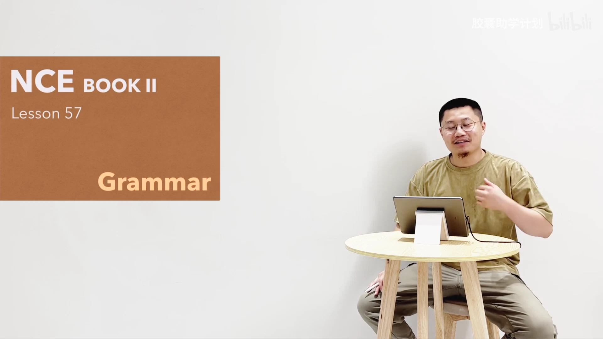

文字识别：NCE / BOOK"I / Lesson 57 / Grammar

### 画面 00:00:05

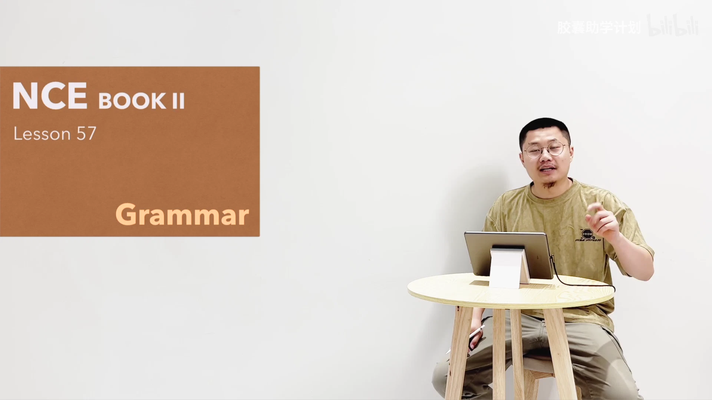

文字识别：NCE / BOOKII / Lesson 57 / Grammar

### 画面 00:00:09

### 画面 00:00:11

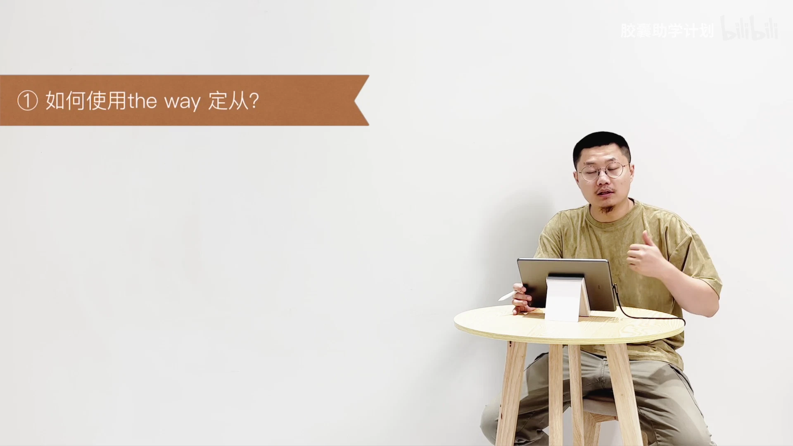

文字识别：①如何使用the way 定从？

### 画面 00:00:18

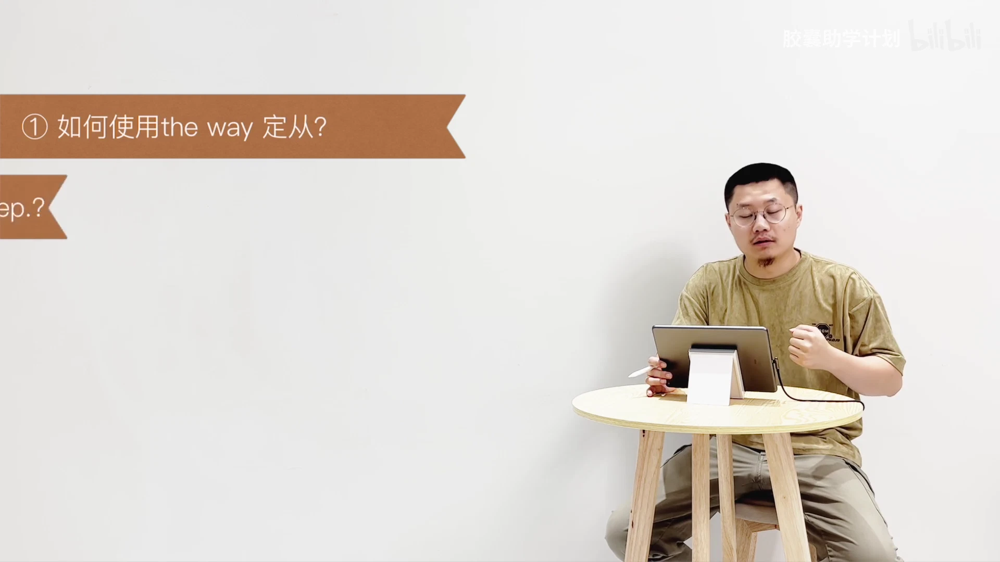

文字识别：①如何使用the way 定从？ / ep.?

### 画面 00:00:20

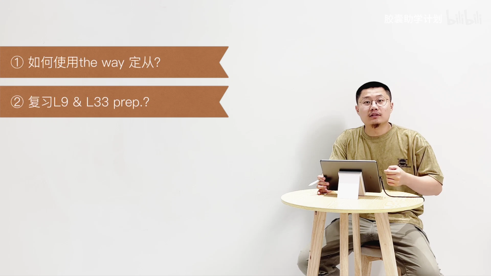

文字识别：①如何使用the way 定从？ / 复习L9 ＆ L33 prep.? / 01

## 00:00:30–00:01:00

会以练带讲的方式啊。那带着这两个问题，Hope you can enjoy。好，那上来呢，我们先看一下这句话啊，呃，原文给的一句话，我们先拿过来看一下，叫做 The assistant who served her did not like the way she was dressed。说，首先看前面有一个定语从句，叫 who served her。 who served her 就是形容修饰这个 assistant。assistant 在这，我

### 画面 00:00:35

文字识别：胶囊助学计划b出l / •

### 画面 00:00:39

### 画面 00:00:41

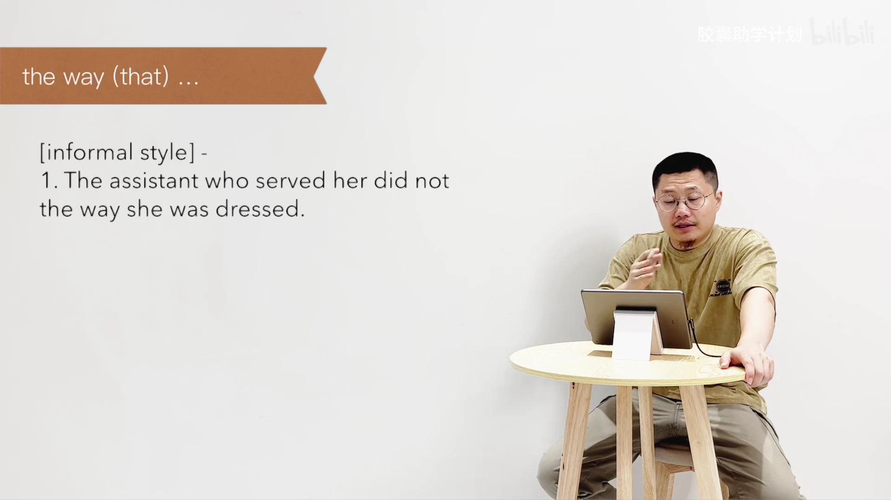

文字识别：the way (that) / [informal style] - / 1. The assistant who served her did not / the way she was dressed.

## 00:01:00–00:01:30

告诉各位，他最开始我们新医学的时候，他不是有助手的意思吗？对吧？那 shop assistant，之前我们也见过，其实就是导购，对吧？呃，就是服务他的那名，哎，这个导购怎么样呢？并不喜欢 the way，这个 way 并不是路了，在这里 the way 另一个常用的意思叫做方式啊，不是很喜欢这样一个方式。什么方式呢？She was dressed，叫做她穿着的方式。你看见了吗？我是由后往前去翻译的，

### 画面 00:01:00

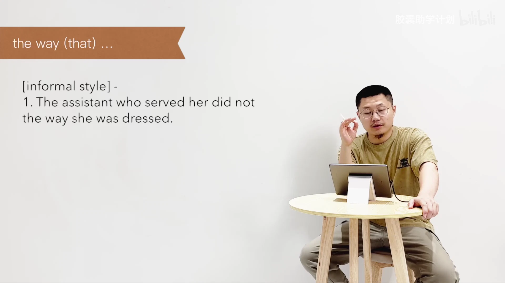

文字识别：the way (that) / [informal style] - / 1. The assistant who served her did not / the way she was dressed.

### 画面 00:01:03

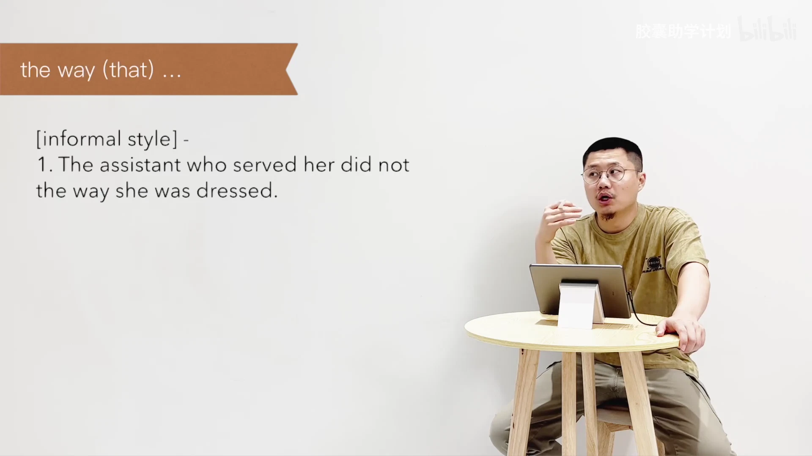

文字识别：the way (that) / [informal style] - / 1. The assistant who served her did not / the way she was dressed. / FROM

## 00:01:30–00:02:00

对吧？叫做他穿着的方式，只不过在 the way 引导的这个定语从句当中呢，这个 that 或者 in which 这样的一个连接词啊，就定语从句连接词，常年是被省略掉的啊，它是一种语言习惯，对吧？它就是说，它类似，它是从属于定语从句的，但是呢，它的语言习惯是一般不去加上，人们说话是有人们说话的语言习惯的嘛，对吧？好，比如说 I don't like the way you talk

### 画面 00:01:33

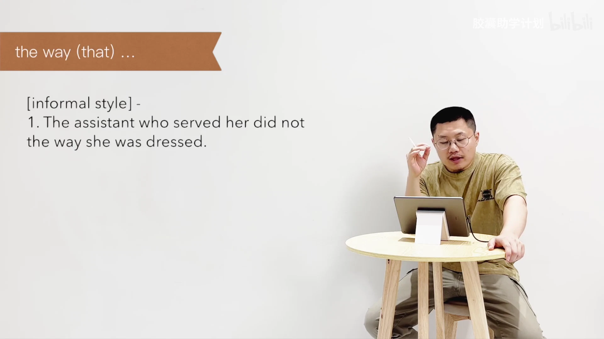

文字识别：the way (that) / [informal style] - / 1. The assistant who served her did not / the way she was dressed.

### 画面 00:01:56

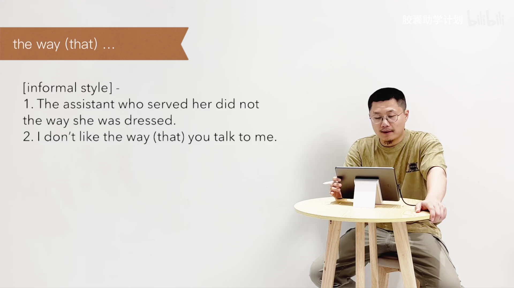

文字识别：the way (that) / [informal style]- / 1. The assistant who served her did not / the way she was dressed. / 2.I don't like the way (that) you talk to me. / RO1

## 00:02:00–00:02:30

to me. 我们看一下这句话怎么翻译，很容易理解。就你先看 the way 到 the way way 这个单词就结束了。叫我不喜欢这样一种方式。你看啊，如果我跟你说汉语，没有前文，没有后这个呃这个后果，对吧？没有没有没有下文，那你肯定会问我一句话，叫做什么方式？什么的方式？对吧？这个方式是什么样一个内容啊？啊，就是它的定位到底是什么？什么方式你不喜欢呢？你肯定会问我这

### 画面 00:02:12

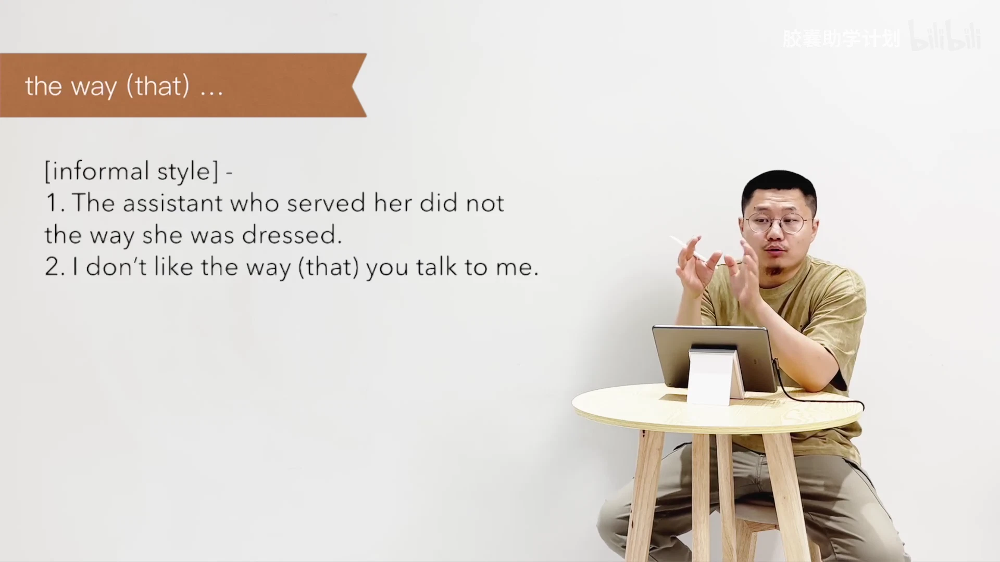

文字识别：the way (that) / [informal style]- / 1. The assistant who served her did not / the way she was dressed. / 2.I don't like the way (that) you talk to me.

### 画面 00:02:14

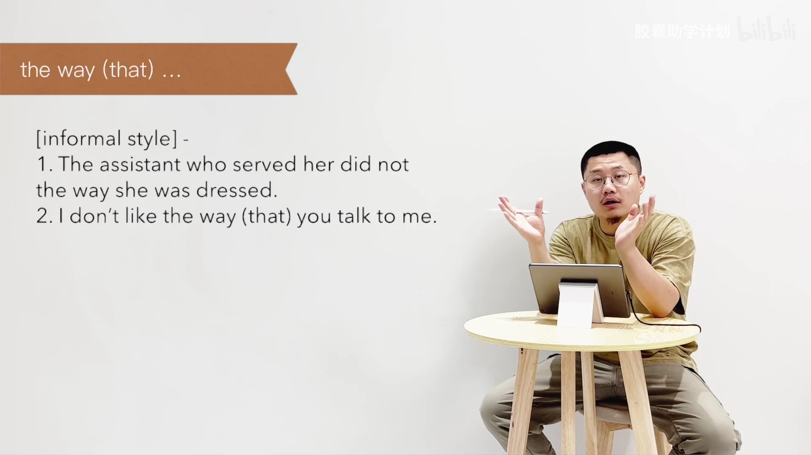

文字识别：the way (that) / [informal style]- / 1. The assistant who served her did not / the way she was dressed. / 2.I don't like the way (that) you talk to me.

### 画面 00:02:16

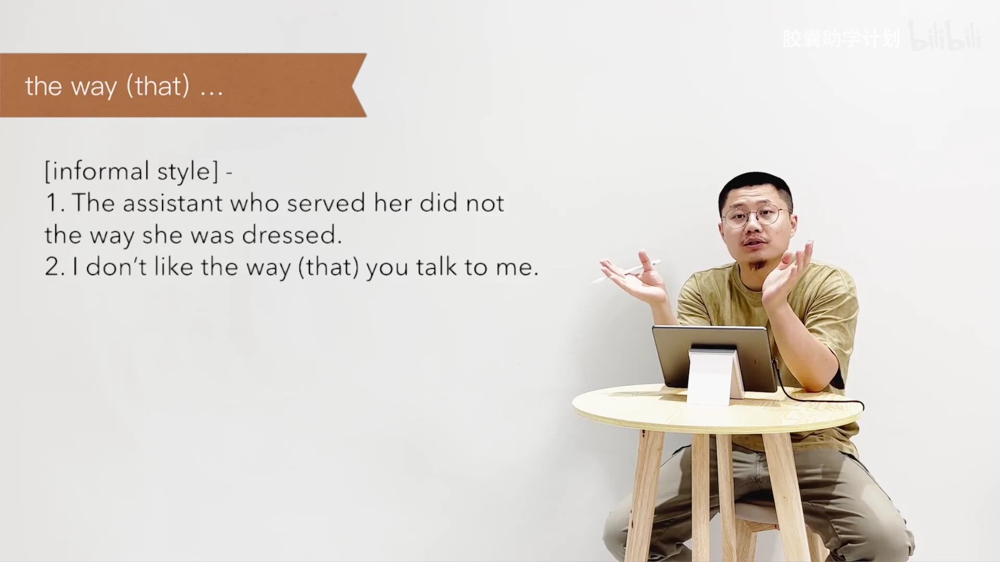

文字识别：the way (that) / [informal style]- / 1. The assistant who served her did not / the way she was dressed. / 2.I don't like the way (that) you talk to me.

## 00:02:30–00:03:00

样一个问题，对吧？好，那后边那句话叫做 you talk to me，叫做你对我说话。其实后边这句话我给你补全了，叫做 you talk to me in this way or in that way。就是它被拆成两句话，叫第一句话叫我不喜欢这样一个方式，第二句话叫做你和我说话那样的一个方式，对吧？你和我说话用那样的一种方式。所以它其实两句话被合并成一句汉语的时候，它的意思就是我不喜

### 画面 00:02:46

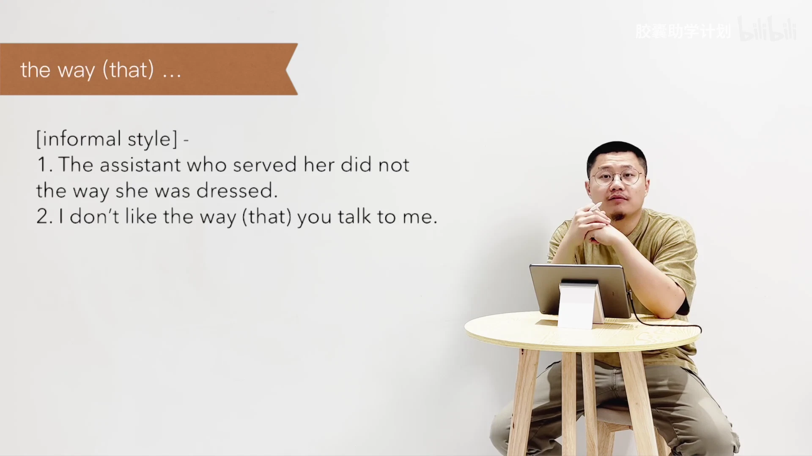

文字识别：the way (that) / [informal style]- / 1. The assistant who served her did not / the way she was dressed. / 2.I don't like the way (that) you talk to me.

### 画面 00:02:48

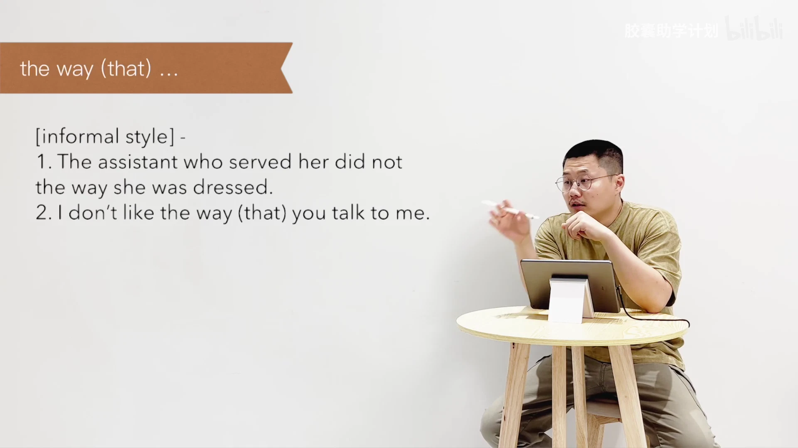

文字识别：the way (that) / [informal style]- / 1. The assistant who served her did not / the way she was dressed. / 2.I don't like the way (that) you talk to me.

## 00:03:00–00:03:30

欢你和我说话的这样一个方式，比如说，要么是盛气凌人的，要么是唯哎唯唯诺诺的，对吧？反正不管你是什么样，我不喜欢你这样的一个方式，不卑不亢的不好吗？对不对？好，比如说再来，所以 we want to know the way in which you learn new words啊，就好比就像其实各位一样，就你们可能想了解我去学习新的英语单词的时候的方式是什么，对吧？所以你们可能会问一句话叫 we want to know the way，我们想知道这样一种

### 画面 00:03:13

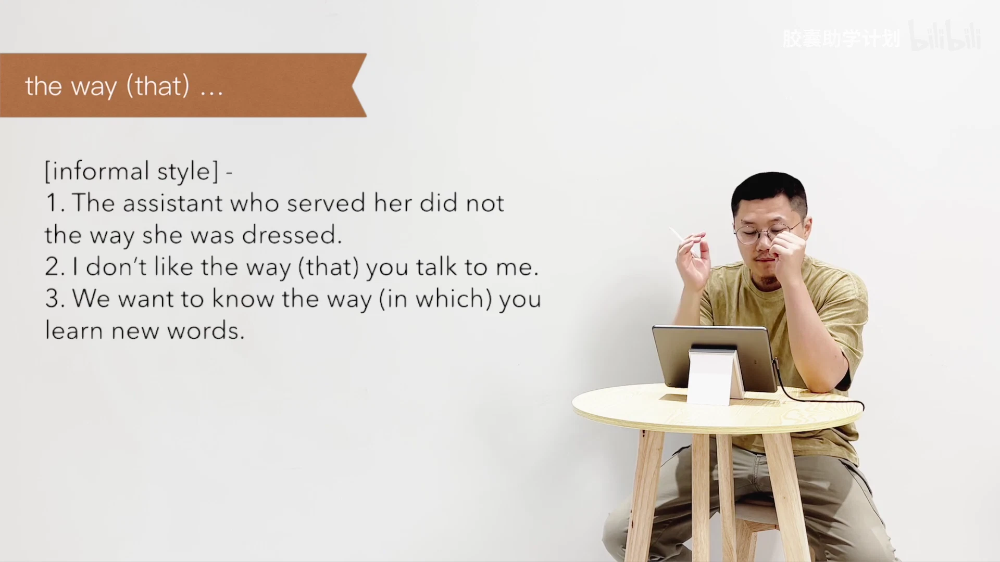

文字识别：the way (that) / [informal style]- / 1. The assistant who served her did not / the way she was dressed. / 2.I don't like the way (that) you talk to me. / 3. We want to know the way (in which) you / learn new words.

### 画面 00:03:20

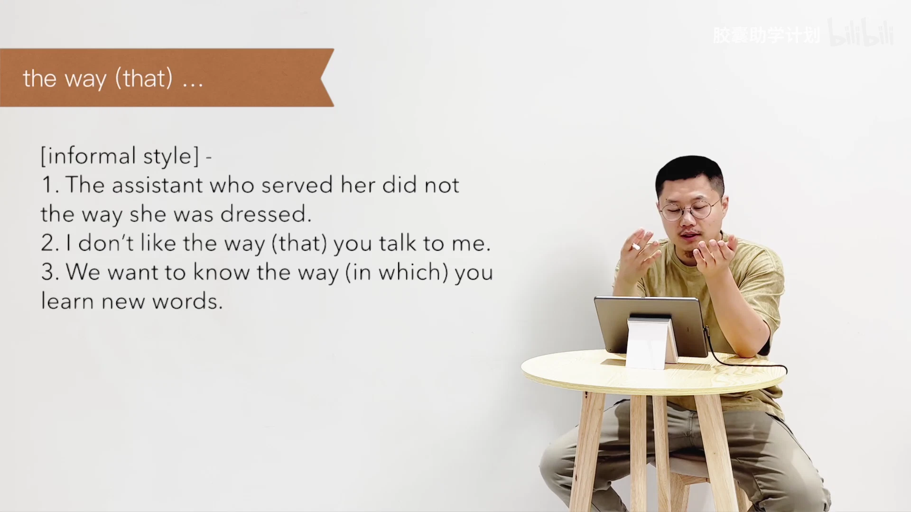

文字识别：the way (that) / [informal style]- / 1. The assistant who served her did not / the way she was dressed. / 2.I don't like the way (that) you talk to me. / 3. We want to know the way (in which) you / learn new words.

### 画面 00:03:22

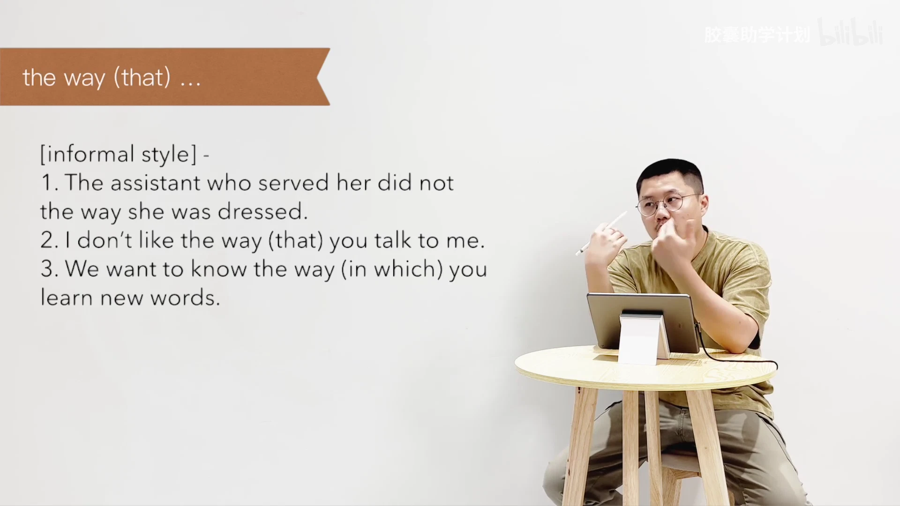

文字识别：the way (that) / [informal style]- / 1. The assistant who served her did not / the way she was dressed. / 2.I don't like the way (that) you talk to me. / 3. We want to know the way (in which) you / learn new words.

## 00:03:30–00:04:00

way. That next, inevitably, if there is no context, the question you will ask is called what way. What way?

### 画面 00:03:31

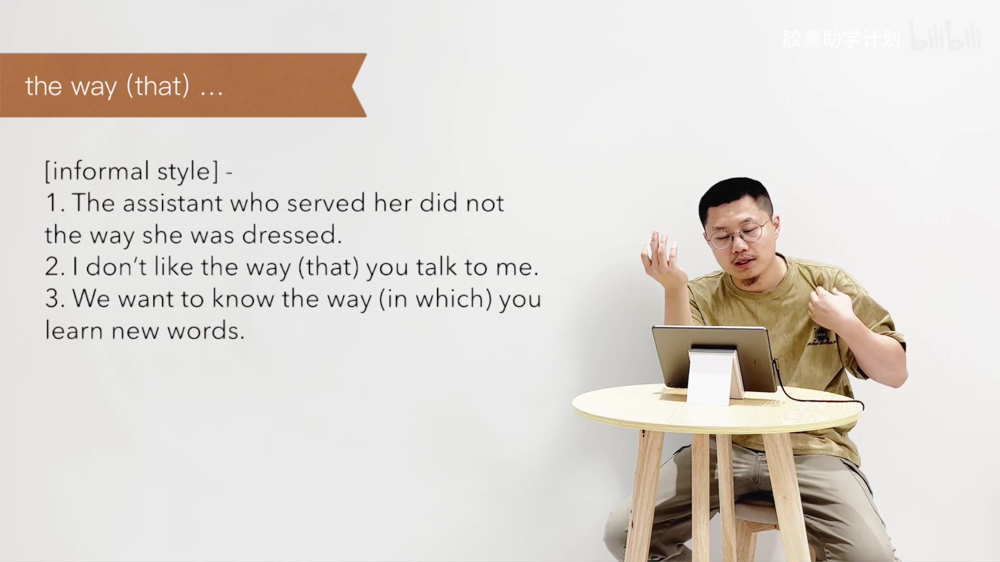

文字识别：the way (that) / [informal style]- / 1. The assistant who served her did not / the way she was dressed. / 2.I don't like the way (that) you talk to me. / 3. We want to know the way (in which) you / learn new words.

## 00:04:00–00:04:30

的，但是各位注意，这地方有一个小点，在备课的时候我注意到了啊。我们有一些老师会说，这里的that和in which是绝对不能加的，加了是错的啊。根据我们现在查到的，对吧？我去查阅的语法书告诉我和实际的例句告诉我，首先确实几乎不会出现，但出现了也并不是错的。各位能理解吧？就是它没有那么的绝对啊，就是人们的语言习惯一般

### 画面 00:04:01

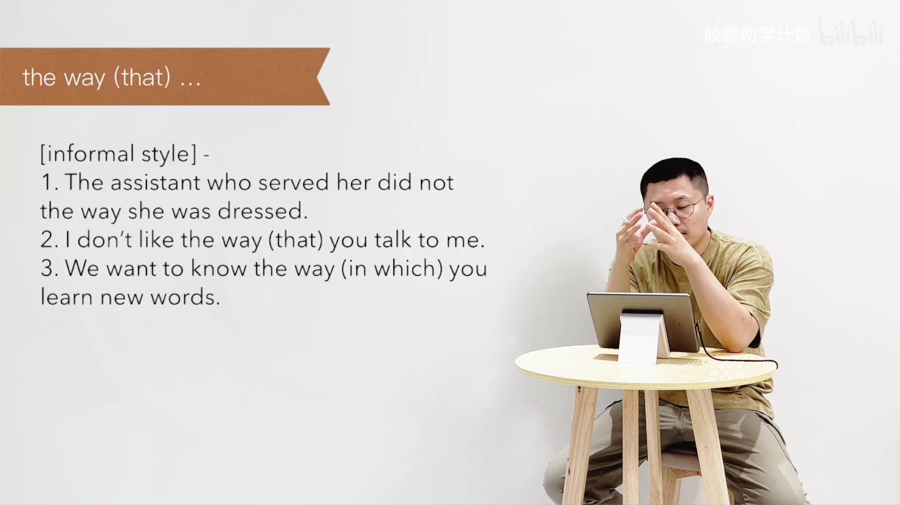

文字识别：the way (that) / [informal style]- / 1. The assistant who served her did not / the way she was dressed. / 2.I don't like the way (that) you talk to me. / 3. We want to know the way (in which) you / learn new words.

## 00:04:30–00:05:00

不用，但可能会出现，你不要认为它是错的啊。好，接下来呢，我们用一种比较新的方式去帮助各位把这个 the way 啊给它记下来，就是 the way 在去用的时候，口语当中出现的，当然了，反过来就是听力，对不对？出现的概率非常的高，所以我找了一大堆的电影片段出现了这个语法，我们挨个去看。第一个说 I don't need to do it the way you did or my father，

### 画面 00:04:31

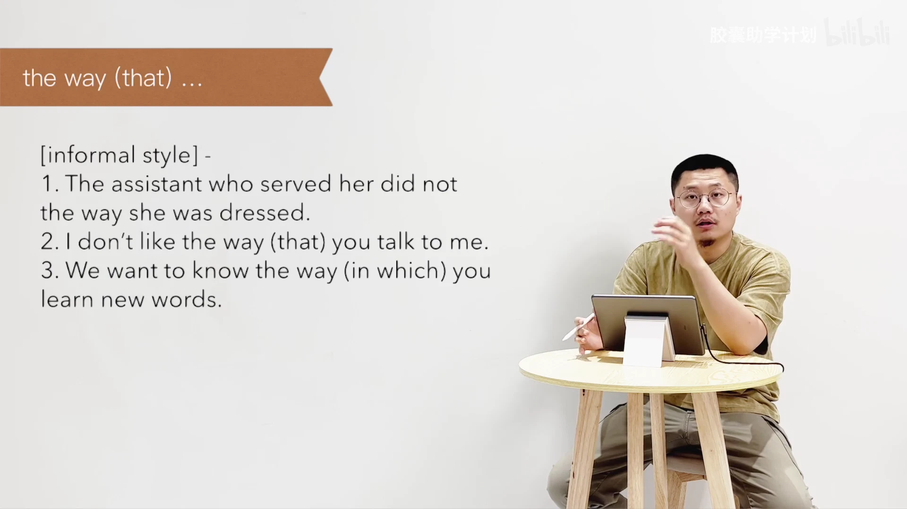

文字识别：the way (that) / [informal style]- / 1. The assistant who served her did not / the way she was dressed. / 2.I don't like the way (that) you talk to me. / 3. We want to know the way (in which) you / learn new words.

### 画面 00:04:34

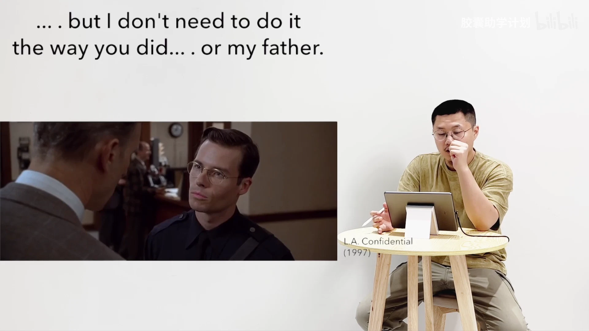

文字识别：…. but I don't need to do it / the way you did.. . or my father. / LA. Confidential / (1997)

### 画面 00:04:39

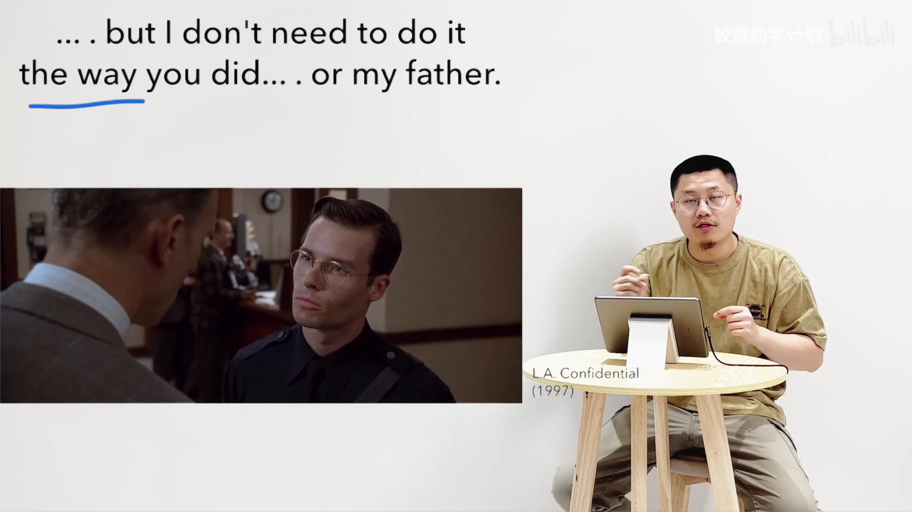

文字识别：…. but I don't need to do it / the way you did. . or my father. / L.A. Confidential / (1997)

### 画面 00:04:42

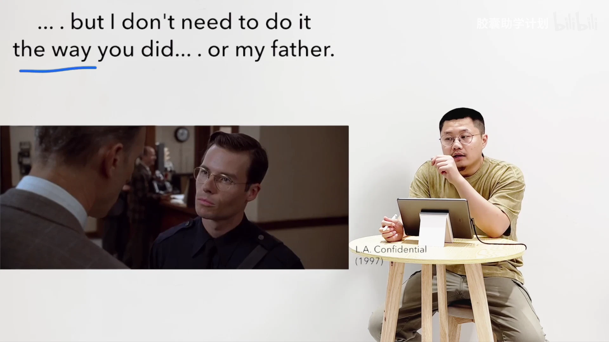

文字识别：…... but I don't need to do it / the way you did. . or my father. / L.A. Confidential / (1997)

## 00:05:00–00:05:30

但是我不需要去做它，以这样一种方式。什么方式呢？你做的方式或者我父亲做的方式。两句话合成一句话的意思叫我不需要按照你做这件事情或我父亲做这件事情的方式去做这件事情，对吧？他是以A这个方式去做的，我没有必要以A这个方式去做，或者你是以B，我也不想以B的方式去做，对

### 画面 00:05:12

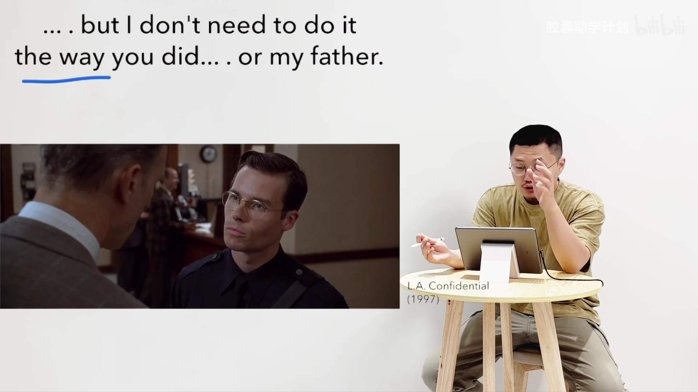

文字识别：... but I don't need to do it / the way you did.. . or my father. / L.A. Confidential / (1997)

### 画面 00:05:24

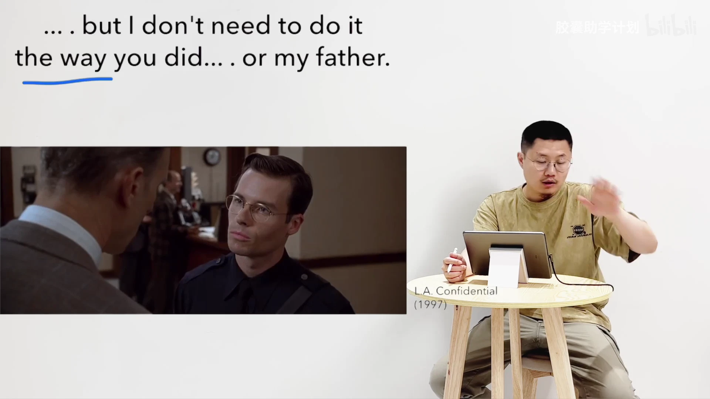

文字识别：….. but I don't need to do it / the way you did.. . or my father. / LA. Confidential / (1997)

## 00:05:30–00:06:00

吧？啊，注意力集中，听一下。But I don't need to do it the way you did, or my father. Okay, next one. So, well, I like the way you talk. I like the way我喜欢这样一种方式。什么方式呢？You talk in this way.你以这样的方式说话。我喜欢这个方式。你以这个方式说话。所以两句话合成一句话，叫我喜欢你说话的方式，对吧？来了。Next one. I

### 画面 00:05:33

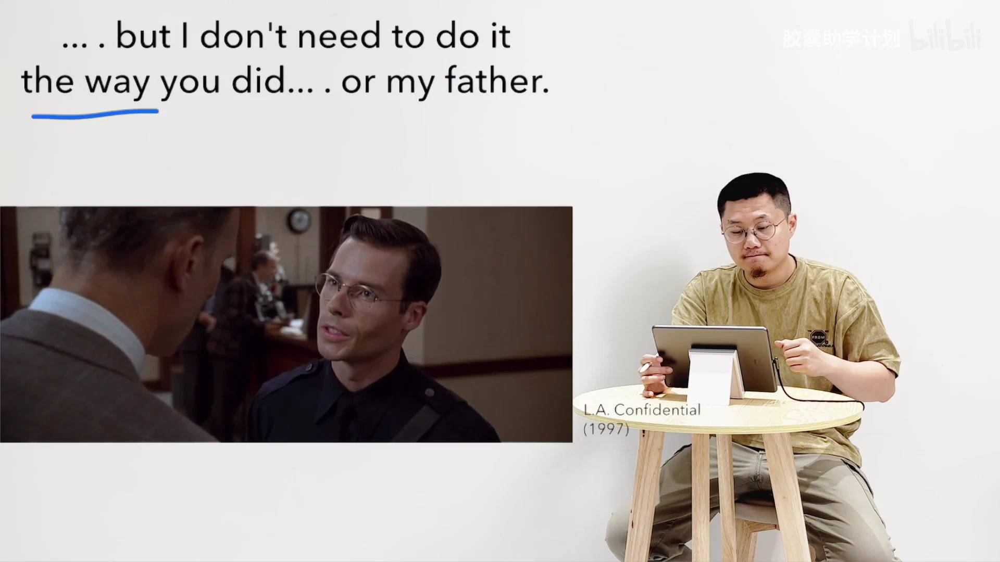

文字识别：.. but I don't need to do it / the way you did. . or my father. / L.A. Confidential / (1997)

### 画面 00:05:36

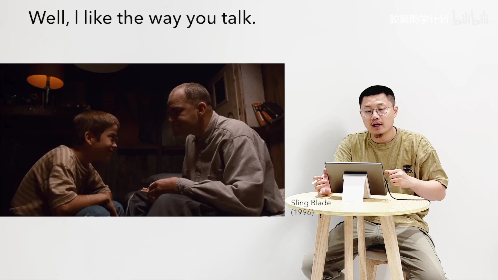

文字识别：Well,I like the way you talk. / Sling Blade / (1996)

### 画面 00:05:39

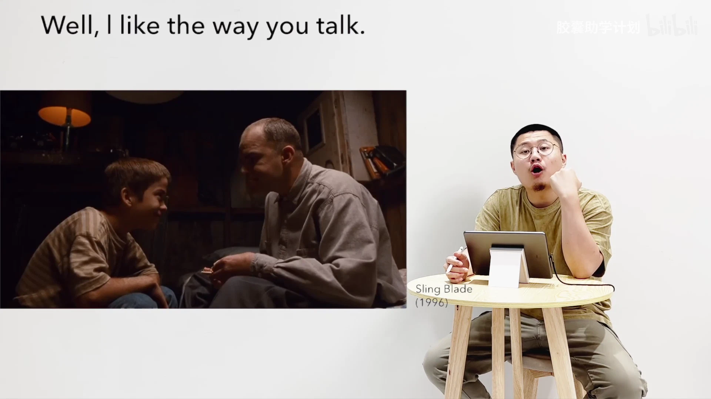

文字识别：Well,I like the way you talk. / Sling Blade / (1996)

### 画面 00:05:42

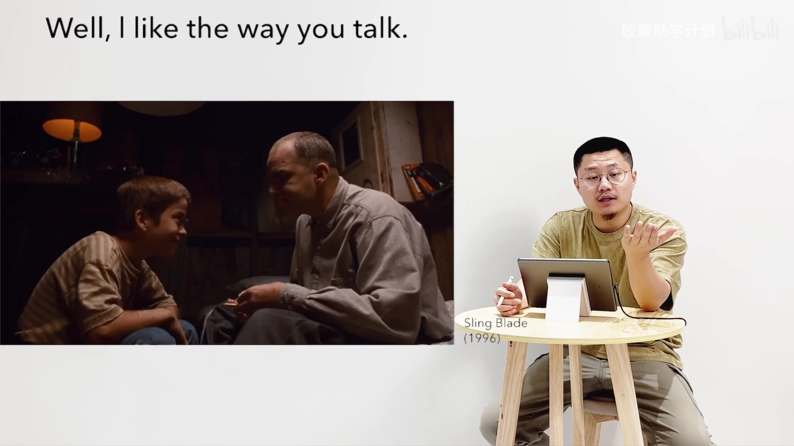

文字识别：Well,I like the way you talk. / Sling Blade / (1996)

### 画面 00:05:56

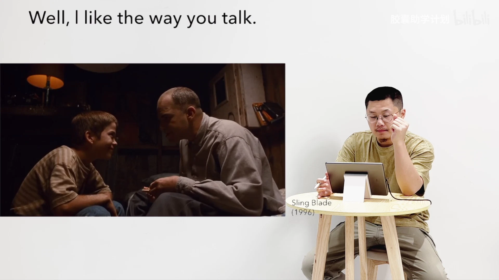

文字识别：Well,I like the way you talk. / Sling Blade / (1996)

### 画面 00:05:58

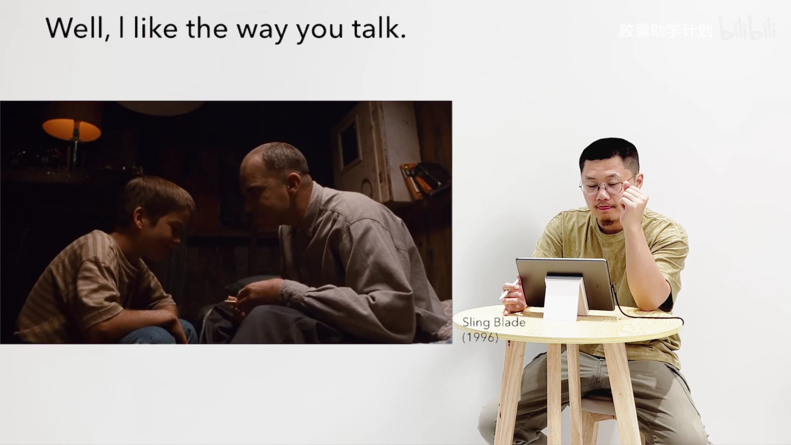

文字识别：Well, like the way you talk. / Sling Blade / (1996)

## 00:06:00–00:06:30

one, I like the way you say things. 我喜欢这样一个方式，什么方式？ You say things in this way. 看了吧，我后边都给你补了一个东西，叫 in this way. 好，我喜欢这个方式，什么方式？你你说话的这些方式，你说东西的这些方式，就我喜欢你说话的方式，对吧？哎，娓娓道来啊，等等的。 I like the way you say things. Very good. Next one. So what are you crazy? I

### 画面 00:06:00

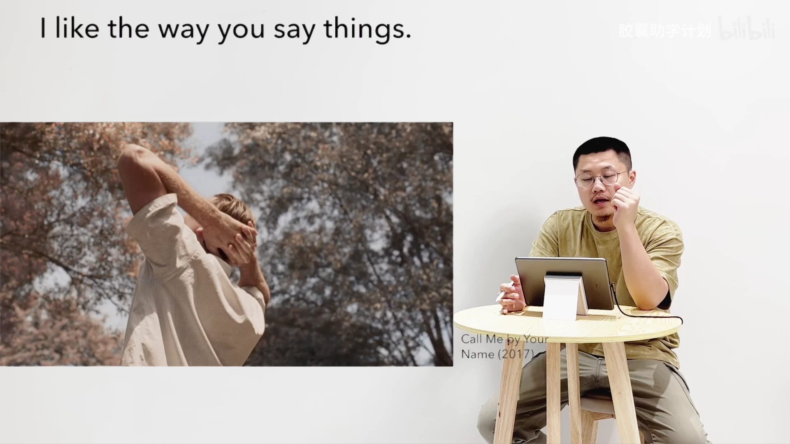

文字识别：I like the way you say things. / Call Me by Your / Name(2017)

### 画面 00:06:23

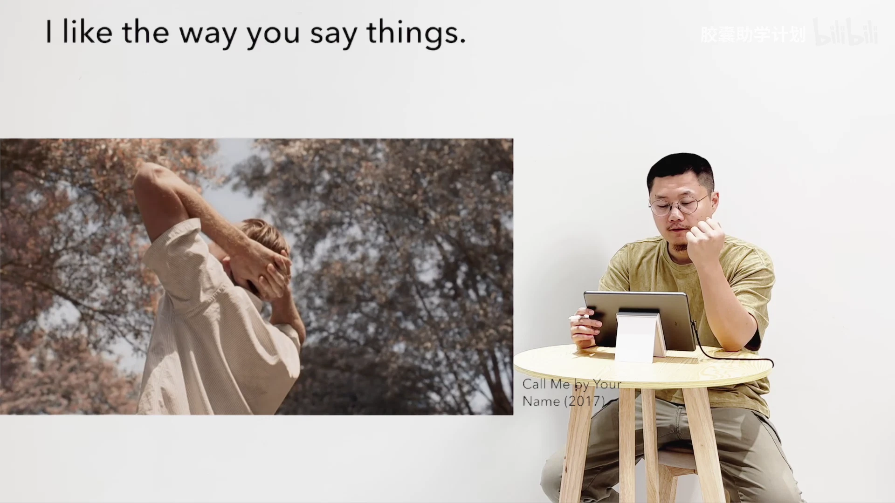

文字识别：I like the way you say things. / Call Me by Your / Name(2017)

### 画面 00:06:25

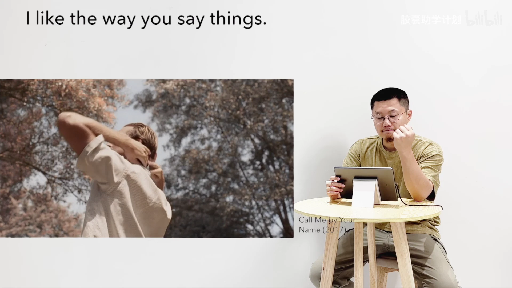

文字识别：I like the way you say things. / Call Me by Your / Name(2017)

### 画面 00:06:27

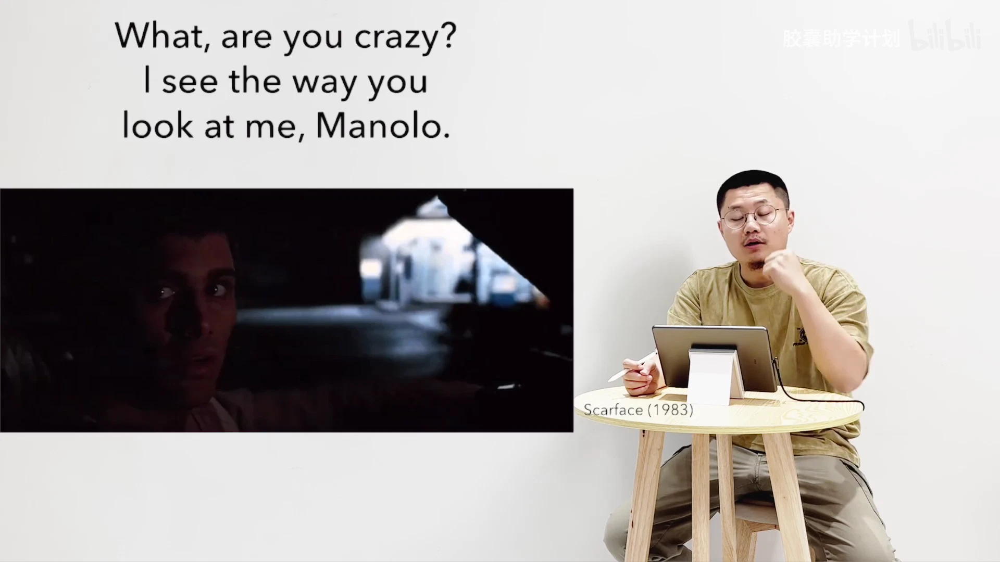

文字识别：What, are you crazy? / I see the way you / look at me, Manolo. / Scarface(1983)

## 00:06:30–00:07:00

I see the way you look at me, Manolo,是吧？他说你疯了吗？他说Why? I see the way.说我看到了这样一个方式，什么方式呢？You look at me.你看着我的方式，对吧？这个是男女之间的那个小情愫啊，你要去感受。说我看到了你看我的那个眼神儿啊，充满了爱意，对吧？充满了欣赏。I I see the way you look at me.好，注意力集中。Are you

### 画面 00:06:57

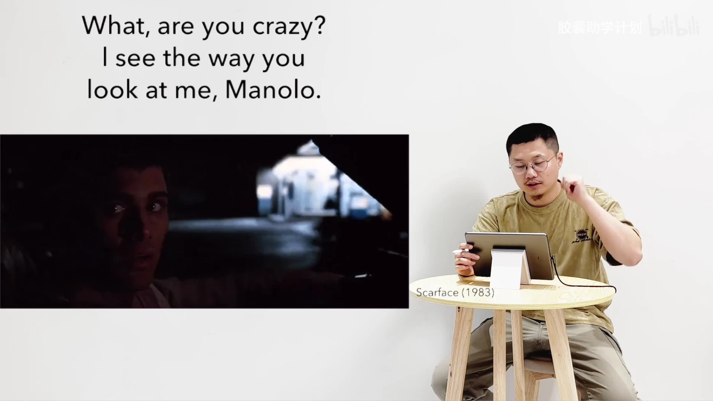

文字识别：What, are you crazy? / I see the way you / look at me, Manolo. / Scarface(1983)

### 画面 00:06:59

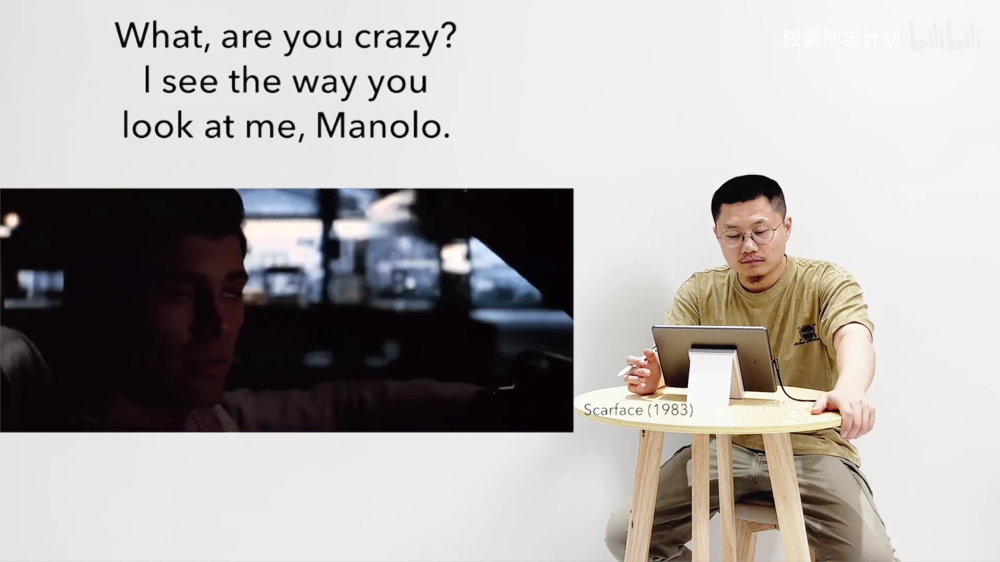

文字识别：What, are you crazy? / I see the way you / look at me, Manolo. / Scarface (1983)

## 00:07:00–00:07:30

crazy. I see the way you look at me, Manolo. Are you good? Next one. Because I love the way you look at the world. I love the way很简单，我喜欢这样一个方式。You look at the way, look at the world in this way.说你看待这个世界用这样一种方式，比如说特别的积极乐观，那我就很喜欢这样一个方式，叫我很热爱，我很喜欢你看待这个世界的方式。I love the way you look at the world. 好吧。Because I

### 画面 00:07:01

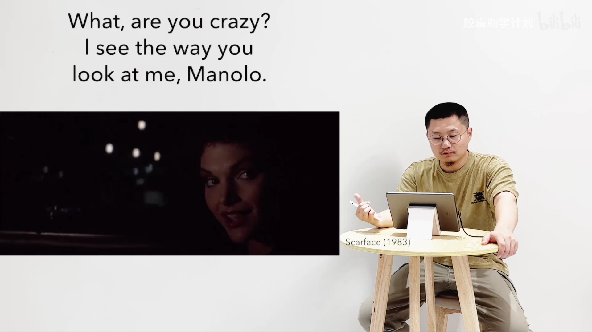

文字识别：What, are you crazy? / I see the way you / look at me, Manolo. / Scarface (1983)

### 画面 00:07:03

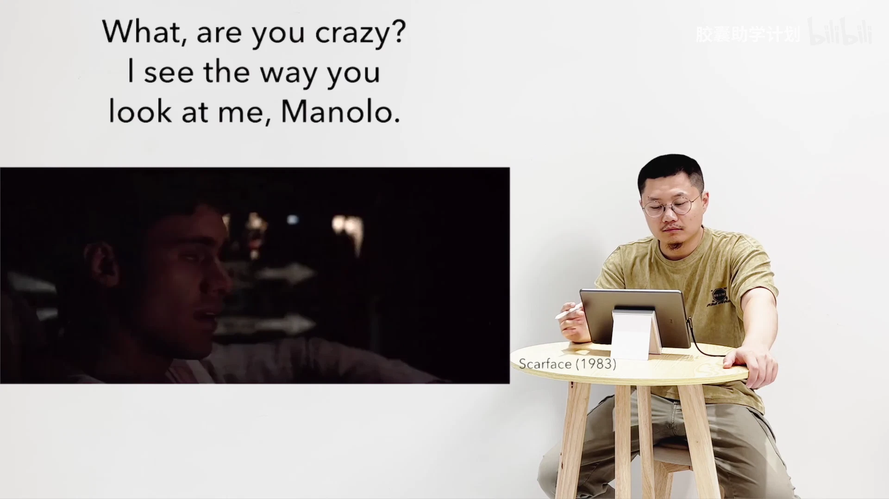

文字识别：What, are you crazy? / I see the way you / look at me, Manolo. / Scarface (1983)

### 画面 00:07:05

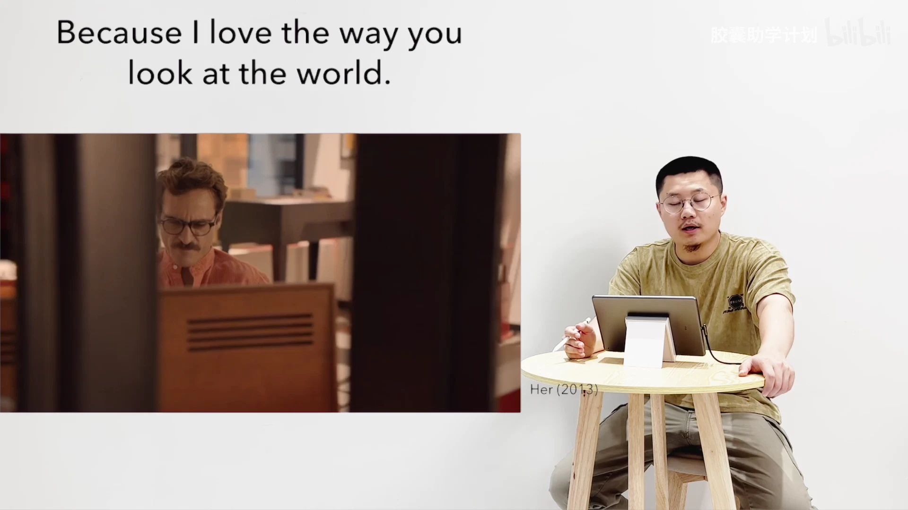

文字识别：Because I love the way you / look at the world. / Her(2013)

### 画面 00:07:10

文字识别：Because I love the way you / look at the world. / Her(201.3)

### 画面 00:07:15

文字识别：Because I love the way you / look at the world. / Her(2013)

### 画面 00:07:24

文字识别：Because I love the way you / look at the world. / Her(201.3)

### 画面 00:07:27

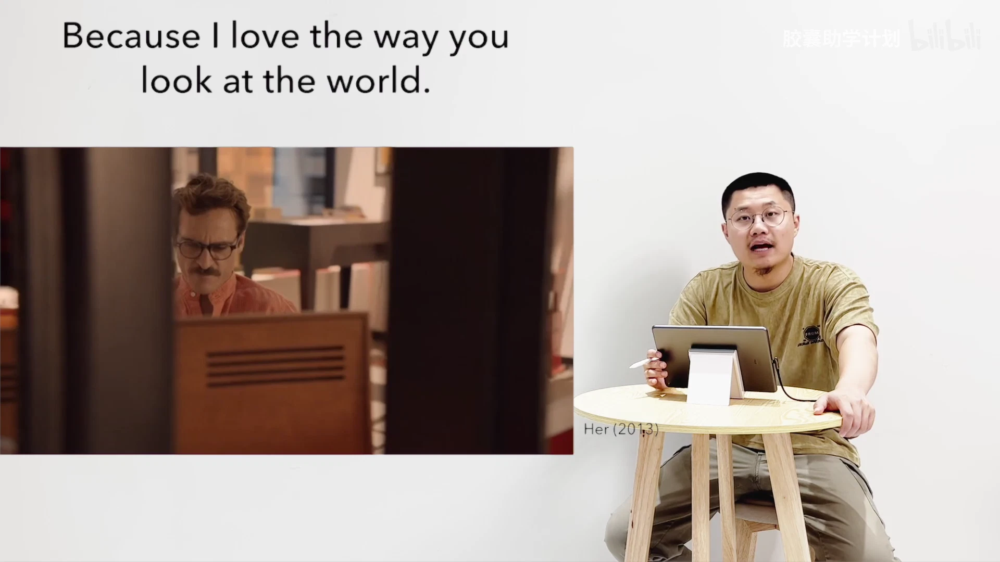

文字识别：Because Ilove the way you / look at the world. / Her(201.3)

### 画面 00:07:29

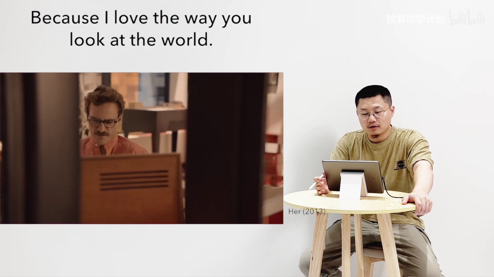

文字识别：Because I love the way you / look at the world. / Her(201.3)

## 00:07:30–00:08:00

love how you look at the world. Very good. Next one. So come on, you want me to stay because of the way you feel about me. 哎，这句话叫你想让我停留下来，because of the way，因为这样一个方式，什么方式呢？叫 you feel about me。这还是男女之间的那样的一个情愫啊，这个常用片段叫做你对我的感受的这样一个方式，对吧？你想让我留下来，完全是因为你对我感受的这样一个方式。其实它它的言外之意

### 画面 00:07:31

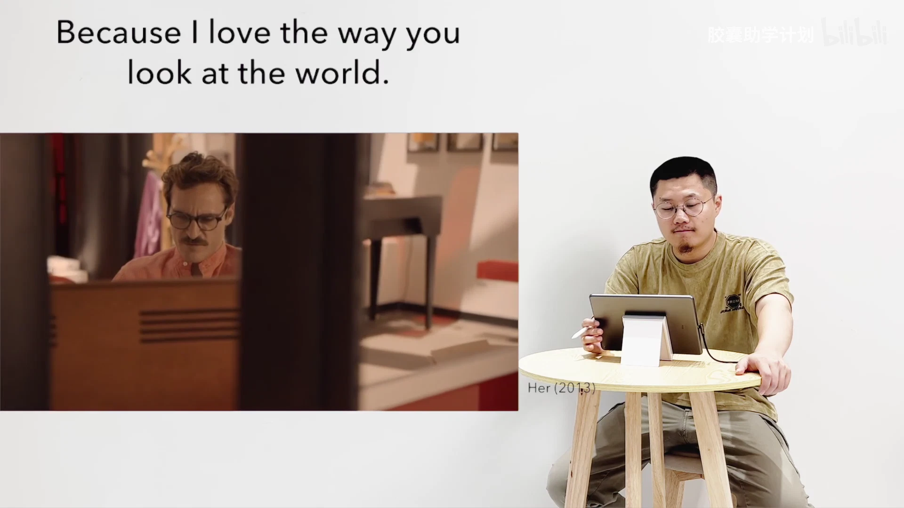

文字识别：Because I love the way you / look at the world. / Her(201.3)

### 画面 00:07:33

文字识别：Come on. You want me to stay / because of the way / you feel about me. / Star Wars: / EpisodeV / Empire Stmik / Back (1980)

### 画面 00:07:35

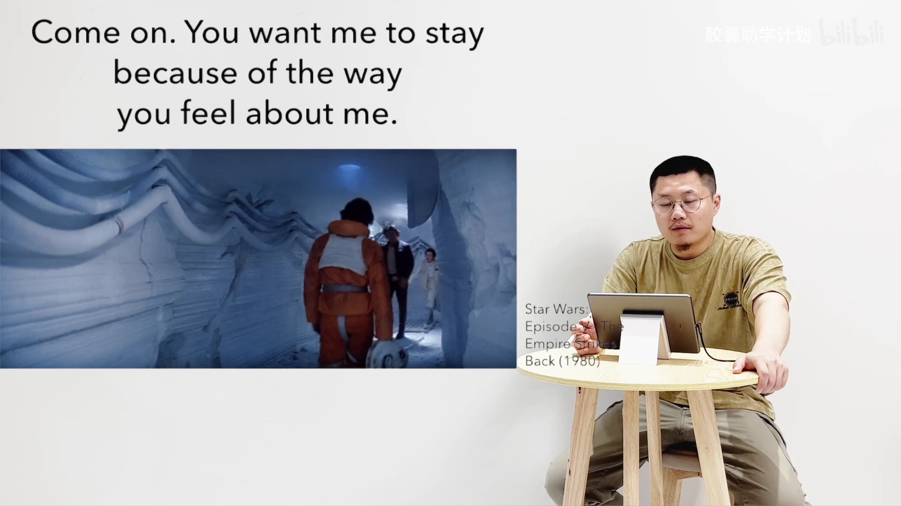

文字识别：Come on. You want me to stay / because of the way / you feel about me. / Star Wars: / Episodey / Empire / Strik / Back (1980)

### 画面 00:07:37

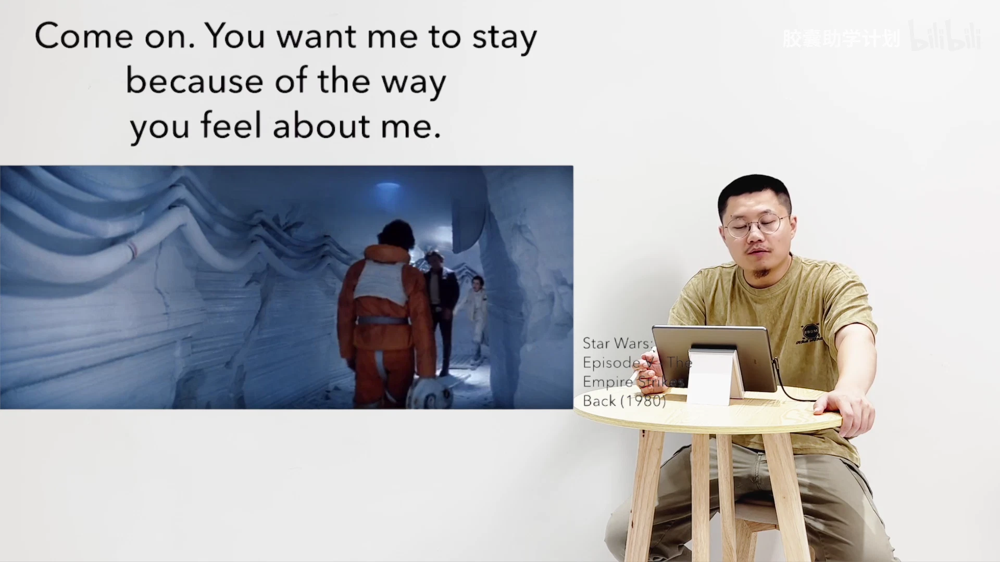

文字识别：Come on. You want me to stay / because of the way / you feel about me. / Star Wars / Episodey / Empire Sirik / Back(1980)

### 画面 00:07:39

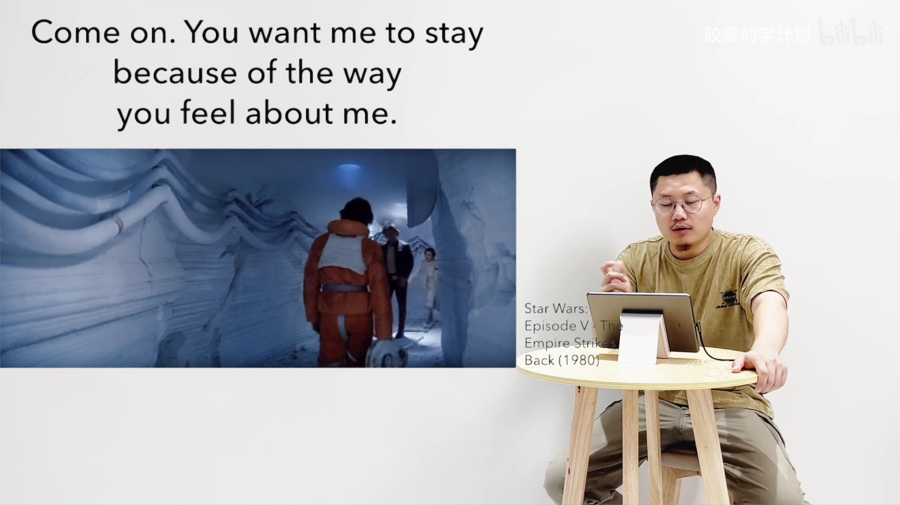

文字识别：Come on. You want me to stay / because of the way / you feel about me. / Star Wars: / EpisodeV / Empire Strikeg / Back(1980)

### 画面 00:07:47

文字识别：Come on. You want me to stay / because of the way / you feel about me. / Star Wars / Episode VTh / Empire Strikes / Back(1980)

### 画面 00:07:50

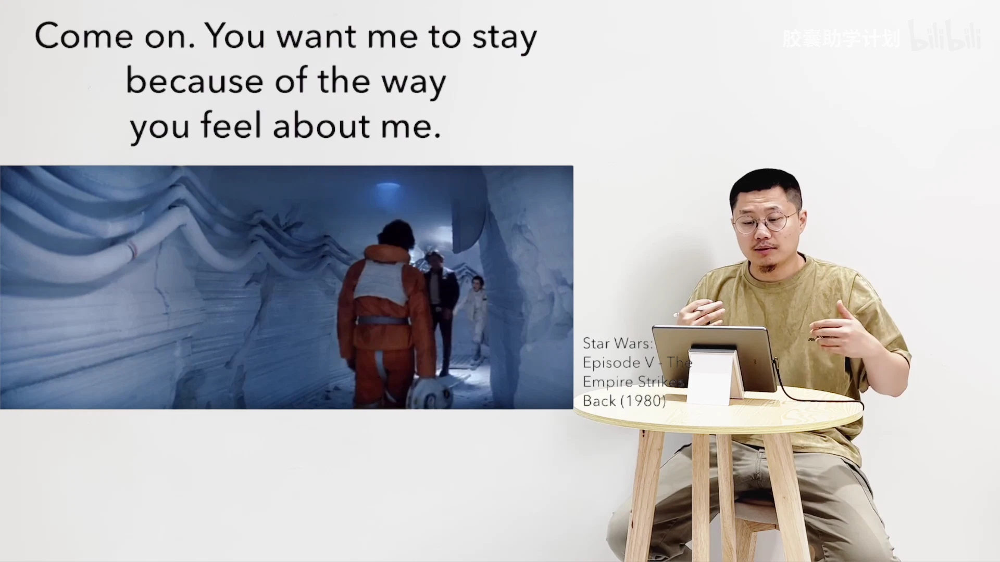

文字识别：Come on. You want me to stay / because of the way / you feel about me. / Star Wars: / Episode V / Empire Strikes / Back(1980)

### 画面 00:07:53

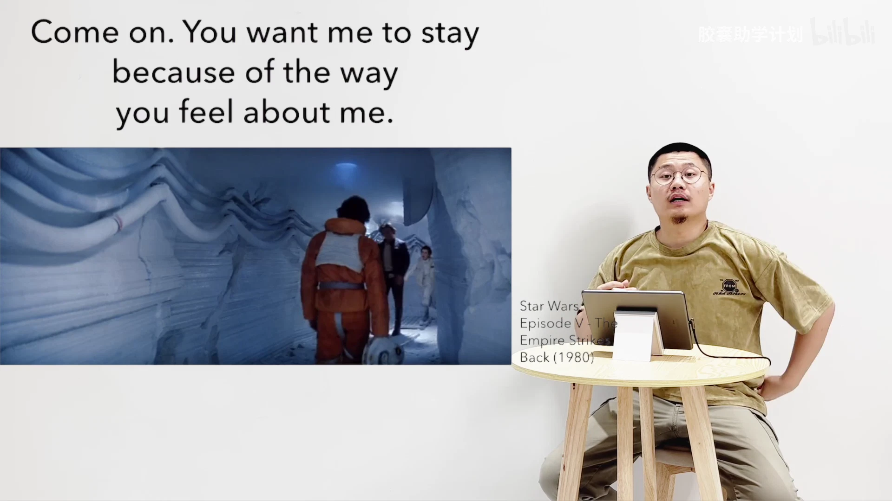

文字识别：Come on. You want me to stay / because of the way / you feel about me. / Star Wars, / EpisodeV- / Empire Strikes / Back(1980)

## 00:08:00–00:08:30

就是你对我有好感，对吧？ Come on, you want me to stay because of the way you feel about me. Very good. 接下来下一个，说 if you don't want to be caught, you are going to have to change the way you think. 说如果你不想被捉住，那你必须要 you are going to have to. 你看 be going to 加了 have to，咱全学过，对吧？新概念一册三十七课，新概念一册一百二十五课学的 have to，对吧？ Change the way，

### 画面 00:08:01

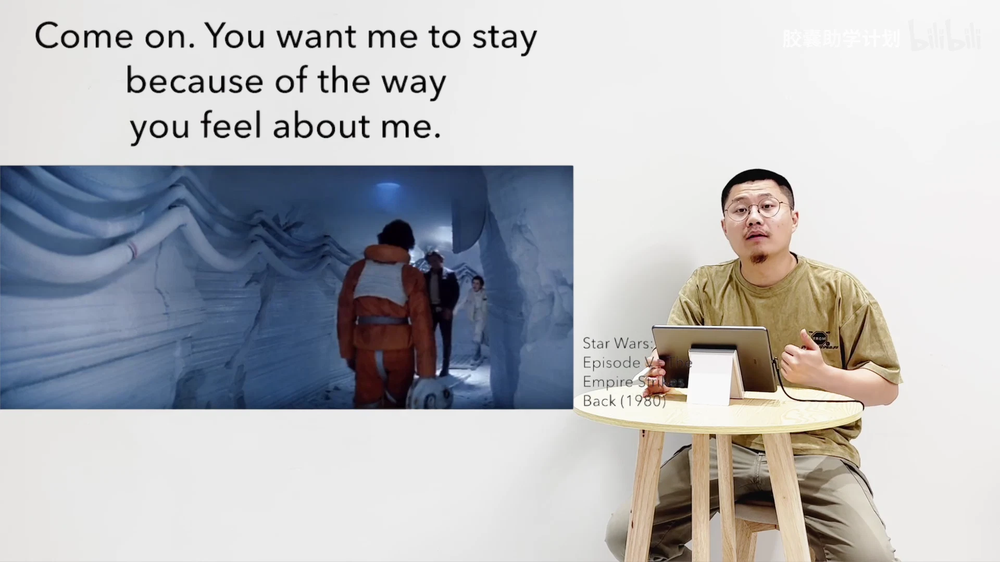

文字识别：Come on. You want me to stay / because of the way / you feel about me. / Star Wars: / Episode / Empire St / Back (1980)

### 画面 00:08:03

文字识别：Come on. You want me to stay / because of the way / you feel about me. / Star Wars: / Episode / Empire Stril / Back(1980)

### 画面 00:08:05

文字识别：Come on. You want me to stay / because of the way / you feel about me. / Star Wars: / ROＭ / Episode / Empire Stril / Back (1980)

### 画面 00:08:07

文字识别：Come on. You want me to stay / because of the way / you feel about me. / Star Wars: / EpisodeV / Empire Stri / Back (1980)

### 画面 00:08:09

文字识别：If you don't want to be caught, / you're going to have to / change the way you think. / Vigil (1984)

## 00:08:30–00:09:00

改变这个方式，什么方式呢？ You think in this way, 你以这样的方式去思考，所以它很简单就翻译成了叫你将必须要改变你思考的方式。 The way you think, 注意力集中。 If you don't want to be caught, you're gonna have to change the way you think. Very good, 好，下一个。 I'm tired of the way you decide how the world is gonna run.

### 画面 00:08:39

文字识别：If you don't want to be caught, / you're going to have to / change the way you think. / Vigil (1984)

### 画面 00:08:54

文字识别：I'm tired of the way / you decide / how the world is gonna run. / The Judge / (2014)

## 00:09:00–00:09:30

好，首先 be tired of 四十九课咱们学过这个这个这个习惯用法叫厌倦于了，对吧？那 I'm tired of the way，说我厌倦于了这样一个方式，什么方式呢？叫做 you decide how the world is gonna run。你看这里边每个单词你都认得，但你不一定很清楚的知道这句话到底想表达什么。You decide，叫做你决定 how the world is gonna run，叫做这个世界是如何运作的。这里的 run 不是跑，是运作，对吧？叫做我厌

### 画面 00:09:01

文字识别：I'm tired of the way / you decide / how the world is gonna run. / The Judge / (2014)

## 00:09:30–00:10:00

tired of you deciding how the world is going to run.

### 画面 00:09:30

文字识别：I'm tired of the way / you decide / how the world is gonna run. / The Judge / (2014)

### 画面 00:09:39

文字识别：I'm tired of the way / you decide / how the world is gonna run. / The Judge / (2014)

### 画面 00:09:58

文字识别：I'm tired of the way / you decide / how the world is gonna run. / FROM / The Judge / (2014)

## 00:10:00–00:10:30

how the world is gonna run? Here we go. Review preposition. New One Thirty-Five. If you guys, ah, first our lesson review, actually, the focus is on two small prepositions. If you guys prepositions completely haven't learned, for example, you haven't seen New One Thirty-Five. Then I suggest you go back to New Concept One Thirty-Five and Thirty-Six to review this lesson. This lesson I taught a lot of prepositions. In the next lesson, we will actually use them a lot. This is the first one. The second one is New Concept Two Thirty-Nine and Thirty-Two.

### 画面 00:10:00

文字识别：I'm tired of the way / you decide / how the world is gonna run. / The Judge / (2014)

### 画面 00:10:02

文字识别：I'm tired of the way / you decide / how the world is gonna run. / The Judge / (2014)

### 画面 00:10:04

文字识别：复习 prep. / NCE1 L35

### 画面 00:10:11

文字识别：复习 prep. / NCE1L35

### 画面 00:10:23

文字识别：复习 prep. / NCE1L35

## 00:10:30–00:11:00

二个呢，新概念二册九课和三十三课咱们都说过了。介词这个东西呢，实话实说，就是它千变万化，非常的多，用法也非常的细。我们不可能在一个视频当中完全给各位讲清楚，所以在关于介词，我分享一个小的学习方法就好了，叫做在哪里出现了，你就如果这个以前学过，加深一遍记忆力；如果没学过，我们特殊去看一下它就好了。介

### 画面 00:10:53

文字识别：复习 prep. / NCE1L35 / NCE2 L9 & L33

## 00:11:00–00:11:30

词换一句话来说，我们可能大部分的时间学介词的时候，并不是主动学习。所谓主动学习，就是我要去听讲解，然后做练习，对吧？我学介词的大部分的时间，可能是进行被动学习的。所谓被动学习，就是我进行了大量的输入，这篇文章也好，片段也好，句子也好，里面可能就包含了介词。当我见到足够多的时候，我自然而然就知道了，叫在早晨应该用 in the morning，

### 画面 00:11:23

文字识别：复习 prep. / NCE1L35 / NCE2 L9 & L33

## 00:11:30–00:12:00

而不用 on the morning，对吧？在周五我自然而然就知道了，不应该好像用 on 啊，不应该用 in Friday 或者 at Friday，而用 on Friday，对吧？这个背后是没有 why 的，它更多的啊，就是我们总结出来的是规律，而不叫原因，对吧？啊，更多总结出来叫 on 啊，这个介词可能在时间上更多的加的是具体某一天啊，而不是说 on 啊，为什么要去 on 加某

### 画面 00:11:53

文字识别：复习 prep. / NCE1L35 / NCE2 L9 &L33

## 00:12:00–00:12:30

一天呢？这个是很难解释，这是语法学家要研究的，不是我们要研究的，对吧？我们只要知道它这个 rules 这个规则是这样的，我们会去用就好了。那如何去会去用呢？大量输入。所以，我们还是每次到这里的时候都进行一件事儿，叫做以练代讲，对吧？啊，我们进行大量输入就行了。接下来呢，我们重点提的是两个小的介词，叫 in 和 with。你看，对于各位来说，这两个介词是，呃，相

### 画面 00:12:16

文字识别：Repetition drill / 训练目标： / 听力口语 / 练习包含in 和 with的句子 / Accuracy / Fluency

## 00:12:30–00:13:00

对而言可能很熟悉的，比如说 in 表示在什么什么里，对吧？这个 with 表示谁和谁，对吧？You and me，对吧？You 啊，这个 I'm with my father right now，对吧？我现在和我父亲在一起。好，with in 好，这些个各位比较熟悉的。今天呢，我们给它做一点点小的变化，但是很容易理解啊。你看一下，比如说 Who did you see? A man. He was wearing a black suit. 我问我说你看见谁了？你回答说一个男的。

### 画面 00:12:34

文字识别：Repetition drill / 训练目标： / 听力口语 / 练习包含in 和 with的句子 / Accuracy / Fluency

### 画面 00:12:46

文字识别：Repetition drill

### 画面 00:12:49

文字识别：Repetition drill / 1 T: Who did you see? / 专

### 画面 00:12:52

文字识别：Repetition drill / 1 T: Who did you see? / A man. He was wearing a black suit.

## 00:13:00–00:13:30

说他呢正在穿着一个黑色的西服。这个穿着黑色的西服的这个穿这个动词是可以被英文里面的in这个介词去替代的。比如说这句话就可以变成了叫I saw a man。我看到了这个男的。In a black suit，你看他其实就被转化成了叫什么呢？In这个介词引导的一个小的短语，后置到了man

### 画面 00:13:05

文字识别：Repetition drill / 1 T: Who did you see? / A man. He was wearing a black suit.

### 画面 00:13:10

文字识别：Repetition drill / 1 T: Who did you see? / A man. He was wearing a black suit.

## 00:13:30–00:14:00

这个单词的后面去做它的定语，叫做我看见了一个穿着啊 in 在什么什么里面对吧？在这儿就得意译成汉语叫做穿着穿着着黑色西装的男人，看到吧？这个是咱们二八二九三十新概念二册认真讲过的啊，所以穿着什么什么你可以把 wear 换成 in 啊。然后第二个说 who did you see? 啊, a woman. She was carrying a brown handbag. 注意 in 如果是穿戴的

### 画面 00:13:40

文字识别：Repetition drill / 1 T: Who did you see? / A man. He was wearing a black suit. / S: I saw a man in a black suit.

### 画面 00:13:51

文字识别：Repetition drill

### 画面 00:13:58

文字识别：Repetition drill / 2 T: Who did you see? / A woman. She was carrying a brown handbag.

## 00:14:00–00:14:30

的话，那这里你看就不能用in了，我们就得用with。叫做I saw a woman with a brown handbag。这个with，如果比如说我们给它翻译成和，不是很严谨啊。但是呢，好像隐隐约约我能感受到，至少我是能感受到。我不知道在座的各位能不能大概是什么意思？就我看见了一个女人和啊，就是带着携带着，或者说就伴

### 画面 00:14:02

文字识别：Repetition drill / 2T: Who did you see? / A woman.She / : was carrying a brown handbag. / S: I saw a woman with a brown handbag.

### 画面 00:14:10

文字识别：Repetition drill / 2 T: Who did / you see? / A woman.She / : was carrying a brown handbag. / S: I saw a woman with a brown handbag.

### 画面 00:14:14

文字识别：Repetition drill / 2 T: Who did you see? / A woman. She V / : was carrying a brown handbag. / S:I saw a woman with a brown handbag.

## 00:14:30–00:15:00

随着一个棕色的手提包，对吧？和一个手提包啊，一个女人和一个手提包，那不就是女人拿着这个手提包吗？对不对？所以它这个里边其实 with 它替代了这个 carry，看见了吧？就是用介词起到了这个动词的作用啊。这是呃英语里面一个小的习惯，所以呢呃更多的我们大量输入，慢慢而然这个语感就有了。所以我们一一练再讲啊。再来，

### 画面 00:14:39

文字识别：Repetition drill / 2T: Who did / you see? / A woman. She /  was carrying a brown handbag. / S:I saw a woman with a brown handbag. / FROM

### 画面 00:14:43

文字识别：Repetition drill / 2 T: Who did you see? / A woman. She was carrying a brown handbag. / S: I saw a woman with a brown handbag.

### 画面 00:14:57

文字识别：Repetition drill

## 00:15:00–00:15:30

who did you see?老习惯, a man. He had a scar on his face.注意，你看我们现在的选择就是用in还是用with. In我刚才说了，穿戴衣服要用in，对吧？如果说有这么一个东西啊，伴随着这么一个东西，对吧？或者说和这么一个东西，那它往往用的是with。所以这句话变成了叫I saw a man with a scar on his face.有这么一个scar，对

### 画面 00:15:06

文字识别：Repetition drill / 3 T: Who did you see? / A man. He had a scar on his face.

### 画面 00:15:10

文字识别：Repetition drill / 3 T: Who did you see? / A man. He had a scar on his face.

### 画面 00:15:20

文字识别：Repetition drill / 3 T: Who did you see? / A man. He had a scar on his face. / S: I saw a man with a scar on his face.

## 00:15:30–00:16:00

吧？疤痕啊，闪电，对吧？啊，你们知道是谁？Harry Potter on his face,啊, on his forehead,对吧？在他的这个前额上。Next one, who did you see? A woman. She was wearing blue jeans. Jeans,咱们刚学，对吧？蓝色牛仔裤。那这个就很简单了嘛。穿着蓝色牛仔裤，在蓝色牛仔裤里面叫I saw a man in blue jeans.别忘了张嘴跟我读啊啊！当然，你甚至可以暂停屏幕，从头到尾大声朗读几遍。OK，这个学习越主

### 画面 00:15:37

文字识别：Repetition drill / 3 T: Who did you see? / A man. He had a scar on his face. / S: I saw a man with a scar on his face.

### 画面 00:15:39

文字识别：Repetition drill

## 00:16:00–00:16:30

teaching recording. Transcribe the exact words in their original spoken languages. Never translate. Preserve repetitions, questions and examples. Who did you see? Oh, a man. He was carrying a long umbrella.他是没办法穿着这个long umbrella，对吧？长雨伞的，那就肯定是携带着，伴随着。所以 I saw a man with a long umbrella. Next one. Who did you see? A woman. She had red hair.好，I saw a woman with red hair.对吧？哎，有和红色的头

### 画面 00:16:09

文字识别：Repetition drill / 5 T: Who did you see? / A man. He was carrying a long umbrella.

### 画面 00:16:22

文字识别：Repetition drill / 6 T: Who did you see? / A woman. She had red hair. / S: I saw a woman with red hair.

## 00:16:30–00:17:00

发，它不是穿戴了，对不对？Next one, who did you see? A man. He had a big nose. I saw a man with a big nose,对吧？哎，有这么一个大鼻子。There you go.你看，他就替代的是had，对不对？说Who did you see? A woman. She was wearing a funny hat.这是戴着一个很搞笑的帽子，对吧？哎，这是咱们四十二课啊，讲need的那课学的。那你看，咱就给他换一下，叫I saw a woman

### 画面 00:16:52

文字识别：Repetition drill / 8 T: Who did you see? / A woman. She was wearing a funny hat.

### 画面 00:16:54

文字识别：Repetition drill / 8 T: Who did you see? / A woman. She was wearing a funny hat.

### 画面 00:16:58

文字识别：Repetition drill / 8 T: Who did you see? / A woman. She was wearing a funny hat. / S: I saw a woman in a funny hat.

## 00:17:00–00:17:30

in a funny hat.带着一个穿戴用in，对不对？好，next one，张嘴跟我读。 Who did you see? A man. He was wearing a red tie.是with还是in呢？in为什么穿戴嘛，对吧？I saw a man in a red tie.哪一个？Next one. Who did you see?最后一个，a woman. She had blue eyes.

### 画面 00:17:07

文字识别：Repetition drill / 9 T: Who did you see? / M

### 画面 00:17:20

文字识别：Repetition drill / 9 T: Who did you see? / A man. He was yearing a red tie. / S: I saw a marina red tie.

### 画面 00:17:24

文字识别：Repetition drill / 10 T: Who did you see?

## 00:17:30–00:18:00

蓝色的眼睛，穿戴用in。如果说有，或者说伴随着，用的是with。I saw a woman with blue eyes.对不对？这句话就出来了。Marry go. Pattern drill. Pattern drill就是练一下包含介词的句子吧，好吧？那就很简单了。我们说一下这两句话啊。Shall we meet at the station?咱在火车站见。Yes, I'll wait

### 画面 00:17:44

文字识别：Pattern drill / 训练目标： / 写作口语 / 练习包含prep.的句子 / Accuracy / Fluency

### 画面 00:17:50

文字识别：Pattern drill / 1T: station----under the clock / S1: Shall we meet at the station? / S2: Yes.I'll wait for you under the clock. / cinema----near the entrance/ticket office / school--in the playground/hall/office / hotel---in thelobby/lounge/bar / car park---by the car/ticket machine

## 00:18:00–00:18:30

for you under the clock. 我会在呃这个呃大华表的底下等你，对吧？这是第一个啊，记得往里去带。第二个说，Jane looks very young in that bikini, doesn't she? 说Jane啊看起来非常的年轻。In that bikini, 那bikini是什么意思啊？汉语的比基尼啊，这个呃这个呃泳衣，对吧？它其实就是bikini音译过来的。那

### 画面 00:18:09

文字识别：Pattern drill / 2T: Jane looks young-bikini / S1: Jane looks very young in that bikini, doesn't she? / S2: She looks young in anything! / Mary looks nice/smart/elegant-coat / Betty looks pretty/beautiful-long dress / John looks handsome/important-uniform / Tom looks funny/silly/stupid-little hat

## 00:18:30–00:19:00

in that bikini 就是穿着那个比基尼泳衣，说她看起来好年轻啊，穿着那个比基尼泳衣，对吗？B 说了一句话，说 she looks young in anything，说她看起来很年轻，穿啥都年轻，对吧？特年轻啊，跟她穿啥没关系，对吧？所以她来了一个叫 in anything，anything 任何东西。那这个 anything 指的其实就是任何衣服。那 in 穿戴，所以用 in，看见了吧？又是这个知

### 画面 00:18:39

文字识别：Pattern drill / 2T: Jane looks young-bikini / S1: Jane looks very young in that bikini, doesn't she? / S2: She looks young in anything! / Mary looks nice/smart/elegant-coat / Betty looks pretty/beautiful-long dress / John looks handsome/important-uniform / Tom looks funny/silly/stupid-little hat

## 00:19:00–00:19:30

识点，往里去带啊。第三个，the police say the man they are looking for has a beard。这里注意有一个小的定语从句，对吧？叫做呃，还当然了，还有一个小的宾语从句，对吧？警察说说的内容是后边的话，说的内容是什么呢？哎，主句叫做 the man has a beard，是吧？这个男的有胡子。那什么样的男人呢？定语从句叫 they are looking for，他们正在寻找的

### 画面 00:19:01

文字识别：Pattern drill / 3T:man-a beard / S1: The police say the man they're looking for / has a beard. / S2: There's a man with a beard over there! / man--------a black briefcase/a bald head / chil--abrowndo/red hair / woman---ared handbag/a broken leg / dog-- / --a long tail/two black spots on it

### 画面 00:19:11

文字识别：Pattern drill / 3T:man-a beard / S1: The police say the man they're looking foy / has a beard. / S2: There's a man with a beard over there! / man--------a black briefcase/a bald head / chil--abrowndo/red hair / woman---red handbag/a brokenleg / dog- / ---a long tail/two black spots on it

### 画面 00:19:17

文字识别：Pattern drill / 3T:man-a beard / S1: The police saythe man they're looking for / has a beard.T / S2: There'sa man with a beard over there! / man-------a black briefcase/a bald head / chil--abrowndo/red hair / woman---ared handbag/a broken leg / dog- / --a long tail/two black spots on it

## 00:19:30–00:20:00

这个男的男子有胡子，对吧？哎，希望各位这儿能理解。接下来说，There is a man with a beard over there.你注意，beard就是伴随着有，它不能用in了，对吧？所以用的是with。哎，说那儿有一个男的，有这么个胡子。Over there，在那边。星期四十三课学的，Over there, it's over there，在那边呢，对吧？It's over there，那儿一个，往里面去带啊，把底

### 画面 00:19:32

文字识别：Pattern drill / 3T:man-a beard / S1: The police say the man they're looking for / has a beard. / S2: There's a man with a beard over there! / man--------a black briefcase/a bald head / chil--abrowndo/red hair / woman---ared handbag/a brokenleg / dog-- / --a long tail/two black spots on it

### 画面 00:19:34

文字识别：Pattern drill / 3T:man-a beard / S1: The police say the man they're looking for / has a beard. / S2: There's a man with a beard over there! / man--------a black briefcase/a bald head / child--.browndo/red hair / woman---ared handbag/a broken leg / dog-- / --a long tail/two black spots on it

### 画面 00:19:55

文字识别：Pattern drill / 3T:man-a beard / S1: The police say the man they're looking for / has a beard. / S2: There's a man with a beard over there! / man-------a black briefcase/a bald head / chil--abrowndo/red hair / woman---ared handbag/a broken leg / dog- / ---a long tail/two black spots on it

### 画面 00:19:57

文字识别：Pattern drill / 3T:man-a beard / S1: The police say the man they're looking for / has a beard. / S2: There's a man with a beard over there! / man-------a black briefcase/a bald head / chil--.browndo/red hair / woman---red handbag/a brokenleg / dog-- / --a long tail/two black spots on it

## 00:20:00–00:20:30

线往上去带。好，最后一个说 is hot. Why doesn't he take off his coat? He为啥不把他这个外套脱了呢? He says he wants to keep it on,对吧？哎，说他说呀，他想保持他在身上。没什么可说的。接下来其实就是都是往里面去带一下。这道题倒很简单，各位不妨直接就带进去就行了，好吧？这地方其实就两个 take off 和 keep it on，对吧？保持在身上啊。呃，

### 画面 00:20:01

文字识别：Pattern drill / 4T：coat / S1: It's hot. Why doesn't he take off his coat? / S2: He says he wants to keep it on. / hat raincoat jacket uniform / tie pullover gloves sweater / boots shirt scarf overalls

### 画面 00:20:08

文字识别：Pattern drill / 4T：coat / S1: It's hot. Why doesn't he take off his coat? / S2: He says he wants to keep it on. / hat raincoat jacket uniform / tie pullover gloves sweater / boots shirt scarf overalls

### 画面 00:20:19

文字识别：Pattern drill / 4T：coat / S1: It's hot. Why doesn't he take off his coat? / S2: He says he wants to keep it on. / hat raincoat jacket uniform / tie pullover gloves sweater / boots shirt scarf overalls

### 画面 00:20:26

文字识别：Pattern drill / 4T：coat / S1: It's hot. Why doesn't he take off his coat? / S2: He says he wants to keep it on. / hat raincoat jacket uniform / tie pullover gloves sweater / boots shirt scarf overalls

### 画面 00:20:29

文字识别：Recap / Patterns / the way / ＆ / L9 L33 / Grammar

## 00:20:30–00:21:00

recap本课呢几个小的重点，第一个是the way，对吧？这个引导的定语从句。第二个呢，我们在复习第九课第三十三课啊的时候呢，我们重点挑了两个小的介词in跟with，因为是文章当中他们出现了，对吧？我们重点挑了一下这两个小的介词，去以讲代练的形式啊，我们去复习一下。其实以前都见过了啊。呃，家庭作业pattern drill四乘四，老习惯

### 画面 00:20:31

文字识别：Recap / Patterns / the way / ＆ / L9L33 / Grammar

### 画面 00:20:34

文字识别：Recap / Patterns / the way / ＆ / L9L33 / Grammar

### 画面 00:20:39

文字识别：Recap / Patterns / the way / L9L33 / Grammar

### 画面 00:20:42

文字识别：Recap / Patterns / the way / ＆ / L9L33 / Grammar

### 画面 00:20:44

文字识别：Recap / Patterns / the wav / ＆ / L9L33 / Grammar / wid / m

### 画面 00:20:46

文字识别：Recap / Patterns / the wav / ＆ / L9L33 / Grammar / with / m

### 画面 00:20:49

文字识别：Recap / Patterns / the wav / L9L33 / Grammar / with / m

### 画面 00:20:51

文字识别：Recap / Patterns / the wav / ＆ / L9L33 / Grammar / with / RON / m

### 画面 00:20:54

文字识别：Recap / Patterns / the way / ＆ / L9L33 / Grammar / with / m

### 画面 00:20:56

文字识别：1.f / Pattern Drill写&朗读 / 专栏 / 4×4

### 画面 00:20:59

文字识别：Pattern Drill 写&朗读 / 专栏 / 4×4 / 尝试回忆并给自己讲解一 / 遍今天的核心语法 / Study-Test / Learning Pyramid

## 00:21:00–00:21:30

尝试回忆并讲解老习惯啊，翻阅红皮书，完全可以写了，包括初级我们没有来得及写的也写一写啊，初级中级这两本书基本上等我们学完二册，理论上伴随着应该几乎咱都给它写完了啊。那以上呢就是本期视频的全部内容，如果各位喜欢我们的课程呢，欢迎各位关注、订阅、一键三连，分享给更多的朋友，来帮助我们快速成长。See you next time.

### 画面 00:21:01

文字识别：1. f / Pattern Drill写&朗读 / 专栏 / 4×4 / 尝试回忆并给自己讲解一 / 遍今天的核心语法 / Study-Test / Learning Pyramid / 尝试翻阅红皮书（中级） / 通过目录或索引(Index) / 查找到本课语法

### 画面 00:21:04

文字识别：1. f / Pattern Drill写&朗读 / 专栏 / 4×4 / 尝试回忆并给自己讲解一 / 遍今天的核心语法 / Study-Test / Learning Pyramid / 尝试翻阅红皮书（中级） / 通过目录或索引(Index) / 查找到本课语法

### 画面 00:21:06

文字识别：1.↑ / Pattern Drill写&朗读 / 专栏 / 4×4 / 尝试回忆并给自己讲解一 / 遍今天的核心语法 / Study-Test / Learning Pyramid / 尝试翻阅红皮书（中级） / 通过目录或索引(Index) / 查找到本课语法

### 画面 00:21:09

文字识别：Pattern Drill写&朗读 / 专栏 / 4×4 / 尝试回忆并给自己讲解一 / 遍今天的核心语法 / Study-Test / Learning Pyramid / 尝试翻阅红皮书（中级） / 通过目录或索引(Index) / 查找到本课语法

### 画面 00:21:11

文字识别：1. f / Pattern Drill写&朗读 / 专栏 / 4×4 / 尝试回忆并给自己讲解一 / 遍今天的核心语法 / Study-Test / Learning Pyramid / 尝试翻阅红皮书（中级） / 通过目录或索引(Index) / 查找到本课语法

### 画面 00:21:14

文字识别：1. / Pattern Drill写&朗读 / 专栏 / 4×4 / 尝试回忆并给自己讲解一 / 遍今天的核心语法 / Study-Test / Learning Pyramid / 尝试翻阅红皮书（中级） / 通过目录或索引(Index) / 查找到本课语法

### 画面 00:21:16

### 画面 00:21:22

### 画面 00:21:24

### 画面 00:21:26

### 画面 00:21:29

## 00:21:30–00:21:41

### 画面 00:21:31

文字识别：CAPSULEACADEMY / 胶囊助学计划 / 『 / 小红书 / Lecturer / Leo / OE

### 画面 00:21:34

文字识别：CAPSULEACADEMY / 胶囊助学计划 / 小红书 / □ / 口 / Editor / OE

### 画面 00:21:37

文字识别：CAPSULEACADEMY / 胶囊助学计划 / 小红书 / Creator / Leo & Berlin / OE

### 画面 00:21:39

文字识别：bilibili / 胶囊助学计划 / 胶囊助学计划 / 1 / 小红书 / 控□ / OE

### 画面 00:21:41

文字识别：bilibili / 胶囊助学计划

