# 057 文章

快速机器解析：语音为单模型转写，未进行独立交叉校对或人工复核；画面每秒采样并按变化选帧，短时文字和标记可能遗漏。截图时间约有 1 秒误差。图片有损压缩；遇到疑点请按时间查看 Google Drive 原视频。

## 00:00:00–00:00:30

Hello everyone, welcome to Capsule Academy. This is Leo. Today we're going to learn New Concept English Book Two Lesson Fifty Seven Story. Hope you can enjoy it.我们看一下标题，标题叫 Can I Help You, Madam？啊，没有太多可说的啊。这个 Can I Help You？各位注意一下，是你去英语为啊，就是你基本上去买东西的时候啊，这个导购会问你说我能有什么帮忙的吗？对吧？就 Can I Help You？啊，这是

### 画面 00:00:00

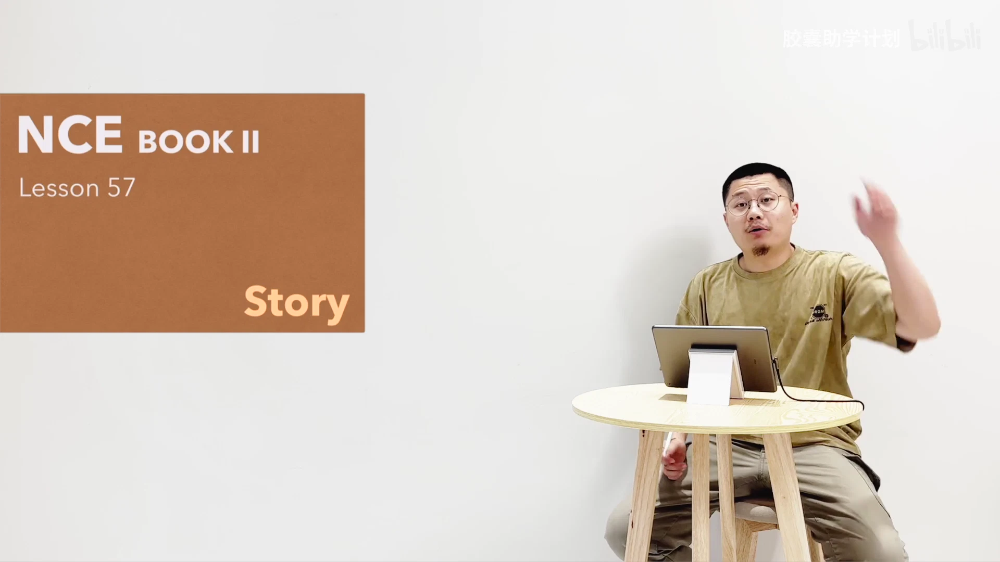

文字识别：NCE / BOOKII / Lesson 57 / Story

### 画面 00:00:02

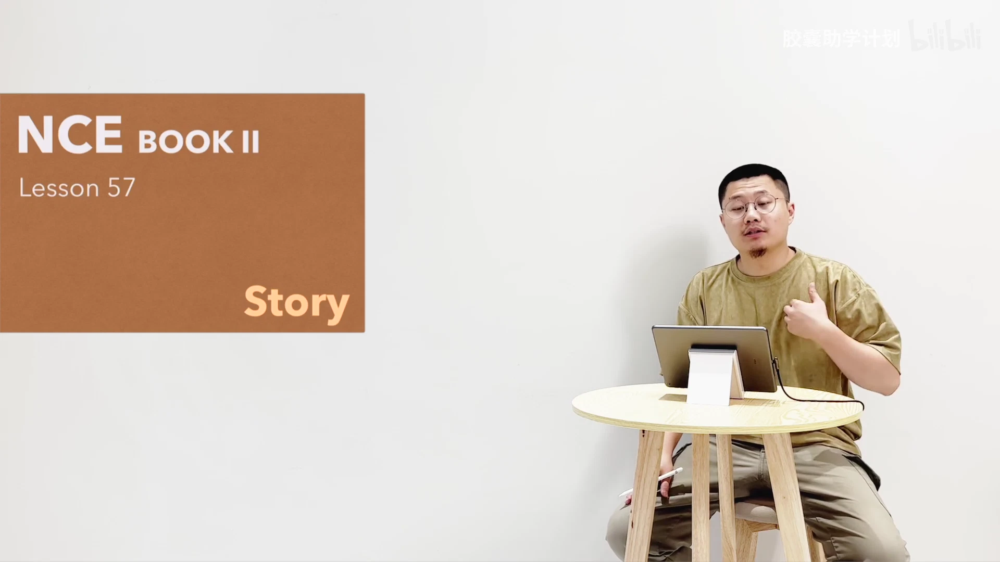

文字识别：NCE / BOOKI"I / Lesson 57 / Story

### 画面 00:00:05

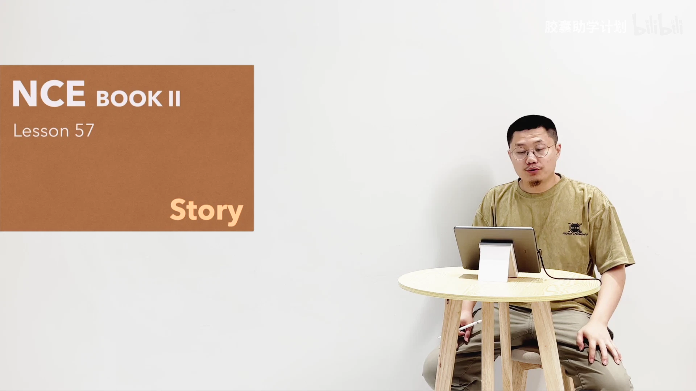

文字识别：NCE / BOOKII / Lesson 57 / Story

### 画面 00:00:08

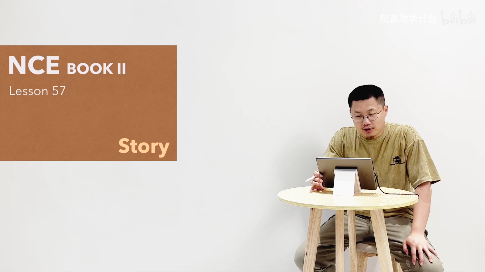

文字识别：NCE / BOOK"I / Lesson 57 / Story

### 画面 00:00:10

文字识别：胶囊助学计划bill

### 画面 00:00:13

### 画面 00:00:15

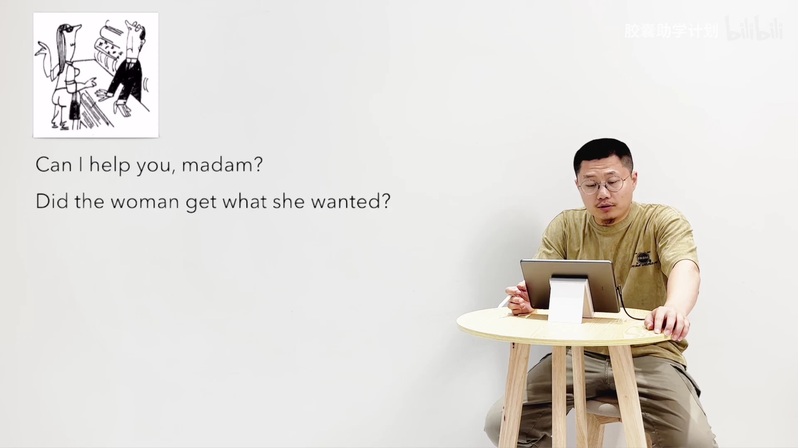

文字识别：Can I help you, madam? / Did the woman get what she wanted? / OM

### 画面 00:00:19

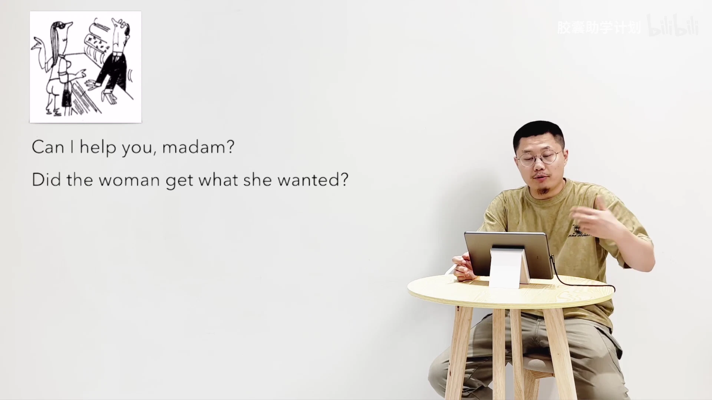

文字识别：Can I help you, madam? / Did the woman get what she wanted?

### 画面 00:00:21

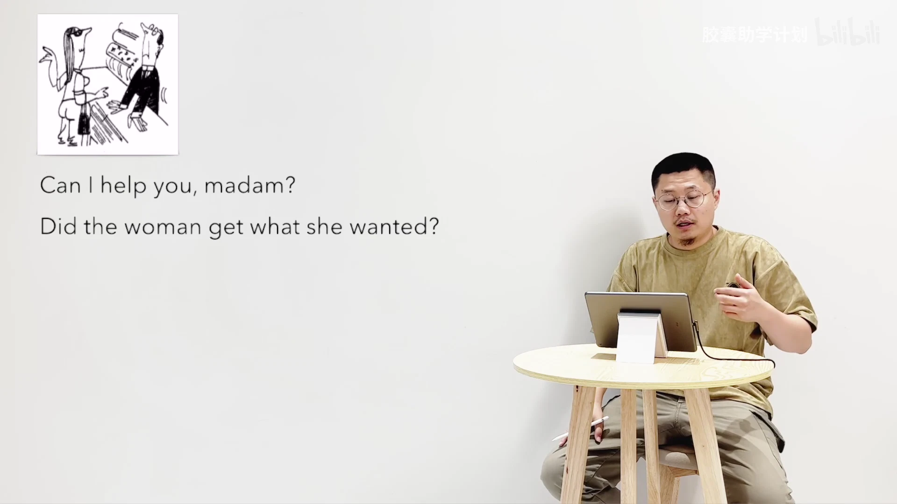

文字识别：Can I help you, madam? / Did the woman get what she wanted?

## 00:00:30–00:01:00

他们用的一个套话啊。然后呢，说问的问题是 Did the woman get what she wanted? 说这个女人得到了她想要的那个东西吗？买到了她想买的那个东西吗？带着这个疑惑，我们看一下文章啊。文章并不是特别的难，但是呢，语法出现的还不少。看一下，A woman in jeans stood at the window of an expensive shop. 关键点我给各位加粗了。In jeans是咱们刚刚

### 画面 00:00:31

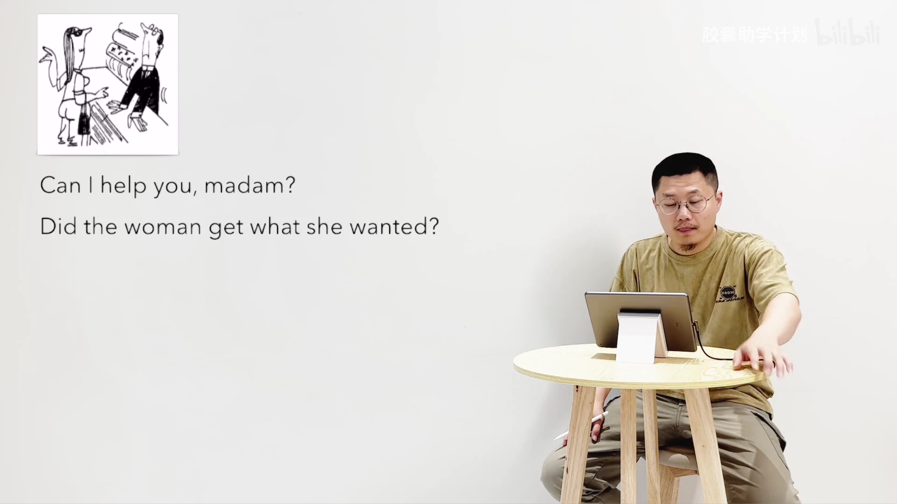

文字识别：Can I help you, madam? / Did the woman get what she wanted? / ROM

### 画面 00:00:42

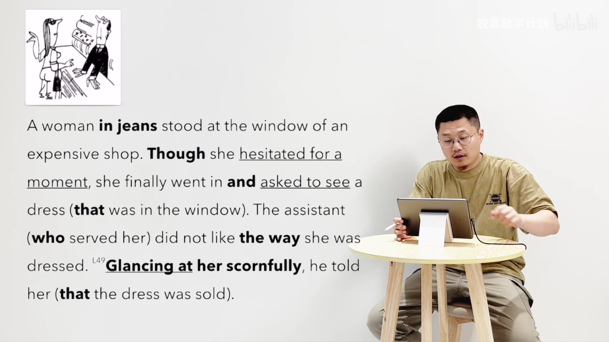

文字识别：A woman in jeans stood at the window of an / expensive shop. Though she hesitated for a / moment, she finally went in and asked to see a / dress (that was in the window). The assistant / (who served her) did not like the way she was / dressed. 49Glancing at her scornfully, he told / her (that the dress was sold).

### 画面 00:00:47

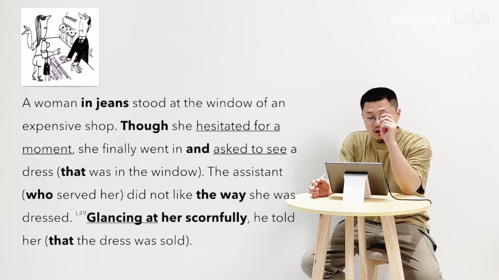

文字识别：A woman in jeans stood at the window of an / expensive shop. Though she hesitated for a / moment, she finally went in and asked to see a / dress (that was in the window). The assistant / (who served her) did not like the way she was / dressed. 49Glancing at her scornfully, he told / her (that the dress was sold).

## 00:01:00–00:01:30

一个视频当中以讲代练出现的in加衣服，所以这里的a woman in jeans其实就等同于a woman wearing jeans，对吧？哎，三十课咱们学的嘛，分词做定语，那这个地方只不过是介词做定语，in也起到了穿的作用，对吧？就是穿着牛仔裤的这样一个女人啊，在这个牛仔裤这个单词地方我提到了啊，牛仔裤并不是非常正式的场合应该穿的，比如说你去参加一个晚

### 画面 00:01:17

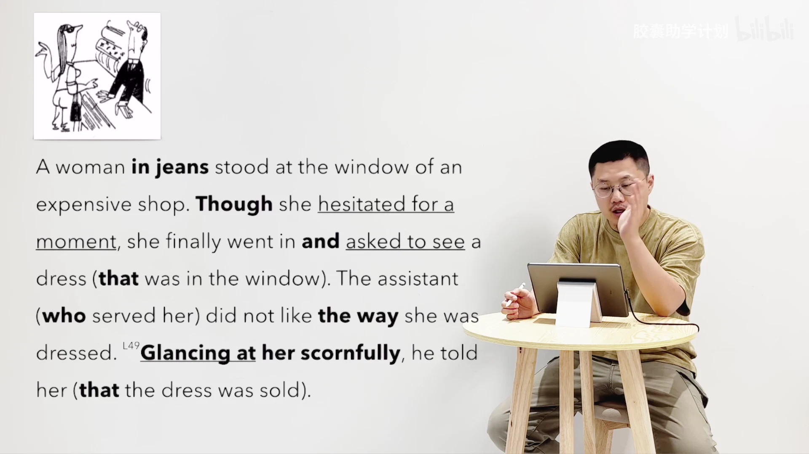

文字识别：A woman in jeans stood at the window of an / expensive shop. Though she hesitated for a / moment, she finally went in and asked to see a / dress (that was in the window). The assistant / (who served her) did not like the way she was / dressed. 49Glancing at her scornfully, he told / her (that the dress was sold).

### 画面 00:01:24

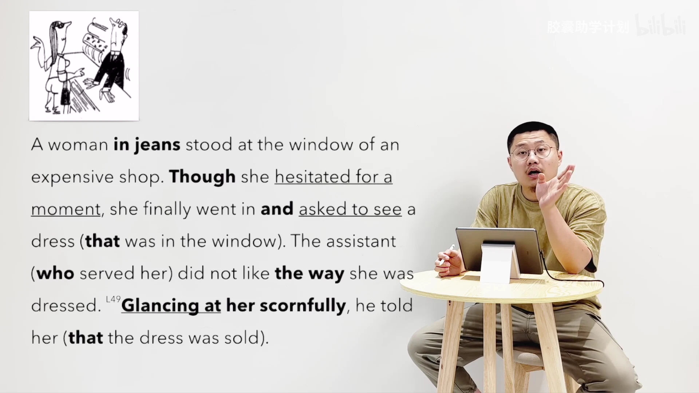

文字识别：A woman in jeans stood at the window of an / expensive shop. Though she hesitated for a / moment, she finally went in and asked to see a / dress (that was in the window). The assistant / (who served her) did not like the way she was / dressed. 49Glancing at her scornfully, he told / her (that the dress was sold).

### 画面 00:01:26

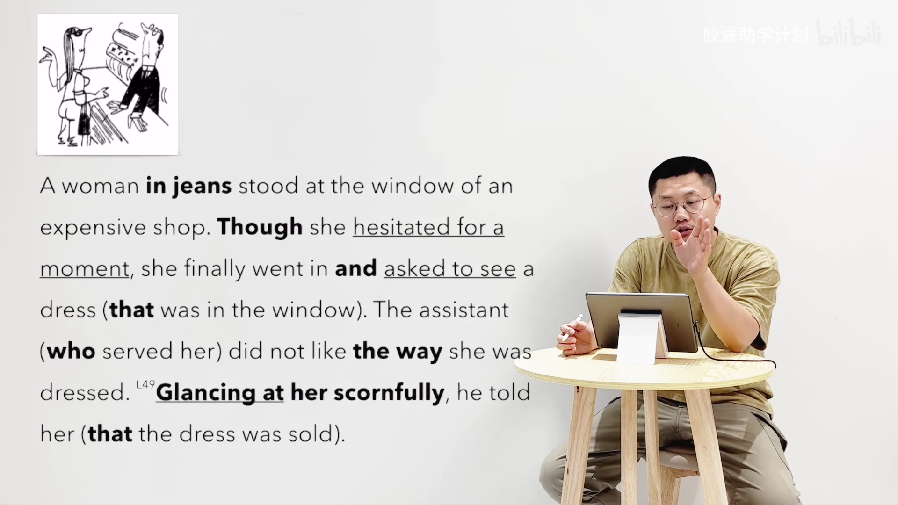

文字识别：A woman in jeans stood at the window of an / expensive shop. Though she hesitated for a / moment, she finally went in and asked to see a / dress (that was in the window). The assistant / (who served her) did not like the way she was / dressed. 49Glancing at her scornfully, he told / her (that the dress was sold).

## 00:01:30–00:02:00

晚宴，你穿着牛仔裤，牛仔裤去就有点不合适了，对不对？好，说一个穿着牛仔裤的女人 stood 站在什么地方呢？At the window，在这个窗户的旁边。At之前我们见过一次，说过了，很小的地点往往用at，对不对？好啊，但是这个东西啊，各位所谓小地点用at并不准确，原因很简单，何为小，何为大是相

### 画面 00:01:52

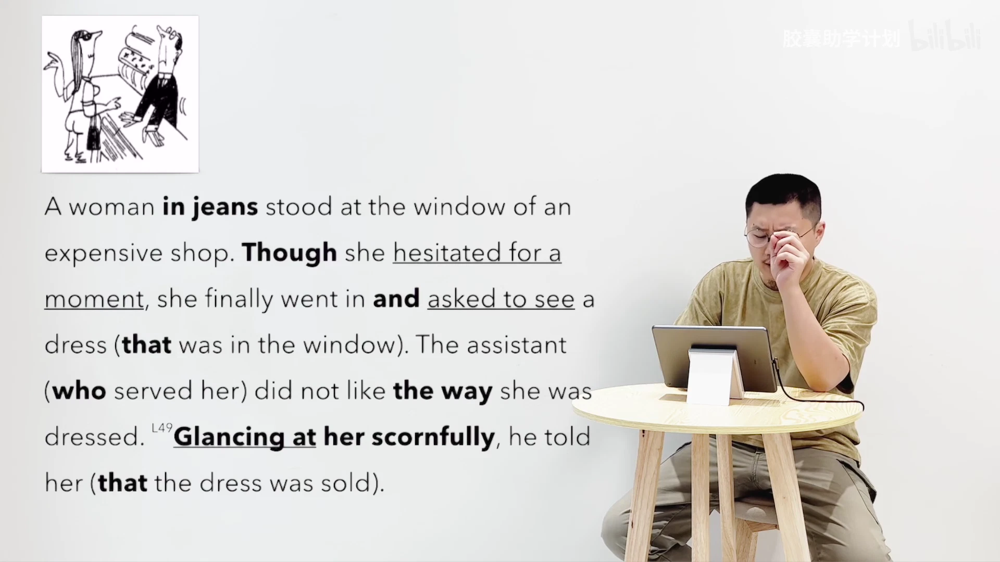

文字识别：A woman in jeans stood at the window of an / expensive shop. Though she hesitated for a / moment, she finally went in and asked to see a / dress (that was in the window). The assistant / (who served her) did not like the way she was / dressed. 49Glancing at her scornfully, he told / her (that the dress was sold).

### 画面 00:01:57

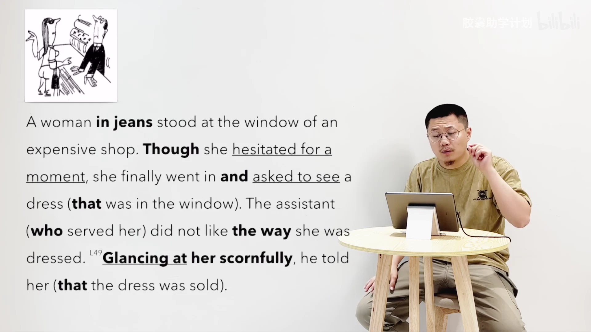

文字识别：A woman in jeans stood at the window of an / expensive shop. Though she hesitated for a / moment, she finally went in and asked to see a / dress (that was in the window). The assistant / (who served her) did not like the way she was / dressed. 49Glancing at her scornfully, he told / her (that the dress was sold).

## 00:02:00–00:02:30

对而言的，对吧？我那我说啊，我说地球也挺小的，为什么呢？因为宇宙很大，对吧？你懂我这个意思了吧？所以它更多其实就是个语言习惯啊。在这个窗户旁边，什么窗户呢？An expensive shop，在一个非常昂贵的商店的窗户旁边站下了。我们看他接下来干什么事儿。Though she hesitated for a moment,

### 画面 00:02:11

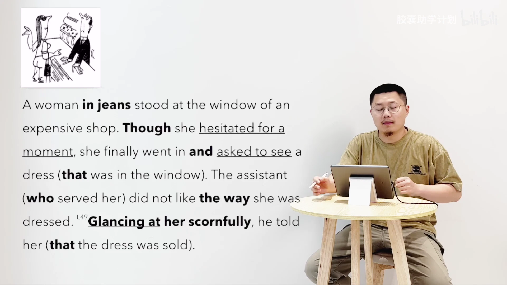

文字识别：A woman in jeans stood at the window of an / expensive shop. Though she hesitated for a / moment, she finally went in and asked to see a / dress (that was in the window). The assistant / (who served her) did not like the way she was / dressed. 49Glancing at her scornfully, he told / her (that the dress was sold).

### 画面 00:02:20

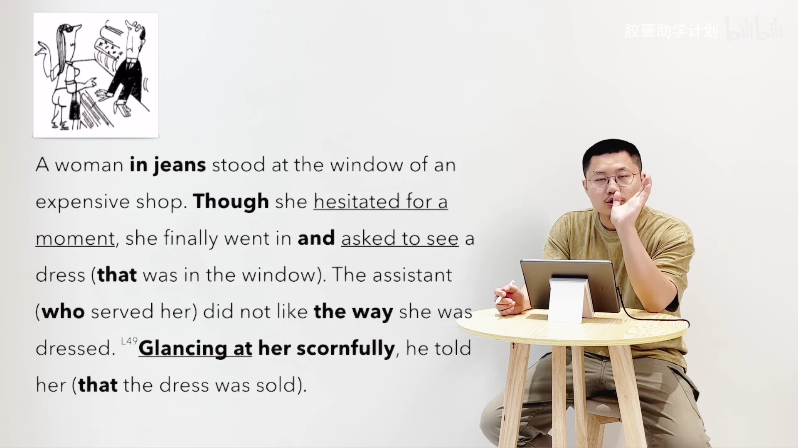

文字识别：A woman in jeans stood at the window of an / expensive shop. Though she hesitated for a / moment, she finally went in and asked to see a / dress (that was in the window). The assistant / (who served her) did not like the way she was / dressed. 49Glancing at her scornfully, he told / her (that the dress was sold).

### 画面 00:02:24

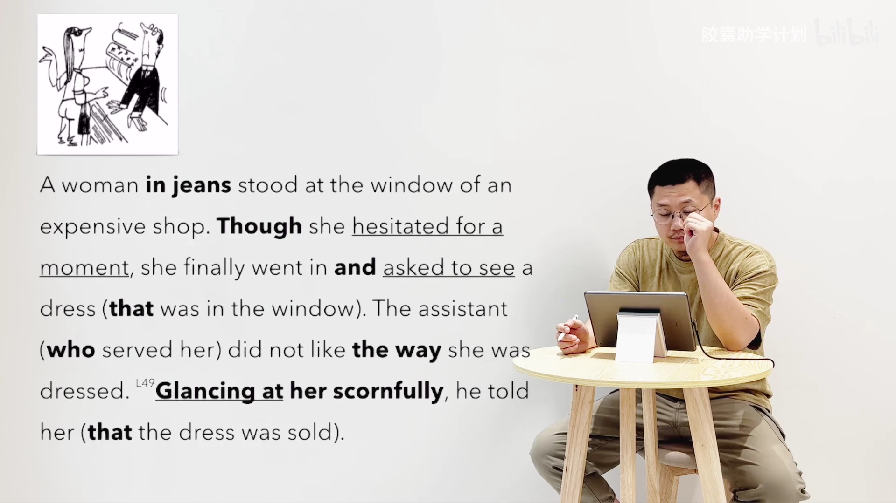

文字识别：A woman in jeans stood at the window of an / expensive shop. Though she hesitated for a / moment, she finally went in and asked to see a / dress (that was in the window). The assistant / (who served her) did not like the way she was / dressed. 49Glancing at her scornfully, he told / her (that the dress was sold).

### 画面 00:02:27

文字识别：A woman in jeans stood at the window of an / expensive shop. Though she hesitated for a / moment, she finally went in and asked to see a / dress (that was in the window). The assistant / (who served her) did not like the way she was / dressed. 49Glancing at her scornfully, he told / her (that the dress was sold).

## 00:02:30–00:03:00

she finally went in and asked to see a dress that was in the window. 哎，这句话很长，但我其实把三个关键点给各位加粗了。Though and that这样的句子在提醒我们该断句了，所以你看这句话就可以被我们拆成第一句话，Though she hesitated for a moment，说尽管她犹豫了片刻。第一句话，

### 画面 00:02:40

文字识别：A woman in jeans stood at the window of an / expensive shop. Though she hesitated for a / moment, she finally went in and asked to see a / dress (that was in the window). The assistant / (who served her) did not like the way she was / dressed. 49Glancing at her scornfully, he told / her (that the dress was sold).

### 画面 00:02:49

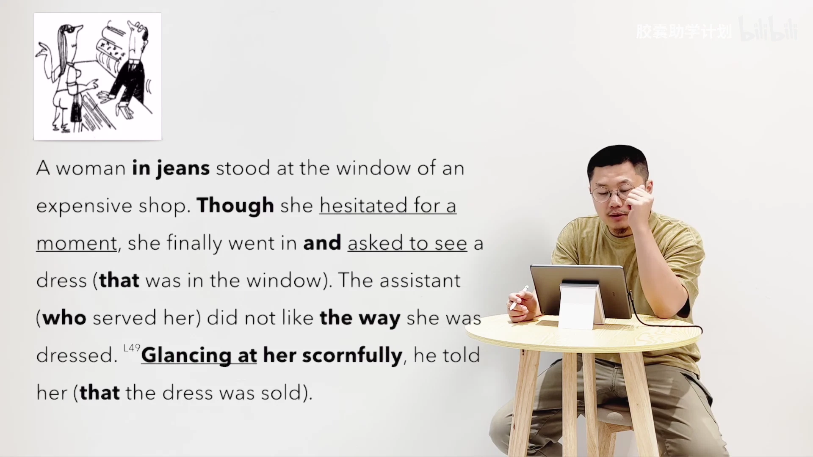

文字识别：A woman in jeans stood at the window of an / expensive shop. Though she hesitated for a / moment, she finally went in and asked to see a / dress (that was in the window). The assistant / (who served her) did not like the way she was / dressed. 49Glancing at her scornfully, he told / her (that the dress was sold).

### 画面 00:02:52

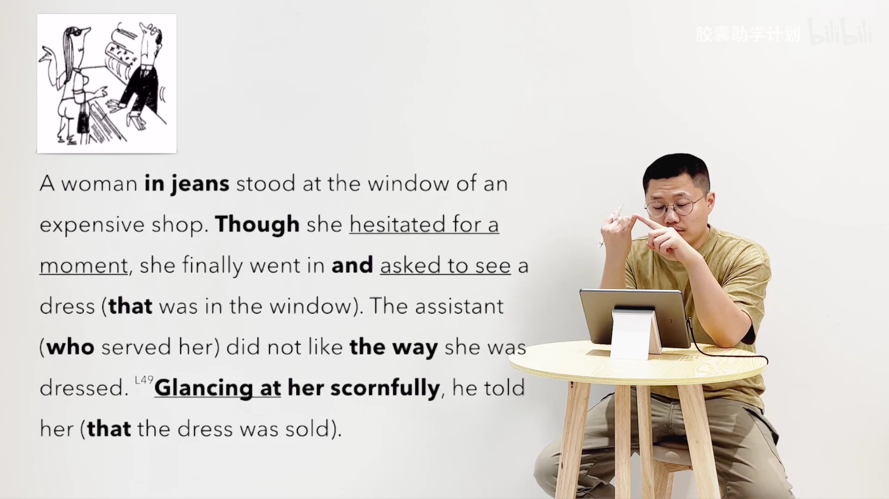

文字识别：A woman in jeans stood at the window of an / expensive shop. Though she hesitated for a / moment, she finally went in and asked to see a / dress (that was in the window). The assistant / (who served her) did not like the way she was / dressed. 49Glancing at her scornfully, he told / her (that the dress was sold).

## 00:03:00–00:03:30

第二句话，She finally went in.她最终还是进去了。第三句话，Ask to see a dress.哎，这个地方有一个小的习惯用法叫ask to do something，要求去做什么什么事儿。那这里叫做她要求去看一个裙子。这是第三句话。第四句话叫做That was in the window.这是个定语从句。那that指的就是this dress或者that dress。什么

### 画面 00:03:22

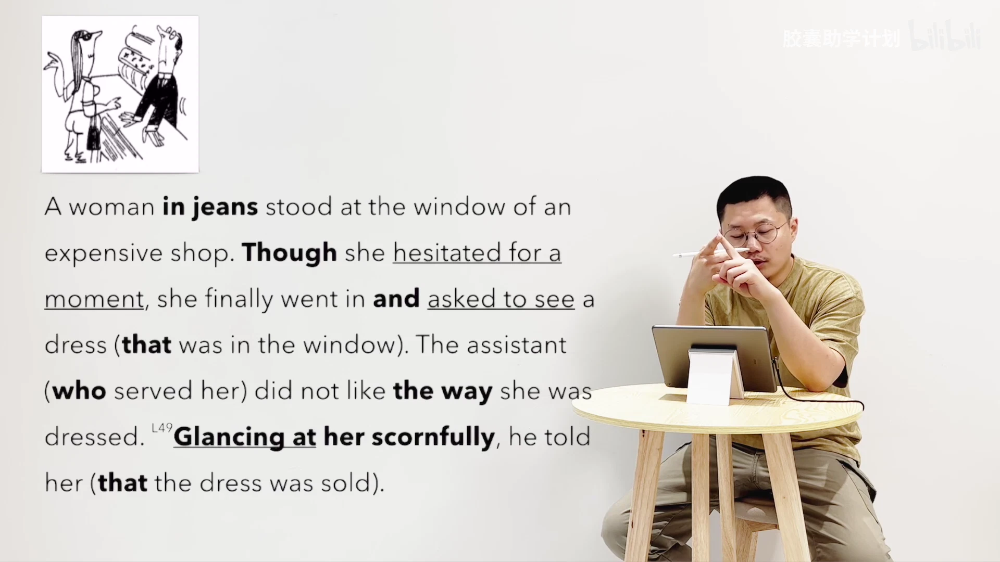

文字识别：A woman in jeans stood at the window of an / expensive shop. Though she hesitated for a / moment, she finally went in and asked to see a / dress (that was in the window). The assistant / (who served her) did not like the way she was / dressed. 49Glancing at her scornfully, he told / her (that the dress was sold).

## 00:03:30–00:04:00

裙子呢？在窗户，在这个橱窗里边的这个裙子。所以你看，它这句话虽然是从 though 一直到了 window，但我们为了读懂它，尤其是我们初学者前期，你像我现在学了这么久，这句话我读完我就懂了。但我很能回忆起来，最开始我面临这样长难句的时候，从 though 读到 window 的时候，我的感觉是最后我就记得 in the window 这三个单词了，前面的语法已经忘了。所以我们要通过去

### 画面 00:03:40

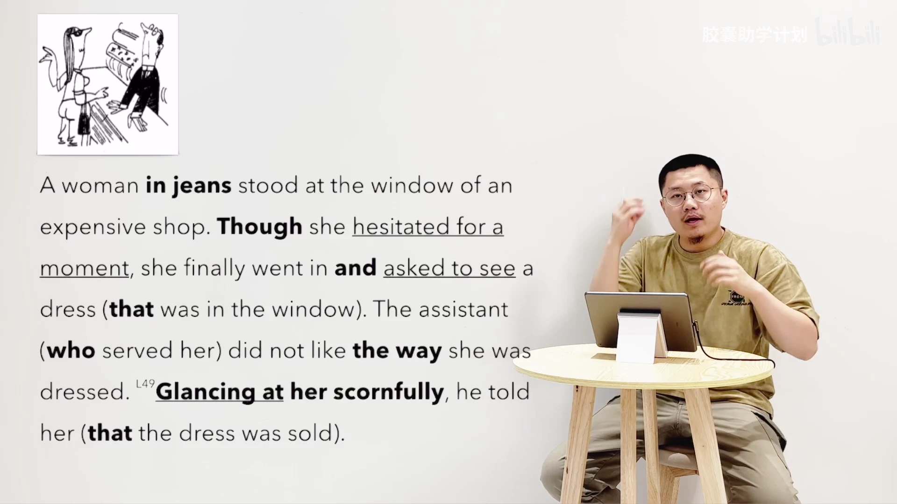

文字识别：A woman in jeans stood at the window of an / expensive shop. Though she hesitated for a / moment, she finally went in and asked to see a / dress (that was in the window). The assistant / (who served her) did not like the way she was / dressed. 49Glancing at her scornfully, he told / her (that the dress was sold).

## 00:04:00–00:04:30

这样拆解很长的一个句子，慢慢慢慢的熟悉它的语言习惯，英语的语言习惯。所以这句话就被我们拆成了四小句话，对吧？那你看这里其实又有一个小的知识点啊，这是一个背景知识，各位知道呢？呃，也许有用，也许没用，是吧？我们所谓管它叫做锚定定律，所谓锚定定律是什么呢？就是各位记住啊，比如说很多奢侈品店，你们知道的什么啊，是各种牌子的奢侈品店，它在橱窗里边的那一

### 画面 00:04:01

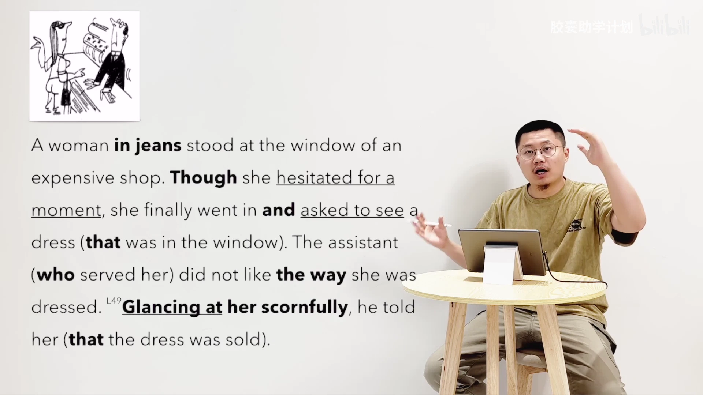

文字识别：A woman in jeans stood at the window of an / expensive shop. Though she hesitated for a / moment, she finally went in and asked to see / dress (that was in the window). The assistant / (who served her) did not like the way she was / dressed. 49Glancing at her scornfully, he told / her (that the dress was sold).

### 画面 00:04:04

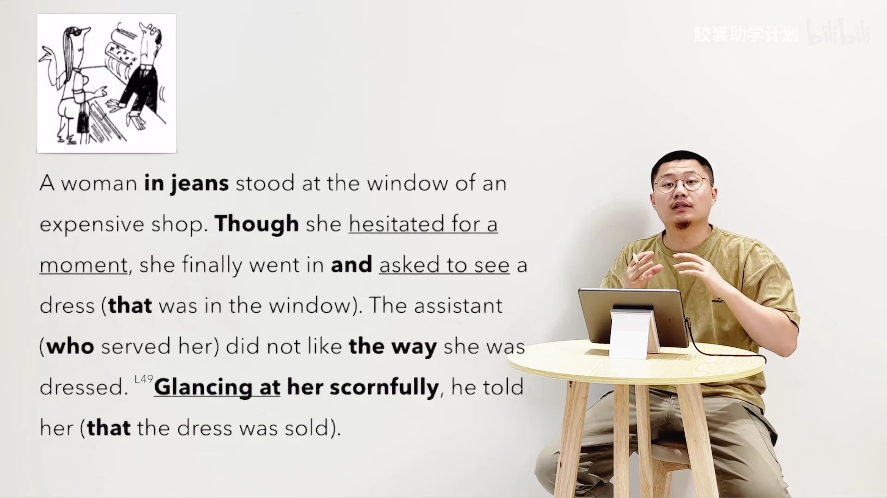

文字识别：A woman in jeans stood at the window of an / expensive shop. Though she hesitated for a / moment, she finally went in and asked to see a / dress (that was in the window). The assistant / (who served her) did not like the way she was / dressed. 49Glancing at her scornfully, he told / her (that the dress was sold).

### 画面 00:04:10

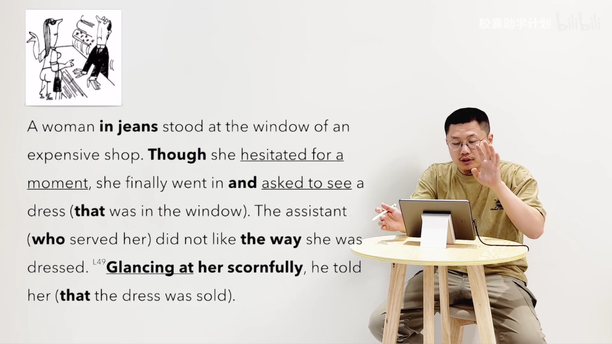

文字识别：A woman in jeans stood at the window of an / expensive shop. Though she hesitated for a / moment, she finally went in and asked to see a / dress (that was in the window). The assistant / (who served her) did not like the way she was / dressed. 49Glancing at her scornfully, he told / her (that the dress was sold).

### 画面 00:04:12

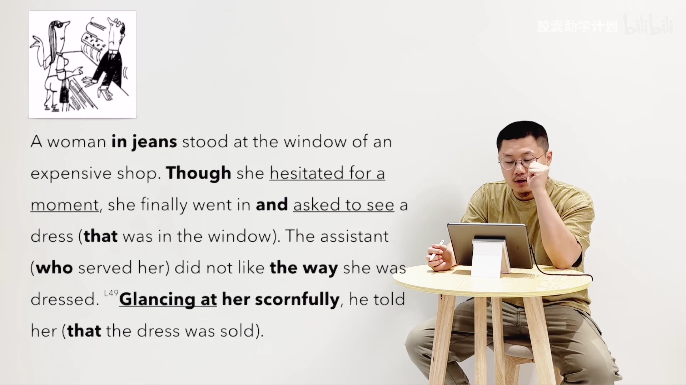

文字识别：A woman in jeans stood at the window of an / expensive shop. Though she hesitated for a / moment, she finally went in and asked to see a / dress (that was in the window). The assistant / (who served her) did not like the way she was / dressed. 49Glancing at her scornfully, he told / her (that the dress was sold).

### 画面 00:04:14

文字识别：A woman in jeans stood at the window of an / expensive shop. Though she hesitated for a / moment, she finally went in and asked to see a / dress (that was in the window). The assistant / (who served her) did not like the way she was / dressed. 49Glancing at her scornfully, he told / her (that the dress was sold).

### 画面 00:04:22

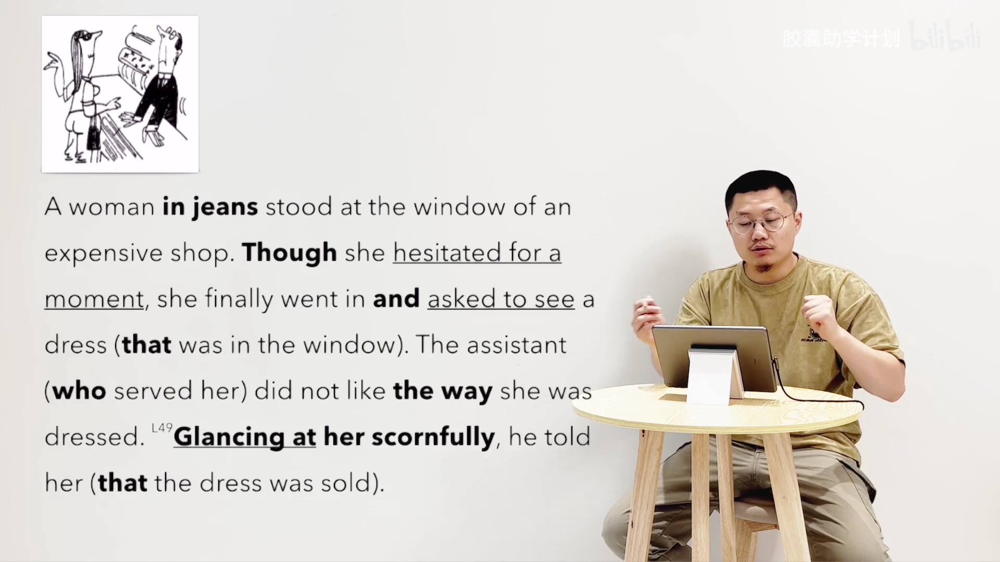

文字识别：A woman in jeans stood at the window of an / expensive shop. Though she hesitated for a / moment, she finally went in and asked to see a / dress (that was in the window). The assistant / (who served her) did not like the way she was / dressed. 49Glancing at her scornfully, he told / her (that the dress was sold).

### 画面 00:04:28

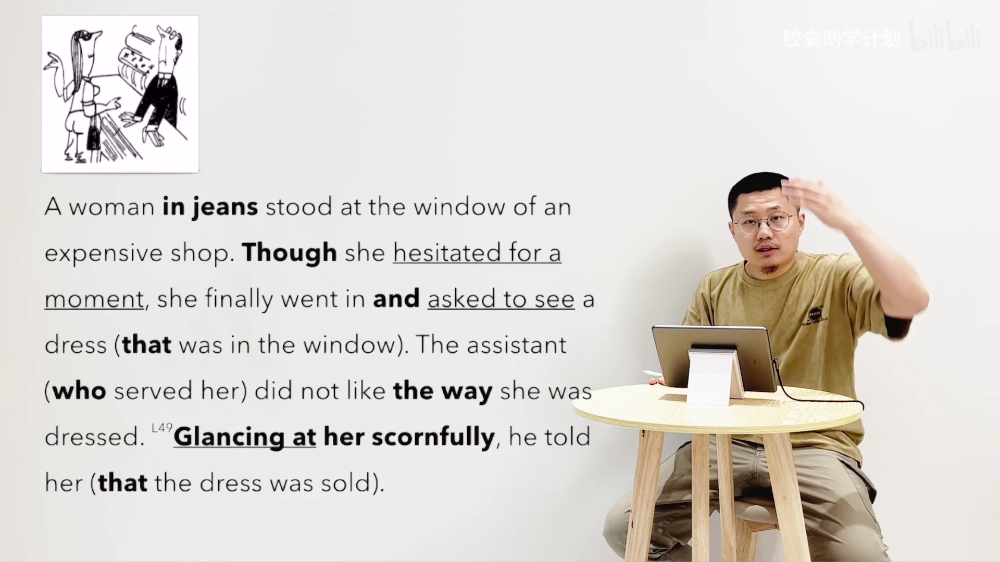

文字识别：A woman in jeans stood at the window of an / expensive shop. Though she hesitated for a / moment, she finally went in and asked to see a / dress (that was in the window). The assistant / (who served her) did not like the way she was / dressed. 49Glancing at her scornfully, he told / her (that the dress was sold).

## 00:04:30–00:05:00

款，绝对不是价格最低的，并且绝对不是老款，往往都是新款，并且价格偏高的那一款。如果你比如说他这个东西一个鞋子定了十万块钱，你看到了十万，你还选择进这家店，说明你的消费能力应该可以 cover 掉十万。那当你进到这个店的时候，你就默认为这个店里的东西应该是在十万上下的。于是当出现一个

### 画面 00:04:41

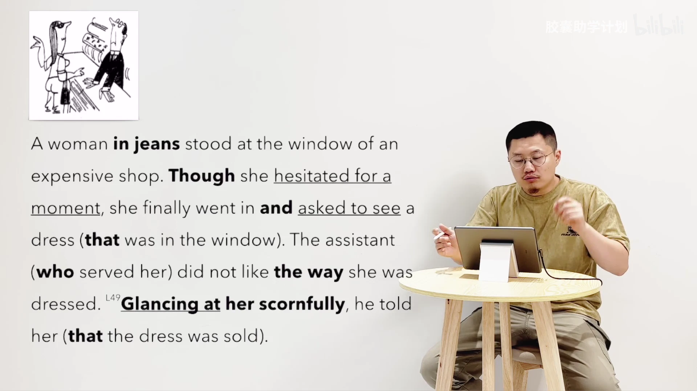

文字识别：A woman in jeans stood at the window of an / expensive shop. Though she hesitated for a / moment, she finally went in and asked to see a / dress (that was in the window). The assistant / (who served her) did not like the way she was / dressed. 49Glancing at her scornfully, he told / her (that the dress was sold).

### 画面 00:04:43

文字识别：A woman in jeans stood at the window of an / expensive shop. Though she hesitated for a / moment, she finally went in and asked to see a / dress (that was in the window). The assistant / (who served her) did not like the way she was / dressed. 49Glancing at her scornfully, he told / her (that the dress was sold).

## 00:05:00–00:05:30

类似款或者老款、旧款，对吧？或者去年款的一个同样类似的鞋子卖五万的时候，你就觉得好便宜啊！为什么？因为看到十万你都进来了，对吧？所以橱窗是起到这样一个作用的。那同时，各位要记住，就是在这个文章当中，它是 expensive shop at the window of an expensive shop，就是告诉你，其实这个女的看中的是这个店里面相对来说比较贵的那一款裙子，对吧？就

### 画面 00:05:09

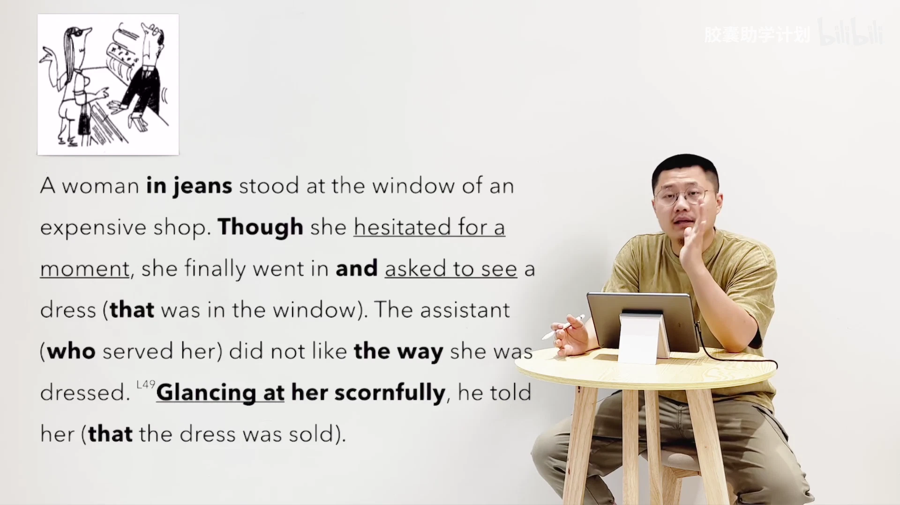

文字识别：A woman in jeans stood at the window of an / expensive shop. Though she hesitated for a / moment, she finally went in and asked to see a / dress (that was in the window). The assistant / (who served her) did not like the way she was / dressed. 49Glancing at her scornfully, he told / her (that the dress was sold).

### 画面 00:05:11

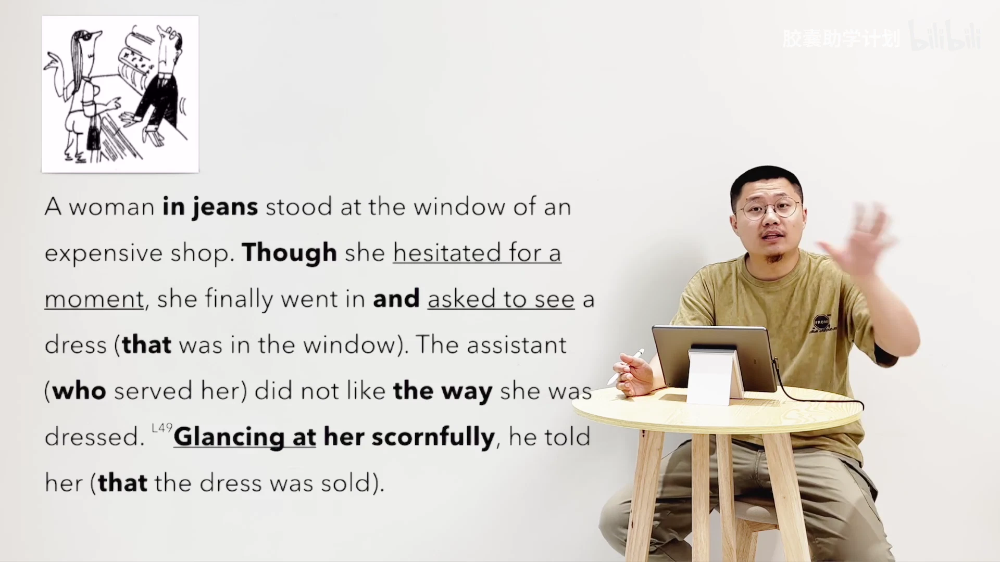

文字识别：A woman in jeans stood at the window of an / expensive shop. Though she hesitated for a / moment, she finally went in and asked to see a / dress (that was in the window). The assistant / (who served her) did not like the way she was / dressed. 49Glancing at her scornfully, he told / her (that the dress was sold).

### 画面 00:05:14

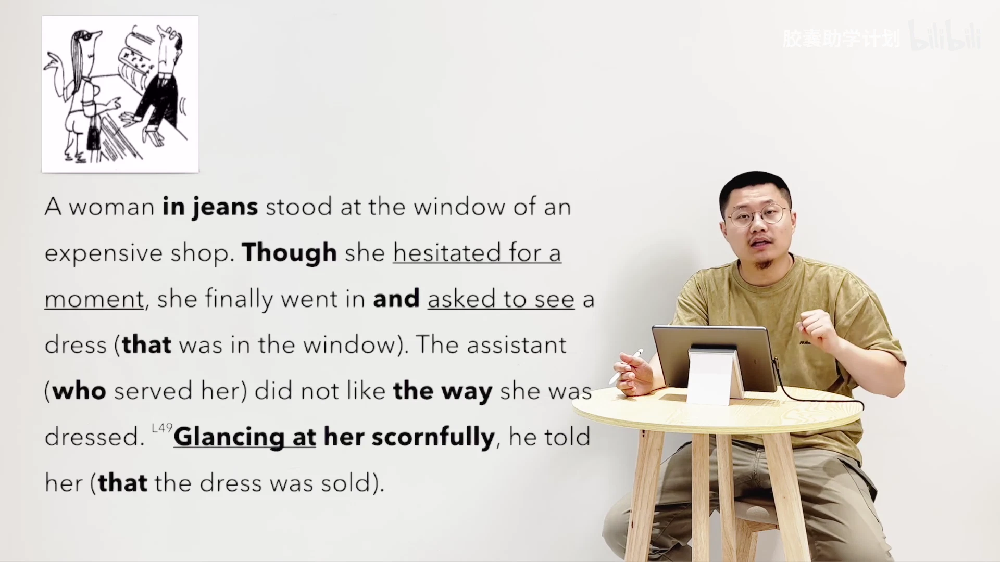

文字识别：A woman in jeans stood at the window of an / expensive shop. Though she hesitated for a / moment, she finally went in and asked to see a / dress (that was in the window). The assistant / (who served her) did not like the way she was / dressed. 49Glancing at her scornfully, he told / her (that the dress was sold).

### 画面 00:05:20

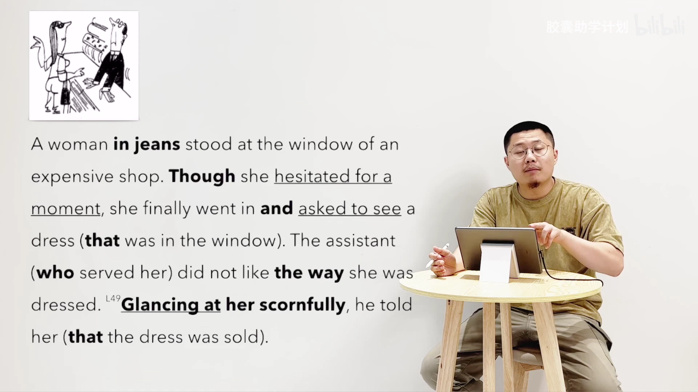

文字识别：A woman in jeans stood at the window of an / expensive shop. Though she hesitated for a / moment, she finally went in and asked to see a / dress (that was in the window). The assistant / (who served her) did not like the way she was / dressed. 49Glancing at her scornfully, he told / her (that the dress was sold).

### 画面 00:05:27

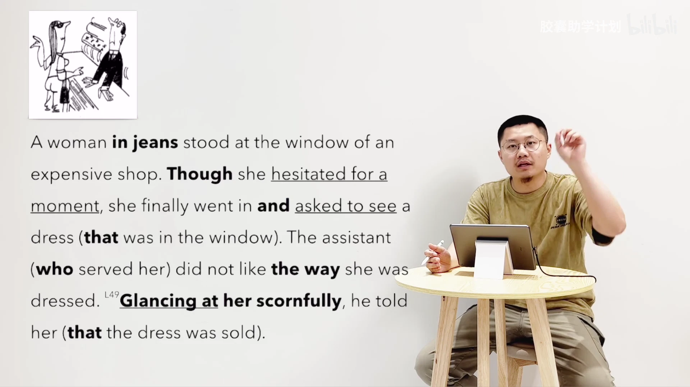

文字识别：A woman in jeans stood at the window of an / expensive shop. Though she hesitated for a / moment, she finally went in and asked to see a / dress (that was in the window). The assistant / (who served her) did not like the way she was / dressed. 49Glancing at her scornfully, he told / her (that the dress was sold).

## 00:05:30–00:06:00

是提供了这么一个信息啊。The assistant who served her did not like the way she was dressed.你看这句话，我们现在再去看，应该就很舒服了，对不对？这句话就是第一句话，The assistant did not like her. Ah, did not like the way.不喜欢这样一个方式。第二句话叫做The assistant served her，对吧？一个定语从句叫做服务，给他提供服务的这名导购并不喜欢这样一个方式。什么方式呢？最后一句话，

### 画面 00:05:32

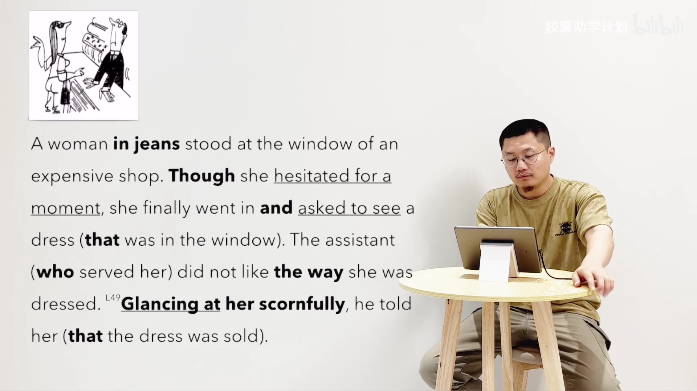

文字识别：A woman in jeans stood at the window of an / expensive shop. Though she hesitated for a / moment, she finally went in and asked to see a / dress (that was in the window). The assistant / (who served her) did not like the way she was / dressed. 49Glancing at her scornfully, he told / her (that the dress was sold).

### 画面 00:05:43

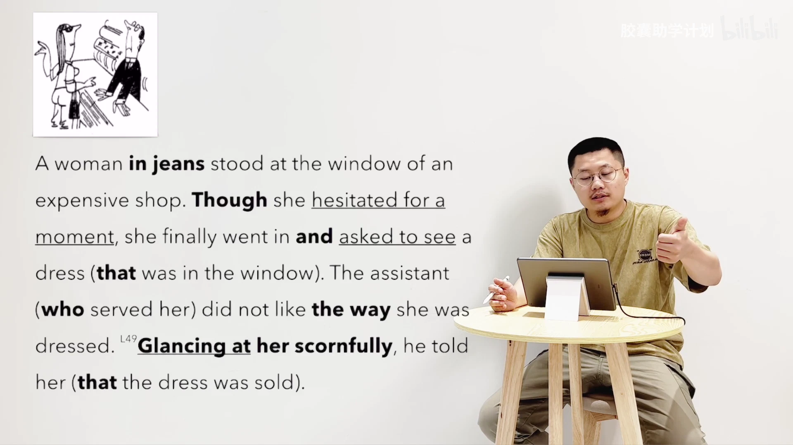

文字识别：A woman in jeans stood at the window of an / expensive shop. Though she hesitated for a / moment, she finally went in and asked to see a / dress (that was in the window). The assistant / (who served her) did not like the way she was / dressed. 49Glancing at her scornfully, he told / her (that the dress was sold).

## 00:06:00–00:06:30

She was dressed,对吧？她穿着的方式，穿着牛仔裤嘛，一看就不是有钱人，对不对？再来，Glancing at her scornfully, he told her that the dress was sold.首先，glance at，小的习惯用法，四十九课咱们学的，对吧？呃，德黑兰的那个年轻人，床和人一起拽到下面去，对吧？哎，那然后

### 画面 00:06:06

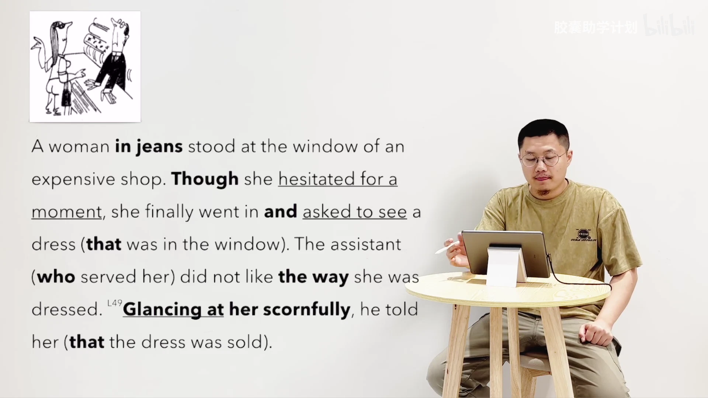

文字识别：A woman in jeans stood at the window of an / expensive shop. Though she hesitated for a / moment, she finally went in and asked to see a / dress (that was in the window). The assistant / (who served her) did not like the way she was / dressed. 49Glancing at her scornfully, he told / her (that the dress was sold).

### 画面 00:06:18

文字识别：A woman in jeans stood at the window of an / expensive shop. Though she hesitated for a / moment, she finally went in and asked to see a / dress (that was in the window). The assistant / (who served her) did not like the way she was / dressed. 49Glancing at her scornfully, he told / her (that the dress was sold).

### 画面 00:06:20

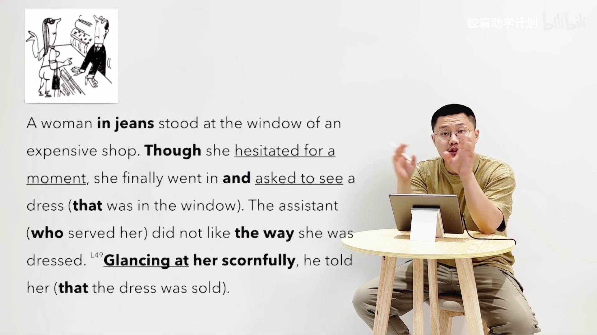

文字识别：A woman in jeans stood at the window of an / expensive shop. Though she hesitated for a / moment, she finally went in and asked to see a / dress (that was in the window). The assistant / (who served her) did not like the way she was / dressed. 49Glancing at her scornfully, he told / her (that the dress was sold).

### 画面 00:06:24

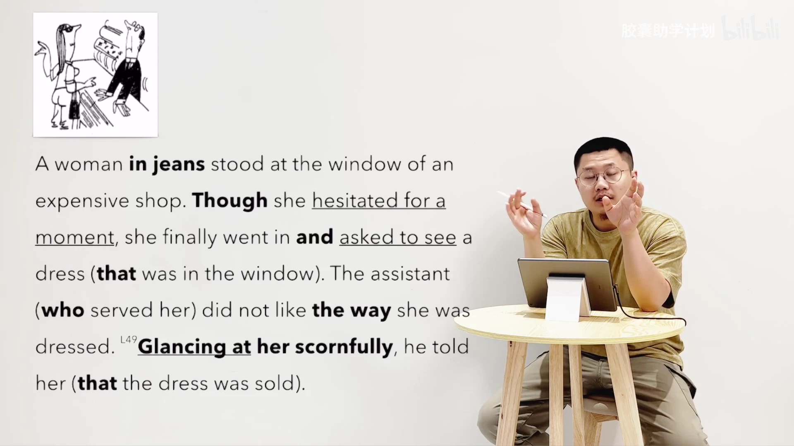

文字识别：A woman in jeans stood at the window of an / expensive shop. Though she hesitated for a / moment, she finally went in and asked to see a / dress (that was in the window). The assistant / (who served her) did not like the way she was / dressed. 49Glancing at her scornfully, he told / her (that the dress was sold).

## 00:06:30–00:07:00

扫视了一下这个床啊，glancing at，就是打量了一下，扫视了一下他，并且是 scornfully，就很轻蔑的这样扫了他一下啊。你穿成这样，你买得起吗？对吧？就大概是这样一个意思啊，心内心活动。那问题就在于 glancing 的主语是谁？这个其实对于各位来说很容易理解，因为这个场景当中就俩人，没有介绍第三个人，所以一定是导购 glancing at her，对吧？这是我们由呃具体

### 画面 00:06:33

文字识别：A woman in jeans stood at the window of an / expensive shop. Though she hesitated for a / moment, she finally went in and asked to see a / dress (that was in the window). The assistant / (who served her) did not like the way she was / dressed. 49Glancing at her scornfully, he told / her (that the dress was sold).

### 画面 00:06:49

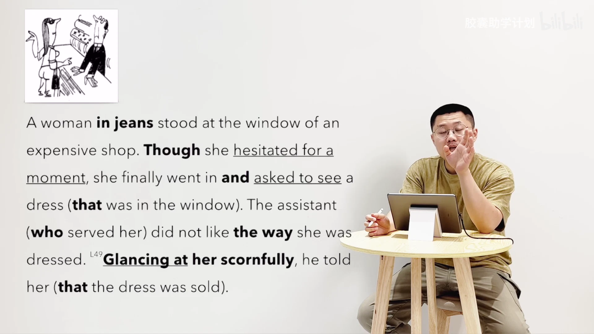

文字识别：A woman in jeans stood at the window of an / expensive shop. Though she hesitated for a / moment, she finally went in and asked to see a / dress (that was in the window). The assistant / (who served her) did not like the way she was / dressed. 49Glancing at her scornfully, he told / her (that the dress was sold).

### 画面 00:06:57

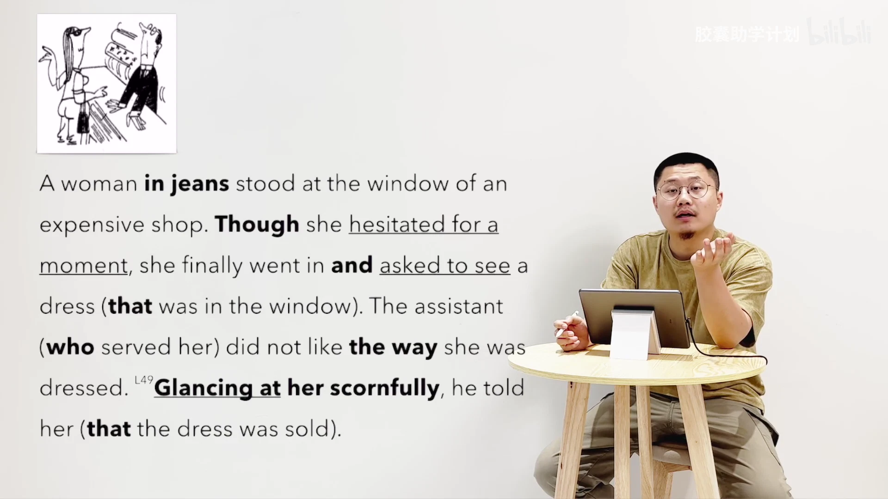

文字识别：A woman in jeans stood at the window of an / expensive shop. Though she hesitated for a / moment, she finally went in and asked to see a / dress (that was in the window). The assistant / (who served her) did not like the way she was / dressed. 49Glancing at her scornfully, he told / her (that the dress was sold).

## 00:07:00–00:07:30

场景和基本人类逻辑去推断出来的。那用语法怎么推断呢？很简单，这也是我们四十九课学的分词做定啊，分词做状语。Glenning的主语一定是后边的he，对吧？哎，大部分情况下是后边的he。然后呢，这个he是它的主语。如果是现在分词，就是主动。如果这个您竟然忘了，一定要回去再重新看一遍四十九课的语法这个视频，非常重要啊。从这节课开始，一直到新三整本书，包括各位所有考试，这算一个高难语

### 画面 00:07:27

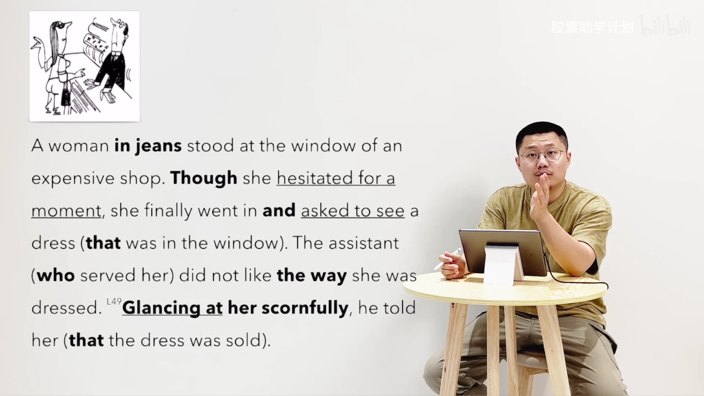

文字识别：A woman in jeans stood at the window of an / expensive shop. Though she hesitated for a / moment, she finally went in and asked to see a / dress (that was in the window). The assistant / (who served her) did not like the way she was / dressed. 49Glancing at her scornfully, he told / her (that the dress was sold).

## 00:07:30–00:08:00

法了，对吧？考点，呃，这个导购，所以第一主语是 he，第二主动，对吧？这也很好理解，说他呀扫很轻蔑的扫了他一眼。He told her，他告诉他，后边是个宾语从句嘛？什么呢？The dress was sold，这个裙子被卖了，对吧？Continue，The woman walked out of the shop angrily and decided to punish the assistant next day。

### 画面 00:07:34

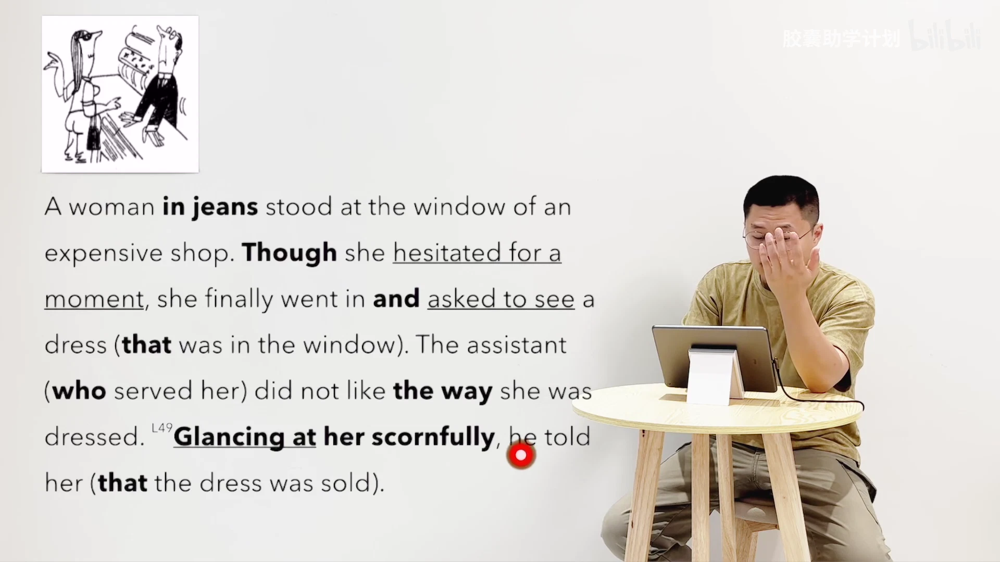

文字识别：A woman in jeans stood at the window of an / expensive shop. Though she hesitated for a / moment, she finally went in and asked to see a / dress (that was in the window). The assistant / (who served her) did not like the way she was / dressed. 49Glancing at her scornfully, he told / her (that the dress was sold).

### 画面 00:07:42

文字识别：A woman in jeans stood at the window of an / expensive shop. Though she hesitated for a / moment, she finally went in and asked to see a / dress (that was in the window). The assistant / (who served her) did not like the way she was / dressed. 49Glancing at her scornfully, he told / her (that the dress was sold).

### 画面 00:07:45

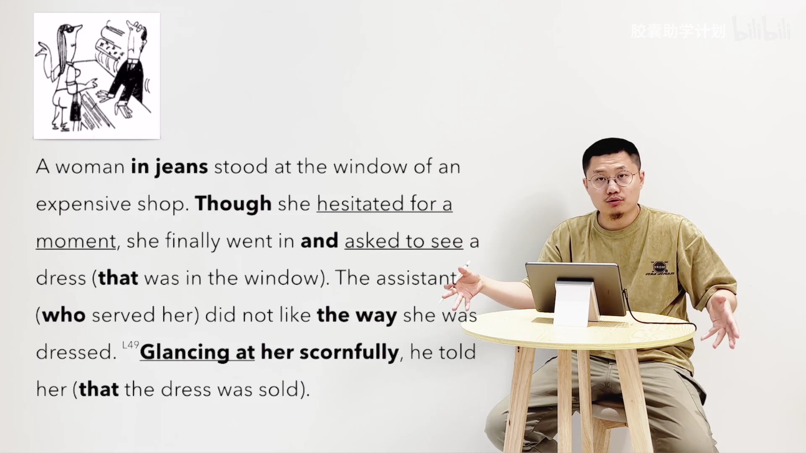

文字识别：A woman in jeans stood at the window of an / expensive shop. Though she hesitated for a / moment, she finally went in and asked to see a / dress (that was in the window). The assistant) / (who served her) did not like the way she was / dressed. 49Glancing at her scornfully, he told / her (that the dress was sold).

### 画面 00:07:50

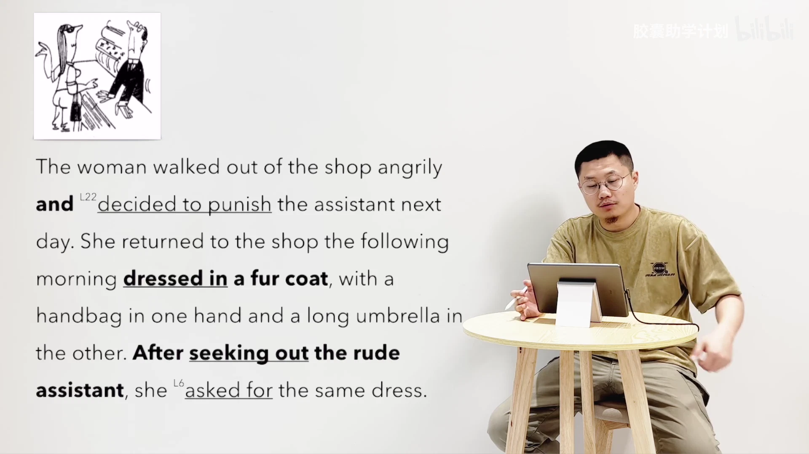

文字识别：The woman walked out of the shop angrily /  22decided to punish the assistant next / and / day. She returned to the shop the following / morning dressed in a fur coat, with a / handbag in one hand and a long umbrella in / the other. After seeking out the rude / assistant, she 'asked for the same dress.

## 00:08:00–00:08:30

this woman walked out of the store, very angry, right? Ah, this is very, very easy to understand. Ah, walked out of the store angrily. Then, twenty-five, we learned the and connects two six, one, two, three, four, five, six sentences. Decided to punish the assistant next day. You see, why there is no more she here? Because the and connects two sentences with the same subject. English habit, this can be omitted, right? Then decided to punish. Decide to do something. Twenty-two, we learned the habitual usage. Decided to punish this.

### 画面 00:08:10

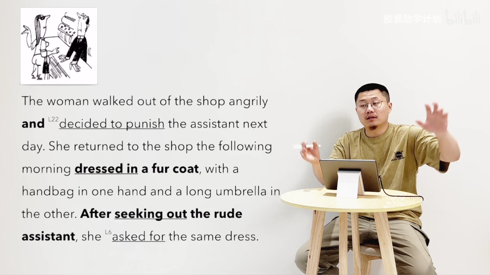

文字识别：The woman walked out of the shop angrily / L22decided to punish the assistant next / and / day. She returned to the shop the following / morning dressed in a fur coat, with a / handbag in one hand and a long umbrella in / the other. After seeking out the rude / assistant, she 'asked for the same dress.

### 画面 00:08:12

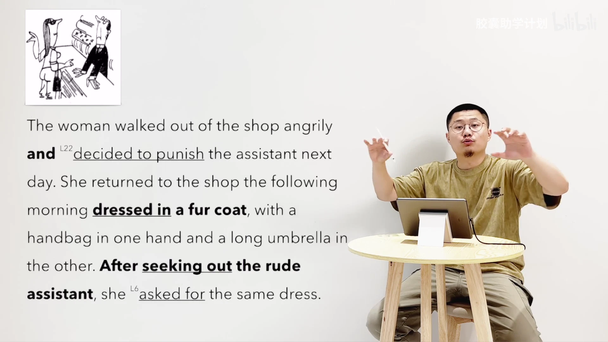

文字识别：The woman walked out of the shop angrily /  22decided to punish the assistant next / and / day. She returned to the shop the following / morning dressed in a fur coat, with a / handbag in one hand and a long umbrella in / the other. After seeking out the rude / assistant, she 'asked for the same dress.

### 画面 00:08:14

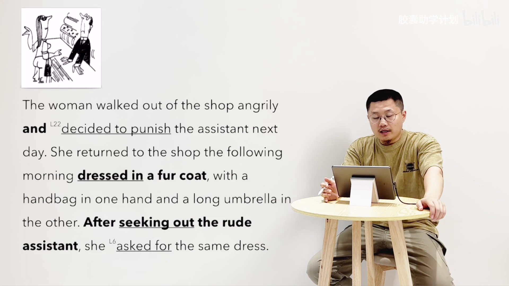

文字识别：The woman walked out of the shop angrily / and 2²decided to punish the assistant next / day. She returned to the shop the following / morning dressed in a fur coat, with a / nON / handbag in one hand and a long umbrella in / the other. After seeking out the rude / assistant, she 'asked for the same dress.

### 画面 00:08:26

文字识别：The woman walked out of the shop angrily / 4 22decided to punish the assistant next / and / day. She returned to the shop the following / morning dressed in a fur coat, with a / ROh / handbag in one hand and a long umbrella in / the other. After seeking out the rude / assistant, she 'asked for the same dress.

## 00:08:30–00:09:00

惯用法，决定去惩罚这个导购. Next day,第二天，决定惩罚。我们看他怎么惩罚的. She returned to the shop the following morning, dressed in a fur coat, with a handbag in one hand and a long umbrella in the other. 好，看这句话。这句话虽然很长啊，但是并不难. She returned to the shop. 她返回到了这个商店.

### 画面 00:08:46

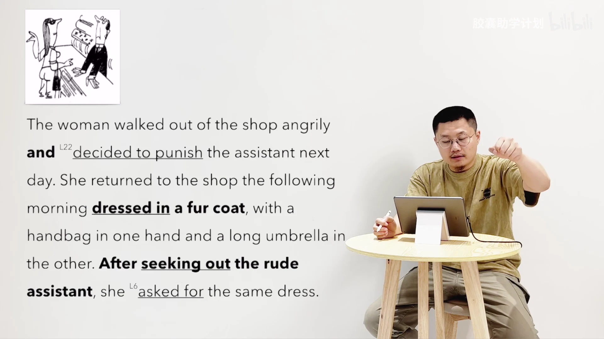

文字识别：The woman walked out of the shop angrily /  L22decided to punish the assistant next / and / day. She returned to the shop the following / morning dressed in a fur coat, with a / handbag in one hand and a long umbrella in / the other. After seeking out the rude / assistant, she 'asked for the same dress.

### 画面 00:08:49

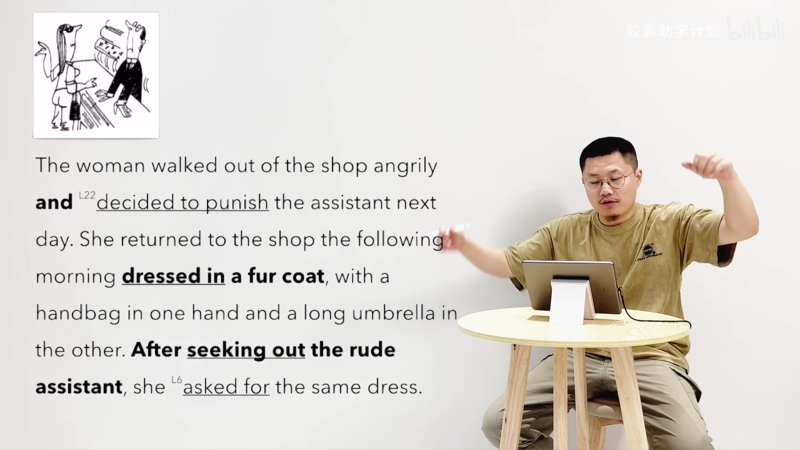

文字识别：The woman walked out of the shop angrily /  L22decided to punish the assistant next / and / day. She returned to the shop the following / morning dressed in a fur coat, with a / handbag in one hand and a long umbrella in / the other. After seeking out the rude / assistant, she 'asked for the same dress.

### 画面 00:08:51

文字识别：The woman walked out of the shop angrily /  22decided to punish the assistant next / and / day. She returned to the shop the following / morning dressed in a fur coat, with a / handbag in one hand and a long umbrella in / the other. After seeking out the rude / assistant, she 'asked for the same dress.

### 画面 00:08:54

文字识别：The woman walked out of the shop angrily / and 2²decided to punish the assistant next / day. She returned to the shop the following / morning dressed in a fur coat, with a / ROM / handbag in one hand and a long umbrella in / the other. After seeking out the rude / assistant, she 'asked for the same dress.

## 00:09:00–00:09:30

The following morning，第二天的早晨，其实就跟 next day 是类似的，只不过时间更具体了。Following morning，第二天早晨，接啊，following 最基本的叫做接下来的。那接下来的早晨就是翻译成汉语的第二天早晨。Dressed in a fur coat，好，这里呢，我先把这个语法告诉各位，它其实是个习惯用法，但是被省略了一些东西。一会儿进入习惯用法讲解的时候，我们再说啊。这里的 dressed in a

### 画面 00:09:13

文字识别：The woman walked out of the shop angrily /  22decided to punish the assistant next / and / day. She returned to the shop the following / morning dressed in a fur coat, with a / handbag in one hand and a long umbrella in / the other. After seeking out the rude / assistant, she 'asked for the same dress.

## 00:09:30–00:10:00

fur coat，其实这里的 dress 它是个被动，但是汉语给它翻译成被动就会觉得很怪，叫它被穿着一个裘皮大衣，对吧？但是英语里面它就是个被动，为什么呢？因为它前面还有一个单词叫做 be，be 啊，就 I was was were 的那个 be，对吧？叫叫 be dressed in，叫做穿着着，它是个被动。一会儿进入习惯用法的时候我们再说，但你现在知道这个这个这个这个这个语法，这个句子是什么就行了，叫

### 画面 00:09:36

文字识别：The woman walked out of the shop angrily / and 2²decided to punish the assistant next / day. She returned to the shop the following / morning dressed in a fur coat, with a / handbag in one hand and a long umbrella in / the other. After seeking out the rude / assistant, she 'asked for the same dress.

## 00:10:00–00:10:30

做穿着裘皮大衣，它是主语，she是主语，对吧？后面这句话虽然很长，它不是一句话，是个短语。其实从with一直到other，虽然很长，但它其实就是with表示有和伴随的意思。什么呢？叫做有一个包在一个手in one hand，然后呢还有一个长长的雨伞in the other在另一个手里面，对吧？in one hand in the other，对不对？好，再来。

### 画面 00:10:06

文字识别：The woman walked out of the shop angrily /  L22decided to punish the assistant next / and / day. She returned to the shop the following / morning dressed in a fur coat, Qith a / handbag in one hand and a long umbrella in / the other. After seeking out the rude / assistant, she 'asked for the same dress.

### 画面 00:10:18

文字识别：The woman walked out of the shop angrily / L22decided to punish the assistant next / and / day. She returned to the shop the following / morning dressed in a fur coat, with a / handbag in one hand and a long umbrella in / the other. After seeking out the rude / assistant, she 'asked for the same dress.

### 画面 00:10:21

文字识别：The woman walked out of the shop angrily /  L22decided to punish the assistant next / and / day. She returned to the shop the following / morning dressed in a fur coat, with a / handbag in one hand and a long umbrella in / the other. After seeking out the rude / assistant, she 'asked for the same dress.

### 画面 00:10:23

文字识别：The woman walked out of the shop angrily /  L22decided to punish the assistant next / and / day. She returned to the shop the following / morning dressed in a fur coat, with a / handbag in one hand and a long umbrella in / the other. After seeking out the rude / assistant, she 'asked for the same dress.

### 画面 00:10:26

文字识别：The woman walked out of the shop angrily / 1 22decided to punish the assistant next / and / day. She returned to the shop the following / morning dressed in a fur coat, with a / handbag in one hand and a long umbrella in / the other. After seeking out the rude / assistant, she 'asked for the same dress.

### 画面 00:10:28

文字识别：The woman walked out of the shop angrily / L22decided to punish the assistant next / and / day. She returned to the shop the following / morning dressed in a fur coat, with a / handbag in one hand and a long umbrella in / the other. After seeking out the rude / assistant, she 'asked for the same dress.

## 00:10:30–00:11:00

After seeking out the rude assistant, she asked for the same dress. After，在单词部分我已经讲过了。After跟before这两个单词，实际上后边到底你是把它当介词还是连词，它后边到底是动名词还是现在分词是有争议的。不过这个争议对于各位来说不重要，不论是谁，你都能读懂它，对吧？叫在什么之后呢？Seek out，在做寻找，在寻找到

### 画面 00:10:58

文字识别：The woman walked out of the shop angrily /  L22decided to punish the assistant next / and / day. She returned to the shop the following / morning dressed in a fur coat, with a / handbag in one hand and a long umbrella in / the other. After seeking out the rude / assistant, she 'asked for the same dress.

## 00:11:00–00:11:30

这个 rude assist 这个很粗鲁的导购之后呢， she asked for the same dress. 第六课乞丐那课咱们学过对吧？要啊，她要相同的那个裙子，她点名道姓的要相同的那个裙子。 Continue, not realizing who she was, the assistant was eager to serve her this time. 哎， not realizing. 四十九课我做了非常详细的讲解，叫 not done

### 画面 00:11:13

文字识别：Not realizing who she was, the assistant was eager / to serve her this time. With great difficulty, / he climbed into the shop window /to get the dress. / As soon as she saw it, the woman said (she did not / like it).

### 画面 00:11:26

文字识别：Not realizing who she was, the assistant was eager / to serve her this time. With great difficulty, / he climbed into the shop window /to get the dress. / As soon as she saw it, the woman said (she did not / like it).

## 00:11:30–00:12:00

或者 not doing，对吧？说没有意识到他是谁，这个 who she was 其实是 realizing 的一个宾语从句啊，没有意识到他是谁。那这里要问的问题叫做没有意识到的主语是谁？叫做 the assistant 没有意识到，对不对？然后主动被动呢？因为是 ing，包括语感也能判断出来，但语感并不是总准确的，比如像刚才的 dressed in，对吧？所以你还是要看动词结构。那它实际上是一个主动，

### 画面 00:11:56

文字识别：Not realizing who she was, the assistant was eager / to serve her this time. With great difficulty, / he climbed into the shop window /to get the dress. / As soon as she saw it, the woman said (she did not / like it).

## 00:12:00–00:12:30

所以这句话就变成了叫 the assistant didn't realize who she was，没有意识到他是谁。然后呢，was eager to do something，很渴望哎，serve her this time，叫这次去服务他啊。这个我原来有一个好朋友在奢侈品店啊，这个后来去当了店长，他跟我讲过一个事儿，就是为什么这么 eager to serve her呢？奢侈品店他销售他是按照这种这个很容易理解，销售嘛，按份额销售额

### 画面 00:12:13

文字识别：Not realizing who she was, the assistant was eager / to serve her this time. With great difficulty, / he climbed into the shop window /to get the dress. / As soon as she saw it, the woman said (she did not / like it).

### 画面 00:12:17

文字识别：Not realizing who she was, the assistant was eager / to serve her this time. With great difficulty, / he climbed into the shop window /to get the dress. / As soon as she saw it, the woman said (she did not / like it).

### 画面 00:12:28

文字识别：Not realizing who she was, the assistant was eager / to serve her this time. With great difficulty, / he climbed into the shop window /to get the dress. / As soon as she saw it, the woman said (she did not / like it).

## 00:12:30–00:13:00

去提成的。一看穿成这样，买的东西便宜不了，所以非常渴望去服务他。渴望的并不是服务他，渴望的是通过服务他去赚取这个钱，对吧？其实，呃，心态和前一天是一致的啊。一看你穿牛仔裤没什么钱，你也买不了什么东西啊，爱搭不理。第二天一看穿的特别好了，裘皮大衣穿上了，包对吧？贵妇贵妇的打扮出来了，哎，那这回就特别想服务他，都是为了钱。

### 画面 00:12:34

文字识别：Not realizing who she was, the assistant was eager / to serve her this time. With great difficulty, / he climbed into the shop window /to get the dress. / As soon as she saw it, the woman said (she did not / like it).

### 画面 00:12:36

文字识别：Not realizing who she was, the assistant was eager / to serve her this time. With great difficulty, / he climbed into the shop window /to get the dress. / As soon as she saw it, the woman said (she did not / like it).

### 画面 00:12:38

文字识别：Not realizing who she was, the assistant was eager / to serve her this time. With great difficulty, / he climbed into the shop window /to get the dress. / As soon as she saw it, the woman said (she did not / like it).

### 画面 00:12:43

文字识别：Not realizing who she was, the assistant was eager / to serve her this time. With great difficulty, / he climbed into the shop window /to get the dress. / As soon as she saw it, the woman said (she did not / like it).

## 00:13:00–00:13:30

With great difficulty, he climbed into the shop window to get the dress.首先，这个with great difficulty， great difficulty就不是伟大的困难，是吧？就巨大的困难。那这里的with就是刚才说有和伴随，你不用搞得特别特别清楚，以这样的方向角度去统一处理就可以了啊。就伴随，当然这里翻译成伴随比较好，伴随着巨大的困难，he climbed into the

### 画面 00:13:13

文字识别：Not realizing who she was, the assistant was eager / to serve her this time. With great difficulty, / he climbed into the shop window /to get the dress. / As soon as she saw it, the woman said (she did not / like it).

## 00:13:30–00:14:00

shop window.他爬进了这个橱窗里面. To你看前面我加了个斜线，它是什么呢？表示一个目的。目的是什么呢？去获得这个裙子，去拿到这个裙子. As soon as she saw it,他一看见他，the woman said she did not like it.这个女人就说她不喜欢它。你看，你注意，as soon as之前我们学过叫一怎么怎么样就怎么怎么样，对吧？说这个女的一看到这个裙子，这个女的就说怎么样，她不

### 画面 00:13:43

文字识别：Not realizing who she was, the assistant was eager / to serve her this time. With great difficulty, / he climbed into the shop window /to get the dress. / As soon as she saw it, the woman said (she did not / like it).

### 画面 00:13:53

文字识别：Not realizing who she was, the assistant was eager / to serve her this time. With great difficulty, / he climbed into the shop window /to get the dress. / As soon as she saw it, the woman said (she did not / like it).

## 00:14:00–00:14:30

喜欢她。这里就有点奇怪了。前一天不是特别喜欢吗？怎么到这又不喜欢了呢？我们接着看下文啊。但是在看下文之前呢，我们练三个 not doing。我怕各位忘了，四十九课咱学过，但是咱偶尔就插过来练一下。比如说，because she doesn't have a car, she finds that it is hard to get to town. 因为她没有一辆车，所以她觉得去镇上这个事儿特别难。那 he doesn't have a car.

### 画面 00:14:09

文字识别：Because he doesn't have a car, he finds that it is / hard to get to the town. / Not having a car, he finds that it is hard to get to / the town.

## 00:14:30–00:15:00

你看我们当时怎么说的啊？首先，哎，他是找到他们主语是重复的，没问题。然后呢，你要做的事情是把这儿删掉，把这儿删掉，把 doesn't have 换成 not having not having a car。因为他没有车，所以他发现去小镇上特别的难。再来，I didn't know his address. I wasn't able to visit him.说因为我不知道他地址，所以我没有办法去拜访他。那你看前后

### 画面 00:14:38

文字识别：Because he doesn't have a car, he finds that it is / hard to get to the town. / Not having a car, he finds that it is hard to get to / the town.

### 画面 00:14:42

文字识别：Becaase he doesn't have a car, he finds that it is / hard to get to the town. / Not having a car, he finds that it is hard to get to / the town.

### 画面 00:14:46

文字识别：Becaase he doesn't have a car, he finds that it is / hard to get to the town. / Not having a car, he finds that it is hard to get to / the town.

### 画面 00:14:49

文字识别：I didn't know his address. / I wasn't able to visit him. / Not knowing his address, I wasn't able to visit him.

## 00:15:00–00:15:30

主语是一样的，都是 I。你把前面的 I didn't know his address I 删掉，didn't know 就必须要变形变成 not doing，对不对？他是主动，所以 not knowing his address， I wasn't able to visit him。复习啊，这都是复习，只不过例句是新例句。The man wasn't able to understand English. He didn't know what I wanted. 哎，他不懂英语，不知道我想要什么。你看，那前后主语一致，可以删掉。

### 画面 00:15:16

文字识别：The man wasn't able to understand English. / He didn't know what I wanted. / Not being able to understand English, he didn't / know whatI wanted.

## 00:15:30–00:16:00

Wasn't able to understand. That叫做not being able to understand,对吧？你把be换成了doing，玩一个。接下来最后一句话，超难啊！非常好，而且我们看这句话，这句话也有一点点小的我个人的理解在里面啊，可能和一部分老师讲的稍有不同啊，但是我会给出我的原因啊。She enjoyed herself.首先读到这儿很容

### 画面 00:15:39

文字识别：She enjoyed herself making the assistant bring / almost everything in the window before finally / buying the dress (she had first asked for). / 1. She enjoyed herself. / 2. She made the assistant bring almost everything in the windo / 3. She bought the dress. / 4. She had first asked for that dress.

## 00:16:00–00:16:30

易理解. Enjoyed herself,就玩的特别开心。她玩的很开心。Making the assistant bring almost everything in the window,说使这个导购带来了几乎一切东西in the window,叫做以后往前翻译叫做橱窗里的一切东西啊。橱窗里可能不是只展览了这个裙子，有比如二十件不同的东西，对吧？所以这句话叫她玩的很高兴，使

### 画面 00:16:09

文字识别：She enjoyed herself making the assistant bring / almost everything in the window before finally / buying the dress (she had first asked for). / 1. She enjoyed herself. / 2. She made the assistant bring almost everything in the window. / 3. She bought the dress. / 4. She had first asked for that dress.

## 00:16:30–00:17:00

导购把这个橱橱窗里的每一个东西都拿出来了。你记得吧？他要惩罚他，对吧？Before在什么之前呢？Finally buying the dress，在最终买下这个裙子，哪个裙子呢？She had first asked for，说他最初所要的那个裙子，这儿能看出来，对吧？是个什么语法？不知道各位能不能看出来啊？好，我讲到这儿，我先说一下，

### 画面 00:16:39

文字识别：She enjoyed herself making the assistant bring / almost everything in the window before finally / buying the dress (she had first asked for). / 1. She enjoyed herself. / 2. She made the assistant bring almost everything in the window. / 3. She bought the dress. / 4. She had first asked for that dress.

## 00:17:00–00:17:30

如果我们不分析任何语法，我个人的理解是一个学员如果学的还不错，学到这一课的这一句的时候，我们不分析任何语法，从第一句话读到第一个单词，读到最后一个单词，多读两遍，这句话大概什么意思，应该是能读懂的。我们不吹毛求疵的话啊，大概意思就是他玩的很高兴，然后呢，让这个导购把橱窗里的每个东西都拿出来了，

### 画面 00:17:09

文字识别：She enjoyed herself making the assistant bring / almost everything in the window before finally / buying the dress (she had first asked for). / 1. She enjoyed herself. / 2. She made the assistant bring almost everything in the window. / 3. She bought the dress. / 4. She had first asked for that dress.

## 00:17:30–00:18:00

最后呢，他买了一个裙子，这个买的是哪个裙子呢？就是他最初要的那个裙子，对吧？就为了报复他，惩罚他嘛，不能叫报复，应该叫做为了惩罚他，对吧？所以我觉得你能读懂这句话，但是这句话当中有一个问题，叫做你看它中间连逗号都没有，对吧？它中间连个逗号都没有，它最终只有一个句号，所以这里面的问题叫整个这里是一句话，整个这里是一句话，但是我竟然有这

### 画面 00:17:39

文字识别：She enjoyed herself making the assistant bring / almost everything in the window before finally / buying the dress (she had first asked for). / 1. She enjoyed herself. / 2. She made the assistant bring almost everything in the window. / 3. She bought the dress. / 4. She had first asked for that dress.

### 画面 00:17:58

文字识别：She enjoyed herself making the assistant bring / almost everything in the window before finally / buying the dress (she had first asked for). / 1. She enjoyed herself. / 2. She made the assistant bring almost everything in the windoW / 3. She bought the dress. / 4. She had first asked for that dress.

## 00:18:00–00:18:30

这么多的动词，所有黄色 enjoy making bring buying ask 全是动词，怎么会有这么多动词呢？不是说六一二三四五六这一句话当中的二只能有一个谓语动词吗？但是这里好像动词很多，你注意啊，动词不一定是谓语动词，对吧？动词还可以是非谓语动词，所以我们看拆一下这句话。这句话的第一句话，我给它拆成了叫，你可以看这底下啊，叫做 she enjoyed herself，叫她

### 画面 00:18:28

文字识别：She enjoyed herself making the assistant bring / almost everything in the window before finally / buying the dress (she had first asked for). / 1. She enjoyed herself. / 2. She made the assistant bring almost everything in the window. / 3. She bought the dress. / 4. She had first asked for that dress.

## 00:18:30–00:19:00

玩的很高兴。第二句话其实里边有一个习惯用法叫make somebody do something，叫做使某人做某件事情。所以我给它变成了叫she made the assistant bring almost everything to window。拆成了第二句话。第三句话叫什么呢？叫before finally buying the dress。你看这个before后边的buying是什么呢？其实是不是就是要么理解为二十克，要么理解为四十九克？我就统一按四十九克去说了

### 画面 00:18:58

文字识别：She enjoyed herself making the assistant bring / almost everything in the window before finally / buying the dress (she had first asked for). / 1. She enjoyed herself. / 2. She made the assistant bring almost everything in the window. / 3. She bought the dress. / 4. She had first asked for that dress.

## 00:19:00–00:19:30

啊，四十九课的分词作状语，它的主语其实还是 she 对吧？She bought the dress，所以我又给它拆成了第三句话叫 she bought the dress，最后一句话是个定语从句，从句当中是可以有谓语的对吧？主句当中只能有一个谓语，如果没有连词的话啊，所以你看这里就第四四句话变成了 she had first asked for that dress，那我们先看一下一二三四，第一句话他玩的很高兴，第二句话

### 画面 00:19:28

文字识别：She enjoyed herself making the assistant bring / almost everything in the window before finally / buying the dress (she had first asked for). / 1. She enjoyed herself. / 2. She made the assistant bring almost everything in the window. / 3. She bought the dress. / 4. She had first asked for that dress.

## 00:19:30–00:20:00

他 make somebody do something，使某人做某事儿。他使这个导购带来了橱窗里的几乎所有东西。第三句话叫他买了这个裙子啊，你可以再加上 finally she bought the dress，对吧？加个单词。第四句话是定语从句修饰 dress，叫做 she had first asked for that dress，她最初要的那个裙子。所以这么长的一句话就被我们拆成了四句话。这个是我们对于长难句分析的过程当中

### 画面 00:19:58

文字识别：She enjoyed herself making the assistant bring / almost everything in the window before finally / buying the dress (she had first asked for). / 1. She enjoyed herself. / 2. She made the assistant bring almost everything in the window. / 3. She bought the dress. / 4. She had first asked for that dress.

## 00:20:00–00:20:30

要锻炼的一个能力，进入三册的时候变得会越来越多，对吧？好，OK，那这里就有一个小的疑点，叫做making为什么加了ing？buying因为前面有before，很容易去理解它就是before doing something，对吧？哎，四十九课分词做定语，那这里的making为什么还加了ing？呃，实话实说，我自己最开始也会有一些疑惑，然后我在备课的

### 画面 00:20:28

文字识别：She enjoyed herself making the assistant bring / almost everything in the window before finally / buying the dress (she had first asked for). / 1. She enjoyed herself. / 2. She made the assistant bring almost everything in the window. / 3. She bought the dress. / 4. She had first asked for that dress.

## 00:20:30–00:21:00

过程当中呢，实际上去参考了一些我自己之前购买的，呃，其他老师的一些讲解。我注意到很多老师都把这里进行了这样的一个拆分啊。第一，他认为 enjoy some 啊 oneself 叫做享受自己玩的很高兴，对吧？这个我同意。第二，他说还有一个习惯用法叫 enjoy doing something，叫做很享受做某件事情，比如说 I enjoy reading， I

### 画面 00:20:58

文字识别：She enjoyed herself making the assistant bring / almost everything in the window before finally / buying the dress (she had first asked for). / 1. She enjoyed herself. / 2. She made the assistant bring almost everything in the window. / 3. She bought the dress. / 4. She had first asked for that dress.

## 00:21:00–00:21:30

enjoy teaching English, 对吧？这个我也同意。由此他得出来了第三个结论，叫做你把 enjoy oneself 和 enjoy doing something 给它掺和到一起，就变成了 enjoy oneself doing something，叫做做某件事情做的很开心啊。在这里确实好像也可以这样翻译，但是这里我就产生了一个疑惑：第一，我从来没听过 enjoy oneself doing something 这个用法，但我没听过，可能是我孤陋寡闻了，对不对？

### 画面 00:21:28

文字识别：She enjoyed herself making the assistant bring / almost everything in the window before finally / buying the dress (she had first asked for). / 1. She enjoyed herself. / 2. She made the assistant bring almost everything in the window. / 3. She bought the dress. / 4. She had first asked for that dress.

## 00:21:30–00:22:00

然后我就去搜了一下各大字典、各大词典，包括各大电影片段。呃，实话实说啊，我真的还就没见到 enjoy oneself，包括语料库当中 enjoy oneself doing something，表享受某人啊，某人很享受做某件啊做某件事情的过程当中很享受这个用法，还真的就没太有。但我也不认为它完全错，为什么呢？因为我这里认为它是一

### 画面 00:21:58

文字识别：She enjoyed herself making the assistant bring / almost everything in the window before finally / buying the dress (she had first asked for). / 1. She enjoyed herself. / 2. She made the assistant bring almost everything in the window. / 3. She bought the dress. / 4. She had first asked for that dress.

## 00:22:00–00:22:30

个这样的语法，叫做 she enjoyed herself while making the assistant，叫做当，就是大概这个形成的，就是 making 前面咱们加一个 while w h l e 啊，就这句话就变成了什么样？叫做当或者于此期间，while 不是有这样一个意思吗？叫做当使导购把窗户里边的呃，于此期间啊，把窗橱窗里的每一个东西都拿出来的这个过程，于此期间，这可能是一个

### 画面 00:22:09

文字识别：She enjoyed herself making the assistant bring / almost everything in the window before finally / buying the dress (she had first asked for). / 1. She enjoyed herself. / 2. She made the assistant bring almost everything in the window. / 3. She bought the dress. / 4. She had first asked for that dress.

### 画面 00:22:29

文字识别：She enjoyed herself making the assistant bring / almost everything in the window before finally / buying the dress (she had first asked for). / 1. She enjoyed herself. / 2. She made the assistant bring almost everything in the window. / 3. She bought the dress. / 4. She had first asked for that dress.

## 00:22:30–00:23:00

半个小时了，或者一个小时漫长的过程。在这个期间，she enjoyed herself. 所以我的理解是，其实 making 前面的 well 被省略掉了，它还是一个四十九课的分词做呃状语，对吧？只不过 well 被省略掉了。所以我认为我会不选择把它处理成 enjoy oneself doing something，对吧？我会去尝试这样去理解一下，因为这个 doing something，呃，我也很

### 画面 00:22:31

文字识别：She enjoyed herself making the assistant bring / almost everything in the window before finally / buying the dress (she had first asked for). / 1. She enjoyed herself. / 2. She made the assistant bring almost everything in the window. / 3. She bought the dress. / 4. She had first asked for that dress.

### 画面 00:22:34

文字识别：She enjoyed herself making the assistant bring / almost everything in the window before finally / buying the dress (she had first asked for). / 1. She enjoyed herself. / 2. She made the assistant bring almost everything in the window. / 3. She bought the dress. / 4. She had first asked for that dress.

### 画面 00:22:36

文字识别：She enjoyed herself making the assistant bring / almost everything in the window before finally / buying the dress (she had first asked for). / 1. She enjoyed herself. / 2. She made the assistant bring almost everything in the window. / 3. She bought the dress. / 4. She had first asked for that dress.

### 画面 00:22:44

文字识别：She enjoyed herself making the assistant bring / almost everything in the window before finally / buying the dress (she had first asked for). / 1. She enjoyed herself. / 2. She made the assistant bring almost everything in the window. / 3. She bought the dress. / 4. She had first asked for that dress.

## 00:23:00–00:23:30

难说，对吧？确实没见过，但是我刚才那样处理是也没有问题的啊。至于 enjoy oneself doing something 这个处理有没有问题呢？我只能说我不敢确定，但我刚才那样处理一定没有问题。叫做 she enjoyed herself while making the assistant. 那 making 谁 make 主语是谁？是 she 主动被动？主动。哎，四十九课完美的解决了这个问题，对吧？我就是这样去理解的啊。那这句话我就讲完了。OK，呃，习惯用

### 画面 00:23:14

文字识别：She enjoyed herself making the assistant bring / almost everything in the window before finally / buying the dress (she had first asked for). / 1. She enjoyed herself. / 2. She made the assistant bring almost everything in the window. / 3. She bought the dress. / 4. She had first asked for that dress.

### 画面 00:23:27

文字识别：She enjoyed herself making the assistant bring / almost everything in the window before finally / buying the dress (she had first asked for). / 1. She enjoyed herself. / 2. She made the assistant bring almost everything in the window / 3. She bought the dress. / 4. She had first asked for that dress.

### 画面 00:23:29

文字识别：习惯用法造句 / ask to do sth. / be dressed in / seek out / make sb. do sth.

## 00:23:30–00:24:00

法造句，我们一起看一下啊。第一个，ask to do something，很简单。I asked to his to see his ID，说我要求去看他的ID，对吧？很简单吧。说They asked to see my records，他们要求去看我的这个这个记录啊。Next one，说He just came in and asked to use the bathroom，说他就是进来然后要求去使用这个卫生间，对吧？Ask to do something，very good。这三

### 画面 00:23:31

文字识别：习惯用法造句 / ask to do sth. / be dressed in / seek out / make sb. do sth.

### 画面 00:23:33

文字识别：网：v.+v.变化 / 习惯用法造句指南 / 四句型转换 / 方式/地点/时间 / 其他习惯用法 / 其他单词+词性 / 原文摘抄+变 / 6123456 / askto do sth...

### 画面 00:23:35

文字识别：网：v.+v.变化 / 习惯用法造句指南 / 四句型转换 / 方式/地点/时间 / 其他习惯用法 / 其他单词+词性 / 原文摘抄+变 / 6123456 / ask to do sth... / I asked to see his ID. Get Out(2017)

### 画面 00:23:38

文字识别：网：v.+v.变化 / 习惯用法造句指南 / 四句型转换 / 方式/地点/时间 / 其他习惯用法 / 其他单词+词性 / 原文摘抄+变 / 6123456 / ask to do sth... / FROM / I asked to see his ID. Get Out(2017)

### 画面 00:23:40

文字识别：网：v.+v.变化 / 习惯用法造句指南 / 四句型转换 / 方式/地点/时间 / 其他习惯用法 / 其他单词+词性 / 原文摘抄+变 / 6123456 / ask to do sth... / I asked to see his ID. Get Out(2017)

### 画面 00:23:42

文字识别：网：v.+v.变化 / 习惯用法造句指南 / 四句型转换 / 方式/地点/时间 / 其他习惯用法 / 其他单词+词性 / 原文摘抄+变 / 6123456 / ask to do sth... / I asked to see his ID. Get Out(2017) / They asked to see my records. Wall treet (1987)

### 画面 00:23:45

文字识别：网：v.+v.变化 / 习惯用法造句指南 / 四句型转换 / 方式/地点/时间 / 其他习惯用法 / 其他单词+词性 / 原文摘抄+变 / 6123456 / ask to do sth... / FROM / I asked to see his ID. Get Out(2017) / They asked to see my records. Wall treet (1987)

### 画面 00:23:48

文字识别：网：v.+v.变化 / 习惯用法造句指南 / 四句型转换 / 方式/地点/时间 / 其他习惯用法 / 其他单词+词性 / 原文摘抄+变 / 6123456 / ask to do sth... / I asked to see his ID. Get Out(2017) / They asked to see my records. Wall street(1987) / He just came in and asked to use the bathroom. / Clerks (1994)

### 画面 00:23:50

文字识别：网：v.+v.变化 / 习惯用法造句指南 / 四句型转换 / 方式/地点/时间 / 其他习惯用法 / 其他单词+词性 / 原文摘抄+变 / 6123456 / ask to do sth... / I asked to see his ID. Get Out(2017) / They asked to see my records. Wall street(1987) / He just came in and asked to use the bathroom. / Clerks(1994)

### 画面 00:23:55

文字识别：网：v.+v.变化 / 习惯用法造句指南 / 四句型转换 / 方式/地点/时间 / 其他习惯用法 / 其他单词+词性 / 原文摘抄+变 / 6123456 / ask to do sth... / I asked to see his ID. Get Out(2017) / They asked to see my records. Wall street (1987) / He just came in and asked to use the bathroom. / Clerks(1994)

### 画面 00:23:58

文字识别：网：v.+v.变化 / 习惯用法造句指南 / 四句型转换 / 方式/地点/时间 / 其他习惯用法 / 其他单词+词性 / 原文摘抄+变 / 6123456 / ask to do sth... / I asked to see his ID. Get Out(2017) / They asked to see my records. Wall street(1987) / He just came in and asked to use the bathroom. / Clerks(1994)

## 00:24:00–00:24:30

句话你全可以做四句型转换，对不对？Very good.再来，She asked to take some and I gave her some.她说她要求要吃一些，然后我给了她一些，对吧？Very good.注意力集中，听个电影片段。He asked me to.你看这里的me to是不是也有一个连读啊？Very good. Be dressed in.新概念三册我们还会见到它，二册下半册也会不停的见到它。呃，这实际上是一个英

### 画面 00:24:00

文字识别：网：v.+v.变化 / 习惯用法造句指南 / 四句型转换 / 方式/地点/时间 / 其他习惯用法 / 其他单词+词性 / 原文摘抄+变 / 6123456 / ask to do sth... / I asked to see his ID. Get Out(2017) / They asked to see my records. Wall street(1987) / He just came in and asked to use the bathroom. / Clerks(1994)

### 画面 00:24:03

文字识别：网：v.+v.变化 / 习惯用法造句指南 / 四句型转换 / 方式/地点/时间 / 其他习惯用法 / 其他单词+词性 / 原文摘抄+变 / 6123456 / ask to do sth... / I asked to see his ID. Get Out(2017) / They asked to see my records. Wall street(1987) / He just came in and asked to use the bathroom. / Clerks(1994) / She asked to take some and I gave her some. / Coherence(2013)

### 画面 00:24:05

文字识别：网：v.+v.变化 / 习惯用法造句指南 / 四句型转换 / 方式/地点/时间 / 其他习惯用法 / 其他单词+词性 / 原文摘抄+变 / 6123456 / ask to do sth... / I asked to see his ID. Get Out(2017) / They asked to see my records. Wall street(1987) / He just came in and asked to use the bathroom. / Clerks (1994) / She asked to take some and I gave her some. / Coherence(2013)

### 画面 00:24:10

文字识别：网：v.+v.变化 / 习惯用法造句指南 / 四句型转换 / 方式/地点/时间 / 其他习惯用法 / 其他单词+词性 / 原文摘抄+变 / 6123456 / askto do sth... / I asked to see his ID. Get Out(2017) / They asked to see my records. Wall street(1987) / He just came in and asked to use the bathroom. / Clerks(1994) / She asked to take some and I gave her some. / Coherence(2013)

### 画面 00:24:12

文字识别：He asked to meet you. / ROM / Memoirs / Geisha (2005)

### 画面 00:24:16

文字识别：He asked to meet you. / FROM / Memoirs of / a / Geisha (2005)

### 画面 00:24:18

文字识别：He asked to meet you. / ROM / Memoirsofa / Geisha (2005)

### 画面 00:24:21

文字识别：网：v.+v.变化 / 习惯用法造句指南 / 四句型转换 / 方式/地点/时间 / 其他习惯用法 / 其他单词+词性 / 原文摘抄+变 / 6123456 / be dressed in ...

### 画面 00:24:23

文字识别：网：v.+v.变化 / 习惯用法造句指南 / 四句型转换 / 方式/地点/时间 / 其他习惯用法 / 其他单词+词性 / 原文摘抄+变 / 6123456 / be dressed in ...

### 画面 00:24:25

文字识别：网：v.+v.变化 / 习惯用法造句指南 / 四句型转换 / 方式/地点/时间 / 其他习惯用法 / 其他单词+词性 / 原文摘抄+变 / 6123456 / be dressed in ...

### 画面 00:24:27

文字识别：网：v.+v.变化 / 习惯用法造句指南 / 四句型转换 / 方式/地点/时间 / 其他习惯用法 / 其他单词+词性 / 原文摘抄+变 / 6123456 / be dressed in ... / The woman was dressed in a fur coat.

## 00:24:30–00:25:00

语的习惯用法，叫 be dressed in。从结构上来说，它就是个被动，叫做 the woman was dressed in a fur coat。看见了吧？但是翻译成汉语，它就是翻译成不出来被动的含义，叫做女人穿着着这个 fur coat 这个裘皮大衣，对吧？就很难说它是有一个被动的含义在里面。但是呢，我们看到了 be done 就够了，对吧？四形转换啊，说 the man is dressed in blue。你

### 画面 00:24:30

文字识别：网：v.+v.变化 / 习惯用法造句指南 / 四句型转换 / 方式/地点/时间 / 其他习惯用法 / 其他单词+词性 / 原文摘抄+变 / 6123456 / be dressed in ... / The woman was dressed in a fur coat.

### 画面 00:24:36

文字识别：网：v.+v.变化 / 习惯用法造句指南 / 四句型转换 / 方式/地点/时间 / 其他习惯用法 / 其他单词+词性 / 原文摘抄+变 / 6123456 / be dressed in ... / The woman was dressed in a fur coat.

### 画面 00:24:39

文字识别：网：v.+v.变化 / 习惯用法造句指南 / 四句型转换 / 方式/地点/时间 / 其他习惯用法 / 其他单词+词性 / 原文摘抄+变 / 6123456 / be dressed in ... / The woman was dressed in a fur coat.

### 画面 00:24:41

文字识别：网：v.+v.变化 / 习惯用法造句指南 / 四句型转换 / 方式/地点/时间 / 其他习惯用法 / 其他单词+词性 / 原文摘抄+变 / 6123456 / be dressed in ... / The woman was dressed in a fur coat.

### 画面 00:24:43

文字识别：网：v.+v.变化 / 习惯用法造句指南 / 四句型转换 / 方式/地点/时间 / 其他习惯用法 / 其他单词+词性 / 原文摘抄+变 / 6123456 / be dressed in ... / The woman was dressed in a fur coat.

### 画面 00:24:45

文字识别：网：v.+v.变化 / 习惯用法造句指南 / 四句型转换 / 方式/地点/时间 / 其他习惯用法 / 其他单词+词性 / 原文摘抄+变 / 6123456 / be dressed in ... / The woman was dressed in a fur coat.

### 画面 00:24:50

文字识别：网：v.+v.变化 / 习惯用法造句指南 / 四句型转换 / 方式/地点/时间 / 其他习惯用法 / 其他单词+词性 / 原文摘抄+变 / 6123456 / be dressed in ... / The woman was dressed in a fur coat.

### 画面 00:24:55

文字识别：网：v.+v.变化 / 习惯用法造句指南 / 四句型转换 / 方式/地点/时间 / 其他习惯用法 / 其他单词+词性 / 原文摘抄+变 / 6123456 / be dressed in ... / The woman was dressed in a fur coat. / was/who/why...

### 画面 00:24:58

文字识别：网：v.+v.变化 / 习惯用法造句指南 / 四句型转换 / 方式/地点/时间 / 其他习惯用法 / 其他单词+词性 / 原文摘抄+变 / 6123456 / be dressed in ... / The woman was dressed in a fur coat. / was/who/why... / The man is dressed in blue.

## 00:25:00–00:25:30

看，我们把不仅把be dressed练到了。你看这个，再给你来个in blue，穿着蓝色的衣服啊。这其实跟那个in的介词用法又联系到一起了。呃，接下来注意力集中，我们看一个电影片段。Because the guys were killing a dress in expensive suits and very good.第二个电影片段啊，说他穿着的Santa Claus，圣诞老人的衣服。He was dressed in a Santa Claus suit. Okay,好，

### 画面 00:25:00

文字识别：网：v.+v.变化 / 习惯用法造句指南 / 四句型转换 / 方式/地点/时间 / 其他习惯用法 / 其他单词+词性 / 原文摘抄+变 / 6123456 / be dressed in ... / The woman was dressed in a fur coat. / was/who/why... / The man is dressed in blue.

### 画面 00:25:02

文字识别：网：v.+v.变化 / 习惯用法造句指南 / 四句型转换 / 方式/地点/时间 / 其他习惯用法 / 其他单词+词性 / 原文摘抄+变 / 6123456 / be dressed in ... / TRON / The woman was dressed in a fur coat. / was/who/why... / The man is dressed in blue.

### 画面 00:25:04

文字识别：网：v.+v.变化 / 习惯用法造句指南 / 四句型转换 / 方式/地点/时间 / 其他习惯用法 / 其他单词+词性 / 原文摘抄+变 / 6123456 / be dressed in ... / The woman was dressed in a fur coat. / was/who/why... / The man is dressed in blue.

### 画面 00:25:07

文字识别：Because the guys we're killing are / dressed in expensive suits... / Munich (2005)

### 画面 00:25:14

文字识别：Because the guys we're killing are / dressed in expensive suits... / Munich (2005)

### 画面 00:25:16

文字识别：Because the guys we're killing are / dressed in expensive suits.. / Munich (2005)

### 画面 00:25:18

文字识别：He was dressed in / a Santa Claus suit. / AON / Broadway Danny / Rose(1984)

### 画面 00:25:24

文字识别：He was dressed in / a Santa Claus suit. / 子 / Broadway Danny / Rose(1984)

### 画面 00:25:26

文字识别：He was dressed in / a Santa Claus suit. / Broadway Danny / Rose(1984)

### 画面 00:25:28

文字识别：He was dressed in / a Santa Claus suit. / Broadway Danny / Rose(1984)

## 00:25:30–00:26:00

第三个，We're dressed in our best.泰坦尼克号啊，船要沉的时候说的这句话，我们穿着我们最好的衣服啊。We're dressed in our best. Very good.好，接下来seek out啊，寻找，对不对？完，原文给了叫做He, she seek out the rude assistant，说他寻找到了这个粗鲁的导购。我们把这句话就可以做四句型转换。然后我们seek out不仅可以找人，还可以找一些别的，对吧？

### 画面 00:25:30

文字识别：We are dressed in our best / Titanic(1997)

### 画面 00:25:35

文字识别：We are dressed in our best / Titanic(1997)

### 画面 00:25:39

文字识别：We are dressed in our best / Titanic(1997)

### 画面 00:25:41

文字识别：We are dressed in our best / Titanic(1997)

### 画面 00:25:43

文字识别：网：v.+v.变化 / 习惯用法造句指南 / 四句型转换 / 方式/地点/时间 / 其他习惯用法 / 其他单词+词性 / 原文摘抄+变 / 6123456 / seek out

### 画面 00:25:45

文字识别：网：v.+v.变化 / 习惯用法造句指南 / 四句型转换 / 方式/地点/时间 / 其他习惯用法 / 其他单词+词性 / 原文摘抄+变 / 6123456 / seek out / [Story]: She sought out the rude assistant.

### 画面 00:25:47

文字识别：网：v.+v.变化 / 习惯用法造句指南 / 四句型转换 / 方式/地点/时间 / 其他习惯用法 / 其他单词+词性 / 原文摘抄+变 / 6123456 / seek out / [Story]: She sought out the rude assistant.

### 画面 00:25:50

文字识别：网：v.+v.变化 / 习惯用法造句指南 / 四句型转换 / 方式/地点/时间 / 其他习惯用法 / 其他单词+词性 / 原文摘抄+变 / 6123456 / seek out / [Story]: She sought out the rude assistant.

### 画面 00:25:54

文字识别：网：v.+v.变化 / 习惯用法造句指南 / 四句型转换 / 方式/地点/时间 / 其他习惯用法 / 其他单词+词性 / 原文摘抄+变 / 6123456 / seek out / [Story]: She sought out the rude assistant. / did/why/who/when...

### 画面 00:25:56

文字识别：网：v.+v.变化 / 习惯用法造句指南 / 四句型转换 / 方式/地点/时间 / 其他习惯用法 / 其他单词+词性 / 原文摘抄+变 / 6123456 / seek out / [Story]: She sought out the rude assistant. / did/why/who/when...

### 画面 00:25:58

文字识别：网：v.+v.变化 / 习惯用法造句指南 / 四句型转换 / 方式/地点/时间 / 其他习惯用法 / 其他单词+词性 / 原文摘抄+变 / 6123456 / seek out / [Story]: She sought out the rude assistant. / did/why/who/when... / His parents sought out the best doctor for him.

## 00:26:00–00:26:30

那我们在这儿先找人。说 His parents sought out the best doctor for him. Sought out，啊，它的过去式，找到了，给他找到了最好的医生。再来啊，这个 While she while he was at the library， Steve decided to seek out some information. 他要去寻找一些信息，所以 seek out 可以找人，哎，也可以找一些信息，对吧？ Information， very good.

### 画面 00:26:00

文字识别：网：v.+v.变化 / 习惯用法造句指南 / 四句型转换 / 方式/地点/时间 / 其他习惯用法 / 其他单词+词性 / 原文摘抄+变 / 6123456 / seek out / [Story]: She sought out the rude assistant. / did/why/who/when... / His parents sought out the best doctor for him.

### 画面 00:26:05

文字识别：网：v.+v.变化 / 习惯用法造句指南 / 四句型转换 / 方式/地点/时间 / 其他习惯用法 / 其他单词+词性 / 原文摘抄+变 / 6123456 / seek out / [Story]: She sought out the rude assistant. / did/why/who/when... / His parents sought out the best doctor for him.

### 画面 00:26:11

文字识别：网：v.+v.变化 / 习惯用法造句指南 / 四句型转换 / 方式/地点/时间 / 其他习惯用法 / 其他单词+词性 / 原文摘抄+变 / 6123456 / seek out / [Story]: She sought out the rude assistant. / did/why/who/when... / His parents sought out the best doctor for him.

### 画面 00:26:13

文字识别：网：v.+v.变化 / 习惯用法造句指南 / 四句型转换 / 方式/地点/时间 / 其他习惯用法 / 其他单词+词性 / 原文摘抄+变 / 6123456 / seek out / [Story]: She sought out the rude assistant. / did/why/who/when... / His parents sought out the best doctor for him. / While he was at the library, / Steve decided to seek out some information. L22

### 画面 00:26:15

文字识别：网：v.+v.变化 / 习惯用法造句指南 / 四句型转换 / 方式/地点/时间 / 其他习惯用法 / 其他单词+词性 / 原文摘抄+变 / 6123456 / seek out / [Story]: She sought out the rude assistant. / did/why/who/when... / His parents sought out the best doctor for him. / While he was at the library, / Steve decided to seek out some information. L22

### 画面 00:26:20

文字识别：网：v.+v.变化 / 习惯用法造句指南 / 四句型转换 / 方式/地点/时间 / 其他习惯用法 / 其他单词+词性 / 原文摘抄+变 / 6123456 / seek out / [Story]: She sought out the rude assistant. / did/why/who/when... / His parents sought out the best doctor for him. / While he was at the library, / Steve decided to seek out some information. L22

### 画面 00:26:25

文字识别：网：v.+v.变化 / 习惯用法造句指南 / 四句型转换 / 方式/地点/时间 / 其他习惯用法 / 其他单词+词性 / 原文摘抄+变 / 6123456 / seek out / [Story]: She sought out the rude assistant. / did/why/who/when... / His parents sought out the best doctor for him. / While he was at the library, / Steve decided to seek out some information. L22

### 画面 00:26:29

文字识别：And you ask me to seek out / the very people / who betrayed my grandfather. / The Hobbr / Unexpected / Journey.(2012)

## 00:26:30–00:27:00

接下来我们看一个电影片段。这个电影片段当中连着出现了几个我们以前学过的习惯用法，比如说 ask somebody to do something，比如说 seek out，比如说一个定语从句叫 who betrayed my my grandfather betrayed，叫做背叛了啊。所以你看一下这句话什么意思？You ask me to seek out the very people who betrayed my grandfather. Very good. Make somebody do something.

### 画面 00:26:50

文字识别：And you ask me to seek out / the very people / who betrayed my grandfather. / The Hobbit.Ar / Unexpected / Journey.(2012)

### 画面 00:26:52

文字识别：And you ask me to seek out / the very people / who betrayed my grandfather. / The Hobbit.Ar / Unexpected / Journey(2012)

### 画面 00:26:54

文字识别：And you ask me to seek out / the very people / who betrayed my grandfather. / The Hobbil.A / Unexpected / Journey.(2012)

### 画面 00:26:56

文字识别：网：v.+v.变化 / 习惯用法造句指南 / 四句型转换 / 方式/地点/时间 / 其他习惯用法 / 其他单词+词性 / 原文摘抄+变 / 6123456 / make sb. do sth.

### 画面 00:26:58

文字识别：网：v.+v.变化 / 习惯用法造句指南 / 四句型转换 / 方式/地点/时间 / 其他习惯用法 / 其他单词+词性 / 原文摘抄+变 / 6123456 / make sb. do sth.

## 00:27:00–00:27:30

This is,真的是不管考试还是实际应用当中都非常常常用的一个短语。我们看这一句话叫Don't make me do this.不要让我做这件事情啊。我们其实往往结合上下文场景，它可能往往会翻译成不要逼我做这件事情啊，不要使我做这件事情啊。好，Next one.说You can't make me speed this up.说你没有，你不能使我，不能让我加快这件事情啊。你不能，你不可以让我加快这件事情。

### 画面 00:27:00

文字识别：网：v.+v.变化 / 习惯用法造句指南 / 四句型转换 / 方式/地点/时间 / 其他习惯用法 / 其他单词+词性 / 原文摘抄+变 / 6123456 / make sb. do sth.

### 画面 00:27:02

文字识别：网：v.+v.变化 / 习惯用法造句指南 / 四句型转换 / 方式/地点/时间 / 其他习惯用法 / 其他单词+词性 / 原文摘抄+变 / 6123456 / make sb. do sth.

### 画面 00:27:05

文字识别：网：v.+v.变化 / 习惯用法造句指南 / 四句型转换 / 方式/地点/时间 / 其他习惯用法 / 其他单词+词性 / 原文摘抄+变 / 6123456 / make sb. do sth.

### 画面 00:27:08

文字识别：网：v.+v.变化 / 习惯用法造句指南 / 四句型转换 / 方式/地点/时间 / 其他习惯用法 / 其他单词+词性 / 原文摘抄+变 / 6123456 / make sb. do sth. / Don't make me do this.

### 画面 00:27:10

文字识别：网：v.+v.变化 / 习惯用法造句指南 / 四句型转换 / 方式/地点/时间 / 其他习惯用法 / 其他单词+词性 / 原文摘抄+变 / 6123456 / make sb. do sth. / Don't make me do this.

### 画面 00:27:13

文字识别：网：v.+v.变化 / 习惯用法造句指南 / 四句型转换 / 方式/地点/时间 / 其他习惯用法 / 其他单词+词性 / 原文摘抄+变 / 6123456 / make sb. do sth. / Don't make me do this.

### 画面 00:27:15

文字识别：网：v.+v.变化 / 习惯用法造句指南 / 四句型转换 / 方式/地点/时间 / 其他习惯用法 / 其他单词+词性 / 原文摘抄+变 / 6123456 / make sb. do sth. / Don't make me do this.

### 画面 00:27:19

文字识别：网：v.+v.变化 / 习惯用法造句指南 / 四句型转换 / 方式/地点/时间 / 其他习惯用法 / 其他单词+词性 / 原文摘抄+变 / 6123456 / make sb. do sth. / Don't make me do this. / You can't make me speed this up. L56

### 画面 00:27:21

文字识别：网：v.+v.变化 / 习惯用法造句指南 / 四句型转换 / 方式/地点/时间 / 其他习惯用法 / 其他单词+词性 / 原文摘抄+变 / 6123456 / make sb. do sth. / Don't make me do this. / You can't make me speed this up. L56

### 画面 00:27:25

文字识别：网：v.+v.变化 / 习惯用法造句指南 / 四句型转换 / 方式/地点/时间 / 其他习惯用法 / 其他单词+词性 / 原文摘抄+变 / 6123456 / make sb. do sth. / Don't make me do this. / You can't make me speed this up. L56

## 00:27:30–00:28:00

Okay, next one. Say, my son makes me tell him a pirate story every night.我儿子让我使我给他讲一个海盗的故事，每天晚上，对吧？海盗的故事啊，make somebody do something.再来，my mom made me get my new room in order yesterday.哎，我妈妈使我get something in order.不多

### 画面 00:27:30

文字识别：网：v.+v.变化 / 习惯用法造句指南 / 四句型转换 / 方式/地点/时间 / 其他习惯用法 / 其他单词+词性 / 原文摘抄+变 / 6123456 / make sb. do sth. / Don't make me do this. / You can't make me speed this up. L56 / My son makes me tell him a pirate story / every night. L55

### 画面 00:27:32

文字识别：网：v.+v.变化 / 习惯用法造句指南 / 四句型转换 / 方式/地点/时间 / 其他习惯用法 / 其他单词+词性 / 原文摘抄+变 / 6123456 / make sb. do sth. / Don't make me do this. / You can't make me speed this up. L56 / My son makes me tell him a pirate story / every night. L55

### 画面 00:27:35

文字识别：网：v.+v.变化 / 习惯用法造句指南 / 四句型转换 / 方式/地点/时间 / 其他习惯用法 / 其他单词+词性 / 原文摘抄+变 / 6123456 / make sb. do sth. / Don't make me do this. / You can't make me speed this up. L56 / My son makes me tell him a pirate story / every night. L55

### 画面 00:27:37

文字识别：网：v.+v.变化 / 习惯用法造句指南 / 四句型转换 / 方式/地点/时间 / 其他习惯用法 / 其他单词+词性 / 原文摘抄+变 / 6123456 / make sb. do sth. / Don't make me do this. / You can't make me speed this up. L56 / My son makes me tell him a pirate story / every night. L55

### 画面 00:27:39

文字识别：网：v.+v.变化 / 习惯用法造句指南 / 四句型转换 / 方式/地点/时间 / 其他习惯用法 / 其他单词+词性 / 原文摘抄+变 / 6123456 / make sb. do sth. / Don't make me do this. / You can't make me speed this up. L56 / My son makes me tell him a pirate story / every night. L55

### 画面 00:27:41

文字识别：网：v.+v.变化 / 习惯用法造句指南 / 四句型转换 / 方式/地点/时间 / 其他习惯用法 / 其他单词+词性 / 原文摘抄+变 / 6123456 / make sb. do sth. / Don't make me do this. / You can't make me speed this up. L56 / My son makes me tell him a pirate story / every night. L55

### 画面 00:27:45

文字识别：网：v.+v.变化 / 习惯用法造句指南 / 四句型转换 / 方式/地点/时间 / 其他习惯用法 / 其他单词+词性 / 原文摘抄+变 / 6123456 / make sb. do sth. / Don't make me do this. / You can't make me speed this up. L56 / My son makes me tell him a pirate story / every night. L55

### 画面 00:27:50

文字识别：网：v.+v.变化 / 习惯 / 四句型转换 / 用 / 方式/地点/时间 / 用法造句指南 / 其他习惯用法 / 其他单词+词性 / 原文摘抄+变 / 6123456 / make sb.do sth. / Don't make me do this. / You can't make me speed this up. L56 / My son makes me tell him a pirate story / every night. L55 / My mom made me get my new room in / order yesterday. L52

### 画面 00:27:55

文字识别：网：v.+v.变化 / 习惯用法造句指南 / 四句型转换 / 方式/地点/时间 / 其他习惯用法 / 其他单词+词性 / 原文摘抄+变 / 6123456 / make sb. do sth. / Don't make me do this. / You can't make me speed this up. L56 / My son makes me tell him a pirate story / every night. L55 / My mom made me get my new room in / order yesterday. L52

## 00:28:00–00:28:30

说了，整理好，对吧？打理干净，整理有秩序。电影片段，You make me laugh, smile，是吧？哎，你让我开心，你让我笑啊。You make me laugh, smile. One more again. Recap. 本课除了这些，除了文章以外，那无非就是这些习惯用法了。咱们老习惯，你肯定要造句，对不对？然后文章要熟读成诵。置顶留言可以找到重

### 画面 00:28:00

文字识别：网：v.+v.变化 / 习惯用法造句指南 / 四句型转换 / 方式/地点/时间 / 其他习惯用法 / 其他单词+词性 / 原文摘抄+变 / 6123456 / make sb. do sth. / Don't make me do this. / You can't make me speed this up. L56 / My son makes me tell him a pirate story / every night. L55 / My mom made me get my new room in / order yesterday. L52

### 画面 00:28:02

文字识别：You make me laugh, smile. / The Help (2011)

### 画面 00:28:13

文字识别：You make me laugh, smile. / The Help (2011)

### 画面 00:28:15

文字识别：You make me laugh, smile. / The Help (2011)

### 画面 00:28:17

文字识别：Recap / ask to do sth. / be dressed in / Expression / seek out / make sb. do sth.

### 画面 00:28:19

文字识别：Recap / ask to do sth. / be dressed in / Expression / seek out / make sb. do sth.

### 画面 00:28:21

文字识别：Recap / ask to do sth. / be dressed in / Expression / seek out / make sb. do sth.

### 画面 00:28:23

文字识别：1. / 习惯用法造句/对话 / 【习惯用法造句指南】 / 每个5句

### 画面 00:28:25

文字识别：习惯用法造句/对话 / 1. / 【习惯用法造句指南】 / 每个5句 / 文章跟读至熟读成诵 / 内化单词+语法+习惯用法 / 听力+口语+写作练习

### 画面 00:28:27

文字识别：1. / 习惯用法造句/对话 / 【习惯用法造句指南】 / 每个5句 / 文章跟读至熟读成诵 / 内化单词+语法+习惯用法 / 听力+口语+写作练习 / 3. / 重复间隔（置顶留言）

### 画面 00:28:29

文字识别：1. / 习惯用法造句/对话 / 【习惯用法造句指南】 / 每个5句 / 文章跟读至熟读成诵 / 内化单词+语法+习惯用法 / 听力+口语+写作练习 / 3. / 重复间隔（置顶留言）

## 00:28:30–00:28:58

复间隔的内容，这个内容我们是要持续更新的啊。OK，呃，那以上呢就是本期视频的全部内容了。如果各位喜欢我们的课程呢，欢迎各位关注、订阅、一键三连，分享给那些需要的朋友，来帮助我们快速成长。See you next time.

### 画面 00:28:31

文字识别：习惯用法造句/对话 / 【习惯用法造句指南】 / 每个5句 / 文章跟读至熟读成诵 / 内化单词+语法+习惯用法 / 听力+口语+写作练习 / 重复间隔（置顶留言） / 3.

### 画面 00:28:34

### 画面 00:28:38

### 画面 00:28:46

文字识别：CAPSULEACADEMY / 胶囊助学计划 / 小红书 / OE

### 画面 00:28:48

文字识别：CAPSULEACADEMY / 胶囊助学计划 / 小红书

### 画面 00:28:54

文字识别：CAPSULEACADEMY / 胶囊助学计划 / 小红书 / Creator / □ / Leo & Berlin / OE

### 画面 00:28:56

文字识别：bilibili / 胶囊助学计划

### 画面 00:28:57

文字识别：bilibili / 胶囊助学计划

