# 057 练习

快速机器解析：语音为单模型转写，未进行独立交叉校对或人工复核；画面每秒采样并按变化选帧，短时文字和标记可能遗漏。截图时间约有 1 秒误差。图片有损压缩；遇到疑点请按时间查看 Google Drive 原视频。

## 00:00:00–00:00:30

Hello everyone, welcome to Capsule Academy. This is Leo. Today we're going to learn new concept in English book two, lesson fifty-seven practices. That注意进行如下练习唯一的前提叫文章要跟读至熟读成诵，否则请勿开始。Hope you gonna enjoy it. 第一道题 comprehension练习我们能听啊听力能力对吧？一般疑问句和特殊疑问句。那我问您答啊来了。Who stood

### 画面 00:00:00

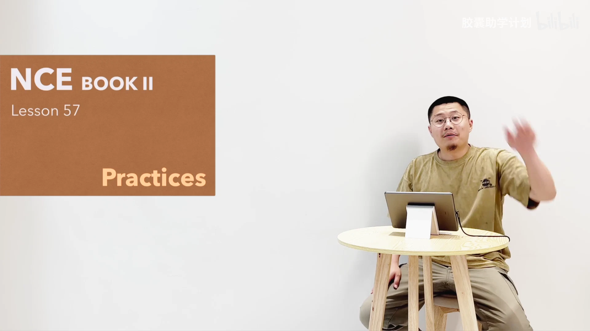

文字识别：NCE / BOOKI"I / Lesson 57 / Practices

### 画面 00:00:02

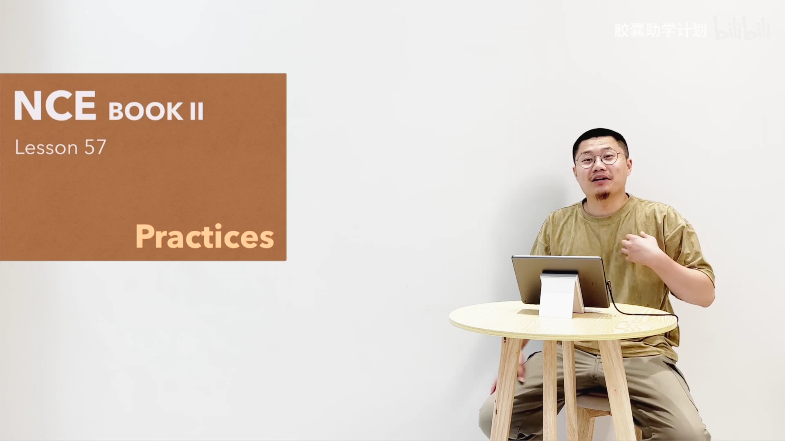

文字识别：NCE / BOOK"I / Lesson 57 / Practices

### 画面 00:00:04

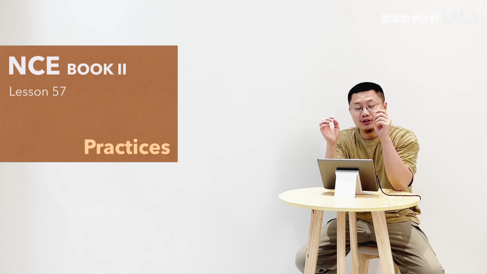

文字识别：NCE / BOOKII / Lesson 57 / Practices

### 画面 00:00:06

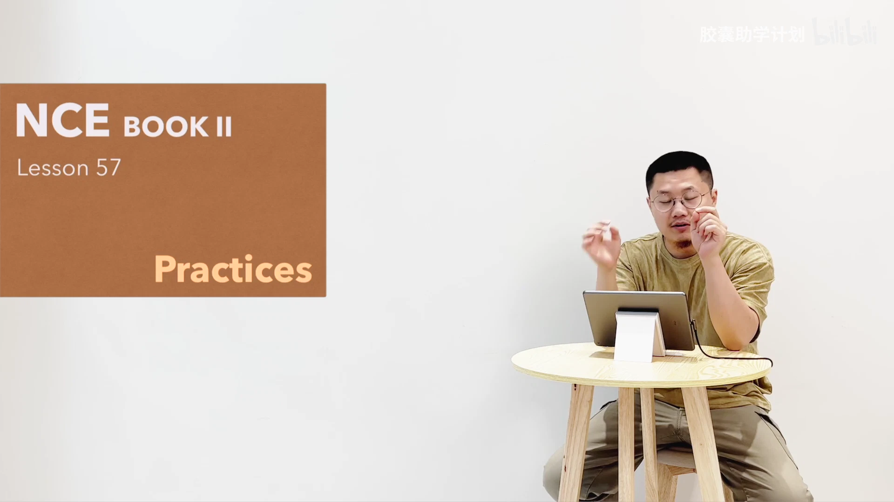

文字识别：NCE / BOOKII / Lesson 57 / Practices

### 画面 00:00:08

文字识别：进行如下练习唯一前提 / 文章跟读至熟读成诵 / 否则请勿开始

### 画面 00:00:13

文字识别：进行如下练习唯一前提 / 文章跟读至熟读成诵 / 否则请勿开始

### 画面 00:00:16

文字识别：胶囊助学计划bilbl

### 画面 00:00:20

### 画面 00:00:22

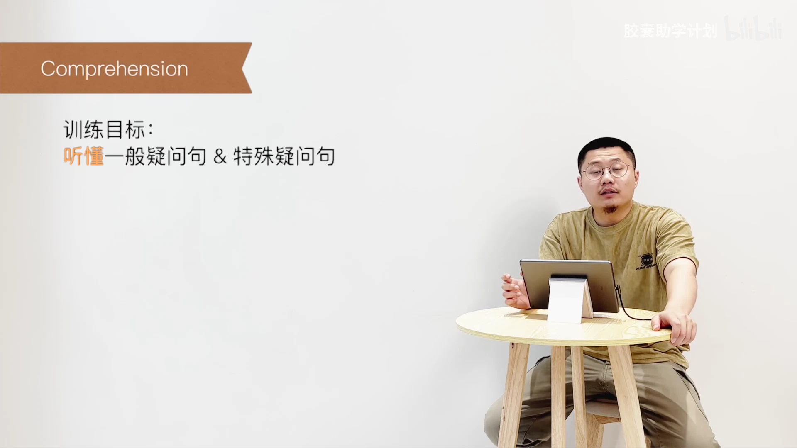

文字识别：Comprehension / 训练目标： / 听懂一般疑问句＆特殊疑问句

### 画面 00:00:25

文字识别：Comprehension / 训练目标： / 听懂一般疑问句＆特殊疑问句

### 画面 00:00:28

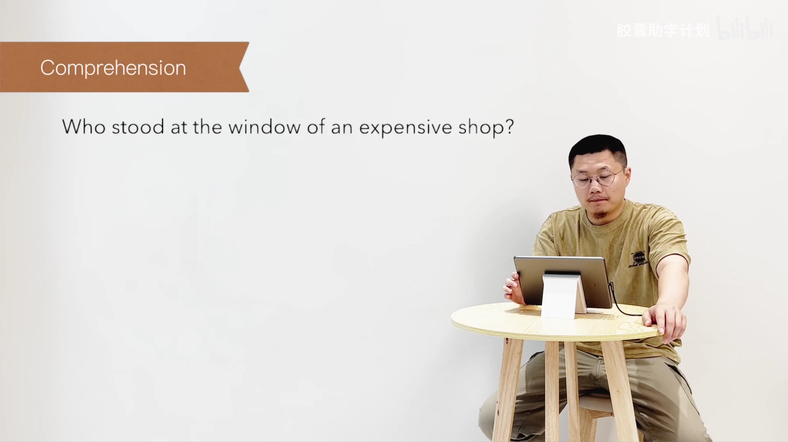

文字识别：Comprehension / Who stood at the window of an expensive shop?

## 00:00:30–00:01:00

at the window of an expensive shop? A woman did. Next one. Did she hesitate before going in? Yes, she did. Next one. What did she ask the assistant to see a dress in the shop in the window? Next one. What didn't the assistant like? The way she was dressed. Next one.

### 画面 00:00:30

文字识别：Comprehension / Who stood at the window of an expensive shop?

### 画面 00:00:34

文字识别：Comprehension / Who stood at the window of an expensive shop? / A woman did.

### 画面 00:00:39

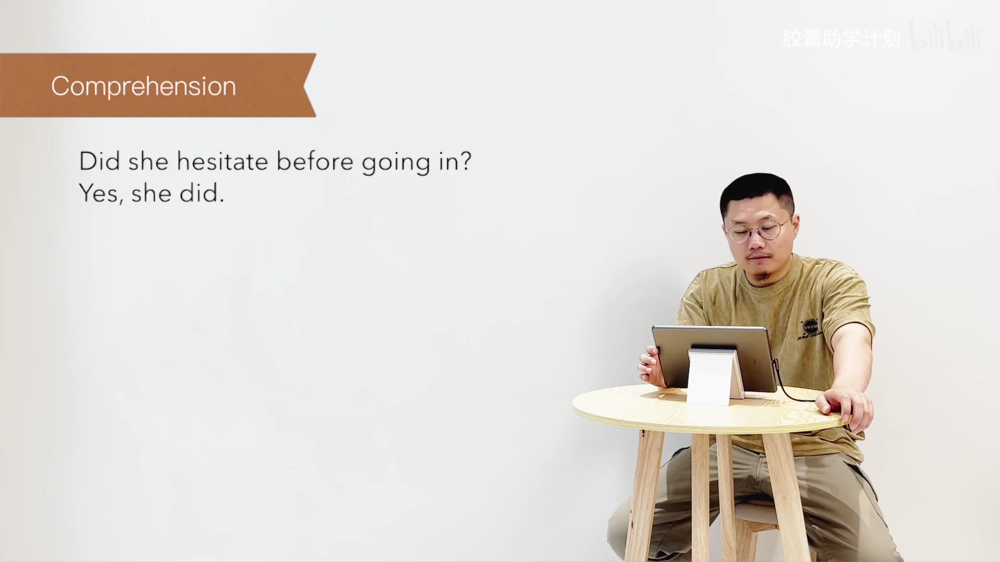

文字识别：Comprehension / Did she hesitate before going in? / Yes, she did.

### 画面 00:00:43

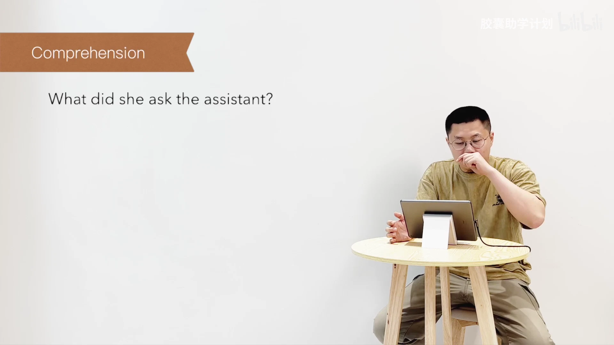

文字识别：Comprehension / What did she ask the assistant?

### 画面 00:00:46

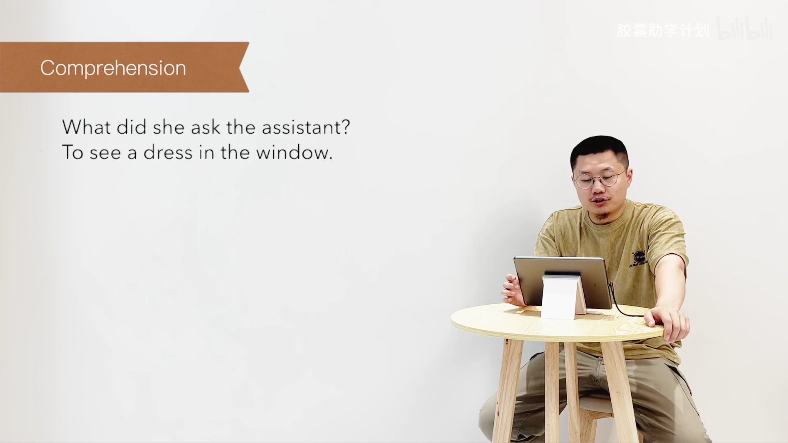

文字识别：Comprehension / What did she ask the assistant? / To see a dress in the window.

## 00:01:00–00:01:30

how did he glance at her? Scornfully. Next one, what did he tell her? That the dress was sold. Next one, was the woman angry or pleased? Angry. Next one, she walked out of the shop, didn't she? Yes, she did. Next one, what did she decide

### 画面 00:01:03

文字识别：Comprehension / How did he glance at her? / Scornfully.

### 画面 00:01:24

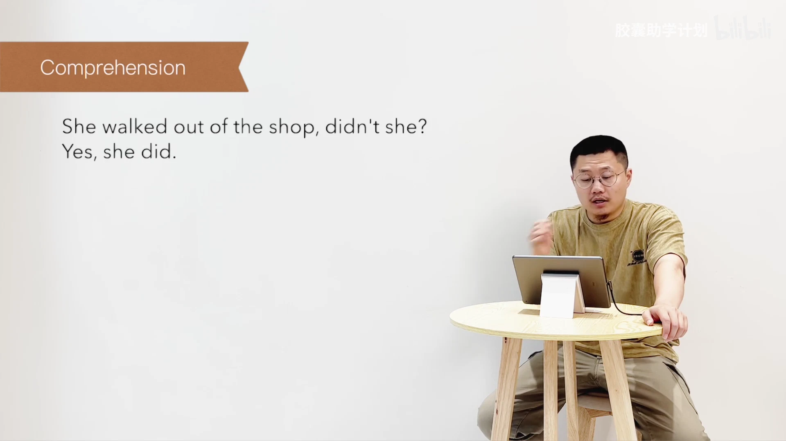

文字识别：Comprehension / She walked out of the shop, didn't she? / Yes, she did.

### 画面 00:01:27

文字识别：Comprehension / What did she decide to do the next day?

## 00:01:30–00:02:00

to do the next day? To punish the assistant. Next one. When did she return to the shop? The following morning. Next one. How was she dressed? In a fur coat. Next one. Whom did she seek out? 注意这里的 whom，大多数现在已经不太用了，更多的时候是 who 就可以了啊。

### 画面 00:01:40

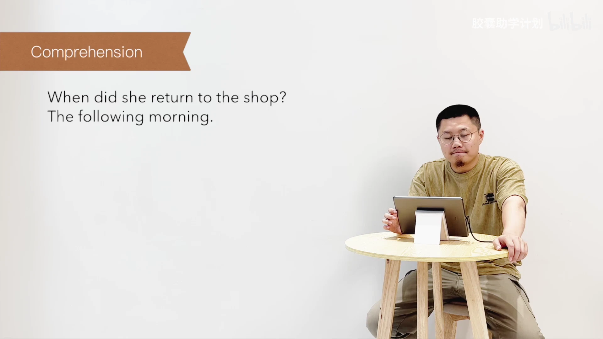

文字识别：Comprehension / When did she return to the shop? / The following morning.

### 画面 00:01:54

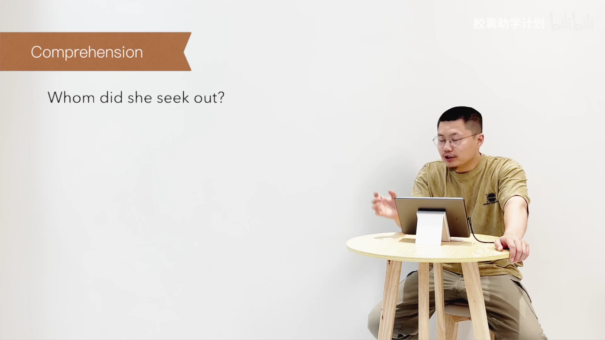

文字识别：Comprehension / Whom did she seek out?

### 画面 00:01:56

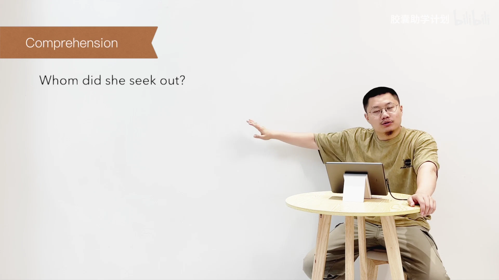

文字识别：Comprehension / Whom did she seek out?

### 画面 00:01:59

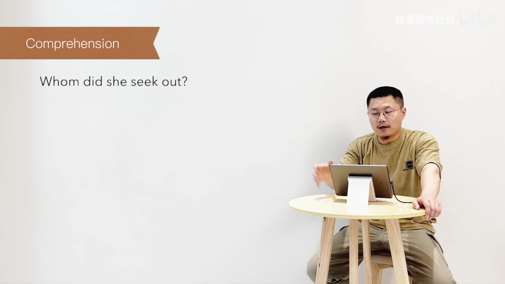

文字识别：Comprehension / Whom did she seek out?

## 00:02:00–00:02:30

The rude assistant. Next one, what did she ask him for? The same dress. Did he realize who she was? No, he didn't. Asking questions,对吧？好，这个打个样。第一个, ask me if a woman stood at a window shop. Did提前，动词换回原形，然后who对主语提问，不用变一般疑问句了，直

### 画面 00:02:05

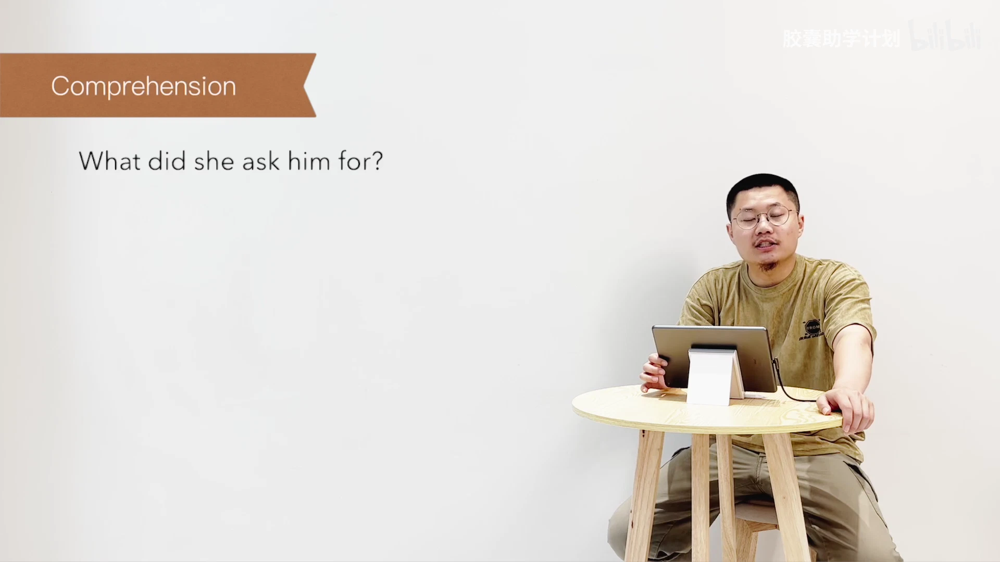

文字识别：Comprehension / What did she ask him for?

### 画面 00:02:16

文字识别：Asking questions / 训练目标： / 会说一般疑问句＆特殊疑问句 / Accuracy / Fluency

### 画面 00:02:19

文字识别：Asking questions / T: Ask me if a woman stood at a shop window.

### 画面 00:02:21

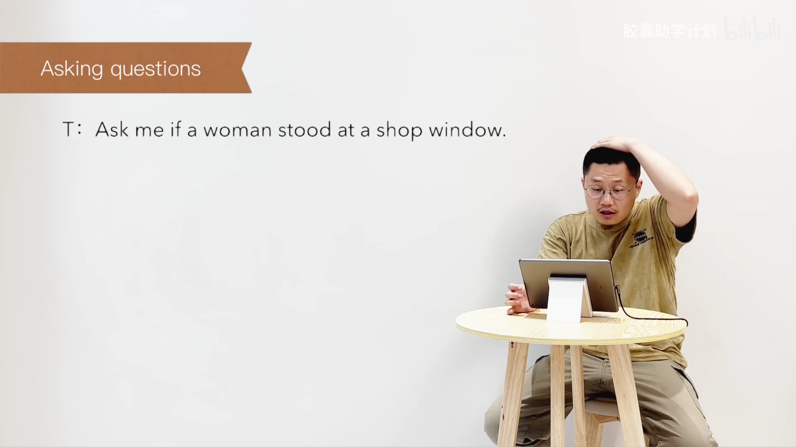

文字识别：Asking questions / T: Ask me if a woman stood at a shop window.

### 画面 00:02:23

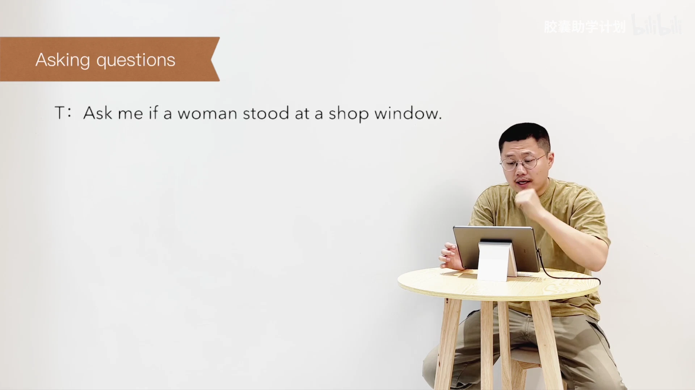

文字识别：Asking questions / T: Ask me if a woman stood at a shop window.

### 画面 00:02:25

文字识别：Asking questions / T: Ask me if a woman stood at a shop window. / S: Did a woman stand at a shop window?

### 画面 00:02:29

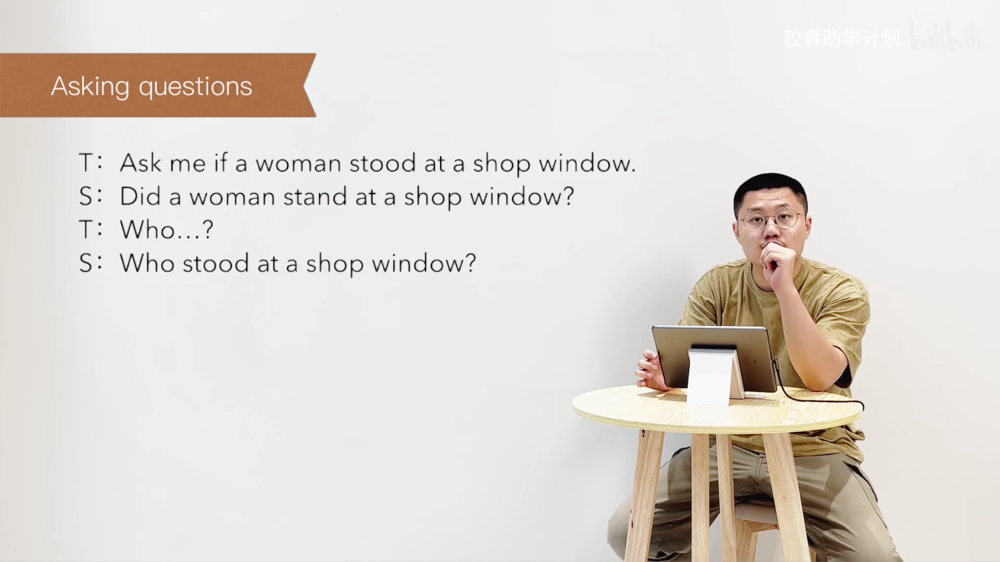

文字识别：Asking questions / T: Ask me if a woman stood at a shop window. / S: Did a woman stand at a shop window? / T: Who...? / S: Who stood at a shop window?

## 00:02:30–00:03:00

接叫 Who stood at the window, 上对吧？好，接下来我们只说思路啊。She was wearing过去进行时 was 提前 What肯对肯定是对 jeans 提问，然后 it was an expensive shop was往前一提 What kind of往往是对形容词提问对吧？什么类型的嘛？形容词是这个判定什么类型的对吧？所以这里的 What kind of 对 expensive 提问，那肯定是 What kind of shop 对不对？好了啊，

### 画面 00:02:33

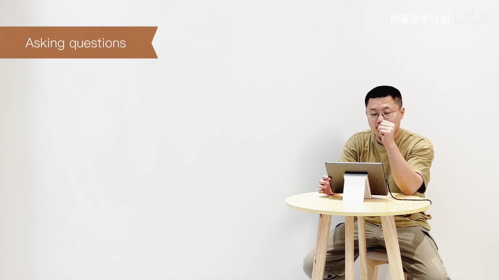

文字识别：Asking questions

### 画面 00:02:36

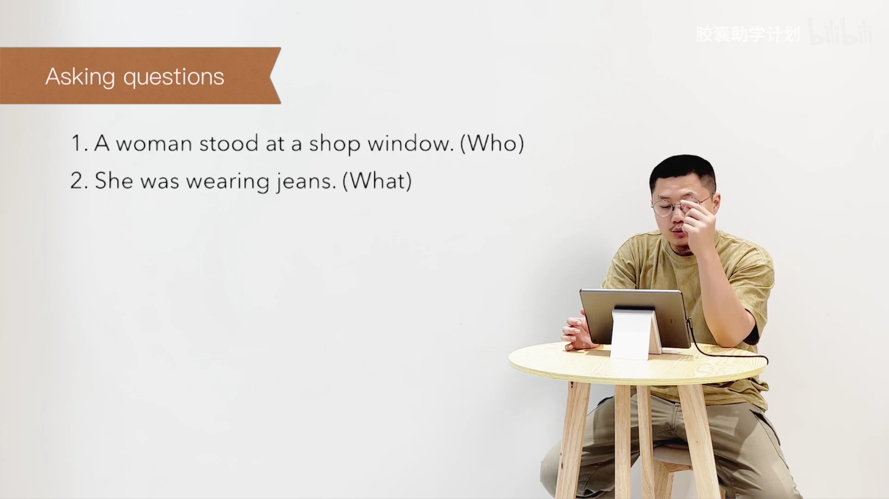

文字识别：Asking questions / 1.A woman stood at a shop window. (Who) / 2. She was wearing jeans. (What)

### 画面 00:02:40

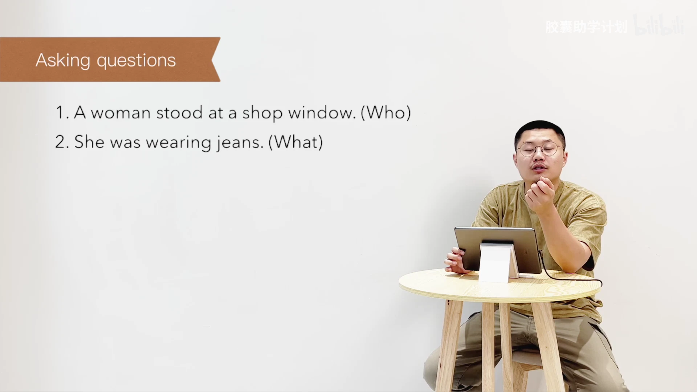

文字识别：Asking questions / 1.A woman stood at a shop window. (Who) / 2. She was wearing jeans. (What)

### 画面 00:02:47

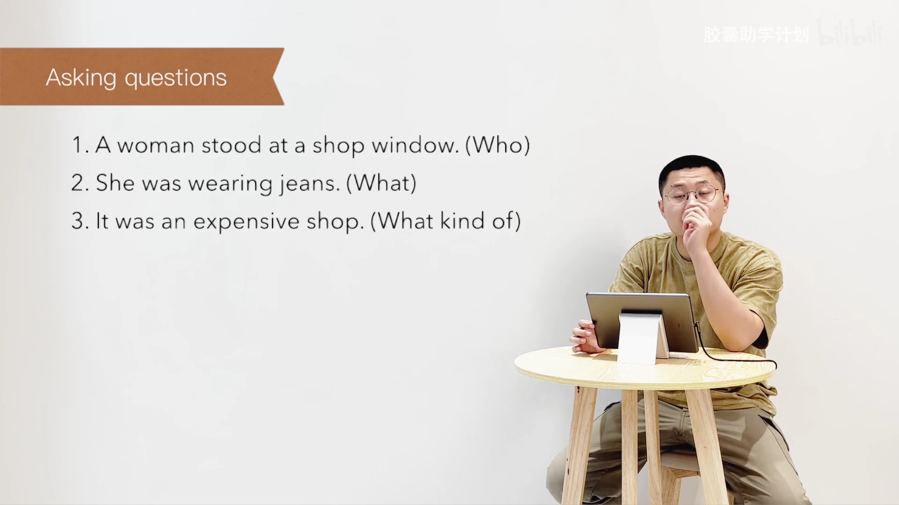

文字识别：Asking questions / 1.A woman stood at a shop window. (Who) / 2. She was wearing jeans. (What) / 3. It was an expensive shop. (What kind of)

### 画面 00:02:50

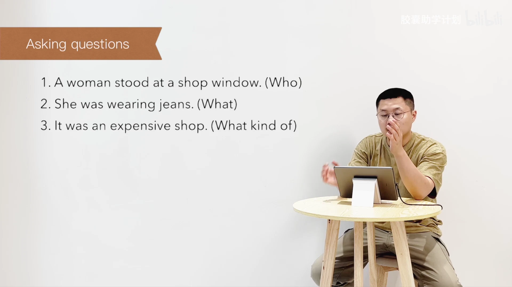

文字识别：Asking questions / 1.A woman stood at a shop window. (Who) / 2. She was wearing jeans. (What) / 3. It was an expensive shop. (What kind of)

## 00:03:00–00:03:30

然后呢？说 she was looking at a dress, was往前提，what对address提问。She hesitated for a moment, did往前提，how long对for a moment提问。所以你要练句呃，张嘴说出来叫 how long did she hesitate?对吧？她犹豫了多长时间呢？一小会儿，a moment。第六个，she finally went into the shop, did往前提，那where对into the shop提问，对吧？好，呃，第七个，she asked to see the

### 画面 00:03:06

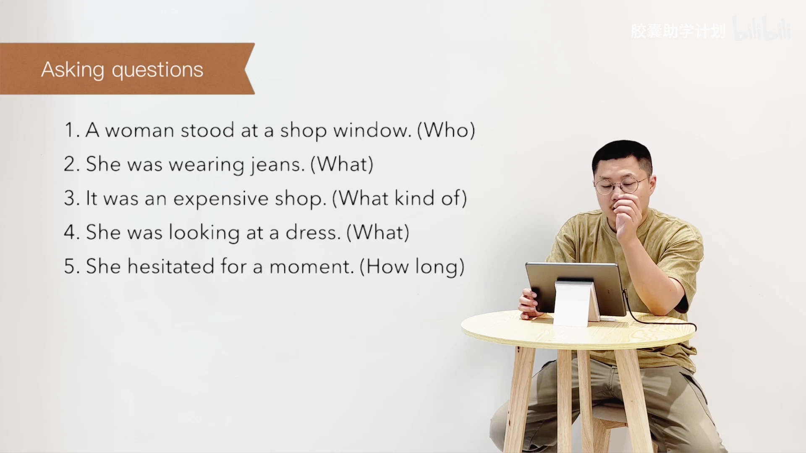

文字识别：Asking questions / 1.A woman stood at a shop window. (Who) / 2. She was wearing jeans. (What) / 3. It was an expensive shop. (What kind of) / 4. She was looking at a dress. (What) / 5. She hesitated for a moment. (How long)

### 画面 00:03:13

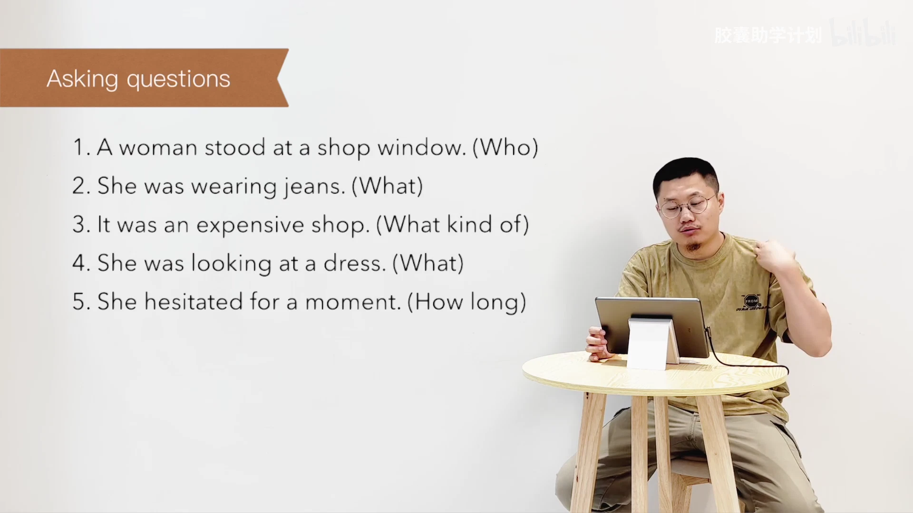

文字识别：Asking questions / 1.A woman stood at a shop window. (Who) / 2. She was wearing jeans. (What) / 3. It was an expensive shop. (What kind of) / 4. She was looking at a dress. (What) / 5. She hesitated for a moment. (How long)

### 画面 00:03:16

文字识别：Asking questions / 1.A woman stood at a shop window. (Who) / 2. She was wearing jeans. (What) / 3. It was an expensive shop. (What kind of) / 4. She was looking at a dress. (What) / 5. She hesitated for a moment. (How long)

### 画面 00:03:18

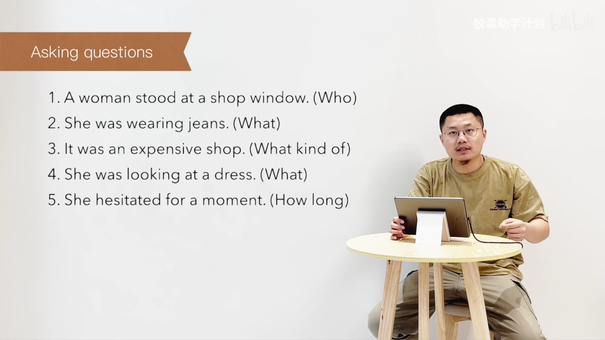

文字识别：Asking questions / 1.A woman stood at a shop window. (Who) / 2. She was wearing jeans. (What) / 3. It was an expensive shop. (What kind of) / 4. She was looking at a dress. (What) / 5. She hesitated for a moment. (How long)

### 画面 00:03:21

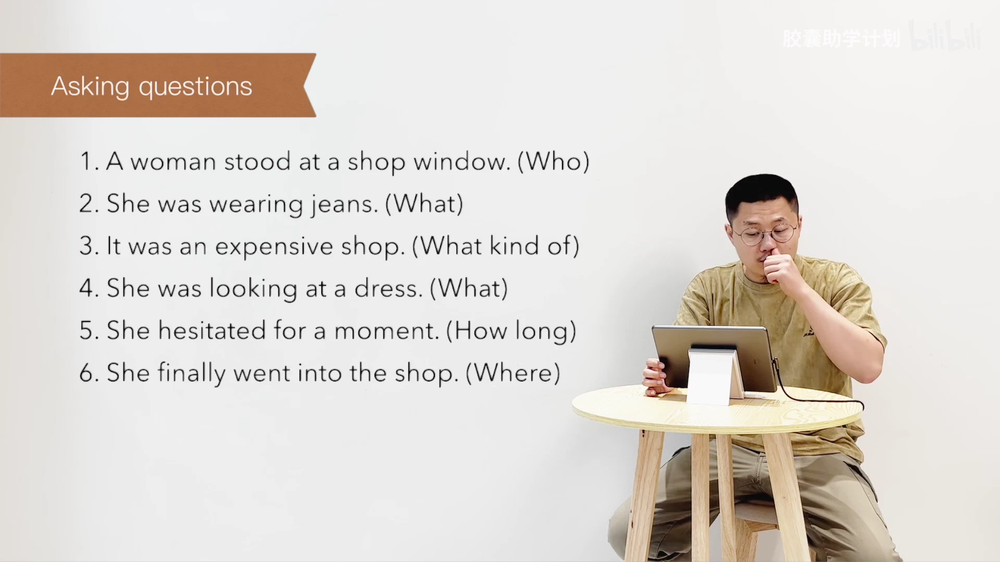

文字识别：Asking questions / 1.A woman stood at a shop window. (Who) / 2. She was wearing jeans. (What) / 3. It was an expensive shop. (What kind of) / 4. She was looking at a dress. (What) / 5. She hesitated for a moment. (How long) / 6. She finally went into the shop. (Where)

### 画面 00:03:24

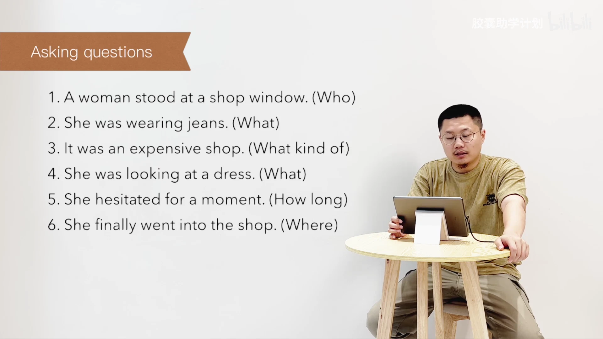

文字识别：Asking questions / 1.A woman stood at a shop window. (Who) / 2. She was wearing jeans. (What) / 3. It was an expensive shop. (What kind of) / 4. She was looking at a dress. (What) / 5. She hesitated for a moment. (How long) / 6. She finally went into the shop. (Where)

### 画面 00:03:27

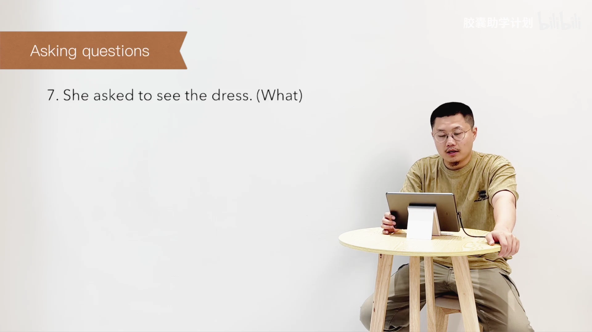

文字识别：Asking questions / 7. She asked to see the dress.(What)

### 画面 00:03:29

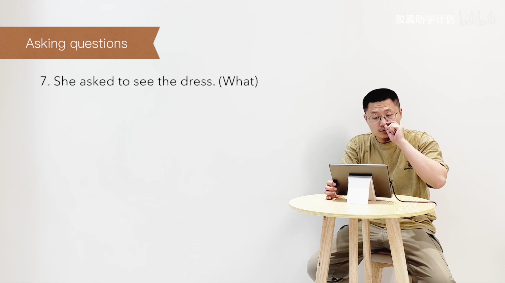

文字识别：Asking questions / 7. She asked to see the dress. (What)

## 00:03:30–00:04:00

dress. D的往前提，What对the dress提问。The assistant glanced at her scornfully. D的往前提呗，然后How对scornfully提问，Why对整句话，Who你对her和assistant都行，但是注意对主语提问应该怎么样，对吧？对宾语提问应该怎么样啊？呃，He told her the dress was sold. D的往前提，What对，其实the dress was sold整个这个宾语从句提问，所以答案叫What did he

### 画面 00:03:31

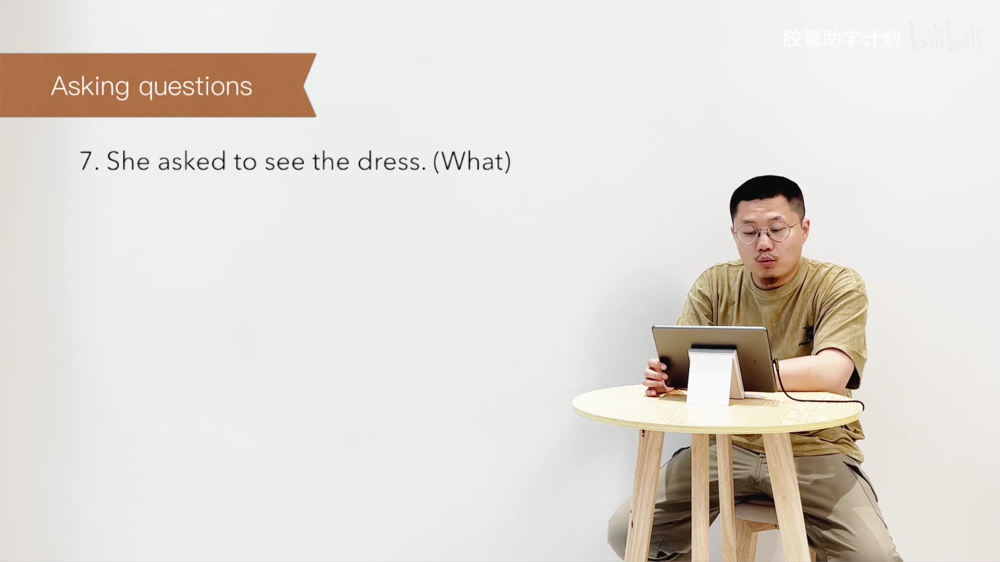

文字识别：Asking questions / 7. She asked to see the dress. (What)

### 画面 00:03:42

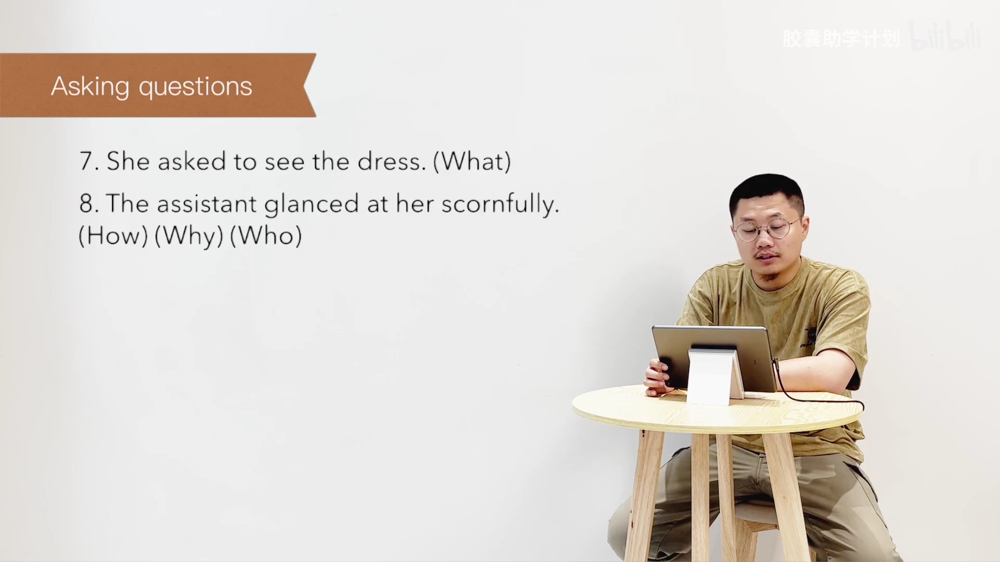

文字识别：Asking questions / 7. She asked to see the dress. (What) / 8. The assistant glanced at her scornfully. / (How)(Why)(Who)

### 画面 00:03:58

文字识别：Asking questions / 7. She asked to see the dress. (What) / 8. The assistant glanced at her scornfully. / (How)(Why)(Who) / 9. He told her the dress was sold. (What)

## 00:04:00–00:04:30

tell her? 啊，第十个 The woman walked out of the shop angrily. Did 往前提 Why 对整句话提问 Who 对主语提问，别变一般疑问句了。第十一个 She returned to the shop the next day. Did 往前提 When 对 the next day 提问 Why 加整句 Who 对主语提问，别变一般疑问句。答案就这个样子了啊。 Tell the story 可以错一点点，不能特别慢。所以文章一定要读到熟读成诵，几乎就能背下来了的地步。

### 画面 00:04:02

文字识别：Asking questions / 7. She asked to see the dress. (What) / 8. The assistant glanced at her scornfully. / (How)(Why)(Who) / 9. He told her the dress was sold. (What) / 10.The woman walked out of the shop / angrily. (Why)(Who)

### 画面 00:04:04

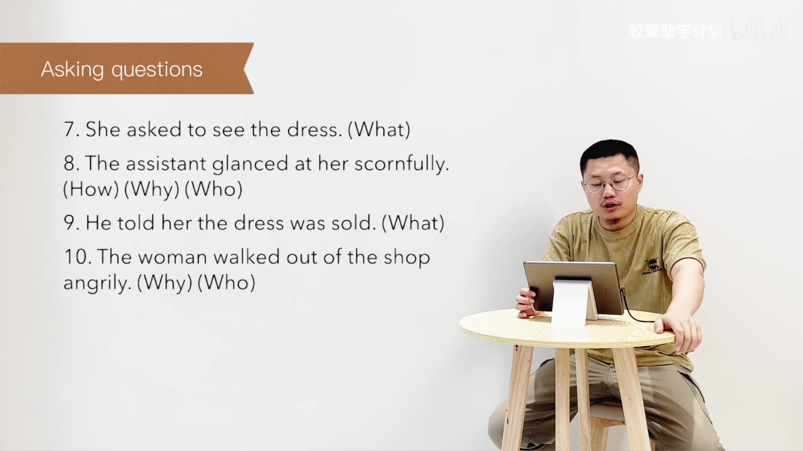

文字识别：Asking questions / 7. She asked to see the dress. (What) / 8. The assistant glanced at her scornfully. / (How)(Why)(Who) / 9. He told her the dress was sold. (What) / 10.The woman walked out of the shop / angrily. (Why)(Who)

### 画面 00:04:15

文字识别：Asking questions / 7. She asked to see the dress. (What) / 8. The assistant glanced at her scornfully. / (How)(Why)(Who) / 9. He told her the dress was sold. (What) / 10.The woman walked out of the shop / angrily.(Why)(Who) / 11. She returned to the shop the next day. / (When)(Why)(Who)

### 画面 00:04:21

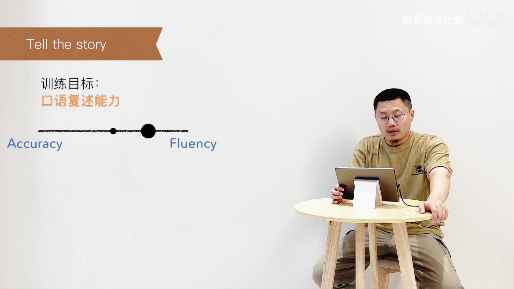

文字识别：Tell the story / 训练目标： / 口语复述能力 / Accuracy / Fluency

### 画面 00:04:24

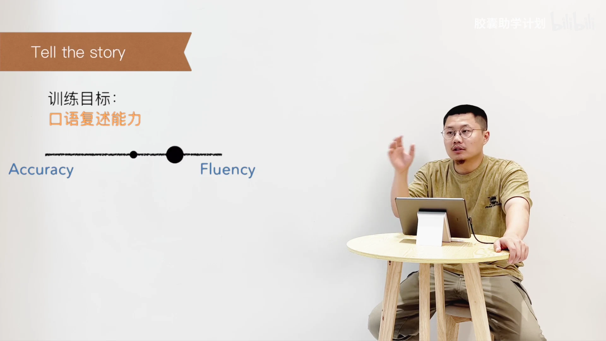

文字识别：Tell the story / 训练目标： / 口语复述能力 / Accuracy / Fluency

## 00:04:30–00:05:00

然后看着这些啊，woman in jeans啊，stood at the window of an expensive shop， blah blah blah. 好，hesitated for a moment，啊，before she finally，啊，went in，等等的啊，去呃进行一下复述这篇文章，看着这些字儿。然后呢，summary writing，写作复述能力。等到进入第三单元的时候，各位能看到，在这儿我给各位加粗了，对这些东西，这是我们重点要练的，就是各种各样的这种连词的用法，对吧？OK，

### 画面 00:04:30

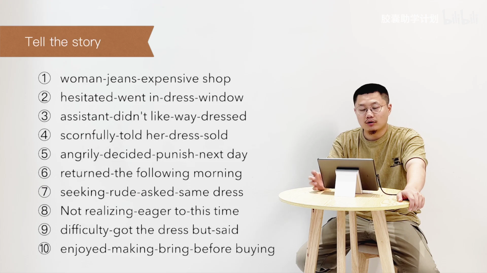

文字识别：Tell the story / ① / woman-jeans-expensive shop / hesitated-went in-dress-window / assistant-didn't like-way-dressed / scornfully-told her-dress-sold / angrily-decided-punish-next day / 5 / returned-the following morning / seeking-rude-asked-same dress / Not realizing-eager to-this time / difficulty-got the dress but-said / 1⑩ enjoyed-making-bring-before buying

### 画面 00:04:45

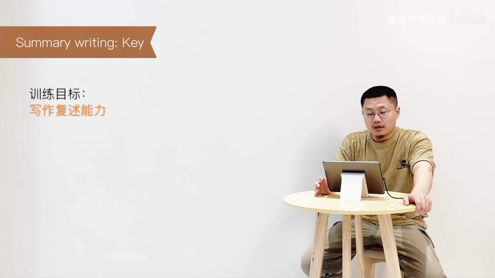

文字识别：Summary writing: Key / 训练目标： / 写作复述能力

### 画面 00:04:48

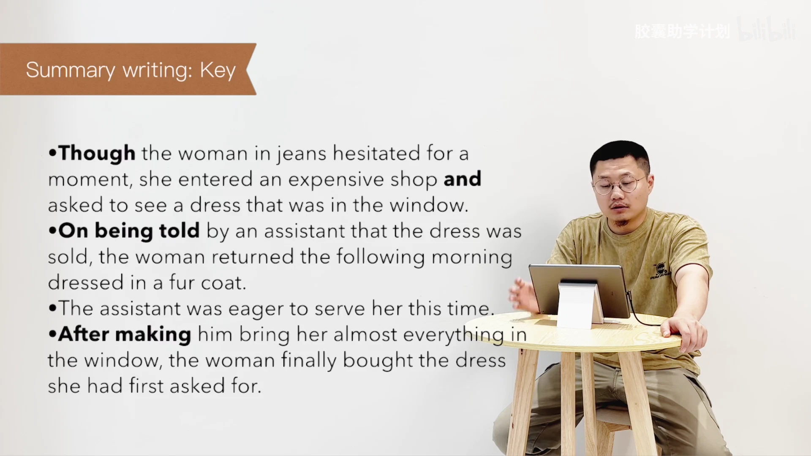

文字识别：Summary writing: Key / •Though the woman in jeans hesitated for a / moment, she entered an expensive shop and / asked to see a dress that was in the window. / •On being told by an assistant that the dress was / sold, the woman returned the following morning / dressed in a fur coat. / •The assistant was eager to serve her this time. / •After making him bring her almost everything in / the window, the woman finally bought the dress / she had first asked for.

### 画面 00:04:50

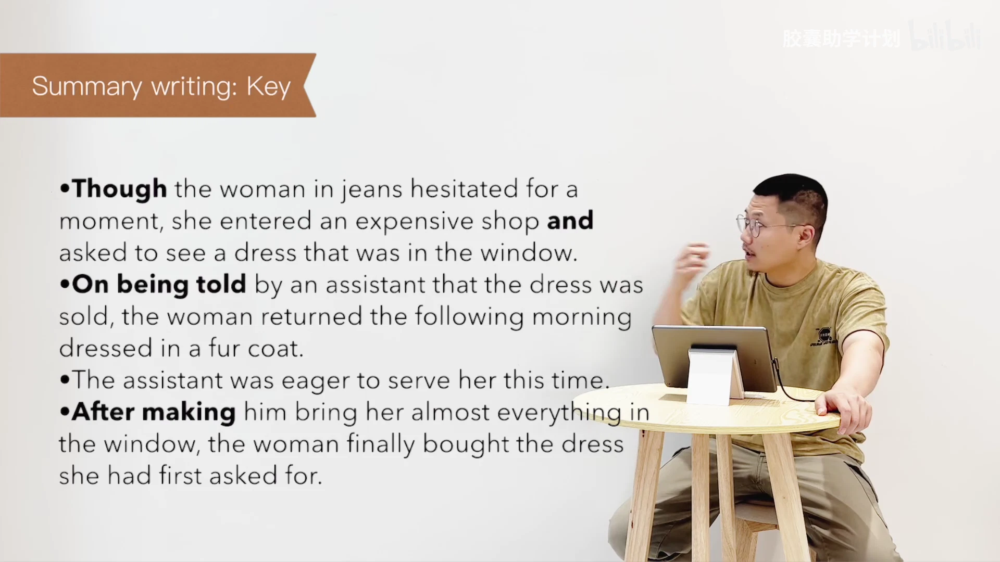

文字识别：Summary writing: Key / •Though the woman in jeans hesitated for a / moment, she entered an expensive shop and / asked to see a dress that was in the window. / •On being told by an assistant that the dress was / sold, the woman returned the following morning / dressed in a fur coat. / •The assistant was eager to serve her this time. / •After making him bring her almost everything in / the window, the woman finally bought the dress / she had first asked for.

### 画面 00:04:52

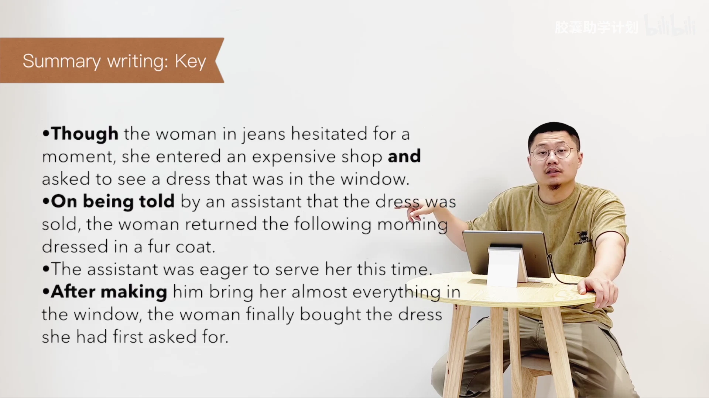

文字识别：Summary writing: Key / •Though the woman in jeans hesitated for a / moment, she entered an expensive shop and / asked to see a dress that was in the window. / •On being told by an assistant that the dress was / sold, the woman returned the following morhing / dressed in a fur coat. / •The assistant was eager to serve her this time. / •After making him bring her almost everything in / the window, the woman finally bought the dress / she had first asked for.

### 画面 00:04:55

文字识别：Summary writing: Key / •Though the woman in jeans hesitated for a / moment, she entered an expensive shop and / asked to see a dress that was in the window. / •On being told by an assistant that the dress was / sold, the woman returned the following morning / dressed in a fur coat. / •The assistant was eager to serve her this time. / •After making him bring her almost everything in / the window, the woman finally bought the dress / she had first asked for.

### 画面 00:04:58

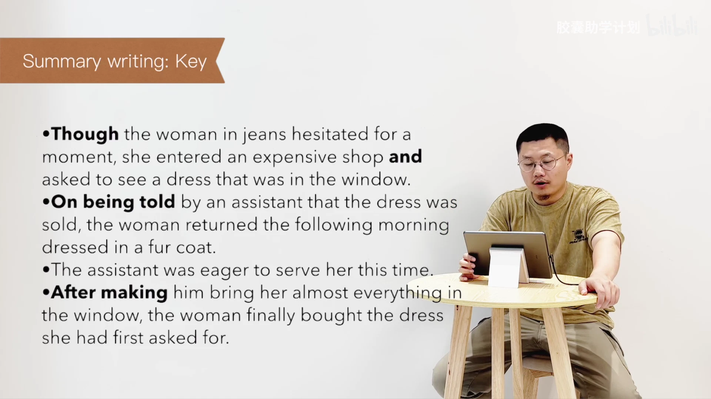

文字识别：Summary writing: Key / •Though the woman in jeans hesitated for a / moment, she entered an expensive shop and / asked to see a dress that was in the window. / •On being told by an assistant that the dress was / sold, the woman returned the following morning / dressed in a fur coat. / •The assistant was eager to serve her this time. / •After making him bring her almost everything in / the window, the woman finally bought the dress / she had first asked for.

## 00:05:00–00:05:30

Okay, topic for discussion呢？完全自由的对话，这是我们所有所有的学习和练习最终能完成最重要的目的之一，就是给我一个话题，我能跟别人聊了。那我们现在先熟悉一下话题。比如说第一个，说describe an annoying experience you've had while being served in the shop。啊，他说你聊一个让你觉得特别厌烦的、特别讨厌的一个体验、一个经历。说当你

### 画面 00:05:00

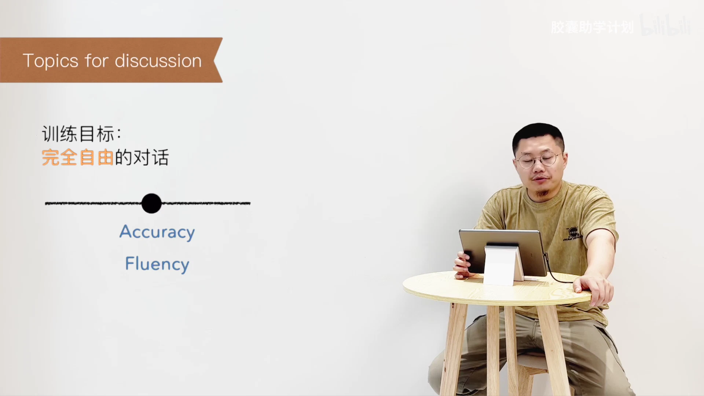

文字识别：Topics for discussion / 训练目标： / 完全自由的对话 / Accuracy / Fluency

### 画面 00:05:03

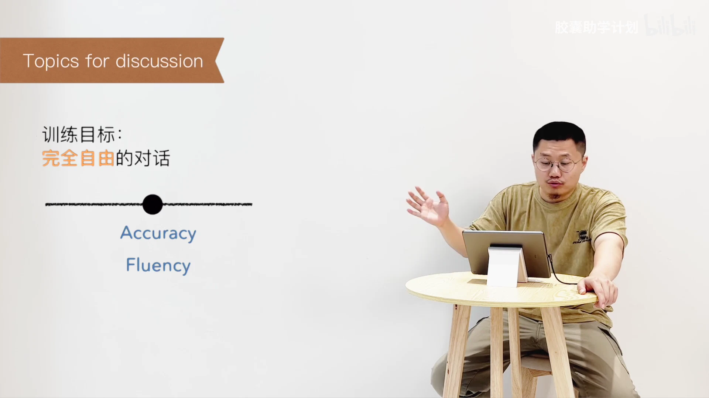

文字识别：Topics for discussion / 训练目标： / 完全自由的对话 / Accuracy / Fluency

### 画面 00:05:07

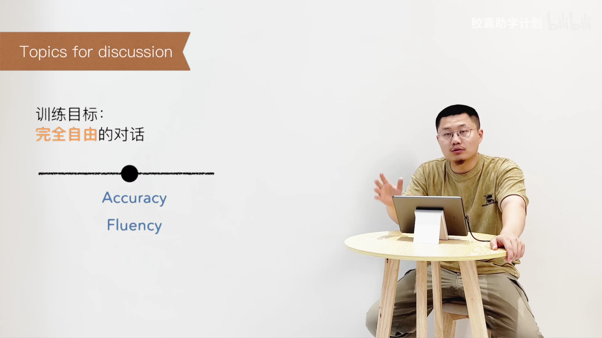

文字识别：Topics for discussion / 训练目标： / 完全自由的对话 / Accuracy / Fluency

### 画面 00:05:10

文字识别：Topics for discussion / Describe an annoying experience you've / had while being served in a shop. / Do you sympathize with the woman in / the story? Why/Why not? / What are the advantages/disadvantages / of shopping in (a) large stores and (b) / small shops?

### 画面 00:05:14

文字识别：Topics for discussion / Describe an annoying experience you've / had while being served in a shop. / Do you sympathize with the woman in / the story? Why/Why not? / What are the advantages/disadvantages / of shopping in (a) large stores and (b) / small shops?

### 画面 00:05:16

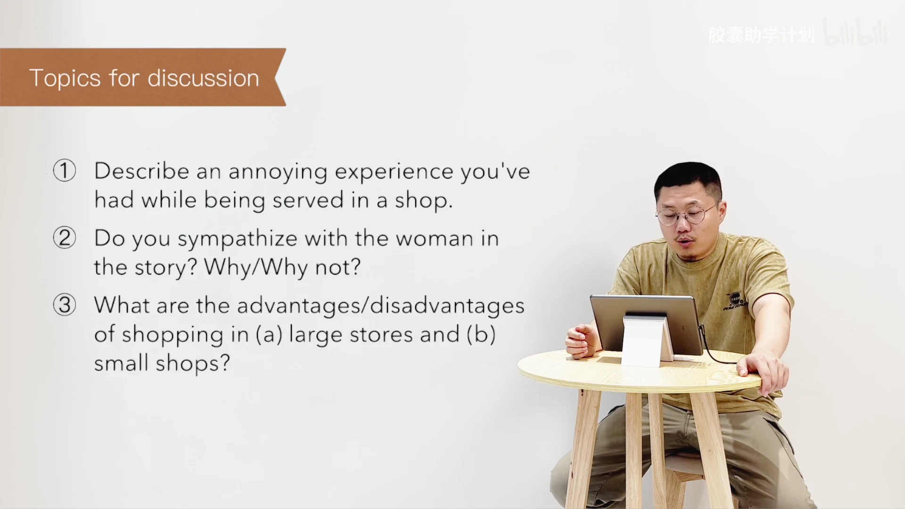

文字识别：Topics for discussion / Describe an annoying experience you've / had while being served in a shop. / Do you sympathize with the woman in / the story? Why/Why not? / What are the advantages/disadvantages / of shopping in (a) large stores and (b) / small shops?

### 画面 00:05:21

文字识别：Topics for discussion / Describe an annoying experience you've / had while being served in a shop. / Do you sympathize with the woman in / the story? Why/Why not? / What are the advantages/disadvantages / 3 / of shopping in (a) large stores and (b) / small shops?

## 00:05:30–00:06:00

在一个商店当中被别人服务的时候啊。第二个说，Do you sympathize with the woman in this story? Why? Why not?说你会对这个故事当中的女子感到同情吗？同情或不同情。重点是why or why not？你要解释一下原因，对吧？第三个说，What are the advantages disadvantages of shopping in a large store and small shops？对吧？说你在这个大商店和小商店里面

### 画面 00:05:30

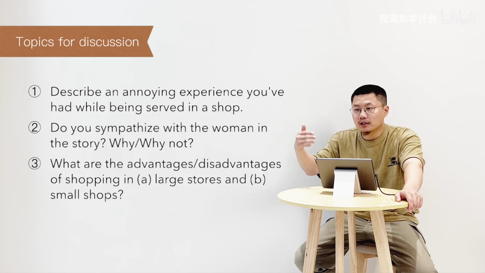

文字识别：Topics for discussion / Describe an annoying experience you've / had while being served in a shop. / Do you sympathize with the woman in / the story? Why/Why not? / What are the advantages/disadvantages / of shopping in (a) large stores and (b) / small shops?

### 画面 00:05:34

文字识别：Topics for discussion / Describe an annoying experience you've / had while being served in a shop. / Do you sympathize with the woman in / the story? Why/Why not? / What are the advantages/disadvantages / of shopping in (a) large stores and (b) / small shops?

### 画面 00:05:38

文字识别：Topics for discussion / Describe an annoying experience you've / had while being served in a shop. / Do you sympathize with the woman in / the story? Why/Why not? / What are the advantages/disadvantages / of shopping in (a) large stores and (b) / small shops?

### 画面 00:05:45

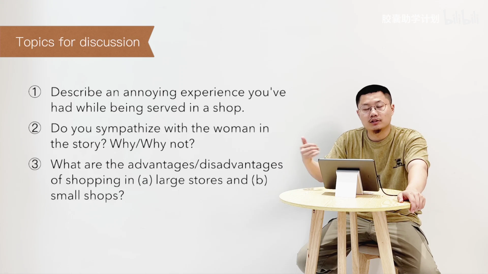

文字识别：Topics for discussion / Describe an annoying experience you've / had while being served in a shop. / Do you sympathize with the woman in / the story? Why/Why not? / What are the advantages/disadvantages / 3 / of shopping in (a) large stores and (b) / small shops?

### 画面 00:05:47

文字识别：Topics for discussion / Describe an annoying experience you've / had while being served in a shop. / Do you sympathize with the woman in / the story? Why/Why not? / What are the advantages/disadvantages / 3 / of shopping in (a) large stores and (b) / small shops?

### 画面 00:05:57

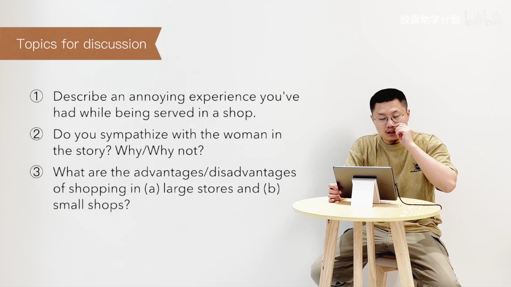

文字识别：Topics for discussion / Describe an annoying experience you've / had while being served in a shop. / Do you sympathize with the woman in / the story? Why/Why not? / What are the advantages/disadvantages / of shopping in (a) large stores and (b) / small shops?

## 00:06:00–00:06:30

去去 shopping 啊，去购物的时候有哪些优势和劣势？就是所以你看这道题啊，我们简单说一下，这道题其实就是四四个竖栏嘛。 Large store advantages disadvantages small store 啊，这个 shops 啊 advantages disadvantages 对吧？ Okay，家庭作业，Ask me if先写，再大声朗读。写是保证我们正确啊。这要写作，写完对答案。 Tell the story 口语复述，

### 画面 00:06:00

文字识别：Topics for discussion / Describe an annoying experience you've / had while being served in a shop. / Do you sympathize with the woman in / the story? Why/Why not? / What are the advantages/disadvantages / of shopping in (a) large stores and (b) / small shops?

### 画面 00:06:02

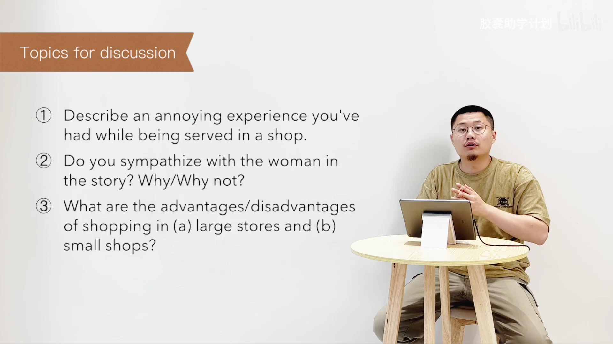

文字识别：Topics for discussion / Describe an annoying experience you've / had while being served in a shop. / Do you sympathize with the woman in / the story? Why/Why not? / What are the advantages/disadvantages / of shopping in (a) large stores and (b) / small shops?

### 画面 00:06:04

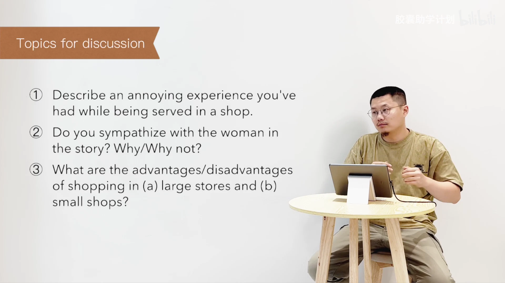

文字识别：Topics for discussion / Describe an annoying experience you've / had while being served in a shop. / Do you sympathize with the woman in / the story? Why/Why not? / What are the advantages/disadvantages / of shopping in (a) large stores and (b) / small shops?

### 画面 00:06:07

文字识别：Topics for discussion / Describe an annoying experience you've / had while being served in a shop. / Do you sympathize with the woman in / the story? Why/Why not? / What are the advantages/disadvantages / of shopping in (a) large stores and (b) / small shops?

### 画面 00:06:10

文字识别：Topics for discussion / Describe an annoying experience you've / had while being served in a shop. / Do you sympathize with the woman in / the story? Why/Why not? / What are the advantages/disadvantages / of shopping in (a) large stores and (b) / small shops?

### 画面 00:06:14

文字识别：Topics for discussion / Describe an annoying experience you've / had while being served in a shop. / Do you sympathize with the woman in / the story? Why/Why not? / What are the advantages/disadvantages / of shopping in (a) large stores and (b) / small shops?

### 画面 00:06:16

文字识别：Topics for discussion / Describe an annoying experience you've / had while being served in a shop. / Do you sympathize with the woman in / the story? Why/Why not? / What are the advantages/disadvantages / of shopping in (a) large stores and (b) / small shops?

### 画面 00:06:19

文字识别：Topics for discussion / Describe an annoying experience you've / had while being served in a shop. / Do you sympathize with the woman in / the story? Why/Why not? / What are the advantages/disadvantages / of shopping in (a) large stores and (b) / small shops?

### 画面 00:06:21

文字识别：1.Ask me if写&朗读

### 画面 00:06:23

文字识别：1.Ask me if写&朗读

### 画面 00:06:25

文字识别：1.Ask me if写&朗读 / 2.摘要写作写&答案

### 画面 00:06:28

文字识别：1.Ask me if写&朗读 / 摘要写作写&答案 / 3.Tell the story 口语复述

## 00:06:30–00:06:57

重复间隔，看置顶留言即可啊。OK，那以上呢就是本期视频的全部内容了。如果各位喜欢我们的课程呢，欢迎各位关注、订阅、一键三连，分享给那些需要的朋友，来帮助我们快速成长。See you next time.

### 画面 00:06:30

文字识别：1.Ask me if写&朗读 / 摘要写作写&答案 / 3.Tell the story 口语复述 / 4.重复间隔（置顶留言）

### 画面 00:06:32

文字识别：主

### 画面 00:06:34

### 画面 00:06:37

文字识别：不 / FROM

### 画面 00:06:41

文字识别：FROM

### 画面 00:06:43

### 画面 00:06:45

### 画面 00:06:47

文字识别：CAPSULEACADEMY / 胶囊助学计划 / 小红书 / Lecturer / Leo / OE

### 画面 00:06:49

文字识别：CAPSULEACADEMY / 胶囊助学计划 / 小红书 / Photographer / Berlin / OE

### 画面 00:06:51

文字识别：CAPSULEACADEMY / 胶囊助学计划 / 小红书 / Editor / □ / Berlin / OE

### 画面 00:06:54

文字识别：CAPSULEACADEMY / 胶囊助学计划 / 小红书

### 画面 00:06:56

文字识别：bilibili / 胶囊助学计划

