# 058 单词

快速机器解析：语音为单模型转写，未进行独立交叉校对或人工复核；画面每秒采样并按变化选帧，短时文字和标记可能遗漏。截图时间约有 1 秒误差。图片有损压缩；遇到疑点请按时间查看 Google Drive 原视频。

## 00:00:00–00:00:30

Hello everyone, welcome to Capsule Academy. This is Leo. Today we are going to learn New Concept English Book Two Lesson Fifty Eight Words. 老习惯进入正式课程之前，咱们先看几个小的问题。首先，如何表达取行李处啊，就是机场，咱们下飞机之后取行李的地方。接下来呢，如何表达因祸得福？下一个问题，如何表达名声好或者名声坏？那带着这三个问题，Hope you gonna enjoy.

### 画面 00:00:00

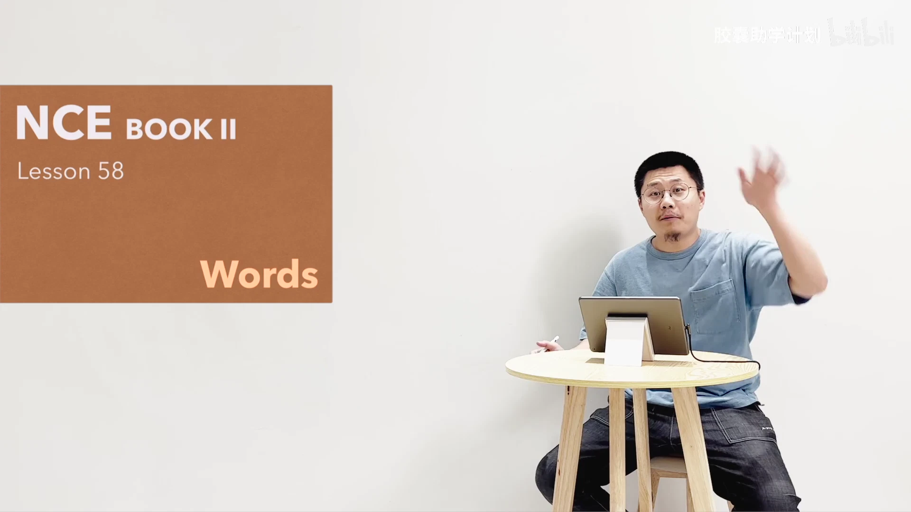

文字识别：NCE / BOOKⅡI / Lesson 58 / Words

### 画面 00:00:02

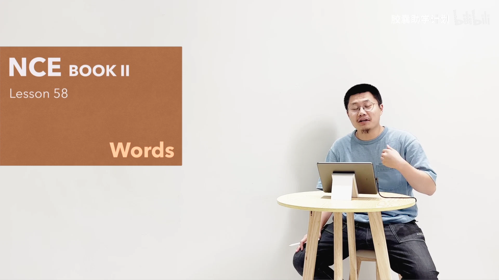

文字识别：NCE / BOOKII / Lesson 58 / Words

### 画面 00:00:05

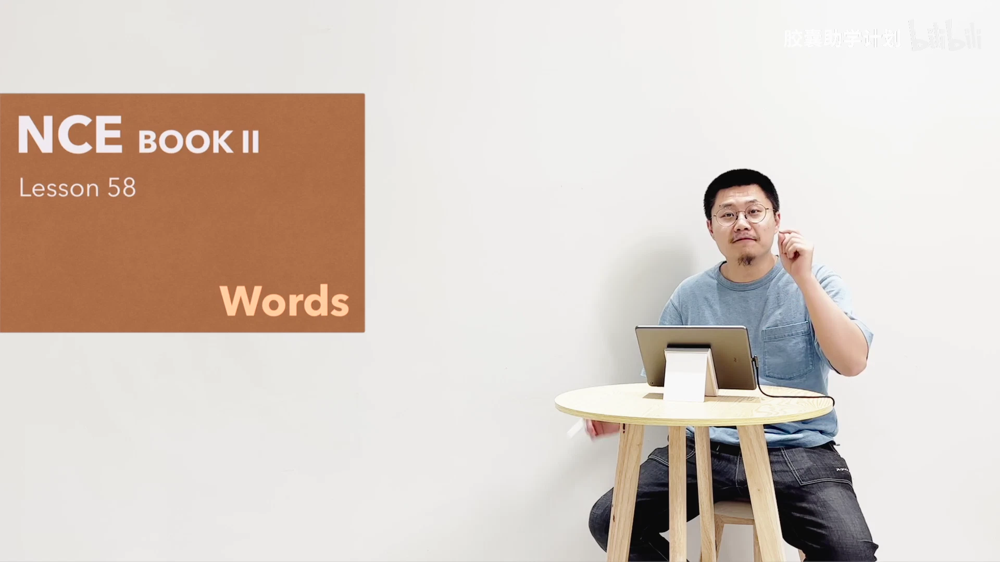

文字识别：NCE / BOOKⅡI / Lesson 58 / Words

### 画面 00:00:08

文字识别：为学计划一师

### 画面 00:00:10

文字识别：①如何表达“取行李处”？

### 画面 00:00:16

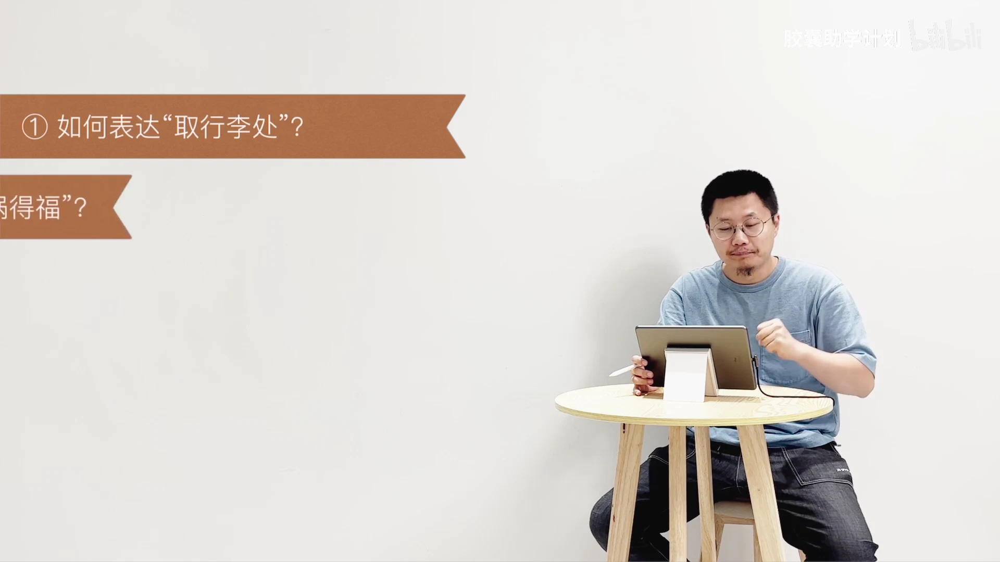

文字识别：①如何表达“取行李处”？ / 得福

### 画面 00:00:18

文字识别：①如何表达“取行李处”？ / 如何表达“因祸得福”

### 画面 00:00:20

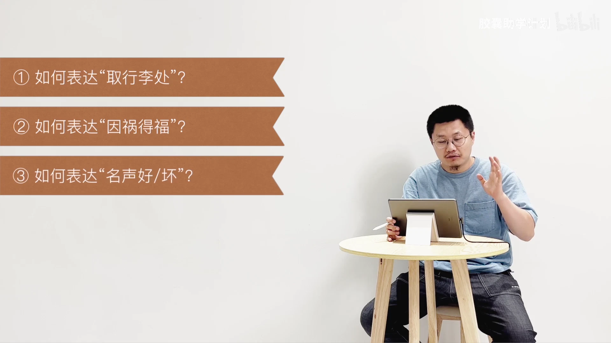

文字识别：①如何表达“取行李处”？ / 如何表达“因祸得福 / 如何表达“名声好/坏”?

### 画面 00:00:22

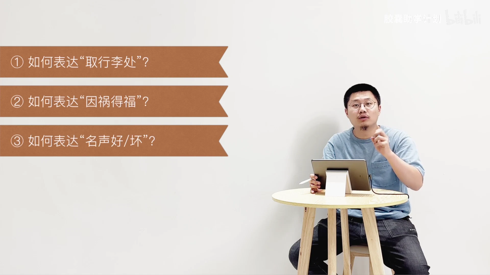

文字识别：①如何表达“取行李处”？ / 如何表达“因祸得福” / 如何表达“名声好/坏”?

### 画面 00:00:25

文字识别：胶囊助学计划bilbil / •

### 画面 00:00:29

文字识别：胶囊助学计划H / 胶囊助学计划

## 00:00:30–00:01:00

我们先看第一个单词，这个单词出现在标题上，跟我读一下，叫做 blessing blessing 啊，它是个名词，指的是我们的福气、福分啊。 OK，就福这个字儿，各位很容易理解。那它的动词叫 bless，叫做那就变成动词呗，就是保佑、祝福的意思。 OK，那它很常见的一个句型叫做 it was a blessing that，或者是 it is a blessing that，就是它一般翻译成，你看它从字面意思的理解叫

### 画面 00:00:31

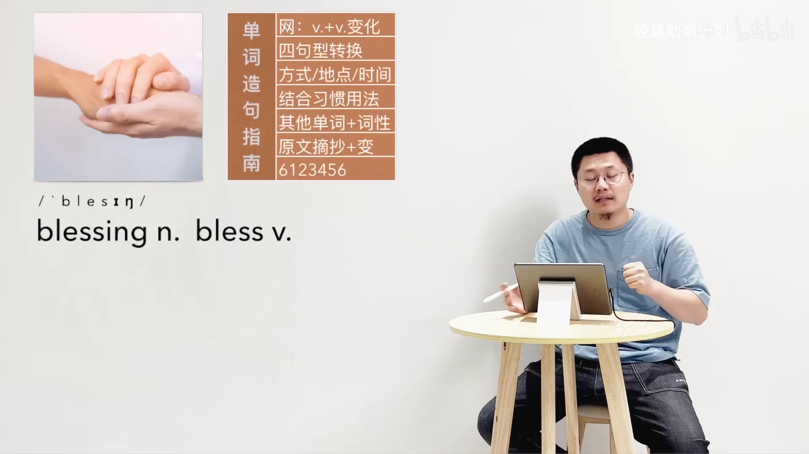

文字识别：单词造句指南 / 网：v.+v.变化 / 四句型转换 / 方式/地点/时间 / 结合习惯用法 / 其他单词+词性 / 原文摘抄+变 / 6123456 / / blesln/ / blessing n. bless v.

### 画面 00:00:36

文字识别：单词造句指南 / 网：v.+v.变化 / 四句型转换 / 方式/地点/时间 / 结合习惯用法 / 其他单词+词性 / 原文摘抄+变 / 6123456 / /'bｌｅsin/ / blessing n. bless v.

### 画面 00:00:49

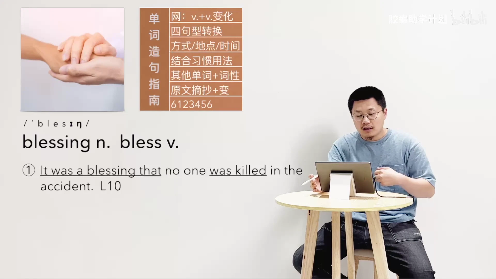

文字识别：单词造句指南 / 网：v.+v.变化 / 四句型转换 / 方式/地点/时间 / 结合习惯用法 / 其他单词+词性 / 原文摘抄+变 / 6123456 / / blesin / / blessing n. bless v. / It was a blessing that no one was killed in the / accident. L10

## 00:01:00–00:01:30

做这是一个祝福，对吧？或者很幸运，很啊，或者直接翻译成两个字叫幸好都可以啊。你用上下文场景去看，比如说，你看这句话叫做 It was a blessing that 后边加一句话叫 No one was killed in the accident。你看这个地方的 was killed 是咱们第十课学过的被动，对吧？本课正好是第三单元第十课，我们是要复习一下被动的。接下来，It's a blessing that nobody was in the house at the time。哎，说很

### 画面 00:01:19

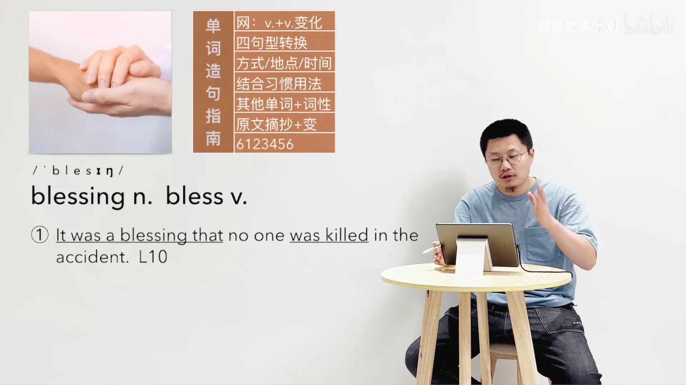

文字识别：单词造句指南 / 网：v.+v.变化 / 四句型转换 / 方式/地点/时间 / 结合习惯用法 / 其他单词+词性 / 原文摘抄+变 / 6123456 / / blesīn / / blessing n. bless v. / It was a blessing that no one was killed in the / accident. L10

## 00:01:30–00:02:00

很很幸运的是什么的呢？当时啊，屋里面没有人。Continue, is a blessing that you child live so near.你的孩子住的如此的近。那我们不多说，接下来我们看几个包含blessing常用的短语。首先第一个，What a blessing!哎，说太好了，其实就是great啊。What a blessing! Okay,跟着听一下。Tina, oh, so glad you were here. What a blessing! Next one, God bless you是一

### 画面 00:01:30

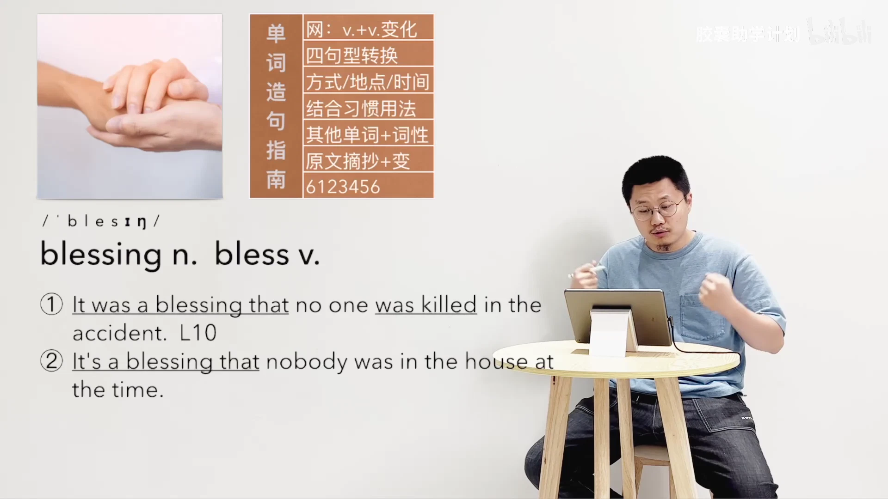

文字识别：单词造句指南 / 网：v.+v.变化 / 四句型转换 / 方式/地点/时间 / 结合习惯用法 / 其他单词+词性 / 原文摘抄+变 / 6123456 / /'bｌｅｓｉn/ / blessing n. bless v. /  It was a blessing that no one was killed in the / accident. L10 / It's a blessing that nobody was in the house at / the time.

### 画面 00:01:37

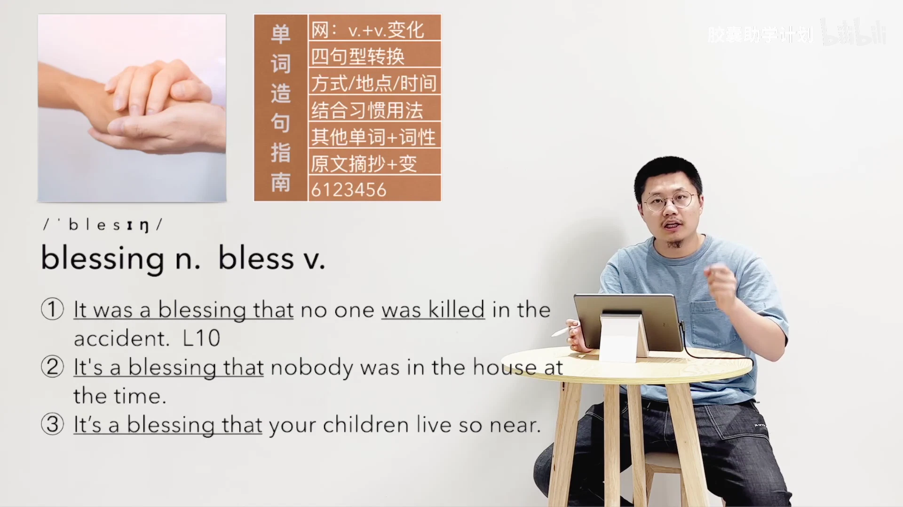

文字识别：单词造句指南 / 网：v.+v.变化 / 学计划 / 四句型转换 / 方式/地点/时间 / 结合习惯用法 / 其他单词+词性 / 原文摘抄+变 / 6123456 / /'bｌesｌn/ / blessing n. bless v. / ① It was a blessing that no one was killed in the / accident. L10 / It's a blessing that nobody was in the house at / the time. / It's a blessing that your children live so near.

### 画面 00:01:41

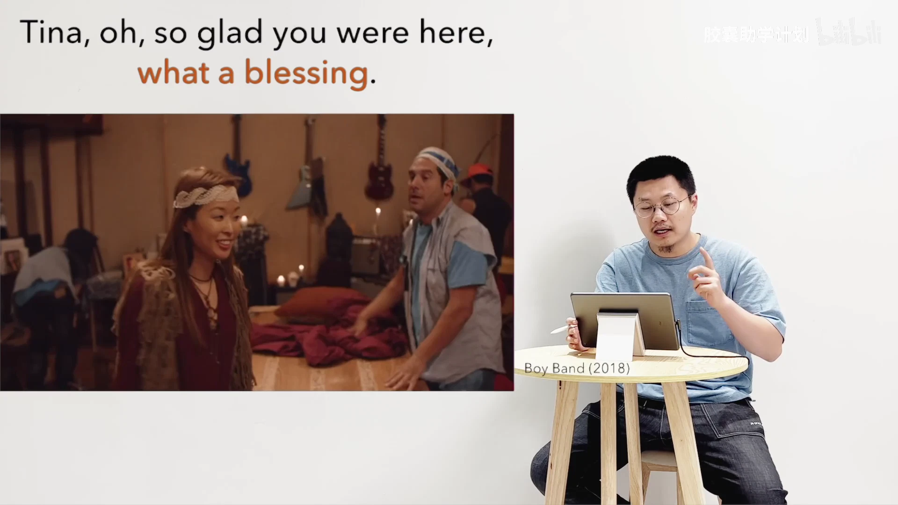

文字识别：Tina, oh, so glad you were here, / what a blessing. / Boy Band (2018)

### 画面 00:01:43

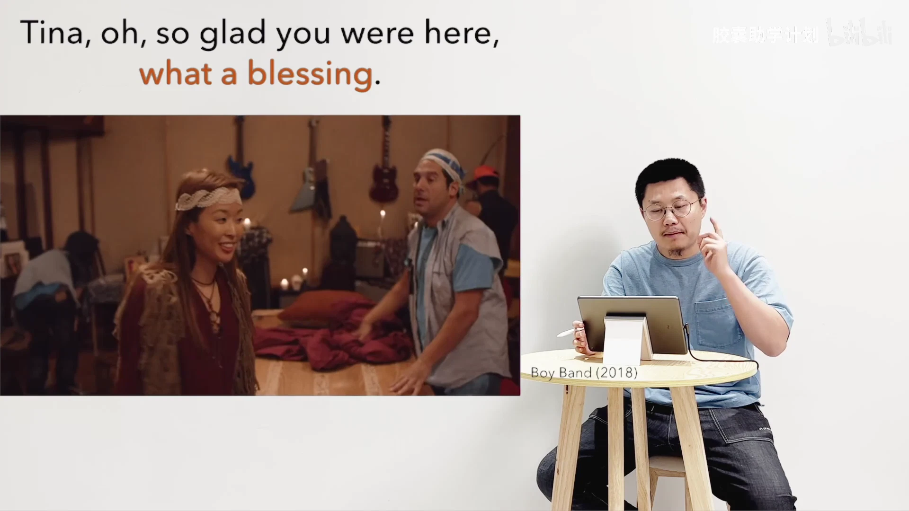

文字识别：Tina, oh, so glad you were here, / what a blessing. / Boy Band (2018)

### 画面 00:01:45

文字识别：Tina, oh, so glad you were here, / what a blessing. / Boy Band (2018)

### 画面 00:01:47

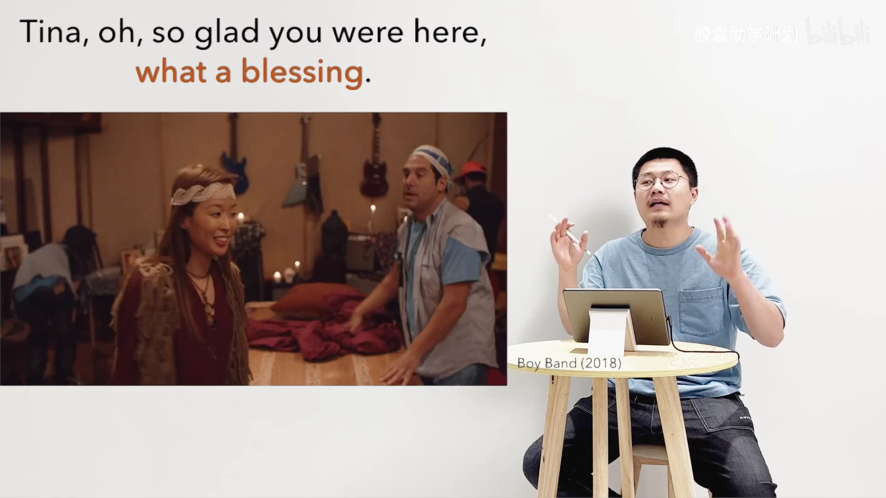

文字识别：Tina, oh, so glad you were here, / what a blessing. / Boy Band (2018)

### 画面 00:01:49

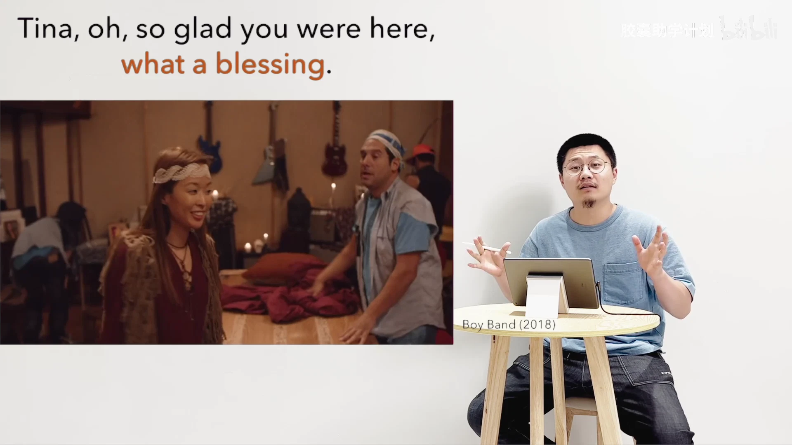

文字识别：Tina, oh, so glad you were here, / what a blessing. / Boy Band (2018)

### 画面 00:01:51

文字识别：Tina, oh, so glad you were here, / what a blessing. / Boy Band (2018)

### 画面 00:01:53

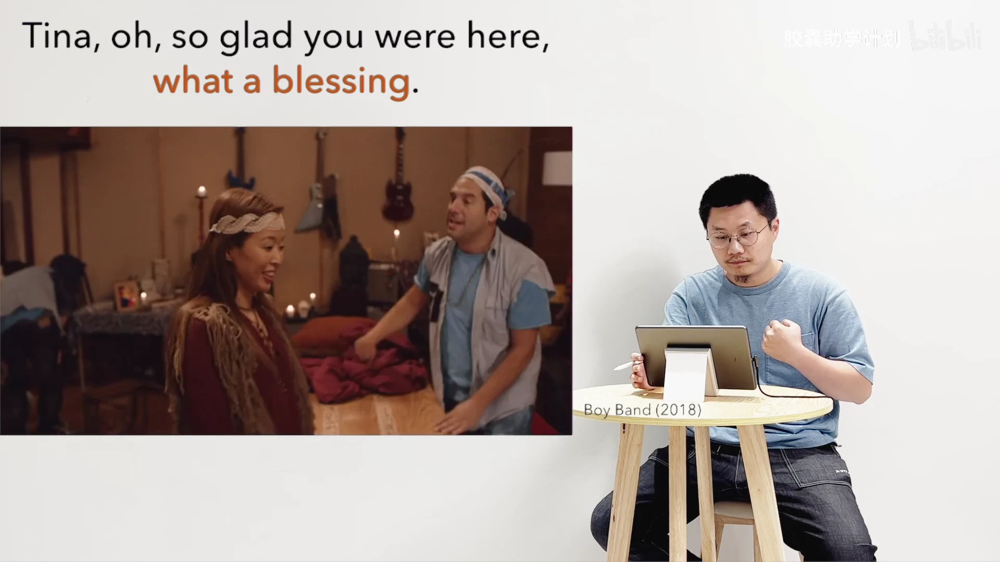

文字识别：Tina, oh, so glad you were here, / what a blessing. / Boy Band(2018)

### 画面 00:01:55

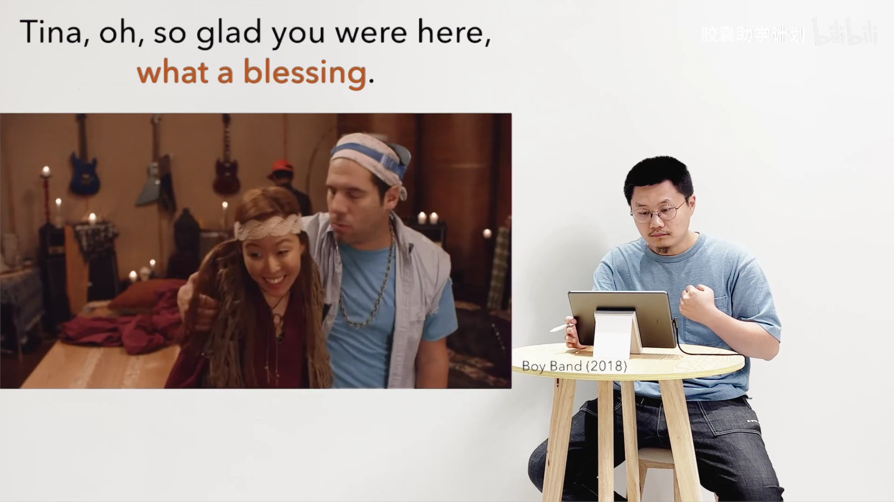

文字识别：Tina, oh, so glad you were here, / what a blessing. / Boy Band (2018)

### 画面 00:01:57

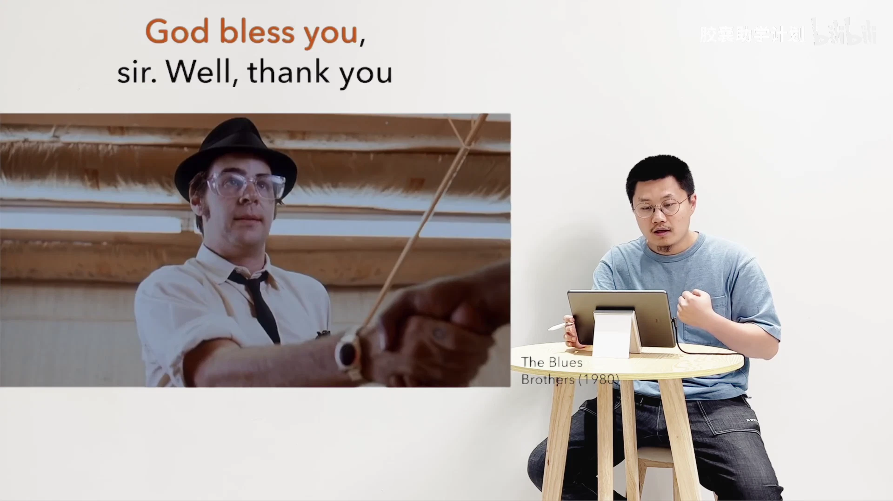

文字识别：God bless / you, / sir. Well, thank /  you / The Blues / Brothers(1980)

## 00:02:00–00:02:30

very common, uh, especially in Western world, ah, America, England, such a world, very common phrase, called "God bless you." God bless you. God bless

### 画面 00:02:26

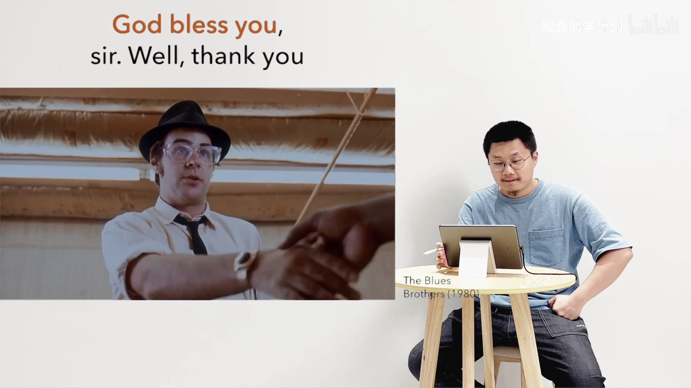

文字识别：God bless / you, / sir. Well, thank / you / The Blues / Brothers(198Q）

### 画面 00:02:28

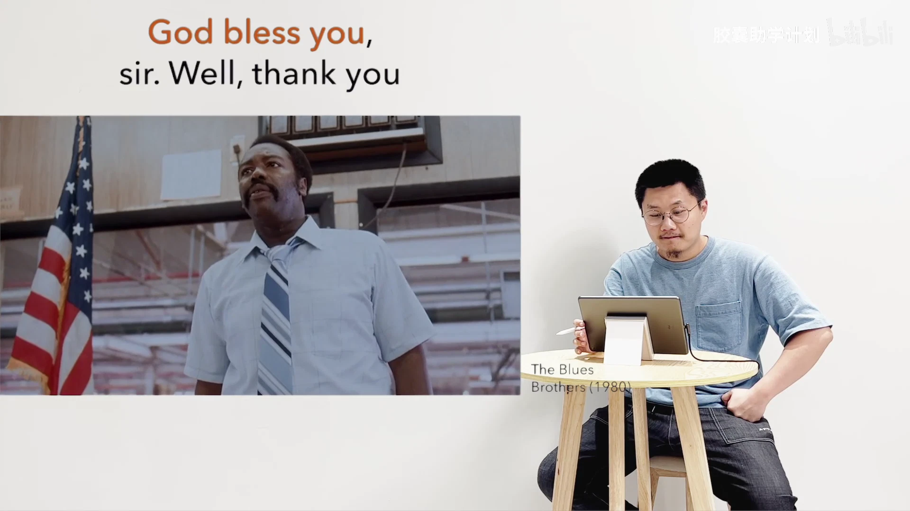

文字识别：God bless you, / sir. Well, thank you / ★★★ / The Blues / Brothers(1980）

## 00:02:30–00:03:00

Next one, don't be offended is a被动是吧？不要感到怎么样呢？被侵犯了。注意这里叫做 is a blessing，说这是一个祝福，没有事儿，is all right。啊，这个小的视频片段也很有意思，各位可以看一下。Don't be offended. It's a blessing. All right. Ah, this is a blessing, 对吧？噗一口，这个叫 is a blessing. Okay. 好，next one. 那 blessing 在标题当中还配了一个单词叫

### 画面 00:02:30

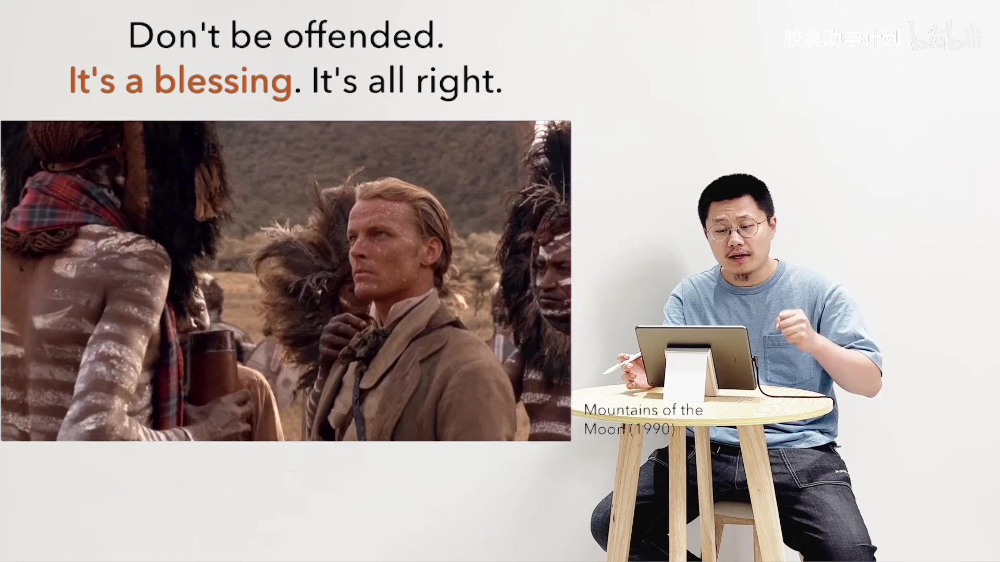

文字识别：Don't be offended. / It's a blessing. It's all right. / Mountains of the / Moor(1990)

### 画面 00:02:45

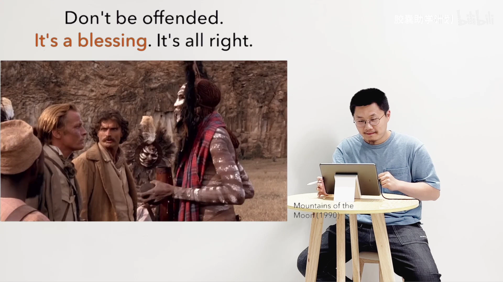

文字识别：Don't be offended. / It's a blessing. It's all right. / Mountains of the / Moor(1990)

### 画面 00:02:47

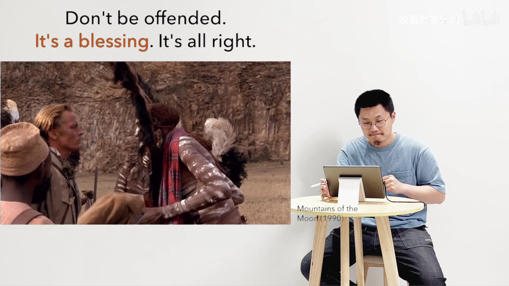

文字识别：Don't be offended. / It's a blessing. It's all right. / Mountains of the / Moor(1990)

### 画面 00:02:49

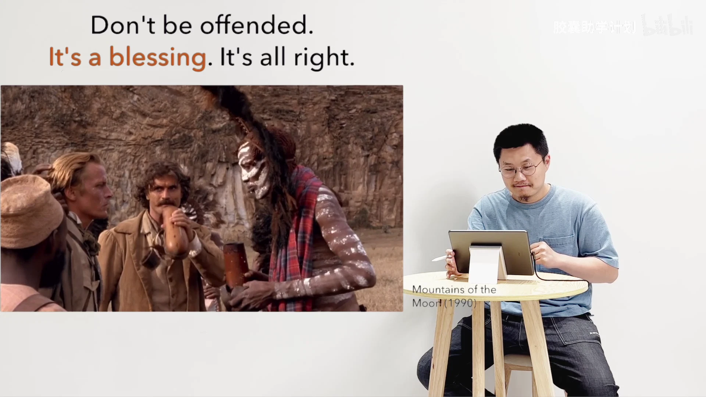

文字识别：Don't be offended. / It's a blessing. It's all right. / Mountains of the / Moor(1990)

### 画面 00:02:55

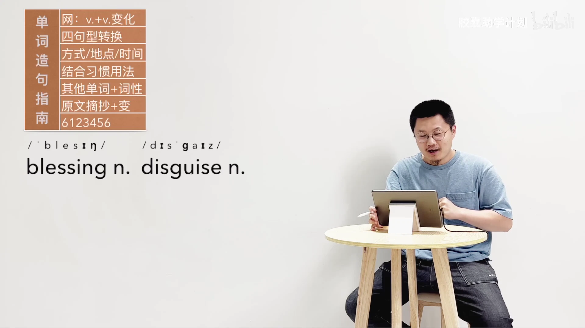

文字识别：单词造句指南 / 网：v.+v.变化 / 子计划 / 四句型转换 / 方式/地点/时间 / 结合习惯用法 / 其他单词+词性 / 原文摘抄+变 / 6123456 / /'bｌｅsｌn/ / /dis'galz/ / blessing n. disguise n.

## 00:03:00–00:03:30

disguise，叫伪装的意思，对吧？那 a blessing in disguise 就是我们这个文章的标题，它到底是什么意思呢？我们先看一下英文解释。An apparent misfortune that eventually has a good result，一个很明显的不幸的事情，但是呢，最终还产生了一个很好的结果。我们汉语当中有很多类似的表达，什么塞翁之马焉知非福啊，对吧？啊，因祸得福啊，哎，都可以，对

### 画面 00:03:02

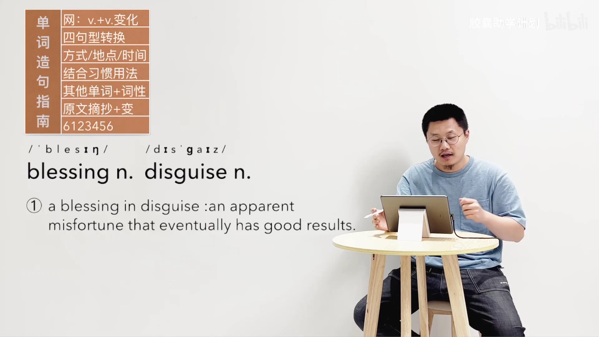

文字识别：单词造句指南 / 网：v.+v.变化 / 计划 / 四句型转换 / 方式/地点/时间 / 结合习惯用法 / 其他单词+词性 / 原文摘抄+变 / 6123456 / /'bｌｅsｌn/ / /dis'gaiz/ / blessing n. disguise n. / ① a blessing in disguise :an apparent / misfortune that eventually has good results.

## 00:03:30–00:04:00

吧？OK，那就给它翻译成这样的一个意思就可以了。它在口语当中还也真挺常用的。比如说，说This will work. You'll see. I'm certain is a blessing in disguise.说这会这事儿会成的，你你等着瞧吧。You'll see.你等着瞧。我很确定。这咱们之前学过，对吧？叫I'm certain is a blessing in disguise.说这个事儿会因祸得福的，或者塞翁失马焉知非福。再来，这是一个小的电影片段，叫做You

### 画面 00:03:32

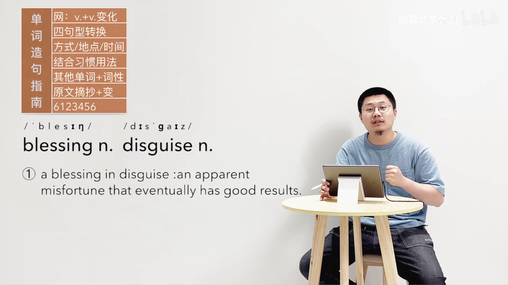

文字识别：单词造句指南 / 网：v.+v.变化 / 学计划 / 四句型转换 / 方式/地点/时间 / 结合习惯用法 / 其他单词+词性 / 原文摘抄+变 / 6123456 / /bｌesｌn/ / /dis'gaiz/ / blessing n. disguise n. / ① a blessing in disguise :an apparent / misfortune that eventually has good results.

### 画面 00:03:36

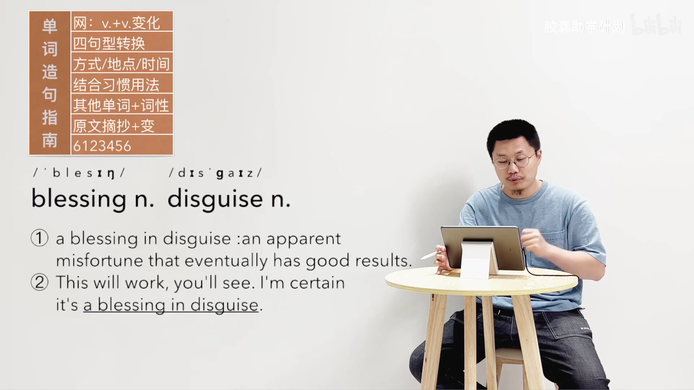

文字识别：单词造句指南 / 网：v.+v.变化 / 子计划 / 四句型转换 / 方式/地点/时间 / 结合习惯用法 / 其他单词+词性 / 原文摘抄+变 / 6123456 / /'bｌesｌn/ / /dis'gaiz/ / blessing n. disguise n. / ① a blessing in disguise :an apparent / misfortune that eventually has good results. / This will work, you'll see. I'm certain / it's a blessing in disguise.

### 画面 00:03:55

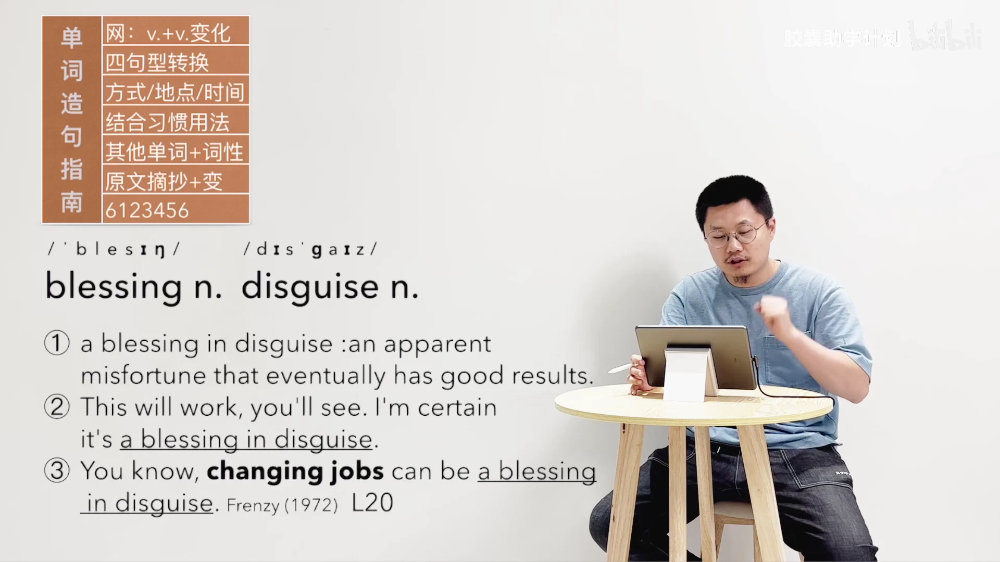

文字识别：网：v.+v.变化 / 单 / 学计划 / +词造 / 四句型转换 / 方式/地点/时间 / 结合习惯用法 / 句 / 其他单词+词性 / 指 / 原文摘抄+变 / 南 / 6123456 / /blesin / / /dis'gaIz/ / blessing n. disguise n. / ① a blessing in disguise :an apparent / misfortune that eventually has good results.  / This will work, you'll see.l'm certain / it's a blessing in disguise. /  You know, changing jobs can be a blessing / in disguise. Frenzy(1972) L20

## 00:04:00–00:04:30

know, changing jobs can be a blessing in disguise. 如果各位啊，你以前被辞退过，或者说以前自己换一个工作的时候，你会发现，也许你突然就找到了一个更好的工作，保不齐，对不对？叫做 Changing jobs. 那这里 Changing jobs 它本来应该是动词啊，改变工作。它现在放在了主语的位置上的时候，这实际上又用到了我们新概念二册第二十课学的动名词，对吧？哎，放在主语的位置上，这个动词要变成动名词。

### 画面 00:04:25

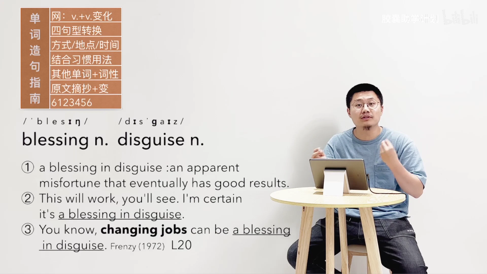

文字识别：网：v.+v.变化 / 单 / 学计划 / 词 / 四句型转换 / 造 / 方式/地点/时间 / 结合习惯用法 / 句 / 其他单词+词性 / 指 / 原文摘抄+变 / 南 / 6123456 / /'bｌｅsin/ / /dis'gaiz/ / blessing n. disguise n. / ① a blessing in disguise :an apparent / misfortune that eventually has good results. / This will work, you'll see.l'm certain / it's a blessing in disguise. / ③ You know, changing jobs can be a blessing / 3 / in disguise. Frenzy(1972) L20

## 00:04:30–00:05:00

Very good.再来一个叫做 This may be a blessing in disguise.这就很简单了，用到了十九课咱们学过的 maybe，对吧？表示一个推测，可能是，我也不确定。I'm not sure. I'm not certain. Okay.好，接下来呢，我们看这个小的电影片段，这个就直接听啊。I think this whole thing is a blessing in disguise. Next one.哎，看这句话，This might actually be.这个might be刚才

### 画面 00:04:40

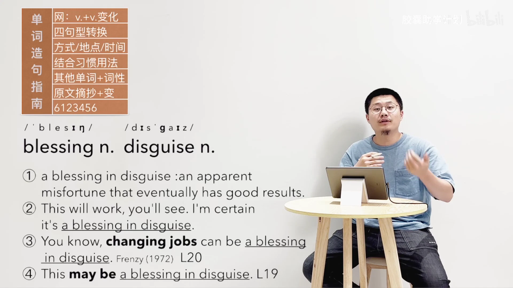

文字识别：单 / 网：v.+v.变化 / 宇计划 / 词 / 四句型转换 / 造 / 方式/地点/时间 / 结合习惯用法 / 句 / 其他单词+词性 / 指 / 原文摘抄+变 / 南 / 6123456 / /blesin / / /dis'gaiz/ / blessing n. disguise n. / ① a blessing in disguise :an apparent / misfortune that eventually has good results. / This will work, you'll see.l'm certain / it's a blessing in disguise. /  You know, changing jobs can be a blessing / in disguise. Frenzy(1972) L20 / This may be a blessing in disguise. L19

### 画面 00:04:46

文字识别：I think this whole thing is / a blessing in disguise. / Lost in America / (1985.)

### 画面 00:04:51

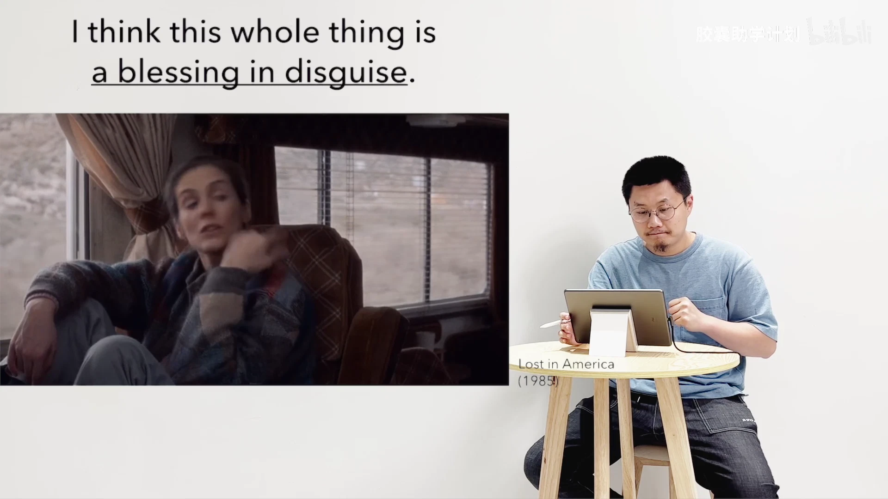

文字识别：I think this whole thing is / a blessing in disguise. / Lost in America / (1985)

### 画面 00:04:53

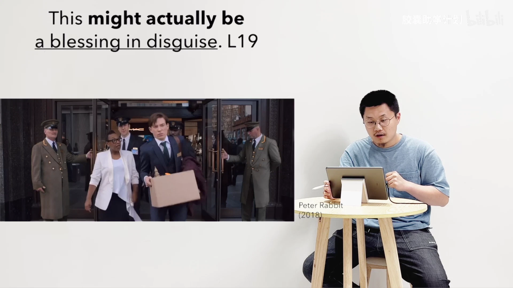

文字识别：This / might / actually / be / a blessing in disguise. L19 / Peter Rabbit / (2018)

## 00:05:00–00:05:30

跟 maybe 是一样的. This might actually be a blessing in disguise. Very good. Next one, tiny. Tiny. This word is called extremely small. It's like a thief, small, thief, small. Northeast dialect, right? Thief, small, ah, huge, small, small, very small, ah. Okay, so now we look at a sentence. Then it has nothing to do with small. When I make sentences, the question I have to think about is whether it is an adjective. I need to add a noun, and that's it, right? Then combine it with other common usage. For example.

### 画面 00:05:02

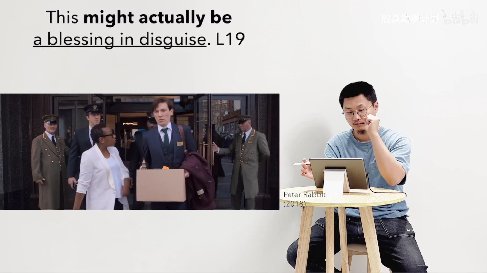

文字识别：This / might / actually / be / a blessing in disguise. L19 / Peter Rabbit / (2018)

### 画面 00:05:04

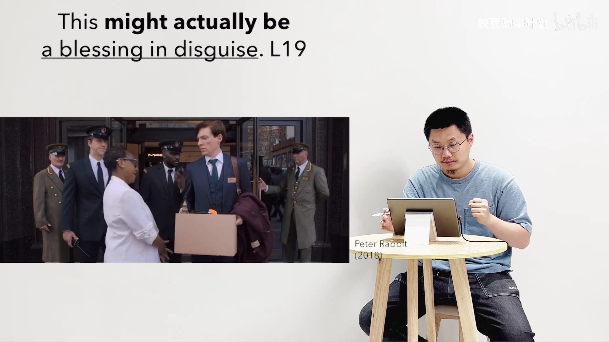

文字识别：This / might / actually / be / a blessing in disguise. L19 / Peter Rabblt / (2018)

### 画面 00:05:06

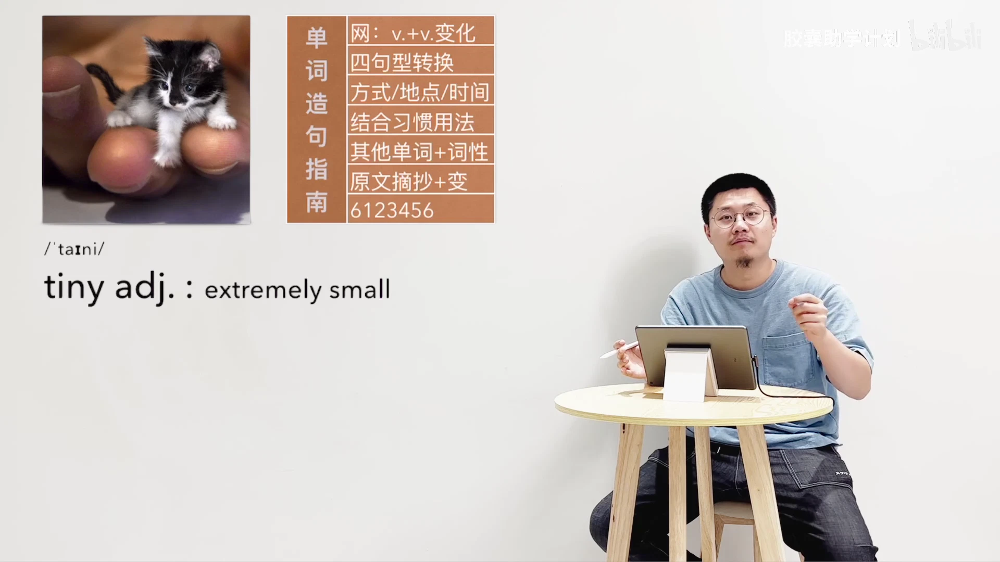

文字识别：单词造句指南 / 网：v.+v.变化 / 计划 / 四句型转换 / 方式/地点/时间 / 结合习惯用法 / 其他单词+词性 / 原文摘抄+变 / 6123456 / /'taini/ / tiny adj. : extremely small

### 画面 00:05:13

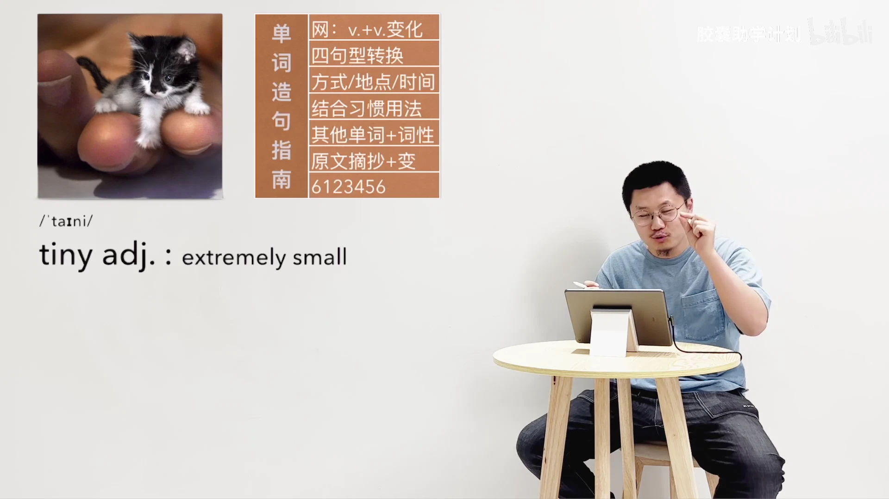

文字识别：单词造句指南 / 网：v.+v.变化 / 四句型转换 / 方式/地点/时间 / 结合习惯用法 / 其他单词+词性 / 原文摘抄+变 / 6123456 / /'taini/ / tiny adj. : extremely small

### 画面 00:05:17

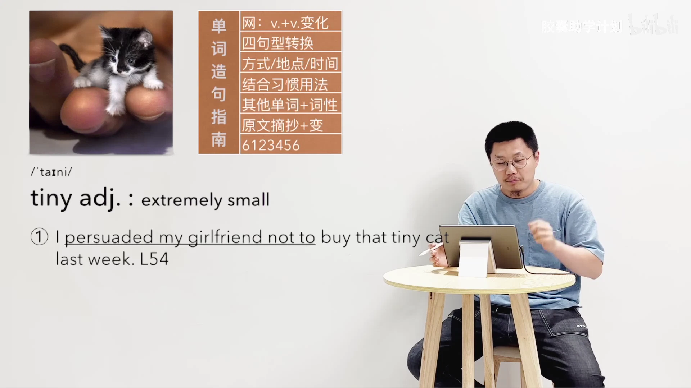

文字识别：单词造句指南 / 网：v.+v.变化 / 四句型转换 / 方式/地点/时间 / 结合习惯用法 / 其他单词+词性 / 原文摘抄+变 / 6123456 / /'taini/ / tiny adj. : extremely small / ① I persuaded my girlfriend not to buy that tiny cat / last week. L54

## 00:05:30–00:06:00

的习惯用法，比如说 I persuaded my girlfriend not to buy that tiny cat, tiny cat last week. Persuaded somebody not to do something,叫劝说某人不要去做某件事情。Okay, next one, say this tiny little thing, tiny little thing. 口语当中经常用，就是小玩意儿啊。Solved all my problems,哎，解决了我所有的问题。比如说我经常口腔溃疡，哎，有这么一个小的药剂往上一贴，全

### 画面 00:05:46

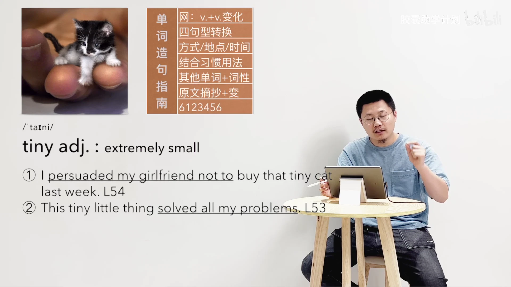

文字识别：单词造句指南 / 网：v.+v.变化 / 计划 / 四句型转换 / 方式/地点/时间 / 结合习惯用法 / 其他单词+词性 / 原文摘抄+变 / 6123456 / /'taini/ / tiny adj. : extremely small / ① I persuaded my girlfriend not to buy that tiny cat / last week. L54 / This tiny litle thing solved all my problems. L53

### 画面 00:05:50

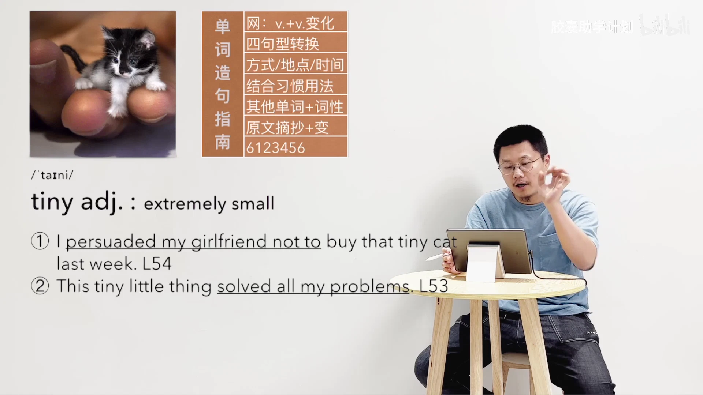

文字识别：单词造句指南 / 网：v.+v.变化 / 四句型转换 / 方式/地点/时间 / 结合习惯用法 / 其他单词+词性 / 原文摘抄+变 / 6123456 / /'taini/ / tiny adj. : extremely small / ① I persuaded my girlfriend not to buy that tiny cat / last week. L54 / This tiny little thing solved all my problems. L53

## 00:06:00–00:06:30

好了。叫做 This tiny little thing here solved all my problems，解决了我所有的痛处，是吧？所有的麻烦事儿。Next one， we found a tiny beautiful thing near the sea。说，哎，这个就很容易了，很简单了。主谓宾，再加一个地点，这是我们五十五课探宝那课学过的，叫 near the sea。说，对吧？Next one， possess， possess这个单词呢很有意思，它各种各样的含义特别

### 画面 00:06:15

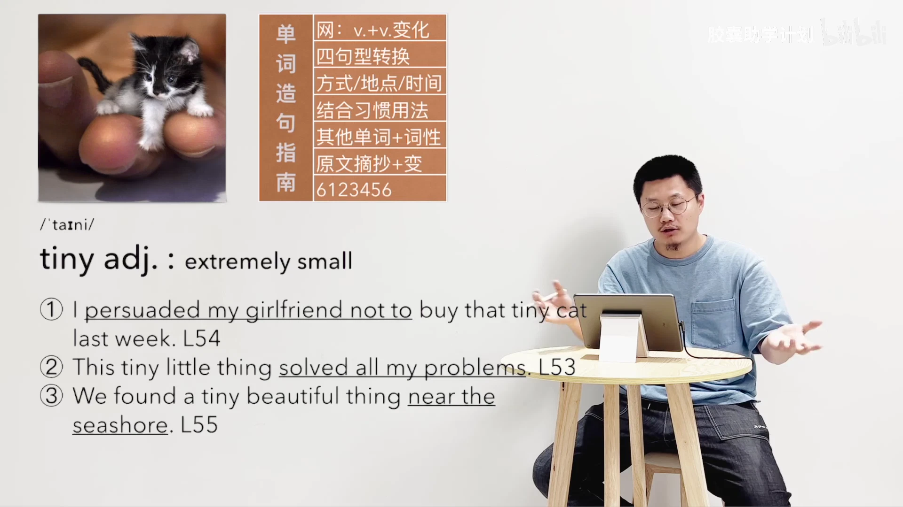

文字识别：单词造句指南 / 网：v.+v.变化 / 四句型转换 / 方式/地点/时间 / 结合习惯用法 / 其他单词+词性 / 原文摘抄+变 / 6123456 / /'taini/ / tiny adj. : extremely small / ① I persuaded my girlfriend not to buy that tiny cat / last week. L54 / This tiny little thing solved all my problems. L53 / ) We found a tiny beautiful thing near the / 3 / seashore. L55

### 画面 00:06:23

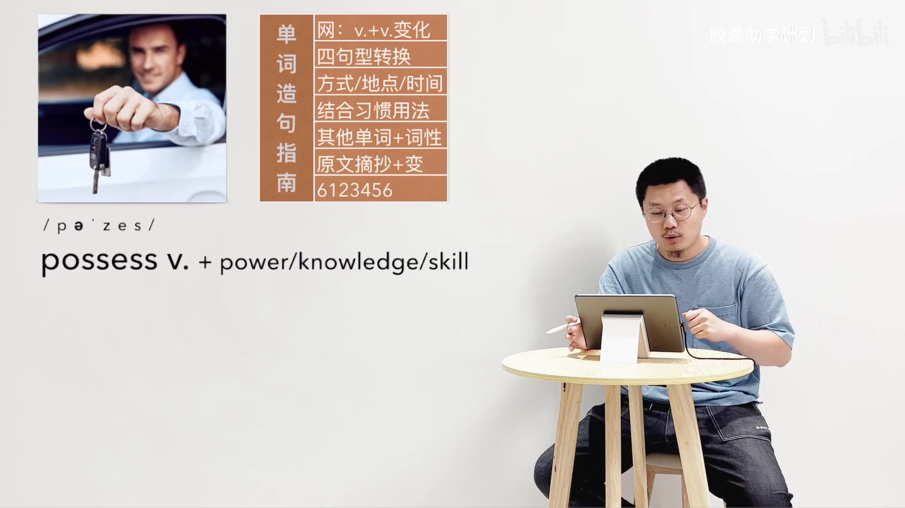

文字识别：单词造句指南 / 网：v.+v.变化 / 四句型转换 / 方式/地点/时间 / 结合习惯用法 / 其他单词+词性 / 原文摘抄+变 / 6123456 / /ｐa'zes / / pOssess V. + power/knowledge/skill

## 00:06:30–00:07:00

的多，对吧？然后它口语当中反而其实没有那么常用，为什么呢？一会儿我们讲啊。但 possess 是拥有的意思，经常跟 power 啊、 knowledge、 skill 是连到一起的。那 power 力量，拥有这个力量； knowledge 知识，skill 叫做技能，对吧？那我们拿它去造句呢？实话实说，不是特别好造啊。它很多，它常用的那些口语当中，还真不是这课这个拥有的感觉。但是呢，我们可以看一下，叫做 tiny village possesses

### 画面 00:06:53

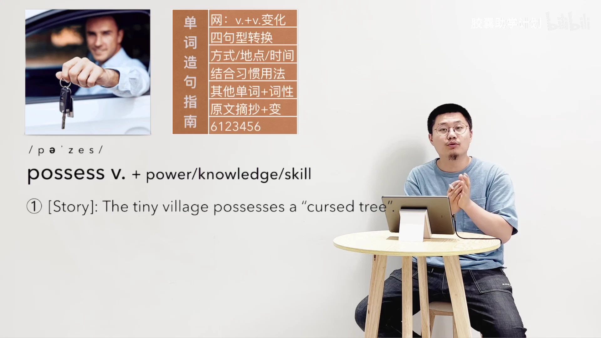

文字识别：单词造句指南 / 网：v.+v.变化 / 四句型转换 / 方式/地点/时间 / 结合习惯用法 / 其他单词+词性 / 原文摘抄+变 / 6123456 / /ｐa'zes / / possess V. + power/knowledge/skill / ① [Story]: The tiny village possesses a "cursed tree".

## 00:07:00–00:07:30

a cursed tree. 这是我们原文做了一点点小的变化啊，说这个小村庄啊拥有一个被诅咒的树。 OK，那我们拿它去做一些四句型转换，我们也多少能记住一些 possess。那为什么 possess 这个单词，我个人的感受啊，是不是那么常用的？因为 own 跟 have 也可以表示拥有的意思。你明显应该有感觉， have 表示拥有的频率要远远高于 possess，对吧？但是我们该学还是要学嘛。

### 画面 00:07:23

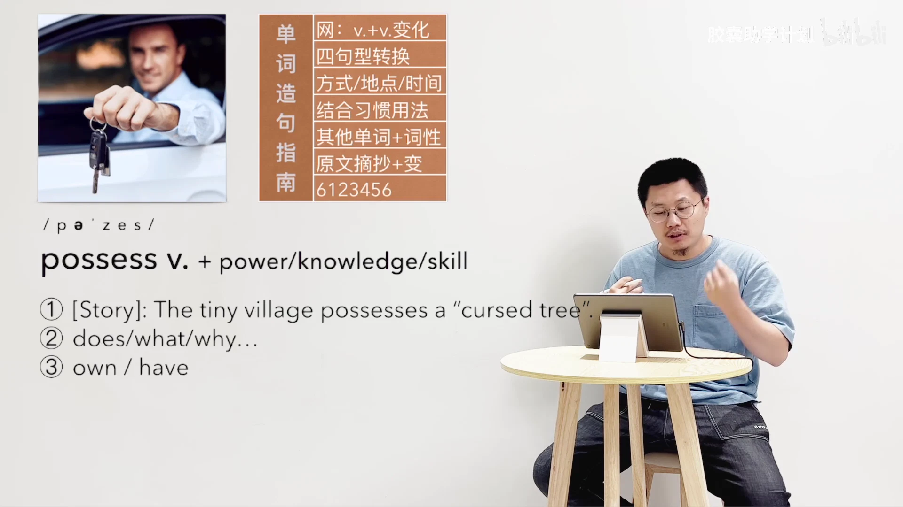

文字识别：单词造句指南 / 网：v.+v.变化 / 四句型转换 / 方式/地点/时间 / 结合习惯用法 / 其他单词+词性 / 原文摘抄+变 / 6123456 / /pa'zes / / possess V. + power/knowledge/skill / ① [Story]: The tiny village possesses a "cursed tree". / ② does/what/why... / ③ own / have

## 00:07:30–00:08:00

嘛。OK, continue.我们看一下这个电影片段当中这句话叫做All I want are some documents.我所要的一切就是这样一些文件。什么样的文件呢？That are in his possessions.说他拥有这个in one's possessions是咱们四十四课啊，在森林边上野餐，然后两个人过来把他包抢走的那一刻，咱们学过的啊。With the bag in their possession，我印象当中。OK，我们在这是算复习一

### 画面 00:07:31

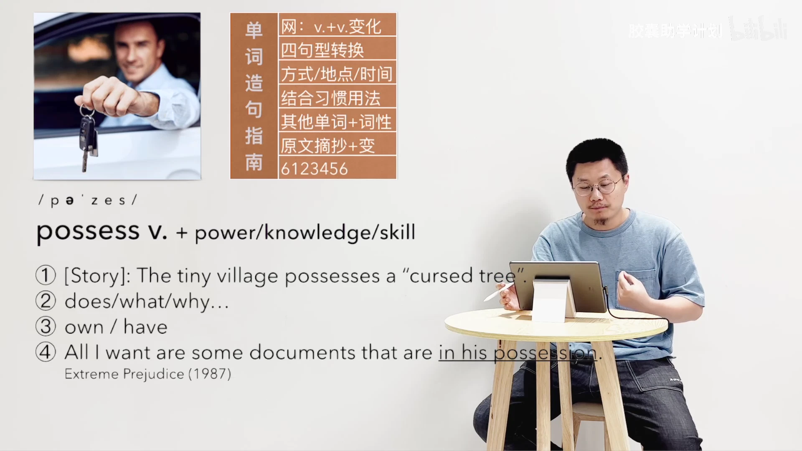

文字识别：单词造句指南 / 网：v.+v.变化 / 四句型转换 / 方式/地点/时间 / 结合习惯用法 / 其他单词+词性 / 原文摘抄+变 / 6123456 / /ｐa'zes / / pOssess V. + power/knowledge/skill / ① [Story]: The tiny village possesses a "cursed tree' / ② does/what/why... / ③ own / have / ④ All  want are some documents that are in his posse sion / Extreme Prejudice (1987)

## 00:08:00–00:08:30

下，就是想告诉各位，这个 possess 是动词， possession 是 possess 的名词啊，还是拥有的意思。 Next one，说 we don't know her plan，我们不知道她的计划， and the gun is in my possession。说这个枪啊，就在我手里边的，对吧？和其实你更一个比较顺嘴的说法就是 I have the gun，对不对？就完了，我有这个枪。 I own the gun。 OK， next one，那我们接下来

### 画面 00:08:01

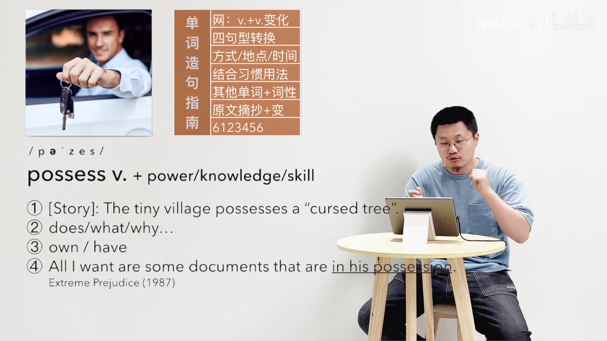

文字识别：单词造句指南 / 网：v.+v.变化 / 四句型转换 / 方式/地点/时间 / 结合习惯用法 / 其他单词+词性 / 原文摘抄+变 / 6123456 / /ｐazes / / pOssess V. + power/knowledge/skill / ① [Story]: The tiny village possesses a "cursed tree". / ② does/what/why.. / ③ own / have / 4 /  All I want are some documents that are in his possessio / Extreme Prejudice (1987)

### 画面 00:08:08

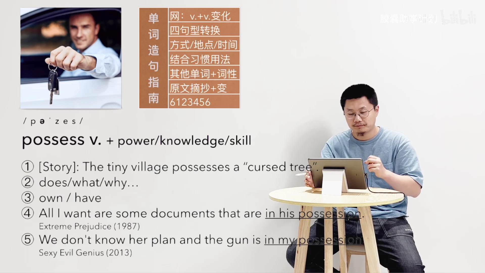

文字识别：单词造句指南 / 网：v.+v.变化 / 四句型转换 / 方式/地点/时间 / 结合习惯用法 / 其他单词+词性 / 原文摘抄+变 / 6123456 / /ｐa'zes / / pOssess V. + power/knowledge/skill / ① [Story]: The tiny village possesses a "cursed treg' / ② does/what/why... / ③ own / have / ④ All I want are some documents that are in his possesio / Extreme Prejudice(1987) / We don't know her plan and the gun is in my possessi / 5 / Sexy Evil Genius (2013)

### 画面 00:08:28

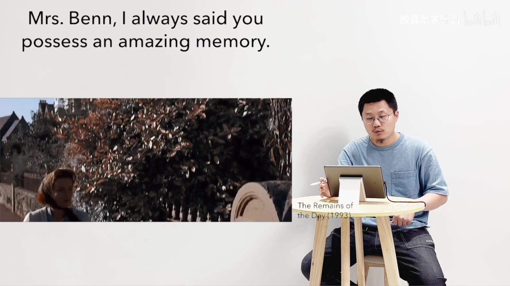

文字识别：Mrs. Benn, I always said you / possess an amazing memory. / The Remains of / the Day(1993)

## 00:08:30–00:09:00

看一个小电影片段。这里的 possess 的拥有，你看后面叫做 an amazing memory，一个很神奇的记忆力。 Okay, 听一下。 This is Ben. I always said you possess an amazing memory. Okay, next one. Do you still possess a working brain? 这损他呢，是吧？说你还拥有什么吗？一个能工作的大脑吗？ Do you still possess a working brain? Very good. Next one. 下

### 画面 00:08:41

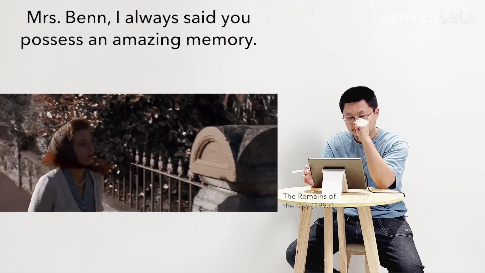

文字识别： Mrs. Benn, I always said you / possess an amazing memory. / The Remains of / the Day(1993)

### 画面 00:08:43

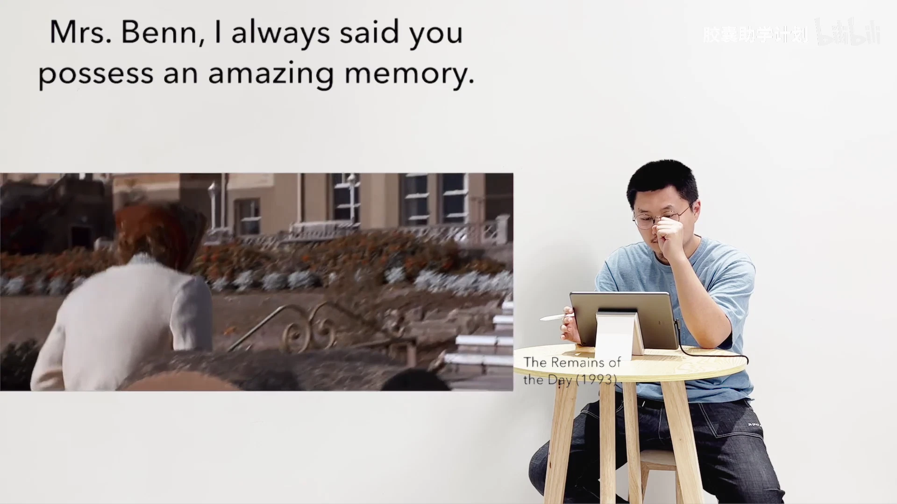

文字识别： Mrs. Benn, I always said  / d you / possess an amazing memory. / The Remains of / the Day (1993)

### 画面 00:08:45

文字识别： Mrs. Benn, I always said you / possess an amazing memory. / The Remains of / the Day (1993)

### 画面 00:08:47

文字识别：Do you still / possess / a working brain? / The Death of / Stalin!(2017)

### 画面 00:08:56

文字识别：Do you still / possess / a working brain? / The Death of / Stalin!(2017)

### 画面 00:08:58

文字识别：单词造句指南 / 网：v.+v.变化 / 四句型转换 / 方式/地点/时间 / 结合习惯用法 / 其他单词+词性 / 原文摘抄+变 / 6123456 / / k 3 :s t / / cursed adj. curse v. n.

## 00:09:00–00:09:30

一个单词 cursed 和 curse. 原文给的单词叫 cursed，并且给的含义叫可恨的。呃，这并不是它最核心的含义，各位能记住也没有问题。它最核心的含义，我们还是要从它的动词或名词的原型去看，叫 curse，什么意思呢？非常简单，诅咒，对吧？可以是个名词，可以是个动词啊。我画个圈圈，诅咒你，这很多年前的一个说法，不知道各位有没有印象？这个诅咒你，用英

### 画面 00:09:01

文字识别：单词造句指南 / 网：v.+v.变化 / 四句型转换 / 方式/地点/时间 / 结合习惯用法 / 其他单词+词性 / 原文摘抄+变 / 6123456 / / k 3 :s t / / cursed adj. curse v. n.

### 画面 00:09:07

文字识别：单词造句指南 / 网：v.+v.变化 / 四句型转换 / 方式/地点/时间 / 结合习惯用法 / 其他单词+词性 / 原文摘抄+变 / 6123456 / / k 3 :s t / / cursed adj. curse v. n.

### 画面 00:09:15

文字识别：单词造句指南 / 网：v.+v.变化 / 四句型转换 / 方式/地点/时间 / 结合习惯用法 / 其他单词+词性 / 原文摘抄+变 / 6123456 / / k 3 :s t / / cursed adj. curse v. n.

### 画面 00:09:21

文字识别：单词造句指南 / 网：v.+v.变化 / 四句型转换 / 方式/地点/时间 / 结合习惯用法 / 其他单词+词性 / 原文摘抄+变 / 6123456 / / k 3 :s t / / cursed adj. curse v. n.

### 画面 00:09:25

文字识别：单词造句指南 / 网：v.+v.变化 / 计划 / 四句型转换 / 方式/地点/时间 / 结合习惯用法 / 其他单词+词性 / 原文摘抄+变 / 6123456 / / k 3 :s t / / cursed adj. curse v. n.

## 00:09:30–00:10:00

文就是 cursed。那我们看一句话，比如说，My grandfather thinks this town is cursed。哎，它虽然是个电影片段，但是你注意啊，我们在这个地方的被动，哎，还是可以的，对吧？被诅咒了。Very good. Next one也可以直接当名词去用，叫做 is a curse。说这玩意儿是个诅咒，对吧？Next one说 a blessing is different from a curse。什么意思呢？说这个，哎，这我地方其实

### 画面 00:09:30

文字识别：单词造句指南 / 网：v.+v.变化 / 四句型转换 / 方式/地点/时间 / 结合习惯用法 / 其他单词+词性 / 原文摘抄+变 / 6123456 / / k 3 :s t / / cursed adj. curse v. n.

### 画面 00:09:33

文字识别：单词造句指南 / 网：v.+v.变化 / 四句型转换 / 方式/地点/时间 / 结合习惯用法 / 其他单词+词性 / 原文摘抄+变 / 6123456 / / k 3 : s t / / cursed adj. curse v. n. / ① My grandfather thinks this town is cursed. It / (2017) L10

### 画面 00:09:35

文字识别：单词造句指南 / 网：v.+v.变化 / 计划 / 四句型转换 / 方式/地点/时间 / 结合习惯用法 / 其他单词+词性 / 原文摘抄+变 / 6123456 / / k 3 :s t / / cursed adj. curse v. n. / ① My grandfather thinks this town is cursed.It / (2017) L10

### 画面 00:09:40

文字识别：单词造句指南 / 网：v.+v.变化 / 四句型转换 / 方式/地点/时间 / 结合习惯用法 / 其他单词+词性 / 原文摘抄+变 / 6123456 / / k 3 : s t / / cursed adj. curse v. n. / ① My grandfather thinks this townis cursed. It / (2017) L10

### 画面 00:09:46

文字识别：单词造句指南 / 网：v.+v.变化 / 四句型转换 / 方式/地点/时间 / 结合习惯用法 / 其他单词+词性 / 原文摘抄+变 / 6123456 / / k 3 : s t / / cursed adj. curse v. n. / ① My grandfather thinks this town is cursed. It / (2017) L10

### 画面 00:09:51

文字识别：单词造句指南 / 网：v.+v.变化 / 四句型转换 / 方式/地点/时间 / 结合习惯用法 / 其他单词+词性 / 原文摘抄+变 / 6123456 / / k 3 : s t / / cursed adj. curse v. n. / ① My grandfather thinks this town is cursed.It / (2017) L10 / It's a curse.

### 画面 00:09:55

文字识别：单词造句指南 / 网：v.+v.变化 / 四句型转换 / 方式/地点/时间 / 结合习惯用法 / 其他单词+词性 / 原文摘抄+变 / 6123456 / / k 3 : s t / / cursed adj. curse v. n. / ① My grandfather thinks this town is cursed. It / (2017) L10 / It's a curse. / ③ A blessing is different from a curse. L56

## 00:10:00–00:10:30

选择用了一下，叫做 be different from，啊，叫做这个祝福啊和这个诅咒啊不是一码事儿，他们不一样。这是咱们五十六课其实学过的一个呃习惯用法，对吧？也另另拉到这个地方来用一下。OK，好，那接下来呢，我们看一个小的电影片段。 It's a blessing and a curse. 那你看这句话的什么意思？他说，哎，它是一个祝福，它也是一个诅咒，是不是？OK， again.

### 画面 00:10:00

文字识别：单词造句指南 / 网：v.+v.变化 / 计划 / 四句型转换 / 方式/地点/时间 / 结合习惯用法 / 其他单词+词性 / 原文摘抄+变 / 6123456 / / k3 :st / / cursed adj. curse v. n. / ① My grandfather thinks this town is cursed. It / (2017) L10 /  It's a curse. / ③ A blessing is different from a curse. L56

### 画面 00:10:07

文字识别：单词造句指南 / 网：v.+v.变化 / 四句型转换 / 方式/地点/时间 / 结合习惯用法 / 其他单词+词性 / 原文摘抄+变 / 6123456 / / k 3 : s t / / cursed adj. curse v. n. / ① My grandfather thinks this town is cursed. It / (2017) L10 / It's a curse. / ③ A blessing is different from a curse. L56

### 画面 00:10:11

文字识别：单词造句指南 / 网：v.+v.变化 / 计划 / 四句型转换 / 方式/地点/时间 / 结合习惯用法 / 其他单词+词性 / 原文摘抄+变 / 6123456 / / k3:st / / cursed adj. curse v. n. / ① My grandfather thinks this town is cursed. It / (2017) L10 / It's a curse. / ③ A blessing is different from a curse. L56

### 画面 00:10:15

文字识别：单词造句指南 / 网：v.+v.变化 / 四句型转换 / 方式/地点/时间 / 结合习惯用法 / 其他单词+词性 / 原文摘抄+变 / 6123456 / / k 3 : s t / / cursed adj. curse v. n. / ① My grandfather thinks this town is cursed.It / (2017) L10 / It's a curse. / ③ A blessing is different from a curse. L56

### 画面 00:10:17

文字识别：It's a blessing and a curse! / Neighbe / (2014)

### 画面 00:10:20

文字识别：It's a blessing and a curse! / Neighb / (2014)

### 画面 00:10:22

文字识别：It's a blessing and a curse! / Neighbor / (2014)

### 画面 00:10:25

文字识别：It's a blessing and a curse! / Neighbors / (2014)

## 00:10:30–00:11:00

好，increase, increase这个单词指的是上升的意思啊。那它经常会连的，比如说上升的是in increase risk啊，上升这个我们所谓的叫这个风险。那number数字，price叫做价格、价钱，对不对？好，我们看一下例句啊，很简单，说this can increase the risks，说这样能提升它的风险程度啊，这将提升它的风险程度。Next one，你可以把它做一个非常简

### 画面 00:10:30

文字识别：单词造句指南 / 网：v.+v.变化 / 四句型转换 / 方式/地点/时间 / 结合习惯用法 / 其他单词+词性 / 原文摘抄+变 / 6123456 / / Ⅰ n ' kri : s / / increase V. + risk/number/price

### 画面 00:10:53

文字识别：单词造句指南 / 网：v.+v.变化 / 四句型转换 / 方式/地点/时间 / 结合习惯用法 / 其他单词+词性 / 原文摘抄+变 / 6123456 / / Ⅰ n ' k r i :s / / increase V. + risk/number/price / ) This can increase the risks.

## 00:11:00–00:11:30

单的四句型转换，比如说，你可以问 Why can this increase the risks? 对吧？我们要练到张嘴就来。 Continue next one. Smoking can increase the risk of developing heart disease. 这里面可能有几个小的生词，比如说 developing heart disease，对吧？哎，那这里的 smoking 呢，实际上是我们二十课又是用到了之前学过的一个小的语法，我们动词变成名词，变成动名词，放在主语

### 画面 00:11:08

文字识别：单词造句指南 / 网：v.+v.变化 / 四句型转换 / 方式/地点/时间 / 结合习惯用法 / 其他单词+词性 / 原文摘抄+变 / 6123456 / / Ⅰn' kri :s / / increase V. + risk/number/price / ① This can increase the risks. / ② can/why/what/how... / Smoking can increase the risk of / developing heart disease. L20

## 00:11:30–00:12:00

的位置，OK，continue。我们看这句话说，soon，Ann asked me问我if she could increase the lessons to twice a week。好，说很快呢，安就问我是否她可以提升这个课程到每周两次。这里的if翻译成是否而不是如果，实际上是我们三十九课包括新一也学过的宾语从句的一个关键语法点，对吧？叫做一

### 画面 00:11:31

文字识别：单词造句指南 / 网：v.+v.变化 / 学计划 / 四句型转换 / 方式/地点/时间 / 结合习惯用法 / 其他单词+词性 / 原文摘抄+变 / 6123456 / /in'kri:s/ / increase V. + risk/number/price / ① This can increase the risks. / ② can/why/what/how... / 3 / Smoking can increase the risk of / developing heart disease. L20 / ) Soon Ann asked me if she could increase / the lessons to twice a week. Mr. Holmes (2015) / L39

## 00:12:00–00:12:30

般疑问句做这个宾语从句的时候要怎么去做？各位如果遗忘了，一定要回去看一下。OK， next one，那接下来注意力集中，我们听一下这个电影片段。 You increase the supply and the demand will fall. Next one, plant, plant种植的意思，这个单词各位很可能是认得的。那我们要想的事情就是它是个动词，对吧？我们又想词性的问题，你

### 画面 00:12:00

文字识别：单词造句指南 / 网：v.+v.变化 / 计划 / 四句型转换 / 方式/地点/时间 / 结合习惯用法 / 其他单词+词性 / 原文摘抄+变 / 6123456 / /in' kri:s / / increase V. + risk/number/price / ① This can increase the risks. / ② can/why/what/how... / 3 / Smoking can increase the risk of / developing heart disease. L20 / ) Soon Ann asked me if she could increase / the lessons to twice a week. Mr. Holmes (2015) / L39

### 画面 00:12:06

文字识别：单词造句指南 / 网：v.+v.变化 / 計划 / 四句型转换 / 方式/地点/时间 / 结合习惯用法 / 其他单词+词性 / 原文摘抄+变 / 6123456 / /Ⅰn'kri:s/ / increase V. + risk/number/price / ① This can increase the risks. / ② can/why/what/how... / 3 / Smoking can increase the risk of / developing heart disease. L20 / ) Soon Ann asked meif she could increase / the lessons to twice a week. Mr. Holmes (2015) / L39

### 画面 00:12:08

文字识别：You increase the supply, / and the demand will follow. / The Foon / (2016)

### 画面 00:12:13

文字识别：You increase the supply, / and the demand will follow. / The Foun / (2016)

### 画面 00:12:15

文字识别：You increase the supply, / and the demand will follow. / The Foon / (2016)

### 画面 00:12:17

文字识别：单词造句指南 / 网：v.+v.变化 / 四句型转换 / 方式/地点/时间 / 结合习惯用法 / 其他单词+词性 / 原文摘抄+变 / 6123456 / /pla:nt/ / plant v.

### 画面 00:12:21

文字识别：单词造句指南 / 网：v.+v.变化 / 四句型转换 / 方式/地点/时间 / 结合习惯用法 / 其他单词+词性 / 原文摘抄+变 / 6123456 / /plaint/ / plant v.

## 00:12:30–00:13:00

到底要跟什么单词连起来？你能种什么？那最简单，各位能理解种树啊。其实剩下的能种的，你都可以种。OK，很简单。比如说，我们看这句话，My grandfather used to plant potatoes in his courtyard. 哎，courtyard实际上是四十九课咱们学过的一个单词啊。那used to do过去常常三十一课的语法，对吧？哎，Next one, we were eager to plant vegetables this spring. 说今年

### 画面 00:12:38

文字识别：单词造句指南 / 网：v.+v.变化 / 四句型转换 / 方式/地点/时间 / 结合习惯用法 / 其他单词+词性 / 原文摘抄+变 / 6123456 / /plaint/ / plant v. / ① plant + tree/ / ② My grandfather used to plant potatoes in / his courtyard. L31

### 画面 00:12:54

文字识别：单词造句指南 / 网：v.+v.变化 / 四句型转换 / 方式/地点/时间 / 结合习惯用法 / 其他单词+词性 / 原文摘抄+变 / 6123456 / /plaint/ / plant v. / ① plant + tree / /  My grandfather used to plant potatoes in / 2） / his courtyard. L31

### 画面 00:12:57

文字识别：单词造句指南 / 网：v.+v.变化 / 四句型转换 / 方式/地点/时间 / 结合习惯用法 / 其他单词+词性 / 原文摘抄+变 / 6123456 / /pla:nt/ / plant v. / ① plant + tree/ / ② My grandfather used to plant potatoes in / his courtyard. L31 / We were eager to plant vegetables this / spring. L57

## 00:13:00–00:13:30

初的时候，春天的时候，今年年初春天的时候，我们当时啊特别渴望去做一件事情，就干嘛呢？种蔬菜。种到了秋天，出现了一件事儿，叫做Don't make me plant anything next year。说不要逼我去种任何东西了，明年我不想种了，是不是？OK，好，呃，那注意力集中，我们先听一下这个电影片段。My father planted this forty years ago.

### 画面 00:13:13

文字识别：单词造句指南 / 网：v.+v.变化 / 四句型转换 / 方式/地点/时间 / 结合习惯用法 / 其他单词+词性 / 原文摘抄+变 / 6123456 / /plaint/ / plant v. / ① plant + tree/ / ② My grandfather used to plant potatoes in / his courtyard. L31 / We were eager to plant vegetables this / spring. L57 / Don't make me plant anything next year. / L57

### 画面 00:13:23

文字识别： My father planted / this forty years ago. / who / what / when / why / Bloodin.Blbo / Out(199

### 画面 00:13:27

文字识别： My father planted / this forty years ago. / who / what / when / why / BloodIn. Bloo / Out(199

### 画面 00:13:29

文字识别：My father planted / this forty years ago. / who / what / when / why / Bloodin,Bloo / Out(199

## 00:13:30–00:14:00

这个电影片段呢，我这儿新多加了一个东西， who, what, when, why 啊，包括你还可以再加一个 did，对吧？ Did 啊，干什么呢？我们拿这个电影片段，是不是可以做一些四句型转换，对不对？ OK 啊， next one, church. 这个单词是咱们新一就学过的，包括 go to church 表示做礼拜， go to the church 表示去教堂，这个之前我们也多少提过，对吧？但是

### 画面 00:13:31

文字识别：My father planted / this forty years ago. / who / what / when / why / BloodIn, Ploo / Out(199

### 画面 00:13:39

文字识别：My father planted / di / this forty years ago. / who / what / when / why / BloodIn,Bloo / Out (198

### 画面 00:13:41

文字识别： My father planted / did / this forty years ago. / who / what / when / why / BloodIn, Bloo / Out(199

### 画面 00:13:48

文字识别：单词造句指南 / 网：v.+v.变化 / 四句型转换 / 方式/地点/时间 / 结合习惯用法 / 其他单词+词性 / 原文摘抄+变 / 6123456 / /t∫3:t∫/ / church n.

### 画面 00:13:52

文字识别：单词造句指南 / 网：v.+v.变化 / 四句型转换 / 方式/地点/时间 / 结合习惯用法 / 其他单词+词性 / 原文摘抄+变 / 6123456 / /t∫3:t∫/ / church n. / ① go to church做礼拜／ go to the church去教堂.

## 00:14:00–00:14:30

我要提一句啊，我们实际上在呃考试的过程当中，它可能会考这个点，这是个知识点，对吧？加不加的可能有区别，但是在实际应用的过程当中呢，人不会那么的严丝合缝，很多的时候结合上下文场景，几乎是随便用的。我们在很多电影片段当中啊，在备课的过程当中，我发现了这个事儿，就告诉各位，对吧？实际应用的时候不用太担心啊。那我们造句吧，I prefer to

### 画面 00:14:02

文字识别：单词造句指南 / 网：v.+v.变化 / 四句型转换 / 方式/地点/时间 / 结合习惯用法 / 其他单词+词性 / 原文摘抄+变 / 6123456 / /t∫3:t∫/ / church n. / ① go to church做礼拜/ go to the church去教堂.

### 画面 00:14:10

文字识别：单词造句指南 / 网：v.+v.变化 / 四句型转换 / 方式/地点/时间 / 结合习惯用法 / 其他单词+词性 / 原文摘抄+变 / 6123456 / /t∫3:t∫/ / church n. / ① go to church做礼拜／ go to the church去教堂..

### 画面 00:14:19

文字识别：单词造句指南 / 网：v.+v.变化 / 四句型转换 / 方式/地点/时间 / 结合习惯用法 / 其他单词+词性 / 原文摘抄+变 / 6123456 / /t∫3:t∫/ / church n. / ① go to church做礼拜/ go to the church去教堂.

### 画面 00:14:26

文字识别：单词造句指南 / 网：v.+v.变化 / 四句型转换 / 方式/地点/时间 / 结合习惯用法 / 其他单词+词性 / 原文摘抄+变 / 6123456 / / t ∫3: t ∫ / / church n. / ①go to church做礼拜／ go to the church去教堂. / ) I prefer to go to church alone. L50 / 2

## 00:14:30–00:15:00

go to church alone, right? I prefer to do.五十课咱们学的一个习惯用法. Next one. When I was young,这是第七课咱学的，对吧？哎，当什么什么时候？My dad forbade me, forbade me to go to church. Forbid somebody to do something.禁止某人做某件事情. For因为he didn't believe in God.哎，这个for咱们之前也见过，叫做因为他不相信

### 画面 00:14:30

文字识别：单词造句指南 / 网：v.+v.变化 / 四句型转换 / 方式/地点/时间 / 结合习惯用法 / 其他单词+词性 / 原文摘抄+变 / 6123456 / /t∫3:t∫/ / church n. / ①go to church做礼拜／ go to the church去教堂. / ② I prefer to go to church alone. L50

### 画面 00:14:37

文字识别：单词造句指南 / 网：v.+v.变化 / 四句型转换 / 方式/地点/时间 / 结合习惯用法 / 其他单词+词性 / 原文摘抄+变 / 6123456 / /t∫3:t∫/ / church n. / ① go to church做礼拜／go to the church去教堂 / I prefer to go to church alone. L50 / 2 / When I was young, my dad forbade me to go / 3 / to church, for he didn't believe in God. L51 & / L28

## 00:15:00–00:15:30

上帝，对吧？Believe in. 二十八课咱们学的，再来。They went to church together last month.你看，这是一个非常典型的六一二三四五六，然后咱们一定要来个四形转换，这个造句就妥妥的够了，对不对？OK. Next one,两个单词我们放到一起去看。Evil, evil reputation, reputation. Evil是什么意思呢？叫做邪恶的。Reputation呢，指

### 画面 00:15:07

文字识别：单词造句指南 / 网：v.+v.变化 / 计划 / 四句型转换 / 方式/地点/时间 / 结合习惯用法 / 其他单词+词性 / 原文摘抄+变 / 6123456 / /t∫3:t∫/ / church n. / ① go to church做礼拜／ go to the church去教堂. / I prefer to go to church alone. L50 / When I was young, my dad forbade me to go / 3 / to church, for he didn't believe in God. L51 & / L28 /  They went to the church together last Mondey.

### 画面 00:15:16

文字识别：单词造句指南 / 网：v.+v.变化 / 四句型转换 / 方式/地点/时间 / 结合习惯用法 / 其他单词+词性 / 原文摘抄+变 / 6123456 / /'i:val/ / evil adj. reputation n.

## 00:15:30–00:16:00

的是你的一个呃呃声望对吧？名望啊，OK。来，比如说 have a good reputation，就你的这个声望很好对吧？大家都觉得你是个好人。那 bad reputation 呢，就是你这个名声都臭了啊，大概是这样一个意思。那我们看句子吧。自挂。They said that Leo had a good reputation. 哎，他们说的，反正不是我说的，我也不知道谁说的，对吧？说我这个名声还不错啊。Next one. Say the new

### 画面 00:15:38

文字识别：单词造句指南 / 网：v.+v.变化 / 四句型转换 / 方式/地点/时间 / 结合习惯用法 / 其他单词+词性 / 原文摘抄+变 / 6123456 / /'i:val/ / evil adj. reputation n. / ① have a good/ bad reputation...

### 画面 00:15:46

文字识别：单词造句指南 / 网：v.+v.变化 / 四句型转换 / 方式/地点/时间 / 结合习惯用法 / 其他单词+词性 / 原文摘抄+变 / 6123456 / /'i:val/ / evil adj. reputation n. / ① have a good/ bad reputation... /  They said that Leo had a good reputation.

### 画面 00:15:57

文字识别：单词造句指南 / 网：v.+v.变化 / 四句型转换 / 方式/地点/时间 / 结合习惯用法 / 其他单词+词性 / 原文摘抄+变 / 6123456 / /'i:val/ / evil adj. reputation n. / ① have a good/ bad reputation... / ② They said that Leo had a good reputation. / The new owner has a reputation for honesty.

## 00:16:00–00:16:30

owner has a reputation for honesty. 注意，你看这里的跟刚才有一点点小的变化，没有说 good or bad，对吧？只是说 have a reputation，有这样一个呃，这个这个这个呃名呃声望，对吧？有这么一个声望，呃，有这么一个说法啊，或者我们更口语化，什么说法呢？ Honesty，叫诚实。说白了就是这个人以诚实，哎，这个呃，让大家都大家都很了解，这个人

### 画面 00:16:27

文字识别：单词造句指南 / 网：v.+v.变化 / 四句型转换 / 方式/地点/时间 / 结合习惯用法 / 其他单词+词性 / 原文摘抄+变 / 6123456 / /'i:val/ / evil adj. reputation n. / ① have a good/ bad reputation... / ② They said that Leo had a good reputation. /  The new owner has a reputation for honesty.

## 00:16:30–00:17:00

很诚实，对吧？哎，好，next one. 原文给了我们一句话，The tree has gained an evil reputation. 哎，这我还真查了一下，还真是很少有这样去聊天的，是吧？它毕竟是一个书面用语啊。说获得了什么呢？一个特别邪恶的名声啊。OK，那我们做一下四运形转换就可以了。这个我就不带着各位挨个去做了啊。OK，那接下来呢，各位注

### 画面 00:16:32

文字识别：单词造句指南 / 网：v.+v.变化 / 四句型转换 / 方式/地点/时间 / 结合习惯用法 / 其他单词+词性 / 原文摘抄+变 / 6123456 / /'i:val/ / evil adj. reputation n. / ① have a good/ bad reputation... / They said that Leo had a good reputation. / 2) / The new owner has a reputation for honesty. / ④ [Story]: The tree has gained an evil reputation.

### 画面 00:16:58

文字识别：I've never / r hired him, but he does / have a good reputation. / Gourmet / Detedtive: Roux / the Day(2020)

## 00:17:00–00:17:30

意力集中，听一下这些电影片段。I've never hired him, but he does have a good reputation. 这是多提一句，这个 does 我给它加粗了。Does 如果这样去用的时候，不知道各位还记不记得我们新概念一册四十九课、四十七课提过，在一般现在时的时候，表示它是可以进行一个强调的。所以这里翻译成他确实有一个很好的名声啊。OK, next one. 说 I know he's got a bad reputation,

### 画面 00:17:03

文字识别：I've never /  hired him, but he does / have a good reputation. / Gourmet / Detedtive: Roux / the Day(2020)

### 画面 00:17:05

文字识别：I've never / r hired him, but he does / have a good reputation. / Gourmet / Detedtive:Roux / the Day (2020)

### 画面 00:17:07

文字识别：hired him, but he doeo / I've never / have a good / reputation. / Gourmet / Detedtive: Rou / the Day (2020)

### 画面 00:17:26

文字识别：I know he's got a bad reputation, / but he's a good guy. / Prince of the City / (1981）

## 00:17:30–00:18:00

but he's a good guy.说我知道他名声不太好。注意这里的撇 as 指的是 has，说 has got 跟 has 是一个单词，基本就是表示有啊。他名声不太好，对吧？Know he's got a bad reputation, but he's a good guy. Okay, next one, claim, victim.这两个单词我们要给它分开。本文当中的 claim 指的是夺走某人的生命的意思，但这并

### 画面 00:17:43

文字识别：I know he's got a bad reputation, / but he's a good guy. / Prince of the City / (1981）

### 画面 00:17:45

文字识别：I know he's got a bad reputation, / but he's a good guy. / Prince of the City / (1981)

### 画面 00:17:47

文字识别：单词造句指南 / 网：v.+v.变化 / 四句型转换 / 方式/地点/时间 / 结合习惯用法 / 其他单词+词性 / 原文摘抄+变 / 6123456 / /kleim/ / /'viktIm/ / claim v. victim n.

## 00:18:00–00:18:30

不是它最常见的意思。它最常见的意思以后我们会见到。声称啊，这里是夺走某人的性命。那 victim 这个单词呢，指的是受害者，对吧？我们看一下啊，Is it possible you left it in baggage claim？哎，这就很有意思了。我给大家补充了一个小点，因为你出国真的用得到，叫 baggage claim。Baggage claim 是什么呢？是我们在飞机场，你下飞机取行李的那个

### 画面 00:18:17

文字识别：单词造句指南 / 网：v.+v.变化 / 四句型转换 / 方式/地点/时间 / 结合习惯用法 / 其他单词+词性 / 原文摘抄+变 / 6123456 / /kleim/ / /'vIktim/ / claim v. victim n. / ① Is it possible you left it in baggage claim?

## 00:18:30–00:19:00

地方啊，行李提取处叫 baggage claim. 好，再来。那 claim one's life 就是夺走某人的生命。我们举个例子，比如说 the train has already claimed a number of victims. 这个 a number of victims 其实就是 claimed their lives. 含义是一样的，不知道各位能不能理解啊？好， next one 四句型，我们可以做一些小的转换。 Continue.

### 画面 00:18:39

文字识别：单词造句指南 / 网：v.+v.变化 / 四句型转换 / 方式/地点/时间 / 结合习惯用法 / 其他单词+词性 / 原文摘抄+变 / 6123456 / /kleIm/ / /'viktIm/ / claim v. victim n. / ① Is it possible you left it in baggage claim? / 2 / ② claim one's life .. / [Story]: The tree has already claimed a / number of victims.

### 画面 00:18:59

文字识别：单词造句指南 / 网：v.+v.变化 / 计划 / 四句型转换 / 方式/地点/时间 / 结合习惯用法 / 其他单词+词性 / 原文摘抄+变 / 6123456 / /kleim/ / /'viktim/ / claim v. victim n. / ① Is it possible you left it in baggage claim? / ② claim one's life …. / [Story]: The tree has already claimed a / 3 / number of victims. / has/what/how... / ⑤ I refuse to live my life as a victim. Euphoria / 5 / (2017) L9 L31

## 00:19:00–00:19:30

I refuse to live my life as a victim. 这是 victim 去造句。那你看啊，这个地方其实连着用到了两个我们学过的习惯用法。首先很简单，refuse to do something 叫做我拒绝度过我的生命。我拒绝活着啊。 Live my life 基本上呃，意义成活着就行了，对吧？我拒绝活着 as a victim 啊，不是不活了啊。你看后半句还有很重要的东西，as a victim 叫作为一个受

### 画面 00:19:29

文字识别：单词造句指南 / 网：v.+v.变化 / 学计划 / 四句型转换 / 方式/地点/时间 / 结合习惯用法 / 其他单词+词性 / 原文摘抄+变 / 6123456 / /kleim/ / /'vIktim/ / claim v. victim n. / ① Is it possible you left it in baggage claim? / ② claim one's life ... / [Story]: The tree has already claimed a / 3 / number of victims. / has/what/how... / ⑤ I refuse to live my life as a victim. Euphoria / (2017) L9 L31

## 00:19:30–00:20:00

害者，我拒绝以受害者的身份活在这个世界上，就我不想以这样的身份活在这个世界上。 Okay, very good. 那这是我们三十一课学的 as a young man. 不知道各位还有没有印象啊？那接下来呢，注意力集中啊，我们听一下这个电影片段。 In his heart, Frodo begins to understand the quest will claim his life. Just go

### 画面 00:19:43

文字识别：In his /  heart, / Frodo begins /  to understand.. / the quest will  / claim his life. / The LordFofthe / Rings: The Two / Towers(2002)

### 画面 00:19:45

文字识别：In his / heart, / Frodo begins /  to understand.. / the quest will  / claim his life. / The Lord ofthe / Rings: The Two / Towers(2002)

### 画面 00:19:47

文字识别：In his / s heart, / Frodo begins /  to understand... / the quest will claim his life. / The Lordofthe / Rings: The Two / Towers(2002)

### 画面 00:19:49

文字识别：In his / s heart, / Frodo begins / s to understand... / the quest will claim his life. / The Lord ofthe / Rings: The Two / Towers(2002)

### 画面 00:19:51

文字识别：In his / s heart, / Frodo begins /  to understand... / the quest will claim his life. / The Lord ofthe / Rings: The Two / Towers(2002)

### 画面 00:19:53

文字识别：In his heart, / Frodo begins to understand.. / the quest will claim his life. / The Lordofthe / Rings: The Two / Towers(2002)

### 画面 00:19:55

文字识别：In his / s heart, / Frodo begins /  to understand... / the quest will claim his life. / The Lord ofthe / Rings: The Two / Towers(2002)

### 画面 00:19:57

文字识别：In his heart, / Frodo begins / s to understand... / the quest will claim his life. / The Lordofthe / Rings: The Two / Towers(2002)

### 画面 00:19:59

文字识别：Just go on. I'l meet you in / baggage  / claim, honey. / Covert One:The / Hades Factor / (2006)

## 00:20:00–00:20:30

on. I'll meet you at baggage claim, honey. Ah,这里的baggage claim指的就是刚才我说的这个机场的行李提取处啊。那下一个就更明显了，各位，你看这个场景，对吧？应该是非常熟悉了。听一下。Okay,下一个单词，跟我一起读，wicker, wicker，教区牧师啊。我们到新三又会见到这个单词。那我们造个句子吧。他其实想造句就很简单了，名词，

### 画面 00:20:01

文字识别：Just go on. I'll meet you in / baggage claim, honey. / Covert One: The / Hades Factor / (2006)

### 画面 00:20:03

文字识别：Just go on. 'l meet you in / baggage  / claim, honey. / Covert One:The / Hades Factor / (2006)

### 画面 00:20:09

文字识别：I'm I'm at the baggage claim. / Night on Earth / (1991)

### 画面 00:20:16

文字识别：I'm I'm at the baggage claim. / Night on Earth / (1991)

### 画面 00:20:18

文字识别：单词造句指南 / 网：v.+v.变化 / 四句型转换 / 方式/地点/时间 / 结合习惯用法 / 其他单词+词性 / 原文摘抄+变 / 6123456 / /'vika/ / vicar n.

### 画面 00:20:28

文字识别：单词造句指南 / 网：v.+v.变化 / 四句型转换 / 方式/地点/时间 / 结合习惯用法 / 其他单词+词性 / 原文摘抄+变 / 6123456 / /'vika/ / vicar n. / ① The vicar took a taxi to work everyday. / .L29

## 00:20:30–00:21:00

词，呃，captain，对吧？然后什么detective，那些人能干的事儿，他不多少大多数都能干嘛？比如说，the worker took a taxi to work every day. Next one, say the worker is different from a monk. Monk是什么呢？就是和尚。那你想一下，这俩是不是 be different from？啊，不不同吗？Next one, I'm fairly certain that the new worker is that man. Fairly certain that 55克学的

### 画面 00:20:50

文字识别：单词造句指南 / 网：v.+v.变化 / 四句型转换 / 方式/地点/时间 / 结合习惯用法 / 其他单词+词性 / 原文摘抄+变 / 6123456 / /'vika/ / vicar n. / ① The vicar took a taxi to work everyday. L29 / ) The vicar is different from a monk. L56 / 2 / I'm fairly certain that the new vicar is that / man.L55

## 00:21:00–00:21:30

叫做。我相当确信，说那个啊，新新的教区牧师就是那个男的，是吧？就是那个人。Very good. Next one. Source income. Source is来源的意思。Income指的是收入。那我们很常见的短语必然就是source of income，或者是source of information. Source这个单词经常跟他们两个连用。Okay.比如说，我们造一句话。

### 画面 00:21:09

文字识别：单词造句指南 / 网：v.+v.变化 / 四句型转换 / 方式/地点/时间 / 结合习惯用法 / 其他单词+词性 / 原文摘抄+变 / 6123456 / / s o : s / / / ⅠηkΛm/ / source n. income n.

### 画面 00:21:28

文字识别：单词造句指南 / 网：v.+v.变化 / 四句型转换 / 方式/地点/时间 / 结合习惯用法 / 其他单词+词性 / 原文摘抄+变 / 6123456 / / s o : s / / / 'IηkΛm/ / source n. income n. / source of income /information ... / ) So you have no source of income?American / Violet(2008)

## 00:21:30–00:22:00

So you have no source of income.说你没有收入来源。那我们其实想一下，虽然这句话是电影当中一个片段，貌似不是我造出来的，也不是我们造出来的。但是由这句话，我们基本上可能就给它改一下，就可以换成叫Do you have any source of income?你有任何收入来源吗？这句话是不是听上去还挺常用的，对吧？好，Next one. He's your

### 画面 00:21:46

文字识别：单词造句指南 / 网：v.+v.变化 / 四句型转换 / 方式/地点/时间 / 结合习惯用法 / 其他单词+词性 / 原文摘抄+变 / 6123456 / / s o : s / / / 'IηkΛm/ / source n. income n. / source of income / information .. / ) So you have no source of income?American / Violet (2008) / ③ Do you have any source of income?

## 00:22:00–00:22:30

only source of information.他是你唯一消息的来源. Only source of information. There you go.好，那然后四句型转换我们就不多说了。好，接下来注意力集中，我们听一下这个。I think was only source of income now. Okay,下一个单词trunk, trunk, trunk.这个单词我们在五十五课，我没有记错的话，咱见过，当时指的是那个大马口铁那种大箱子是吧？Trunk啊，包括

### 画面 00:22:09

文字识别：单词造句指南 / 网：v.+v.变化 / 四句型转换 / 方式/地点/时间 / 结合习惯用法 / 其他单词+词性 / 原文摘抄+变 / 6123456 / / s J : s / / /'IηkΛm/ / source n. income n. / source of income / information ... / 1 / ② So you have no source of income?American / Violet(2008) / Do you have any source of income? / 3 / ④ He's your only source of information. / ⑤ is/who/why...

### 画面 00:22:12

文字识别：I think we're his only / source of income. / Nuremberg / (2000)

### 画面 00:22:16

文字识别：I think we're his only / source of income. / Nuremberg / (2000)

### 画面 00:22:18

文字识别：单词造句指南 / 网：v.+v.变化 / 四句型转换 / 方式/地点/时间 / 结合习惯用法 / 其他单词+词性 / 原文摘抄+变 / 6123456 / /trank/ / trunk n.

## 00:22:30–00:23:00

当时我讲了，我说那个 car trunk 指的是什么？不知道各位还记不记得 trunk？还有另外一个意思，指的就是图中这个木头这个大桩子是吧？好，比如说，but now standing over me, she looked like a huge tree trunk. Very good. Next one, he looked at that tree trunk scornfully. 这是咱们五十七课学的，对吧？当时我给了你一系列的动词跟 scornfully 连到一起啊，呃，轻

### 画面 00:22:39

文字识别：单词造句指南 / 网：v.+v.变化 / 四句型转换 / 方式/地点/时间 / 结合习惯用法 / 其他单词+词性 / 原文摘抄+变 / 6123456 / /trank/ / trunk n. / ① But now standing over me she looked like a / huge tree trunk. Before Night Fall (2000)

### 画面 00:22:49

文字识别：单词造句指南 / 网：v.+v.变化 / 四句型转换 / 方式/地点/时间 / 结合习惯用法 / 其他单词+词性 / 原文摘抄+变 / 6123456 / /trank/ / trunk n. / ① But now standing over me she looked like a / huge tree trunk. Before Night Falls(2000) / He looked at that tree trunk scornfully and / asked us to take it away. L57

## 00:23:00–00:23:30

蔑的看着那个他，and ask us to take it away，然后要求我们把它给拿走。There you go. Next one, so there is a tree trunk on the course. 五十六课啊，呃，古董车赛车那一课咱们学的 on the course，叫在跑道上，对吧？There you go. 那 recap，本课零零散散的这种小的点还挺多，呃，有很多实际上是算是我

### 画面 00:23:08

文字识别：单词造句指南 / 网：v.+v.变化 / 四句型转换 / 方式/地点/时间 / 结合习惯用法 / 其他单词+词性 / 原文摘抄+变 / 6123456 / /trank/ / trunk n. / ① But now standing over me she looked like a / huge tree trunk. Before Night Falls(2000) / He looked at that tree trunk scornfully and / asked us to take it away. L57 / There is a tree trunk on the course. L56

### 画面 00:23:21

文字识别：Recap / Words / It is a / blessing / that / what / blessing / a / God / bless you / It's / blessing / a / a blessing in disguise / In / one's / possession / Expression / Got / to / church / Go / to / the / church / have / good/l / bad / reputation / Have / a reputation / for / baggage / claim / source / of income /information

### 画面 00:23:23

文字识别：Recap / Words / It is a / blessing / that / what / blessing / a / God / bless you / It's / blessing / a / blessingi / g in disguise / In / one's / possession / Expression / Got / to / church / Go / to / the / church / have / good/ / bad / reputation / a / Have / a reputation / for / baggage / claim / source / of income /information

### 画面 00:23:25

文字识别：Recap / Words / It is a / blessing / that / what / blessing / a / God / bless you / It's / blessing / a / blessing in disguise / a / In / one's / possession / Expression / Got / to / church / Go / to / the / church / have / good/ / bad / reputation / a / Have / a reputation / for / baggage / claim / source / of income /information

### 画面 00:23:27

文字识别：Recap / Words / It is a / blessing / that / what / blessing / a / God / bless you / It's / blessing / a / blessing in disguise / a / In / one's / possession / Expression / Go / to / church / Go / to / the / church / have / good/ / bad / reputation / a / Have / a reputation / for / baggage / claim / source of income /information

### 画面 00:23:29

文字识别：Recap / Words / It is a / blessing / that / what / blessing / a / God / bless you / It's / blessing / a / blessing in disguise / a / In / one's / possession / Expression / Go / to / church / Go / to / the / church / have / good/ / bad / reputation / a / Have / a reputation / for / baggage / claim / source / of income /information

## 00:23:30–00:24:00

补充的，但是因为口语当中非常的常用啊，你比如像 God bless you, what a blessing it is, it is a blessing这种，对吧？啊，各位基本上不用拿它去造句，就多读几遍，有个印象，以后再去看电影能记下来就可以了啊，不用专门去背，好吧？OK，家庭作业，单词造句老习惯，对吧？然后电影片段啊，各位可以反复听，练习一下我们的听力，呃，重复间隔去看置顶留言就可以了。OK，那以上呢

### 画面 00:23:31

文字识别：Recap / Words / It is a / blessing / that / what / blessing / a / God / bless you / It's / blessing / a / blessing in disguise / a / In / one's / possession / Expression / Go / to / church / Go / to / the / church / have / good/ / bad / reputation / Have / a reputation / for / baggage / claim / source / of income /information

### 画面 00:23:33

文字识别：Recap / Words / It is a / blessing / that / what / blessing / a / God / bless you / It's / blessing / a / blessing in disguise / a / In / one's / possession / Expression / Go / to / church / Go / to / the / church / have / good/ / bad / reputation / a / Have / a reputation / for / baggage / claim / source / of income /information

### 画面 00:23:35

文字识别：Recap / Words / It is a / blessing / that / what / blessing / a / God / bless you / It's / blessing / a / a / blessing in / disguise / In / one's / possession / Expression / Go / to / church / Go / to / the / church / have / good/ / bad / reputation / Have / a reputation / for / baggage / claim / source / of income /information

### 画面 00:23:37

文字识别：Recap / Words / It is a / blessing / that / what / blessing / a / God / bless you / It's / blessing / a / blessing in disguise / a / In / one's / possession / Expression / Go / to / church / Go / to / the / church / have / good/ / bad / reputation / Have / a reputation / for / baggage / claim / source / of income /information

### 画面 00:23:39

文字识别：Recap / Words / It is a / blessing / that / what / blessing / a / God / bless you / It's / blessing / a / blessing in disguise / a / In / one's / possession / Expression / Go / to / church / Go / to / the / church / have / good/ / bad / reputation / a / Have / a reputation / for / baggage / claim / source / of income /information

### 画面 00:23:41

文字识别：Recap / Words / It is a / blessing / that / what / blessing / a / God / bless you / It's / blessing / a / blessing in disguise / a / In / one's / possession / Expression / Go / to / church / Go / to / the / church / have / good/ / bad / reputation / Have / a reputation / for / baggage / claim / source / of income /information

### 画面 00:23:43

文字识别：Recap / Words / It is a / blessing / that / what / blessing / a / God / bless you / It's / blessing / a / blessing in disguise / a / In / one's / possession / Expression / Go / to / church / Go / to / the / church / have / good/ / bad / reputation / a / Have / a reputation / for / baggage / claim / source / of income /information

### 画面 00:23:45

文字识别：Recap / Words / It is a / blessing / that / what / blessing / a / God / bless you / It's / blessing / a / blessing in disguise / a / In / one's / possession / Expression / Go / to / church / Go / to / the / church / have / good/ / bad / reputation / a / Have / a reputation / for / baggage / claim / source / of income /information

### 画面 00:23:47

### 画面 00:23:49

文字识别：单词造句/对话 / 1. / 【单词造句指南】 / 每个5句

### 画面 00:23:51

文字识别：单词造句/对话 / 1. / 【单词造句指南】 / 每个5句 / 反复听电影片段，直到能 / 听出关键短语/句子

### 画面 00:23:53

文字识别：单词造句/对话 / 【单词造句指南】 / 每个5句 / 2.反复听电影片段，直到能 / 听出关键短语/句子

### 画面 00:23:55

文字识别：单词造句/对话 / 【单词造句指南】 / 每个5句 / 反复听电影片段，直到能 / 听出关键短语/句子 / 3.重复间隔（置顶留言）

### 画面 00:23:57

文字识别：单词造句/对话 / 【单词造句指南】 / 每个5句 / 2.反复听电影片段，直到能 / 听出关键短语/句子 / 3.重复间隔（置顶留言）

### 画面 00:23:59

文字识别：加学计划 / 不

## 00:24:00–00:24:23

就是本期视频的全部内容了。如果各位喜欢我们的课程呢，欢迎各位关注、订阅、一键三连，分享给那些需要的朋友，来帮助我们快速成长。See you next time.

### 画面 00:24:11

文字识别：CAPSULEACADEMY / 胶囊助学计划 / 『 / 小红书 / OE

### 画面 00:24:13

文字识别：CAPSULEACADEMY / 胶囊助学计划 / 小红书 / Leo / OE

### 画面 00:24:19

文字识别：CAPSULEACADEMY / 胶囊助学计划 / 『 / 小红书 / Creator / Leo & Berlin / OE

### 画面 00:24:21

文字识别：bilibili / 胶囊助学计划

### 画面 00:24:22

文字识别：bilibili / 胶囊助学计划

