# 058 文章

快速机器解析：语音为单模型转写，未进行独立交叉校对或人工复核；画面每秒采样并按变化选帧，短时文字和标记可能遗漏。截图时间约有 1 秒误差。图片有损压缩；遇到疑点请按时间查看 Google Drive 原视频。

## 00:00:00–00:00:30

Hello everyone, welcome to Capsule Academy. This is Leo. Today we're going to learn New Concept English Book Two Lesson Fifty Eight Story. Hope you gonna enjoy. We,们先看这篇文章的标题叫 A Blessing in Disguise, 因祸得福。那我们呢看了文章才明白什么叫因祸得福，对吧？然后他问的问题叫 Why does the vicar refuse to cut down the tree? 说为什么教区牧师拒绝去

### 画面 00:00:00

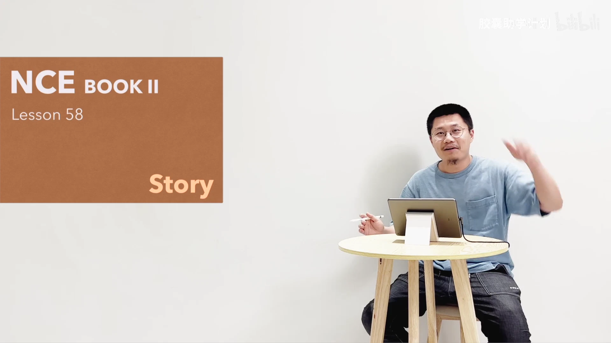

文字识别：NCE / BOOKII / Lesson 58 / Story

### 画面 00:00:02

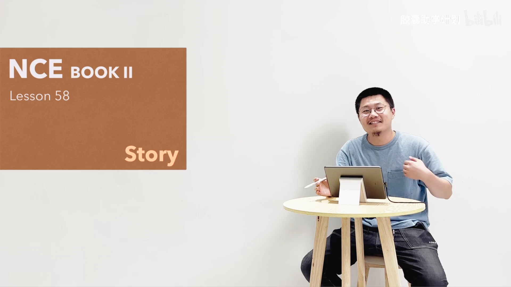

文字识别：NCE / BOOKII / Lesson 58 / Story

### 画面 00:00:05

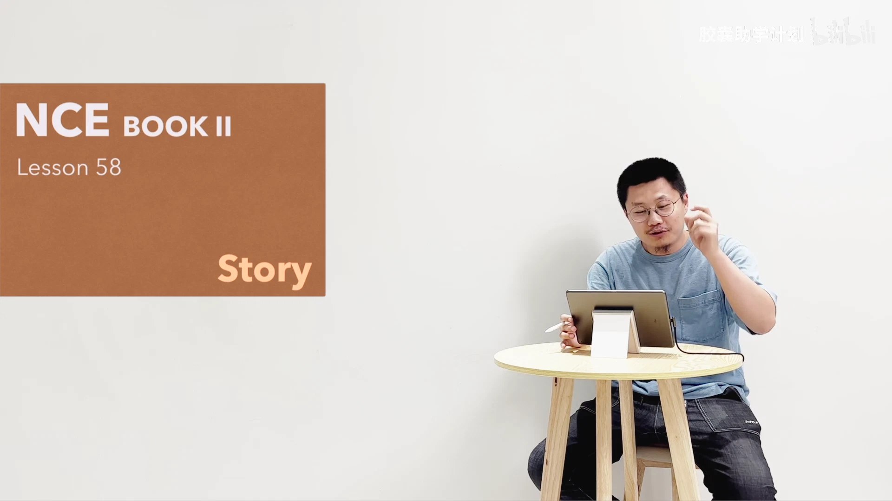

文字识别：NCE / BOOK"I / Lesson 58 / Story

### 画面 00:00:09

文字识别：胶囊助学计划bill / • / •

### 画面 00:00:12

文字识别：胶囊助学计划W / 胶囊助学计划

### 画面 00:00:14

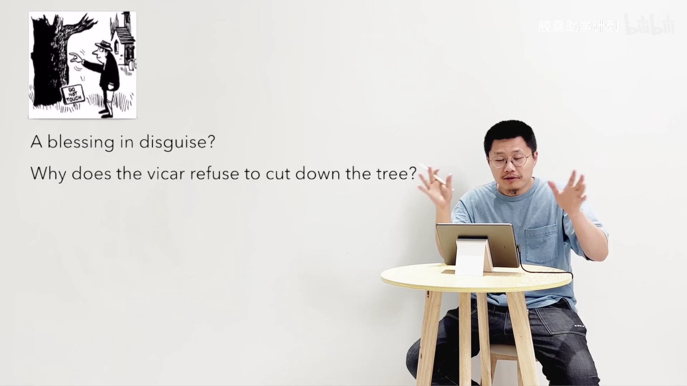

文字识别：NOT / TOUCH / A blessing in disguise? / Why does the vicar refuse to cut down the tree?

## 00:00:30–00:01:00

砍掉这棵树，对吧？哎，那我们看一下为什么啊？第一句话，The tiny village of Friendly is said to possess a cursed tree.好，这里is that to我给各位标出来了。语法视频当中，我们仔仔细细的讲过，也做过很多的练习。据说，对吧？那这地方有一个小的点，A of B结构。我们之前在讲A of B结构的时候，一直在提到的是由后往前翻译B的A。注意，这里不是B的A。一般

### 画面 00:00:33

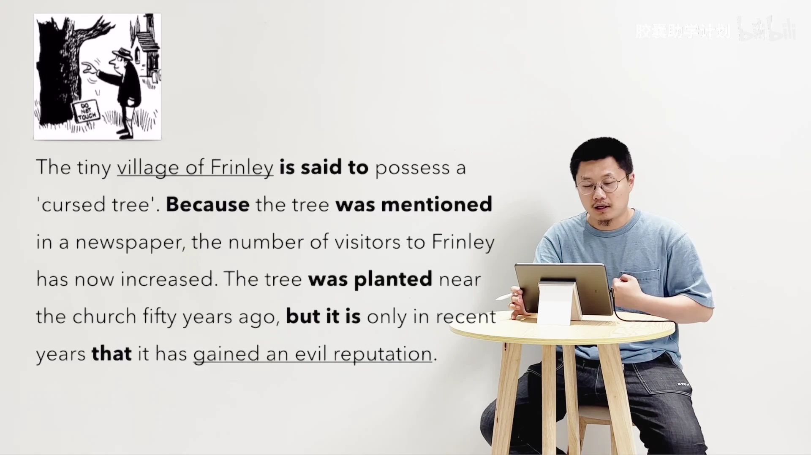

文字识别：TOUCH / The tiny village of Frinley is said to possess a / 'cursed tree'. Because the tree was mentioned / in a newspaper, the number of visitors to Frinley / has now increased. The tree was planted near / the church fifty years ago, but it is only in recent / years that it has gained an evil reputation.

## 00:01:00–00:01:30

表示地名的时候，比如说 the city of New York，啊，什么意思？就是纽约市。那 the village 啊 the the 啊 the village of Friendly 什么意思？他们是同位语的关系，就是 Friendly 这个 Friendly 这个地方就是一个小村落，这个 tiny village 这个小的村落就是 Friendly。以后我们还会见到啊，所以这里就翻译成 Friendly 这个小村儿，据说拥有一个 cursed tree。这个

### 画面 00:01:03

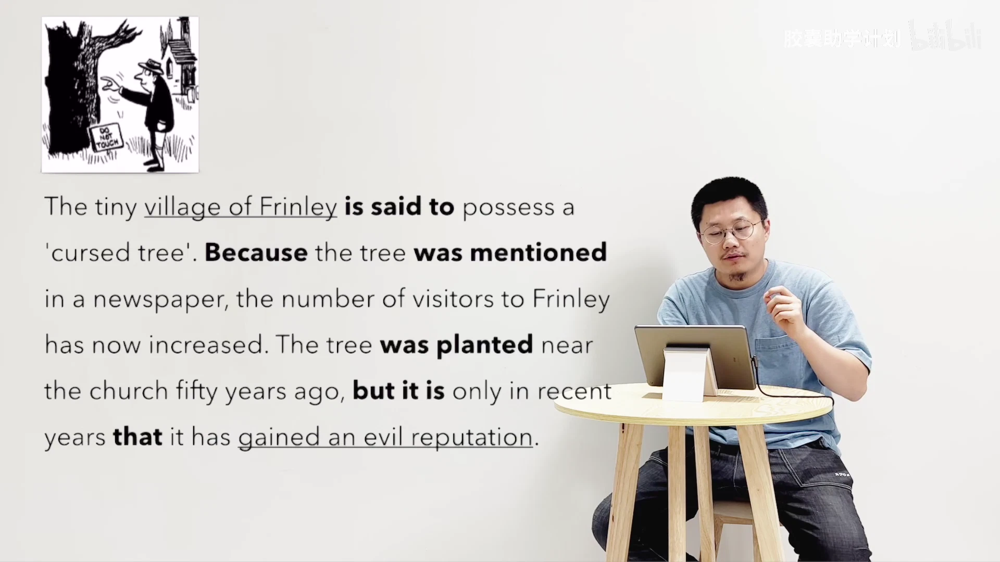

文字识别：TOUCH / The tiny village of Frinley is said to possess a / 'cursed tree'. Because the tree was mentioned / in a newspaper, the number of visitors to Frinley / has now increased. The tree was planted near / the church fifty years ago, but it is only in recent / years that it has gained an evil reputation.

## 00:01:30–00:02:00

原文的这个给了呃，我们单词部分给了cursed是可恨的。我个人觉得，怎么感觉看文章也好，对吧？这个包括它最常用的意思也好，包括参考译文也好，它都不是可恨的意思，它都是叫做被诅咒的，是吧？我们就给它翻译成被诅咒的，自信一点，没问题啊。啊，据说拥有一个被诅咒的树。Because the tree was mentioned in a newspaper,因为这个树一般过去是被动被提及

### 画面 00:01:33

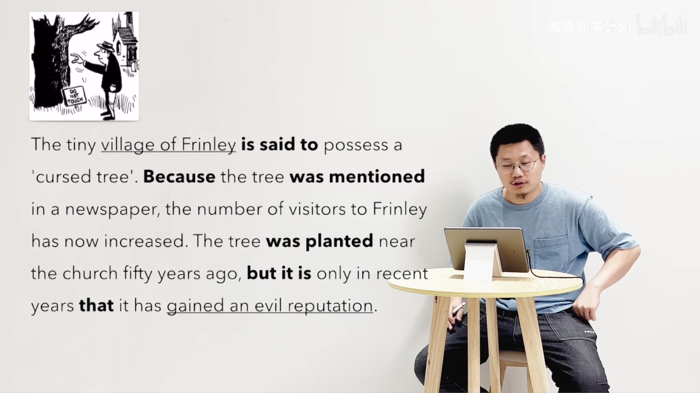

文字识别：The tiny village of Frinley is said to possess a / 'cursed tree'. Because the tree was mentioned / in a newspaper, the number of visitors to Frinley / has now increased. The tree was planted near / the church fifty years ago, but it is only in recent / years that it has gained an evil reputation.

## 00:02:00–00:02:30

了，在报纸当中，the number of visitors to friendly has now increased. The visitor to friendly就是来friendly的旅客，这个是A of B结构了。的数量现在已经提升了。哎，你看这里提升的就是number嘛，对不对？The tree was planted near the church fifty years ago. 这是非常典型六一二三四五六主语一was planted被动

### 画面 00:02:03

文字识别：TOUCH / 川 / The tiny village of Frinley is said to possess a / 'cursed tree'. Because the tree was mentioned / in a newspaper, the number of visitors to Frinley / has now increased. The tree was planted near / the church fifty years ago, but it is only in recent / years that it has gained an evil reputation.

## 00:02:30–00:03:00

二. General past tense. Near the seashore. 五. Ah, ah, ah. Near the church. Ah. 五. Then fifty years ago. 六. 对吧？好. But. 接下来强调句. It is only in recent years that it has gained an evil reputation. 这里几乎我们讲单词的部分的时候，包括讲语法的部分的时候，这句话都已经讲碎了，讲透了，对吧？我们直接翻译一下，说仅仅是在最近几年，它才获得了一个很不好的名声。注意啊，

### 画面 00:02:33

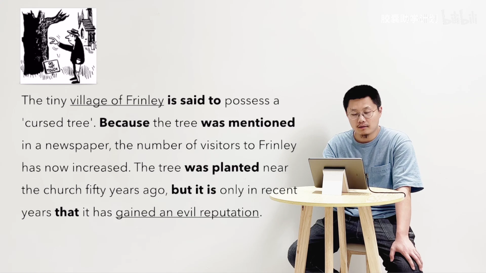

文字识别：TOUCH / The tiny village of Frinley is said to possess a / 'cursed tree'. Because the tree was mentioned / in a newspaper, the number of visitors to Frinley / has now increased. The tree was planted near / the church fifty years ago, but it is only in recent / years that it has gained an evil reputation.

## 00:03:00–00:03:30

不是在别的时候。It is said that后边加一句话，据说，据说的是什么呢？If如果anyone touches the tree, he will have bad luck.任何人碰到这个树，他会有不好的运气。If he picks a leaf, he will die.如果他捡起了一个树叶，他会死。Many villagers believe that the tree has already

### 画面 00:03:02

文字识别：TOUCH / 小 / It is said that if anyone touches the tree, he will / have bad luck; if he picks a leaf, he will die. Many / villagers believe that the tree has already claimed / a number of victims. The vicar has been asked to / L66V / have the tree cut down, but so far he has / refused.

## 00:03:30–00:04:00

claimed a number of victims.说许多的村民呐，迷信。他相信的是什么呢？相信的是一个宾语从句，是这样一句话。这个事儿是什么事儿呢？这个树已经夺走了 a number of victims. a number of 我先告诉各位含义，这个是咱们本课的习惯用法，就类似于 several 一些啊，一些受害者的生命。The vicar

### 画面 00:03:32

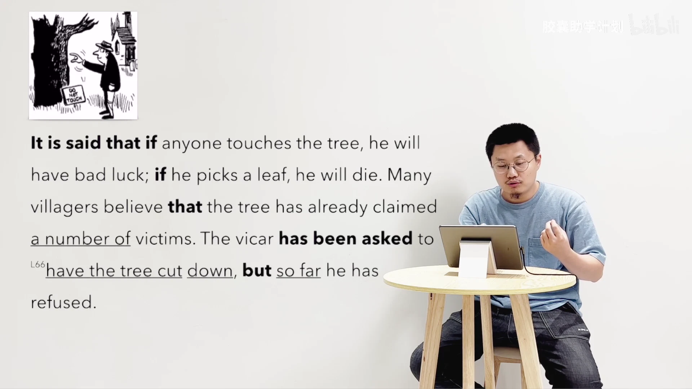

文字识别：TOUCH / 川 / It is said that if anyone touches the tree, he will / have bad luck; if he picks a leaf, he will die. Many / villagers believe that the tree has already claimed / a number of victims. The vicar has been asked to / Lohave the tree cut down, but so far he has / refused.

## 00:04:00–00:04:30

been asked.现在完成时被动，被要已经被要求干嘛呢？To have the tree cut down.要求把这个树给砍掉。注意这里我先这样去翻译，不是很准确。为什么呢？Have something但是咱们六十六课要学的语法，到那课学完了，我们回来再看。我先给它暂时翻译成要求他把树砍掉，对吧？But so far,但是截止到目前为止，he has refused.你看这里的时态has

### 画面 00:04:02

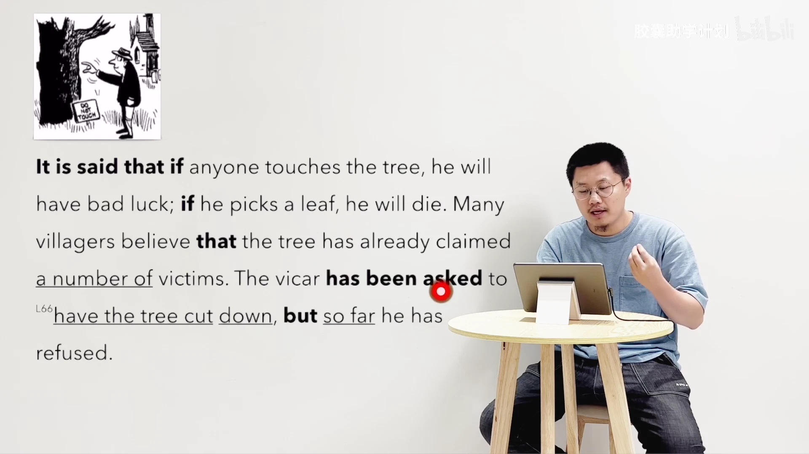

文字识别：It is said that if anyone touches the tree, he will / have bad luck; if he picks a leaf, he will die. Many / villagers believe that the tree has already claimed / a number of victims. The vicar has been asked to / Lohave the tree cut down, but so far he has / refused.

## 00:04:30–00:05:00

refused，现在完成时主动。So far叫截止到目前为止，你想一下，就可能他已经被要求砍掉这个树很多次了，但是从第一次开始一直到现在，他都在拒绝着。So far叫到目前为止，对吧？Until now类似于典型的现在完成时。新概念一册八十九课咱学过，从过去持续到现在，对不对？一直都是拒绝的。He has pointed out that这是本课的第二个

### 画面 00:04:32

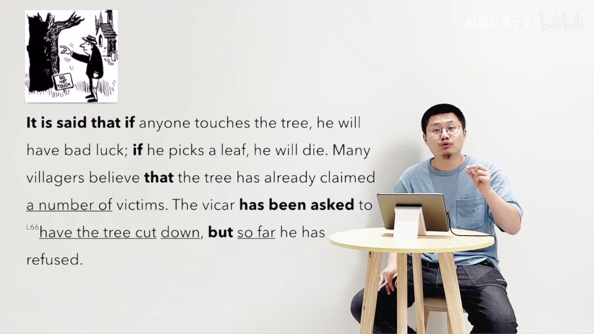

文字识别：TOUCH / It is said that if anyone touches the tree, he will / have bad luck; if he picks a leaf, he will die. Many / villagers believe that the tree has already claimed / a number of victims. The vicar has been asked to / L6have the tree cut down, but so far he has / refused.

### 画面 00:04:55

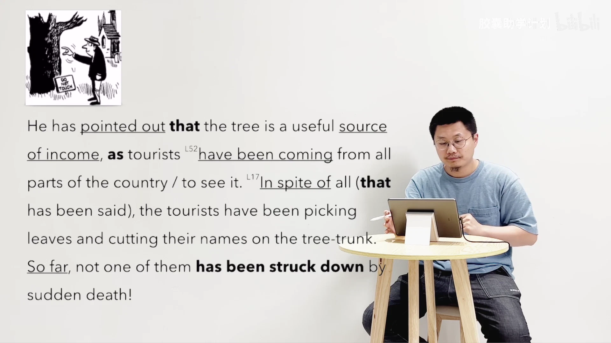

文字识别：He has pointed out that the tree is a useful source / L52have been coming from all / of income, as tourists / parts of the country / to see it. "'In spite of all(that / has been said), the tourists have been picking / leaves and cutting their names on the tree-trunk. / So far, not one of them has been struck down by / sudden death!

## 00:05:00–00:05:30

习惯用法，叫做他指出啊，point point point就是这个动作，point out指出，看跟汉语我觉得巧合一呃一一对应了。说他已经指出了一件事儿，这个事儿是什么呢？宾从，The tree is a useful source of income.说这个树啊是一个很有用的收入来源。哎，那就很奇怪了。我们看一下为啥。As常用的含义，When because看完后半句你才能懂它到这是什

### 画面 00:05:25

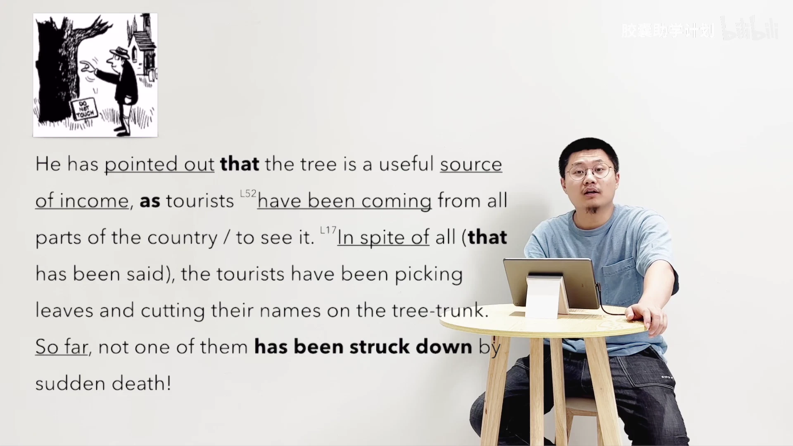

文字识别：He has pointed out that the tree is a useful source / ,L52have been coming from all / of income, as tourists / parts of the country / to see it. "7In spite of all that / has been said), the tourists have been picking / leaves and cutting their names on the tree-trunk. / So far, not one of them has been struck down by / sudden death!

## 00:05:30–00:06:00

么。我们先看后半句，Tourists have been coming from all parts of the country,目的是to see it。那就当然是因为了嘛。为什么是一个有用的收入来源？因为旅游的人一直源源不断的。为啥我翻译成一直源源不断的？五十二课现在完成进行时have been doing，来自all parts of the country全国各地to see it叫去看它

### 画面 00:05:55

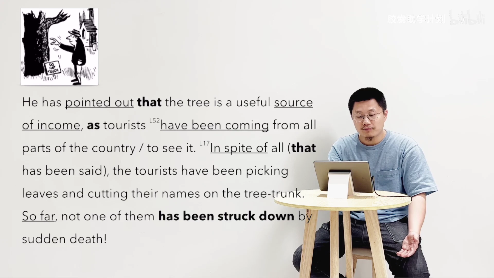

文字识别：He has pointed out that the tree is a useful source / ,L52have been coming from all / of income, as tourists / parts of the country / to see it. "'In spite of all(that / has been said), the tourists have been picking / leaves and cutting their names on the tree-trunk. / So far, not one of them has been struck down by / sudden death!

## 00:06:00–00:06:30

这棵树就让我想起来，我爸爸的老家，他从小长大的地方有这么一句话，叫“我们都来自于山西这个大槐树底下”。各位去查，真有这么一个公园，对吧？哎，就类似于这样一个地儿，大家持续不断的去那个地方去看它啊。In spite of all that has been said,那in spite of十七课咱学过，叫尽。那当时咱们学的叫in spite of this，对吧？尽管是这样，那

### 画面 00:06:25

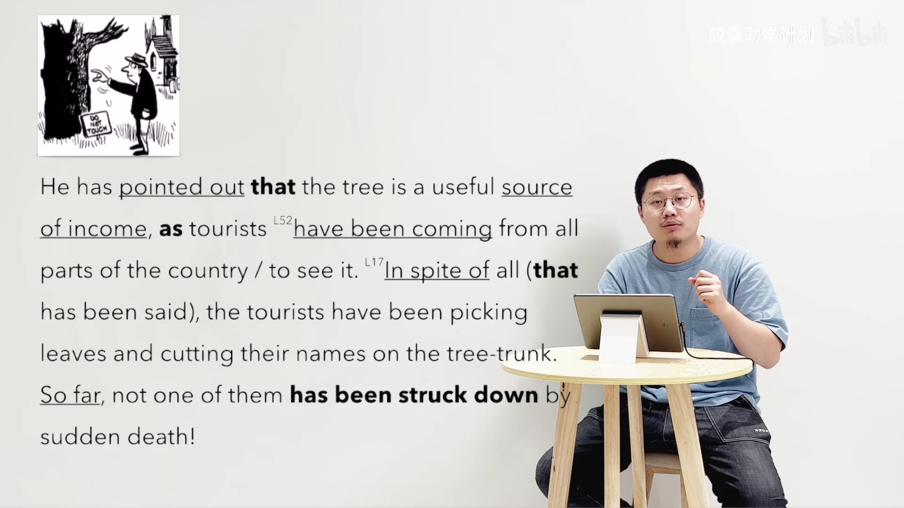

文字识别：He has pointed out that the tree is a useful source / L52have been coming from all / of income, as tourists / parts of the country / to see it. -1'lIn spite of all(that / has been said), the tourists have been picking / leaves and cutting their names on the tree-trunk. / So far, not one of them has been struck down by / sudden death!

## 00:06:30–00:07:00

in spite of all就尽管是所有，尽管所有，所有什么呢？后边跟了个从句that has been said啊，各位想一下，这个从句就所有已经被说过的，这地方翻译成说，尽管所有这些已经被说过的事情，哪些事情？就刚才说那些什么，呃，要求被砍呢？然后什么这个啊，不是要求被砍，说说你拿起来树叶会怎么样啊？你摸树会怎么样啊？尽

### 画面 00:06:51

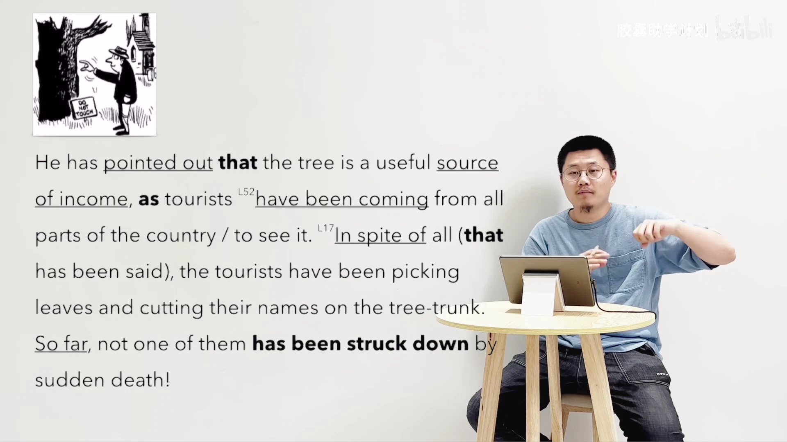

文字识别：He has pointed out that the tree is a useful source /  52have been coming from all / of income, as tourists / parts of the country / to see it. "']In spite of all (that / has been said), the tourists have been picking / leaves and cutting their names on the tree-trunk. / So far, not one of them has been struck down by / sudden death!

## 00:07:00–00:07:30

管所有这一切啊，传言。The tourists have been picking leaves and cutting their names on the tree trunk.说旅游者们持续不断的捡起树叶。注意这个是L-E-A-F，树叶的复数形式叫leaves。OK，跟那个离开的三单长得是一样的是吧？Cutting their names,哎，刻他们的名字on the tree trunk，刻在这个树的什么上，树干上。So far,

### 画面 00:07:09

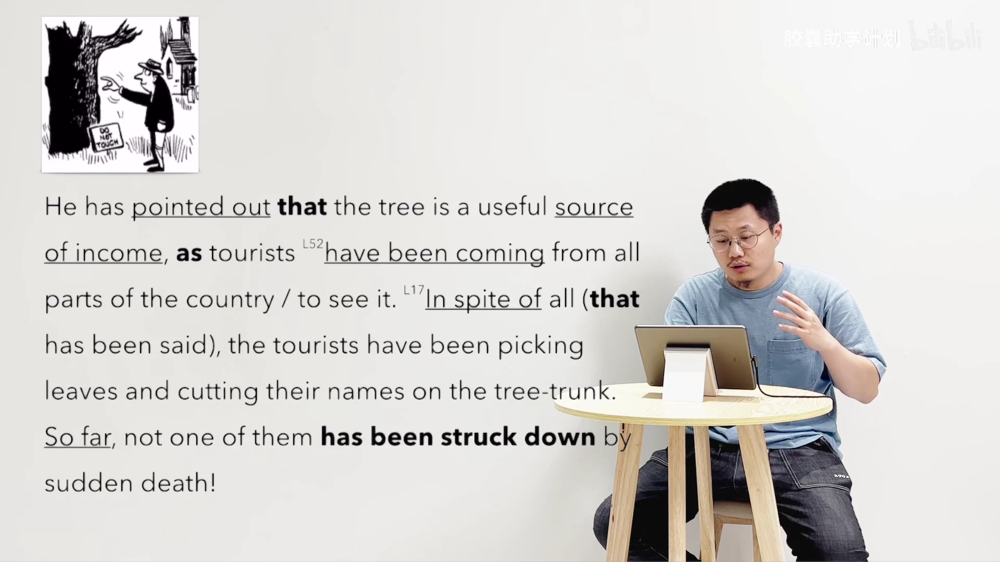

文字识别：He has pointed out that the tree is a useful source / L52have been coming from all / of income, as tourists / parts of the country / to see it. "'lIn spite of all (that / has been said), the tourists have been picking / leaves and cutting their names on the tree-trunk. / So far, not one of them has been struck down by / sudden death!

## 00:07:30–00:08:00

又见他一次，截止到目前为止，not one of them没有他们当中的任何一个人，其实not one of them就等于none of them，对吧？n none of them是吧？none of them has been struck down by sudden death，没有当中他们任何一个人已经被struck down击毙击倒，对吧？哎，其实就是暴毙，

### 画面 00:07:39

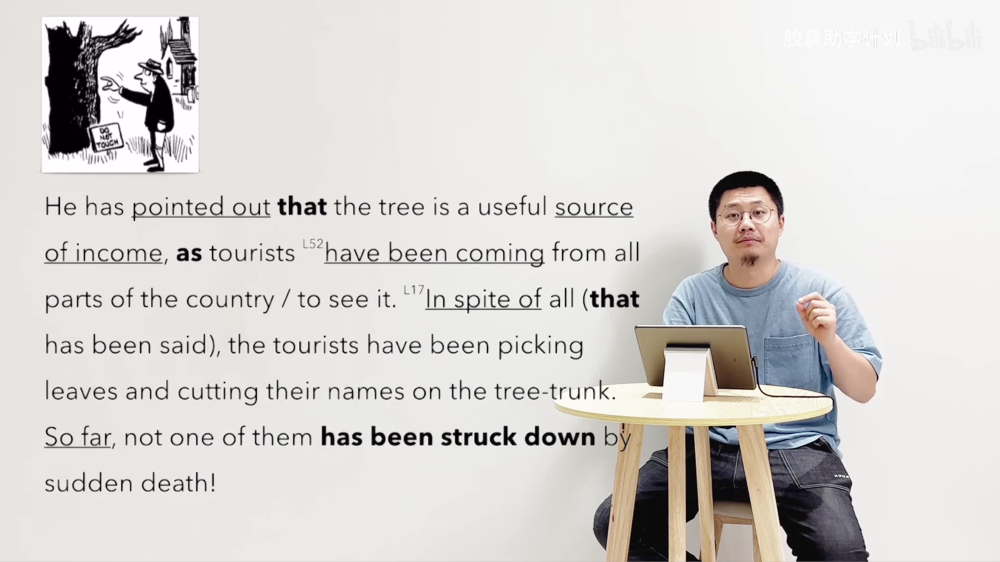

文字识别：He has pointed out that the tree is a useful source / s 52have been coming from all / of income, as tourists / parts of the country / to see it. "1'In spite of all (that / has been said), the tourists have been picking / leaves and cutting their names on the tree-trunk. / So far, not one of them has been struck down by / sudden death!

### 画面 00:07:42

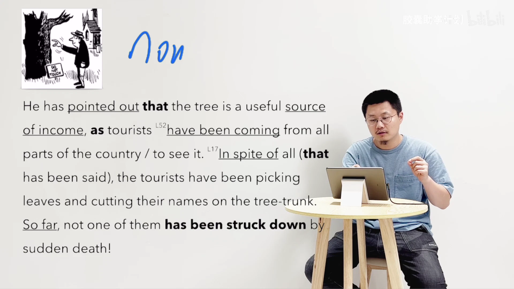

文字识别：He has pointed out that the tree is a useful source / s 52have been coming from all / of income, as tourists / parts of the country / to see it. "17lIn spite of all(that / has been said), the tourists have been picking / leaves and cutting their names on the tree-trunk. / So far, not one of them has been struck down by / sudden death!

### 画面 00:07:44

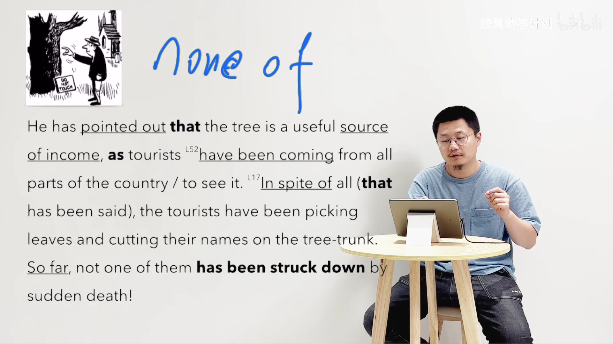

文字识别：None / TOUCH / 川 / He has pointed out that the tree is a useful source / s L52have been coming from all / of income, as tourists / parts of the country / to see it. "'lIn spite of all that / has been said), the tourists have been picking / leaves and cutting their names on the tree-trunk. / So far, not one of them has been struck down by / sudden death!

### 画面 00:07:48

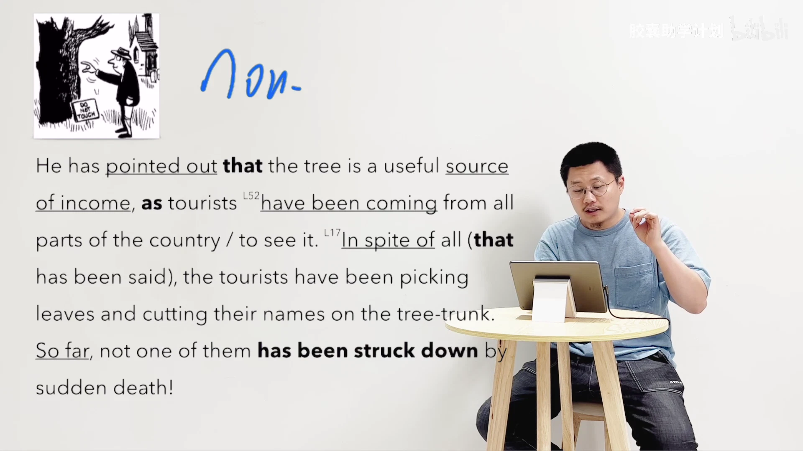

文字识别：N0n- / He has pointed out that the tree is a useful source / s 52have been coming from all / of income, as tourists / parts of the country / to see it. "'lIn spite of all that / has been said), the tourists have been picking / leaves and cutting their names on the tree-trunk. / So far, not one of them has been struck down by / sudden death!

### 画面 00:07:50

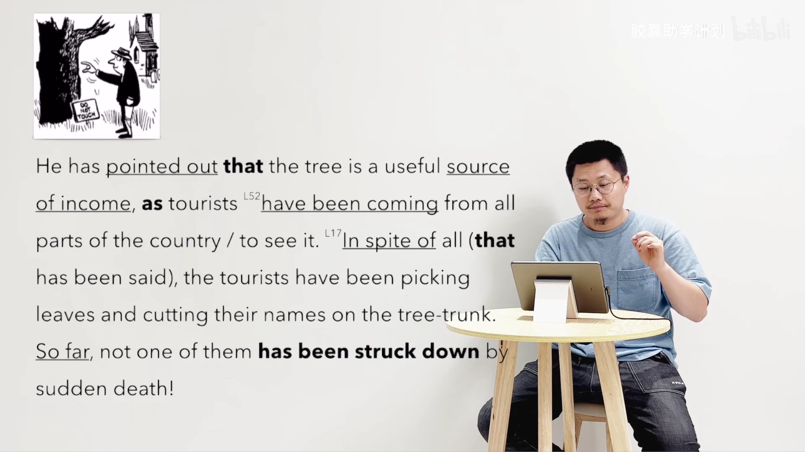

文字识别：He has pointed out that the tree is a useful source / L52have been coming from all / of income, as tourists / parts of the country / to see it. -17lIn spite of all(that / has been said), the tourists have been picking / leaves and cutting their names on the tree-trunk. / So far, not one of them has been struck down by / sudden death!

## 00:08:00–00:08:30

被什么呢？被 sudden death 突然的死亡所击垮啊！就其实 struck down by sudden death 有一点冗余了啊。他们俩其实 struck down 跟 sudden death 是有点像的啊，不完全一样，但是其实合起来表示的就是暴毙啊。struck down 就是死亡，sudden death 就是突然死亡，对吧？所以 struck down by sudden death 就是暴毙的意思。OK，那文章讲完了，本课习惯用法只有两个。第一个 a number of，刚才我们说了，more than two

### 画面 00:08:20

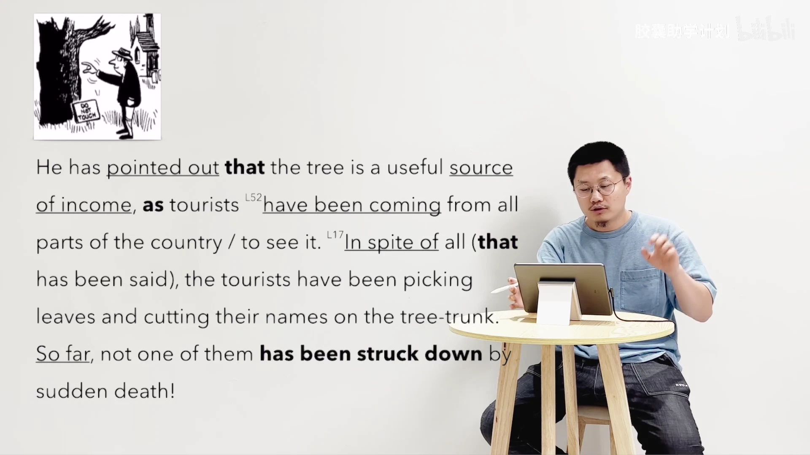

文字识别：He has pointed out that the tree is a useful source /  52have been coming from all / of income, as tourists / parts of the country / to see it. "'In spite of all(that / has been said), the tourists have been picking / leaves and cutting their names on the tree-trunk. / So far, not one of them has been struck down by / sudden death!

### 画面 00:08:23

文字识别：习惯用法造句 / a number of / sb. point out that..

### 画面 00:08:25

文字识别：习惯用法造句 / a number of / sb. point out that..

### 画面 00:08:27

文字识别：网：v.+v.变化 / 习惯用法造句指南 / more than two but / 计划 / 四句型转换 / fewer than many : / 方式/地点/时间 / several / 其他习惯用法 / 其他单词+词性 / 原文摘抄+变 / 6123456 / a number of

## 00:08:30–00:09:00

but fewer than many.比两个多,但是比一堆很多很多许多要少,所以several这个单词就可以了,一些啊,类似于some,对吧?拿它造句很容易嘛。说My parents asked me to plant a number of trees this spring.我们无非就是把plant trees中间加了个number of, a number of这种类似于限定词的东西,它主要限定的还是名词嘛,对吧? Continue, 四句型转换。

### 画面 00:08:33

文字识别：网：v.+v.变化 / 习惯用法造句指南 / more than two but / 计划 / 四句型转换 / fewer than many : / 方式/地点/时间 / several / 其他习惯用法 / 其他单词+词性 / 原文摘抄+变 / 6123456 / a number of

### 画面 00:08:37

文字识别：网：v.+v.变化 / 习惯用法造句指南 / more than two but / 计划 / 四句型转换 / fewer than many : / 方式/地点/时间 / several / 其他习惯用法 / 其他单词+词性 / 原文摘抄+变 / 6123456 / a number of

### 画面 00:08:39

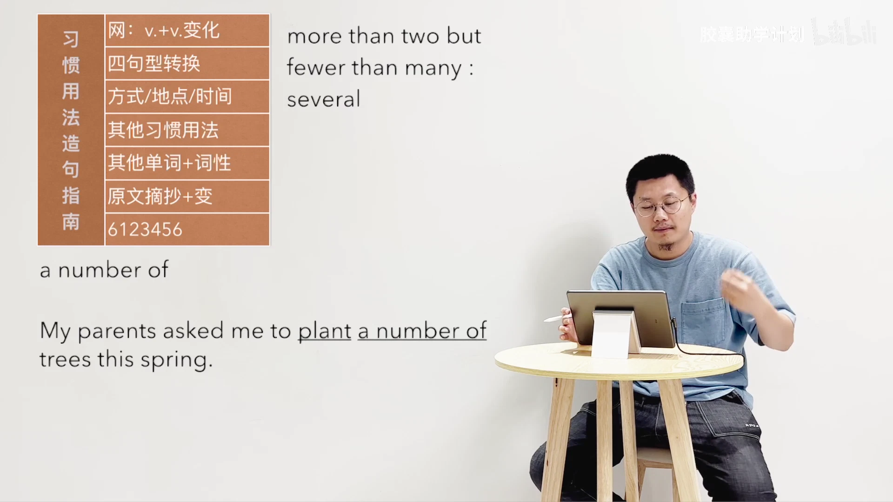

文字识别：网：v.+v.变化 / 习惯用法造句指南 / more than two but / 计划 / 四句型转换 / fewer than many : / 方式/地点/时间 / several / 其他习惯用法 / 其他单词+词性 / 原文摘抄+变 / 6123456 / a number of / My parents asked me to plant a number of / trees this spring.

### 画面 00:08:59

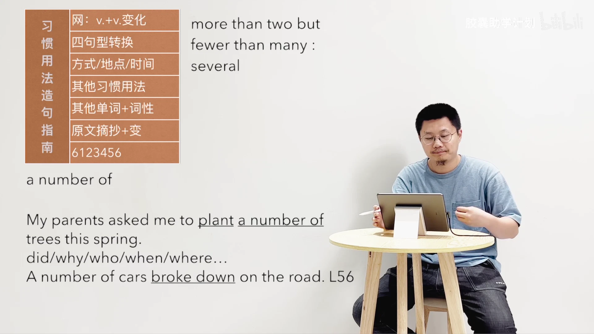

文字识别：网：v.+v.变化 / 习惯用法造句指南 / more than two but / 计划 / 四句型转换 / fewer than many : / 方式/地点/时间 / several / 其他习惯用法 / 其他单词+词性 / 原文摘抄+变 / 6123456 / a number of / My parents asked me to plant a number of / trees this spring. / did/why/who/when/where... / A number of cars broke down on the road. L56

## 00:09:00–00:09:30

来，A number of cars broke down on the road.在路上崩溃了，是吧？Continue说，A number of gold coins were found in dry soil. Dry soil，五十五课探这个山洞淘宝那课找宝藏那课咱学的，注意力集中，咱听一下。The situation is this: Pacific County has made a number of mistakes, but I've had a number of success stories. Okay,

### 画面 00:09:13

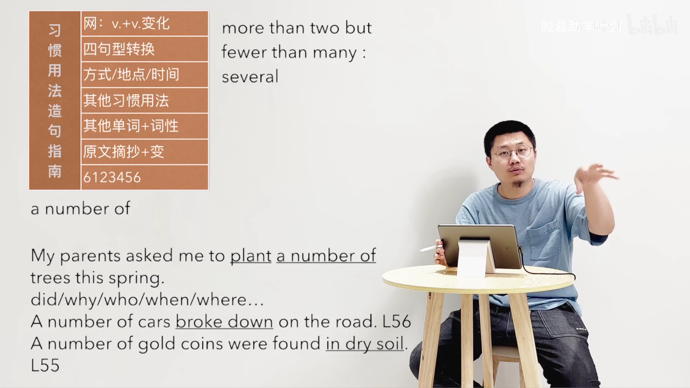

文字识别：网：v.+v.变化 / 习惯 / more than two but / 字计划 / 四句型转换 / fewer than many : / 用 / 方式/地点/时间 / several / 法 / 么造句指南 / 其他习惯用法 / 其他单词+词性 / 原文摘抄+变 / 6123456 / a number of / My parents asked me to plant a number of / trees this spring. / did/why/who/when/where... / A number of cars broke down on the road. L56 / A number of gold coins were found in dry soil. / L55

### 画面 00:09:16

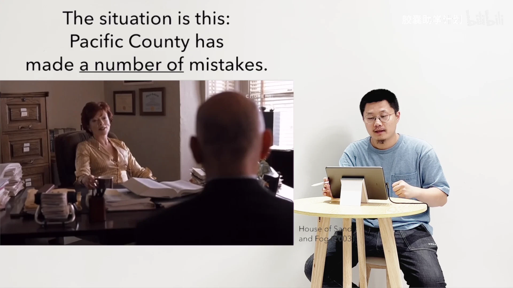

文字识别：The situation is this: / Pacific County has / made a number of mistakes. / House of Sand / and Fo92003

### 画面 00:09:20

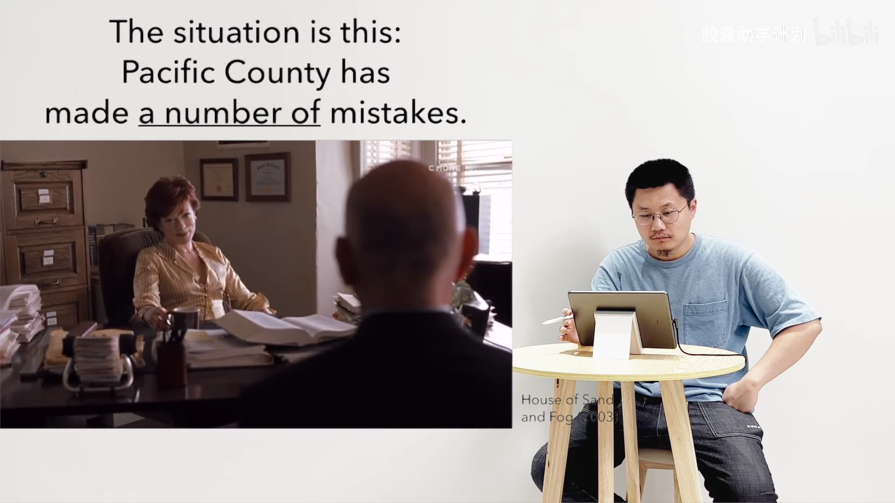

文字识别：The situation is this: / Pacific County has / made a number of mistakes. / CMO / House of Sand / and Fog2003

### 画面 00:09:24

文字识别：But I've had a number of / success stories. / My All-American / (2015）

### 画面 00:09:29

文字识别：网：v.+v.变化 / 习惯用法造句指南 / 四句型转换 / 方式/地点/时间 / 其他习惯用法 / 其他单词+词性 / 原文摘抄+变 / 6123456 / sb. point out that...

## 00:09:30–00:10:00

下一个叫 somebody pointed out that叫某人指出造句子呗. She has just pointed out.这几乎都是不变的that到这儿都不变，后面你随便加一句话叫You missed the entrance.咱复习一下五十五课，错过入口，对吧？他刚刚指出你错过了入口嘛. Next one说Lil pointed out我指出We must stick to the plan.我们一定要坚守计划，对吧？Next one说He pointed out that is actually a good idea.

### 画面 00:09:31

文字识别：网：v.+v.变化 / 习惯用法造句指南 / 计划 / 四句型转换 / 方式/地点/时间 / 其他习惯用法 / 其他单词+词性 / 原文摘抄+变 / 6123456 / sb. point out that...

### 画面 00:09:33

文字识别：网：v.+v.变化 / 习惯用法造句指南 / 四句型转换 / 方式/地点/时间 / 其他习惯用法 / 其他单词+词性 / 原文摘抄+变 / 6123456 / sb. point out that... / She has just pointed out that you missed the / entrance. L55

### 画面 00:09:48

文字识别：网：v.+v.变化 / 习惯用法造句指南 / 计划 / 四句型转换 / 方式/地点/时间 / 其他习惯用法 / 其他单词+词性 / 原文摘抄+变 / 6123456 / sb. point out that... / She has just pointed out that you missed the / entrance. L55 / Leo pointed out that we must stick to the / plan. L54

### 画面 00:09:57

文字识别：网：v.+v.变化 / 习惯用法造句指南 / 学计划 / 四句型转换 / 方式/地点/时间 / 其他习惯用法 / 其他单词+词性 / 原文摘抄+变 / 6123456 / sb. point out that... / She has just pointed out that you missed the / entrance. L55 / Leo pointed out that we must stick to the / plan.L54 / He pointed out that it's actually a good idea. / L52

## 00:10:00–00:10:30

啊，他指出这实际上还是个挺好的主意，very good.注意力集中，咱们看这句话。We actually dated for a little while, and then she pointed out that she thought I was in love with her best friend. Recap.那本课除了文章重要，这两个习惯用法也很重要啊，别忘了造句。第一个习惯用法造句，第二个文章跟读至熟读成诵。老生常谈，我再说一下，熟读成诵的目的，第一个是内化单词，第二个是内

### 画面 00:10:03

文字识别：We actually dated for a little while and / then, uh, she pointed out that / she thought that I was in love with her / best friend. / Then CanA / (2020)

### 画面 00:10:07

文字识别：We actually dated for a little while and / then, uh, she pointed out that / she thought that I was in love with her / best friend. / Then CanAe / (2020)

### 画面 00:10:09

文字识别：We actually dated for a little while and / then, uh, she pointed out that / she thought that I was in love with her / best friend. / Then CanAe / YO / (2020)

### 画面 00:10:11

文字识别：We actually dated for a little while and / then, uh, she pointed out that / she thought that I was in love with her / best friend. / Then CanA / (2020)

### 画面 00:10:13

文字识别：Recap / a number of / Expression / sb. point out that..

### 画面 00:10:15

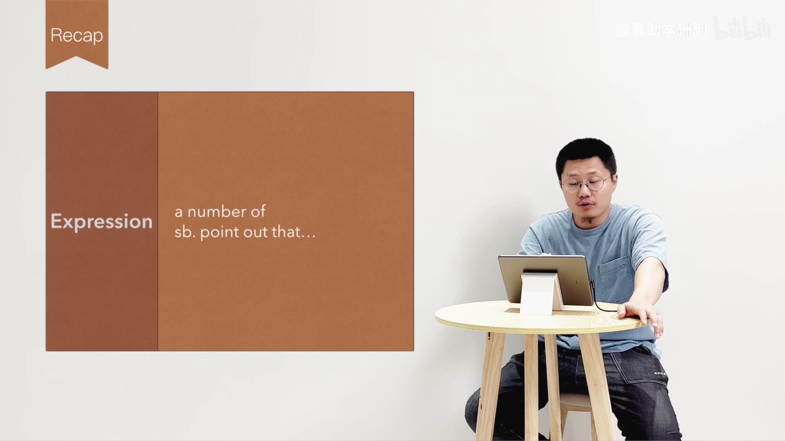

文字识别：Recap / a number of / Expression / sb. point out that..

### 画面 00:10:17

文字识别：Recap / a number of / Expression / sb. point out that..

### 画面 00:10:19

文字识别：1. / 习惯用法造句/对话 / 【习惯用法造句指南】 / 每个5句

### 画面 00:10:21

文字识别：1. / 习惯用法造句/对话 / 【习惯用法造句指南】 / 每个5句 / 文章跟读至熟读成诵 / 内化单词+语法+习惯用法 / 听力+口语+写作练习

### 画面 00:10:23

文字识别：习惯用法造句/对话 / 1. / 【习惯用法造句指南】 / 每个5句 / 文章跟读至熟读成诵 / 内化单词+语法+习惯用法 / 听力+口语+写作练习

### 画面 00:10:25

文字识别：习惯用法造句/对话 / 1. / 【习惯用法造句指南】 / 每个5句 / 文章跟读至熟读成诵 / 内化单词+语法+习惯用法 / 听力+口语+写作练习

### 画面 00:10:27

文字识别：习惯用法造句/对话 / 【习惯用法造句指南】 / 每个5句 / 文章跟读至熟读成诵 / 内化单词+语法+习惯用法 / 听力+口语+写作练习

### 画面 00:10:29

文字识别：习惯用法造句/对话 / 【习惯用法造句指南】 / 每个5句 / 文章跟读至熟读成诵 / 内化单词+语法+习惯用法 / 听力+口语+写作练习

## 00:10:30–00:11:00

内化语法，第三个是内化习惯用法。什么叫内化？内化就是养成一种类似于第二天性一样，就是张嘴就能说出来，不经大脑太多的思考啊。然后那包括我们下一个视频的练习，需要您文章读到很熟才能练，对吧？所以不要忘了做这个练习啊。呃，重复间隔直接看置顶留言，我们就不多说了。以上呢就是本期视频的全部内容了。如果各位喜欢我们的课程呢，欢迎各位关注、

### 画面 00:10:31

文字识别：习惯用法造句/对话 / 【习惯用法造句指南】 / 每个5句 / 文章跟读至熟读成诵 / 内化单词+语法+习惯用法 / 听力+口语+写作练习

### 画面 00:10:33

文字识别：习惯用法造句/对话 / 【习惯用法造句指南】 / 每个5句 / 文章跟读至熟读成诵 / 内化单词+语法+习惯用法 / 听力+口语+写作练习

### 画面 00:10:36

文字识别：习惯用法造句/对话 / 【习惯用法造句指南】 / 每个5句 / 文章跟读至熟读成诵 / 内化单词+语法+习惯用法 / 听力+口语+写作练习

### 画面 00:10:39

文字识别：习惯用法造句/对话 / 【习惯用法造句指南】 / 每个5句 / 文章跟读至熟读成诵 / 内化单词+语法+习惯用法 / 听力+口语+写作练习

### 画面 00:10:41

文字识别：习惯用法造句/对话 / 【习惯用法造句指南】 / 每个5句 / 文章跟读至熟读成诵 / 内化单词+语法+习惯用法 / 听力+口语+写作练习

### 画面 00:10:43

文字识别：习惯用法造句/对话 / 1. / 【习惯用法造句指南】 / 每个5句 / 文章跟读至熟读成诵 / 内化单词+语法+习惯用法 / 听力+口语+写作练习

### 画面 00:10:45

文字识别：习惯用法造句/对话 / 【习惯用法造句指南】 / 每个5句 / 文章跟读至熟读成诵 / 内化单词+语法+习惯用法 / 听力+口语+写作练习

### 画面 00:10:47

文字识别：习惯用法造句/对话 / 1. / 【习惯用法造句指南】 / 每个5句 / 文章跟读至熟读成诵 / 内化单词+语法+习惯用法 / 听力+口语+写作练习

### 画面 00:10:49

文字识别：1. / 习惯用法造句/对话 / 【习惯用法造句指南】 / 每个5句 / 文章跟读至熟读成诵 / 内化单词+语法+习惯用法 / 听力+口语+写作练习 / 3. / 重复间隔（置顶留言）

### 画面 00:10:51

文字识别：1. / 习惯用法造句/对话 / 【习惯用法造句指南】 / 每个5句 / 文章跟读至熟读成诵 / 内化单词+语法+习惯用法 / 听力+口语+写作练习 / 3. / 重复间隔（置顶留言）

### 画面 00:10:53

文字识别：为学计划 / 不

## 00:11:00–00:11:18

订阅、一键三连，分享给那些需要的朋友，来帮助我们快速成长。See you next time.

### 画面 00:11:06

文字识别：CAPSULEACADEMY / 胶囊助学计划 / 小红书 / 品 / OE

### 画面 00:11:08

文字识别：CAPSULEACADEMY / 胶囊助学计划 / 小红书 / turer / Leo

### 画面 00:11:14

文字识别：CAPSULEACADEMY / 胶囊助学计划 / 小红书 / Creator / □ / Leo & Berlin / OE

### 画面 00:11:16

文字识别：bilibili / 胶囊助学计划

### 画面 00:11:17

文字识别：bilibili / 胶囊助学计划

