# 058 练习

快速机器解析：语音为单模型转写，未进行独立交叉校对或人工复核；画面每秒采样并按变化选帧，短时文字和标记可能遗漏。截图时间约有 1 秒误差。图片有损压缩；遇到疑点请按时间查看 Google Drive 原视频。

## 00:00:00–00:00:30

Hello everyone, welcome to Capsule Academy. This is Will. Today we're going to learn new concept English Book Two Lesson Fifty Eight Practices. That注意进行如下练习，唯一的前提就是文章一定要跟读至熟读成诵，否则请勿开始。Hope you're gonna enjoy it. 第一题 comprehension，我们能听懂一般疑问句和特殊疑问句的能力。我问您答，最好不看这里，咱们只练听力和口

### 画面 00:00:00

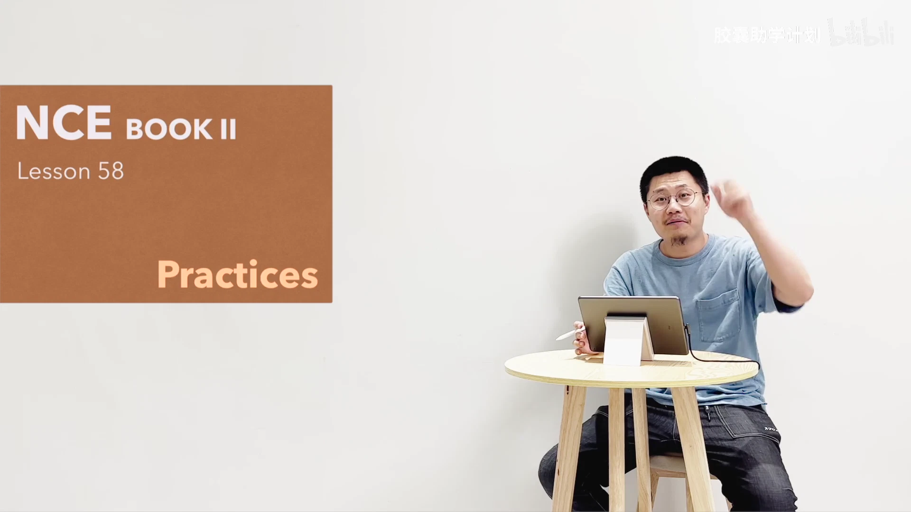

文字识别：NCE / BOOKII / Lesson 58 / Practices

### 画面 00:00:02

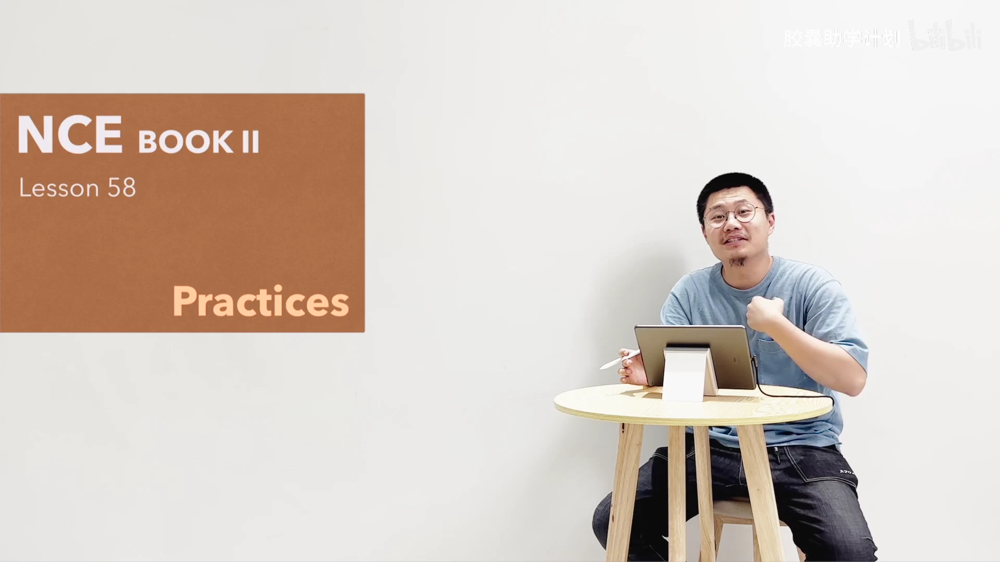

文字识别：NCE / BOOKII / Lesson 58 / Practices

### 画面 00:00:05

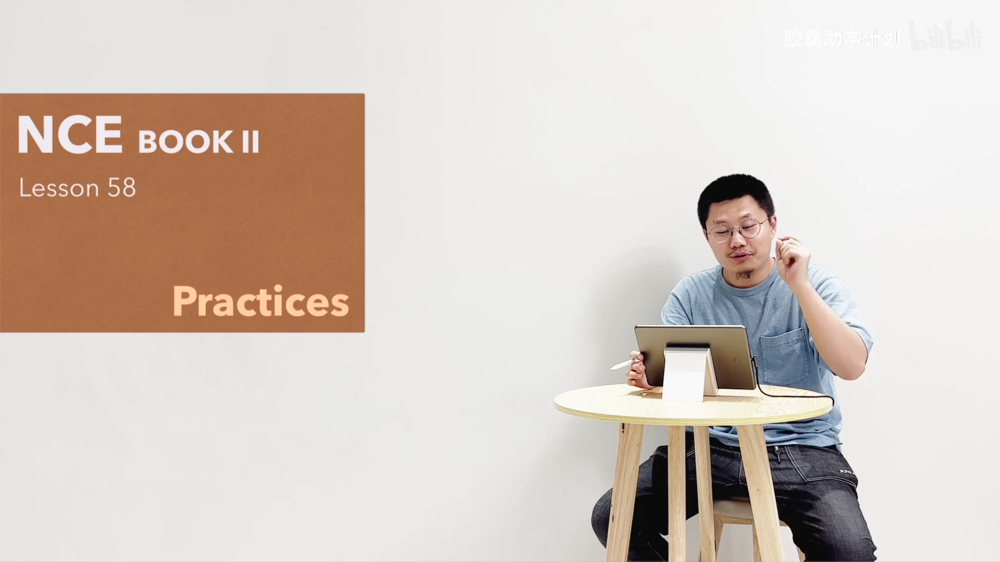

文字识别：NCE / BOOKI"I / Lesson 58 / Practices

### 画面 00:00:07

文字识别：进行如下练习唯一前提 / 文章跟读至熟读成诵 / 否则请勿开始

### 画面 00:00:10

文字识别：进行如下练习唯一前提 / 文章跟读至熟读成诵 / 否则请勿开始

### 画面 00:00:17

文字识别：胶囊助学计划bilbi / • / •

### 画面 00:00:20

文字识别：胶囊助学计划ll / 胶囊助学计划

### 画面 00:00:22

文字识别：Comprehension / 训练目标： / 听懂一般疑问句＆特殊疑问句

### 画面 00:00:24

文字识别：Comprehension / 训练目标： / 听懂一般疑问句＆特殊疑问句

## 00:00:30–00:01:00

语回答。你可以看书啊，从书中找答案。First one, is Friendly a large or tiny village? Answer: Tiny. Next one, what is it said to possess? A cursed tree. Next one, why has the number of visitors to Friendly increased? Because the tree was mentioned in a newspaper.

### 画面 00:00:30

文字识别：Comprehension / 训练目标： / 听懂一般疑问句＆特殊疑问句

### 画面 00:00:33

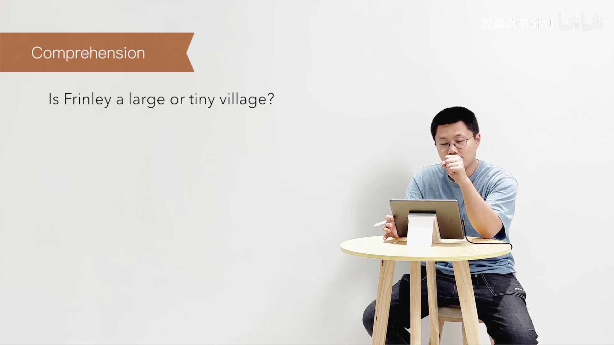

文字识别：Comprehension / Is Frinley a large or tiny village?

### 画面 00:00:35

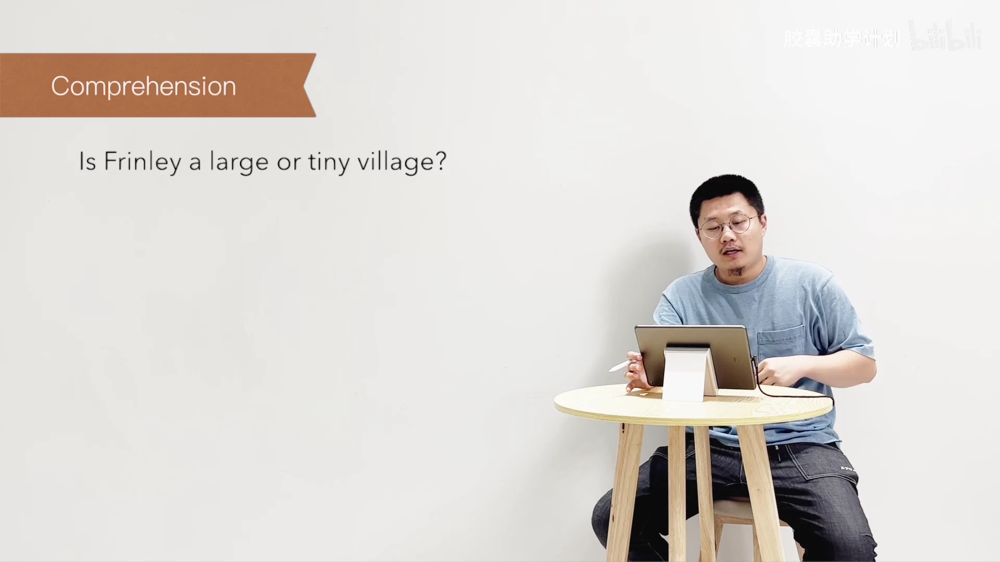

文字识别：Comprehension / Is Frinley a large or tiny village?

### 画面 00:00:41

文字识别：Comprehension

### 画面 00:00:45

文字识别：Comprehension / What is it said to possess?

### 画面 00:00:55

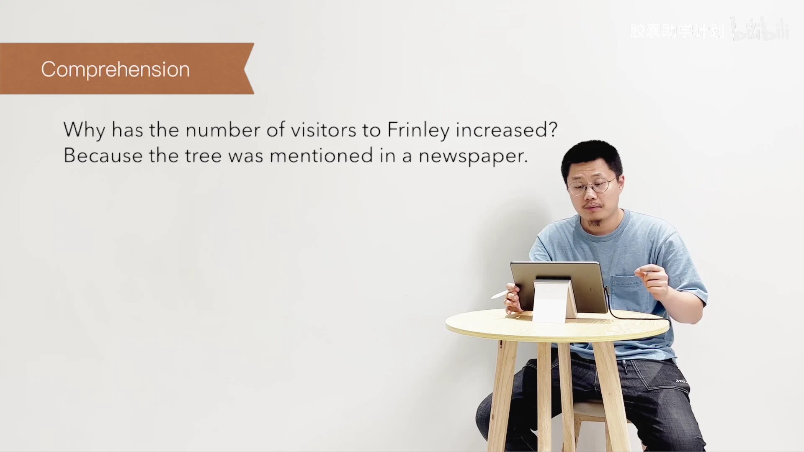

文字识别：Comprehension / Why has the number of visitors to Frinley increased? / Because the tree was mentioned in a newspaper.

### 画面 00:00:59

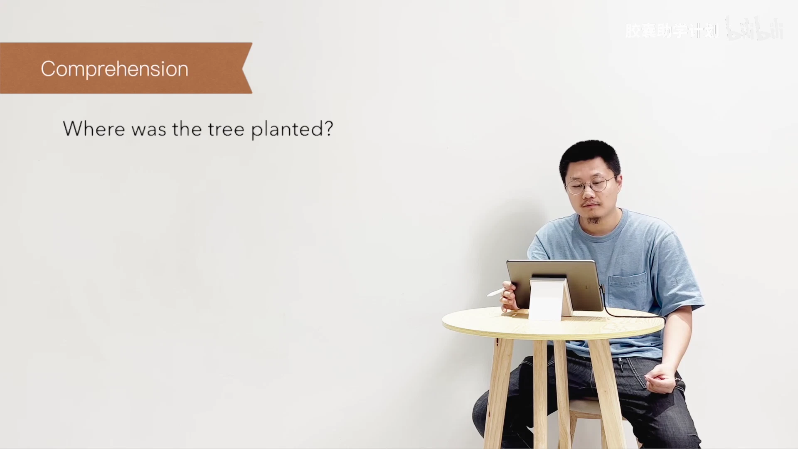

文字识别：Comprehension / Where was the tree planted?

## 00:01:00–00:01:30

Where was the tree planted? Near the church. How long ago? 就等于问啊, was it planted? Fifty years ago. Has it had an evil reputation for long? No, it hasn't. If anyone touches the tree, he will have bad luck, won't he? Yes, he will.

### 画面 00:01:02

文字识别：Comprehension / Where was the tree planted? / Near the church.

### 画面 00:01:07

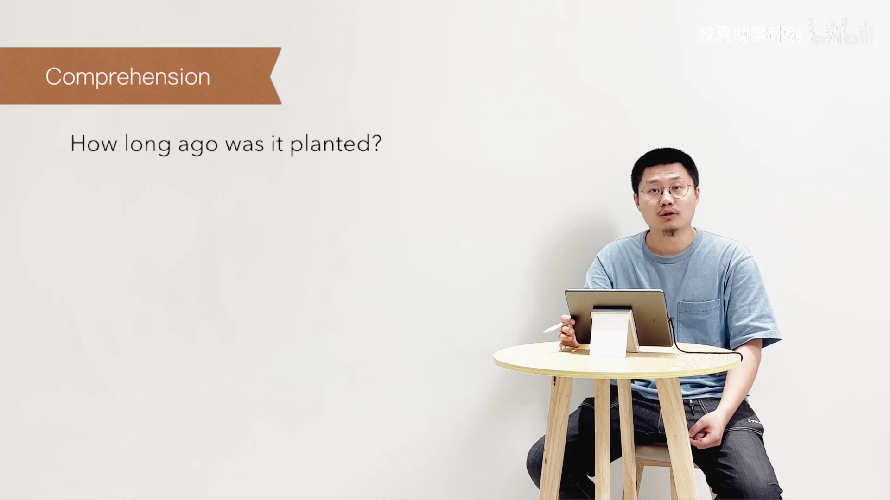

文字识别：Comprehension / How long ago was it planted?

### 画面 00:01:20

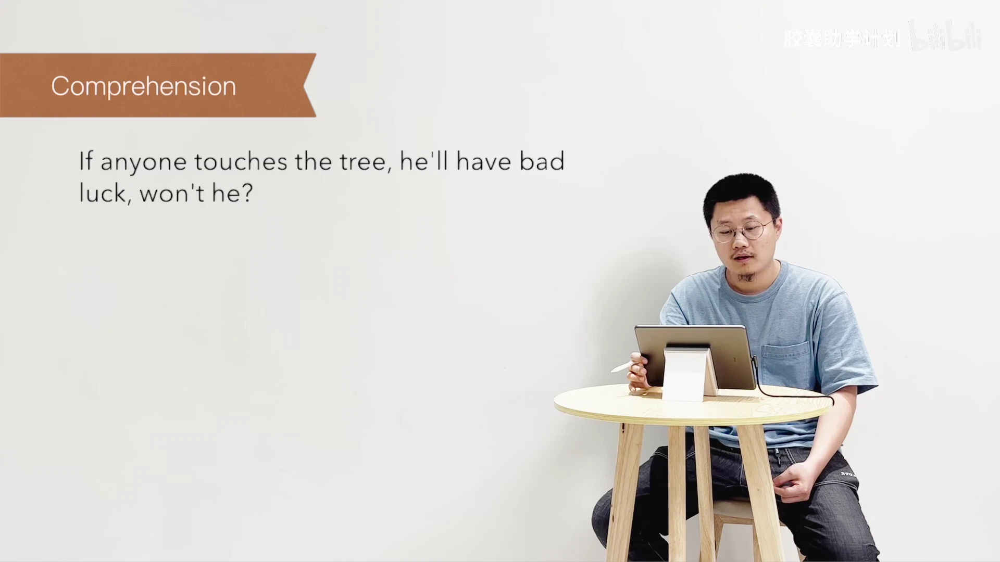

文字识别：Comprehension / If anyone touches the tree, he'll have bad / luck, won't he?

### 画面 00:01:25

文字识别：Comprehension / If anyone touches the tree, he'll have bad / luck, won't he?

### 画面 00:01:29

文字识别：Comprehension / What will happen if he picks a leaf?

## 00:01:30–00:02:00

What will happen if he picks a leaf? He will die. What do many villagers believe? That the tree has already claimed a number of victims. What's the worker being asked to do? To have the tree cut down. Has he agreed to do so? This so就是this，就这么干，他同意了吗？ No, he hasn't.

### 画面 00:01:36

文字识别：Comprehension

### 画面 00:01:40

文字识别：Comprehension / What do many villagers believe? / That the tree has already claimed a number / of victims.

### 画面 00:01:43

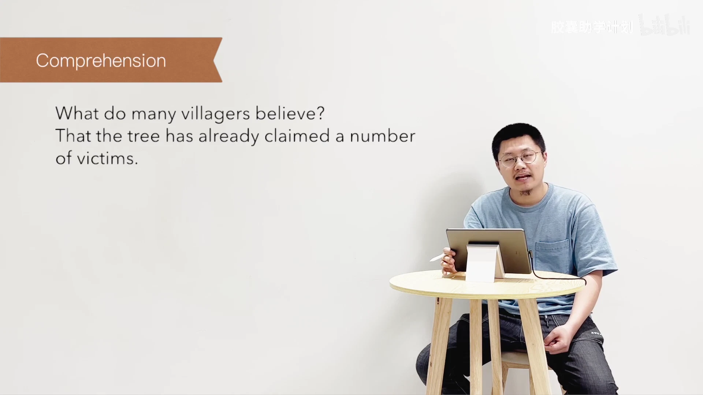

文字识别：Comprehension / What do many villagers believe? / That the tree has already claimed a number / of victims.

### 画面 00:01:45

文字识别：Comprehension / What's the vicar been asked to do?

## 00:02:00–00:02:30

Why is the tree useful? Because tourists have been coming from all parts of the country to see it, asking questions.老习惯锻炼咱们能说出来，哎，能提啊，咱们发问的能力，对吧？呃，第一个例子是吧？直接 is 提前 how big 对 tiny 提问呗？那 how big is the village friendly？对吧？接下来这些呢，我们还是老习惯啊，只是提思路。各

### 画面 00:02:04

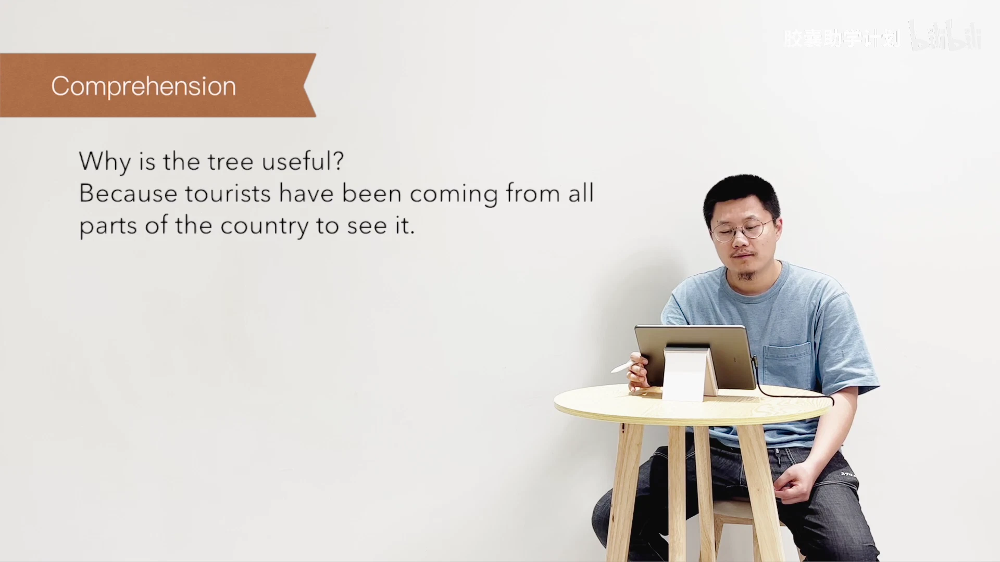

文字识别：Comprehension / Why is the tree useful? / Because tourists have been coming from all / parts of the country to see it.

### 画面 00:02:06

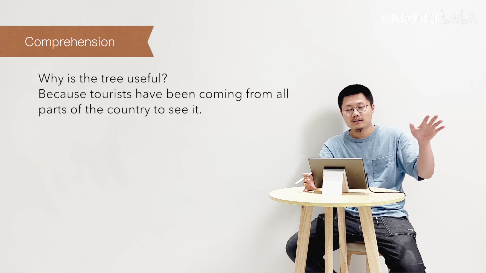

文字识别：Comprehension / Why is the tree useful? / Because tourists have been coming from all / parts of the country to see it.

### 画面 00:02:08

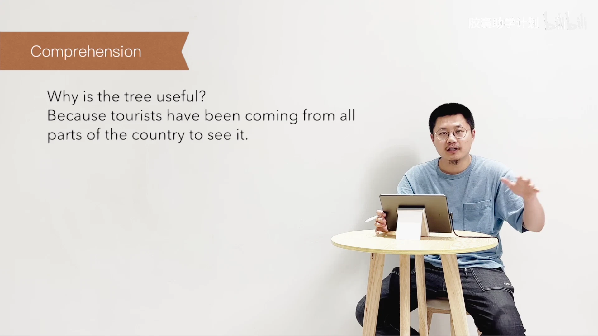

文字识别：Comprehension / Why is the tree useful? / Because tourists have been coming from all / parts of the country to see it.

### 画面 00:02:11

文字识别：Asking questions / 训练目标： / 会说一般疑问句＆特殊疑问句 / Accuracy / Fluency

### 画面 00:02:18

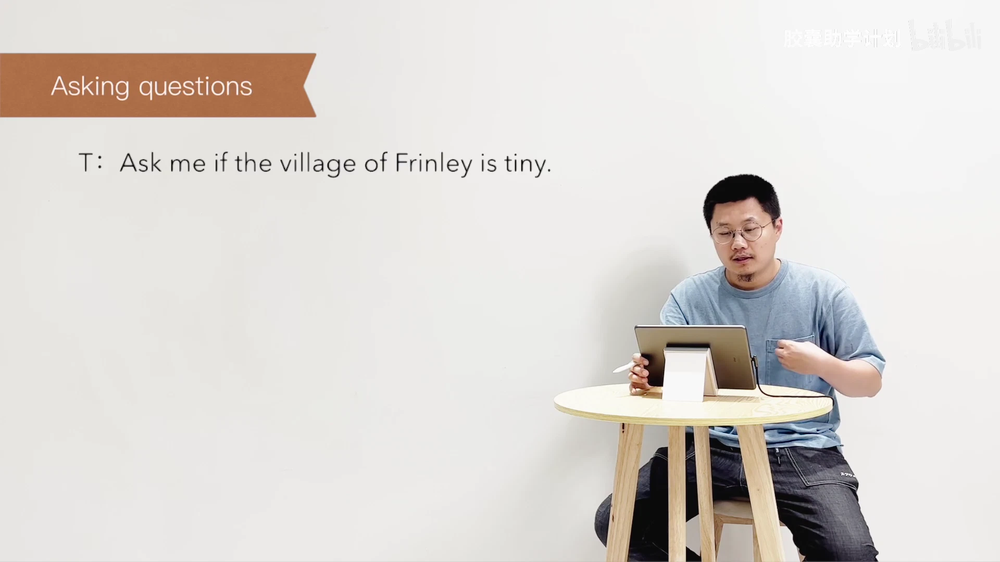

文字识别：Asking questions / T: Ask me if the village of Frinley is tiny.

### 画面 00:02:20

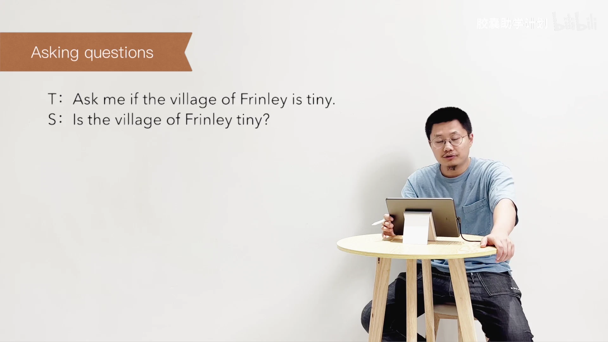

文字识别：Asking / questions / T: Ask me if the village of Frinley is tiny. / S: Is the village of Frinley tiny?

### 画面 00:02:24

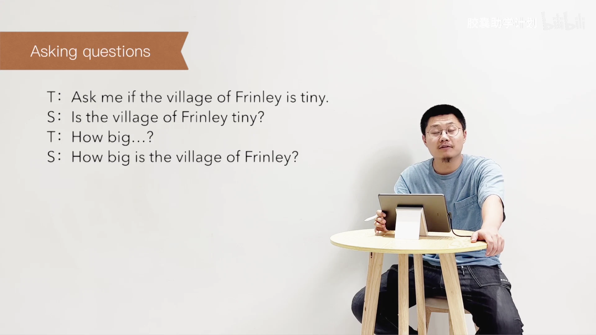

文字识别：Asking questions / T: Ask me if the village of Frinley is tiny. / S: Is the village of Frinley tiny? / T:How / big...? / S:How / / big is the village of Frinley?

### 画面 00:02:26

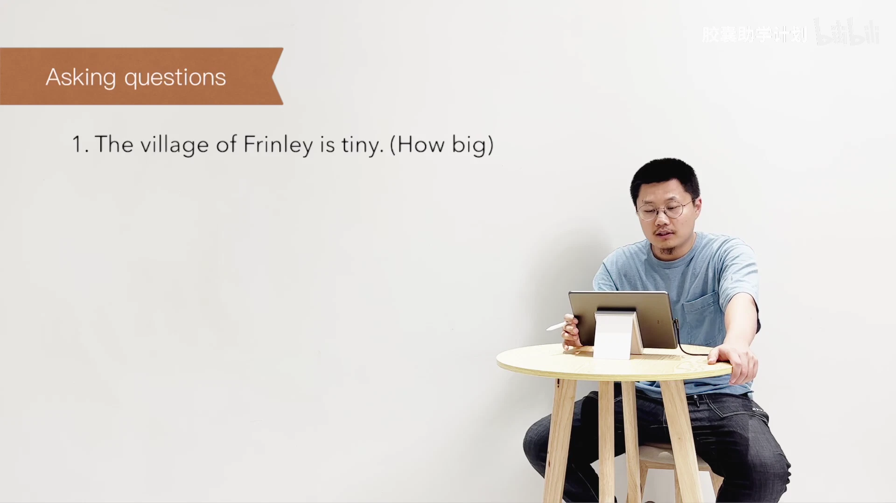

文字识别：Asking / questions / 1. The village of Frinley is tiny. (How big)

### 画面 00:02:28

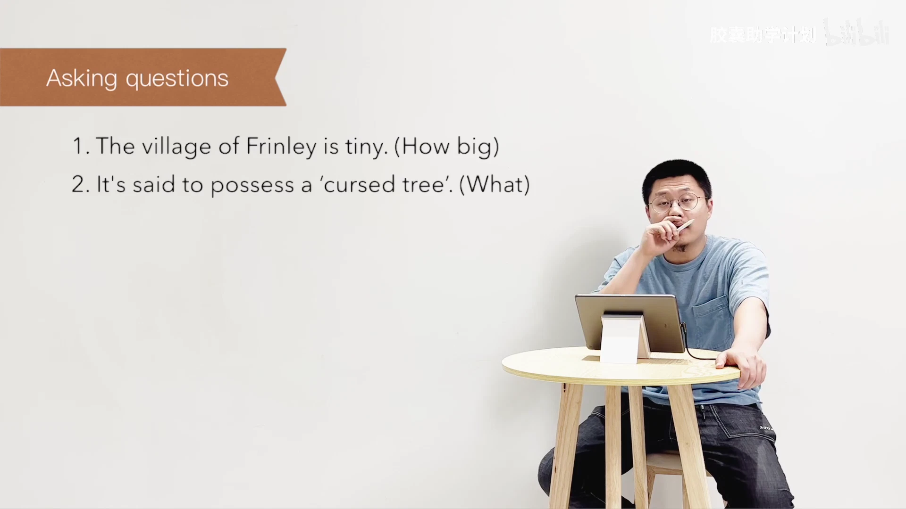

文字识别：Asking questions / 1. The village of Frinley is tiny. (How big) / 2. It's said to possess a 'cursed tree'. (What)

## 00:02:30–00:03:00

位听清楚思路，自己下课去做啊。呃，is said to possess a cursed tree.那肯定是is提前。What对a cursed tree提问。It was mentioned in newspaper. Was提前。Where对in the newspaper提问。Where was it mentioned? There have been more visitors to Friendly since then. 自从那时就有更多的游客来Friendly了。那have提前呗，对吧？那since when? Since then嘛。Why整句？

### 画面 00:02:43

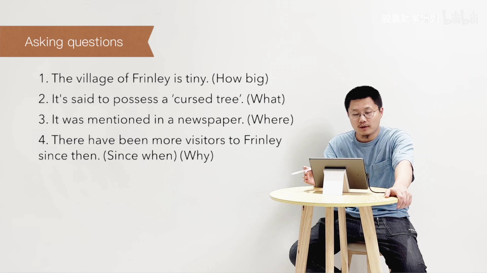

文字识别：Asking questions / 1. The village of Frinley is tiny. (How big) / 2. It's said to possess a 'cursed tree' (What) / 3. It was mentioned in a newspaper. (Where) / 4. There have been more visitors to Frinley / since then.(Since when)(Why)

## 00:03:00–00:03:30

come to see the tree. 哎，你要去想一下这句话，我变一般疑问句怎么变？他用的不是 They came to see the tree. 啊，然后 What 是对 the tree 提问，外加整句，对吧？ It was planted fifty years ago. Was 提前，When 对 fifty years ago，When was it planted？第七个 is near the church. Is 提前，Where 对 near the church 提问，What 对主语 it 提问啊？就那个 it 就是 the tree

### 画面 00:03:13

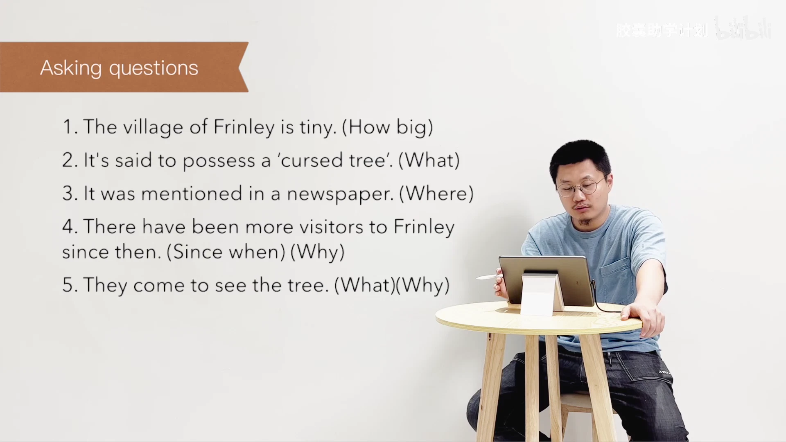

文字识别：Asking questions / 1. The village of Frinley is tiny. (How big) / 2. It's said to possess a 'cursed tree'. (What) / 3. Ilt was mentioned in a newspaper. (Where) / 4. There have been more visitors to Frinley / since then.(Since when) (Why) / 5. They come to see the tree.(What)(Why)

### 画面 00:03:21

文字识别：Asking questions / 7. It's near the church. (Where)(What)

## 00:03:30–00:04:00

嘛。It 注意这个 P S 是 has 而不是 is，不是被动，是呃现在完成对吧？Has it gained an evil reputation? That what 对 an evil reputation 提问。The village the villagers say is unlucky，说它不幸运是吧？哎，说这玩意儿呃这个被诅咒了是吧？那 do 提问嘛，对吧？What 对 What do villagers say? They们说什么了？Anyone who

### 画面 00:03:44

文字识别：Asking questions / 7. It's near the church.(Where)(What) / 8. Ilt's gained an evil reputation. (What) / 9.The villagers say it's unlucky.(What)

### 画面 00:03:58

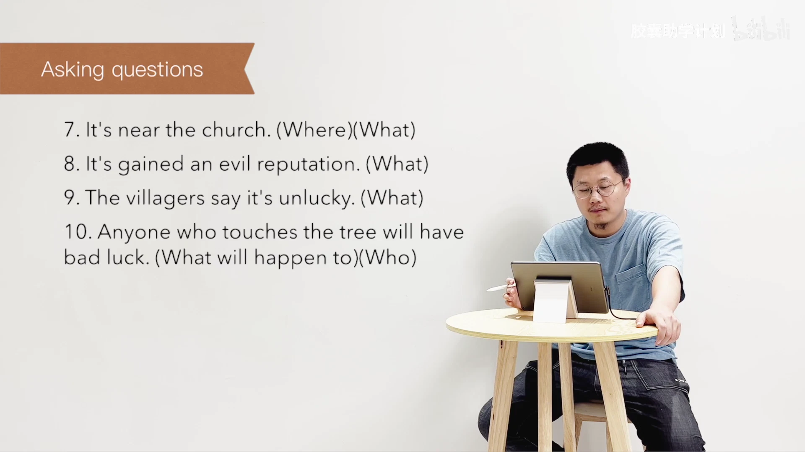

文字识别：Asking questions / 7. Ilt's near the church. (Where)(What) / 8. It's gained an evil reputation. (What) / 9. The villagers say it's unlucky. (What) / 10. Anyone who touches the tree will have / bad luck. (What will happen to)(Who)

## 00:04:00–00:04:30

touches the tree will have bad luck. 注意这里，这是个从句，修饰 anyone 的，所以我们不用 touches，我们用的是 will 提前，对吧？答案我说一下，叫 Will anyone who touches the tree have bad luck? 那 What will happen to? 会发生什么？那就是 What will happen to anyone who touches the tree? 就可以了，对吧？啊， who 对主语提问啊？ Who will have bad luck? Okay. 呃，第十一个， The weaker's

### 画面 00:04:03

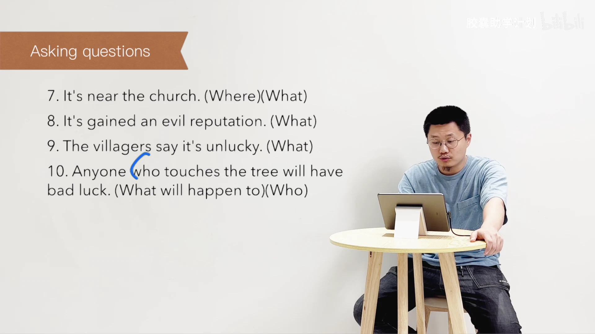

文字识别：Asking questions / 7. Ilt's near the church. (Where)(What) / 8. It's gained an evil reputation. (What) / 9. The villagers say it's unlucky. (What) / 10. Anyone Who touches the tree will have / bad luck. (What will happen to)(Who)

### 画面 00:04:05

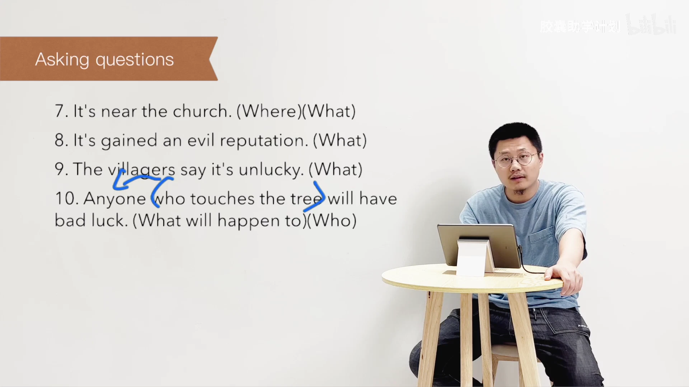

文字识别：Asking questions / 7. It's near the church. (Where)(What) / 8. It's gained an evil reputation. (What) / 9. The vilaers say i's unlucky. (What) / 10.Anyone Who touches the tree will have / bad luck. (What will happen to)(Who)

### 画面 00:04:08

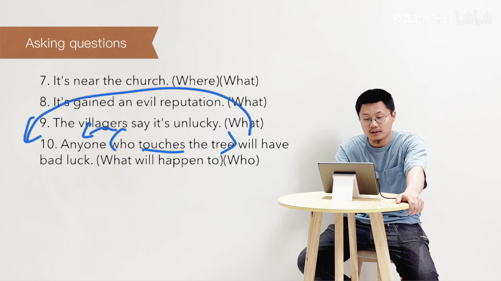

文字识别：Asking questions / 7. It's near the church. (Where)(What) / 8. It's gained an evil reputation. (What) / 9.The /  viHaers say it's unlucky. What) / 10.Anyone / Who touches the tree will have / bad luck. (What will happen to)(Who)

### 画面 00:04:16

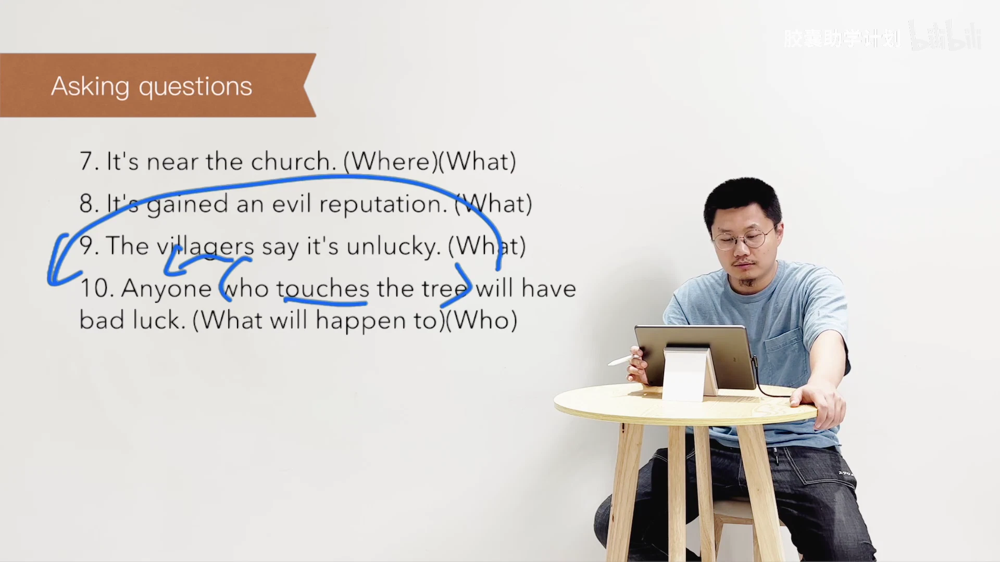

文字识别：Asking questions / 7. It's near the church.(Where)(What) / 8. It's gained an evil reputation. (What) / 9.The\ / e vijlaers say i's unlucky. (What) / 10.Anyone / who touches the tree will have / bad luck. (What will happen to)(Who)

### 画面 00:04:25

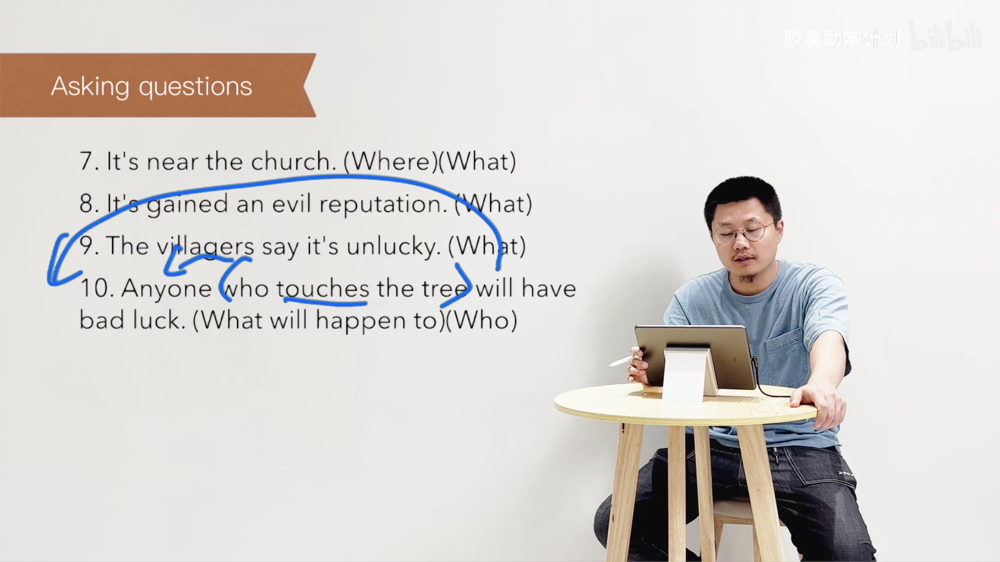

文字识别：Asking questions / 7. It's near the church. (Where)(What) / 8. It's gained an evil reputation. (What) / 9.The\ / e viHlaers say it's unlucky. (What) / 10.Anyone / Who touches the tree will have / bad luck. (What will happen to)(Who)

### 画面 00:04:29

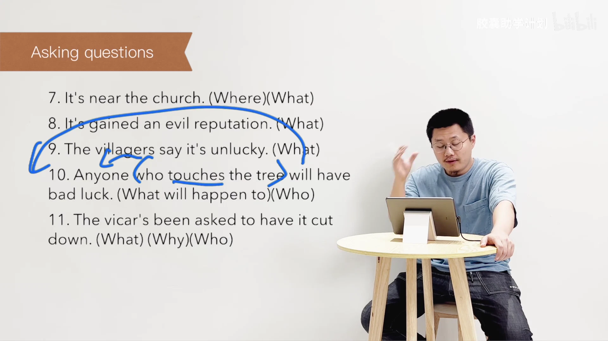

文字识别：Asking questions / 7. It's near the church. (Where)(What) / 8. It's gained an evil reputation. (What) / 9.The vilaers say it's unlucky. (What) / 10. Anyone Who touches the tree will have / bad luck. (What will happen to)(Who) / 11. The vicar's been asked to have it cut / down.(What) (Why)(Who)

## 00:04:30–00:05:00

been asked to have it cut down.这个P.S.是has啊，has提前。What对，他被要求去做什么，对吧？你可以说What has the wicker been asked to do？听见了吧？可以这样去聊啊。呃，Why可以加整句话，Who直接加主语，不用变一般疑问句。Tell the story，老习惯，各位可以看第一单元我做的那些示范，对吧？然后各位文章读熟了，拿着这些去做这个练习就可以了。不用怕

### 画面 00:04:48

文字识别：Tell the story / 训练目标： / 口语复述能力 / Accuracy / Fluency

### 画面 00:04:51

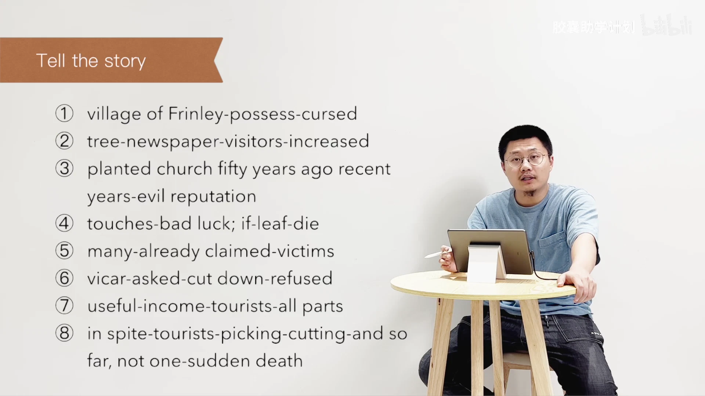

文字识别：Tell the story / 1 / village of Frinley-possess-cursed / tree-newspaper-visitors-increased / planted church fifty years ago recent / years-evil reputation / touches-bad luck; if-leaf-die / many-already claimed-victims / vicar-asked-cut down-refused / 6 / useful-income-tourists-all parts / in spite-tourists-picking-cutting-and so / 8 / far, not one-sudden death

### 画面 00:04:58

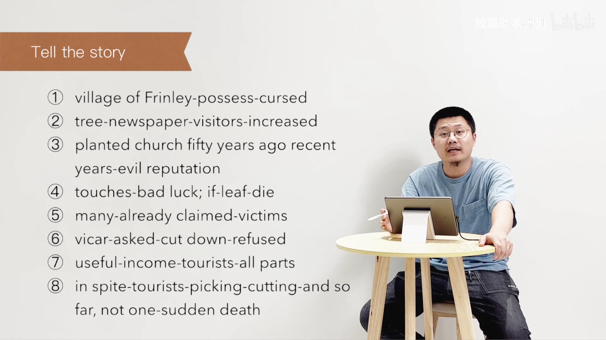

文字识别：Tell the story / 1 / village of Frinley-possess-cursed / tree-newspaper-visitors-increased / planted church fifty years ago recent / years-evil reputation / touches-bad luck; if-leaf-die / many-already claimed-victims / vicar-asked-cut down-refused / 6 / useful-income-tourists-all parts / in spite-tourists-picking-cutting-and so / far, not one-sudden death

## 00:05:00–00:05:30

有一点点错，但不能不流利啊。Composition连词使用的能力，这个我们在教材当中给了这里，给了这里啊，给了这里。我给大家做了答案，对吧？自己各位写完来对答案就行了。不懂的留言，好吧？呃，summary writing写完来这里还是老习惯，对一下答案。然后topic for discussion呢，我们只是看一下它的题啊。第一个，the Do you know a place a thing real or in

### 画面 00:05:02

文字识别：Composition: Key / 训练目标： / 连词使用能力

### 画面 00:05:05

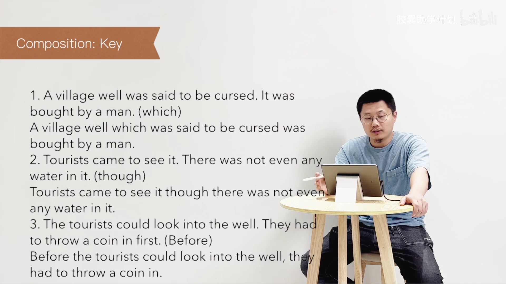

文字识别：Composition: Key / 1.A village well was said to be cursed. lt was / bought by a man.(which) / A village well which was said to be cursed was / bought by a man. / 2. Tourists came to see it. There was not even any / water in it. (though) / Tourists came to see it though there was not even / any water in it. / 3. The tourists could look into the well. They had / to throw a coin in first. (Before) / Before the tourists could look into the well, they / had to throw a coin in.

### 画面 00:05:08

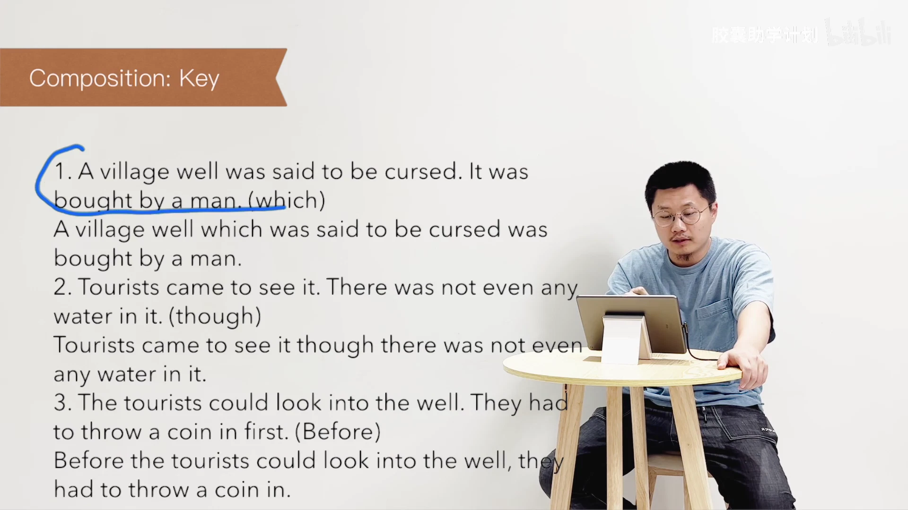

文字识别：Composition: Key / 1.A village well was said to be cursed. It was / bought by a man.(which) / A village well which was said to be cursed was / bought by a man. / 2. Tourists came to see it. There was not even any / water in it. (though) / Tourists came to see it though there was not even / any water in it. / 3. The tourists could look into the well. They had / to throw a coin in first. (Before) / Before the tourists could look into the well, they / had to throw a coin in.

### 画面 00:05:10

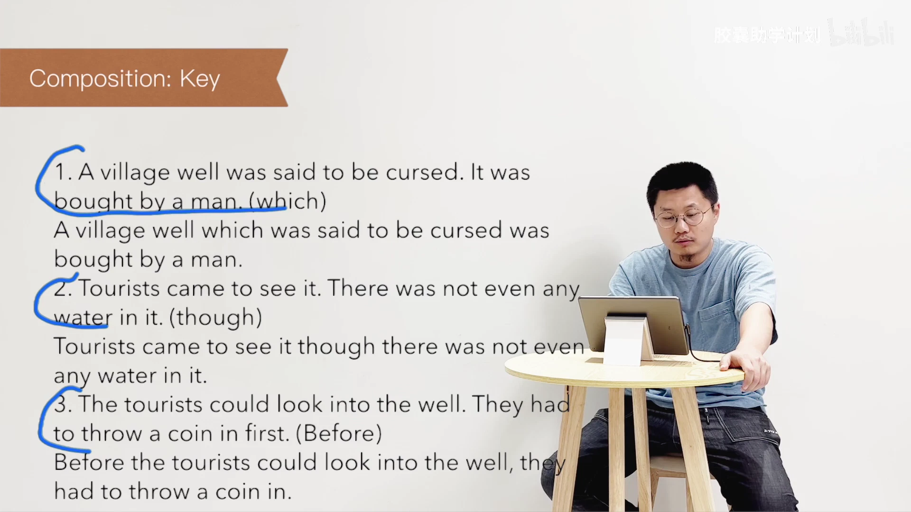

文字识别：Composition: Key / 1.A village well was said to be cursed. Ilt was / bought by a man.(which) / A village well which was said to be cursed was / bought by a man. / Z.Tourists came to see it. There was not even any / water in it. (though) / Tourists came to see it though there was not even / any water in it. / 3.The tourists could look into the well. They had / to throw a coin in first. (Before) / Before the tourists could look into the well, they / had to throw a coin in.

### 画面 00:05:13

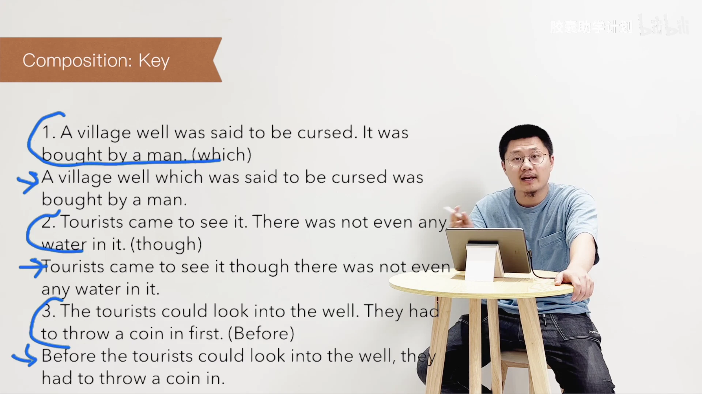

文字识别：Composition: Key / 1.A village well was said to be cursed. lt was / bought by a man.(which) / A village well which was said to be cursed was / bought by a man. / Z.Tourists came to see it. There was not even any, / water in it. (though) / Fourists came to see it though there was not even / any water in it. / 3.The tourists could look into the well. They had / to throw a coin in first. (Before) / Before the tourists could look into the well, they / had to throw a coin in.

### 画面 00:05:16

文字识别：Summary writing: Key / 训练目标： / 写作复述能力

### 画面 00:05:18

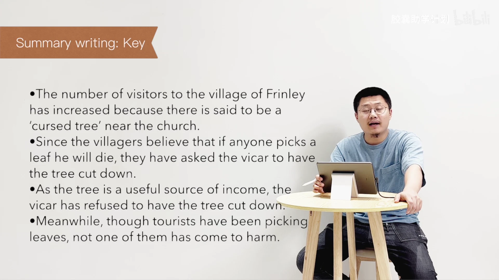

文字识别：计 / Summary writing: Key / •The number of visitors to the village of Frinley / has increased because there is said to be a / 'cursed tree'near the church. / •Since the villagers believe that if anyone picks a / leaf he will die, they have asked the vicar to have, / the tree cut down. / •As the tree is a useful source of income, the / vicar has refused to have the tree cut down. / •Meanwhile, though tourists have been picking / leaves, not one of them has come to harm.

### 画面 00:05:21

文字识别：Topics for discussion / 训练目标： / 完全自由的对话 / Accuracy / Fluency

### 画面 00:05:23

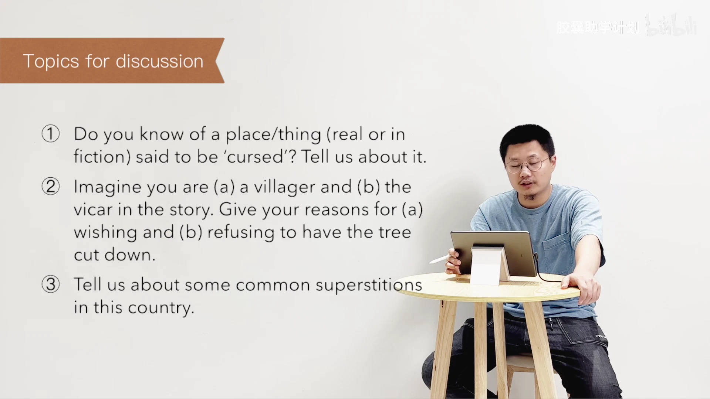

文字识别：Topics for discussion / Do you know of a place/thing (real or in / fiction) said to be'cursed'? Tell us about it. / Imagine you are (a) a villager and (b) the / vicar in the story. Give your reasons for (a) / wishing and (b) refusing to have the tree / cut down. / Tell us about some common superstitions / in this country.

## 00:05:30–00:06:00

said to be cursed. Tell us about it.说你知道有这么一个地方，会有这么一个东西啊，可以是真的，可以是虚拟的。说据说呀，被诅咒了。给我们讲讲这个事儿啊。第二个，说Imagine, imagine you are villager.假设你是一个村民，and the waker,呃，in the story，以及这个牧师，give you a reason for wishing and refusing to have

### 画面 00:05:45

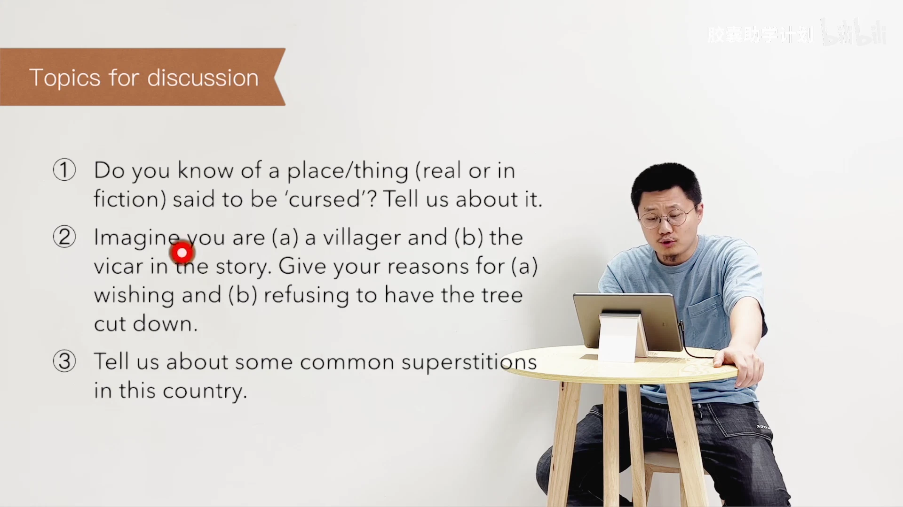

文字识别：Topics for discussion / Do you know of a place/thing (real or in / fiction) said to be'cursed'? Tell us about it. / Imagine you are (a) a villager and (b) the / vicar in tne story. Give your reasons for (a) / wishing and (b) refusing to have the tree / cut down. / Tell us about some common superstitions / in this country.

## 00:06:00–00:06:30

the tree cut down.说你希望砍掉这个树或者保留这个树的原因是什么？你给出原因就行了，是吧？那最后一个说，Tell us about some common superstitions in this country.说你讲一讲在我们国家当中很常见的那些封建迷信，对吧？所谓的迷信有哪些？Superstition嘛，对吧？OK，那家庭作业，Ask me if一定要先写再大声朗读，只要写作写完来这对答案。Tell the story，口语复述，重复间隔，看

### 画面 00:06:15

文字识别：Topics for discussion / Do you know of a place/thing (real or in / fiction) said to be'cursed'? Tell us about it. / Imagine you are (a) a villager and (b) the / vicar in the story. Give your reasons for (a) / wishing and (b) refusing to have the tree / cut down. / Tell us about some common superstitions / in this country.

### 画面 00:06:20

文字识别：1.Ask me if写&朗读

### 画面 00:06:22

文字识别：1.Ask me if写&朗读

### 画面 00:06:24

文字识别：1.Ask me if写&朗读 / 2.摘要写作写&答案

### 画面 00:06:26

文字识别：1.Askme if写&朗读 / 摘要写作写&答案 / 3.Tell the story 口语复述

### 画面 00:06:28

文字识别：子计划 / 宁 / 1.Askme if写&朗读 / 摘要写作写&答案 / 3.Tell the story 口语复述 / 4.重复间隔（置顶留言） / 4.

## 00:06:30–00:06:56

置顶留言。那以上呢就是本期视频的全部内容了。如果各位喜欢我们的课程，欢迎各位关注、订阅、一键三连，分享给那些需要的朋友，来帮助我们快速成长。See you next time.

### 画面 00:06:30

文字识别：1.Ask me if写&朗读 / 摘要写作写&答案 / 3.Tell the story 口语复述 / 4.重复间隔（置顶留言)

### 画面 00:06:32

文字识别：子计划 / 不

### 画面 00:06:35

文字识别：子计划

### 画面 00:06:40

文字识别：勋学计划，

### 画面 00:06:42

文字识别：勋学计划一

### 画面 00:06:44

文字识别：CAPSULEACADEMY / 胶囊助学计划 / 小红书 / 证 / OE

### 画面 00:06:46

文字识别：CAPSULEACADEMY / 胶囊助学计划 / 小红书 / Leo / OE

### 画面 00:06:52

文字识别：CAPSULEACADEMY / 胶囊助学计划 / 『 / 小红书 / Creator / Leo & Berlin / OE

### 画面 00:06:54

文字识别：bilibili / 胶囊助学计划

### 画面 00:06:55

文字识别：bilibili / 胶囊助学计划

