# 059 单词

快速机器解析：语音为单模型转写，未进行独立交叉校对或人工复核；画面每秒采样并按变化选帧，短时文字和标记可能遗漏。截图时间约有 1 秒误差。图片有损压缩；遇到疑点请按时间查看 Google Drive 原视频。

## 00:00:00–00:00:30

Hello everyone, welcome to Capsule Academy. This is Leo. Today we're going to learn new Concept English Book Two Lesson Fifty Nine Words. 那老习惯进入正式课程之前，咱们看几个问题啊。首先，如何表达变成做某件事情的专家，或者说成为做某件事情的专家？接下来呢，如何表达有习惯做某件事情？最后一个说如何表达从什么东西当中移除某个东西啊？某移除某物。

### 画面 00:00:00

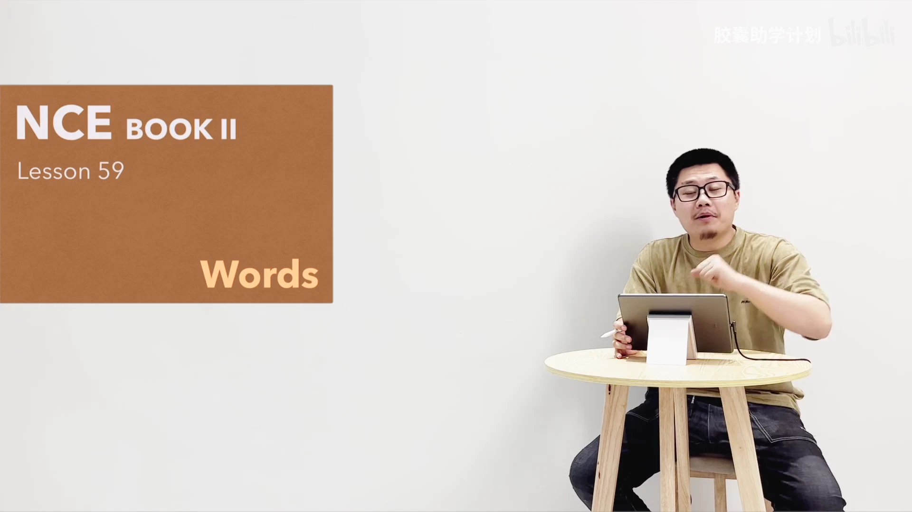

文字识别：NCE / BOOKII / Lesson 59 / Words

### 画面 00:00:05

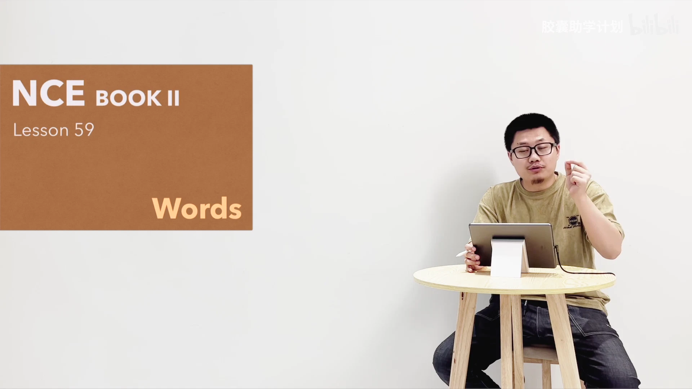

文字识别：NCE / BOOKI"I / Lesson 59 / Words

### 画面 00:00:08

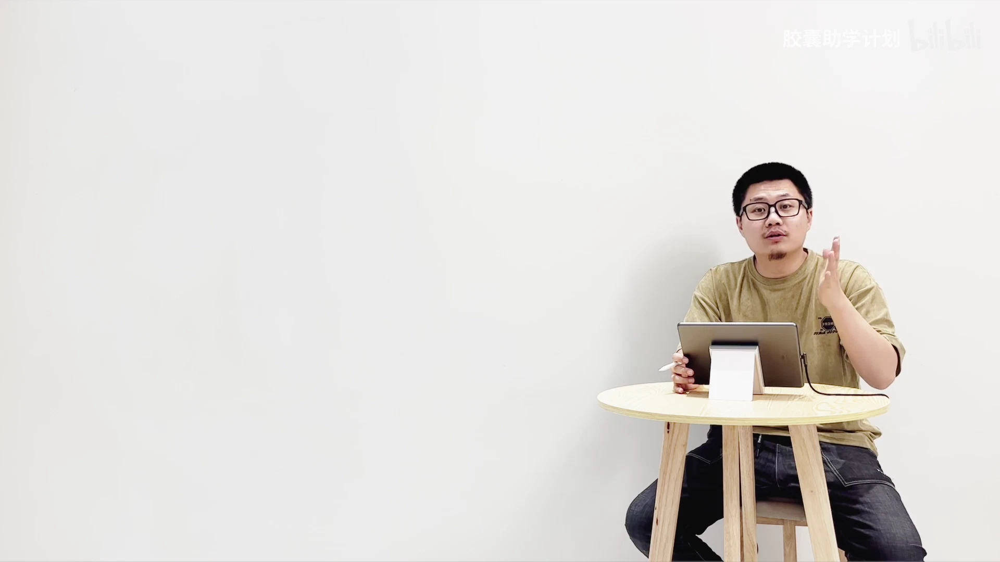

文字识别：CNO

### 画面 00:00:10

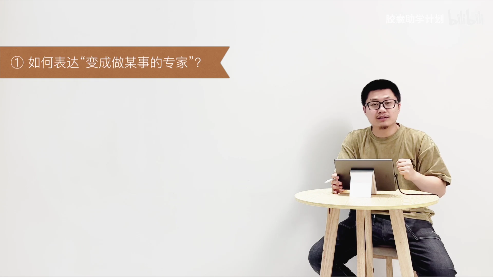

文字识别：①如何表达“变成做某事的专家”?

### 画面 00:00:19

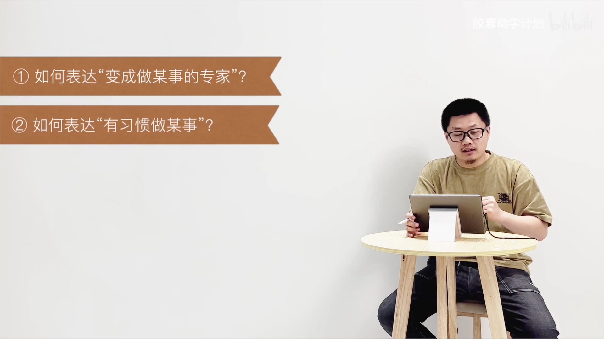

文字识别：①如何表达“变成做某事的专家”？ / 如何表达“有习惯做某事”? / RON

### 画面 00:00:21

文字识别：①如何表达“变成做某事的专家”？ / 如何表达“有习惯做某事”?

### 画面 00:00:23

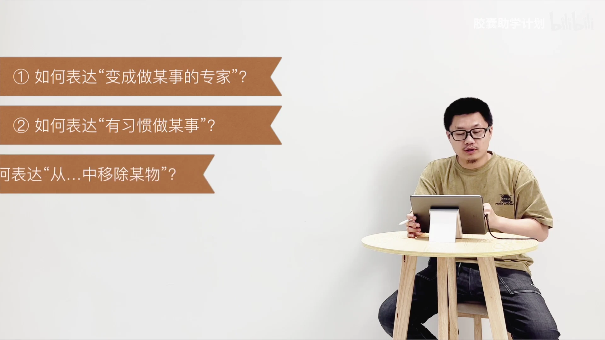

文字识别：①如何表达“变成做某事的专家”？ / 如何表达“有习惯做某事”? / 可表达“从..中移除某物”?

### 画面 00:00:25

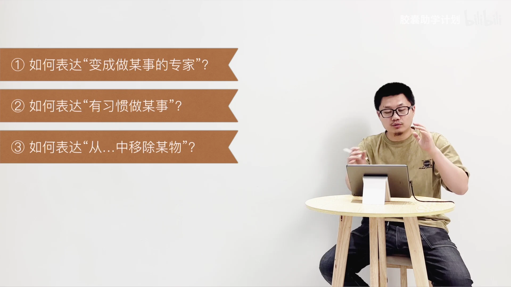

文字识别：①如何表达“变成做某事的专家”？ / 如何表达“有习惯做某事”? / 如何表达“从.中移除某物”?

## 00:00:30–00:01:00

OK，那带着这三个问题，hope you gonna enjoy。好，第一个单词跟我一起读一下，看音标啊。这个地方我们是可以，因为有字母R，在讲音标的时候咱们提过，可以考虑加儿化音，也可以不加，英式美式小的区别，但差别不大，对吧？由个人习惯决定。你像我是北方人，我加儿化音就很舒服，我给它读成work。OK，好，那work什么意思呢？就是一般指

### 画面 00:00:33

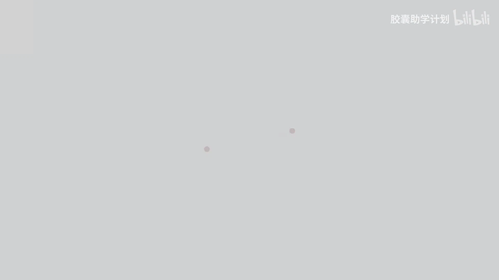

文字识别：胶囊助学计划bill

### 画面 00:00:37

文字识别：胶囊助学计划

### 画面 00:00:39

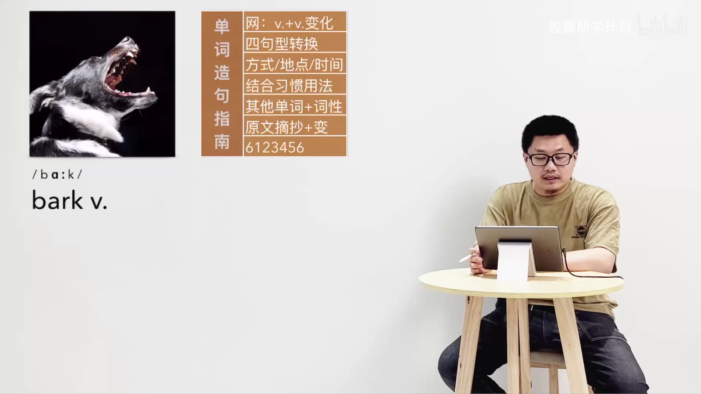

文字识别：单词造句指南 / 网：v.+v.变化 / 四句型转换 / 方式/地点/时间 / 结合习惯用法 / 其他单词+词性 / 原文摘抄+变 / 6123456 / /ba:k/ / bark v.

### 画面 00:00:41

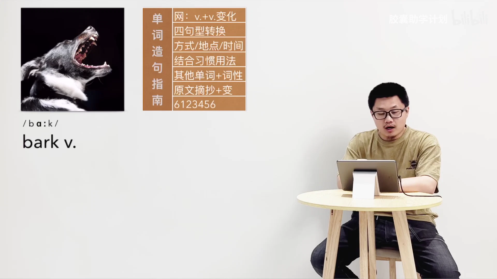

文字识别：单词造句指南 / 网：v.+v.变化 / 四句型转换 / 方式/地点/时间 / 结合习惯用法 / 其他单词+词性 / 原文摘抄+变 / 6123456 / /ba:k/ / bark v.

### 画面 00:00:43

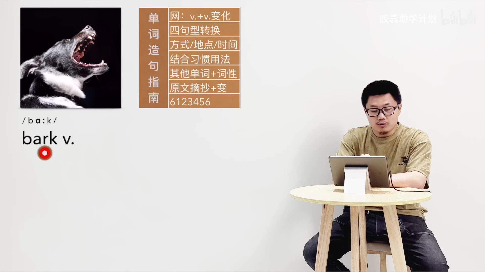

文字识别：单词造句指南 / 网：v.+v.变化 / 四句型转换 / 方式/地点/时间 / 结合习惯用法 / 其他单词+词性 / 原文摘抄+变 / 6123456 / /ba:k/ / bark v.

### 画面 00:00:45

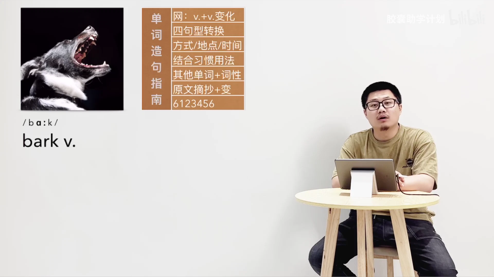

文字识别：单词造句指南 / 网：v.+v.变化 / 四句型转换 / 方式/地点/时间 / 结合习惯用法 / 其他单词+词性 / 原文摘抄+变 / 6123456 / /ba:k/ / bark v.

## 00:01:00–00:01:30

的是最呃这个核心的含义，就是指的是狗叫啊，哎吠啊，狂吠啊，狗叫bark。比如说，if the dogs know you，这是我造了一个句子，they won't bark at all。如果狗认识你知道你的话，那他们根本就不会叫。这是由我们常识去判断出来的。那这个地方咱们用到的语法，十六课咱学的if引导条件状语从句。接下来下一个句子说，Look， a number of

### 画面 00:01:09

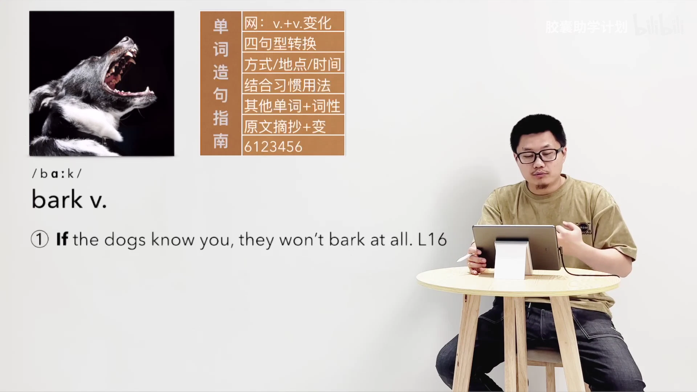

文字识别：单词造句指南 / 网：v.+v.变化 / 四句型转换 / 方式/地点/时间 / 结合习惯用法 / 其他单词+词性 / 原文摘抄+变 / 6123456 / /ba:k/ / bark v. / If the dogs know you, they won't bark at all. L16

### 画面 00:01:11

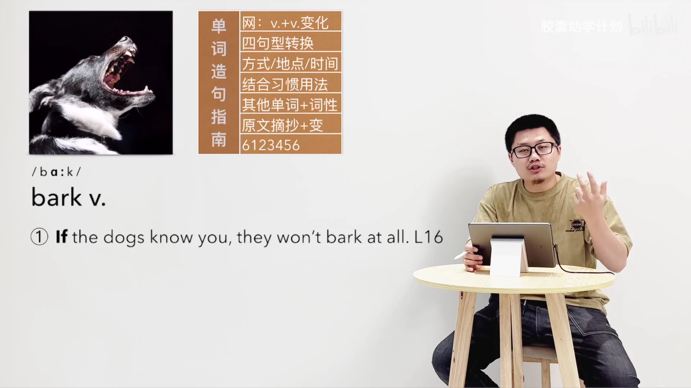

文字识别：单词造句指南 / 网：v.+v.变化 / 四句型转换 / 方式/地点/时间 / 结合习惯用法 / 其他单词+词性 / 原文摘抄+变 / 6123456 / /ba:k/ / bark v. / If the dogs know you, they won't bark at all. L16

### 画面 00:01:15

文字识别：单词造句指南 / 网：v.+v.变化 / 四句型转换 / 方式/地点/时间 / 结合习惯用法 / 其他单词+词性 / 原文摘抄+变 / 6123456 / /ba:k/ / bark v. / If the dogs know you, they won't bark at all. L16

### 画面 00:01:17

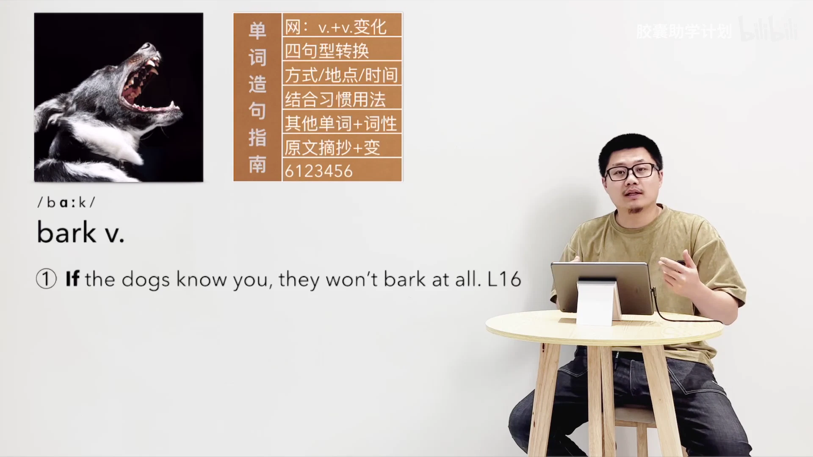

文字识别：单词造句指南 / 网：v.+v.变化 / 四句型转换 / 方式/地点/时间 / 结合习惯用法 / 其他单词+词性 / 原文摘抄+变 / 6123456 / /ba:k/ / bark v. / If the dogs know you, they won't bark at all. L16

### 画面 00:01:21

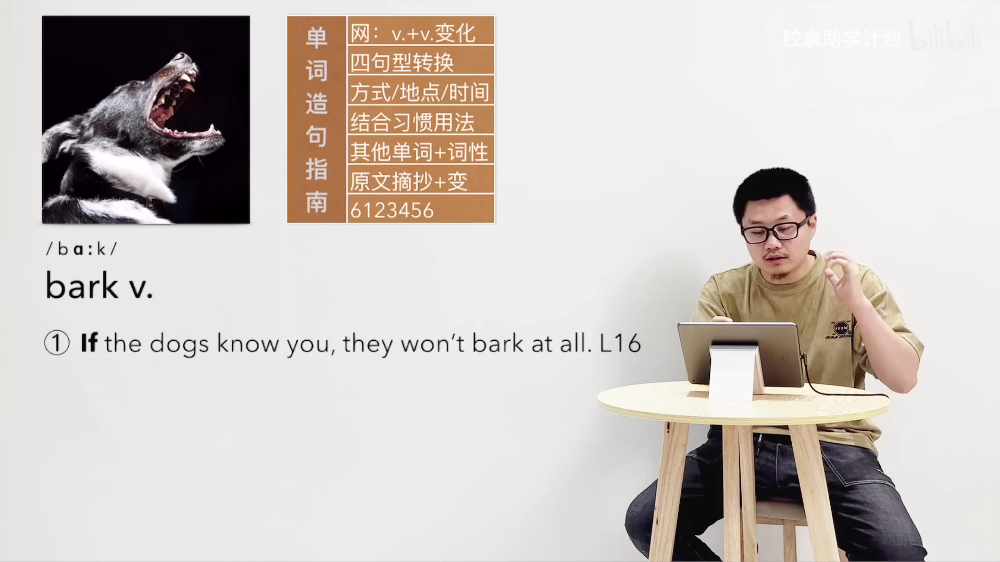

文字识别：单词造句指南 / 网：v.+v.变化 / 四句型转换 / 方式/地点/时间 / 结合习惯用法 / 其他单词+词性 / 原文摘抄+变 / 6123456 / /ba:k/ / bark v. / If the dogs know you, they won't bark at all. L16

### 画面 00:01:26

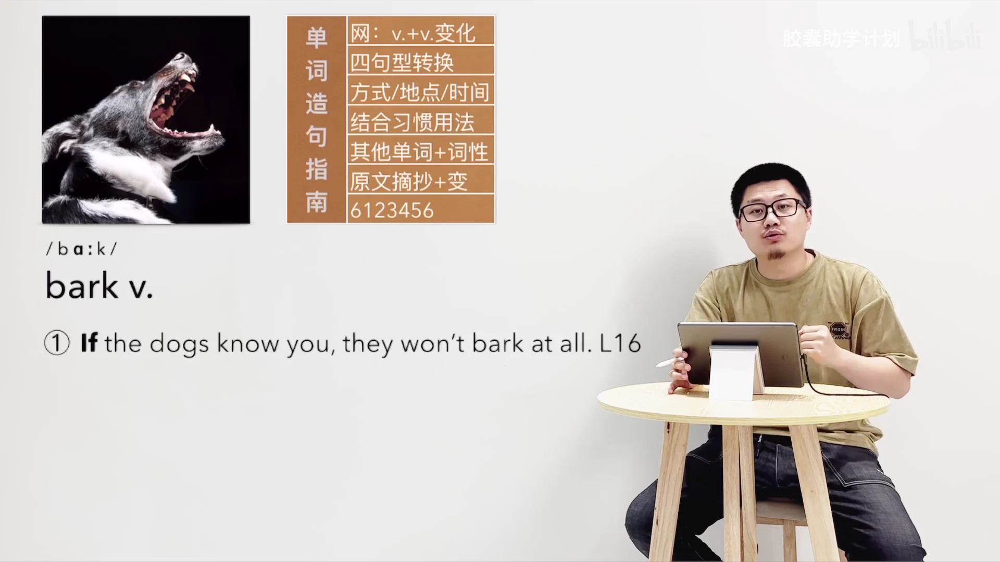

文字识别：单词造句指南 / 网：v.+v.变化 / 四句型转换 / 方式/地点/时间 / 结合习惯用法 / 其他单词+词性 / 原文摘抄+变 / 6123456 / /ba:k/ / bark v. / If the dogs know you, they won't bark at all. L16

### 画面 00:01:28

文字识别：单词造句指南 / 网：v.+v.变化 / 四句型转换 / 方式/地点/时间 / 结合习惯用法 / 其他单词+词性 / 原文摘抄+变 / 6123456 / /ba:k/ / bark v. / If the dogs know you, they won't bark at all. L16 / ② Look, a number of dogs are barking at him. L58

## 00:01:30–00:02:00

dogs are barking at him.好，这里呢实际上用到了五十八课咱们刚刚学过的叫a number of。其次呢，这里的be加doing是各位很熟悉的现在进行时。OK, next one说，It was Leo that the dog barked at, not you.好了，注意啊，这里是强调句啊，不是Leo冲着狗狂吠啊，是这个狗冲着啊狂吠，冲着这个Leo，而不是你，强调句对吧？

### 画面 00:01:30

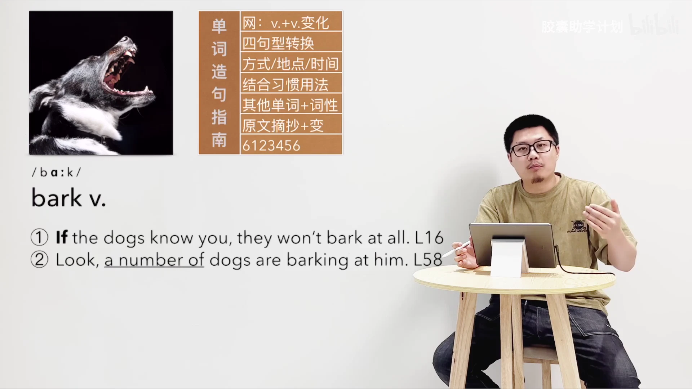

文字识别：单词造句指南 / 网：v.+v.变化 / 四句型转换 / 方式/地点/时间 / 结合习惯用法 / 其他单词+词性 / 原文摘抄+变 / 6123456 / /ba:k/ / bark v. / If the dogs know you, they won't bark at all. L16 / ② Look, a number of dogs are barking at him. L58

### 画面 00:01:36

文字识别：单词造句指南 / 网：v.+v.变化 / 四句型转换 / 方式/地点/时间 / 结合习惯用法 / 其他单词+词性 / 原文摘抄+变 / 6123456 / /ba:k/ / bark v. / If the dogs know you, they won't bark at all. L16 / ② Look, a number of dogs are barking at him. L58

### 画面 00:01:40

文字识别：单词造句指南 / 网：v.+v.变化 / 四句型转换 / 方式/地点/时间 / 结合习惯用法 / 其他单词+词性 / 原文摘抄+变 / 6123456 / /ba:k/ / bark v. / If the dogs know you, they won't bark at all. L16 /  Look, a number of dogs are barking at him. L58

### 画面 00:01:44

文字识别：单词造句指南 / 网：v.+v.变化 / 四句型转换 / 方式/地点/时间 / 结合习惯用法 / 其他单词+词性 / 原文摘抄+变 / 6123456 / /ba:k/ / bark v. / If the dogs know you, they won't bark at all. L16 /  Look, a number of dogs are barking at him. L58 / 2） / It was Leo that the dog barked at, not you. L58

### 画面 00:01:50

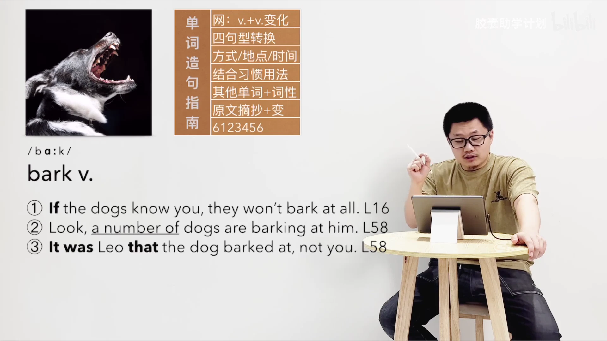

文字识别：单词造句指南 / 网：v.+v.变化 / 四句型转换 / 方式/地点/时间 / 结合习惯用法 / 其他单词+词性 / 原文摘抄+变 / 6123456 / /ba:k/ / bark v. / If the dogs know you, they won't bark at all. L16 /  Look, a number of dogs are barking at him. L58 / 2) / It was Leo that the dog barked at, not you. L58

### 画面 00:01:55

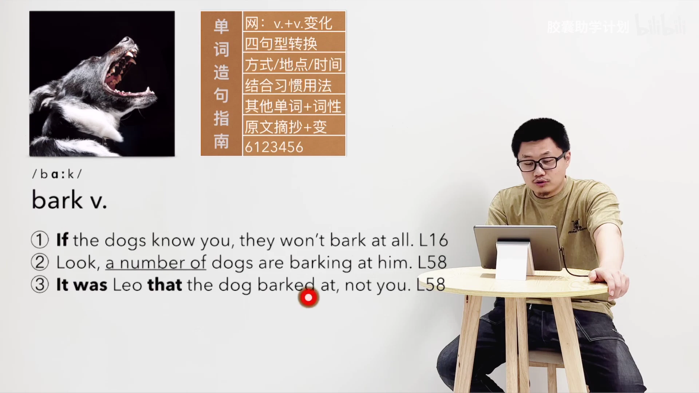

文字识别：单词造句指南 / 网：v.+v.变化 / 四句型转换 / 方式/地点/时间 / 结合习惯用法 / 其他单词+词性 / 原文摘抄+变 / 6123456 / /ba:k/ / bark v. / If the dogs know you, they won't bark at all. L16 / ) Look, a number of dogs are barking at him. L58 / 2) / It was Leo that the dog barked at, not you. L58

## 00:02:00–00:02:30

呃，it was that中间强调部分强调的是lail，后边是句子的剩余部分叫the bark at that the dog bark at，OK very good，呃，那你看这个用法叫don't bark at me，你想一下，我猜我猜你应该能感觉的出来，这是人对人说的，而不是人对狗说的，所以它其实有的时候有一点侮辱的含义，对吧？你别冲我狗叫

### 画面 00:02:00

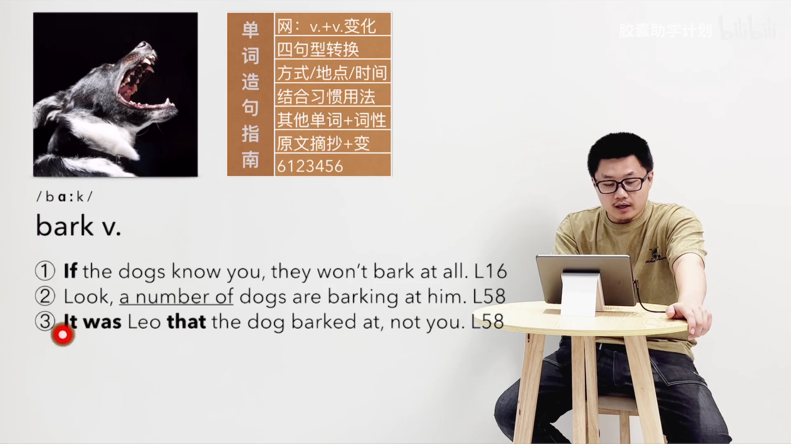

文字识别：单词造句指南 / 网：v.+v.变化 / 四句型转换 / 方式/地点/时间 / 结合习惯用法 / 其他单词+词性 / 原文摘抄+变 / 6123456 / /ba:k/ / bark v. / If the dogs know you, they won't bark at all. L16 / ② Look, a number of dogs are barking at him. L58 / ③ It was Leo that the dog barked at, not you. L58

### 画面 00:02:05

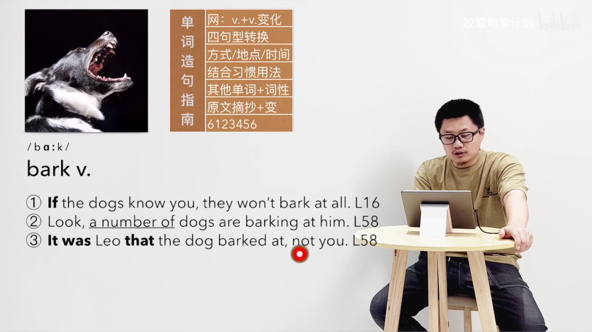

文字识别：单词造句指南 / 网：v.+v.变化 / 四句型转换 / 方式/地点/时间 / 结合习惯用法 / 其他单词+词性 / 原文摘抄+变 / 6123456 / /ba:k/ / bark v. / If the dogs know you, they won't bark at all. L16 /  Look, a number of dogs are barking at him. L58 / 2) / It was Leo that the dog barked at, not you. L58

### 画面 00:02:14

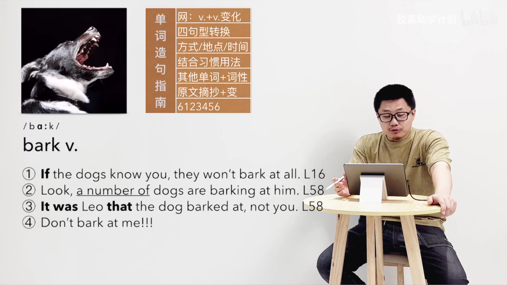

文字识别：单词造句指南 / 网：v.+v.变化 / 四句型转换 / 方式/地点/时间 / 结合习惯用法 / 其他单词+词性 / 原文摘抄+变 / 6123456 / /ba:k/ / bark v. / If the dogs know you, they won't bark at all. L16 /  Look, a number of dogs are barking at him. L58 / 2） / It was Leo that the dog barked at, not you. L58 / D Don't bark at me!!!

## 00:02:30–00:03:00

啊！OK，比如说，你看这个电影片段，他是一个人对着另一个人说，说 Are you gonna bark all day, little doggy? 啊，他说你打算这么狂叫一天吗，小狗吧？对吧？哎，它是有一个贬损的意味在里面的。OK，叫 bark。OK，那我们听一下。Are you gonna bark all day, little doggy? Very good. Next one. 这个就是直接真的就是狗了，因为你看主语就是狗嘛，对吧？

### 画面 00:02:30

文字识别：单词造句指南 / 网：v.+v.变化 / 四句型转换 / 方式/地点/时间 / 结合习惯用法 / 其他单词+词性 / 原文摘抄+变 / 6123456 / /ba:k/ / bark v. / If the dogs know you, they won't bark at all. L16 /  Look, a number of dogs are barking at him. L58 / It was Leo that the dog barked at, not you. L58 / D Don't bark at me!!!

### 画面 00:02:32

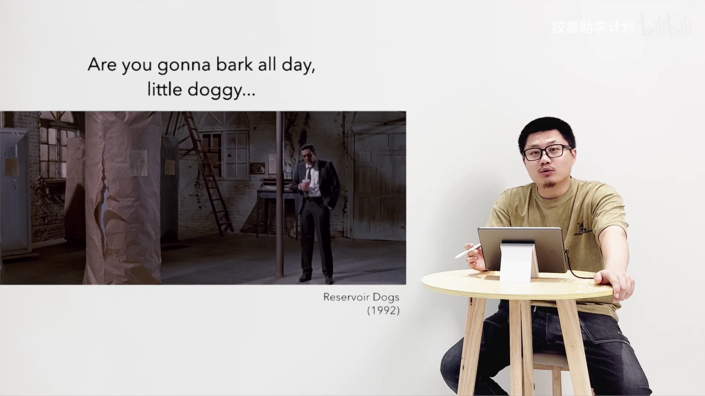

文字识别：Are you gonna bark all day, / little doggy… / Reservoir Dogs / (1992)

### 画面 00:02:46

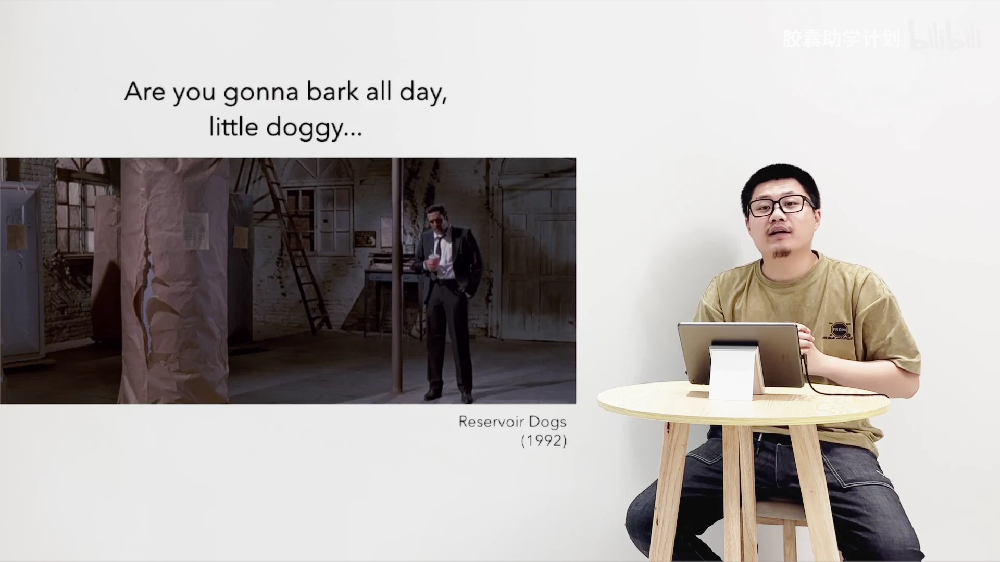

文字识别：Are you gonna bark all day, / little doggy…. / Reservoir Dogs / (1992)

### 画面 00:02:53

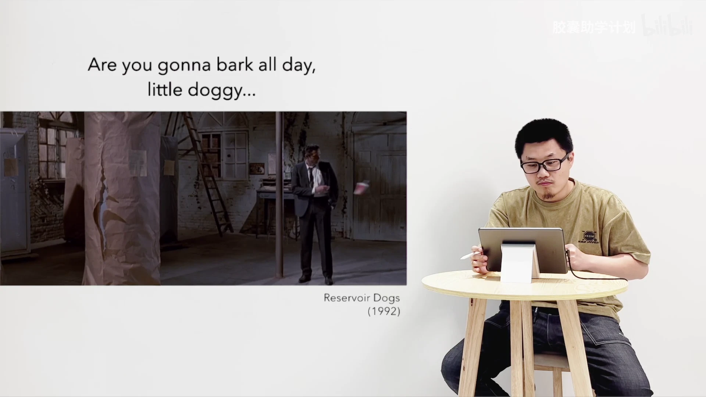

文字识别：Are you gonna bark all day, / little doggy… / Reservoir Dogs / (1992)

### 画面 00:02:55

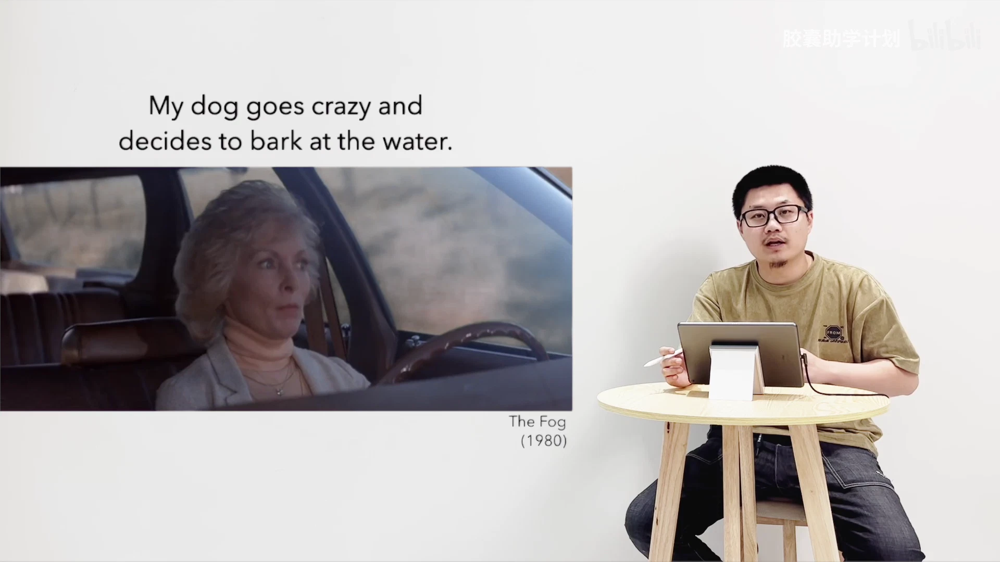

文字识别：My dog goes crazy and / decides to bark at the water. / The Fog / (1980)

## 00:03:00–00:03:30

说 My dog goes crazy, 哎，发疯了， and decides to bark at the water, 开始冲着水大叫。 My dog goes crazy and decides to bark at the water. Next one, 下一个单词 press, 哎，这是口语当中很常见的一个单词，叫按压，对吧？比如说，那 press the button, 哎，press the button 就是按压这个按钮，对吧？那我可以问 Did you press the button? Very good. 那我也可以把它变成四

### 画面 00:03:08

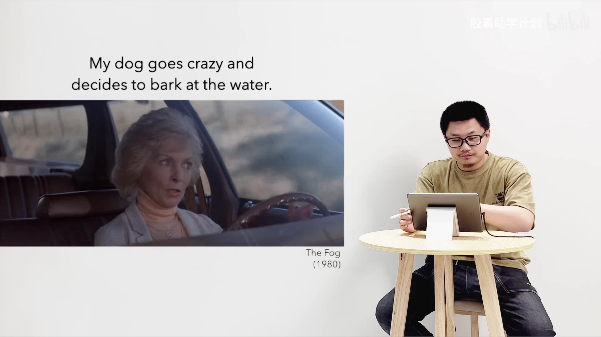

文字识别：My dog goes crazy and / decides to bark at the water. / The Fog / (1980)

### 画面 00:03:10

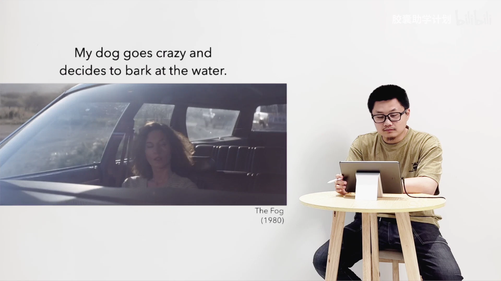

文字识别：My dog goes crazy and / decides to bark at the water. / The Fog / (1980)

### 画面 00:03:12

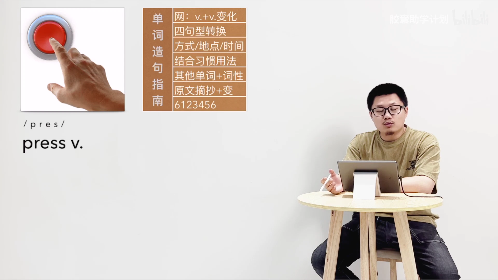

文字识别：单词造句指南 / 网：v.+v.变化 / 四句型转换 / 方式/地点/时间 / 结合习惯用法 / 其他单词+词性 / 原文摘抄+变 / 6123456 / /pres/ / press v.

### 画面 00:03:15

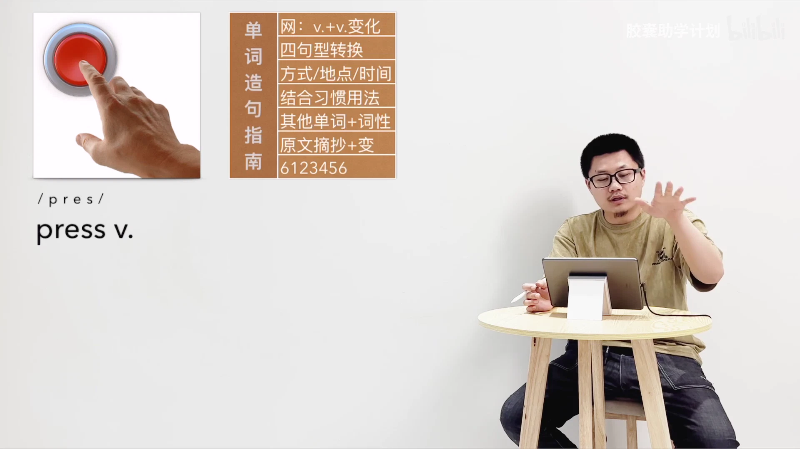

文字识别：单词造句指南 / 网：v.+v.变化 / 四句型转换 / 方式/地点/时间 / 结合习惯用法 / 其他单词+词性 / 原文摘抄+变 / 6123456 / /pres/ / press v.

### 画面 00:03:20

文字识别：单词造句指南 / 网：v.+v.变化 / 四句型转换 / 方式/地点/时间 / 结合习惯用法 / 其他单词+词性 / 原文摘抄+变 / 6123456 / /pres / / press v. / ① Did you press the button?

### 画面 00:03:24

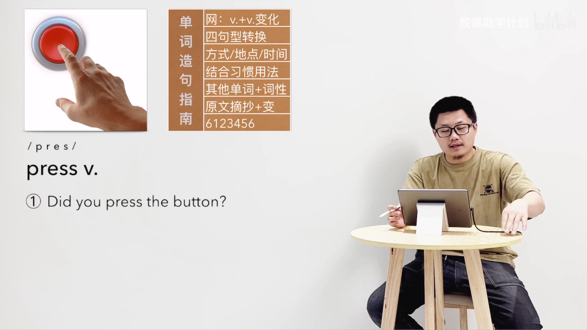

文字识别：单词造句指南 / 网：v.+v.变化 / 四句型转换 / 方式/地点/时间 / 结合习惯用法 / 其他单词+词性 / 原文摘抄+变 / 6123456 / /presl / press v. / ① Did you press the button?

### 画面 00:03:27

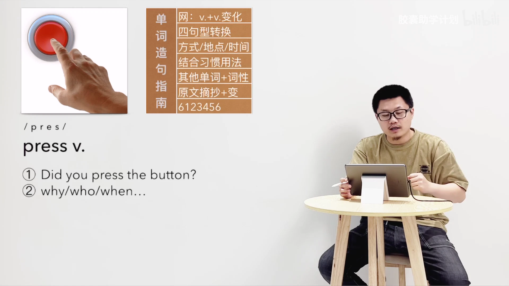

文字识别：单词造句指南 / 网：v.+v.变化 / 四句型转换 / 方式/地点/时间 / 结合习惯用法 / 其他单词+词性 / 原文摘抄+变 / 6123456 / /pres/ / press v. / ① Did you press the button? / why/who/when... / 2）

## 00:03:30–00:04:00

句型。那我们不多提，各位自己去处理啊。然后呢，我们来一个强调句，叫 It was Leo that pressed the button。很简单，对吧？Next one, he must have pressed the button. Must have done，当时一定是怎么怎么样了。OK， next one，说 Don't make me press that。别使我让我或者说逼迫我去按那个东西。OK， make somebody do something。五十七课咱们学的习

### 画面 00:03:30

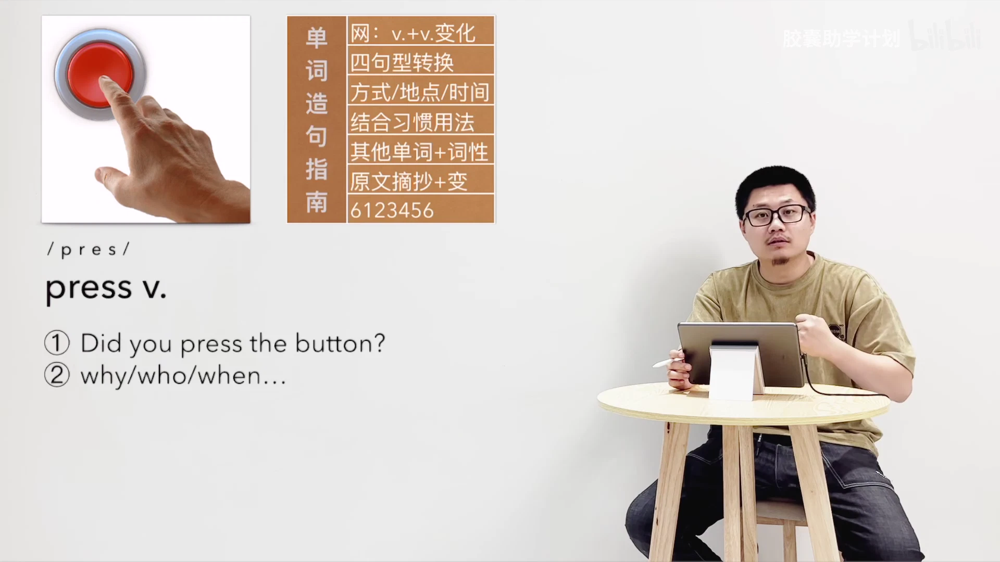

文字识别：单词造句指南 / 网：v.+v.变化 / 四句型转换 / 方式/地点/时间 / 结合习惯用法 / 其他单词+词性 / 原文摘抄+变 / 6123456 / /pres/ / press v. / ① Did you press the button? / ② why/who/when...

### 画面 00:03:33

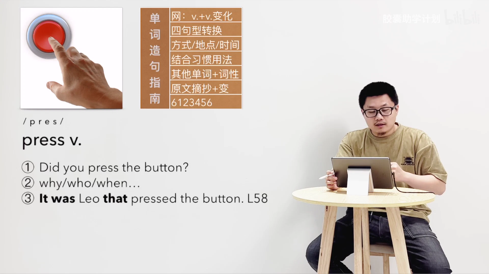

文字识别：单词造句指南 / 网：v.+v.变化 / 四句型转换 / 方式/地点/时间 / 结合习惯用法 / 其他单词+词性 / 原文摘抄+变 / 6123456 / /pres/ / press v. / ① Did you press the button? / why/who/when... / It was Leo that pressed the button. L58

### 画面 00:03:35

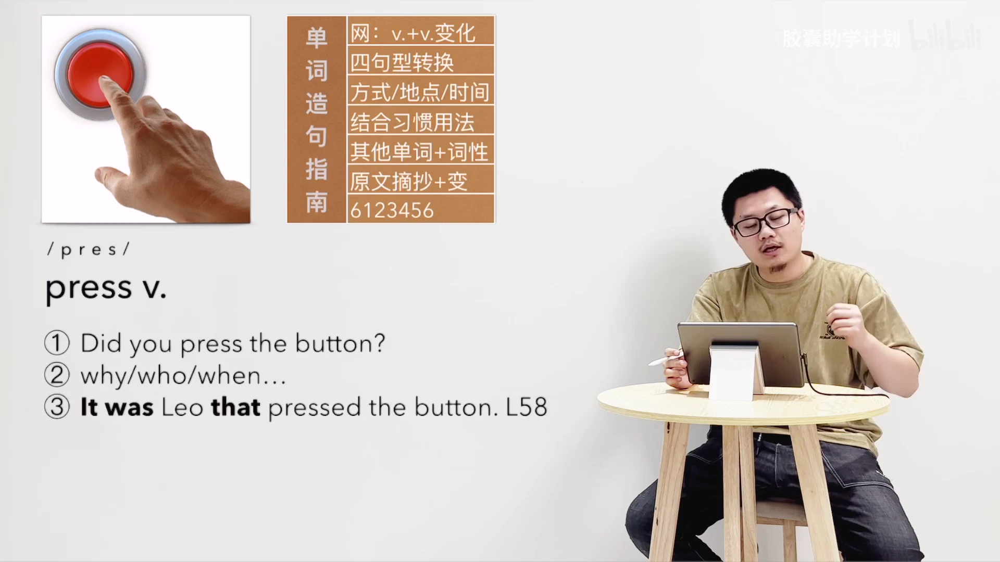

文字识别：单词造句指南 / 网：v.+v.变化 / 四句型转换 / 方式/地点/时间 / 结合习惯用法 / 其他单词+词性 / 原文摘抄+变 / 6123456 / /pres/ / press v. / ① Did you press the button? / why/who/when... / 2 / It was Leo that pressed the button. L58

### 画面 00:03:39

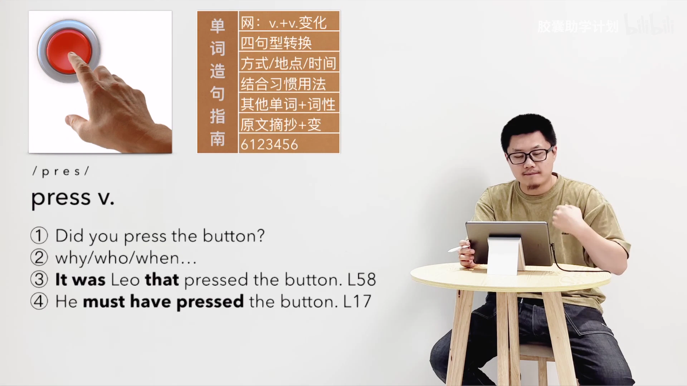

文字识别：单词造句指南 / 网：v.+v.变化 / 四句型转换 / 方式/地点/时间 / 结合习惯用法 / 其他单词+词性 / 原文摘抄+变 / 6123456 / /pres/ / press v. / ① Did you press the button? / why/who/when... / 2 / It was Leo that pressed the button. L58 /  He must have pressed the button. L17

### 画面 00:03:41

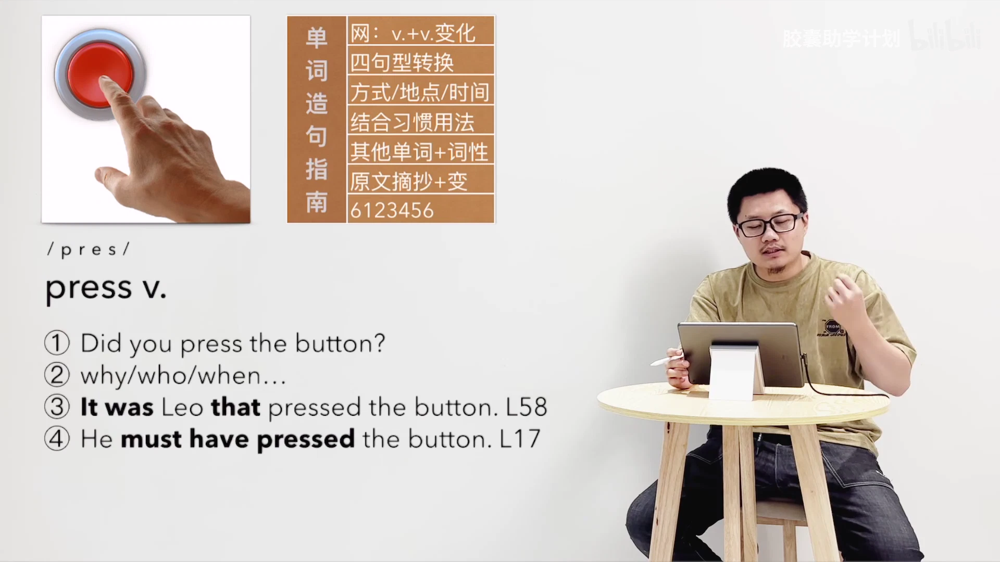

文字识别：单词造句指南 / 网：v.+v.变化 / 四句型转换 / 方式/地点/时间 / 结合习惯用法 / 其他单词+词性 / 原文摘抄+变 / 6123456 / /pres/ / press v. / ① Did you press the button? / why/who/when... / 2 / It was Leo that pressed the button. L58 / He must have pressed the button. L17

### 画面 00:03:43

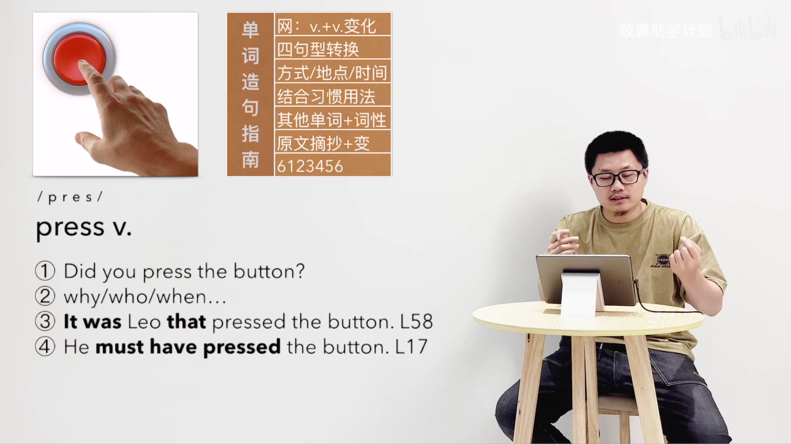

文字识别：单词造句指南 / 网：v.+v.变化 / 四句型转换 / 方式/地点/时间 / 结合习惯用法 / 其他单词+词性 / 原文摘抄+变 / 6123456 / /pres/ / press v. / ① Did you press the button? / why/who/when... / 2 / It was Leo that pressed the button. L58 / He must have pressed the button. L17

### 画面 00:03:45

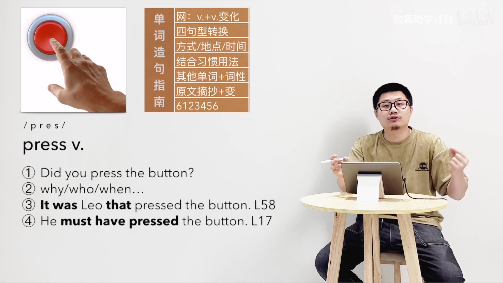

文字识别：单词造句指南 / 网：v.+v.变化 / 四句型转换 / 方式/地点/时间 / 结合习惯用法 / 其他单词+词性 / 原文摘抄+变 / 6123456 / /pres/ / press v. / ① Did you press the button? / why/who/when... / 2 / It was Leo that pressed the button. L58 / He must have pressed the button. L17

### 画面 00:03:48

文字识别：单词造句指南 / 网：v.+v.变化 / 四句型转换 / 方式/地点/时间 / 结合习惯用法 / 其他单词+词性 / 原文摘抄+变 / 6123456 / /pres/ / press v. / ① Did you press the button? / why/who/when... / 2） / It was Leo that pressed the button. L58 / He must have pressed the button. L17 / ) Don't make me press that. L57

### 画面 00:03:50

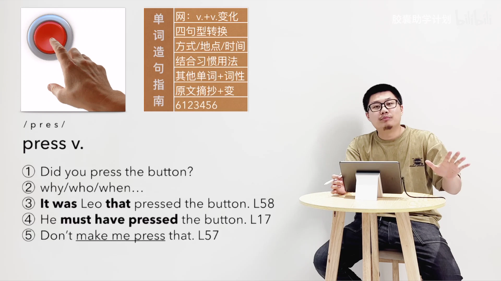

文字识别：单词造句指南 / 网：v.+v.变化 / 四句型转换 / 方式/地点/时间 / 结合习惯用法 / 其他单词+词性 / 原文摘抄+变 / 6123456 / /pres/ / press v. / ① Did you press the button? / why/who/when... / 2） / It was Leo that pressed the button. L58 / He must have pressed the button. L17 / ) Don't make me press that. L57

## 00:04:00–00:04:30

learned the habit usage. One, one. Next, next. Next

### 画面 00:04:01

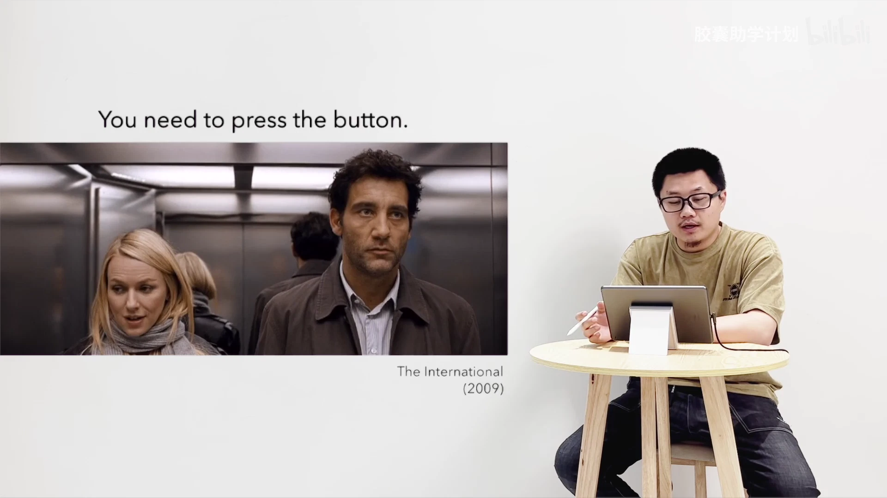

文字识别：You need to press the button. / The International / (2009)

### 画面 00:04:14

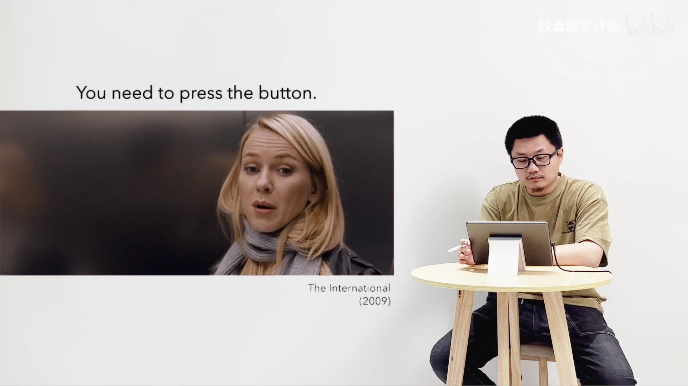

文字识别：You need to press the button. / The International / (2009)

### 画面 00:04:16

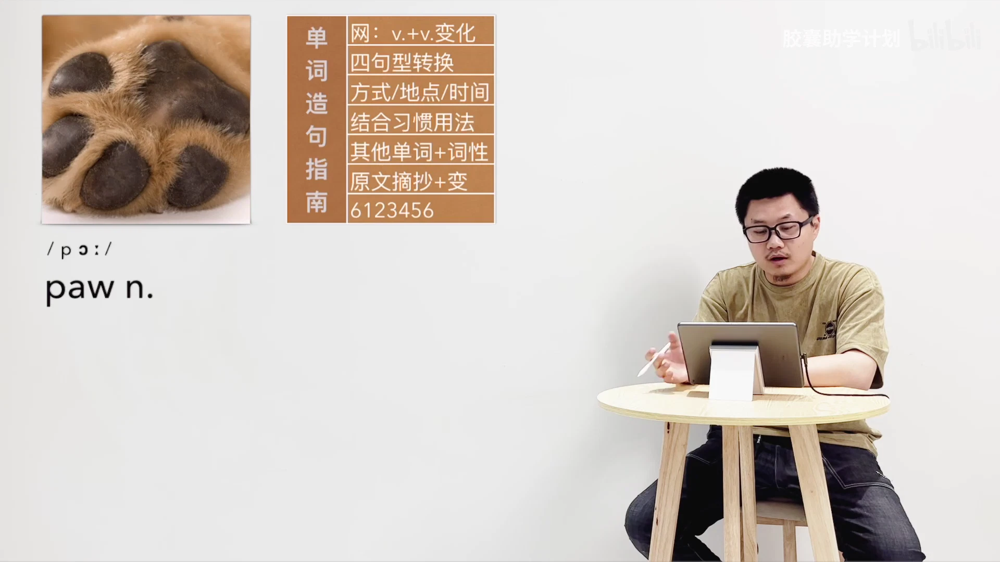

文字识别：单词造句指南 / 网：v.+v.变化 / 四句型转换 / 方式/地点/时间 / 结合习惯用法 / 其他单词+词性 / 原文摘抄+变 / 6123456 / /ρo:1 / paw n.

### 画面 00:04:18

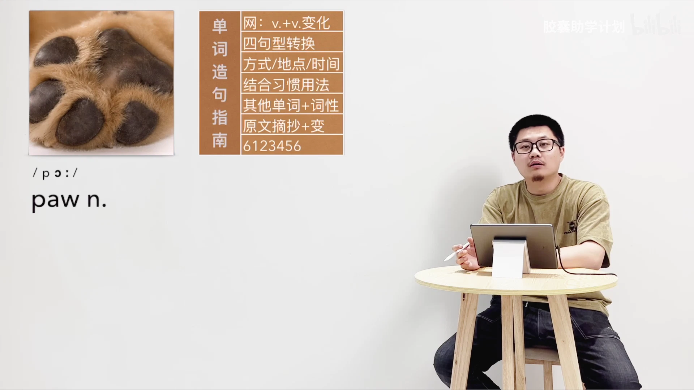

文字识别：单词造句指南 / 网：v.+v.变化 / 四句型转换 / 方式/地点/时间 / 结合习惯用法 / 其他单词+词性 / 原文摘抄+变 / 6123456 / /ρo:1 / paw n.

### 画面 00:04:20

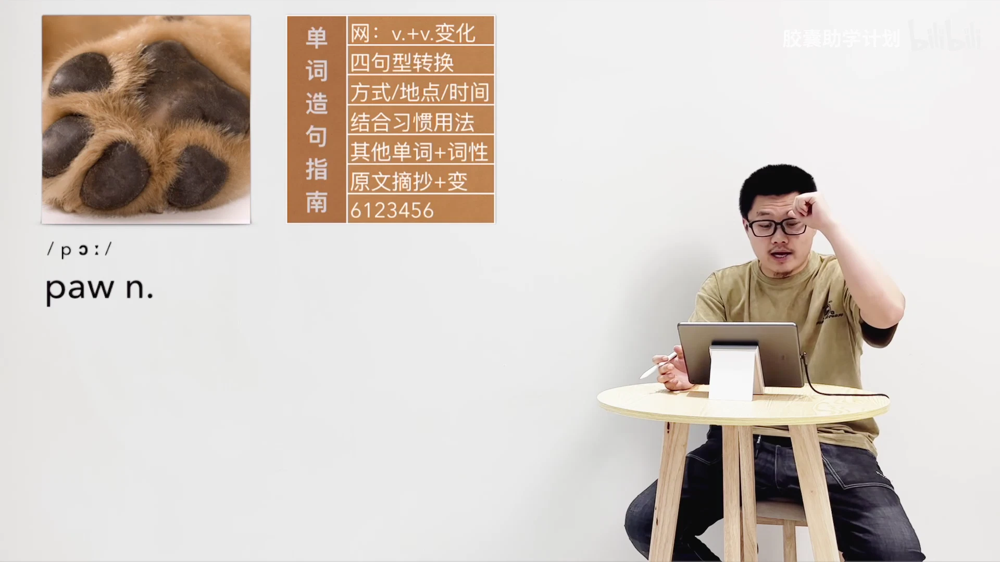

文字识别：单词造句指南 / 网：v.+v.变化 / 四句型转换 / 方式/地点/时间 / 结合习惯用法 / 其他单词+词性 / 原文摘抄+变 / 6123456 / /ρo:1 / paw n.

### 画面 00:04:26

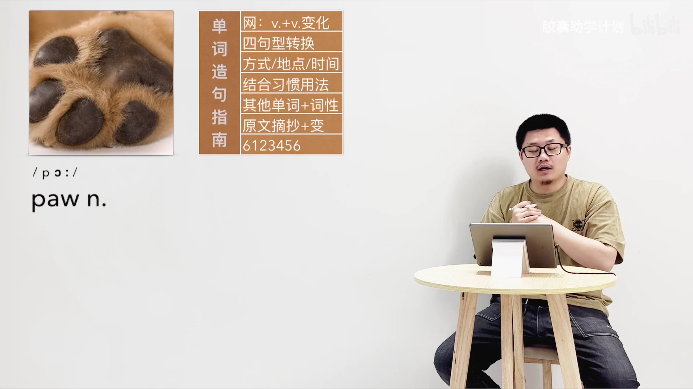

文字识别：单词造句指南 / 网：v.+v.变化 / 四句型转换 / 方式/地点/时间 / 结合习惯用法 / 其他单词+词性 / 原文摘抄+变 / 6123456 / /ρo:/ / paw n.

## 00:04:30–00:05:00

爪子，咱们汉语叫爪子，英文叫 paw。 Okay，那 paw 有好多的用法，我们一个一个看啊。首先， paw prints，呃，这其实跟我们新概念三册第一课有点联动了。新概念三册第一课那个 human at large，对吧？我们也讲过这一课了。他讲的这个 paw prints，指的就是这个爪子印儿，对不对？那你看，我们看这句话说， I have been thinking about the paw prints all morning。整个早晨，我一直都在不

### 画面 00:04:31

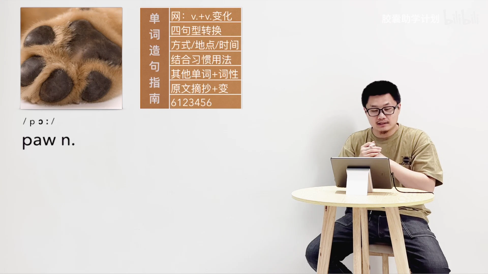

文字识别：单词造句指南 / 网：v.+v.变化 / 四句型转换 / 方式/地点/时间 / 结合习惯用法 / 其他单词+词性 / 原文摘抄+变 / 6123456 / /ρo:1 / paw n.

### 画面 00:04:35

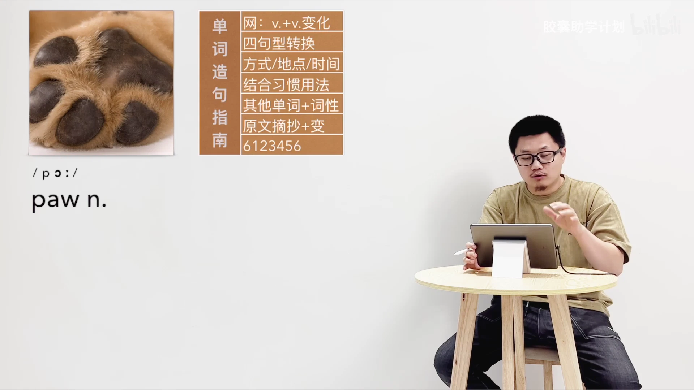

文字识别：单词造句指南 / 网：v.+v.变化 / 四句型转换 / 方式/地点/时间 / 结合习惯用法 / 其他单词+词性 / 原文摘抄+变 / 6123456 / 1ρo:1 / paw n.

### 画面 00:04:37

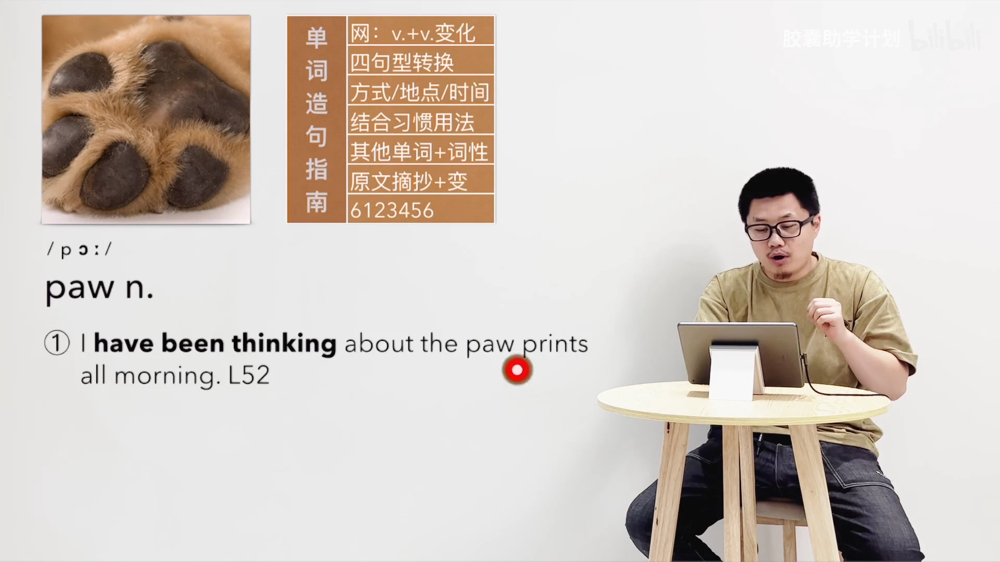

文字识别：单词造句指南 / 网：v.+v.变化 / 四句型转换 / 方式/地点/时间 / 结合习惯用法 / 其他单词+词性 / 原文摘抄+变 / 6123456 / /ρo:1 / paw n. / ① I have been thinking about the paw prints / all morning. L52

### 画面 00:04:40

文字识别：单词造句指南 / 网：v.+v.变化 / 四句型转换 / 方式/地点/时间 / 结合习惯用法 / 其他单词+词性 / 原文摘抄+变 / 6123456 / /ρo:/ / paw n. / ① I have been thinking about the paw prints / all morning. L52

### 画面 00:04:45

文字识别：单词造句指南 / 网：v.+v.变化 / 四句型转换 / 方式/地点/时间 / 结合习惯用法 / 其他单词+词性 / 原文摘抄+变 / 6123456 / /ρo:/ / paw n. / ① I have been thinking about the paw prints / all morning. L52

### 画面 00:04:48

文字识别：单词造句指南 / 网：v.+v.变化 / 四句型转换 / 方式/地点/时间 / 结合习惯用法 / 其他单词+词性 / 原文摘抄+变 / 6123456 / /ρo:1 / paw n. / ① I have been thinking about the paw prints / all morning. L52

### 画面 00:04:50

文字识别：单词造句指南 / 网：v.+v.变化 / 四句型转换 / 方式/地点/时间 / 结合习惯用法 / 其他单词+词性 / 原文摘抄+变 / 6123456 / /ρo:/ / paw n. / ① I have been thinking about the paw prints / all morning. L52

### 画面 00:04:55

文字识别：单词造句指南 / 网：v.+v.变化 / 四句型转换 / 方式/地点/时间 / 结合习惯用法 / 其他单词+词性 / 原文摘抄+变 / 6123456 / /ρo:/ / paw n. / ① I have been thinking about the paw prints / all morning. L52

## 00:05:00–00:05:30

停的思考，都在想一个事儿，想的就是这个脚，这个爪印子怎么回事，对吧？那 have been doing 五十二课咱们刚学的，现在完成进行时，复习一下。 Continue that dog's paw，说那个狗的爪子 is so cute，是太可爱了，如此的可爱。三十五课咱们学的，以至于 I could hold it all day，我能拿着它，哎，

### 画面 00:05:03

文字识别：单词造句指南 / 网：v.+v.变化 / 四句型转换 / 方式/地点/时间 / 结合习惯用法 / 其他单词+词性 / 原文摘抄+变 / 6123456 / /ρo:/ / paw n. / ① I have been thinking about the paw prints / all morning. L52

### 画面 00:05:10

文字识别：单词造句指南 / 网：v.+v.变化 / 四句型转换 / 方式/地点/时间 / 结合习惯用法 / 其他单词+词性 / 原文摘抄+变 / 6123456 / /ρo:/ / paw n. / ① I have been thinking about the paw prints / all morning. L52

### 画面 00:05:13

文字识别：单词造句指南 / 网：v.+v.变化 / 四句型转换 / 方式/地点/时间 / 结合习惯用法 / 其他单词+词性 / 原文摘抄+变 / 6123456 / /ρo:/ / paw n. / ① I have been thinking about the paw prints / all morning. L52 / That dog's paw is so cute that I could hold / it all day. L35

### 画面 00:05:15

文字识别：单词造句指南 / 网：v.+v.变化 / 四句型转换 / 方式/地点/时间 / 结合习惯用法 / 其他单词+词性 / 原文摘抄+变 / 6123456 / /ρo:1 / paw n. / ① I have been thinking about the paw prints / all morning. L52 / That dog's paw is so cute that I could hold / it all day. L35

### 画面 00:05:20

文字识别：单词造句指南 / 网：v.+v.变化 / 四句型转换 / 方式/地点/时间 / 结合习惯用法 / 其他单词+词性 / 原文摘抄+变 / 6123456 / /ρo:1 / paw n. / ① I have been thinking about the paw prints / all morning. L52 / That dog's paw is so cute that I could hold / it all day. L35

### 画面 00:05:26

文字识别：单词造句指南 / 网：v.+v.变化 / 四句型转换 / 方式/地点/时间 / 结合习惯用法 / 其他单词+词性 / 原文摘抄+变 / 6123456 / /ρo:1 / paw n. / ① I have been thinking about the paw prints / all morning. L52 / That dog's paw is so cute that I could hold / it all day. L35

## 00:05:30–00:06:00

玩一整天，对不对？Okay, next one. When I got home, I was not surprised to see that.你看，这是咱五十一课学的，对吧？就是减肥那一课。Be not surprised to do something.啊，说完全不感觉到很惊讶，怎么样呢？Paul Prince were everywhere，对吧？哎，我们家这狗啊太淘了，每次我回家的时候，我发现反正四处都是这个狗的脚印子。哎，我都觉得完全不觉得奇怪。I was

### 画面 00:05:30

文字识别：单词造句指南 / 网：v.+v.变化 / 四句型转换 / 方式/地点/时间 / 结合习惯用法 / 其他单词+词性 / 原文摘抄+变 / 6123456 / /ρo:1 / paw n. / ① I have been thinking about the paw prints / all morning. L52 / That dog's paw is so cute that I could hold / it all day. L35

### 画面 00:05:32

文字识别：单词造句指南 / 网：v.+v.变化 / 四句型转换 / 方式/地点/时间 / 结合习惯用法 / 其他单词+词性 / 原文摘抄+变 / 6123456 / /ρo:1 / paw n. / ① I have been thinking about the paw prints / all morning. L52 / That dog's paw is so cute that I could hold / it all day. L35 / When I got home, I was not surprised to / see that paw prints were everywhere. L51

### 画面 00:05:35

文字识别：单词造句指南 / 网：v.+v.变化 / 四句型转换 / 方式/地点/时间 / 结合习惯用法 / 其他单词+词性 / 原文摘抄+变 / 6123456 / /ρo:1 / paw n. / ① I have been thinking about the paw prints / all morning. L52 / That dog's paw is so cute that I could hold / it all day. L35 / When I got home,I was not surprised to / see that paw prints were everywhere. L51

### 画面 00:05:39

文字识别：单词造句指南 / 网：v.+v.变化 / 四句型转换 / 方式/地点/时间 / 结合习惯用法 / 其他单词+词性 / 原文摘抄+变 / 6123456 / /ρo:1 / paw n. / ① I have been thinking about the paw prints / all morning. L52 / That dog's paw is so cute that I could hold / it all day. L35 / When I got home, I was not surprised to / see that paw prints were everywhere. L51

### 画面 00:05:41

文字识别：单词造句指南 / 网：v.+v.变化 / 四句型转换 / 方式/地点/时间 / 结合习惯用法 / 其他单词+词性 / 原文摘抄+变 / 6123456 / /ρo:1 / paw n. / ① I have been thinking about the paw prints / all morning. L52 / That dog's paw is so cute that I could hold / it all day. L35 / When I got home, I was not surprised to / see that paw prints were everywhere. L51

### 画面 00:05:50

文字识别：单词造句指南 / 网：v.+v.变化 / 四句型转换 / 方式/地点/时间 / 结合习惯用法 / 其他单词+词性 / 原文摘抄+变 / 6123456 / /ρo:1 / paw n. / ① I have been thinking about the paw prints / all morning. L52 / That dog's paw is so cute that I could hold / it all day. L35 / When I got home, I was not surprised to / see that paw prints were everywhere. L51

### 画面 00:05:55

文字识别：单词造句指南 / 网：v.+v.变化 / 四句型转换 / 方式/地点/时间 / 结合习惯用法 / 其他单词+词性 / 原文摘抄+变 / 6123456 / /ρo:1 / paw n. / ① I have been thinking about the paw prints / all morning. L52 / That dog's paw is so cute that I could hold / it all day. L35 / When I got home, I was not surprised to / see that paw prints were everywhere. L51

## 00:06:00–00:06:30

not surprised to see that. 加一句话. Okay. 接下来呢，看这个电影片段，是我们口语当中对于呃英国人很常用的一件事，尤其是狗训狗的时候。比如说你跟他说“泡”，哎，你训练总跟他说“泡”，他把爪子搭到你的手上，你喂他一口吃的，然后下一次你可能没喂他吃的，你说“泡”，他形成条件反射了，他就把爪子放到你的手上。所以这个动

### 画面 00:06:00

文字识别：单词造句指南 / 网：v.+v.变化 / 四句型转换 / 方式/地点/时间 / 结合习惯用法 / 其他单词+词性 / 原文摘抄+变 / 6123456 / /ρo:1 / paw n. / ① I have been thinking about the paw prints / all morning. L52 / That dog's paw is so cute that I could hold / it all day. L35 / When I got home, I was not surprised to / see that paw prints were everywhere. L51

### 画面 00:06:03

文字识别：No paw. That's okay, too. / Seven Psychopaths / (2012)

### 画面 00:06:06

文字识别：No paw. That's okay, too. / Seven Psychopaths / (2012)

### 画面 00:06:11

文字识别：No paw. That's okay, too. / Seven Psychopaths / (2012)

### 画面 00:06:18

文字识别：No paw. That's okay, too. / Seven Psychopaths / (2012)

## 00:06:30–00:07:00

作，哎，英文世界之下就用 Paul，哎，就是握握手，对吧？Paul，那他这个地方电影台词叫 No Paul， That's okay too。他说啊，你也不想跟我握一握爪子吗？对吧？握一握手吗？行吧，也没问题啊。注意力集中听一下，No Paul， That's okay too。 Okay，那你看这里是一个小熊，对吧？他说 Let me see that Paul，还是由这个场景去看一下，正好练一下听力。 Let me see that Paul，

### 画面 00:06:45

文字识别：No paw. That's okay, too. / HOM / Seven Psychopaths / (2012)

### 画面 00:06:47

文字识别：No paw. That's okay, too. / Seven Psychopaths / (2012)

### 画面 00:06:49

文字识别：Let me see that paw. / The Bears and I / (1974)

### 画面 00:06:58

文字识别：Let me see that paw. / TROM / The Bears and I / (1974)

## 00:07:00–00:07:30

对吧？Let me see that paw.哎，让我看一下你的这个爪子。玩一个，next one latch就是图中的这个东西，门闩啊。好，说the latch is broken，这是第十课咱们学的be broken。那课不过那课咱们学的是clavichord，对吧？哎，古钢琴。The dog must have opened the latch, but how?它当时一定是把这个门闩给打开了，但如何打开的呢？Okay, next one,

### 画面 00:07:02

文字识别：Let me see that paw. / The Bears and I / (1974)

### 画面 00:07:04

文字识别：单词造句指南 / 网：v.+v.变化 / 四句型转换 / 方式/地点/时间 / 结合习惯用法 / 其他单词+词性 / 原文摘抄+变 / 6123456 / / læt∫1 / latch n.

### 画面 00:07:06

文字识别：单词造句指南 / 网：v.+v.变化 / 四句型转换 / 方式/地点/时间 / 结合习惯用法 / 其他单词+词性 / 原文摘抄+变 / 6123456 / /læt∫1 / latch n.

### 画面 00:07:10

文字识别：单词造句指南 / 网：v.+v.变化 / 四句型转换 / 方式/地点/时间 / 结合习惯用法 / 其他单词+词性 / 原文摘抄+变 / 6123456 / /læt∫/ / latch n. / ) The latch is broken. L10

### 画面 00:07:14

文字识别：单词造句指南 / 网：v.+v.变化 / 四句型转换 / 方式/地点/时间 / 结合习惯用法 / 其他单词+词性 / 原文摘抄+变 / 6123456 / /læt∫1 / latch n. /  The latch is broken. L10 / The dog must have opened the latch, but / how? L17

### 画面 00:07:20

文字识别：单词造句指南 / 网：v.+v.变化 / 四句型转换 / 方式/地点/时间 / 结合习惯用法 / 其他单词+词性 / 原文摘抄+变 / 6123456 / /læt∫/ / latch n. /  The latch is broken.L10 / The dog must have opened the latch, but / how? L17

### 画面 00:07:29

文字识别：单词造句指南 / 网：v.+v.变化 / 四句型转换 / 方式/地点/时间 / 结合习惯用法 / 其他单词+词性 / 原文摘抄+变 / 6123456 / /læt∫/ / latch n. / ① The latch is broken. L10 /  The dog must have opened the latch, but / how? L17 / The latch must have been opened by / someone, for the dog can't have opened it. / L17L21

## 00:07:30–00:08:00

The latch must have been opened by someone. Must have been done.看到这里了吧? Must have been done.还被某人打开. But the for the dog can't have opened it.这地方是两个不同的语法，但是是同源的. Must have been done叫当时一定是被，这是咱们二十一课学的. Can't have done是咱们十七课学的，叫当时一定没有被啊，当时一没有被啊，当时一定是

### 画面 00:07:35

文字识别：单词造句指南 / 网：v.+v.变化 / 四句型转换 / 方式/地点/时间 / 结合习惯用法 / 其他单词+词性 / 原文摘抄+变 / 6123456 / /læt∫/ / latch n. / ① The latch is broken. L10 / The dog must have opened the latch, but / how? L17 / The latch must have been opened by / someone, for the dog can't have opened it. / L17 L21

### 画面 00:07:59

文字识别：单词造句指南 / 网：v.+v.变化 / 四句型转换 / 方式/地点/时间 / 结合习惯用法 / 其他单词+词性 / 原文摘抄+变 / 6123456 / /læt∫/ / latch n. / ① The latch is broken. L10 / The dog must have opened the latch, but / how? L17 / The latch must have been opened by / someone, for the dog can't have opened it. / L17 L21

## 00:08:00–00:08:30

怎么怎么样，对吧？当时一定没有怎么怎么样啊，所以因为这个狗当时一定没有打开它这个门栓呢，当时一定是被某人打开的，对吧？这个各位如果忘了一定要回到二十一课和十七课再去看一下，也是我跟各位说我们最容易忘的，所以造句的时候我也是最常拿过来用的。你反而你像比如说一般现在时、现在进行时这样的时态，一般过去时这样的时态，我基本就不单独提了，对吧？好，next one，看一下这个电影

### 画面 00:08:04

文字识别：单词造句指南 / 网：v.+v.变化 / 四句型转换 / 方式/地点/时间 / 结合习惯用法 / 其他单词+词性 / 原文摘抄+变 / 6123456 / /læt∫/ / latch n. / ① The latch is broken. L10 / The dog must have opened the latch, but / how? L17 / The latch must have been opened by / someone, for the dog can't have opened it. / L17 L21

### 画面 00:08:14

文字识别：单词造句指南 / 网：v.+v.变化 / 四句型转换 / 方式/地点/时间 / 结合习惯用法 / 其他单词+词性 / 原文摘抄+变 / 6123456 / /læt∫/ / latch n. / ① The latch is broken. L10 / The dog must have opened the latch, but / how? L17 / The latch must have been opened by / someone, for the dog can't have opened it. / L17 L21

### 画面 00:08:19

文字识别：单词造句指南 / 网：v.+v.变化 / 四句型转换 / 方式/地点/时间 / 结合习惯用法 / 其他单词+词性 / 原文摘抄+变 / 6123456 / /læt∫/ / latch n. / ① The latch is broken. L10 / The dog must have opened the latch, but / how? L17 / The latch must have been opened by / someone, for the dog can't have opened it. / L17L21

### 画面 00:08:27

文字识别：I left the little latch thing open, and he got out. / Bushwick / (2017)

## 00:08:30–00:09:00

台词. I left the little latch thing open and he got out.哎, I left the little latch thing open and he got out. Next one, expert, expert, expert.这个单词什么意思呢？专家，它很常见的短语叫become an expert at doing something，或者当然你也可以说at something.哎，两个用法，对吧？At doing something或者at something，

### 画面 00:08:42

文字识别：单词造句指南 / 网：v.+v.变化 / 四句型转换 / 方式/地点/时间 / 结合习惯用法 / 其他单词+词性 / 原文摘抄+变 / 6123456 / /'eksp3:t/ / expert n.

### 画面 00:08:44

文字识别：单词造句指南 / 网：v.+v.变化 / 四句型转换 / 方式/地点/时间 / 结合习惯用法 / 其他单词+词性 / 原文摘抄+变 / 6123456 / /'eksp3:t/ / expert n.

### 画面 00:08:49

文字识别：单词造句指南 / 网：v.+v.变化 / 四句型转换 / 方式/地点/时间 / 结合习惯用法 / 其他单词+词性 / 原文摘抄+变 / 6123456 / /'eksp3:t/ / expert n. / ① become/be an expert at doing sth.

### 画面 00:08:55

文字识别：单词造句指南 / 网：v.+v.变化 / 四句型转换 / 方式/地点/时间 / 结合习惯用法 / 其他单词+词性 / 原文摘抄+变 / 6123456 / /'eksp3it/ / expert n. / ① become/be an expert at doing sth.

### 画面 00:08:57

文字识别：单词造句指南 / 网：v.+v.变化 / 四句型转换 / 方式/地点/时间 / 结合习惯用法 / 其他单词+词性 / 原文摘抄+变 / 6123456 / /'eksp3it/ / rsth. / expert n. / ① become/be an expert atdoing sth.

## 00:09:00–00:09:30

也可以说be an expert at something or doing something，都可以啊。好，比如说我们看一下这句话，He is an expert at this kind of thing.啊，我造这个句子的时候，我就想，我说什么事儿呢？我乍一下也没想到是什么事儿。那我就想到我们口语当中很常说的一句话，就是他对这类事情一般有上下文语境。他说他对这类事情很很擅长了，那就是this kind of thing，也是咱们之前学的what

### 画面 00:09:00

文字识别：单词造句指南 / 网：v.+v.变化 / 四句型转换 / 方式/地点/时间 / 结合习惯用法 / 其他单词+词性 / 原文摘抄+变 / 6123456 / /'eksp3:t/ / rsth. / expert n. / ① become/be an expert atdoing sth.

### 画面 00:09:07

文字识别：单词造句指南 / 网：v.+v.变化 / 四句型转换 / 方式/地点/时间 / 结合习惯用法 / 其他单词+词性 / 原文摘抄+变 / 6123456 / /'eksp3:t/ / rsth. / expert n. / ① become/be an expert atdoing sth. / ) He's an expert at this kind of thing.

### 画面 00:09:09

文字识别：单词造句指南 / 网：v.+v.变化 / 四句型转换 / 方式/地点/时间 / 结合习惯用法 / 其他单词+词性 / 原文摘抄+变 / 6123456 / /'eksp3:t/ / rsth. / expert n. / ① become/be an expert atdoing sth. / ) He's an expert at this kind of thing.

### 画面 00:09:12

文字识别：单词造句指南 / 网：v.+v.变化 / 四句型转换 / 方式/地点/时间 / 结合习惯用法 / 其他单词+词性 / 原文摘抄+变 / 6123456 / /'eksp3:t/ / rsth. / expert n. / ① become/be an expert atdoing sth. / ) He's an expert at this kind of thing.

### 画面 00:09:14

文字识别：单词造句指南 / 网：v.+v.变化 / 四句型转换 / 方式/地点/时间 / 结合习惯用法 / 其他单词+词性 / 原文摘抄+变 / 6123456 / /'eksp3:t/ / rsth. / expert n. / ① become/be an expert atdoing sth. /  He's an expert at this kind of thing.

### 画面 00:09:20

文字识别：单词造句指南 / 网：v.+v.变化 / 四句型转换 / 方式/地点/时间 / 结合习惯用法 / 其他单词+词性 / 原文摘抄+变 / 6123456 / /'eksp3:t/ / rsth. / expert n. / ① become/be an expert atdoing sth. /  He's an expert atthis kind of thing.

### 画面 00:09:24

文字识别：单词造句指南 / 网：v.+v.变化 / 四句型转换 / 方式/地点/时间 / 结合习惯用法 / 其他单词+词性 / 原文摘抄+变 / 6123456 / /'eksp3:t/ / rsth. / expert n. / ① become/be an expert atdoing sth. / ) He's an expert atthis kind of thing.

## 00:09:30–00:10:00

kind of, 对吧？好，下一个电影当中的一个台词叫 I'm an expert at this game. 那还用的是我们现在教各位的这个习惯用法叫 be ex be an expert at something. Next one, I've become an expert at coming down actors. 我已经成为了一个专家，在什么事情上呢？在 coming down actors

### 画面 00:09:30

文字识别：单词造句指南 / 网：v.+v.变化 / 四句型转换 / 方式/地点/时间 / 结合习惯用法 / 其他单词+词性 / 原文摘抄+变 / 6123456 / /'eksp3:t/ / rsth. / expert n. / ① become/be an expert atdoing sth. / ) He's an expert atthis kind of thing.

### 画面 00:09:32

文字识别：单词造句指南 / 网：v.+v.变化 / 四句型转换 / 方式/地点/时间 / 结合习惯用法 / 其他单词+词性 / 原文摘抄+变 / 6123456 / /'eksp3:t/ / rsth. / expert n. / ① become/be an expert atdoing sth. /  He's an expert atthis kind of thing. / I'm an expert at this game. Relative Strangers / (2006)

### 画面 00:09:34

文字识别：单词造句指南 / 网：v.+v.变化 / 四句型转换 / 方式/地点/时间 / 结合习惯用法 / 其他单词+词性 / 原文摘抄+变 / 6123456 / /'eksp3:t/ / rsth. / expert n. / ① become/be an expert atdoing sth. /  He's an expert atthis kind of thing. / I'm an expert at this game. Relative Strangers / (2006)

### 画面 00:09:39

文字识别：单词造句指南 / 网：v.+v.变化 / 四句型转换 / 方式/地点/时间 / 结合习惯用法 / 其他单词+词性 / 原文摘抄+变 / 6123456 / /'eksp3:t/ / rsth. / expert n. / ① become/be an expert atdoing sth. / He's an expert atthis kind of thing. / I'm an expert at this game. Relative Strangers / (2006)

### 画面 00:09:41

文字识别：单词造句指南 / 网：v.+v.变化 / 四句型转换 / 方式/地点/时间 / 结合习惯用法 / 其他单词+词性 / 原文摘抄+变 / 6123456 / /'eksp3:t/ / rsth. / expert n. / ① become/be an expert atdoing sth. / He's an expert atthis kind of thing. / I'm an expert at this game. Relative Strangers / (2006)

### 画面 00:09:44

文字识别：单词造句指南 / 网：v.+v.变化 / 四句型转换 / 方式/地点/时间 / 结合习惯用法 / 其他单词+词性 / 原文摘抄+变 / 6123456 / /'eksp3:t/ / rsth. / expert n. / ① become/be an expert atdoing sth. / He's an expert atthis kind of thing. / I'm an expert at this game. Relative Strangers / (2006)

### 画面 00:09:48

文字识别：单词造句指南 / 网：v.+v.变化 / 四句型转换 / 方式/地点/时间 / 结合习惯用法 / 其他单词+词性 / 原文摘抄+变 / 6123456 / /'eksp3:t/ / rsth. / expert n. / ① become/be an expert atdoing sth. / ) He's an expert atthis kind of thing. / 2 / I'm an expert at this game. Relative Strangers / (2006) / ) I've become an expert at calming down / actors. Open Windows (2014)

### 画面 00:09:50

文字识别：单词造句指南 / 网：v.+v.变化 / 四句型转换 / 方式/地点/时间 / 结合习惯用法 / 其他单词+词性 / 原文摘抄+变 / 6123456 / /'eksp3:t/ / rsth. / expert n. / ① become/be an expert atdoing sth. /  He's an expert atthis kind of thing. / 2） / I'm an expert at this game. Relative Strangers / (2006) /  I've become an expert at calming down / actors. Open Windows (2014)

### 画面 00:09:54

文字识别：单词造句指南 / 网：v.+v.变化 / 四句型转换 / 方式/地点/时间 / 结合习惯用法 / 其他单词+词性 / 原文摘抄+变 / 6123456 / /'eksp3:t/ / rsth. / expert n. / ① become/be an expert atdoing sth. /  He's an expert atthis kind of thing. / 2 / I'm an expert at this game. Relative Strangers / (2006) /  I've become an expert at calming down / actors. Open Windows (2014)

### 画面 00:09:59

文字识别：单词造句指南 / 网：v.+v.变化 / 四句型转换 / 方式/地点/时间 / 结合习惯用法 / 其他单词+词性 / 原文摘抄+变 / 6123456 / /'eksp3:t/ / rsth. / expert n. / ① become/be an expert atdoing sth. /  He's an expert atthis kind of thing. / 2 / I'm an expert at this game. Relative Strangers / (2006) / ) I've become an expert at / falming down / actors. Open Windows (2014)

## 00:10:00–00:10:30

这件事情上，在让演员冷静下来。你看后边加的是不是 doing？那其实如果这地方要简单深究一下，为什么这儿加的是 doing 呢？那主要取决于 at 新概念二册二十课，咱们说过这个逻辑，动名词，对吧？好，那注意力集中，我们听一下这里。那这里有一个很好玩的事儿，就是我们中国人在学习英语的时候，不出于很多原因，非常关心口音

### 画面 00:10:04

文字识别：单词造句指南 / 网：v.+v.变化 / 四句型转换 / 方式/地点/时间 / 结合习惯用法 / 其他单词+词性 / 原文摘抄+变 / 6123456 / /'eksp3:t/ / rsth. / expert n. / ① become/be an expert atdoing sth. /  He's an expert atthis kind of thing. / 2 / I'm an expert at this game. Relative Strangers / (2006) / ) I've become an expert at / falming down / actors.Open Windows (2014)

### 画面 00:10:06

文字识别：单词造句指南 / 网：v.+v.变化 / 四句型转换 / 方式/地点/时间 / 结合习惯用法 / 其他单词+词性 / 原文摘抄+变 / 6123456 / /'eksp3:t/ / rsth. / expert n. / ① become/be an expert atdoing sth. / He's an expert atthis kind of thing. / I'm an expert at this game. Relative Strangers / (2006) / ) I've become an expert at / falming down / actors.Open Windows (2014)

### 画面 00:10:08

文字识别：单词造句指南 / 网：v.+v.变化 / 四句型转换 / 方式/地点/时间 / 结合习惯用法 / 其他单词+词性 / 原文摘抄+变 / 6123456 / /'eksp3:t/ / rsth. / expert n. / ① become/be an expert atdoing sth. /  He's an expert at this kind of thing. / 2 / I'm an expert at this game. Relative Strangers / (2006) /  I've become an expert at calming down / actors. Open Windows (2014)

### 画面 00:10:10

文字识别：单词造句指南 / 网：v.+v.变化 / 四句型转换 / 方式/地点/时间 / 结合习惯用法 / 其他单词+词性 / 原文摘抄+变 / 6123456 / /'eksp3:t/ / expert n. / ① become/be an expert at doing sth. / ② He's an expert at this kind of thing. / 2 / I'm an expert at this game. Relative Strangers / 3 / (2006) /  I've become an expert at calming down / actors. Open Windows (2014)

### 画面 00:10:14

文字识别：单词造句指南 / 网：v.+v.变化 / 四句型转换 / 方式/地点/时间 / 结合习惯用法 / 其他单词+词性 / 原文摘抄+变 / 6123456 / /'eksp3:t/ / expert n. / ① become/be an expert at doing sth. / ② He's an expert at this kind of thing. / 2) / I'm an expert at this game. Relative Strangers / 3 / (2006) / ) I've become an expert at calming down / actors. Open Windows (2014)

### 画面 00:10:17

文字识别：This is our driver. / He is an expert at driving. / 心 / Everything Is llluminated / (2005)

## 00:10:30–00:11:00

这个问题，就所谓口音，就是老师您的发音是英式发音还是美式发音？我在直播当中啊，包括我们其他课程当中，我说过很多次，口音这件事情对于各位来说，整体上只要不是太重，没有任何影响，你仔细去想普通话就行了。我再不多说了，对吧？很多地方有川普，对吧？有塑料普通话，长沙我们所谓塑料普通话，我没有记错的话，对吧？有川普啊，有各种各样的这个呃，带着一点点口音的

### 画面 00:10:47

文字识别：This is our driver. / He is an expert at driving. / Everything Isllluminated / (2005)

## 00:11:00–00:11:30

普通话，但并没有影响我们全中国人整体上去交流。只有当你的口音过于重的时候，才会有影响。几乎没有大，呃，大多数中国人几乎很少有中国人说纠结于，哎，呃，您发的是北京口音的普通话还是上海口音的普通话，对吧？很少有人有这个纠结。那我们学英文的时候，因为各种原因，就会有英式发音还是美式发音的纠结。我先给各位结论，这个实际上整体上不是很重要。你

### 画面 00:11:17

文字识别：This is our driver. / He is an expert at driving. / Everything Isllluminated / (2005)

## 00:11:30–00:12:00

会发现，这个世界上说英语的人各有各的口音啊。比如说，像这个电影片段当中，人家英语我觉得说的很好，但是他的口音还是挺重的。他的这个的这个音啊，expert啊，driving啊，他这样的一个发音特别的浓，这我们叫大声音还是小声音，对吧？发音特别的浓，但依旧说的是很好的句子，依旧我能听懂。所以，我们实际上去学英文的时候，在这说的稍微多一点啊，还是要去适应不同的发音的。

### 画面 00:11:35

文字识别：This is our driver. / He is an expert at driving. / Everything Is llluminated / (2005)

### 画面 00:11:37

文字识别：This is our driver. / He is an expert at driving. / Everything Is llluminated / (2005)

## 00:12:00–00:12:30

原因是你可能不一定这样听口音，但别人会这样发音。好，我们注意力集中，听一遍。 This is our driver. He's an expert at driving. Okay, 啊，各位如果感兴趣可以多听几遍，我就不多说了。 Next one, here. See, I told you that I'm an expert at reading face. 那还是 be an expert at doing something. 不多说了。 See, I told you that I'm an expert at reading face. Okay,

### 画面 00:12:07

文字识别：This is our driver. / He is an expert at driving. / Everything Isllluminated / (2005)

### 画面 00:12:09

文字识别：This is our driver. / He is an expert at driving. / Everything Is llluminated / (2005)

### 画面 00:12:11

文字识别：This is our driver. / He is an expert at driving. / Everything Isllluminated / (2005)

### 画面 00:12:16

文字识别：See, I told you that / I'm an expert at reading face. / Golden Arm / (2020)

### 画面 00:12:26

文字识别：See, I told you that / I'm an expert at reading face. / Golden Arm / (2020)

### 画面 00:12:28

文字识别：See, I told you that / I'm an expert at reading face. / Golden Arm / (2020)

## 00:12:30–00:13:00

very good. Next one, develop,发展habit习惯。我们先来一个小的短语。Have a habit of doing something叫做有习惯做某件事情，也很字面意思，对吧？比如说，I have a habit of doing that when I get nervous.哎，当我紧张的时候，我有习惯那样去做。Next one,说I have a habit of keeping things in

### 画面 00:12:30

文字识别：单词造句指南 / 网：v.+v.变化 / 四句型转换 / 方式/地点/时间 / 结合习惯用法 / 其他单词+词性 / 原文摘抄+变 / 6123456 / /di'velap/ / /'hæbit/ / develop v. habit n.

### 画面 00:12:32

文字识别：单词造句指南 / 网：v.+v.变化 / 四句型转换 / 方式/地点/时间 / 结合习惯用法 / 其他单词+词性 / 原文摘抄+变 / 6123456 / /dr'velap/ / /'hæbit/ / develop v. habit n.

### 画面 00:12:34

文字识别：单词造句指南 / 网：v.+v.变化 / 四句型转换 / 方式/地点/时间 / 结合习惯用法 / 其他单词+词性 / 原文摘抄+变 / 6123456 / /dr'velap/ / /'hæbit/ / develop v. habit n.

### 画面 00:12:37

文字识别：单词造句指南 / 网：v.+v.变化 / 四句型转换 / 方式/地点/时间 / 结合习惯用法 / 其他单词+词性 / 原文摘抄+变 / 6123456 / /di'velap/ / /'hæebit/ / develop v. habit n. / ① I have a habit of doing that / when | get nerVous. Flesh and Bone(1993) L7

### 画面 00:12:39

文字识别：单词造句指南 / 网：v.+v.变化 / 四句型转换 / 方式/地点/时间 / 结合习惯用法 / 其他单词+词性 / 原文摘抄+变 / 6123456 / /di'velap/ / /'hæbit/ / develop v. habit n. / ① I have a habit of doing that / when | get nerVous. Flesh and Bone(1993) L7

### 画面 00:12:42

文字识别：单词造句指南 / 网：v.+v.变化 / 四句型转换 / 方式/地点/时间 / 结合习惯用法 / 其他单词+词性 / 原文摘抄+变 / 6123456 / /di'velap/ / /'hæbit/ / develop v. habit n. / ① I have a habit of doing that / when I get nervous. Flesh and Bone(1993) L7

### 画面 00:12:44

文字识别：单词造句指南 / 网：v.+v.变化 / 四句型转换 / 方式/地点/时间 / 结合习惯用法 / 其他单词+词性 / 原文摘抄+变 / 6123456 / /di'velap/ / /'hæbit/ / develop v. habit n. / ① I have a habit of doing that / when I get nervous. Flesh and Bone(1993) L7

### 画面 00:12:51

文字识别：单词造句指南 / 网：v.+v.变化 / 四句型转换 / 方式/地点/时间 / 结合习惯用法 / 其他单词+词性 / 原文摘抄+变 / 6123456 / /di'velap/ / /'hæebit/ / develop v. habit n. / ① I have a habit of doing that / when I get nervous. Flesh and Bone(1993) L7

### 画面 00:12:55

文字识别：单词造句指南 / 网：v.+v.变化 / 四句型转换 / 方式/地点/时间 / 结合习惯用法 / 其他单词+词性 / 原文摘抄+变 / 6123456 / /di'velap/ / /'hæebit/ / develop v. habit n. / ① I have a habit of doing that / when I get nervous. Flesh and Bone(1993) L7

### 画面 00:12:58

文字识别：单词造句指南 / 网：v.+v.变化 / 四句型转换 / 方式/地点/时间 / 结合习惯用法 / 其他单词+词性 / 原文摘抄+变 / 6123456 / /dr'velap/ / /'hæbit/ / develop v. habit n. / ① I have a habit of doing that / when I get nervous. Flesh and Bone(1993) L7 / ) I have a habit of keeping thing in my car / trunk.L55

## 00:13:00–00:13:30

my car trunk, 我有这样一个习惯，把东西放在我汽车的后备箱的习惯。这是咱五十五课学的 car trunk 这个短语，对吧？好，Next one is since then. 这是单词造句的时候，我们有一个原文摘抄再加变。原文摘抄再加变啊，原文摘抄 since then he has developed another bad habit. 自从那时，他又发展出另一个很坏的习惯。那我们直接，各位这里其实教我们

### 画面 00:13:00

文字识别：单词造句指南 / 网：v.+v.变化 / 四句型转换 / 方式/地点/时间 / 结合习惯用法 / 其他单词+词性 / 原文摘抄+变 / 6123456 / /dr'velap/ / /'hæbit/ / develop v. habit n. / ① I have a habit of doing that / when I get nervous. Flesh and Bone(1993) L7 / ) I have a habit of keeping thing in my car / trunk.L55

### 画面 00:13:07

文字识别：单词造句指南 / 网：v.+v.变化 / 四句型转换 / 方式/地点/时间 / 结合习惯用法 / 其他单词+词性 / 原文摘抄+变 / 6123456 / /di'velap/ / /'hæbit/ / develop v. habit n. / ① I have a habit of doing that / when I get nervous. Flesh and Bone(1993) L7 / ) I have a habit of keeping thing in my car / trunk.L55

### 画面 00:13:10

文字识别：单词造句指南 / 网：v.+v.变化 / 四句型转换 / 方式/地点/时间 / 结合习惯用法 / 其他单词+词性 / 原文摘抄+变 / 6123456 / /di'velap/ / /'hæbit/ / develop v. habit n. / ① I have a habit of doing that / when I get nervous. Flesh and Bone(1993) L7 /  I have a habit of keeping thing in my car / trunk. L55 / [Story]: Since then, he has developed / another bad habit.

### 画面 00:13:14

文字识别：单词造句指南 / 网：v.+v.变化 / 四句型转换 / 方式/地点/时间 / 结合习惯用法 / 其他单词+词性 / 原文摘抄+变 / 6123456 / /di'velap/ / /'hæbit/ / develop v. habit n. / ① I have a habit of doing that / when I get nervous. Flesh and Bone(1993) L7 /  I have a habit of keeping thing in my car / trunk.L55 / [Story]: Since then, he has developed / another bad habit.

### 画面 00:13:18

文字识别：单词造句指南 / 网：v.+v.变化 / 四句型转换 / 方式/地点/时间 / 结合习惯用法 / 其他单词+词性 / 原文摘抄+变 / 6123456 / /dr'velap/ / /'hæbit/ / develop v. habit n. / ① I have a habit of doing that / when I get nervous. Flesh and Bong(1993) L7 /  I have a habit of keeping thingin my car / trunk.L55 / [Story]: Since then, he has developed / another bad habit.

### 画面 00:13:21

文字识别：单词造句指南 / 网：v.+v.变化 / 四句型转换 / 方式/地点/时间 / 结合习惯用法 / 其他单词+词性 / 原文摘抄+变 / 6123456 / /dr'velap/ / /'hæbit/ / develop v. habit n. / ① I have a habit of doing that / when I get nervous. Flesh and Bong(1993) L7 /  I have a habit of keeping thingin my car / trunk.L55 / [Story]: Since then, he has developed / another bad habit.

### 画面 00:13:29

文字识别：单词造句指南 / 网：v.+v.变化 / 四句型转换 / 方式/地点/时间 / 结合习惯用法 / 其他单词+词性 / 原文摘抄+变 / 6123456 / /di'velap/ / /'hæbit/ / develop v. habit n. / ① I have a habit of doing that / when I get nervous. Flesh and Bong (1993) L7 / ② I have a habit of keeping thingin my car / trunk.L55 / [Story]: Since then, he has developed / another bad habit. / D has/who/since when/why...

## 00:13:30–00:14:00

几个小点。第一个，发展出来一个习惯，用 developed，对吧？养成了一个什么习惯，用 developed。其次呢，四句型转换，我们又造出来了很多句子，对吧？比如说，这里我们就可以对 since then 用 since when 去提问啊。我说一下答案啊，这个是各位不常见的，所以我说一下答案。像剩下的很常见，我就不提了。它的答案叫 since when has he developed another bad habit？自从什么时候开始，他养成了这个坏毛

### 画面 00:13:31

文字识别：单词造句指南 / 网：v.+v.变化 / 四句型转换 / 方式/地点/时间 / 结合习惯用法 / 其他单词+词性 / 原文摘抄+变 / 6123456 / /di'velap/ / /'hæbit/ / develop v. habit n. / ① I have a habit of doing that / when I get nervous. Flesh and Bong(1993) L7 / ② I have a habit of keeping thingin my car / trunk.L55 / [Story]: Since then, he has developed / another bad habit. / D has/who/since when/why...

### 画面 00:13:34

文字识别：单词造句指南 / 网：v.+v.变化 / 四句型转换 / 方式/地点/时间 / 结合习惯用法 / 其他单词+词性 / 原文摘抄+变 / 6123456 / /di'velap/ / /'hæbit/ / develop v. habit n. / ① I have a habit of doing that / when I get nervous. Flesh and Bong(1993) L7 / ) I have a habit of keeping thingin my car / trunk.L55 / [Story]: Since then, he has developed / another bad habit. / ) has/who/since when/why...

### 画面 00:13:39

文字识别：单词造句指南 / 网：v.+v.变化 / 四句型转换 / 方式/地点/时间 / 结合习惯用法 / 其他单词+词性 / 原文摘抄+变 / 6123456 / /dr'velap/ / /'hæbit/ / develop v. habit n. / ① I have a habit of doing that / when I get nervous. Flesh and Bong(1993) L7 / ) I have a habit of keeping thingin my car / trunk.L55 / [Story]: Since then, he has developed / another bad habit. / ) has/who/since when/why...

### 画面 00:13:42

文字识别：单词造句指南 / 网：v.+v.变化 / 四句型转换 / 方式/地点/时间 / 结合习惯用法 / 其他单词+词性 / 原文摘抄+变 / 6123456 / /dr'velap/ / /'hæbit/ / develop v. habit n. / ① I have a habit of doing that / when I get nervous. Flesh and Bong(1993) L7 / ) I have a habit of keeping thingin my car / trunk.L55 / [Story]: Since then, he has developed / another bad habit. / ) has/who/since when/why...

### 画面 00:13:44

文字识别：单词造句指南 / 网：v.+v.变化 / 四句型转换 / 方式/地点/时间 / 结合习惯用法 / 其他单词+词性 / 原文摘抄+变 / 6123456 / /dr'velap/ / /'hæbit/ / develop v. habit n. / ① I have a habit of doing that / when I get nervous. Flesh and Bong (1993) L7 / ) I have a habit of keeping thingin my car / trunk.L55 / [Story]. Since then, he has developed / another bad yabit. / ) has/who/since when/why...

### 画面 00:13:49

文字识别：单词造句指南 / 网：v.+v.变化 / 四句型转换 / 方式/地点/时间 / 结合习惯用法 / 其他单词+词性 / 原文摘抄+变 / 6123456 / /di'velap/ / /'hæbit/ / develop v. habit n. / ① I have a habit of doing that / when I get nervous. Flesh and Bong(1993) L7 / ) I have a habit of keeping thingin my car / trunk.L55 / [Story]: Since then, he has developed / another bad fabit. / ) has/who/since when/why...

### 画面 00:13:54

文字识别：单词造句指南 / 网：v.+v.变化 / 四句型转换 / 方式/地点/时间 / 结合习惯用法 / 其他单词+词性 / 原文摘抄+变 / 6123456 / /dr'velapl / /'hæbit/ / develop v. habit n. / ① I have a habit of doing that / when I get nervous. Flesh and Bong (1993) L7 /  I have a habit of keeping thingin my car / trunk.L55 / [Story]: Since then, he has developed / another bad fabit. / ) has/who/since when/why...

### 画面 00:13:59

文字识别：单词造句指南 / 网：v.+v.变化 / 四句型转换 / 方式/地点/时间 / 结合习惯用法 / 其他单词+词性 / 原文摘抄+变 / 6123456 / /di'velapl / /'hæbit/ / develop v. habit n. / ① I have a habit of doing that / when I get nervous. Flesh and Bong (1993) L7 / ) I have a habit of keeping thingin my car / trunk.L55 / [Story]: Since then, he has developed / another bad fabit. / ) has/who/since when/why...

## 00:14:00–00:14:30

病。OK， very good，呃，注意力集中，我们听一下。 I have a habit of collecting things. I can't help it. Very good，下一个单词 remove。 remove 这个单词很常见的短语叫 remove something from something，对吧？ remove a from b，从 b 中移除 a，对吧？哎， remove 移除，那把某物移除从某个东西里面，对

### 画面 00:14:01

文字识别：I have a habit of collecting things. I can't help it. / Jolene / (2008)

### 画面 00:14:06

文字识别：I have a habit of collecting things. I can't help it. / Jolene / (2008)

### 画面 00:14:08

文字识别：I have a habit of collecting things. I can't help it. / Jolene / (2008)

### 画面 00:14:10

文字识别：单词造句指南 / 网：v.+v.变化 / 四句型转换 / 方式/地点/时间 / 结合习惯用法 / 其他单词+词性 / 原文摘抄+变 / 6123456 / /rī'muiv/ / remove v.

### 画面 00:14:13

文字识别：单词造句指南 / 网：v.+v.变化 / 四句型转换 / 方式/地点/时间 / 结合习惯用法 / 其他单词+词性 / 原文摘抄+变 / 6123456 / /rI'muiv/ / remove v. / remove sth. from

### 画面 00:14:16

文字识别：单词造句指南 / 网：v.+v.变化 / 四句型转换 / 方式/地点/时间 / 结合习惯用法 / 其他单词+词性 / 原文摘抄+变 / 6123456 / /ri'muiv/ / remove v. / remove sth. from / ..

### 画面 00:14:19

文字识别：单词造句指南 / 网：v.+v.变化 / 四句型转换 / 方式/地点/时间 / 结合习惯用法 / 其他单词+词性 / 原文摘抄+变 / 6123456 / /rI'muiv/ / remove v. / remove sth.from / ..

### 画面 00:14:25

文字识别：单词造句指南 / 网：v.+v.变化 / 四句型转换 / 方式/地点/时间 / 结合习惯用法 / 其他单词+词性 / 原文摘抄+变 / 6123456 / /rI'muiv/ / remove v. / remove sth.from / ..

## 00:14:30–00:15:00

吧？从什么当中移除某物？比如说 yesterday，原文叫 my husband removed the gate，叫做移除了这个大门。这个 gate 跟 door 我们之前讲过区别，一般 door 指的是咱们自己家门的，叫 apartment 啊，flat 啊这种公寓的门，小门。而这个 gate 不一定非要是大铁门，也可以是木门，但一般指的是院子外边那个门，好吧？就你家自己有个小院子，外边还有一个门叫 gate。

### 画面 00:14:31

文字识别：单词造句指南 / 网：v.+v.变化 / 四句型转换 / 方式/地点/时间 / 结合习惯用法 / 其他单词+词性 / 原文摘抄+变 / 6123456 / / rI'muiv / / remove v. / remove sth.from ... / [Story]: Yesterday my husband removed the gate.

### 画面 00:14:37

文字识别：单词造句指南 / 网：v.+v.变化 / 四句型转换 / 方式/地点/时间 / 结合习惯用法 / 其他单词+词性 / 原文摘抄+变 / 6123456 / /rI'muiv/ / remove v. / remove sth.from .. / [Story]: Yesterday my husband removed the gate. / 2）

### 画面 00:14:39

文字识别：单词造句指南 / 网：v.+v.变化 / 四句型转换 / 方式/地点/时间 / 结合习惯用法 / 其他单词+词性 / 原文摘抄+变 / 6123456 / / rⅠ'm uiv / / remove v. / remove sth.from ... / [Story]: Yesterday my husband removed the gat.

### 画面 00:14:44

文字识别：单词造句指南 / 网：v.+v.变化 / 四句型转换 / 方式/地点/时间 / 结合习惯用法 / 其他单词+词性 / 原文摘抄+变 / 6123456 / /rI'muiv/ / remove v. / remove sth.from . / [Story]: Yesterday my husband removed the gate. / 2

## 00:15:00–00:15:30

Okay,好，那我们看这样一句话啊，四句型转换不多说，看这句话说Will you please remove A from B? A is your handbag. B is the seat. 我觉得就算你背不下来，remove A from B是从谁当中移除谁？是从A中移出B还是B中移出A？这句话给你，你也能猜出来，绝对不可能是从这什么包

### 画面 00:15:02

文字识别：单词造句指南 / 网：v.+v.变化 / 四句型转换 / 方式/地点/时间 / 结合习惯用法 / 其他单词+词性 / 原文摘抄+变 / 6123456 / /rI'muiv/ / remove v. / remove sth.from ... / [Story]: Yesterday my husband removed the gate. / did/who/when/why/what...

### 画面 00:15:04

文字识别：单词造句指南 / 网：v.+v.变化 / 四句型转换 / 方式/地点/时间 / 结合习惯用法 / 其他单词+词性 / 原文摘抄+变 / 6123456 / /rI'muiv/ / remove v. / remove sth.from .. / [Story]: Yesterday my husband removed the gate / did/who/when/why/what... /  Will you please remove your handbag from the / seat?

### 画面 00:15:09

文字识别：单词造句指南 / 网：v.+v.变化 / 四句型转换 / 方式/地点/时间 / 结合习惯用法 / 其他单词+词性 / 原文摘抄+变 / 6123456 / /rI'muiv/ / remove v. / remove sth.from .. / [Story]: Yesterday my husband removed the gate. / did/who/when/why/what... / ) Will you please remove your handbag from the / seat?

### 画面 00:15:17

文字识别：单词造句指南 / 网：v.+v.变化 / 四句型转换 / 方式/地点/时间 / 结合习惯用法 / 其他单词+词性 / 原文摘抄+变 / 6123456 / /rI'muiv/ / remove v. / remove sth.from .. / [Story]: Yesterday my husband removed the gate. / did/who/when/why/what... / ) Will you please remove your handbag from the / seat?

### 画面 00:15:19

文字识别：单词造句指南 / 网：v.+v.变化 / 四句型转换 / 方式/地点/时间 / 结合习惯用法 / 其他单词+词性 / 原文摘抄+变 / 6123456 / /rI'muiv/ / remove v. / remove sth.from .. / [Story]: Yesterday my husband removed the gate. / did/who/when/why/what... /  Will you please remove your handbag from the / seat?

## 00:15:30–00:16:00

儿？呃，从这个把这个把这个座位从这个包儿上面拿走。一般正常来说，就是把这个包儿怎么样，从这个座位上移除掉，拿走，对吧？OK， next one. The man came to remove the rubbish from the backyard. Remove A from B，对吧？哎，从这个呃什么当中呢？从这个后院当中把这些垃圾们移除掉，拿走。Very

### 画面 00:15:40

文字识别：单词造句指南 / 网：v.+v.变化 / 四句型转换 / 方式/地点/时间 / 结合习惯用法 / 其他单词+词性 / 原文摘抄+变 / 6123456 / /rI'muiv/ / remove v. / remove sth.from .. / [Story]: Yesterday my husband removed the gate. / did/who/when/why/what... / ) Will you please remove your handbag from the / seat?

### 画面 00:15:42

文字识别：单词造句指南 / 网：v.+v.变化 / 四句型转换 / 方式/地点/时间 / 结合习惯用法 / 其他单词+词性 / 原文摘抄+变 / 6123456 / /rI'muiv1 / remove v. / remove sth.from ... / [Story]: Yesterday my husband removed the gate. / 2 / did/who/when/why/what... / 3 / ④ Will you please remove your handbag from the / seat? / The men came to remove the rubbish from the / backyard.

### 画面 00:15:44

文字识别：单词造句指南 / 网：v.+v.变化 / 四句型转换 / 方式/地点/时间 / 结合习惯用法 / 其他单词+词性 / 原文摘抄+变 / 6123456 / /rI'muiv1 / remove v. / ) remove sth.from ... / [Story]: Yesterday my husband removed the gate. / 2） / did/who/when/why/what... / 3 / ④ Will you please remove your handbag from the / seat? / The men came to remove the rubbish from the / backyard.

### 画面 00:15:49

文字识别：单词造句指南 / 网：v.+v.变化 / 四句型转换 / 方式/地点/时间 / 结合习惯用法 / 其他单词+词性 / 原文摘抄+变 / 6123456 / /rI'muiv/ / remove v. / remove sth. from ... / 1 / [Story]: Yesterday my husband removed the gate. / 2 / did/who/when/why/what... / 3 / ④ Will you please remove your handbag from the / seat? / The men came to remove the / bbish from the / backyard.

### 画面 00:15:53

文字识别：单词造句指南 / 网：v.+v.变化 / 四句型转换 / 方式/地点/时间 / 结合习惯用法 / 其他单词+词性 / 原文摘抄+变 / 6123456 / /rI'muiv1 / remove v. / remove sth.from ... / 1 / [Story]: Yesterday my husband removed the gate. / did/who/when/why/what... / 3 / ④ Will you please remove your handbag from the / seat? / The men came to remove the rubbish from the / backyard.

### 画面 00:15:55

文字识别：单词造句指南 / 网：v.+v.变化 / 四句型转换 / 方式/地点/时间 / 结合习惯用法 / 其他单词+词性 / 原文摘抄+变 / 6123456 / / rI'm uiv/ / remove v. / 1 / remove sth.from ... / [Story]: Yesterday my husband removed the gate. / 2 / did/who/when/why/what... / 3 / ④ Will you please remove your handbag from the / seat? / The men came to remove the rubbish from the / backyard.

### 画面 00:15:59

文字识别：单词造句指南 / 网：v.+v.变化 / 四句型转换 / 方式/地点/时间 / 结合习惯用法 / 其他单词+词性 / 原文摘抄+变 / 6123456 / /rI'muiv1 / remove v. / remove sth.from ... / 1 / [Story]: Yesterday my husband removed the gate. / did/who/when/why/what... / 3 / ④ Will you please remove your handbag from the / seat? / The men came to remove the rubbish from the / backyard.

## 00:16:00–00:16:30

good，好。那接下来呢，我们看这样一个电影片段，我简单解释一下。We remove it from the website.我们不知道 it 指的是什么，但我们知道的是把它从什么当中呢？从网络当中、网页当中移除掉了，拿走了，拿掉了。And I think we have the boy who did it.然后我们应该找到了做这件事的男生。Okay，注意力集中，听一下。We remove this from the website and I think we have the boy who did it.

### 画面 00:16:01

文字识别：We removed it from the website, / and I think we have the boy who did it. / Words and Pictures / (2013)

### 画面 00:16:26

文字识别：We removed it from the website, / and I think we have the boy who did it. / Words and Pictures / (2013)

### 画面 00:16:28

文字识别：We removed it from the website, / and I think we have the boy who did it. / Words and Pictures / (2013)

## 00:16:30–00:17:00

OK recap，本课除了单词重要以外，这三个习惯用法非常重要，记住啊，单词要记着造句，造句，然后电影片段，尤其像刚才我说口音的那个事儿，各位仔细去想一下，口音到底有多么的重要，你自己去想一想，用自己的大脑去想，对吧？不要别人告诉我说学英语要学英音还是美音啊，呃，你自己去想一想口音这件事情，你拿汉语去想，到底对

### 画面 00:16:30

文字识别：Recap / Words / become/be an expert at doing sth. / Expression / have a habit of doing sth. / remove / sth.from

### 画面 00:16:32

文字识别：Recap / Words / become/be an expert at doing s / sth. / Expression / have a habit of doing sth. / remove / sth.from

### 画面 00:16:34

文字识别：Recap / Words / become/be an expert at doing sth. / Expression / have a habit of doing sth. / sth.from / remove

### 画面 00:16:38

### 画面 00:16:40

文字识别：单词造句/对话 / 1. / 【单词造句指南】 / 每个5句 / 反复听电影片段，直到能 / 听出关键短语/句子

### 画面 00:16:44

文字识别：单词造句/对话 / 【单词造句指南】 / 每个5句 / 2.反复听电影片段，直到能 / 听出关键短语/句子 / ROM

### 画面 00:16:49

文字识别：单词造句/对话 / 【单词造句指南】 / 每个5句 / 2.反复听电影片段，直到能 / 听出关键短语/句子

### 画面 00:16:59

文字识别：单词造句/对话 / 【单词造句指南】 / 每个5句 / 2.反复听电影片段，直到能 / 听出关键短语/句子

## 00:17:00–00:17:30

于我们有多大影响？呃，如果没有影响，有多小的影响，对吧？就是它到什么程度开始有影响，什么样的程度是没有影响的？如果各位啊，在大都市生活过，我们所谓北上广深这样的生城市生活过，你会发现天南海北的口音都有，整体上并没有影响我们的沟通，对吧？但是到达了一个极端了之后，还是会影响的。OK，那重复间隔，各位看置顶留言，我们就不多提了啊。

### 画面 00:17:04

文字识别：单词造句/对话 / 【单词造句指南】 / 每个5句 / 2.反复听电影片段，直到能 / 听出关键短语/句子

### 画面 00:17:09

文字识别：单词造句/对话 / 1. / 【单词造句指南】 / 每个5句 / 2.反复听电影片段，直到能 / 听出关键短语/句子

### 画面 00:17:14

文字识别：单词造句/对话 / 【单词造句指南】 / 每个5句 / 2.反复听电影片段，直到能 / 听出关键短语/句子

### 画面 00:17:24

文字识别：单词造句/对话 / 1. / 【单词造句指南】 / 每个5句 / 2.反复听电影片段，直到能 / 听出关键短语/句子

### 画面 00:17:26

文字识别：单词造句/对话 / 【单词造句指南】 / 每个5句 / 2.反复听电影片段，直到能 / 听出关键短语/句子 / 3.重复间隔（置顶留言）

### 画面 00:17:29

## 00:17:30–00:17:56

那以上呢就是本期视频的全部内容了。如果各位喜欢我们的课程呢，欢迎各位关注、订阅，哎，点赞，一键三连，对吧？分享给那些需要的人，来帮助我们快速成长。See you next time.

### 画面 00:17:38

### 画面 00:17:43

### 画面 00:17:45

文字识别：CAPSULEACADEMY / 胶囊助学计划 / 『 / 小红书 / Lecturer / □ / Leo

### 画面 00:17:48

文字识别：CAPSULEACADEMY / 胶囊助学计划 / 小红书 / Fdi

### 画面 00:17:51

文字识别：CAPSULEACADEMY / 胶囊助学计划 / 『 / 小红书 / Creator / Leo & Berlin / OE

### 画面 00:17:53

文字识别：bilibili / 胶囊助学计划 / CAPSULEACADEMY / 胶囊助学计划 / 小红书 / 正 / OE

### 画面 00:17:55

文字识别：bilibili / 胶囊助学计划

