# 059 文章

快速机器解析：语音为单模型转写，未进行独立交叉校对或人工复核；画面每秒采样并按变化选帧，短时文字和标记可能遗漏。截图时间约有 1 秒误差。图片有损压缩；遇到疑点请按时间查看 Google Drive 原视频。

## 00:00:00–00:00:30

Hello everyone, welcome to Capsule Academy. This is Lile. Today we're going to learn New Concept English Book Two, Lesson Fifty Nine, Story. Hope you gonna enjoy it. Okay, then we look at the title of this article. Ah, this article is probably the favorite article among the ninety-six articles. The whole article is not very difficult, but it is very interesting. Ah, it tells the story of a dog. Then, you see its name is In or Out. It means come in.

### 画面 00:00:00

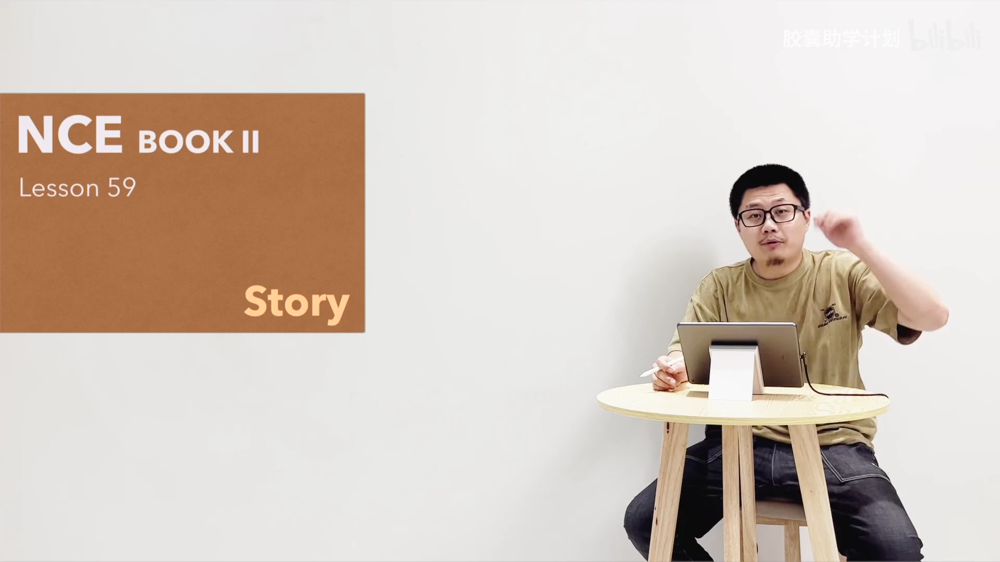

文字识别：NCE / BOOKⅡI / Lesson 59 / Story

### 画面 00:00:05

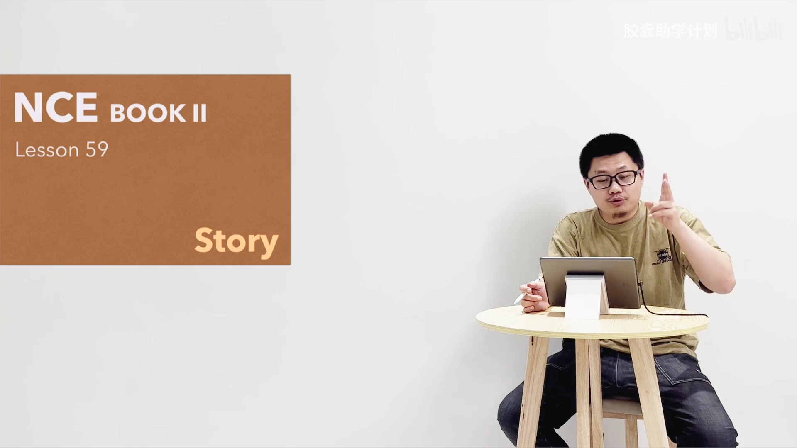

文字识别：NCE / BOOKⅡI / Lesson 59 / Story

### 画面 00:00:09

文字识别：胶囊助学计划 bilbl / •

### 画面 00:00:13

文字识别：胶囊助学计划

### 画面 00:00:15

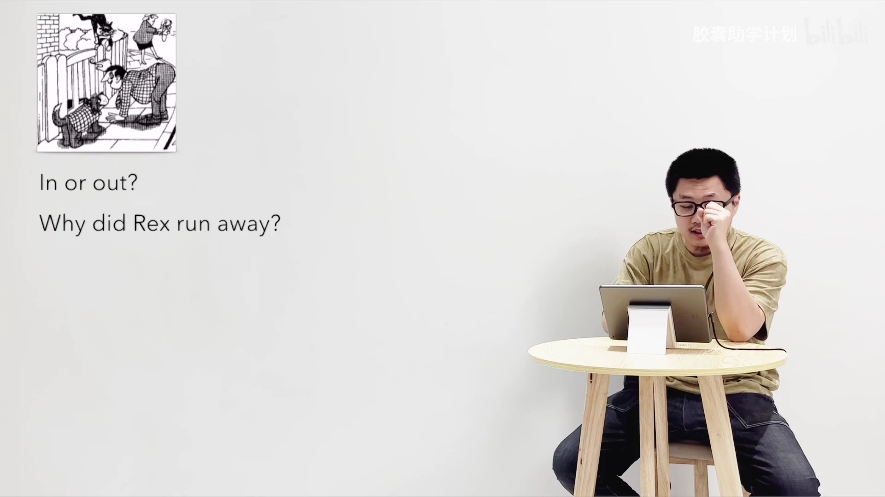

文字识别：In or out? / Why did Rex run away?

## 00:00:30–00:01:00

or Out，是进来还是出去啊？然后这个狗的名字就叫 Rex。然后先告诉了各位一个结局，透露了，叫 Why did Rex run away? 为什么 Rex逃跑了，是吧？我们看一下他为什么逃跑了。 Our dog Rex同位语，同位语从句咱们已经讲过了，对吧？同位语，我们的狗 Rex。那你说 Our English teacher Leo，对吧？哎，一码事儿，同位语。 Used to

### 画面 00:00:45

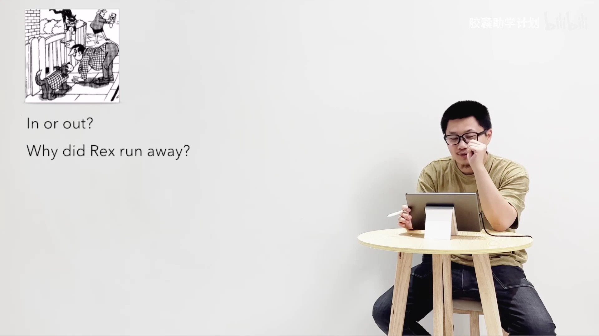

文字识别：In or out? / Why did Rex run away?

### 画面 00:00:47

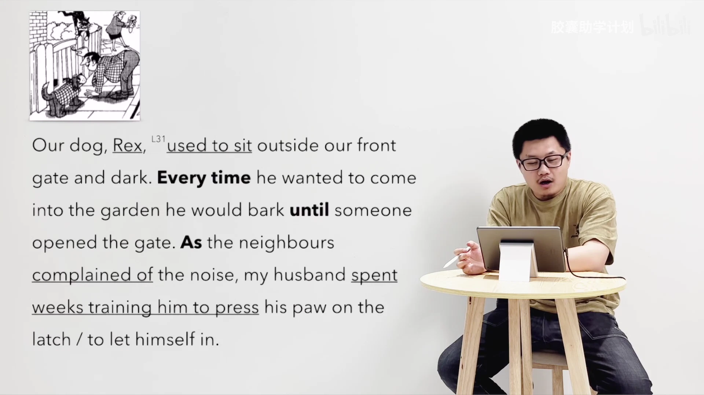

文字识别：Our dog, Rex, 3'used to sit outside our front / gate and dark. Every time he wanted to come / into the garden he would bark until someone / opened the gate. As the neighbours / complained of the noise, my husband spent / weeks training him to press his paw on the / latch / to let himself in.

## 00:01:00–00:01:30

sit过去常常sit outside our front gate and bark. Oh, sorry,这个地方应该是bark, not bark. Okay,好说过去常常坐在我们前门的外面，然后在那儿叫啊啊汪汪汪汪叫。那这个三十一课咱们学过，叫过去常常对吧？现在不这样了。为什么现在不这样了？刚才已经告诉你了，因为他现在跑了，跑丢了。Every time

### 画面 00:01:17

文字识别：Our dog, Rex, 3³'used to sit outside our front / L31 / gate and bark. Every time he wanted to come / into the garden he would bark until someone / opened the gate. As the neighbours / complained of the noise, my husband spent / weeks training him to press his paw on the / latch / to let himself in.

## 00:01:30–00:02:00

he wanted to come into the garden, he would bark until someone opened the gate.好，注意一个小点，这里的 every time 我给各位加粗了，until 加粗了，两个连词连接的都是时间状语从句，对吧？每一次怎么样呢？他想进入这个 garden，就是我们家花园的时候呢，他都会叫，

### 画面 00:01:47

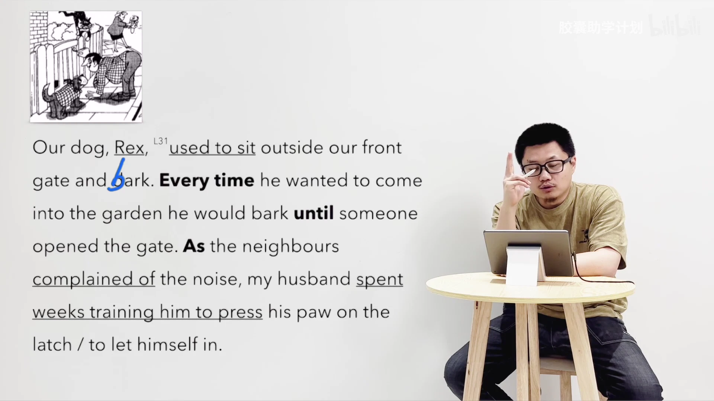

文字识别：Our dog, Rex, ³'used to sit outside our front / L31 / gate and bark. Every time he wanted to come / into the garden he would bark until someone / opened the gate. As the neighbours / complained of the noise, my husband spent / weeks training him to press his paw on the / latch / to let himself in.

## 00:02:00–00:02:30

叫到什么时候呢？直到某个人打开外面的这个大门。各位看到这个gate，看见了吧？不一定非要是铁门啊，可以是栅栏、木门，是吧？树枝做的无所谓。一般来说，只要是你这个院子外边那个门，它就是gate。As先不管它，因为不能确定，只看它是不能确定它什么意思的。The neighbors complain of the

### 画面 00:02:17

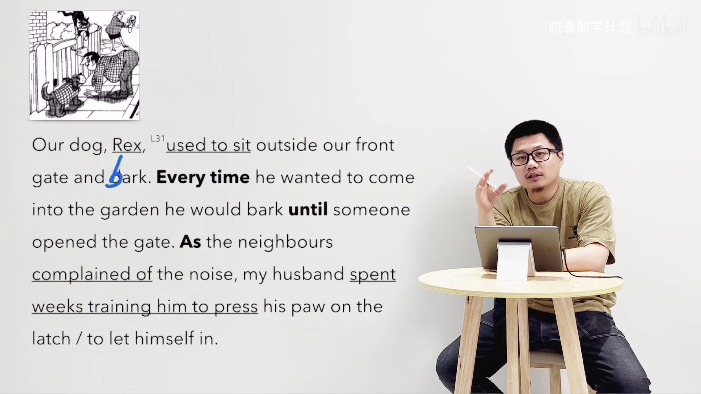

文字识别：Our dog, Rex, 3³'used to sit outside our front / L31 / gate and bark. Every time he wanted to come / into the garden he would bark until someone / opened the gate. As the neighbours / complained of the noise, my husband spent / weeks training him to press his paw on the / latch / to let himself in.

## 00:02:30–00:03:00

noise.说邻居抱怨这个噪音，这个声响。那可不，你狗总叫，那不烦吗？As不确定是什么意思。When because不知道。My husband spent weeks training him to press his paw on the latch to let himself in.这句话有点长，我们给它拆一下。首先，spend weeks training him to press his paw on the latch.我老公，注意这里边有两个习惯

### 画面 00:02:47

文字识别：Our dog, Rex, ³'used to sit outside our front / L31 / gate and bark. Every time he wanted to come / into the garden he would bark until someone / opened the gate. As the neighbours / complained of the noise, my husband spent / weeks training him to press his paw on the / latch / to let himself in.

## 00:03:00–00:03:30

法。第一个叫 spend some time doing something，一会儿咱们造句。第二个叫 train somebody to do something，叫训练某人做某事儿。说我老公啊，花了数周的时间训练他干什么呢？Press his paw on the latch. Press就是按压，那 paw呢就是他的爪子，在什么上呢？在这个门栓上，按压他的爪子在门栓上。你看这个图，对吧？男主人这撅着个屁股，

### 画面 00:03:17

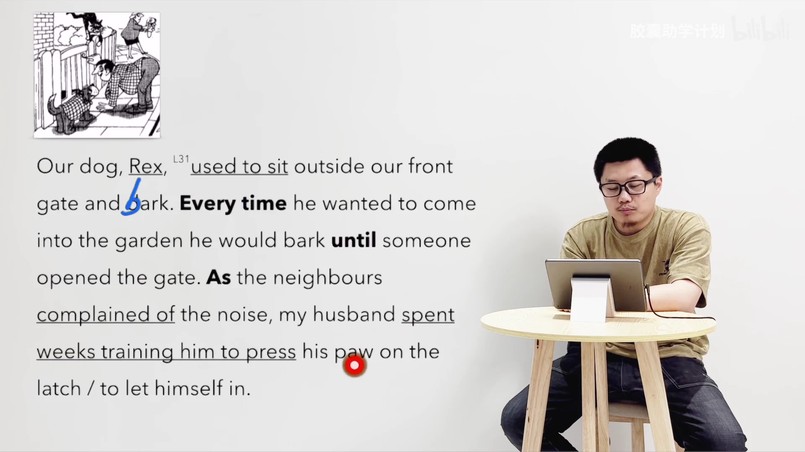

文字识别：Our dog, Rex, ³'used to sit outside our front / L31 / gate and bark. Every time he wanted to come / into the garden he would bark until someone / opened the gate. As the neighbours / complained of the noise, my husband spent / weeks training him to press his paw on the / latch / to let himself in.

### 画面 00:03:22

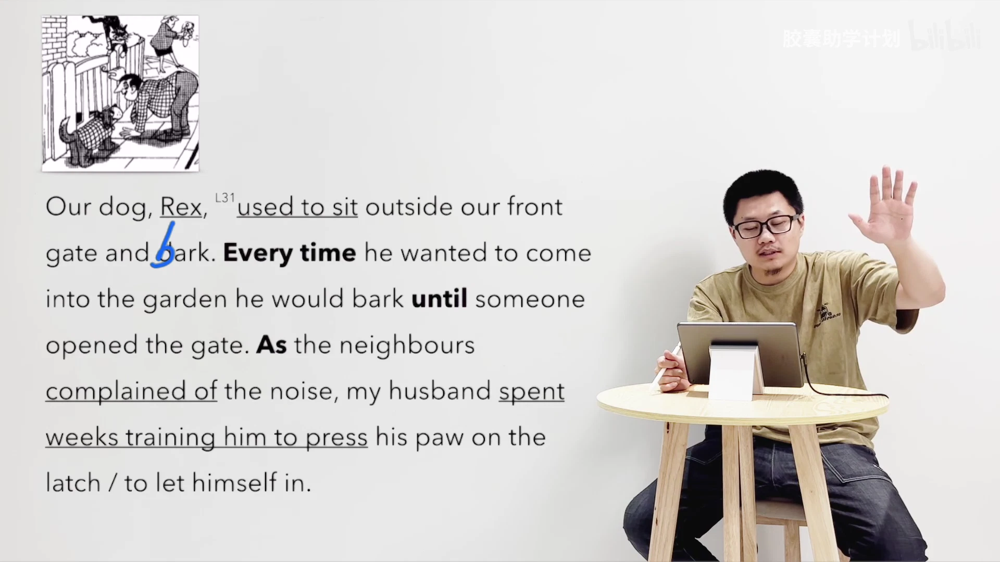

文字识别：Our dog, Rex, "'ysed to sit outside our front / gate and bark. Every time he wanted to come / into the garden he would bark until someone / opened the gate. As the neighbours / complained of the noise, my husband spent / weeks training him to press his paw on the / latch / to let himself in.

### 画面 00:03:27

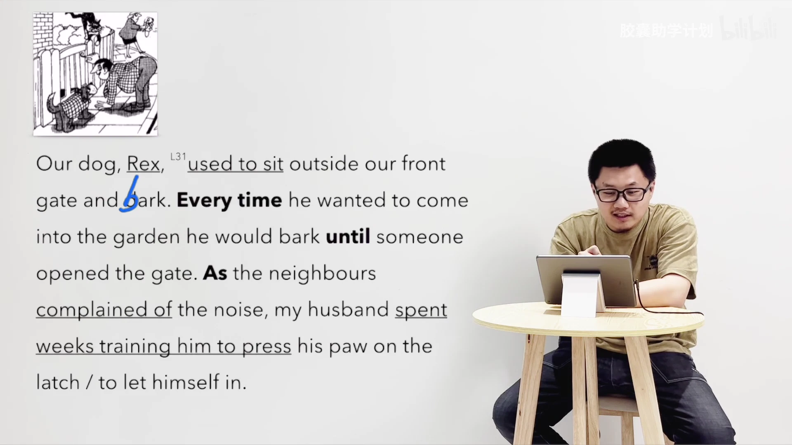

文字识别：Our dog, Rex, ³'used to sit outside our front / L31 / gate and bark. Every time he wanted to come / into the garden he would bark until someone / opened the gate. As the neighbours / complained of the noise, my husband spent / weeks training him to press his paw on the / latch / to let himself in.

## 00:03:30–00:04:00

拿着手给他示范，对吧？把爪子按那上，A门就打开了，对吧？那我们再看一下这句话，说我老公训哎花了数周的时间训练他去把他的爪子放在这个门栓上，目的是让他自己进来。为什么要这么去做呢？因为as就类似于because，对吧？我的邻居呢抱怨这个噪音，OK好，所以因

### 画面 00:03:57

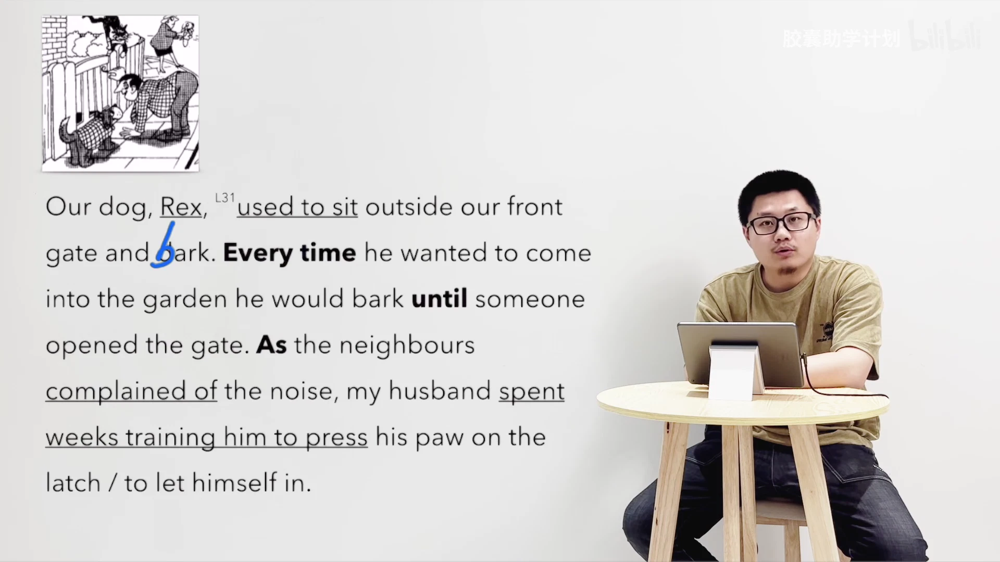

文字识别：Our dog, Rex, ³'used to sit outside our front / L31 / gate and bark. Every time he wanted to come / into the garden he would bark until someone / opened the gate. As the neighbours / complained of the noise, my husband spent / weeks training him to press his paw on the / latch / to let himself in.

## 00:04:00–00:04:30

邻居抱怨这个噪音，我老公就花了数周的时间训练他去把他的放置他的爪子按压他的爪子在这个门栓上，目的是以便让他自己进来。所以他原来是在这个院子的外面，对吧？他想进来，他叫。所以老公，他这个这个这个作者的老公教了他一个事情，教了这个狗一个事儿，叫做把这个手放在门栓上，让这个狗自己就可以开门进院子了，对不对？

### 画面 00:04:14

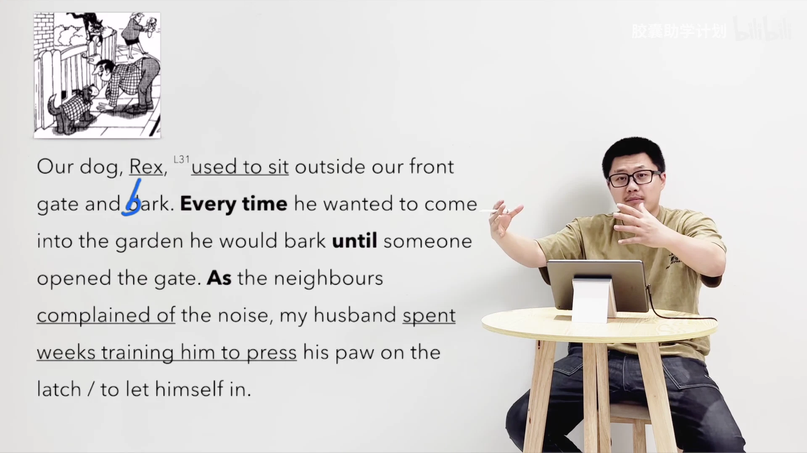

文字识别：Our dog, Rex, ³'used to sit outside our front / L31 / gate and bark. Every time he wanted to come / into the garden he would bark until someone / opened the gate. As the neighbours / complained of the noise, my husband spent / weeks training him to press his paw on the / latch / to let himself in.

### 画面 00:04:19

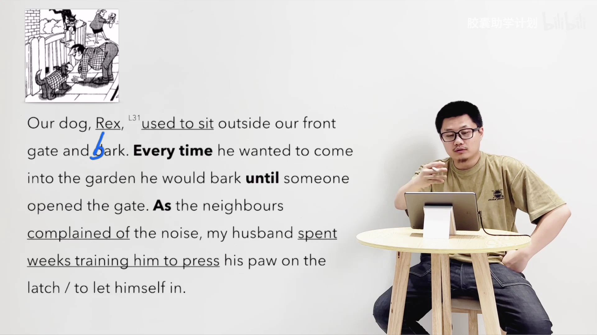

文字识别：Our dog, Rex, B³'used to sit outside our front / L31 / gate and bark. Every time he wanted to come / into the garden he would bark until someone / opened the gate. As the neighbours / complained of the noise, my husband spent / weeks training him to press his paw on the / latch / to let himself in.

## 00:04:30–00:05:00

好，这个地方呢， every time 这个连词我们见的没有那么多，给了各位一个小的电影片段，让各位感受一下啊。说你不用去问我，每一次你需要 take a piss，就是 go to the bathroom，啊，就是去小便的时候，你不用去问我，就直接去就行，明白了吗？注意力集中，咱听一下。 You don't need to ask me every time you need to go take a piss. Just go. Understand? OK，那咱们回到文章，

### 画面 00:04:30

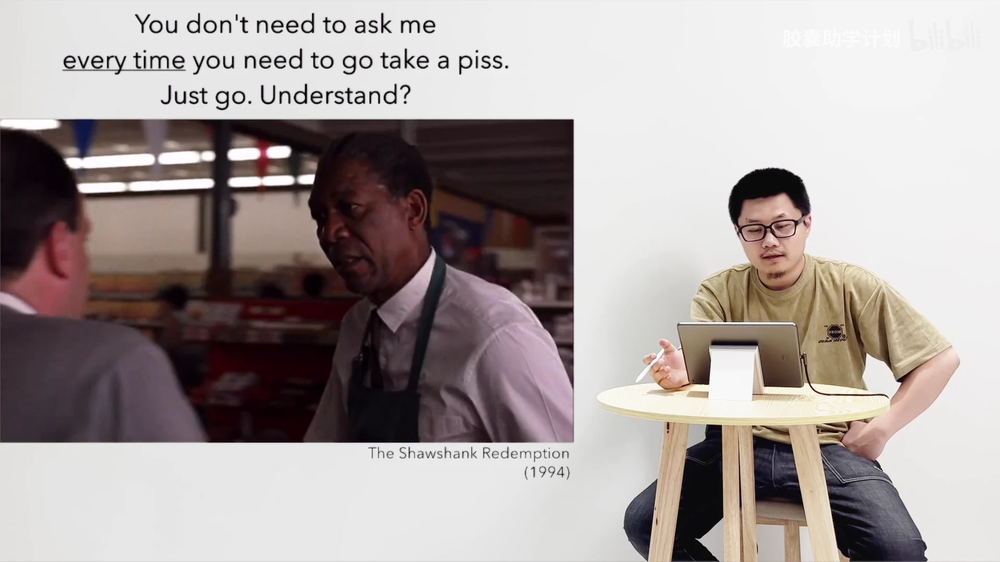

文字识别：You don't need to ask me / every time you need to go take a piss. / Just go. Understand? / The Shawshank Redemption / (1994)

### 画面 00:04:39

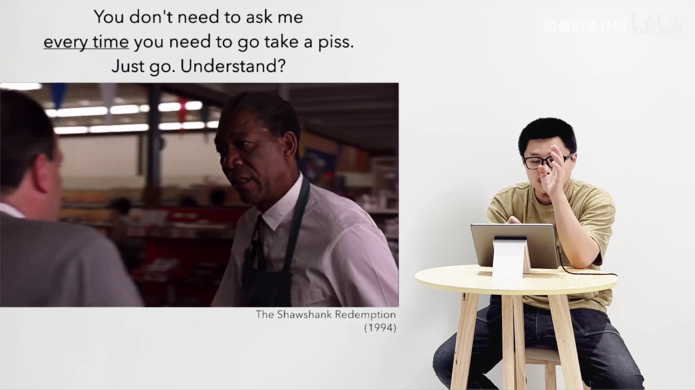

文字识别：You don't need to ask me / every time you need to go take a piss. / Just go. Understand? / The Shawshank Redemption / (1994)

### 画面 00:04:52

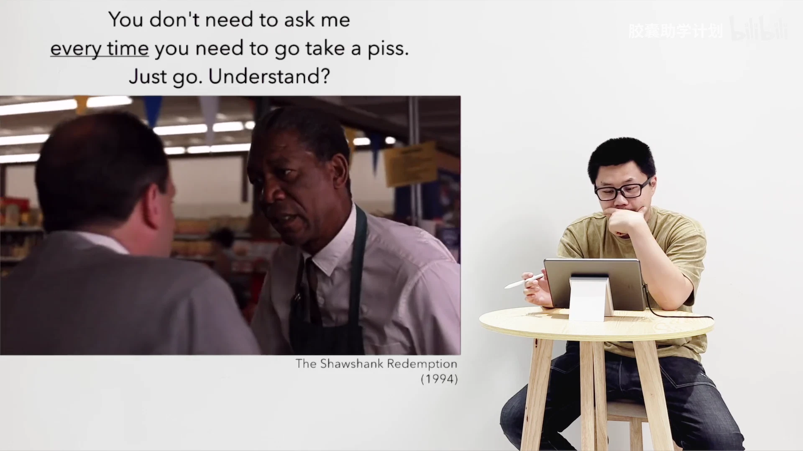

文字识别：You don't need to ask me / every time you need to go take a piss. / Just go. Understand? / The Shawshank Redemption / (1994)

### 画面 00:04:54

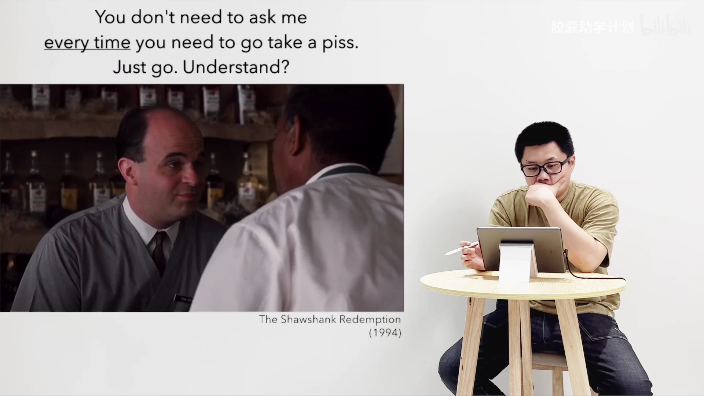

文字识别：You don't need to ask me / every time you need to go take a piss. / Just go. Understand? / The Shawshank Redemption / (1994)

### 画面 00:04:56

文字识别：You don't need to ask me / every time you need to go take a piss. / Just go. Understand? / The Shawshank Redemption / (1994)

### 画面 00:04:58

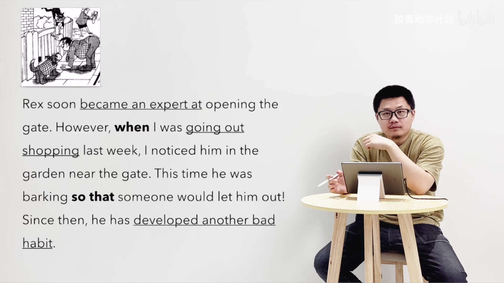

文字识别：Rex soon became an expert at opening the / gate. However, when I was going out / shopping last week, I noticed him in the / garden near the gate. This time he was / barking so that someone would let him out! / Since then, he has developed another bad / habit.

## 00:05:00–00:05:30

Rex这条狗 soon became an expert at opening the gate. 你看这个用语也很俏皮，为什么呢？说这个狗成为了专家，什么专家呢？ Opening the gate，在开门这件事情上成为了一名专家。 However，然而麻烦事儿就来了。 When I was going out shopping last week，哎，出去购物的时候，上周当我出去购物的时候，I

### 画面 00:05:28

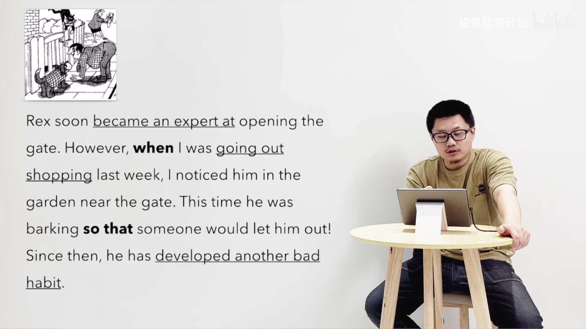

文字识别：Rex soon became an expert at opening the / gate. However, when I was going out / shopping last week, I noticed him in the / garden near the gate. This time he was / barking so that someone would let him out! / Since then, he has developed another bad / habit.

## 00:05:30–00:06:00

noticed him in the garden near the gate. 我注意到他呀，在花园里面，在这个注意他现在在什么里方？在花园的里面。他现在不是会了吗？开门进来了吗？所以他在花园的里面呢。原来是在外边叫，现在进入里边了，并且在这个门的附近。说 this time，这个是次啊，不是这这个时间啊。这一次呢， he was barking. 他正在叫，目的以

### 画面 00:05:41

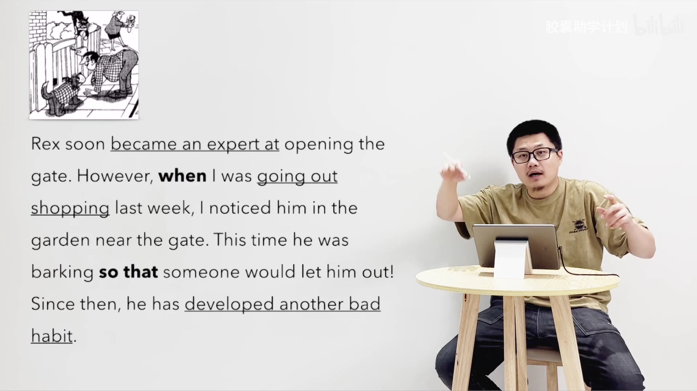

文字识别：Rex soon became an expert at opening the / gate. However, when I was going out / shopping last week, I noticed him in the / garden near the gate. This time he was / barking so that someone would let him out! / Since then, he has developed another bad / habit.

## 00:06:00–00:06:30

便为了 someone would let him out，说某个人会让他出去啊。这个狗也够烦的。原来在外边叫，为了让进来，人家给他开门，对吧？然后呢，他现在会开门了，进来了又不会开门出去了。现在又在那儿叫，为了是来个人给他开门让他出去，对吧？Since then，自从那个时候开始，he has developed another bad habit。他又养成了另一个

### 画面 00:06:11

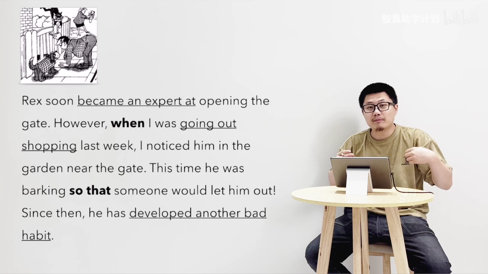

文字识别：Rex soon became an expert at opening the / gate. However, when I was going out / shopping last week, I noticed him in the / garden near the gate. This time he was / barking so that someone would let him out! / Since then, he has developed another bad / habit.

## 00:06:30–00:07:00

个坏习惯。原来的坏习惯是站在门的外面叫，让别人开门让他进来。现在他学会了开门进来，不都已经 became an expert了吗？他现在进来了，然后呢？他在里边又叫，让别来在这个院子里叫，让人开门，他好出去，对吧？然后说他又养成了另一个坏习惯。我们看他另一个坏习惯是什么啊？As soon as he opens the gate from the outside,

### 画面 00:06:41

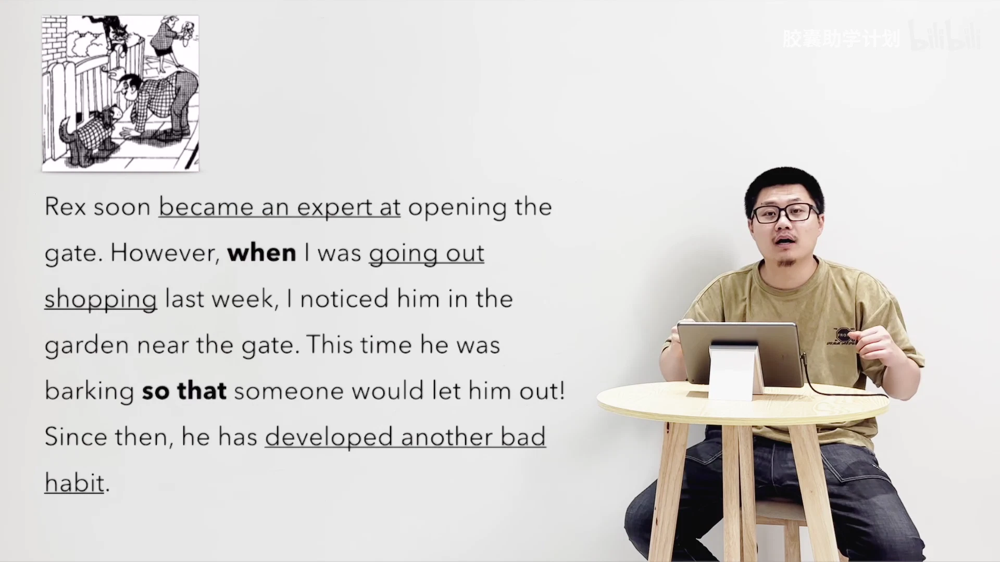

文字识别：Rex soon became an expert at opening the / gate. However, when I was going out / shopping last week, I noticed him in the / garden near the gate. This time he was / barking so that someone would let him out! / Since then, he has developed another bad / habit.

### 画面 00:06:53

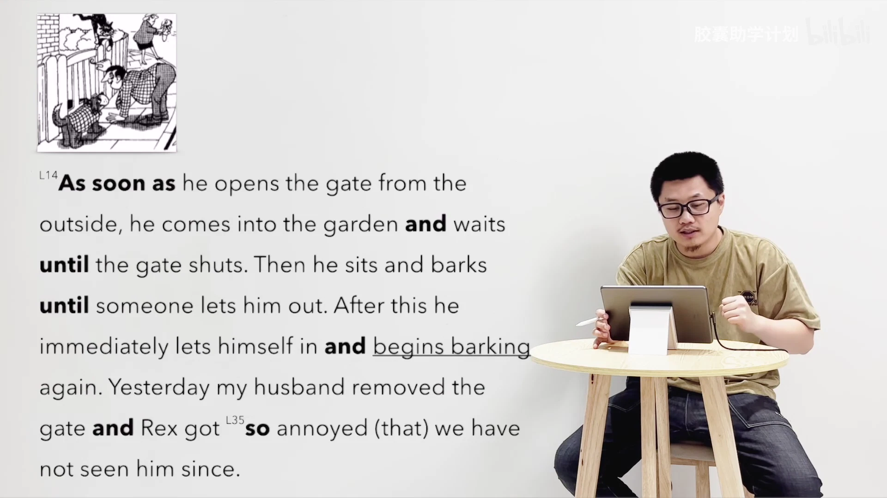

文字识别：L14 / 4As soon as he opens the gate from the / outside, he comes into the garden and waits / until the gate shuts. Then he sits and barks / until someone lets him out. After this he / immediately lets himself in and begins barking / again. Yesterday my husband removed the / gate and Rex got [3³so annoyed (that) we have / not seen him since.

## 00:07:00–00:07:30

一怎么怎么样就怎么怎么样。十四课咱们学的，他打开大门from the outside从外面，他一从外面打开大门。He comes into the garden.他就进入了这个花园。And waits.然后等，等到什么时候呢？直到until本课until出现的真不少三个。The gate shuts.这个大门关上。他现在会开门了。他开门进来，等等到这

### 画面 00:07:23

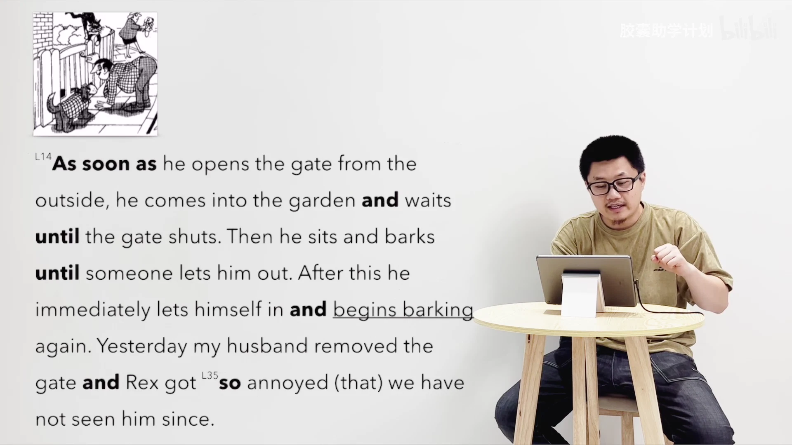

文字识别：L14 / 14As soon as he opens the gate from the / outside, he comes into the garden and waits / until the gate shuts. Then he sits and barks / until someone lets him out. After this he / immediately lets himself in and begins barking / again. Yesterday my husband removed the / gate and Rex got [3³so annoyed (that) we have / not seen him since.

## 00:07:30–00:08:00

个大门咣当关上了，然后呢？ Then he sits and barks. 然后他又坐下开始叫， until someone lets him out. 直到某个人让他出去。这个狗也够叨登的，对吧？就进来就等着，门一关他就开始叫。 After this, he immediately lets himself in and begins barking again. 说在这件事情之后，在哪件事情呢？就是某个人开了门让他出去之

### 画面 00:07:53

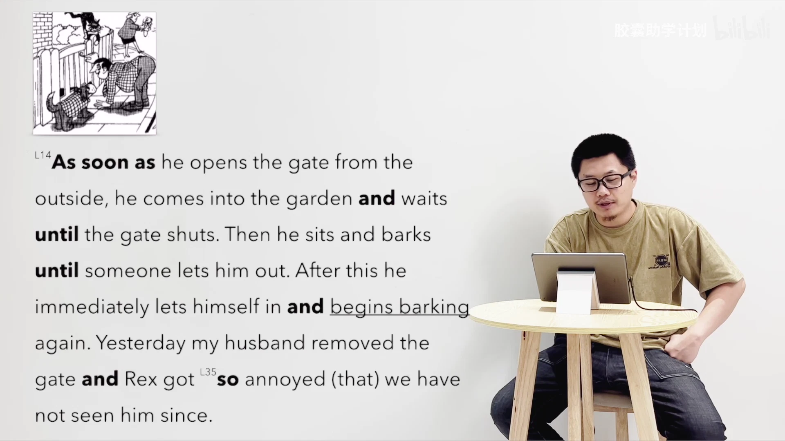

文字识别：L14 / 4As soon as he opens the gate from the / outside, he comes into the garden and waits / until the gate shuts. Then he sits and barks / until someone lets him out. After this he / immediately lets himself in and begins barking / again. Yesterday my husband removed the / gate and Rex got [3³so annoyed (that) we have / not seen him since.

## 00:08:00–00:08:30

后，他立刻就让他自己又进来。他不是会开门进来了吗？然后又开始叫，又一次 began doing, began to do, 啊，一码事儿， again, 又一次，对吧？又一次开始叫。 Yesterday, my husband removed the gate. 昨天，我老公怎么样呢？就把这个大门给摘除了。 And, 然后 Rex 就是一条狗,

### 画面 00:08:23

文字识别：L14 / 4As soon as he opens the gate from the / outside, he comes into the garden and waits / until the gate shuts. Then he sits and barks / until someone lets him out. After this he / immediately lets himself in and begins barking / again. Yesterday my husband removed the / gate and Rex got [3³so annoyed (that) we have / not seen him since.

## 00:08:30–00:09:00

Got so annoyed, we have not seen him since.他就变得如此的懊恼和烦躁，以至于我们从那以后，since叫从那以后，一直再也没有见到他。因为啥？这个狗跑了，对吧？这地方提一个小点，这个that原文是没有的，它是被省略掉的。所以在这里，我就想提醒各位，或者说分享给各位一个新的知

### 画面 00:08:53

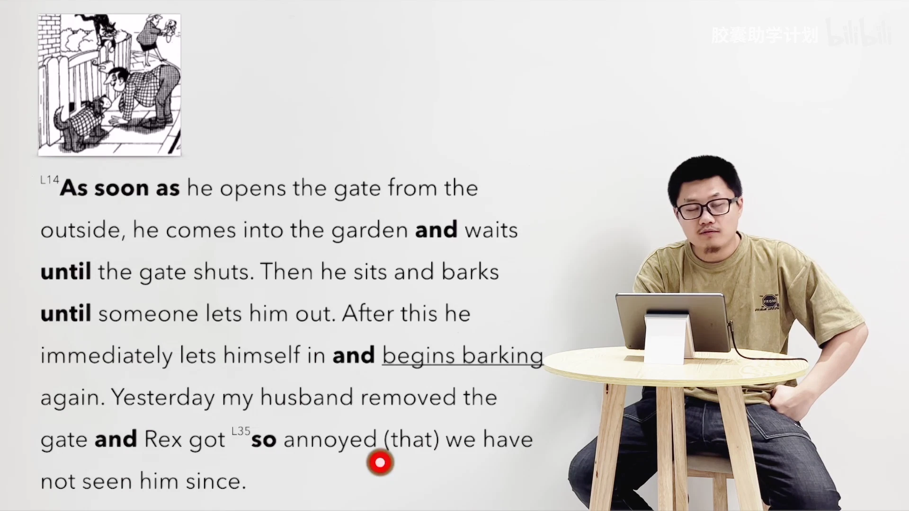

文字识别：L14 / 4As soon as he opens the gate from the / outside, he comes into the garden and waits / until the gate shuts. Then he sits and barks / until someone lets him out. After this he / immediately lets himself in and begins barking / again. Yesterday my husband removed the / gate and Rex got 3³so annoyed (that) we have / not seen him since.

## 00:09:00–00:09:30

识点，叫做三十五课咱们学的so点点点儿that后边的那个that，告诉你今天又升级了一下，对吧？原来呢我们会用了，今天又升级了一下，告诉你这个that也是可以被省略的。OK，那文章就结束了。接下来呢，我们看一下文章的三个很值得造句的习惯用法，我们逐一去进行造句。第一个，complain of抱怨，比如说，

### 画面 00:09:05

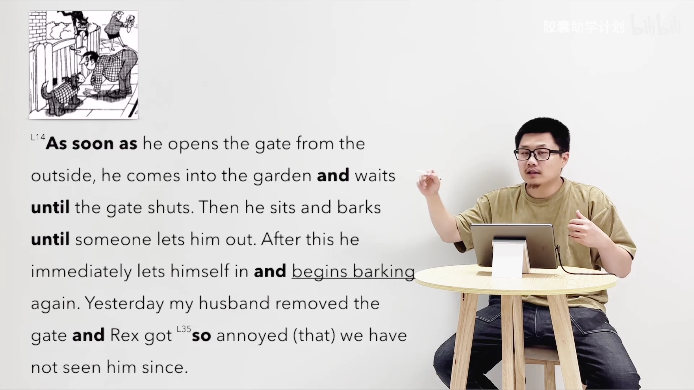

文字识别：L14 / 4As soon as he opens the gate from the / outside, he comes into the garden and waits / until the gate shuts. Then he sits and barks / until someone lets him out. After this he / immediately lets himself in and begins barking / again. Yesterday my husband removed the / gate and Rex got [3³so annoyed (that) we have / not seen him since.

### 画面 00:09:08

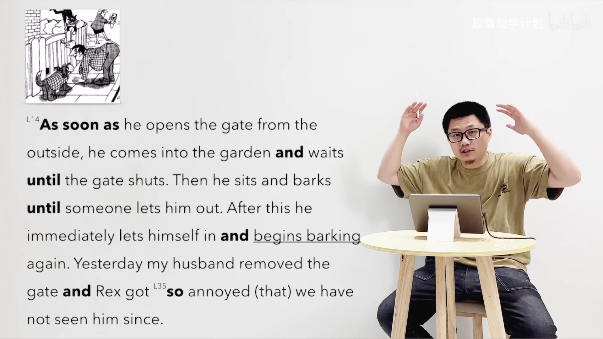

文字识别：L14 / 4As soon as he opens the gate from the / outside, he comes into the garden and waits / until the gate shuts. Then he sits and barks / until someone lets him out. After this he / immediately lets himself in and begins barking / again. Yesterday my husband removed the / gate and Rex got 3³so annoyed (that) we have / not seen him since.

### 画面 00:09:11

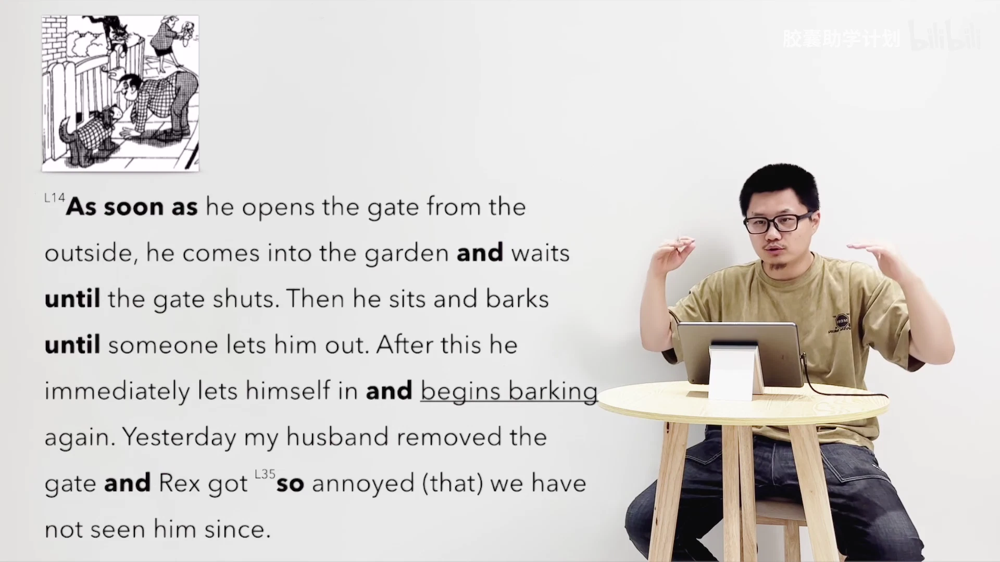

文字识别：L14 / 14As soon as he opens the gate from the / outside, he comes into the garden and waits / until the gate shuts. Then he sits and barks / until someone lets him out. After this he / immediately lets himself in and begins barking / again. Yesterday my husband removed the / gate and Rex got [3³so annoyed (that) we have / not seen him since.

### 画面 00:09:15

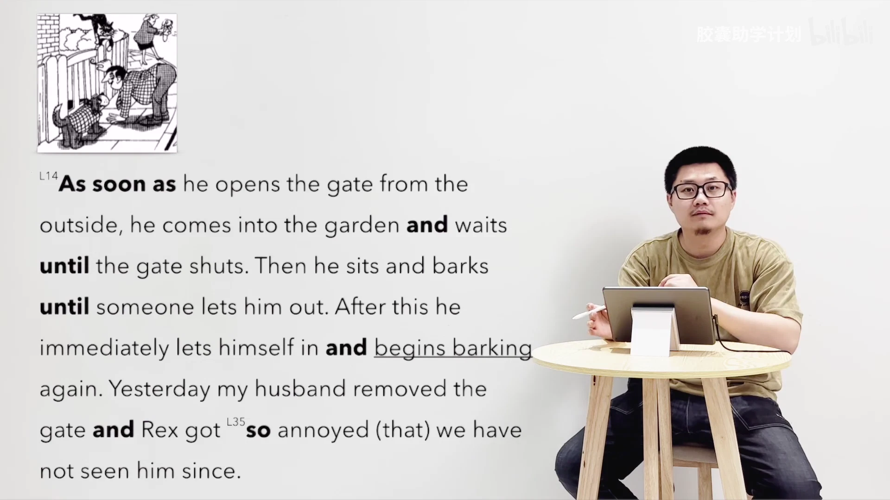

文字识别：L14 / 4As soon as he opens the gate from the / outside, he comes into the garden and waits / until the gate shuts. Then he sits and barks / until someone lets him out. After this he / immediately lets himself in and begins barking / again. Yesterday my husband removed the / gate and Rex got 3³so annoyed (that) we have / not seen him since.

### 画面 00:09:17

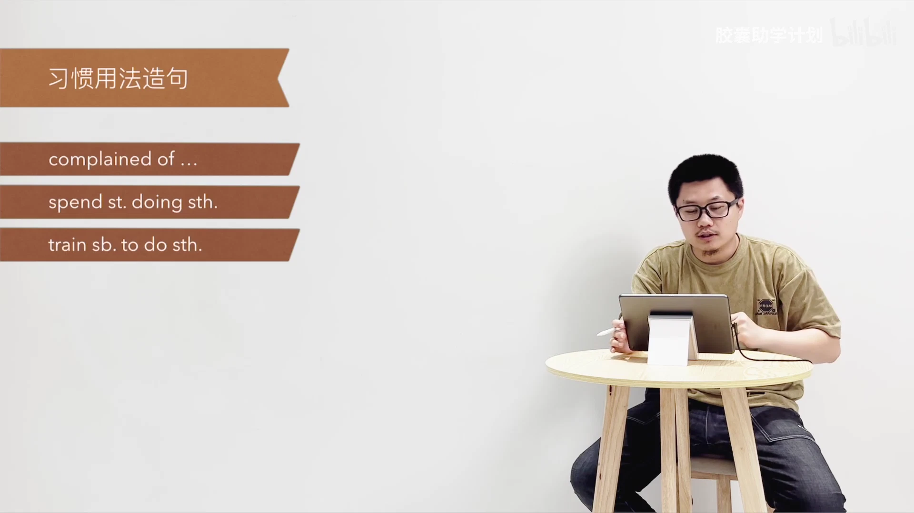

文字识别：习惯用法造句 / complained of / spend st. doing sth. / train sb. to do sth.

### 画面 00:09:19

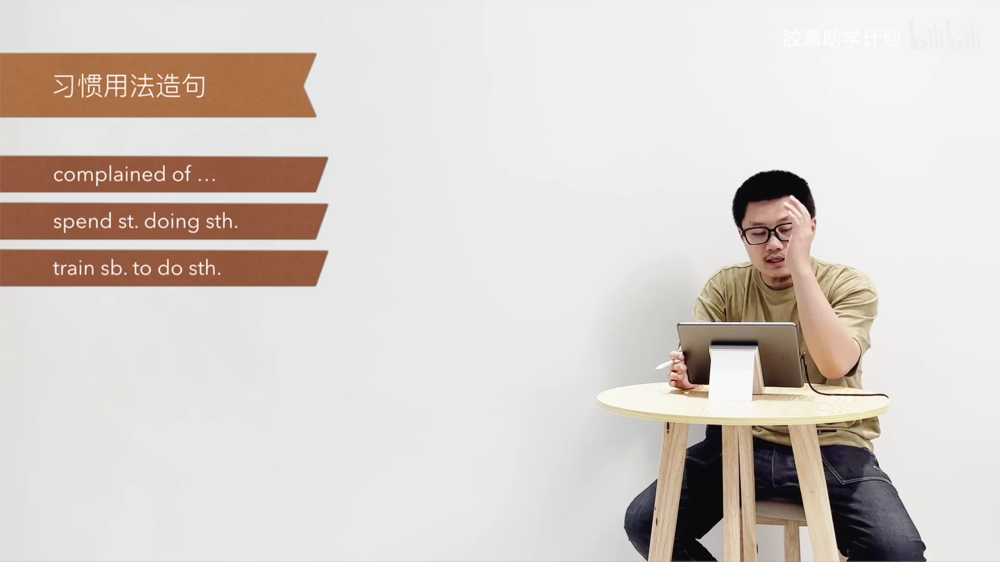

文字识别：习惯用法造句 / complained of / spend st. doing sth. / train sb. to do sth.

### 画面 00:09:21

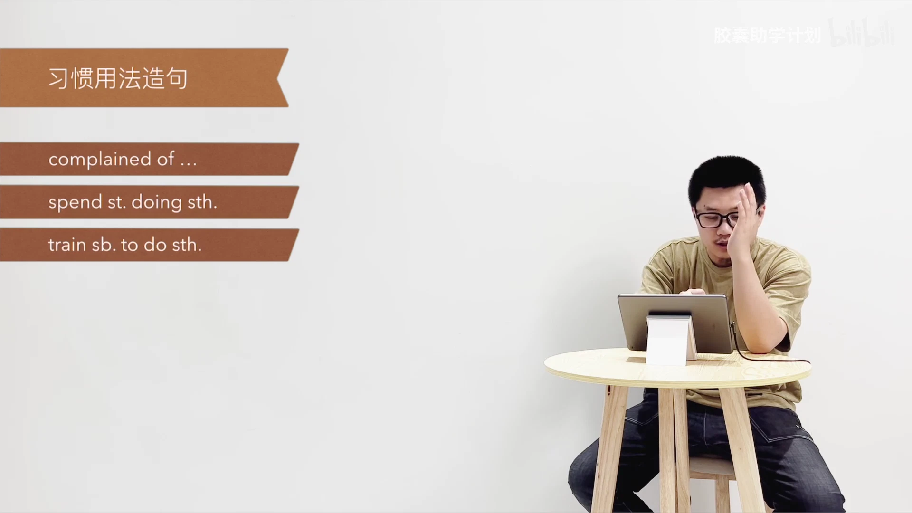

文字识别：习惯用法造句 / complained of / spend st. doing sth. / train sb. to do sth.

### 画面 00:09:24

文字识别：网：v.+v.变化 / 习惯用法造句指南 / 四句型转换 / 方式/地点/时间 / 其他习惯用法 / 其他单词+词性 / 原文摘抄+变 / 6123456 / complained of

### 画面 00:09:26

文字识别：网：v.+v.变化 / 习惯用法造句指南 / 四句型转换 / 方式/地点/时间 / 其他习惯用法 / 其他单词+词性 / 原文摘抄+变 / 6123456 / complained of

### 画面 00:09:29

文字识别：网：v.+v.变化 / 习惯用法造句指南 / 四句型转换 / 方式/地点/时间 / 其他习惯用法 / 其他单词+词性 / 原文摘抄+变 / 6123456 / complained of / Has she complained of a headache? NowIs / Good (2012)

## 00:09:30–00:10:00

Has she complained of a headache?她抱怨头疼了吗？Okay, next one. He is said to complain of his boss all the time.据说呀，五十八课咱学的，be said to do或者it is said that两个都行。您自己回去把这个补齐啊。据说，他一直都抱怨他老板。

### 画面 00:09:31

文字识别：网：v.+v.变化 / 习惯用法造句指南 / 四句型转换 / 方式/地点/时间 / 其他习惯用法 / 其他单词+词性 / 原文摘抄+变 / 6123456 / complained of / Has she complained of a headache? NowIs / Good(2012)

### 画面 00:09:35

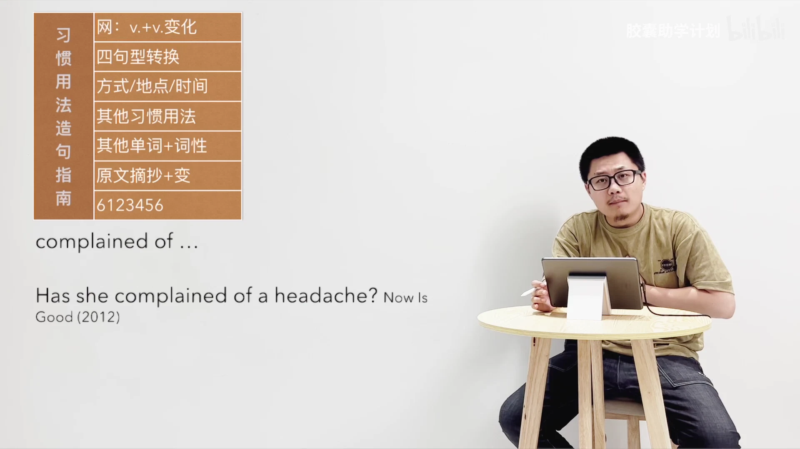

文字识别：网：v.+v.变化 / 习惯用法造句指南 / 四句型转换 / 方式/地点/时间 / 其他习惯用法 / 其他单词+词性 / 原文摘抄+变 / 6123456 / complained of / Has she complained of a headache? NowIs / Good (2012)

### 画面 00:09:37

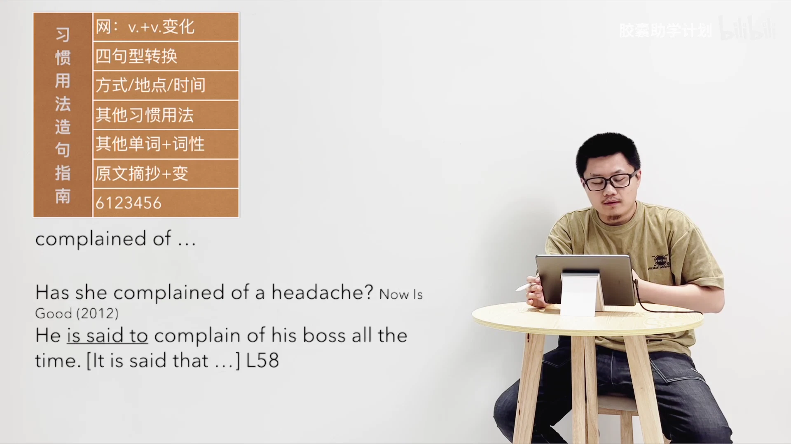

文字识别：网：v.+v.变化 / 习惯用法造句指南 / 四句型转换 / 方式/地点/时间 / 其他习惯用法 / 其他单词+词性 / 原文摘抄+变 / 6123456 / complained of / Has she complained of a headache? Now Is / Good (2012) / He is said to complain of his boss all the / time.[It is said that ...] L58

### 画面 00:09:40

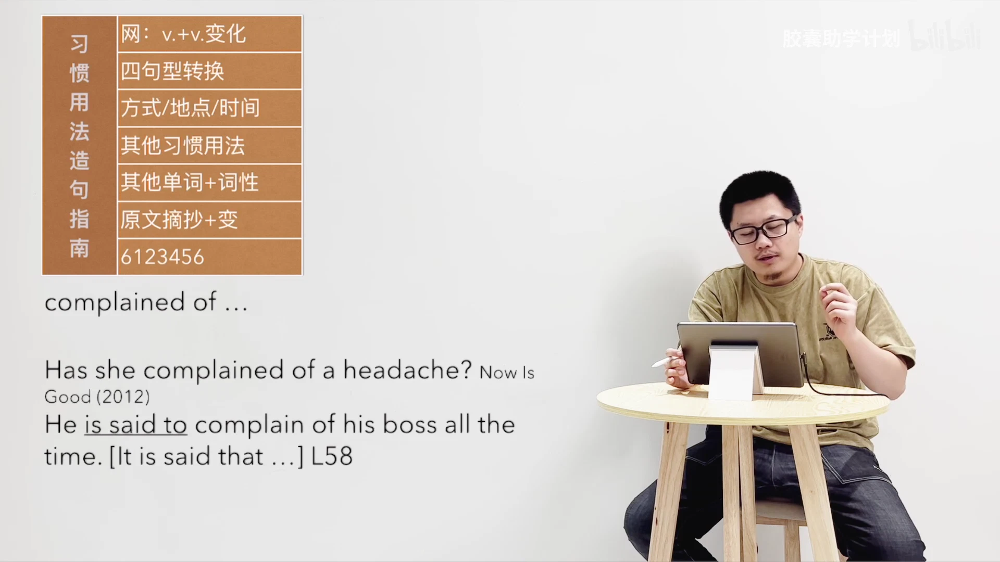

文字识别：网：v.+v.变化 / 习惯用法造句指南 / 四句型转换 / 方式/地点/时间 / 其他习惯用法 / 其他单词+词性 / 原文摘抄+变 / 6123456 / complained of / Has she complained of a headache? Now Is / Good(2012) / He is said to complain of his boss all the / time.[It is said that ...] L58

### 画面 00:09:45

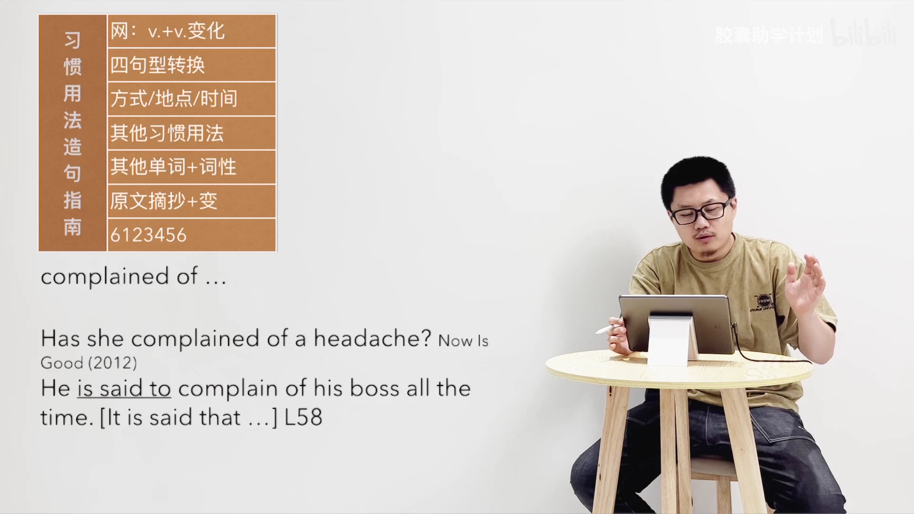

文字识别：网：v.+v.变化 / 习惯用法造句指南 / 四句型转换 / 方式/地点/时间 / 其他习惯用法 / 其他单词+词性 / 原文摘抄+变 / 6123456 / complained of / Has she complained of a headache? Now Is / Good(2012) / He is said to complain of his boss all the / time.[It is said that ...] L58

### 画面 00:09:50

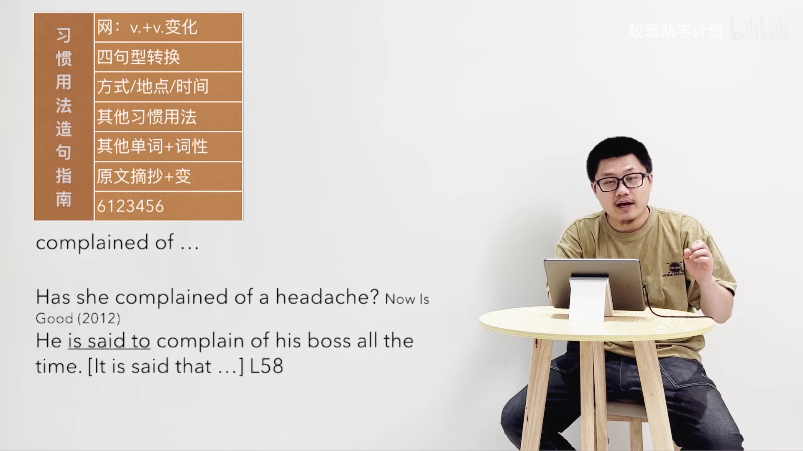

文字识别：网：v.+v.变化 / 习惯用法造句指南 / 四句型转换 / 方式/地点/时间 / 其他习惯用法 / 其他单词+词性 / 原文摘抄+变 / 6123456 / complained of / Has she complained of a headache? Now Is / Good (2012) / He is said to complain of his boss all the / time.[It is said that ...] L58

### 画面 00:09:55

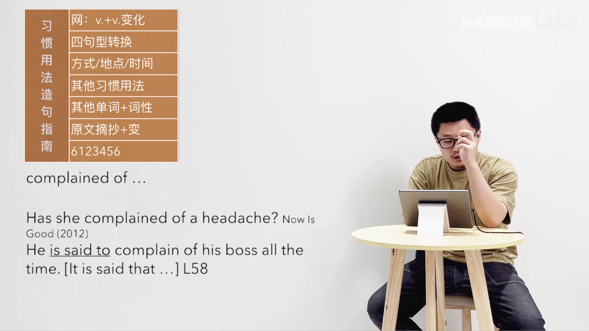

文字识别：网：v.+v.变化 / 习惯用法造句指南 / 四句型转换 / 方式/地点/时间 / 其他习惯用法 / 其他单词+词性 / 原文摘抄+变 / 6123456 / complained of / Has she complained of a headache? Now Is / Good(2012) / He is said to complain of his boss all the / time. [It is said that ...] L58

## 00:10:00–00:10:30

Okay, next one. It was Lucy. 强调句 that complained of his boss at the party last night. 不是别人在昨天晚上聚会上抱怨老板了，就是 Lucy. 那其实这里边我们如果用 her 会更好一点，因为 Lucy 偏向于是一个女生的名字。这个小的细节我们临场给它修改一下，好吧？ Okay. 接下来注意力集中，咱听

### 画面 00:10:00

文字识别：网：v.+v.变化 / 习惯 / 四句型转换 / 伙用法造句指南 / 方式/地点/时间 / 其他习惯用法 / 其他单词+词性 / 原文摘抄+变 / 6123456 / complained of / Has she complained of a headache? Now ls / Good (2012) / He is said to complain of his boss all the / time. [It is said that ...] L58 / It was Lucy that complained of his boss at / the party last night. L58

### 画面 00:10:02

文字识别：网：v.+v.变化 / 习惯 / 四句型转换 / 用法造句指南 / 方式/地点/时间 / 其他习惯用法 / 其他单词+词性 / 原文摘抄+变 / 6123456 / complained of / Has she complained of a headache? Now Is / Good (2012) / He is said to complain of his boss all the / time.[It is said that ...] L58 / It was Lucy that complained of his boss at / the party last night. L58

### 画面 00:10:04

文字识别：网：v.+v.变化 / 习惯 / 四句型转换 / 用 / 方式/地点/时间 / 用法造句指南 / 其他习惯用法 / 其他单词+词性 / 原文摘抄+变 / 6123456 / complained of / Has she complained of a headache? Now Is / Good (2012) / He is said to complain of his boss all the / time.[It is said that ...] L58 / It was Lucy that complained of his boss at / the party last might. L58

### 画面 00:10:06

文字识别：网：v.+v.变化 / 习惯用法造句指南 / 四句型转换 / 方式/地点/时间 / 其他习惯用法 / 其他单词+词性 / 原文摘抄+变 / 6123456 / complained of / Has she complained of a headache? Now Is / Good (2012) / He is said to complain of his boss all the / time.[It is said that ...] L58 / It was Lucy that complained of his boss at / the party last night. L58

### 画面 00:10:10

文字识别：网：v.+v.变化 / 习惯用法造句指南 / 四句型转换 / 方式/地点/时间 / 其他习惯用法 / 其他单词+词性 / 原文摘抄+变 / 6123456 / complained of / Has she complained of a headache? Now Is / Good(2012) / He is said to complain of his boss all the / time.[It is said that ...] L58 / It was Lucy that complained of his boss at / the party last night. L58

### 画面 00:10:15

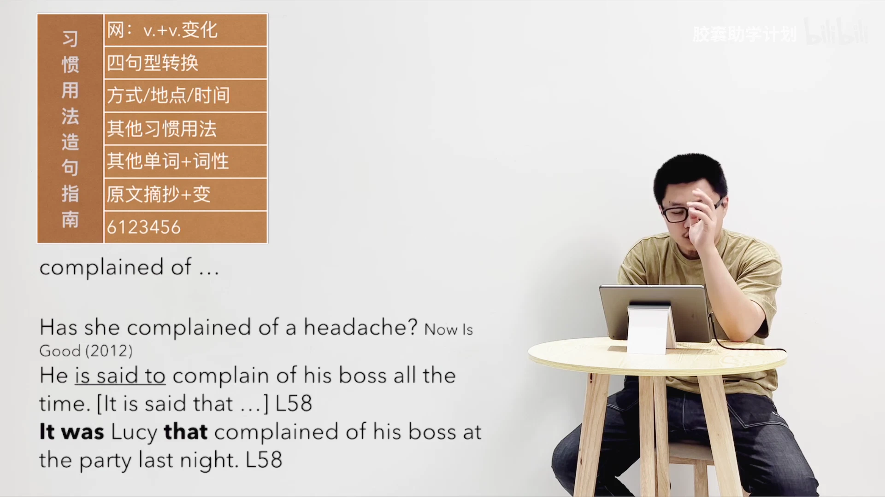

文字识别：网：v.+v.变化 / 习惯用法造句指南 / 四句型转换 / 方式/地点/时间 / 其他习惯用法 / 其他单词+词性 / 原文摘抄+变 / 6123456 / complained of / Has she complained of a headache? Now Is / Good(2012) / He is said to complain of his boss all the / time. [It is said that ..] L58 / It was Lucy that complained of his boss at / the party last night. L58

### 画面 00:10:19

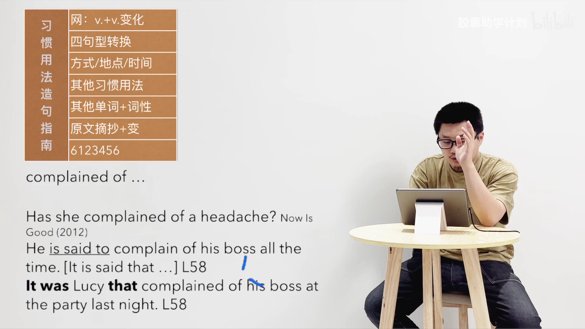

文字识别：网：v.+v.变化 / 习惯用 / 四句型转换 / 方式/地点/时间 / 用法造句指南 / 其他习惯用法 / 其他单词+词性 / 原文摘抄+变 / 6123456 / complained of / Has she complained of a headache? Now Is / Good(2012) / He is said to complain of his boss all the / time.[It is said that ...] L58 / It was Lucy that complained of his boss at / the party last night. L58

### 画面 00:10:21

文字识别：网：v.+v.变化 / 习惯用法造句指南 / 四句型转换 / 方式/地点/时间 / 其他习惯用法 / 其他单词+词性 / 原文摘抄+变 / 6123456 / complained of / Has she complained of a headache? Now Is / Good (2012) / He is said to complain of his boss all the / her / time.[It is said that ...] L58 / It was Lucy that complained of his boss at / the party last night. L58

### 画面 00:10:23

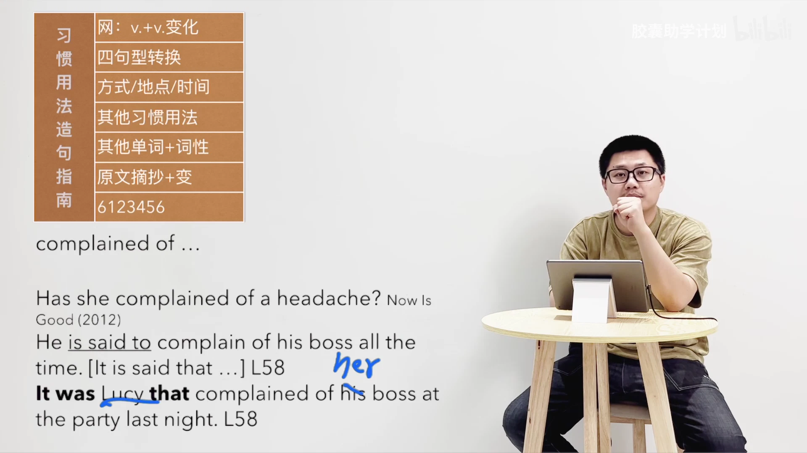

文字识别：网：v.+v.变化 / 习惯用法造句指南 / 四句型转换 / 方式/地点/时间 / 其他习惯用法 / 其他单词+词性 / 原文摘抄+变 / 6123456 / complained of / Has she complained of a headache? Now ls / Good(2012) / He is said to complain of his boss all the / her / time.[It is said that ...] L58 / It was Lucy that complained of his boss at / the party last night. L58

### 画面 00:10:25

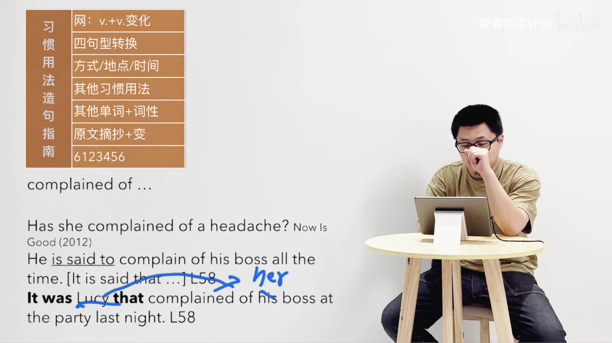

文字识别：网：v.+v.变化 / 习惯用法造句指南 / 四句型转换 / 方式/地点/时间 / 其他习惯用法 / 其他单词+词性 / 原文摘抄+变 / 6123456 / complained of / Has she complained of a headache? Now Is / Good(2012) / He is said to complain of his boss all the / her / time.[lt is said that / It was Lucy that complained of his boss at / the party last night. L58

### 画面 00:10:27

文字识别：网：v.+v.变化 / 习惯用法造句指南 / 四句型转换 / 方式/地点/时间 / 其他习惯用法 / 其他单词+词性 / 原文摘抄+变 / 6123456 / complained of / Has she complained of a headache? Now Is / Good (2012) / He is said to complain of his boss all the / time.[It is said that ...] L58 / It was Lucy that complained of his boss at / the party last night. L58

### 画面 00:10:29

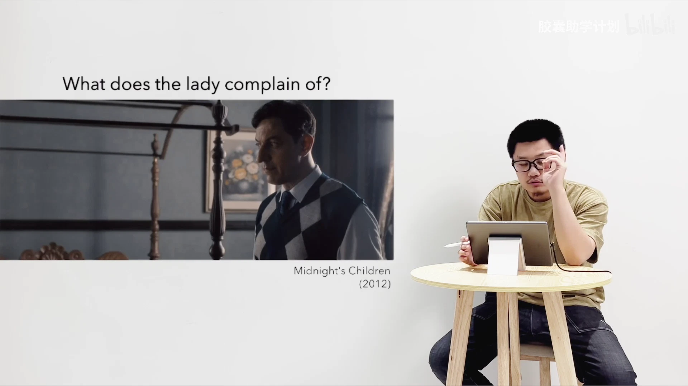

文字识别：What does the lady complain of? / Midnight's Children / (2012)

## 00:10:30–00:11:00

一下这句话。What does the lady complain on my porch? 哎，这个女士抱怨什么了呢？那这个 complain of，这个 of of 就非常轻了，对吧？Okay, next one. Spend some time doing something. 花费多长时间做某件事情？我们看，比如说，He spent three years planting these trees. 他花了三年的时间种这些树。种这个单词是咱上一课刚学的，是吧？

### 画面 00:10:32

文字识别：What does the lady complain of? / Midnight's Children / (2012)

### 画面 00:10:34

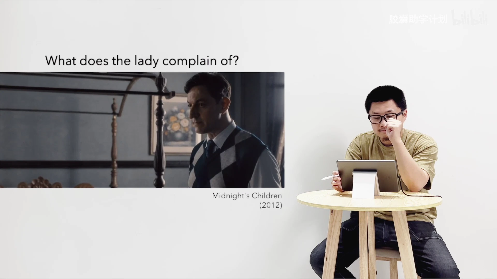

文字识别：What does the lady complain of? / Midnight's Children / (2012)

### 画面 00:10:42

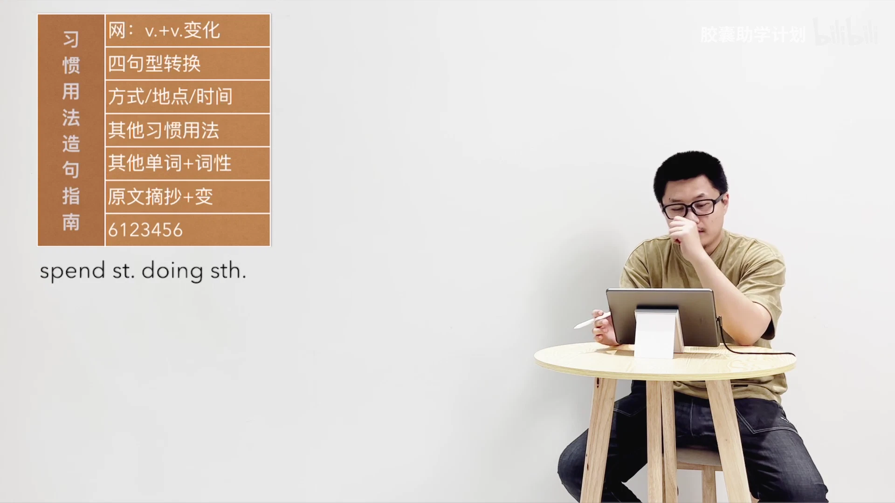

文字识别：网：v.+v.变化 / 习惯用法造句指南 / 四句型转换 / 方式/地点/时间 / 其他习惯用法 / 其他单词+词性 / 原文摘抄+变 / 6123456 / spend st. doing sth.

### 画面 00:10:44

文字识别：网：v.+v.变化 / 习惯用法造句指南 / 四句型转换 / 方式/地点/时间 / 其他习惯用法 / 其他单词+词性 / 原文摘抄+变 / 6123456 / spend st. doing sth.

### 画面 00:10:46

文字识别：网：v.+v.变化 / 习惯用法造句指南 / 四句型转换 / 方式/地点/时间 / 其他习惯用法 / 其他单词+词性 / 原文摘抄+变 / 6123456 / spend st. doing sth.

### 画面 00:10:49

文字识别：网：v.+v.变化 / 习惯用法造句指南 / 四句型转换 / 方式/地点/时间 / 其他习惯用法 / 其他单词+词性 / 原文摘抄+变 / 6123456 / spend st. doing sth. / He spent three years planting these trees.

### 画面 00:10:51

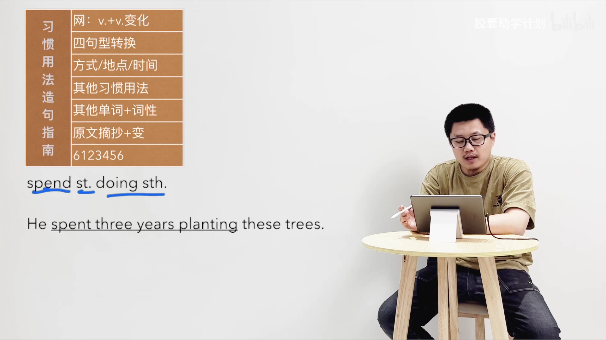

文字识别：网：v.+v.变化 / 习惯用法造句指南 / 四句型转换 / 方式/地点/时间 / 其他习惯用法 / 其他单词+词性 / 原文摘抄+变 / 6123456 / spend st. doing sth. / He spent three years planting these trees.

### 画面 00:10:55

文字识别：网：v.+v.变化 / 习惯用法造句指南 / 四句型转换 / 方式/地点/时间 / 其他习惯用法 / 其他单词+词性 / 原文摘抄+变 / 6123456 / spend st. doing sth. / He spent three years planting these trees.

### 画面 00:10:57

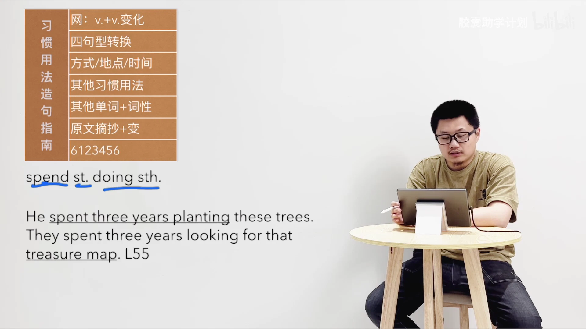

文字识别：网：v.+v.变化 / 习惯用法造句指南 / 四句型转换 / 方式/地点/时间 / 其他习惯用法 / 其他单词+词性 / 原文摘抄+变 / 6123456 / spend st. doing sth. / He spent three years planting these trees. / They spent three years looking for that / treasure map. L55

### 画面 00:10:59

文字识别：网：v.+v.变化 / 习惯用法造句指南 / 四句型转换 / 方式/地点/时间 / 其他习惯用法 / 其他单词+词性 / 原文摘抄+变 / 6123456 / spend st. doing sth. / He spent three years planting these trees. / They spent three years looking for that / treasure map. L55

## 00:11:00–00:11:30

Next one说They spent three years looking for that treasure map. Treasure map，不知道各位还记不记得？五十五课咱学的藏宝图，对吧？他花了三年的时间，当然包括这个look for也是一个之前学过的短语。Next one说Leo spent three years living in a cave.这实在是没事儿找事儿，硬造了个句子，为了各位复习一下。In a cave，在山洞当中，对吧？那既然他花了三年时

### 画面 00:11:01

文字识别：网：v.+v.变化 / 习惯用法造句指南 / 四句型转换 / 方式/地点/时间 / 其他习惯用法 / 其他单词+词性 / 原文摘抄+变 / 6123456 / spend st. doing sth. / He spent three years planting these trees. / They spent three years looking for that / treasure map. L55

### 画面 00:11:05

文字识别：网：v.+v.变化 / 习惯用法造句指南 / 四句型转换 / 方式/地点/时间 / 其他习惯用法 / 其他单词+词性 / 原文摘抄+变 / 6123456 / spend st. doing sth. / He spent three years planting these trees. / They spent three years looking for that / treasure map. L55

### 画面 00:11:10

文字识别：网：v.+v.变化 / 习惯用法造句指南 / 四句型转换 / 方式/地点/时间 / 其他习惯用法 / 其他单词+词性 / 原文摘抄+变 / 6123456 / spend st. doing sth. / He spent three years planting these trees. / They spent three years looking for that / treasure map. L55

### 画面 00:11:15

文字识别：网：v.+v.变化 / 习惯用法造句指南 / 四句型转换 / 方式/地点/时间 / 其他习惯用法 / 其他单词+词性 / 原文摘抄+变 / 6123456 / spend st. doing sth. / He spent three years planting these trees. / They spent three years looking for that / treasure map. L55

### 画面 00:11:17

文字识别：网：v.+v.变化 / 习惯用法造句指南 / 四句型转换 / 方式/地点/时间 / 其他习惯用法 / 其他单词+词性 / 原文摘抄+变 / 6123456 / spend st. doing sth. / He spent three years planting these trees. / They spent three years looking for that / treasure map. L55 / Leo spent three years living in a cave. L55

### 画面 00:11:19

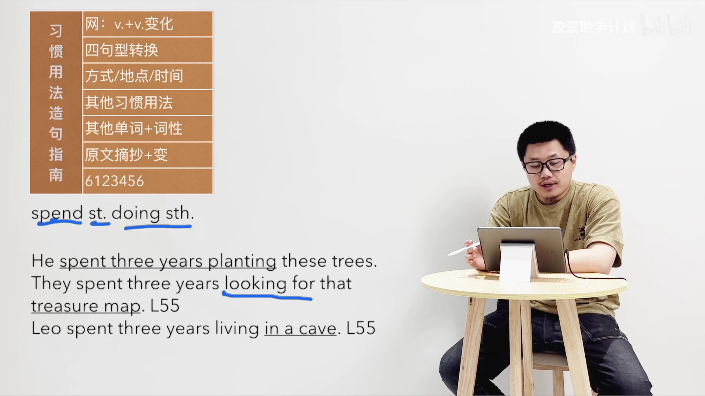

文字识别：网：v.+v.变化 / 习惯用法造句指南 / 四句型转换 / 方式/地点/时间 / 其他习惯用法 / 其他单词+词性 / 原文摘抄+变 / 6123456 / spend st. doing sth. / He spent three years planting these trees. / They spent three years looking for that / treasure map. L55 / Leo spent three years living in a cave. L55

### 画面 00:11:21

文字识别：网：v.+v.变化 / 习惯用法造句指南 / 四句型转换 / 方式/地点/时间 / 其他习惯用法 / 其他单词+词性 / 原文摘抄+变 / 6123456 / spend st. doing sth. / He spent three years planting these trees. / They spent three years looking for that / treasure map. L55 / Leo spent three years living in a cave. L55

### 画面 00:11:26

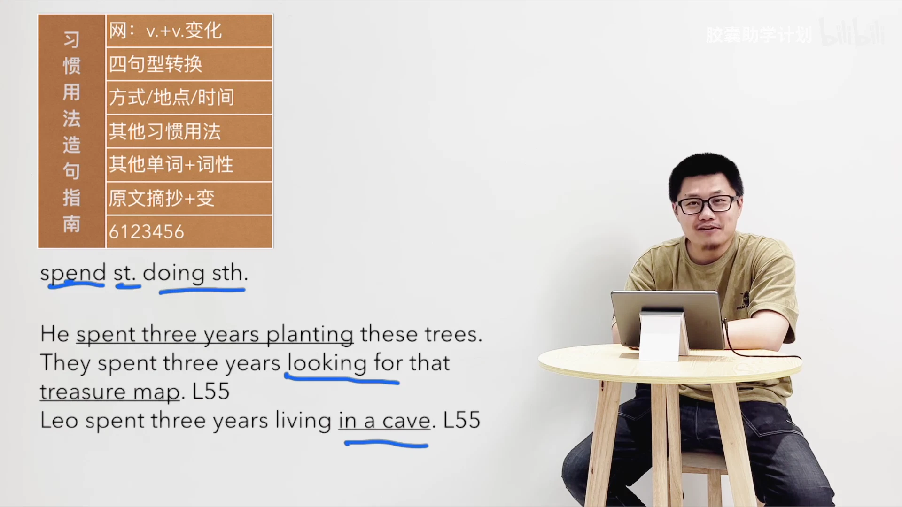

文字识别：网：v.+v.变化 / 习惯用法造句指南 / 四句型转换 / 方式/地点/时间 / 其他习惯用法 / 其他单词+词性 / 原文摘抄+变 / 6123456 / spend st. doing sth. / He spent three years planting these trees. / They spent three years looking for that / treasure map. L55 / Leo spent three years living in a cave. L55

## 00:11:30–00:12:00

间住在山洞里，那咱就得问问为啥，对吧？哈，OK， why? OK，四句型转换，各位做一下啊。呃，注意力集中，咱们听一下这句话啊。 And because he didn't have no legs, he spent most of his time exercising his arms. Next one,还是注意力集中，听一下这句话. Spent twenty years writing a book, almost no one reads. OK,

### 画面 00:11:30

文字识别：网：v.+v.变化 / 习惯用法造句指南 / 四句型转换 / 方式/地点/时间 / 其他习惯用法 / 其他单词+词性 / 原文摘抄+变 / 6123456 / spend st. doing sth. / He spent three years planting these trees. / They spent three years looking for that / treasure map. L55 / Leo spent three years living in a cave. L55

### 画面 00:11:35

文字识别：网：v.+v.变化 / 习惯用法造句指南 / 四句型转换 / 方式/地点/时间 / 其他习惯用法 / 其他单词+词性 / 原文摘抄+变 / 6123456 / spend st. doing sth. / He spent three years planting these trees. / They spent three years looking for that / treasure map. L55 / Leo spent three years living in a cave. L55 / did/why/who/...

### 画面 00:11:38

文字识别：And because he didn't have no legs, he spent / most of his time exercising his arms. / STROHS / GIRLS / Forrest Gump / (1994)

### 画面 00:11:43

文字识别：And because he didn't have no legs, he spent / most of his time exercising his arms. / STROHS / GIRLS / EROTIC / Forrest Gump / (1994)

### 画面 00:11:45

文字识别：And because he didn't have no legs, he spent / most of his time exercising his arms. / Schliz / STRON / GIR! / Forrest Gump / (1994)

### 画面 00:11:47

文字识别：And because he didn't have no legs, he spent / most of his time exercising his arms. / SEX / STROHS / SHOD / Forrest Gump / (1994)

### 画面 00:11:49

文字识别：And because he didn't have no legs, he spent / most of his time exercising his arms. / Schlitz / SEX / STROHS / Forrest Gump / (1994)

### 画面 00:11:51

文字识别：Spent twenty years writing a book / almost no one reads. / Little Miss Sunshine / (2006)

### 画面 00:11:55

文字识别：Spent twenty years writing a book / almost no one reads. / Little Miss Sunshine / (2006)

### 画面 00:11:57

文字识别：Spent twenty years writing a book / almost no one reads. / Little Miss Sunshine / (2006)

### 画面 00:11:59

文字识别：网：v.+v.变化 / 习惯用法造句指南 / 四句型转换 / 方式/地点/时间 / 其他习惯用法 / 其他单词+词性 / 原文摘抄+变 / 6123456 / train sb.to do sth.

## 00:12:00–00:12:30

train somebody to do something. 训练某人去做某件事情。比如说, they trained you to look down on me. 那他们这么多年来就训练你 look down on me, 瞧不起我，对吧？就不停的给你灌输这些小的想法。 Next one, it is said that. 据说, someone trained Leo to teach English. 据说有这么个人好像训练Leo去教英语了啊。 Next one, say they trained a number

### 画面 00:12:01

文字识别：网：v.+v.变化 / 习惯用法造句指南 / 四句型转换 / 方式/地点/时间 / 其他习惯用法 / 其他单词+词性 / 原文摘抄+变 / 6123456 / train sb.to do sth.

### 画面 00:12:04

文字识别：网：v.+v.变化 / 习惯用法造句指南 / 四句型转换 / 方式/地点/时间 / 其他习惯用法 / 其他单词+词性 / 原文摘抄+变 / 6123456 / train sb.to do sth. / They trained you to look down on me. L57

### 画面 00:12:06

文字识别：网：v.+v.变化 / 习惯用法造句指南 / 四句型转换 / 方式/地点/时间 / 其他习惯用法 / 其他单词+词性 / 原文摘抄+变 / 6123456 / train sb.to do sth. / They trained you to look down on me. L57

### 画面 00:12:10

文字识别：网：v.+v.变化 / 习惯用法造句指南 / 四句型转换 / 方式/地点/时间 / 其他习惯用法 / 其他单词+词性 / 原文摘抄+变 / 6123456 / train sb. to do sth. / They trained you to look down on me. L57

### 画面 00:12:14

文字识别：网：v.+v.变化 / 习惯用法造句指南 / 四句型转换 / 方式/地点/时间 / 其他习惯用法 / 其他单词+词性 / 原文摘抄+变 / 6123456 / train sb.to do sth. / They trained you to look down on me. L57

### 画面 00:12:16

文字识别：网：v.+v.变化 / 习惯用法造句指南 / 四句型转换 / 方式/地点/时间 / 其他习惯用法 / 其他单词+词性 / 原文摘抄+变 / 6123456 / train sb.to do sth. / They trained you to look down on me. L57

### 画面 00:12:18

文字识别：网：v.+v.变化 / 习惯用法造句指南 / 四句型转换 / 方式/地点/时间 / 其他习惯用法 / 其他单词+词性 / 原文摘抄+变 / 6123456 / train sb.to do sth. / They trained you to look down on me. L57 / It is said that someone trained Leo to teach / English. L58

### 画面 00:12:20

文字识别：网：v.+v.变化 / 习惯用法造句指南 / 四句型转换 / 方式/地点/时间 / 其他习惯用法 / 其他单词+词性 / 原文摘抄+变 / 6123456 / train sb. to do sth. / They trained you to look down on me. L57 / It is said that someone trained Leo to teach / English. L58

### 画面 00:12:23

文字识别：网：v.+v.变化 / 习惯用法造句指南 / 四句型转换 / 方式/地点/时间 / 其他习惯用法 / 其他单词+词性 / 原文摘抄+变 / 6123456 / train sb.to do sth. / They trained you to look down on me. L57 / It is said that someone trained Leo to teach / English. L58

### 画面 00:12:25

文字识别：网：v.+v.变化 / 习惯用法造句指南 / 四句型转换 / 方式/地点/时间 / 其他习惯用法 / 其他单词+词性 / 原文摘抄+变 / 6123456 / train sb. to do sth. / They trained you to look down on me. L57 / It is said that someone trained Leo to teach / English. L58

### 画面 00:12:27

文字识别：网：v.+v.变化 / 习惯用法造句指南 / 四句型转换 / 方式/地点/时间 / 其他习惯用法 / 其他单词+词性 / 原文摘抄+变 / 6123456 / train sb. to do sth. / They trained you to look down on me. L57 / It is said that someone trained Leo to teach / English. L58 / They trained a number of dogs to do this. L58

### 画面 00:12:29

文字识别：网：v.+v.变化 / 习惯用法造句指南 / 四句型转换 / 方式/地点/时间 / 其他习惯用法 / 其他单词+词性 / 原文摘抄+变 / 6123456 / train sb. to do sth. / They trained you to look down on me. L57 / It is said that someone trained Leo to teach / English.L58 / They trained a number of dogs to do this. L58

## 00:12:30–00:13:00

of dogs to do this.他们训练了一系列 several dogs, 对吧？训练了一些狗去做这件事情，比如说缉毒犬，对不对？Okay.呃，注意力集中。我们听一下电影片段。Train them to do this. Yes. Next one.这句话当中有一个小的生词，各位可能不太懂，并且我觉得这句话我在找的时候非常开心。他把两个习惯用法就跟咱们原文一样连到了一起，叫 spend

### 画面 00:12:31

文字识别：网：v.+v.变化 / 习惯用法造句指南 / 四句型转换 / 方式/地点/时间 / 其他习惯用法 / 其他单词+词性 / 原文摘抄+变 / 6123456 / train sb. to do sth. / They trained you to look down on me. L57 / It is said that someone trained Leo to teach / English. L58 / They trained a number of dogs to do this. L58

### 画面 00:12:35

文字识别：网：v.+v.变化 / 习惯用法造句指南 / 四句型转换 / 方式/地点/时间 / 其他习惯用法 / 其他单词+词性 / 原文摘抄+变 / 6123456 / train sb. to do sth. / They trained you to look down on me. L57 / It is said that someone trained Leo to teach / English. L58 / They trained a number of dogs to do this. L58

### 画面 00:12:38

文字识别：网：v.+v.变化 / 习惯用法造句指南 / 四句型转换 / 方式/地点/时间 / 其他习惯用法 / 其他单词+词性 / 原文摘抄+变 / 6123456 / train sb. to do sth. / They trained you to look down on me. L57 / It is said that someone trained Leo to teach / English.L58 / They trained a number of dogs to do this. L58

### 画面 00:12:40

文字识别：Did you train him to do this? Yes. / Monster Trucks / (2016)

### 画面 00:12:44

文字识别：Did you train him to do this? Yes. / Monster Trucks / (2016)

### 画面 00:12:46

文字识别：Did you train him to do this? Yes. / Monster Trucks / (2016)

### 画面 00:12:48

文字识别：That you have spent years training him to / take the throne from me. / Aquaman / (2018)

### 画面 00:12:50

文字识别：That you have spent years training him to / take the throne from me. / Aquaman / (2018)

### 画面 00:12:54

文字识别：That you have spent years training him to / take the throne from me. / Aquaman / (2018)

### 画面 00:12:56

文字识别：That you have spent years training him to / take the throne from me. / Aquaman / (2018)

## 00:13:00–00:13:30

some time doing something 和 train somebody to do something，对吧？那你看这句话说 you have spent years training him to take the throne from me。这个 throne 叫做王座啊，就是从我这里夺取权夺权的意思是吧？Take the throne from me，就是从我这儿把王座拿走。That you have spent years training him to take the throne from me。 Okay， recap，

### 画面 00:13:00

文字识别：That you have spent years trpining him to / take the throne from me. / Aquaman / (2018)

### 画面 00:13:12

文字识别：That you have spent years training him to / take the throne from me. / Aquaman / (2018)

### 画面 00:13:21

文字识别：That you have spent years training him to / take the throne from me. / Aquaman / (2018)

### 画面 00:13:23

文字识别：That you have spent years training him to / take the throne from me. / Aquaman / (2018)

### 画面 00:13:25

文字识别：That you have spent years training him to / take the throne from me. / Aquaman / (2018)

### 画面 00:13:27

文字识别：That you have spent years training him to / take the throne from me. / Aquaman / (2018)

### 画面 00:13:29

文字识别：Recap / complained of / Expression / spend st. doing sth. / train sb. to do sth.

## 00:13:30–00:14:00

文章很重要，习惯用法造句也同样重要。第一个习惯用法造句啊，老习惯要结合指南造五句话。Next one呢？然后文章咱们要熟读成诵，看置顶留言找重复间隔的材料啊。呃，那以上呢就是本期视频的全部内容了。如果各位喜欢我们的课程呢，欢迎各位关注、订阅、一键三连，分享给那些需要的朋友来帮助我们快速成长。See you

### 画面 00:13:31

文字识别：Recap / complained of / Expression / spend st. doing sth. / train sb. to do sth.

### 画面 00:13:34

文字识别：1. / 习惯用法造句/对话 / 【习惯用法造句指南】 / 每个5句

### 画面 00:13:40

文字识别：1. / 习惯用法造句/对话 / 【习惯用法造句指南】 / 每个5句

### 画面 00:13:42

文字识别：1. / 习惯用法造句/对话 / 【习惯用法造句指南】 / 每个5句 / 文章跟读至熟读成诵 / 内化单词+语法+习惯用法 / 听力+口语+写作练习

### 画面 00:13:44

文字识别：习惯用法造句/对话 / 1. / 【习惯用法造句指南】 / 每个5句 / 文章跟读至熟读成诵 / 内化单词+语法+习惯用法 / 听力+口语+写作练习 / 3. / 重复间隔（置顶留言）

### 画面 00:13:46

文字识别：1. / 习惯用法造句/对话 / 【习惯用法造句指南】 / 每个5句 / 文章跟读至熟读成诵 / 内化单词+语法+习惯用法 / 听力+口语+写作练习 / 3. / 重复间隔（置顶留言）

### 画面 00:13:48

文字识别：👍

### 画面 00:13:52

## 00:14:00–00:14:13

next time.

### 画面 00:14:01

文字识别：CAPSULEACADEMY / 胶囊助学计划 / 小红书

### 画面 00:14:03

文字识别：CAPSULEACADEMY / 胶囊助学计划 / 小红书 / Leo

### 画面 00:14:09

文字识别：CAPSULEACADEMY / 胶囊助学计划 / 小红书 / Creator / 口 / Leo & Berlin / OE

### 画面 00:14:11

文字识别：bilibili / 胶囊助学计划

### 画面 00:14:12

文字识别：bilibili / 胶囊助学计划

