# 059 练习

快速机器解析：语音为单模型转写，未进行独立交叉校对或人工复核；画面每秒采样并按变化选帧，短时文字和标记可能遗漏。截图时间约有 1 秒误差。图片有损压缩；遇到疑点请按时间查看 Google Drive 原视频。

## 00:00:00–00:00:30

Hello everyone, welcome to Capsule Academy. This is Will. Today we're going to learn New Concept English Book Two Lesson Fifty Nine Practices. 那注意，进行如下练习唯一的前提就是文章要跟读至熟读成诵，否则请勿开始。 Hope you gonna enjoy. Okay, 第一题 comprehension. 那我问您答，非常简单，基于原文的问答听力口语环节.

### 画面 00:00:00

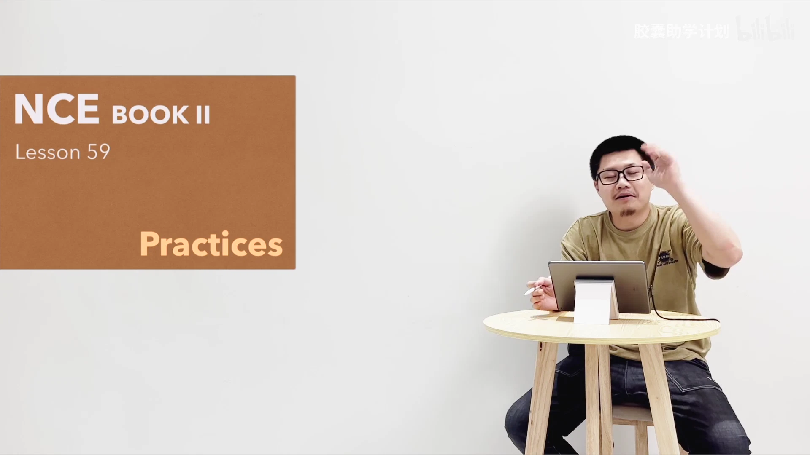

文字识别：NCE / BOOK"I / Lesson 59 / Practices

### 画面 00:00:02

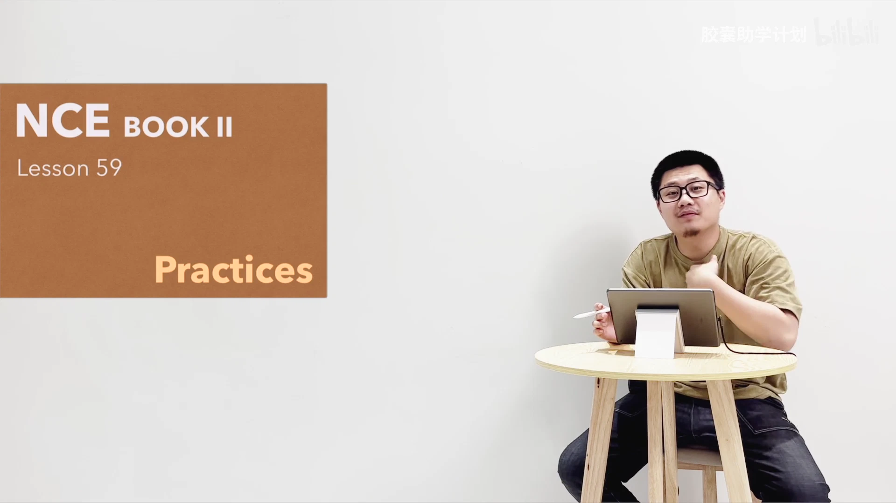

文字识别：NCE / BOOK"I / Lesson 59 / Practices

### 画面 00:00:08

文字识别：进行如下练习唯一前提 / 文章跟读至熟读成诵 / 否则请勿开始

### 画面 00:00:10

文字识别：进行如下练习唯一前提 / 文章跟读至熟读成诵 / 否则请勿开始

### 画面 00:00:18

文字识别：胶囊助学计划blb出 / •

### 画面 00:00:22

文字识别：学计

### 画面 00:00:24

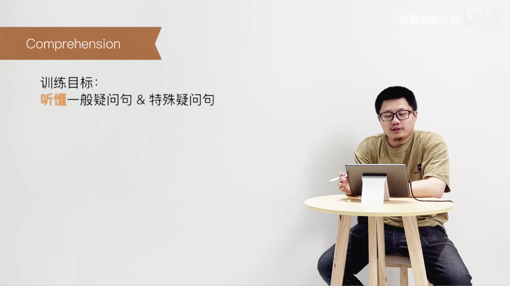

文字识别：Comprehension / 训练目标： / 听懂一般疑问句＆特殊疑问句

## 00:00:30–00:01:00

First one, what's your dog called? Rex. Next one, where did he used to sit? Outside our front gate. Next one, what did he used to do there? Bark. Next one, why did he bark? He wanted to come into the garden. Next one, when did he

### 画面 00:00:31

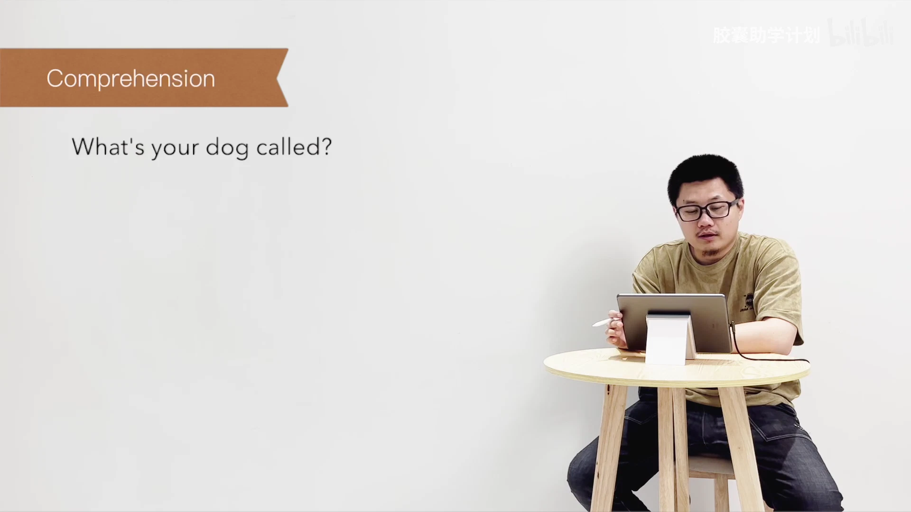

文字识别：Comprehension / What's your dog called?

## 00:01:00–00:01:30

stop barking? When someone opened the gate. Who complained of the noise? The neighbors. What did your husband train him to do? To press his paw on the ledge to let himself in. How long did he spend training him? Weeks. What

### 画面 00:01:01

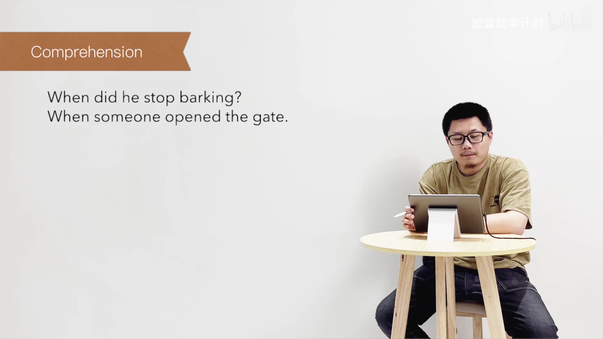

文字识别：Comprehension / When did he stop barking? / When someone opened the gate.

### 画面 00:01:12

文字识别：Comprehension / What did your husband train him to do?

### 画面 00:01:27

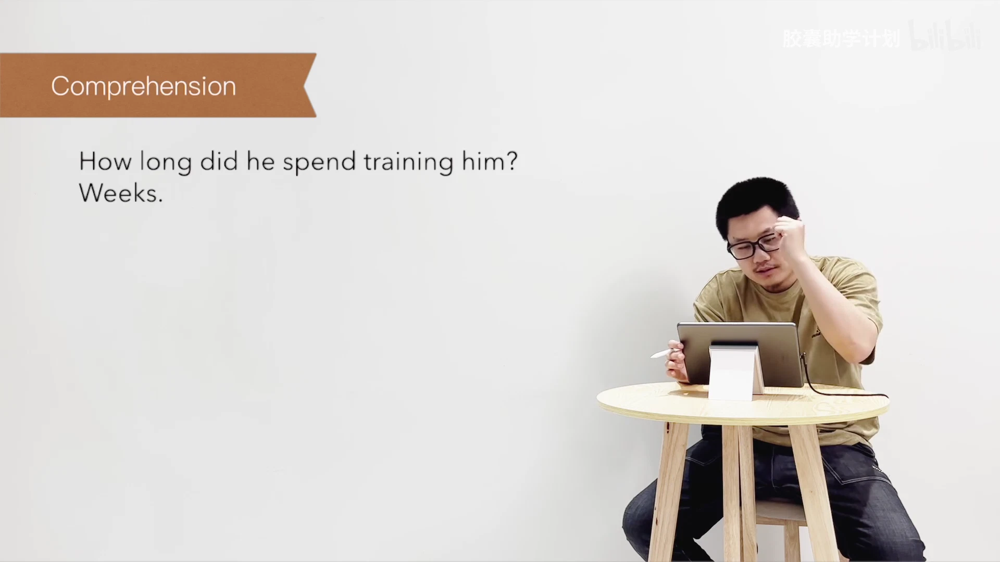

文字识别：Comprehension / How long did he spend training him? / Weeks.

### 画面 00:01:29

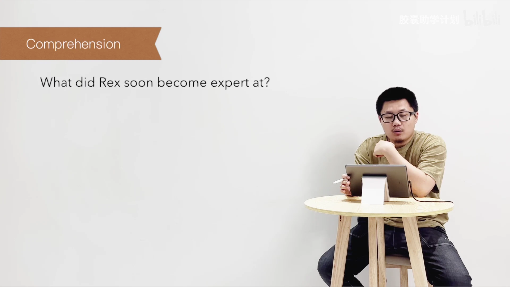

文字识别：Comprehension / What did Rex soon become expert at?

## 00:01:30–00:02:00

What did Rex soon became become expert at? At opening the gate. Where were you going last week? Where were you going last week? Shopping. Where was Rex? In the garden near the gate. Why was he barking this time? Because he wanted

### 画面 00:01:46

文字识别：Comprehension / Where were you going last week? / Shopping.

### 画面 00:01:52

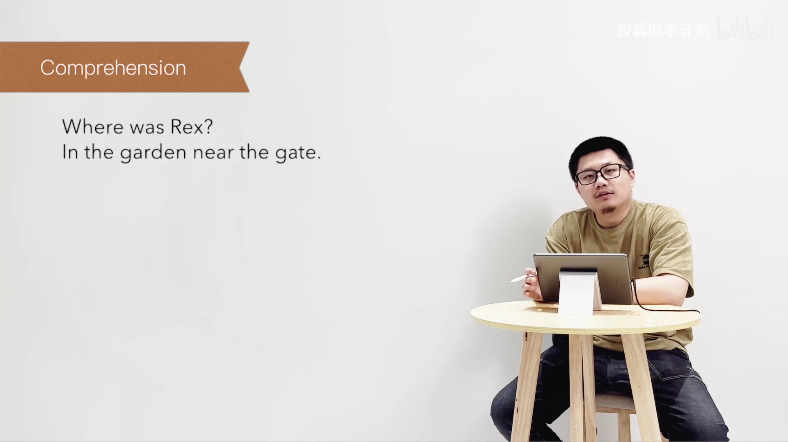

文字识别：Comprehension / Where Was Rex? / In the garden near the gate.

### 画面 00:01:54

文字识别：Comprehension / Why was he barking this time?

## 00:02:00–00:02:30

someone to let him out. What he developed since then, another bad habit. What does he do as soon as he opens the gate, from the from the outside? He comes into the garden and waits until the gate shuts. What does he do then? Then he sits and barks

### 画面 00:02:00

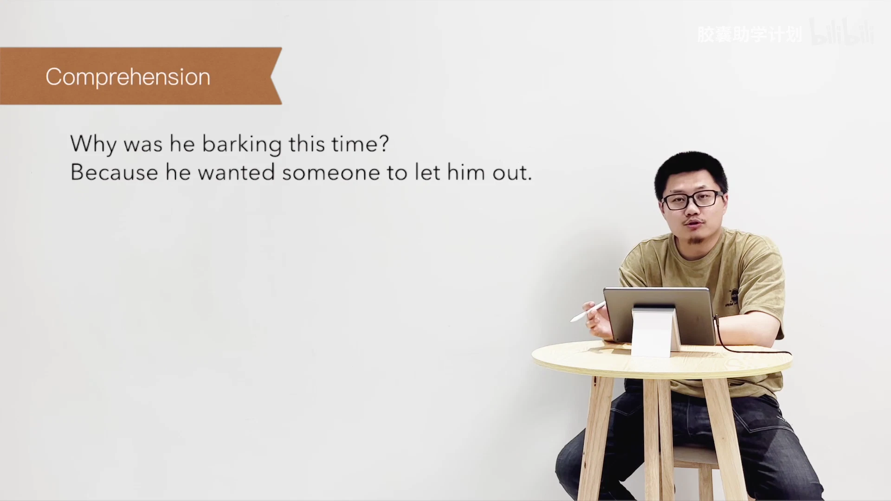

文字识别：Comprehension / Why was he barking this time? / Because he wanted someone to let him out.

### 画面 00:02:02

文字识别：Comprehension

### 画面 00:02:14

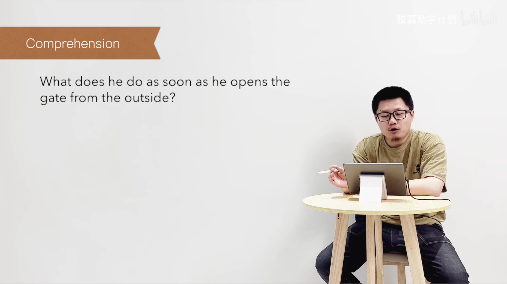

文字识别：Comprehension / What does he do as soon as he opens the / gate from the outside?

### 画面 00:02:27

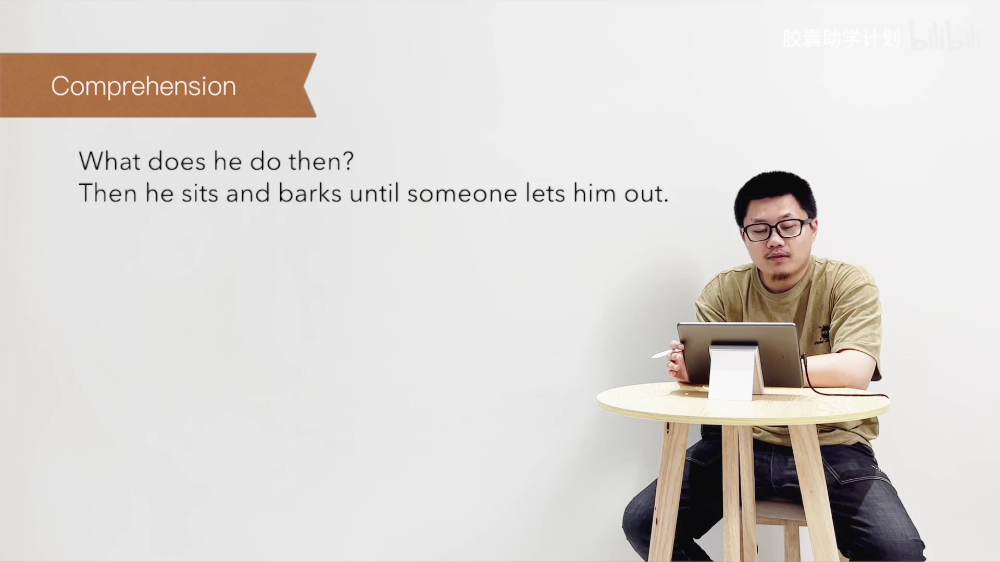

文字识别：Comprehension / What does he do then? / Then he sits and barks until someone lets him out.

## 00:02:30–00:03:00

until someone lets him out, asking questions. 呃，会练习咱们能说出来一般疑问句和特殊疑问句的能力，对吧？好，呃，例子：Ask me if our dog is called Rex. 被叫做 Rex is 提前就可以了。What？那就是对 Rex 提问。What is your dog called？对吧？它被叫做什么？第一个咱不多说了，看第二个。He used to sit outside our front gate. Used to do 这个是咱们三十一课

### 画面 00:02:32

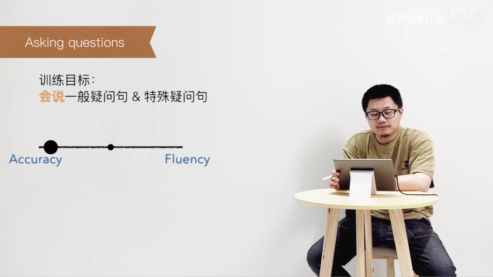

文字识别：Asking questions / 训练目标： / 会说一般疑问句＆特殊疑问句 / Accuracy / Fluency

### 画面 00:02:40

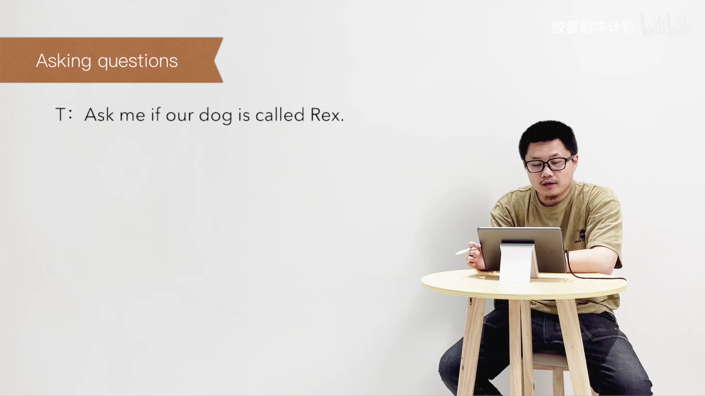

文字识别：Asking questions / T: Ask me if our dog is called Rex.

### 画面 00:02:53

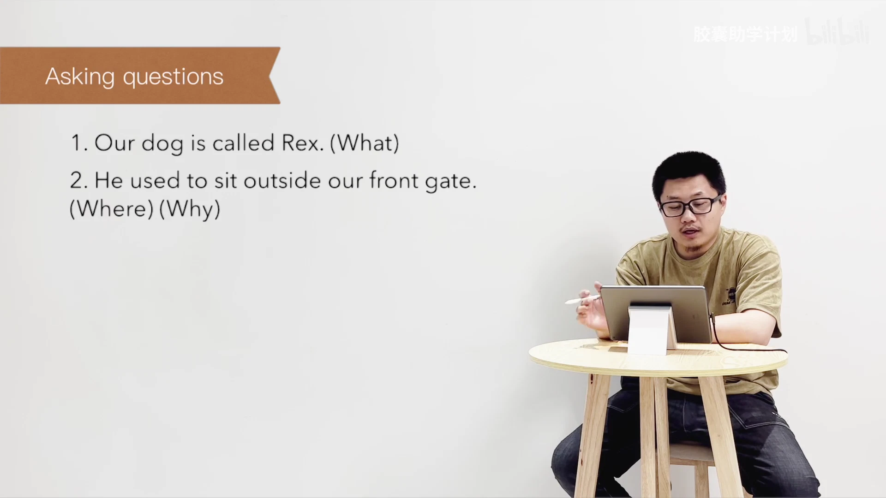

文字识别：Asking questions / 1. Our dog is called Rex.(What) / 2. He used to sit outside our front gate. / (Where)(Why)

## 00:03:00–00:03:30

要学的这个学过的这个知识点，对吧？Did提前，Where对outside our front gate提问，Why对整句话，对吧？三He used to bark还是Did提前，Would对呃，我建议这地方把它变成What did he used to do，对吧？那Why就是整句了。He'd bark until someone opened the gate.那注意这里的不能用until someone opened the gate这地方去看，这是从句嘛？你要有主句去，对吧？

### 画面 00:03:19

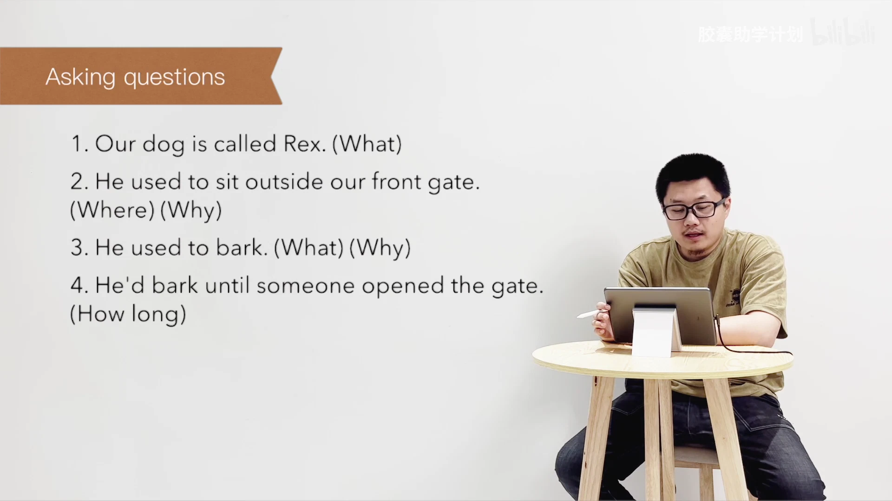

文字识别：Asking questions / 1. Our dog is called Rex. (What) / 2. He used to sit outside our front gate. / (Where)(Why) / 3. He used to bark. (What) (Why) / 4. He'd bark until someone opened the gate. / (How long)

## 00:03:30–00:04:00

所以就 would 提前就可以了啊。然后呢？ How long? How long? 多长时间？其实就是对 until someone opened the gate 这个时间状语从句提问了。叫 How long would he bark? The neighbors complained. Did 提前 who 对主语提问，不变一般疑问句。 My husband spent weeks training Rex. Did 提前 How long 对 weeks 提问 who 对主语提问，对吧？呃，第七个 I noticed him

### 画面 00:03:42

文字识别：Asking questions

### 画面 00:03:47

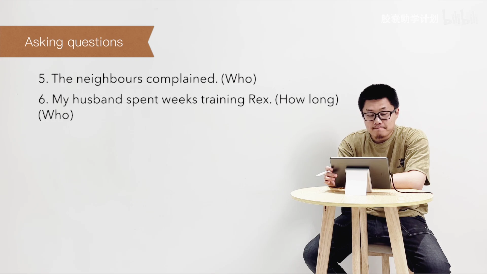

文字识别：Asking questions / 5.The neighbours complained. (Who) / 6. My husband spent weeks training Rex. (How long) / (Who)

## 00:04:00–00:04:30

near the gate. Did提前，Where对near the gate提问。第八个，He was barking so that someone would let him out. 注意这个so that不要看后半句，只看前半句。Was往前一提，对吧？那What there点儿doing呢？就是What was he doing？你可以把后半句加上，so that someone would let him out，对吧？而但如果是用why的话，那你就直接说Why was he barking？他为什么呢？目的是someone would

### 画面 00:04:04

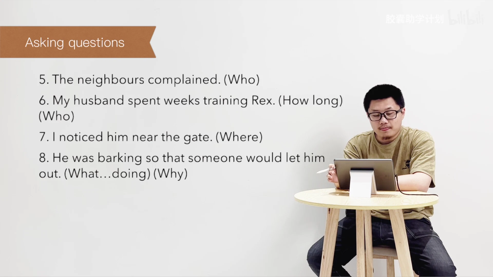

文字识别：Asking questions / 5. The neighbours complained. (Who) / 6. My husband spent weeks training Rex. (How long) / (Who) / 7.I noticed him near the gate. (Where) / 8. He was barking so that someone would let him / out. (What...doing) (Why)

## 00:04:30–00:05:00

let him out, 好吧。第九个, he has developed another bad habit. 这就是基本功了。这儿是 developed, 这地方肯定不是 is, 因为不能是被动嘛。他被怎么怎么样，不是，他自己养成的 has, 对吧？往前提, what else? 那肯定是对 another bad habit. Who 对主语这个狗提问, he 啊。这地方各位可能有一个小的疑惑，就是这个狗为什么用 he 不用 it？就很很容易理解，其实是一个人的情

### 画面 00:04:34

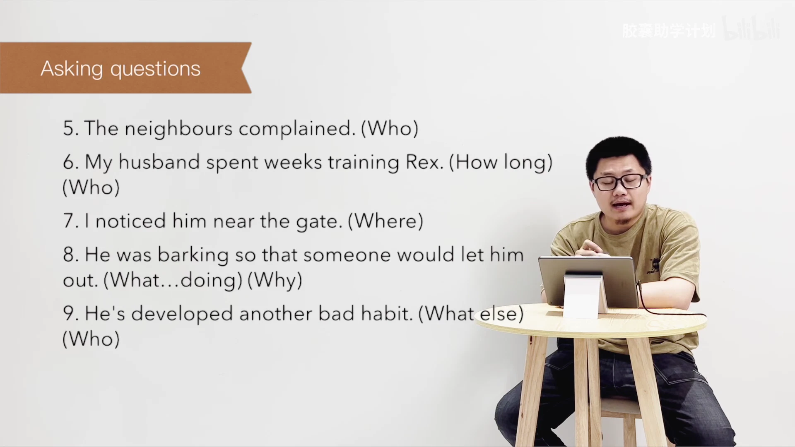

文字识别：Asking questions / 5. The neighbours complained. (Who) / 6. My husband spent weeks training Rex. (How long) / (Who) / 7.I noticed him near the gate. (Where) / 8. He was barking so that someone would let him / out. (What...doing) (Why) / 9. He's developed another bad habit. (What else) / (Who)

### 画面 00:04:53

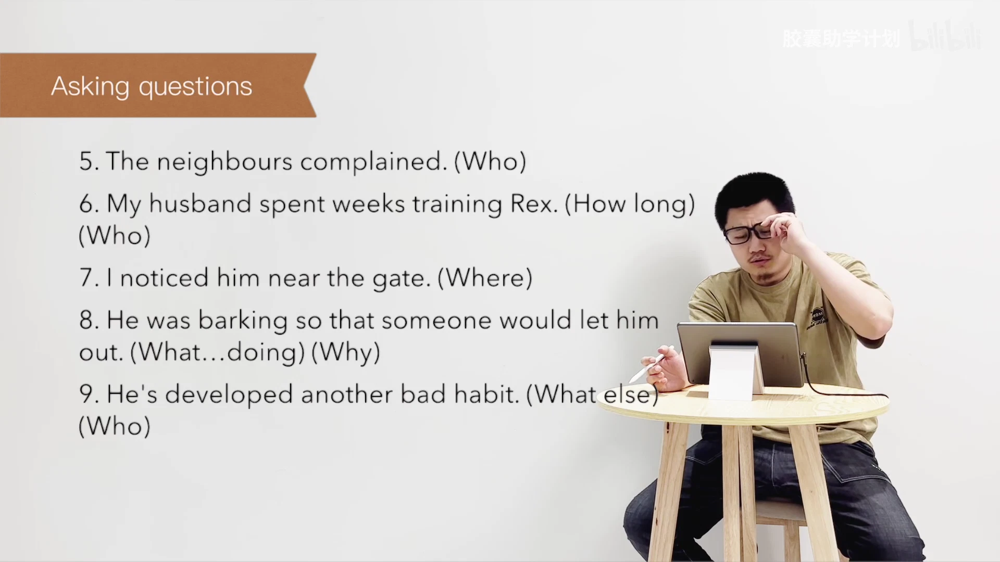

文字识别：Asking questions / 5. The neighbours complained. (Who) / 6. My husband spent weeks training Rex. (How long) / (Who) / 7.I noticed him near the gate. (Where) / 8. He was barking so that someone would let him / out. (What...doing) (Why) / 9. He's developed another bad habit. (What else) / (Who)

### 画面 00:04:56

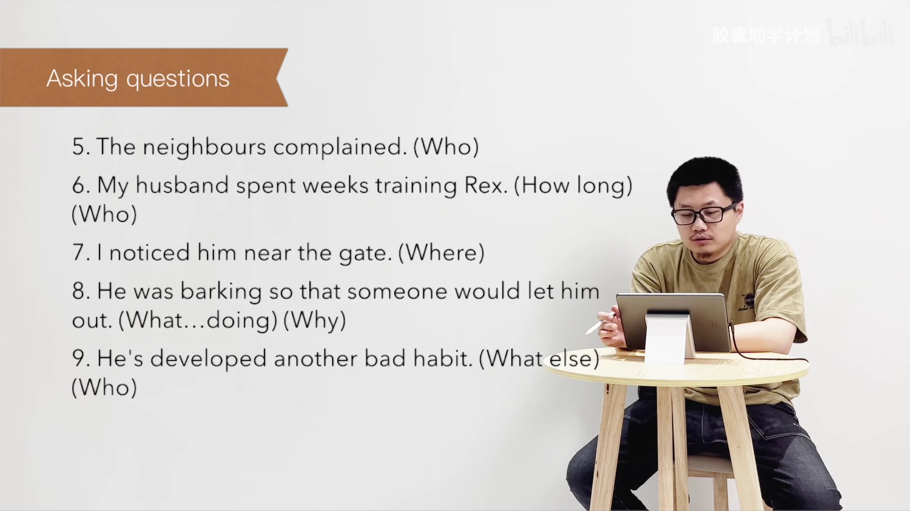

文字识别：Asking questions / 5. The neighbours complained. (Who) / 6. My husband spent weeks training Rex.(How long) / (Who) / 7.I noticed him near the gate. (Where) / 8. He was barking so that someone would let him / out. (What...doing) (Why) / 9. He's developed another bad habit. (What else) / (Who)

## 00:05:00–00:05:30

感，那很多人，尤其是男性，对吧？还管自己的那个跑车，如果买了个跑车，还用 she 呢？啊， that is my lover，是吧？你看，我去新西兰皇后镇玩的时候，我住的那个 BnB Airbnb，是吧？住人家家里面，住民宿，那个小伙子自己有好几辆摩托车，他就跟我说，他说我有 three lovers，上来我都蒙圈了。他说我有三个情人，我说什么意思？他说我带你去看一下，就跑车库去了。我心完了，这要出事了是吧？这是个什么什么人？

### 画面 00:05:26

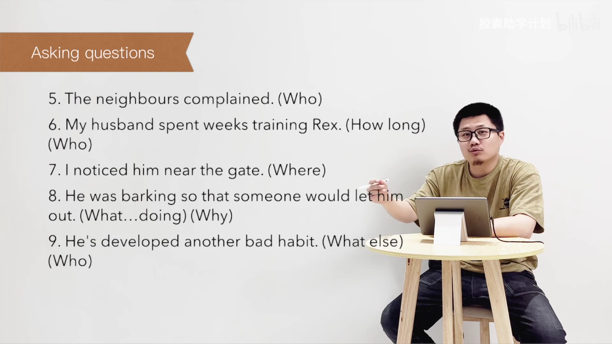

文字识别：Asking questions / 5. The neighbours complained. (Who) / 6. My husband spent weeks training Rex. (How long) / (Who) / 7.I noticed him near the gate. (Where) / 8. He was barking so that someone would lethim / out. (What...doing) (Why) / 9. He's developed another bad habit. (What else) / (Who)

## 00:05:30–00:06:00

到那儿咵一掀，三辆巨棒的大摩托车，对吧？所以他用的就是 she。人是有情感的，很多中国人管自己的狗不也叫儿子、女儿什么的吗？对不对啊？见了面快叫叔叔，对吧？这不都开玩笑吗？但是各位就很容易理解为什么用 he 了，对吧？情感是相通的啊。 Tell the story。第一个单元我说了很多了，各位啊，坚持去做啊，对于我们提升口语帮助非常的大。多提一句，准确性可以下降一点儿，流利性不能太差，所以文

### 画面 00:05:48

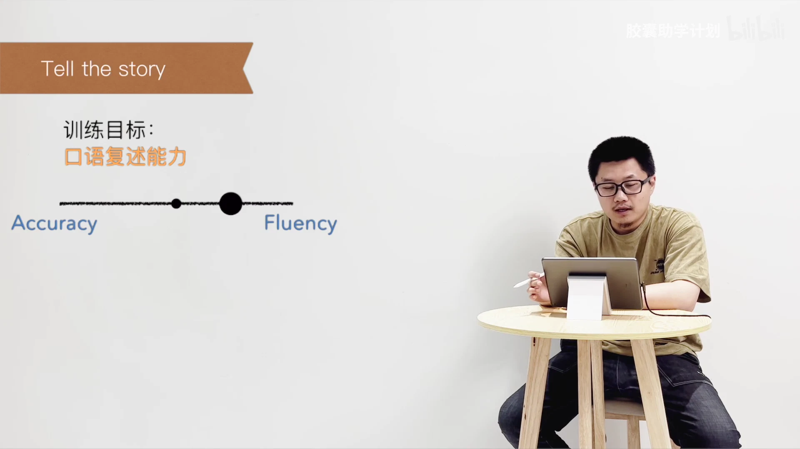

文字识别：Tell the story / 训练目标： / 口语复述能力 / Accuracy / Fluency

### 画面 00:05:50

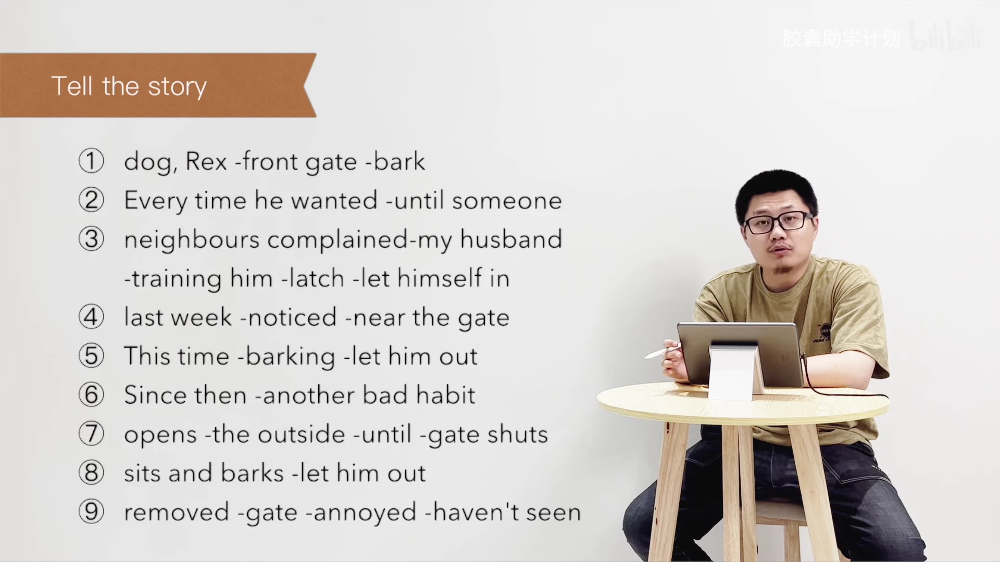

文字识别：Tell the story / ① dog, Rex -front gate -bark / Every time he wanted -until someone / neighbours complained-my husband / 3 / -training him -latch -let himself in / last week -noticed -near the gate / This time -barking -let him out / ⑥ Since then -another bad habit / opens -the outside -until -gate shuts / sits and barks -let him out / removed -gate -annoyed -haven't seen / 9

## 00:06:00–00:06:30

章一定要熟读成诵啊。呃，summary writing写完了来这儿自己看一下行了，重点多看一下像这样so that这个连词等等，when这样的连词，after这样的连词，好吧？呃，topic for discussion老习惯，我们只说一遍，各位有能力自己可以开始做了，不管是写还是说啊。这是我们所有练习、所有学习最终的目的，其实就是这样的目的，就是任意话题跟老外能聊起来，对吧？

### 画面 00:06:02

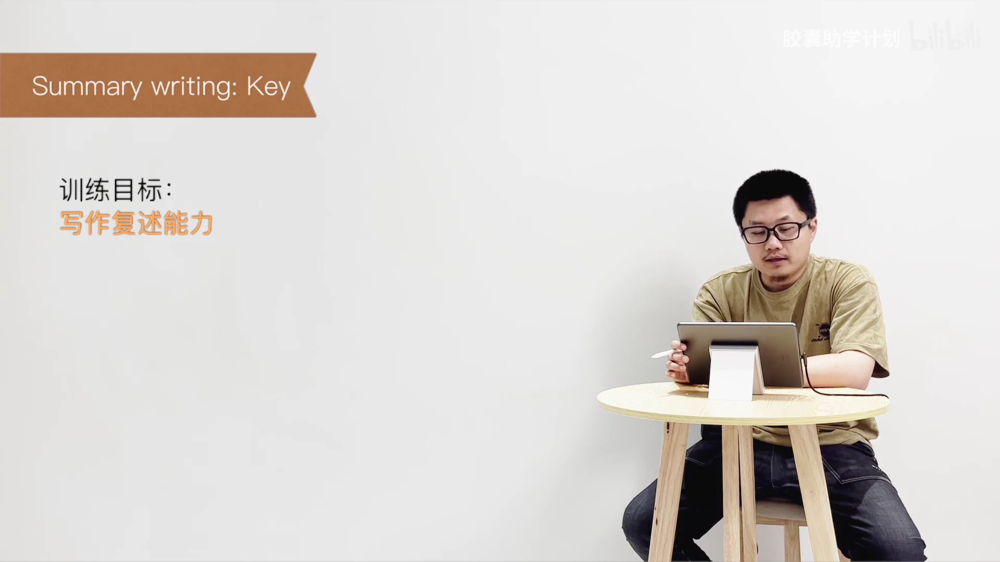

文字识别：Summary writing: Key / 训练目标： / 写作复述能力

### 画面 00:06:04

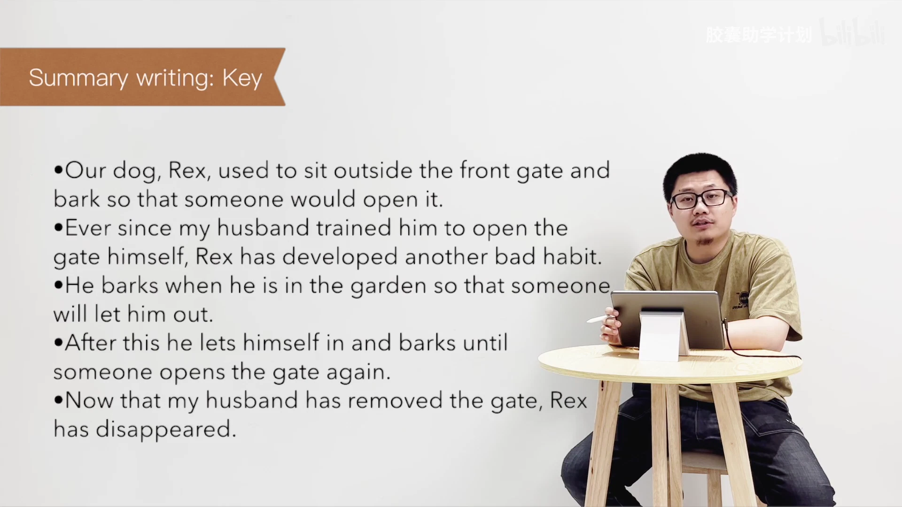

文字识别：Summary writing: Key / •Our dog, Rex, used to sit outside the front gate and / bark so that someone would open it. / •Ever since my husband trained him to open the / gate himself, Rex has developed another bad habit. / •He barks when he is in the garden so that someone. / will let him out. / •After this he lets himself in and barks until / someone opens the gate again. / •Now that my husband has removed the gate, Rex / has disappeared.

### 画面 00:06:12

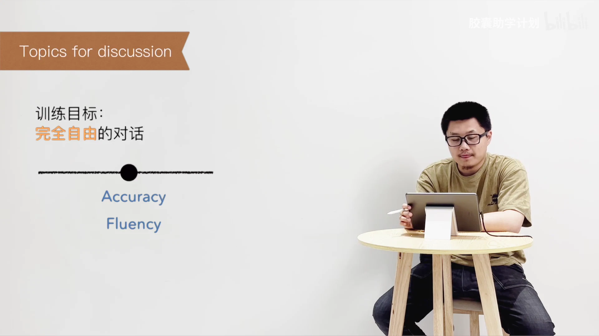

文字识别：Topics for discussion / 训练目标： / 完全自由的对话 / Accuracy / Fluency

### 画面 00:06:15

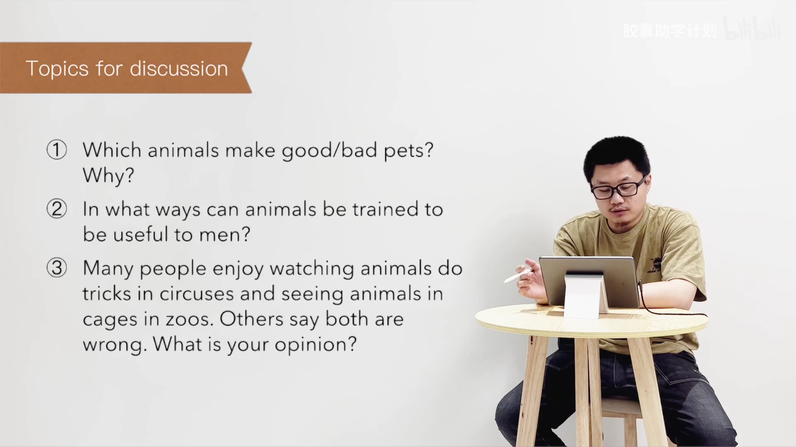

文字识别：Topics for discussion / Which animals make good/bad pets? / Why? / In what ways can animals be trained to / be useful to men? / Many people enjoy watching animals do / 3 / tricks in circuses and seeing animals in / cages in zoos. Others say both are / wrong. What is your opinion?

## 00:06:30–00:07:00

当然，包括你可以写文件啊，写邮件。说 Which animals are good bad pets? Why? 哪些动物是好的宠物或坏的宠物？为啥？ In what ways can animals be trained to be useful to man? 说用什么样的方式，动物可以被训练来对人有用？缉毒犬，对吧？导盲犬啊，等等等等，我们就不多说了啊。呃，Many people enjoy watching animals do tricks in circuses and seeing animals in

### 画面 00:06:45

文字识别：Topics for discussion / Which animals make good/bad pets? / Why? / In what ways can animals be trained to / 2 / be useful to men? / Many people enjoy watching animals do / 3 / tricks in circuses and seeing animals in / cages in zoos. Others say both are / wrong. What is your opinion?

## 00:07:00–00:07:30

cages in zoos, others say both are wrong. What is your opinion?很多人非常享受看动物在马戏团里边做点杂技，对吧？杂耍，或者说在这个动物园里边看这个动物在笼子里边圈着，很多人喜欢。那很多人说呢，这两个事情是错的。你怎么看待这个问题？是吧？你看这个道德哲学的东西就出来了，是不是？哎，很有意思啊。各位感兴趣，自己去想，对吧？所以还是那句话，所有这样

### 画面 00:07:15

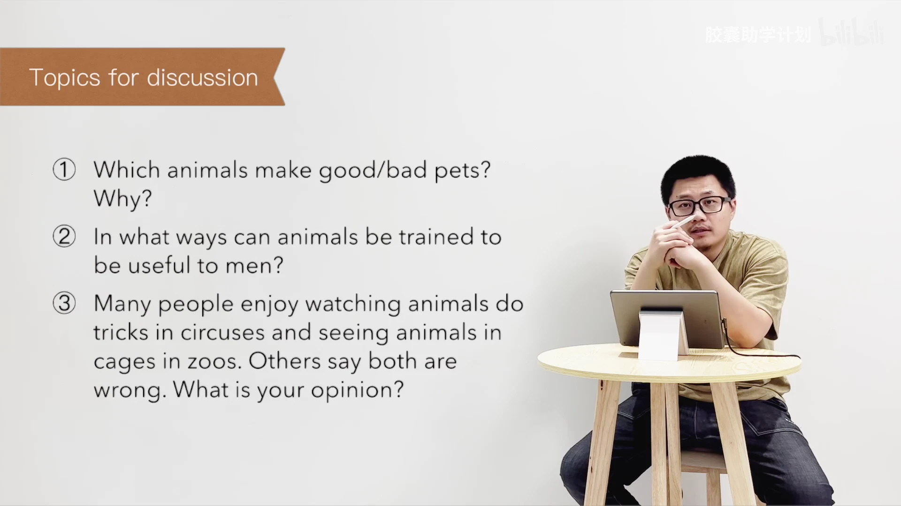

文字识别：Topics for discussion / Which animals make good/bad pets? / Why? / In what ways can animals be trained to / 2 / be useful to men? / Many people enjoy watching animals do / 3 / tricks in circuses and seeing animals in / cages in zoos. Others say both are / wrong. What is your opinion?

## 00:07:30–00:08:00

这样的问题的前提就是，如果你拿汉语这个问题都聊不明白，那你缺的不是我们在新概念当中学习的表达，你缺的是输入的内容。你用汉语也可以输入内容，然后用英文跟别人聊出来，对吧？啊，不多说了啊。家庭作业，Ask me if先写再朗读，真要写作，写完来这对答案。Tell the story口语复述，看置顶留言找重复间隔的训练材料。好，那以上呢就是本期视频的全部内容

### 画面 00:07:45

文字识别：Topics for discussion / Which animals make good/bad pets? / Why? / In what ways can animals be trained to / be useful to men? / Many people enjoy watching animals do / tricks in circuses and seeing animals in / cages in zoos. Others say both are / wrong. What is your opinion?

### 画面 00:07:47

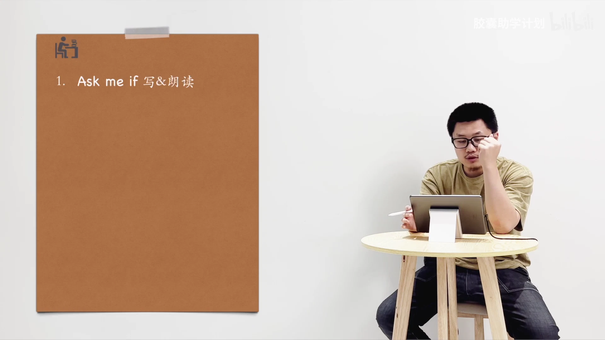

文字识别：1.A / Ask meif写&朗读

### 画面 00:07:50

文字识别：1.Ask me if写&朗读 / 摘要写作写&答案 / 3.Tell the story 口语复述 / -

### 画面 00:07:52

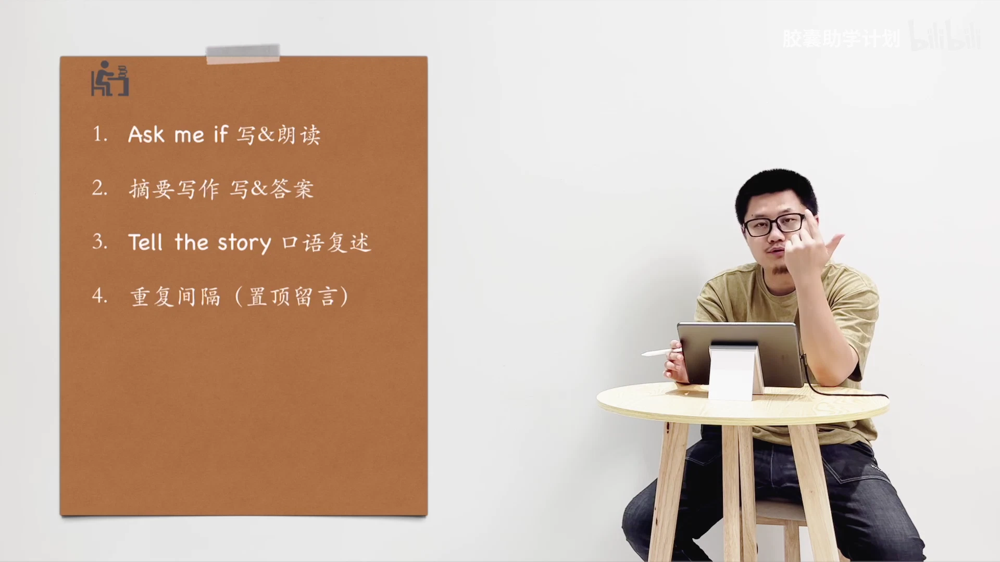

文字识别：1.Ask me if写&朗读 / 摘要写作写&答案 / 3.Tell the story 口语复述 / 4.重复间隔（置顶留言）

### 画面 00:07:56

### 画面 00:07:58

文字识别：🌟

## 00:08:00–00:08:21

了。如果各位喜欢我们的课程呢，欢迎各位关注、订阅、一键三连，分享给那些需要的人，来帮助我们快速成长。See you next time.

### 画面 00:08:02

文字识别：￥

### 画面 00:08:04

### 画面 00:08:09

### 画面 00:08:11

文字识别：CAPSULEACADEMY / 胶囊助学计划 / 小红书 / Lecturer / □ / Leo / OE

### 画面 00:08:14

文字识别：CAPSULEACADEMY / 胶囊助学计划 / 小红书 / Editor / OE

### 画面 00:08:17

文字识别：CAPSULEACADEMY / 胶囊助学计划 / 小红书 / Creator / Leo & Berlin / OE

### 画面 00:08:19

文字识别：bilibili / 胶囊助学计划 / 胶囊助学计划 / ひ / 小红书 / OE

### 画面 00:08:21

文字识别：bilibili / 胶囊助学计划

