# 060 单词

快速机器解析：语音为单模型转写，未进行独立交叉校对或人工复核；画面每秒采样并按变化选帧，短时文字和标记可能遗漏。截图时间约有 1 秒误差。图片有损压缩；遇到疑点请按时间查看 Google Drive 原视频。

## 00:00:00–00:00:30

Hello everyone, welcome to Capsule Academy. This is Leo. Today we're going to learn new Concept English Book Two Lesson Sixty Words.老习惯进入正式课程之前呢，咱们看几个小的问题。第一，如何表达在未来？第二，如何表达浅显易懂？那第三个问题，如何表达某人的亲戚？OK，那带着这三个问题，Hope you gonna enjoy.我们看第一个单词，

### 画面 00:00:00

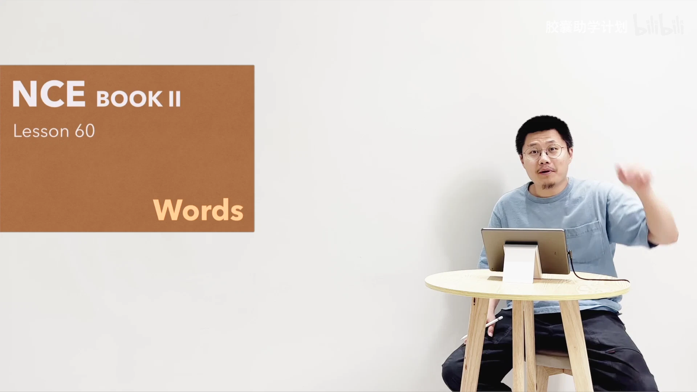

文字识别：NCE / BOOKII / Lesson 60 / Words

### 画面 00:00:02

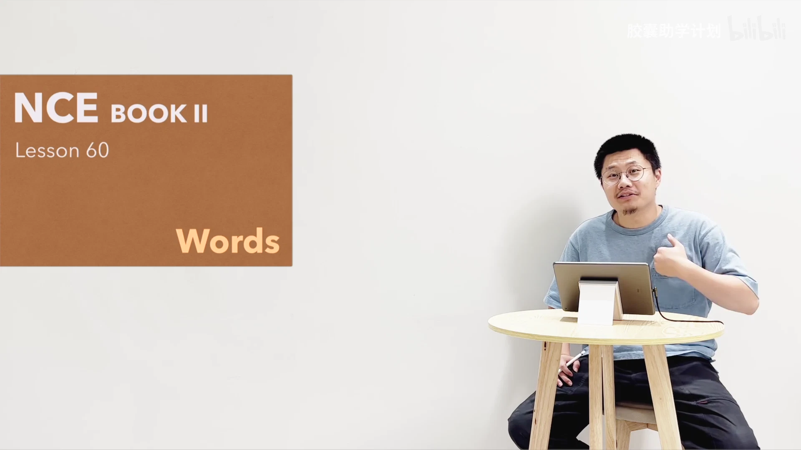

文字识别：NCE / BOOKII / Lesson 60 / Words

### 画面 00:00:07

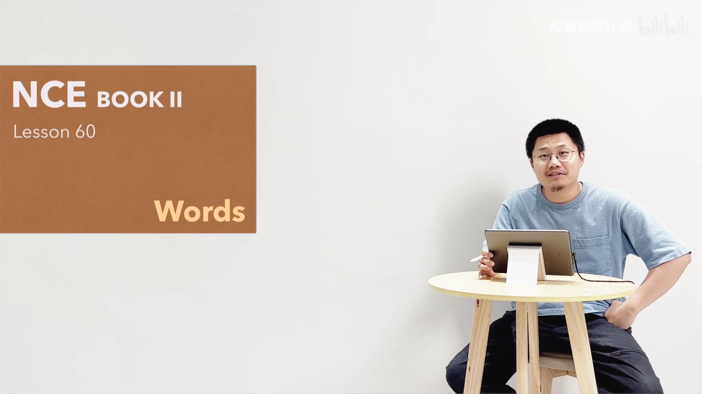

文字识别：NCE / BOOKⅡI / Lesson 60 / Words

### 画面 00:00:09

文字识别：①如何表达“在未来”?

### 画面 00:00:11

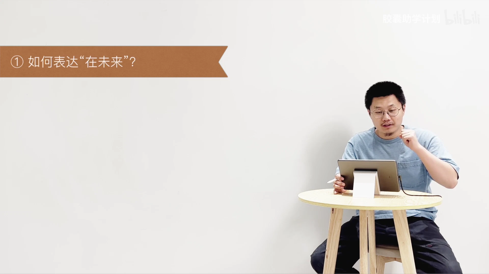

文字识别：①如何表达“在未来”？

### 画面 00:00:14

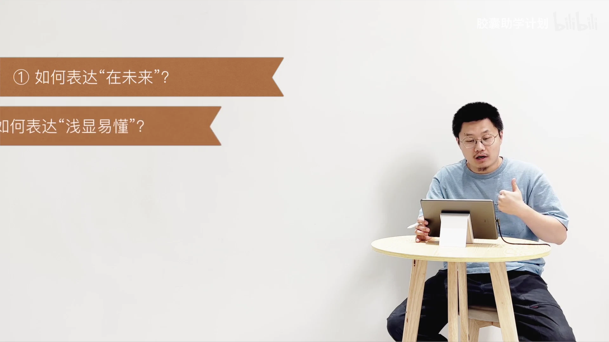

文字识别：①如何表达“在未来”？ / 如何表达“浅显易懂”?

### 画面 00:00:16

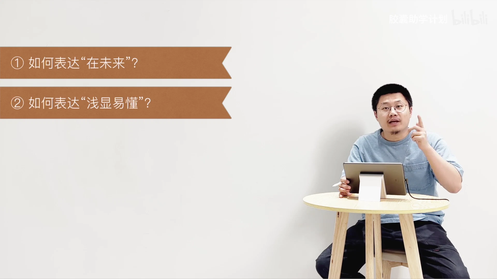

文字识别：①如何表达“在未来”？ / 如何表达“浅显易懂”?

### 画面 00:00:18

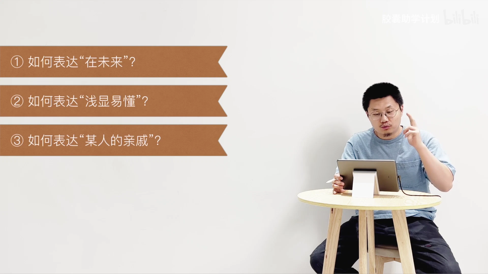

文字识别：①如何表达“在未来”？ / 如何表达“浅显易懂”? / 如何表达“某人的亲戚”

### 画面 00:00:23

文字识别：胶囊助学计划bill / ••

### 画面 00:00:27

文字识别：胶囊助学计划

### 画面 00:00:29

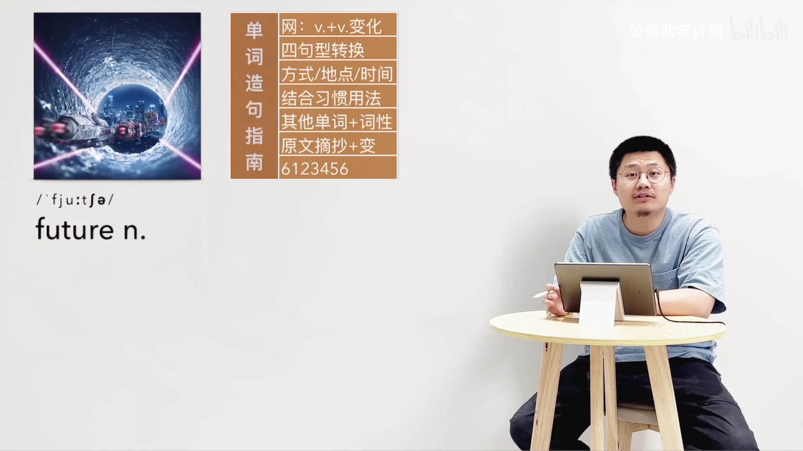

文字识别：单词造句指南 / 网：v.+v.变化 / 四句型转换 / 方式/地点/时间 / 结合习惯用法 / 其他单词+词性 / 原文摘抄+变 / 6123456 / /'fjuit∫a/ / future n.

## 00:00:30–00:01:00

看一下音标。这个单词对于各位来说应该很熟悉，尤其是如果您学过一册的话，对吧？我们每次讲时态的时候都会画出来一条直线，now, future, and past，对吧？哎，现在、过去和将来。那读一下这个单词，the future。那future呢？比如说最常见的叫做in the future，叫做在未来。那我们就拿它去造句子嘛。比如说，I think you might need to listen to this again in the future.

### 画面 00:00:31

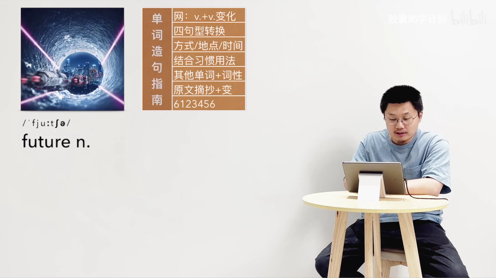

文字识别：单词造句指南 / 网：v.+v.变化 / 四句型转换 / 方式/地点/时间 / 结合习惯用法 / 其他单词+词性 / 原文摘抄+变 / 6123456 / /'fjuitfa/ / future n.

### 画面 00:00:33

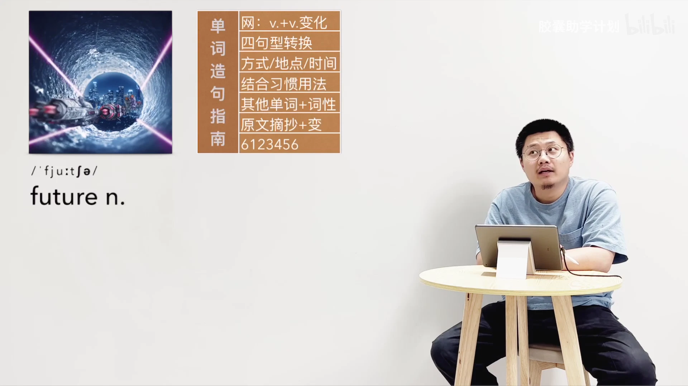

文字识别：单词造句指南 / 网：v.+v.变化 / 四句型转换 / 方式/地点/时间 / 结合习惯用法 / 其他单词+词性 / 原文摘抄+变 / 6123456 / /'fjuitfa/ / future n.

### 画面 00:00:35

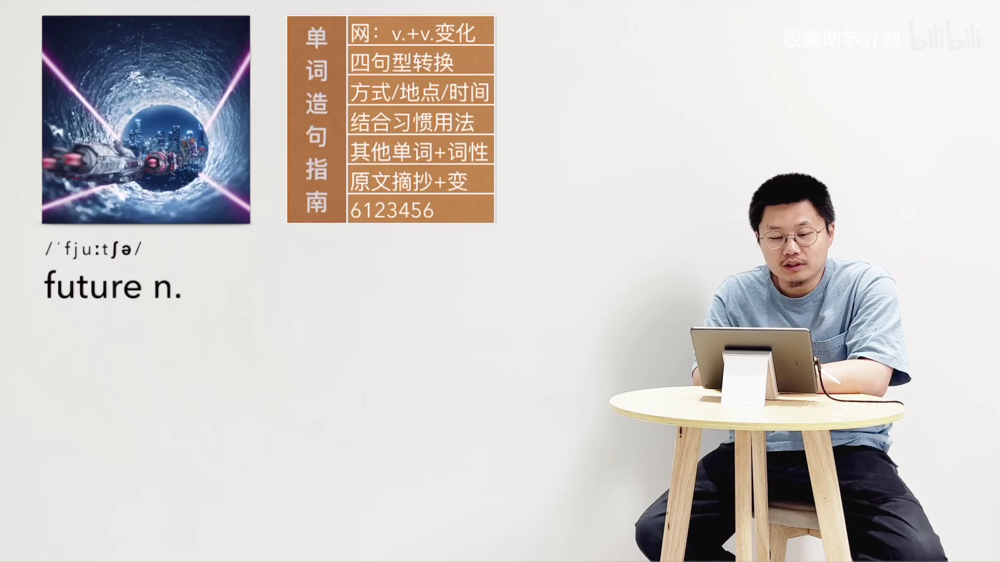

文字识别：单词造句指南 / 网：v.+v.变化 / 四句型转换 / 方式/地点/时间 / 结合习惯用法 / 其他单词+词性 / 原文摘抄+变 / 6123456 / /'fju:tfa/ / future n.

### 画面 00:00:38

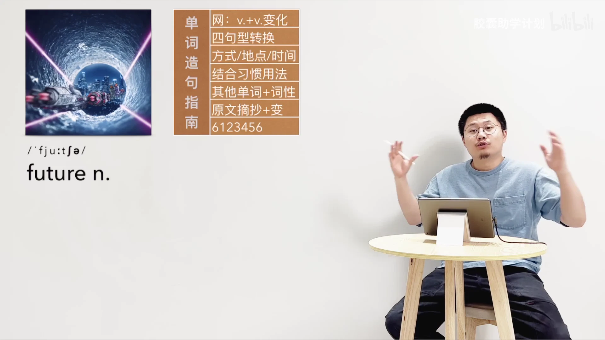

文字识别：单词造句指南 / 网：v.+v.变化 / 四句型转换 / 方式/地点/时间 / 结合习惯用法 / 其他单词+词性 / 原文摘抄+变 / 6123456 / /'fju:tfa/ / future n.

### 画面 00:00:40

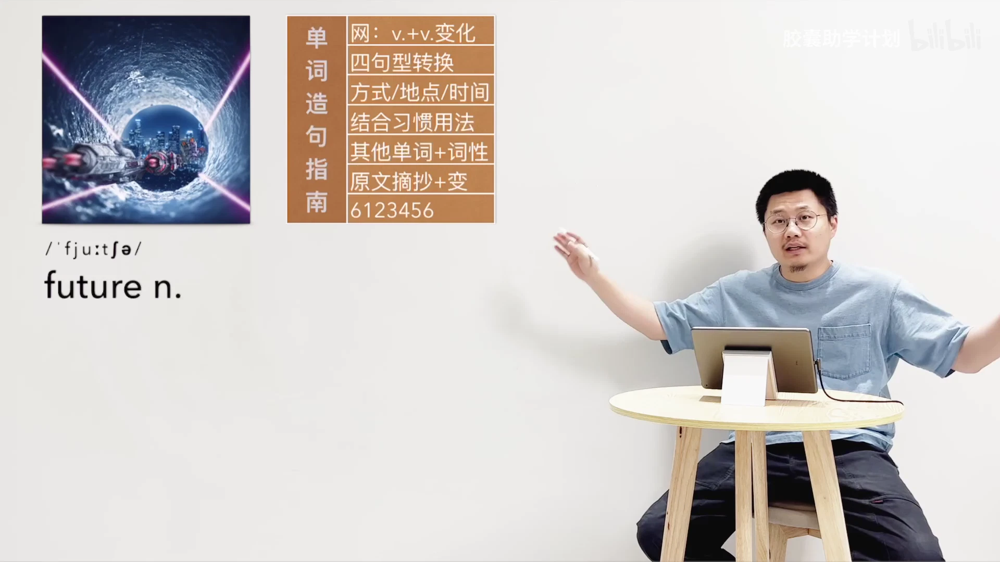

文字识别：单词造句指南 / 网：v.+v.变化 / 四句型转换 / 方式/地点/时间 / 结合习惯用法 / 其他单词+词性 / 原文摘抄+变 / 6123456 / /'fjuitfa/ / future n.

### 画面 00:00:45

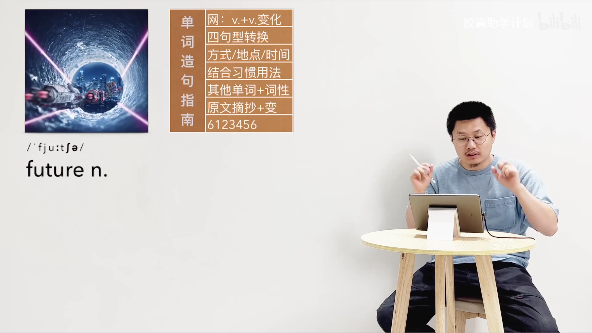

文字识别：单词造句指南 / 网：v.+v.变化 / 四句型转换 / 方式/地点/时间 / 结合习惯用法 / 其他单词+词性 / 原文摘抄+变 / 6123456 / /'fjuitfa/ / future n.

### 画面 00:00:48

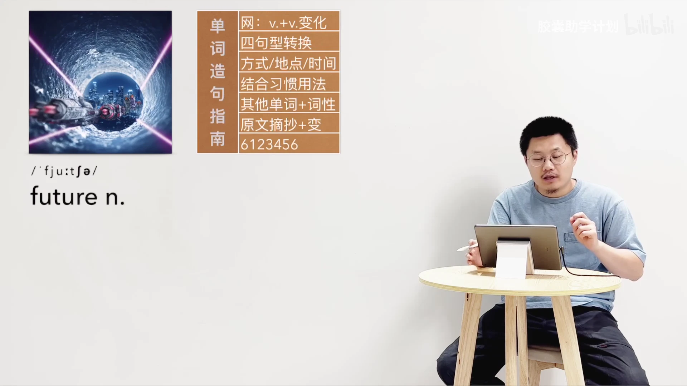

文字识别：单词造句指南 / 网：v.+v.变化 / 四句型转换 / 方式/地点/时间 / 结合习惯用法 / 其他单词+词性 / 原文摘抄+变 / 6123456 / /'fju:tfa/ / future n.

### 画面 00:00:50

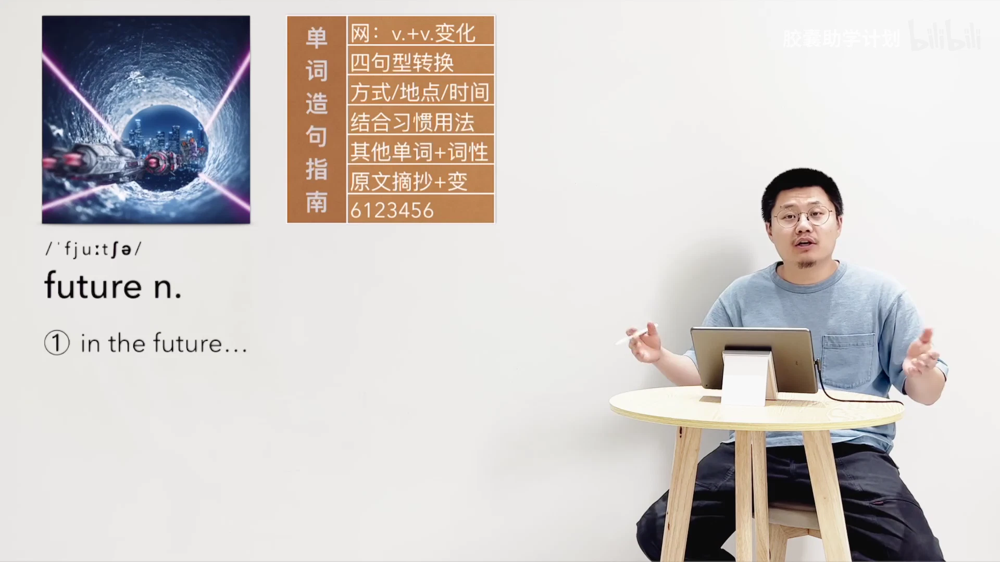

文字识别：单词造句指南 / 网：v.+v.变化 / 四句型转换 / 方式/地点/时间 / 结合习惯用法 / 其他单词+词性 / 原文摘抄+变 / 6123456 / /'fju:tfa/ / future n. / ① in the future...

### 画面 00:00:53

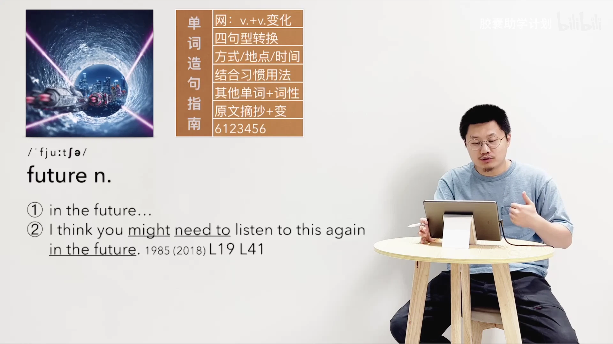

文字识别：单词造句指南 / 网：v.+v.变化 / 四句型转换 / 方式/地点/时间 / 结合习惯用法 / 其他单词+词性 / 原文摘抄+变 / 6123456 / /'fju:t∫a/ / future n. / ① in the future... / ② I think you might need to listen to this again / in the future. 1985 (2018) L19 L41

### 画面 00:00:55

文字识别：单词造句指南 / 网：v.+v.变化 / 四句型转换 / 方式/地点/时间 / 结合习惯用法 / 其他单词+词性 / 原文摘抄+变 / 6123456 / /'fju:tfa/ / future n. / ① in the future... / ② I think you might need to listen to this again / in the future. 1985 (2018) L19 L41

### 画面 00:00:57

文字识别：单词造句指南 / 网：v.+v.变化 / 四句型转换 / 方式/地点/时间 / 结合习惯用法 / 其他单词+词性 / 原文摘抄+变 / 6123456 / /'fju:tfa/ / future n. / ① in the future... / ② I think you might need to listen to this again / in the future. 1985 (2018) L19 L41

## 00:01:00–00:01:30

future.好，这个虽然是一句电影台词啊，但是我在找它的时候也不是说有 future 就放进来，还是它用到了连续用到了两个我们学过的语法。第一个是第十九课叫做 might 加动词原形，它有一个翻译方式叫做表示一种推测，不知道各位还记不记得，对吧？ Might do 表示是可能啊，可能怎么怎么样。然后其次呢，就是 need 的用法，四十一课咱们学的叫 need to do something，

### 画面 00:01:00

文字识别：单词造句指南 / 网：v.+v.变化 / 四句型转换 / 方式/地点/时间 / 结合习惯用法 / 其他单词+词性 / 原文摘抄+变 / 6123456 / /'fju:tfa/ / future n. / ① in the future... / ② I think you might need to listen to this again / in the future. 1985 (2018) L19 L41

### 画面 00:01:05

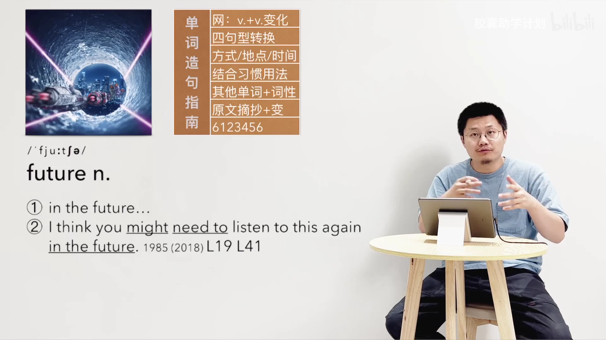

文字识别：单词造句指南 / 网：v.+v.变化 / 四句型转换 / 方式/地点/时间 / 结合习惯用法 / 其他单词+词性 / 原文摘抄+变 / 6123456 / /'fju:tfa/ / future n. / ① in the future... / ② I think you might need to listen to this again / in the future. 1985 (2018) L19 L41

### 画面 00:01:09

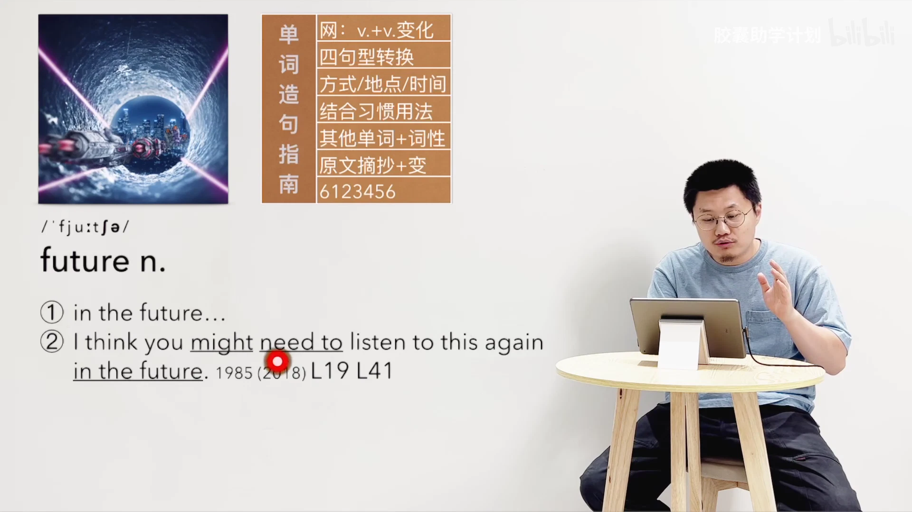

文字识别：单词造句指南 / 网：v.+v.变化 / 四句型转换 / 方式/地点/时间 / 结合习惯用法 / 其他单词+词性 / 原文摘抄+变 / 6123456 / /'fju:tfa/ / future n. / ① in the future... / ② I think you might need to listen to this again / in the future.1985 (20 8) L19 L41

### 画面 00:01:11

文字识别：单词造句指南 / 网：v.+v.变化 / 四句型转换 / 方式/地点/时间 / 结合习惯用法 / 其他单词+词性 / 原文摘抄+变 / 6123456 / /'fju:t∫a/ / future n. / ① in the future... / ② I think you might need to listen to this again / in the future. 1985 (2018) L19 L41

### 画面 00:01:13

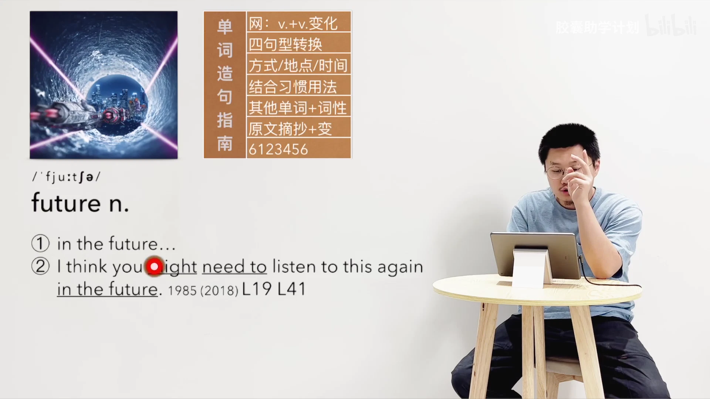

文字识别：单词造句指南 / 网：v.+v.变化 / 四句型转换 / 方式/地点/时间 / 结合习惯用法 / 其他单词+词性 / 原文摘抄+变 / 6123456 / /'fju:t∫a/ / future n. / ① in the future... / ② I think you Oight need to listen to this again / in the future.1985 (2018) L19 L41

### 画面 00:01:15

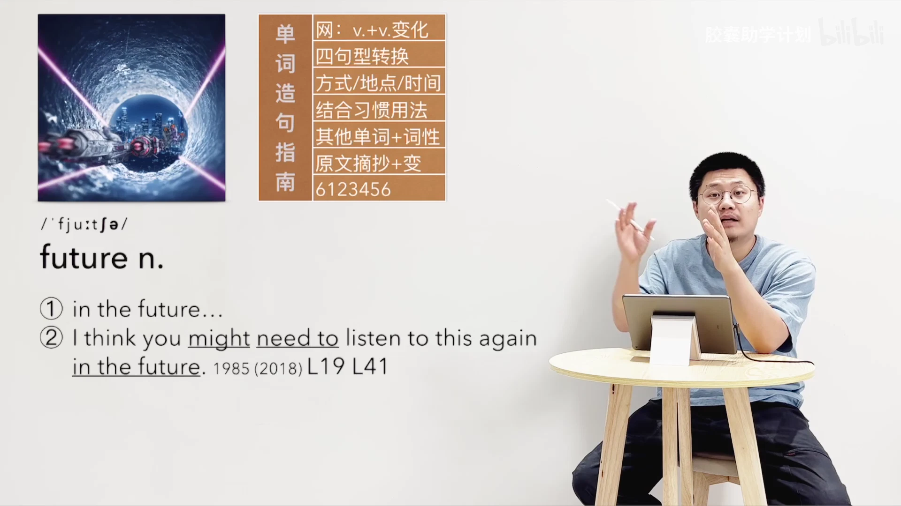

文字识别：单词造句指南 / 网：v.+v.变化 / 四句型转换 / 方式/地点/时间 / 结合习惯用法 / 其他单词+词性 / 原文摘抄+变 / 6123456 / /'fju:t∫a/ / future n. / ① in the future... / ② I think you might need to listen to this again / in the future.1985 (2018) L19 L41

### 画面 00:01:20

文字识别：单词造句指南 / 网：v.+v.变化 / 四句型转换 / 方式/地点/时间 / 结合习惯用法 / 其他单词+词性 / 原文摘抄+变 / 6123456 / /'fju:tfa/ / future n. / ① in the future... / ② I think you might need to listen to this again / in the future. 1985 (2018) L19 L41

### 画面 00:01:25

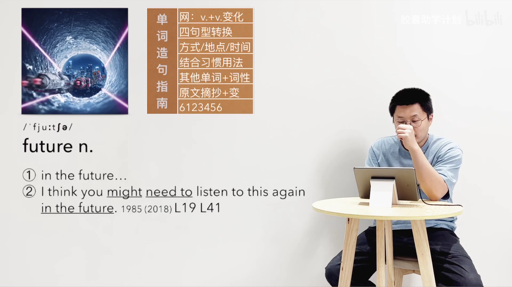

文字识别：单词造句指南 / 网：v.+v.变化 / 四句型转换 / 方式/地点/时间 / 结合习惯用法 / 其他单词+词性 / 原文摘抄+变 / 6123456 / /'fju:t∫a/ / future n. / ① in the future... / ② I think you might need to listen to this again / in the future. 1985 (2018) L19 L41

### 画面 00:01:28

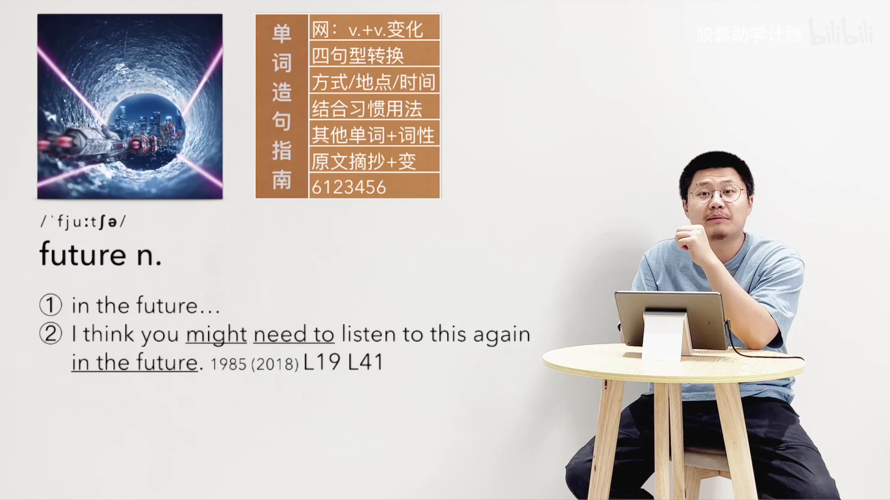

文字识别：单词造句指南 / 网：v.+v.变化 / 四句型转换 / 方式/地点/时间 / 结合习惯用法 / 其他单词+词性 / 原文摘抄+变 / 6123456 / /'fju:t∫a/ / future n. / ① in the future... / ② I think you might need to listen to this again / in the future.1985 (2018) L19 L41

## 00:01:30–00:02:00

something，需要怎么怎么样啊？OK，那再跟我读一遍这个句子啊，Repeat after me. I think you might need to listen to this again in the future. OK, very good. Next one, 我们自己造一个句子叫 I want to work for that company in the future. 哎，很多人可能就会有这样的想法，说我将来想去那个公司工作，对吧？那就是 work for that company. Work for，第四课咱们学的，continue. 说 We hope to see you again in the future. 哎，三十六课咱们

### 画面 00:01:30

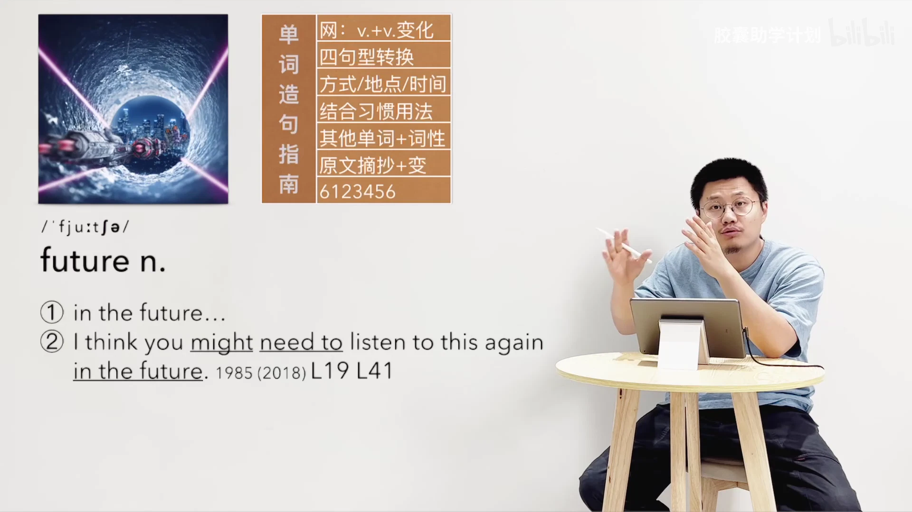

文字识别：单词造句指南 / 网：v.+v.变化 / 四句型转换 / 方式/地点/时间 / 结合习惯用法 / 其他单词+词性 / 原文摘抄+变 / 6123456 / /'fju:t∫a/ / future n. / ① in the future... / ② I think you might need to listen to this again / in the future. 1985 (2018) L19 L41

### 画面 00:01:35

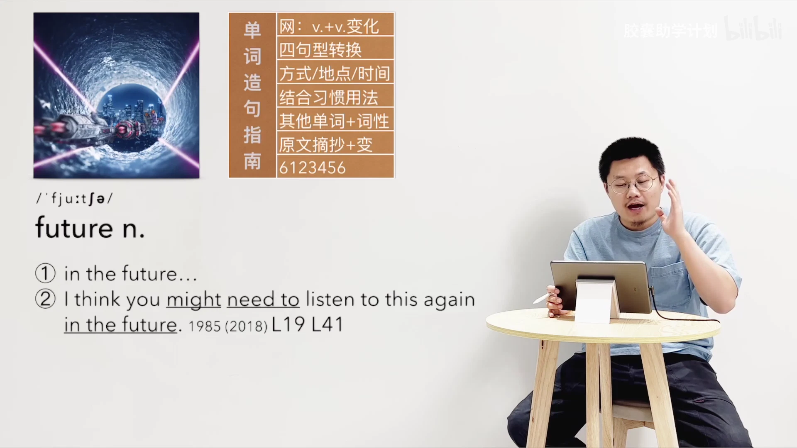

文字识别：单词造句指南 / 网：v.+v.变化 / 四句型转换 / 方式/地点/时间 / 结合习惯用法 / 其他单词+词性 / 原文摘抄+变 / 6123456 / /'fju:tfa/ / future n. / ① in the future... / ② I think you might need to listen to this again / in the future. 1985 (2018) L19 L41

### 画面 00:01:38

文字识别：单词造句指南 / 网：v.+v.变化 / 四句型转换 / 方式/地点/时间 / 结合习惯用法 / 其他单词+词性 / 原文摘抄+变 / 6123456 / /'fju:t∫a/ / future n. / ① in the future... / ② I think you might need to listen to this again / in the future. 1985 (2018) L19 L41

### 画面 00:01:40

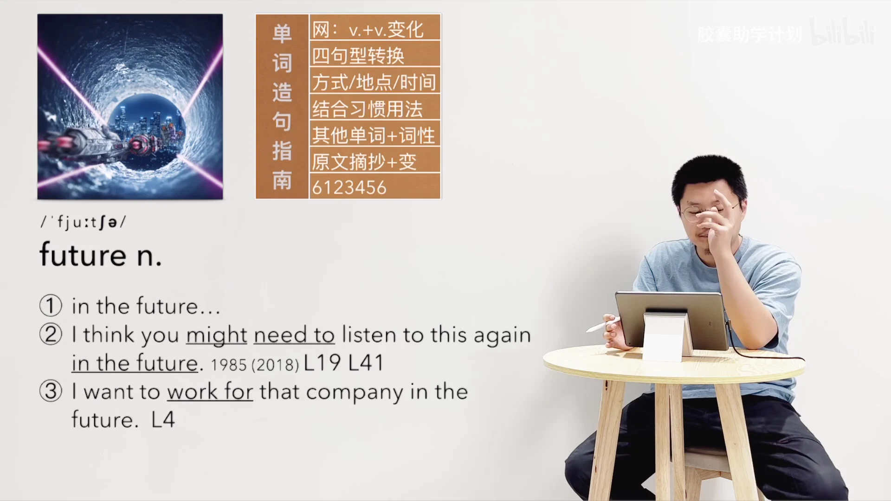

文字识别：单词造句指南 / 网：v.+v.变化 / 四句型转换 / 方式/地点/时间 / 结合习惯用法 / 其他单词+词性 / 原文摘抄+变 / 6123456 / /'fju:t∫a/ / future n. / ① in the future... / ② I think you might need to listen to this again / in the future. 1985 (2018) L19 L41 / I want to work for that company in the / future. L4

### 画面 00:01:45

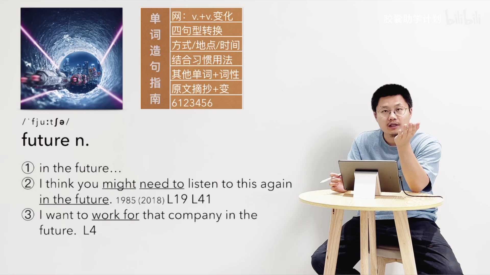

文字识别：单词造句指南 / 网：v.+v.变化 / 四句型转换 / 方式/地点/时间 / 结合习惯用法 / 其他单词+词性 / 原文摘抄+变 / 6123456 / /'fju:t∫a/ / future n. / ① in the future... / ② I think you might need to listen to this again / in the future.1985 (2018) L19 L41 / I want to work for that company in the / future. L4

### 画面 00:01:50

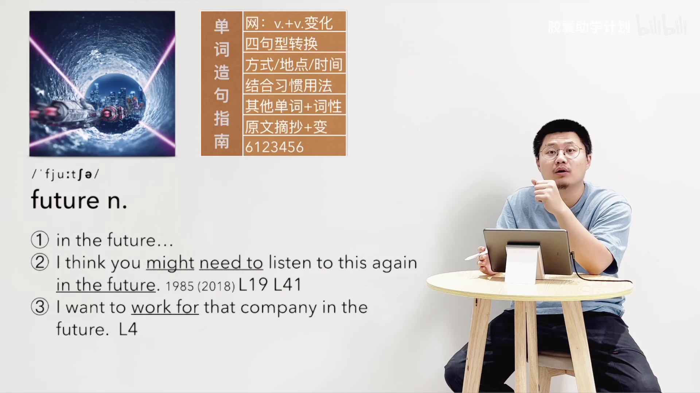

文字识别：单词造句指南 / 网：v.+v.变化 / 四句型转换 / 方式/地点/时间 / 结合习惯用法 / 其他单词+词性 / 原文摘抄+变 / 6123456 / /'fju:t∫a/ / future n. / ① in the future... / ② I think you might need to listen to this again / in the future. 1985 (2018) L19 L41 / I want to work for that company in the / future. L4

### 画面 00:01:55

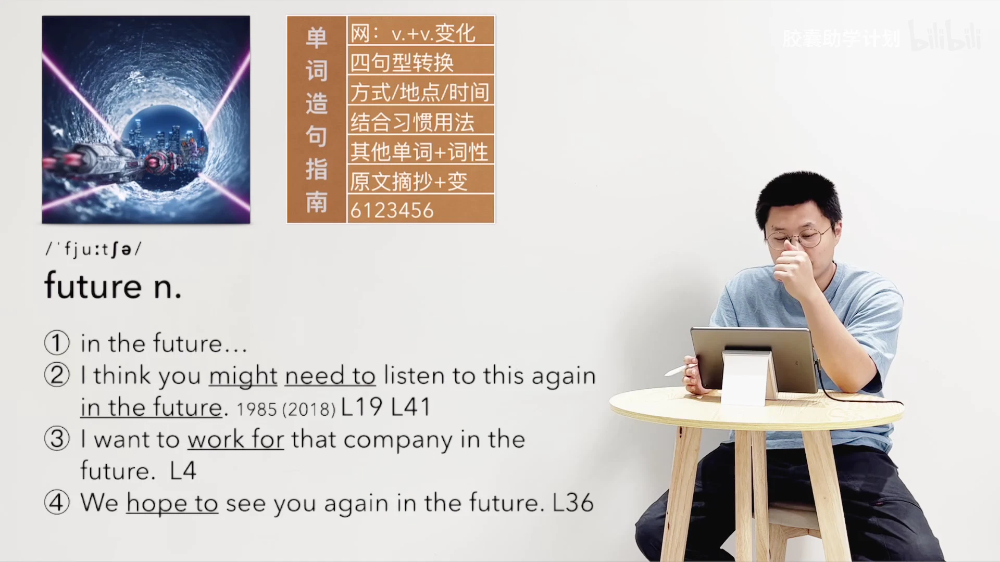

文字识别：单词造句指南 / 网：v.+v.变化 / 四句型转换 / 方式/地点/时间 / 结合习惯用法 / 其他单词+词性 / 原文摘抄+变 / 6123456 / /'fju:t∫a/ / future n. / ① in the future... / ② I think you might need to listen to this again / in the future.1985 (2018) L19 L41 / I want to work for that company in the / future. L4 / ④ We hope to see you again in the future. L36

## 00:02:00–00:02:30

学的一个短语叫 hope to do something. 我们希望在未来能再一次见到您。OK，好，接下来呢，我们看一个电影片段啊，注意力集中，我们听一下这句话。So I guess you have no interest in having a real job in the future. OK, continue下一句话。这句话我简单说一下啊，他说 unless除非 you make peace with your past, you won't have a future. 哎，make peace with your

### 画面 00:02:00

文字识别：单词造句指南 / 网：v.+v.变化 / 四句型转换 / 方式/地点/时间 / 结合习惯用法 / 其他单词+词性 / 原文摘抄+变 / 6123456 / /'fju:t∫a/ / future n. / ① in the future... / ② I think you might need to listen to this again / in the future. 1985 (2018) L19 L41 / I want to work for that company in the / future. L4 / ④ We hope to see you again in the future. L36

### 画面 00:02:04

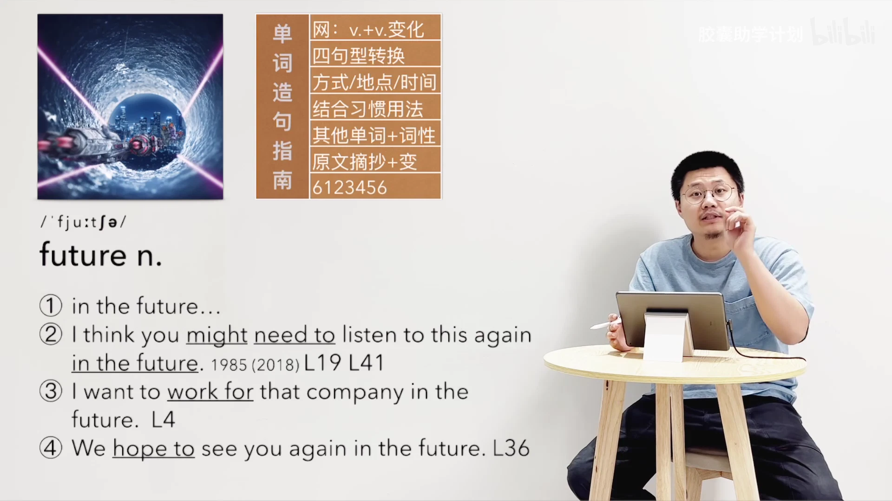

文字识别：单词造句指南 / 网：v.+v.变化 / 四句型转换 / 方式/地点/时间 / 结合习惯用法 / 其他单词+词性 / 原文摘抄+变 / 6123456 / /'fju:t∫a/ / future n. / ① in the future... / ② Ithink you might need to listen to this again / in the future. 1985 (2018) L19 L41 /  I want to work for that company in the / future. L4 / ④ We hope to see you again in the future. L36

### 画面 00:02:06

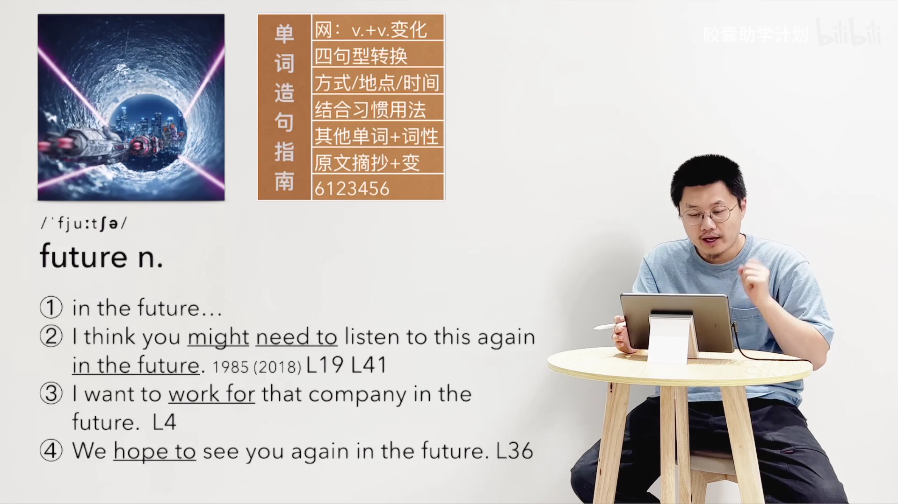

文字识别：单词造句指南 / 网：v.+v.变化 / 四句型转换 / 方式/地点/时间 / 结合习惯用法 / 其他单词+词性 / 原文摘抄+变 / 6123456 / /'fju:t∫a/ / future n. / ① in the future... / ② I think you might need to listen to this again / in the future.1985 (2018) L19 L41 /  I want to work for that company in the / future. L4 / ④ We hope to see you again in the future. L36

### 画面 00:02:08

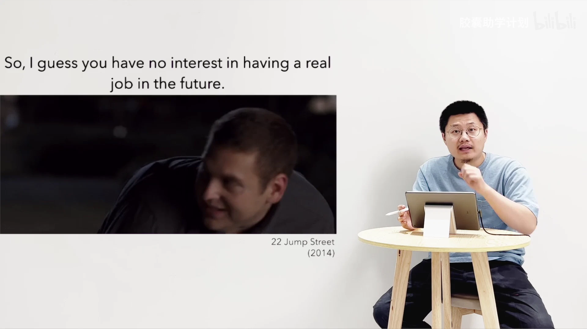

文字识别：So, I guess you have no interest in having a real / job in the future. / 22 Jump Street / (2014)

### 画面 00:02:14

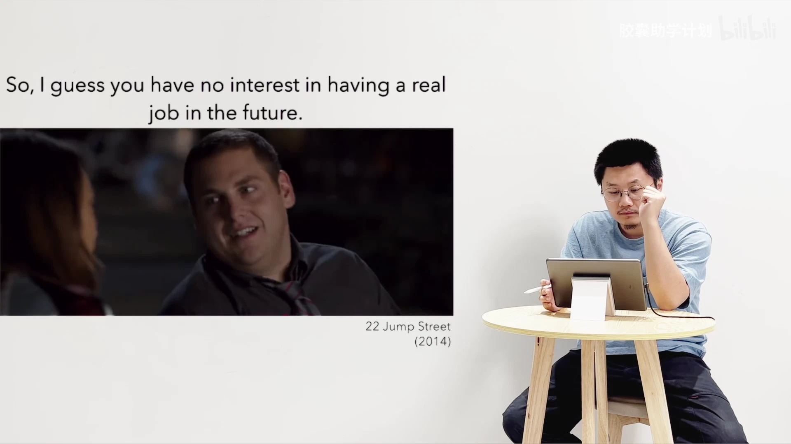

文字识别：So, I guess you have no interest in having a real / job in the future. / 22 Jump Street / (2014)

### 画面 00:02:16

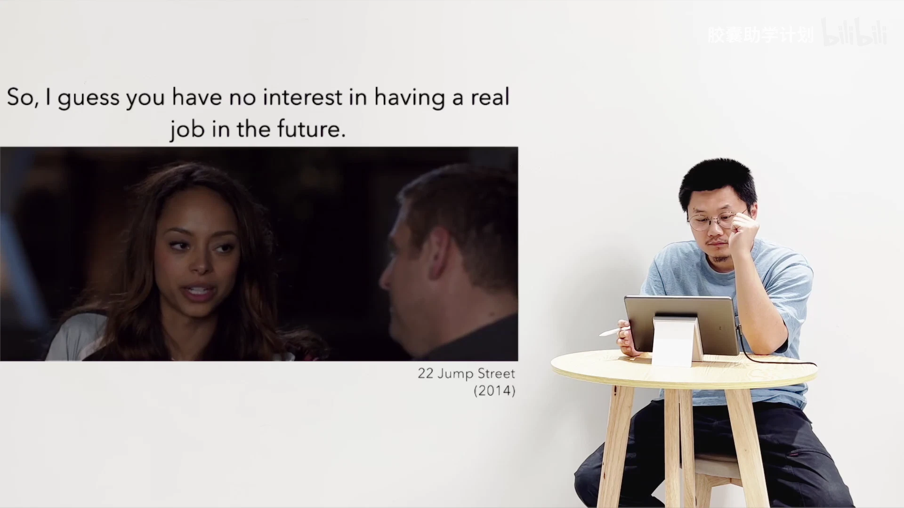

文字识别：So, I guess you have no interest in having a real / job in the future. / 22 Jump Street / (2014)

### 画面 00:02:18

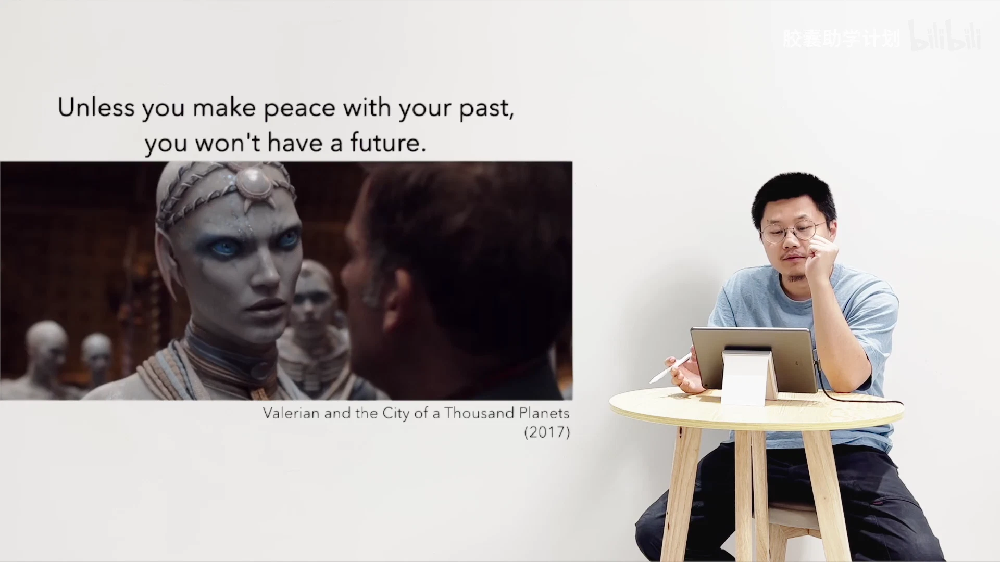

文字识别：Unless you make peace with your past, / you won't have a future. / Valerian and the City of a Thousand Planets / (2017)

## 00:02:30–00:03:00

past.刚才刚提到 now, past, future.过去那什么叫 make peace with your past呢？Peace就是和平的意思，就是和你的过去怎么样达成一个妥协，对吧？或者说跟你的过去和谐相处，你才会拥有未来，对吧？除非你能和过去和谐相处啊，你不会拥有未，否则你就不会拥有未来的，对不对？Okay，其实那正向说就是当你和过去和谐相处，对吧？你能和过

### 画面 00:02:39

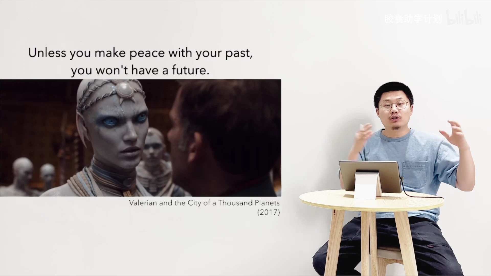

文字识别：Unless you make peace with your past, / you won't have a future. / Valerian and the City of a Thousand Planets / (2017)

## 00:03:00–00:03:30

去的那些怨恨放下的时候呢，你就会走向未来了。OK，那注意力集中，我们听一下。Unless you make peace with your past, you won't have a future. Very good. Next one，下一个单词很简单，跟我一起读，看音标啊。Fair, fair，这个单词它很常见的两个用法，词性不一样，而且完全不太一样啊，含义不太一样。它的名词的用法指的是这种市集，

### 画面 00:03:04

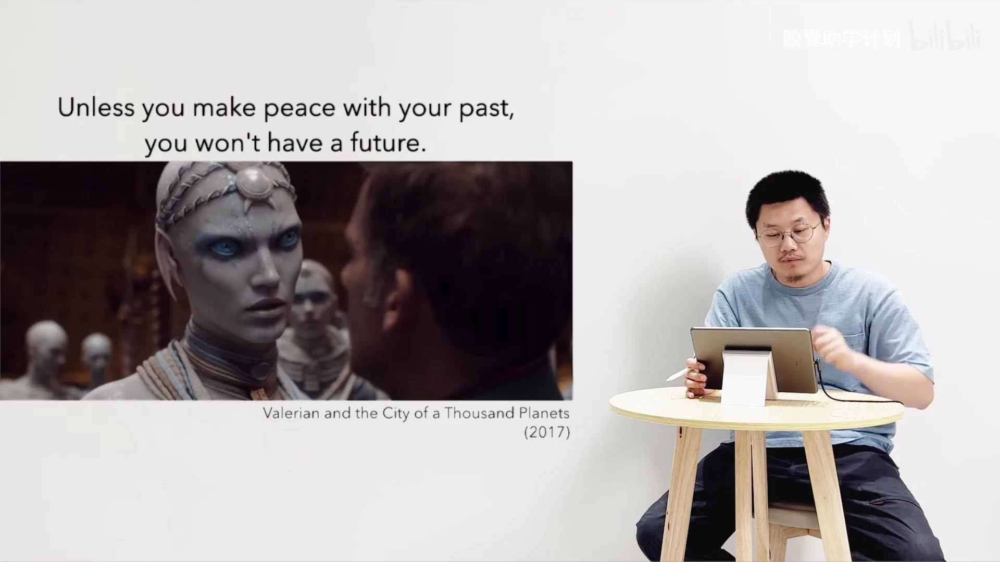

文字识别：Unless you make peace with your past, / you won't have a future. / Valerian and the City of a Thousand Planets / (2017)

### 画面 00:03:07

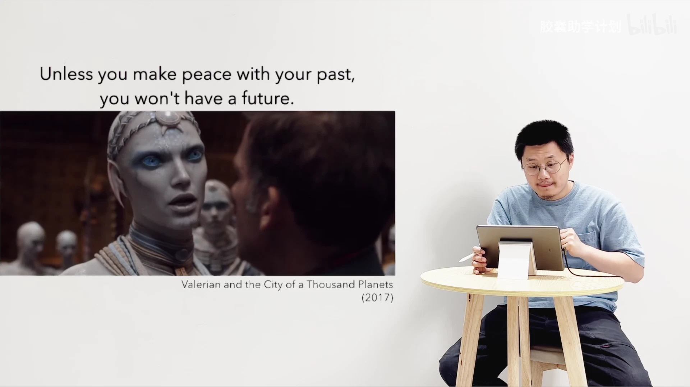

文字识别：Unless you make peace with your past, / you won't have a future. / Valerian and the City of a Thousand Planets / (2017)

### 画面 00:03:09

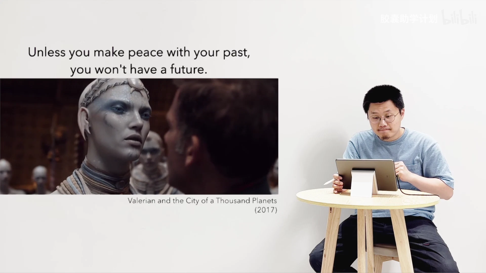

文字识别：Unless you make peace with your past, / you won't have a future. / Valerian and the City of a Thousand Planets / (2017)

### 画面 00:03:11

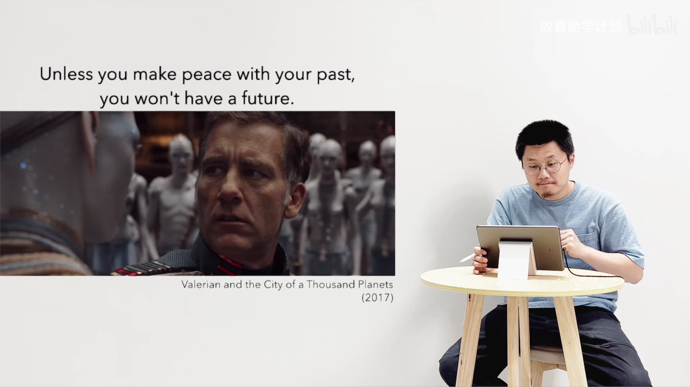

文字识别：Unless you make peace with your past, / you won't have a future. / Valerian and the City of a Thousand Planets / (2017)

### 画面 00:03:13

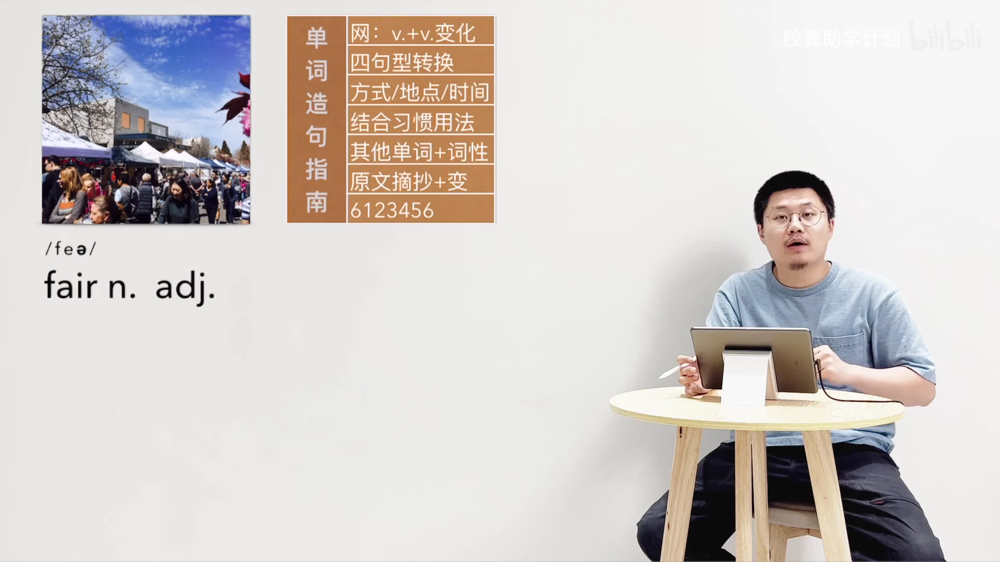

文字识别：单词造句指南 / 网：v.+v.变化 / 四句型转换 / 方式/地点/时间 / 结合习惯用法 / 其他单词+词性 / 原文摘抄+变 / 6123456 / /feal / fair n. adj.

### 画面 00:03:15

文字识别：单词造句指南 / 网：v.+v.变化 / 四句型转换 / 方式/地点/时间 / 结合习惯用法 / 其他单词+词性 / 原文摘抄+变 / 6123456 / /feal / fair n. adj.

### 画面 00:03:20

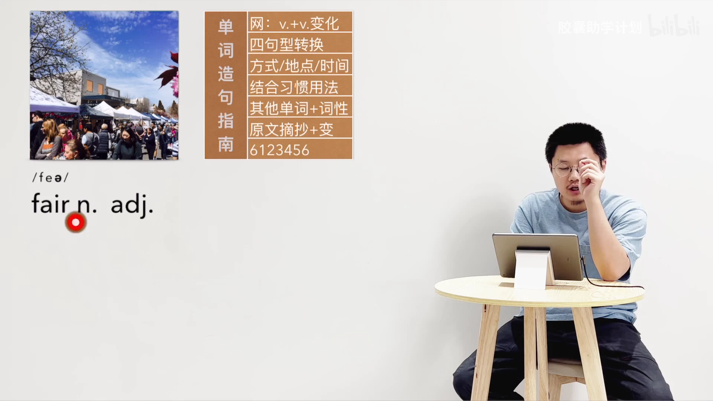

文字识别：单词造句指南 / 网：v.+v.变化 / 四句型转换 / 方式/地点/时间 / 结合习惯用法 / 其他单词+词性 / 原文摘抄+变 / 6123456 / /fea/ / fairn. adj.

## 00:03:30–00:04:00

比如说中国啊，中国的农村啊，至少在我很小的时候去的时候，现在我已经不知道了。在我很小时候去农村的时候，村里面所谓叫赶集的那个集就是fair。在西方世界当中呢，他们的一些village或者说town也有这样的集市啊，比如说你像我们在新西兰就去过这样的集市，那他们实际上就叫做fair，本质上差不多都是卖一些自己种的东西呀，对吧？自

### 画面 00:03:37

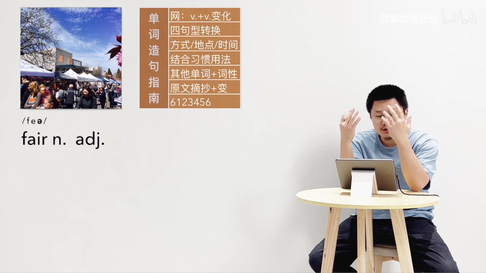

文字识别：单词造句指南 / 网：v.+v.变化 / 四句型转换 / 方式/地点/时间 / 结合习惯用法 / 其他单词+词性 / 原文摘抄+变 / 6123456 / /feal / fair n. adj.

### 画面 00:03:47

文字识别：单词造句指南 / 网：v.+v.变化 / 四句型转换 / 方式/地点/时间 / 结合习惯用法 / 其他单词+词性 / 原文摘抄+变 / 6123456 / /fea/ / fair n. adj.

## 00:04:00–00:04:30

己制作，比如说酒啊，或者说自己种的蔬菜呀，哎，自己打捞上来的海鲜呐，等等，在那个地方去卖，他们就叫做集市，叫做 fair。 OK，那它形容词呢？哎，这个其实也很常见，叫公平。比如说这事儿不公平，is not fair，啊，that's not fair， this is not fair。 OK，玩儿一个。 OK，那我们看啊，fair，我们想拿它去造句的时候，我们其实有很多的思路，比如六一二三

### 画面 00:04:09

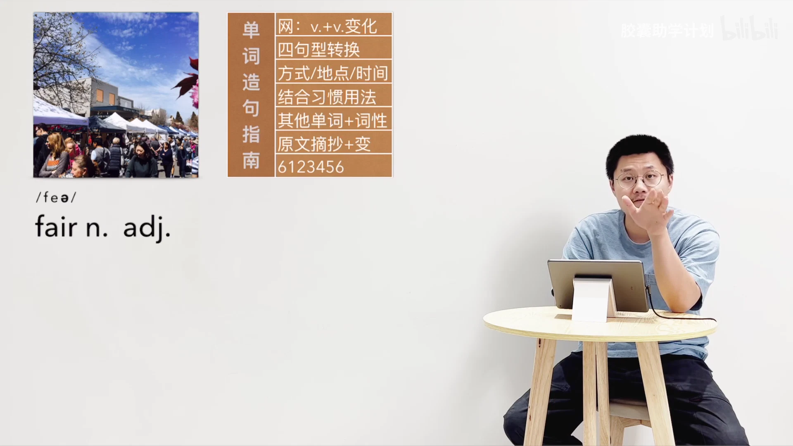

文字识别：单词造句指南 / 网：v.+v.变化 / 四句型转换 / 方式/地点/时间 / 结合习惯用法 / 其他单词+词性 / 原文摘抄+变 / 6123456 / /fea/ / fair n. adj.

### 画面 00:04:11

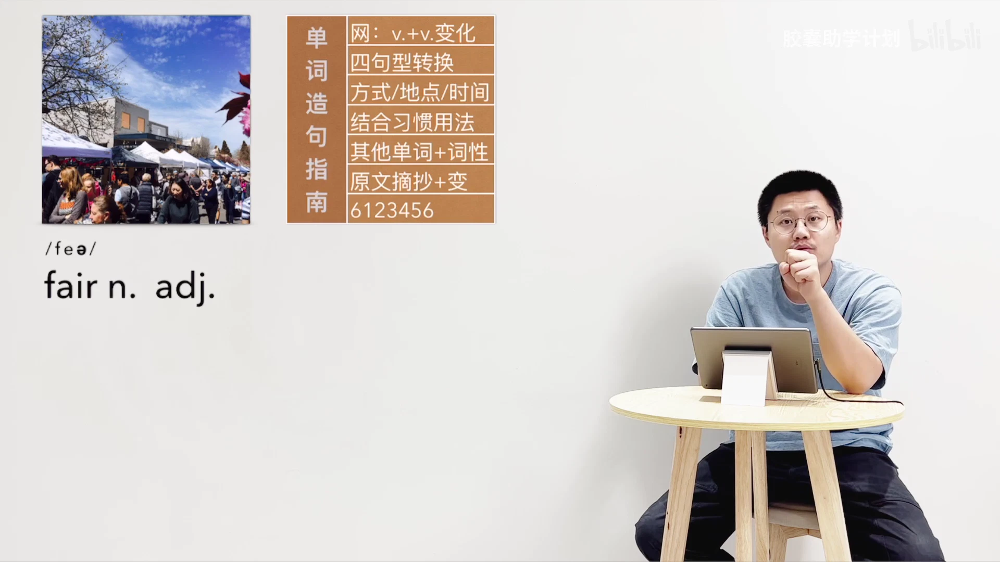

文字识别：单词造句指南 / 网：v.+v.变化 / 四句型转换 / 方式/地点/时间 / 结合习惯用法 / 其他单词+词性 / 原文摘抄+变 / 6123456 / /feal / fair n. adj.

### 画面 00:04:15

文字识别：单词造句指南 / 网：v.+v.变化 / 四句型转换 / 方式/地点/时间 / 结合习惯用法 / 其他单词+词性 / 原文摘抄+变 / 6123456 / /fea/ / fair n. adj.

### 画面 00:04:22

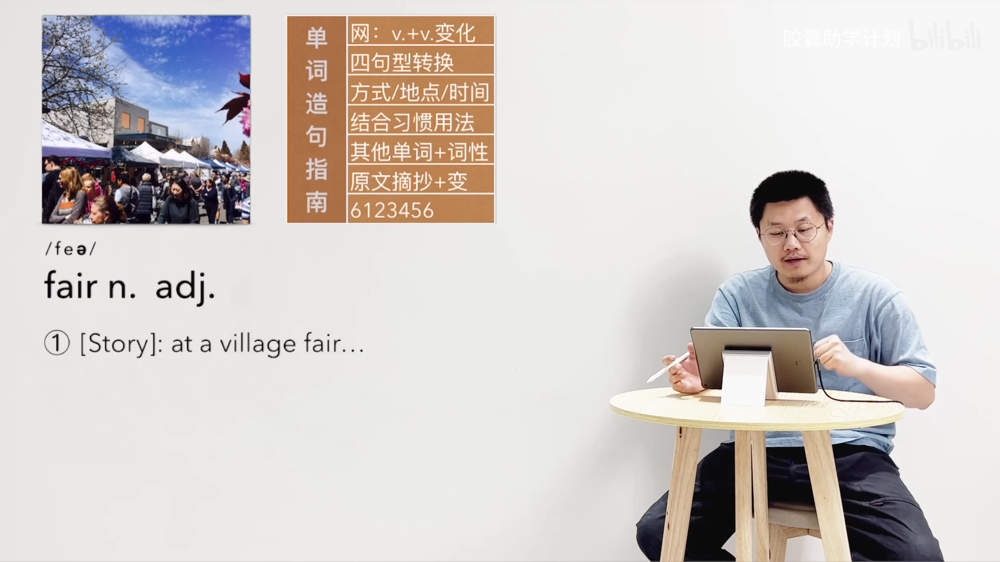

文字识别：单词造句指南 / 网：v.+v.变化 / 四句型转换 / 方式/地点/时间 / 结合习惯用法 / 其他单词+词性 / 原文摘抄+变 / 6123456 / /fea/ / fair n. adj. / ① [Story]: at a village fair...

### 画面 00:04:25

文字识别：单词造句指南 / 网：v.+v.变化 / 四句型转换 / 方式/地点/时间 / 结合习惯用法 / 其他单词+词性 / 原文摘抄+变 / 6123456 / /fea/ / fair n. adj. / ① [Story]: at a village fair...

## 00:04:30–00:05:00

四五六，对吧？我们从原文这回不摘抄一个句子，我们摘抄一个短语叫 at a village fair。如果这个东西出来了之后，那你在六一二三四五六当中最容易理解的就是放在五去做一个地点，对吧？当然，我们也可以做其他的，比如说做一个后置定语。二八二九三十这三课咱们当时学的，画了一根螃蟹一样的东西，对吧？定语什么时候放前面，什么时候放后面？比如像短语介词引导的短语 at a village fair，

### 画面 00:04:32

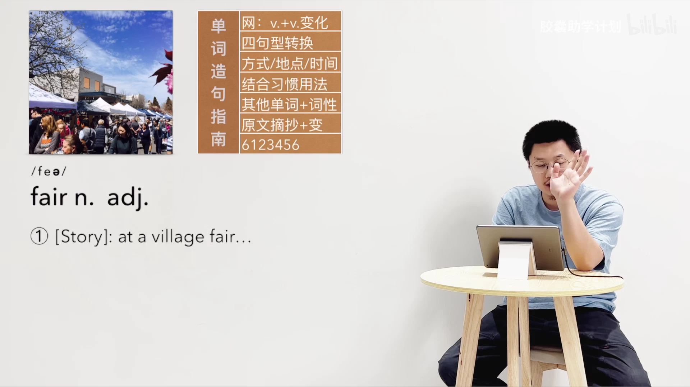

文字识别：单词造句指南 / 网：v.+v.变化 / 四句型转换 / 方式/地点/时间 / 结合习惯用法 / 其他单词+词性 / 原文摘抄+变 / 6123456 / /fea/ / fair n. adj. / ① [Story]: at a village fair...

### 画面 00:04:36

文字识别：单词造句指南 / 网：v.+v.变化 / 四句型转换 / 方式/地点/时间 / 结合习惯用法 / 其他单词+词性 / 原文摘抄+变 / 6123456 / /feal / fair n. adj. / ① [Story]: at a village fair...

### 画面 00:04:40

文字识别：单词造句指南 / 网：v.+v.变化 / 四句型转换 / 方式/地点/时间 / 结合习惯用法 / 其他单词+词性 / 原文摘抄+变 / 6123456 / /fea/ / fair n. adj. / ① [Story]: at a village fair...

### 画面 00:04:45

文字识别：单词造句指南 / 网：v.+v.变化 / 四句型转换 / 方式/地点/时间 / 结合习惯用法 / 其他单词+词性 / 原文摘抄+变 / 6123456 / /feal / fair n. adj. / ① [Story]: at a village fair...

### 画面 00:04:50

文字识别：单词造句指南 / 网：v.+v.变化 / 四句型转换 / 方式/地点/时间 / 结合习惯用法 / 其他单词+词性 / 原文摘抄+变 / 6123456 / /fea/ / fair n. adj. / ① [Story]: at a village fair...

### 画面 00:04:53

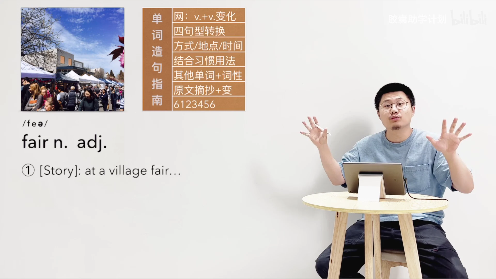

文字识别：单词造句指南 / 网：v.+v.变化 / 四句型转换 / 方式/地点/时间 / 结合习惯用法 / 其他单词+词性 / 原文摘抄+变 / 6123456 / /fea/ / fair n. adj. / ① [Story]: at a village fair..

### 画面 00:04:55

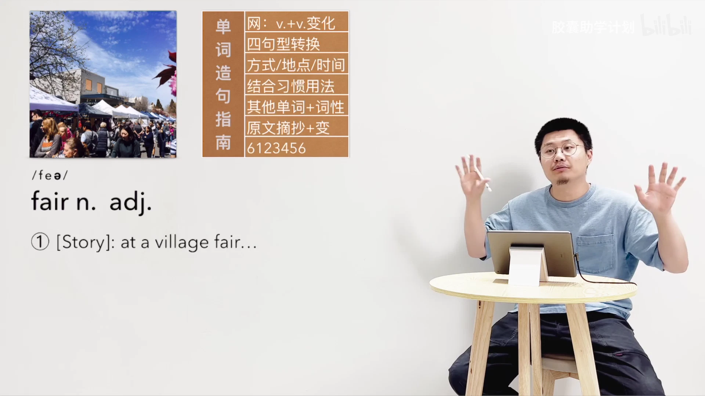

文字识别：单词造句指南 / 网：v.+v.变化 / 四句型转换 / 方式/地点/时间 / 结合习惯用法 / 其他单词+词性 / 原文摘抄+变 / 6123456 / /fea/ / fair n. adj. / ① [Story]: at a village fair..

### 画面 00:04:59

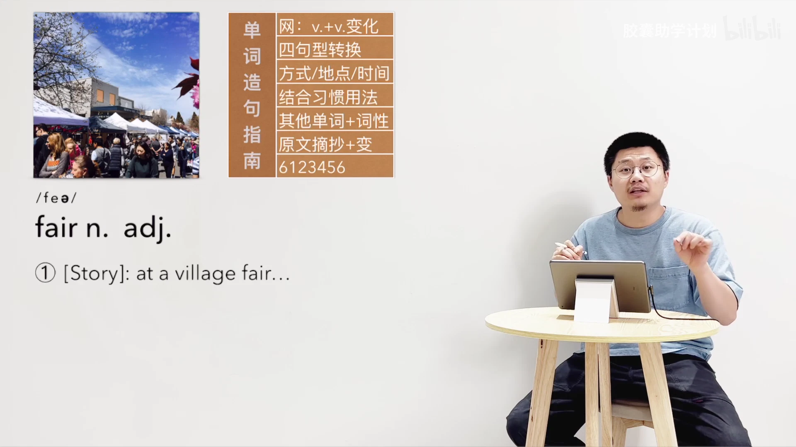

文字识别：单词造句指南 / 网：v.+v.变化 / 四句型转换 / 方式/地点/时间 / 结合习惯用法 / 其他单词+词性 / 原文摘抄+变 / 6123456 / /feal / fair n. adj. / ① [Story]: at a village fair...

## 00:05:00–00:05:30

就我们就放到名词的后面去。比如说，我们造一句话，说 Can you return this to me at that village fair tomorrow? 明天你能不能在那个市集上把这东西还给我呢？咱们定一下，因为明天我也要去，你也要去，对吧？那这地方用到了一个之前学过的习惯用法，哎，叫做 return something to somebody。啊，其次呢，我给它变成了一个一般疑问句，因为我觉得这个可能更常用，我没有把它变成肯定句。想变肯定句也很简单，说 You

### 画面 00:05:02

文字识别：单词造句指南 / 网：v.+v.变化 / 四句型转换 / 方式/地点/时间 / 结合习惯用法 / 其他单词+词性 / 原文摘抄+变 / 6123456 / /fea/ / fair n. adj. / ① [Story]: at a village fair... / ) Can you return this to me at that village fair / 2） / tomorrow? L45

### 画面 00:05:05

文字识别：单词造句指南 / 网：v.+v.变化 / 四句型转换 / 方式/地点/时间 / 结合习惯用法 / 其他单词+词性 / 原文摘抄+变 / 6123456 / /feal / fair n. adj. / ① [Story]: at a village fair... / ② Can you return this to me at that village fair / tomorrow? L45

### 画面 00:05:10

文字识别：单词造句指南 / 网：v.+v.变化 / 四句型转换 / 方式/地点/时间 / 结合习惯用法 / 其他单词+词性 / 原文摘抄+变 / 6123456 / /feal / fair n. adj. / ① [Story]: at a village fair... /  Can you return this to me at that village fair / 2) / tomorrow? L45

### 画面 00:05:17

文字识别：单词造句指南 / 网：v.+v.变化 / 四句型转换 / 方式/地点/时间 / 结合习惯用法 / 其他单词+词性 / 原文摘抄+变 / 6123456 / /feal / fair n. adj. / ① [Story]: at a village fair... / ) Can you return this to me at that village fair / 2） / tomorrow? L45

### 画面 00:05:22

文字识别：单词造句指南 / 网：v.+v.变化 / 四句型转换 / 方式/地点/时间 / 结合习惯用法 / 其他单词+词性 / 原文摘抄+变 / 6123456 / /feal / fair n. adj. / ① [Story]: at a village fair... / ② Can you return this to me at that village fair / tomorrow? L45

### 画面 00:05:25

文字识别：单词造句指南 / 网：v.+v.变化 / 四句型转换 / 方式/地点/时间 / 结合习惯用法 / 其他单词+词性 / 原文摘抄+变 / 6123456 / /fea/ / fair n. adj. / ① [Story]: at a village fair... /  Can you return this to me at that village fair / 2） / tomorrow? L45

## 00:05:30–00:06:00

can return this to me,对吧？或者 I can return this to you,对不对？Very good.好, next one. No one could account for the fact.记得跟我读啊. Everything at that village fair is much more expensive.好，这是我们四十六课学过的同位语从句，叫No one could account for the fact that.后边加一句话，说没有人能解释清楚，解释清楚这样一个事实。什么事实呢？就是那个市集上一切的东西都卖的

### 画面 00:05:35

文字识别：单词造句指南 / 网：v.+v.变化 / 四句型转换 / 方式/地点/时间 / 结合习惯用法 / 其他单词+词性 / 原文摘抄+变 / 6123456 / /fea/ / fair n. adj. / ① [Story]: at a village fair.. / ② Can you return this to me at that village fair / tomorrow? L45 / No one could account for the fact everything / at that village fair is much more expensive. L46

### 画面 00:05:37

文字识别：单词造句指南 / 网：v.+v.变化 / 四句型转换 / 方式/地点/时间 / 结合习惯用法 / 其他单词+词性 / 原文摘抄+变 / 6123456 / /fea/ / fair n. adj. / ① [Story]: at a village fair.. / ② Can you return this to me at that village fair / tomorrow? L45 / No one could account for the fact everything / at that village fair is much more expensive. L46

### 画面 00:05:39

文字识别：单词造句指南 / 网：v.+v.变化 / 四句型转换 / 方式/地点/时间 / 结合习惯用法 / 其他单词+词性 / 原文摘抄+变 / 6123456 / /fea/ / fair n. adj. / ① [Story]: at a village fair.. / ② Can you return this to me at that village fair / tomorrow? L45 / No one could account for the fact everything / at that village fair is much more expensive. L46

### 画面 00:05:42

文字识别：单词造句指南 / 网：v.+v.变化 / 四句型转换 / 方式/地点/时间 / 结合习惯用法 / 其他单词+词性 / 原文摘抄+变 / 6123456 / /fea/ / fair n. adj. / ① [Story]: at a village fair.. / ② Can you return this to me at that village fair / tomorrow? L45 / No one could account for the fact everything / at that village fair is much more expensive. L46

### 画面 00:05:45

文字识别：单词造句指南 / 网：v.+v.变化 / 四句型转换 / 方式/地点/时间 / 结合习惯用法 / 其他单词+词性 / 原文摘抄+变 / 6123456 / /feal / fair n. adj. / ① [Story]: at a village fair... / ② Can you return this to me at that village fair / tomorrow? L45 / No one could account for the fact everything / at that village fair is much more expensive. L46

### 画面 00:05:48

文字识别：单词造句指南 / 网：v.+v.变化 / 四句型转换 / 方式/地点/时间 / 结合习惯用法 / 其他单词+词性 / 原文摘抄+变 / 6123456 / /fea/ / fair n. adj. / ① [Story]: at a village fair... / ② Can you return this to me at that village fair / tomorrow? L45 / No one could account for the fact everything / at that village fair is much more expensive. L46

### 画面 00:05:50

文字识别：单词造句指南 / 网：v.+v.变化 / 四句型转换 / 方式/地点/时间 / 结合习惯用法 / 其他单词+词性 / 原文摘抄+变 / 6123456 / /feal / fair n. adj. / ① [Story]: at a village fair... / ② Can you return this to me at that village fair / tomorrow? L45 / No one could account for the fact everything / at that village fair is much more expensive. L46

### 画面 00:05:53

文字识别：单词造句指南 / 网：v.+v.变化 / 四句型转换 / 方式/地点/时间 / 结合习惯用法 / 其他单词+词性 / 原文摘抄+变 / 6123456 / /fea/ / fair n. adj. / ① [Story]: at a village fair.. / ② Can you return this to me at that village fair / tomorrow? L45 / No one could account for the fact everything / at that village fair is much more expensive. L46

### 画面 00:05:55

文字识别：单词造句指南 / 网：v.+v.变化 / 四句型转换 / 方式/地点/时间 / 结合习惯用法 / 其他单词+词性 / 原文摘抄+变 / 6123456 / /fea/ / fair n. adj. / ① [Story]: at a village fair... / ② Can you return this to me at that village fair / tomorrow? L45 / No one could account for the fact everything / at that village fair is much more expensive. L46

## 00:06:00–00:06:30

更贵，按说应该更便宜啊，但是它更贵，对吧？也可能是比如说它是有机的，没有加化肥什么的，对不对？哎，也有可能是，就是人们的心理就是这样的。现在去赶集，其实尤其你在城市里面待时间长了，你赶集还是一个挺时髦的事儿，你愿意多花一点钱，所以它的价钱自然而然就贵，对不对？啊，But we don't know，对吧？因为没有人能完全解释清楚。No one could account for the fact. 后边加一句话啊。Okay，

### 画面 00:06:10

文字识别：单词造句指南 / 网：v.+v.变化 / 四句型转换 / 方式/地点/时间 / 结合习惯用法 / 其他单词+词性 / 原文摘抄+变 / 6123456 / /fea/ / fair n. adj. / ① [Story]: at a village fair.. / ② Can you return this to me at that village fair / tomorrow? L45 / No one could account for the fact everything / at that village fair is much more expensive. L46

### 画面 00:06:16

文字识别：单词造句指南 / 网：v.+v.变化 / 四句型转换 / 方式/地点/时间 / 结合习惯用法 / 其他单词+词性 / 原文摘抄+变 / 6123456 / /feal / fair n. adj. / ① [Story]: at a village fair... / ② Can you return this to me at that village fair / tomorrow? L45 / No one could account for the fact everything / at that village fair is much more expensive. L46

### 画面 00:06:21

文字识别：单词造句指南 / 网：v.+v.变化 / 四句型转换 / 方式/地点/时间 / 结合习惯用法 / 其他单词+词性 / 原文摘抄+变 / 6123456 / /fea/ / fair n. adj. / ① [Story]: at a village fair.. / ② Can you return this to me at that village fair / tomorrow? L45 / No one could account for the fact everything / at that village fair is much more expensive. L46

### 画面 00:06:25

文字识别：单词造句指南 / 网：v.+v.变化 / 四句型转换 / 方式/地点/时间 / 结合习惯用法 / 其他单词+词性 / 原文摘抄+变 / 6123456 / /feal / fair n. adj. / ① [Story]: at a village fair... / ② Can you return this to me at that village fair / tomorrow? L45 / No one could account for the fact everything / at that village fair is much more expensive. L46

### 画面 00:06:29

文字识别：单词造句指南 / 网：v.+v.变化 / 四句型转换 / 方式/地点/时间 / 结合习惯用法 / 其他单词+词性 / 原文摘抄+变 / 6123456 / /feal / fair n. adj. / ① [Story]: at a village fair.. / ② Can you return this to me at that village fair / tomorrow? L45 / No one could account for the fact everything / at that village fair is much more expensive. L46 / I heard him singing at a village fair last week. / L47

## 00:06:30–00:07:00

好，这地方应该是有一个 that啊，No one could account for the fact that OK。其次，下一句话说，I heard him singing at a village fair last week. Hear somebody doing something. 四十七课咱们学到，听见某人正在做某件事情，不多说。Next one，注意力集中。这里的 is not fair，跟市集就没有关系了，就是咱们形容词里面经常用的这个意思，叫做公平，对吧？这不公平，我想和你一起

### 画面 00:06:31

文字识别：单词造句指南 / 网：v.+v.变化 / 四句型转换 / 方式/地点/时间 / 结合习惯用法 / 其他单词+词性 / 原文摘抄+变 / 6123456 / /feal / fair n. adj. / ① [Story]: at a village fair.. / ② Can you return this to me at that village fair / tomorrow? L45 / No one could account for the fact everything / at that village fair is much more expensive. L46 / ) I heard him singing at a village fair last week. / L47

### 画面 00:06:33

文字识别：单词造句指南 / 网：v.+v.变化 / 四句型转换 / 方式/地点/时间 / 结合习惯用法 / 其他单词+词性 / 原文摘抄+变 / 6123456 / /feal / fair n. adj. / ① [Story]: at a village fair.. / ② Can you return this to me at that y / tylzge fair / tomorrow? L45 / No one could account for the facteverything / at that village fair is much more expensive. L46 / ) I heard him singing at a village fair last week. / L47

### 画面 00:06:35

文字识别：单词造句指南 / 网：v.+v.变化 / 四句型转换 / 方式/地点/时间 / 结合习惯用法 / 其他单词+词性 / 原文摘抄+变 / 6123456 / /fea/ / fair n. adj. / ① [Story]: at a village fair.. / ② Can you return this to me at that / tYilape fair / tomorrow? L45 / No one could account for the fact everything / at that village fair is much more expensive. L46 / ) I heard him singing at a village fair last week. / L47

### 画面 00:06:40

文字识别：单词造句指南 / 网：v.+v.变化 / 四句型转换 / 方式/地点/时间 / 结合习惯用法 / 其他单词+词性 / 原文摘抄+变 / 6123456 / /fea/ / fair n. adj. / ① [Story]: at a village fair.. / ② Can you return this to me at thaty / tYlage fair / tomorrow? L45 / No one could account for the fact everything / at that village fair is much more expensive. L46 / ) I heard him singing at a village fair last week. / L47

### 画面 00:06:45

文字识别：单词造句指南 / 网：v.+v.变化 / 四句型转换 / 方式/地点/时间 / 结合习惯用法 / 其他单词+词性 / 原文摘抄+变 / 6123456 / /feal / fair n. adj. / ① [Story]: at a village fair.. / ② Can you return this to me at thaty / tYilape fair / tomorrow? L45 / No one could account for the fact everything / at that village fair is much more expensive. L46 / ) I heard him singing at a village fair last week. / L47

### 画面 00:06:48

文字识别：It's not fair. I want to go with you. / King Richard / (2021)

## 00:07:00–00:07:30

去。注意力集中。It's not fair. I want to go with you. Okay. 下面这个单词很有意思，叫做 fortune teller。啊，你看这个图，对吧？如果各位对西方，尤其是注意是欧洲文明啊，欧洲，因为西方包括了像澳大利亚、加拿大、美国、北美，对吧？包括像大洋洲这些啊，他们都算西方文明的一部分。那这个主要是从欧洲文明发展出来

### 画面 00:07:04

文字识别：It's not fair. I want to go with you. / King Richard / (2021)

### 画面 00:07:06

文字识别：单词造句指南 / 网：v.+v.变化 / 四句型转换 / 方式/地点/时间 / 结合习惯用法 / 其他单词+词性 / 原文摘抄+变 / 6123456 / /'fo:t∫an/ /'tela/ / fortune-teller n.

### 画面 00:07:08

文字识别：单词造句指南 / 网：v.+v.变化 / 四句型转换 / 方式/地点/时间 / 结合习惯用法 / 其他单词+词性 / 原文摘抄+变 / 6123456 / /'fo:t∫an/ /'tela/ / fortune-teller n.

### 画面 00:07:10

文字识别：单词造句指南 / 网：v.+v.变化 / 四句型转换 / 方式/地点/时间 / 结合习惯用法 / 其他单词+词性 / 原文摘抄+变 / 6123456 / /'fo:t∫an/ /'tela/ / fortune-teller n.

### 画面 00:07:14

文字识别：单词造句指南 / 网：v.+v.变化 / 四句型转换 / 方式/地点/时间 / 结合习惯用法 / 其他单词+词性 / 原文摘抄+变 / 6123456 / /'fo:t∫an/ /'tela/ / fortune-teller n.

### 画面 00:07:16

文字识别：单词造句指南 / 网：v.+v.变化 / 四句型转换 / 方式/地点/时间 / 结合习惯用法 / 其他单词+词性 / 原文摘抄+变 / 6123456 / /'fo:t∫an/ /'tela/ / fortune-teller n.

## 00:07:30–00:08:00

尤其是吉普赛人，对吧？尤其是吉普赛人叫做 fortune teller 啊，当然中国也有，我们中国叫算命先生，对吧？那他们叫命运的讲述者，从字面意思来说，这是两个单词组成的，第一个叫做 fortune，叫你的命运，对吧？哎，那 teller 这个很容易理解，tell 叫做告诉，teller 讲述人、叙述者，对吧？fortune teller 哎，就算命的这么个人，OK？那它是个名词，而且是个人，

### 画面 00:07:30

文字识别：单词造句指南 / 网：v.+v.变化 / 四句型转换 / 方式/地点/时间 / 结合习惯用法 / 其他单词+词性 / 原文摘抄+变 / 6123456 / /'fo:t∫an/ /'tela/ / fortune-teller n.

### 画面 00:07:35

文字识别：单词造句指南 / 网：v.+v.变化 / 四句型转换 / 方式/地点/时间 / 结合习惯用法 / 其他单词+词性 / 原文摘抄+变 / 6123456 / /'fo:t∫an/ /'tela/ / fortune-teller n.

### 画面 00:07:41

文字识别：单词造句指南 / 网：v.+v.变化 / 四句型转换 / 方式/地点/时间 / 结合习惯用法 / 其他单词+词性 / 原文摘抄+变 / 6123456 / /'fo:t∫an/ /'tela/ / fortune-teller n.

### 画面 00:07:45

文字识别：单词造句指南 / 网：v.+v.变化 / 四句型转换 / 方式/地点/时间 / 结合习惯用法 / 其他单词+词性 / 原文摘抄+变 / 6123456 / /'fo:t∫an/ /'tela/ / fortune-teller n.

### 画面 00:07:50

文字识别：单词造句指南 / 网：v.+v.变化 / 四句型转换 / 方式/地点/时间 / 结合习惯用法 / 其他单词+词性 / 原文摘抄+变 / 6123456 / /'fo:t∫an/ /'tela/ / fortune-teller n.

## 00:08:00–00:08:30

那他跟我们经常说的 captain detective 造句的时候的思路没有太多本质上的变化。比如说，咱先来一个据说句型，五十八课咱学的。 It is said that the fortune teller at the village fair can tell you everything you don't even know about yourself. Okay, very good. 你看，这是很长的一句话。这里呢，我们还运用到了刚刚学过的 at

### 画面 00:08:00

文字识别：单词造句指南 / 网：v.+v.变化 / 四句型转换 / 方式/地点/时间 / 结合习惯用法 / 其他单词+词性 / 原文摘抄+变 / 6123456 / /'fo:t∫an/ /'tela/ / fortune-teller n.

### 画面 00:08:05

文字识别：单词造句指南 / 网：v.+v.变化 / 四句型转换 / 方式/地点/时间 / 结合习惯用法 / 其他单词+词性 / 原文摘抄+变 / 6123456 / /'fo:t∫an/ /'tela/ / fortune-teller n. / ① It is said that the fortune-teller at the village / fair can tell you everything you don't even / know about yourself. L58

### 画面 00:08:07

文字识别：单词造句指南 / 网：v.+v.变化 / 四句型转换 / 方式/地点/时间 / 结合习惯用法 / 其他单词+词性 / 原文摘抄+变 / 6123456 / /'fo:t∫an/ /'tela/ / fortune-teller n. / ① It is said that the fortune-teller at the village / fair can tell you everything you don't even / know about yourself. L58

### 画面 00:08:10

文字识别：单词造句指南 / 网：v.+v.变化 / 四句型转换 / 方式/地点/时间 / 结合习惯用法 / 其他单词+词性 / 原文摘抄+变 / 6123456 / /'fo:t∫an/ /'tela/ / fortune-teller n. / ① It is said that the fortune-teller at the village / fair can tell you everything you don't even / know about yourself. L58

### 画面 00:08:15

文字识别：单词造句指南 / 网：v.+v.变化 / 四句型转换 / 方式/地点/时间 / 结合习惯用法 / 其他单词+词性 / 原文摘抄+变 / 6123456 / /'fo:t∫an/ /'tela/ / fortune-teller n. / ① It is said that the fortune-teller at the village / fair can tell you everything you don't even / know about yourself. L58

### 画面 00:08:20

文字识别：单词造句指南 / 网：v.+v.变化 / 四句型转换 / 方式/地点/时间 / 结合习惯用法 / 其他单词+词性 / 原文摘抄+变 / 6123456 / /'fo:t∫an/ /'tela/ / fortune-teller n. / ① It is said that the fortune-teller at the village / fair can tell you everything you don't even / know about yourself. L58

### 画面 00:08:24

文字识别：单词造句指南 / 网：v.+v.变化 / 四句型转换 / 方式/地点/时间 / 结合习惯用法 / 其他单词+词性 / 原文摘抄+变 / 6123456 / /'fo:t∫an/ /'tela/ / fortune-teller n. / ① It is said that the fortune-teller at the village / fair can tell you everything you don't even / know about yourself. L58

### 画面 00:08:26

文字识别：单词造句指南 / 网：v.+v.变化 / 四句型转换 / 方式/地点/时间 / 结合习惯用法 / 其他单词+词性 / 原文摘抄+变 / 6123456 / /'fo:t∫an/ /'tela/ / fortune-teller n. / ① Ilt is said that the fortune-teller at the village / fair can tell you everything you don't even / know about yourself. L58

## 00:08:30–00:09:00

the village fair, okay. Next one, say it was at the village fair that I met the fortune teller last week. 注意，你看这里是我们还是五十八课学的，但叫做强调句，对吧？ It was 或者 it is 加上要强调的内容，加 that 加这句话的剩余部分，对吧？所以这句话给它翻译成的就是说，就是在那个市集上，不是在别的地方，我没有去朋友家见到他，对吧？就是在那个市

### 画面 00:08:30

文字识别：单词造句指南 / 网：v.+v.变化 / 四句型转换 / 方式/地点/时间 / 结合习惯用法 / 其他单词+词性 / 原文摘抄+变 / 6123456 / /'fo:t∫an/ /'tela/ / fortune-teller n. / ① It is said that the fortune-teller at the village / fair can tell you everything you don't even / know about yourself. L58

### 画面 00:08:32

文字识别：单词造句指南 / 网：v.+v.变化 / 四句型转换 / 方式/地点/时间 / 结合习惯用法 / 其他单词+词性 / 原文摘抄+变 / 6123456 / /'fo:t∫an/ /'tela/ / fortune-teller n. / ① It is said that the fortune-teller at the village / fair can tell you everything you don't even / know about yourself. L58 / It was at the village fair that I met the / fortune-teller last week. L58

### 画面 00:08:35

文字识别：单词造句指南 / 网：v.+v.变化 / 四句型转换 / 方式/地点/时间 / 结合习惯用法 / 其他单词+词性 / 原文摘抄+变 / 6123456 / /'fo:t∫an/ /'tela/ / fortune-teller n. / ① It is said that the fortune-teller at the village / fair can tell you everything you don't even / know about yourself. L58 / It was at the village fair that I met the / fortune-teller last week. L58

### 画面 00:08:37

文字识别：单词造句指南 / 网：v.+v.变化 / 四句型转换 / 方式/地点/时间 / 结合习惯用法 / 其他单词+词性 / 原文摘抄+变 / 6123456 / /'fo:t∫an/ /'tela/ / fortune-teller n. / ① It is said that the fortune-teller at the village / fair can tell you everything you don't even / know about yourself. L58 / It was at the village fair that I met the / fortune-teller last week. L58

### 画面 00:08:41

文字识别：单词造句指南 / 网：v.+v.变化 / 四句型转换 / 方式/地点/时间 / 结合习惯用法 / 其他单词+词性 / 原文摘抄+变 / 6123456 / /'fo:t∫an/ /'tela/ / fortune-teller n. / ① It is said that the fortune-teller at the village / fair can tell you everything you don't even / know about yourself. L58 / It was at the village fair that I met the / fortune-teller last week. L58

### 画面 00:08:45

文字识别：单词造句指南 / 网：v.+v.变化 / 四句型转换 / 方式/地点/时间 / 结合习惯用法 / 其他单词+词性 / 原文摘抄+变 / 6123456 / /'fo:t∫an/ /'tela/ / fortune-teller n. / ① It is said that the fortune-teller at the village / fair can tell you everything you don't even / know about yourself. L58 / It was at the village fair that I met the / fortune-teller last week. L58

### 画面 00:08:48

文字识别：单词造句指南 / 网：v.+v.变化 / 四句型转换 / 方式/地点/时间 / 结合习惯用法 / 其他单词+词性 / 原文摘抄+变 / 6123456 / /'fo:t∫an/ /'tela/ / fortune-teller n. / ① It is said that the fortune-teller at the village / fair can tell you everything you don't even / know about yourself. L58 / It was at the village fair thaei / I met the / fortune-teller last week. L58

### 画面 00:08:50

文字识别：单词造句指南 / 网：v.+v.变化 / 四句型转换 / 方式/地点/时间 / 结合习惯用法 / 其他单词+词性 / 原文摘抄+变 / 6123456 / /'fo:t∫an/ /'tela/ / fortune-teller n. / ① It is said that the fortune-teller at the village / fair can tell you everything you don't even / know about yourself. L58 / It was at the village fair that I met the / fortune-teller last week. L58

### 画面 00:08:53

文字识别：单词造句指南 / 网：v.+v.变化 / 四句型转换 / 方式/地点/时间 / 结合习惯用法 / 其他单词+词性 / 原文摘抄+变 / 6123456 / /'fo:t∫an/ /'tela/ / fortune-teller n. / ① It is said that the fortune-teller at the village / fair can tell you everything you don't even / know about yourself. L58 / It was at the village fair that I met the / fortune-teller last week. L58

### 画面 00:08:56

文字识别：单词造句指南 / 网：v.+v.变化 / 四句型转换 / 方式/地点/时间 / 结合习惯用法 / 其他单词+词性 / 原文摘抄+变 / 6123456 / /'fo:t∫an/ /'tela/ / fortune-teller n. / ① It is said that the fortune-teller at the village / fair can tell you everything you don't even / know about yourself. L58 / It was at the village fair that I met the / fortune-teller last week. L58

## 00:09:00–00:09:30

集上，我遇到的那个人，对吧？哪个人呢？算命的这个人。OK，Very good. Next one，五十八个咱学的习惯用法，复习一下。A number of类似于several，对吧？一些有点像some啊。说A number of fortune tellers were caught by police last month.首先，这个引号的意思是什么呢？就是比如说我们中国是有这样一些，比如说宗教信仰的，比如说我们所谓叫活

### 画面 00:09:01

文字识别：单词造句指南 / 网：v.+v.变化 / 四句型转换 / 方式/地点/时间 / 结合习惯用法 / 其他单词+词性 / 原文摘抄+变 / 6123456 / /'fo:t∫an/ /'tela/ / fortune-teller n. / ① It is said that the fortune-teller at the village / fair can tell you everything you don't even / know about yourself. L58 / It was at the village fair that I met the / fortune-teller last week. L58

### 画面 00:09:05

文字识别：单词造句指南 / 网：v.+v.变化 / 四句型转换 / 方式/地点/时间 / 结合习惯用法 / 其他单词+词性 / 原文摘抄+变 / 6123456 / /'fo:t∫an/ /'tela/ / fortune-teller n. / ① It is said that the fortune-teller at the village / fair can tell you everything you don't even / know about yourself. L58 / It was at the village fair that I met the / fortune-teller last week. L58 / A number of "fortune-tellers'were caught / 3 / by the police last month. L58

### 画面 00:09:10

文字识别：单词造句指南 / 网：v.+v.变化 / 四句型转换 / 方式/地点/时间 / 结合习惯用法 / 其他单词+词性 / 原文摘抄+变 / 6123456 / /'fo:t∫an/ /'tela/ / fortune-teller n. / ① It is said that the fortune-teller at the village / fair can tell you everything you don't even / know about yourself. L58 / It was at the village fair that I met the / fortune-teller last week. L58 / A number of "fortune-tellers'were caught / 3 / by the police last month. L58

### 画面 00:09:15

文字识别：单词造句指南 / 网：v.+v.变化 / 四句型转换 / 方式/地点/时间 / 结合习惯用法 / 其他单词+词性 / 原文摘抄+变 / 6123456 / /'fo:t∫an/ /'tela/ / fortune-teller n. / ① It is said that the fortune-teller at the village / fair can tell you everything you don't even / know about yourself. L58 / It was at the village fair that I met the / fortune-teller last week. L58 / A number of "fortune-tellers' were caught / 3 / by the police last month. L58

### 画面 00:09:21

文字识别：单词造句指南 / 网：v.+v.变化 / 四句型转换 / 方式/地点/时间 / 结合习惯用法 / 其他单词+词性 / 原文摘抄+变 / 6123456 / /'fo:t∫an/ /'tela/ / fortune-teller n. / ① It is said that the fortune-teller at the village / fair can tell you everything you don't even / know about yourself. L58 / It was at the village fair that I met the / fortune-teller last week. L58 / A number of "fortune-tellers" were caught / 3 / by the police last month. L58

### 画面 00:09:25

文字识别：单词造句指南 / 网：v.+v.变化 / 四句型转换 / 方式/地点/时间 / 结合习惯用法 / 其他单词+词性 / 原文摘抄+变 / 6123456 / /'fo:t∫an/ /'tela/ / fortune-teller n. / ① It is said that the fortune-teller at the village / fair can tell you everything you don't even / know about yourself. L58 / It was at the village fair that I met the / fortune-teller last week. L58 / A number of "fortune-tellers' were caught / 3 / by the police last month. L58

### 画面 00:09:27

文字识别：单词造句指南 / 网：v.+v.变化 / 四句型转换 / 方式/地点/时间 / 结合习惯用法 / 其他单词+词性 / 原文摘抄+变 / 6123456 / /'fo:t∫an/ /'tela/ / fortune-teller n. / ① It is said that the fortune-teller at the village / fair can tell you everything you don't even / know about yourself. L58 / It was at the village fair that I met the / fortune-teller last week. L58 / A number of "fortune-tellers'were caught / 3 / by the police last month. L58

## 00:09:30–00:10:00

佛，对吧？在这个藏传佛教当中是有这个活佛的。那你就不能给人家加引号，你不信也不能加引号，对吧？他不是骗子。那我们这给他加了引号，是其实想告诉各位什么呢？他就他是骗子，对吧？他不是真的fortune teller啊。OK，哎，有这么一些怎么样呢？Were caught被抓住了by the police last week a last month，对吧？被警察上个月抓到了。你看，一般过去时的被动，

### 画面 00:09:30

文字识别：单词造句指南 / 网：v.+v.变化 / 四句型转换 / 方式/地点/时间 / 结合习惯用法 / 其他单词+词性 / 原文摘抄+变 / 6123456 / /'fo:t∫an/ /'tela/ / fortune-teller n. / ① It is said that the fortune-teller at the village / fair can tell you everything you don't even / know about yourself. L58 / It was at the village fair that I met the / fortune-teller last week. L58 / A number of "fortune-tellers'were caught / 3 / by the police last month. L58

### 画面 00:09:35

文字识别：单词造句指南 / 网：v.+v.变化 / 四句型转换 / 方式/地点/时间 / 结合习惯用法 / 其他单词+词性 / 原文摘抄+变 / 6123456 / /'fo:t∫an/ /'tela/ / fortune-teller n. / ① It is said that the fortune-teller at the village / fair can tell you everything you don't even / know about yourself. L58 / It was at the village fair that I met the / fortune-teller last week. L58 / A number of "fortune-tellers'were caught / 3 / by the police last month. L58

### 画面 00:09:49

文字识别：单词造句指南 / 网：v.+v.变化 / 四句型转换 / 方式/地点/时间 / 结合习惯用法 / 其他单词+词性 / 原文摘抄+变 / 6123456 / /'fo:t∫an/ /'tela/ / fortune-teller n. / ① It is said that the fortune-teller at the village / fair can tell you everything you don't even / know about yourself. L58 / It was at the village fair that I met the / fortune-teller last week. L58 / A number of "fortune-tellers'were caught / 3 / by the police last month. L58

### 画面 00:09:51

文字识别：单词造句指南 / 网：v.+v.变化 / 四句型转换 / 方式/地点/时间 / 结合习惯用法 / 其他单词+词性 / 原文摘抄+变 / 6123456 / /'fo:t∫an/ /'tela/ / fortune-teller n. / ① It is said that the fortune-teller at the village / fair can tell you everything you don't even / know about yourself. L58 / It was at the village fair that I met the / fortune-teller last week. L58 / A number of "fortune-tellers'were caught / 3 / by the police last month. L58

### 画面 00:09:53

文字识别：单词造句指南 / 网：v.+v.变化 / 四句型转换 / 方式/地点/时间 / 结合习惯用法 / 其他单词+词性 / 原文摘抄+变 / 6123456 / /'fo:t∫an/ /'tela/ / fortune-teller n. / ① It is said that the fortune-teller at the village / fair can tell you everything you don't even / know about yourself. L58 / It was at the village fair that I met the / fortune-teller last week. L58 / A number of "fortune-tellers'were caught / 3 / by the police last month. L58

## 00:10:00–00:10:30

还复习了一下第十课的语法。玩一个，接下来下一个单词 crystal crystal。好，首先原文给了我们一个短语叫 crystal ball，就是上一个图对吧？上一个单词 fortune teller 那个算命人拿的那个水晶球啊，这是典型吉普赛人的那个形象对吧？看进水晶球对吧？如果如果各位看过《哈利波特》的话，其实《哈利波特》里面专门有一个老师，我印象当中他就是取自于这个现

### 画面 00:10:01

文字识别：单词造句指南 / 网：v.+v.变化 / 四句型转换 / 方式/地点/时间 / 结合习惯用法 / 其他单词+词性 / 原文摘抄+变 / 6123456 / /'fo:t∫an/ /'tela/ / fortune-teller n. / ① It is said that the fortune-teller at the village / fair can tell you everything you don't even / know about yourself. L58 / It was at the village fair that I met the / fortune-teller last week. L58 / A number of "fortune-tellers'were caught / 3 / by the police last month. L58

### 画面 00:10:03

文字识别：单词造句指南 / 网：v.+v.变化 / 四句型转换 / 方式/地点/时间 / 结合习惯用法 / 其他单词+词性 / 原文摘抄+变 / 6123456 / /'kristal/ / crystal n.

### 画面 00:10:05

文字识别：单词造句指南 / 网：v.+v.变化 / 四句型转换 / 方式/地点/时间 / 结合习惯用法 / 其他单词+词性 / 原文摘抄+变 / 6123456 / /'kristal/ / crystal n.

### 画面 00:10:10

文字识别：单词造句指南 / 网：v.+v.变化 / 四句型转换 / 方式/地点/时间 / 结合习惯用法 / 其他单词+词性 / 原文摘抄+变 / 6123456 / /'kristal/ / crystal n. / ① [Story]: crystal bal.

### 画面 00:10:14

文字识别：单词造句指南 / 网：v.+v.变化 / 四句型转换 / 方式/地点/时间 / 结合习惯用法 / 其他单词+词性 / 原文摘抄+变 / 6123456 / /'kristal/ / crystal n. / ① [Story]: crystal ball.

### 画面 00:10:16

文字识别：单词造句指南 / 网：v.+v.变化 / 四句型转换 / 方式/地点/时间 / 结合习惯用法 / 其他单词+词性 / 原文摘抄+变 / 6123456 / /'kristal/ / crystal n. / ① [Story]: crystal ball..

### 画面 00:10:26

文字识别：单词造句指南 / 网：v.+v.变化 / 四句型转换 / 方式/地点/时间 / 结合习惯用法 / 其他单词+词性 / 原文摘抄+变 / 6123456 / /'kristal/ / crystal n. / ① [Story]: crystal bal.

## 00:10:30–00:11:00

实生活当中，叫看进水晶球，对吧？就是算命戴着特别大眼镜的那个人。OK，好，他具体叫什么我忘了。那那个东西就叫做 crystal ball。那 crystal 是什么呢？就是水晶。OK，那你想把 crystal ball 造句就很容易了，随便找一个动词，然后造一句话。比如说，I got this crystal ball from a fortune teller at a village fair。你看，我们几乎把今天学到的单词全给他在这儿又来了一遍。Village fair 复习了一下，乡村的集市。

### 画面 00:10:32

文字识别：单词造句指南 / 网：v.+v.变化 / 四句型转换 / 方式/地点/时间 / 结合习惯用法 / 其他单词+词性 / 原文摘抄+变 / 6123456 / /'kristal/ / crystal n. / ① [Story]: crystal bal!.

### 画面 00:10:38

文字识别：单词造句指南 / 网：v.+v.变化 / 四句型转换 / 方式/地点/时间 / 结合习惯用法 / 其他单词+词性 / 原文摘抄+变 / 6123456 / /'kristal/ / crystal n. / ① [Story]: crystal ball.

### 画面 00:10:41

文字识别：单词造句指南 / 网：v.+v.变化 / 四句型转换 / 方式/地点/时间 / 结合习惯用法 / 其他单词+词性 / 原文摘抄+变 / 6123456 / /'kristal/ / crystal n. / ① [Story]: crystal ball... / ② | got this crystal ball from a fortune-teller at / a village fair.

### 画面 00:10:45

文字识别：单词造句指南 / 网：v.+v.变化 / 四句型转换 / 方式/地点/时间 / 结合习惯用法 / 其他单词+词性 / 原文摘抄+变 / 6123456 / /'kristal/ / crystal n. / ① [Story]: crystal ball... / ② | got this crystal ball from a fortune-teller at / a village fair.

### 画面 00:10:55

文字识别：单词造句指南 / 网：v.+v.变化 / 四句型转换 / 方式/地点/时间 / 结合习惯用法 / 其他单词+词性 / 原文摘抄+变 / 6123456 / /'kristal/ / crystal n. / ① [Story]: crystal bal!.. / ② I got this crystal ball from a fortune-teller at / a village fair.

## 00:11:00–00:11:30

fortune teller算命人，又给他复习了一下，对吧？哎，我得到了这个got万能动词，这么好的句子出来，这么全四句型转换，您一定要做一下。Next one，你看这句话叫Let me be crystal clear。clear这个单词我们以前见过啊，它其中有一个意思叫清楚的。那crystal clear叫做像水晶般清楚的，这肯定不是，它是个呃这个修辞，对吧？

### 画面 00:11:04

文字识别：单词造句指南 / 网：v.+v.变化 / 四句型转换 / 方式/地点/时间 / 结合习惯用法 / 其他单词+词性 / 原文摘抄+变 / 6123456 / /'kristal/ / crystal n. / ① [Story]: crystal ball... / ② I got this crystal ballfrom a fortune-teller at / a village fair.

### 画面 00:11:06

文字识别：单词造句指南 / 网：v.+v.变化 / 四句型转换 / 方式/地点/时间 / 结合习惯用法 / 其他单词+词性 / 原文摘抄+变 / 6123456 / /'kristal/ / crystal n. / ① [Story]: crystal bal. / ② I got this crystal ball from a fortune-teller at / a village fair. / did/where/who/what/when...

### 画面 00:11:12

文字识别：单词造句指南 / 网：v.+v.变化 / 四句型转换 / 方式/地点/时间 / 结合习惯用法 / 其他单词+词性 / 原文摘抄+变 / 6123456 / /'kristal/ / crystal n. / ① [Story]: crystal ball... / ② | got this crystal ball from a fortune-teller at / a village fair. / did/where/who/what/when... /  Let me be Crystal clear. Running Scared (2006)

### 画面 00:11:15

文字识别：单词造句指南 / 网：v.+v.变化 / 四句型转换 / 方式/地点/时间 / 结合习惯用法 / 其他单词+词性 / 原文摘抄+变 / 6123456 / /'kristal/ / crystal n. / ① [Story]: crystal ball... / ② I got this crystal ball from a fortune-teller at / a village fair. / did/where/who/what/when... / D Let me be Crystal clear. Running Scared (2006)

### 画面 00:11:20

文字识别：单词造句指南 / 网：v.+v.变化 / 四句型转换 / 方式/地点/时间 / 结合习惯用法 / 其他单词+词性 / 原文摘抄+变 / 6123456 / /'kristal/ / crystal n. / ① [Story]: crystal ball. / ② I got this crystal ball from a fortune-teller at / a village fair. / did/where/who/what/when... /  Let me be Crystal clear. Running Scared (2006)

### 画面 00:11:25

文字识别：单词造句指南 / 网：v.+v.变化 / 四句型转换 / 方式/地点/时间 / 结合习惯用法 / 其他单词+词性 / 原文摘抄+变 / 6123456 / /'kristal/ / crystal n. / ① [Story]: crystal ball. / ② | got this crystal ball from a fortune-teller at / a village fair. / did/where/who/what/when... / D Let me be Crystal clear. Running Scared (2006)

### 画面 00:11:27

文字识别：单词造句指南 / 网：v.+v.变化 / 四句型转换 / 方式/地点/时间 / 结合习惯用法 / 其他单词+词性 / 原文摘抄+变 / 6123456 / /'kristal/ / crystal n. / ① [Story]: crystal ball. / ② I got this crystal ball from a fortune-teller at / a village fair. / did/where/who/what/when... /  Let me be Crystal clear. Running Scared (2006)

### 画面 00:11:29

文字识别：单词造句指南 / 网：v.+v.变化 / 四句型转换 / 方式/地点/时间 / 结合习惯用法 / 其他单词+词性 / 原文摘抄+变 / 6123456 / /'kristal/ / crystal n. / ① [Story]: crystal ball. / ② I got this crystal ball from a fortune-teller at / a village fair. / did/where/who/what/when... / D Let me be Crystal clear. Running Scared (2006)

## 00:11:30–00:12:00

啊，rhetoric，它是个修辞，它不是真正字面的意思。字面的意思是什么？就浅显易懂，就是不能再清楚了，就像水晶一般的清楚。所以，let me be crystal clear，这是我们从电影片段当中找到的这样一个台词，非常常用。这句话各位可以单独记下来，叫做让我浅显易懂，清楚的不能再清楚的给你说一下这个事儿啊。比如说，也可以说，I think，这我们自己造的，

### 画面 00:11:31

文字识别：单词造句指南 / 网：v.+v.变化 / 四句型转换 / 方式/地点/时间 / 结合习惯用法 / 其他单词+词性 / 原文摘抄+变 / 6123456 / /'kristal/ / crystal n. / ① [Story]: crystal ball... / ② | got this crystal ball from a fortune-teller at / a village fair. / did/where/who/what/when... / D Let me be Crystal clear. Running Scared (2006)

### 画面 00:11:36

文字识别：单词造句指南 / 网：v.+v.变化 / 四句型转换 / 方式/地点/时间 / 结合习惯用法 / 其他单词+词性 / 原文摘抄+变 / 6123456 / /'kristal/ / crystal n. / ① [Story]: crystal bal. / ② I got this crystal ball from a fortune-teller at / a village fair. / did/where/who/what/when... / D Let me be Crystal clear. Running Scared (2006)

### 画面 00:11:58

文字识别：单词造句指南 / 网：v.+v.变化 / 四句型转换 / 方式/地点/时间 / 结合习惯用法 / 其他单词+词性 / 原文摘抄+变 / 6123456 / /'kristal/ / crystal n. / ① [Story]: crystal ball... / ② | got this crystal ball from a fortune-teller at / a village fair. / did/where/who/what/when... / ) Let me be Crystal clear. Running Scared (2006) / ) |think everything's crystal clear. L39 / 5

## 00:12:00–00:12:30

Everything is crystal clear. 我说一切都清楚的不能再清楚了，一切都那么的浅显易懂。那你是把它翻译成浅显易懂，还是清楚的不能再清楚了？那只要由上下文场景去判断的，对吧？OK，啊，我们看一个电影片段啊，Is it crystal clear？啊，那你看这个电影片段，很容易能看出来，我们在图中右边，对吧？电影这个视频当中右边这一批的人，一看就是囚犯。

### 画面 00:12:00

文字识别：单词造句指南 / 网：v.+v.变化 / 四句型转换 / 方式/地点/时间 / 结合习惯用法 / 其他单词+词性 / 原文摘抄+变 / 6123456 / /'kristal/ / crystal n. / ① [Story]: crystal ball... / ② I got this crystal ball from a fortune-teller at / a village fair. / did/where/who/what/when... / ) Let me be Crystal clear. Running Scared (2006) / ⑤ Lthink everything's crystal clear. L39 / 5

### 画面 00:12:05

文字识别：单词造句指南 / 网：v.+v.变化 / 四句型转换 / 方式/地点/时间 / 结合习惯用法 / 其他单词+词性 / 原文摘抄+变 / 6123456 / /'kristal/ / crystal n. / ① [Story]: crystal ball.. / ② | got this crystal ball from a fortune-teller at / a village fair. / did/where/who/what/when... /  Let me be Crystal clear. Running Scared (2006) / 4 / ) |think everything's crystal clear. L39 / 5

### 画面 00:12:14

文字识别：单词造句指南 / 网：v.+v.变化 / 四句型转换 / 方式/地点/时间 / 结合习惯用法 / 其他单词+词性 / 原文摘抄+变 / 6123456 / /'kristal/ / crystal n. / ① [Story]: crystal ball.. / ② | got this crystal ball from a fortune-teller at / a village fair. / did/where/who/what/when... /  Let me be Crystal clear. Running Scared (2006) / 4 / ) Ithink everything's crystal clear. L39 / 5

### 画面 00:12:16

文字识别：Is that crystal clear? / Against the Wall / (1994)

### 画面 00:12:18

文字识别：Is that crystal clear? / Against the Wall / (1994)

### 画面 00:12:20

文字识别：Is that crystal clear? / Against the Wall / (1994)

### 画面 00:12:22

文字识别：Is that crystal clear? / Against the Wall / (1994)

### 画面 00:12:27

文字识别：Is that crystal clear? / Against the Wall / (1994)

## 00:12:30–00:13:00

这个人训话，而且喊的那么大声，那八成是这个监狱长，对吧？监狱长或者说这里边管事儿的人，大喊了一句说：“Is that crystal clear？”说这个事儿容不容易理解？这个事儿是不是清楚的不能再清楚了？这个事儿你明白了吗？哎，你们明白了吗？就是这么个意思，叫“Is that crystal clear？”OK？哎，玩一个，就像你比如说造句子，我觉得这个事儿清楚的已经不能再清楚了。I think that's

### 画面 00:12:56

文字识别：Is that crystal clear? / Against the Wall / (1994)

### 画面 00:12:58

文字识别：Is that crystal clear? / Against the Wall / (1994)

## 00:13:00–00:13:30

crystal clear. 哎，就类似于 very clear. 啊, so clear, 对吧? OK. Next one, 下一个单词叫 relation. Relation, relation 呢，其实它最常见的含义是 relationship 里边的那个 relation, 关系、联系的意思。本课呢用了它另外一个意思，相对啊也常出现，但是没有这个含义更常出现，是亲戚的意思啊。包括以后我们还会学 relative, 对吧? Relation.

### 画面 00:13:06

文字识别：单词造句指南 / 网：v.+v.变化 / 四句型转换 / 方式/地点/时间 / 结合习惯用法 / 其他单词+词性 / 原文摘抄+变 / 6123456 / /ri'lei∫an/ / relation n.

### 画面 00:13:08

文字识别：单词造句指南 / 网：v.+v.变化 / 四句型转换 / 方式/地点/时间 / 结合习惯用法 / 其他单词+词性 / 原文摘抄+变 / 6123456 / /ri'lei∫an/ / relation n.

### 画面 00:13:10

文字识别：单词造句指南 / 网：v.+v.变化 / 四句型转换 / 方式/地点/时间 / 结合习惯用法 / 其他单词+词性 / 原文摘抄+变 / 6123456 / /ri'lei∫an/ / relation n.

### 画面 00:13:15

文字识别：单词造句指南 / 网：v.+v.变化 / 四句型转换 / 方式/地点/时间 / 结合习惯用法 / 其他单词+词性 / 原文摘抄+变 / 6123456 / /ri'lei∫an/ / relation n.

### 画面 00:13:20

文字识别：单词造句指南 / 网：v.+v.变化 / 四句型转换 / 方式/地点/时间 / 结合习惯用法 / 其他单词+词性 / 原文摘抄+变 / 6123456 / /ri'lei∫an/ / relation n.

### 画面 00:13:27

文字识别：单词造句指南 / 网：v.+v.变化 / 四句型转换 / 方式/地点/时间 / 结合习惯用法 / 其他单词+词性 / 原文摘抄+变 / 6123456 / /ri'lei∫an/ / relation n.

## 00:13:30–00:14:00

那我们看一下一句话，这句话各位能读懂就可以了啊，因为你知道了relation这个单词叫亲戚的意思。那说Your father is her nearest relation，这句话什么意思？我相信各位应该就能明白了。就是我们如果从中国话的角度去说，就是从族谱上两个人的关系是最近的，对吧？什么七大姑八大姨，对吧？那我们可能从族谱上来说，我们的亲戚关系是最近的啊。我们

### 画面 00:13:30

文字识别：单词造句指南 / 网：v.+v.变化 / 四句型转换 / 方式/地点/时间 / 结合习惯用法 / 其他单词+词性 / 原文摘抄+变 / 6123456 / /ri'lei∫an/ / relation n. / ① Your father is her nearest relation. Downton / Abbey(2019)

### 画面 00:13:36

文字识别：单词造句指南 / 网：v.+v.变化 / 四句型转换 / 方式/地点/时间 / 结合习惯用法 / 其他单词+词性 / 原文摘抄+变 / 6123456 / /ri'lei∫an/ / relation n. / ① Your father is her nearest relation. Downton / Abbey(2019)

### 画面 00:13:40

文字识别：单词造句指南 / 网：v.+v.变化 / 四句型转换 / 方式/地点/时间 / 结合习惯用法 / 其他单词+词性 / 原文摘抄+变 / 6123456 / /ri'lei∫an/ / relation n. / ① Your father is her nearest relation. Downton / Abbey(2019)

### 画面 00:13:47

文字识别：单词造句指南 / 网：v.+v.变化 / 四句型转换 / 方式/地点/时间 / 结合习惯用法 / 其他单词+词性 / 原文摘抄+变 / 6123456 / /ri'lei∫an/ / relation n. / ① Your father is her nearest relation. Downton / Abbey(2019)

### 画面 00:13:49

文字识别：单词造句指南 / 网：v.+v.变化 / 四句型转换 / 方式/地点/时间 / T / 结合习惯用法 / 其他单词+词性 / 原文摘抄+变 / 6123456 / /ri'lei∫an/ / relation n. / ① Your father is her nearest relation. Downton / Abbey(2019)

### 画面 00:13:53

文字识别：单词造句指南 / 网：v.+v.变化 / 四句型转换 / 方式/地点/时间 / 结合习惯用法 / 其他单词+词性 / 原文摘抄+变 / 6123456 / /ri'lei∫an/ / relation n. / ① Your father is her nearest relation. Downton / Abbey(2019)

### 画面 00:13:55

文字识别：单词造句指南 / 网：v.+v.变化 / 四句型转换 / 方式/地点/时间 / 结合习惯用法 / 其他单词+词性 / 原文摘抄+变 / 6123456 / /ri'lei∫an/ / relation n. / ① Your father is her nearest relation. Downton / Abbey(2019)

## 00:14:00–00:14:30

比如说叫什么三代以内，对吧？哎，他们是五代以内啊，那帮人只是一个村同姓，对吧？这个是中国宗族制的事儿，我就不多说了。但是西方也有，对吧？Nearest relation一般都涉及到什么时候？比如说继承个遗产，啊，继承个遗产的时候，对吧？哎，那比如说他没有直系亲属了，那这个遗产要给谁呢？找来找去，找来找去，到最后，哎，nearest relation去继承他的这个遗产。OK， next one，

### 画面 00:14:00

文字识别：单词造句指南 / 网：v.+v.变化 / 四句型转换 / 方式/地点/时间 / 结合习惯用法 / 其他单词+词性 / 原文摘抄+变 / 6123456 / /ri'lei∫an/ / relation n. / ① Your father is her nearest relation. Downton / Abbey(2019)

### 画面 00:14:05

文字识别：单词造句指南 / 网：v.+v.变化 / 四句型转换 / 方式/地点/时间 / 结合习惯用法 / 其他单词+词性 / 原文摘抄+变 / 6123456 / /ri'lei∫an/ / relation n. / ① Your father is her nearest relation. Downton / Abbey(2019)

### 画面 00:14:10

文字识别：单词造句指南 / 网：v.+v.变化 / 四句型转换 / 方式/地点/时间 / 结合习惯用法 / 其他单词+词性 / 原文摘抄+变 / 6123456 / /ri'lei∫an/ / relation n. / ① Your father is her nearest relation. Downton / Abbey(2019)

### 画面 00:14:23

文字识别：单词造句指南 / 网：v.+v.变化 / 四句型转换 / 方式/地点/时间 / 结合习惯用法 / 其他单词+词性 / 原文摘抄+变 / 6123456 / /ri'lei∫an/ / relation n. / ① Your father is her nearest relation. Downton / Abbey(2019)

### 画面 00:14:26

文字识别：单词造句指南 / 网：v.+v.变化 / 四句型转换 / 方式/地点/时间 / 结合习惯用法 / 其他单词+词性 / 原文摘抄+变 / 6123456 / /ri'lei∫an/ / relation n. / ① Your father is her nearest relation. Downton / Abbey(2019)

## 00:14:30–00:15:00

原文给了非常好的一个短语，叫 a relation of yours，你的一个亲戚。那我们就由他去改变造句子。比如说， he left work early. 他早早就提前下班了，提前走了，对吧？目的是六十课咱们刚学，是吧？ So he could pick up a relation of his at the train station. 啊，这应该是五十九课咱们刚学啊，六十课是本课。

### 画面 00:14:30

文字识别：单词造句指南 / 网：v.+v.变化 / 四句型转换 / 方式/地点/时间 / 结合习惯用法 / 其他单词+词性 / 原文摘抄+变 / 6123456 / /ri'lei∫an/ / relation n. / ① Your father is her nearest relation. Downton / Abbey(2019) / [Story]: a relation of yours...

### 画面 00:14:35

文字识别：单词造句指南 / 网：v.+v.变化 / 四句型转换 / 方式/地点/时间 / 结合习惯用法 / 其他单词+词性 / 原文摘抄+变 / 6123456 / /ri'lei∫an/ / relation n. / ① Your father is her nearest relation. Downton / Abbey(2019) / [Story]: a relation of yours...

### 画面 00:14:37

文字识别：单词造句指南 / 网：v.+v.变化 / 四句型转换 / 方式/地点/时间 / 结合习惯用法 / 其他单词+词性 / 原文摘抄+变 / 6123456 / /rr'lei∫an/ / relation n. / ① Your father is her nearest relation. Downton / Abbey(2019) / [Story]: a relation of yours... / He left work early so that he could pick up / 3 / a relation of his at the train station. L60

### 画面 00:14:39

文字识别：单词造句指南 / 网：v.+v.变化 / 四句型转换 / 方式/地点/时间 / 结合习惯用法 / 其他单词+词性 / 原文摘抄+变 / 6123456 / /ri'lei∫an/ / relation n. / ① Your father is her nearest relation. Downton / Abbey(2019) / [Story]: a relation of yours... / He left work early so that he could pick up / 3 / a relation of his at the train station. L60

### 画面 00:14:41

文字识别：单词造句指南 / 网：v.+v.变化 / 四句型转换 / 方式/地点/时间 / 结合习惯用法 / 其他单词+词性 / 原文摘抄+变 / 6123456 / /ri'lei∫an/ / relation n. / ① Your father is her nearest relation. Downton / Abbey(2019) / [Story]: a relation of yours... /  He left work early so that he could pick up / 3 / a relation of his at the train station. L60

### 画面 00:14:45

文字识别：单词造句指南 / 网：v.+v.变化 / 四句型转换 / 方式/地点/时间 / 结合习惯用法 / 其他单词+词性 / 原文摘抄+变 / 6123456 / /rr'lei∫an/ / relation n. / ① Your father is her nearest relation. Downton / Abbey(2019) / [Story]: a relation of yours... / He left work early so that he could pick up / 3 / a relation of his at the train station. L60

### 画面 00:14:53

文字识别：单词造句指南 / 网：v.+v.变化 / 四句型转换 / 方式/地点/时间 / 结合习惯用法 / 其他单词+词性 / 原文摘抄+变 / 6123456 / /rI'lei∫an/ / relation n. / ① Your father is her nearest relation. Downton / Abbey(2019) / [Story]: a relation of yours... /  He left work early so that he could pick up / 3 / a relation of his at the train station. L60

### 画面 00:14:55

文字识别：单词造句指南 / 网：v.+v.变化 / 四句型转换 / 方式/地点/时间 / 结合习惯用法 / 其他单词+词性 / 原文摘抄+变 / 6123456 / /rr'lei∫an/ / relation n. / ① Your father is her nearest relation. Downton / Abbey(2019) / [Story]: a relation of yours... /  He left work early so that he could pick up / 3 / a relation of his at the train station. L60

## 00:15:00–00:15:30

呃，目的是什么呢？以便目的为了他可以 pick up 接 a relation of his，他的一个亲戚 at the train station，在火车站，对吧？那这地方应该是五十九啊，各位注意一下，是吧？好， very good，四句型转换，您自己变一下。好，那我们注意力集中听一下这句话。 Are you any relation to the pop singer? Very good，啊，你和这个流行歌手有什么亲戚关系吗？

### 画面 00:15:00

文字识别：单词造句指南 / 网：v.+v.变化 / 四句型转换 / 方式/地点/时间 / 结合习惯用法 / 其他单词+词性 / 原文摘抄+变 / 6123456 / /ri'lei∫an/ / relation n. / ① Your father is her nearest relation. Downton / Abbey(2019) / [Story]: a relation of yours... /  He left work early so that he could pick up / 3 / a relation of his at the train station. L60

### 画面 00:15:12

文字识别：单词造句指南 / 网：v.+v.变化 / 四句型转换 / 方式/地点/时间 / 结合习惯用法 / 其他单词+词性 / 原文摘抄+变 / 6123456 / /rr'lei∫an/ / relation n. / ① Your father is her nearest relation. Downton / Abbey(2019) / [Story]: a relation of yours... / He left work early so that he could pick up / 3 / a relation of his at the train station. Loo 5°

### 画面 00:15:15

文字识别：单词造句指南 / 网：v.+v.变化 / 四句型转换 / 方式/地点/时间 / 结合习惯用法 / 其他单词+词性 / 原文摘抄+变 / 6123456 / /rr'lei∫an/ / relation n. / ① Your father is her nearest relation. Downton / Abbey(2019) / [Story]: a relation of yours... / He left work early so that he could pick up / 3 / a relation of his at the train station. Loo 59 / ④ did/why/when...

### 画面 00:15:18

文字识别：Are you any relation to the pop singer? / Office Space / (1999)

### 画面 00:15:23

文字识别：Are you any relation to the pop singer? / Office Space / (1999)

### 画面 00:15:25

文字识别：Are you any relation to the pop singer? / Office Space / (1999)

## 00:15:30–00:16:00

Are you any relation to the Pop Singer？哪一个？呃，下一个单词叫 impatiently。 impatiently。 impatiently。这个单词咱要给它拆一下。那给它拆一下。patient，最常见有两个含义，一个病人是吧？另外一个叫耐心的。加ly，patiently，耐心地，副词。前面加一个I am，impossible，

### 画面 00:15:33

文字识别：单词造句指南 / 网：v.+v.变化 / 四句型转换 / 方式/地点/时间 / 结合习惯用法 / 其他单词+词性 / 原文摘抄+变 / 6123456 / /Im'pei∫antli/ / impatiently adv. + v.

### 画面 00:15:35

文字识别：单词造句指南 / 网：v.+v.变化 / 四句型转换 / 方式/地点/时间 / 结合习惯用法 / 其他单词+词性 / 原文摘抄+变 / 6123456 / /Im'pei∫antli/ / impatiently adv. + v.

### 画面 00:15:40

文字识别：单词造句指南 / 网：v.+v.变化 / 四句型转换 / 方式/地点/时间 / 结合习惯用法 / 其他单词+词性 / 原文摘抄+变 / 6123456 / /Im'pei∫antli/ / impatiently adv. + v.

### 画面 00:15:42

文字识别：单词造句指南 / 网：v.+v.变化 / 四句型转换 / 方式/地点/时间 / 结合习惯用法 / 其他单词+词性 / 原文摘抄+变 / 6123456 / /Im'pei∫antli/ / impatiently adv. + v.

### 画面 00:15:45

文字识别：单词造句指南 / 网：v.+v.变化 / 四句型转换 / 方式/地点/时间 / 结合习惯用法 / 其他单词+词性 / 原文摘抄+变 / 6123456 / /Im'pei∫antli/ / impatiently adv. + v.

### 画面 00:15:47

文字识别：单词造句指南 / 网：v.+v.变化 / 四句型转换 / 方式/地点/时间 / 结合习惯用法 / 其他单词+词性 / 原文摘抄+变 / 6123456 / /Im'pei∫antli/ / impatientyy adv. + v.

### 画面 00:15:49

文字识别：单词造句指南 / 网：v.+v.变化 / 四句型转换 / 方式/地点/时间 / 结合习惯用法 / 其他单词+词性 / 原文摘抄+变 / 6123456 / /Im'pei∫antli/ / impatientyy adv. + v.

### 画面 00:15:51

文字识别：单词造句指南 / 网：v.+v.变化 / 四句型转换 / 方式/地点/时间 / 结合习惯用法 / 其他单词+词性 / 原文摘抄+变 / 6123456 / /Im'pei∫antli/ / impatienty adv. + v.

### 画面 00:15:55

文字识别：单词造句指南 / 网：v.+v.变化 / 四句型转换 / 方式/地点/时间 / 结合习惯用法 / 其他单词+词性 / 原文摘抄+变 / 6123456 / /Im'pei∫antli/ / impatienty adv. + v.

## 00:16:00–00:16:30

对吧？哎，in指的是否定前缀。那impatiently指的是什么呢？就是不耐心、不耐烦的，是吧？OK，还是副词没变。副词最常见的，那你要去修饰动词，对吧？比如说他这个很不耐烦的看了看我，很不耐烦的语气和我说了话。动词，比如说，Can you give me a lift? He asked impatiently, "说你能你能搭我一段吗？让让我搭一段你的车，对吧？你能让我搭个便车吗？"他非常

### 画面 00:16:07

文字识别：单词造句指南 / 网：v.+v.变化 / 四句型转换 / 方式/地点/时间 / 结合习惯用法 / 其他单词+词性 / 原文摘抄+变 / 6123456 / /Im'pei∫antli/ / impatiently adv. + v.

### 画面 00:16:10

文字识别：单词造句指南 / 网：v.+v.变化 / 四句型转换 / 方式/地点/时间 / 结合习惯用法 / 其他单词+词性 / 原文摘抄+变 / 6123456 / /Im'pei∫antli/ / impatienty adv. + v.

### 画面 00:16:15

文字识别：单词造句指南 / 网：v.+v.变化 / 四句型转换 / 方式/地点/时间 / 结合习惯用法 / 其他单词+词性 / 原文摘抄+变 / 6123456 / /Im'pei∫antli/ / impatiently adv. + v.

### 画面 00:16:18

文字识别：单词造句指南 / 网：v.+v.变化 / 四句型转换 / 方式/地点/时间 / 结合习惯用法 / 其他单词+词性 / 原文摘抄+变 / 6123456 / /Im'pei∫antli/ / impatienyyadv. + v. / ① "Can you give me a lift" he asked / impatiently. L14

### 画面 00:16:20

文字识别：单词造句指南 / 网：v.+v.变化 / 四句型转换 / 方式/地点/时间 / 结合习惯用法 / 其他单词+词性 / 原文摘抄+变 / 6123456 / /Im'pei∫antli/ / impatientyy adv. + v. / ① "Can you give me a lift" he asked / impatiently. L14

### 画面 00:16:23

文字识别：单词造句指南 / 网：v.+v.变化 / 四句型转换 / 方式/地点/时间 / 结合习惯用法 / 其他单词+词性 / 原文摘抄+变 / 6123456 / /Im'pei∫antli/ / impatiently adv. + v. / ① "Can you give me a lift" he asked / impatiently. L14

### 画面 00:16:25

文字识别：单词造句指南 / 网：v.+v.变化 / 四句型转换 / 方式/地点/时间 / 结合习惯用法 / 其他单词+词性 / 原文摘抄+变 / 6123456 / /Im'pei∫antli/ / impatiently adv. + v. / ①"Can you give me a lift'"he asked / impatiently. L14

## 00:16:30–00:17:00

不耐烦的问道。Very good. Next one. He waited impatiently at the village fair.哎，我们刚学的village fair又带着各位复习了一下，对吧？这就我们单词造句的思路，要不停的复习之前学过的单词、语法、习惯用法啊。那很好嘛，四句型转换，对吧？各位要么暂停屏幕，暂停屏幕，要么下课去做啊。Next one，我们五十九课学的叫做have a habit of doing something，有一个习惯做什么样的事

### 画面 00:16:32

文字识别：单词造句指南 / 网：v.+v.变化 / 四句型转换 / 方式/地点/时间 / 结合习惯用法 / 其他单词+词性 / 原文摘抄+变 / 6123456 / /Im'pei∫antli/ / impatiently adv. + v. / ① "Can you give me a lift" he asked / impatiently. L14 / He waited impatiently at the village fair.

### 画面 00:16:35

文字识别：单词造句指南 / 网：v.+v.变化 / 四句型转换 / 方式/地点/时间 / 结合习惯用法 / 其他单词+词性 / 原文摘抄+变 / 6123456 / /Im'pei∫antli/ / impatiently adv. + v. / ① "Can you give me a lift" he asked / impatiently. L14 / He waited impatiently at the village fair.

### 画面 00:16:39

文字识别：单词造句指南 / 网：v.+v.变化 / 四句型转换 / 方式/地点/时间 / 结合习惯用法 / 其他单词+词性 / 原文摘抄+变 / 6123456 / /Im'pei∫antli/ / impatiently adv. + v. / ① "Can you give me a lift" he asked / impatiently. L14 / He waited impatiently / yat the village fal

### 画面 00:16:41

文字识别：单词造句指南 / 网：v.+v.变化 / 四句型转换 / 方式/地点/时间 / 结合习惯用法 / 其他单词+词性 / 原文摘抄+变 / 6123456 / /Im'pei∫antli/ / impatiently adv. + v. / ① "Can you give me a lift' he asked / impatiently. L14 / He waited impatiently / yat the village fal

### 画面 00:16:45

文字识别：单词造句指南 / 网：v.+v.变化 / 四句型转换 / 方式/地点/时间 / 结合习惯用法 / 其他单词+词性 / 原文摘抄+变 / 6123456 / /Im'pei∫antli/ / impatiently adv. + v. / ① "Can you give me a lift' he asked / impatiently. L14 / He waited impatiently at the village fal.

### 画面 00:16:50

文字识别：单词造句指南 / 网：v.+v.变化 / 四句型转换 / 方式/地点/时间 / 结合习惯用法 / 其他单词+词性 / 原文摘抄+变 / 6123456 / /Im'pei∫antli/ / impatiently adv. + v. / ① "Can you give me a lift" he asked / impatiently. L14 / He waited impatiently at the village fai, / did/why/who/where...

### 画面 00:16:54

文字识别：单词造句指南 / 网：v.+v.变化 / 四句型转换 / 方式/地点/时间 / 结合习惯用法 / 其他单词+词性 / 原文摘抄+变 / 6123456 / /im'pei∫antli/ / impatiently adv. + v. / ① "Can you give me a lift" he asked / impatiently. L14 / He waited impatiently at the village fal / did/why/who/where... /  You have a habit of asking for help / impatiently. L59

### 画面 00:16:56

文字识别：单词造句指南 / 网：v.+v.变化 / 四句型转换 / 方式/地点/时间 / 结合习惯用法 / 其他单词+词性 / 原文摘抄+变 / 6123456 / /Im'pei∫antli/ / impatiently adv. + v. / ① "Can you give me a lift" he asked / impatiently. L14 / He waited impatientlyat the village fal / did/why/who/where... / ) You have a habit of asking for help / impatiently. L59

## 00:17:00–00:17:30

情，那我就可以说说You have a habit of asking for help impatiently.说你怎么有这么个习惯？说你有这么一个习惯，叫做每次寻求帮助的时候都那么不耐烦。明明是你来求我帮你办事儿，怎么你总是那么不耐烦呢？对吧？Very good. Recap.本课除了单词重要以外，这些习惯用法老生常谈。当然，第一件事儿，咱们拿它们去造句，对吧？当然，别的单词也要造啊。呃，电影片段

### 画面 00:17:00

文字识别：单词造句指南 / 网：v.+v.变化 / 四句型转换 / 方式/地点/时间 / 结合习惯用法 / 其他单词+词性 / 原文摘抄+变 / 6123456 / /Im'pei∫antli/ / impatiently adv. + v. / ① "Can you give me a lift" he asked / impatiently. L14 / He waited impatientlyat the village fal, / did/why/who/where... / ) You have a habit of asking for help / impatiently. L59

### 画面 00:17:05

文字识别：单词造句指南 / 网：v.+v.变化 / 四句型转换 / 方式/地点/时间 / 结合习惯用法 / 其他单词+词性 / 原文摘抄+变 / 6123456 / /im'pei∫antli/ / impatiently adv. + v. / ① "Can you give me a lift'"he asked / impatiently. L14 / He waited impatientlyat the village fal / did/why/who/where... / ) You have a habit of asking for help / impatiently. L59

### 画面 00:17:08

文字识别：单词造句指南 / 网：v.+v.变化 / 四句型转换 / 方式/地点/时间 / 结合习惯用法 / 其他单词+词性 / 原文摘抄+变 / 6123456 / /im'pei∫antli/ / impatiently adv. + v. / ① "Can you give me a lift" he asked / impatiently. L14 / He waited impatientlyat the village fal / did/why/who/where... / ) You have a habit of asking for help / impatiently. L59

### 画面 00:17:10

文字识别：单词造句指南 / 网：v.+v.变化 / 四句型转换 / 方式/地点/时间 / 结合习惯用法 / 其他单词+词性 / 原文摘抄+变 / 6123456 / /im'pei∫antli/ / impatiently adv. + v. / ① "Can you give me a lift'"he asked / impatiently. L14 / He waited impatientlyat the village fal / did/why/who/where... /  You have a habit of asking for help / impatiently. L59

### 画面 00:17:12

文字识别：单词造句指南 / 网：v.+v.变化 / 四句型转换 / 方式/地点/时间 / 结合习惯用法 / 其他单词+词性 / 原文摘抄+变 / 6123456 / /im'pei∫antli/ / impatiently adv. + v. / ① "Can you give me a lift'"he asked / impatiently. L14 / He waited impatientlyat the village fal, / did/why/who/where... / ) You have a habit of asking for help / impatiently. L59

### 画面 00:17:15

文字识别：单词造句指南 / 网：v.+v.变化 / 四句型转换 / 方式/地点/时间 / 结合习惯用法 / 其他单词+词性 / 原文摘抄+变 / 6123456 / /Im'pei∫antli/ / impatiently adv. + v. / ① "Can you give me a lift'"he asked / impatiently. L14 / He waited impatientlyat the village fal, / did/why/who/where... /  You have a habit of asking for help / impatiently. L59

### 画面 00:17:17

文字识别：Recap / Words / in the future / at a village fair / Expression / crystal clear / a relation of yours

### 画面 00:17:19

文字识别：Recap / Words / in the future / at a village fair / Expression / crystal clear / a relation of yours

### 画面 00:17:21

文字识别：Recap / Words / in the future / at a village fair / Expression / crystal clear / a relation of yours

### 画面 00:17:23

文字识别：Recap / Words / in the future / at a village fair / Expression / crystal clear / a relation of yours

### 画面 00:17:25

文字识别：单词造句/对话 / 1. / 【单词造句指南】 / 每个5句

### 画面 00:17:28

文字识别：单词造句/对话 / 【单词造句指南】 / 每个5句 / 2.反复听电影片段，直到能 / 听出关键短语/句子

## 00:17:30–00:18:00

呢，各位反复听，对吧？练习我们的听力的敏锐度啊，一次听不出来不怕，多听啊，凡事就怕磨，无他，手熟耳，听多了咱就熟了，对吧？好，置顶留言呢，我们可以找到重复间隔的学习材料。OK，那以上呢就是本视频的全部内容了。如果各位喜欢我们的课程呢，那欢迎各位关注、订阅、一键三连，分享给那些需要的朋友，来帮助我们快速成长。See you next time.

### 画面 00:17:30

文字识别：单词造句/对话 / 1. / 【单词造句指南】 / 每个5句 / 2.反复听电影片段，直到能 / 听出关键短语/句子

### 画面 00:17:41

文字识别：单词造句/对话 / 1. / 【单词造句指南】 / 每个5句 / 2.反复听电影片段，直到能 / 听出关键短语/句子 / 3.重复间隔（置顶留言）

### 画面 00:17:45

文字识别：👍

### 画面 00:17:56

### 画面 00:17:58

## 00:18:00–00:18:11

### 画面 00:18:00

文字识别：CAPSULEACADEMY / 胶囊助学计划 / 『 / 小红书 / Lecturer / Leo

### 画面 00:18:03

文字识别：CAPSULEACADEMY / 胶囊助学计划 / 小红书

### 画面 00:18:06

文字识别：CAPSULEACADEMY / 胶囊助学计划 / 『 / 小红书 / Creator / Leo & Berlin / OE

### 画面 00:18:08

文字识别：Bilibili / 胶囊助学计划 / CAPSULEACADEMY / 胶囊助学计划 / 小红书 / OE

### 画面 00:18:10

文字识别：bilibili / 胶囊助学计划

