# 060 文章

快速机器解析：语音为单模型转写，未进行独立交叉校对或人工复核；画面每秒采样并按变化选帧，短时文字和标记可能遗漏。截图时间约有 1 秒误差。图片有损压缩；遇到疑点请按时间查看 Google Drive 原视频。

## 00:00:00–00:00:30

Hello everyone, welcome to Capsule Academy. This is Leo. Today we're going to learn New Concept English Book Two, Lesson Sixty, Story. Hope you gonna enjoy.好，那我们上来先看一下标题跟问的问题。标题叫 The Future，简单有力，预测一下未来。Does what Madame Belinsky said come to?她说的什么

### 画面 00:00:00

文字识别：NCE / BOOKⅡI / Lesson 60 / Story

### 画面 00:00:03

文字识别：NCE / BOOKⅡI / Lesson 60 / Story

### 画面 00:00:06

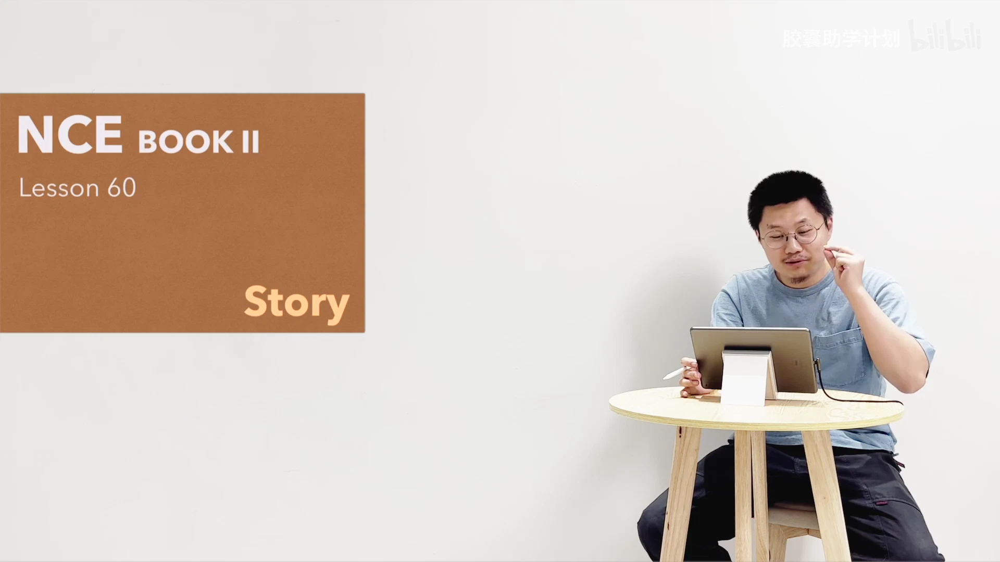

文字识别：NCE / BOOKⅡI / Lesson 60 / Story

### 画面 00:00:09

文字识别：胶囊助学计划bill / •

### 画面 00:00:13

文字识别：胶囊助学计划

### 画面 00:00:15

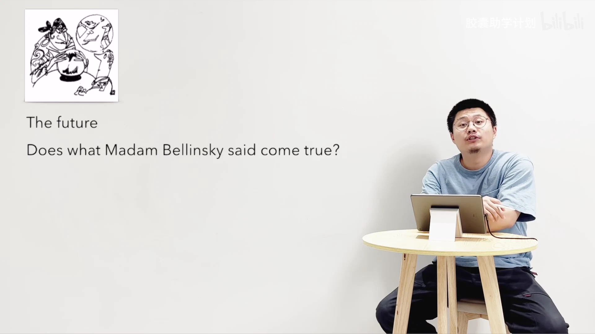

文字识别：The future / Does what Madam Bellinsky said come true?

## 00:00:30–00:01:00

事情变成啊这个变成真的了呢？OK，那我们就看文章就行了啊。这篇文章也挺有意思的，不是很难。At a village fair,讲单词fair的时候我们用到了好几遍，对吧？讲别的单词时候用到好几遍。那一个乡村的集市集市上，I decided to visit a fortune teller called Madame Balansky.好，decide to do something很久之前就学过，决定去做什么事儿。我决定去拜访一个算命的人，

### 画面 00:00:36

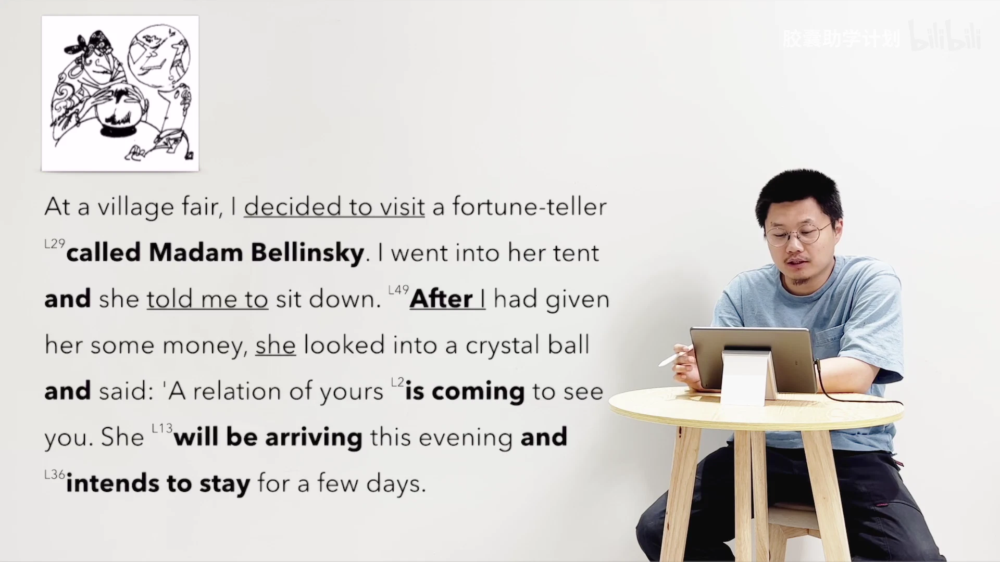

文字识别：At a village fair, I decided to visit a fortune-teller / L29 / called Madam Bellinsky. I went into her tent / and she told me to sit down." / Afterl had given / her some money, she looked into a crystal ball / and said:'A relation of yours ²is coming to see / you. She ['will be arriving this evening and / L36intends to stay for a few days.

## 00:01:00–00:01:30

被叫做二十九课。咱们讲taxi加引号taxi的那一刻故事，不知道各位有没有印象啊？那叫叫做called Pilatus Porter是吧？被叫做Pilatus Porter的一个飞机，对吧？被叫做呃Madame Belinsky啊，这个Belinsky女士是吧？这个ski ski一听就是司机嘛啊，斯拉夫民族可能是是吧？I went into her tent，

### 画面 00:01:06

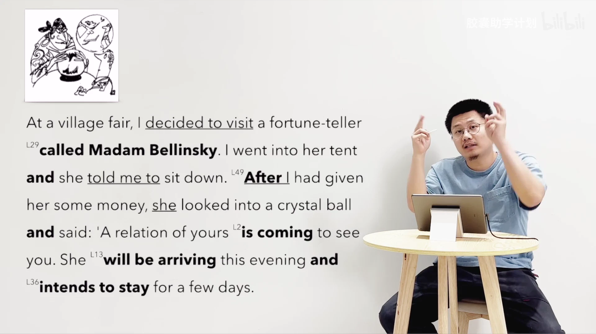

文字识别：At a village fair, I decided to visit a fortune-teller / L29 / called Madam Bellinsky. I went into her tent / and she told me to sit down." / Afterl had given / her some money, she looked into a crystal ball / and said: 'A relation of yours ²is coming to see / you. She [1'3wil be arriving this evening and / L36intends to stay for a few days.

### 画面 00:01:10

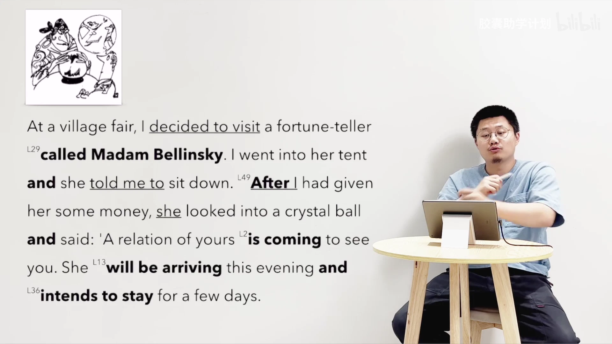

文字识别：At a village fair, I decided to visit a fortune-teller / L29 / called Madam Bellinsky. I went into her tent / and she told me to sit down. / L49 / Afterl had given / her some money, she looked into a crystal ball / and said:'A relation of yours ²is coming to see / you. She l1'3wil be ariving this evening and / L36intends to stay for a few days.

### 画面 00:01:16

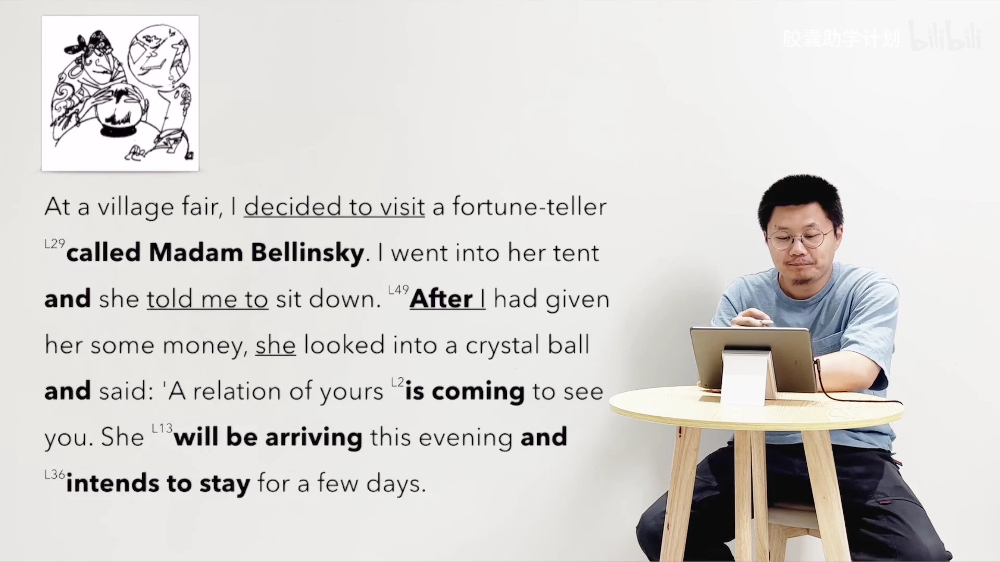

文字识别：At a village fair, I decided to visit a fortune-teller / L29, / called Madam Bellinsky. I went into her tent / and she told me to sit down. / Afterl had given / her some money, she looked into a crystal ball / and said:'A relation of yours ²is coming to see / you. She [`will be arriving this evening and / L36intends to stay for a few days.

## 00:01:30–00:02:00

我进入了她的帐篷，and she told me to sit down.然后她告诉我去坐下来。Told somebody to do something.新一一百零五课都学过。这这句话集中。After I had given her some money, she looked into a crystal ball.先不看后边and了，就看这句话。在我已经给她了一些钱之后，你看这跟十四课是保持一致的。先had蛋，

### 画面 00:01:46

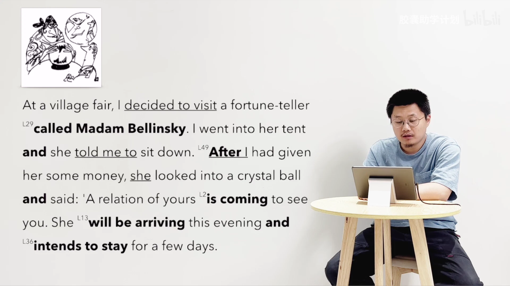

文字识别：At a village fair, I decided to visit a fortune-teller / L29, / called Madam Bellinsky. I went into her tent / and she told me to sit down. / Afterl had given / her some money, she looked into a crystal ball / and said:'A relation of yours ²is coming to see / you. She [`will be arriving this evening and / L36intends to stay for a few days.

### 画面 00:01:58

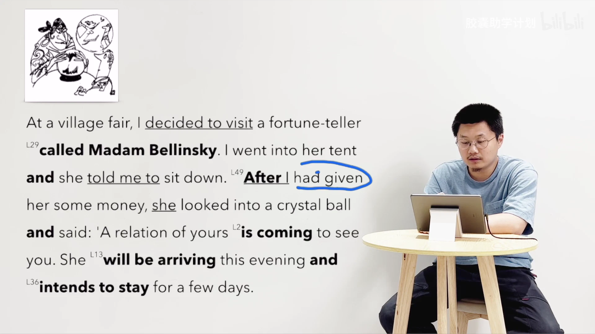

文字识别：At a village fair, I decided to visit a fortune-teller / L29, / called Madam Bellinsky. I went into her tent / and she told me to sit down. / [49 / Afterl had given / her some money, she looked into a crystal ball / and said:'A relation of yours "is coming to see / you. She [1'3wil be ariving this evening and / L36intends to stay for a few days.

## 00:02:00–00:02:30

先给了一些钱，然后他才看了什么东西，对吧？过去的过去，海德蛋，过去完成时。然后呢，他看进了一个水晶球里。那我的问题是，我希望你自己去思考一下，再听我给的答案。我的问题是，四十九课咱们学过分词作状语，我想问的是，

### 画面 00:02:02

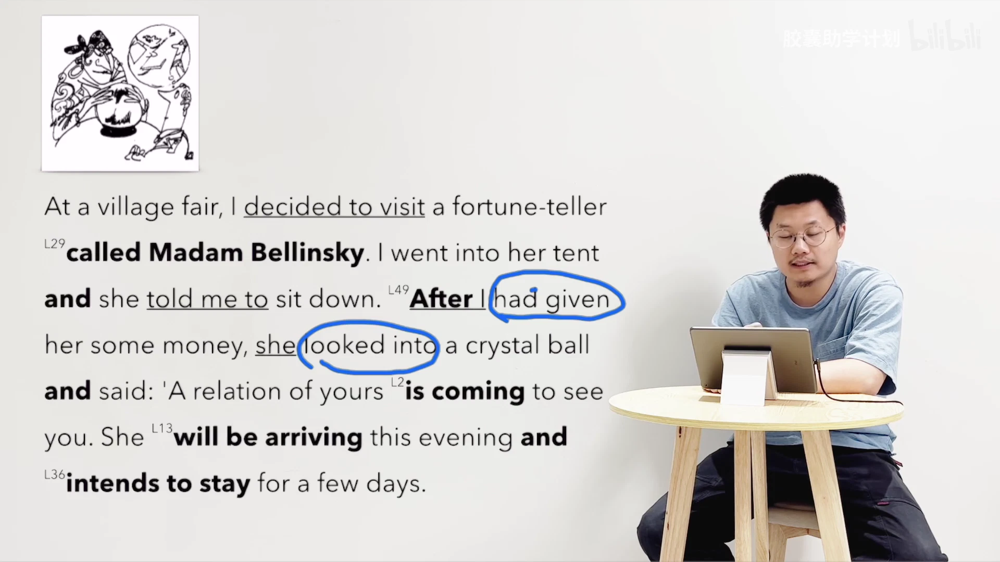

文字识别：At a village fair, I decided to visit a fortune-teller / L29 / called Madam Bellinsky. I went into her tent / and she told me to sit down. / L49 / After lhad given / her some money, she(ooked intga crystal ball / and said: 'A relation of yours "is coming to see / you. She ['will be arriving this evening and / L36intends to stay for a few days.

### 画面 00:02:05

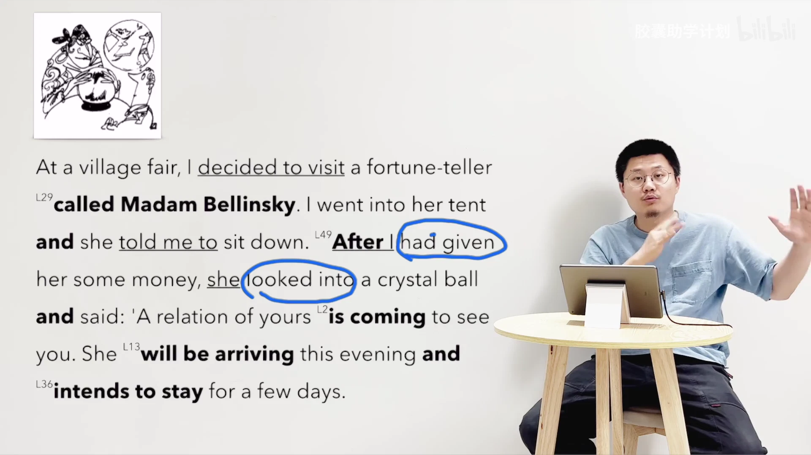

文字识别：At a village fair, I decided to visit a fortune-teller / L29 / called Madam Bellinsky. I went into her tent / and she told me to sit down. / [49 / After lhad given / her some money, shelooked intga crystal ball / and said: 'A relation of yours "is coming to see / you. She ['will be arriving this evening and / L36intends to stay for a few days.

### 画面 00:02:09

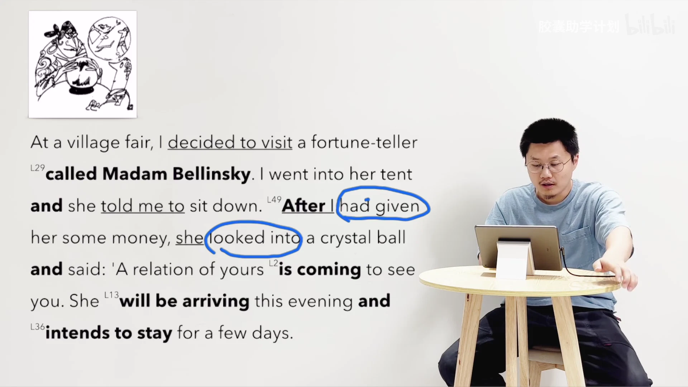

文字识别：At a village fair, I decided to visit a fortune-teller / L29, / called Madam Bellinsky. I went into her tent / and she told me to sit down. / [49 / After lhad given / her some money, shelooked intg a crystal ball / and said: 'A relation of yours 'is coming to see / you. She ['will be arriving this evening and / L36intends to stay for a few days.

### 画面 00:02:11

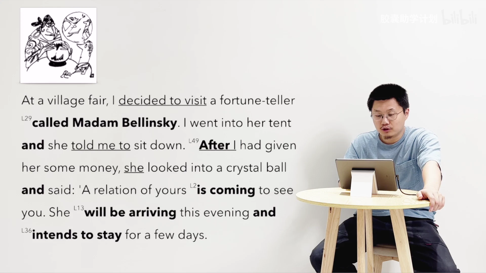

文字识别：At a village fair, I decided to visit a fortune-teller / L29, / called Madam Bellinsky. I went into her tent / and she told me to sit down." / Afterl had given / her some money, she looked into a crystal ball / and said:'A relation of yours ²is coming to see / you. She l`will be arriving this evening and / L36intends to stay for a few days.

## 00:02:30–00:03:00

这里能不能给它变成 Having given her some money, she looked into a crystal ball. 能还是不能？我希望你暂停屏幕，先思考一下，回忆一下四十九课的知识点。好，那我现在就认为你暂停完屏幕了，我要给答案了。能不能呢？不能。为什么呢？因为我们当时说了，分词作状语有一个最

### 画面 00:02:32

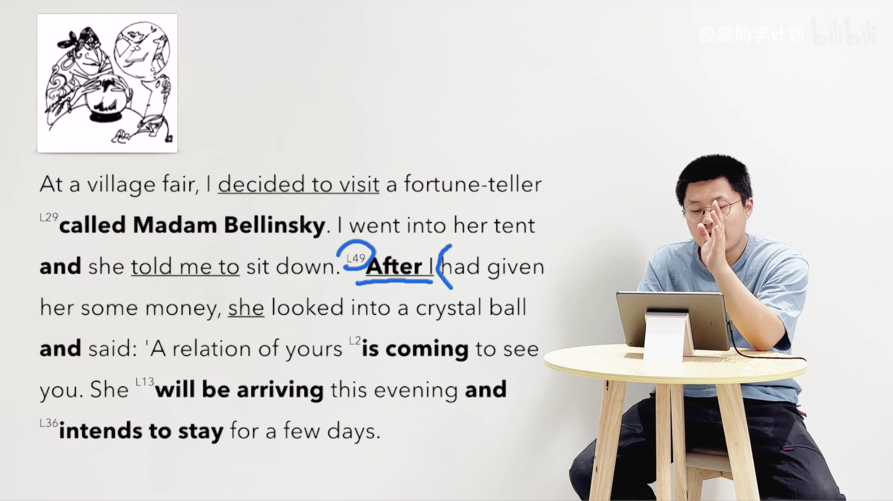

文字识别：At a village fair, I decided to visit a fortune-teller / L29 / called Madam Bellinsky. I Went into her tent / and she told me to sit down. / Afterlhad given / her some money, she looked into a crystal ball / and said: 'A relation of yours ²is coming to see / you. She ['will be arriving this evening and / L36intends to stay for a few days.

### 画面 00:02:53

文字识别：At a village fair, I decided to visit a fortune-teller / L29 / called Madam Bellinsky. I went into her tent / and she told me to sit down. / L49 / Afterl had given / her some money, she looked into a crystal ball / and said:'A relation of yours "is coming to see / you. She ['will be arriving this evening and / L36intends to stay for a few days.

## 00:03:00–00:03:30

少最基本的前提，至少在目前阶段叫做这儿的主语和这儿的主语，主句主语和这个从句主语得保持一致。咱们现在的技能点知识才能满足把它变成 after having given her some money，听见了吧？所以这句话不能变。如果刚才我说的这些对于您来说什么意义都没有，大脑一片空白，赶紧回去翻看。现在在笔记本上记上四十九

### 画面 00:03:05

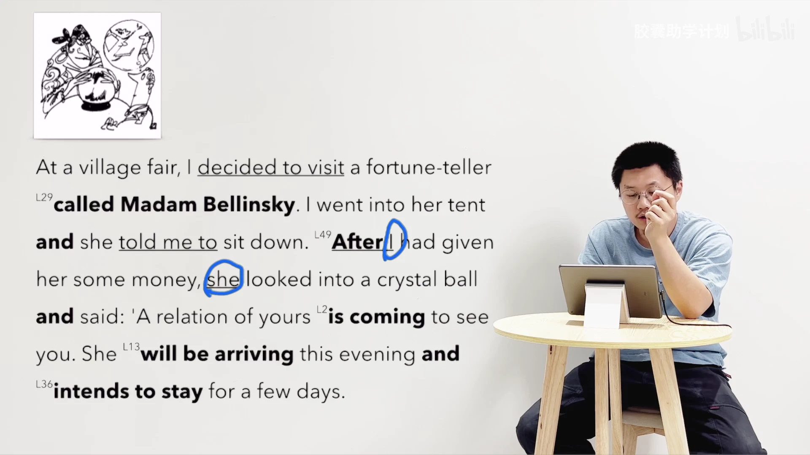

文字识别：At a village fair, I decided to visit a fortune-teller / L29 / called Madam Bellinsky. I went into her tent / After / and she told me to sit down." / L49 / ad given / her some money, / she looked into a crystal ball / and said:'A relation of yours ²is coming to see / you. She [1'3wil be arriving this evening and / L36intends to stay for a few days.

### 画面 00:03:14

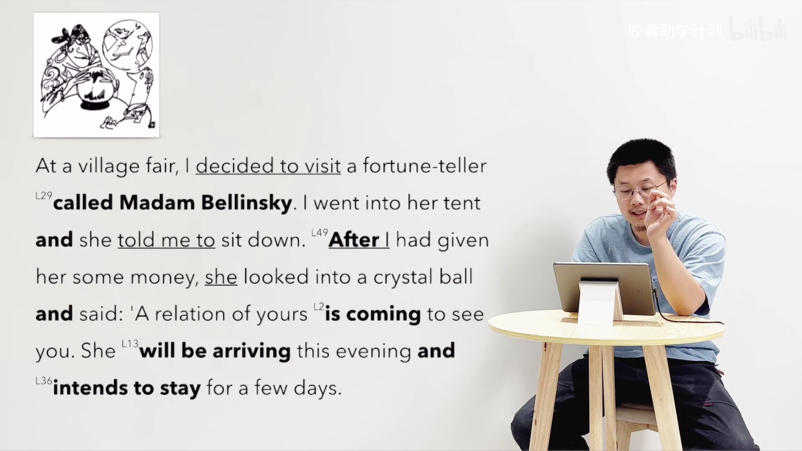

文字识别：At a village fair, I decided to visit a fortune-teller / L29 / called Madam Bellinsky. I went into her tent / and she told me to sit down. / Afterl had given / her some money, she looked into a crystal ball / and said:'A relation of yours ²is coming to see / you. She [1'3wil be arriving this evening and / L36intends to stay for a few days.

### 画面 00:03:22

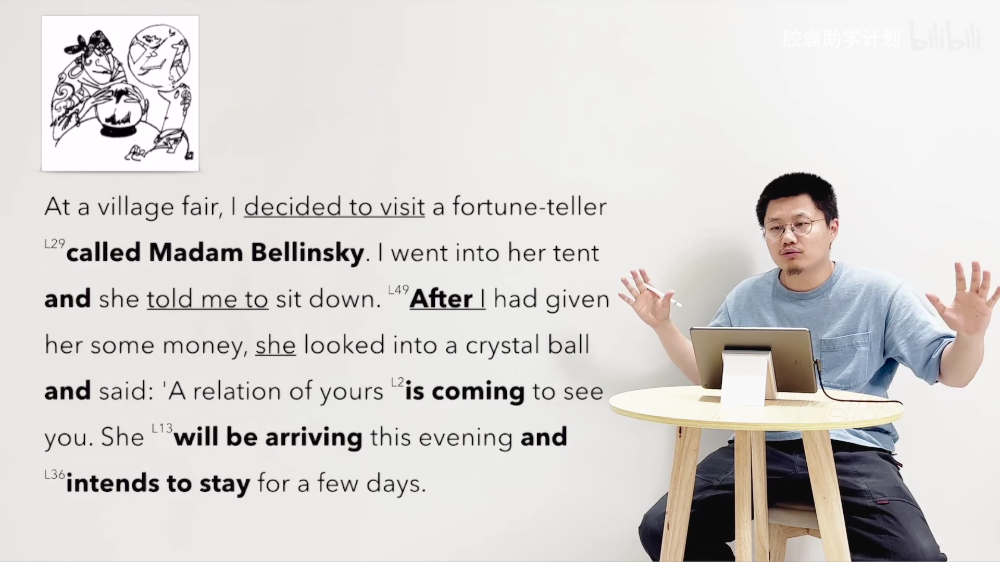

文字识别：At a village fair, I decided to visit a fortune-teller / L29 / called Madam Bellinsky. I went into her tent / and she told me to sit down. / L49 / Afterl had given / her some money, she looked into a crystal ball / and said:'A relation of yours ²is coming to see / you. She l1'3wil be ariving this evening and / L36intends to stay for a few days.

## 00:03:30–00:04:00

课语法，这课听完回去一定要补这个知识点。这个知识点从这课开始一直到整个三册考试实际应用过程当中会不停的出现，好吧？And said，然后说什么？我们看后面，A relation of yours，你的一个亲戚 is coming。第二课 be doing 表将来，要来了。To see，要来看你了。你一个亲戚要来看你，表将来吧。

### 画面 00:03:30

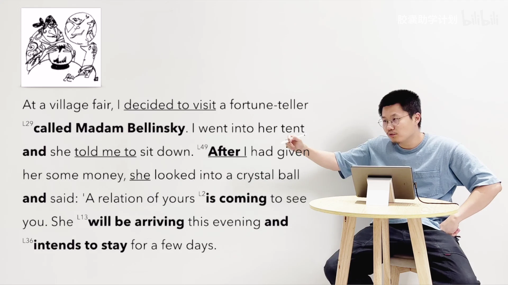

文字识别：At a village fair, I decided to visit a fortune-teller / L29, / called Madam Bellinsky. I went into her tent / and she told me to sit down." / Afterl had given / her some money, she looked into a crystal ball / and said: 'A relation of yours ²is coming to see / you. She l'will be arriving this evening and / L36intends to stay for a few days.

### 画面 00:03:40

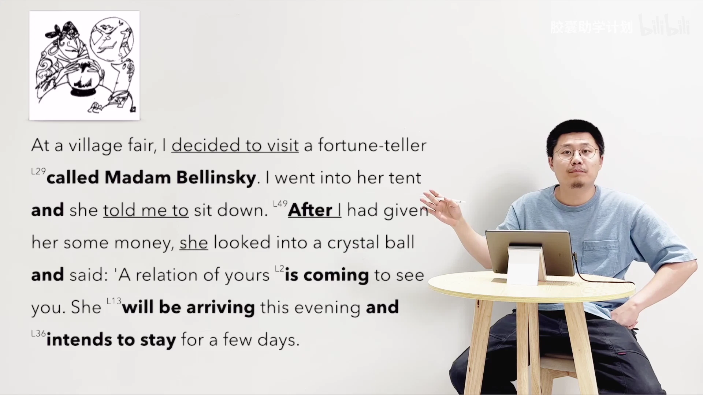

文字识别：At a village fair, I decided to visit a fortune-teller / L29 / called Madam Bellinsky. I went into her tent / and she told me to sit down." / After l had given / her some money, she looked into a crystal ball / and said: 'A relation of yours ²is coming to see / you. She [1'3wil be ariving this evening and / L36: / 'intends to stay for a few days.

### 画面 00:03:43

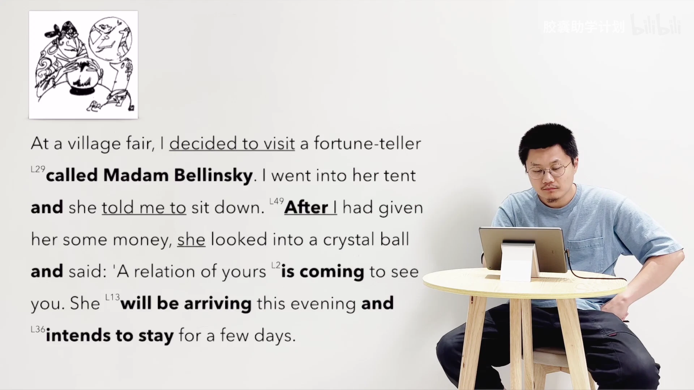

文字识别：At a village fair, I decided to visit a fortune-teller / L29, / called Madam Bellinsky. I went into her tent / and she told me to sit down." / Afterl had given / her some money, she looked into a crystal ball / and said: 'A relation of yours ²is coming to see / you. She [1'3wil be arriving this evening and / L36intends to stay for a few days.

### 画面 00:03:46

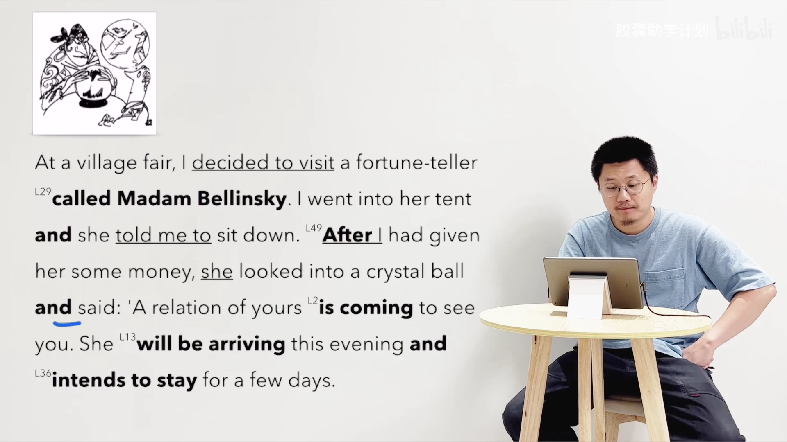

文字识别：At a village fair, I decided to visit a fortune-teller / L29 / called Madam Bellinsky. I went into her tent / and she told me to sit down." / Afterl had given / her some money, she looked into a crystal ball / and said:'A relation of yours ²is coming to see / you. She ['will be arriving this evening and / L36intends to stay for a few days.

## 00:04:00–00:04:30

She will be arriving this evening. 十三课将来进行时，Will be doing. 她将今天晚上到达。然后三十六课咱们也学过，对吧？三十六课是呃呃，三十六课咱们学的是 intend to do something，对吧？哎，他这个呃想要怎么怎么样啊？其实类似于 plan to do something，他计划对吧？打算啊，Intend to stay for a few days. 他打算说停留一

### 画面 00:04:16

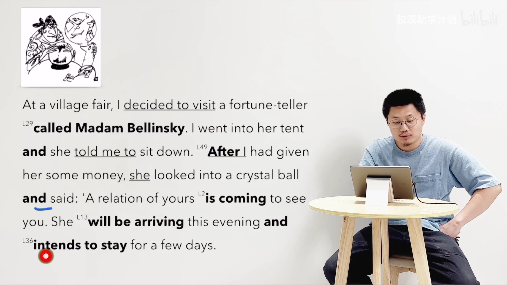

文字识别：At a village fair, I decided to visit a fortune-teller / L29, / called Madam Bellinsky. I went into her tent / and she told me to sit down." / Afterl had given / her some money, she looked into a crystal ball / and said:'A relation of yours ²is coming to see / you. She ['will be arriving this evening and / L36intends to stay for a few days.

## 00:04:30–00:05:00

些几几呃停留一些日子。The moment you leave this tent, you will get a big surprise. As soon as你一离开这个地方，你就将大吃一惊。三二十三课咱学过，咱二十三课只不过没有这个big。我印象当中，咱们好像学的是get a surprise，对吧？那get a big surprise就大吃一惊嘛，你会大吃一惊的。那你注意啊，你看the moment连

### 画面 00:04:33

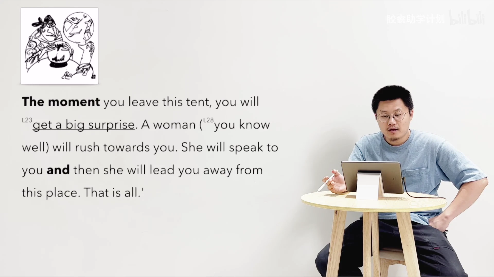

文字识别：The moment you leave this tent, you will / L23 / get a big surprise. A woman (L²³you know / well) will rush towards you. She will speak to / you and then she will lead you away from / this place. That is all.'

### 画面 00:04:54

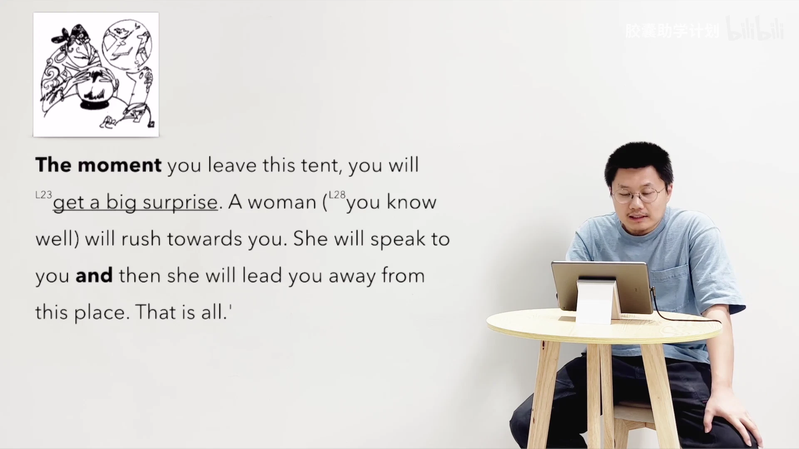

文字识别：The moment you leave this tent, you will / L23 / get a big surprise. A woman (L²³you know / well) will rush towards you. She will speak to / you and then she will lead you away from / this place. That is all.'

## 00:05:00–00:05:30

词主将从现，对吧？怎么判断从？看连词主将从现。继续，A woman you know well will rush towards you. You know well.别看就三个小单词，隐含了一个非常重要的语法点，就是二十八课咱学的定从。所以，A woman you know well要翻译成叫做一个你很熟

### 画面 00:05:03

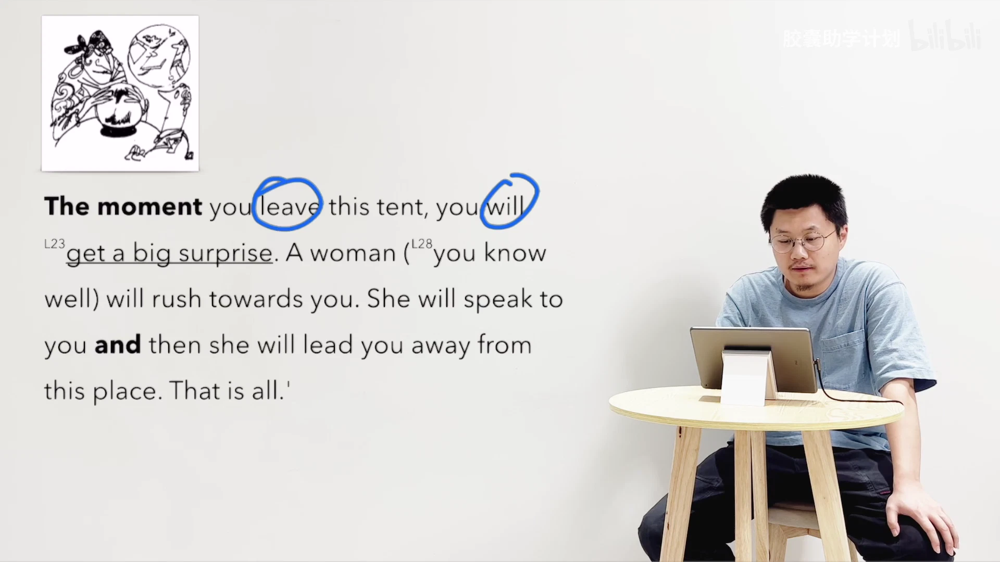

文字识别：The moment youleave / this tent, you / 1Will / L23 / get a big surprise.A woman (2³you know / well) will rush towards you. She will speak to / you and then she will lead you away from / this place. That is all.'

### 画面 00:05:05

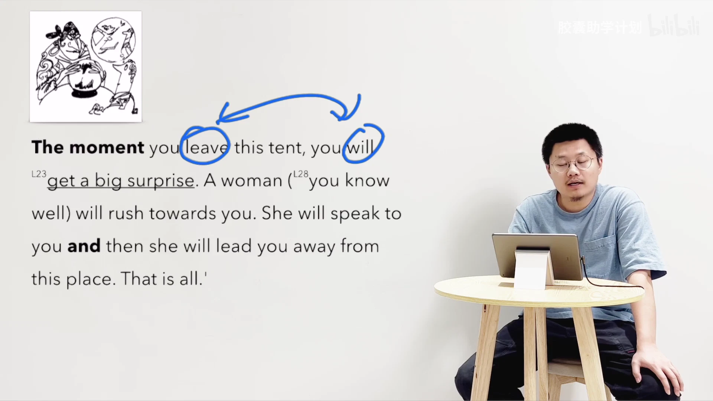

文字识别：The moment youleave / this tent, you / 1Will / L23 / get a big surprise.A woman (L²you know / well) will rush towards you. She will speak to / you and then she will lead you away from / this place. That is all.'

### 画面 00:05:07

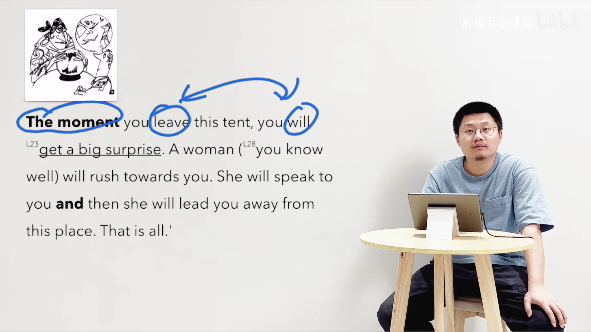

文字识别：The moment youleave / this tent, you / Will / L23, / get a big surprise.A woman (L²you know / well) will rush towards you. She will speak to / you and then she will lead you away from / this place. That is all.'

### 画面 00:05:19

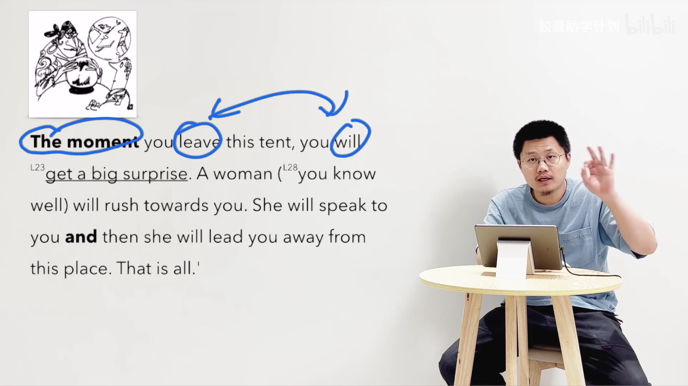

文字识别：The moment youleavet / this tent, you / 1Will / L23, / get a big surprise. A woman (L2³you know / well) will rush towards you. She will speak to / you and then she will lead you away from / this place. That is all.'

## 00:05:30–00:06:00

悉的女人，Will rush towards you，会冲着你冲过来。She will speak to you，她会和你说话。Will这个很简单，十二课咱学的，对吧？新一九十一课学的。And then，然后呢，She will lead you away from this place，她会引领着你远离这个地方，离开这个地方。That is all，那就是全部了。That's all，就是这就是全部了，对吧？所以

### 画面 00:05:49

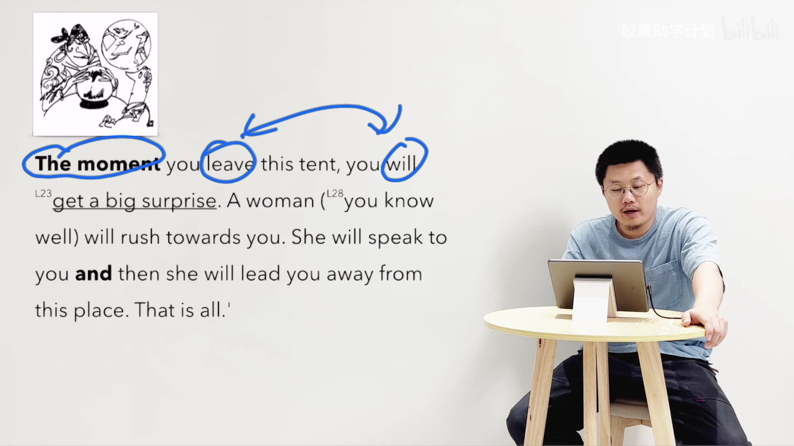

文字识别：The moment youleave / this tent, you / 1Will / L23 / get a big surprise. A woman (L2³you know / well) will rush towards you. She will speak to / you and then she will lead you away from / this place. That is all.'

## 00:06:00–00:06:30

这是 Madame Belinsky 说的预言，对吧？哎，说你有一个这个亲戚要来，要在这儿待几天，对不对？然后你一离开这个帐篷呢，就会一个很熟悉的女人冲你跑过来，她跟你说几句，然后她会带着你离开这里。我们看一下预言有没有成真。 As soon as I went outside, I forgot all about Madame Belinsky because my

### 画面 00:06:00

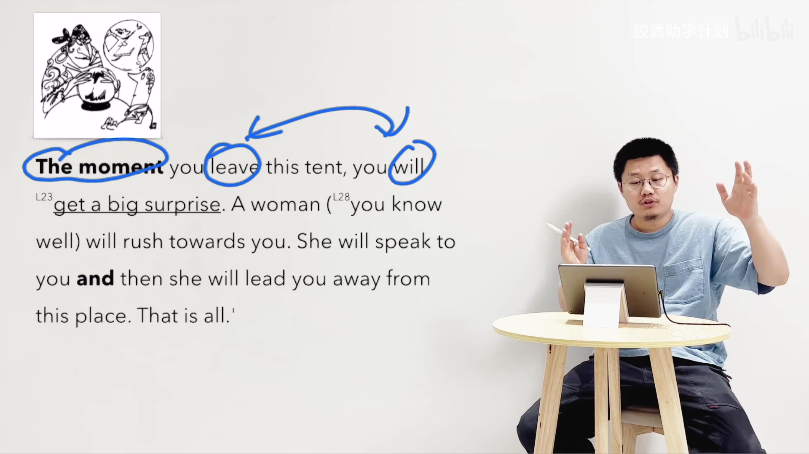

文字识别：The momenl youleave / this tent, you / 1Will / L23 / get a big surprise. A woman (L2³you know / well) will rush towards you. She will speak to / you and then she will lead you away from / this place. That is all.'

### 画面 00:06:03

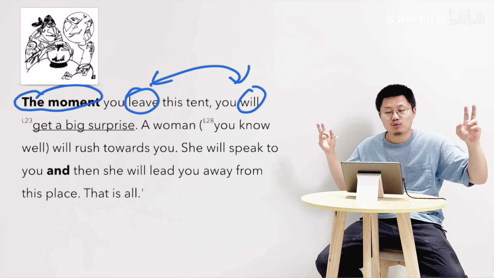

文字识别：The momenl youleave / this tent, you / 1Will / L23, / get a big surprise. A woman (L2³you know / well) will rush towards you. She will speak to / you and then she will lead you away from / this place. That is all.'

### 画面 00:06:07

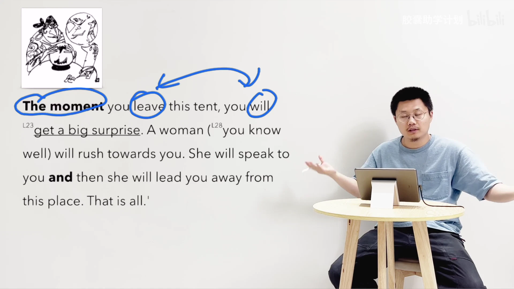

文字识别：The moment youleave / this tent, you / 1Will / L23, / get a big surprise.A woman (L²⁸you know / well) will rush towards you. She will speak to / you and then she will lead you away from / this place. That is all.'

### 画面 00:06:19

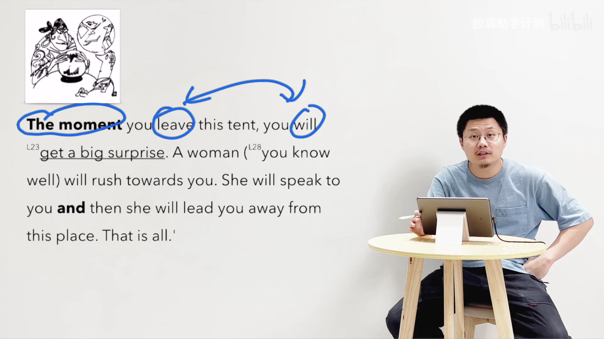

文字识别：The moment youleave / this tent, you / 1Will / L23, / get a big surprise. A woman (L2³you know / well) will rush towards you. She will speak to / you and then she will lead you away from / this place. That is all.'

### 画面 00:06:21

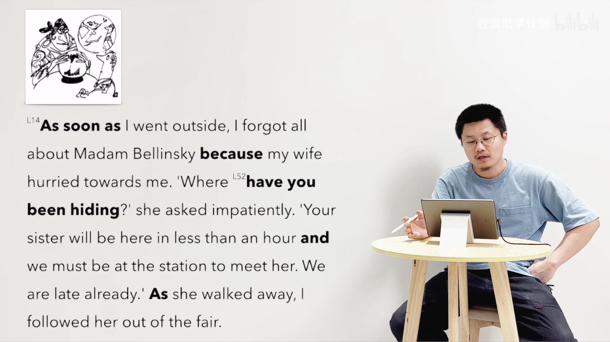

文字识别：L14 / 4As soon as | went outside, I forgot all / about Madam Bellinsky because my wife /  .52have you / hurried towards me.'Where / been hiding?'she asked impatiently.'Your / sister will be here in less than an hour and / we must be at the station to meet her. We / are late already.' As she walked away, I / followed her out of the fair.

## 00:06:30–00:07:00

wife hurried towards me.刚才说的是 rush towards，现在变成了 hurried towards。这也是我们在学新概念过程当中，逐渐要变得更加细节的一个点，就是同义词的转换，对吧？哎，你可以理解为 hurried 和这里的 rush，包括 run 都是类似的。你一篇文章不能说重要就永远说重要，你还得来点别的词，对吧？你不能说 run 就永远是 run，你还有 rush，还有 hurried。

### 画面 00:06:38

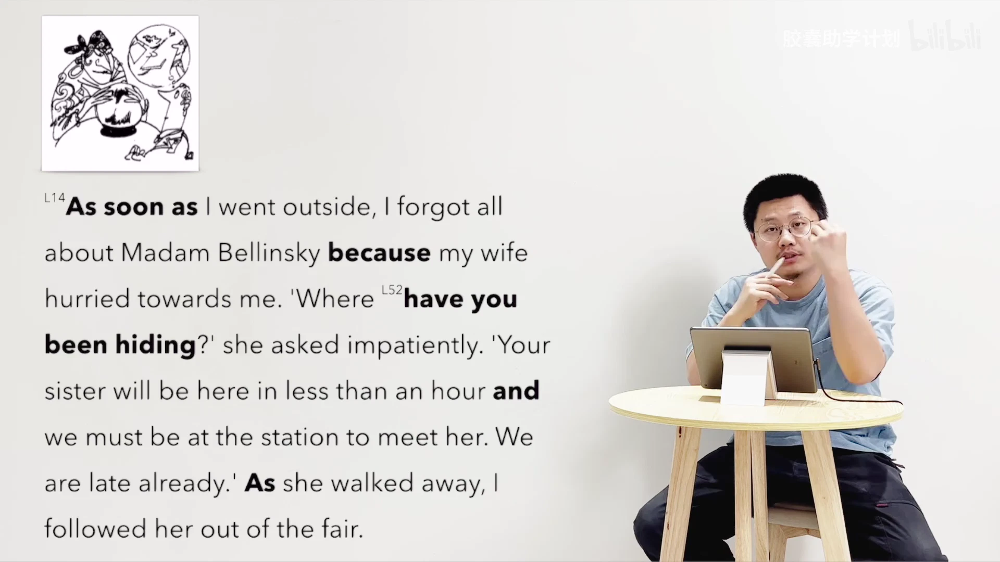

文字识别：L14 / 4As soon as I went outside, I forgot all / about Madam Bellinsky because my wife / hurried towards me.' Where [5have you / been hiding?'she asked impatiently.'Your / sister will be here in less than an hour and / we must be at the station to meet her. We / are late already.' As she walked away, I / followed her out of the fair.

### 画面 00:06:40

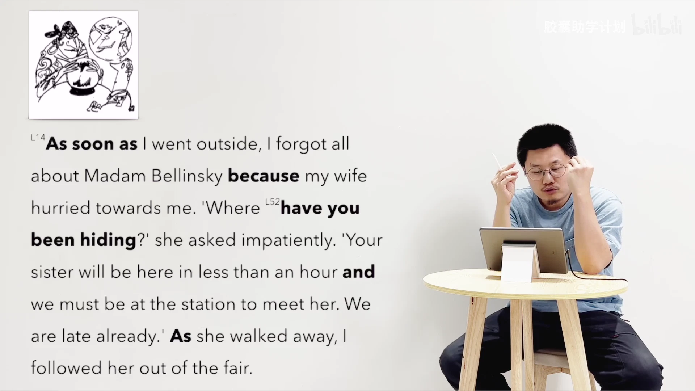

文字识别：L14 / 4As soon as | went outside, I forgot all / about Madam Bellinsky because my wife /  L52have you / hurried towards me.'Where ' / been hiding?'she asked impatiently.'Your / sister will be here in less than an hour and / we must be at the station to meet her. We / are late already.' As she walked away, I / followed her out of the fair.

### 画面 00:06:44

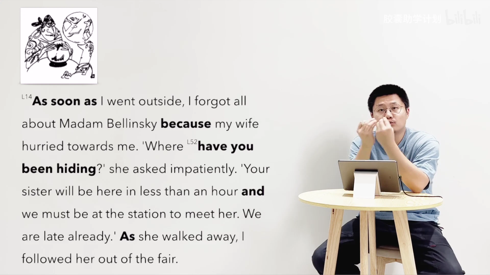

文字识别：L14 / 4As soon as | went outside, I forgot all / about Madam Bellinsky because my wife / e L52have you / hurried towards me.'Where ' / been hiding?'she asked impatiently.'Your / sister will be here in less than an hour and / we must be at the station to meet her. We / are late already.' As she walked away, I / followed her out of the fair.

## 00:07:00–00:07:30

So here, say I, how

### 画面 00:07:14

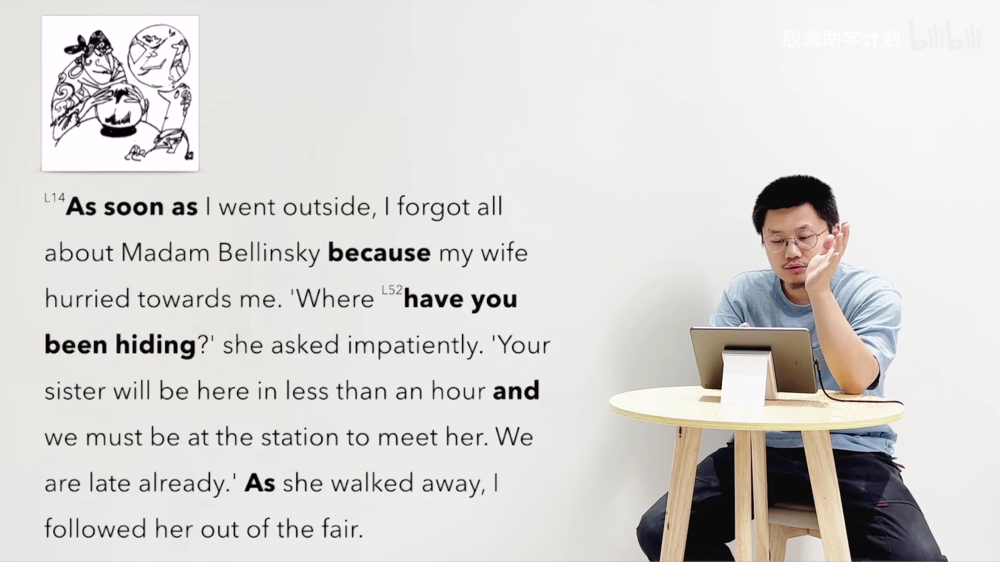

文字识别：L14 / 4As soon as | went outside, I forgot all / about Madam Bellinsky because my wife / e L52have you / hurried towards me.'Where ' / been hiding?'she asked impatiently.'Your / sister will be here in less than an hour and / we must be at the station to meet her. We / are late already.' As she walked away, I / followed her out of the fair.

## 00:07:30–00:08:00

道：“你刚才一直在哪儿藏着呢？”哎，你想一下，这肯定是带着点小的情绪嘛。那就正常，就 where where were you？就完了呗，对吧？那你就还还说的是你刚才一直在哪儿藏着呢？我有必要藏着吗？没有，所以带着情绪，所以 impatiently。这个 hiding 跟 impatiently 就我觉得特别好能连到一起。你要真让我去写，我可能都写不出来。那我们才要向亚历山大去学嘛。你刚才一直在哪儿藏着呢？

### 画面 00:07:34

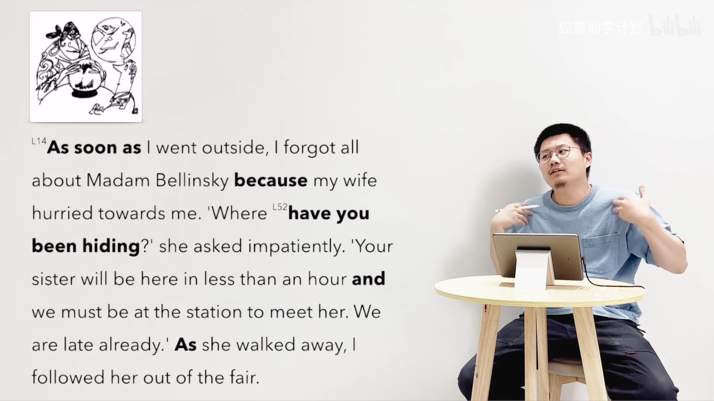

文字识别：L14 / 4As soon as I went outside, I forgot all / about Madam Bellinsky because my wife /  L52have you / hurried towards me.'Where ' / been hiding?'she asked impatiently.'Your / sister will be here in less than an hour and / we must be at the station to meet her. We / are late already.' As she walked away, I / followed her out of the fair.

### 画面 00:07:38

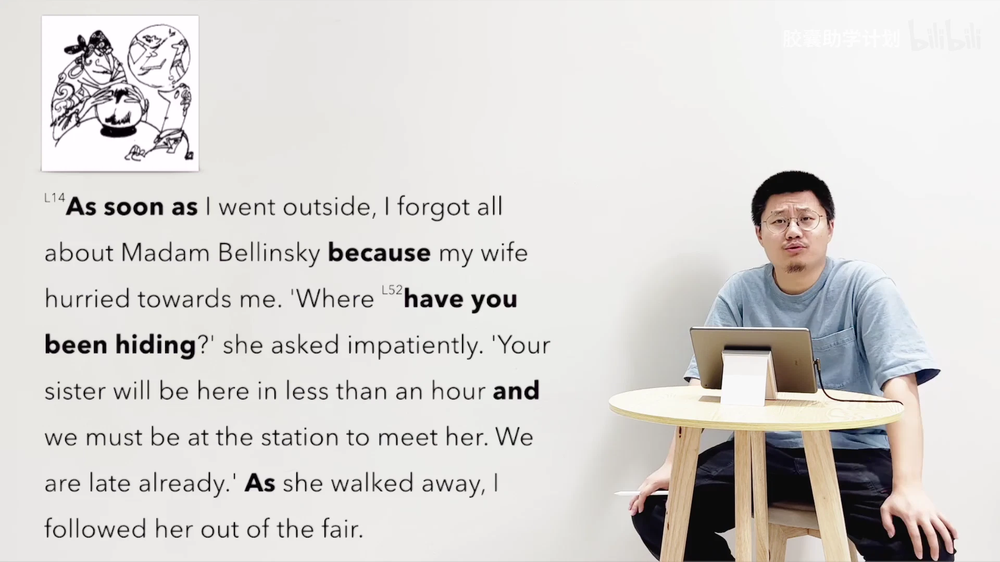

文字识别：L14As soon as I went outside, I forgot all / about Madam Bellinsky because my wife /  .52have you / hurried towards me.'Where ' / been hiding?'she asked impatiently.'Your / sister will be here in less than an hour and / we must be at the station to meet her. We / are late already.' As she walked away, I / followed her out of the fair.

### 画面 00:07:42

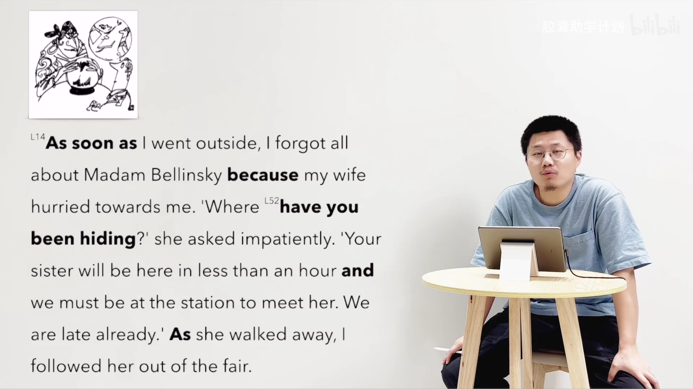

文字识别：L14As soon as I went outside, I forgot all / about Madam Bellinsky because my wife / hurried towards me.' Where [5²have you / been hiding?'she asked impatiently.'Your / sister will be here in less than an hour and / we must be at the station to meet her. We / are late already.' As she walked away, I / followed her out of the fair.

### 画面 00:07:44

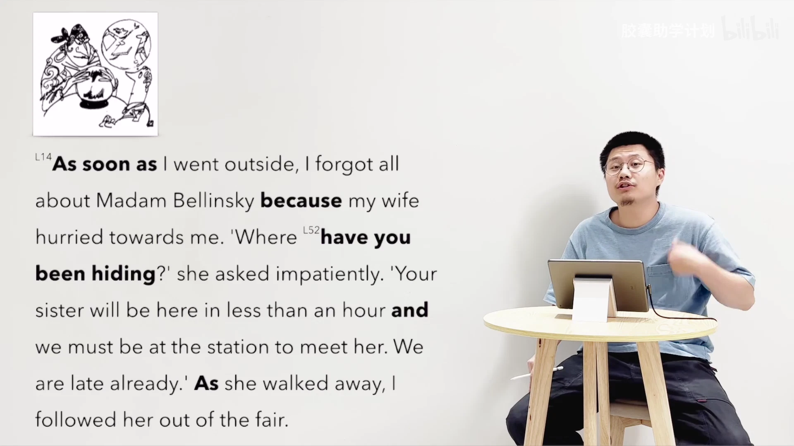

文字识别：L14As soon as I went outside, I forgot all / about Madam Bellinsky because my wife / hurried towards me.' Where [5²have you / been hiding?'she asked impatiently.'Your / sister will be here in less than an hour and / we must be at the station to meet her. We / are late already.' As she walked away, I / followed her out of the fair.

## 00:08:00–00:08:30

不耐烦的问道。正常问就，哎，你刚才在哪儿？我怎么没找着你啊？对吧？那这个 Have you been doing？ Have been doing 五十二课，现在完成进行时。我们在这儿就不多提了，只提一句，叫一直，对吧？它是第二个用法。Your sister will be here。说你妹妹会来到这里。In less than an hour。哎，短于一个小时，对吧？An hour 叫一个小时，less than in

### 画面 00:08:14

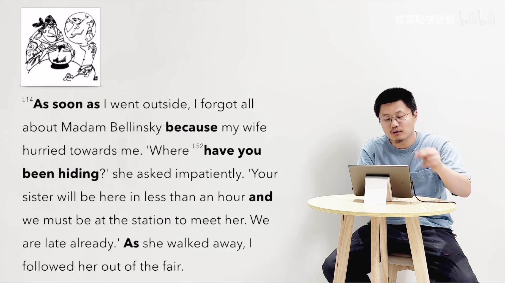

文字识别：L14As soon as I went outside, I forgot all / about Madam Bellinsky because my wife /  L52have you / hurried towards me.'Where ' / been hiding?'she asked impatiently.'Your / sister will be here in less than an hour and / we must be at the station to meet her. We / are late already.' As she walked away, I / followed her out of the fair.

## 00:08:30–00:09:00

an hour 就在一个小时，那 in less than an hour 叫做少于一个小时，它就会到了。And 然后呢，We must be at the station to meet her. 然后我们必须要在车站去见她。We are late already. 我们已经晚了。As she walked away, as 出现了最常见的，哎，我们原来学过 because when，但是没有看过 as a 逗号

### 画面 00:08:44

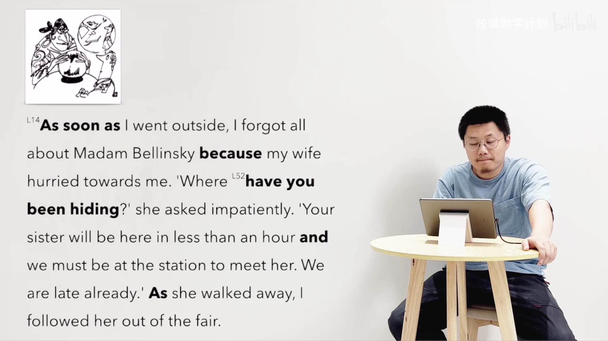

文字识别：L14 / 4As soon as | went outside, I forgot all / about Madam Bellinsky because my wife /  L52have you / hurried towards me.'Where ' / been hiding?'she asked impatiently.'Your / sister will be here in less than an hour and / we must be at the station to meet her. We / are late already.' As she walked away, I / followed her out of the fair.

## 00:09:00–00:09:30

b a 和 b 这两句话，我又没办法判断。其实，所以大多数情况下它不重要。我们往后看，She walked away，她走，她走远了。I followed her out of the fair，我跟着她走出了这个集市。啊，当她走远的时候，我跟着她走出了这个集市。问对吧？OK，就结束了。那你想一下，是不是基本上这一段儿就是上一段儿的另一个说法？上

### 画面 00:09:04

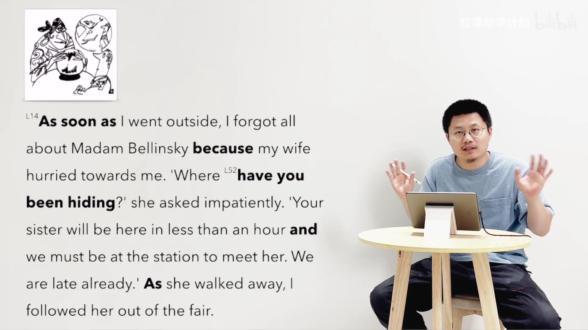

文字识别：L14As soon as I went outside, I forgot all / about Madam Bellinsky because my wife /  L52have you / hurried towards me.'Where ' / been hiding?'she asked impatiently.'Your / sister will be here in less than an hour and / we must be at the station to meet her. We / are late already.' As she walked away, I / followed her out of the fair.

### 画面 00:09:07

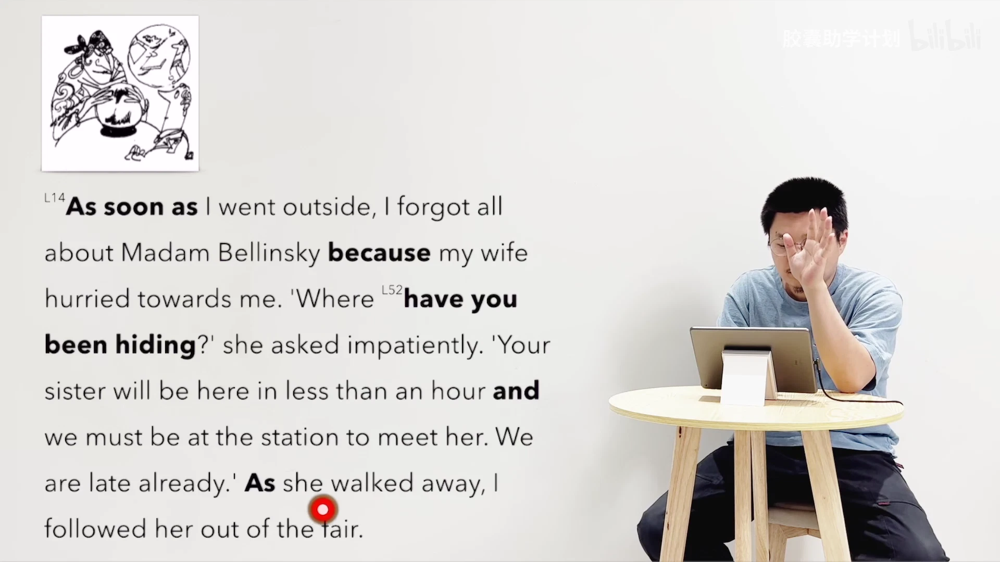

文字识别：L14 / 4As soon as | went outside, I forgot all / about Madam Bellinsky because my wife /  L52have you / hurried towards me.'Where ' / been hiding?'she asked impatiently.'Your / sister will be here in less than an hour and / we must be at the station to meet her. We / are late already.' As she walked away, I / followed her out of the tair.

### 画面 00:09:26

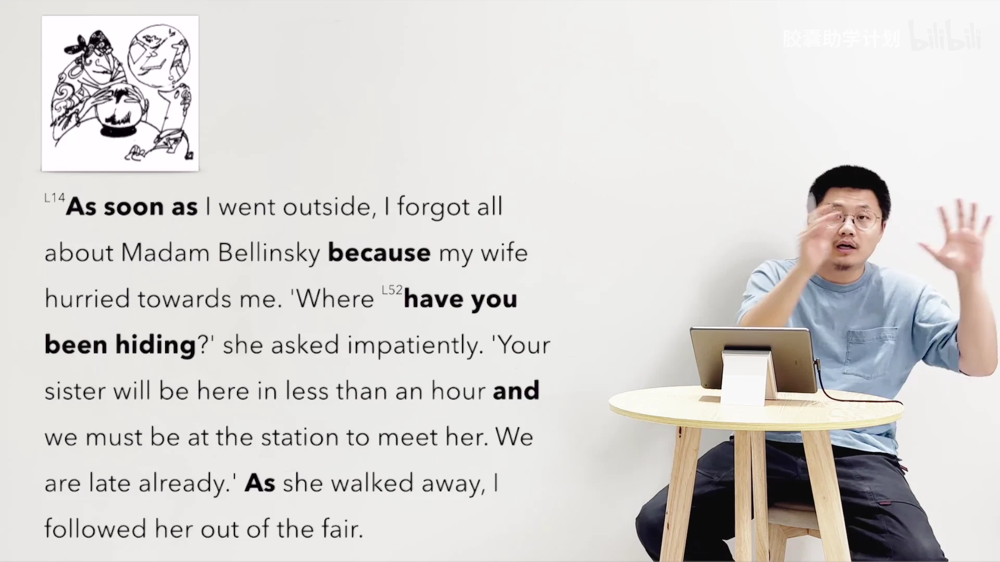

文字识别：L14 / 4As soon as | went outside, I forgot all / about Madam Bellinsky because my wife /  L52have you / hurried towards me.'Where ' / been hiding?'she asked impatiently.'Your / sister will be here in less than an hour and / we must be at the station to meet her. We / are late already.' As she walked away, I / followed her out of the fair.

## 00:09:30–00:10:00

一段儿是在引号里，是做的预测的原话，所以用的全是一般将来时。这一句话呢，是当时事后发生的具体的事情，大多数都是跟过去相关的时态，对吧？OK，本课呢，几乎所有的expression都是我们之前学过的，那各位就可以放松一下，对吧？复习一下这些就可以了。好，查漏补缺啊，哪个语法我说了之前学过，您忘了哪个习惯用

### 画面 00:09:31

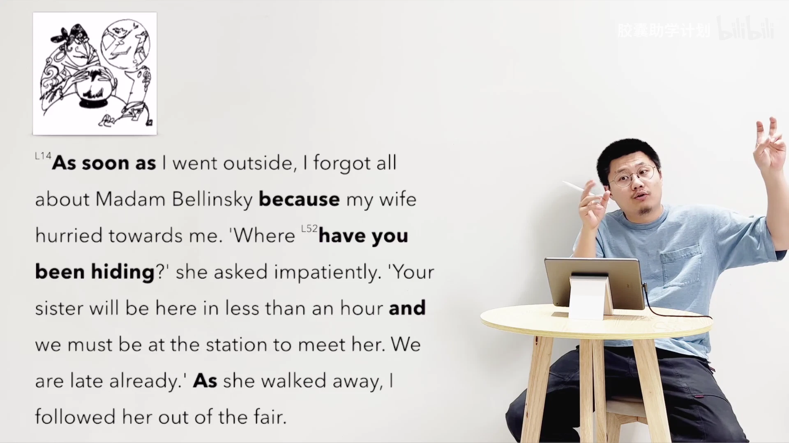

文字识别：L14As soon as I went outside, I forgot all / about Madam Bellinsky because my wife /  L52have you / hurried towards me.'Where " / been hiding?'she asked impatiently.'Your / sister will be here in less than an hour and / we must be at the station to meet her. We / are late already.' As she walked away, I / followed her out of the fair.

### 画面 00:09:36

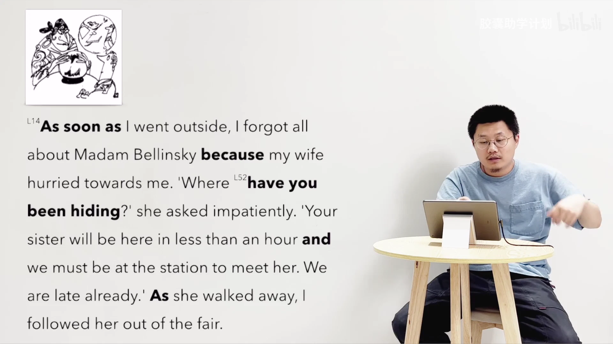

文字识别：L14 / 4As soon as I went outside, I forgot all / about Madam Bellinsky because my wife / e L52have you / hurried towards me.'Where ' / been hiding?'she asked impatiently.'Your / sister will be here in less than an hour and / we must be at the station to meet her. We / are late already.' As she walked away, I / followed her out of the fair.

### 画面 00:09:44

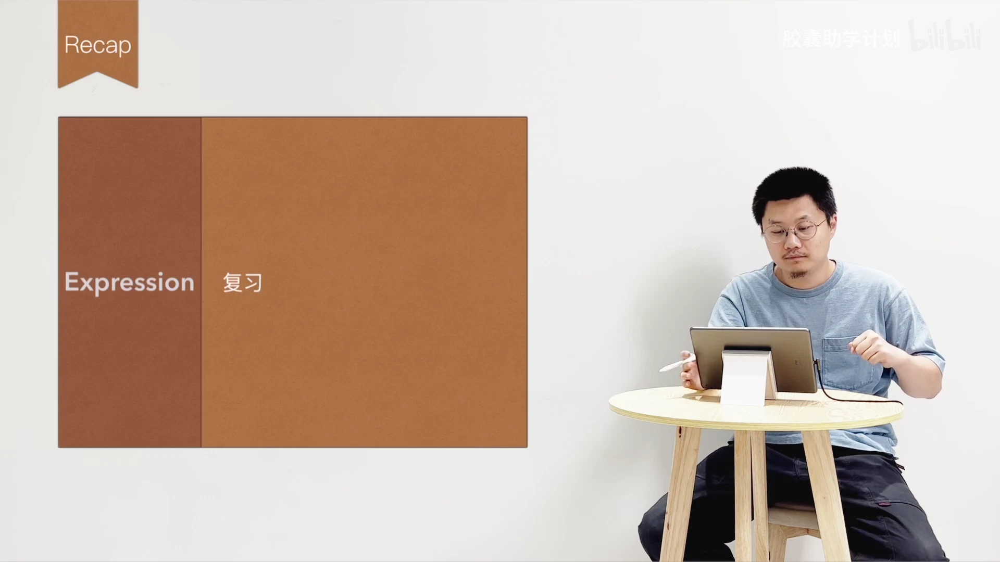

文字识别：Recap / Expression / 复习

### 画面 00:09:46

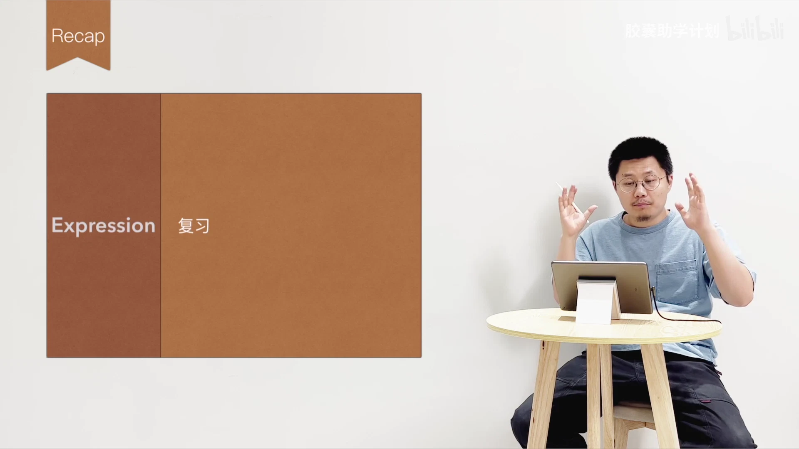

文字识别：Recap / Expression / 复习

### 画面 00:09:50

文字识别：Recap / Expression / 复习

### 画面 00:09:53

文字识别：Recap / Expression / 复习

### 画面 00:09:55

文字识别：Recap / Expression / 复习

## 00:10:00–00:10:30

我说你想不起来了，你翻到那课看看自己当年习惯用法造句的笔记，对吧？再多造几个，对吧？再多读几遍。当然了，你愿意的话，你也可以把我们今天对没给大家总结，但是呢标出来了，下划线标出来了，告诉你多少课，你可以再去造一造句子啊。你会的你就不用造了，你不会的那些，你就或者想不起来的，你就再造五个，对不对？巩固一下啊。文章呢还是老习惯，呃，熟读成诵，然后看置顶留言，

### 画面 00:10:03

文字识别：Recap / Expression / 复习

### 画面 00:10:05

文字识别：Recap / Expression / 复习

### 画面 00:10:08

### 画面 00:10:10

文字识别：1. / 习惯用法造句/对话 / 【习惯用法造句指南】 / 每个5句

### 画面 00:10:15

文字识别：1. / 习惯用法造句/对话 / 【习惯用法造句指南】 / 每个5句

### 画面 00:10:18

文字识别：1.习惯用法造句/对话 / 【习惯用法造句指南】 / 每个5句

### 画面 00:10:20

文字识别：1. / 习惯用法造句/对话 / 【习惯用法造句指南】 / 每个5句

### 画面 00:10:24

文字识别：习惯用法造句/对话 / 1. / 【习惯用法造句指南】 / 每个5句 / 文章跟读至熟读成诵 / 内化单词+语法+习惯用法 / 听力+口语+写作练习

### 画面 00:10:26

文字识别：习惯用法造句/对话 / 【习惯用法造句指南】 / 每个5句 / 文章跟读至熟读成诵 / 内化单词+语法+习惯用法 / 听力+口语+写作练习

### 画面 00:10:28

文字识别：习惯用法造句/对话 / 【习惯用法造句指南】 / 每个5句 / 文章跟读至熟读成诵 / 内化单词+语法+习惯用法 / 听力+口语+写作练习 / 3. / 重复间隔（置顶留言）

## 00:10:30–00:10:59

找重复间隔的学习材料。那以上呢就是本期视频的全部内容了。如果各位喜欢我们的课程呢，欢迎各位呃关注、订阅、一键三连，分享给那些需要学习英语的朋友们，来帮助我们快速成长。See you next time.

### 画面 00:10:30

文字识别：1. / 习惯用法造句/对话 / 【习惯用法造句指南】 / 每个5句 / 文章跟读至熟读成诵 / 内化单词+语法+习惯用法 / 听力+口语+写作练习 / 重复间隔（置顶留言）

### 画面 00:10:32

### 画面 00:10:42

### 画面 00:10:44

### 画面 00:10:46

### 画面 00:10:48

文字识别：CAPSULEACADEMY / 胶囊助学计划 / 小红书 / Lecturer / □ / Leo / OE

### 画面 00:10:51

文字识别：CAPSULEACADEMY / 胶囊助学计划 / 『 / 小红书 / Edi-

### 画面 00:10:54

文字识别：CAPSULEACADEMY / 胶囊助学计划 / 小红书 / Creator / Leo & Berlin / OE

### 画面 00:10:56

文字识别：bilibili / 胶囊助学计划 / CAPSULEACADEMY / 胶囊助学计划 / 小红书 / OE

### 画面 00:10:58

文字识别：bilibili / 胶囊助学计划

