# 060 练习

快速机器解析：语音为单模型转写，未进行独立交叉校对或人工复核；画面每秒采样并按变化选帧，短时文字和标记可能遗漏。截图时间约有 1 秒误差。图片有损压缩；遇到疑点请按时间查看 Google Drive 原视频。

## 00:00:00–00:00:30

Hello everyone, welcome to Capsule Academy. This is Leo. Today we're going to learn New Concept English Book Two Lesson Sixty Practices. 那老习惯，各位注意，进行如下练习，唯一的前提还是要再次提醒各位，文章一定要跟读至熟读成诵，否则请勿开始。 Hope you can enjoy. 那我们先看第一题，Comprehension，听懂一般疑问句、特殊疑问句的能力。我问，您答，

### 画面 00:00:00

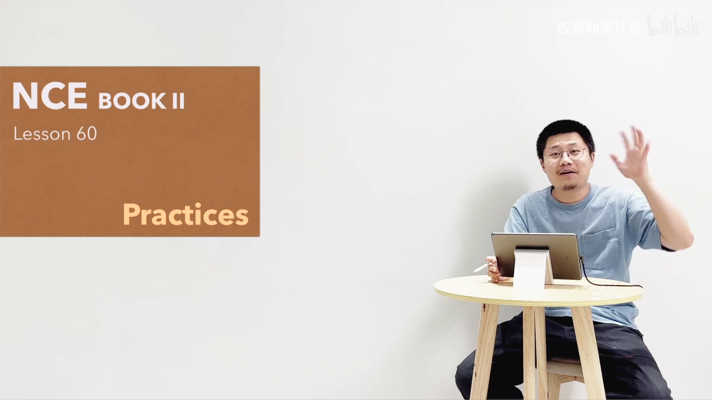

文字识别：NCE / BOOK"I / Lesson 60 / Practices

### 画面 00:00:02

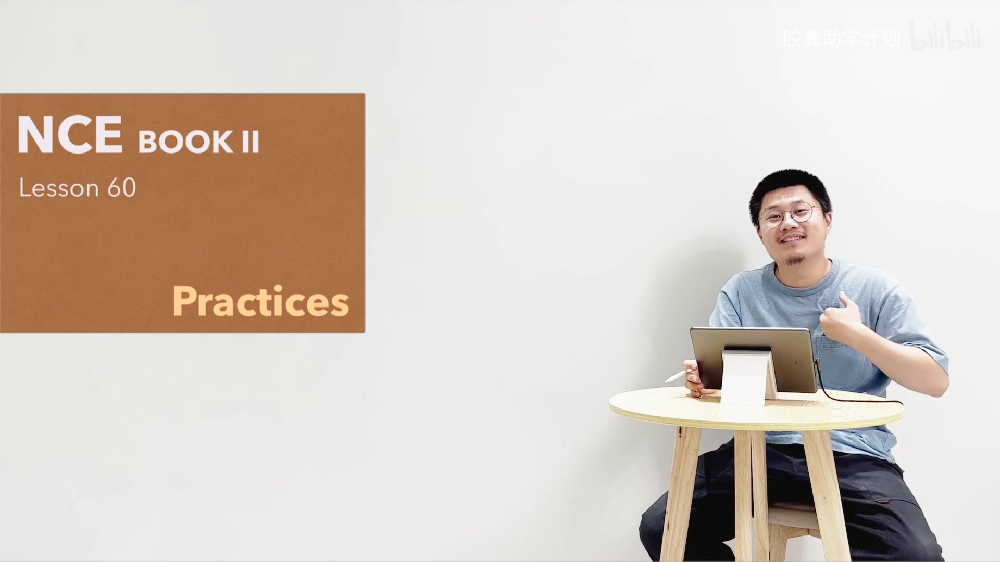

文字识别：NCE / BOOKⅡI / Lesson 60 / Practices

### 画面 00:00:08

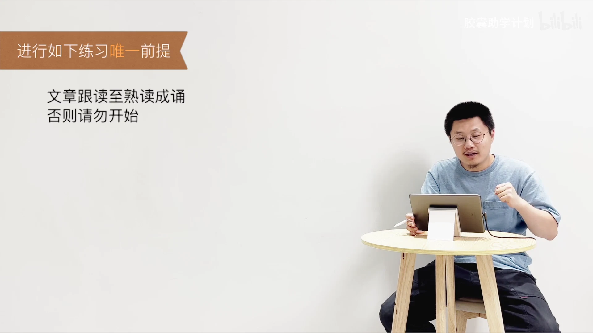

文字识别：进行如下练习唯一前提 / 文章跟读至熟读成诵 / 否则请勿开始

### 画面 00:00:17

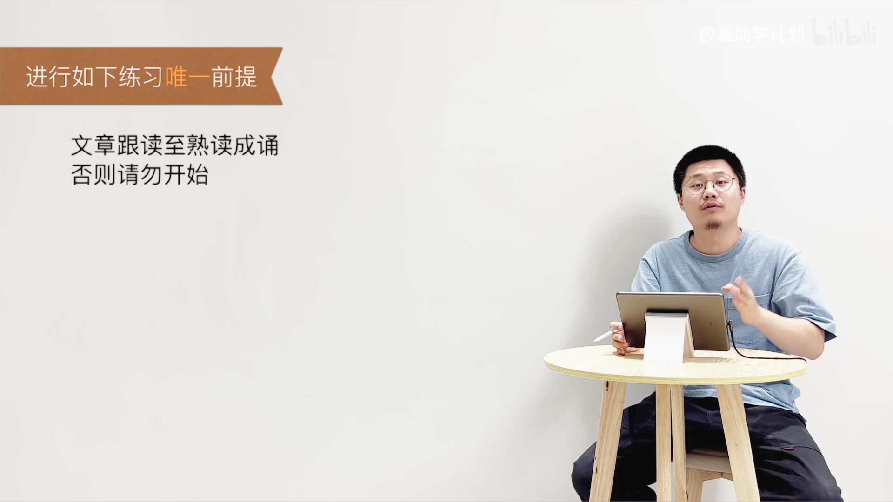

文字识别：进行如下练习唯一前提 / 文章跟读至熟读成诵 / 否则请勿开始

### 画面 00:00:20

文字识别：胶囊助学计划bill / •

### 画面 00:00:24

### 画面 00:00:26

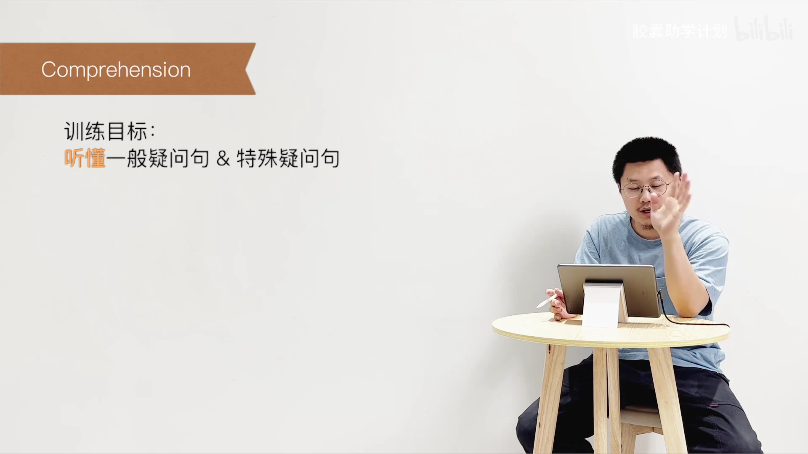

文字识别：Comprehension / 训练目标： / 听懂一般疑问句＆特殊疑问句

### 画面 00:00:29

文字识别：Comprehension

## 00:00:30–00:01:00

口语听力训练，对吧？Where were you? 假设你现在是主人公啊。At a village fair. Next one. What did you decide to do there? To visit a fortune teller called Madame Bolinsky. Where did you go? Into her tent. What did she tell you to do? To sit down.

### 画面 00:00:41

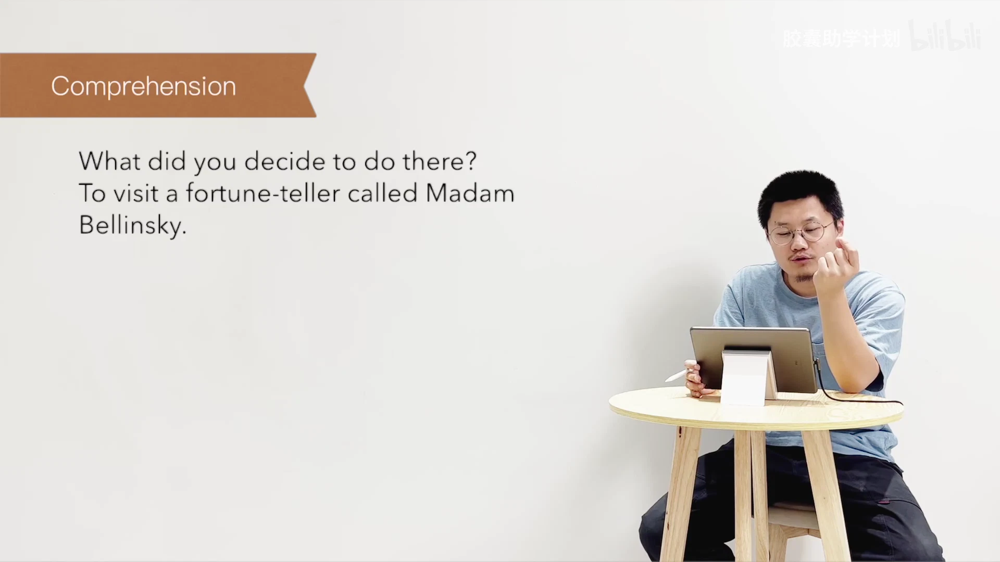

文字识别：Comprehension / What did you decide to do there? / To visit a fortune-teller called Madam / Bellinsky.

### 画面 00:00:47

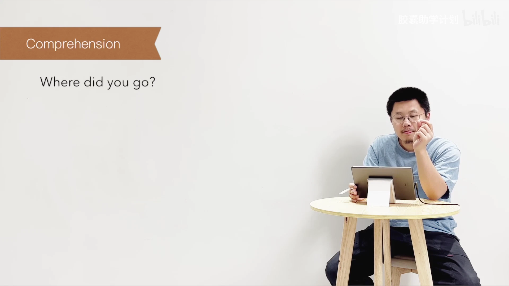

文字识别：Comprehension / Where did you go?

### 画面 00:00:56

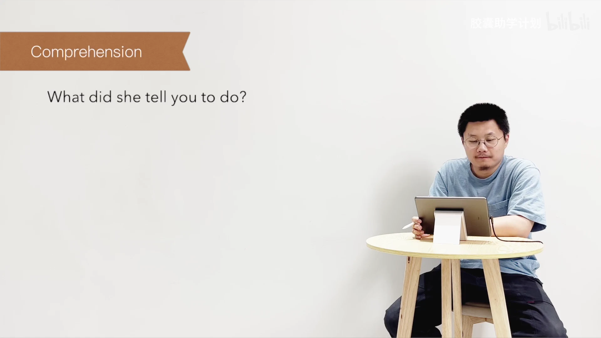

文字识别：Comprehension / What did she tell you to do?

## 00:01:00–00:01:30

You gave her some money, didn't you? Yes, I did. What did she do then? She looked into a crystal ball. Who did she say was coming to see you? A relation of mine. When would she be arriving? This evening.

### 画面 00:01:21

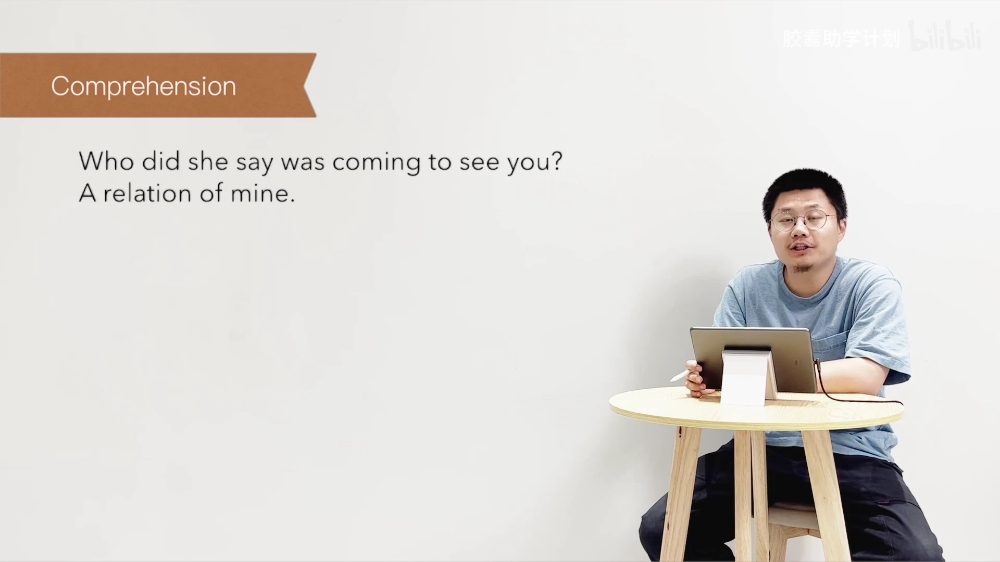

文字识别：Comprehension / Who did she say was coming to see you? / A relation of mine.

## 00:01:30–00:02:00

How long did she intend to stay? A few days. She said, "You'd get a big surprise, didn't she?" Yes, she did. When would you get a surprise? When I left her tent. Would someone rush towards you? Yes, they would.

### 画面 00:01:31

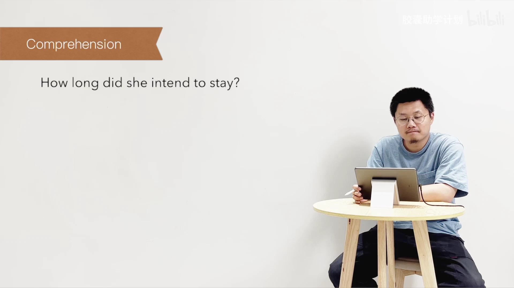

文字识别：Comprehension / How long did she intend to stay?

## 00:02:00–00:02:30

Would it be a man or a woman? A woman. What were you told? She do. She'd speak to me.这个撇地would啊。Where would she lead you? Away from this place. Away from this uh village fair. Asking questions.练习我们能说一般疑

### 画面 00:02:01

文字识别：Comprehension / Would it be a man or a woman?

### 画面 00:02:26

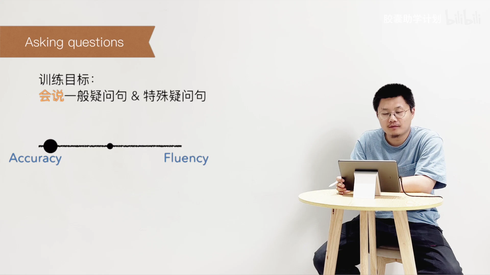

文字识别：Asking questions / 训练目标： / 会说一般疑问句＆特殊疑问句 / Accuracy / Fluency

## 00:02:30–00:03:00

问句和特殊疑问句的能力。好，我们先看一下，呃例子。I went to a village fair. 变一般疑问句，did提前，动词换回原形。Where？那肯定是village fair了，对吧？Where did you go？啊，那第一个我们不多说了，看第二个。I visited a fortune teller. Did提前，动词换原形。Who对主语和宾语都可以提问，一三均可提问啊。She was called Madame Balinsky.

### 画面 00:02:32

文字识别：Asking questions / T: Ask me if I went to a village fair.

### 画面 00:02:46

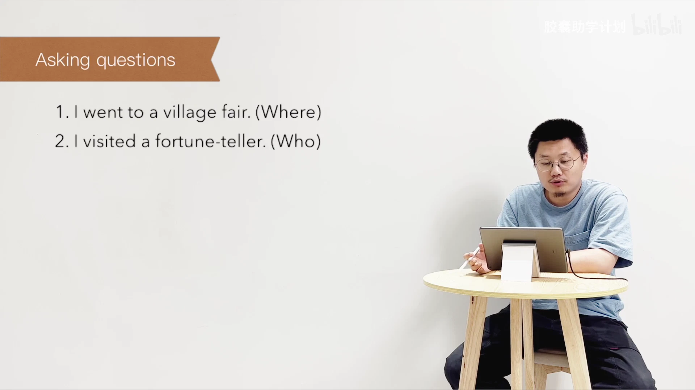

文字识别：Asking questions / 1.I went to a village fair. (Where) / 2.I visited a fortune-teller. (Who)

### 画面 00:02:50

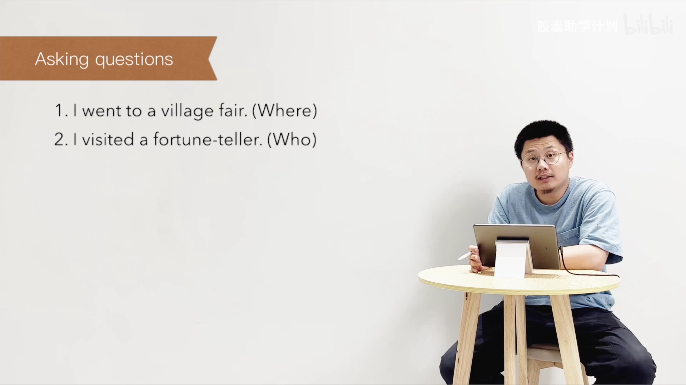

文字识别：Asking questions / 1.I went to a village fair. (Where) / 2.I visited a fortune-teller. (Who)

### 画面 00:02:53

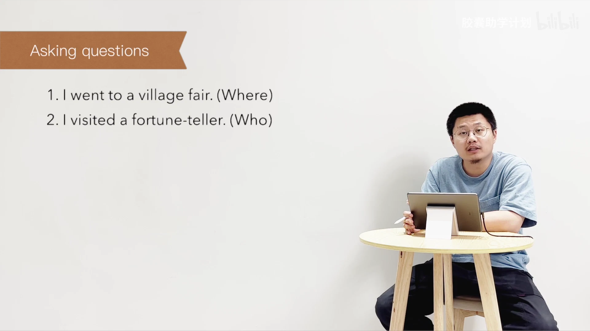

文字识别：Asking questions / 1.I went to a village fair. (Where) / 2.I visited a fortune-teller. (Who)

## 00:03:00–00:03:30

was提前一般过去时的被动，他被叫做。那What就对Madam Belinsky提问，叫What was she called? I went into her tent. Did提前动词换回原形。Where对into her tent提问，Where did you go? She told me to sit down. Did提前对吧？What啊，其实这地方直接给它换成叫What did she tell you? Tell you的是什么呢？To sit down. Ah, who呢？你可以对she提问，也可

### 画面 00:03:08

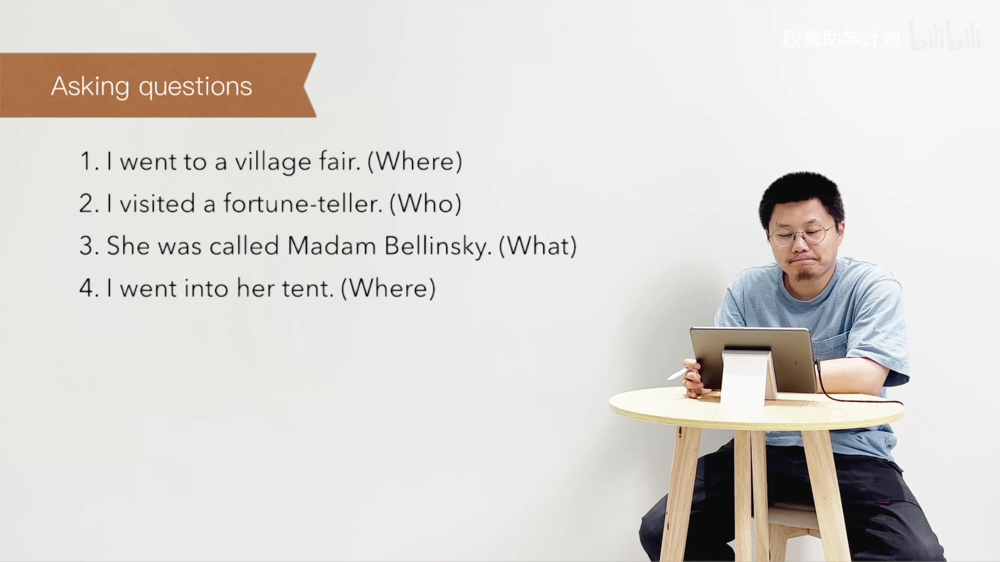

文字识别：Asking questions / 1.I went to a village fair. (Where) / 2.I visited a fortune-teller. (Who) / 3. She was called Madam Bellinsky. (What) / 4.I went into her tent. (Where)

## 00:03:30–00:04:00

以对me提问，都行。啊，多提一句，就是你要注意，如果你对she提问的话，那你的who肯定是对主语提问，不要变一般疑问句了，叫who told you to sit down？因为你不会问who told me to sit down，对吧？谁让你坐下的？不是谁让我坐下的啊？Give her some money. Did的提前，what对some money提问，问对整句话提问。When did you give her some money？对吧？

### 画面 00:03:32

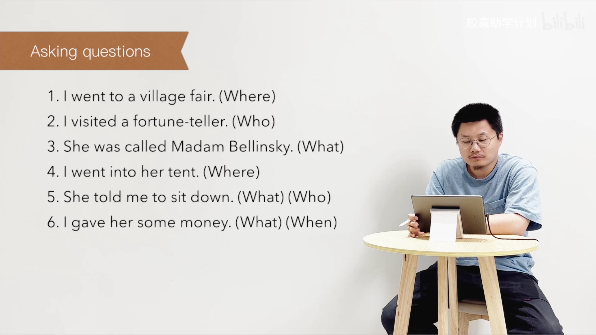

文字识别：Asking questions / 1.I went to a village fair. (Where) / 2.I visited a fortune-teller. (Who) / 3. She was called Madam Bellinsky. (What) / 4.I went into her tent. (Where) / 5. She told me to sit down.(What) (Who) / 6.I gave her some money. (What) (When)

### 画面 00:03:34

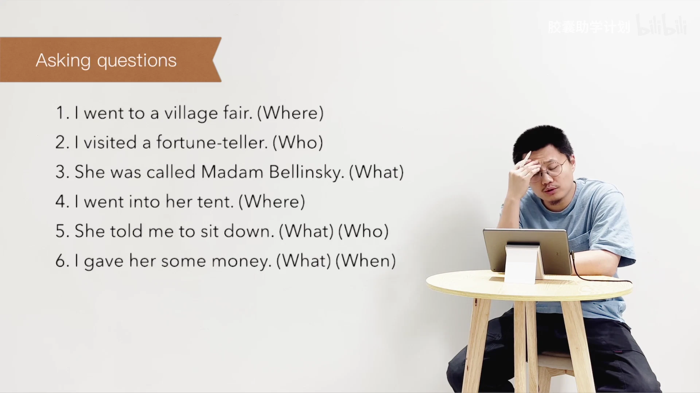

文字识别：Asking questions / 1.I went to a village fair. (Where) / 2.I visited a fortune-teller. (Who) / 3. She was called Madam Bellinsky. (What) / 4.I went into her tent.(Where) / 5. She told me to sit down.(What) (Who) / 6.I gave her some money. (What) (When)

### 画面 00:03:44

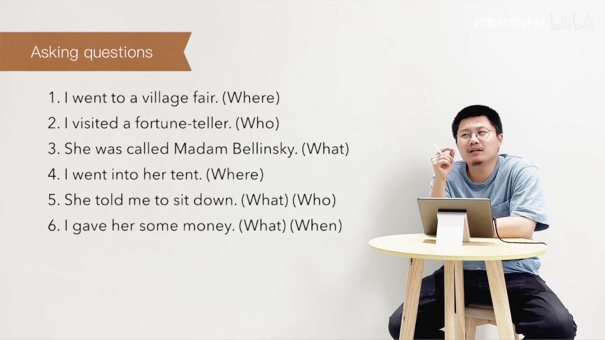

文字识别：Asking questions / 1.I went to a village fair. (Where) / 2.I visited a fortune-teller. (Who) / 3. She was called Madam Bellinsky. (What) / 4.I went into her tent.(Where) / 5. She told me to sit down. (What) (Who) / 6.I gave her some money. (What) (When)

### 画面 00:03:55

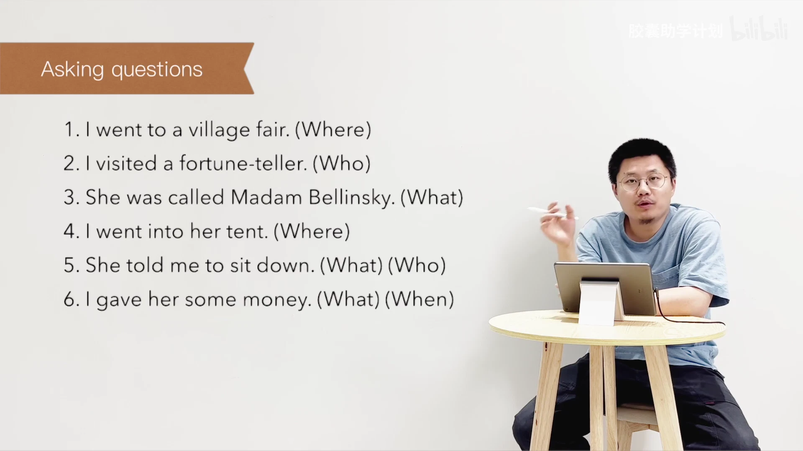

文字识别：Asking questions / 1.I went to a village fair. (Where) / 2.I visited a fortune-teller. (Who) / 3. She was called Madam Bellinsky. (What) / 4.I went into her tent.(Where) / 5. She told me to sit down. (What) (Who) / 6.I gave her some money. (What) (When)

### 画面 00:03:59

文字识别：Asking questions / 7. She looked into a crystal ball. (What)

## 00:04:00–00:04:30

She looked into a crystal ball. Did提前动词换回原形. What对a crystal ball提问. She told me my fortune.她告诉了我我接下来的命运，对吧？命数。Did提前What对my fortune提问. A relation of mine was coming to see me. Was提前Who你可以对me提问，也可以对a relation of mine提问。问整句. She would be arriving

### 画面 00:04:16

文字识别：Asking questions / 7. She looked into a crystal ball. (What) / 8. She told me my fortune.(What) / 9.A relation of mine was coming to see me. (Who) / (When) / 专

## 00:04:30–00:05:00

that evening. Would提前问对that evening提问。She intended to stay for a few days. Did提前How long对for a few days提问。所以答案是How long did she intend to stay?那Where整句呗。Who主语，对吧？不用变一般疑问句了啊。Who intended to stay for a few days? I'd get a big surprise.这个撇d是would，把它

### 画面 00:04:35

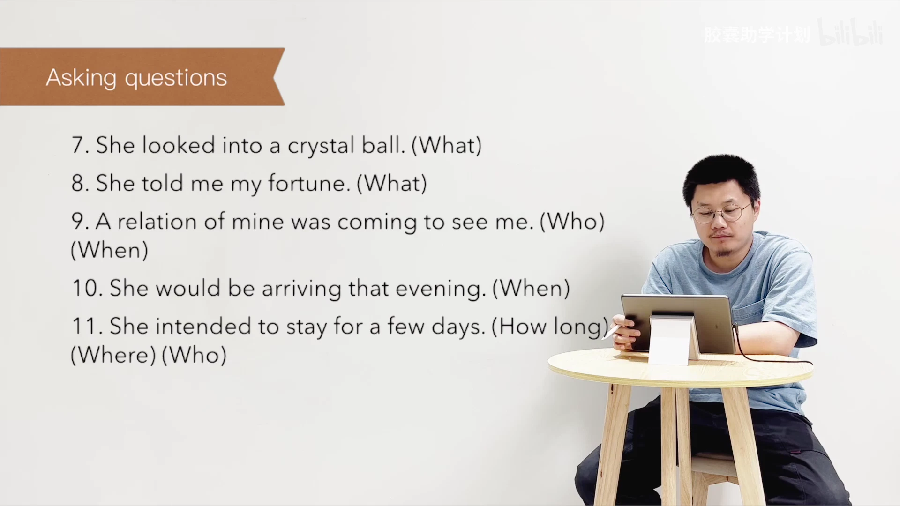

文字识别：Asking questions / 7. She looked into a crystal ball.(What) / 8. She told me my fortune.(What) / 9.A relation of mine was coming to see me. (Who) / (When) / 10. She would be arriving that evening. (When) / (Where)(Who)

## 00:05:00–00:05:30

提前。Who 对 I 提问，When 对整句提问。When would you get a big surprise? Tell the story。不多说了，第一单元有我很多的示范，对吧？第一单元我都给各位做了示范。其次呢，这个地方各位注意，就是我们可以错一点点，但是绝对不能太慢太磕巴，所以文章一定要读

### 画面 00:05:05

文字识别：Asking questions / 7. She looked into a crystal ball. (What) / 8. She told me my fortune.(What) / 9.A relation of mine was coming to see me. (Who) / (When) / 10. She would be arriving that evening. (When) / 11. She intended to stay for a few days. (How long) / (Where)(Who) / 12.I'd get a big surprise. (Who)(When)

### 画面 00:05:08

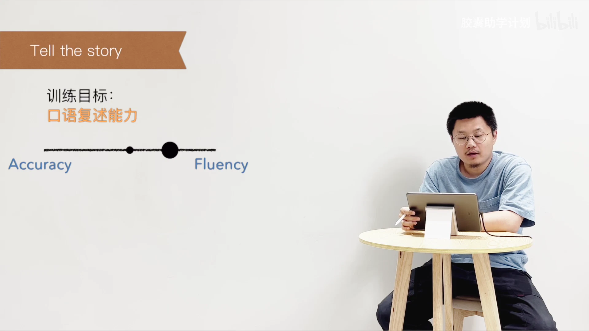

文字识别：Tell the story / 训练目标： / 口语复述能力 / Accuracy / Fluency

### 画面 00:05:10

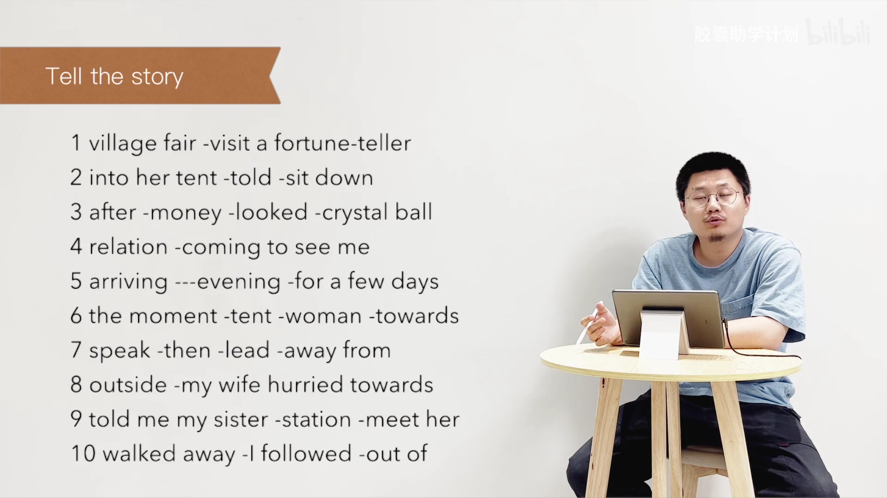

文字识别：Tell the story / 1 village fair -visit a fortune-teller / 2 into her tent -told -sit down / 3 after -money -looked -crystal ball / 4 relation -coming to see me / 5 arriving ---evening -for a few days / 6 the moment -tent -woman -towards / 7 speak -then -lead -away from / 8 outside -my wife hurried towards / 9 told me my sister -station -meet her / 10 walked away -I followed -out of

## 00:05:30–00:06:00

得很熟。他练习的其实是我们的流利性，就是我们的口语至少有两类东西。我们在考试的这个十多年养成的这个习惯，是对准确性的要求非常重要。但是各位实际上知道，我们现实生活当中考虑的可能往往是流利性非常重要，对吧？你跟一个人说话吭哧瘪肚半天也说不完，别人可能就没有耐心了啊！你到底想说啥？OK，好，所以这个练的是我们更多的是流利性啊。文章跟读

### 画面 00:05:34

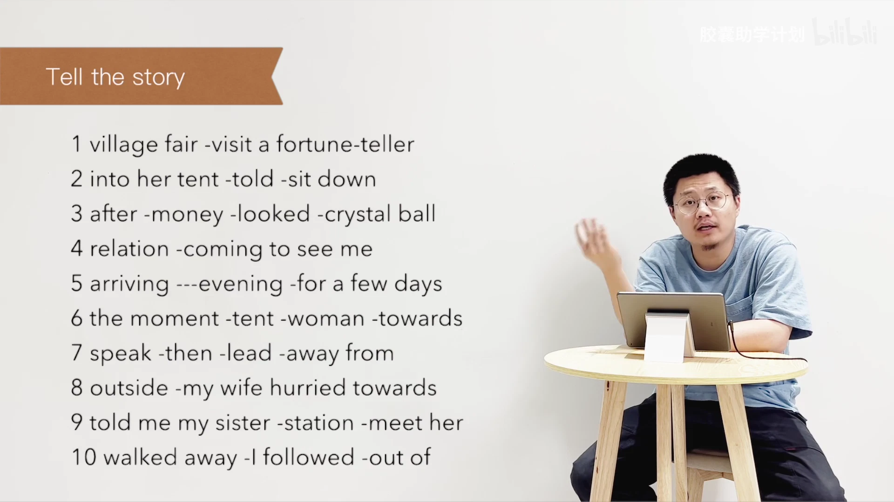

文字识别：Tell the story / 1 village fair -visit a fortune-teller / 2 into her tent -told -sit down / 3 after -money -looked -crystal ball / 4 relation -coming to see me / 5 arriving --evening -for a few days / 6 the moment -tent -woman -towards / 7 speak -then -lead -away from / 8 outside -my wife hurried towards / 9 told me my sister -station -meet her / 10 walked away -I followed -out of

### 画面 00:05:57

文字识别：Tell the story / 1 village fair -visit a fortune-teller / 2 into her tent -told -sit down / 3 after -money -looked -crystal ball / 4 relation -coming to see me / 5 arriving --evening -for a few days / 6 the moment -tent -woman -towards / 7 speak -then -lead -away from / 8 outside -my wife hurried towards / 9 told me my sister -station -meet her / 10 walked away -Il followed -out of

### 画面 00:05:59

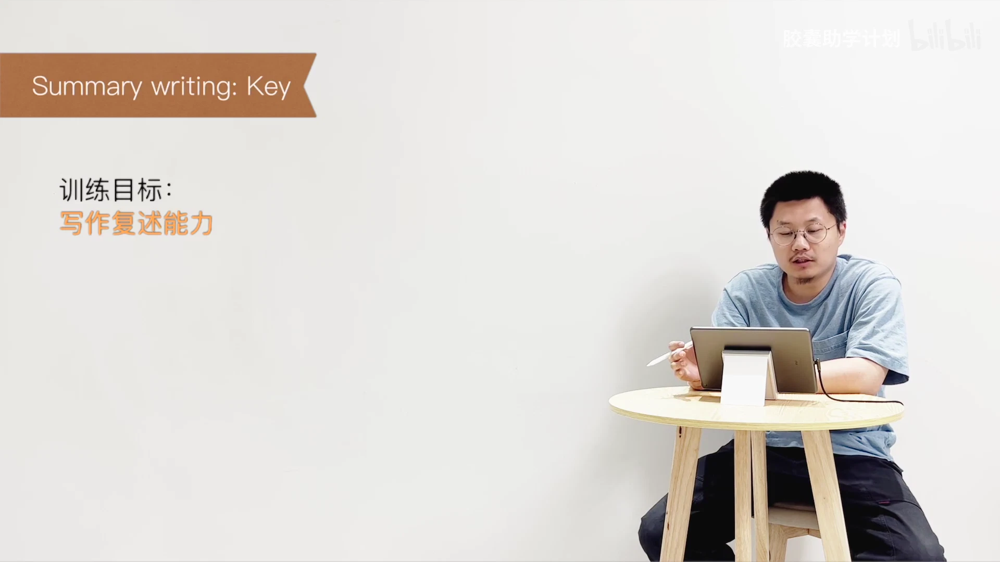

文字识别：Summary writing: Key / 训练目标： / 写作复述能力

## 00:06:00–00:06:30

很熟很重要。呃，summary writing老习惯，各位写完来这儿对答案，重点看一下那些连词，就不多说了。然后topic for discussion是我们所有练习最终的一件任务，对吧？叫练到这样的一个水平，就是拿我们学过的所有单词、语法、习惯用法，不管是动笔还是张嘴，都能把这些事情给他描述清楚。我们看这些话题。Have you ever had your fortune told?你以前让别人给你算过命吗？

### 画面 00:06:03

文字识别：Summary writing: Key / •The writer visited a fortune-teller at a village fair / who told him that a relation was coming to see him. / •She added that a woman he knew well would / speak to him when he left the tent and he would / follow her out of the fair. / •This came true because his wife spoke to him when / he went outside. / •She told him they had to meet his sister at the / station and she led him out of the fair.

### 画面 00:06:07

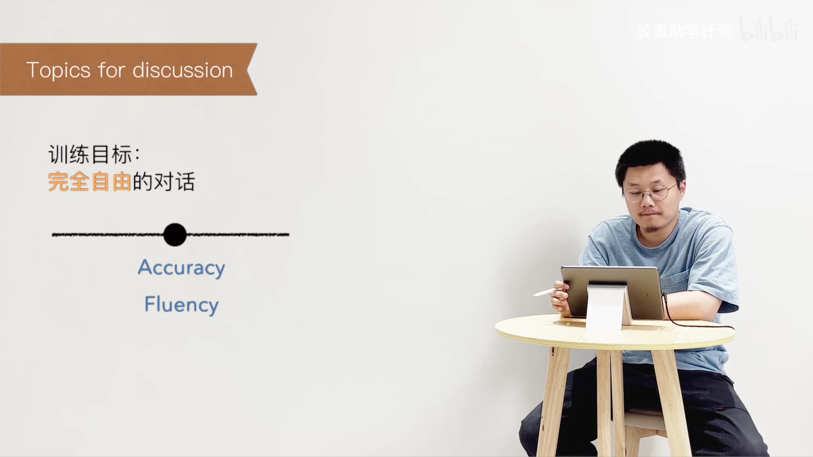

文字识别：Topics for discussion / 训练目标： / 完全自由的对话 / Accuracy / Fluency

### 画面 00:06:09

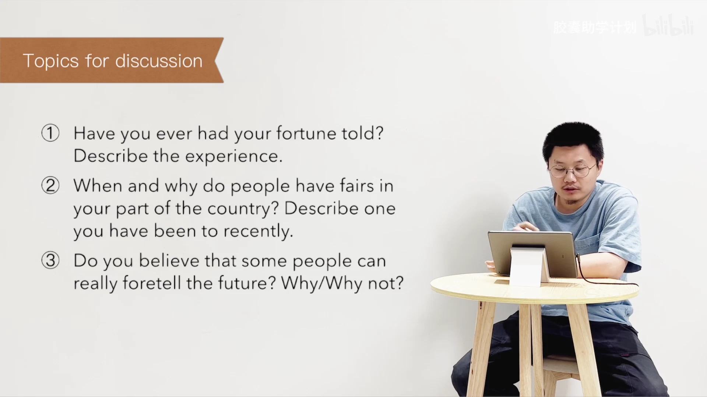

文字识别：Topics for discussion / Have you ever had your fortune told? / Describe the experience. / When and why do people have fairs in / your part of the country? Describe one / you have been to recently. / Do you believe that some people can / really foretell the future? Why/Why not?

## 00:06:30–00:07:00

对吧？或者别人给你算过命吗？啊，我就意意了，不执意了啊。Describe the experience.描述一下这个场景。When and why do people have fairs in your part of the country?在你的国家什么时间什么地啊？什么时间以及为什么人们会这个举办一些这种集市？Describe one you have been been to recently.描述一个你最近去过的地方。All right, next one. Say, do you believe that some

### 画面 00:06:39

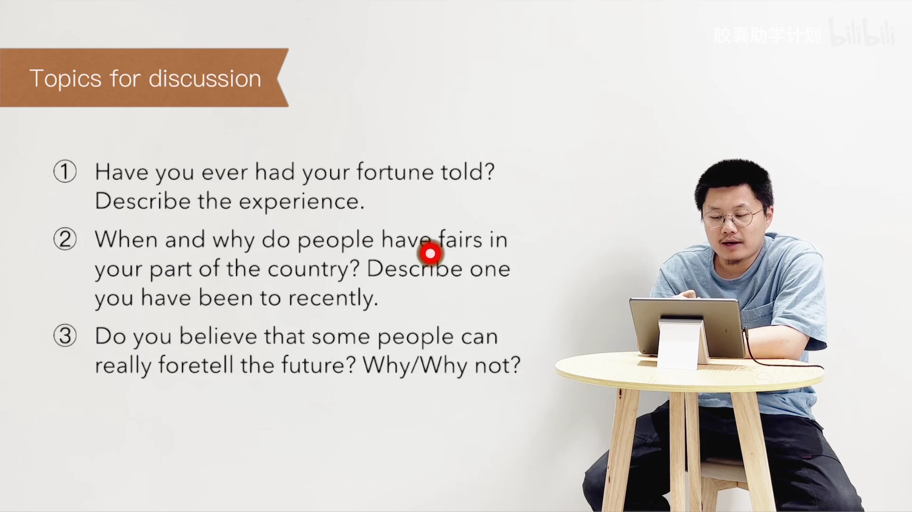

文字识别：Topics for discussion / Have you ever had your fortune told? / Describe the experience. / When and why do people have fairs in / your part of the country? Describe one / you have been to recently. / Do you believe that some people can / really foretell the future? Why/Why not?

## 00:07:00–00:07:30

people can really foretell the future? Why? Why not? 你说你真的相信有一些人能讲述未来、预判未来吗？为什么相信？为什么不信？对吧？OK. 那将作业 ask me if 先写再朗读，这要写错，写完对答案。Tell the story, 进行口语复述。看置顶留言进行重复间隔啊。好，那以上呢就是本期视频的全部内容了。如果各位喜欢我们的课程呢，欢迎各位关注、订阅、

### 画面 00:07:09

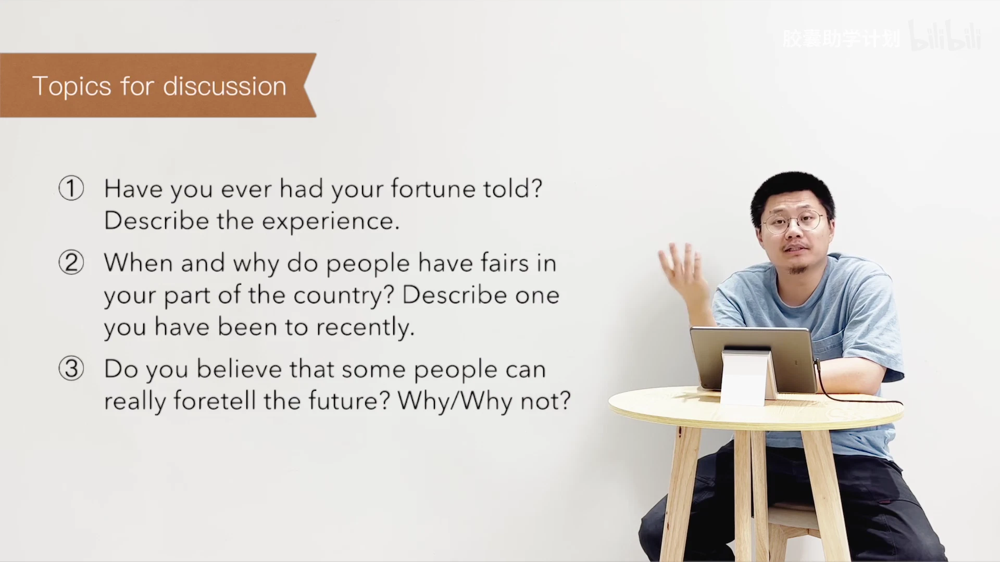

文字识别：Topics for discussion / Have you ever had your fortune told? / Describe the experience. / When and why do people have fairs in / your part of the country? Describe one / you have been to recently. / Do you believe that some people can / really foretell the future? Why/Why not?

### 画面 00:07:12

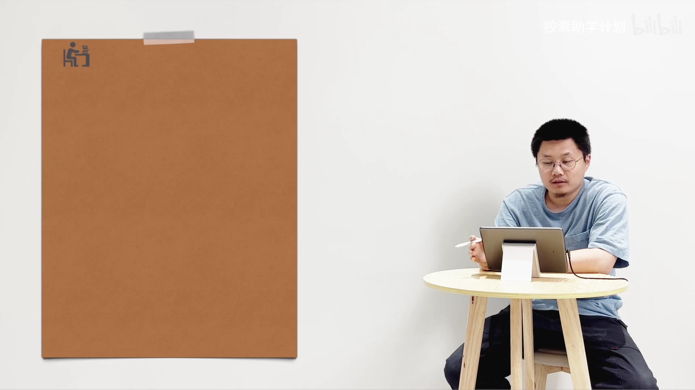

### 画面 00:07:15

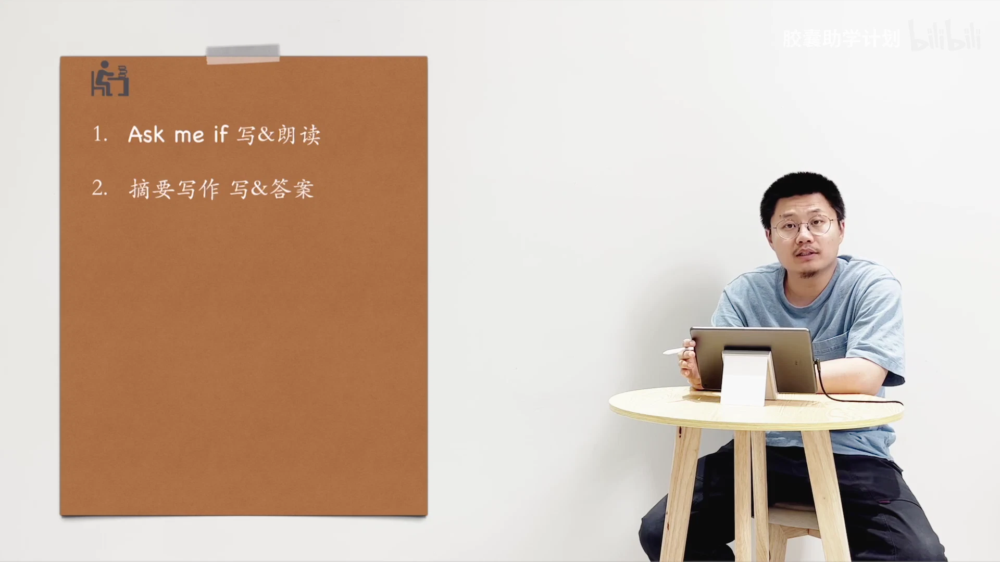

文字识别：1.Ask me if写&朗读 / 2. / 摘要写作写&答案

### 画面 00:07:17

文字识别：1.Ask me if写&朗读 / 摘要写作写&答案 / 3.Tell the story 口语复述

### 画面 00:07:19

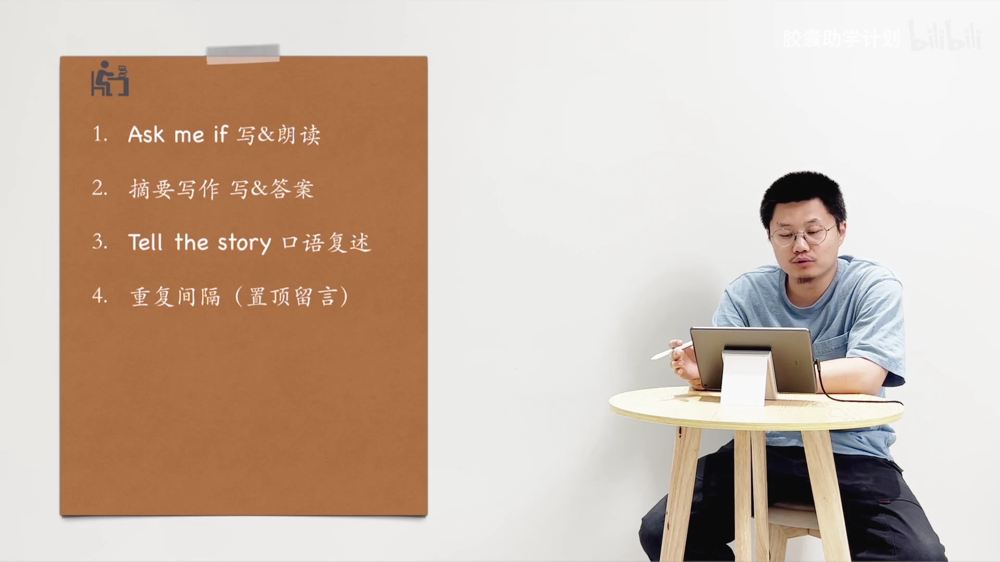

文字识别：1.Ask me if写&朗读 / 摘要写作写&答案 / 3.Tell the story 口语复述 / 4.重复间隔（置顶留言）

### 画面 00:07:21

文字识别：1.Ask me if写&朗读 / 摘要写作写&答案 / 3.Tell the story 口语复述 / 4.重复间隔（置顶留言）

### 画面 00:07:23

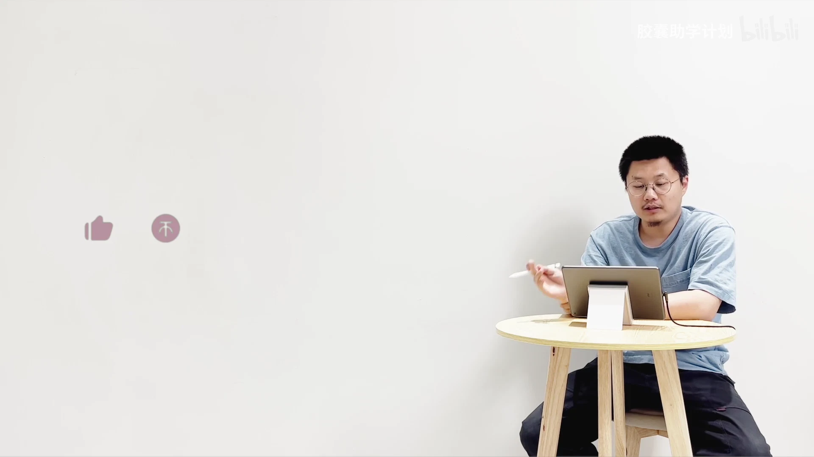

### 画面 00:07:25

### 画面 00:07:27

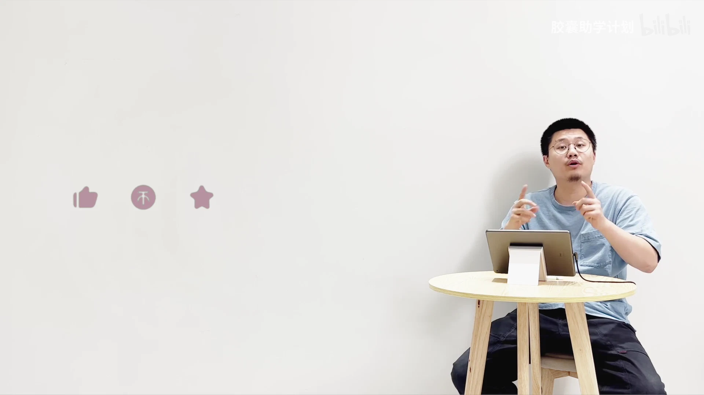

文字识别：￥

## 00:07:30–00:07:48

一键三连，分享给那些需要的朋友，来帮助我们快速成长。See you next time.

### 画面 00:07:31

### 画面 00:07:33

### 画面 00:07:36

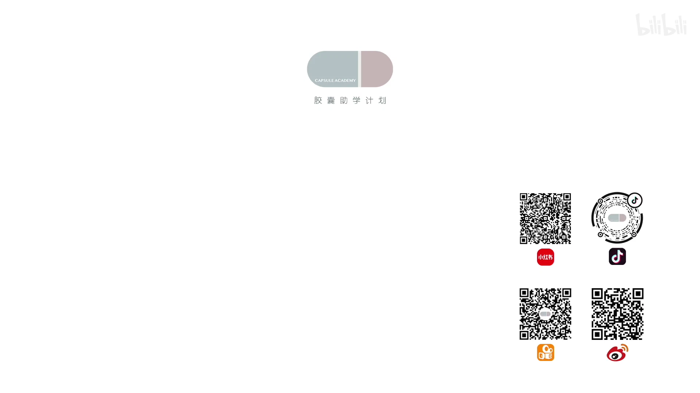

文字识别：CAPSULEACADEMY / 胶囊助学计划 / 小红书

### 画面 00:07:38

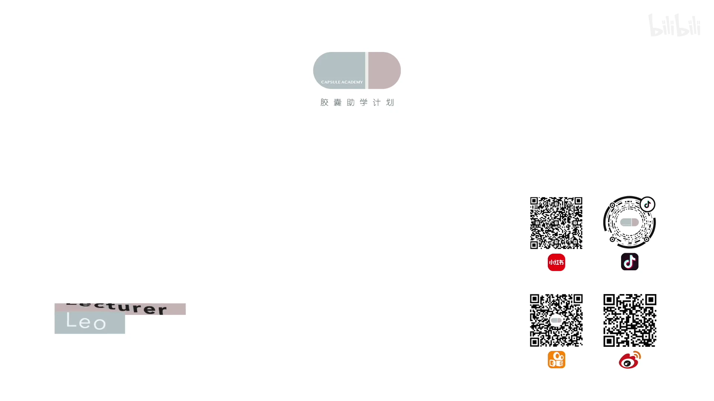

文字识别：CAPSULEACADEMY / 胶囊助学计划 / 小红书 / 证 / turer / Leo / OE

### 画面 00:07:44

文字识别：CAPSULEACADEMY / 胶囊助学计划 / 小红书 / Creator / Leo & Berlin / OE

### 画面 00:07:46

文字识别：bilibili / 胶囊助学计划

### 画面 00:07:47

文字识别：bilibili / 胶囊助学计划

