# 061 文章

快速机器解析：语音为单模型转写，未进行独立交叉校对或人工复核；画面每秒采样并按变化选帧，短时文字和标记可能遗漏。截图时间约有 1 秒误差。图片有损压缩；遇到疑点请按时间查看 Google Drive 原视频。

## 00:00:00–00:00:30

Hello everyone, welcome to Capsule Academy. This is Leo. Today we're going to learn New Concept English Book Two, Lesson Sixty One, Story. Hope you're gonna enjoy it.好，我们看一下标题啊，叫做 Trouble with the Hubble，还挺押韵的是吧？就是哈勃望远镜的问题啊，麻烦困难。What is the special importance of a telescope in space?在外太

### 画面 00:00:00

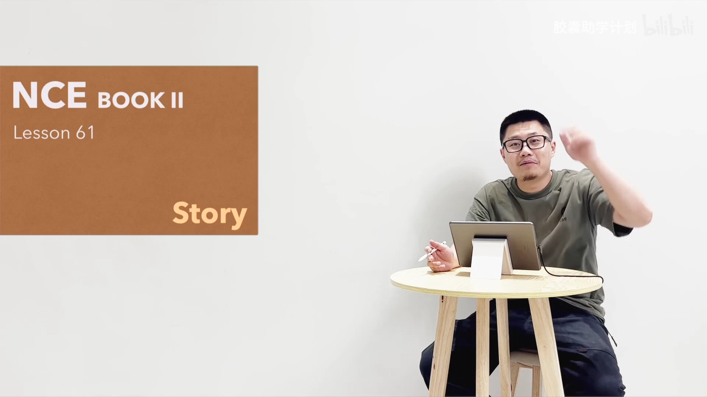

文字识别：NCE / BOOK"I / Lesson 61 / Story

### 画面 00:00:03

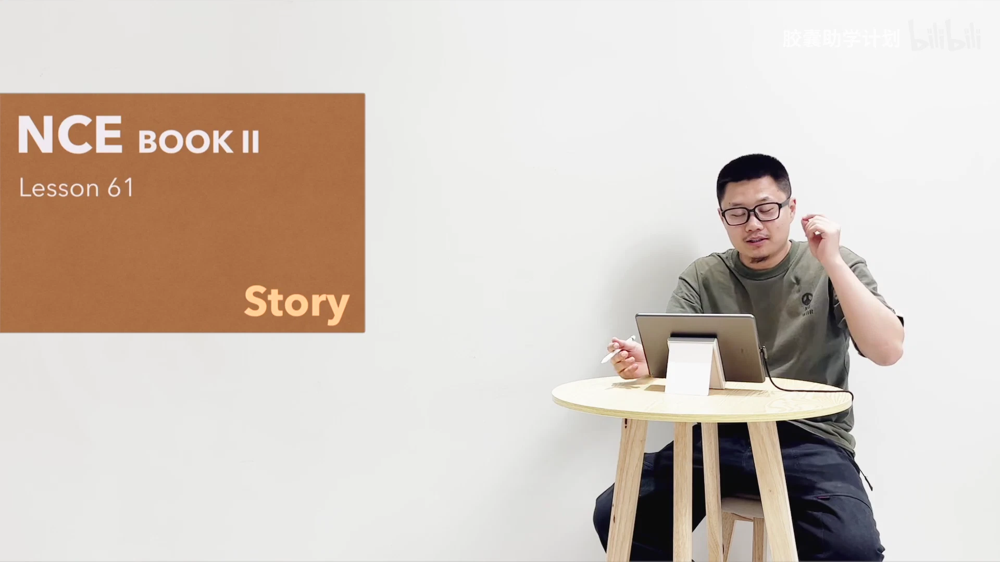

文字识别：NCE / BOOKⅡI / Lesson 61 / Story

### 画面 00:00:05

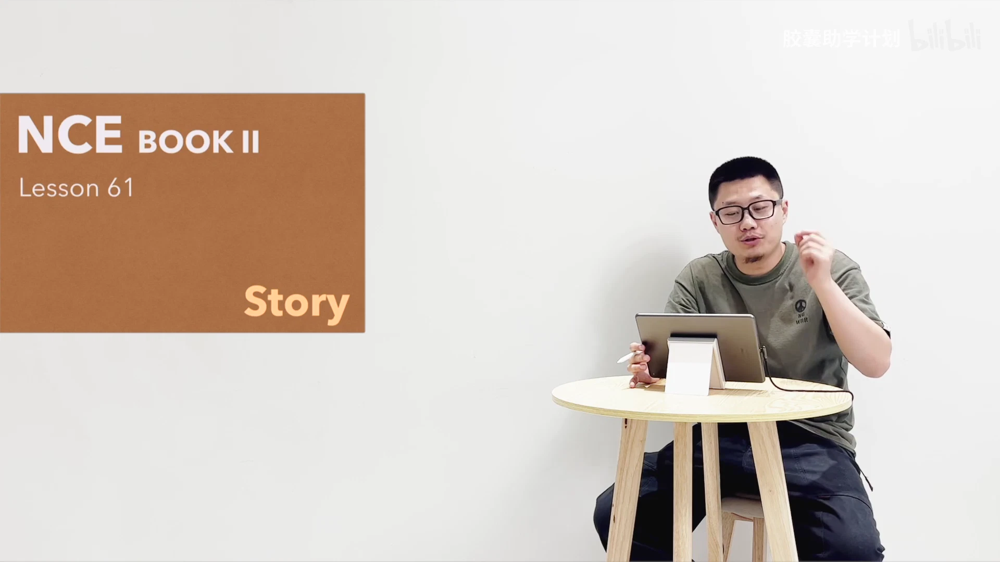

文字识别：NCE / BOOKⅡI / Lesson 61 / Story / NII / WnR

### 画面 00:00:09

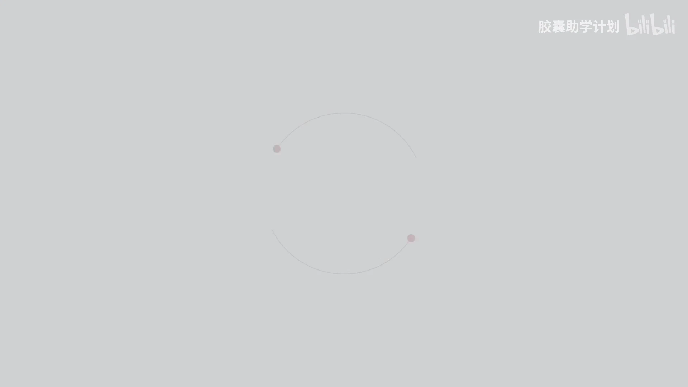

文字识别：胶囊助学计划bil出

### 画面 00:00:13

### 画面 00:00:15

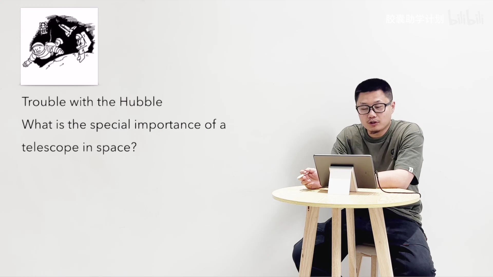

文字识别：Trouble with the Hubble / What is the special importance of a / telescope in space?

## 00:00:30–00:01:00

this telescope's special importance is what? Ah, we enter the article to see. Ah, this article is really not a narrative text, but a text that is similar to a semi-expository text, semi-expository text. Such an article, ah, the narrative is not very strong. Look at the article that says the Hubble telescope was launched into space by NASA on April twentieth, nineteen ninety, at a cost of over a

### 画面 00:00:45

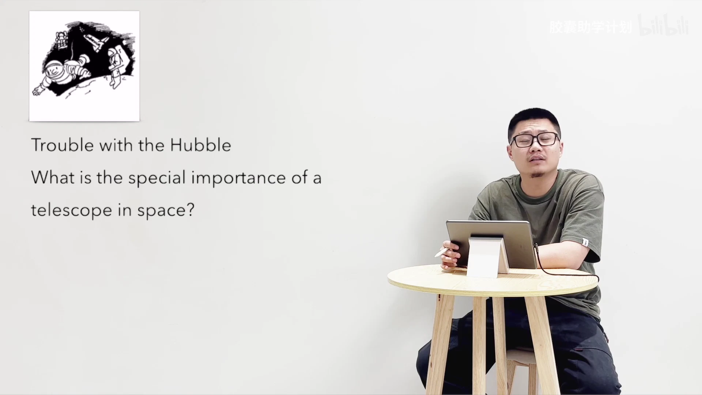

文字识别：Trouble with the Hubble / What is the special importance of a / telescope in space?

### 画面 00:00:47

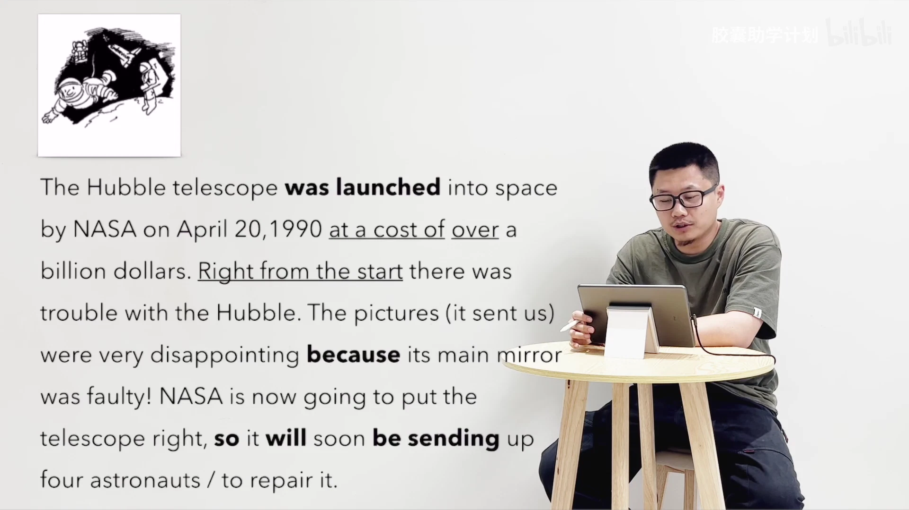

文字识别：The Hubble telescope was launched into space / by NASA on April 20, 1990 at a cost of over a / billion dollars. Right from the start there was / trouble with the Hubble. The pictures (it sent us) / were very disappointing because its main mirror / was faulty! NASA is now going to put the / telescope right, so it will soon be sending up / four astronauts / to repair it.

## 00:01:00–00:01:30

billion dollars. Here,大多数单词在讲单词部分，我们都认认真真的用过，造过句子。哈勃望远镜被发射进入外太空。我说了，外太空更多的时候，如果没有上下文语境，那用 outer space 更好一点。单独用 space 指的是空间，比如说 Give me some space, man, 对吧？By NASA, by NASA, in April twentieth, nineteen ninety. This没什么可说的. At

### 画面 00:01:17

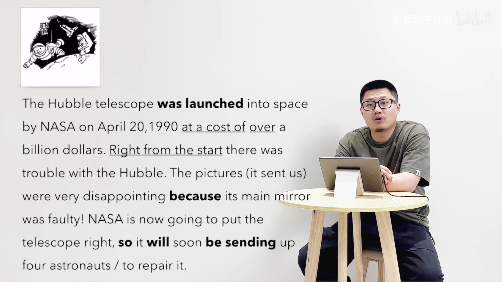

文字识别：The Hubble telescope was launched into space / by NASA on April 20, 1990 at a cost of over a / billion dollars. Right from the start there was / trouble with the Hubble. The pictures (it sent us) / were very disappointing because its main mirror / was faulty! NASA is now going to put the / telescope right, so it will soon be sending up / four astronauts / to repair it.

## 00:01:30–00:02:00

recording. Transcribe the exact words in their original spoken languages. Never translate. Preserve repetitions, questions and examples.

### 画面 00:01:47

文字识别：The Hubble telescope was launched into space / by NASA on April 20, 1990 at a cost of over a / billion dollars. Right from the start there was / trouble with the Hubble. The pictures (it sent us) / were very disappointing because its main mirror / was faulty! NASA is now going to put the / telescope right, so it will soon be sending up / four astronauts / to repair it.

## 00:02:00–00:02:30

why is it in parentheses? From grammar, it directly helps you judge the relative clause. It's the photo it sent us, right? The relative clause is missing a "that." They were very disappointing, very disappointing. Because its main mirror was faulty. Because its main mirror was faulty. Because its main mirror was faulty. Because its main mirror was faulty. Because its main mirror was faulty. Because its main mirror was faulty. Because its main mirror was faulty. Because its main mirror was faulty. Because its main mirror was faulty. Because its main mirror was faulty. Because

### 画面 00:02:10

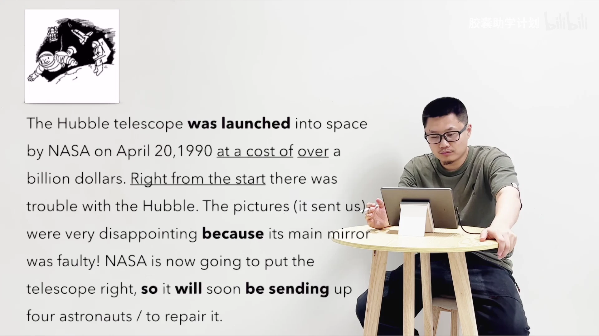

文字识别：The Hubble telescope was launched into space / by NASA on April 20, 1990 at a cost of over a / billion dollars. Right from the start there was / trouble with the Hubble. The pictures (it sent us) / were very disappointing because its main mirror / was faulty! NASA is now going to put the / telescope right, so it will soon be sending up / four astronauts / to repair it.

## 00:02:30–00:03:00

NASA is now going to put the telescope right. So NASA啊，准备be going to do，对吧？哎，计划要怎么样呢？Put the telescope right，把它放置到一个正确的地方。其实就类似于repair it啊，就修理它，把它弄好。So二十五课咱学的连词，It will soon be sending up four astronauts to

### 画面 00:02:40

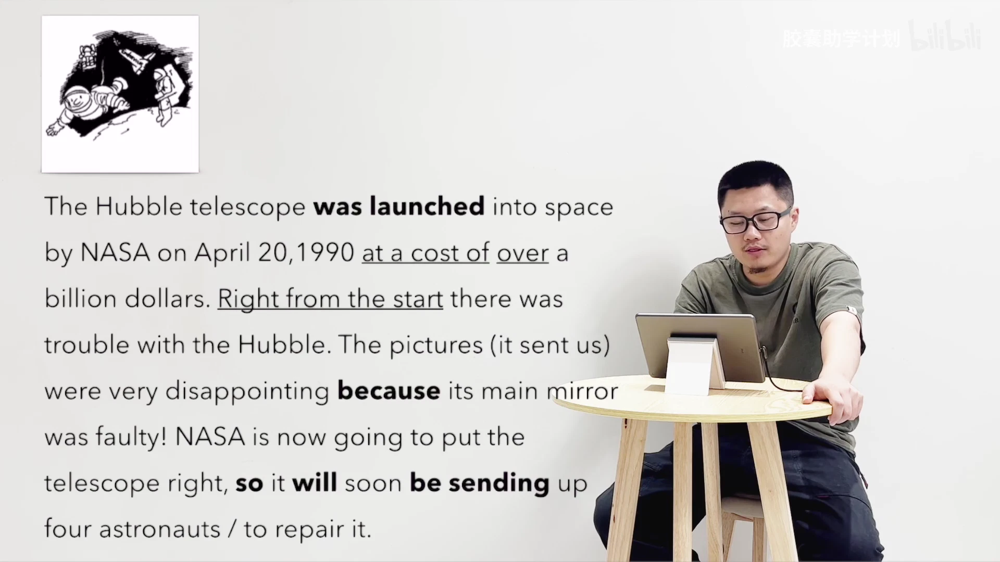

文字识别：The Hubble telescope was launched into space / by NASA on April 20, 1990 at a cost of over a / billion dollars. Right from the start there was / trouble with the Hubble. The pictures (it sent us) / were very disappointing because its main mirror / was faulty! NASA is now going to put the / telescope right, so it will soon be sending up / four astronauts / to repair it.

## 00:03:00–00:03:30

repair it. So, so

### 画面 00:03:10

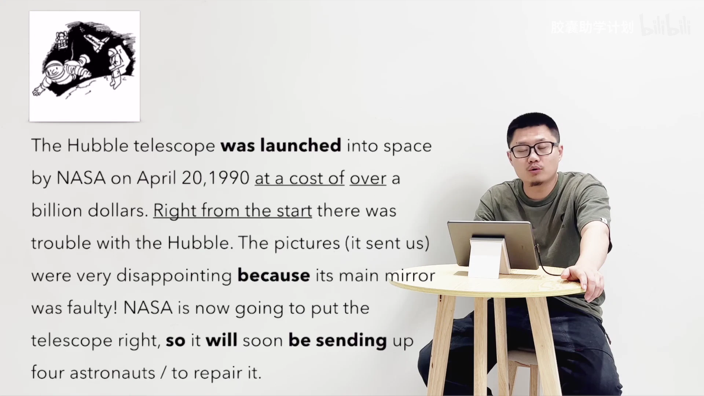

文字识别：The Hubble telescope was launched into space / by NASA on April 20, 1990 at a cost of over a / billion dollars. Right from the start there was / trouble with the Hubble. The pictures (it sent us) / were very disappointing because its main mirror / was faulty! NASA is now going to put the / telescope right, so it will soon be sending up / four astronauts / to repair it.

### 画面 00:03:17

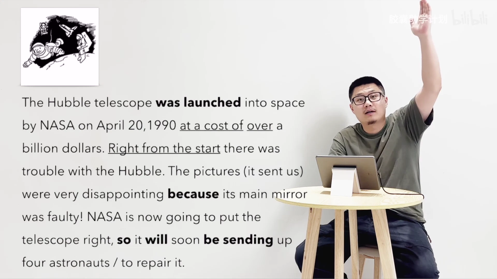

文字识别：The Hubble telescope was launched into space / by NASA on April 20, 1990 at a cost of over a / billion dollars. Right from the start there was / trouble with the Hubble. The pictures (it sent us) / were very disappointing because its main mirror / was faulty! NASA is now going to put the / telescope right, so it will soon be sending up / four astronauts / to repair it.

### 画面 00:03:22

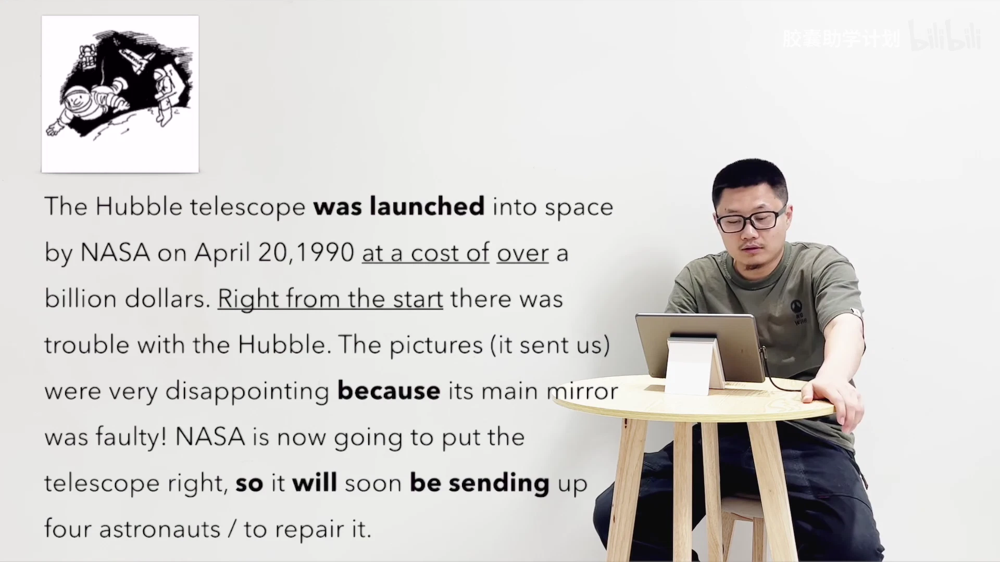

文字识别：The Hubble telescope was launched into space / by NASA on April 20, 1990 at a cost of over a / billion dollars. Right from the start there was / WIR / trouble with the Hubble. The pictures (it sent us) / were very disappointing because its main mirror / was faulty! NASA is now going to put the / telescope right, so it will soon be sending up / four astronauts / to repair it.

### 画面 00:03:28

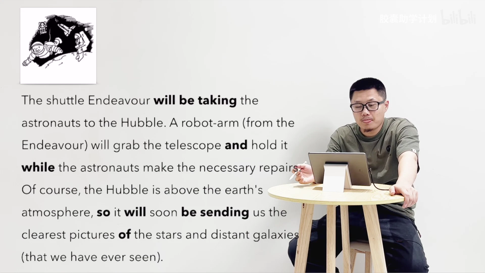

文字识别：The shuttle Endeavour will be taking the / astronauts to the Hubble. A robot-arm (from the / Endeavour) will grab the telescope and hold it / while the astronauts make the necessary repairs: / Of course, the Hubble is above the earth's / atmosphere, so it will soon be sending us the / clearest pictures of the stars and distant galaxieg / (that we have ever seen).

## 00:03:30–00:04:00

Endeavour,这个奋进号啊，这个穿梭机啊，奋进号的这个宇航这个飞船呢, will be taking the astronauts to the Hubble.说将带着这些宇航员去Hubble望远镜那里. A robot arm from the Endeavour will grab the telescope.好，先不往后看了. From the Endeavour,介词引导的短语后置

### 画面 00:03:58

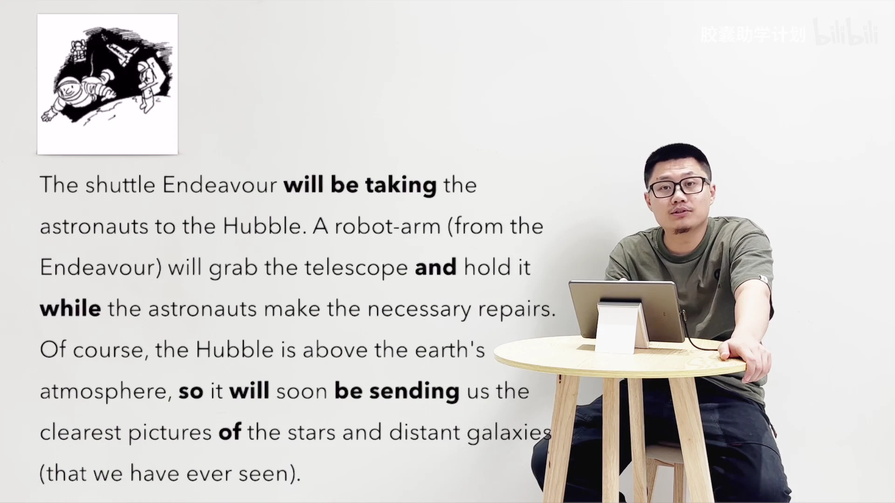

文字识别：The shuttle Endeavour will be taking the / astronauts to the Hubble. A robot-arm (from the / Endeavour) will grab the telescope and hold it / while the astronauts make the necessary repairs. / Of course, the Hubble is above the earth's / atmosphere, so it will soon be sending us the / clearest pictures of the stars and distant galaxieg / (that we have ever seen).

## 00:04:00–00:04:30

做定语修饰 robot arm，对吧？所以叫做从奋进号里面出来的一个，比如说我现在是奋进号，我这个胳膊是 robot arm，那就是 a robot arm from the endeavor，能理解吧？我是 endeavor from 出来了这么一个 robot arm， will grab the telescope，这是 telescope，我 grab the telescope，看见了吧？抓住它，

### 画面 00:04:10

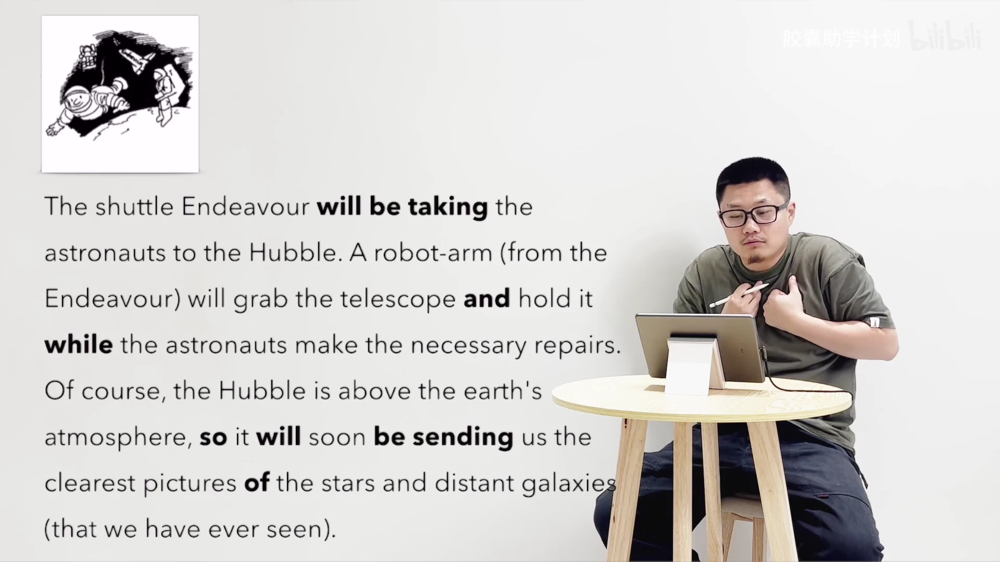

文字识别：The shuttle Endeavour will be taking the / astronauts to the Hubble. A robot-arm (from the / Endeavour) will grab the telescope and hold it / while the astronauts make the necessary repairs. / Of course, the Hubble is above the earth's / atmosphere, so it will soon be sending us the / clearest pictures of the stars and distant galaxieg / (that we have ever seen).

### 画面 00:04:20

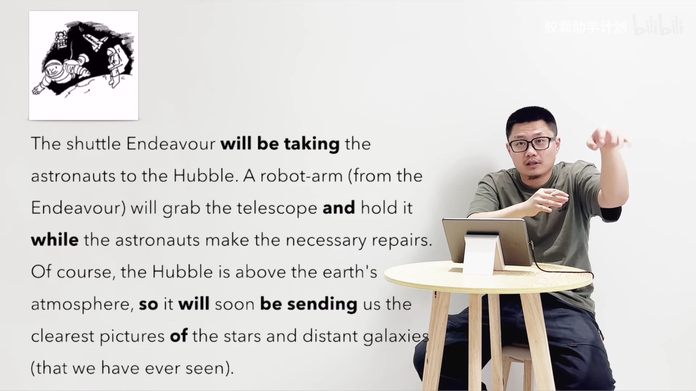

文字识别：The shuttle Endeavour will be taking the / astronauts to the Hubble. A robot-arm (from the / Endeavour) will grab the telescope and hold it / while the astronauts make the necessary repairs. / Of course, the Hubble is above the earth's / atmosphere, so it will soon be sending us the / clearest pictures of the stars and distant galaxieg / (that we have ever seen).

### 画面 00:04:22

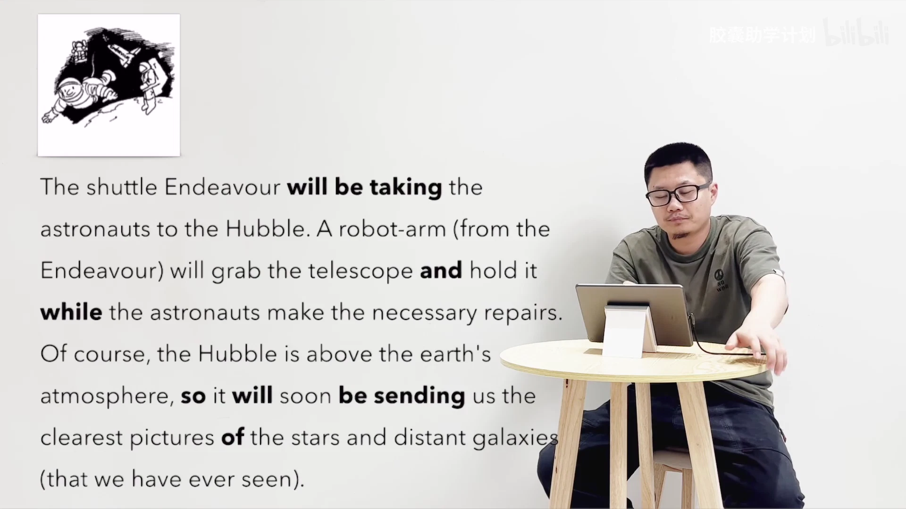

文字识别：The shuttle Endeavour will be taking the / astronauts to the Hubble. A robot-arm (from the / Endeavour) will grab the telescope and hold it / while the astronauts make the necessary repairs. / Of course, the Hubble is above the earth's / atmosphere, so it will soon be sending us the / clearest pictures of the stars and distant galaxieg / (that we have ever seen).

## 00:04:30–00:05:00

and hold it.这个hold it就扶着它，其实就是跟那个grab类似于，在这里是同义词啊。扶着它，当the astronauts make the necessary repairs，说当这些宇航员做出一些必要的修理的时候啊，其实就是while the astronauts repair it.它只不过这里把repair变成了名词，是吧？Make the necessary repairs，做出一些必要的修理

### 画面 00:04:34

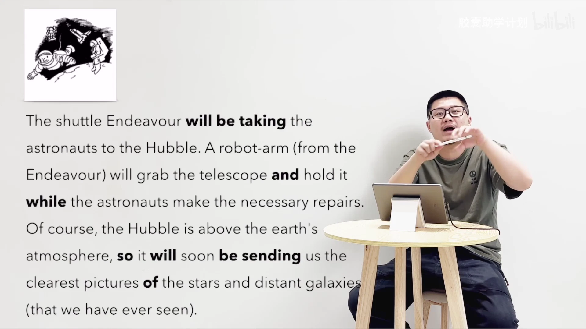

文字识别：The shuttle Endeavour will be taking the / astronauts to the Hubble. A robot-arm (from the / Endeavour) will grab the telescope and hold it / NU / while the astronauts make the necessary repairs. / Of course, the Hubble is above the earth's / atmosphere, so it will soon be sending us the / clearest pictures of the stars and distant galaxieg / (that we have ever seen).

### 画面 00:04:38

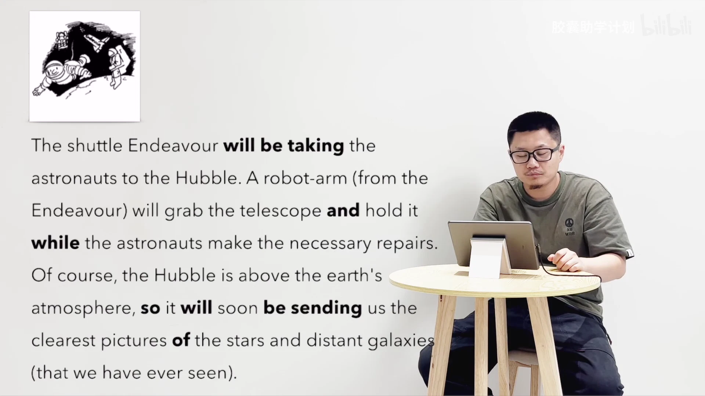

文字识别：The shuttle Endeavour will be taking the / astronauts to the Hubble. A robot-arm (from the / Endeavour) will grab the telescope and hold it / while the astronauts make the necessary repairs. / Of course, the Hubble is above the earth's / atmosphere, so it will soon be sending us the / clearest pictures of the stars and distant galaxieg / (that we have ever seen).

## 00:05:00–00:05:30

的时候. Of course, the Hubble is above the Earth's atmosphere.这句话咱们见过了，是吧？哈勃望远镜是大气层之上的。So,所以呢，it will soon be sending us the clearest pictures of the stars and distant galaxies that we have ever

### 画面 00:05:08

文字识别：The shuttle Endeavour will be taking the / astronauts to the Hubble. A robot-arm (from the / Endeavour) will grab the telescope and hold it / while the astronauts make the necessary repairs. / Of course, the Hubble is above the earth's / atmosphere, so it will soon be sending us the / clearest pictures of the stars and distant galaxieg / (that we have ever seen).

## 00:05:30–00:06:00

seen.啊，这句话好长，我们慢点来。先看一下它的语法结构。Will soon be sending us.它很快将给我们发送什么东西呢？看后边的东西叫the clearest pictures，叫做最清楚的图片。什么最清楚的图片呢？A of B结构啊，其实是个介词引导短语后置，但我们不那么去理解了。A of B结构就行了。叫做星

### 画面 00:05:38

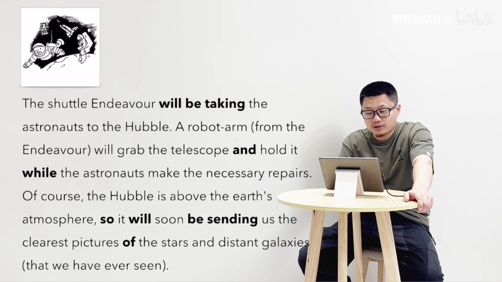

文字识别：The shuttle Endeavour will be taking the / astronauts to the Hubble. A robot-arm (from the / Endeavour) will grab the telescope and hold it / while the astronauts make the necessary repairs. / Of course, the Hubble is above the earth's / atmosphere, so it will soon be sending us the / clearest pictures of the stars and distant galaxieg / (that we have ever seen).

### 画面 00:05:54

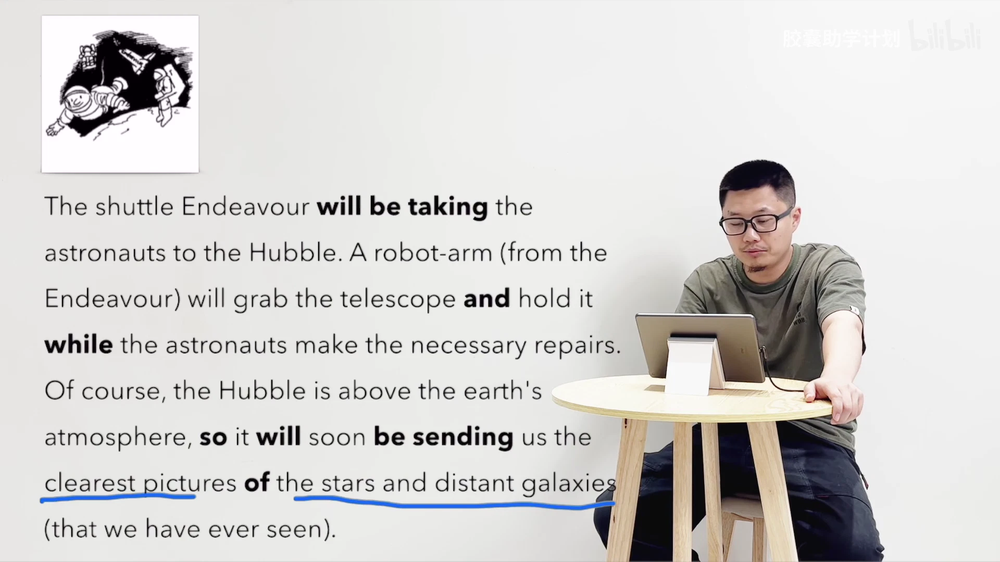

文字识别：The shuttle Endeavour will be taking the / astronauts to the Hubble.A robot-arm (from the / Endeavour) will grab the telescope and hold it / while the astronauts make the necessary repairs. / Of course, the Hubble is above the earth's / atmosphere, so it will soon be sending us the / clearest pictures of the stars and distant galaxieg / (that we have ever seen).

## 00:06:00–00:06:30

星遥远星系的最清楚的图片，看见了吧？最清楚的什么的图片呢？星星遥远星系最清楚的图片，对吧？它俩最清楚的图片，后边又接了个定语从句，说的是这个星星和遥远星系的，它们有什么特点呢？叫做 that we have ever seen，叫做我们所看过的啊，星星和遥远星系最清楚的图片。

### 画面 00:06:00

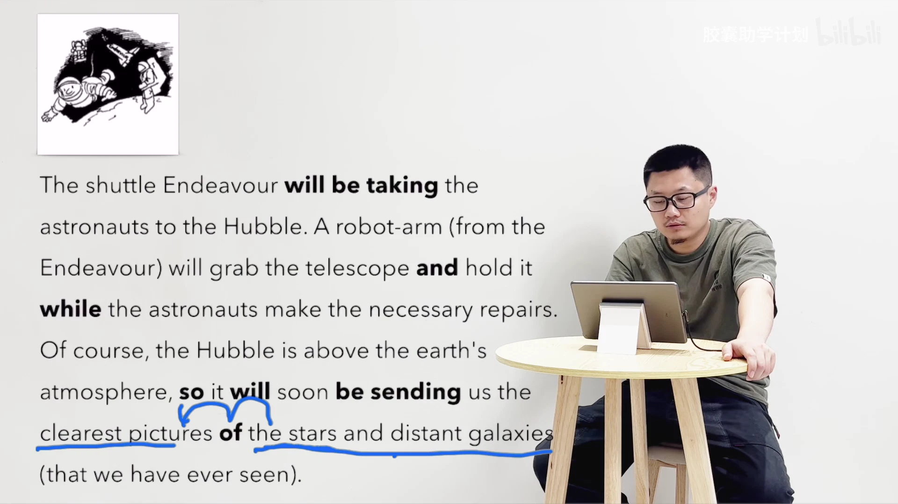

文字识别：The shuttle Endeavour will be taking the / astronauts to the Hubble. A robot-arm (from the / Endeavour) will grab the telescope and hold it / while the astronauts make the necessary repairs. / Of course, the Hubble is above the earth's / atmosphere, so it will soon be sending us the / clearest pictures of the stars and distant galaxieg / (that we have ever seen).

### 画面 00:06:03

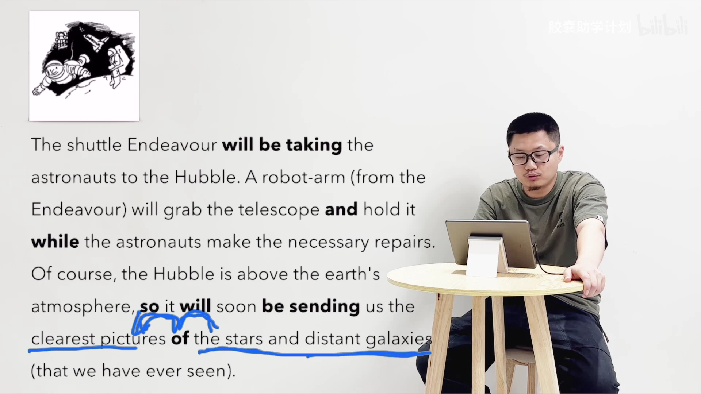

文字识别：The shuttle Endeavour will be taking the / astronauts to the Hubble. A robot-arm (from the / Endeavour) will grab the telescope and hold it / while the astronauts make the necessary repairs. / Of course, the Hubble is above the earth's / atmosphere, so it will soon be sending us the / clearest pictures of the stars and distant galaxieg / (that we have ever seen).

### 画面 00:06:07

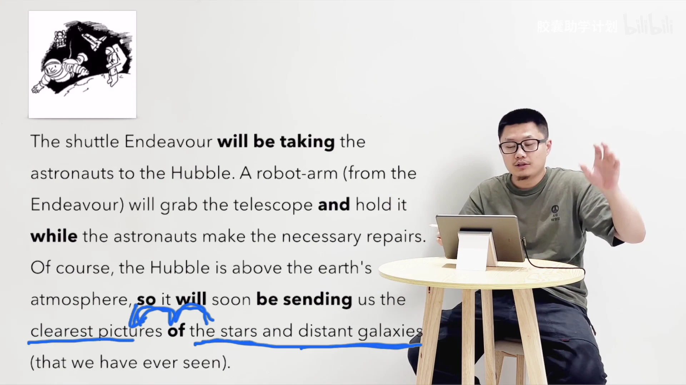

文字识别：The shuttle Endeavour will be taking the / astronauts to the Hubble. A robot-arm (from the / Endeavour) will grab the telescope and hold it / 四 / while the astronauts make the necessary repairs. / Of course, the Hubble is above the earth's / atmosphere, so it will soon be sending us the / clearest pictures of the stars and distant galaxies / (that we have ever seen).

### 画面 00:06:11

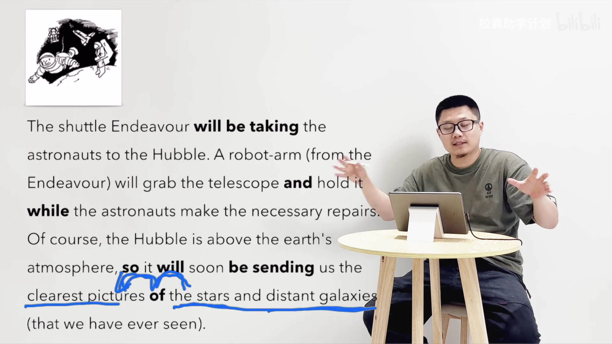

文字识别：The shuttle Endeavour will be taking the / astronauts to the Hubble. A robot-arm (from the / Endeavour) will grab the telescope and hold it / NU / nR / while the astronauts make the necessary repairs. / Of course, the Hubble is above the earth's / atmosphere, so it will soon be sending us the / clearest pictures of the stars and distant galaxieg / (that we have ever seen).

### 画面 00:06:14

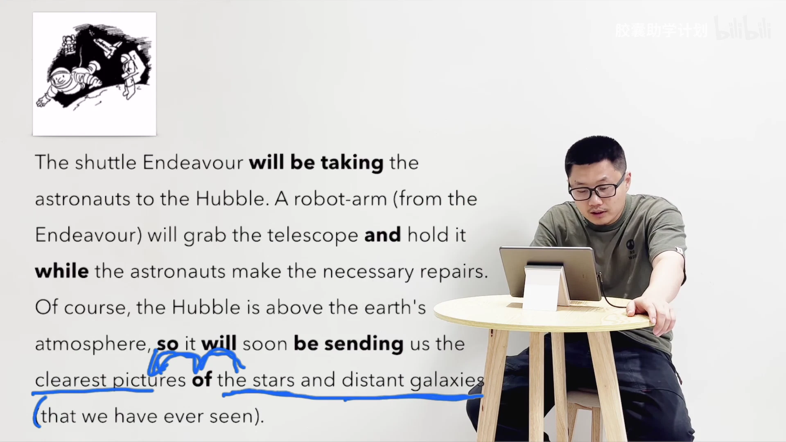

文字识别：The shuttle Endeavour will be taking the / astronauts to the Hubble. A robot-arm (from the / Endeavour) will grab the telescope and hold it / while the astronauts make the necessary repairs. / Of course, the Hubble is above the earth's / atmosphere, so it will soon be sending us the / clearest pictures of the stars and distant galaxies / (that we have ever seen).

### 画面 00:06:16

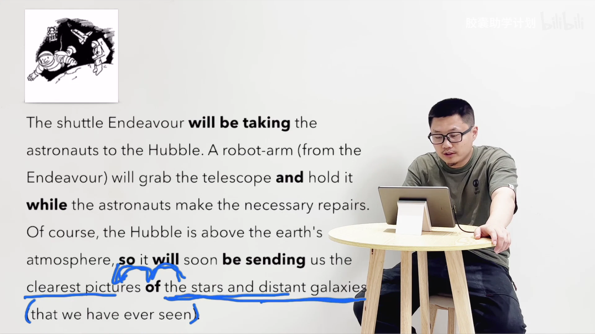

文字识别：The shuttle Endeavour will be taking the / astronauts to the Hubble. A robot-arm (from the / Endeavour) will grab the telescope and hold it / while the astronauts make the necessary repairs. / Of course, the Hubble is above the earth's / atmosphere, so it will soon be sending us the / clearest pictures of the stars and distant galaxies / (that we have ever seen)

### 画面 00:06:21

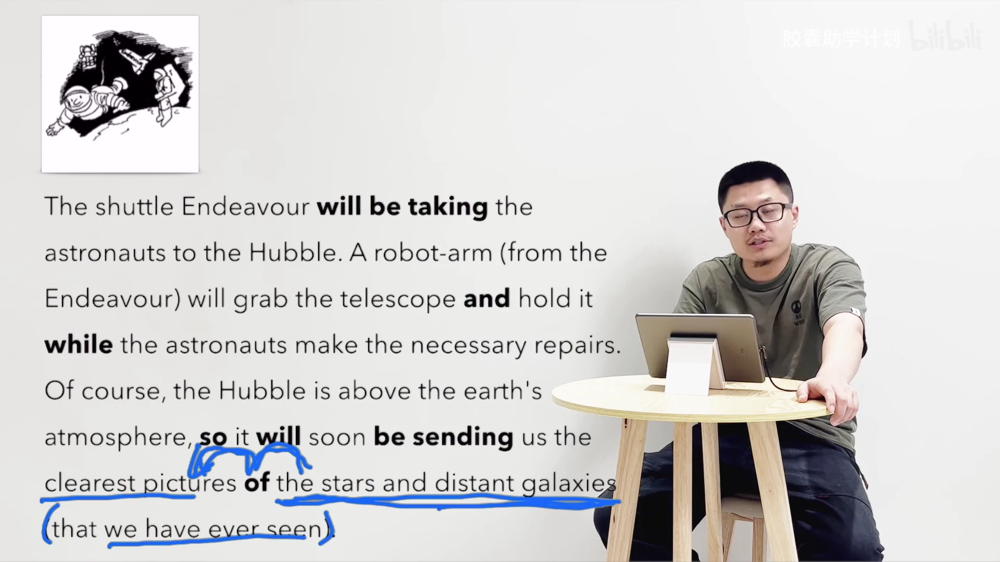

文字识别：The shuttle Endeavour will be taking the / astronauts to the Hubble. A robot-arm (from the / Endeavour) will grab the telescope and hold it / while the astronauts make the necessary repairs. / Of course, the Hubble is above the earth's / atmosphere, so it will soon be sending us the / clearest pictures of the stars and distant galaxies / (that we have ever seen)

## 00:06:30–00:07:00

OK, there we go. Continue. The Hubble will tell us a great deal about the age and size of the universe. A great deal, we've just learned. Ah, it's similar to some, right? Many, ah, uh, some, many, ah, similar to a lot of, should be, ah, similar to a lot of. This Hubble telescope will tell us a great deal about the age and size of the universe. The age and size of the universe.

### 画面 00:06:31

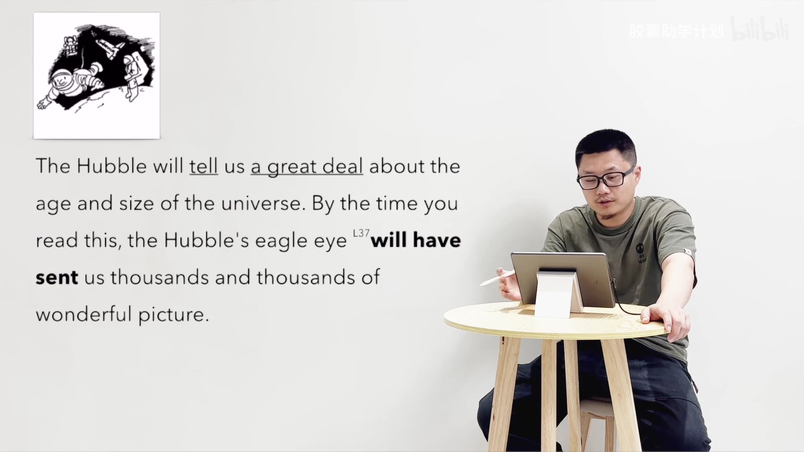

文字识别：The Hubble will tell us a great deal about the / age and size of the universe. By the time you / e L37will have / read this, the Hubble's eagle eye / sent us thousands and thousands of / wonderful picture.

## 00:07:00–00:07:30

宇宙的年龄和大小, size,尺码,尺寸。那你说这个universe的尺码尺寸就是大小。By the time you read this,截止到你读这篇文章的时候呢, the Eagle's呃呃the the Hubble's Eagle Eye will have sent us thousands and thousands of wonderful pictures.说哈勃望远镜的这个鹰眼系统，还是那句话，它的字

### 画面 00:07:01

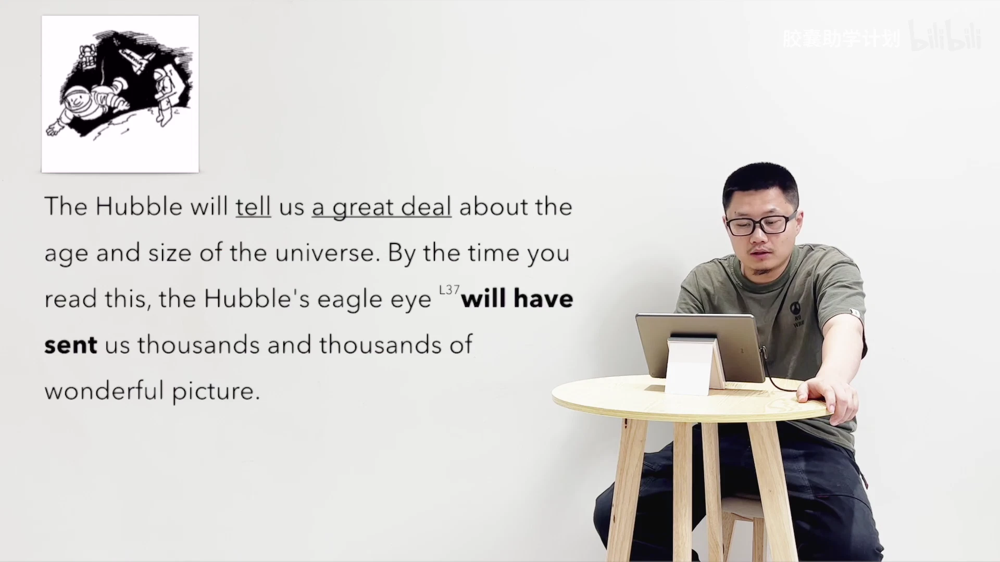

文字识别：The Hubble will tell us a great deal about the / age and size of the universe. By the time you / e L37will have / read this, the Hubble's eagle eye / sent us thousands and thousands of / wonderful picture.

### 画面 00:07:04

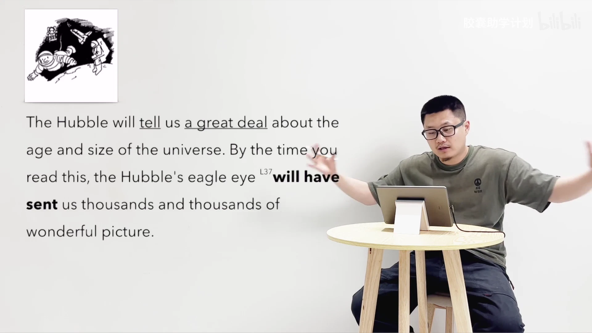

文字识别：The Hubble will tell us a great deal about the / age and size of the universe. By the time yoy / e L37will have / read this, the Hubble's eagle eye / sent us thousands and thousands of / wonderful picture.

### 画面 00:07:09

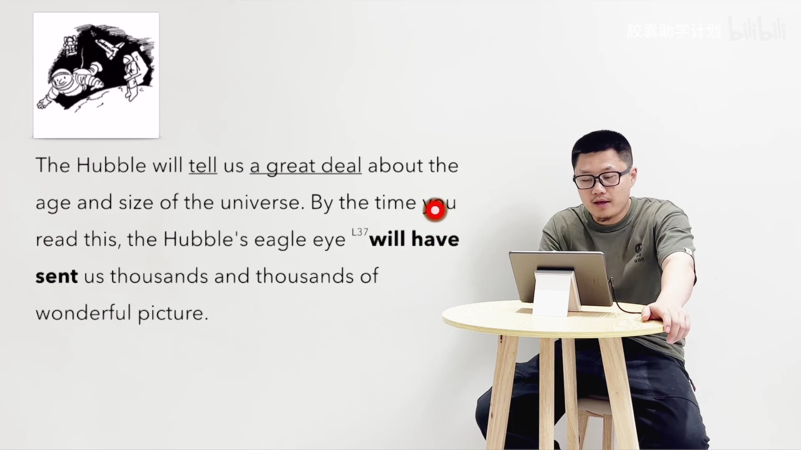

文字识别：The Hubble will tell us a great deal about the / age and size of the universe. By the time / e [37will have / read this, the Hubble's eagle eye / WHR / sent us thousands and thousands of / wonderful picture.

## 00:07:30–00:08:00

面意思就是它虽然啊，ego是鹰，爱是眼，我给你翻译成鹰眼，你可能觉得我这儿胡编的，不是它翻译成汉语真的就叫鹰眼，是吧？这个鹰眼具体是怎么操作的，怎么处理的？我理解为这应该是一个工程学系统的东西，我确实不是很懂啊。这跟我们学英语关系也不是特别大，各位感兴趣自己去查一下，它是非常专业的知识啊。我们在这就不多说了，你只要知道它是个系统就可以了啊。有这么一个

### 画面 00:07:32

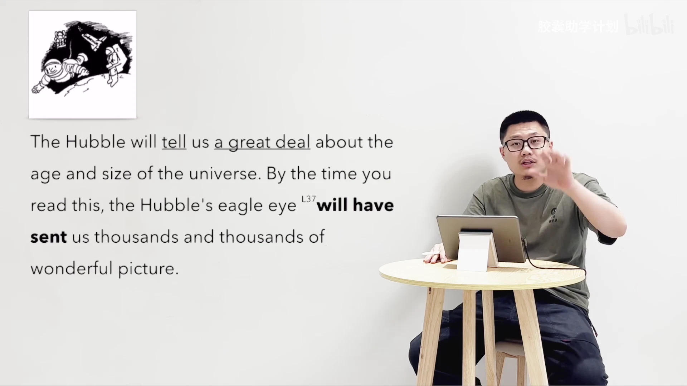

文字识别：The Hubble will tell us a great deal about the / age and size of the universe. By the time you / e [37will have / read this, the Hubble's eagle eye / sent us thousands and thousands of / wonderful picture.

### 画面 00:07:58

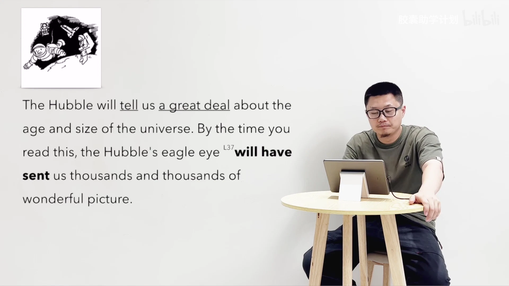

文字识别：The Hubble will tell us a great deal about the / age and size of the universe. By the time you / e L37will have / read this, the Hubble's eagle eye / sent us thousands and thousands of / wonderful picture.

## 00:08:00–00:08:30

呃东西啊，Hubble's eagle eye will have sent us将给我们发送什么呢？Thousands and thousands of wonderful pictures，数以千计的很棒的图片。这个什么？那你可能问了，他为什么不用 thousands of wonderful pictures呢？他用这个 thousands and thousands，其实就是强调一下，本质上跟 thousands of wonderful pictures 没什么区别。听到了吧？成千上万的，就是这么个东

### 画面 00:08:28

文字识别：The Hubble will tell us a great deal about the / age and size of the universe. By the time you / e [37will have / read this, the Hubble's eagle eye / sent us thousands and thousands of / wonderful picture.

## 00:08:30–00:09:00

西啊。本课呢很关键，就一个 write from the start，叫从最开始造句呢也不难，几乎就随便造。你比如说 write from the start，从最开始，你能造的后边的东西很多，因为主谓宾都是开放的，对吧？He complained of his work and his boss. 从最开始他就抱怨他的工作和他的老板。再来，My mom forbade me, forbade me，两个都可以 to watch TV from Monday to Friday.

### 画面 00:08:31

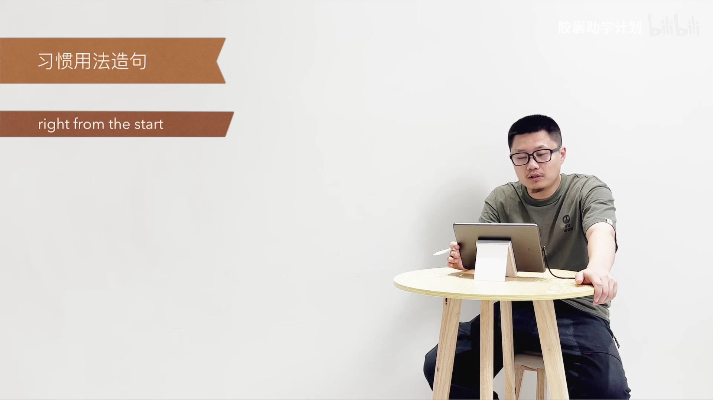

文字识别：习惯用法造句 / right from the start

### 画面 00:08:34

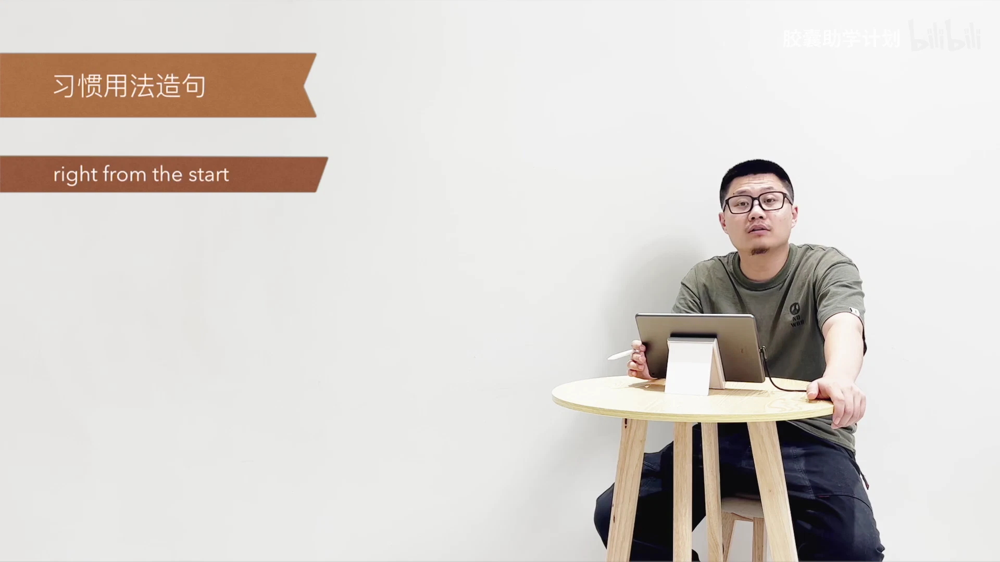

文字识别：习惯用法造句 / right from the start / NU

### 画面 00:08:36

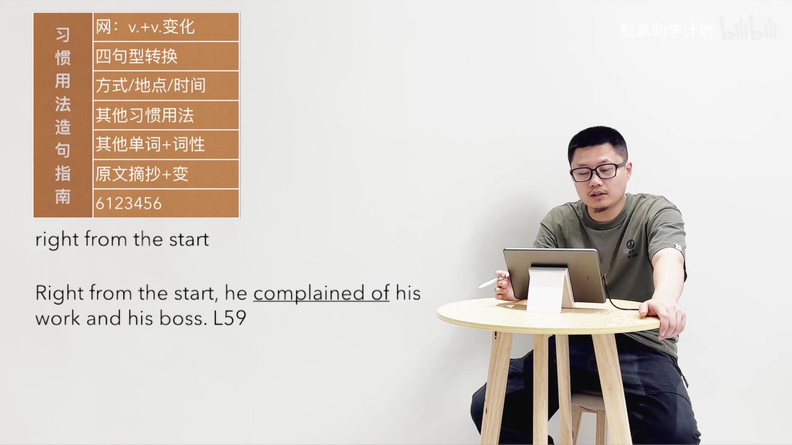

文字识别：网：v.+v.变化 / 习惯用法造句指南 / 四句型转换 / 方式/地点/时间 / 其他习惯用法 / 其他单词+词性 / 原文摘抄+变 / 6123456 / right from the start / Right from the start, he complained of his / work and his boss. L59

### 画面 00:08:38

文字识别：网：v.+v.变化 / 习惯用法造句指南 / 四句型转换 / 方式/地点/时间 / 其他习惯用法 / 其他单词+词性 / 原文摘抄+变 / 6123456 / right from the start / Right from the start, he complained of his / work and his boss. L59

### 画面 00:08:40

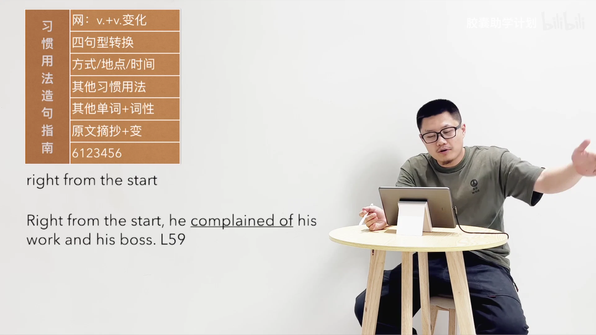

文字识别：网：v.+v.变化 / 习惯用法造句指南 / 四句型转换 / 方式/地点/时间 / 其他习惯用法 / 其他单词+词性 / 原文摘抄+变 / 6123456 / right from the start / Right from the start, he complained of his / work and his boss. L59

### 画面 00:08:44

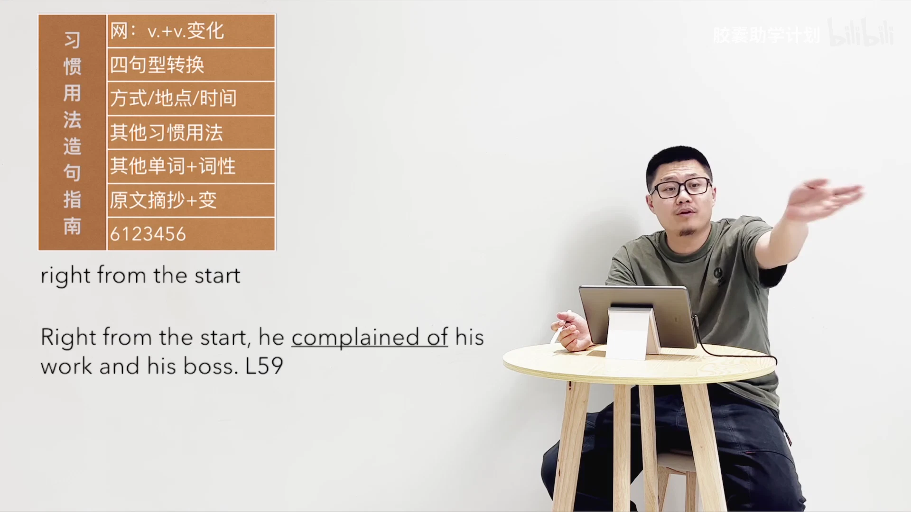

文字识别：网：v.+v.变化 / 习惯用法造句指南 / 四句型转换 / 方式/地点/时间 / 其他习惯用法 / 其他单词+词性 / 原文摘抄+变 / 6123456 / right from the start / Right from the start, he complained of his / work and his boss. L59

### 画面 00:08:48

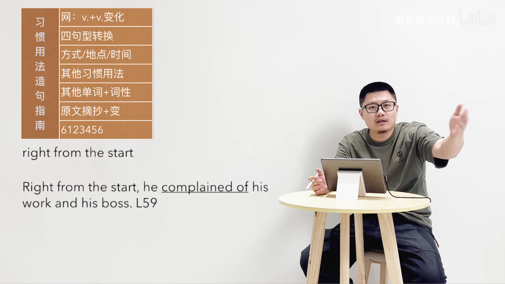

文字识别：网：v.+v.变化 / 习惯用法造句指南 / 四句型转换 / 方式/地点/时间 / 其他习惯用法 / 其他单词+词性 / 原文摘抄+变 / 6123456 / right from the start / ® / NU / Right from the start, he complained of his / work and his boss. L59

### 画面 00:08:50

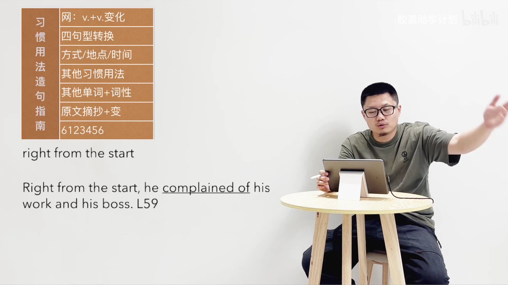

文字识别：网：v.+v.变化 / 习惯用法造句指南 / 四句型转换 / 方式/地点/时间 / 其他习惯用法 / 其他单词+词性 / 原文摘抄+变 / 6123456 / right from the start / Right from the start, he complained of his / work and his boss. L59

### 画面 00:08:52

文字识别：网：v.+v.变化 / 习惯用法造句指南 / 四句型转换 / 方式/地点/时间 / 其他习惯用法 / 其他单词+词性 / 原文摘抄+变 / 6123456 / right from the start / WI / Right from the start, he complained of his / work and his boss. L59 / My mom forbade me to watch TV from / Monday to Friday, right from the start. L51

### 画面 00:08:54

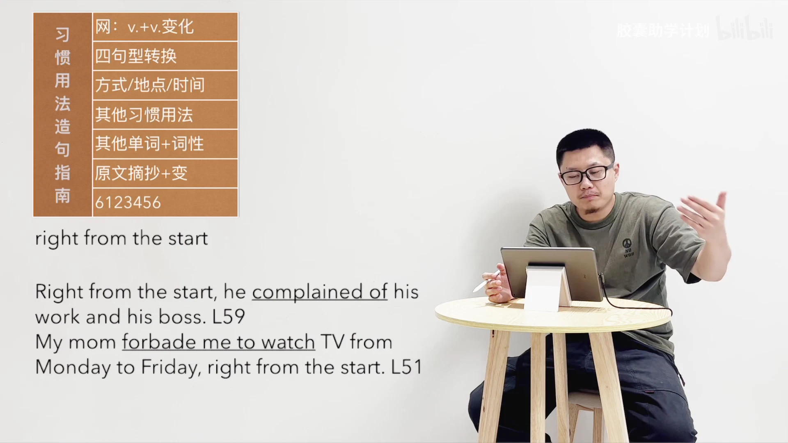

文字识别：网：v.+v.变化 / 习惯用法造句指南 / 四句型转换 / 方式/地点/时间 / 其他习惯用法 / 其他单词+词性 / 原文摘抄+变 / 6123456 / right from the start / WI / Right from the start, he complained of his / work and his boss. L59 / My mom forbade me to watch TV from / Monday to Friday, right from the start. L51

### 画面 00:08:59

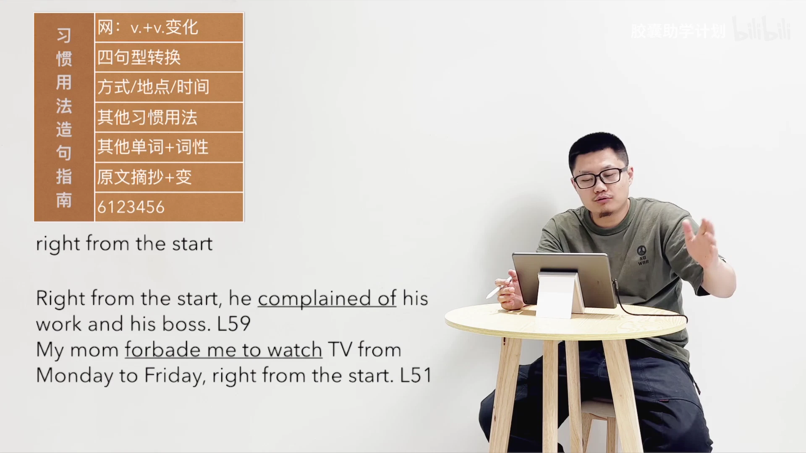

文字识别：网：v.+v.变化 / 习惯用法造句指南 / 四句型转换 / 方式/地点/时间 / 其他习惯用法 / 其他单词+词性 / 原文摘抄+变 / 6123456 / right from the start / NU / wnnt / Right from the start, he complained of his / work and his boss. L59 / My mom forbade me to watch TV from / Monday to Friday, right from the start. L51

## 00:09:00–00:09:30

right from the start. From最开始，我妈妈就禁止我从周一到周五看电视，啊，再来. Right from the start, I can tell the difference between these two. From最开始，I can't tell the difference.我就没有办法讲清楚、分辨清楚这两者之间的区别，对吧？好，那接下来呢，我们看几个电影片段，啊，注意力集中来了. See, I don't believe she loves the guy right from the start. Next one. I told

### 画面 00:09:02

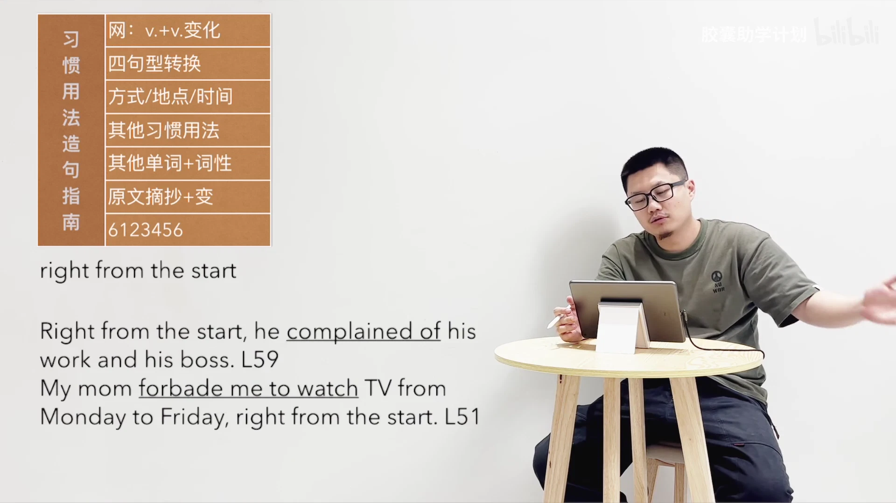

文字识别：网：v.+v.变化 / 习惯用法造句指南 / 四句型转换 / 方式/地点/时间 / 其他习惯用法 / 其他单词+词性 / 原文摘抄+变 / 6123456 / WM / right from the start / WI / Right from the start, he complained of his / work and his boss. L59 / My mom forbade me to watch TV from / Monday to Friday, right from the start. L51

### 画面 00:09:04

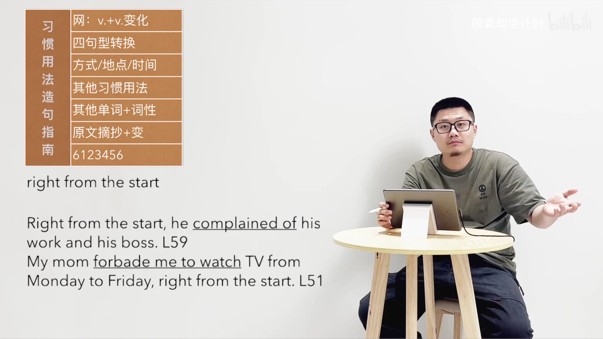

文字识别：网：v.+v.变化 / 习惯用法造句指南 / 四句型转换 / 方式/地点/时间 / 其他习惯用法 / 其他单词+词性 / 原文摘抄+变 / 6123456 / right from the start / W / NU / Right from the start, he complained of his / work and his boss. L59 / My mom forbade me to watch TV from / Monday to Friday, right from the start. L51

### 画面 00:09:06

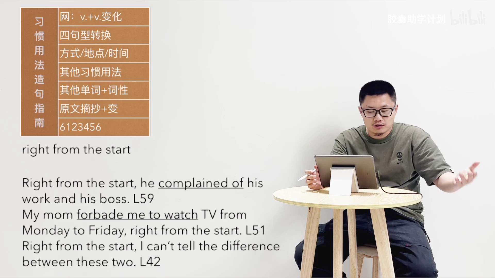

文字识别：网：v.+v.变化 / 习惯用法造句指南 / 四句型转换 / 方式/地点/时间 / 其他习惯用法 / 其他单词+词性 / 原文摘抄+变 / 6123456 / right from the start / NU / WAR / Right from the start, he complained of his / work and his boss. L59 / My mom forbade me to watch TV from / Monday to Friday, right from the start. L51 / Right from the start, I can't tell the difference / between these two. L42

### 画面 00:09:09

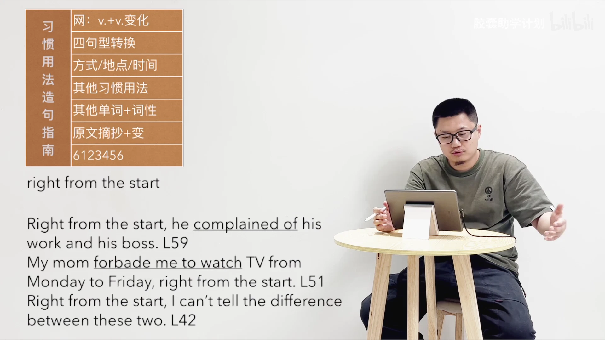

文字识别：网：v.+v.变化 / 习惯用法造句指南 / 四句型转换 / 方式/地点/时间 / 其他习惯用法 / 其他单词+词性 / 原文摘抄+变 / 6123456 / right from the start / NU / WNR / Right from the start, he complained of his / work and his boss. L59 / My mom forbade me to watch TV from / Monday to Friday, right from the start. L51 / Right from the start, I can't tell the difference / between these two. L42

### 画面 00:09:14

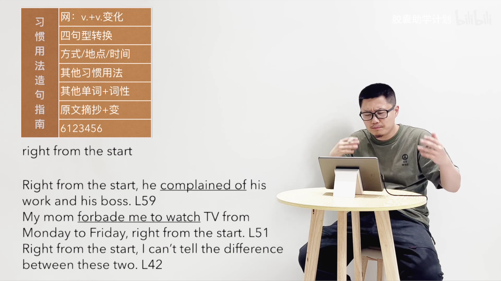

文字识别：网：v.+v.变化 / 习惯用法造句指南 / 四句型转换 / 方式/地点/时间 / 其他习惯用法 / 其他单词+词性 / 原文摘抄+变 / 6123456 / right from the start / NU / WII / Right from the start, he complained of his / work and his boss. L59 / My mom forbade me to watch TV from / Monday to Friday, right from the start. L51 / Right from the start, I can't tell the difference / between these two. L42

### 画面 00:09:17

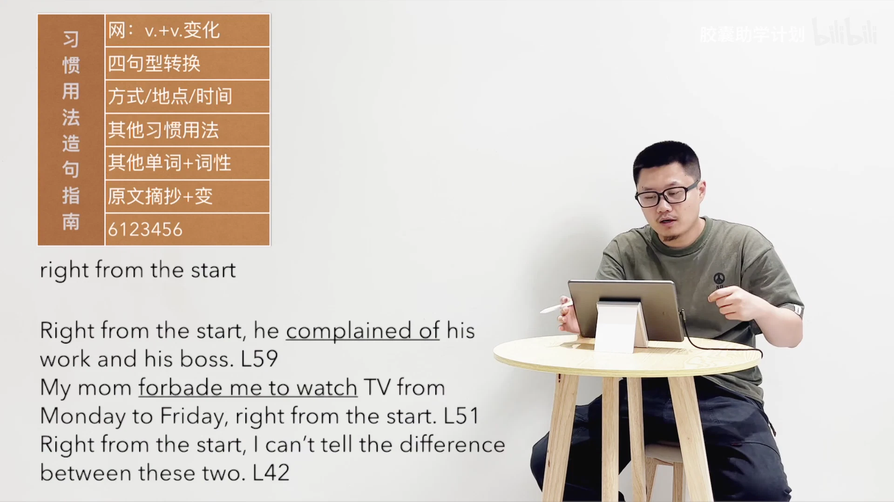

文字识别：网：v.+v.变化 / 习惯用法造句指南 / 四句型转换 / 方式/地点/时间 / 其他习惯用法 / 其他单词+词性 / 原文摘抄+变 / 6123456 / right from the start / Right from the start, he complained of his / work and his boss. L59 / My mom forbade me to watch TV from / Monday to Friday, right from the start. L51 / Right from the start, I can't tell the difference / between these two. L42

### 画面 00:09:19

文字识别：See, I don't believe she loves the guy / right from the start. / NU / WR / Bullets Over Broadway / (1994)

### 画面 00:09:23

文字识别：See, I don't believe she loves the guy / right from the start. / Bullets Over Broadway / (1994)

### 画面 00:09:25

文字识别：See, I don't believe she loves the guy / right from the start. / Bullets Over Broadway / (1994)

### 画面 00:09:27

文字识别：I told them right from the start / I wasn't gonna pay. / Life of Crime / (2013)

### 画面 00:09:29

文字识别：I told them right from the start / I wasn't gonna pay. / Life of Crime / (2013)

## 00:09:30–00:10:00

them right from the start I wasn't going to pay.最后一个。 I said it was a stupid idea right from the start, but nobody listened to me. That's good. Okay, very good. Recap right from the start.啊，家庭作业，习惯用法造句，文章跟读至熟读成诵。啊，这篇文章读起来不会特别的简单，各位不妨多读几遍。啊，都是熟能生巧的活，好吧？二十遍不行，三十遍，三

### 画面 00:09:31

文字识别：I told them right from the start / I wasn't gonna pay. / Life of Crime / (2013)

### 画面 00:09:33

文字识别：I said it was a stupid idea right from the start, / but nobody listened to me. / Lucky Numbers / (2000)

### 画面 00:09:35

文字识别：I said it was a stupid idea right from the start, / but nobody listened to me. / MioseYou / Lucky Numbers / (2000)

### 画面 00:09:37

文字识别：I said it was a stupid idea right from the start, / but nobody listened to me. / Lucky Numbers / (2000)

### 画面 00:09:39

文字识别：I said it was a stupid idea right from the start, / but nobody listened to me. / Lucky Numbers / (2000)

### 画面 00:09:41

文字识别：Recap / Expression / right from the start

### 画面 00:09:43

文字识别：Recap / Expression / right from the start / NU / WIR

### 画面 00:09:45

文字识别：Recap / Expression / right from the start / NU / wnn

### 画面 00:09:47

文字识别：1. / 习惯用法造句/对话 / 【习惯用法造句指南】 / 每个5句 / NU

### 画面 00:09:49

文字识别：习惯用法造句/对话 / 1. / 【习惯用法造句指南】 / 每个5句 / 文章跟读至熟读成诵 / 内化单词+语法+习惯用法 / 听力+口语+写作练习 / NU

### 画面 00:09:54

文字识别：习惯用法造句/对话 / 1. / 【习惯用法造句指南】 / 每个5句 / 文章跟读至熟读成诵 / 内化单词+语法+习惯用法 / 听力+口语+写作练习 / 00

## 00:10:00–00:10:30

十遍不行，四十遍，四十遍不行，五十遍啊！然后呢，重复间隔，置顶留言可以找到重复间隔的材料。那以上呢，就是本期视频的全部内容了。如果各位喜欢我们的课程呢，欢迎各位关注、订阅、一键三连，分享给更多的朋友来帮助我们快速成长。See you next time.

### 画面 00:10:03

文字识别：1. / 习惯用法造句/对话 / 【习惯用法造句指南】 / 每个5句 / 文章跟读至熟读成诵 / 内化单词+语法+习惯用法 / 听力+口语+写作练习 / 3. / 重复间隔（置顶留言）

### 画面 00:10:05

文字识别：习惯用法造句/对话 / 【习惯用法造句指南】 / 每个5句 / 文章跟读至熟读成诵 / 内化单词+语法+习惯用法 / 听力+口语+写作练习 / 重复间隔 （置顶留言) / 3.

### 画面 00:10:07

文字识别：不 / NU / WIR

### 画面 00:10:16

文字识别：山 / NI / WIR

### 画面 00:10:18

### 画面 00:10:21

文字识别：CAPSULEACADEMY / 胶囊助学计划 / 『 / 小红书 / OE

### 画面 00:10:23

文字识别：CAPSULEACADEMY / 胶囊助学计划 / 小红书 / 品 / OE

### 画面 00:10:29

文字识别：CAPSULEACADEMY / 胶囊助学计划 / 小红书 / Creator / Leo & Berlin / OE

## 00:10:30–00:10:33

### 画面 00:10:31

文字识别：bilibili / 胶囊助学计划

### 画面 00:10:32

文字识别：bilibili / 胶囊助学计划

