# 061 练习

快速机器解析：语音为单模型转写，未进行独立交叉校对或人工复核；画面每秒采样并按变化选帧，短时文字和标记可能遗漏。截图时间约有 1 秒误差。图片有损压缩；遇到疑点请按时间查看 Google Drive 原视频。

## 00:00:00–00:00:30

Hello everyone, welcome to Capsule Academy. This is Leo. Today we're going to learn New Concept English Book Two, Lesson Sixty One Practices. 那注意，进行如下练习，唯一的前提就是文章您一定要跟读至熟读成诵，否则请勿开始。 Hope you gonna enjoy it. 第一道题 Comprehension. 那我们练的是听懂一般疑问句和特殊疑问句的能力。所以这个文章

### 画面 00:00:00

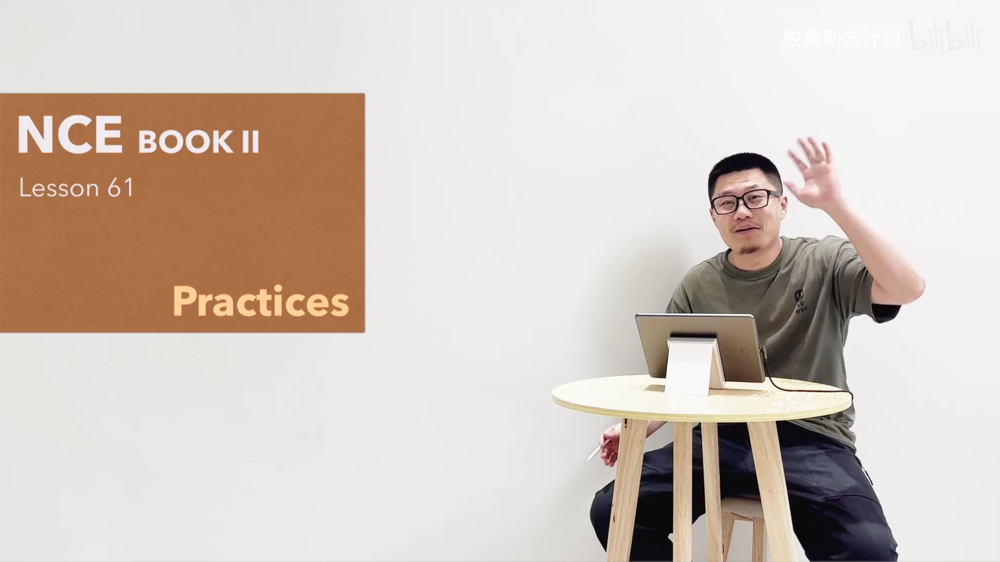

文字识别：NCE / BOOKII / Lesson 61 / Practices

### 画面 00:00:02

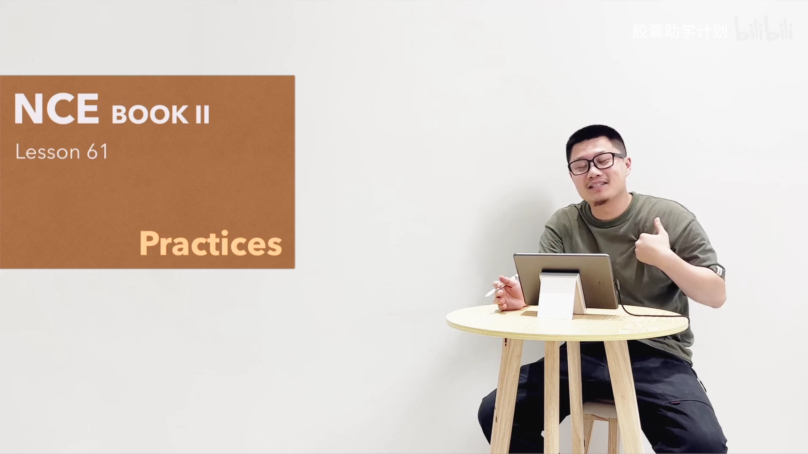

文字识别：NCE / BOOK"I / Lesson 61 / Practices

### 画面 00:00:05

文字识别：NCE / BOOK"I / Lesson 61 / Practices / WIR

### 画面 00:00:08

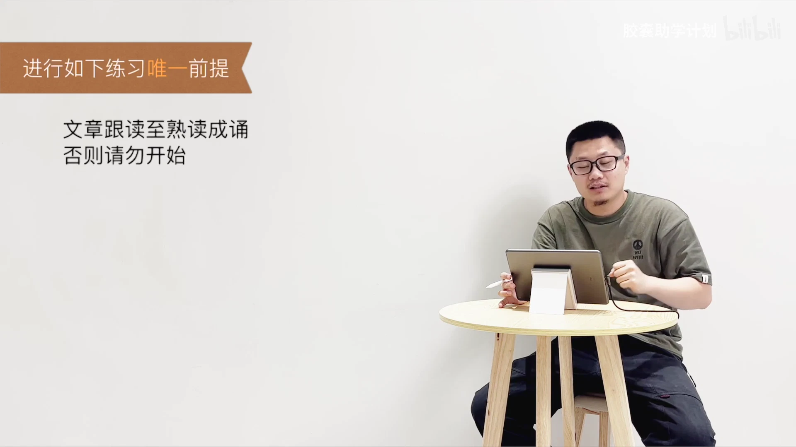

文字识别：进行如下练习唯一前提 / 文章跟读至熟读成诵 / 否则请勿开始 / NU / wnn

### 画面 00:00:12

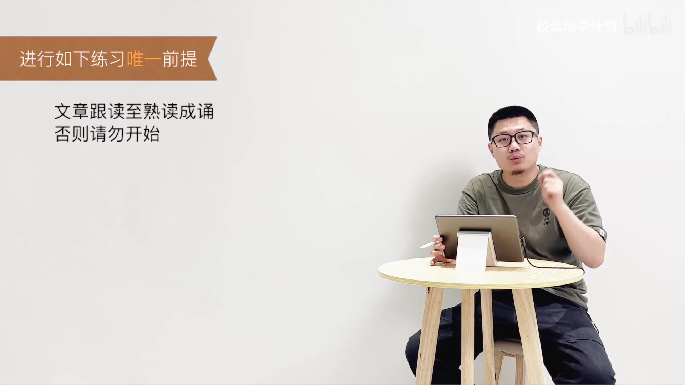

文字识别：进行如下练习唯一前提 / 文章跟读至熟读成诵 / 否则请勿开始 / NUI / WnR

### 画面 00:00:17

文字识别：进行如下练习唯一前提 / 文章跟读至熟读成诵 / 否则请勿开始

### 画面 00:00:19

文字识别：胶囊助学计划bill

### 画面 00:00:22

文字识别：胶囊助学计划

### 画面 00:00:24

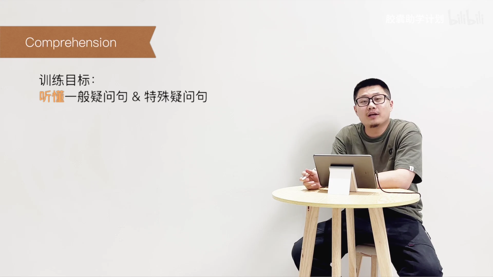

文字识别：Comprehension / 训练目标： / 听懂一般疑问句＆特殊疑问句

## 00:00:30–00:01:00

听懂呃，跟熟读成诵就非常重要了。我问您答，咱们练听力和口语啊。第一个，When was the Hubble Telescope launched into space? Answer: On April twentieth, nineteen ninety. Next one, Who launched the telescope? NASA. What was the cost? Over a

### 画面 00:00:37

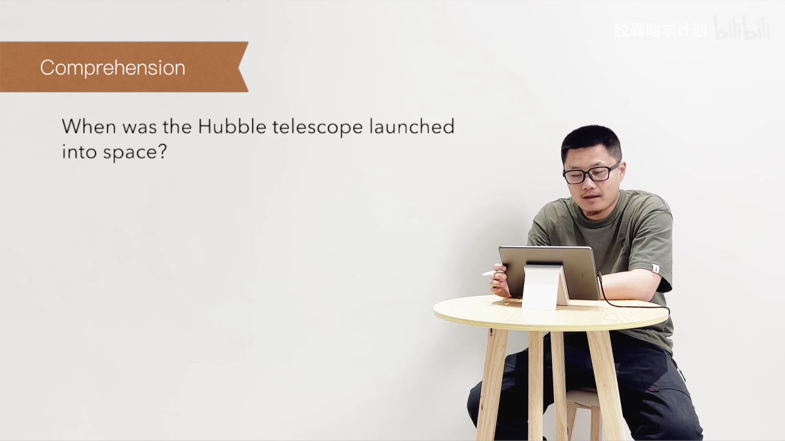

文字识别：Comprehension / When was the Hubble telescope launched / into space?

### 画面 00:00:59

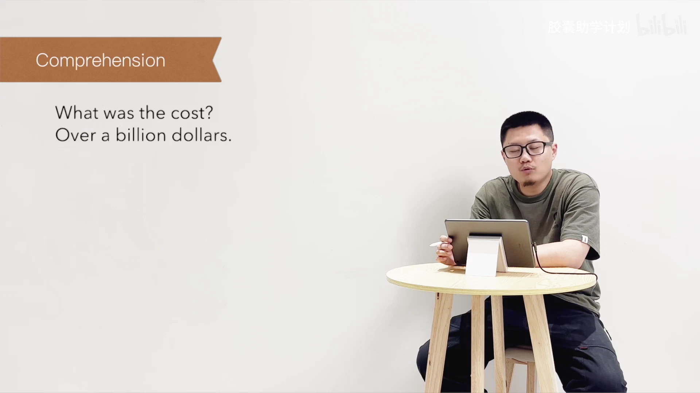

文字识别：Comprehension / What was the cost? / Over a billion dollars.

## 00:01:00–00:01:30

billion dollars. When did the trouble begin? Right from the start. What was the trouble? The pictures it sent us were very disappointing. Why were the pictures disappointing? Because the telescope's main mirror was faulty. What

### 画面 00:01:13

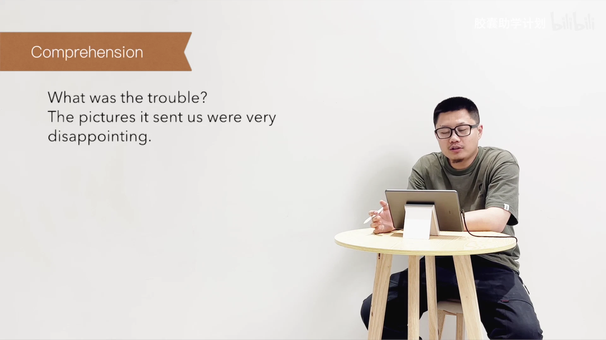

文字识别：Comprehension / What was the trouble? / The pictures it sent us were very / disappointing.

### 画面 00:01:19

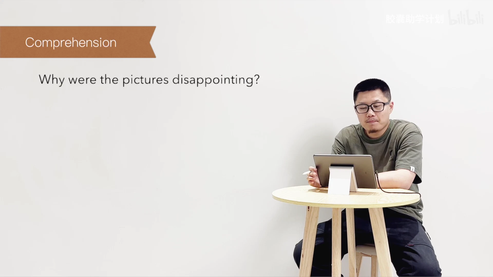

文字识别：Comprehension / Why were the pictures disappointing?

## 00:01:30–00:02:00

is NASA planning to do? It will be sending four astronauts to repair it. How will the astronauts get to the telescope? The shuttle Endeavour will take them there. How will the shuttle grab the telescope? A robot arm from the shuttle will grab the telescope.

### 画面 00:01:32

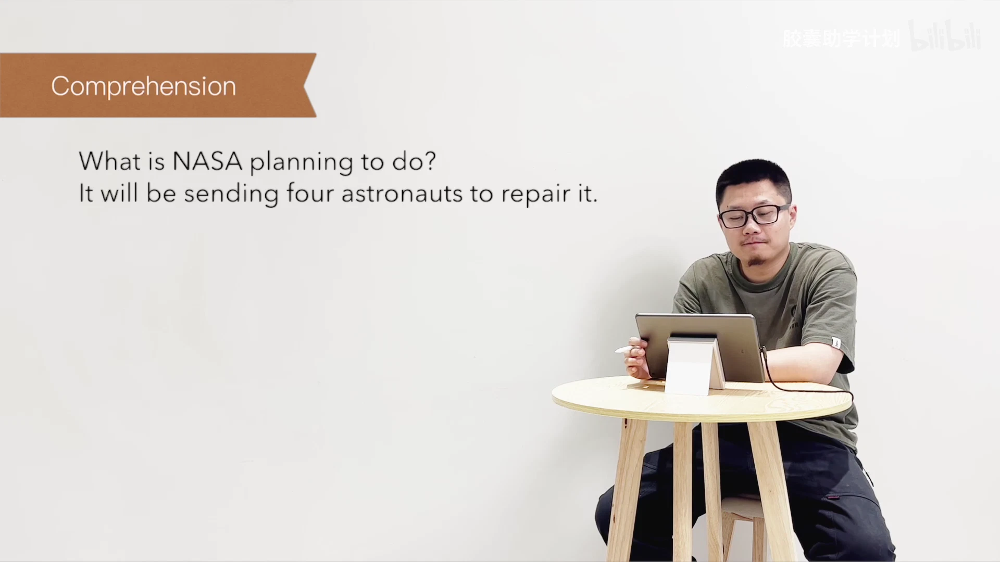

文字识别：Comprehension / What is NASA planning to do? / It will be sending four astronauts to repair it.

### 画面 00:01:35

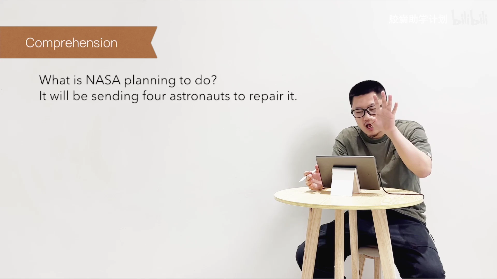

文字识别：Comprehension / What is NASA planning to do? / It will be sending four astronauts to repair it.

### 画面 00:01:38

文字识别：Comprehension / What is NASA planning to do? / It will be sending four astronauts to repair it.

### 画面 00:01:40

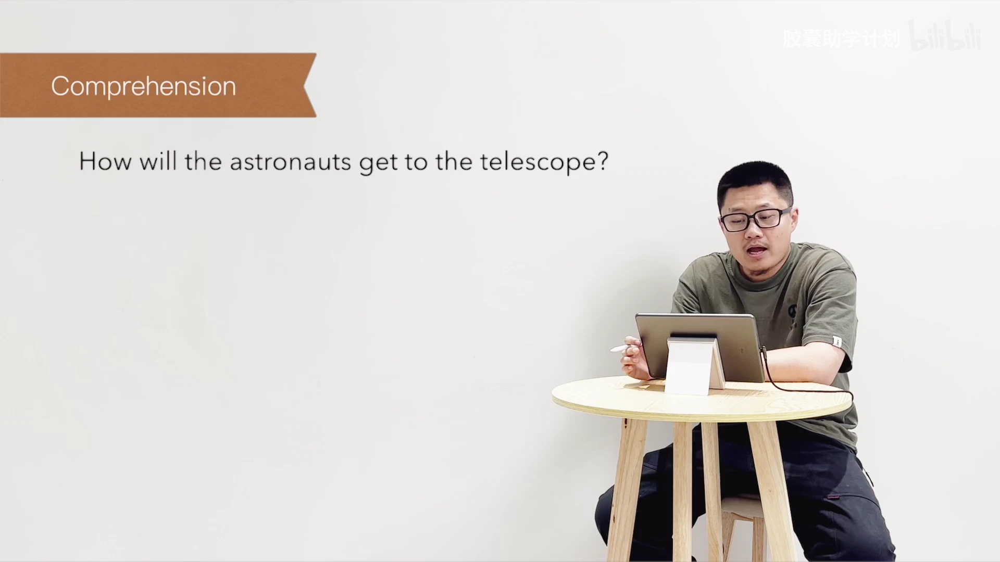

文字识别：Comprehension / How will the astronauts get to the telescope?

### 画面 00:01:53

文字识别：Comprehension / How will the shuttle grab the telescope? / A robot-arm from the shuttle will grab the telescope.

## 00:02:00–00:02:30

Where is the telescope? Above the Earth's atmosphere. What kinds of pictures shall we get soon? The clearest ones that we have ever seen. What will the pictures show us? The stars and distant galaxies. What will the Hubble tell us?

### 画面 00:02:00

文字识别：Comprehension / Where is the telescope?

### 画面 00:02:12

文字识别：Comprehension / What kinds of pictures shall we get soon? / The clearest ones that we have ever seen.

### 画面 00:02:18

文字识别：Comprehension / What will the pictures show us?

## 00:02:30–00:03:00

A great deal about the age and size of the universe. Asking questions,老习惯，四句型转换，对吧？帮助我们去张嘴说出来一般疑问句和特殊疑问句。第一个，哎，先给一个例子。The Hubble telescope was launched into space. Was提前，What? Hubble telescope,对吧？What was launched into space?直接替代主语，不用变一般疑问句啊。第二个，The cost

### 画面 00:02:30

文字识别：Comprehension / What will the Hubble tell us? / A great deal about the age and size of the / universe.

### 画面 00:02:36

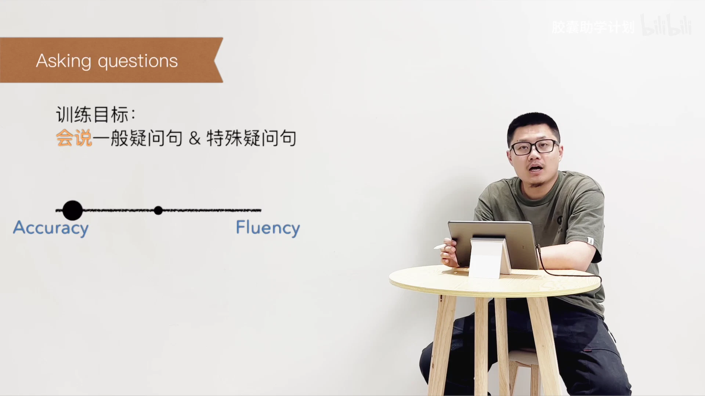

文字识别：Asking questions / 训练目标： / 会说一般疑问句＆特殊疑问句 / Accuracy / Fluency

### 画面 00:02:44

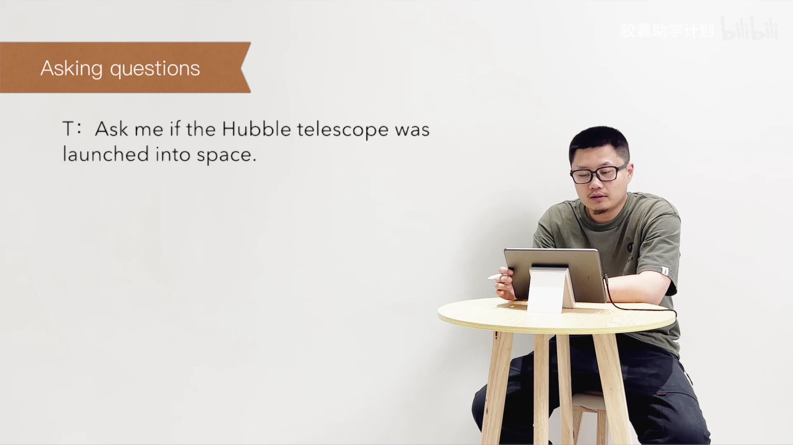

文字识别：Asking questions / T: Ask me if the Hubble telescope was / launched into space.

### 画面 00:02:51

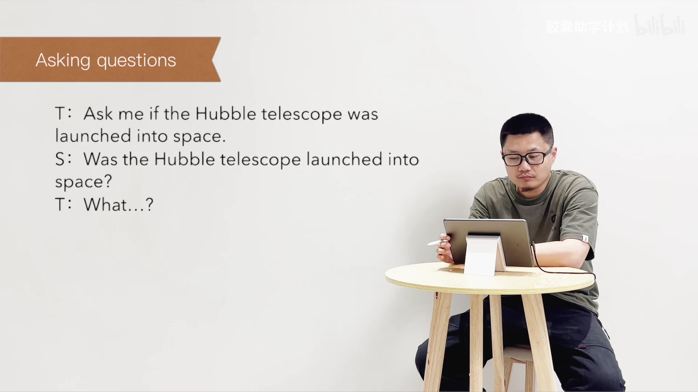

文字识别：Asking questions / T: Ask me if the Hubble telescope was / launched into space. / S: Was the Hubble telescope launched into / space? / T:What...?

### 画面 00:02:57

文字识别：Asking questions / 1. The Hubble telescope was launched into space. / (What)

## 00:03:00–00:03:30

was over a billion dollars. Was往前提，how much肯定是对over a billion dollars提问的是吧？There was trouble right from the start. 这是一个六新概念一册六十七课学过的，there was there be句型的一般过去式啊。问肯定是对right from the start. The pictures were very disappointing. Were提前，why整句。NASA will put the telescope right.

### 画面 00:03:01

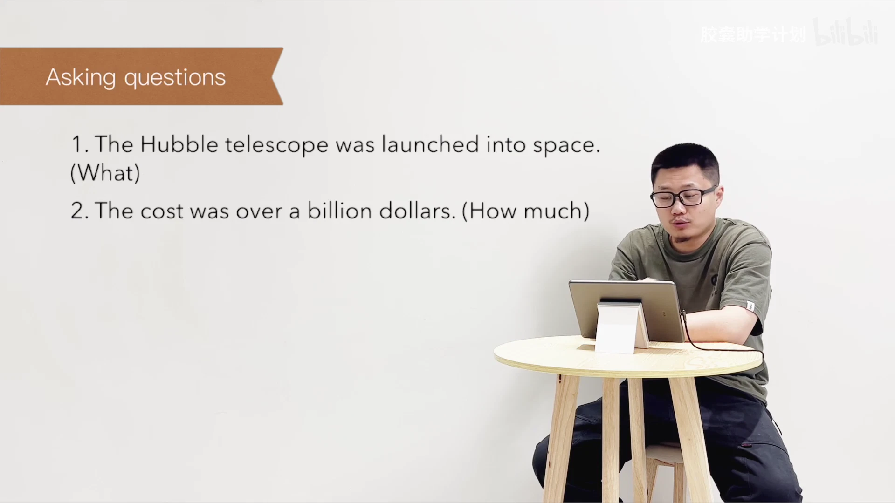

文字识别：Asking questions / 1.The Hubble telescope was launched into space. / (What) / 2. The cost was over a billion dollars. (How much)

### 画面 00:03:07

文字识别：Asking questions / 1. The Hubble telescope was launched into space. / (What) / 2. The cost was over a billion dollars. (How much) / 3. There was trouble right from the start. (When)

### 画面 00:03:23

文字识别：Asking questions / 1.The Hubble telescope was launched into space. / (What) / 2. The cost was over a billion dollars. (How much) / 3. There was trouble right from the start. (When) / 4. The pictures were very disappointing.(Why)

### 画面 00:03:27

文字识别：Asking questions / 1. The Hubble telescope was launched into space. / (What) / 2. The cost was over a billion dollars.(How much) / 3. There was trouble right from the start. (When) / 4. The pictures were very disappointing.(Why) / 5. NASA will put the telescope right.(How)

## 00:03:30–00:04:00

Will提前. How啊呃你可以加整句，我认为可以加整句叫How will NASA put the telescope right啊？那就答案就在文章里了，是吧？Four astronauts will be sent up to repair it. Will提前。那How many肯定是对Four提问，不用变一般疑问句。How many直接替代Four就搞定了。How many astronauts巴拉巴拉巴拉，剩下照抄。Endeavor will take

### 画面 00:03:41

文字识别：Asking questions

### 画面 00:03:57

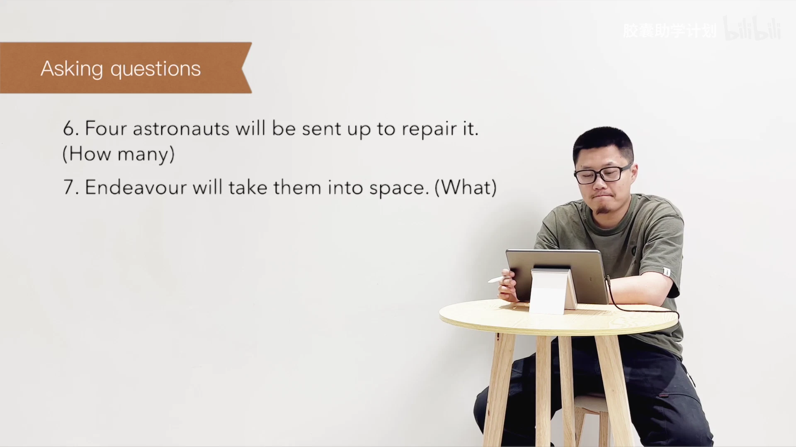

文字识别：Asking questions / 6. Four astronauts will be sent up to repair it. / (How many) / 7. Endeavour will take them into space. (What)

## 00:04:00–00:04:30

them into space. Will提前what对endeavor提问。A robot arm will grab the telescope. Will提前what对robot arm提问。当然也可以对the telescope提问，对吧？The Hubble is above the Earth's atmosphere. Is提前where对above the Earth's atmosphere提问。就其实就是where is the Hubble？The Hubble will tell us about the age and size of the universe.

### 画面 00:04:13

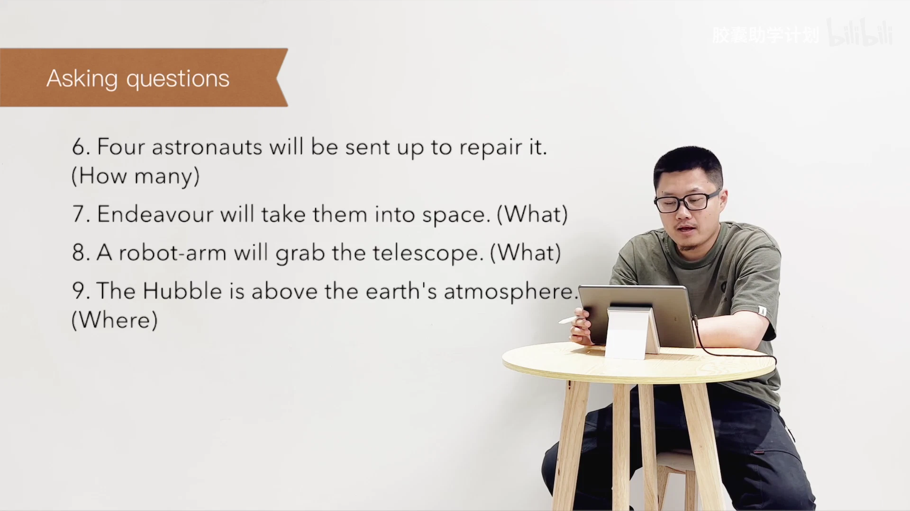

文字识别：Asking questions / 6. Four astronauts will be sent up to repair it. / (How many) / 7. Endeavour will take them into space.(What) / 8.A robot-arm will grab the telescope. (What) / 9. The Hubble is above the earth's atmosphere. / (Where)

### 画面 00:04:23

文字识别：Asking questions / 6. Four astronauts will be sent up to repair it. / (How many) / 7. Endeavour will take them into space.(What) / 8.A robot-arm will grab the telescope. (What) / 9. The Hubble is above the earth's atmosphere. / (Where) / 10. The Hubble will tell us about the age and / size of the universe.(What)

### 画面 00:04:25

文字识别：Asking questions / 6. Four astronauts will be sent up to repair it. / (How many) / 7. Endeavour will take them into space. (What) / 8.A robot-arm will grab the telescope. (What) / 9. The Hubble is above the earth's atmosphere. / (Where) / 10. The Hubble willtell us about the age and / size of the universe.(What)

### 画面 00:04:27

文字识别：Asking questions / 6. Four astronauts will be sent up to repair it. / (How many) / 7. Endeavour will take them into space. (What) / 8.A robot-arm will grab the telescope. (What) / 9. The Hubble is above the earth's atmosphere. / (Where) / 10. The Hubble will tell us about the age and / size of the universe.(What)

## 00:04:30–00:05:00

will提前what对的是the age and size of the universe提问. Tell the story只多提一句，练的是流利性，不是准确性。我们应试考试考的几乎都是准确性，从来基本不太考流利性，是吧？那这个实际应用呢，也有流利性的问题。所以文章读熟了，看着这些关键词，提醒你自己

### 画面 00:04:37

文字识别：Tell the story / 训练目标： / 口语复述能力 / Accuracy / Fluency

### 画面 00:04:39

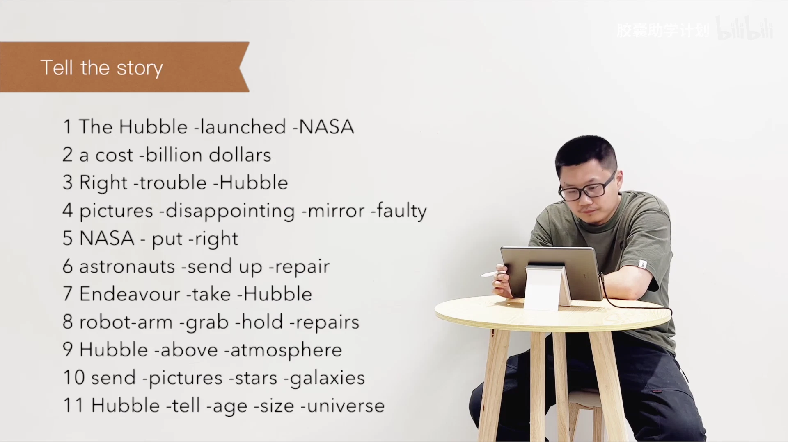

文字识别：Tell the story / 1 The Hubble -launched -NASA / 2 a cost -billion dollars / 3 Right -trouble -Hubble / 4 pictures -disappointing -mirror -faulty / 5 NASA- put -right / 6 astronauts -send up -repair / 7 Endeavour -take -Hubble / 8 robot-arm -grab -hold -repairs / 9 Hubble -above -atmosphere / 10 send -pictures -stars -galaxies / 11 Hubble -tell -age -size -universe

## 00:05:00–00:05:30

去把文章复述一遍。第一个单元有很多我做的示范啊，在这里就不一一示范了。OK，呃，summary writing练习我们写作复述的能力。然后呢，到这里各位写完啊，在文章当中先去看题，我们教材当中先看题，看完题来这儿对答案就可以了。这是参考答案啊，不是唯一正确答案。接下来呢，topic for discussion，我们老习惯只说题目翻译啊，各位感兴趣可以自己开始做了。So how much do you

### 画面 00:05:07

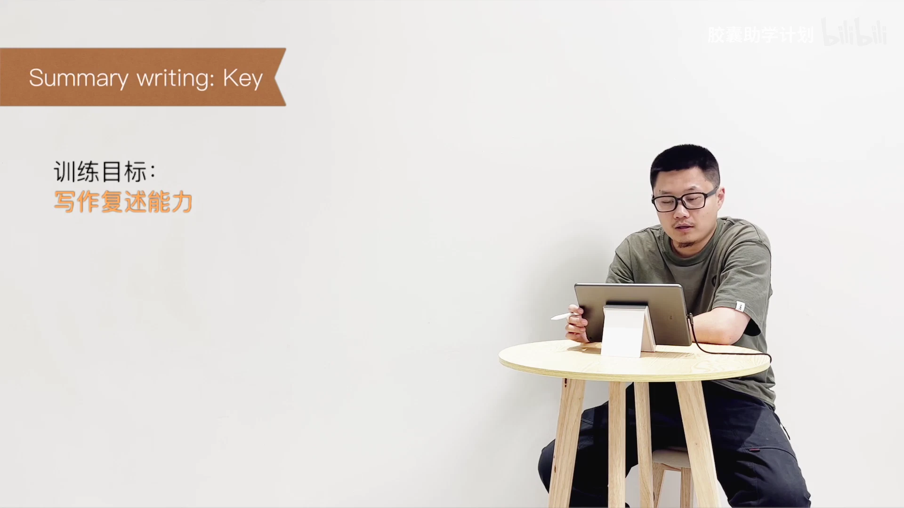

文字识别：Summary writing: Key / 训练目标： / 写作复述能力

### 画面 00:05:11

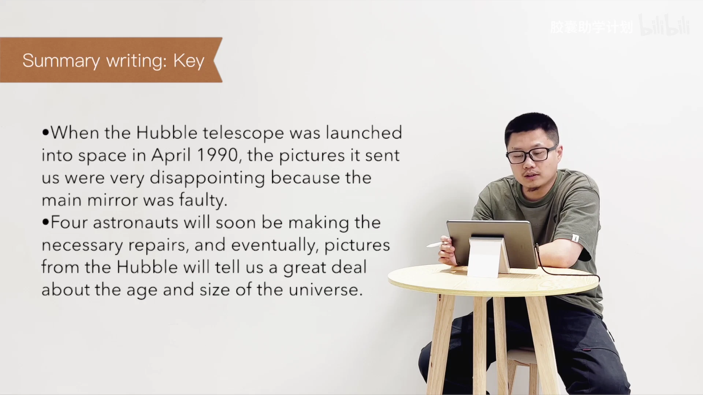

文字识别：Summary writing: Key / •When the Hubble telescope was launched / into space in April 1990, the pictures it sent / us were very disappointing because the / main mirror was faulty. / •Four astronauts will soon be making the / necessary repairs, and eventually, pictures / from the Hubble will tell us a great deal / about the age and size of the universe.

### 画面 00:05:21

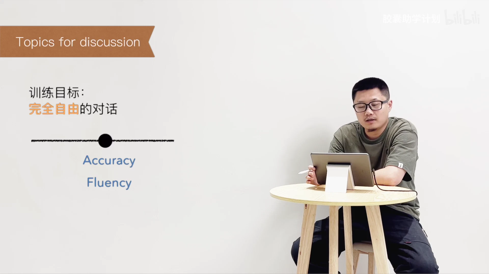

文字识别：Topics for discussion / 训练目标： / 完全自由的对话 / Accuracy / Fluency

### 画面 00:05:23

文字识别：Topics for discussion / How much do you know about the / universe? / Do you enjoy following the news about / space exploration? / Are there any areas of modern science / that interest you more? If so, what are / they, and why?

## 00:05:30–00:06:00

know about the universe? 关于宇宙你了解多少？你看，这完全是内容导向型的。你英语再好，你英语就是母语。关于 universe，你啥也不知道，你也不存在口语。所以，我一直跟同学说的是，我们的英语口语是由两个东西组，至少有两个东西组成的。一个叫内容，内容你完全可以拿汉语学；另外一个叫表达，表达所谓的叫做用英语把它表达出来。如果你连汉语都没有办法

### 画面 00:05:46

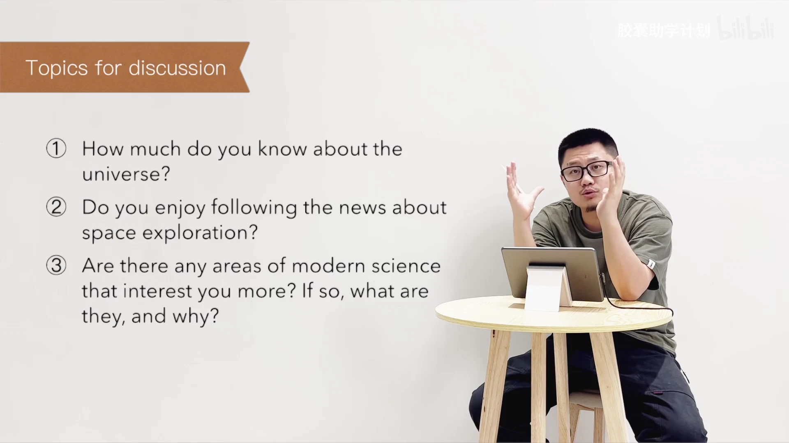

文字识别：Topics for discussion / How much do you know about the / universe? / Do you enjoy following the news about / space exploration? / Are there any areas of modern science / 3 / that interest you more? If so, what are / they, and why?

## 00:06:00–00:06:30

说给别人讲五分钟、十分钟关于 universe 你知道的东西，那你就不可能拿任何语言、其他的语言有这个口语的表达，对吧？哎，第二题说，Do you enjoy following the news about space exploration？是吧？你喜欢关注关于太空探索的这些新闻吗？第三个，Are there any areas of modern science that interest you more？ If so， what are they and why？有没有什么现代科学特别

### 画面 00:06:16

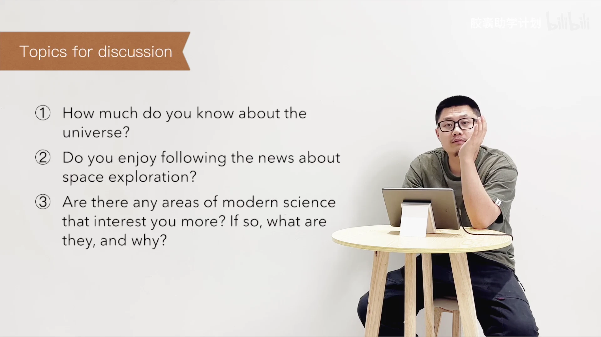

文字识别：Topics for discussion / How much do you know about the / universe? / Do you enjoy following the news about / space exploration? / Are there any areas of modern science / that interest you more? If so, what are / they, and why?

## 00:06:30–00:07:00

吸引你的？如果有的话，是什么呢？以及为什么？不多说了。家庭作业，Ask me if先写，然后还是这句话，强调大声朗读啊。只要写作写完，来这里对答案。Tell the story，口语复述，重复间隔，看置顶留言。那以上呢就是本期视频的全部内容了。如果各位喜欢我们的课程呢，欢迎各位关注、订阅、一键三连，分享给更多的朋友，来帮助我们快速成长。See you

### 画面 00:06:33

文字识别：Topics for discussion / How much do you know about the / universe? / Do you enjoy following the news about / space exploration? / Are there any areas of modern science / that interest you more? If so, what are / they, and why?

### 画面 00:06:35

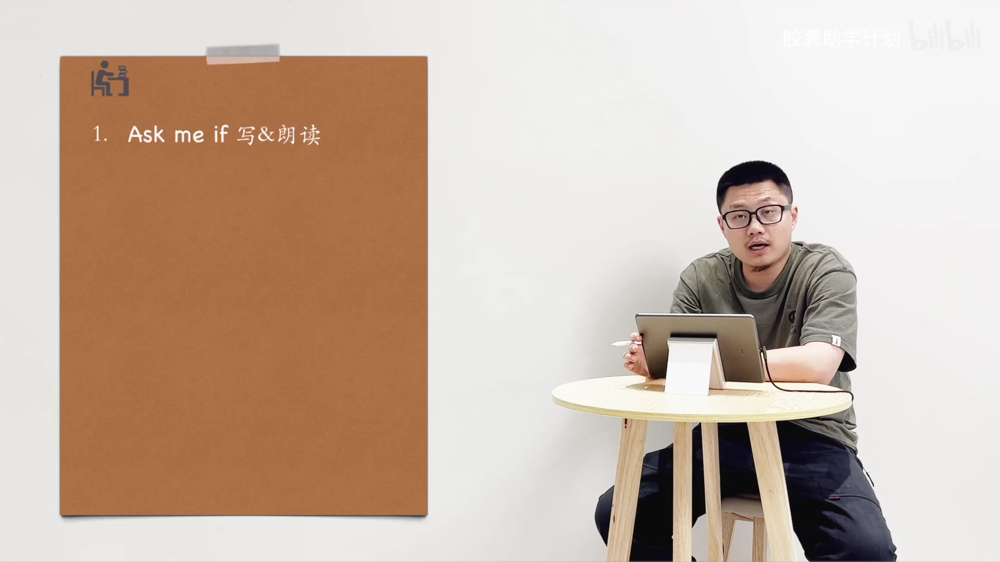

文字识别：1.Ask me if写&朗读

### 画面 00:06:40

文字识别：1.Ask me if写&朗读 / 2. / 摘要写作写&答案

### 画面 00:06:42

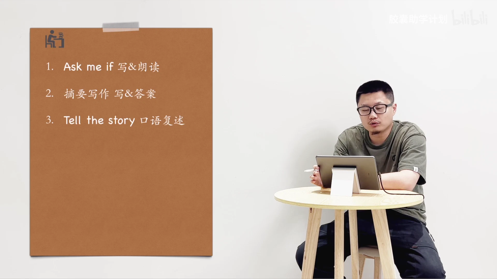

文字识别：1.Ask me if写&朗读 / 摘要写作写&答案 / 3.Tell the story 口语复述

### 画面 00:06:44

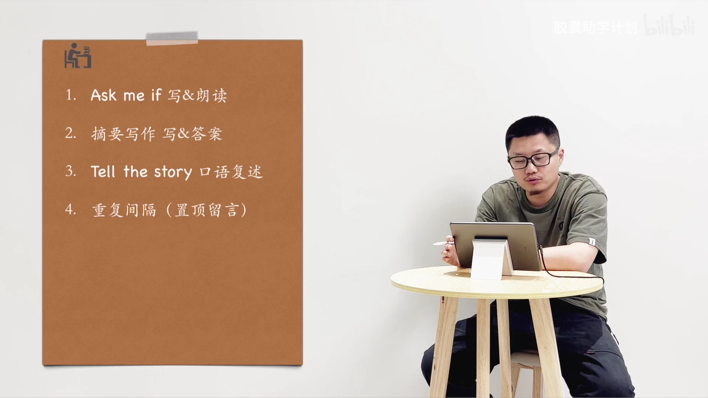

文字识别：1.Ask me if写&朗读 / 摘要写作写&答案 / 3.Tell the story 口语复述 / 4.重复间隔（置顶留言）

### 画面 00:06:46

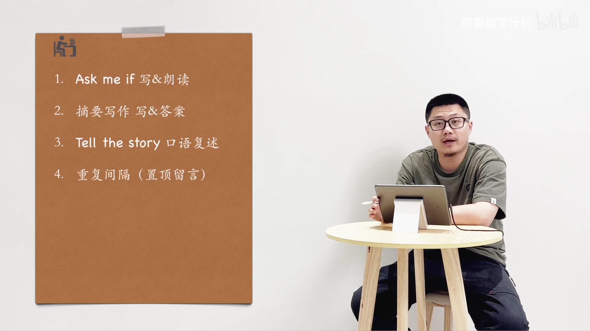

文字识别：1.Ask me if写&朗读 / 摘要写作写&答案 / 3.Tell the story 口语复述 / 4.重复间隔（置顶留言）

### 画面 00:06:48

文字识别：￥ / t

### 画面 00:06:51

文字识别：不 / 🌟

### 画面 00:06:53

文字识别：餐

### 画面 00:06:55

### 画面 00:06:57

文字识别：WnI! / NU

### 画面 00:06:59

文字识别：NIi / WnR

## 00:07:00–00:07:13

next time.

### 画面 00:07:01

### 画面 00:07:03

文字识别：CAPSULEACADEMY / 胶囊助学计划 / 小红书 / Lecturer / Leo / OE

### 画面 00:07:05

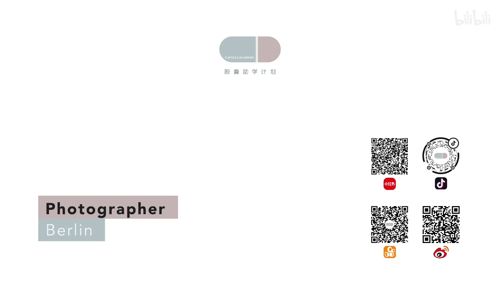

文字识别：CAPSULEACADEMY / 胶囊助学计划 / 『 / 小红书 / Photographer / Berlin / OE

### 画面 00:07:07

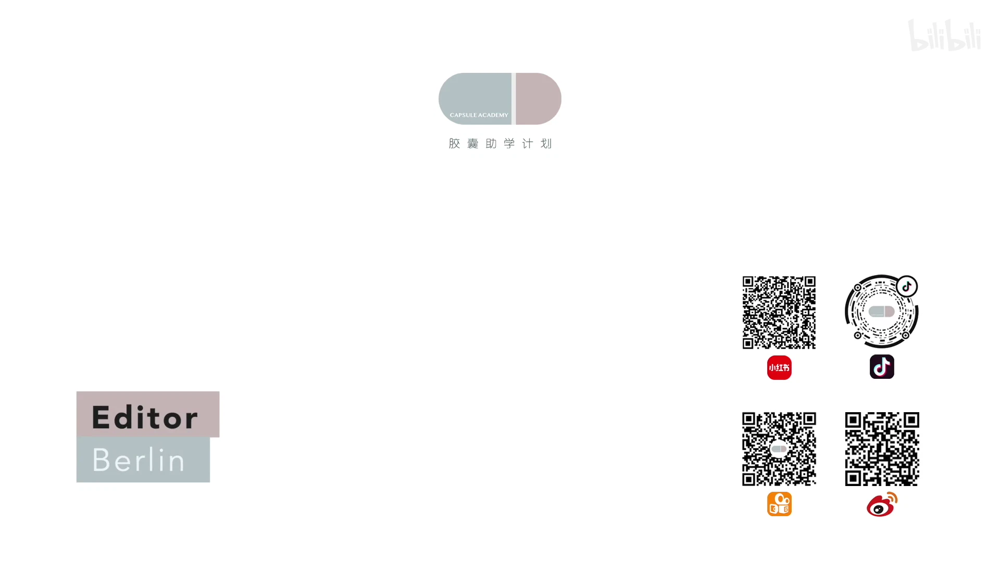

文字识别：CAPSULEACADEMY / 胶囊助学计划 / 『 / 小红书 / Editor / Berlin / OE

### 画面 00:07:10

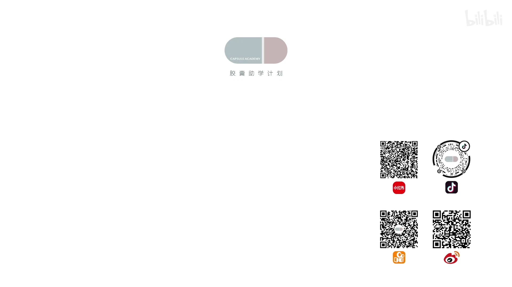

文字识别：CAPSULEACADEMY / 胶囊助学计划 / 小红书

### 画面 00:07:12

文字识别：bilibili / 胶囊助学计划

