# 062 单词

快速机器解析：语音为单模型转写，未进行独立交叉校对或人工复核；画面每秒采样并按变化选帧，短时文字和标记可能遗漏。截图时间约有 1 秒误差。图片有损压缩；遇到疑点请按时间查看 Google Drive 原视频。

## 00:00:00–00:00:30

Hello everyone, welcome to Capsule Academy. This is Leo. Today we're going to learn new concept in English book two, lesson sixty two words. 那老习惯进入正式课程之前呢，咱们先看几个问题啊。首先，第一，如何表达使它得到控制？接下来，如何表达用某物威胁某人啊，或者说用 A 威胁 B？ OK，那最后一个问题叫如何表达生根或者扎根的这样一个说法？那带着这三个问题， hope

### 画面 00:00:00

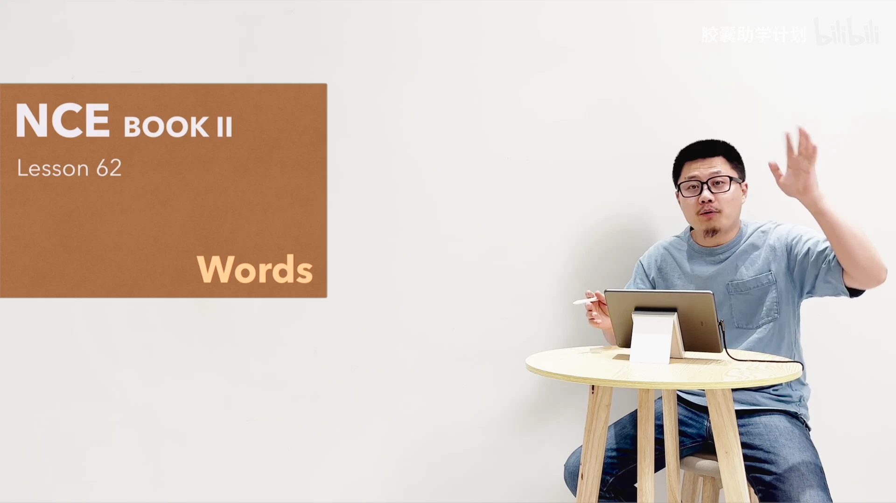

文字识别：NCE / BOOKⅡI / Lesson 62 / Words

### 画面 00:00:02

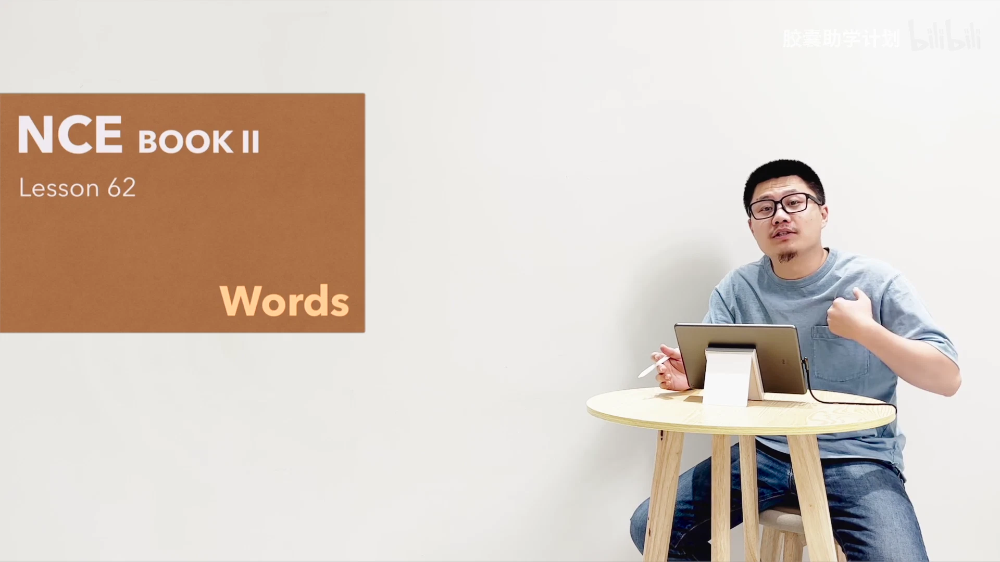

文字识别：NCE / BOOKI"I / Lesson 62 / Words

### 画面 00:00:05

文字识别：NCE / BOOKⅡI / Lesson 62 / Words

### 画面 00:00:10

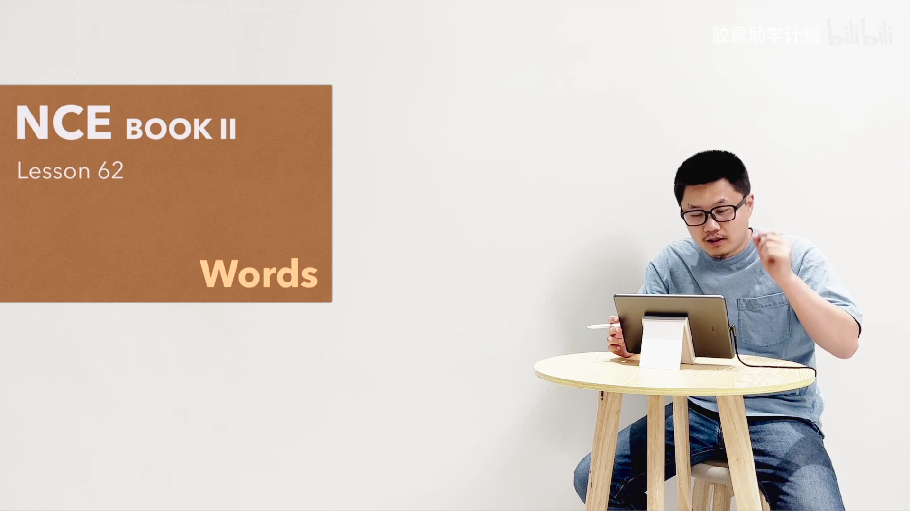

文字识别：NCE / BOOKⅡI / Lesson 62 / Words

### 画面 00:00:12

文字识别：达“使它得到控制”？

### 画面 00:00:14

文字识别：① 如何表达“使它得到控制”？

### 画面 00:00:16

文字识别：①如何表达“使它得到控制”？ / 达“用某物威胁某人”?

### 画面 00:00:18

文字识别：①如何表达“使它得到控制”？ / 如何表达“用某物威胁某人”?

### 画面 00:00:23

文字识别：①如何表达“使它得到控制”？ / 如何表达“用某物威胁某人”? / 表达“生根/扎根”?

### 画面 00:00:25

文字识别：①如何表达“使它得到控制”？ / 如何表达“用某物威胁某人”? / 如何表达“生根/扎根”?

## 00:00:30–00:01:00

you gonna enjoy.那我们先看第一个单词，看着音标，跟我一起读一下，叫做注意重音在后面对吧？不是 control 啊，是 control. Okay, one again. 那就是最基本的意思，最常见的指的就是控制。它可以是名词，可以是动词。我们文章当中给的是名词啊，一会儿我们会用到它的动词的用法，也很简单啊。那比如说，我们先造一句话，叫 The moment you get it

### 画面 00:00:31

文字识别：胶囊助学计划bl出

### 画面 00:00:35

### 画面 00:00:37

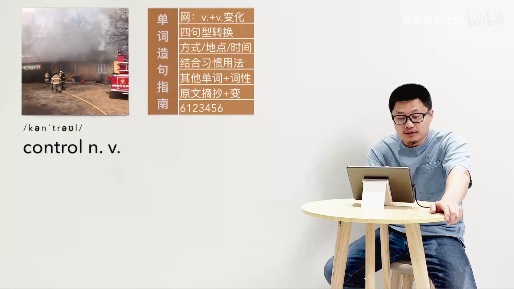

文字识别：单词造句指南 / 网：v.+v.变化 / 四句型转换 / 方式/地点/时间 / 结合习惯用法 / 其他单词+词性 / 911 / 原文摘抄+变 / 6123456 / /kan'traul/ / control n. v.

### 画面 00:00:39

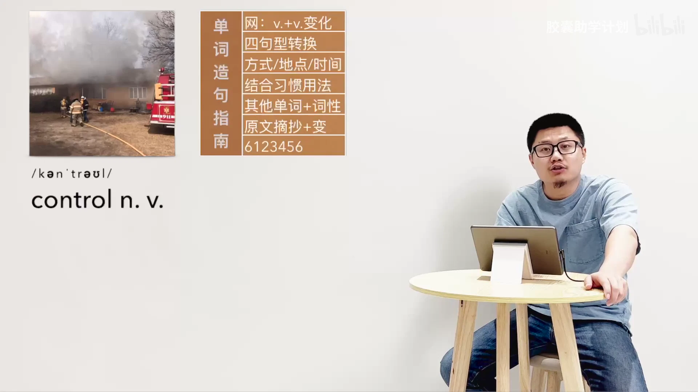

文字识别：单词造句指南 / 网：v.+v.变化 / 四句型转换 / 方式/地点/时间 / 结合习惯用法 / 其他单词+词性 / 911m / 原文摘抄+变 / 6123456 / /kan'traul/ / control n.v.

### 画面 00:00:41

文字识别：单词造句指南 / 网：v.+v.变化 / 四句型转换 / 方式/地点/时间 / 结合习惯用法 / 其他单词+词性 / 9110 / 原文摘抄+变 / 6123456 / /kan'traul/ / control n.v.

### 画面 00:00:43

文字识别：单词造句指南 / 网：v.+v.变化 / 四句型转换 / 方式/地点/时间 / 结合习惯用法 / 其他单词+词性 / 9110 / 原文摘抄+变 / 6123456 / /kan'traul/ / control n. v.

### 画面 00:00:45

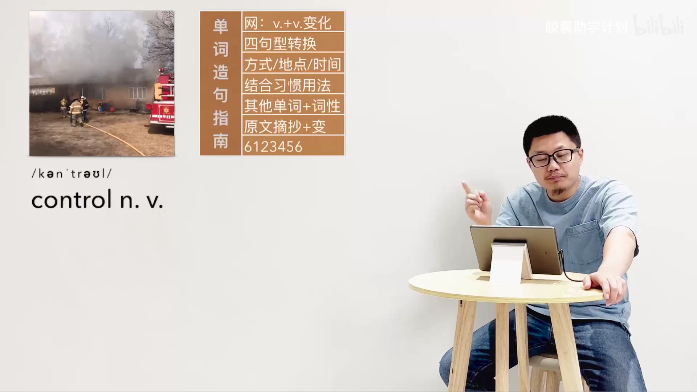

文字识别：单词造句指南 / 网：v.+v.变化 / 四句型转换 / 方式/地点/时间 / 结合习惯用法 / 其他单词+词性 / 911m / 原文摘抄+变 / 6123456 / /kan'traul/ / control n. v.

### 画面 00:00:48

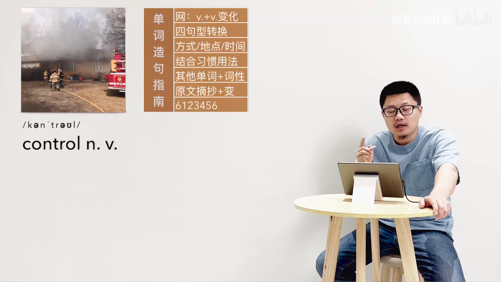

文字识别：单词造句指南 / 网：v.+v.变化 / 四句型转换 / 方式/地点/时间 / 结合习惯用法 / 其他单词+词性 / 9110 / 原文摘抄+变 / 6123456 / /kan'traul/ / control n. v.

### 画面 00:00:50

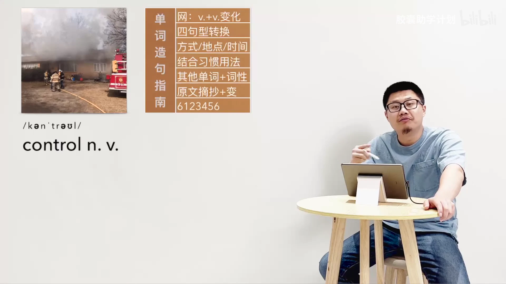

文字识别：单词造句指南 / 网：v.+v.变化 / 四句型转换 / 方式/地点/时间 / 结合习惯用法 / 其他单词+词性 / 原文摘抄+变 / 6123456 / /kan'traul/ / control n. v.

### 画面 00:00:55

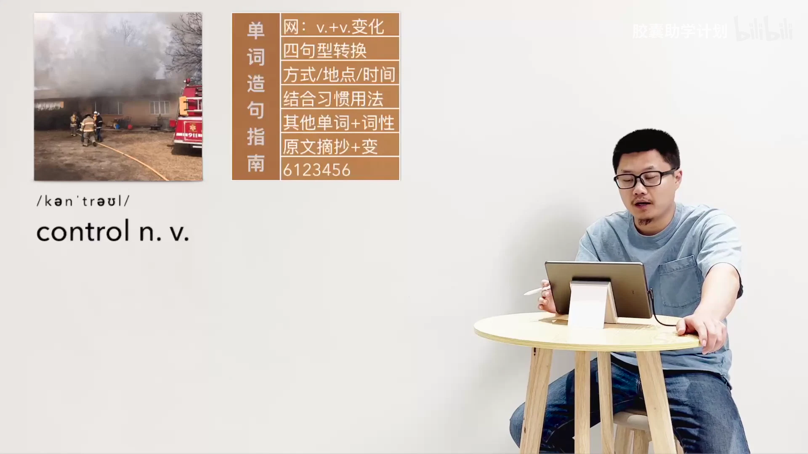

文字识别：单词造句指南 / 网：v.+v.变化 / 四句型转换 / 方式/地点/时间 / 结合习惯用法 / 其他单词+词性 / 原文摘抄+变 / 6123456 / /kan'traul/ / control n. v.

### 画面 00:00:57

文字识别：单词造句指南 / 网：v.+v.变化 / 四句型转换 / 方式/地点/时间 / 结合习惯用法 / 其他单词+词性 / 原文摘抄+变 / 6123456 / /kan'traul/ / control n. v. / The moment you get it under control, we'll / talk.L60

### 画面 00:00:59

文字识别：单词造句指南 / 网：v.+v.变化 / 四句型转换 / 方式/地点/时间 / 结合习惯用法 / 其他单词+词性 / 911 / 原文摘抄+变 / 6123456 / /kan'traul/ / control n. v. / The moment you get it under control, we'll / talk. L60

## 00:01:00–00:01:30

under control, we'll talk. 好，首先呢，在这里 get it under control，我要说一下是从哪来的，这是从我们原文当中提取出来的。原文就给了一个短语叫 get it under control。接下来呢，六十课咱们学过了 the moment，类似于 as soon as，一怎么怎么样就怎么怎么样。所以那这句话叫做你一把它，你先把它控制好，对吧？你先把这个事态控制好，控制好了之后，咱们再聊。OK, next one.

### 画面 00:01:03

文字识别：单词造句指南 / 网：v.+v.变化 / 四句型转换 / 方式/地点/时间 / 结合习惯用法 / 其他单词+词性 / 9110 / 原文摘抄+变 / 6123456 / /kan'traul/ / control n. v. / The moment you get it under control, we'll / talk. L60

### 画面 00:01:05

文字识别：单词造句指南 / 网：v.+v.变化 / 四句型转换 / 方式/地点/时间 / 结合习惯用法 / 其他单词+词性 / 1a911m / 原文摘抄+变 / 6123456 / /kan'traul/ / control n.v. / The moment you get it under control, we'll / talk. L60

### 画面 00:01:07

文字识别：单词造句指南 / 网：v.+v.变化 / 四句型转换 / 方式/地点/时间 / 结合习惯用法 / 其他单词+词性 / 原文摘抄+变 / 6123456 / /kan'traul/ / control n. v. / The moment you get it under control, we'll / talk. L60

### 画面 00:01:09

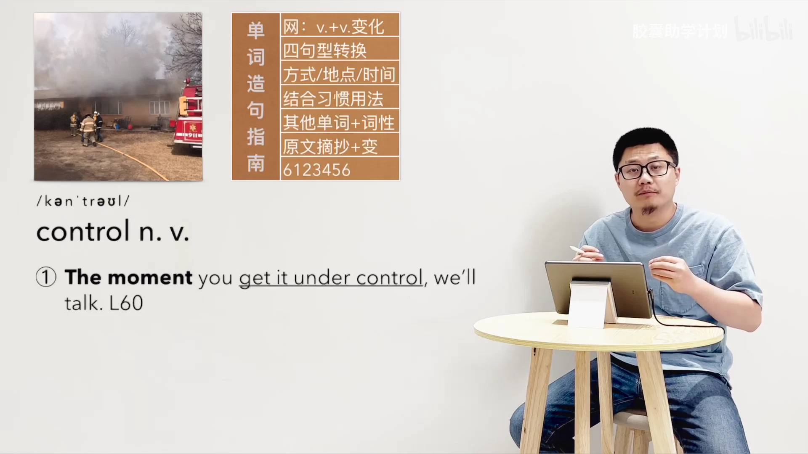

文字识别：单词造句指南 / 网：v.+v.变化 / 四句型转换 / 方式/地点/时间 / 结合习惯用法 / 其他单词+词性 / 911 / 原文摘抄+变 / 6123456 / /kan'traul/ / control n.v. / The moment you get it under control, we'll / talk. L60

### 画面 00:01:11

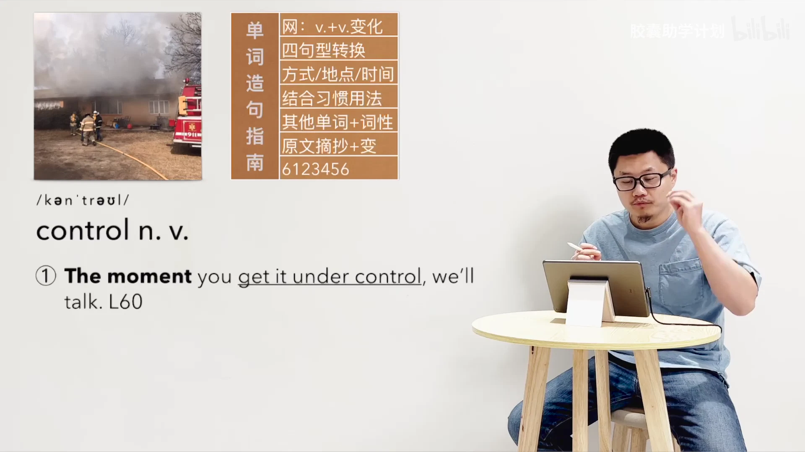

文字识别：单词造句指南 / 网：v.+v.变化 / 四句型转换 / 方式/地点/时间 / 结合习惯用法 / 其他单词+词性 / 911 / 原文摘抄+变 / 6123456 / /kan'traul/ / control n. v. / The moment you get it under control, we'll / talk. L60

### 画面 00:01:13

文字识别：单词造句指南 / 网：v.+v.变化 / 四句型转换 / 方式/地点/时间 / 结合习惯用法 / 其他单词+词性 / 1911m / 原文摘抄+变 / 6123456 / /kan'traul/ / control n.v. / The moment you get it under control, we'll / talk.L60

### 画面 00:01:15

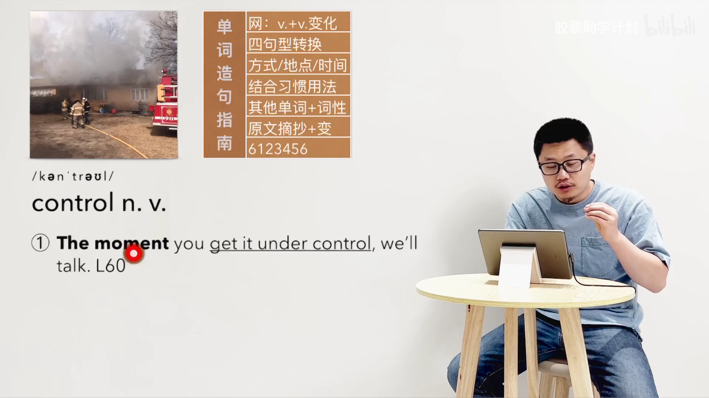

文字识别：单词造句指南 / 网：v.+v.变化 / 四句型转换 / 方式/地点/时间 / 结合习惯用法 / 其他单词+词性 / 1911 / 原文摘抄+变 / 6123456 / /kan'traul/ / control n. v. / The moment you get it under control, we'll / talk. L60

### 画面 00:01:17

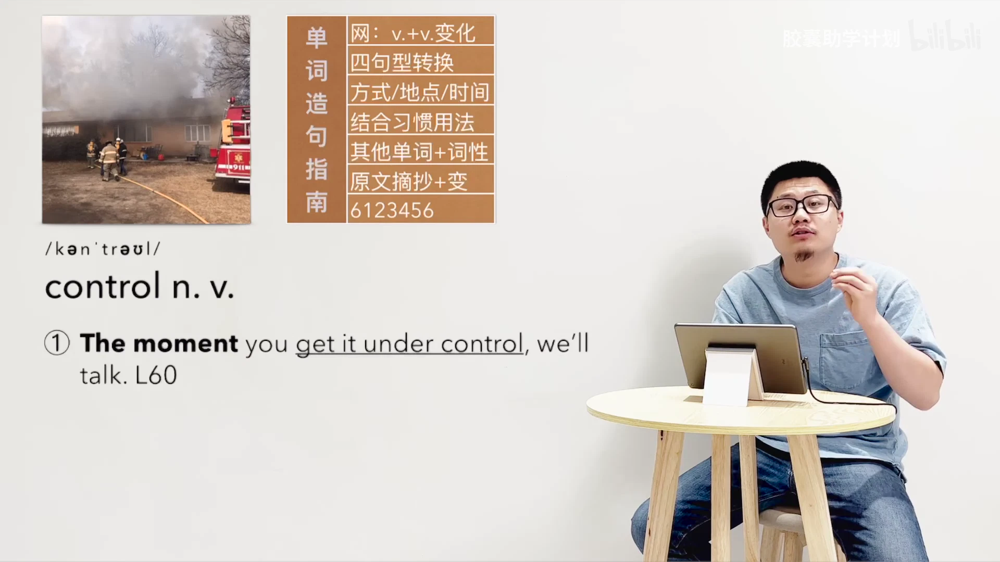

文字识别：单词造句指南 / 网：v.+v.变化 / 四句型转换 / 方式/地点/时间 / 结合习惯用法 / 其他单词+词性 / 原文摘抄+变 / 6123456 / /kan'traul/ / control n. v. / The moment you get it under control, we'll / talk. L60

### 画面 00:01:19

文字识别：单词造句指南 / 网：v.+v.变化 / 四句型转换 / 方式/地点/时间 / 结合习惯用法 / 其他单词+词性 / 原文摘抄+变 / 6123456 / /kan'traul/ / control n. v. / The moment you get it under control, we'll / talk. L60

### 画面 00:01:21

文字识别：单词造句指南 / 网：v.+v.变化 / 四句型转换 / 方式/地点/时间 / 结合习惯用法 / 其他单词+词性 / 911m / 原文摘抄+变 / 6123456 / /kan'traul/ / control n. v. / The moment you get it under control, we'll / talk. L60

### 画面 00:01:24

文字识别：单词造句指南 / 网：v.+v.变化 / 四句型转换 / 方式/地点/时间 / 结合习惯用法 / 其他单词+词性 / 心 / 9110 / 原文摘抄+变 / 6123456 / /kan'traul/ / control n. v. / The moment you get it under control, we'll / talk. L60

### 画面 00:01:26

文字识别：单词造句指南 / 网：v.+v.变化 / 四句型转换 / 方式/地点/时间 / 结合习惯用法 / 其他单词+词性 / 9110 / 原文摘抄+变 / 6123456 / /kan'traul/ / control n. v. / The moment you get it under control, we'll / talk. L60

### 画面 00:01:29

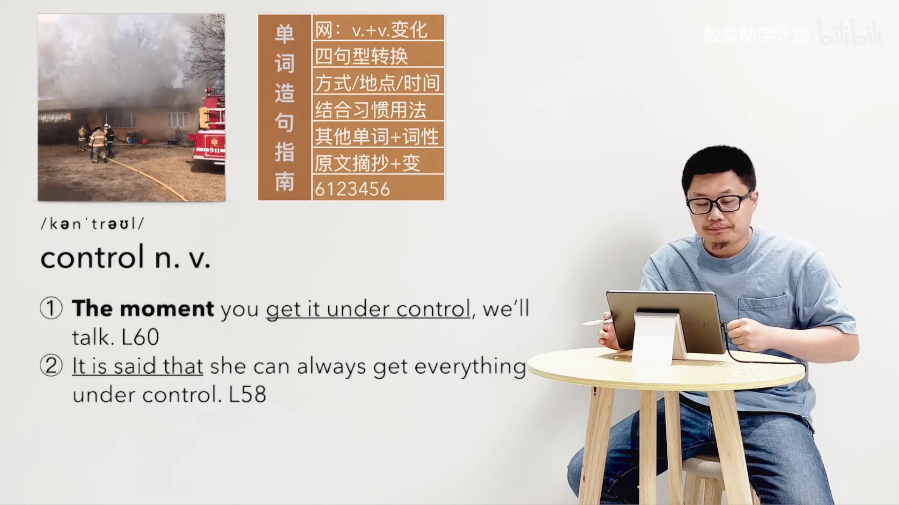

文字识别：单词造句指南 / 网：v.+v.变化 / 四句型转换 / 方式/地点/时间 / 结合习惯用法 / 其他单词+词性 / 911 / 原文摘抄+变 / 6123456 / /kan'traul/ / control n. v. / The moment you get it under control, we'll / talk.L60 / It is said that she can always get everything / under control. L58

## 00:01:30–00:02:00

It is said that she can always get everything under control.说据说五十八课咱们学过的据说句型对吧？It is said that她总是能把一切都控制的很好，对吧？都在控制范围之内。Okay, next one.说I'm I'm at the baggage claim. Okay, baggage claim是五十八课咱们学过的。我说这个各位不能忘啊！各位出国旅游或者工作学习的时

### 画面 00:01:31

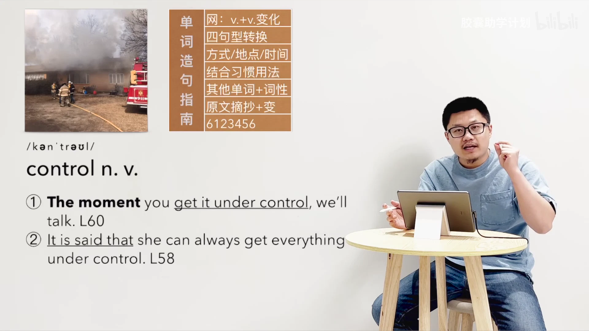

文字识别：单词造句指南 / 网：v.+v.变化 / 四句型转换 / 方式/地点/时间 / 结合习惯用法 / 其他单词+词性 / 911 / 原文摘抄+变 / 6123456 / /kan'traul/ / control n. v. / The moment you get it under control, we'll / talk.L60 / It is said that she can always get everything / under control. L58

### 画面 00:01:35

文字识别：单词造句指南 / 网：v.+v.变化 / 四句型转换 / 方式/地点/时间 / 结合习惯用法 / 其他单词+词性 / 原文摘抄+变 / 6123456 / /kan'traul/ / control n. v. / The moment you get it under control, we'll / talk.L60 / It is said that she can always get everything / under control. L58

### 画面 00:01:42

文字识别：单词造句指南 / 网：v.+v.变化 / 四句型转换 / 方式/地点/时间 / 结合习惯用法 / 其他单词+词性 / 19110 / 原文摘抄+变 / 6123456 / /kan'traul/ / control n. v. / The moment you get it under control, we'll / talk. L60 / It is said that she can always get everything / under control. L58

### 画面 00:01:47

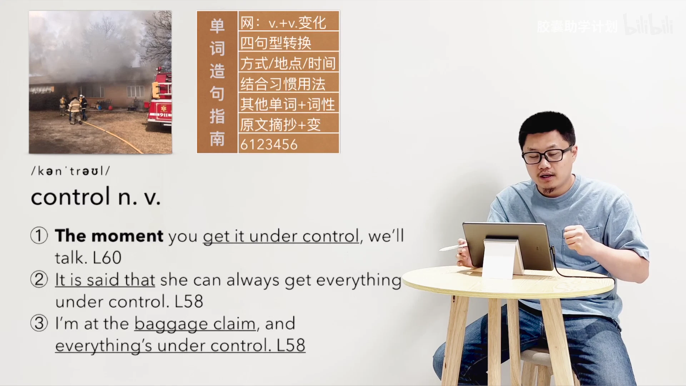

文字识别：单词造句指南 / 网：v.+v.变化 / 四句型转换 / 方式/地点/时间 / 结合习惯用法 / 其他单词+词性 / 原文摘抄+变 / 6123456 / /kan'traul/ / control n. v. / The moment you get it under control, we'll / talk. L60 / It is said that she can always get everything / under control. L58 / I'm at the baggage claim, and / everything's under control. L58

### 画面 00:01:50

文字识别：单词造句指南 / 网：v.+v.变化 / 四句型转换 / 方式/地点/时间 / 结合习惯用法 / 其他单词+词性 / 水 / 1911m / 原文摘抄+变 / 6123456 / /kan'traul/ / control n.v. / The moment you get it under control, we'll / talk. L60 / It is said that she can always get everything / under control. L58 / I'm at the baggage claim, and / everything's under control. L58

### 画面 00:01:55

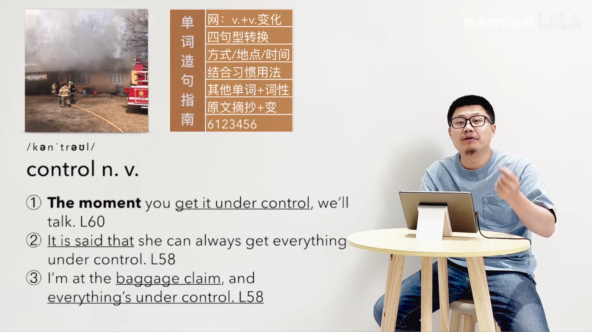

文字识别：单词造句指南 / 网：v.+v.变化 / 四句型转换 / 方式/地点/时间 / 结合习惯用法 / 其他单词+词性 / 水 / 原文摘抄+变 / 6123456 / /kan'traul/ / control n.v. / The moment you get it under control, we'll / talk. L60 / It is said that she can always get everything / under control. L58 / I'm at the baggage claim, and / everything's under control. L58

## 00:02:00–00:02:30

候，一定会遇去这个地方，叫 baggage claim，啊，叫做我们的行李提取处。坐飞机的时候，对吧？And everything's under control，啊，这是我可能打电话跟别人说的一句话，说我现在在行李提取处呢，一切都在控制当中，放心吧，啊，不用太担心。OK，好，那接下来呢，我们看一个这个电影片段啊，注意力集中，我们听一下。Don't you worry, Harry. I've got it under control. Very good. Next one，下

### 画面 00:02:00

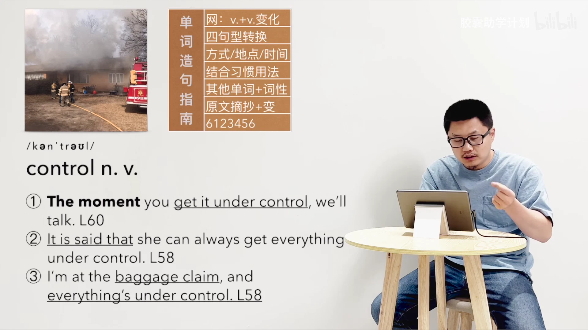

文字识别：单词造句指南 / 网：v.+v.变化 / 四句型转换 / 方式/地点/时间 / 结合习惯用法 / 其他单词+词性 / 原文摘抄+变 / 6123456 / /kan'traul/ / control n. v. / The moment you get it under control, we'll / talk. L60 / It is said that she can always get everything / under control. L58 / I'm at the baggage claim, and / everything's under control. L58

### 画面 00:02:05

文字识别：单词造句指南 / 网：v.+v.变化 / 四句型转换 / 方式/地点/时间 / 结合习惯用法 / 其他单词+词性 / 9110 / 原文摘抄+变 / 6123456 / /kan'traul/ / control n. v. / The moment you get it under control, we'll / talk. L60 / It is said that she can always get everything / under control. L58 / I'm at the baggage claim, and / everything's under control. L58

### 画面 00:02:09

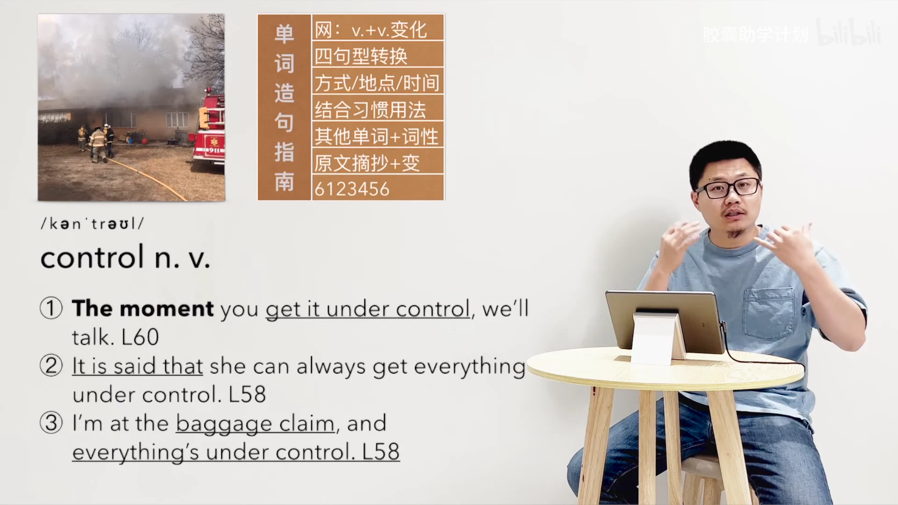

文字识别：单词造句指南 / 网：v.+v.变化 / 四句型转换 / 方式/地点/时间 / 结合习惯用法 / 其他单词+词性 / 原文摘抄+变 / 6123456 / /kan'traul/ / control n. v. / The moment you get it under control, we'll / talk. L60 / It is said that she can always get everything / under control. L58 / I'm at the baggage claim, and / everything's under control. L58

### 画面 00:02:11

文字识别：单词造句指南 / 网：v.+v.变化 / 四句型转换 / 方式/地点/时间 / 结合习惯用法 / 其他单词+词性 / 原文摘抄+变 / 6123456 / /kan'traul/ / control n. v. / The moment you get it under control, we'll / talk.L60 / It is said that she can always get everything / under control. L58 / I'm at the baggage claim, and / everything's under control. L58

### 画面 00:02:15

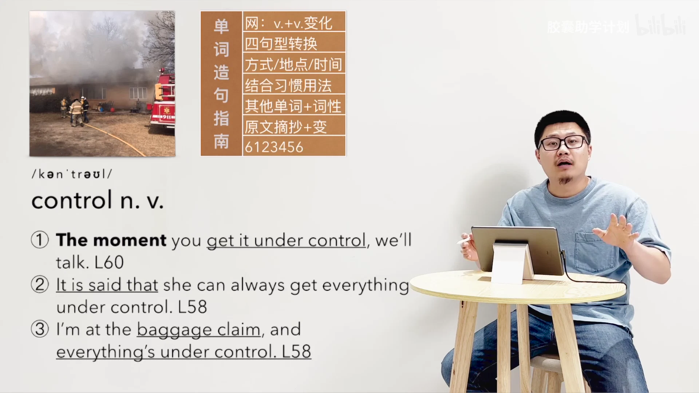

文字识别：单词造句指南 / 网：v.+v.变化 / 四句型转换 / 方式/地点/时间 / 结合习惯用法 / 其他单词+词性 / 原文摘抄+变 / 6123456 / /kan'traul/ / control n.v. / The moment you get it under control, we'l / talk.L60 / It is said that she can always get everything / under control. L58 / I'm at the baggage claim, and / everything's under control. L58

### 画面 00:02:17

文字识别：Don't you worry, Harry.I've got it under control. / Lock, Stock and Two Smoking Barrels / (1998)

### 画面 00:02:21

文字识别：Don't you worry, Harry. I've got it under control. / Lock, Stock and Two Smoking Barrels / (1998)

### 画面 00:02:25

文字识别：Don't you worry, Harry. I've got it under control. / Lock, Stock and Two Smoking Barrels / (1998)

### 画面 00:02:27

文字识别：Don't you worry, Harry. I've got it under control. / Lock, Stock and Two Smoking Barrels / (1998)

### 画面 00:02:29

文字识别：单词造句指南 / 网：v.+v.变化 / 四句型转换 / 方式/地点/时间 / 结合习惯用法 / 其他单词+词性 / 原文摘抄+变 / 6123456 / Ismauk / / smoke n.v.

## 00:02:30–00:03:00

一个单词跟我一起读一下，叫做 smoke. Smoke.好，还是名词动词都有。动词呢，往往指的就是抽烟的这个动作啊。那名词呢，它可以指的是我们说抽烟的这个烟，也可以指的是，比如说你烧火，就像我们图中这样，对吧？你烧火了之后，或者像我们文章当中这样，那上面冒的这个烟，我们也管它叫做 smoke。那我们先说抽烟的这个烟，因为它是它最常见的一个用法

### 画面 00:02:31

文字识别：单词造句指南 / 网：v.+v.变化 / 四句型转换 / 方式/地点/时间 / 结合习惯用法 / 其他单词+词性 / 原文摘抄+变 / 6123456 / /smauk / / smoke n.v.

### 画面 00:02:35

文字识别：单词造句指南 / 网：v.+v.变化 / 四句型转换 / 方式/地点/时间 / 结合习惯用法 / 其他单词+词性 / 原文摘抄+变 / 6123456 / / smauk / / smoke n. v.

### 画面 00:02:41

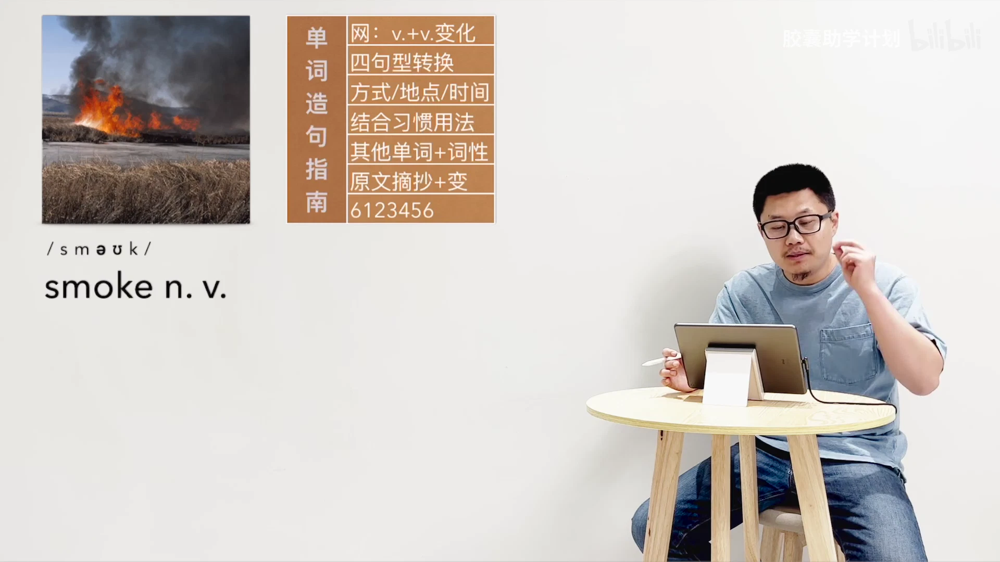

文字识别：单词造句指南 / 网：v.+v.变化 / 四句型转换 / 方式/地点/时间 / 结合习惯用法 / 其他单词+词性 / 原文摘抄+变 / 6123456 / / smauk / / smoke n.v.

### 画面 00:02:46

文字识别：单词造句指南 / 网：v.+v.变化 / 四句型转换 / 方式/地点/时间 / 结合习惯用法 / 其他单词+词性 / 原文摘抄+变 / 6123456 / /smauk / / smoke n.v.

### 画面 00:02:51

文字识别：单词造句指南 / 网：v.+v.变化 / 四句型转换 / 方式/地点/时间 / 结合习惯用法 / 其他单词+词性 / 原文摘抄+变 / 6123456 / /smauk / / smoke n.v.

### 画面 00:02:55

文字识别：单词造句指南 / 网：v.+v.变化 / 四句型转换 / 方式/地点/时间 / 结合习惯用法 / 其他单词+词性 / 原文摘抄+变 / 6123456 / / smauk / / smoke n.v.

## 00:03:00–00:03:30

啊，虽然本文并不是这个抽烟的这个烟啊，比如说 do you smoke? 很常见，这句话的意思就是你抽烟吗？对吧？以及各位在现实生活当中会见到，如果您抽烟，那你一定要知道这个地方叫 smoking area 啊，就是抽烟区域啊。很多的地方不，比如说机场，你不是在哪儿都可以抽烟的，会有专门的一个抽烟区叫 smoking area. OK. 好，next one. 然后我造了一句话说， What's that smell? 说这什么味儿啊？他说，

### 画面 00:03:00

文字识别：单词造句指南 / 网：v.+v.变化 / 四句型转换 / 方式/地点/时间 / 结合习惯用法 / 其他单词+词性 / 原文摘抄+变 / 6123456 / /smauk / / smoke n. v.

### 画面 00:03:04

文字识别：单词造句指南 / 网：v.+v.变化 / 四句型转换 / 方式/地点/时间 / 结合习惯用法 / 其他单词+词性 / 原文摘抄+变 / 6123456 / / sm au k / / smoke n.v. / ① Do you smoke? / Smoking Area

### 画面 00:03:10

文字识别：单词造句指南 / 网：v.+v.变化 / 四句型转换 / 方式/地点/时间 / 结合习惯用法 / 其他单词+词性 / 原文摘抄+变 / 6123456 / / sm au k / / smoke n.v. / ① Do you smoke? / Smoking Area

### 画面 00:03:15

文字识别：单词造句指南 / 网：v.+v.变化 / 四句型转换 / 方式/地点/时间 / 结合习惯用法 / 其他单词+词性 / 原文摘抄+变 / 6123456 / / sm au k / / smoke n. v. / ① Do you smoke?/ Smoking Area

### 画面 00:03:20

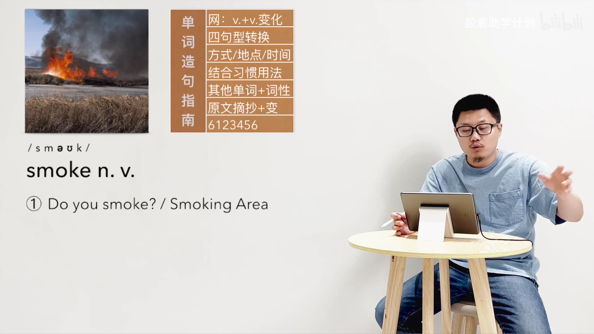

文字识别：单词造句指南 / 网：v.+v.变化 / 四句型转换 / 方式/地点/时间 / 结合习惯用法 / 其他单词+词性 / 原文摘抄+变 / 6123456 / / smau k / / smoke n.v. / ① Do you smoke?/ Smoking Area

### 画面 00:03:25

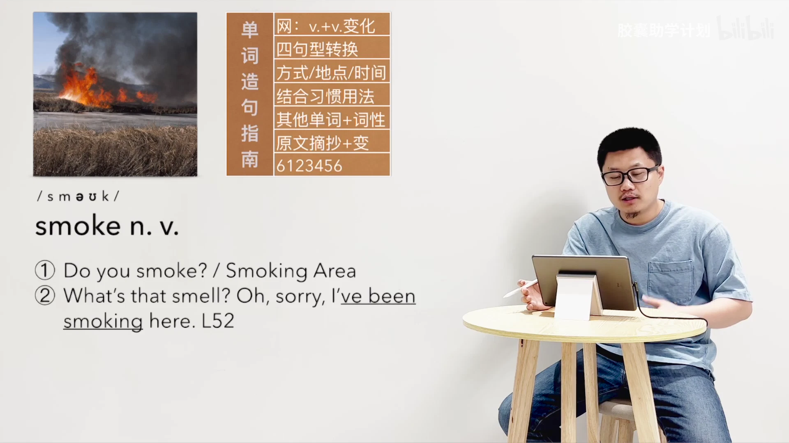

文字识别：单词造句指南 / 网：v.+v.变化 / 四句型转换 / 方式/地点/时间 / 结合习惯用法 / 其他单词+词性 / 原文摘抄+变 / 6123456 / / smauk / / smoke n.v. / ① Do you smoke?/ Smoking Area /  What's that smell? Oh, sorry, I've been / smoking here. L52

## 00:03:30–00:04:00

Oh, sorry, I've been smoking here. Before, I've been smoking here. Before, I've been smoking here. Before, I've been smoking here. Before, I've been smoking here. Before, I've been smoking here. Before, I've been smoking here. Before, I've been smoking here. Before, I've been smoking here. Before, I've been smoking here. Before, I've been smoking here. Before, I've been smoking here. Before, I've been smoking here. Before, I've been smoking here. Before, I've been smoking here. Before, I've been smoking here. Before, I've been smoking here. Before, I've been smoking here. Before, I've been smoking here. Before, I've been smoking here. Before, I've been smoking here. Before, I've been smoking here. Before, I've been smoking here. Before, I've been smoking here. Before, I've been

### 画面 00:03:30

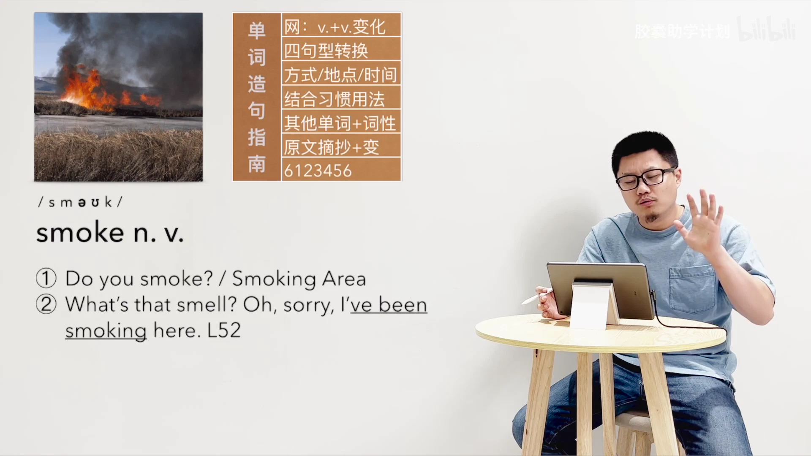

文字识别：单词造句指南 / 网：v.+v.变化 / 四句型转换 / 方式/地点/时间 / 结合习惯用法 / 其他单词+词性 / 原文摘抄+变 / 6123456 / /smauk / / smoke n. v. / ① Do you smoke?/ Smoking Area / ) What's that smell? Oh, sorry, I've been / smoking here. L52

### 画面 00:03:36

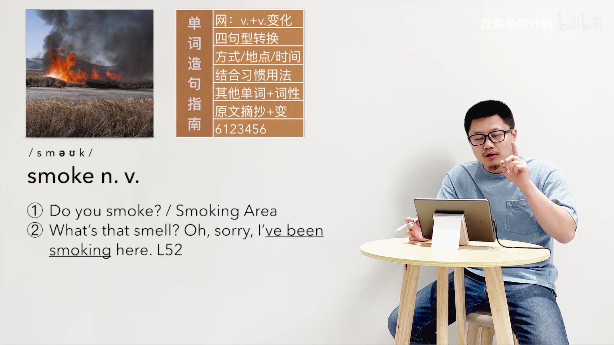

文字识别：单词造句指南 / 网：v.+v.变化 / 四句型转换 / 方式/地点/时间 / 结合习惯用法 / 其他单词+词性 / 原文摘抄+变 / 6123456 / / smauk / / smoke n.v. / ① Do you smoke?/ Smoking Area / ) What's that smell? Oh, sorry, I've been / smoking here. L52

### 画面 00:03:40

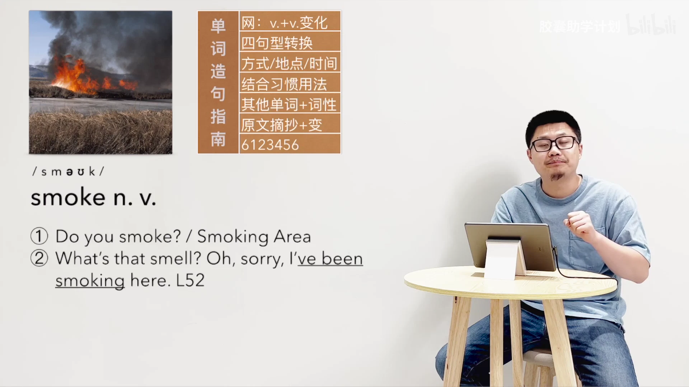

文字识别：单词造句指南 / 网：v.+v.变化 / 四句型转换 / 方式/地点/时间 / 结合习惯用法 / 其他单词+词性 / 原文摘抄+变 / 6123456 / / smauk / / smoke n.v. / ① Do you smoke?/ Smoking Area / ) What's that smell? Oh, sorry, I've been / smoking here. L52

### 画面 00:03:46

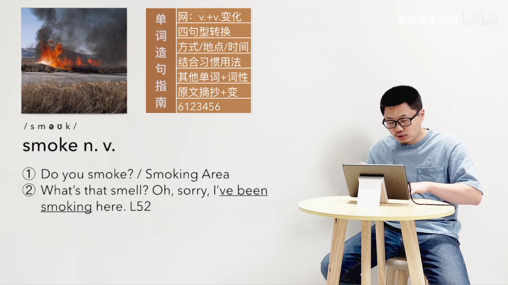

文字识别：单词造句指南 / 网：v.+v.变化 / 四句型转换 / 方式/地点/时间 / 结合习惯用法 / 其他单词+词性 / 原文摘抄+变 / 6123456 / / smauk / / smoke n.v. / ① Do you smoke?/ Smoking Area / ) What's that smell? Oh, sorry, I've been / smoking here. L52

### 画面 00:03:51

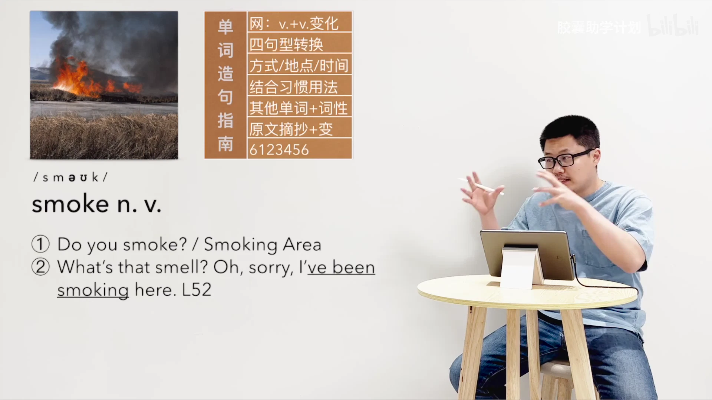

文字识别：单词造句指南 / 网：v.+v.变化 / 四句型转换 / 方式/地点/时间 / 结合习惯用法 / 其他单词+词性 / 原文摘抄+变 / 6123456 / / smauk / / smoke n. v. / ① Do you smoke?/ Smoking Area / What's that smell? Oh, sorry, I've been / smoking here. L52

### 画面 00:03:55

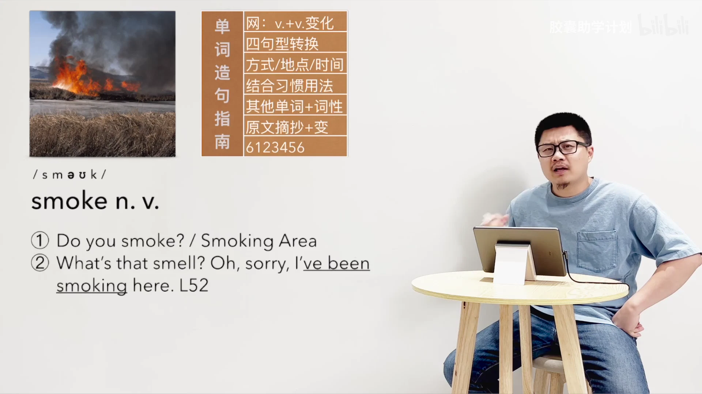

文字识别：单词造句指南 / 网：v.+v.变化 / 四句型转换 / 方式/地点/时间 / 结合习惯用法 / 其他单词+词性 / 原文摘抄+变 / 6123456 / / smauk / / smoke n.v. / ① Do you smoke? / Smoking Area / What's that smell? Oh, sorry, I've been / smoking here. L52

### 画面 00:03:58

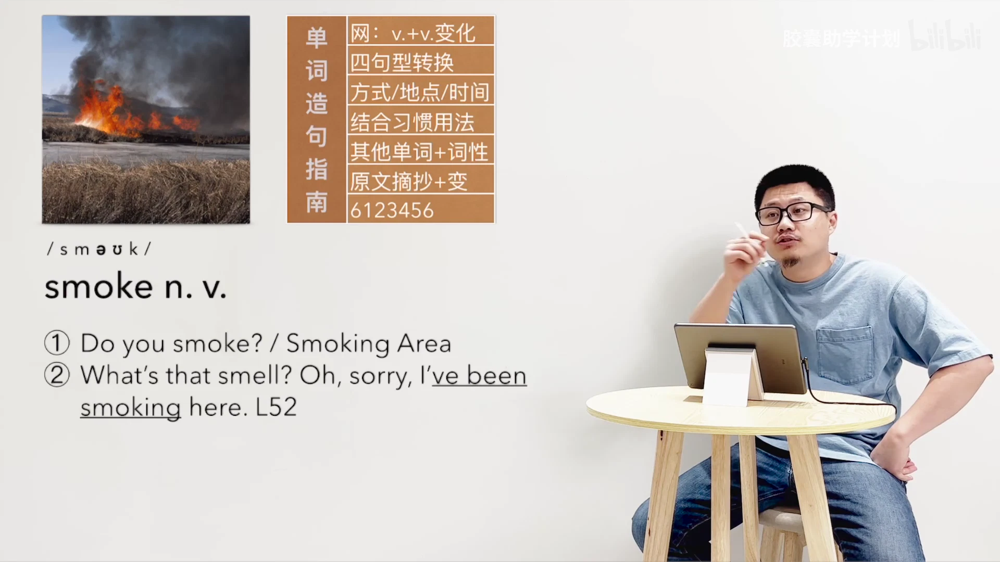

文字识别：单词造句指南 / 网：v.+v.变化 / 四句型转换 / 方式/地点/时间 / 结合习惯用法 / 其他单词+词性 / 原文摘抄+变 / 6123456 / / smauk / / smoke n. v. / ① Do you smoke? / Smoking Area / What's that smell? Oh, sorry, I've been / smoking here. L52

## 00:04:00–00:04:30

你现在并没有在抽烟，对吧？所以刚才一直进行的一个动作停止了，对现在产生了影响，影响叫做 it smells terrible，屋里闻起来很差。Okay, next one, every inch of this room，说这个房间的每一寸都怎么样呢？这是五十二课咱们学的，对吧？Smelled terrible last night，昨天晚上闻起来很差。Please don't

### 画面 00:04:01

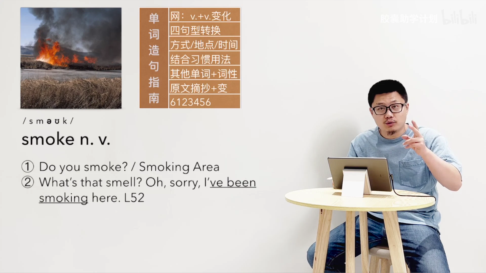

文字识别：单词造句指南 / 网：v.+v.变化 / 四句型转换 / 方式/地点/时间 / 结合习惯用法 / 其他单词+词性 / 原文摘抄+变 / 6123456 / / smauk / / smoke n.v. / ① Do you smoke?/ Smoking Area /  What's that smell? Oh, sorry, I've been / smoking here. L52

### 画面 00:04:05

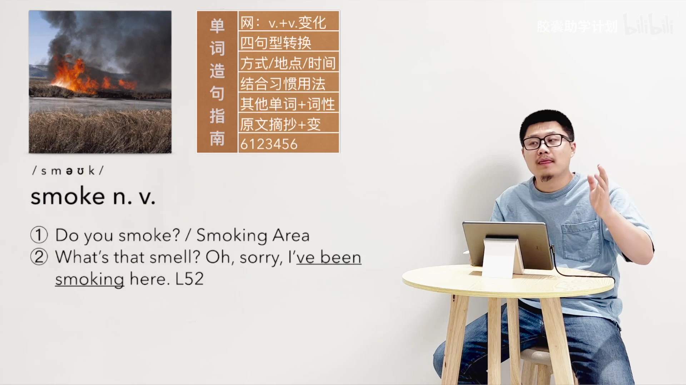

文字识别：单词造句指南 / 网：v.+v.变化 / 四句型转换 / 方式/地点/时间 / 结合习惯用法 / 其他单词+词性 / 原文摘抄+变 / 6123456 / / smauk / / smoke n. v. / ① Do you smoke?/ Smoking Area / ) What's that smell? Oh, sorry, I've been / smoking here. L52

### 画面 00:04:08

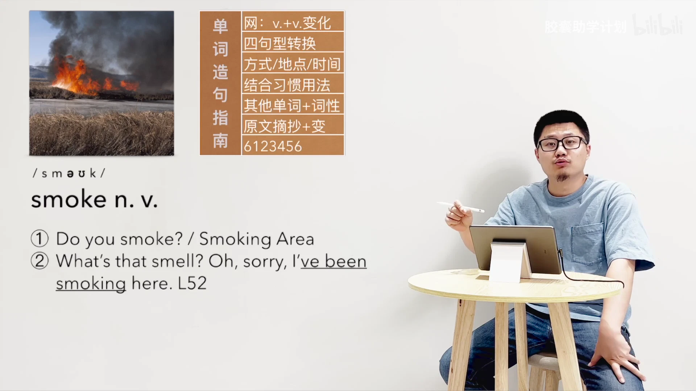

文字识别：单词造句指南 / 网：v.+v.变化 / 四句型转换 / 方式/地点/时间 / 结合习惯用法 / 其他单词+词性 / 原文摘抄+变 / 6123456 / / smauk / / smoke n.v. / ① Do you smoke?/ Smoking Area / ) What's that smell? Oh, sorry, I've been / smoking here. L52

### 画面 00:04:12

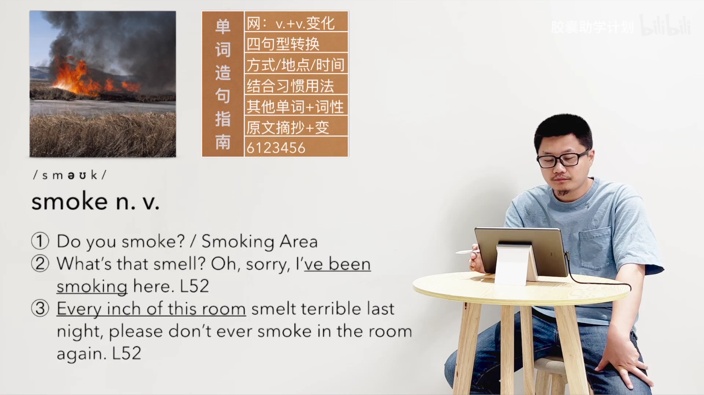

文字识别：单词造句指南 / 网：v.+v.变化 / 四句型转换 / 方式/地点/时间 / 结合习惯用法 / 其他单词+词性 / 原文摘抄+变 / 6123456 / / smauk / / smoke n. v. / ① Do you smoke?/ Smoking Area / ② What's that smell? Oh, sorry, I've been / smoking here. L52 / Every inch of this room smelt terrible last / night, please don't ever smoke in the room / again. L52

### 画面 00:04:14

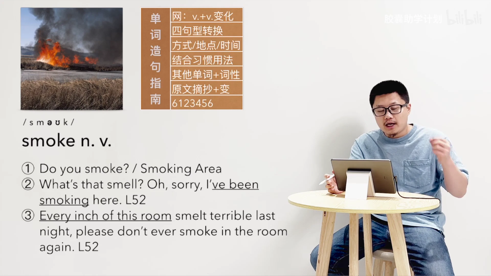

文字识别：单词造句指南 / 网：v.+v.变化 / 四句型转换 / 方式/地点/时间 / 结合习惯用法 / 其他单词+词性 / 原文摘抄+变 / 6123456 / / smauk / / smoke n. v. / ① Do you smoke? / Smoking Area / ② What's that smell? Oh, sorry, I've been / smoking here. L52 / Every inch of this room smelt terrible last / night, please don't ever smoke in the room / again. L52

### 画面 00:04:20

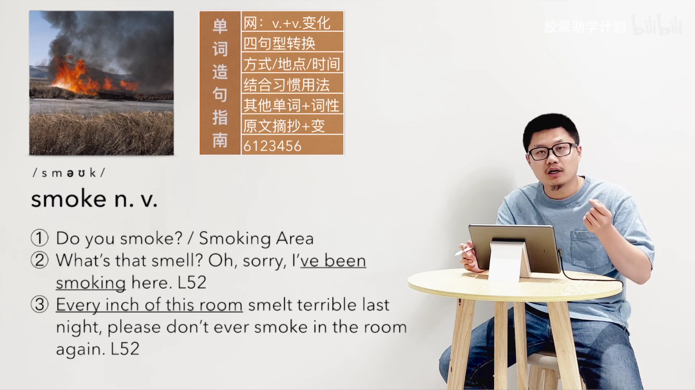

文字识别：单词造句指南 / 网：v.+v.变化 / 四句型转换 / 方式/地点/时间 / 结合习惯用法 / 其他单词+词性 / 原文摘抄+变 / 6123456 / /smauk/ / smoke n. v. / ① Do you smoke? / Smoking Area / ② What's that smell? Oh, sorry, I've been / smoking here. L52 / Every inch of this room smelt terrible last / night, please don't ever smoke in the room / again. L52

### 画面 00:04:26

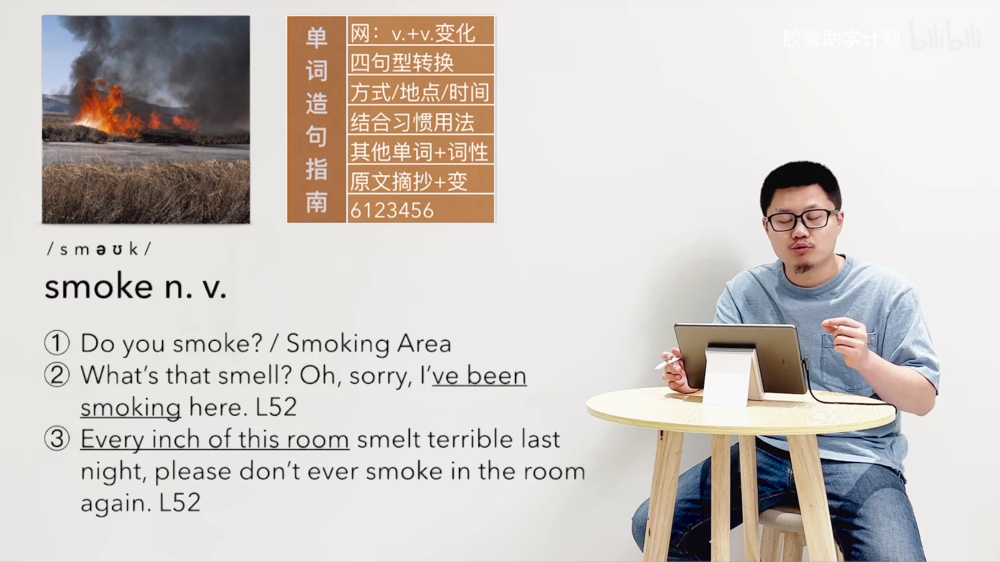

文字识别：单词造句指南 / 网：v.+v.变化 / 四句型转换 / 方式/地点/时间 / 结合习惯用法 / 其他单词+词性 / 原文摘抄+变 / 6123456 / / smauk / / smoke n. v. / ① Do you smoke? / Smoking Area / ② What's that smell? Oh, sorry, I've been / smoking here. L52 / Every inch of this room smelt terrible last / night, please don't ever smoke in the room / again. L52

## 00:04:30–00:05:00

ever smoke in the room again.请不要在房间当中抽烟了。OK，那这里其实全是抽烟，因为我还是那句话，它最常用的是这个意思。有这个意思可以你理解为，比如说引申出来说，the room is full of smoke. be full of，正好是第七课咱们学的一个习惯用法，复习一下。那这里的 smoke 就要由上下文语境去判断。比如说家里着火了，那你说 room full of smoke，这个 smoke 就是那个着火的那个烟，对吧？那你说你抽的

### 画面 00:04:34

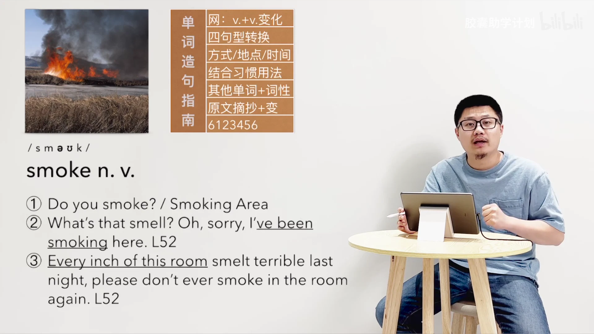

文字识别：单词造句指南 / 网：v.+v.变化 / 四句型转换 / 方式/地点/时间 / 结合习惯用法 / 其他单词+词性 / 原文摘抄+变 / 6123456 / /smauk/ / smoke n. v. / ① Do you smoke? / Smoking Area / ② What's that smell? Oh, sorry, I've been / smoking here. L52 / Every inch of this room smelt terrible last / night, please don't ever smoke in the room / again. L52

### 画面 00:04:36

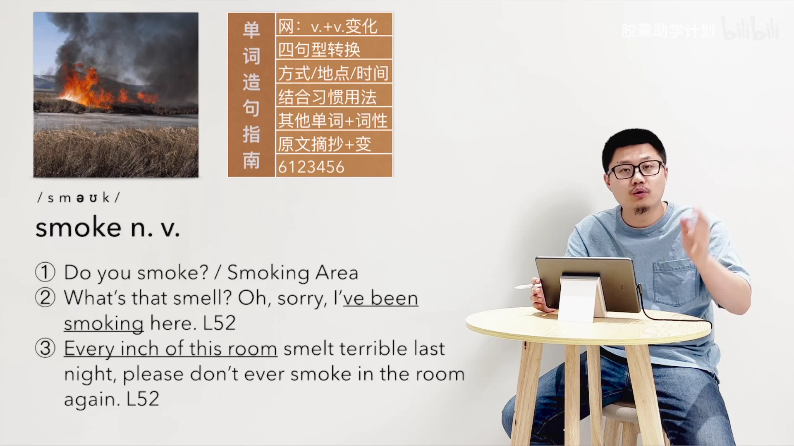

文字识别：单词造句指南 / 网：v.+v.变化 / 四句型转换 / 方式/地点/时间 / 结合习惯用法 / 其他单词+词性 / 原文摘抄+变 / 6123456 / / smauk/ / smoke n. v. / ① Do you smoke? / Smoking Area / ② What's that smell? Oh, sorry, I've been / smoking here. L52 / Every inch of this room smelt terrible last / night, please don't ever smoke in the room / again. L52

### 画面 00:04:40

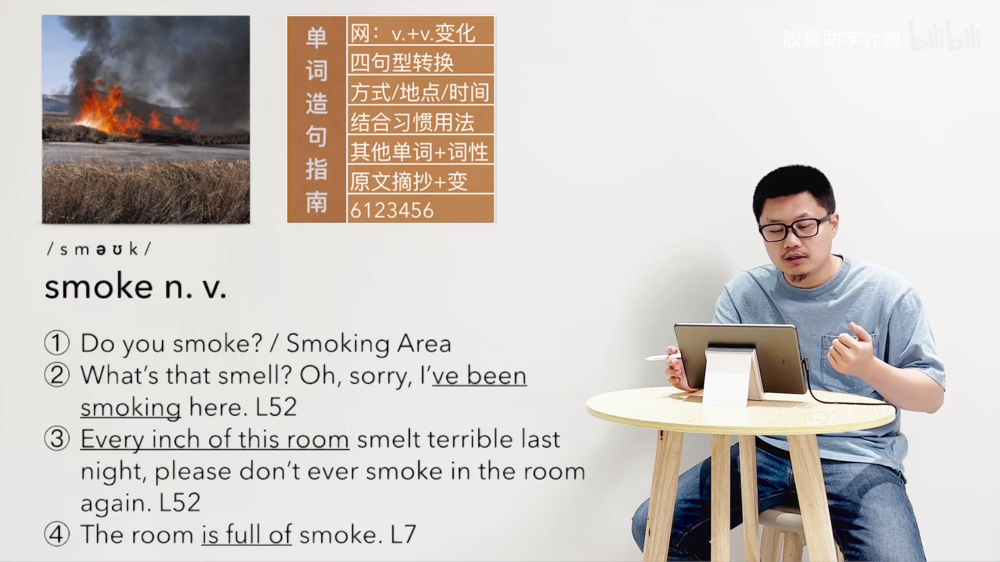

文字识别：单词造句指南 / 网：v.+v.变化 / 四句型转换 / 方式/地点/时间 / 结合习惯用法 / 其他单词+词性 / 原文摘抄+变 / 6123456 / / smauk / / smoke n. v. / ① Do you smoke? / Smoking Area / ② What's that smell? Oh, sorry, I've been / smoking here. L52 / Every inch of this room smelt terrible last / night, please don't ever smoke in the room / again. L52 / The room is full of smoke. L7

### 画面 00:04:42

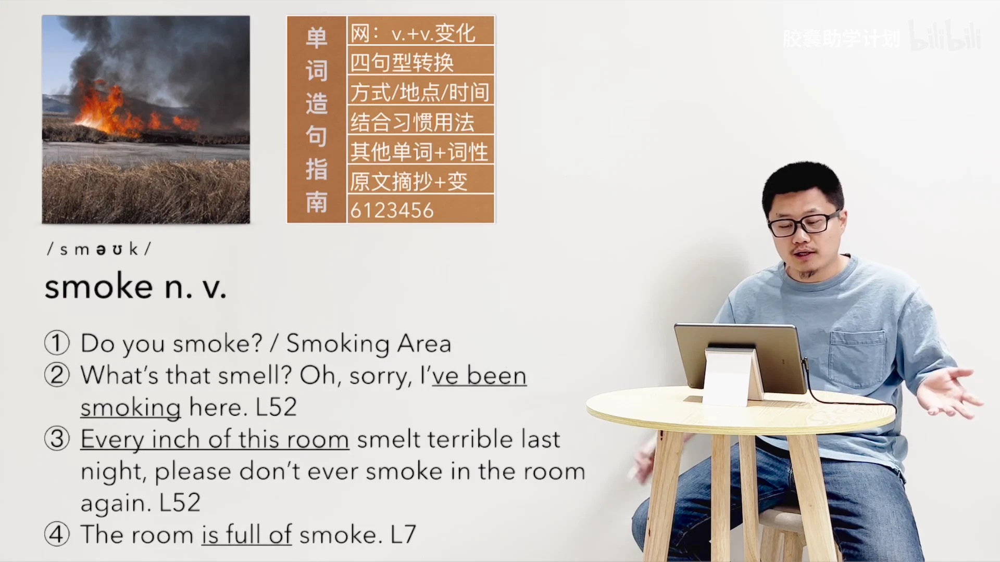

文字识别：单词造句指南 / 网：v.+v.变化 / 四句型转换 / 方式/地点/时间 / 结合习惯用法 / 其他单词+词性 / 原文摘抄+变 / 6123456 / / smauk / / smoke n. v. / ① Do you smoke? / Smoking Area / ② What's that smell? Oh, sorry, I've been / smoking here. L52 / Every inch of this room smelt terrible last / night, please don't ever smoke in the room / again. L52 / The room is full of smoke. L7

### 画面 00:04:45

文字识别：单词造句指南 / 网：v.+v.变化 / 四句型转换 / 方式/地点/时间 / 结合习惯用法 / 其他单词+词性 / 原文摘抄+变 / 6123456 / / smauk/ / smoke n.v. / ① Do you smoke? / Smoking Area / ② What's that smell? Oh, sorry, I've been / smoking here. L52 / Every inch of this room smelt terrible last / night, please don't ever smoke in the room / again. L52 / The room is full of smoke. L7

### 画面 00:04:48

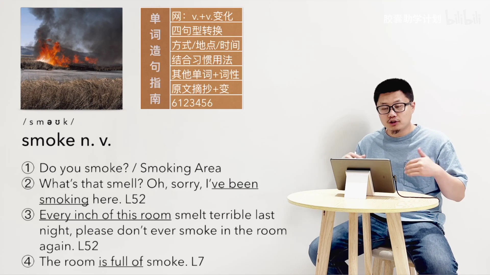

文字识别：单词造句指南 / 网：v.+v.变化 / 四句型转换 / 方式/地点/时间 / 结合习惯用法 / 其他单词+词性 / 原文摘抄+变 / 6123456 / / smauk/ / smoke n. v. / ① Do you smoke? / Smoking Area / ② What's that smell? Oh, sorry, I've been / smoking here. L52 / Every inch of this room smelt terrible last / night, please don't ever smoke in the room / again. L52 /  The room is full of smoke. L7

### 画面 00:04:50

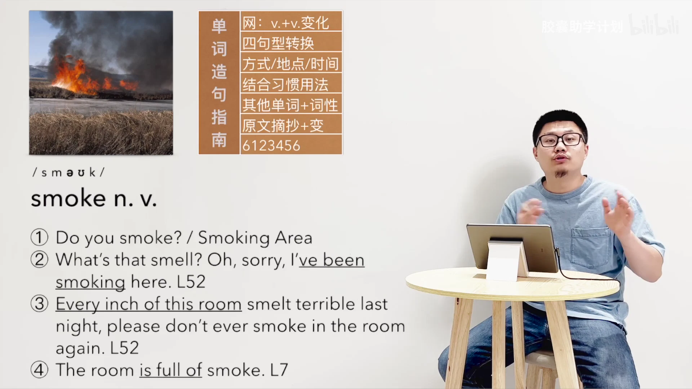

文字识别：单词造句指南 / 网：v.+v.变化 / 四句型转换 / 方式/地点/时间 / 结合习惯用法 / 其他单词+词性 / 原文摘抄+变 / 6123456 / / smauk/ / smoke n.v. / ① Do you smoke? / Smoking Area / ② What's that smell? Oh, sorry, I've been / smoking here. L52 / Every inch of this room smelt terrible last / night, please don't ever smoke in the room / again. L52 / The room is full of smoke. L7

### 画面 00:04:55

文字识别：单词造句指南 / 网：v.+v.变化 / 四句型转换 / 方式/地点/时间 / 结合习惯用法 / 其他单词+词性 / 原文摘抄+变 / 6123456 / / smauk/ / smoke n. v. / ① Do you smoke? / Smoking Area / ② What's that smell? Oh, sorry, I've been / smoking here. L52 / Every inch of this room smelt terrible last / night, please don't ever smoke in the room / again.L52 /  The room is full of smoke. L7

### 画面 00:04:58

文字识别：单词造句指南 / 网：v.+v.变化 / 四句型转换 / 方式/地点/时间 / 结合习惯用法 / 其他单词+词性 / 原文摘抄+变 / 6123456 / / smauk / / smoke n. v. / ① Do you smoke? / Smoking Area / ② What's that smell? Oh, sorry, I've been / smoking here. L52 / Every inch of this room smelt terrible last / night, please don't ever smoke in the room / again. L52 / The room is full of smoke. L7

## 00:05:00–00:05:30

的全是烟，那你就说全是烟味儿呗，对吧？OK，好，那接下来呢，我们看一个电影片段，就一句话，但是我觉得这句话它好好在，帮我们复习了一下新概念一册一百零三课、一百零四课的这个句型，叫 too 形容词 to do something，过于怎么怎么样，而不能，比如说这里叫做你太年轻了，不能抽烟。OK，注意力集中，咱们听一下。 You're too young to

### 画面 00:05:00

文字识别：单词造句指南 / 网：v.+v.变化 / 四句型转换 / 方式/地点/时间 / 结合习惯用法 / 其他单词+词性 / 原文摘抄+变 / 6123456 / / smauk / / smoke n. v. / ① Do you smoke? / Smoking Area / ② What's that smell? Oh, sorry, I've been / smoking here. L52 / Every inch of this room smelt terrible last / night, please don't ever smoke in the room / again. L52 / The room is full of smoke. L7

### 画面 00:05:03

文字识别：You're too young to smoke. / Paper Moon / (1973)

### 画面 00:05:12

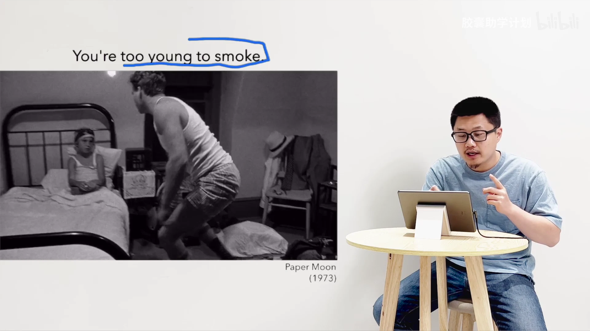

文字识别：You're too young to smoke. / Paper Moon / (1973)

### 画面 00:05:14

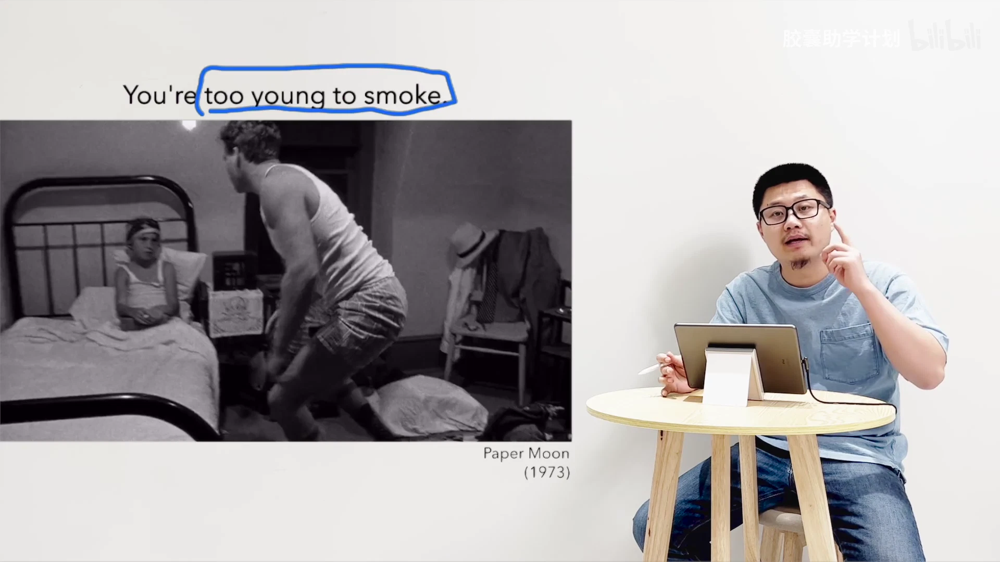

文字识别：You'retoo young to smoke. / Paper Moon / (1973)

### 画面 00:05:29

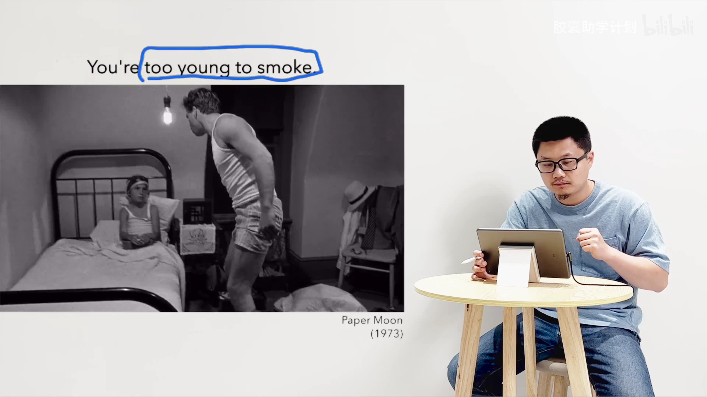

文字识别：You'retoo young to smoke. / Paper Moon / (1973)

## 00:05:30–00:06:00

smoke. Okay,就这一句话啊. You're too young to smoke. Very good. Next one,下一个单词是一个形容词，看一下音标叫desolate. Desolate.那desolate还那当然也可以，你也会听到它有另一个发音叫desolate啊。我也听过，没问题，英式美式啊。那desolate这个单词的含义就是荒凉的，就像这个图中一样，对吧？比如说，那你经常这个形容词跟名词连到一起，就

### 画面 00:05:31

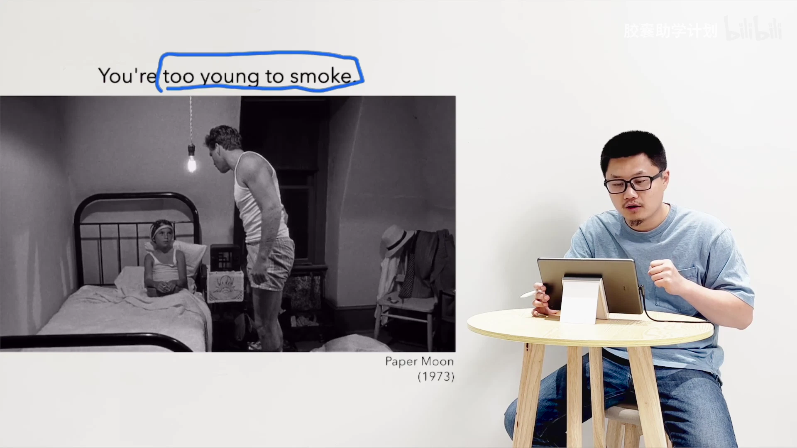

文字识别：You'retoo young to smoke / Paper Moon / (1973)

### 画面 00:05:34

文字识别：单词造句指南 / 网：v.+v.变化 / 四句型转换 / 方式/地点/时间 / 结合习惯用法 / 其他单词+词性 / 原文摘抄+变 / 6123456 / /.desalat/ / desolate adj.

### 画面 00:05:36

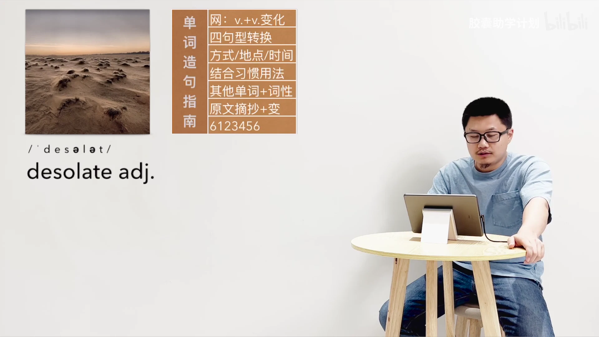

文字识别：单词造句指南 / 网：v.+v.变化 / 四句型转换 / 方式/地点/时间 / 结合习惯用法 / 其他单词+词性 / 原文摘抄+变 / 6123456 / /'desalat/ / desolate adj.

### 画面 00:05:39

文字识别：单词造句指南 / 网：v.+v.变化 / 四句型转换 / 方式/地点/时间 / 结合习惯用法 / 其他单词+词性 / 原文摘抄+变 / 6123456 / / ' desal / desolate adj.

### 画面 00:05:41

文字识别：单词造句指南 / 网：v.+v.变化 / 四句型转换 / 方式/地点/时间 / 结合习惯用法 / 其他单词+词性 / 原文摘抄+变 / 6123456 / /'desalat/ / desolate adj.

### 画面 00:05:45

文字识别：单词造句指南 / 网：v.+v.变化 / 四句型转换 / 方式/地点/时间 / 结合习惯用法 / 其他单词+词性 / 原文摘抄+变 / 6123456 / / desalat/ / desolate adj.

### 画面 00:05:50

文字识别：单词造句指南 / 网：v.+v.变化 / 四句型转换 / 方式/地点/时间 / 结合习惯用法 / 其他单词+词性 / 原文摘抄+变 / 6123456 / /'desalat/ / desolate adj.

### 画面 00:05:55

文字识别：单词造句指南 / 网：v.+v.变化 / 四句型转换 / 方式/地点/时间 / 结合习惯用法 / 其他单词+词性 / 原文摘抄+变 / 6123456 / / desalat/ / desolate adj.

### 画面 00:05:58

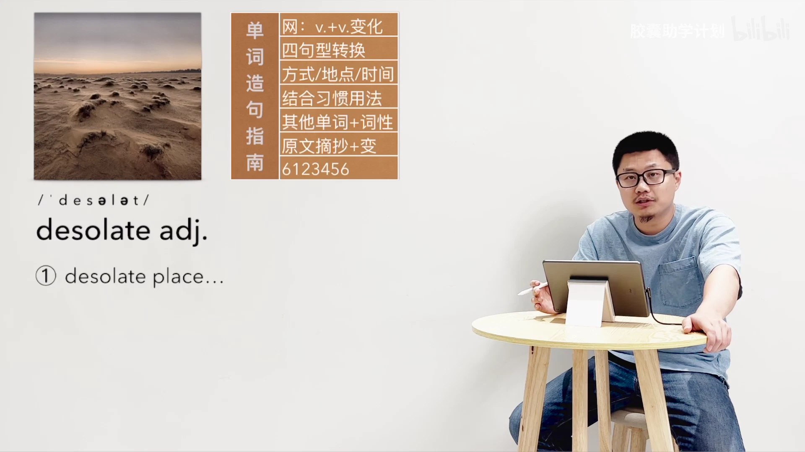

文字识别：单词造句指南 / 网：v.+v.变化 / 四句型转换 / 方式/地点/时间 / 结合习惯用法 / 其他单词+词性 / 原文摘抄+变 / 6123456 / /'desalat/ / desolate adj. / ① desolate place...

## 00:06:00–00:06:30

desolate place，一个很荒凉荒芜的地方造句子。所以 it's obvious that there is no one in this desolate place. 很明显，it's obvious that 五十一课学的这个关键句型啊。这里在这个荒凉的地方没有任何人。Next one, I prefer to travel to a desolate place all by myself. 哎，我喜欢自己一个人去很荒凉

### 画面 00:06:00

文字识别：单词造句指南 / 网：v.+v.变化 / 四句型转换 / 方式/地点/时间 / 结合习惯用法 / 其他单词+词性 / 原文摘抄+变 / 6123456 / /'desalat/ / desolate adj. / ① desolate place...

### 画面 00:06:03

文字识别：单词造句指南 / 网：v.+v.变化 / 四句型转换 / 方式/地点/时间 / 结合习惯用法 / 其他单词+词性 / 原文摘抄+变 / 6123456 / /'desalat/ / desolate adj. / ① desolate place... / It's obvious that there's no one in this / desolate place. L51

### 画面 00:06:05

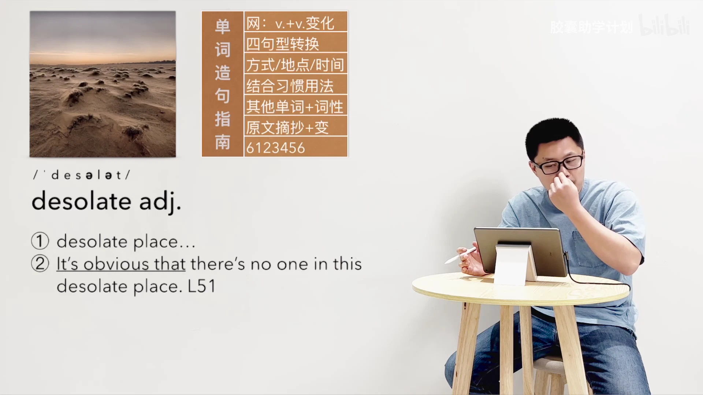

文字识别：单词造句指南 / 网：v.+v.变化 / 四句型转换 / 方式/地点/时间 / 结合习惯用法 / 其他单词+词性 / 原文摘抄+变 / 6123456 / /'desalat/ / desolate adj. / ① desolate place... / It's obvious that there's no one in this / desolate place. L51

### 画面 00:06:10

文字识别：单词造句指南 / 网：v.+v.变化 / 四句型转换 / 方式/地点/时间 / 结合习惯用法 / 其他单词+词性 / 原文摘抄+变 / 6123456 / /'desalat/ / desolate adj. / ① desolate place.. / It's obvious that there's no one in this / desolate place. L51

### 画面 00:06:19

文字识别：单词造句指南 / 网：v.+v.变化 / 四句型转换 / 方式/地点/时间 / 结合习惯用法 / 其他单词+词性 / 原文摘抄+变 / 6123456 / /'desalat/ / desolate adj. / ① desolate place.. / It's obvious that there's no one in this / desolate place. L51

### 画面 00:06:21

文字识别：单词造句指南 / 网：v.+v.变化 / 四句型转换 / 方式/地点/时间 / 结合习惯用法 / 其他单词+词性 / 原文摘抄+变 / 6123456 / / 'desalat/ / desolate adj. / ① desolate place... / It's obvious that there's no one in this / desolate place. L51

### 画面 00:06:23

文字识别：单词造句指南 / 网：v.+v.变化 / 四句型转换 / 方式/地点/时间 / 结合习惯用法 / 其他单词+词性 / 原文摘抄+变 / 6123456 / /'desalat/ / desolate adj. / ① desolate place... / It's obvious that there's no one in this / desolate place. L51 / ) I prefer to travel to a desolate place all by / 3 / myself. L50

### 画面 00:06:26

文字识别：单词造句指南 / 网：v.+v.变化 / 四句型转换 / 方式/地点/时间 / 结合习惯用法 / 其他单词+词性 / 原文摘抄+变 / 6123456 / /'desalat/ / desolate adj. / ① desolate place... / It's obvious that there's no one in this / desolate place. L51 / ) I prefer to travel to a desolate place all by / myself. L50

## 00:06:30–00:07:00

的地方旅行，对吧？Next one, say I'm tired of living in this desolate place. This forty-nineth lesson,哎，我们这儿没有加下划线，给它加上，补上，叫做 be tired of doing something，对吧？我厌倦于了在这个荒凉的地方生活。One more,那接下来呢？电影片段，他用的是什么句型？希望各位还记得，我们管它叫做感叹句啊。说这个地方可真荒凉

### 画面 00:06:30

文字识别：单词造句指南 / 网：v.+v.变化 / 四句型转换 / 方式/地点/时间 / 结合习惯用法 / 其他单词+词性 / 原文摘抄+变 / 6123456 / /'desalat/ / desolate adj. / ① desolate place... / It's obvious that there's no one in this / desolate place. L51 / ) I prefer to travel to a desolate place all by / myself. L50

### 画面 00:06:33

文字识别：单词造句指南 / 网：v.+v.变化 / 四句型转换 / 方式/地点/时间 / 结合习惯用法 / 其他单词+词性 / 原文摘抄+变 / 6123456 / /'desalat/ / desolate adj. / ① desolate place... / ) It's obvious that there's no one in this / desolate place. L51 / ) I prefer to travel to a desolate place all by / 3 / myself. L50 / ④ I'm tired of living in this desolate place. L49

### 画面 00:06:35

文字识别：单词造句指南 / 网：v.+v.变化 / 四句型转换 / 方式/地点/时间 / 结合习惯用法 / 其他单词+词性 / 原文摘抄+变 / 6123456 / /'desalat/ / desolate adj. / ① desolate place... / ) It's obvious that there's no one in this / desolate place. L51 / ) I prefer to travel to a desolate place all by / 3 / myself. L50 / ④ I'm tired of living in this desolate place. L49

### 画面 00:06:39

文字识别：单词造句指南 / 网：v.+v.变化 / 四句型转换 / 方式/地点/时间 / 结合习惯用法 / 其他单词+词性 / 原文摘抄+变 / 6123456 / / 'desalat / / desolate adj. / ① desolate place... / ) It's obvious that there's no one in this / 2） / desolate place. L51 / ③ I prefer to travel to a desolate place all by / 3 / myself. L50 / ④ I'm tired of living in this desolate place. L49

### 画面 00:06:41

文字识别：单词造句指南 / 网：v.+v.变化 / 四句型转换 / 方式/地点/时间 / 结合习惯用法 / 其他单词+词性 / 原文摘抄+变 / 6123456 / /'desalat/ / desolate adj. / ① desolate place... / ) It's obvious that there's no one in this / desolate place. L51 / ③ I prefer to travel to a desolate place all by / 3 / myself. L50 / ④ I'm tired of living in this desolate place. L49

### 画面 00:06:45

文字识别：单词造句指南 / 网：v.+v.变化 / 四句型转换 / 方式/地点/时间 / 结合习惯用法 / 其他单词+词性 / 原文摘抄+变 / 6123456 / /.desalat/ / desolate adj. / ① desolate place... / It's obvious that there's no one in this / desolate place. L51 / ) I prefer to travel to a desolate place all by / myself. L50 / ④ I'm tired of living in this desolate place. L49

### 画面 00:06:49

文字识别：What a desolate place this is. / Star Wars: Episode IV-A New Hope / (1977)

### 画面 00:06:54

文字识别：What a desolate place this is. / Star Wars: Episode IV-A New Hope / (1977)

## 00:07:00–00:07:30

Transcribe the exact words in their original spoken languages. Never translate. Preserve repetitions, questions and examples. Then you wait a moment to listen to him speak. He doesn't appear. This depends on whether you have seen this movie. It's called Star Wars. OK. If you have seen it, you are likely to hear who is speaking. It's a robot speaking. Pay attention and listen. What a desolate place this is. A very famous movie series, right? What is it called? I'll make a guess. You've seen it. If you like it very much, you know it, right? It's a science fiction movie. It's at least as

### 画面 00:07:09

文字识别：Star Wars / Episode IV -A New Hope / (1977)

### 画面 00:07:20

文字识别：Star Wars / Episode IV-A New Hope / (1977)

## 00:07:30–00:08:00

呃和至少和阿西莫夫的《银河帝国》是有点像的，是吧？他们自己实际上否认了说改编于阿西莫夫的《银河帝国》，是吧？那个是小说啊，这个是电影。OK，好，next one，下一个单词我们看一下音标，叫做threaten，threaten，threaten就威胁啊，威胁啊，或者对什么什么造成威胁啊，构成威胁。你比如说常见的短语，threaten somebody with

### 画面 00:07:42

文字识别：单词造句指南 / 网：v.+v.变化 / 四句型转换 / 方式/地点/时间 / 结合习惯用法 / 其他单词+词性 / 原文摘抄+变 / 6123456 / /θretan/ / threaten v.

### 画面 00:07:44

文字识别：单词造句指南 / 网：v.+v.变化 / 四句型转换 / 方式/地点/时间 / 结合习惯用法 / 其他单词+词性 / 原文摘抄+变 / 6123456 / / θretan/ / threaten v.

### 画面 00:07:46

文字识别：单词造句指南 / 网：v.+v.变化 / 四句型转换 / 方式/地点/时间 / 结合习惯用法 / 其他单词+词性 / 原文摘抄+变 / 6123456 / / θretan/ / threaten v.

### 画面 00:07:50

文字识别：单词造句指南 / 网：v.+v.变化 / 四句型转换 / 方式/地点/时间 / 结合习惯用法 / 其他单词+词性 / 原文摘抄+变 / 6123456 / /θretan/ / threaten v.

### 画面 00:07:52

文字识别：单词造句指南 / 网：v.+v.变化 / 四句型转换 / 方式/地点/时间 / 结合习惯用法 / 其他单词+词性 / 原文摘抄+变 / 6123456 / / θretan/ / threaten v.

### 画面 00:07:55

文字识别：单词造句指南 / 网：v.+v.变化 / 四句型转换 / 方式/地点/时间 / 结合习惯用法 / 其他单词+词性 / 原文摘抄+变 / 6123456 / /'θretan/ / threaten v. / ① threaten sb. with sth.

### 画面 00:07:58

文字识别：单词造句指南 / 网：v.+v.变化 / 四句型转换 / 方式/地点/时间 / 结合习惯用法 / 其他单词+词性 / 原文摘抄+变 / 6123456 / /'θretan/ / threaten V. / ① threaten sb. with sth.

## 00:08:00–00:08:30

something. This里面其实不是这么的死板，它比较灵活。这个somebody和something本质上就是A和B啊。那threaten A with B什么意思呢？用B威胁A。比如说，the man threatened him with a knife.你看这句话什么意思？说这个男的威胁他用一把刀啊，用刀威胁他。Next one

### 画面 00:08:00

文字识别：单词造句指南 / 网：v.+v.变化 / 四句型转换 / 方式/地点/时间 / 结合习惯用法 / 其他单词+词性 / 原文摘抄+变 / 6123456 / / θretan/ / threaten v. / ①threaten sb. with sth.

### 画面 00:08:04

文字识别：单词造句指南 / 网：v.+v.变化 / 四句型转换 / 方式/地点/时间 / 结合习惯用法 / 其他单词+词性 / 原文摘抄+变 / 6123456 / / θretan/ / threaten v. /  threaten sb. with sth.

### 画面 00:08:06

文字识别：单词造句指南 / 网：v.+v.变化 / 四句型转换 / 方式/地点/时间 / 结合习惯用法 / 其他单词+词性 / 原文摘抄+变 / 6123456 / /'θretan/ / threaten v. / ) threaten sb. with sth.

### 画面 00:08:08

文字识别：单词造句指南 / 网：v.+v.变化 / 四句型转换 / 方式/地点/时间 / 结合习惯用法 / 其他单词+词性 / 原文摘抄+变 / 6123456 / /'θretan/ / threaten v. / 5 /  threaten sb. with sth.

### 画面 00:08:10

文字识别：单词造句指南 / 网：v.+v.变化 / 四句型转换 / 方式/地点/时间 / 结合习惯用法 / 其他单词+词性 / 原文摘抄+变 / 6123456 / /'θretan/ / threaten v. /  threaten sb. with sth.

### 画面 00:08:15

文字识别：单词造句指南 / 网：v.+v.变化 / 四句型转换 / 方式/地点/时间 / 结合习惯用法 / 其他单词+词性 / 原文摘抄+变 / 6123456 / / ' θretan / / threaten v. / ① threaten sb. with sth. / The man threaten him with a knife.

### 画面 00:08:18

文字识别：单词造句指南 / 网：v.+v.变化 / 四句型转换 / 方式/地点/时间 / 结合习惯用法 / 其他单词+词性 / 原文摘抄+变 / 6123456 / / ' θretan / / threaten v. /  threaten sb. with sth. / The man threaten him with a knife.

### 画面 00:08:20

文字识别：单词造句指南 / 网：v.+v.变化 / 四句型转换 / 方式/地点/时间 / 结合习惯用法 / 其他单词+词性 / 原文摘抄+变 / 6123456 / / ' θretan / / threaten v. /  threaten sb. with sth. / The man threaten him with a knife.

### 画面 00:08:26

文字识别：单词造句指南 / 网：v.+v.变化 / 四句型转换 / 方式/地点/时间 / 结合习惯用法 / 其他单词+词性 / 原文摘抄+变 / 6123456 / / θretan / / threaten v. / ① threaten sb. with sth. / The man threaten him with a knife.

### 画面 00:08:29

文字识别：单词造句指南 / 网：v.+v.变化 / 四句型转换 / 方式/地点/时间 / 结合习惯用法 / 其他单词+词性 / 原文摘抄+变 / 6123456 / /  θretan / / threaten v. / D threaten sb. with sth. / The man threaten him with a knife. / It's said that you threaten him with the police. L58

## 00:08:30–00:09:00

is said that又是据说吧。You threatened him with the police.你不能总不能说please something吧，对吧？哎，用B，你用警察威胁了他，也就是说你用比如说报警这件事情威胁了他，对吧？Next one, you don't have to threaten me.这里我就是直接用的threaten这个用法，叫做你不用威胁我，对吧？威胁我也没用，我不吃那一套，等等等等的。OK，我们造了一个句子啊。

### 画面 00:08:31

文字识别：单词造句指南 / 网：v.+v.变化 / 四句型转换 / 方式/地点/时间 / 结合习惯用法 / 其他单词+词性 / 原文摘抄+变 / 6123456 / /' θretan / / threaten v. / ① threaten sb. with sth. / The man threaten him with a knife. / It's said that you threaten him with the police. L58

### 画面 00:08:35

文字识别：单词造句指南 / 网：v.+v.变化 / 四句型转换 / 方式/地点/时间 / 结合习惯用法 / 其他单词+词性 / 原文摘抄+变 / 6123456 / /  θretan / / threaten v. /  threaten sb. with sth. / The man threaten him with a knife. / It's said that you threaten him with the police. L58

### 画面 00:08:39

文字识别：单词造句指南 / 网：v.+v.变化 / 四句型转换 / 方式/地点/时间 / 结合习惯用法 / 其他单词+词性 / 原文摘抄+变 / 6123456 / / ' θretan / / threaten V. / ) threaten sb. with sth. / The man threaten him with a knife. / It's said that you threaten him with the police. L58

### 画面 00:08:41

文字识别：单词造句指南 / 网：v.+v.变化 / 四句型转换 / 方式/地点/时间 / 结合习惯用法 / 其他单词+词性 / 原文摘抄+变 / 6123456 / / ' θretan / / threaten v. / ) threaten sb. with sth. / The man threaten him with a knife. / It's said that you threaten him with the police. L58

### 画面 00:08:43

文字识别：单词造句指南 / 网：v.+v.变化 / 四句型转换 / 方式/地点/时间 / 结合习惯用法 / 其他单词+词性 / 原文摘抄+变 / 6123456 / / ' θretan / / threaten v. / threaten sb. with sth. / The man threaten him with a knife. / It's said that you threaten him with the police. L58

### 画面 00:08:45

文字识别：单词造句指南 / 网：v.+v.变化 / 四句型转换 / 方式/地点/时间 / 结合习惯用法 / 其他单词+词性 / 原文摘抄+变 / 6123456 / / ' θretan / / threaten v. / ) threaten sb. with sth. / The man threaten him with a knife. / It's said that you threaten him with the police. L58

### 画面 00:08:47

文字识别：单词造句指南 / 网：v.+v.变化 / 四句型转换 / 方式/地点/时间 / 结合习惯用法 / 其他单词+词性 / 原文摘抄+变 / 6123456 / / θretan/ / threaten V. / D threaten sb. with sth. / The man threaten him with a knife. / It's said that you threaten him with the police. L58 /  You don't have to threaten me. L17

### 画面 00:08:50

文字识别：单词造句指南 / 网：v.+v.变化 / 四句型转换 / 方式/地点/时间 / 结合习惯用法 / 其他单词+词性 / 原文摘抄+变 / 6123456 / / θretan/ / threaten v. / ) threaten sb. with sth. / The man threaten him with a knife. / It's said that you threaten him with the police. L58 /  You don't have to threaten me. L17

### 画面 00:08:53

文字识别：单词造句指南 / 网：v.+v.变化 / 四句型转换 / 方式/地点/时间 / 结合习惯用法 / 其他单词+词性 / 原文摘抄+变 / 6123456 / / θretan / / threaten V. / ① threaten sb. with sth. / The man threaten him with a knife. / It's said that you threaten him with the police. L58 / ④ You don't have to threaten me. L17

### 画面 00:08:55

文字识别：单词造句指南 / 网：v.+v.变化 / 四句型转换 / 方式/地点/时间 / 结合习惯用法 / 其他单词+词性 / 原文摘抄+变 / 6123456 / / 'θretan/ / threaten V. / ) threaten sb. with sth. / The man threaten him with a knife. / It's said that you threaten him with the police. L58 / ④ You don't have to threaten me. L17

### 画面 00:08:59

文字识别：单词造句指南 / 网：v.+v.变化 / 四句型转换 / 方式/地点/时间 / 结合习惯用法 / 其他单词+词性 / 原文摘抄+变 / 6123456 / / 'θretan / / threaten v. /  threaten sb. with sth. / The man threaten him with a knife. / It's said that you threaten him with the police. L58 / ④ You don't have to threaten me. L17

## 00:09:00–00:09:30

那这里用到的语法十七课 have to do，包括我们新概念一册一百二十五课也学过啊。这个语法我希望各位还记得。Next one，我们还可以有一个常见的短语叫 threaten to do something，叫威胁着去做某件事情。比如说，I have to threaten to call his wife，说我当呃我没有说当时了啊，我不得不威胁着要给他妻子打一个电话。OK，好，那

### 画面 00:09:03

文字识别：单词造句指南 / 网：v.+v.变化 / 四句型转换 / 方式/地点/时间 / 结合习惯用法 / 其他单词+词性 / 原文摘抄+变 / 6123456 / / 'θretan / / threaten V. / ① threaten sb. with sth. / The man threaten him with a knife. / It's said that you threaten him with the police. L58 / ④ You don't have to threaten me. L17

### 画面 00:09:05

文字识别：单词造句指南 / 网：v.+v.变化 / 四句型转换 / 方式/地点/时间 / 结合习惯用法 / 其他单词+词性 / 原文摘抄+变 / 6123456 / / θretan / / threaten V. / ① threaten sb. with sth. / The man threaten him with a knife. / It's said that you threaten him with the police. L58 /  You don't have to threaten me. L17

### 画面 00:09:10

文字识别：单词造句指南 / 网：v.+v.变化 / 四句型转换 / 方式/地点/时间 / 结合习惯用法 / 其他单词+词性 / 原文摘抄+变 / 6123456 / / θretan/ / threaten V. / ① threaten sb. with sth. / The man threaten him with a knife. / It's said that you threaten him with the police. L58 /  You don't have to threaten me. L17 /  threaten to do sth.

### 画面 00:09:13

文字识别：单词造句指南 / 网：v.+v.变化 / 四句型转换 / 方式/地点/时间 / 结合习惯用法 / 其他单词+词性 / 原文摘抄+变 / 6123456 / / 'θretan/ / threaten V. / ① threaten sb. with sth. / The man threaten him with a knife. / It's said that you threaten him with the police. L58 /  You don't have to threaten me. L17 / threaten to do sth.

### 画面 00:09:15

文字识别：单词造句指南 / 网：v.+v.变化 / 四句型转换 / 方式/地点/时间 / 结合习惯用法 / 其他单词+词性 / 原文摘抄+变 / 6123456 / /'θretan/ / threaten V. / ① threaten sb. with sth. / The man threaten him with a knife. / It's said that you threaten him with the police. L58 / D You don't have to threaten me. L17 / threaten to do sth. / ) I have to threaten to call his wife. Dream Lover(1993)

### 画面 00:09:20

文字识别：单词造句指南 / 网：v.+v.变化 / 四句型转换 / 方式/地点/时间 / 结合习惯用法 / 其他单词+词性 / 原文摘抄+变 / 6123456 / /'θretan/ / threaten v. / ① threaten sb. with sth. / The man threaten him with a knife. / It's said that you threaten him with the police. L58 /  You don't have to threaten me. L17 / threaten to do sth. / ) I have to threaten to call his wife. Dream Lover(1993) / 6

### 画面 00:09:23

文字识别：单词造句指南 / 网：v.+v.变化 / 四句型转换 / 方式/地点/时间 / 结合习惯用法 / 其他单词+词性 / 原文摘抄+变 / 6123456 / / 'θretan / / threaten V. / ① threaten sb. with sth. / The man threaten him with a knife. / It's said that you threaten him with the police. L58 /  You don't have to threaten me. L17 / 4 / threaten to do sth. / I kave tot / threaten to call his wife. Dream Lover(1993) / 6

### 画面 00:09:25

文字识别：单词造句指南 / 网：v.+v.变化 / 四句型转换 / 方式/地点/时间 / 结合习惯用法 / 其他单词+词性 / 原文摘抄+变 / 6123456 / /'θretan/ / threaten v. / ① threaten sb. with sth. / The man threaten him with a knife. / It's said that you threaten him with the police. L58 /  You don't have to threaten me. L17 / threaten to do sth. / I ave tot / threaten tocall his wifeDream Lover (1993) / 6

### 画面 00:09:27

文字识别：单词造句指南 / 网：v.+v.变化 / 四句型转换 / 方式/地点/时间 / 结合习惯用法 / 其他单词+词性 / 原文摘抄+变 / 6123456 / / θretan/ / threaten V. / ① threaten sb. with sth. / The man threaten him with a knife. / It's said that you threaten him with the police. L58 /  You don't have to threaten me. L17 / threaten to do sth. / I lave tot / threaten toCall his wifeDream Lover (1993) / 6

### 画面 00:09:29

文字识别：Did you threaten to kill Emma? / Hailey Dean Mystery: A Will to Kill / (2018)

## 00:09:30–00:10:00

注意力集中，我们看这个电影片段。Did you threaten to kill Emma? Okay, next one is you who threatened me, Danny.好，这里面有两个小点，我想让各位稍微重视一下。第一个叫做五十八课咱们学的强调句，特别好，在这电影片段当中正好出现了，对吧？回顾一下，您还记不记得？第二个是你听他读threaten的这个发音，我不认为是错的，我只

### 画面 00:09:35

文字识别：Did you threaten to kill Emma? / Hailey Dean Mystery: A Will to Kill / (2018)

### 画面 00:09:37

文字识别：It's you who threaten me, Danny. L58 / aE CARNIM / Colors / (1988)

### 画面 00:09:45

文字识别：It's you who threaten me, Danny. / .L58 / AE CARINM / Colors / (1988)

## 00:10:00–00:10:30

认为他是有比较强的一个口音，但你也要熟悉这个口音，对吧？就像我之前跟各位说的，我们不要学纯美式或纯英式，你可以去学，但是听的时候一定要全听，因为这个世界上英国人加美国人全算上，也只占说英语的人口当中很少的一部分，极其小的一部分。所以你将来说英语的时候，和对方对方很可能说的不是英式，你脑海当中的那个所谓的英

### 画面 00:10:06

文字识别：It's you who threaten me, Danny. / L58 / CARNIM / Colors / (1988)

## 00:10:30–00:11:00

式英语或美式英语，所以你一定要听啊，注意力集中，咱们来一下。Are you good? Next one，下一个单词叫 surrounding， surrounding，哎，这些假设是如果是音响的话，那就是 surrounding，啊，在周围围绕着它，对吧？那 surrounding，你看是一个形容词，最常见的你要加一个名词，什么名词呢？这几个都可以用，叫 surrounding area，周边，对吧？直接就翻译成汉

### 画面 00:10:35

文字识别：It's you who threaten me, Danny. / .L58 / CARNIM / Colors / (1988)

### 画面 00:10:38

文字识别：单词造句指南 / 网：v.+v.变化 / 四句型转换 / 方式/地点/时间 / 结合习惯用法 / 其他单词+词性 / 原文摘抄+变 / 6123456 / /sａ'raundｌn/ / surrounding adj.

### 画面 00:10:40

文字识别：单词造句指南 / 网：v.+v.变化 / 四句型转换 / 方式/地点/时间 / 结合习惯用法 / 其他单词+词性 / 原文摘抄+变 / 6123456 / /sａ'raｕndｌn/ / surrounding adj.

### 画面 00:10:44

文字识别：单词造句指南 / 网：v.+v.变化 / 四句型转换 / 方式/地点/时间 / 结合习惯用法 / 其他单词+词性 / 原文摘抄+变 / 6123456 / /sａ'raｕndin/ / surrounding adj.

### 画面 00:10:46

文字识别：单词造句指南 / 网：v.+v.变化 / 四句型转换 / 方式/地点/时间 / 结合习惯用法 / 其他单词+词性 / 原文摘抄+变 / 6123456 / /sａ'raｕndｌη/ / surrounding adj.

### 画面 00:10:49

文字识别：单词造句指南 / 网：v.+v.变化 / 四句型转换 / 方式/地点/时间 / 结合习惯用法 / 其他单词+词性 / 原文摘抄+变 / 6123456 / /sａ'raｕndｌn/ / surrounding adj.

### 画面 00:10:51

文字识别：单词造句指南 / 网：v.+v.变化 / 四句型转换 / 方式/地点/时间 / 结合习惯用法 / 其他单词+词性 / 原文摘抄+变 / 6123456 / /sａ'raundīn/ / surrounding adj. /  + n.area / villages / towns

### 画面 00:10:55

文字识别：单词造句指南 / 网：v.+v.变化 / 四句型转换 / 方式/地点/时间 / 结合习惯用法 / 其他单词+词性 / 原文摘抄+变 / 6123456 / /sa'raundin/ / surrounding adj. / + n.area/ villaqes/towns

### 画面 00:10:58

文字识别：单词造句指南 / 网：v.+v.变化 / 四句型转换 / 方式/地点/时间 / 结合习惯用法 / 其他单词+词性 / 原文摘抄+变 / 6123456 / /sa'raundīn/ / surrounding adj. / + n.area / villaqes/towns

## 00:11:00–00:11:30

字周边就可以了。那 surrounding villages 周边的村落， surrounding towns 周边的小镇。 Okay，好，我们造一句话说， Although this place is completely safe， the surrounding area of London is not。好，我说尽管说这个地方完全的是安全的，但是呢，伦敦周边它并不安全。哎，我就造了这样一句话，对吧？用到了

### 画面 00:11:00

文字识别：单词造句指南 / 网：v.+v.变化 / 四句型转换 / 方式/地点/时间 / 结合习惯用法 / 其他单词+词性 / 原文摘抄+变 / 6123456 / /sa'raundin/ / surrounding adj. / + n.area / villaqes/towns

### 画面 00:11:02

文字识别：单词造句指南 / 网：v.+v.变化 / 四句型转换 / 方式/地点/时间 / 结合习惯用法 / 其他单词+词性 / 原文摘抄+变 / 6123456 / /sa'raundin/ / surrounding adj. / + n.area / villaqes/towns

### 画面 00:11:05

文字识别：单词造句指南 / 网：v.+v.变化 / 四句型转换 / 方式/地点/时间 / 结合习惯用法 / 其他单词+词性 / 原文摘抄+变 / 6123456 / /sa'raundin / / surrounding adj. / + n.area / villaqes/towns

### 画面 00:11:08

文字识别：单词造句指南 / 网：v.+v.变化 / 四句型转换 / 方式/地点/时间 / 结合习惯用法 / 其他单词+词性 / 原文摘抄+变 / 6123456 / /sａ'raundīn/ / surrounding adj. / + n.area/villages/towns / Although this place is completely safe, / the surrounding area of London is not.

### 画面 00:11:11

文字识别：单词造句指南 / 网：v.+v.变化 / 四句型转换 / 方式/地点/时间 / 结合习惯用法 / 其他单词+词性 / 原文摘抄+变 / 6123456 / /sa'raundīn/ / surrounding adj. / + n.area / villaqes/towns / Although this place is completely safe, / the surrounding area of London is not.

### 画面 00:11:15

文字识别：单词造句指南 / 网：v.+v.变化 / 四句型转换 / 方式/地点/时间 / 结合习惯用法 / 其他单词+词性 / 原文摘抄+变 / 6123456 / /sａ'raundin/ / surrounding adj. / + n.area/villages/towns / Although this place is completely safe, / the surrounding area of London is not.

### 画面 00:11:20

文字识别：单词造句指南 / 网：v.+v.变化 / 四句型转换 / 方式/地点/时间 / 结合习惯用法 / 其他单词+词性 / 原文摘抄+变 / 6123456 / /sａ'raundin/ / surrounding adj. / + n.area/villages/towns / Although this place is completely safe, / the surrounding area of London is not.

### 画面 00:11:25

文字识别：单词造句指南 / 网：v.+v.变化 / 四句型转换 / 方式/地点/时间 / 结合习惯用法 / 其他单词+词性 / 原文摘抄+变 / 6123456 / /sａ'raundīn/ / surrounding adj. / + n.area/villages/towns / Although this place is completely safe, / the surrounding area of London is not.

## 00:11:30–00:12:00

although. Next one. I've been checking the surrounding area for three hours. 好，你看这里的 have been doing 又回到了五十二课，因为本课我想讲过去完成进行时，那五十二课我一定要带着现在完成进行时。那你看这里的现在完成进行时就是从过去持续到现在，我这三个小时一直都在检查对这个周边。 Okay. Next

### 画面 00:11:30

文字识别：单词造句指南 / 网：v.+v.变化 / 四句型转换 / 方式/地点/时间 / 结合习惯用法 / 其他单词+词性 / 原文摘抄+变 / 6123456 / /sａ'raundīn/ / surrounding adj. / + n.area/villages/towns / Although this place is completely safe, / the surrounding area of London is not.

### 画面 00:11:32

文字识别：单词造句指南 / 网：v.+v.变化 / 四句型转换 / 方式/地点/时间 / 结合习惯用法 / 其他单词+词性 / 原文摘抄+变 / 6123456 / /sａ'raundīn/ / surrounding adj. / + n.area/villages/towns / Although this place is completely safe, / the surrounding area of London is not. / I've been checking the surrounding area / for three hours. L52

### 画面 00:11:35

文字识别：单词造句指南 / 网：v.+v.变化 / 四句型转换 / 方式/地点/时间 / 结合习惯用法 / 其他单词+词性 / 原文摘抄+变 / 6123456 / /sa'raundin/ / surrounding adj. / + n.area/villages/towns / Although this place is completely safe, / the surrounding area of London is not. / I've been checking the surrounding area / for three hours. L52

### 画面 00:11:38

文字识别：单词造句指南 / 网：v.+v.变化 / 四句型转换 / 方式/地点/时间 / 结合习惯用法 / 其他单词+词性 / 原文摘抄+变 / 6123456 / /sa'raundīn/ / surrounding adj. / + n.area/villaqes/towns / Although this place is completely safe, / the surrounding area of London is not. / I've been checking the surrounding area / for three hours. L52

### 画面 00:11:40

文字识别：单词造句指南 / 网：v.+v.变化 / 四句型转换 / 方式/地点/时间 / 结合习惯用法 / 其他单词+词性 / 原文摘抄+变 / 6123456 / /sａ'raundｌη/ / surrounding adj. / + n.area/ villaqes/towns / Although this place is completely safe, / the surrounding area of London is not. / I've been checking the surrounding area / for three hours. L52

### 画面 00:11:44

文字识别：单词造句指南 / 网：v.+v.变化 / 四句型转换 / 方式/地点/时间 / 结合习惯用法 / 其他单词+词性 / 原文摘抄+变 / 6123456 / /sａ'raundｌη/ / surrounding adj. / + n.area/ villaqes/towns / Although this place is completely safe, / the surrounding area of London is not. / I've been checking the surrounding area / for three hours. L52

### 画面 00:11:46

文字识别：单词造句指南 / 网：v.+v.变化 / 四句型转换 / 方式/地点/时间 / 结合习惯用法 / 其他单词+词性 / 原文摘抄+变 / 6123456 / /sa'raundin/ / surrounding adj. / + n.area/ villaqes/towns / Although this place is completely safe, / the surrounding area of London is not. / I've been checking the surrounding area / for three hours. L52

### 画面 00:11:50

文字识别：单词造句指南 / 网：v.+v.变化 / 四句型转换 / 方式/地点/时间 / 结合习惯用法 / 其他单词+词性 / 原文摘抄+变 / 6123456 / /sａ'raundīn/ / surrounding adj. / + n.area / villaqes/towns / Although this place is completely safe, / the surrounding area of London is not. / I've been checking the surrounding area / for three hours. L52

### 画面 00:11:55

文字识别：单词造句指南 / 网：v.+v.变化 / 四句型转换 / 方式/地点/时间 / 结合习惯用法 / 其他单词+词性 / 原文摘抄+变 / 6123456 / /sａ'raundīn/ / surrounding adj. / + n.area/villages/towns / Although this place is completely safe, / the surrounding area of London is not. / I've been checking / y the surrounding area / for three hours. L52

### 画面 00:11:59

文字识别：单词造句指南 / 网：v.+v.变化 / 四句型转换 / 方式/地点/时间 / 结合习惯用法 / 其他单词+词性 / 原文摘抄+变 / 6123456 / /saraundin/ / surrounding adj. / + n.area/villages/towns / Although this place is completely safe, / the surrounding area of London is not. / I've been checking the surrounding area / for three hours. L52 / If we control this place, we'll control the / whole surrounding area. L16

## 00:12:00–00:12:30

one. If we control this place,注意，你看这里的control是不是就变成了动词，而不是名词了？如果我们控制好这个地方，we'll control the whole surrounding area.我们将控制这整个周边地区surrounding area. Okay,好，呃，那接下来注意力集中，我们看一下这个电

### 画面 00:12:01

文字识别：单词造句指南 / 网：v.+v.变化 / 四句型转换 / 方式/地点/时间 / 结合习惯用法 / 其他单词+词性 / 原文摘抄+变 / 6123456 / /sa'raundin/ / surrounding adj. / + n.area/villages/towns / Although this place is completely safe, / the surrounding area of London is not. / I've been checking the surrounding area / for three hours. L52 / If we control this place, we'll control the / whole surrounding area. L16

### 画面 00:12:05

文字识别：单词造句指南 / 网：v.+v.变化 / 四句型转换 / 方式/地点/时间 / 结合习惯用法 / 其他单词+词性 / 原文摘抄+变 / 6123456 / /sa'raundin/ / surrounding adj. / + n.area / villaqes/towns / 1 / Although this place is completely safe, / the surrounding area of London is not. / I've been checking the surrounding area / for three hours. L52 / If we control this place, we'll control the / whole surrounding area. L16

### 画面 00:12:10

文字识别：单词造句指南 / 网：v.+v.变化 / 四句型转换 / 方式/地点/时间 / 结合习惯用法 / 其他单词+词性 / 原文摘抄+变 / 6123456 / /saraundin/ / surrounding adj. / + n.area / villages/towns / Although this place is completely safe, / the surrounding area of London is not. / I've been checking the surrounding area / for three hours. L52 / If we control this place, we'll control the / whole surrounding area. L16

### 画面 00:12:15

文字识别：单词造句指南 / 网：v.+v.变化 / 四句型转换 / 方式/地点/时间 / 结合习惯用法 / 其他单词+词性 / 原文摘抄+变 / 6123456 / /sa'raundin/ / surrounding adj. / + n.area/villages/towns / Although this place is completely safe, / the surrounding area of London is not. / I've been checking the surrounding area / for three hours. L52 / If we control this place, we'll control the / whole surrounding area. L16

### 画面 00:12:20

文字识别：单词造句指南 / 网：v.+v.变化 / 四句型转换 / 方式/地点/时间 / 结合习惯用法 / 其他单词+词性 / 原文摘抄+变 / 6123456 / /sa'raundin/ / surrounding adj. / + n.area/villages/towns / Although this place is completely safe, / the surrounding area of London is not. / I've been checking the surrounding area / for three hours. L52 / If we control this place, we'll control the / whole surrounding area. L16

### 画面 00:12:22

文字识别：单词造句指南 / 网：v.+v.变化 / 四句型转换 / 方式/地点/时间 / 结合习惯用法 / 其他单词+词性 / 原文摘抄+变 / 6123456 / /saraundin/ / surrounding adj. / + n.area / villaqes/towns / Although this place is completely safe, / the surrounding area of London is not. / I've been checking the surrounding area / for three hours. L52 / If we control this place, we'll control the / whole surrounding area. L16

### 画面 00:12:25

文字识别：单词造句指南 / 网：v.+v.变化 / 四句型转换 / 方式/地点/时间 / 结合习惯用法 / 其他单词+词性 / 原文摘抄+变 / 6123456 / /sa'raundin/ / surrounding adj. / + n.area/villages/towns / Although this place is completely safe, / the surrounding area of London is not. / I've been checking / g the surrounding area / for three hours. L52 / If we control this place, we'll control the / whole surrounding area. L16

### 画面 00:12:27

文字识别：Is there any way we can check out / those surrounding buildings. / The Kingdom / (2007)

## 00:12:30–00:13:00

影片段。这个电影片段当中，我只提一个点，叫 check out，叫检查的意思啊，跟 check 本身差不多。好。Is anyone we can check out those surrounding buildings? Very good. Next one, 下一个单词，看一下音标，叫做 destruction。 destruction。我们不做其他词性的拓展，以后见到咱们再说。咱们先说它这个名词叫 destruction。 destruction 这个单词，关于它本身的拼写上，我要多讲一个小的东西，就是

### 画面 00:12:38

文字识别： Is there any way we can check out / those surrounding / buildings. / The Kingdom / (2007)

### 画面 00:12:40

文字识别：单词造句指南 / 网：v.+v.变化 / 四句型转换 / 方式/地点/时间 / 结合习惯用法 / 其他单词+词性 / 原文摘抄+变 / 6123456 / /di'strΛk∫an/ / destruction n.

### 画面 00:12:43

文字识别：单词造句指南 / 网：v.+v.变化 / 四句型转换 / 方式/地点/时间 / 结合习惯用法 / 其他单词+词性 / 原文摘抄+变 / 6123456 / /di'strΛk∫an/ / destruction n.

### 画面 00:12:45

文字识别：单词造句指南 / 网：v.+v.变化 / 四句型转换 / 方式/地点/时间 / 结合习惯用法 / 其他单词+词性 / 原文摘抄+变 / 6123456 / /dr'strΛk∫an/ / destruction n.

### 画面 00:12:51

文字识别：单词造句指南 / 网：v.+v.变化 / 四句型转换 / 方式/地点/时间 / 结合习惯用法 / 其他单词+词性 / 原文摘抄+变 / 6123456 / /dI'strΛk∫an/ / destruction n.

### 画面 00:12:55

文字识别：单词造句指南 / 网：v.+v.变化 / 四句型转换 / 方式/地点/时间 / 结合习惯用法 / 其他单词+词性 / 原文摘抄+变 / 6123456 / /dr'strak∫an/ / destruction n.

### 画面 00:12:57

文字识别：单词造句指南 / 网：v.+v.变化 / 四句型转换 / 方式/地点/时间 / 结合习惯用法 / 其他单词+词性 / 原文摘抄+变 / 6123456 / /dI'strak∫an/ / destruction n.

## 00:13:00–00:13:30

很多单词并不绝对，但很多单词以 t i o n 结尾的时候，首先发音都是 shen 啊，其次呢，它都是一个名词的词性啊，毁灭，就像图中这个样子。比如我们造一句话，呃， destruction 这个单词单独去造句子确实不是那么的容易。那我们在文章当中用到了一个很好的句子，还能帮我们复习一下 threaten a with b，我就把它拿出来了。 The

### 画面 00:13:00

文字识别：单词造句指南 / 网：v.+v.变化 / 四句型转换 / 方式/地点/时间 / 结合习惯用法 / 其他单词+词性 / 原文摘抄+变 / 6123456 / /dI'strΛk∫an/ / destruction n.

### 画面 00:13:06

文字识别：单词造句指南 / 网：v.+v.变化 / 四句型转换 / 方式/地点/时间 / 结合习惯用法 / 其他单词+词性 / 原文摘抄+变 / 6123456 / /dI'strak∫an/ / destruction n.

### 画面 00:13:10

文字识别：单词造句指南 / 网：v.+v.变化 / 四句型转换 / 方式/地点/时间 / 结合习惯用法 / 其他单词+词性 / 原文摘抄+变 / 6123456 / /di'strΛk∫an/ / destruction

### 画面 00:13:14

文字识别：单词造句指南 / 网：v.+v.变化 / 四句型转换 / 方式/地点/时间 / 结合习惯用法 / 其他单词+词性 / 原文摘抄+变 / 6123456 / /dI'strΛk ∫an / / destruction / ① [Story]: The hills threatened the / surrounding villages with destruction.

### 画面 00:13:16

文字识别：单词造句指南 / 网：v.+v.变化 / 四句型转换 / 方式/地点/时间 / 结合习惯用法 / 其他单词+词性 / 原文摘抄+变 / 6123456 / /dI'str Λk ∫an / / destruction / ① [Story]: The hills threatened the / surrounding villages with destruction.

### 画面 00:13:20

文字识别：单词造句指南 / 网：v.+v.变化 / 四句型转换 / 方式/地点/时间 / 结合习惯用法 / 其他单词+词性 / 原文摘抄+变 / 6123456 / /dI'strΛk ∫an / / destruction / ① [Story]: The hills threatened the / surrounding villages with destruction.

### 画面 00:13:25

文字识别：单词造句指南 / 网：v.+v.变化 / 四句型转换 / 方式/地点/时间 / 结合习惯用法 / 其他单词+词性 / 原文摘抄+变 / 6123456 / /dI'strΛk ∫an / / destruction / ① [Story]: The hills threatened the / surrounding villages with destruction.

## 00:13:30–00:14:00

hills threatened the surrounding villages with destruction.说这个山呐威胁着周边的村落，用的是毁灭，其实就是毁对周边的村落构成了威胁，对吧？以毁灭的方式构成了威胁啊。OK，那四句型转换对于您来说这是比较容易的一件事情。OK， next one，我们看这句话叫The destruction

### 画面 00:13:37

文字识别：单词造句指南 / 网：v.+v.变化 / 四句型转换 / 方式/地点/时间 / 结合习惯用法 / 其他单词+词性 / 原文摘抄+变 / 6123456 / /dⅠ'strΛk ∫an / / destruction / ① [Story]: The hills threatened the / surrounding villages with destruction.

### 画面 00:13:39

文字识别：单词造句指南 / 网：v.+v.变化 / 四句型转换 / 方式/地点/时间 / 结合习惯用法 / 其他单词+词性 / 原文摘抄+变 / 6123456 / /di'strak ∫an / / destruction / ① [Story]: The hills threatened the / surrounding villages with destruction.

### 画面 00:13:41

文字识别：单词造句指南 / 网：v.+v.变化 / 四句型转换 / 方式/地点/时间 / 结合习惯用法 / 其他单词+词性 / 原文摘抄+变 / 6123456 / /dI'strak∫an/ / destruction / [Story]: The hills threatened the / 10 / surrounding villages with destructiop.

### 画面 00:13:44

文字识别：单词造句指南 / 网：v.+v.变化 / 四句型转换 / 方式/地点/时间 / 结合习惯用法 / 其他单词+词性 / 原文摘抄+变 / 6123456 / /dI'strak∫an/ / destruction / [Story]: The hills threatened the / 1D / surrounding villages with destructiop.

### 画面 00:13:48

文字识别：单词造句指南 / 网：v.+v.变化 / 四句型转换 / 方式/地点/时间 / 结合习惯用法 / 其他单词+词性 / 原文摘抄+变 / 6123456 / /dI'strΛk ∫an / / destruction / ① [Story]: The hills threatened the / surrounding villages with destructiop.

### 画面 00:13:51

文字识别：单词造句指南 / 网：v.+v.变化 / 四句型转换 / 方式/地点/时间 / 结合习惯用法 / 其他单词+词性 / 原文摘抄+变 / 6123456 / /dI'strak∫an/ / destruction / ① [Story]: The hills threatened the / surrounding villages with destructiop / did/why/what/how...

### 画面 00:13:54

文字识别：单词造句指南 / 网：v.+v.变化 / 四句型转换 / 方式/地点/时间 / 结合习惯用法 / 其他单词+词性 / 原文摘抄+变 / 6123456 / /dI'strak ∫an/ / destructionn. / ① [Story]: The hills threatened the / surrounding villages with destruction. / did/why/what/how...

### 画面 00:13:56

文字识别：单词造句指南 / 网：v.+v.变化 / 四句型转换 / 方式/地点/时间 / 结合习惯用法 / 其他单词+词性 / 原文摘抄+变 / 6123456 / /dI'strak∫an/ / destruction n. / ① [Story]: The hills threatened the / surrounding villages with destruction. / did/why/what/how... / The destruction came from the surrounding / hills. did/where/why..

## 00:14:00–00:14:30

came from the surrounding hills. 好，这个很容易理解，叫做这个毁灭来自于周边的山。那其实你跟我们原文连起来就可以了。我不知道各位有没有提前预习啊？哎，其实你跟这个原文连起来就可以了啊。有山毁灭着，要威胁这个村落。那这个，哎，这个这个这个毁灭不就来自于周边的这个山嘛？对不对？好，那同理还是做四

### 画面 00:14:00

文字识别：单词造句指南 / 网：v.+v.变化 / 四句型转换 / 方式/地点/时间 / 结合习惯用法 / 其他单词+词性 / 原文摘抄+变 / 6123456 / /di'strak∫an/ / destruction n. / ① [Story]: The hill threatened the / surrounding villages with destruction. / did/why/what/how... / The destruction came from the surrounding / hills. did/where/why..

### 画面 00:14:05

文字识别：单词造句指南 / 网：v.+v.变化 / 四句型转换 / 方式/地点/时间 / 结合习惯用法 / 其他单词+词性 / 原文摘抄+变 / 6123456 / /dI'strak∫an/ / destruction n. / ① [Story]: The hill threatened the / surrounding villages with destruction. / did/why/what/how... / The destruction came from the surrounding / hills. did/where/why..

### 画面 00:14:07

文字识别：单词造句指南 / 网：v.+v.变化 / 四句型转换 / 方式/地点/时间 / 结合习惯用法 / 其他单词+词性 / 原文摘抄+变 / 6123456 / /dI'strΛk∫an/ / destruction n. / ① [Story]: The hills threatened the / surrounding villages with destruction. / did/why/what/how... / The destructioy came from the surrounding / hills. did/where/why...

### 画面 00:14:10

文字识别：单词造句指南 / 网：v.+v.变化 / 四句型转换 / 方式/地点/时间 / 结合习惯用法 / 其他单词+词性 / 原文摘抄+变 / 6123456 / /dI'strΛk∫an/ / destruction n. / ① [Story]: The hills threatened the / surrounding villages with destruction. / did/why/what/how... / The destructio came from the surrounding / hills. did/where/why...

### 画面 00:14:12

文字识别：单词造句指南 / 网：v.+v.变化 / 四句型转换 / 方式/地点/时间 / 结合习惯用法 / 其他单词+词性 / 原文摘抄+变 / 6123456 / /dI'strΛk∫an/ / destruction n. / ① [Story]: The hills threatened the / surrounding villages with destruction. / did/why/what/how... / The destructioy came from the surrounding / hills. did/where/why...

### 画面 00:14:15

文字识别：单词造句指南 / 网：v.+v.变化 / 四句型转换 / 方式/地点/时间 / 结合习惯用法 / 其他单词+词性 / 原文摘抄+变 / 6123456 / /dI'strak∫an/ / destruction n. / ① [Story]: The hills threatened the / surrounding villages with destruction. / did/why/what/how... / The destructioy came from the surrounding / hills. did/where/why...

### 画面 00:14:20

文字识别：单词造句指南 / 网：v.+v.变化 / 四句型转换 / 方式/地点/时间 / 结合习惯用法 / 其他单词+词性 / 原文摘抄+变 / 6123456 / /dI'strak∫an/ / destruction n. / ① [Story]: The hills threatened the / surrounding villages with destruction. / did/why/what/how... / The destructioy came from the surrounding / hills. did/where/why...

### 画面 00:14:25

文字识别：单词造句指南 / 网：v.+v.变化 / 四句型转换 / 方式/地点/时间 / 结合习惯用法 / 其他单词+词性 / 原文摘抄+变 / 6123456 / /di'strak∫an/ / destruction n. / ① [Story]: The hill threatened the / surrounding villages with destruction. / did/why/what/how... / The destructioy came from the surrounding / hills. did/where/why...

### 画面 00:14:29

文字识别：单词造句指南 / 网：v.+v.变化 / 四句型转换 / 方式/地点/时间 / 结合习惯用法 / 其他单词+词性 / 原文摘抄+变 / 6123456 / /dI'strΛk∫an/ / destruction n. / ① [Story]: The hills threatened the / surrounding villages with destruction. / did/why/what/how... / The destructio came from the surrounding / hills. did/where/why...

## 00:14:30–00:15:00

句型转换啊！这个各位呢，我给各位的建议是，您可能自己尽量不要用 destruction 去造句。您把我留的这几个点造出来，其实哎，五个句子绰绰有余了，对吧？Next one, he told me a story of destruction. 他告诉了我一个毁灭的故事。您看，在这个地方，a tell somebody a story 是咱们二十七课一帮男孩去露营那课咱学

### 画面 00:14:31

文字识别：单词造句指南 / 网：v.+v.变化 / 四句型转换 / 方式/地点/时间 / 结合习惯用法 / 其他单词+词性 / 原文摘抄+变 / 6123456 / /dI'strak∫an/ / destruction n. / ① [Story]: The hill threatened the / surrounding villages with destruction. / did/why/what/how... / The destruction came from the surrounding / hills. did/where/why..

### 画面 00:14:35

文字识别：单词造句指南 / 网：v.+v.变化 / 四句型转换 / 方式/地点/时间 / 结合习惯用法 / 其他单词+词性 / 原文摘抄+变 / 6123456 / /dI'strak∫an/ / destruction n. / ) [Story]: The hills threatened the / 1 / surrounding villages with destruction. / did/why/what/how... / The destruction came from the surrounding / hills. did/where/why...

### 画面 00:14:37

文字识别：单词造句指南 / 网：v.+v.变化 / 四句型转换 / 方式/地点/时间 / 结合习惯用法 / 其他单词+词性 / 原文摘抄+变 / 6123456 / /dr'strΛk∫an/ / destruction n. / ) [Story]: The hills threatened the / 1 / surrounding villages with destruction. / did/why/what/how.. / The destruction came from the surrounding / hills. did/where/why...

### 画面 00:14:39

文字识别：单词造句指南 / 网：v.+v.变化 / 四句型转换 / 方式/地点/时间 / 结合习惯用法 / 其他单词+词性 / 原文摘抄+变 / 6123456 / /dr'strΛk∫an/ / destruction n. / [Story]: The hills threatened the / 1 / surrounding villages with destruction. / did/why/what/how. / The destruction came from the surrounding / hills. aid/where/why..

### 画面 00:14:41

文字识别：单词造句指南 / 网：v.+v.变化 / 四句型转换 / 方式/地点/时间 / 结合习惯用法 / 其他单词+词性 / 原文摘抄+变 / 6123456 / /di'strak∫an/ / destruction n. / [Story]: The hills threatened the / surrounding villages with destruction. / did/why/what/how. / The destruction came from the surrounding / hills. aid/where/why..

### 画面 00:14:43

文字识别：单词造句指南 / 网：v.+v.变化 / 四句型转换 / 方式/地点/时间 / 结合习惯用法 / 其他单词+词性 / 原文摘抄+变 / 6123456 / /dI'strak∫an/ / destructionn. / ) [Story]: The hills threatened the / 1 / surrounding villages with destruction. / did/why/what/how. / The destruction came from the surrounding / hills. did/where/why.. / ) He told me a story of destruction. L27

### 画面 00:14:46

文字识别：单词造句指南 / 网：v.+v.变化 / 四句型转换 / 方式/地点/时间 / 结合习惯用法 / 其他单词+词性 / 原文摘抄+变 / 6123456 / /dI'strak∫an/ / destructionn. / ) [Story]: The hills threatened the / 1 / surrounding villages with destruction. / did/why/what/how. / The destruction came from the surrounding / hills. did/where/why?. / He told me a story of destruction. L27

### 画面 00:14:50

文字识别：单词造句指南 / 网：v.+v.变化 / 四句型转换 / 方式/地点/时间 / 结合习惯用法 / 其他单词+词性 / 原文摘抄+变 / 6123456 / /dI'strΛk∫an/ / destruction n. / ) [Story]: The hills threatened the / 1 / surrounding villages with destruction. / did/why/what/how. / The destruction came from the surrounding / hills. dd/where/why.. / ) He told me a story of destruction. L27

### 画面 00:14:55

文字识别：单词造句指南 / 网：v.+v.变化 / 四句型转换 / 方式/地点/时间 / 结合习惯用法 / 其他单词+词性 / 原文摘抄+变 / 6123456 / /dI'strΛk∫an/ / destruction n. / ) [Story]: The hills threatened the / 1 / surrounding villages with destruction. / did/why/what/how. / The destruction came from the surrounding / hills. did/where/why.. / He told me a story of destruction. L27

### 画面 00:14:57

文字识别：单词造句指南 / 网：v.+v.变化 / 四句型转换 / 方式/地点/时间 / 结合习惯用法 / 其他单词+词性 / 原文摘抄+变 / 6123456 / /dI'strΛk∫an/ / destruction n. / [Story]: The hills threatened the / 1 / surrounding villages with destruction. / did/why/what/how. / The destruction came from the surrounding / hills. dd/where/why.. / He told me a story of destruction. L27

### 画面 00:14:59

文字识别：单词造句指南 / 网：v.+v.变化 / 四句型转换 / 方式/地点/时间 / 结合习惯用法 / 其他单词+词性 / 原文摘抄+变 / 6123456 / /dI'strak∫an/ / destruction n. / ① [Story]: The hill threatened the / surrounding villages with destruction. / did/why/what/how... / The destruction came from the surrounding / hills. did/where/why... / He told me a story of destruction. L27

## 00:15:00–00:15:30

到的，对吧？Tell a story，或者是 tell stories，呃，由单复数决定。告诉了一个关于毁灭的故事。句子给您了，其实刚才那句话您还可以做一些四句型转换。好，回来我们看下一个单词叫 flood， flood 洪水啊。这个单词呢，原文，呃，我在原文的基础之上摘抄了一些核心单词拿过来，我们看一下，不是原文的纯摘抄啊，不是每一个单词都不变的。

### 画面 00:15:01

文字识别：单词造句指南 / 网：v.+v.变化 / 四句型转换 / 方式/地点/时间 / 结合习惯用法 / 其他单词+词性 / 原文摘抄+变 / 6123456 / /dI'strak∫an/ / destruction n. / ① [Story]: The hill threatened the / surrounding villages with destruction. / did/why/what/how... / The destruction came from the surrounding / hills. did/where/why... / He told me a story of destruction. L27

### 画面 00:15:05

文字识别：单词造句指南 / 网：v.+v.变化 / 四句型转换 / 方式/地点/时间 / 结合习惯用法 / 其他单词+词性 / 原文摘抄+变 / 6123456 / /dI'strak∫an/ / destruction n. / ① [Story]: The hills threatened the / surrounding villages with destruction. / did/why/what/how... / The destruction came from the surrounding / hills. did/where/why... / He told me a story of destruction. L27

### 画面 00:15:09

文字识别：单词造句指南 / 网：v.+v.变化 / 四句型转换 / 方式/地点/时间 / 结合习惯用法 / 其他单词+词性 / 原文摘抄+变 / 6123456 / / fl λ d / / flood n.

### 画面 00:15:11

文字识别：单词造句指南 / 网：v.+v.变化 / 四句型转换 / 方式/地点/时间 / 结合习惯用法 / 其他单词+词性 / 原文摘抄+变 / 6123456 / / fl λ d / / flood n.

### 画面 00:15:15

文字识别：单词造句指南 / 网：v.+v.变化 / 四句型转换 / 方式/地点/时间 / 结合习惯用法 / 其他单词+词性 / 原文摘抄+变 / 6123456 / / fl Λ d / / flood n.

### 画面 00:15:20

文字识别：单词造句指南 / 网：v.+v.变化 / 四句型转换 / 方式/地点/时间 / 结合习惯用法 / 其他单词+词性 / 原文摘抄+变 / 6123456 / / fl Λ d / / flood n. / ① [Story]: The rain can cause serious floods.

### 画面 00:15:23

文字识别：单词造句指南 / 网：v.+v.变化 / 四句型转换 / 方式/地点/时间 / 结合习惯用法 / 其他单词+词性 / 原文摘抄+变 / 6123456 / / fl Λ d / / flood n. / ① [Story]: The rain can cause serious floods.

### 画面 00:15:25

文字识别：单词造句指南 / 网：v.+v.变化 / 四句型转换 / 方式/地点/时间 / 结合习惯用法 / 其他单词+词性 / 原文摘抄+变 / 6123456 / / fl λ d / / flood n. / ① [Story]: The rain can cause serious floods.

## 00:15:30–00:16:00

我们看一下这句话，叫做 The rain can cause serious floods。这个地方多提一句，否则我们进入文章也还是要提。叫 flood 跟 floods 都可以，都表洪水啊，都可以，都对啊。说这个雨啊，能引起严重的洪水啊，或者类似于泥石流，对吧？啊，都可以。比如说四句型转换，这对于各位来说很容易理解。那我们再来啊，

### 画面 00:15:32

文字识别：单词造句指南 / 网：v.+v.变化 / 四句型转换 / 方式/地点/时间 / 结合习惯用法 / 其他单词+词性 / 原文摘抄+变 / 6123456 / / fl λ d / / flood n. / ① [Story]: The rain can cause serious floods.

### 画面 00:15:39

文字识别：单词造句指南 / 网：v.+v.变化 / 四句型转换 / 方式/地点/时间 / 结合习惯用法 / 其他单词+词性 / 原文摘抄+变 / 6123456 / / fl Λ d / / flood n. / ① [Story]: The rain can cause serious floods.

### 画面 00:15:41

文字识别：单词造句指南 / 网：v.+v.变化 / 四句型转换 / 方式/地点/时间 / 结合习惯用法 / 其他单词+词性 / 原文摘抄+变 / 6123456 / / fl λ d / / flood n. / ① [Story]: The rain can cause serious floods.

### 画面 00:15:51

文字识别：单词造句指南 / 网：v.+v.变化 / 四句型转换 / 方式/地点/时间 / 结合习惯用法 / 其他单词+词性 / 原文摘抄+变 / 6123456 / / fl λ d / / flood n. / ① [Story]: The rain can cause serious floods.

### 画面 00:15:56

文字识别：单词造句指南 / 网：v.+v.变化 / 四句型转换 / 方式/地点/时间 / 结合习惯用法 / 其他单词+词性 / 原文摘抄+变 / 6123456 / / fl ∧ d / / flood n. / ① [Story]: The rain can cause serious floods. / ② can/why/what/how...

## 00:16:00–00:16:30

是 is you who saved my life from the floods, not him. 哎，这个句型是我们很容易不用的，对吧？我就带着各位不停的用。五十八课咱们学的强调句，说是你呀，拯救了我的生命，从洪水当中，又不是他，对吧？我强调的是你。所以回顾一下啊，强调句 is who 中间是强调部分，后面是句子的剩余部分。所以当您

### 画面 00:16:00

文字识别：单词造句指南 / 网：v.+v.变化 / 四句型转换 / 方式/地点/时间 / 结合习惯用法 / 其他单词+词性 / 原文摘抄+变 / 6123456 / / fl λ d / / flood n. / ① [Story]: The rain can cause serious floods. / can/why/what/how... / It's you who saved my life from the floods, not him. / L58

### 画面 00:16:15

文字识别：单词造句指南 / 网：v.+v.变化 / 四句型转换 / 方式/地点/时间 / 结合习惯用法 / 其他单词+词性 / 原文摘抄+变 / 6123456 / / fl λ d / / flood n. / ① [Story]: The rain can cause serious floods. / can/why/what/how... / 2） / It's you who saved my life from the floods, not him. / L58

### 画面 00:16:20

文字识别：单词造句指南 / 网：v.+v.变化 / 四句型转换 / 方式/地点/时间 / 结合习惯用法 / 其他单词+词性 / 原文摘抄+变 / 6123456 / / fl λ d / / flood n. / ① [Story]: The rain can cause serious floods. / can/why/what/how... / It's you who saved my life from the floods, not him. / L58

### 画面 00:16:25

文字识别：单词造句指南 / 网：v.+v.变化 / 四句型转换 / 方式/地点/时间 / 结合习惯用法 / 其他单词+词性 / 原文摘抄+变 / 6123456 / / fl λ d / / flood n. / ① [Story]: The rain can cause serious floods. / can/why/what/how... / 2） / It's you who saved my life from the floods, not him. / L58

## 00:16:30–00:17:00

把 is 跟 who 去掉的时候，剩下就是一个完整的句子，只不过也许需要去调整语序啊。下一句话，They trained their kids to survive from the floods. 这五十九课 train somebody to do something 训练某人去做某件事情。 Okay, next one. So we we must learn how to swim. 我们必须要学习如何去游泳。 So that

### 画面 00:16:30

文字识别：单词造句指南 / 网：v.+v.变化 / 四句型转换 / 方式/地点/时间 / 结合习惯用法 / 其他单词+词性 / 原文摘抄+变 / 6123456 / / fl λ d / / flood n. / ① [Story]: The rain can cause serious floods. / can/why/what/how... / It's you who saved my life from the floods, not him. / L58

### 画面 00:16:35

文字识别：单词造句指南 / 网：v.+v.变化 / 四句型转换 / 方式/地点/时间 / 结合习惯用法 / 其他单词+词性 / 原文摘抄+变 / 6123456 / / fl λ d / / flood n. / ① [Story]: The rain can cause serious floods. / can/why/what/how... / 2） / It's you who saved my life from the floods, not him. / L58

### 画面 00:16:38

文字识别：单词造句指南 / 网：v.+v.变化 / 四句型转换 / 方式/地点/时间 / 结合习惯用法 / 其他单词+词性 / 原文摘抄+变 / 6123456 / / fl λ d 1 / flood n. / ① [Story]: The rain can cause serious floods. / 2 / can/why/what/how... / It's you who saved my life from the floods, not him. / L58 / They trained their kids to survive from the floods.L5

### 画面 00:16:40

文字识别：单词造句指南 / 网：v.+v.变化 / 四句型转换 / 方式/地点/时间 / 结合习惯用法 / 其他单词+词性 / 原文摘抄+变 / 6123456 / / fl λ d / / flood n. / ① [Story]: The rain can cause serious floods. / ② can/why/what/how... / It's you who saved my life from the floods, not him. / L58 / They trained their kids to survive from the floods.L5

### 画面 00:16:45

文字识别：单词造句指南 / 网：v.+v.变化 / 四句型转换 / 方式/地点/时间 / 结合习惯用法 / 其他单词+词性 / 原文摘抄+变 / 6123456 / / fl λ d / / flood n. / ① [Story]: The rain can cause serious floods. / 2 / can/why/what/how... / It's you who saved my life from the floods, not him. / L58 /  They trained their kids to survive from the floods.L59

### 画面 00:16:50

文字识别：单词造句指南 / 网：v.+v.变化 / 四句型转换 / 方式/地点/时间 / 结合习惯用法 / 其他单词+词性 / 原文摘抄+变 / 6123456 / / fl λ d / / flood n. / ① [Story]: The rain can cause serious floods. / ② can/why/what/how... / It's you who saved my life from the floods, not him. / L58 /  They trained their kids to survive from the floods.L59

### 画面 00:16:53

文字识别：单词造句指南 / 网：v.+v.变化 / 四句型转换 / 方式/地点/时间 / 结合习惯用法 / 其他单词+词性 / 原文摘抄+变 / 6123456 / / fl λ d / / flood n. / ① [Story]: The rain can cause serious floods. / ② can/why/what/how... / It's you who saved my life from the floods, not him. / 3 / L58 / They trained their kids to survive from the floods.L59 / We must learn how to swim so that we could syrvive / 5 / from the floods. L59

### 画面 00:16:55

文字识别：单词造句指南 / 网：v.+v.变化 / 四句型转换 / 方式/地点/时间 / 结合习惯用法 / 其他单词+词性 / 原文摘抄+变 / 6123456 / / fl λ d / / flood n. / ① [Story]: The rain can cause serious floods. / ② can/why/what/how... / It's you who saved my life from the floods, not him. / 3 / L58 / They trained their kids to survive from the floods.L5 / We must learn how to swim so that we could syrvive / 5 / from the floods. L59

## 00:17:00–00:17:30

复习了五十九课，目的是We could survive from the floods.我们能从洪水当中哎幸存下来。Very good.那再读一遍这个单词flood. Next one，看一下音标authority，连起来读authority，authority. Very good.呃，它有很多意思，我们一个一个来啊。我们先看这句话，authority很

### 画面 00:17:00

文字识别：单词造句指南 / 网：v.+v.变化 / 四句型转换 / 方式/地点/时间 / 结合习惯用法 / 其他单词+词性 / 原文摘抄+变 / 6123456 / / fl λ d / / flood n. / ① [Story]: The rain can cause serious floods. / ② can/why/what/how... / It's you who saved my life from the floods, not him. / 3 / L58 / They trained their kids to survive from the floodsL59 / 5 / We must learn how to swim so that we could syrvive / from the floods. L59

### 画面 00:17:14

文字识别：单词造句指南 / 网：v.+v.变化 / 四句型转换 / 方式/地点/时间 / 结合习惯用法 / 其他单词+词性 / 原文摘抄+变 / 6123456 / /o:'θprati/ / authority n.

### 画面 00:17:16

文字识别：单词造句指南 / 网：v.+v.变化 / 四句型转换 / 方式/地点/时间 / 结合习惯用法 / 其他单词+词性 / 原文摘抄+变 / 6123456 / /o:'θprati/ / authority n.

### 画面 00:17:19

文字识别：单词造句指南 / 网：v.+v.变化 / 四句型转换 / 方式/地点/时间 / 结合习惯用法 / 其他单词+词性 / 原文摘抄+变 / 6123456 / /o:'θprati/ / authority n.

### 画面 00:17:21

文字识别：单词造句指南 / 网：v.+v.变化 / 四句型转换 / 方式/地点/时间 / 结合习惯用法 / 其他单词+词性 / 原文摘抄+变 / 6123456 / /o:'θprati/ / authority n.

### 画面 00:17:25

文字识别：单词造句指南 / 网：v.+v.变化 / 四句型转换 / 方式/地点/时间 / 结合习惯用法 / 其他单词+词性 / 原文摘抄+变 / 6123456 / /o:'θprati/ / authority n. / ① I don't have the authority to do that. The Milagro / Beanfield War(1988)

## 00:17:30–00:18:00

常用的一个短语叫 have the authority to do something，叫做有权利去做某件事情啊。比如说 I don't have the authority to do that，我没有权利那么去做，是吧？没有足够的力量这么去做这件事情。Next one，说 I may not have the authority to order you to get out of here。这里其实造这句话的时候，我用了好几个之前我们学过的语法和习惯用法。我们先看 may not，

### 画面 00:17:30

文字识别：单词造句指南 / 网：v.+v.变化 / 四句型转换 / 方式/地点/时间 / 结合习惯用法 / 其他单词+词性 / 原文摘抄+变 / 6123456 / /o:'θprati / / authority n. / ① I don't have the authority to do that. The Milagro / Beanfield War(1988)

### 画面 00:17:35

文字识别：单词造句指南 / 网：v.+v.变化 / 四句型转换 / 方式/地点/时间 / 结合习惯用法 / 其他单词+词性 / 原文摘抄+变 / 6123456 / /o:'θprati/ / authority n. / ① I don't have the authority to do that. The Milagro / Beanfield War (1988)

### 画面 00:17:40

文字识别：单词造句指南 / 网：v.+v.变化 / 四句型转换 / 方式/地点/时间 / 结合习惯用法 / 其他单词+词性 / 原文摘抄+变 / 6123456 / /o:'θprati/ / authority n. / ① I don't have the authority to do that. The Milagro / Beanfield War(1988)

### 画面 00:17:45

文字识别：单词造句指南 / 网：v.+v.变化 / 四句型转换 / 方式/地点/时间 / 结合习惯用法 / 其他单词+词性 / 原文摘抄+变 / 6123456 / /o:'θprati / / authority n. / ① I don't have the authority to do that. The Milagro / Beanfield War(1988)

### 画面 00:17:47

文字识别：单词造句指南 / 网：v.+v.变化 / 四句型转换 / 方式/地点/时间 / 结合习惯用法 / 其他单词+词性 / 原文摘抄+变 / 6123456 / /o:'θprati/ / authority n. / ① I don't have the authority to do that. The Milagro / Beanfield War (1988) /  I may not have the authority to order you to get / out of here. L19 L43

### 画面 00:17:50

文字识别：单词造句指南 / 网：v.+v.变化 / 四句型转换 / 方式/地点/时间 / 结合习惯用法 / 其他单词+词性 / 原文摘抄+变 / 6123456 / /o:'θprati/ / authority n. / ① I don't have the authority to do that. The Milagro / Beanfield War (1988) /  I may not have the authority to order you to get / out of here. L19 L43

### 画面 00:17:55

文字识别：单词造句指南 / 网：v.+v.变化 / 四句型转换 / 方式/地点/时间 / 结合习惯用法 / 其他单词+词性 / 原文摘抄+变 / 6123456 / /o:'θprati/ / authority n. / ① I don't have the authority to do that. The Milagro / Beanfield War (1988) /  I may not have the authority to order you to get / out of here. L19 L43

## 00:18:00–00:18:30

这是咱们十九课学的表推测，对吧？我也许没有。OK，那 have the authority to do something 是本课您新学到的权利。那 order somebody to do something 四十三课，呃，我印象当中是飞越南北极的那个探险家，对吧？哎，在这个他的那个飞机上命令他的船员 his man，然后把一堆什么 sacks 包子啊，这个包啊不是包子，不是包子啊是包啊，

### 画面 00:18:00

文字识别：单词造句指南 / 网：v.+v.变化 / 四句型转换 / 方式/地点/时间 / 结合习惯用法 / 其他单词+词性 / 原文摘抄+变 / 6123456 / /o:'θprati/ / authority n. / ① I don't have the authority to do that. The Milagro / Beanfield War (1988) /  I may not have the authority to order you to get / out of here. L19 L43

### 画面 00:18:03

文字识别：单词造句指南 / 网：v.+v.变化 / 四句型转换 / 方式/地点/时间 / 结合习惯用法 / 其他单词+词性 / 原文摘抄+变 / 6123456 / /o:'θprati/ / authority n. / ① I don't have the authority to do that. The Milagro / Beanfield War (1988) /  I may not have the authority to order you to get / out of here. L19 L43

### 画面 00:18:05

文字识别：单词造句指南 / 网：v.+v.变化 / 四句型转换 / 方式/地点/时间 / 结合习惯用法 / 其他单词+词性 / 原文摘抄+变 / 6123456 / /o:'θprati/ / authority n. / ① I don't have the authority to do that. The Milagro / Beanfield War (1988) /  I may not have the authority to order you to get / out of here. L19 L43

### 画面 00:18:10

文字识别：单词造句指南 / 网：v.+v.变化 / 四句型转换 / 方式/地点/时间 / 结合习惯用法 / 其他单词+词性 / 原文摘抄+变 / 6123456 / /o:'θprati/ / authority n. / ① I don't have the authority to do that. The Milagro / Beanfield War (1988) /  I may not have the authority to order you to get / out of here. L19 L43

### 画面 00:18:14

文字识别：单词造句指南 / 网：v.+v.变化 / 四句型转换 / 方式/地点/时间 / 结合习惯用法 / 其他单词+词性 / 原文摘抄+变 / 6123456 / /o:'θprati/ / authority n. / ① I don't have the authority to do that. The Milagro / Beanfield War (1988) / I may not have the authority to order you to get / out of here. L19 L43

### 画面 00:18:16

文字识别：单词造句指南 / 网：v.+v.变化 / 四句型转换 / 方式/地点/时间 / 结合习惯用法 / 其他单词+词性 / 原文摘抄+变 / 6123456 / /o:'θprati/ / authority n. / ① I don't have the authority to do that. The Milagro / Beanfield War (1988) / I may not have the authority to order you to get / out of here. L19 L43

### 画面 00:18:20

文字识别：单词造句指南 / 网：v.+v.变化 / 四句型转换 / 方式/地点/时间 / 结合习惯用法 / 其他单词+词性 / 原文摘抄+变 / 6123456 / /o:'θprati/ / authority n. / ① I don't have the authority to do that. The Milagro / Beanfield War (1988) /  I may not have the authority to order you to get / out of here. L19 L43

### 画面 00:18:25

文字识别：单词造句指南 / 网：v.+v.变化 / 四句型转换 / 方式/地点/时间 / 结合习惯用法 / 其他单词+词性 / 原文摘抄+变 / 6123456 / /o:'θprati/ / authority n. / ① I don't have the authority to do that. The Milagro / Beanfield War (1988) /  I may not have the authority to order you to get / out of here. L19 L43

### 画面 00:18:28

文字识别：单词造句指南 / 网：v.+v.变化 / 四句型转换 / 方式/地点/时间 / 结合习惯用法 / 其他单词+词性 / 原文摘抄+变 / 6123456 / /o:'θprati/ / authority n. / ① I don't have the authority to do that. The Milagro / Beanfield War (1988) /  I may not have the authority to order you to get / out of here. L19 L43

## 00:18:30–00:19:00

这个袋子啊，扔下这个飞机，对吧？哎，叫做 order somebody to do something，命令某人去做某件事情。OK，好，那所以这又是第二句话，我们再看下一句，说 James， you have the authority to make a decision，你有权利去做一个决定啊。那你看这里，它虽然是一个电影片段，不是，并不是我造的句子，但是啊，它用到了我们第三课学过的习惯用法，叫 make a

### 画面 00:18:30

文字识别：单词造句指南 / 网：v.+v.变化 / 四句型转换 / 方式/地点/时间 / 结合习惯用法 / 其他单词+词性 / 原文摘抄+变 / 6123456 / /o:'θprati/ / authority n. / ① I don't have the authority to do that. The Milagro / Beanfield War (1988) /  I may not have the authority to order you to get / out of here. L19 L43

### 画面 00:18:33

文字识别：单词造句指南 / 网：v.+v.变化 / 四句型转换 / 方式/地点/时间 / 结合习惯用法 / 其他单词+词性 / 原文摘抄+变 / 6123456 / /o:'θprati/ / authority n. / ① I don't have the authority to do that. The Milagro / Beanfield War (1988) / ) I may not have the authority to order you to get / out of here. L19 L43

### 画面 00:18:35

文字识别：单词造句指南 / 网：v.+v.变化 / 四句型转换 / 方式/地点/时间 / 结合习惯用法 / 其他单词+词性 / 原文摘抄+变 / 6123456 / /o:'θprati/ / authority n. / ① I don't have the authority to do that. The Milagro / Beanfield War (1988) / ) I may not have the authority to order you to get / out of here. L19 L43

### 画面 00:18:40

文字识别：单词造句指南 / 网：v.+v.变化 / 四句型转换 / 方式/地点/时间 / 结合习惯用法 / 其他单词+词性 / 原文摘抄+变 / 6123456 / /o:'θprati/ / authority n. / ① I don't have the authority to do that. The Milagro / Beanfield War (1988) /  I may not have the authority to order you to get / out of here. L19 L43 / James! You have the authority to / 3 / make a decision! Eye in the Sky (2015) L3

### 画面 00:18:42

文字识别：单词造句指南 / 网：v.+v.变化 / 四句型转换 / 方式/地点/时间 / 结合习惯用法 / 其他单词+词性 / 原文摘抄+变 / 6123456 / /o:'θprati/ / authority n. / ① I don't have the authority to do that. The Milagro / Beanfield War (1988) /  I may not have the authority to order you to get / out of here. L19 L43 / James! You have the authority to / make a decision! Eye in the Sky (2015) L3

### 画面 00:18:45

文字识别：单词造句指南 / 网：v.+v.变化 / 四句型转换 / 方式/地点/时间 / 结合习惯用法 / 其他单词+词性 / 原文摘抄+变 / 6123456 / /o:'θprati/ / authority n. / ① I don't have the authority to do that. The Milagro / Beanfield War (1988) /  I may not have the authority to order you to get / out of here. L19 L43 / James! You have the authority to / 3 / make a decision! Eye in the Sky (2015) L3

### 画面 00:18:50

文字识别：单词造句指南 / 网：v.+v.变化 / 四句型转换 / 方式/地点/时间 / 结合习惯用法 / 其他单词+词性 / 原文摘抄+变 / 6123456 / /o:'θprati/ / authority n. / ① I don't have the authority to do that. The Milagro / Beanfield War (1988) /  I may not have the authority to order you to get / out of here. L19 L43 / James! You have the authority to / make a decision! Eye in the Sky (2015) L3

### 画面 00:18:55

文字识别：单词造句指南 / 网：v.+v.变化 / 四句型转换 / 方式/地点/时间 / 结合习惯用法 / 其他单词+词性 / 原文摘抄+变 / 6123456 / /o:'θprati/ / authority n. / ① I don't have the authority to do that. The Milagro / Beanfield War (1988) /  I may not have the authority to order you to get / out of here. L19 L43 / James! You have the authority to / 3 / make a decision! Eye in the Sky (2015) L3

### 画面 00:18:58

文字识别：单词造句指南 / 网：v.+v.变化 / 四句型转换 / 方式/地点/时间 / 结合习惯用法 / 其他单词+词性 / 原文摘抄+变 / 6123456 / /o:'θprati/ / authority n. / ① I don't have the authority to do that. The Milagro / Beanfield War (1988) /  I may not have the authority to order you to get / out of here. L19 L43 / James! You have the authority to / 3 / make a decision! Eye in the Sky (2015) L3

## 00:19:00–00:19:30

decision 啊，那在这里其实我用一些电影片段的目的就是想告诉各位，如果您是实际应用那一派的，对吧？那我就是想告诉您，您看我们在新概念当中学过的各种单词、语法、习惯用法，其实在口语当中全用得到。OK, very good. 接下来呢，下一句话叫做 the authorities won't allow that to happen，说当局啊不会允许那件事情发生。很常

### 画面 00:19:00

文字识别：单词造句指南 / 网：v.+v.变化 / 四句型转换 / 方式/地点/时间 / 结合习惯用法 / 其他单词+词性 / 原文摘抄+变 / 6123456 / /o:'θprati/ / authority n. / ① I don't have the authority to do that. The Milagro / Beanfield War (1988) / ) I may not have the authority to order you to get / out of here. L19 L43 / James! You have the authority to / 3 / make a decision! Eye in the Sky (2015) L3

### 画面 00:19:05

文字识别：单词造句指南 / 网：v.+v.变化 / 四句型转换 / 方式/地点/时间 / 结合习惯用法 / 其他单词+词性 / 原文摘抄+变 / 6123456 / /o:'θprati/ / authority n. / ① I don't have the authority to do that. The Milagro / Beanfield War (1988) / ) I may not have the authority to order you to get / out of here. L19 L43 / James! You have the authority to / make a decision! Eye in the Sky (2015) L3

### 画面 00:19:10

文字识别：单词造句指南 / 网：v.+v.变化 / 四句型转换 / 方式/地点/时间 / 结合习惯用法 / 其他单词+词性 / 原文摘抄+变 / 6123456 / /o:'θprati/ / authority n. / ① I don't have the authority to do that. The Milagro / Beanfield War (1988) / ) I may not have the authority to order you to get / out of here. L19 L43 / James! You have the authority to / 3 / make a decision! Eye in the Sky (2015) L3

### 画面 00:19:15

文字识别：单词造句指南 / 网：v.+v.变化 / 四句型转换 / 方式/地点/时间 / 结合习惯用法 / 其他单词+词性 / 原文摘抄+变 / 6123456 / /o:'θprati/ / authority n. / ① I don't have the authority to do that. The Milagro / Beanfield War (1988) /  I may not have the authority to order you to get / out of here. L19 L43 / James! You have the authority to / make a decision! Eye in the Sky (2015) L3

### 画面 00:19:17

文字识别：单词造句指南 / 网：v.+v.变化 / 四句型转换 / 方式/地点/时间 / 结合习惯用法 / 其他单词+词性 / 原文摘抄+变 / 6123456 / /o:'θprati/ / authority n. / ① I don't have the authority to do that. The Milagro / Beanfield War (1988) / ) I may not have the authority to order you to get / out of here. L19 L43 / James! You have the authority to / make a decision! Eye in the Sky (2015) L3

### 画面 00:19:19

文字识别：单词造句指南 / 网：v.+v.变化 / 四句型转换 / 方式/地点/时间 / 结合习惯用法 / 其他单词+词性 / 原文摘抄+变 / 6123456 / /o:'θprati/ / authority n. / ① I don't have the authority to do that. The Milagro / Beanfield War (1988) /  I may not have the authority to order you to get / out of here. L19 L43 / James! You have the authority to / 3 / make a decision! Eye in the Sky (2015) L3 / The authorities won't allow that to happen.

### 画面 00:19:21

文字识别：单词造句指南 / 网：v.+v.变化 / 四句型转换 / 方式/地点/时间 / 结合习惯用法 / 其他单词+词性 / 原文摘抄+变 / 6123456 / /o:'θprati/ / authority n. / ① I don't have the authority to do that. The Milagro / Beanfield War (1988) /  I may not have the authority to order you to get / out of here. L19 L43 / James! You have the authority to / 3 / make a decision! Eye in the Sky (2015) L3 / The authorities won't allow that to happen.

### 画面 00:19:25

文字识别：单词造句指南 / 网：v.+v.变化 / 四句型转换 / 方式/地点/时间 / 结合习惯用法 / 其他单词+词性 / 原文摘抄+变 / 6123456 / /o:'θprati/ / authority n. / ① I don't have the authority to do that. The Milagro / Beanfield War (1988) /  I may not have the authority to order you to get / out of here. L19 L43 / James! You have the authority to / 3 / make a decision! Eye in the Sky (2015) L3 / The authorities won't allow that to happen.

### 画面 00:19:28

文字识别：单词造句指南 / 网：v.+v.变化 / 四句型转换 / 方式/地点/时间 / 结合习惯用法 / 其他单词+词性 / 原文摘抄+变 / 6123456 / /o:'θprati/ / authority n. / ① I don't have the authority to do that. The Milagro / Beanfield War (1988) /  I may not have the authority to order you to get / out of here. L19 L43 / James! You have the authority to / 3 / make a decision! Eye in the Sky (2015) L3 / The authorities won't allow that to happen.

## 00:19:30–00:20:00

的一个短语叫 won't allow that, ah, won't allow that to happen, 不允许那件事情的发生。 Okay, very good. 接下来呢，那我们注意力集中听一个电影片段。 I have the authority to close you down, and I'm doing just that. Very good. 下一个是 Have you ever been questioned by the authorities? 哎，注意这里的 question 对于各位来说很常见的意思叫

### 画面 00:19:30

文字识别：单词造句指南 / 网：v.+v.变化 / 四句型转换 / 方式/地点/时间 / 结合习惯用法 / 其他单词+词性 / 原文摘抄+变 / 6123456 / /o:'θprati/ / authority n. / ① I don't have the authority to do that. The Milagro / Beanfield War (1988) /  I may not have the authority to order you to get / out of here. L19 L43 / James! You have the authority to / 3 / make a decision! Eye in the Sky (2015) L3 / The authorities won't allow that to happen.

### 画面 00:19:32

文字识别：单词造句指南 / 网：v.+v.变化 / 四句型转换 / 方式/地点/时间 / 结合习惯用法 / 其他单词+词性 / 原文摘抄+变 / 6123456 / /o:'θprati/ / authority n. / ① I don't have the authority to do that. The Milagro / Beanfield War (1988) /  I may not have the authority to order you to get / out of here. L19 L43 / James! You have the authority to / 3 / make a decision! Eye in the Sky (2015) L3 / ) The authorities won't allow that to happen.

### 画面 00:19:34

文字识别：单词造句指南 / 网：v.+v.变化 / 四句型转换 / 方式/地点/时间 / 结合习惯用法 / 其他单词+词性 / 原文摘抄+变 / 6123456 / /o:'θprati/ / authority n. / ① I don't have the authority to do that. The Milagro / Beanfield War(1988) /  I may not have the authority to order you to get / out of here. L19 L43 / James! You have the authority to / make a decision! Eye in the Sky (2015) L3 / The authorities won't allow that to happen.

### 画面 00:19:36

文字识别：单词造句指南 / 网：v.+v.变化 / 四句型转换 / 方式/地点/时间 / 结合习惯用法 / 其他单词+词性 / 原文摘抄+变 / 6123456 / /o:'θprati/ / authority n. / ① I don't have the authority to do that. The Milagro / Beanfield War (1988) /  I may not have the authority to order you to get / out of here. L19 L43 / James! You have the authority to / make a decision! Eye in the Sky (2015) L3 / The authorities won't allow that to happen.

### 画面 00:19:38

文字识别：单词造句指南 / 网：v.+v.变化 / 四句型转换 / 方式/地点/时间 / 结合习惯用法 / 其他单词+词性 / 原文摘抄+变 / 6123456 / /o:'θprati/ / authority n. / ① I don't have the authority to do that. The Milagro / Beanfield War(1988) / ) I may not have the authority to order you to get / out of here. L19 L43 / James! You have the authority to / 3 / make a decision! Eye in the Sky (2015) L3 / The authorities won't allow that to happen.

### 画面 00:19:40

文字识别：I have the authority to / close you down, and I'm doing just that. / The Elephant Man / (1980)

### 画面 00:19:45

文字识别：I have the authority to / close you down, and I'm doing just that. / The Elephant Man / (1980)

### 画面 00:19:47

文字识别：I have the authority to / close you down, and I'm doing just that. / The Elephant Man / (1980)

### 画面 00:19:49

文字识别：Have you ever been questioned / by the authorities? / The Grand Budapest Hotel / (2014)

### 画面 00:19:51

文字识别：Have you ever been questioned / by the authorities? / The Grand Budapest Hotel / (2014)

### 画面 00:19:53

文字识别：Have you ever been questioned / by the authorities? / The Grand Budapest Hotel / (2014)

### 画面 00:19:56

文字识别：Have you ever been guestioned / by the authorities? / The Grand Budapest Hotel / (2014)

### 画面 00:19:58

文字识别：Have you ever been / questioned / by the authorities? / The Grand Budapest Hotel / (2014)

## 00:20:00–00:20:30

问问题，对吧？呃，没有太大的错，最基本的意思就是这样的。这里可能翻译成被当局质问或者质疑会好一点点啊。那注意力集中，我们一起听。Have you ever been questioned by authorities? 好，接下来是两个单词组成了一个单词，叫 grass seed。grass 草 seed 子儿，对吧？种子啊，草籽儿。grass

### 画面 00:20:00

文字识别：Have you ever been / questioned / by the authorities? / The Grand Budapest Hotel / (2014)

### 画面 00:20:11

文字识别：Have you ever been / questioned / by the authorities? / The Grand Budapest Hotel / (2014)

### 画面 00:20:13

文字识别：Have you ever been / questioned / by the authorities? / The Grand Budapest Hotel / (2014)

### 画面 00:20:15

文字识别：Have you ever been / questioned / by the authorities? / The Grand Budapest Hotel / (2014)

### 画面 00:20:17

文字识别：单词造句指南 / 网：v.+v.变化 / 四句型转换 / 方式/地点/时间 / 结合习惯用法 / 其他单词+词性 / 原文摘抄+变 / 6123456 / /grais/ /si:d/ / grass-seed n.

### 画面 00:20:19

文字识别：单词造句指南 / 网：v.+v.变化 / 四句型转换 / 方式/地点/时间 / 结合习惯用法 / 其他单词+词性 / 原文摘抄+变 / 6123456 / /grais/ /si:d/ / grass-seed n.

### 画面 00:20:21

文字识别：单词造句指南 / 网：v.+v.变化 / 四句型转换 / 方式/地点/时间 / 结合习惯用法 / 其他单词+词性 / 原文摘抄+变 / 6123456 / /grais/ /si:d/ / grass-seed n.

### 画面 00:20:25

文字识别：单词造句指南 / 网：v.+v.变化 / 四句型转换 / 方式/地点/时间 / 结合习惯用法 / 其他单词+词性 / 原文摘抄+变 / 6123456 / /grais/ /si:d/ / grass-seed n.

## 00:20:30–00:21:00

seed, there again,拿它去造句就比较容易了。它是个名词，你想我接下来造句的时候，基本上首先要找动词，对吧？找各种词性跟它连起来。我们看这儿，The moment you bought this grass seed, trust me, you will regret it.好，这里面有一个小点，这里面应该叫做buy，啊，注意一小线主将从从线，这里面应该是buy啊。

### 画面 00:20:32

文字识别：单词造句指南 / 网：v.+v.变化 / 四句型转换 / 方式/地点/时间 / 结合习惯用法 / 其他单词+词性 / 原文摘抄+变 / 6123456 / /grais/ /si:d/ / grass-seed n. / The moment you bought these grass / seeds, trust me, you'll regret it. L60

### 画面 00:20:35

文字识别：单词造句指南 / 网：v.+v.变化 / 四句型转换 / 方式/地点/时间 / 结合习惯用法 / 其他单词+词性 / 原文摘抄+变 / 6123456 / /grais/ /si:d/ / grass-seed n. / The moment you bought these grass / seeds, trust me, you'll regret it. L60

### 画面 00:20:47

文字识别：单词造句指南 / 网：v.+v.变化 / 四句型转换 / 方式/地点/时间 / 结合习惯用法 / 其他单词+词性 / 原文摘抄+变 / 6123456 / /grais/ /si:d/ / grass-seed n. / The moment you bought these grass / seeds, trust me, you'll regret it. L60

### 画面 00:20:50

文字识别：单词造句指南 / 网：v.+v.变化 / 四句型转换 / 方式/地点/时间 / 结合习惯用法 / 其他单词+词性 / 原文摘抄+变 / 6123456 / /grais/ /si:d/ / grass-seed n. / The moment you bought these grass / seeds, trust me, you'll regret it. L60

### 画面 00:20:53

文字识别：单词造句指南 / 网：v.+v.变化 / 四句型转换 / 方式/地点/时间 / 结合习惯用法 / 其他单词+词性 / 原文摘抄+变 / 6123456 / /grais/ /si:d/ / grass-seed n. / The moment you bought these grass / seeds, trust me, you'll regret it. L60

### 画面 00:20:55

文字识别：单词造句指南 / 网：v.+v.变化 / 四句型转换 / 方式/地点/时间 / 结合习惯用法 / 其他单词+词性 / 原文摘抄+变 / 6123456 / /grais/ /si:d/ / buy / grass-seed n. / The moment you / these grass / bod / seeds, trust me, you'll regret it. L60

## 00:21:00–00:21:30

说 the moment you buy these grasses, trust me, you will regret it. 好，我造句的时候可能是前面想奔着过去造，后面又变成了将来，所以呢，我们给它统一一下，省得大家学的时候懵，对吧？所以这里我们不用 bought，用 by 主将从现啊。说你一买这些草籽儿，你相信我啊，你会后悔的。 One, next one. After buying these grasses, Leo regretted it. Okay, 这里面我想提一

### 画面 00:21:01

文字识别：单词造句指南 / 网：v.+v.变化 / 四句型转换 / 方式/地点/时间 / 结合习惯用法 / 其他单词+词性 / 原文摘抄+变 / 6123456 / /grais/ /si:d/ / buy / grass-seed n. / The moment you / these grass / seeds, trust me, you'll regret it. L60

### 画面 00:21:05

文字识别：单词造句指南 / 网：v.+v.变化 / 四句型转换 / 方式/地点/时间 / 结合习惯用法 / 其他单词+词性 / 原文摘抄+变 / 6123456 / /grais/ /si:d/ / buy / grass-seed n. / The moment you / these grass / seeds, trust me, you'll regret it. L60

### 画面 00:21:08

文字识别：单词造句指南 / 网：v.+v.变化 / 四句型转换 / 方式/地点/时间 / 结合习惯用法 / 其他单词+词性 / 原文摘抄+变 / 6123456 / /grais/ /si:d/ / buy / grass-seed n. / The moment you / these grass / seeds, trust me, you'll regret it. L60

### 画面 00:21:10

文字识别：单词造句指南 / 网：v.+v.变化 / 四句型转换 / 方式/地点/时间 / 结合习惯用法 / 其他单词+词性 / 原文摘抄+变 / 6123456 / /grais/ /si:d/ / buy / grass-seed n. / The moment you / these grass / bou / seeds, trust me, you'll regret it. L60

### 画面 00:21:12

文字识别：单词造句指南 / 网：v.+v.变化 / 四句型转换 / 方式/地点/时间 / 结合习惯用法 / 其他单词+词性 / 原文摘抄+变 / 6123456 / /grais/ /si:d/ / buy / grass-seed n. / The moment you / these grass / bo / seeds, trust me, you'll regret it. L60

### 画面 00:21:15

文字识别：单词造句指南 / 网：v.+v.变化 / 四句型转换 / 方式/地点/时间 / 结合习惯用法 / 其他单词+词性 / 原文摘抄+变 / 6123456 / /grais/ /si:d/ / buy / grass-seed n. / The moment you / these grass / seeds, trust me, you'll regret it. L60

### 画面 00:21:20

文字识别：单词造句指南 / 网：v.+v.变化 / 四句型转换 / 方式/地点/时间 / 结合习惯用法 / 其他单词+词性 / 原文摘抄+变 / 6123456 / /grais/ /si:d/ / buy / grass-seed n. / The moment you / these grass / seeds, trust me, you'll regret it. L60

### 画面 00:21:23

文字识别：单词造句指南 / 网：v.+v.变化 / 四句型转换 / 方式/地点/时间 / 结合习惯用法 / 其他单词+词性 / 原文摘抄+变 / 6123456 / /grais/ /si:d/ / buy / grass-seed n. / The moment you / these grass / seeds, trust me, you'll regret it. L60 / After buying these grass seeds, Leo / regretted it. L49

### 画面 00:21:25

文字识别：单词造句指南 / 网：v.+v.变化 / 四句型转换 / 方式/地点/时间 / 结合习惯用法 / 其他单词+词性 / 原文摘抄+变 / 6123456 / /grais/ /si:d/ / bny / grass-seed n. / The moment you / these grass / seeds, trust me, you'll regret it. L60 / After buying these grass seeds, Leo / regretted it. L49

## 00:21:30–00:22:00

个点，不知道各位还记不记得，就是我们四十九课分词作状语，after buying的主语是Leo，主动被动，因为是现在分词，所以是主动，对吧？Okay，所以这句话如果我们要给它还原回去的话，呃，我的建议是您可以先暂停视频，口语或写的啊，书写的试一下，看能不能还原回去。好，行，我现在默认为各位已经写完了，我给各位还原

### 画面 00:21:30

文字识别：单词造句指南 / 网：v.+v.变化 / 四句型转换 / 方式/地点/时间 / 结合习惯用法 / 其他单词+词性 / 原文摘抄+变 / 6123456 / /grais/ /si:d/ / bny / grass-seed n. / The moment you / these grass / seeds, trust me, you'll regret it. L60 / After buying these grass seeds, Leo / regretted it. L49

### 画面 00:21:35

文字识别：单词造句指南 / 网：v.+v.变化 / 四句型转换 / 方式/地点/时间 / 结合习惯用法 / 其他单词+词性 / 原文摘抄+变 / 6123456 / /grais/ /si:d/ / bny / grass-seed n. / The moment you / these grass / seeds, trust me, you'll regret it. L60 / After buying these grass seeds, Leo / regretted it. L49

### 画面 00:21:37

文字识别：单词造句指南 / 网：v.+v.变化 / 四句型转换 / 方式/地点/时间 / 结合习惯用法 / 其他单词+词性 / 原文摘抄+变 / 6123456 / /grais/ /si:d/ / buy / grass-seed n. / The moment you / these grass / seeds, trust me, you'll regret it. L60 / After buying these grass seeds, Leo / regretted it. L49

### 画面 00:21:40

文字识别：单词造句指南 / 网：v.+v.变化 / 四句型转换 / 方式/地点/时间 / 结合习惯用法 / 其他单词+词性 / 原文摘抄+变 / 6123456 / /grais/ /si:d/ / buy / grass-seed n. / The moment you / these grass / seeds, trust me, you'll regret it. L60 / After buyinothese / grass seeds, Leo / regretted it. L49

### 画面 00:21:44

文字识别：单词造句指南 / 网：v.+v.变化 / 四句型转换 / 方式/地点/时间 / 结合习惯用法 / 其他单词+词性 / 原文摘抄+变 / 6123456 / /grais/ /si:d/ / buy / grass-seed n. / The moment you / these grass / seeds, trust me, you'll regret it. L60 / After buyinothese / grass seeds, Leo / regretted it. L49

### 画面 00:21:46

文字识别：单词造句指南 / 网：v.+v.变化 / 四句型转换 / 方式/地点/时间 / 结合习惯用法 / 其他单词+词性 / 原文摘抄+变 / 6123456 / /grais/ /si:d/ / buy / grass-seed n. / The moment you / these / grass / seeds, trust me, you'll regret it. L60 / After buyinothese / grass seeds, Leo / regretted it. L49

### 画面 00:21:48

文字识别：单词造句指南 / 网：v.+v.变化 / 四句型转换 / 方式/地点/时间 / 结合习惯用法 / 其他单词+词性 / 原文摘抄+变 / 6123456 / /grais/ /si:d/ / buy / grass-seed n. / The moment you / these grass / seeds, trust me, you'll regret it. L60 / After buyinothese  /  grass seeds, Leo / regretted it. L49

### 画面 00:21:50

文字识别：单词造句指南 / 网：v.+v.变化 / 四句型转换 / 方式/地点/时间 / 结合习惯用法 / 其他单词+词性 / 原文摘抄+变 / 6123456 / /grais/ /si:d/ / buy / grass-seed n. / The moment you / these grass / seeds, trust me, you'll regret it. L60 / After buyinothese grass seeds, Leo / regretted it. L49

## 00:22:00–00:22:30

一下。这个答案还原回去的话，应该叫 After Leo had bought those glasses, had bought，或者说，呃，Leo bought。你不用 had bought 也可以。After Leo bought，听见了吧？两个答案都对，had bought 和 bought 都可以。These glasses，然后 Leo 呢，你前面用 Leo 了，后边就给他换回 he 就行了，对吧？He regretted it. Very good.

### 画面 00:22:00

文字识别：单词造句指南 / 网：v.+v.变化 / 四句型转换 / 方式/地点/时间 / 结合习惯用法 / 其他单词+词性 / 原文摘抄+变 / 6123456 / /grais/ /si:d/ / buy / grass-seed n. / The moment you / these / grass / seeds, trust me, you'll regret it. L60 / After buyinothese  / grass seeds, Leo / regretted it. L49

### 画面 00:22:05

文字识别：单词造句指南 / 网：v.+v.变化 / 四句型转换 / 方式/地点/时间 / 结合习惯用法 / 其他单词+词性 / 原文摘抄+变 / 6123456 / /grais/ /si:d/ / buy / grass-seed n. / The moment you / these grass / seeds, trust me, you'll regret it. L60 / After buyinothese / grass seeds, Leo / regretted it. L49

### 画面 00:22:16

文字识别：单词造句指南 / 网：v.+v.变化 / 四句型转换 / 方式/地点/时间 / 结合习惯用法 / 其他单词+词性 / 原文摘抄+变 / 6123456 / /grais/ /si:d/ / buy / grass-seed n. / The moment you / these / grass / seeds, trust me, you'll regret it. L60 / After buyinothese / grass seeds, Leo / regretted it. L49

### 画面 00:22:20

文字识别：单词造句指南 / 网：v.+v.变化 / 四句型转换 / 方式/地点/时间 / 结合习惯用法 / 其他单词+词性 / 原文摘抄+变 / 6123456 / /grais/ /si:d/ / bny / grass-seed n. / The moment you / these grass / seeds, trust me, you'll regret it. L60 / After buyinothese / grass seeds, Leo / regretted it. L49

### 画面 00:22:26

文字识别：单词造句指南 / 网：v.+v.变化 / 四句型转换 / 方式/地点/时间 / 结合习惯用法 / 其他单词+词性 / 原文摘抄+变 / 6123456 / /grais/ /si:d/ / buy / grass-seed n. / The moment you / these grass / seeds, trust me, you'll regret it. L60 / After buyinothese grass seeds, Leo / regretted it. L49

## 00:22:30–00:23:00

Next one. Say Leo loves collecting all kinds of grasses. Ah,有这个收藏癖，比较喜欢收藏各种不同的草籽儿。Okay,那这个地方叫Love doing something.五十克啊，一个人去旅游那课咱们学的Love doing something.好，当然了，你像第三句，你就可以做一些非常简单的呃四句型转换，对不对？好，Next one.呃，

### 画面 00:22:30

文字识别：单词造句指南 / 网：v.+v.变化 / 四句型转换 / 方式/地点/时间 / 结合习惯用法 / 其他单词+词性 / 原文摘抄+变 / 6123456 / /grais/ /si:d/ / buy / grass-seed n. / The moment you / these grass / seeds, trust me, you'll regret it. L60 / After buyinothese grass seeds, Leo / regretted it. L49 / Leo loves collecting all kinds of grass / seeds. L50

### 画面 00:22:35

文字识别：单词造句指南 / 网：v.+v.变化 / 四句型转换 / 方式/地点/时间 / 结合习惯用法 / 其他单词+词性 / 原文摘抄+变 / 6123456 / /grais/ /si:d/ / buy / grass-seed n. / The moment you / these grass / seeds, trust me, you'll regret it. L60 / After buyinothese grass seeds, Leo / regretted it. L49 / Leo loves collecting all kinds of grass / seeds. L50

### 画面 00:22:38

文字识别：单词造句指南 / 网：v.+v.变化 / 四句型转换 / 方式/地点/时间 / 结合习惯用法 / 其他单词+词性 / 原文摘抄+变 / 6123456 / /grais/ /si:d/ / buy / grass-seed n. / The moment you / these grass / seeds, trust me, you'll regret it. L60 / After buyinothese grass seeds, Leo / regretted it. L49 / Leo loves collecting all kinds of grass / seeds. L50

### 画面 00:22:40

文字识别：单词造句指南 / 网：v.+v.变化 / 四句型转换 / 方式/地点/时间 / 结合习惯用法 / 其他单词+词性 / 原文摘抄+变 / 6123456 / /grais/ /si:d/ / buy / grass-seed n. / The moment you / these grass / seeds, trust me, you'll regret it. L60 / After buyinothese grass seeds, Leo / regretted it. L49 / Leo loves collecting all kinds of grass / seeds.L50

### 画面 00:22:42

文字识别：单词造句指南 / 网：v.+v.变化 / 四句型转换 / 方式/地点/时间 / 结合习惯用法 / 其他单词+词性 / 原文摘抄+变 / 6123456 / /grais/ /si:d/ / bny / grass-seed n. / The moment you / these grass / seeds, trust me, you'll regret it. L60 / After buyinothese grass seeds, Leo / regretted it. L49 / Leo loves collecting all kinds of grass / seeds.L50

### 画面 00:22:46

文字识别：单词造句指南 / 网：v.+v.变化 / 四句型转换 / 方式/地点/时间 / 结合习惯用法 / 其他单词+词性 / 原文摘抄+变 / 6123456 / /grais/ /si:d/ / buy / grass-seed n. / The moment you / these grass / seeds, trust me, you'll regret it. L60 / After buyinothese grass seeds, Leo / regretted it. L49 / Leo loves collecting all kinds of grass / seeds.L50

### 画面 00:22:50

文字识别：单词造句指南 / 网：v.+v.变化 / 四句型转换 / 方式/地点/时间 / 结合习惯用法 / 其他单词+词性 / 原文摘抄+变 / 6123456 / /grais/ /si:d/ / buy / grass-seed n. / The moment you / these grass / seeds, trust me, you'll regret it. L60 / After buyinothese grass seeds, Leo / regretted it. L49 / Leo loves collecting all kinds of grass / seeds. L50

### 画面 00:22:55

文字识别：单词造句指南 / 网：v.+v.变化 / 四句型转换 / 方式/地点/时间 / 结合习惯用法 / 其他单词+词性 / 原文摘抄+变 / 6123456 / /grais/ /si:d/ / bny / grass-seed n. / The moment you / these grass / seeds, trust me, you'll regret it. L60 / After buyinothese grass seeds, Leo / regretted it. L49 / Leo loves collecting all kinds of grass / seeds. L50

### 画面 00:22:57

文字识别：单词造句指南 / 网：v.+v.变化 / 四句型转换 / 方式/地点/时间 / 结合习惯用法 / 其他单词+词性 / 原文摘抄+变 / 6123456 / /sprei/ / spray v.

## 00:23:00–00:23:30

看一下音标，别忘了把它浊化，对吧？所以它读的是b啊，读spray，spray喷洒啊，喷洒spray。好，那我们看一下造一句话吧，叫做They sprayed again last night。他们昨天晚上又喷洒了。好，很简单一句话，我们接下来只要把它做一些四语音型转换就行了。你看，这是一个非常简单的一、二、

### 画面 00:23:00

文字识别：单词造句指南 / 网：v.+v.变化 / 四句型转换 / 方式/地点/时间 / 结合习惯用法 / 其他单词+词性 / 原文摘抄+变 / 6123456 / /sprei/ / spray v.

### 画面 00:23:05

文字识别：单词造句指南 / 网：v.+v.变化 / 四句型转换 / 方式/地点/时间 / 结合习惯用法 / 其他单词+词性 / 原文摘抄+变 / 6123456 / /sprei/ / spray v.

### 画面 00:23:08

文字识别：单词造句指南 / 网：v.+v.变化 / 四句型转换 / 方式/地点/时间 / 结合习惯用法 / 其他单词+词性 / 原文摘抄+变 / 6123456 / /sprei/ / spray v.

### 画面 00:23:10

文字识别：单词造句指南 / 网：v.+v.变化 / 四句型转换 / 方式/地点/时间 / 结合习惯用法 / 其他单词+词性 / 原文摘抄+变 / 6123456 / /spreil / spray v.

### 画面 00:23:13

文字识别：单词造句指南 / 网：v.+v.变化 / 四句型转换 / 方式/地点/时间 / 结合习惯用法 / 其他单词+词性 / 原文摘抄+变 / 6123456 / /spreil / spray v. / ① They sprayed again last night. Shor Cuts(1993)

### 画面 00:23:15

文字识别：单词造句指南 / 网：v.+v.变化 / 四句型转换 / 方式/地点/时间 / 结合习惯用法 / 其他单词+词性 / 原文摘抄+变 / 6123456 / /spreil / spray v. / ① They sprayed again last night. Short Cuts(1993)

### 画面 00:23:20

文字识别：单词造句指南 / 网：v.+v.变化 / 四句型转换 / 方式/地点/时间 / 结合习惯用法 / 其他单词+词性 / 原文摘抄+变 / 6123456 / /sprei/ / spray v. / ① They sprayed again last night. short Cuts (1993)

### 画面 00:23:23

文字识别：单词造句指南 / 网：v.+v.变化 / 四句型转换 / 方式/地点/时间 / 结合习惯用法 / 其他单词+词性 / 原文摘抄+变 / 6123456 / /spreil / spray v. / ) They sprayed again last night. short Cuts (1993) / 1 / did/why/when/what...

### 画面 00:23:25

文字识别：单词造句指南 / 网：v.+v.变化 / 四句型转换 / 方式/地点/时间 / 结合习惯用法 / 其他单词+词性 / 原文摘抄+变 / 6123456 / /sprei/ / spray v. / They sprayed again last night. short Cuts (1993) / did/why/when/what...

### 画面 00:23:29

文字识别：单词造句指南 / 网：v.+v.变化 / 四句型转换 / 方式/地点/时间 / 结合习惯用法 / 其他单词+词性 / 原文摘抄+变 / 6123456 / /sprei/ / spray2 / They sprayed again last night. Short Cuts (1993) / did/why/when/what...

## 00:23:30–00:24:00

六 again, you don't need to worry about it, right? Okay, they sprayed again last night. Next one, the authorities sprayed the grass seed in the surrounding area.啊，这句话其实我们造句的时候的重点是什么呢？是各位其实在不停的带着我们刚刚学过的单词，当局喷洒。你看这里面其实全是生词，当局喷洒什么呢？这草籽儿在周围的地区

### 画面 00:23:31

文字识别：单词造句指南 / 网：v.+v.变化 / 四句型转换 / 方式/地点/时间 / 结合习惯用法 / 其他单词+词性 / 原文摘抄+变 / 6123456 / /spreil / spray2 / They sprayed again last night. Short Cuts (1993) / 1 / did/why/when/what...

### 画面 00:23:35

文字识别：单词造句指南 / 网：v.+v.变化 / 四句型转换 / 方式/地点/时间 / 结合习惯用法 / 其他单词+词性 / 原文摘抄+变 / 6123456 / /spreil / sprayv2 / They sprayed again last niaht. Short Cuts (1993) / did/why/when/what...

### 画面 00:23:37

文字识别：单词造句指南 / 网：v.+v.变化 / 四句型转换 / 方式/地点/时间 / 结合习惯用法 / 其他单词+词性 / 原文摘抄+变 / 6123456 / /spreil / sprayv2 / ) They sprayed again last niaht. Short Cuts (1993) / did/why/when/what... / The authorities sprayed the grass-seed in / the surrounding area.

### 画面 00:23:40

文字识别：单词造句指南 / 网：v.+v.变化 / 四句型转换 / 方式/地点/时间 / 结合习惯用法 / 其他单词+词性 / 原文摘抄+变 / 6123456 / /spreil / sprayv2 / ) They sprayed again last niaht. Short Cuts (1993) / did/why/when/what... / The authorities sprayed the grass-seed in / the surrounding area.

### 画面 00:23:42

文字识别：单词造句指南 / 网：v.+v.变化 / 四句型转换 / 方式/地点/时间 / 结合习惯用法 / 其他单词+词性 / 原文摘抄+变 / 6123456 / /spreil / sprayy2 / ) They sprayed again last niaht. Short Cuts (1993) / did/why/when/what... / The authorities sprayed the grass-seed in / the surrounding area.

### 画面 00:23:45

文字识别：单词造句指南 / 网：v.+v.变化 / 四句型转换 / 方式/地点/时间 / 结合习惯用法 / 其他单词+词性 / 原文摘抄+变 / 6123456 / /sprei/ / sprayy2 /  They sprayed again last niaht. short Cuts (1993) / did/why/when/what... / The authorities sprayed the grass-seed in / the surrounding area.

### 画面 00:23:48

文字识别：单词造句指南 / 网：v.+v.变化 / 四句型转换 / 方式/地点/时间 / 结合习惯用法 / 其他单词+词性 / 原文摘抄+变 / 6123456 / /sprei/ / sprayv2 /  They sprayed again last niaht. Short Cuts(1993) / 1 / did/why/when/what... / The authorities sprayed the grass-seed in / the surrounding area.

### 画面 00:23:50

文字识别：单词造句指南 / 网：v.+v.变化 / 四句型转换 / 方式/地点/时间 / 结合习惯用法 / 其他单词+词性 / 原文摘抄+变 / 6123456 / /sprei/ / sprayy.2 / ) They sprayed again last niaht. Short Cuts (1993) / did/why/when/what... / The authorities sprayed the grass-seed in / the surrounding area.

### 画面 00:23:55

文字识别：单词造句指南 / 网：v.+v.变化 / 四句型转换 / 方式/地点/时间 / 结合习惯用法 / 其他单词+词性 / 原文摘抄+变 / 6123456 / /spreil / sprayv2 / ) They sprayed again last niaht. Short Cuts (1993) / 7 / did/why/when/what... / The authorities sprayed the grass-seed in / the surrounding area.

### 画面 00:23:59

文字识别：单词造句指南 / 网：v.+v.变化 / 四句型转换 / 方式/地点/时间 / 结合习惯用法 / 其他单词+词性 / 原文摘抄+变 / 6123456 / /spreil / sprayy2 / ) They sprayed again last niaht. Short Cuts (1993) / へ / did/why/when/what... / The authorities sprayed the grass-seed in / the surrounding area.

## 00:24:00–00:24:30

啊，全是我们刚刚学过的单词。同样啊，可以做四季性转换。我们课上都不带着各位做了，因为学到今天，这都是您的基础中的基础了。Next one，最后我们造一句话叫做 They are all sprayed with ice cold water。你注意，你看这里它用的是被动，叫做他们都被喷洒上了冰冷的水，看见了吗？Be sprayed with，啊，就类似于比如说新一百四十三课咱们

### 画面 00:24:01

文字识别：单词造句指南 / 网：v.+v.变化 / 四句型转换 / 方式/地点/时间 / 结合习惯用法 / 其他单词+词性 / 原文摘抄+变 / 6123456 / /sprei/ / sprayy2 /  They sprayed again last niaht. short Cuts (1993) / 1 / did/why/when/what... / The authorities sprayed the grass-seed in / the surrounding area.

### 画面 00:24:04

文字识别：单词造句指南 / 网：v.+v.变化 / 四句型转换 / 方式/地点/时间 / 结合习惯用法 / 其他单词+词性 / 原文摘抄+变 / 6123456 / /spreil / sprayv2 / へ / ) They sprayed again last niaht. Short Cuts (1993) / did/why/when/what... / The authorities sprayed the grass-seed in / the surrounding area. / did/who/what/why/when...

### 画面 00:24:06

文字识别：单词造句指南 / 网：v.+v.变化 / 四句型转换 / 方式/地点/时间 / 结合习惯用法 / 其他单词+词性 / 原文摘抄+变 / 6123456 / /sprei/ / sprayy.2 / ① They sprayed again last niaht. Short Cuts (1993) / did/why/when/what... / The authorities sprayed the grass-seed in / the surrounding area. / did/who/what/why/when... / They're all sprayed with ice cold water. L10

### 画面 00:24:10

文字识别：单词造句指南 / 网：v.+v.变化 / 四句型转换 / 方式/地点/时间 / 结合习惯用法 / 其他单词+词性 / 原文摘抄+变 / 6123456 / /sprei/ / sprayy2 / ① They sprayed again last niaht. Short Cuts (1993) / did/why/when/what... / The authorities sprayed the grass-seed in / the surrounding area. / did/who/what/why/when... / They're all sprayed with ice cold water. L10

### 画面 00:24:15

文字识别：单词造句指南 / 网：v.+v.变化 / 四句型转换 / 方式/地点/时间 / 结合习惯用法 / 其他单词+词性 / 原文摘抄+变 / 6123456 / /sprei/ / sprayy.2 / ① They sprayed again last niaht. Short Cuts (1993) / did/why/when/what... / The authorities sprayed the grass-seed in / the surrounding area. / did/who/what/why/when... / They're all sprayed with ice cold water. L10

### 画面 00:24:20

文字识别：单词造句指南 / 网：v.+v.变化 / 四句型转换 / 方式/地点/时间 / 结合习惯用法 / 其他单词+词性 / 原文摘抄+变 / 6123456 / /sprei/ / sprayy.2 /  They sprayed again last night. Short Cuts(1993) / did/why/when/what... / The authorities sprayed the grass-seed in / the surrounding area. / did/who/what/why/when... / They're all sprayed with ice cold water. L10

### 画面 00:24:25

文字识别：单词造句指南 / 网：v.+v.变化 / 四句型转换 / 方式/地点/时间 / 结合习惯用法 / 其他单词+词性 / 原文摘抄+变 / 6123456 / /sprei/ / sprayy.2 /  They sprayed again last night. Short Cuts(1993) / did/why/when/what... / The authorities sprayed the grass-seed in / the surrounding area. / did/who/what/why/when... / They're all sprayed with ice cold water. L10

## 00:24:30–00:25:00

学那个 be covered with 被什么什么覆盖了啊，这个不是覆盖，这个是被喷洒上了，对吧？ Be sprayed with.玩一个好，下一个单词看音标 quantity quantity 数量。那呃，我不知道各位认不认识这个单词叫 quality 啊，就是质量啊，数量和质量啊，发音都有点像，对吧？ Quantity 和 quality.呃，那我们造一句话吧，比如说 she pointed

### 画面 00:24:32

文字识别：单词造句指南 / 网：v.+v.变化 / 四句型转换 / 方式/地点/时间 / 结合习惯用法 / 其他单词+词性 / 原文摘抄+变 / 6123456 / /sprei/ / sprayy.2 / ) They sprayed again last night. Short Cuts (1993) / 1 / did/why/when/what... / The authorities sprayed the grass-seed in / the surrounding area. / did/who/what/why/when... / They're all sprayed with ice cold water. L10

### 画面 00:24:35

文字识别：单词造句指南 / 网：v.+v.变化 / 四句型转换 / 方式/地点/时间 / 结合习惯用法 / 其他单词+词性 / 原文摘抄+变 / 6123456 / /sprei/ / sprayv2 /  They sprayed again last night. Short Cuts(1993) / did/why/when/what... / The authorities sprayed the grass-seed in / the surrounding area. / did/who/what/why/when... / They're all sprayed with ice cold water. L10

### 画面 00:24:40

文字识别：单词造句指南 / 网：v.+v.变化 / 四句型转换 / 方式/地点/时间 / 结合习惯用法 / 其他单词+词性 / 原文摘抄+变 / 6123456 / /'kwpntati/ / quantity n.

### 画面 00:24:43

文字识别：单词造句指南 / 网：v.+v.变化 / 四句型转换 / 方式/地点/时间 / 结合习惯用法 / 其他单词+词性 / 原文摘抄+变 / 6123456 / /'kwpntati/ / quantity n.

### 画面 00:24:45

文字识别：单词造句指南 / 网：v.+v.变化 / 四句型转换 / 方式/地点/时间 / 结合习惯用法 / 其他单词+词性 / 原文摘抄+变 / 6123456 / /'kwpntati/ / quantity n.

### 画面 00:24:50

文字识别：单词造句指南 / 网：v.+v.变化 / 四句型转换 / 方式/地点/时间 / 结合习惯用法 / 其他单词+词性 / 原文摘抄+变 / 6123456 / /'kwpntati/ / quantity n.

### 画面 00:24:55

文字识别：单词造句指南 / 网：v.+v.变化 / 四句型转换 / 方式/地点/时间 / 结合习惯用法 / 其他单词+词性 / 原文摘抄+变 / 6123456 / /'kwpntati/ / quantity n.

### 画面 00:24:57

文字识别：单词造句指南 / 网：v.+v.变化 / 四句型转换 / 方式/地点/时间 / 结合习惯用法 / 其他单词+词性 / 原文摘抄+变 / 6123456 / /'kwpntati/ / quantity n. / ① She pointed out that he had / a large quantity of gold. L58

## 00:25:00–00:25:30

out that 她指出，我用了五十八课的习惯用法指出 he had a large quantity of gold。这个地方我要提一句 a large quantity of something 是一个很常见的用法。当然了，这里的 large 您可以换成 small，啊，或者说换成我们文章当中的 huge 都可以啊。大量的金子啊。好，next

### 画面 00:25:00

文字识别：单词造句指南 / 网：v.+v.变化 / 四句型转换 / 方式/地点/时间 / 结合习惯用法 / 其他单词+词性 / 原文摘抄+变 / 6123456 / /'kwpntati/ / quantity n. / ① She pointed out that he had / a large quantity of gold. L58

### 画面 00:25:05

文字识别：单词造句指南 / 网：v.+v.变化 / 四句型转换 / 方式/地点/时间 / 结合习惯用法 / 其他单词+词性 / 原文摘抄+变 / 6123456 / /'kwpntati/ / quantity n. / ① She pointed out that he had / a large quantity of gold. L58

### 画面 00:25:10

文字识别：单词造句指南 / 网：v.+v.变化 / 四句型转换 / 方式/地点/时间 / 结合习惯用法 / 其他单词+词性 / 原文摘抄+变 / 6123456 / /'kwpntati/ / quantity n. / ① She pointed out that he had / a large quantity of gold. L58

### 画面 00:25:12

文字识别：单词造句指南 / 网：v.+v.变化 / 四句型转换 / 方式/地点/时间 / 结合习惯用法 / 其他单词+词性 / 原文摘抄+变 / 6123456 / /'kwpntati/ / quantity n. / ① She pointed out that he had / a large quantity ofgold. L58

### 画面 00:25:14

文字识别：单词造句指南 / 网：v.+v.变化 / 四句型转换 / 方式/地点/时间 / 结合习惯用法 / 其他单词+词性 / 原文摘抄+变 / 6123456 / /'kwpntati/ / quantity n. / ① She pointed out that he had / a large quantity ofgold. L58

### 画面 00:25:16

文字识别：单词造句指南 / 网：v.+v.变化 / 四句型转换 / 方式/地点/时间 / 结合习惯用法 / 其他单词+词性 / 原文摘抄+变 / 6123456 / /'kwpntati/ / quantity n. / s出h / ① She pointed out that he'had / a large quantity ofgold. L58

### 画面 00:25:25

文字识别：单词造句指南 / 网：v.+v.变化 / 四句型转换 / 方式/地点/时间 / 结合习惯用法 / 其他单词+词性 / 原文摘抄+变 / 6123456 / /'kwpntati/ / quantity n. / s出h / ① She pointed out that he'had / a large quantity ofgold. L58

### 画面 00:25:29

文字识别：单词造句指南 / 网：v.+v.变化 / 四句型转换 / 方式/地点/时间 / 结合习惯用法 / 其他单词+词性 / 原文摘抄+变 / 6123456 / /'kwpntati/ / quantity n. / s出h / ① She pointed out that he'had / a large quantity ofgold. L58 / He Toves buying large quantity of grass / seeds. does/who/why/what...

## 00:25:30–00:26:00

one. He loves buying large quantity of grasses. 哎，他特别热爱买一大堆草子啊。 Next one, they found a small quantity of gold in the cave near the beach或者seashore last weekend. 你看这里边一个一、二、一、二、三、

### 画面 00:25:31

文字识别：单词造句指南 / 网：v.+v.变化 / 四句型转换 / 方式/地点/时间 / 结合习惯用法 / 其他单词+词性 / 原文摘抄+变 / 6123456 / /'kwpntati/ / quantity n. / ① She pointed out that he had / a large quantity ofgold. L58 / He Toves buying large quantity of grass / seeds. does/who/why/what...

### 画面 00:25:33

文字识别：单词造句指南 / 网：v.+v.变化 / 四句型转换 / 方式/地点/时间 / 结合习惯用法 / 其他单词+词性 / 原文摘抄+变 / 6123456 / /'kwpntati/ / quantity n. / ① She pointed out that he had / a large quantity of gold. L58 / He loves buying large quantity of grass / seeds. does/who/why/what...

### 画面 00:25:35

文字识别：单词造句指南 / 网：v.+v.变化 / 四句型转换 / 方式/地点/时间 / 结合习惯用法 / 其他单词+词性 / 原文摘抄+变 / 6123456 / /'kwpntati/ / quantity n. / ① She pointed out that he had / a large quantity of gold. L58 / He loves buying large quantity of grass / seeds. does/who/why/what...

### 画面 00:25:39

文字识别：单词造句指南 / 网：v.+v.变化 / 四句型转换 / 方式/地点/时间 / 结合习惯用法 / 其他单词+词性 / 原文摘抄+变 / 6123456 / /'kwpntati/ / quantity n. / ① She pointed out that he had / a large quantity of gold. L58 / He loves buying large quantity of grass / seeds. does/who/why/what...

### 画面 00:25:41

文字识别：单词造句指南 / 网：v.+v.变化 / 四句型转换 / 方式/地点/时间 / 结合习惯用法 / 其他单词+词性 / 原文摘抄+变 / 6123456 / /'kwpntati/ / quantity n. / ① She pointed out that he had / a large quantity of gold. L58 /  He loves buying large quantity of grass / seeds.does/who/why/what... / They found a small quantity of gold in the / cave near the beach last weekend.

### 画面 00:25:44

文字识别：单词造句指南 / 网：v.+v.变化 / 四句型转换 / 方式/地点/时间 / 结合习惯用法 / 其他单词+词性 / 原文摘抄+变 / 6123456 / /'kwpntati/ / quantity n. / ① She pointed out that he had / a large quantity of gold. L58 /  He loves buying large quantity of grass / seeds. does/who/why/what... / They found a small guantity of gold in the / cave near the beach last weekend.

### 画面 00:25:46

文字识别：单词造句指南 / 网：v.+v.变化 / 四句型转换 / 方式/地点/时间 / 结合习惯用法 / 其他单词+词性 / 原文摘抄+变 / 6123456 / /'kwpntati/ / quantity n. / ① She pointed out that he had / a large quantity of gold. L58 /  He loves buying large quantity of grass / seeds.does/who/why/what... / They found a small gquantity of gold in the / cave near the beach last weekend.

### 画面 00:25:48

文字识别：单词造句指南 / 网：v.+v.变化 / 四句型转换 / 方式/地点/时间 / 结合习惯用法 / 其他单词+词性 / 原文摘抄+变 / 6123456 / /'kwpntati/ / quantity n. / ① She pointed out that he had / a large quantity of gold. L58 /  He loves buying large quantity of grass / seeds.does/who/why/what... / They found a small gquantity of gold in the / cave near the beach last weekend.

### 画面 00:25:50

文字识别：单词造句指南 / 网：v.+v.变化 / 四句型转换 / 方式/地点/时间 / 结合习惯用法 / 其他单词+词性 / 原文摘抄+变 / 6123456 / /'kwpntati/ / quantity n. / ① She pointed out that he had / a large quantity of gold. L58 /  He loves buying large quantity of grass / seeds. does/who/why/what... / They found a small gquantity of gold in the / cave near the beach last weekend.

### 画面 00:25:52

文字识别：单词造句指南 / 网：v.+v.变化 / 四句型转换 / 方式/地点/时间 / 结合习惯用法 / 其他单词+词性 / 原文摘抄+变 / 6123456 / /'kwpntati/ / quantity n. / ① She pointed out that he had / a large quantity of gold. L58 /  He loves buying large quantity of grass / seeds. does/who/why/what... / They found a small quantity of gold in the / cave near the beach last weekend.

### 画面 00:25:54

文字识别：单词造句指南 / 网：v.+v.变化 / 四句型转换 / 方式/地点/时间 / 结合习惯用法 / 其他单词+词性 / 原文摘抄+变 / 6123456 / /kwpntati/ / quantity n. / ① She pointed out that he had / a large quantity of gold. L58 /  He loves buying large quantity of grass / seeds. does/who/why/what... / fheyfound a small quantity of gold in the / cave near the beach last weekend.

### 画面 00:25:56

文字识别：单词造句指南 / 网：v.+v.变化 / 四句型转换 / 方式/地点/时间 / 结合习惯用法 / 其他单词+词性 / 原文摘抄+变 / 6123456 / /'kwpntati/ / quantity n. / ① She pointed out that he had / a large quantity of gold. L58 / He loves buying large quantity of grass / seeds.dees/who/why/what... / fheyfouno a small quantity of golo in the / cave near the beach last weekend.

### 画面 00:25:58

文字识别：单词造句指南 / 网：v.+v.变化 / 四句型转换 / 方式/地点/时间 / 结合习惯用法 / 其他单词+词性 / 原文摘抄+变 / 6123456 / /'kwpntati/ / quantity n. / ① She pointed out that he had / a large quantity of gold. L58 / He loves buying large quantity of grass / seeds.dees/who/why/what. / They founo a small quantity of golo / in the / cave near the beach last weekend.

## 00:26:00–00:26:30

六吧，一二三五六，还是六一二三四五六啊！我就是按照这个逻辑去造出来的这句话啊。好，那再读一遍这个单词 quantity quantity. There you go. 所以在这里呢，您需要记住的叫做 a large quantity of something，或者说 a small quantity of something. There you go. 好，那四形转换我们不多说了啊。好， next

### 画面 00:26:00

文字识别：单词造句指南 / 网：v.+v.变化 / 四句型转换 / 方式/地点/时间 / 结合习惯用法 / 其他单词+词性 / 原文摘抄+变 / 6123456 / /'kwpntati/ / quantity n. / ① She pointed out that he had / a large quantity of gold. L58 / He loves buying large quantity of grass / seeds.does/who/why/what. / They founo a small guantity of golo / in the / cave near the beach last weekend.

### 画面 00:26:02

文字识别：单词造句指南 / 网：v.+v.变化 / 四句型转换 / 方式/地点/时间 / 结合习惯用法 / 其他单词+词性 / 原文摘抄+变 / 6123456 / /'kwpntati/ / quantity n. / ① She pointed out that he had / a large quantity of gold. L58 /  He/loves buying large quantity of grass / seeds.does/who/why/what. / They founo a small guantity of golo / in the / cave near the beach last weekend.

### 画面 00:26:04

文字识别：单词造句指南 / 网：v.+v.变化 / 四句型转换 / 方式/地点/时间 / 结合习惯用法 / 其他单词+词性 / 原文摘抄+变 / 6123456 / /'kwpntati/ / quantity n. / ① She pointed out that he had / a large quantity of golg. L58 / He/loveZbuying large Suantity of grass / seeds.does/who/why/what. / They founo a small guantity of golo / in the / cave near the / beach iast weekend.

### 画面 00:26:06

文字识别：单词造句指南 / 网：v.+v.变化 / 四句型转换 / 方式/地点/时间 / 结合习惯用法 / 其他单词+词性 / 原文摘抄+变 / 6123456 / /'kwpntati/ / quantity n. / ① She pointed out that he had / a large quantity of gold. L58 / He/loveZbuying large Suantityof grass / seeds.does/who/why/what. / They founo a small guantity of golo / in the / cave near the / beachlast weekend.

### 画面 00:26:09

文字识别：单词造句指南 / 网：v.+v.变化 / 四句型转换 / 方式/地点/时间 / 结合习惯用法 / 其他单词+词性 / 原文摘抄+变 / 6123456 / /'kwpntati/ / quantity n. / ① She pointed out that he had / a large quantity of golg. L58 / He/loveZbuying large Suantityof grass / seeds.does/who/why/what. / They founo a small guantity of golo / in the / cave near the / beachlast weekend.

### 画面 00:26:11

文字识别：单词造句指南 / 网：v.+v.变化 / 四句型转换 / 方式/地点/时间 / 结合习惯用法 / 其他单词+词性 / 原文摘抄+变 / 6123456 / /'kwpntati/ / quantity n. / ① She pointed out that he had / a large quantity of gold. L58 / ) He loves buying large quantity of grass / seeds.daes/who/why/what... / They founo a small quantity of gold in the / cave near the beach last weekend.

### 画面 00:26:13

文字识别：单词造句指南 / 网：v.+v.变化 / 四句型转换 / 方式/地点/时间 / 结合习惯用法 / 其他单词+词性 / 原文摘抄+变 / 6123456 / /'kwpntati/ / quantity n. / ① She pointed out that he had / a large quantity of gold. L58 / ) He loves buying large quantity of grass / seeds.does/who/why/what... / They found a small quantity of gold in the / cave near the beach last weekend.

### 画面 00:26:15

文字识别：单词造句指南 / 网：v.+v.变化 / 四句型转换 / 方式/地点/时间 / 结合习惯用法 / 其他单词+词性 / 原文摘抄+变 / 6123456 / /'kwpntati/ / quantity n. / ① She pointed out that he had / a large quantity of gold. L58 / ) He loves buying large quantity of grass / seeds. does/who/why/what... / They found a small quantity of gold in the / cave near the beach last weekend.

### 画面 00:26:17

文字识别：单词造句指南 / 网：v.+v.变化 / 四句型转换 / 方式/地点/时间 / 结合习惯用法 / 其他单词+词性 / 原文摘抄+变 / 6123456 / /'kwpntati/ / quantity n. / ① She pointed out that he had / a large quantity of gold. L58 / ) He loves buying large quantity of grass / seeds.does/who/why/what... / They found a small quantity of gold in the / cave near the beach last weekend.

### 画面 00:26:19

文字识别：单词造句指南 / 网：v.+v.变化 / 四句型转换 / 方式/地点/时间 / 结合习惯用法 / 其他单词+词性 / 原文摘抄+变 / 6123456 / /kwpntati/ / quantity n. / ① She pointed out that he had / a large quantity of gold. L58 / He loves buying large quantity of grass / seeds.does/who/why/what... / They found a small quantity of gold in the / cave near the beach last weekend.

### 画面 00:26:24

文字识别：单词造句指南 / 网：v.+v.变化 / 四句型转换 / 方式/地点/时间 / 结合习惯用法 / 其他单词+词性 / 原文摘抄+变 / 6123456 / /'kwpntati/ / quantity n. / ① She pointed out that he had / a large quantity of gold. L58 / He loves buying large quantity of grass / seeds. does/who/why/what... / They found a small quantity of gold in the / cave near the beach last weekend.

### 画面 00:26:27

文字识别：单词造句指南 / 网：v.+v.变化 / 四句型转换 / 方式/地点/时间 / 结合习惯用法 / 其他单词+词性 / 原文摘抄+变 / 6123456 / /kwpntati/ / quantity n. / ① She pointed out that he had / a large quantity of gold. L58 / He loves buying large quantity of grass / seeds. does/who/why/what... / They found a small quantity of gold in the / cave near the beach last weekend. / did/where/how/who/when...

### 画面 00:26:29

文字识别：单词造句指南 / 网：v.+v.变化 / 四句型转换 / 方式/地点/时间 / 结合习惯用法 / 其他单词+词性 / 原文摘抄+变 / 6123456 / /ru:t/ / root n. take root

## 00:26:30–00:27:00

下一个单词。读一下音标，root， root就是根的意思啊。我们说树根的这个根，植物的根茎的根啊。好，root。那take root这个短语就很常见了，它就是生根扎根的意思。那它实际上跟我们汉语有点类似啊。在英文的用法当中，它可以指的是实际

### 画面 00:26:31

文字识别：单词造句指南 / 网：v.+v.变化 / 四句型转换 / 方式/地点/时间 / 结合习惯用法 / 其他单词+词性 / 原文摘抄+变 / 6123456 / /ru:t/ / root n. take root

### 画面 00:26:34

文字识别：单词造句指南 / 网：v.+v.变化 / 四句型转换 / 方式/地点/时间 / 结合习惯用法 / 其他单词+词性 / 原文摘抄+变 / 6123456 / /ru:t/ / root n. take root

### 画面 00:26:37

文字识别：单词造句指南 / 网：v.+v.变化 / 四句型转换 / 方式/地点/时间 / 结合习惯用法 / 其他单词+词性 / 原文摘抄+变 / 6123456 / /ru:t/ / root n. take root

### 画面 00:26:39

文字识别：单词造句指南 / 网：v.+v.变化 / 四句型转换 / 方式/地点/时间 / 结合习惯用法 / 其他单词+词性 / 原文摘抄+变 / 6123456 / /ru:t/ / root n. take root

### 画面 00:26:44

文字识别：单词造句指南 / 网：v.+v.变化 / 四句型转换 / 方式/地点/时间 / 结合习惯用法 / 其他单词+词性 / 原文摘抄+变 / 6123456 / /ru:t/ / root n. take root

### 画面 00:26:46

文字识别：单词造句指南 / 网：v.+v.变化 / 四句型转换 / 方式/地点/时间 / 结合习惯用法 / 其他单词+词性 / 原文摘抄+变 / 6123456 / /ru:t/ / root n. take root

### 画面 00:26:49

文字识别：单词造句指南 / 网：v.+v.变化 / 四句型转换 / 方式/地点/时间 / 结合习惯用法 / 其他单词+词性 / 原文摘抄+变 / 6123456 / /ru:t/ / root n. take root

### 画面 00:26:54

文字识别：单词造句指南 / 网：v.+v.变化 / 四句型转换 / 方式/地点/时间 / 结合习惯用法 / 其他单词+词性 / 原文摘抄+变 / 6123456 / /ru:t/ / root n. take root

### 画面 00:26:59

文字识别：单词造句指南 / 网：v.+v.变化 / 四句型转换 / 方式/地点/时间 / 结合习惯用法 / 其他单词+词性 / 原文摘抄+变 / 6123456 / /ru:t/ / root n. take root

## 00:27:00–00:27:30

物理意义上动物啊啊不不是动物，植物啊各种植物的生根扎根叫 take root，也可以指什么呢？也可以指的是，比如说像像我们先看这句话说 if the seeds are good, they'll take root. 啊，所以如果这些种子很好呢，他们会生根发芽的。OK，好，你看还是它虽然是电影片段的台词，并不是我造的句子，但是其实我造的句子也就是这个。

### 画面 00:27:02

文字识别：单词造句指南 / 网：v.+v.变化 / 四句型转换 / 方式/地点/时间 / 结合习惯用法 / 其他单词+词性 / 原文摘抄+变 / 6123456 / /ru:t/ / root n. take root

### 画面 00:27:04

文字识别：单词造句指南 / 网：v.+v.变化 / 四句型转换 / 方式/地点/时间 / 结合习惯用法 / 其他单词+词性 / 原文摘抄+变 / 6123456 / /ruit/ / root n. take root

### 画面 00:27:07

文字识别：单词造句指南 / 网：v.+v.变化 / 四句型转换 / 方式/地点/时间 / 结合习惯用法 / 其他单词+词性 / 原文摘抄+变 / 6123456 / /ruit/ / root n. take root

### 画面 00:27:09

文字识别：单词造句指南 / 网：v.+v.变化 / 四句型转换 / 方式/地点/时间 / 结合习惯用法 / 其他单词+词性 / 原文摘抄+变 / 6123456 / /ru:t/ / root n. take root

### 画面 00:27:12

文字识别：单词造句指南 / 网：v.+v.变化 / 四句型转换 / 方式/地点/时间 / 结合习惯用法 / 其他单词+词性 / 原文摘抄+变 / 6123456 / /ruit/ / root n. take root / ① If the seeds are good, they'll take root. Oh, / God!(1977) L16

### 画面 00:27:14

文字识别：单词造句指南 / 网：v.+v.变化 / 四句型转换 / 方式/地点/时间 / 结合习惯用法 / 其他单词+词性 / 原文摘抄+变 / 6123456 / /ruit/ / root n. take root / ① If the seeds are good, they'll take root. Oh, / God!(1977) L16

### 画面 00:27:21

文字识别：单词造句指南 / 网：v.+v.变化 / 四句型转换 / 方式/地点/时间 / 结合习惯用法 / 其他单词+词性 / 原文摘抄+变 / 6123456 / /ruit/ / root n. take root / ① If the seeds are good, they'lltake root. Oh / God!(1977) L16

### 画面 00:27:24

文字识别：单词造句指南 / 网：v.+v.变化 / 四句型转换 / 方式/地点/时间 / 结合习惯用法 / 其他单词+词性 / 原文摘抄+变 / 6123456 / /ruit/ / root n. take root / ① If the seeds are good, they'll take root. Oh, / God!(1977) L16

## 00:27:30–00:28:00

我们看一下它用到了哪些逻辑。首先，我要用 take root 造句，对吧？其次，if 引导的条件状语从句，主将从现，十六课咱学的语法。哎，人家满足，对吧？再然后用到了刚刚学过的 sit 这个单词。好，你看我造句，我也会造这样的句子。好，这个是物理意义上的生根发芽。我们再往下看啊，说 the grasses are not allowed to take root in my garden。说哎，这个

### 画面 00:27:32

文字识别：单词造句指南 / 网：v.+v.变化 / 四句型转换 / 方式/地点/时间 / 结合习惯用法 / 其他单词+词性 / 原文摘抄+变 / 6123456 / /ruit/ / root n. take root / ① If the seeds are good, they'll take root. Oh, / God!(1977) L16

### 画面 00:27:34

文字识别：单词造句指南 / 网：v.+v.变化 / 四句型转换 / 方式/地点/时间 / 结合习惯用法 / 其他单词+词性 / 原文摘抄+变 / 6123456 / /ruit/ / root n. take root / ① If the seeds are good, they'lltake root oh, / God!(1977) L16

### 画面 00:27:37

文字识别：单词造句指南 / 网：v.+v.变化 / 四句型转换 / 方式/地点/时间 / 结合习惯用法 / 其他单词+词性 / 原文摘抄+变 / 6123456 / /ru:t/ / root n. take root / If the seeds are good, they'lltake root oh, / God!(1977) L16

### 画面 00:27:39

文字识别：单词造句指南 / 网：v.+v.变化 / 四句型转换 / 方式/地点/时间 / 结合习惯用法 / 其他单词+词性 / 原文摘抄+变 / 6123456 / /ru:t/ / root n. take root / If the seeds are good, they'lltake root oh, / God!(1977) L16

### 画面 00:27:41

文字识别：单词造句指南 / 网：v.+v.变化 / 四句型转换 / 方式/地点/时间 / 结合习惯用法 / 其他单词+词性 / 原文摘抄+变 / 6123456 / /ru:t/ / root n. take root / ① If the seeds are good, they'lltake root oh, / God!(1977) L16

### 画面 00:27:44

文字识别：单词造句指南 / 网：v.+v.变化 / 四句型转换 / 方式/地点/时间 / 结合习惯用法 / 其他单词+词性 / 原文摘抄+变 / 6123456 / /ru:t/ / root n. take root / ① If theseeds are good, they'lltake root oh, / God!(1977) L16

### 画面 00:27:46

文字识别：单词造句指南 / 网：v.+v.变化 / 四句型转换 / 方式/地点/时间 / 结合习惯用法 / 其他单词+词性 / 原文摘抄+变 / 6123456 / /ru:t/ / root n. take root / ① If the seeds are good, they'll take root. Oh, / God!(1977) L16

### 画面 00:27:48

文字识别：单词造句指南 / 网：v.+v.变化 / 四句型转换 / 方式/地点/时间 / 结合习惯用法 / 其他单词+词性 / 原文摘抄+变 / 6123456 / /ru:t/ / root n. take root / ① If the seeds are good, they'll take root. Oh, / God!(1977) L16

### 画面 00:27:50

文字识别：单词造句指南 / 网：v.+v.变化 / 四句型转换 / 方式/地点/时间 / 结合习惯用法 / 其他单词+词性 / 原文摘抄+变 / 6123456 / /ru:t/ / root n. take root / ① If the seeds are good, they'll take root. Oh, / God!(1977) L16

### 画面 00:27:52

文字识别：单词造句指南 / 网：v.+v.变化 / 四句型转换 / 方式/地点/时间 / 结合习惯用法 / 其他单词+词性 / 原文摘抄+变 / 6123456 / /ru:t/ / root n. take root / ① If the seeds are good, they'll take root. Oh, / God!(1977) L16 / The grass seeds are not allowed to take / rootin my garden. L10

### 画面 00:27:54

文字识别：单词造句指南 / 网：v.+v.变化 / 四句型转换 / 方式/地点/时间 / 结合习惯用法 / 其他单词+词性 / 原文摘抄+变 / 6123456 / /ru:t/ / root n. take root / ① If the seeds are good, they'll take root. Oh, / God!(1977) L16 / The grass seeds are not allowed to take / rootin my garden. L10

## 00:28:00–00:28:30

草籽不被允许啊！说这个生根啊，在我的这个院子当中，我要不停的除草啊，用除草剂。Okay, next one.说We hope that the orange trees will take root.说我们希望这个橘子树啊可以生根下来。那这里其实用到的叫We hope that这样的一个小的呃宾语从句，其实从新概念一册九十九课就开始讲，对吧？包括新概念二

### 画面 00:28:02

文字识别：单词造句指南 / 网：v.+v.变化 / 四句型转换 / 方式/地点/时间 / 结合习惯用法 / 其他单词+词性 / 原文摘抄+变 / 6123456 / /ru:t/ / root n. take root / ① If the seeds are good, they'll take root. Oh, / God!(1977) L16 / The grass seeds are not allowed to take / rootin my garden. L10

### 画面 00:28:04

文字识别：单词造句指南 / 网：v.+v.变化 / 四句型转换 / 方式/地点/时间 / 结合习惯用法 / 其他单词+词性 / 原文摘抄+变 / 6123456 / /ruit/ / root n. take root / ① If the seeds are good, they'll take root. Oh, / God!(1977) L16 / The grass seeds are not allowed to take / rootin my garden. L10

### 画面 00:28:07

文字识别：单词造句指南 / 网：v.+v.变化 / 四句型转换 / 方式/地点/时间 / 结合习惯用法 / 其他单词+词性 / 原文摘抄+变 / 6123456 / /ru:t/ / root n. take root / ① If the seeds are good, they'll take root. Oh, / God!(1977) L16 / The grass seeds are not allowed to take / rootin my garden. L10

### 画面 00:28:09

文字识别：单词造句指南 / 网：v.+v.变化 / 四句型转换 / 方式/地点/时间 / 结合习惯用法 / 其他单词+词性 / 原文摘抄+变 / 6123456 / /ru:t/ / root n. take root / ① If the seeds are good, they'll take root. Oh, / God!(1977) L16 / The grass seeds are not allowed to take / rootin my garden. L10 / We hope that the orange trees will take / root.

### 画面 00:28:14

文字识别：单词造句指南 / 网：v.+v.变化 / 四句型转换 / 方式/地点/时间 / 结合习惯用法 / 其他单词+词性 / 原文摘抄+变 / 6123456 / /ru:t/ / root n. take root / ① If the seeds are good, they'll take root. Oh, / God!(1977) L16 / The grass seeds are not allowed to take / rootin my garden. L10 / We hope that the orange trees will take / root.

### 画面 00:28:16

文字识别：单词造句指南 / 网：v.+v.变化 / 四句型转换 / 方式/地点/时间 / 结合习惯用法 / 其他单词+词性 / 原文摘抄+变 / 6123456 / /ru:t/ / root n. take root / ① If the seeds are good, they'll take root. Oh, / God!(1977) L16 / The grass seeds are not allowed to take / rootin my garden. L10. / We hope that the /  orange trees will take / root.

### 画面 00:28:18

文字识别：单词造句指南 / 网：v.+v.变化 / 四句型转换 / 方式/地点/时间 / 结合习惯用法 / 其他单词+词性 / 原文摘抄+变 / 6123456 / /ru:t/ / root n. take root / ① If the seeds are good, they'll take root. Oh, / God!(1977) L16 / The grass seeds are not allowed to take / rootin my garden. L10 / We hope that the / orange treeswill take / root

### 画面 00:28:20

文字识别：单词造句指南 / 网：v.+v.变化 / 四句型转换 / 方式/地点/时间 / 结合习惯用法 / 其他单词+词性 / 原文摘抄+变 / 6123456 / /ruit/ / root n. take root / ① If the seeds are good, they'll take root. Oh, / God!(1977) L16 / The grass seeds are not allowed to take / rootin my garden. L10 / We hope that the orange trees will take / root.

### 画面 00:28:23

文字识别：单词造句指南 / 网：v.+v.变化 / 四句型转换 / 方式/地点/时间 / 结合习惯用法 / 其他单词+词性 / 原文摘抄+变 / 6123456 / /ru:t/ / root n. take root / ① If the seeds are good, they'll take root. Oh, / God!(1977) L16 / The grass seeds are not allowed to take / rootin my garden. L10 / We hope that the orange trees will take / root.

### 画面 00:28:25

文字识别：单词造句指南 / 网：v.+v.变化 / 四句型转换 / 方式/地点/时间 / 结合习惯用法 / 其他单词+词性 / 原文摘抄+变 / 6123456 / /ru:t/ / root n. take root / ① If the seeds are good, they'll take root. Oh, / God!(1977) L16 / The grass seeds are not allowed to take / rootin my garden. L10 / We hope that the orange trees will take / root.

### 画面 00:28:29

文字识别：单词造句指南 / 网：v.+v.变化 / 四句型转换 / 方式/地点/时间 / 结合习惯用法 / 其他单词+词性 / 原文摘抄+变 / 6123456 / /ruit/ / root n. take root / ① If the seeds are good, they'll take root. Oh, / God!(1977) L16 / The grass seeds are not allowed to take / rootin my garden. L10 / We hope that the orange trees will take / root.

## 00:28:30–00:29:00

册的三十九课，我们都在学宾语从句。如果您忘了的话，一定要回去看一下。好，这里其实都是指的是物理意义上的生根，也是我们原文当中的含义。那它实际上，我再给大家做一点点很容易理解的拓展啊。各位了解我，我轻易是不敢做大面积拓展的，对吧？但是我因为认为这个太简单了，它指的是我们思想啊、观念啊上面的一个生根发芽。比如说，我们看这个

### 画面 00:28:34

文字识别：单词造句指南 / 网：v.+v.变化 / 四句型转换 / 方式/地点/时间 / 结合习惯用法 / 其他单词+词性 / 原文摘抄+变 / 6123456 / /ruit/ / root n. take root / ① If the seeds are good, they'll take root. Oh, / God!(1977) L16 / The grass seeds are not allowed to take / rootin my garden. L10 / We hope that the orange trees will take / root.

### 画面 00:28:39

文字识别：单词造句指南 / 网：v.+v.变化 / 四句型转换 / 方式/地点/时间 / 结合习惯用法 / 其他单词+词性 / 原文摘抄+变 / 6123456 / /ruit/ / root n. take root / ① If the seeds are good, they'll take root. Oh, / God!(1977) L16 / The grass seeds are not allowed to take / rootin my garden. L10 / We hope that the orange trees will take / root.

### 画面 00:28:43

文字识别：单词造句指南 / 网：v.+v.变化 / 四句型转换 / 方式/地点/时间 / 结合习惯用法 / 其他单词+词性 / 原文摘抄+变 / 6123456 / /ru:t/ / root n. take root / ① If the seeds are good, they'll take root. Oh, / God!(1977) L16 / The grass seeds are not allowed to take / rootin my garden. L10 / We hope that the orange trees will take / root.

### 画面 00:28:45

文字识别：单词造句指南 / 网：v.+v.变化 / 四句型转换 / 方式/地点/时间 / 结合习惯用法 / 其他单词+词性 / 原文摘抄+变 / 6123456 / /ru:t/ / root n. take root / ① If the seeds are good, they'll take root. Oh, / God!(1977) L16 / The grass seeds are not allowed to take / rootin my garden. L10 / We hope that the orange trees will take / root.

### 画面 00:28:48

文字识别：单词造句指南 / 网：v.+v.变化 / 四句型转换 / 方式/地点/时间 / 结合习惯用法 / 其他单词+词性 / 原文摘抄+变 / 6123456 / /ruit/ / root n. take root / ① If the seeds are good, they'll take root. Oh, / God!(1977) L16 / The grass seeds are not allowed to take / rootin my garden. L10 / We hope that the orange trees will take / root.

### 画面 00:28:50

文字识别：单词造句指南 / 网：v.+v.变化 / 四句型转换 / 方式/地点/时间 / 结合习惯用法 / 其他单词+词性 / 原文摘抄+变 / 6123456 / /ru:t/ / root n. take root / ① If the seeds are good, they'll take root. Oh, / God!(1977) L16 / The grass seeds are not allowed to take / rootin my garden. L10 / We hope that the orange trees will take / root.

### 画面 00:28:52

文字识别：单词造句指南 / 网：v.+v.变化 / 四句型转换 / 方式/地点/时间 / 结合习惯用法 / 其他单词+词性 / 原文摘抄+变 / 6123456 / /ru:t/ / root n. take root / ① If the seeds are good, they'll take root. Oh, / God!(1977) L16 / The grass seeds are not allowed to take / rootin my garden. L10 / We hope that the orange trees will take / root.

### 画面 00:28:54

文字识别：单词造句指南 / 网：v.+v.变化 / 四句型转换 / 方式/地点/时间 / 结合习惯用法 / 其他单词+词性 / 原文摘抄+变 / 6123456 / /ru:t/ / root n. take root / ① If the seeds are good, they'll take root. Oh, / God!(1977) L16 / The grass seeds are not allowed to take / rootin my garden. L10 / We hope that the orange trees will take / root.

### 画面 00:28:57

文字识别：You provide security for the people so that that / democracy can take root. L59 / War Machine / (2017)

## 00:29:00–00:29:30

电影片段，他说的是，You provide security for the people，说你要提供安全给人们。目的so that目的是什么呢？Democracy can take root，说民主就可以怎么样了呢？Take root，生根了。其实它的意思就是可以在人扎根在人们的思想当中了。好，注意力集中，我们听一下。You provide security

### 画面 00:29:22

文字识别：You provide security for the people so that that / democracy can take root. L59 / War Machine / (2017)

### 画面 00:29:25

文字识别：You provide security for the people so that that / democracy can take root. L59 / War Machine / (2017)

### 画面 00:29:29

文字识别：You provide security for the people so that that / democracy can take root. L59 / War Machine / (2017)

## 00:29:30–00:30:00

for the people so that that democracy can take root. Very good. 下一个单词啊，叫 century, century, century. 啊 century 是什么意思呢？就是数个世纪。你看，比如像这个大树一样啊，在这个地方生长了数个世纪，世纪 century. Very good. 那它很常见的短语，文章当中用的也是这个叫 for centuries，数个世

### 画面 00:29:31

文字识别：You provide security for the people so that that / democracy can take root. L59 / War Machine / (2017)

### 画面 00:29:33

文字识别：You provide security for the people so that that / democracy can take root. L59 / 汽 / War Machine / (2017)

### 画面 00:29:35

文字识别：单词造句指南 / 网：v.+v.变化 / 四句型转换 / 方式/地点/时间 / 结合习惯用法 / 其他单词+词性 / 原文摘抄+变 / 6123456 / /'sentfari/ / century n.

### 画面 00:29:39

文字识别：单词造句指南 / 网：v.+v.变化 / 四句型转换 / 方式/地点/时间 / 结合习惯用法 / 其他单词+词性 / 原文摘抄+变 / 6123456 / /'sentfaril / century n.

### 画面 00:29:44

文字识别：单词造句指南 / 网：v.+v.变化 / 四句型转换 / 方式/地点/时间 / 结合习惯用法 / 其他单词+词性 / 原文摘抄+变 / 6123456 / /'sentfari/ / century n.

### 画面 00:29:48

文字识别：单词造句指南 / 网：v.+v.变化 / 四句型转换 / 方式/地点/时间 / 结合习惯用法 / 其他单词+词性 / 原文摘抄+变 / 6123456 / /'sent∫ari/ / century n.

### 画面 00:29:50

文字识别：单词造句指南 / 网：v.+v.变化 / 四句型转换 / 方式/地点/时间 / 结合习惯用法 / 其他单词+词性 / 原文摘抄+变 / 6123456 / /'sentfari/ / century n.

### 画面 00:29:53

文字识别：单词造句指南 / 网：v.+v.变化 / 四句型转换 / 方式/地点/时间 / 结合习惯用法 / 其他单词+词性 / 原文摘抄+变 / 6123456 / /'sent∫ari/ / century n. / ① For centuries, women were not allowed to / work outside their home. L10

### 画面 00:29:55

文字识别：单词造句指南 / 网：v.+v.变化 / 四句型转换 / 方式/地点/时间 / 结合习惯用法 / 其他单词+词性 / 原文摘抄+变 / 6123456 / /'sent∫ari/ / century n. / ① For centuries, women were not allowed to / work outside their home. L10

## 00:30:00–00:30:30

纪。我们看这句话，这是我自己造的句子啊。说For centuries, women were not allowed to work outside their home。说曾经，注意为什么我翻译成了曾经？因为这已经不是现在了。现在女人已经可以愿意出去工作，出去工作，愿意在家里这个相夫教子，就在家相夫教子，对吧？这是你个人选择了。但是曾经were not allowed，所以我说的是曾经啊。曾经呢，

### 画面 00:30:00

文字识别：单词造句指南 / 网：v.+v.变化 / 四句型转换 / 方式/地点/时间 / 结合习惯用法 / 其他单词+词性 / 原文摘抄+变 / 6123456 / /'sent∫ari/ / century n. / ① For centuries, women were not allowed to / work outside their home. L10

### 画面 00:30:05

文字识别：单词造句指南 / 网：v.+v.变化 / 四句型转换 / 方式/地点/时间 / 结合习惯用法 / 其他单词+词性 / 原文摘抄+变 / 6123456 / /'sent∫ari/ / century n. / ① For centuries, women were not allowed to / work outside their home. L10

### 画面 00:30:10

文字识别：单词造句指南 / 网：v.+v.变化 / 四句型转换 / 方式/地点/时间 / 结合习惯用法 / 其他单词+词性 / 原文摘抄+变 / 6123456 / /'sent∫ari/ / century n. / ① For centuries, women were not allowed to / work outside their home. L10

### 画面 00:30:13

文字识别：单词造句指南 / 网：v.+v.变化 / 四句型转换 / 方式/地点/时间 / 结合习惯用法 / 其他单词+词性 / 原文摘抄+变 / 6123456 / /'sent∫ari/ / century n. / ① For centuries, women were not allowed to / work outside their home. L10

### 画面 00:30:15

文字识别：单词造句指南 / 网：v.+v.变化 / 四句型转换 / 方式/地点/时间 / 结合习惯用法 / 其他单词+词性 / 原文摘抄+变 / 6123456 / /'sent∫ari/ / century n. / ① For centuries, women were not allowed to / work outside their home. L10

### 画面 00:30:20

文字识别：单词造句指南 / 网：v.+v.变化 / 四句型转换 / 方式/地点/时间 / 结合习惯用法 / 其他单词+词性 / 原文摘抄+变 / 6123456 / /'sent∫ari/ / century n. / ① For centuries, women were not allowed to / work outside their home. L10

## 00:30:30–00:31:00

其实应该是二战前啊，女人还没有大面积出来工作呢。那人类已知的文明史都已经五千年以朝上了，对不对？说 women were not allowed to work，不允许工作 outside their home，在他们家以外工作。你可以在家里面接一点缝缝补补的啊，或者洗东西的这样的工作，但你不可以出去。那个时候认为说所谓的叫有伤风化，是吧？Okay， next one，说 for

### 画面 00:30:40

文字识别：单词造句指南 / 网：v.+v.变化 / 四句型转换 / 方式/地点/时间 / 结合习惯用法 / 其他单词+词性 / 原文摘抄+变 / 6123456 / /'sent∫ari/ / century n. / ① For centuries, women were not allowed to / work outside their home. L10

### 画面 00:30:45

文字识别：单词造句指南 / 网：v.+v.变化 / 四句型转换 / 方式/地点/时间 / 结合习惯用法 / 其他单词+词性 / 原文摘抄+变 / 6123456 / /'sent∫ari/ / century n. / ① For centuries, women were not allowed to / work outside their home. L10

### 画面 00:30:48

文字识别：单词造句指南 / 网：v.+v.变化 / 四句型转换 / 方式/地点/时间 / 结合习惯用法 / 其他单词+词性 / 原文摘抄+变 / 6123456 / /'sent∫ari/ / century n. / ① For centuries, women were not allowed to / work outside their home. L10

### 画面 00:30:50

文字识别：单词造句指南 / 网：v.+v.变化 / 四句型转换 / 方式/地点/时间 / 结合习惯用法 / 其他单词+词性 / 原文摘抄+变 / 6123456 / /'sent∫ari/ / century n. / ① For centuries, women were not allowed to / Work outside their home. L10

### 画面 00:30:55

文字识别：单词造句指南 / 网：v.+v.变化 / 四句型转换 / 方式/地点/时间 / 结合习惯用法 / 其他单词+词性 / 原文摘抄+变 / 6123456 / /'sent∫ari/ / century n. / ① For centuries, women were not allowed to / work outside their home. L10

### 画面 00:30:58

文字识别：单词造句指南 / 网：v.+v.变化 / 四句型转换 / 方式/地点/时间 / 结合习惯用法 / 其他单词+词性 / 原文摘抄+变 / 6123456 / /'sent∫ari/ / century n. / ① For centuries, women were not allowed to / work outside their home. L10 / ) For centuries, people who works for banks / get a good salary. L11

## 00:31:00–00:31:30

centuries, people who works for banks get a good salary.数个世纪以来，人们哪些人们呢？后边紧跟了一个定语从句，叫who works for banks。那些为银行工作的人们get a good salary，收入很不错。十一课咱们学的这个短语，对吧？好，不多说了啊。我们看下一个。Say for centuries, these people

### 画面 00:31:00

文字识别：单词造句指南 / 网：v.+v.变化 / 四句型转换 / 方式/地点/时间 / 结合习惯用法 / 其他单词+词性 / 原文摘抄+变 / 6123456 / /'sent∫ari/ / century n. / ① For centuries, women were not allowed to / work outside their home. L10 / ) For centuries, people who works for banks / get a good salary. L11

### 画面 00:31:02

文字识别：单词造句指南 / 网：v.+v.变化 / 四句型转换 / 方式/地点/时间 / 结合习惯用法 / 其他单词+词性 / 原文摘抄+变 / 6123456 / /'sent∫ari/ / century n. / ① For centuries, women were not allowed to / work outside their home. L10 /  For centuries, people who works for banks / get a good salary. L11

### 画面 00:31:04

文字识别：单词造句指南 / 网：v.+v.变化 / 四句型转换 / 方式/地点/时间 / 结合习惯用法 / 其他单词+词性 / 原文摘抄+变 / 6123456 / /'sent∫ari/ / century n. / ① For centuries, women were not allowed to / work outside their home. L10 /  For centuries, people who works for banks / get a good salary. L11

### 画面 00:31:06

文字识别：单词造句指南 / 网：v.+v.变化 / 四句型转换 / 方式/地点/时间 / 结合习惯用法 / 其他单词+词性 / 原文摘抄+变 / 6123456 / /'sentfari/ / century n. / ① For centuries, women were not allowed to / work outside their home. L10 / ) For centuries, people who works for banks / get a good salary. L11

### 画面 00:31:10

文字识别：单词造句指南 / 网：v.+v.变化 / 四句型转换 / 方式/地点/时间 / 结合习惯用法 / 其他单词+词性 / 原文摘抄+变 / 6123456 / /'sent∫ari/ / century n. / ① For centuries, women were not allowed to / work outside their home. L10 /  For centuries, people who works for banks / get a good salary. L11

### 画面 00:31:13

文字识别：单词造句指南 / 网：v.+v.变化 / 四句型转换 / 方式/地点/时间 / 结合习惯用法 / 其他单词+词性 / 原文摘抄+变 / 6123456 / /'sent∫ari/ / century n. / ① For centuries, women were not allowed to / work outside their home. L10 / ) For centuries, peoplewho works for banks / get a good salary. L11

### 画面 00:31:15

文字识别：单词造句指南 / 网：v.+v.变化 / 四句型转换 / 方式/地点/时间 / 结合习惯用法 / 其他单词+词性 / 原文摘抄+变 / 6123456 / /'sent∫ari/ / century n. / ① For centuries, women were not allowed to / work outside their home. L10 /  For centuries, peoplewho works for banks / get a good salary. L11

### 画面 00:31:17

文字识别：单词造句指南 / 网：v.+v.变化 / 四句型转换 / 方式/地点/时间 / 结合习惯用法 / 其他单词+词性 / 原文摘抄+变 / 6123456 / /'sent∫ari/ / century n. / ① For centuries, women were not allowed to / work outside their home. L10 /  For centuries, peoplewho works for banks / get a good salary. L1↑

### 画面 00:31:20

文字识别：单词造句指南 / 网：v.+v.变化 / 四句型转换 / 方式/地点/时间 / 结合习惯用法 / 其他单词+词性 / 原文摘抄+变 / 6123456 / /'sent∫ari/ / century n. / ① For centuries, women were not allowed to / work outside their home. L10 /  For centuries, peoplewho works for banks / get a good salary. L11

### 画面 00:31:25

文字识别：单词造句指南 / 网：v.+v.变化 / 四句型转换 / 方式/地点/时间 / 结合习惯用法 / 其他单词+词性 / 原文摘抄+变 / 6123456 / /'sent∫ari/ / century n. / ① For centuries, women were not allowed to / work outside their home. L10 / ) For centuries, peoplewho works for banks / get a good salary. L1↑ / For centuries, these people go on a journey / by themselves when they are eighteen.

### 画面 00:31:27

文字识别：单词造句指南 / 网：v.+v.变化 / 四句型转换 / 方式/地点/时间 / 结合习惯用法 / 其他单词+词性 / 原文摘抄+变 / 6123456 / /'sent∫ari/ / century n. / ① For centuries, women were not allowed to / work outside their home. L10 / ) For centuries, peoplewho works for banks / get a good salary. L1↑ / For centuries, these people go on a journey / by themselves when they are eighteen.

## 00:31:30–00:32:00

go on a journey by themselves when they are eighteen. 好，还是我自己造的一个句子。那我脑海当然了，这课其实用到的是第七课啊。这个 when 对吧？时间状语从句造这句话的时候，那我的脑海当中可能呈现出来的就是一种，比如说哪一些部落，他们拥有一些他们自己的十八岁成人礼，当然也可以是十六岁，这不重要，对吧？好，然后呢，说数个世纪以来，这些人们他们会在他们成年

### 画面 00:31:30

文字识别：单词造句指南 / 网：v.+v.变化 / 四句型转换 / 方式/地点/时间 / 结合习惯用法 / 其他单词+词性 / 原文摘抄+变 / 6123456 / /'sent∫ari/ / century n. / ① For centuries, women were not allowed to / Work outside their home. L10 / ) For centuries, peoplewho works for banks / get a good salary. L1↑ / For centuries, these people go on a journey / by themselves when they are eighteen.

### 画面 00:31:35

文字识别：单词造句指南 / 网：v.+v.变化 / 四句型转换 / 方式/地点/时间 / 结合习惯用法 / 其他单词+词性 / 原文摘抄+变 / 6123456 / /'sent∫ari/ / century n. / ① For centuries, women were not allowed to / work outside their home. L10 / ) For centuries, peoplewho works for banks / get a good salary. L1↑ / For centuries, these people go on a journey / by themselves when they are eighteen.

### 画面 00:31:38

文字识别：单词造句指南 / 网：v.+v.变化 / 四句型转换 / 方式/地点/时间 / 结合习惯用法 / 其他单词+词性 / 原文摘抄+变 / 6123456 / /'sentfari/ / century n. / ① For centuries, women were not allowed to / work outside their home. L10 / ) For centuries, peoplewho works for banks / get a good salary. L11 / For centuries, these people go on a journey / by themselves when they are eighteen.

### 画面 00:31:40

文字识别：单词造句指南 / 网：v.+v.变化 / 四句型转换 / 方式/地点/时间 / 结合习惯用法 / 其他单词+词性 / 原文摘抄+变 / 6123456 / /'sent∫ari/ / century n. / ① For centuries, women were not allowed to / work outside their home. L10 / ) For centuries, peoplewho works for banks / get a good salary. L11 / For centuries, these people go on a journey / by themselvesWhenjhey are eighteen. / 7

### 画面 00:31:42

文字识别：单词造句指南 / 网：v.+v.变化 / 四句型转换 / 方式/地点/时间 / 结合习惯用法 / 其他单词+词性 / 原文摘抄+变 / 6123456 / /'sentfari/ / century n. / ① For centuries, women were not allowed to / work outside their home. L10 / ) For centuries, peoplewho works for banks / get a good salary. L11 / For centuries, these people go on a journey / by themselveswhenjhey are eighteen. / -7

### 画面 00:31:44

文字识别：单词造句指南 / 网：v.+v.变化 / 四句型转换 / 方式/地点/时间 / 结合习惯用法 / 其他单词+词性 / 原文摘抄+变 / 6123456 / /'sent∫ari/ / century n. / ① For centuries, women were not allowed to / work outside their home. L10 / ) For centuries, peoplewho works for banks / get a good salary. L11 / For centuries, these people go on a journey / by themselves/Whenhey are eighteen.

### 画面 00:31:46

文字识别：单词造句指南 / 网：v.+v.变化 / 四句型转换 / 方式/地点/时间 / 结合习惯用法 / 其他单词+词性 / 原文摘抄+变 / 6123456 / /'sentfari/ / century n. / ① For centuries, women were not allowed to / work outside their home. L10 / ) For centuries, peoplewho works for banks / get a good salary. L11 / For centuries, these people go on a journey / by themselveswhenjhey are eighteen. / 7

### 画面 00:31:48

文字识别：单词造句指南 / 网：v.+v.变化 / 四句型转换 / 方式/地点/时间 / 结合习惯用法 / 其他单词+词性 / 原文摘抄+变 / 6123456 / /'sentfari/ / century n. / ① For centuries, women were not allowed to / work outside their home. L10 / ) For centuries, peoplewho works for banks / get a good salary. L11 / For centuries, these people go on a journey / by themselves/Whenjhey are eighteen. / 7

### 画面 00:31:50

文字识别：单词造句指南 / 网：v.+v.变化 / 四句型转换 / 方式/地点/时间 / 结合习惯用法 / 其他单词+词性 / 原文摘抄+变 / 6123456 / /'sent∫ari/ / century n. / ① For centuries, women were not allowed to / work outside their home. L10 / ) For centuries, peoplewho works for banks / get a good salary. L11 / For centuries, these people go on a journey / by themselveswhenjhey are eighteen. / 7

### 画面 00:31:55

文字识别：单词造句指南 / 网：v.+v.变化 / 四句型转换 / 方式/地点/时间 / 结合习惯用法 / 其他单词+词性 / 原文摘抄+变 / 6123456 / /'sentfari/ / century n. / ① For centuries, women were not allowed to / work outside their home. L10 / ) For centuries, peoplewho works for banks / get a good salary. L11 / For centuries, these people go on a journey / by themselveswhenjhey are eighteen. / -7

## 00:32:00–00:32:30

礼的时候自己出去走一遭，大概就是这句话的意思。OK，好，呃，for centuries，好，very good。呃，那我们看一下这个电影片段就很容易了。我依旧是专门找到了have been doing，因为还是那句话，本课我要去讲的是had been doing啊。那我肯定要不停的带着你先复习一下have been doing。你看这句话叫做Women have been using it

### 画面 00:32:01

文字识别：单词造句指南 / 网：v.+v.变化 / 四句型转换 / 方式/地点/时间 / 结合习惯用法 / 其他单词+词性 / 原文摘抄+变 / 6123456 / /'sentfari/ / century n. / ① For centuries, women were not allowed to / work outside their home. L10 / ) For centuries, peoplewho works for banks / get a good salary. L11 / For centuries, these people go on a journey / by themselveswhenjhey are eighteen. / -7

### 画面 00:32:05

文字识别：单词造句指南 / 网：v.+v.变化 / 四句型转换 / 方式/地点/时间 / 结合习惯用法 / 其他单词+词性 / 原文摘抄+变 / 6123456 / /'sent∫ari/ / century n. / ① For centuries, women were not allowed to / work outside their home. L10 / ) For centuries, peoplewho works for banks / get a good salary. L11 / For centuries, these people go on a journey / by themselveswhenjhey are eighteen. / -7

### 画面 00:32:08

文字识别：Women have been using / it for centuries. / Love Finds a Home / (2009)

### 画面 00:32:15

文字识别：Women6 / havel / been using /  it for centuries. / Love Finds a Home / (2009)

### 画面 00:32:18

文字识别：Women / havel / been using /  it for centuries. / Love Finds a Home / (2009)

## 00:32:30–00:33:00

for centuries.我他没有说用什么，那我们也不用去考究。那我们就看一下，这是他们当下说的话，所以他的意思肯定指的是从过去持续到了他们说话的这一刻。女人们还在用。那如果我举一个例子，有一些东西女人们到现在已经不用了，但曾经用过很多年，就是今天咱们要学的过去完成进行时。如果持续到我现在说

### 画面 00:32:48

文字识别：Women / havel / been using /  it for centuries. / Love Finds a Home / (2009)

### 画面 00:32:54

文字识别：Womenhave / been using /  it for centuries. / Love Finds a Home / (2009)

### 画面 00:32:59

文字识别：Women / have / been using /  it for centuries. / Love Finds a Home / (2009)

## 00:33:00–00:33:30

话这一刻，就是现在完成进行时，就是这个视频，好吧？注意力集中，我们听一下。Very good. 下一个单词跟我读一下，叫做 patch. Patch. Patch 就是块儿啊，或者说片儿啊，一片一块儿啊。好，比如说，呃， his car hit a patch of ice and went into a tree. 好，

### 画面 00:33:07

文字识别：Women / have been using /  it for centuries. / Love Finds a Home / (2009)

### 画面 00:33:09

文字识别：Women / have been using /  it for centuries. / Love Finds a Home / (2009)

### 画面 00:33:11

文字识别：单词造句指南 / 网：v.+v.变化 / 四句型转换 / 方式/地点/时间 / 结合习惯用法 / 其他单词+词性 / 原文摘抄+变 / 6123456 / / pæt ∫ / / patch n.

### 画面 00:33:15

文字识别：单词造句指南 / 网：v.+v.变化 / 四句型转换 / 方式/地点/时间 / 结合习惯用法 / 其他单词+词性 / 原文摘抄+变 / 6123456 / /pæt∫/ / patch n.

### 画面 00:33:19

文字识别：单词造句指南 / 网：v.+v.变化 / 四句型转换 / 方式/地点/时间 / 结合习惯用法 / 其他单词+词性 / 原文摘抄+变 / 6123456 / /pæt ∫1 / patch n.

### 画面 00:33:21

文字识别：单词造句指南 / 网：v.+v.变化 / 四句型转换 / 方式/地点/时间 / 结合习惯用法 / 其他单词+词性 / 原文摘抄+变 / 6123456 / / pæt ∫ 1 / patch n.

### 画面 00:33:23

文字识别：单词造句指南 / 网：v.+v.变化 / 四句型转换 / 方式/地点/时间 / 结合习惯用法 / 其他单词+词性 / 原文摘抄+变 / 6123456 / /pæt∫/ / patch n. / ① His car hit a patch of ice and went into a tree. / L25

### 画面 00:33:25

文字识别：单词造句指南 / 网：v.+v.变化 / 四句型转换 / 方式/地点/时间 / 结合习惯用法 / 其他单词+词性 / 原文摘抄+变 / 6123456 / /pæt∫ / / patch n. / ① His car hit a patch of ice and went into a tree. / L25

## 00:33:30–00:34:00

说他的这个车呀撞撞到了一小片冰，然后撞到树里面去了。 Okay, a patch of ice, 一小片冰，一小块冰啊，在地上的。 Next one, so don't stand on that little patch of grass. 不要站在那一小片草地上。 So that 目的是什么呢？我故意没写，交给您了。这是您的家庭作业，把后边目的给他补上，对吧？你要自己先拿汉语去想一想，

### 画面 00:33:37

文字识别：单词造句指南 / 网：v.+v.变化 / 四句型转换 / 方式/地点/时间 / 结合习惯用法 / 其他单词+词性 / 原文摘抄+变 / 6123456 / /pæt∫/ / patch n. / ① His car hit a patch of ice and went into a tree. / L25 / 式

### 画面 00:33:40

文字识别：单词造句指南 / 网：v.+v.变化 / 四句型转换 / 方式/地点/时间 / 结合习惯用法 / 其他单词+词性 / 原文摘抄+变 / 6123456 / /pæt ∫ / / patch n. / ① His car hit a patch of ice and went into a tree. / L25 / 式 / ) Don't stand on that little patch of grass so that / .….. L59

### 画面 00:33:42

文字识别：单词造句指南 / 网：v.+v.变化 / 四句型转换 / 方式/地点/时间 / 结合习惯用法 / 其他单词+词性 / 原文摘抄+变 / 6123456 / /pæt ∫ / / patch n. / ① His car hit a patch of ice and went into a tree. / L25 / ) Don't stand on that litle patch of grass so that / .….. L59

### 画面 00:33:45

文字识别：单词造句指南 / 网：v.+v.变化 / 四句型转换 / 方式/地点/时间 / 结合习惯用法 / 其他单词+词性 / 原文摘抄+变 / 6123456 / /pæt ∫ 1 / patch n. / ① His car hit a patch of ice and went into a tree. / L25 / ) Don't stand on that little patch of grass so that / .….. L59

### 画面 00:33:49

文字识别：单词造句指南 / 网：v.+v.变化 / 四句型转换 / 方式/地点/时间 / 结合习惯用法 / 其他单词+词性 / 原文摘抄+变 / 6123456 / /pæt ∫ / / patch n. / ① His car hit a patch of ice and went into a tree. / L25 / ) Don't stand on that little patch of grass so that / .….. L59

### 画面 00:33:51

文字识别：单词造句指南 / 网：v.+v.变化 / 四句型转换 / 方式/地点/时间 / 结合习惯用法 / 其他单词+词性 / 原文摘抄+变 / 6123456 / /pæt ∫ / / patch n. / ① His car hit a patch of ice and went into a tree. / L25 / ) Don't stand on that little patch of grass so that / .….. L59

### 画面 00:33:53

文字识别：单词造句指南 / 网：v.+v.变化 / 四句型转换 / 方式/地点/时间 / 结合习惯用法 / 其他单词+词性 / 原文摘抄+变 / 6123456 / /pæt ∫ / / patch n. / ① His car hit a patch of ice and went into a tree. / L25 / ) Don't stand on that little patch of grass so that / .….. 59

### 画面 00:33:55

文字识别：单词造句指南 / 网：v.+v.变化 / 四句型转换 / 方式/地点/时间 / 结合习惯用法 / 其他单词+词性 / 原文摘抄+变 / 6123456 / /pæt ∫ / / patch n. / ① His car hit a patch of ice and went into a tree. / L25 / ) Don't stand on that litle patch of grass so that / .….. L59

### 画面 00:33:59

文字识别：单词造句指南 / 网：v.+v.变化 / 四句型转换 / 方式/地点/时间 / 结合习惯用法 / 其他单词+词性 / 原文摘抄+变 / 6123456 / /pæt ∫ / / patch n. / ① His car hit a patch of ice and went into a tree. / L25 / ) Don't stand on that little patch of grass so that / .….. L59

## 00:34:00–00:34:30

然后用英文给它翻译出来。Okay, next one. Say they found a patch of grass in the winter. How wonderful is that? Say too wonderful is that. 口语当中也很常用。说那这事儿多棒啊！啊，当然也可以说 how wonderful is this? 这事儿多棒啊！他们在冬天的时候找到了一小片草地，竟然是吧？哎，不知道怎么回事。叫再读一遍这个单词 patch.玩一个.

### 画面 00:34:01

文字识别：单词造句指南 / 网：v.+v.变化 / 四句型转换 / 方式/地点/时间 / 结合习惯用法 / 其他单词+词性 / 原文摘抄+变 / 6123456 / /pæt ∫ 1 / patch n. / ① His car hit a patch of ice and went into a tree. / L25 / ) Don't stand on that little patch of grass so that / .….. L59

### 画面 00:34:03

文字识别：单词造句指南 / 网：v.+v.变化 / 四句型转换 / 方式/地点/时间 / 结合习惯用法 / 其他单词+词性 / 原文摘抄+变 / 6123456 / / pæt ∫ 1 / patch n. / ① His car hit a patch of ice and went into a tree. / L25 /  Don't stand on that little patch of grass so that / ... L59 / They found a patch of grass in the winter. How / wonderful is that!

### 画面 00:34:05

文字识别：单词造句指南 / 网：v.+v.变化 / 四句型转换 / 方式/地点/时间 / 结合习惯用法 / 其他单词+词性 / 原文摘抄+变 / 6123456 / / pæet∫1 / patch n. / ① His car hit a patch of ice and went into a tree. / L25 /  Don't stand on that little patch of grass so that / ... L59 / They found a patch of grass in the winter. How / wonderful is that!

### 画面 00:34:07

文字识别：单词造句指南 / 网：v.+v.变化 / 四句型转换 / 方式/地点/时间 / 结合习惯用法 / 其他单词+词性 / 原文摘抄+变 / 6123456 / / pæet∫1 / patch n. / ① His car hit a patch of ice and went into a tree. / L25 / ② Don't stand on that little patch of grass so that / ... L59 / They found a patch of grass in the winter. How / wonderful is that!

### 画面 00:34:10

文字识别：单词造句指南 / 网：v.+v.变化 / 四句型转换 / 方式/地点/时间 / 结合习惯用法 / 其他单词+词性 / 原文摘抄+变 / 6123456 / /pæt∫1 / patch n. / ① His car hit a patch of ice and went into a tree. / L25 /  Don't stand on that little patch of grass so that / ... L59 / They found a patch of grass in the winter. How / wonderful is that!

### 画面 00:34:13

文字识别：单词造句指南 / 网：v.+v.变化 / 四句型转换 / 方式/地点/时间 / 结合习惯用法 / 其他单词+词性 / 原文摘抄+变 / 6123456 / /pæt ∫ 1 / patch n. / ① His car hit a patch of ice and went into a tree. / L25 /  Don't stand on that little patch of grass so that / ... L59 / They found a patch of grass in the winter.How / wonderful is that!

### 画面 00:34:15

文字识别：单词造句指南 / 网：v.+v.变化 / 四句型转换 / 方式/地点/时间 / 结合习惯用法 / 其他单词+词性 / 原文摘抄+变 / 6123456 / /pæt ∫ / / patch n. / ① His car hit a patch of ice and went into a tree. / L25 /  Don't stand on that little patch of grass so that / ... L59 / They found a patch of grass in the winter. How / wonderful is that!

### 画面 00:34:17

文字识别：单词造句指南 / 网：v.+v.变化 / 四句型转换 / 方式/地点/时间 / 结合习惯用法 / 其他单词+词性 / 原文摘抄+变 / 6123456 / /pæt ∫ / / patch n. / ① His car hit a patch of ice and went into a tree. / L25 /  Don't stand on that little patch of grass so that / ... L59 / They found a patch of grass in the winter.How / wonderful is that!

### 画面 00:34:20

文字识别：单词造句指南 / 网：v.+v.变化 / 四句型转换 / 方式/地点/时间 / 结合习惯用法 / 其他单词+词性 / 原文摘抄+变 / 6123456 / / pæt ∫ / / patch n. / ① His car hit a patch of ice and went into a tree. / L25 /  Don't stand on that little patch of grass so that / ... L59 / They found a patch of grass in the winter.How / wonderful is that!

### 画面 00:34:24

文字识别：单词造句指南 / 网：v.+v.变化 / 四句型转换 / 方式/地点/时间 / 结合习惯用法 / 其他单词+词性 / 原文摘抄+变 / 6123456 / /pæt ∫ / / patch n. / ① His car hit a patch of ice and went into a tree. / L25 /  Don't stand on that little patch of grass so that / ... L59 / They found a patch of grass in the winter.How / wonderful is that!

### 画面 00:34:26

文字识别：单词造句指南 / 网：v.+v.变化 / 四句型转换 / 方式/地点/时间 / 结合习惯用法 / 其他单词+词性 / 原文摘抄+变 / 6123456 / / pæt ∫ / / patch n. / ① His car hit a patch of ice and went into a tree. / L25 /  Don't stand on that little patch of grass so that / ... L59 / They found a patch of grass in the winter.How / wonderful is that!

### 画面 00:34:29

文字识别：单词造句指南 / 网：v.+v.变化 / 四句型转换 / 方式/地点/时间 / 结合习惯用法 / 其他单词+词性 / 原文摘抄+变 / 6123456 / /pæt∫/ / patch n. / ① His car hit a patch of ice and went into a tree. / L25 /  Don't stand on that litle patch of grass so that / ... L59 / They found a patch of grass in the winter. How / wonderful is that!

## 00:34:30–00:35:00

good. Next one,哎，我们本课最后一个单词读一下，叫做 blacken. blacken这个单词很有意思。首先，你知道形容词 black 是什么意思？叫黑。blacken 就是什么什么变黑了，对吧？比如说，我们造，我们看一下原文。原文给的一句话叫做 patches of green had began to appear in the blackened soil. 也许您可能不太熟悉的两个单词叫做 appear，叫做出现。这个单词咱们

### 画面 00:34:31

文字识别：单词造句指南 / 网：v.+v.变化 / 四句型转换 / 方式/地点/时间 / 结合习惯用法 / 其他单词+词性 / 原文摘抄+变 / 6123456 / / 'blækan/ / blacken V.

### 画面 00:34:33

文字识别：单词造句指南 / 网：v.+v.变化 / 四句型转换 / 方式/地点/时间 / 结合习惯用法 / 其他单词+词性 / 原文摘抄+变 / 6123456 / / 'blækan/ / blacken v.

### 画面 00:34:35

文字识别：单词造句指南 / 网：v.+v.变化 / 四句型转换 / 方式/地点/时间 / 结合习惯用法 / 其他单词+词性 / 原文摘抄+变 / 6123456 / / 'blækan/ / blacken v.

### 画面 00:34:37

文字识别：单词造句指南 / 网：v.+v.变化 / 四句型转换 / 方式/地点/时间 / 结合习惯用法 / 其他单词+词性 / 原文摘抄+变 / 6123456 / / 'blæekan/ / blacken v.

### 画面 00:34:40

文字识别：单词造句指南 / 网：v.+v.变化 / 四句型转换 / 方式/地点/时间 / 结合习惯用法 / 其他单词+词性 / 原文摘抄+变 / 6123456 / / 'blækan/ / blacken v.

### 画面 00:34:42

文字识别：单词造句指南 / 网：v.+v.变化 / 四句型转换 / 方式/地点/时间 / 结合习惯用法 / 其他单词+词性 / 原文摘抄+变 / 6123456 / / blækan/ / blacken v.

### 画面 00:34:45

文字识别：单词造句指南 / 网：v.+v.变化 / 四句型转换 / 方式/地点/时间 / 结合习惯用法 / 其他单词+词性 / 原文摘抄+变 / 6123456 / / ' bl æ kan / / blacken v. / ① [Story]:Patches of green had begun to appear in / the blackened soil.

### 画面 00:34:50

文字识别：单词造句指南 / 网：v.+v.变化 / 四句型转换 / 方式/地点/时间 / 结合习惯用法 / 其他单词+词性 / 原文摘抄+变 / 6123456 / / ' bl æ kan / / blacken v. / ① [Story]:Patches of green had begun to appear in / the blackened soil.

### 画面 00:34:55

文字识别：单词造句指南 / 网：v.+v.变化 / 四句型转换 / 方式/地点/时间 / 结合习惯用法 / 其他单词+词性 / 原文摘抄+变 / 6123456 / /' bl æ kan / / blacken v. / ① [Story]:Patches of green had begun to appear in / the blackened soil.

## 00:35:00–00:35:30

在蛇那一课学过。接下来，soil之前五十五课见过，叫做土壤，对吧？好，说数片的绿色开始出现在了已经被变黑的土壤当中。你看这里，其实这个blackened后边首先加了e d，其次它放到了名词soil的前面。这个语法是什么？我先卖一个官司。第一，我进入文章还会再提一句。第二，如

### 画面 00:35:00

文字识别：单词造句指南 / 网：v.+v.变化 / 四句型转换 / 方式/地点/时间 / 结合习惯用法 / 其他单词+词性 / 原文摘抄+变 / 6123456 / / ' bl æ kan / / blacken v. / ① [Story]:Patches of green had begun to appear in / the blackened soil.

### 画面 00:35:05

文字识别：单词造句指南 / 网：v.+v.变化 / 四句型转换 / 方式/地点/时间 / 结合习惯用法 / 其他单词+词性 / 原文摘抄+变 / 6123456 / / ' bl æ kan / / blacken v. / ① [Story]:Patches of green had begun to appear in / the blackened soil.

### 画面 00:35:10

文字识别：单词造句指南 / 网：v.+v.变化 / 四句型转换 / 方式/地点/时间 / 结合习惯用法 / 其他单词+词性 / 原文摘抄+变 / 6123456 / / ' bl æ kan / / blacken v. /  [Story]:Patches of green had begun to appear in / the blackened soil.

### 画面 00:35:22

文字识别：单词造句指南 / 网：v.+v.变化 / 四句型转换 / 方式/地点/时间 / 结合习惯用法 / 其他单词+词性 / 原文摘抄+变 / 6123456 / / ' bl æ kan / / blacken v. / ① [Story]:Patches of green had begun to appear in / the blackened soil.

### 画面 00:35:25

文字识别：单词造句指南 / 网：v.+v.变化 / 四句型转换 / 方式/地点/时间 / 结合习惯用法 / 其他单词+词性 / 原文摘抄+变 / 6123456 / / ' bl æe kan / / blacken v. / ① [Story]:Patches of green had begun to appear in / the blackened soil.

## 00:35:30–00:36:00

您忘了，我建议你翻一翻您二十八、二十九、三十这三课的笔记，具体的哪一课我不告诉您了。但是因为这三课是连着的，都是讲这个语法的，好吧？好，四语音转换不多说，再来，比如说，Leo had a blackened finger。哎，就是六这个手有一个变黑了的手，对吧？被变被弄黑了的手，怎么回事呢？不知道。Did who

### 画面 00:35:30

文字识别：单词造句指南 / 网：v.+v.变化 / 四句型转换 / 方式/地点/时间 / 结合习惯用法 / 其他单词+词性 / 原文摘抄+变 / 6123456 / / ' bl æ kan / / blacken v. / ① [Story]:Patches of green had begun to appear in / the blackened soil.

### 画面 00:35:45

文字识别：单词造句指南 / 网：v.+v.变化 / 四句型转换 / 方式/地点/时间 / 结合习惯用法 / 其他单词+词性 / 原文摘抄+变 / 6123456 / / ' blæekan / / blacken v. / ① [Story]:Patches of green had begun to appear in / the blackened soil. / ) had/where/whyMhat...

### 画面 00:35:48

文字识别：单词造句指南 / 网：v.+v.变化 / 四句型转换 / 方式/地点/时间 / 结合习惯用法 / 其他单词+词性 / 原文摘抄+变 / 6123456 / / ' blækan / / blacken V. / ① [Story]:Patches of green had begun to appear in / the blackened soil. / ) had/where/whyMhat... / ③ Leo had a blackened finger. did/who/why...

### 画面 00:35:50

文字识别：单词造句指南 / 网：v.+v.变化 / 四句型转换 / 方式/地点/时间 / 结合习惯用法 / 其他单词+词性 / 原文摘抄+变 / 6123456 / /' blækan/ / blacken v. / ① [Story]:Patches of green had begun to appear in / the blackened soil. / ) had/where/whyMhat.. / ③ Leo had a blackened finger. did/who/why... / 3

### 画面 00:35:54

文字识别：单词造句指南 / 网：v.+v.变化 / 四句型转换 / 方式/地点/时间 / 结合习惯用法 / 其他单词+词性 / 原文摘抄+变 / 6123456 / /'blækan/ / blacken v. / ① [Story]:Patches of green had begun to appear in / the blackened soil. /  had/where/whyMhat... / ③ Leo had a blackened finger. did/who/why...

### 画面 00:35:56

文字识别：单词造句指南 / 网：v.+v.变化 / 四句型转换 / 方式/地点/时间 / 结合习惯用法 / 其他单词+词性 / 原文摘抄+变 / 6123456 / / 'blækan/ / blacken v. / ① [Story]:Patches of green had begun to appear in / the blackened soil. / ) had/where/whyMhat... / ③ Leo had a blackened finger. did/who/why...

## 00:36:00–00:36:30

why啊？Why did Leo have a blackened finger?哎，四句型转换，你自己去处理，我们就不多说了啊。OK，最后一句话，He was eager to see, be eager to do something.五十七课咱们学的，我们管它叫什么来着？叫很渴望做某件事情，对吧？他很渴望看到什么呢？The blackened soil near the village.说他很渴望看到这个村落附近的那些已经变黑了的

### 画面 00:36:00

文字识别：单词造句指南 / 网：v.+v.变化 / 四句型转换 / 方式/地点/时间 / 结合习惯用法 / 其他单词+词性 / 原文摘抄+变 / 6123456 / / ' blækan / / blacken v. / ① [Story]:Patches of green had begun to appear in / the blackened soil. / ) had/where/whyMhat... / ③ Leo had a blackened finger. did/who/why...

### 画面 00:36:05

文字识别：单词造句指南 / 网：v.+v.变化 / 四句型转换 / 方式/地点/时间 / 结合习惯用法 / 其他单词+词性 / 原文摘抄+变 / 6123456 / / ' blækan/ / blacken v. / ① [Story]:Patches of green had begun to appear in / the blackened soil. / ) had/where/whyWhat... / ③ Leo had a blackened finger. did/who/why... / 3

### 画面 00:36:07

文字识别：单词造句指南 / 网：v.+v.变化 / 四句型转换 / 方式/地点/时间 / 结合习惯用法 / 其他单词+词性 / 原文摘抄+变 / 6123456 / /'blækan/ / blacken v. / ① [Story]:Patches of green had begun to appear in / the blackened soil. /  had/where/whyWhat... / ) Leo had a blackened finger. did/who/why... / 3 / He was eager to see the blackened soil near the / village. L57

### 画面 00:36:10

文字识别：单词造句指南 / 网：v.+v.变化 / 四句型转换 / 方式/地点/时间 / 结合习惯用法 / 其他单词+词性 / 原文摘抄+变 / 6123456 / / 'blækan/ / blacken V. / ① [Story]:Patches of green had begun to appear in / the blackened sojl. / ) had/where/whyMhat... / ) Leo had a blackened finger. did/who/why... / 3 / He was eager to see the blackened soil near the / village. L57

### 画面 00:36:15

文字识别：单词造句指南 / 网：v.+v.变化 / 四句型转换 / 方式/地点/时间 / 结合习惯用法 / 其他单词+词性 / 原文摘抄+变 / 6123456 / /'blækan/ / blacken v. / ① [Story]:Patches of green had begun to appear in / the blackened soil. /  had/where/whyMhat... / ) Leo had a blackened finger. did/who/why... / 3 / He was eager to see the blackened soil near the / village. L57

### 画面 00:36:20

文字识别：单词造句指南 / 网：v.+v.变化 / 四句型转换 / 方式/地点/时间 / 结合习惯用法 / 其他单词+词性 / 原文摘抄+变 / 6123456 / /'blækan/ / blacken v. / ① [Story]:Patches of green had begun to appear in / the blackened soil. / ) had/where/whyMhat... / ) Leo had a blackened finger. did/who/why... / 3 / He was eager to see the blackened soil near the / village. L57

### 画面 00:36:23

文字识别：单词造句指南 / 网：v.+v.变化 / 四句型转换 / 方式/地点/时间 / 结合习惯用法 / 其他单词+词性 / 原文摘抄+变 / 6123456 / / 'blækan/ / blacken v. / ① [Story]:Patches of green had begun to appear in / the blackened soil. / ) had/where/whyWhat... / ) Leo had a blackened finger. did/who/why... / 3 / He was eager to see the blackened soil near the / village. L57

### 画面 00:36:25

文字识别：单词造句指南 / 网：v.+v.变化 / 四句型转换 / 方式/地点/时间 / 结合习惯用法 / 其他单词+词性 / 原文摘抄+变 / 6123456 / / 'blækan/ / blacken v. / ① [Story]:Patches of green had begun to appearin / the blackened soil. / had/where/whyMhat... / ) Leo had a blackened finger. did/who/why... / 3 / He was eager to see the blackened soil near the / village. L57

## 00:36:30–00:37:00

土壤。Okay, one more. Good.最后一个说Smoke had blackened the walls.说烟呢已经把这个墙给弄黑了。我不知道各位注没注意到。我总结一下，一到四其实都不是blacken动词的用法，它都是起到了类似于一个形容词的作用，后边跟的都是一个名词啊。这也是我们原文当中的呃用法。然后呢，只有在第

### 画面 00:36:30

文字识别：单词造句指南 / 网：v.+v.变化 / 四句型转换 / 方式/地点/时间 / 结合习惯用法 / 其他单词+词性 / 原文摘抄+变 / 6123456 / /'blækan/ / blacken v. / ① [Story]:Patches of green had begun to appeafIn / the blackened soil. /  had/where/whyMhat... / 3 Leo had a blackened finger. did/who/why... / 3 / He was eager to see the blackened soil near the / village. L57

### 画面 00:36:33

文字识别：单词造句指南 / 网：v.+v.变化 / 四句型转换 / 方式/地点/时间 / 结合习惯用法 / 其他单词+词性 / 原文摘抄+变 / 6123456 / / 'blækan/ / blacken v. / ① [Story]:Patches of green had begun to appear in / the blackened soil. / ) had/where/whyMhat. / ③ Leo had a blackened finger. did/who/why... / He was eager to see the blackened soil near the / village. L57 /  Smoke had blackened the walls. had/what/why

### 画面 00:36:35

文字识别：单词造句指南 / 网：v.+v.变化 / 四句型转换 / 方式/地点/时间 / 结合习惯用法 / 其他单词+词性 / 原文摘抄+变 / 6123456 / / 'blækan/ / blacken V. / ① [Story]:Patches of green had begun to appear in / the blackened soil. / ) had/where/whyMhat... / ③ Leo had a blackened finger. did/who/why... / 3 /  He was eager to see the blackened soil near the / village. L57 / Smoke had blackened the walls. had/what/why

### 画面 00:36:40

文字识别：单词造句指南 / 网：v.+v.变化 / 四句型转换 / 方式/地点/时间 / 结合习惯用法 / 其他单词+词性 / 原文摘抄+变 / 6123456 / / ' blækan/ / blacken V. / ① [Story]:Patches of green had begun to appear in / the blackened sojl. / ) had/where/whyMhat.. / ③ Leo had a blackened finger. did/who/why... /  He was eager to see the blackened soil near the / village. L57 / Smoke had blackened the walls. had/what/why

### 画面 00:36:43

文字识别：单词造句指南 / 网：v.+v.变化 / 四句型转换 / 方式/地点/时间 / 结合习惯用法 / 其他单词+词性 / 原文摘抄+变 / 6123456 / /'blækan/ / blacken v. / ① [Story]:Patches of green had begun to appear in / the blackened soil. / had/where/whyMhat. / Leo had a blackened finger. did/who/why... / He was eager to see the blackened soil near the / village. L57 / Smoke had blackened the walls. had/what/why

### 画面 00:36:45

文字识别：单词造句指南 / 网：v.+v.变化 / 四句型转换 / 方式/地点/时间 / 结合习惯用法 / 其他单词+词性 / 原文摘抄+变 / 6123456 / /blækan/ / blacken v. / [Story]:Patches of green had begun to appear in / the blackened soil. / had/where/whyMhat... / Leo had a blackened finger. did/who/why... / He was eager to see the blackened soil near the / village. L57 / Smoke had blackened the walls. had/what/why

### 画面 00:36:47

文字识别：单词造句指南 / 网：v.+v.变化 / 四句型转换 / 方式/地点/时间 / 结合习惯用法 / 其他单词+词性 / 原文摘抄+变 / 6123456 / / ∞ l æe kan/ / klacken v. / [Story]:Patches of green had begun to appear in / the blackened soil. / had/where/whyMhat... / Leo had a blackened finger. did/who/why... / He was eager to see the blackened soil near the / village. L57 / Smoke had blackened the walls. had/what/why

### 画面 00:36:50

文字识别：单词造句指南 / 网：v.+v.变化 / 四句型转换 / 方式/地点/时间 / 结合习惯用法 / 其他单词+词性 / 原文摘抄+变 / 6123456 / /  ∞ l æe kan / / blacken v. / [Story]:Patches of green had begun to appear in / the blackened soil. / had/where/whyMhat... / Leo had a blackened finger. did/who/why... / He was eager to see the blackened soil near the / village. L57 / Smoke had blackened the walls. had/what/why

### 画面 00:36:52

文字识别：单词造句指南 / 网：v.+v.变化 / 四句型转换 / 方式/地点/时间 / 结合习惯用法 / 其他单词+词性 / 原文摘抄+变 / 6123456 / / l æ kan / / blacken v. / [Story]:Patches of green had begun to appear in / the blackenedsoil / had/where/whyTWhat... / Leo had a blackened finger. did/who/why... / He was eager to see the blackened soil near the / village. L57 / Smoke had blackened the walls. had/what/why

### 画面 00:36:54

文字识别：单词造句指南 / 网：v.+v.变化 / 四句型转换 / 方式/地点/时间 / 结合习惯用法 / 其他单词+词性 / 原文摘抄+变 / 6123456 / / l æ kan / / blacken v. / [Story]:Patches gf green had begun to appear in / the blackenedsoil / had/where/whyTWhat. / Leo had a blackenedfinger / did/who/why... / He was eager to see the blackened soilnear the / village. L57 / Smoke had blackened the walls. had/what/why

### 画面 00:36:56

文字识别：单词造句指南 / 网：v.+v.变化 / 四句型转换 / 方式/地点/时间 / 结合习惯用法 / 其他单词+词性 / 原文摘抄+变 / 6123456 / / blæ kan / / 6lacken v. / [Story]:Patches of green had begun to appear in / the blackenedsoil / had/where/whyWhat. / Leo had a blackenedfinger / did/who/why... / He Was eager to see the blackened soilnear the / village. L57 / Smoke had blackened the walls. had/what/why

## 00:37:00–00:37:30

五句话当中，这里用的才是动词，对吧？烟弄黑了墙，四平转换完事儿，对吧？好，呃，recap除了单词重要以外，这些习惯用法那妥妥很重要了，对不对？家庭作业，单词造句，注意是五个啊！注意要用单词造句指南，反复听这个电影片段，找了这么多，第一遍语速肯定快，您反复听啊！我们录屏的好处就是无非是一个

### 画面 00:37:00

文字识别：单词造句指南 / 网：v.+v.变化 / 四句型转换 / 方式/地点/时间 / 结合习惯用法 / 其他单词+词性 / 原文摘抄+变 / 6123456 / / ∞læ ka n / / 6lacken v. / [Story]:Patches of green had begun to appear in / the blackenedsoil / had/where/whyTWhat. / Leo had a blackenedfinger / did/who/why... / He was eager to see the blackened soilnear the / village. L57 / Smoke had blackened the walls. had/what/why

### 画面 00:37:03

文字识别：单词造句指南 / 网：v.+v.变化 / 四句型转换 / 方式/地点/时间 / 结合习惯用法 / 其他单词+词性 / 原文摘抄+变 / 6123456 / / bl æe ka n / / 6lacken v. / [Story]:Patches of qreen had begun to appear in / the blackenedsoil / had/where/whyTWhat. / Leo had a blackenedfinger / did/who/why... / He was eager to see the blackened soilDhear the / village. L57 / V. / Smoke had blackened the walls. had/what/why

### 画面 00:37:05

文字识别：单词造句指南 / 网：v.+v.变化 / 四句型转换 / 方式/地点/时间 / 结合习惯用法 / 其他单词+词性 / 原文摘抄+变 / 6123456 / /  b l æe kan / / blacken v. / [Story]:Patches gf green had begun to appear in / the blackenedsoil / had/where/whyTWhat. / Leo had a blackenedfinger / did/who/why... / He was eager to see the blackened soilDnear the / village. L57 / V. / Smoke had blackened the walls. had/what/why

### 画面 00:37:07

文字识别：单词造句指南 / 网：v.+v.变化 / 四句型转换 / 方式/地点/时间 / 结合习惯用法 / 其他单词+词性 / 原文摘抄+变 / 6123456 / /  ∞ l æe kan / / 6lacken v. / [Story]:Patches of green had begun to appear in / the blackenedsoil / had/where/whyTWhat. / Leo had a blackenedfinger / did/who/why... / He was eager to see the blackened soilnear the / village. L57 / V. / Smoke had blackened the walls. had/what/why

### 画面 00:37:09

文字识别：Recap / Words / get it under control / be / under / control / threaten / sb. / with / sth. / threaten to do / sth. / Expression / have / the / authority to do sth. / large/ / ' small quantity of sth. / take root / for / centuries / a / patch / of sth.

### 画面 00:37:11

文字识别：Recap / Words / get it under / control / be / under / control / threaten / sb. / with / sth. / threaten t / to do / sth. / Expression / have / the / authority to do sth. / large/ / 'small quantity o / of sth. / a / take root / for / centuries / a / patch / of / sth.

### 画面 00:37:13

文字识别：Recap / Words / get it under control / ke / under / control / hreaten / sb.with / sth. / threaten t / to do / sth. / Expression / have / the / authority to do sth. / large/ / ' small quantity of sth. / a / take root / for / centuries / a / patch / of sth.

### 画面 00:37:15

文字识别：1. / 单词造句/对话 / 【单词造句指南】 / 每个5句

### 画面 00:37:17

文字识别：单词造句/对话 / 【单词造句指南】 / 每个5句 / ，反复听电影片段，直到能 / 听出关键短语/句子

### 画面 00:37:19

文字识别：单词造句/对话 / 【单词造句指南】 / 每个5句 / 反复听电影片段，直到能 / 听出关键短语/句子

### 画面 00:37:21

文字识别：单词造句/对话 / 【单词造句指南】 / 每个5句 / 反复听电影片段，直到能 / 听出关键短语/句子

### 画面 00:37:25

文字识别：单词造句/对话 / 【单词造句指南】 / 每个5句 / 反复听电影片段，直到能 / 听出关键短语/句子

## 00:37:30–00:38:00

呃，这个上下左右键对吧？左键就往前移了，右键就往后退了，多听几遍就好了，好不好？然后呢，我们看置顶留言，找这些重复间隔的学习材料。OK，好，那以上就是本视频的全部内容了。如果各位喜欢我们的课程呢，欢迎各位关注、订阅、一键三连，分享给那些需要的朋友，来帮助我们快速成长。See you next time.

### 画面 00:37:30

文字识别：单词造句/对话 / 【单词造句指南】 / 每个5句 / 反复听电影片段，直到能 / 听出关键短语/句子

### 画面 00:37:35

文字识别：单词造句/对话 / 【单词造句指南】 / 每个5句 / 2.反复听电影片段，直到能 / 听出关键短语/句子

### 画面 00:37:37

文字识别：单词造句/对话 / 【单词造句指南】 / 每个5句 / 反复听电影片段，直到能 / 听出关键短语/句子 / 3.重复间隔（置顶留言）

### 画面 00:37:40

文字识别：单词造句/对话 / 【单词造句指南】 / 每个5句 / 2.反复听电影片段，直到能 / 听出关键短语/句子 / 3.重复间隔（置顶留言）

### 画面 00:37:42

文字识别：👍

### 画面 00:37:55

文字识别：CAPSULEACADEMY / 胶囊助学计划 / 小红书

### 画面 00:37:57

文字识别：CAPSULEACADEMY / 胶囊助学计划 / 小红书 / Leo

## 00:38:00–00:38:07

### 画面 00:38:03

文字识别：CAPSULEACADEMY / 胶囊助学计划 / 小红书 / Creator / Leo & Berlin / OE

### 画面 00:38:05

文字识别：bilibili / 胶囊助学计划

### 画面 00:38:06

文字识别：bilibili / 胶囊助学计划

