# 062 练习

快速机器解析：语音为单模型转写，未进行独立交叉校对或人工复核；画面每秒采样并按变化选帧，短时文字和标记可能遗漏。截图时间约有 1 秒误差。图片有损压缩；遇到疑点请按时间查看 Google Drive 原视频。

## 00:00:00–00:00:30

Hello everyone, welcome to Capsule Academy. This is Leo. Today we're going to learn New Concept English Book Two, Lesson Sixty Two Practices. 那注意，进行如下练习唯一的前提就是，文章一定要跟读至熟读成诵，否则请勿开始。 Hope you guys enjoyed. 我们先看第一题 comprehension questions. 啊 comprehension 就是我们听懂一般疑问句和特殊疑问句的能力。我问您答啊，可以，

### 画面 00:00:00

文字识别：NCE / BOOKII / Lesson 62 / Practices

### 画面 00:00:02

文字识别：NCE / BOOK"I / Lesson 62 / Practices

### 画面 00:00:04

文字识别：NCE / BOOKII / Lesson 62 / Practices

### 画面 00:00:06

文字识别：NCE / BOOKII / Lesson 62 / Practices

### 画面 00:00:08

文字识别：进行如下练习唯一前提 / 文章跟读至熟读成诵 / 否则请勿开始

### 画面 00:00:10

文字识别：进行如下练习唯一前提 / 文章跟读至熟读成诵 / 否则请勿开始

### 画面 00:00:15

文字识别：进行如下练习唯一前提 / 文章跟读至熟读成诵 / 否则请勿开始

### 画面 00:00:17

文字识别：胶囊助学计划 bilbl / •

### 画面 00:00:21

文字识别：胶囊助学计划

### 画面 00:00:23

文字识别：Comprehension / 训练目标： / 听懂一般疑问句＆特殊疑问句

### 画面 00:00:25

文字识别：Comprehension / 训练目标： / 听懂一般疑问句＆特殊疑问句

## 00:00:30–00:01:00

你可以看书是吧？在文章里找答案，但尽量不要直接看我这个问题啊。第一题说What kind of fire was it？很简单，forest fire。Next one，Did firemen get it under control？Yes，they did。Next one，How long had they been fighting it？For three weeks。Next one，What had covered the countryside a short time

### 画面 00:00:31

文字识别：Comprehension / 训练目标： / 听懂一般疑问句＆特殊疑问句

### 画面 00:00:35

文字识别：Comprehension / What kind of fire was it?

### 画面 00:00:40

文字识别：Comprehension / What kind of fire was it? / A forest fire.

### 画面 00:00:45

文字识别：Comprehension / Did firemen get it under control? / Yes, they did.

### 画面 00:00:48

文字识别：Comprehension / How long had they been fighting it?

### 画面 00:00:50

文字识别：Comprehension / How long had they been fighting it?

### 画面 00:00:55

文字识别：Comprehension

### 画面 00:00:58

文字识别：Comprehension / What had covered the countryside a short / time before?

## 00:01:00–00:01:30

before, great trees. Next one, how did the hills look now? Desolate. Next one, what still rose from it? Smoke. Next one, was winter coming on, or was it spring? Winter was coming on. Next one, were the surrounding villages threatened

### 画面 00:01:01

文字识别：Comprehension / What had covered the countryside a short / time before? / Great trees had.

### 画面 00:01:04

文字识别：Comprehension / How did the hills look now?

### 画面 00:01:07

文字识别：Comprehension / How did the hills look now?

### 画面 00:01:10

文字识别：Comprehension

### 画面 00:01:15

文字识别：Comprehension / What still rose from it? / Smoke.

### 画面 00:01:19

文字识别：Comprehension / Was winter coming on, or was it spring?

### 画面 00:01:22

文字识别：Comprehension / Was winter coming on, or was it spring?

### 画面 00:01:26

文字识别：Comprehension / Were the surrounding villages threatened / with destruction?

## 00:01:30–00:02:00

with destruction. Yes, they were. Next one, would heavy rain wash away the soil? Yes, it would. Next one, what else would happen? There would be serious floods. Next one, did the forest authorities order several tons of grass seed? Yes, they did.

### 画面 00:01:35

文字识别：Comprehension / Would heavy rain wash away the soil?

### 画面 00:01:40

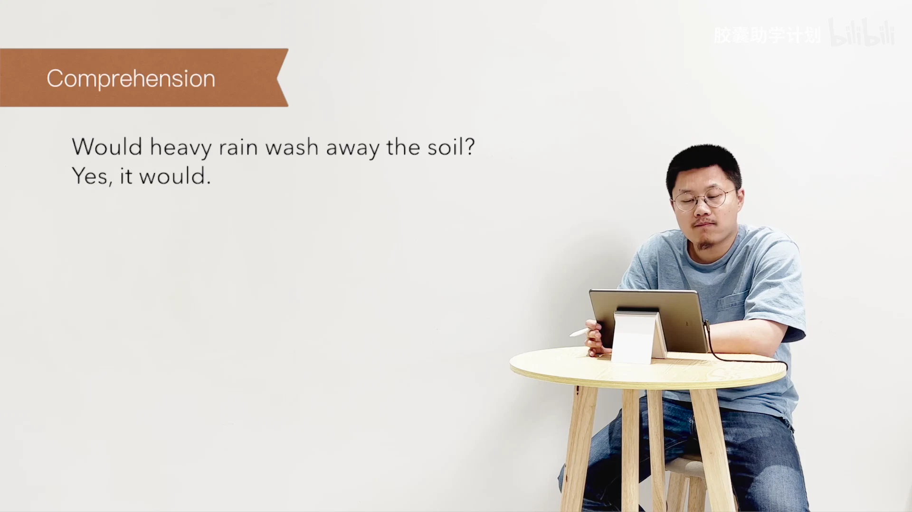

文字识别：Comprehension / Would heavy rain wash away the soil? / Yes, it would.

### 画面 00:01:45

文字识别：Comprehension / What else would happen?

### 画面 00:01:50

文字识别：Comprehension / What else would happen? / There would be serious floods.

### 画面 00:01:52

文字识别：Comprehension / Did the forest authorities order several tons / of grass-seed?

### 画面 00:01:55

文字识别：Comprehension / Did the forest authorities order several tons / of grass-seed?

## 00:02:00–00:02:30

Next one, what was special about it? It would grow quickly. Asking questions,练习我们提问的能力，对吧？能问别人一般疑问句和特殊疑问句啊。那老习惯，第一个例子，There was a forest fire recently. Was提前When对Recently提问对吧？When was there a forest fire? Okay.那我们看第二个啊，说Fireman fought

### 画面 00:02:04

文字识别：Comprehension / What was special about it? / It would grow quickly.

### 画面 00:02:08

文字识别：Asking questions / 训练目标： / 会说一般疑问句＆特殊疑问句 / Accuracy / Fluency

### 画面 00:02:10

文字识别：Asking questions / 训练目标： / 会说一般疑问句＆特殊疑问句 / Accuracy / Fluency

### 画面 00:02:12

文字识别：Asking questions / 训练目标： / 会说一般疑问句＆特殊疑问句 / Accuracy / Fluency

### 画面 00:02:14

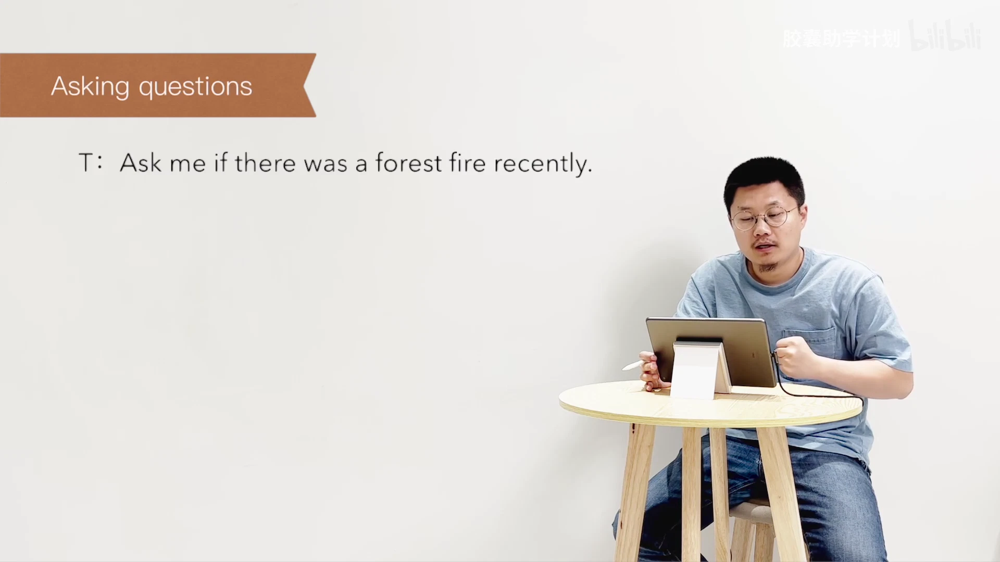

文字识别：Asking questions / T: Ask me if there was a forest fire recently.

### 画面 00:02:16

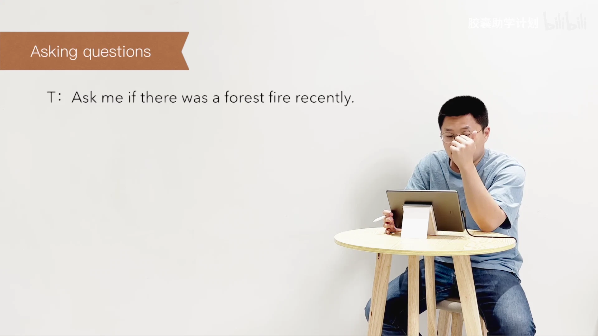

文字识别：Asking questions / T: Ask me if there was a forest fire recently.

### 画面 00:02:20

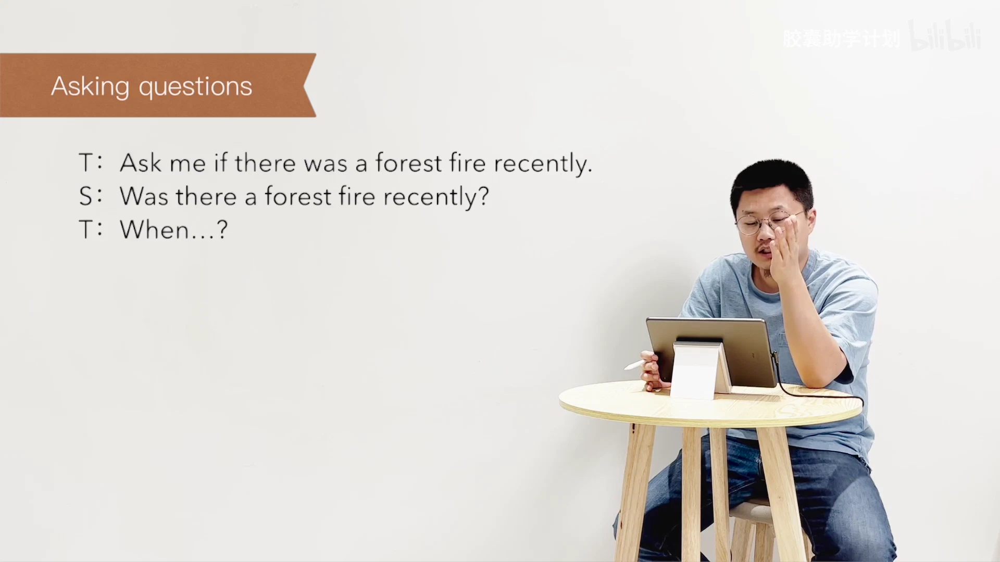

文字识别：Asking questions / T: Ask me if there was a forest fire recently. / S: Was there a forest fire recently? / T: When...?

### 画面 00:02:22

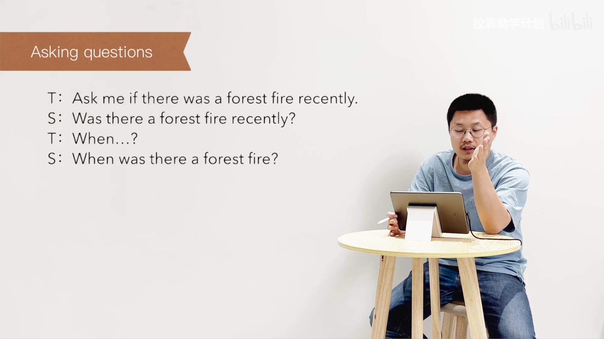

文字识别：Asking questions / T: Ask me if there was a forest fire recently. / S: Was there a forest fire recently? / T: When...? / S: When was there a forest fire?

### 画面 00:02:26

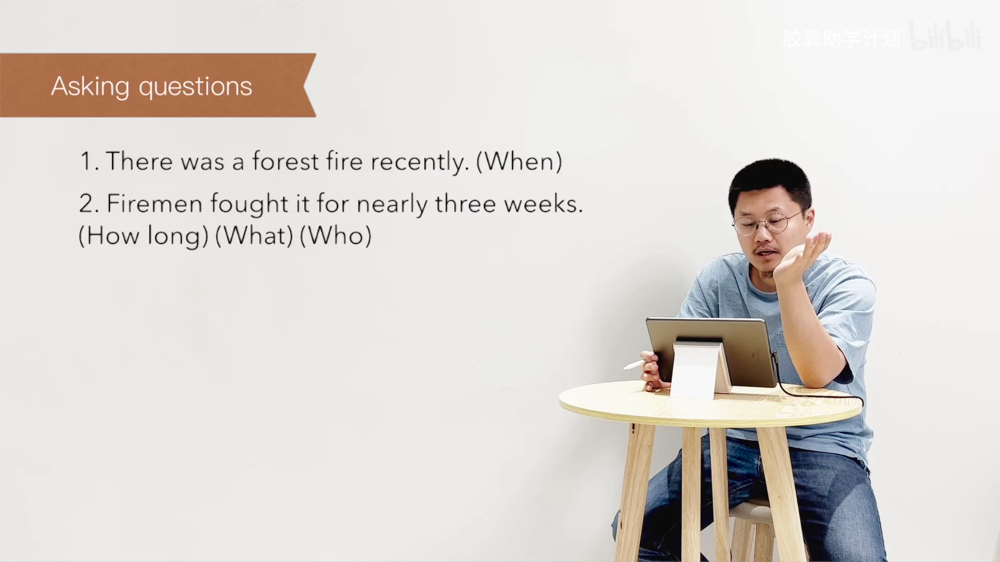

文字识别：Asking questions / 1.There was a forest fire recently. (When) / 2. Firemen fought it for nearly three weeks. / (How long)(What)(Who)

### 画面 00:02:29

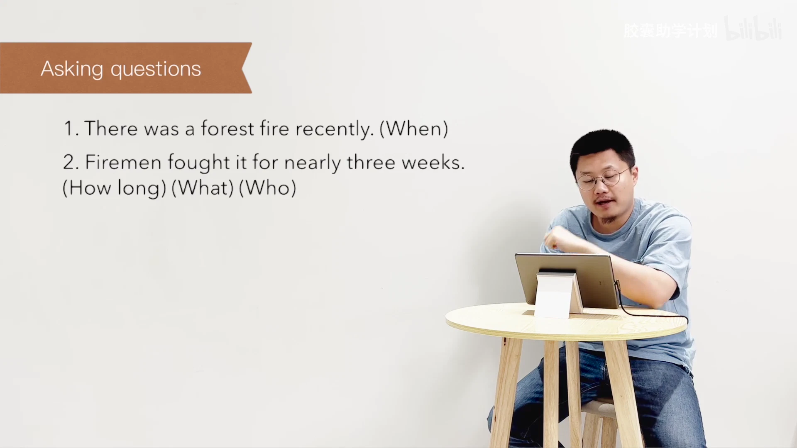

文字识别：Asking questions / 1.There was a forest fire recently. (When) / 2. Firemen fought it for nearly three weeks. / (How long)(What)(Who)

## 00:02:30–00:03:00

fought it for three for nearly three weeks. Did提前嘛肯定是别忘动词换原形。How long对 for nearly three weeks提问？那What对 it提问？It指的是forest fire对吧？Who对主语提问？不用变一般疑问句啊。There had been great trees for miles around. Had提前对吧？那Where对 for miles around提问？What对 great trees提问？They注意这里的撇地是had还是would？

### 画面 00:02:32

文字识别：Asking questions / 1. There was a forest fire recently. (When) / 2. Firemen fought it for nearly three weeks. / (How long)(What)(Who)

### 画面 00:02:35

文字识别：Asking questions / 1. There was a forest fire recently. (When) / 2. Firemen fought it for nearly three weeks. / (How long)(What)(Who)

### 画面 00:02:40

文字识别：Asking questions / 1.There was a forest fire recently. (When) / 2. Firemen fought it for nearly three weeks. / (How long)(What)(Who)

### 画面 00:02:45

文字识别：Asking questions / 1.There was a forest fire recently. (When) / 2. Firemen fought it for nearly three weeks. / (How long)(What)(Who) / 3. There had been great trees for miles / around.(Where) (What)

### 画面 00:02:50

文字识别：Asking questions / 1. There was a forest fire recently. (When) / 2. Firemen fought it for nearly three weeks. / (How long)(What)(Who) / 3. There had been great trees for miles / around.(Where) (What)

### 画面 00:02:56

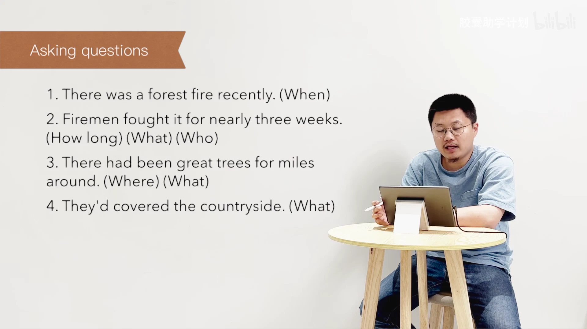

文字识别：Asking questions / 1.There was a forest fire recently. (When) / 2. Firemen fought it for nearly three weeks. / (How long)(What)(Who) / 3. There had been great trees for miles / around.(Where) (What) / 4.They'd covered the countryside. (What)

## 00:03:00–00:03:30

首先你由句子的含义去想，其次你由 covered 是原形还是过去分词去想。当然你分不清它是过去式还是过去分词，对吧？但是呢，如果它是过去分词，那前面就是 had；如果它是过去式呢，那前面什么也不可能是，对吧？所以它只能是过去分词了啊！就是说它的过去分词和它的过去式长得是一样的。Had 提前，What 对 countryside 提问啊？The countryside 提问，对吧？What had they covered？The hills were now

### 画面 00:03:02

文字识别：Asking questions / 1.There was a forest fire recently. (When) / 2. Firemen fought it for nearly three weeks. / (How long)(What)(Who) / 3. There had been great trees for miles / around.(Where)(What) / 4. They'd covered the countryside. (What)

### 画面 00:03:18

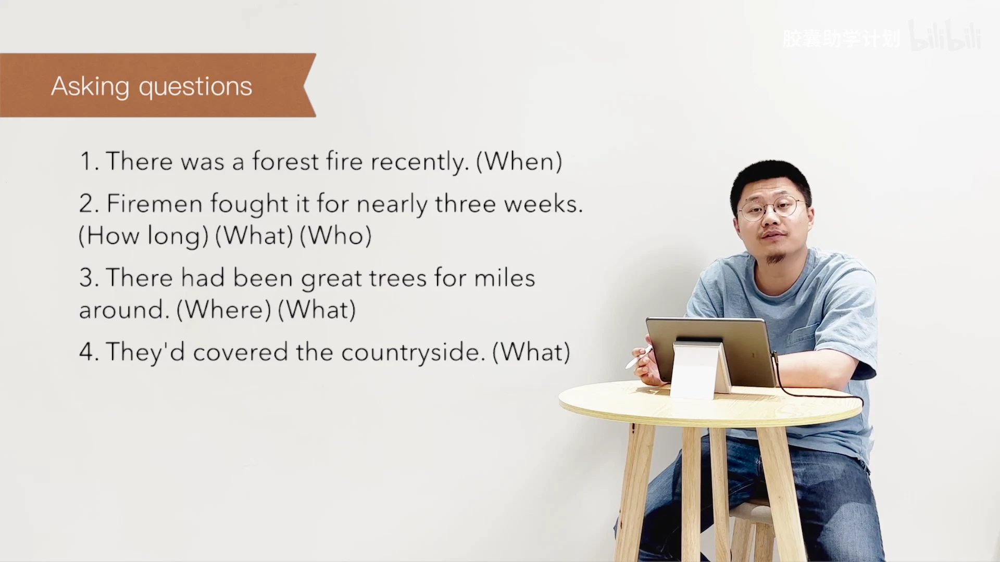

文字识别：Asking questions / 1.There was a forest fire recently. (When) / 2. Firemen fought it for nearly three weeks. / (How long)(What)(Who) / 3. There had been great trees for miles / around.(Where)(What) / 4. They'd covered the countryside. (What)

### 画面 00:03:22

文字识别：Asking questions / 1.There was a forest fire recently. (When) / 2. Firemen fought it for nearly three weeks. / (How long)(What)(Who) / 3. There had been great trees for miles / around.(Where)(What) / 4.They'd covered the countryside. (What)

### 画面 00:03:27

文字识别：Asking questions / 1.There was a forest fire recently. (When) / 2. Firemen fought it for nearly three weeks. / (How long)(What)(Who) / 3. There had been great trees for miles / around.(Where)(What) / 4. They'd covered the countryside. (What) / 5. The hills were now desolate. (What)

## 00:03:30–00:04:00

desolate. What提问啊？What提前？那What对the hills提问呗？不用变一般疑问句。下一个，Smoke still rose up from the warm ground. Did提前？What你可以对呃smoke提问？我个人认为也可以对the warm ground提问。就What did the smoke still rise up from？它依旧从哪个地方升起来，对吧？Winter was coming on. 很简单，was提前。那What你就直接对主语

### 画面 00:03:36

文字识别：Asking questions

### 画面 00:03:40

文字识别：Asking questions / 6. Smoke still rose up from the warm ground. / (What)

### 画面 00:03:56

文字识别：Asking questions / 6. Smoke still rose up from the warm ground. / (What) / 7. Winter was coming on. (What)

## 00:04:00–00:04:30

The villages surrounding the hills were threatened,被威胁了。那were提前，对吧？你看这个which实际上是对这个surrounding the hills提问的，就是which villages were threatened? Why?整句啊。Heavy rain would wash away the soil from the hills. Would提前，what对heavy rain提问？Tell the story啊，只提一句。这里重

### 画面 00:04:02

文字识别：Asking questions / 6. Smoke still rose up from the warm ground. / (What) / 7. Winter was coming on.(What) / 8. The villages surrounding the hills were / threatened.(Which)(Why)

### 画面 00:04:05

文字识别：Asking questions / 6. Smoke still rose up from the warm ground. / (What) / 7. Winter was coming on.(What) / 8. The villages surrounding the hills were / threatened.(Which)(Why)

### 画面 00:04:26

文字识别：Tell the story / 训练目标： / 口语复述能力 / Accuracy / Fluency

## 00:04:30–00:05:00

点练的是 fluency。我们说了，口语有两类，口语有准，要练准确性和流利性。你不能特别的准啊，不是，你不能说只是很准确，但是呢，特别的慢，那不是正常跟人去交流的这个思路，对吧？所以，我们大多数应试考试练的都是准确性，而我们实际应用上其实也要练流利性的。所以，这个练习大多数情况下我们很少练。那今天在这儿，各位就练一下 tell the story，对吧？呃，我们整

### 画面 00:04:30

文字识别：Tell the story / 训练目标： / 口语复述能力 / Accuracy / Fluency

### 画面 00:04:42

文字识别：Tell the story / 训练目标： / 口语复述能力 / Accuracy / Fluency

### 画面 00:04:45

文字识别：Tell the story / 训练目标： / 口语复述能力 / Accuracy / Fluency

### 画面 00:04:50

文字识别：Tell the story / 训练目标： / 口语复述能力 / Accuracy / Fluency

### 画面 00:04:55

文字识别：Tell the story / 训练目标： / 口语复述能力 / Accuracy / Fluency

### 画面 00:04:57

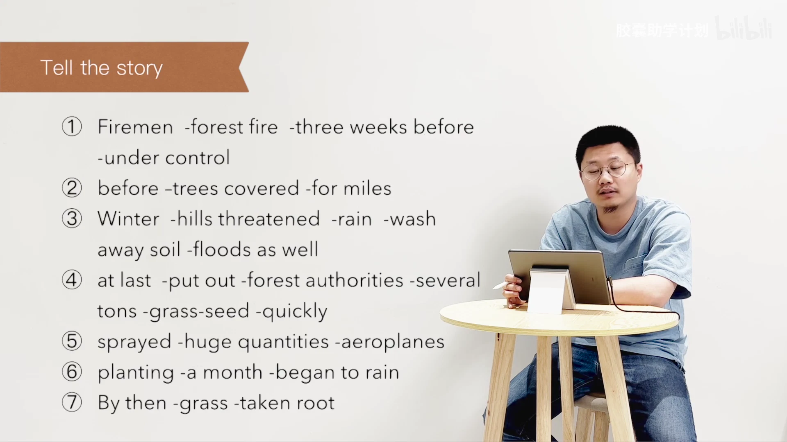

文字识别：Tell the story / Firemen -forest fire -three weeks before / -under control / before -trees covered -for miles / Winter -hills threatened -rain -wash / away soil -floods as well / at last -put out -forest authorities -several / tons -grass-seed -quickly / sprayed -huge quantities -aeroplanes / planting -a month -began to rain / 6 / ⑦ By then -grass -taken root

## 00:05:00–00:05:30

个第一个单元，我给各位做了很多的示范，各位不妨去看一下，对吧？所以文章一定要读的很熟嘛。呃，summary writing写作复述能力写完了来这里对一下答案就好了，好吧？没什么太多可说的。Topic for discussion，我们老习惯说一下三道题。第一个啊，说树为什么这么重要？对于产业啊、乡村啊、乡下以及动物和人，那你去想为什么重要？第二个，说

### 画面 00:05:00

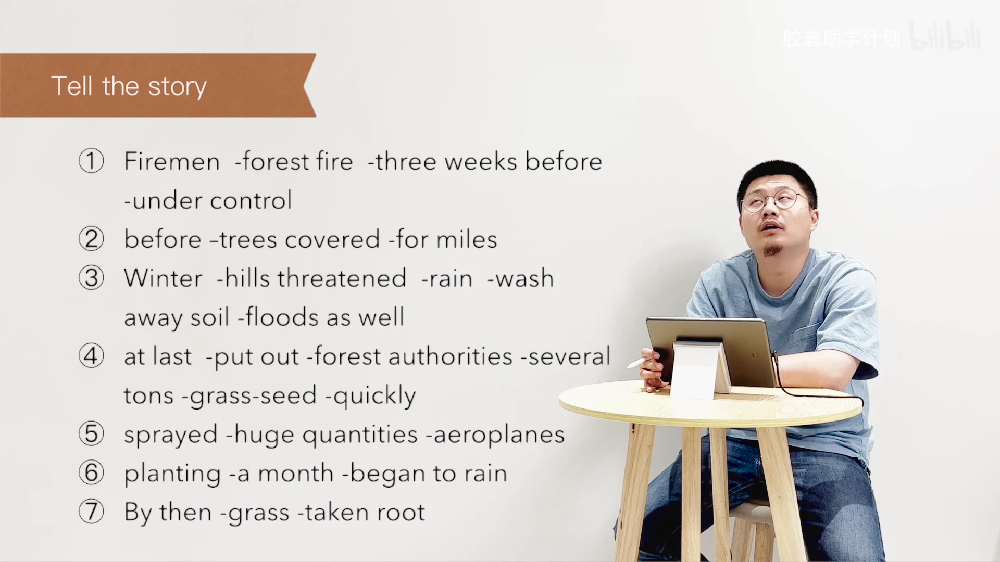

文字识别：Tell the story / Firemen -forest fire -three weeks before / -under control / before -trees covered -for miles / Winter -hills threatened -rain -wash / away soil -floods as well / at last -put out -forest authorities -several / tons -grass-seed -quickly / sprayed -huge quantities -aeroplanes / planting -a month -began to rain / ⑦ By then -grass -taken root / 7

### 画面 00:05:05

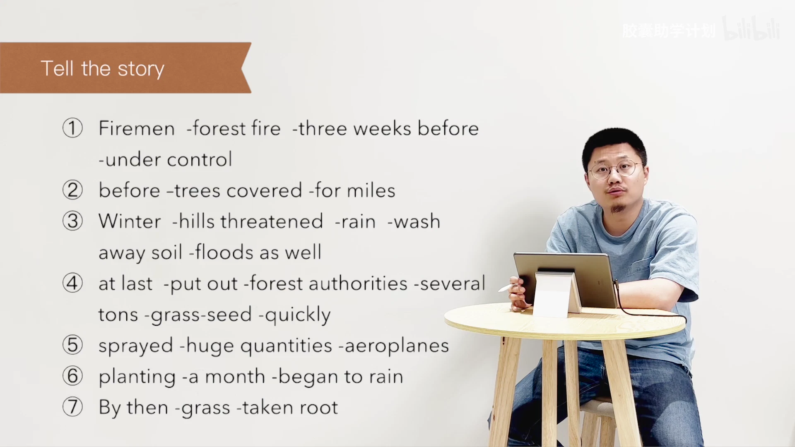

文字识别：Tell the story / Firemen -forest fire -three weeks before / -under control / before -trees covered -for miles / Winter -hills threatened -rain -Wash / away soil -floods as well / at last -put out -forest authorities -several / tons -grass-seed -quickly / sprayed -huge quantities -aeroplanes / planting -a month -began to rain / 6 / ⑦ By then -grass -taken root / 7

### 画面 00:05:09

文字识别：Summary writing: Key / 训练目标： / 写作复述能力

### 画面 00:05:11

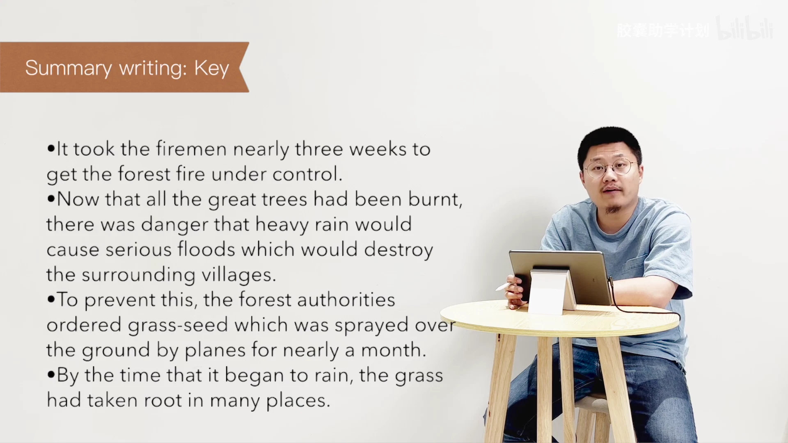

文字识别：Summary writing: Key / •lt took the firemen nearly three weeks to / get the forest fire under control. / •Now that all the great trees had been burnt, / there was danger that heavy rain would / cause serious floods which would destroy / the surrounding villages. / •To prevent this, the forest authorities / ordered grass-seed which was sprayed over / the ground by planes for nearly a month. / •By the time that it began to rain, the grass / had taken root in many places.

### 画面 00:05:14

文字识别：Topics for discussion / 训练目标： / 完全自由的对话 / Accuracy / Fluency

### 画面 00:05:16

文字识别：Topics for discussion / Why are trees so important to (a) / industry, (b) the countryside, (c) animals / and people? / Describe some of the ways in which land / can be protected against flooding. / Aeroplanes are now widely used for / spraying insecticides, etc. What are the / advantages and disadvantages of this?

### 画面 00:05:23

文字识别：Topics for discussion / Why are trees so important to (a) / industry, (b) the countryside, (c) animals / and people? / Describe some of the ways in which land / can be protected against flooding. / Aeroplanes are now widely used for / spraying insecticides, etc. What are the / advantages and disadvantages of this?

## 00:05:30–00:06:00

describe some of the ways in which land can be protected against flooding。说你描绘一些你知道的土地可以被保护对抗什么呢？对抗这个这个洪水的，就不让它发洪水，对吧？不让它有泥石流怎么办啊？多种植被啊，等等乱七八糟的，您去想，对吧？第三个说，飞机现在被广泛应用了，去干嘛呢？去spraying啊，去喷洒什么呢？这个农药，对吧？杀虫剂。说What are the advantages and

### 画面 00:05:36

文字识别：Topics for discussion / Why are trees so important to (a) / industry, (b) the countryside, (c) animals / and people? / Describe some of the ways in which land / can be protected against flooding. / Aeroplanes are now widely used for / spraying insecticides, etc. What are the / advantages and disadvantages of this?

### 画面 00:05:40

文字识别：Topics for discussion / Why are trees so important to (a) / industry, (b) the countryside, (c) animals / and people? / Describe some of the ways in which land / can be protected against flooding. / Aeroplanes are now widely used for / spraying insecticides, etc. What are the / advantages and disadvantages of this?

### 画面 00:05:47

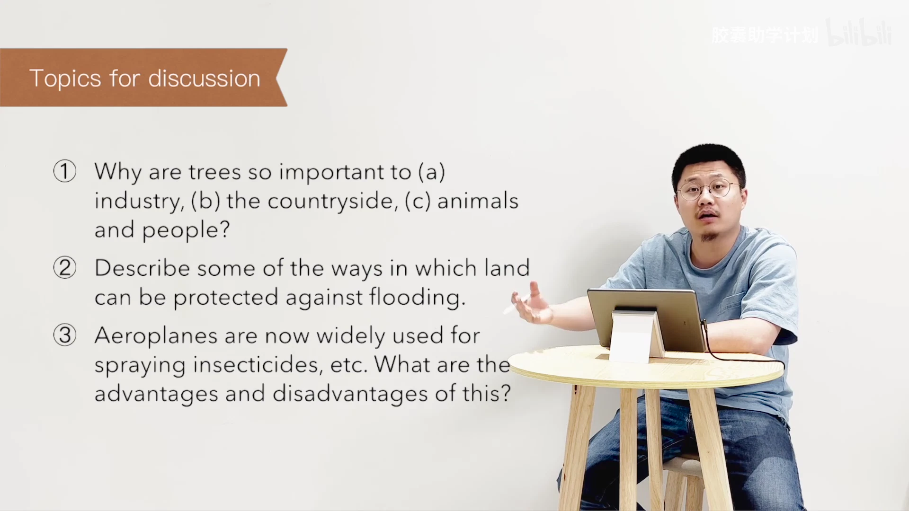

文字识别：Topics for discussion / Why are trees so important to (a) / industry, (b) the countryside, (c) animals / and people? / Describe some of the ways in which land / can be protected against flooding. / Aeroplanes are now widely used for / spraying insecticides, etc. What are the / advantages and disadvantages of this?

### 画面 00:05:51

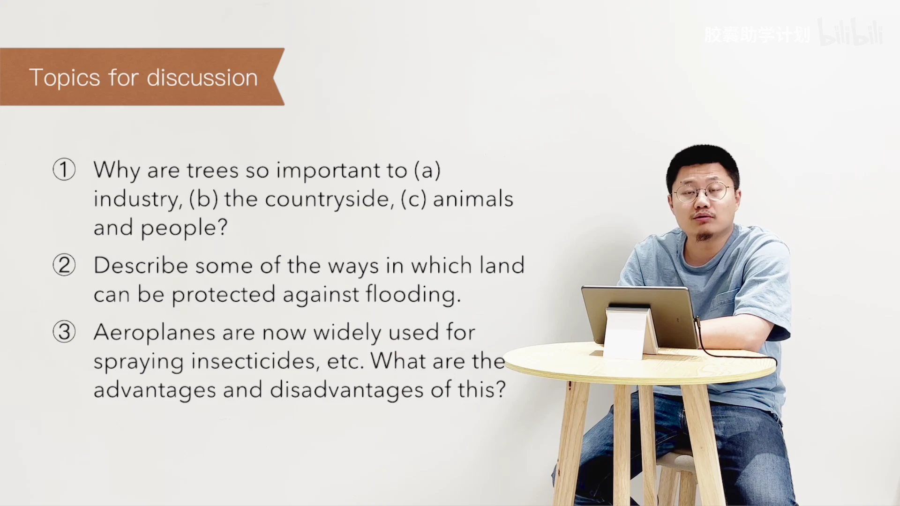

文字识别：Topics for discussion / Why are trees so important to (a) / industry, (b) the countryside, (c) animals / and people? / Describe some of the ways in which land / can be protected against flooding. / Aeroplanes are now widely used for / spraying insecticides, etc. What are the / advantages and disadvantages of this?

### 画面 00:05:58

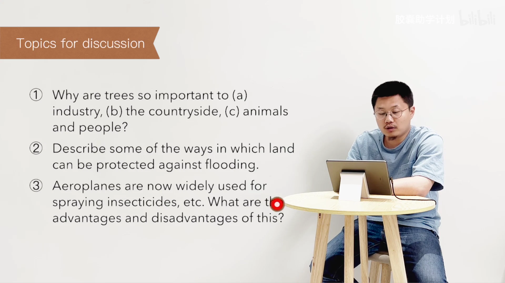

文字识别：Topics for discussion / Why are trees so important to (a) / industry, (b) the countryside, (c) animals / and people? / Describe some of the ways in which land / can be protected against flooding. / Aeroplanes are now widely used for / spraying insecticides, etc. What are tl / advantages and disadvantages of this?

## 00:06:00–00:06:30

disadvantages of this? 说这有什么优势和劣势呢？这是非常典型的，像雅思、托福这种考试，不管是写作也好，还是口语也好，非常常见的一种题，就是 What are the advantages and disadvantages? 对吧？有什么优势和劣势？对吧？哪一个不多说了？呃，家庭作业 Ask me if. 一定强调先写，在一定同时大声朗读出来，缺一不可。这要写作写完来这对答案 Tell the

### 画面 00:06:01

文字识别：Topics for discussion / Why are trees so important to (a) / industry, (b) the countryside, (c) animals / and people? / Describe some of the ways in which land / can be protected against flooding. / Aeroplanes are now widely used for / spraying insecticides, etc. What are the / advantages and disadvantages of this?

### 画面 00:06:05

文字识别：Topics for discussion / Why are trees so important to (a) / industry, (b) the countryside, (c) animals / and people? / Describe some of the ways in which land / can be protected against flooding. / Aeroplanes are now widely used for / spraying insecticides, etc. What are the / advantages and disadvantages of this?

### 画面 00:06:19

### 画面 00:06:21

文字识别：1.Ask me if写&朗读

### 画面 00:06:23

文字识别：1.Ask me if写&朗读

### 画面 00:06:25

文字识别：1.Ask me if写&朗读

### 画面 00:06:27

文字识别：1.Ask me if写&朗读 / 2.摘要写作写&答案

### 画面 00:06:29

文字识别：1.Ask me if写&朗读 / 摘要写作写&答案 / 3.Tell the story 口语复述

## 00:06:30–00:07:00

story，文章读熟了来这口语复述，看置顶留言就有重复间隔的学习材料，对吧？那以上就是我们本期视频的全部内容了。如果各位喜欢我们的课程呢，欢迎各位关注、订阅、一键三连，分享给那些需要的朋友，来帮助我们快速成长。See you next time.

### 画面 00:06:31

文字识别：1.Ask me if写&朗读 / 摘要写作写&答案 / 3.Tell the story 口语复述 / .重复间隔（置顶留言） / 4.

### 画面 00:06:33

文字识别：1.Ask me if写&朗读 / 摘要写作写&答案 / 3.Tell the story 口语复述 / .重复间隔（置顶留言） / 4.

### 画面 00:06:35

文字识别：1.Ask me if写&朗读 / 摘要写作写&答案 / 3.Tell the story 口语复述 / 4.重复间隔（置顶留言）

### 画面 00:06:37

### 画面 00:06:39

文字识别：不

### 画面 00:06:41

文字识别：不 / ￥

### 画面 00:06:43

### 画面 00:06:48

### 画面 00:06:50

文字识别：CAPSULEACADEMY / 胶囊助学计划 / 小红书 / Lecturer / □ / 口 / Leo

### 画面 00:06:53

文字识别：CAPSULEACADEMY / 胶囊助学计划 / 小红书 / 品 / Editor

### 画面 00:06:56

文字识别：CAPSULEACADEMY / 胶囊助学计划 / 小红书 / Creator / Leo & Berlin / OE

### 画面 00:06:58

文字识别：bilibili / 胶囊助学计划 / 胶囊助学计划 / 小红书 / OE

## 00:07:00–00:07:00

### 画面 00:07:00

文字识别：bilibili / 胶囊助学计划

