# 063 单词

快速机器解析：语音为单模型转写，未进行独立交叉校对或人工复核；画面每秒采样并按变化选帧，短时文字和标记可能遗漏。截图时间约有 1 秒误差。图片有损压缩；遇到疑点请按时间查看 Google Drive 原视频。

## 00:00:00–00:00:30

Hello everyone, welcome to Capsule Academy. This is Leo. Today we're going to learn in Concept English Book Two, Lesson Sixty Three Words. 那老习惯进入正式课程之前，咱们先看几个小的问题啊。那首先，如何表达交际很广？接下来呢，如何表达钦佩某人某方面？最后一个问题，如何表达各种类型？那带着这三个问题，Hope you gonna enjoy it.

### 画面 00:00:00

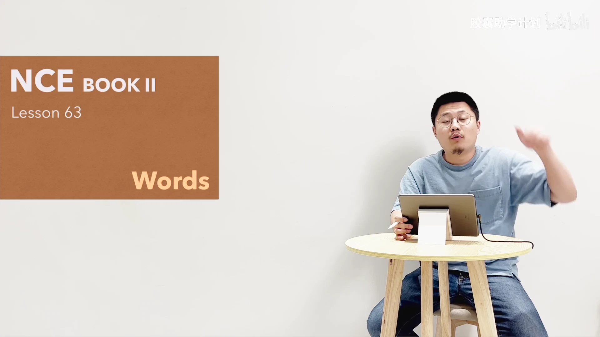

文字识别：NCE / BOOK I"I / Lesson 63 / Words

### 画面 00:00:02

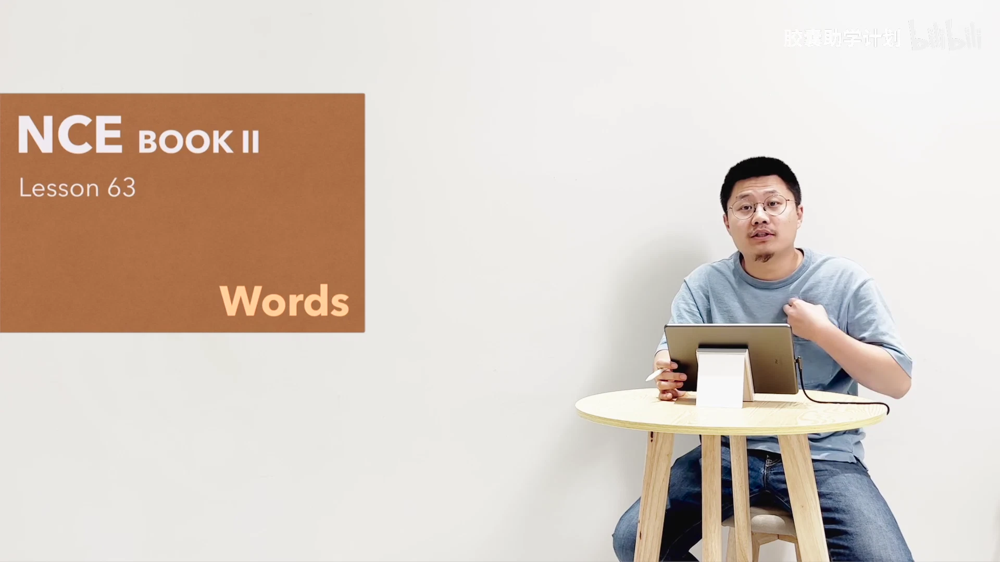

文字识别：NCE / BOOKII / Lesson 63 / Words

### 画面 00:00:06

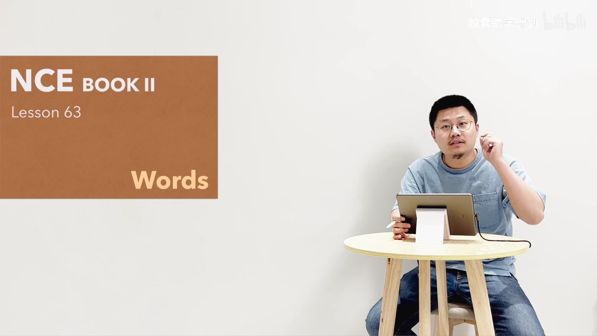

文字识别：NCE / BOOK"I / Lesson 63 / Words

### 画面 00:00:09

文字识别：囊助字计划一洲

### 画面 00:00:12

文字识别：産助字计划 / 表达“交际很广”？

### 画面 00:00:14

文字识别：秦助学计划 / ①如何表达“交际很广”？

### 画面 00:00:16

文字识别：①如何表达“交际很广”? / 如何表达“钦佩某人的某方面”

### 画面 00:00:20

文字识别：①如何表达“交际很广”? / 如何表达“钦佩某人的某方面” / 如何表达“各种类型”?

### 画面 00:00:22

文字识别：①如何表达“交际很广”? / 如何表达“钦佩某人的某方面” / 如何表达“各种类型”

### 画面 00:00:26

文字识别：bibii / 胶囊助学计划

## 00:00:30–00:01:00

好，那我们看第一个单词，呃，看一下音标啊。这个单词叫做 circle。那这个地方加不加儿化音呢？取决于这里有一个字母二，可加可不加。有字母二就可以加，没有字母二就不是可加可不加了啊。这个地方要注意一下。那 circle 的意思就像这个图表示的一样，它是一个圆呐或者圈的意思。在本文当中，它取自于的是它的由这个引申出来的含义，叫做 a large circle of

### 画面 00:00:30

文字识别：動字計划

### 画面 00:00:32

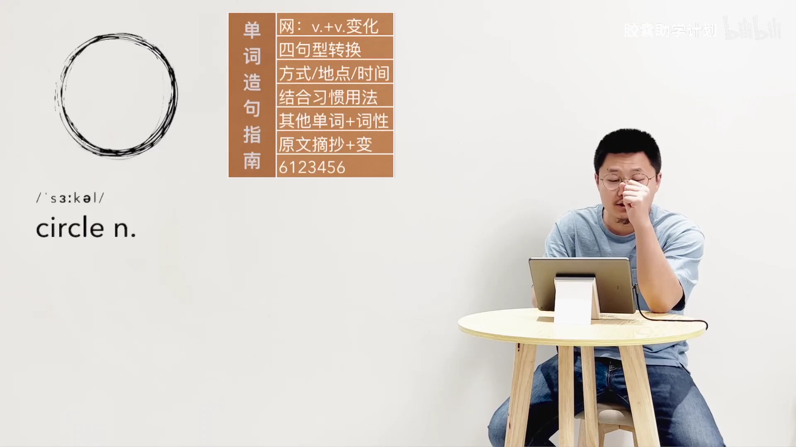

文字识别：单词造句指南 / 网：v.+v.变化 / 泰助字计划園 / 四句型转换 / 方式/地点/时间 / 结合习惯用法 / 其他单词+词性 / 原文摘抄+变 / 6123456 / /'s3:kal/ / circle n.

### 画面 00:00:35

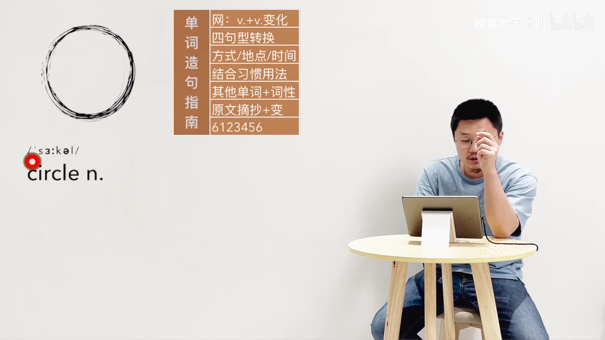

文字识别：单词造句指南 / 网：v.+v.变化 / 建助学计划 / 四句型转换 / 方式/地点/时间 / 结合习惯用法 / 其他单词+词性 / 原文摘抄+变 / 6123456 / 's3:kal/ / Circle n.

### 画面 00:00:48

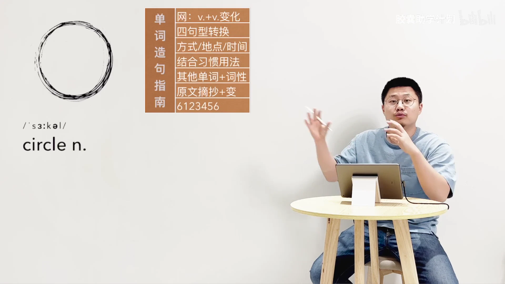

文字识别：单词造句指南 / 网：v.+v.变化 / 囊助字计划 / 四句型转换 / 方式/地点/时间 / 结合习惯用法 / 其他单词+词性 / 原文摘抄+变 / 6123456 / /'s3:kal/ / circle n.

### 画面 00:00:51

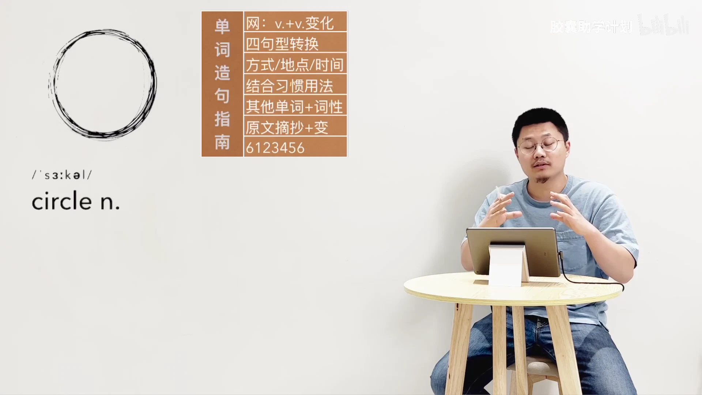

文字识别：单词造句指南 / 网：v.+v.变化 / 妻助学计划 / 四句型转换 / 方式/地点/时间 / 结合习惯用法 / 其他单词+词性 / 原文摘抄+变 / 6123456 / /'s3:kal/ / circle n.

### 画面 00:00:55

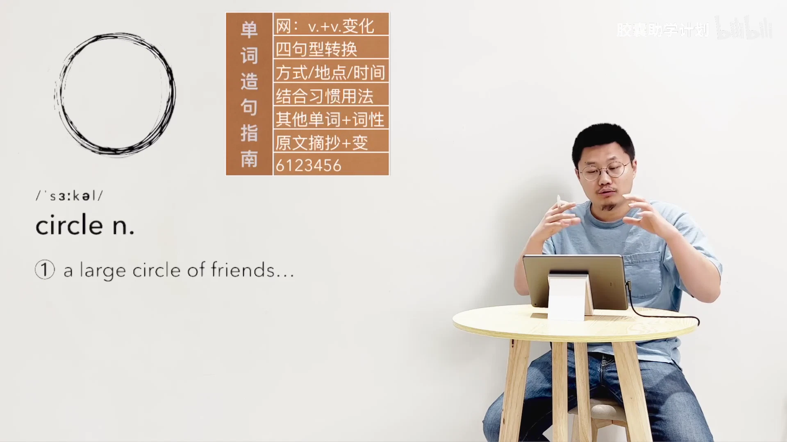

文字识别：单词造句指南 / 网：v.+v.变化 / 囊助学计划園州 / 四句型转换 / 方式/地点/时间 / 结合习惯用法 / 其他单词+词性 / 原文摘抄+变 / 6123456 / /'s3:kal/ / circle n. / ① a large circle of friends...

## 00:01:00–00:01:30

friends,你看很大的圈子朋友，我觉得这个你很容易就理解了，对吧？我们用汉语再往里一套，就是朋友圈很大，所以这地方我们就给它理解为叫交际很广的意思。它和 a lot of friends 有一点点区别，就是 a lot of friends 指的是什么？呢单纯指朋友多，可以全是你的同事，对吧？比如说我英语老师，我的朋友如果全是英语老师，那你就只能说 have a lot of friends，那你可能不是 a large circle

### 画面 00:01:01

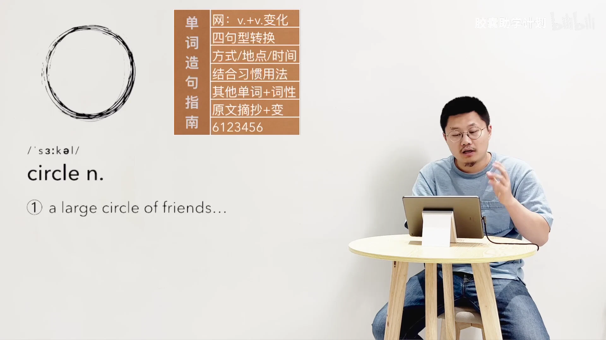

文字识别：单词造句指南 / 网：v.+v.变化 / 秦助字计划 / 四句型转换 / 方式/地点/时间 / 结合习惯用法 / 其他单词+词性 / 原文摘抄+变 / 6123456 / /'s3:kal/ / circle n. / ① a large circle of friends..

### 画面 00:01:05

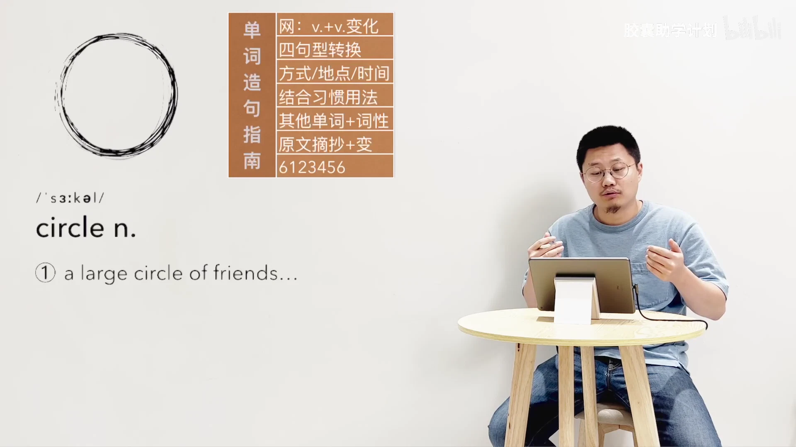

文字识别：单词造句指南 / 网：v.+v.变化 / 妻助字计划園 / 四句型转换 / 方式/地点/时间 / 结合习惯用法 / 其他单词+词性 / 原文摘抄+变 / 6123456 / /'s3:kal/ / circle n. / ① a large circle of friends..

### 画面 00:01:10

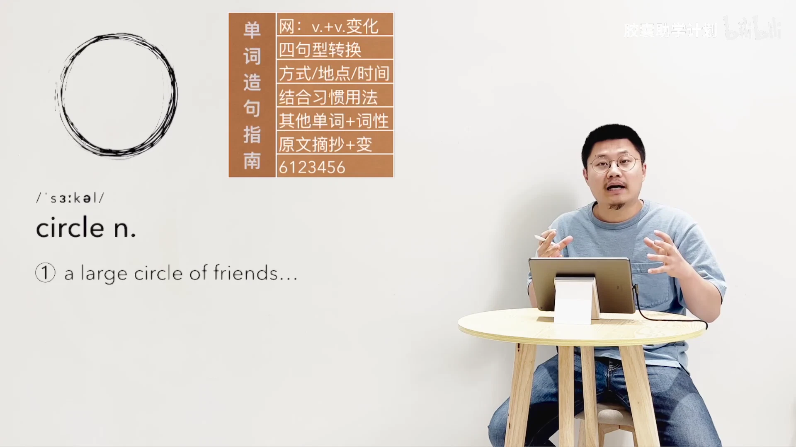

文字识别：单词造句指南 / 网：v.+v.变化 / 喜助字计划 / 四句型转换 / 方式/地点/时间 / 结合习惯用法 / 其他单词+词性 / 原文摘抄+变 / 6123456 / /'s3:kal/ / circle n. / ① a large circle of friends..

### 画面 00:01:19

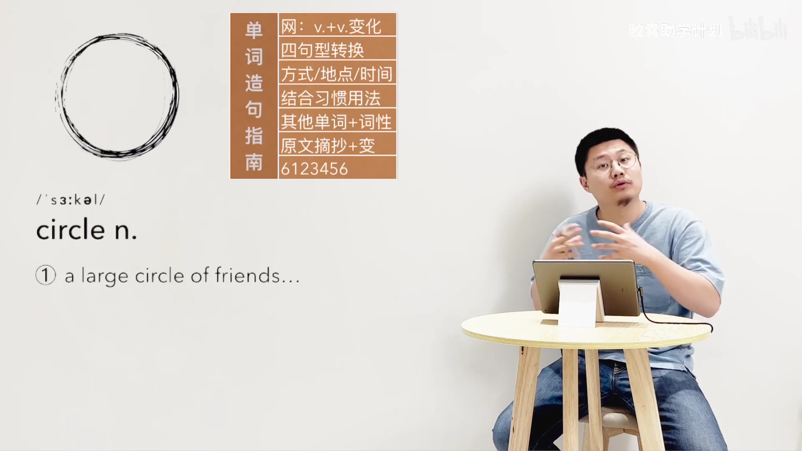

文字识别：单词造句指南 / 网：v.+v.变化 / 妻助学计划 / 四句型转换 / 方式/地点/时间 / 结合习惯用法 / 其他单词+词性 / 原文摘抄+变 / 6123456 / /'s3:kal/ / circle n. / ① a large circle of friends..

### 画面 00:01:26

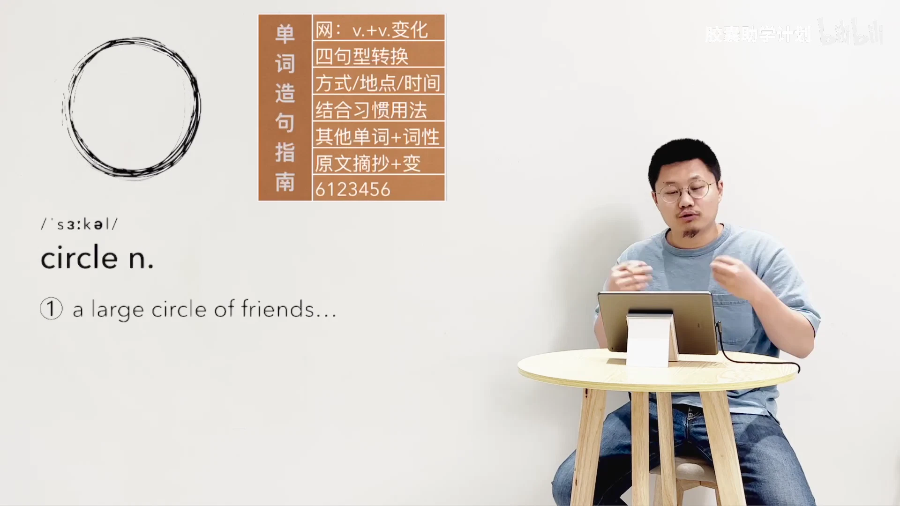

文字识别：单词造句指南 / 网：v.+v.变化 / 囊助字计划陽 / 四句型转换 / 方式/地点/时间 / 结合习惯用法 / 其他单词+词性 / 原文摘抄+变 / 6123456 / /'s3:kal/ / circle n. / ① a large circle of friends...

## 00:01:30–00:02:00

of friends. 这个很容易理解，对吧？好，那我们由他去造句。说 When I was young, my parents would invite their small circle of friends. 哎，我们给他做了一点小的变体。刚才是 large circle friends，现在变成了 small circle friends。哎，会把他们这个小团体、小圈子，哎，邀请到我这里来，对吧？还会邀请他们。然后这里呢，用到了我们五十五课学过的一个叫 would 加 do 表示一种习惯

### 画面 00:01:31

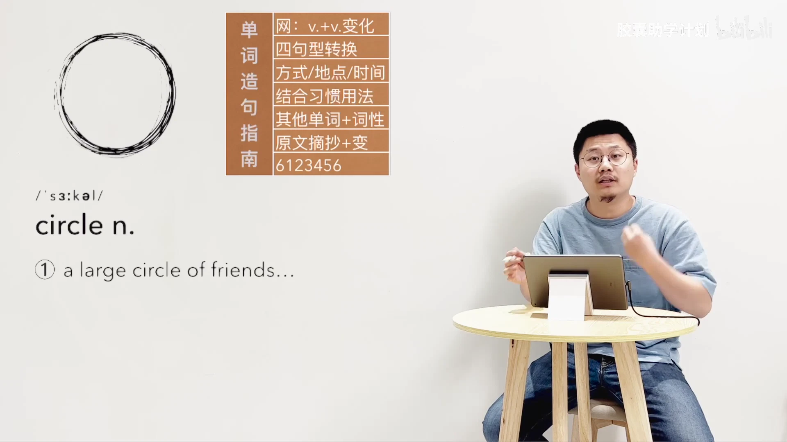

文字识别：单词造句指南 / 网：v.+v.变化 / 奏助字计划園 / 四句型转换 / 方式/地点/时间 / 结合习惯用法 / 其他单词+词性 / 原文摘抄+变 / 6123456 / /'s3:kal/ / circle n. / ① a large circle of friends..

### 画面 00:01:33

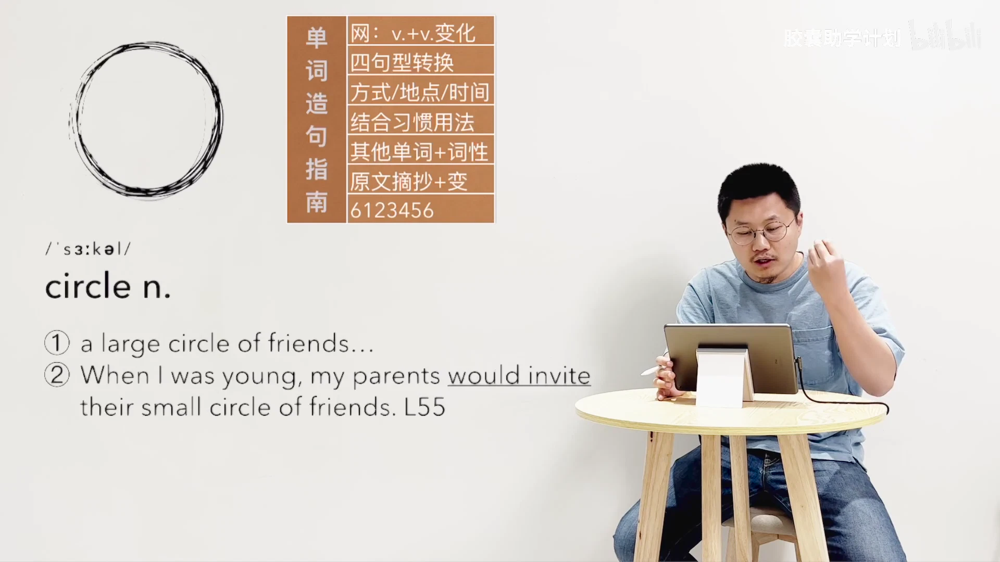

文字识别：单词造句指南 / 网：v.+v.变化 / 四句型转换 / 方式/地点/时间 / 结合习惯用法 / 其他单词+词性 / 原文摘抄+变 / 6123456 / /'s3:kal/ / circle n. / ① a large circle of friends... /  When I was young, my parents would invite / their small circle of friends. L55

### 画面 00:01:36

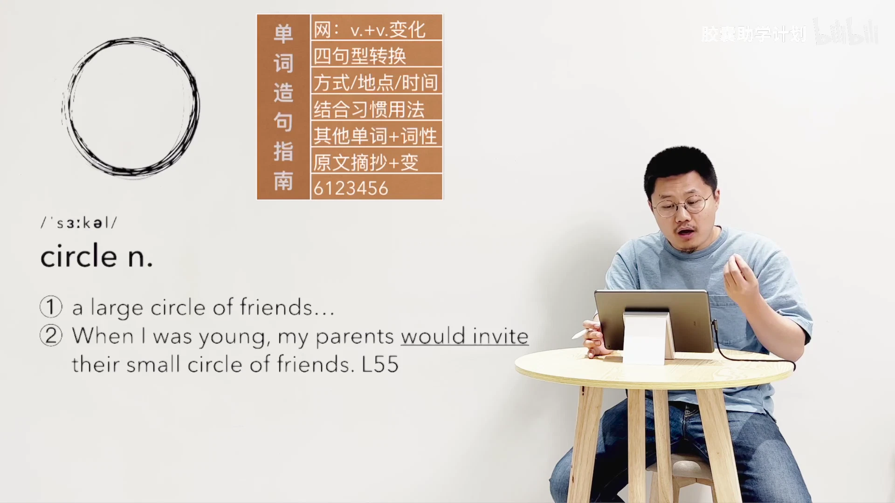

文字识别：单词造句指南 / 网：v.+v.变化 / 妻助字计划 / 四句型转换 / 方式/地点/时间 / 结合习惯用法 / 其他单词+词性 / 原文摘抄+变 / 6123456 / /'s3:kal/ / circle n. / ① a large circle of friends... /  When I was young, my parents would invite / their small circle of friends. L55

### 画面 00:01:58

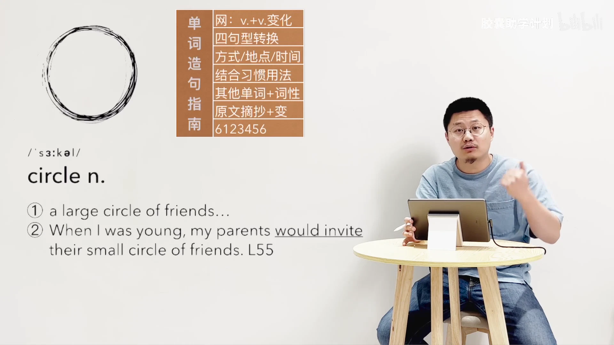

文字识别：单词造句指南 / 网：v.+v.变化 / 囊助字计划 / 四句型转换 / 方式/地点/时间 / 结合习惯用法 / 其他单词+词性 / 原文摘抄+变 / 6123456 / /'s3:kal/ / circle n. / ① a large circle of friends... /  When I was young, my parents would invite / their small circle of friends. L55

## 00:02:00–00:02:30

啊。Next one,说we don't have the same circle friends，还是在a large circle friends的基础之上，又给他做了一点改变，变成了the same。我们没有共同的朋友圈，对吧？好，那由这个我们又引申出来一个句子。Why don't you have the same circle friends? You stay together all the time。还说你们怎么会没有共同的朋友圈呢？你们总是在一起待着，对吧？Okay，那再跟我读一遍这个单词

### 画面 00:02:00

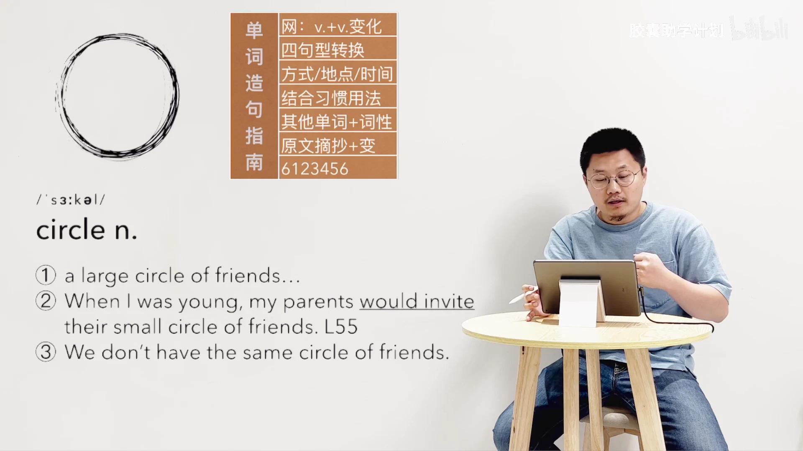

文字识别：单词造句指南 / 网：v.+v.变化 / 妻助字计划 / 四句型转换 / 方式/地点/时间 / 结合习惯用法 / 其他单词+词性 / 原文摘抄+变 / 6123456 / /'s3:kal/ / circle n. / ① a large circle of friends... / ② When I was young, my parents would invite / their small circle of friends. L55 / ) We don't have the same circle of friends.

### 画面 00:02:05

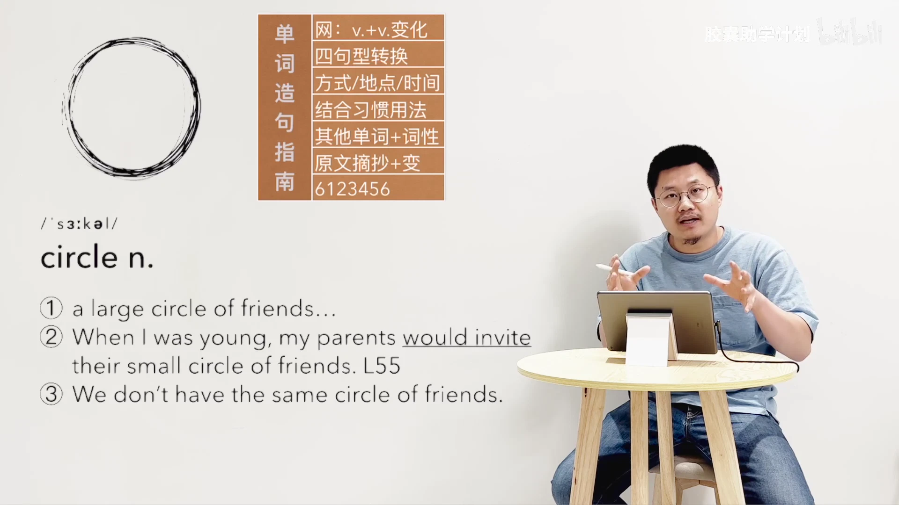

文字识别：单词造句指南 / 网：v.+v.变化 / 四句型转换 / 方式/地点/时间 / 结合习惯用法 / 其他单词+词性 / 原文摘抄+变 / 6123456 / /'s3:kal/ / circle n. / ① a large circle of friends... / ② When I was young, my parents would invite / their small circle of friends. L55 / ) We don't have the same circle of friends.

### 画面 00:02:13

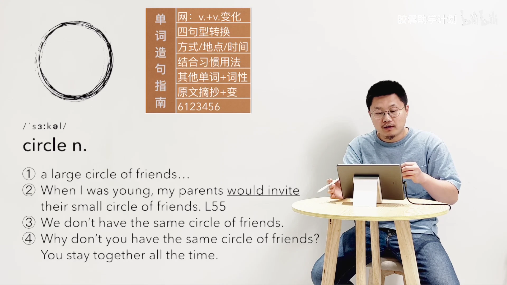

文字识别：单词造句指南 / 网：v.+v.变化 / 臺助字计划 / 四句型转换 / 方式/地点/时间 / 结合习惯用法 / 其他单词+词性 / 原文摘抄+变 / 6123456 / /'s3:kal/ / circle n. / ① a large circle of friends... / ② When I was young, my parents would invite / their small circle of friends. L55 / ③ We don't have the same circle of friends. / ④ Why don't you have the same circle of friends? / You stay together all the time.

### 画面 00:02:16

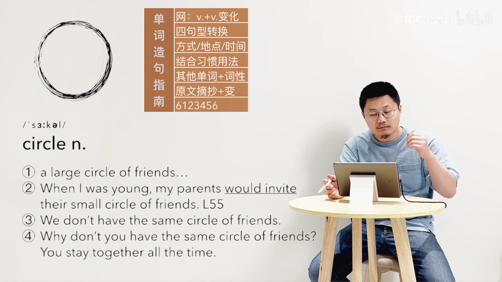

文字识别：单词造句指南 / 网：v.+v.变化 / 奏助学计划陽 / 四句型转换 / 方式/地点/时间 / 结合习惯用法 / 其他单词+词性 / 原文摘抄+变 / 6123456 / /'s3:kal/ / circle n. / ① a large circle of friends... / ② When I was young, my parents would invite / their small circle of friends. L55 / ③ We don't have the same circle of friends. / ④ Why don't you have the same circle of friends? / You stay together all the time.

### 画面 00:02:20

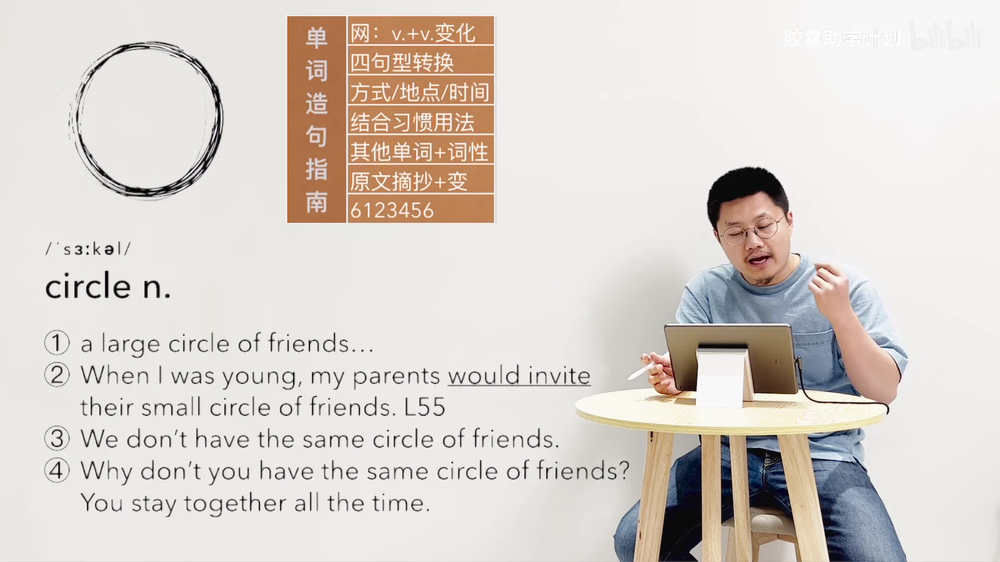

文字识别：单词造句指南 / 网：v.+v.变化 / 喜助学计划 / 四句型转换 / 方式/地点/时间 / 结合习惯用法 / 其他单词+词性 / 原文摘抄+变 / 6123456 / /'s3:kal/ / circle n. / ① a large circle of friends... / ② When I was young, my parents would invite / their small circle of friends. L55 / ③ We don't have the same circle of friends. / ④ Why don't you have the same circle of friends? / You stay together all the time.

### 画面 00:02:25

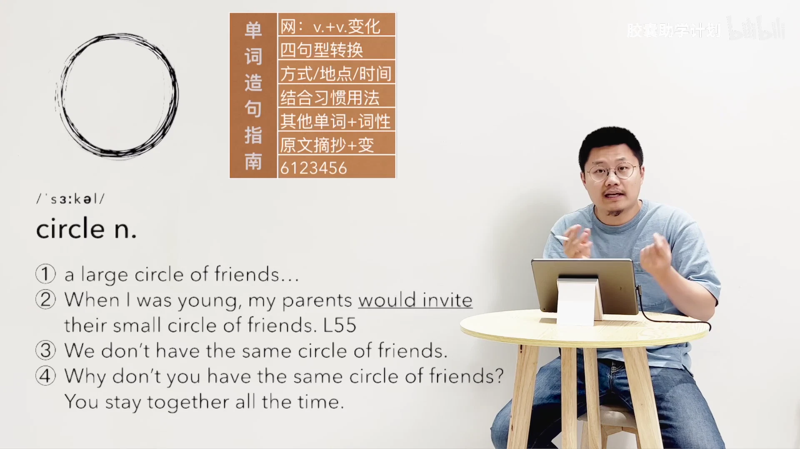

文字识别：单词造句指南 / 网：v.+v.变化 / 奏助字计划 / 四句型转换 / 方式/地点/时间 / 结合习惯用法 / 其他单词+词性 / 原文摘抄+变 / 6123456 / /'s3:kal/ / circle n. / ① a large circle of friends... / ② When I was young, my parents would invite / their small circle of friends. L55 / ③ We don't have the same circle of friends. / ④ Why don't you have the same circle of friends? / You stay together all the time.

## 00:02:30–00:03:00

Very good. Next one. 下一个单词呢？看一下音标，注意重音在下后面对吧？在第二个音节上，叫做 admire, admire, admire，就是钦佩、欣赏啊。然后呢，这个单词在未来我们还会继续出现，比如说像新三第六课啊，还会出现 admire 这个单词。那它很常见的短语，文章当中给了一个叫做 admire somebody for something。我告诉各位，这个 for 后边

### 画面 00:02:31

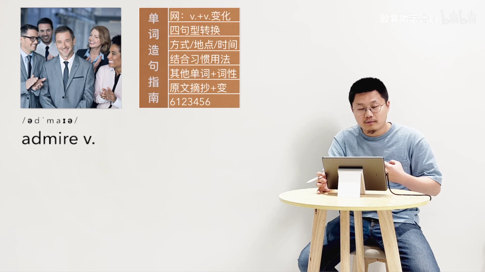

文字识别：单词造句指南 / 网：v.+v.变化 / 四句型转换 / 方式/地点/时间 / 结合习惯用法 / 其他单词+词性 / 原文摘抄+变 / 6123456 / /ad'maia/ / admire V.

### 画面 00:02:35

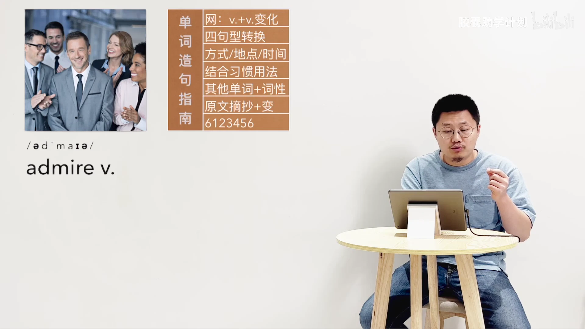

文字识别：单词造句指南 / 网：v.+v.变化 / 四句型转换 / 方式/地点/时间 / 结合习惯用法 / 其他单词+词性 / 原文摘抄+变 / 6123456 / /ad'mala/ / admire V.

### 画面 00:02:41

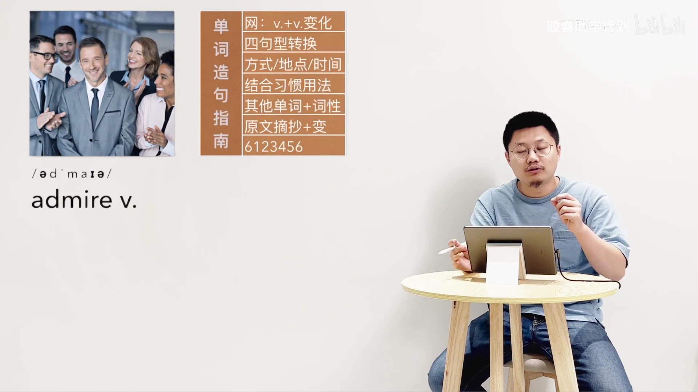

文字识别：单词造句指南 / 网：v.+v.变化 / 四句型转换 / 方式/地点/时间 / 结合习惯用法 / 其他单词+词性 / 原文摘抄+变 / 6123456 / /ad'mala/ / admire V.

### 画面 00:02:55

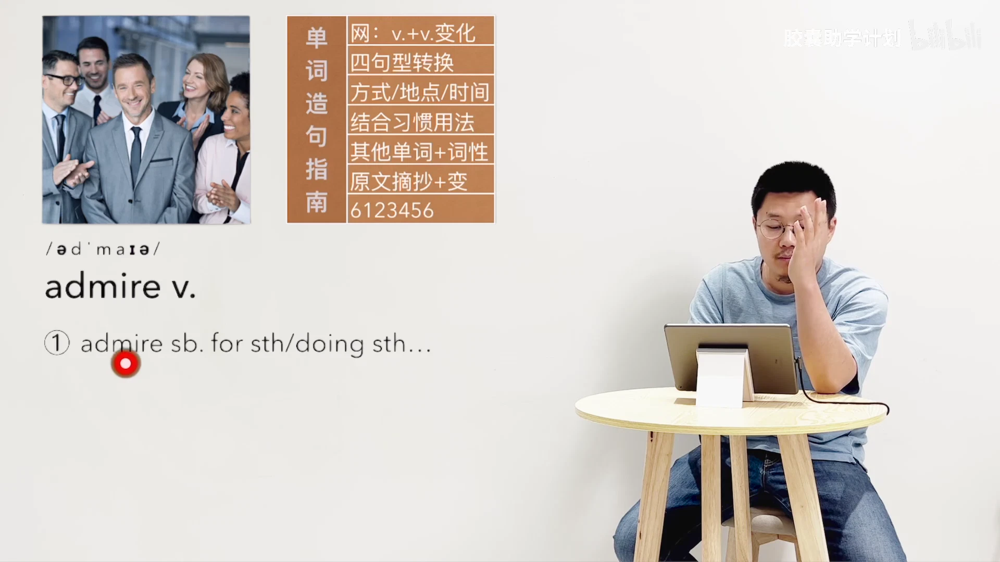

文字识别：单词造句指南 / 网：v.+v.变化 / 妻助字计划 / 四句型转换 / 方式/地点/时间 / 结合习惯用法 / 其他单词+词性 / 原文摘抄+变 / 6123456 / /ad'maia/ / admire V. / ) admire sb.for sth/doing sth..

## 00:03:00–00:03:30

还可以加 doing something，这个很容易理解。这个实际上各位回想一下二册我们的二十课学过的动名词，你应该就能想到了，对吧？哎，因为某人做了某件事情而钦佩他，比如说口语当中很常用的一句话叫 I admire you for that，说因为那件事情我很钦佩你，我很欣赏你。 OK，还可以说 I really admire you for the work you do。好，这里用到了两个，第一个叫

### 画面 00:03:00

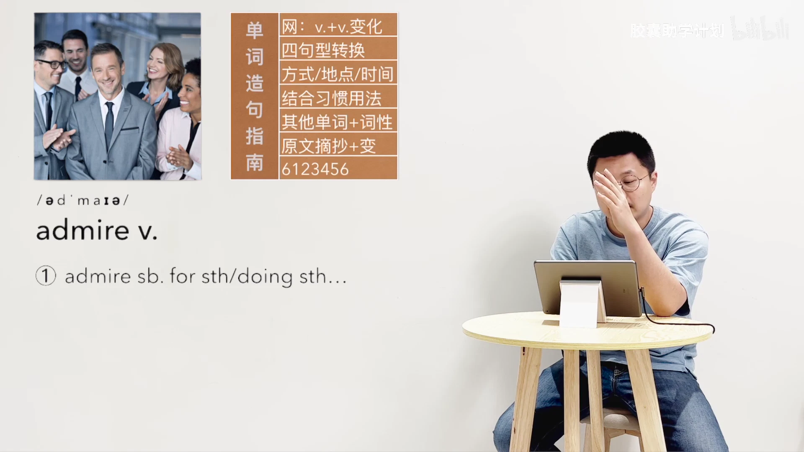

文字识别：单词造句指南 / 网：v.+v.变化 / 四句型转换 / 方式/地点/时间 / 结合习惯用法 / 其他单词+词性 / 原文摘抄+变 / 6123456 / /ad'maia/ / admire V. / admire sb. for sth/doing sth...

### 画面 00:03:10

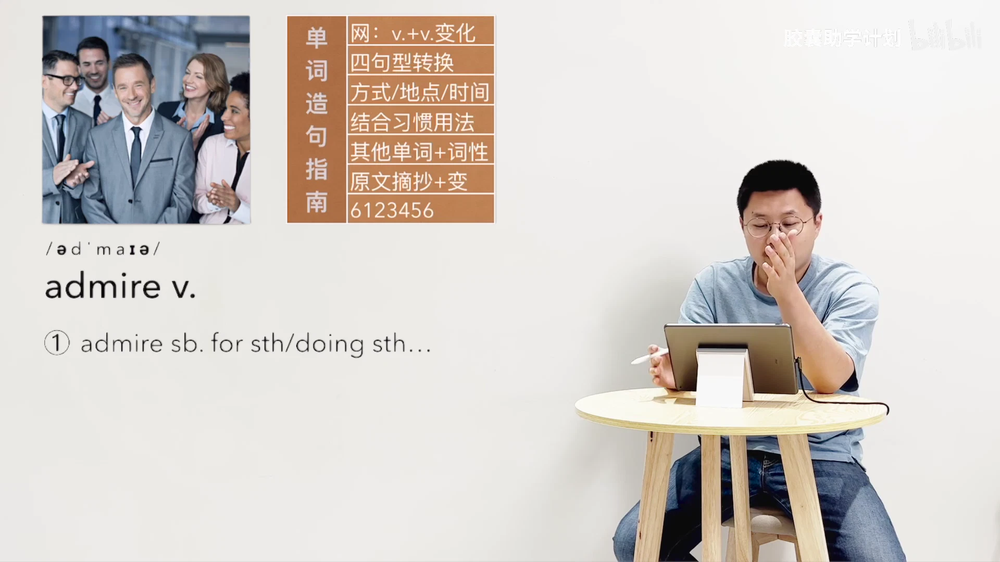

文字识别：单词造句指南 / 网：v.+v.变化 / 臺助字计划 / 四句型转换 / 方式/地点/时间 / 结合习惯用法 / 其他单词+词性 / 原文摘抄+变 / 6123456 / /ad'maia/ / admire V. / admire sb. for sth/doing sth...

### 画面 00:03:15

文字识别：单词造句指南 / 网：v.+v.变化 / 四句型转换 / 方式/地点/时间 / 结合习惯用法 / 其他单词+词性 / 原文摘抄+变 / 6123456 / /ad'maia/ / admire v. / ① admire sb. for sth/doing sth... / ② | admire you for that. Unforgiven (1992)

### 画面 00:03:19

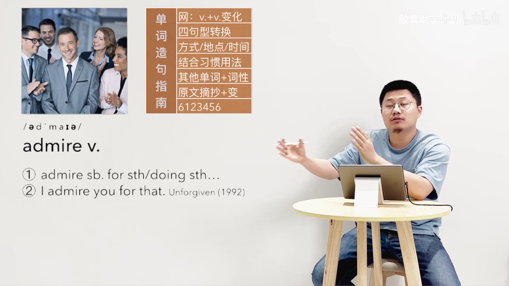

文字识别：单词造句指南 / 网：v.+v.变化 / 四句型转换 / 方式/地点/时间 / 结合习惯用法 / 其他单词+词性 / 原文摘抄+变 / 6123456 / /ad'maia/ / admire V. / ) admire sb. for sth/doing sth... / ② I admire you for that. Unforgiven (1992)

### 画面 00:03:22

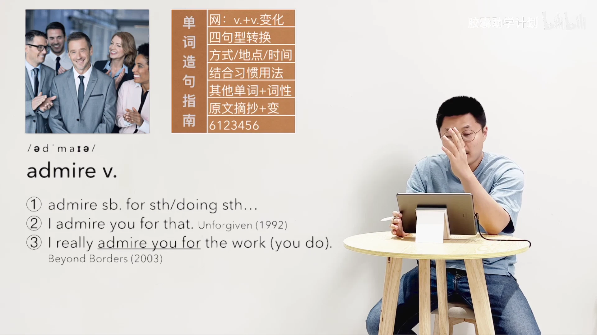

文字识别：单词造句指南 / 网：v.+v.变化 / 四句型转换 / 方式/地点/时间 / 结合习惯用法 / 其他单词+词性 / 原文摘抄+变 / 6123456 / /ad'maia/ / admire v. / ① admire sb.for sth/doing sth.. / ② | admire you for that. Unforgiven (1992) / ③ I really admire you for the work (you do). / Beyond Borders (2003)

### 画面 00:03:25

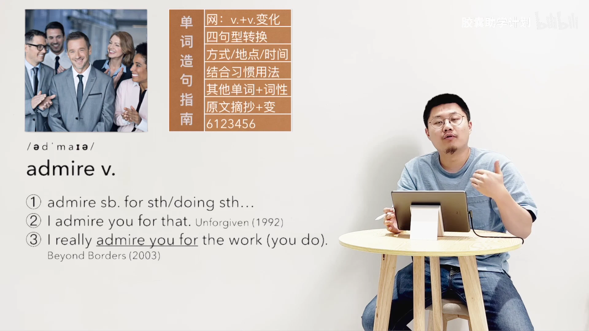

文字识别：单词造句指南 / 网：v.+v.变化 / 四句型转换 / 方式/地点/时间 / 结合习惯用法 / 其他单词+词性 / 原文摘抄+变 / 6123456 / /ad'maia/ / admire V. / ① admire sb. for sth/doing sth.. / ② I admire you for that. Unforgiven (1992) / ③ I really admire you for the work (you do). / Beyond Borders (2003)

## 00:03:30–00:04:00

admire somebody for something，第二个呢，二十八课咱们学定语从句叫 the work you do，哎，你做的这个工作，OK， very good， continue，接下来 I admire you for caring so much，什么意思呢？说我呀很钦佩你，因为什么事情呢？说因为这样一件事情叫 caring so much，非常的关心，哎，比如说我现在有一个事情，你特别的关心

### 画面 00:03:40

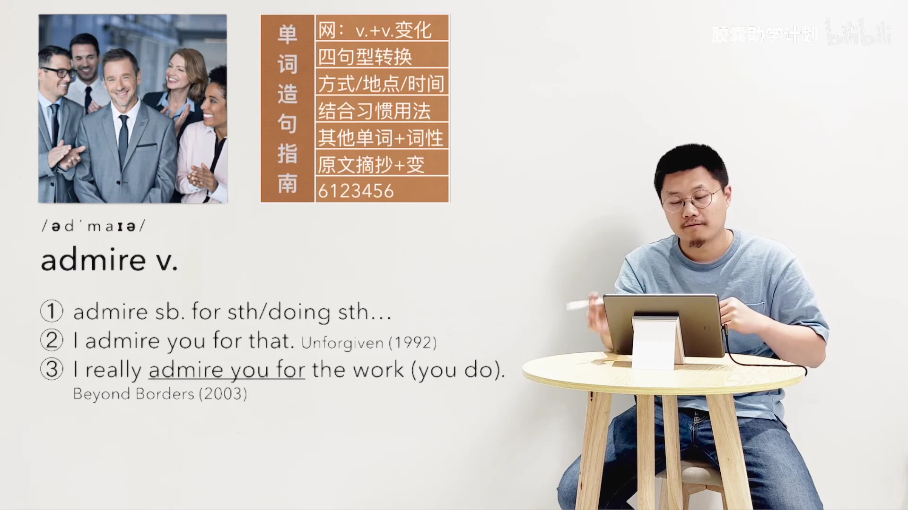

文字识别：单词造句指南 / 网：v.+v.变化 / 四句型转换 / 方式/地点/时间 / 结合习惯用法 / 其他单词+词性 / 原文摘抄+变 / 6123456 / /ad'maia/ / admire V. / ① admire sb. for sth/doing sth.. / ② | admire you for that. Unforgiven (1992) / ③ I really admire you for the work (you do). / Beyond Borders (2003)

### 画面 00:03:45

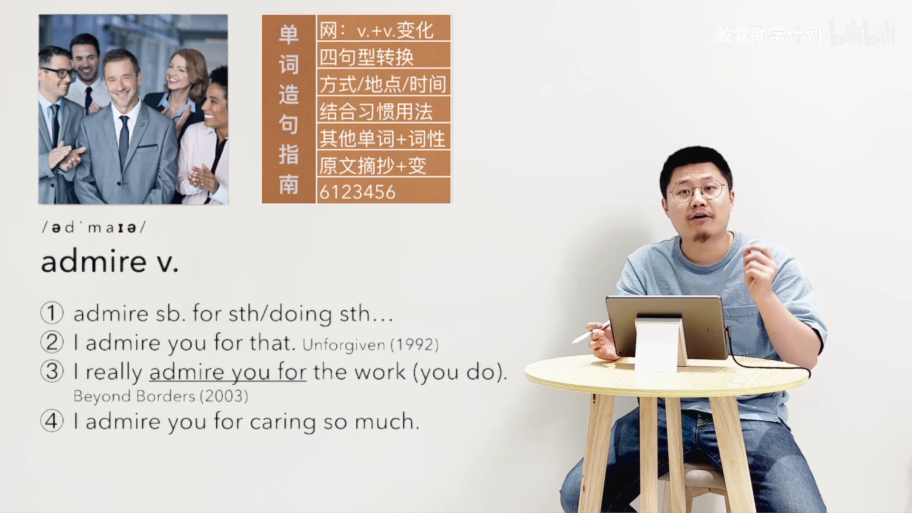

文字识别：单词造句指南 / 网：v.+v.变化 / 字讨划 / 四句型转换 / 方式/地点/时间 / 结合习惯用法 / 其他单词+词性 / 原文摘抄+变 / 6123456 / /ad'maia/ / admire V. / ① admire sb. for sth/doing sth... / ② I admire you for that. Unforgiven (1992) / ③ I really admire you for the work (you do). / Beyond Borders (2003) / ④ I admire you for caring so much.

### 画面 00:03:50

文字识别：单词造句指南 / 网：v.+v.变化 / 字计划 / 四句型转换 / 方式/地点/时间 / 结合习惯用法 / 其他单词+词性 / 原文摘抄+变 / 6123456 / /ad'maia/ / admire V. / ① admire sb. for sth/doing sth... / ② I admire you for that. Unforgiven (1992) / ③ I really admire you for the work (you do). / Beyond Borders (2003) / ④ I admire you for caring so much.

### 画面 00:03:56

文字识别：单词造句指南 / 网：v.+v.变化 / 四句型转换 / 方式/地点/时间 / 结合习惯用法 / 其他单词+词性 / 原文摘抄+变 / 6123456 / /ad'maia/ / admire V. / ① admire sb. for sth/doing sth.. / ② I admire you for that. Unforgiven (1992) / ③ I really admire you for the work (you do). / Beyond Borders (2003) / ④ I admire you for caring so much.

## 00:04:00–00:04:30

他，你从语言、行动、情感上都投入了很多。那我就可以说，哎，I admire you for caring so much. Okay, very good. 那接下来呢，注意力集中，我们看一个小的电影片段。呃，这里有一个生词，我要多提一句，叫 honesty，指的是诚实的意思啊。 But I do admire her for her honesty. Really, I do. Okay, very good. Next one,还是一个电影片段啊。你看这里叫 I admire you,

### 画面 00:04:03

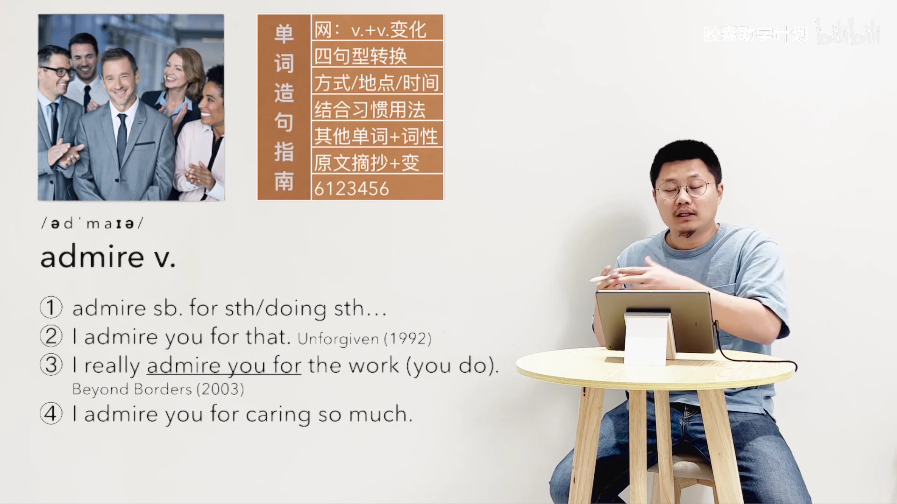

文字识别：单词造句指南 / 网：v.+v.变化 / 四句型转换 / 方式/地点/时间 / 结合习惯用法 / 其他单词+词性 / 原文摘抄+变 / 6123456 / /ad'maia/ / admire v. / ① admire sb. for sth/doing sth... / ② I admire you for that. Unforgiven (1992) / ③ I really admire you for the work (you do). / Beyond Borders (2003) / ④ I admire you for caring so much.

### 画面 00:04:05

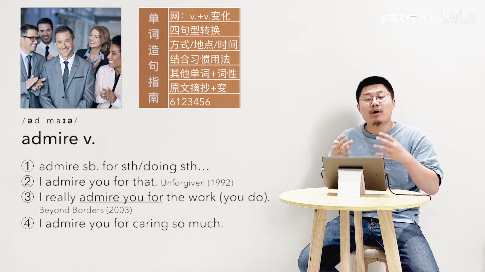

文字识别：单词造句指南 / 网：v.+v.变化 / 四句型转换 / 方式/地点/时间 / 结合习惯用法 / 其他单词+词性 / 原文摘抄+变 / 6123456 / /ad'maia/ / admire V. / ① admire sb. for sth/doing sth.. / ② | admire you for that. Unforgiven (1992) / ③ I really admire you for the work (you do). / Beyond Borders (2003) / ④ I admire you for caring so much.

### 画面 00:04:08

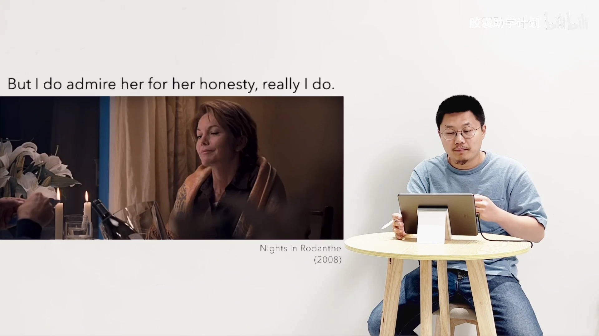

文字识别：But I do admire her for her honesty, really I do. / Nights in Rodanthe / (2008)

### 画面 00:04:20

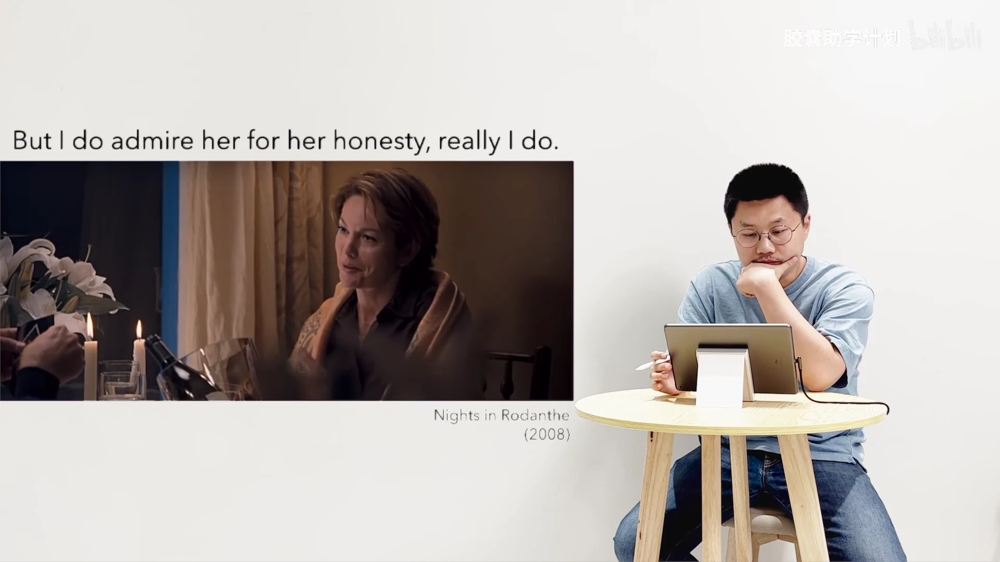

文字识别：ButI do admire her for her honesty, really I do. / Nights in Rodanthe / (2008)

### 画面 00:04:22

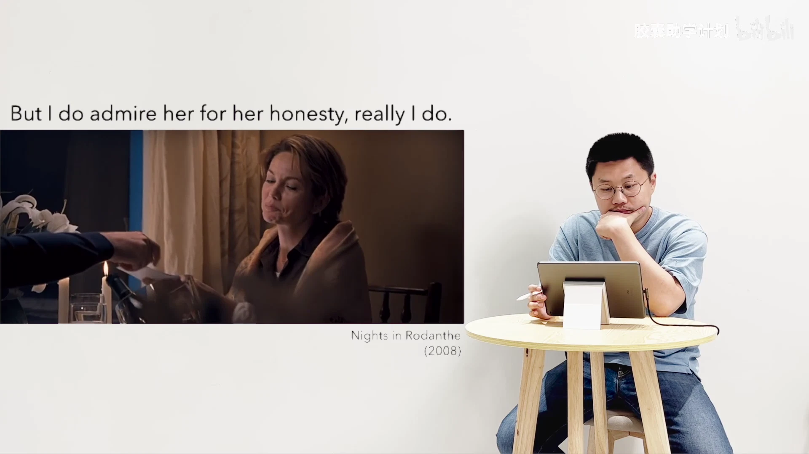

文字识别：But I do admire her for her honesty, really I do. / Nights in Rodanthe / (2008)

### 画面 00:04:25

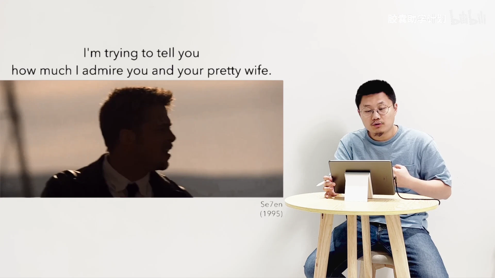

文字识别：I'm trying to tell you / how much I admire you and your pretty wife. / Se7en / (1995)

## 00:04:30–00:05:00

and you are pretty wife, 对吧？ I'm trying to tell you how much I admire you and you're pretty wife. Very good. 下一个单词，这个单词是咱们新一前二十课就学过的单词，叫做 close，对吧？那各位熟悉它的意思指的是，要么比如说动词关门，对吧？要么指的是近。那如果你说人和人之间近呢？比如说 close friend 是什么意思呢？是关门弟子吗？关门的朋友吗？并不是，

### 画面 00:04:33

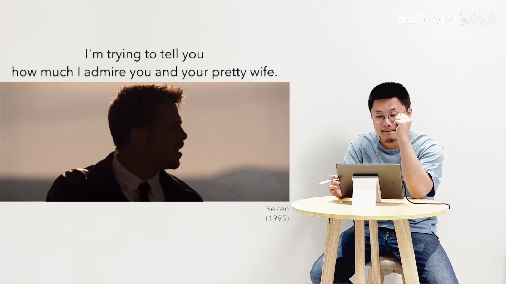

文字识别：I'm trying to tell you / how much I admire you and your pretty wife. / Se7en / (1995)

### 画面 00:04:35

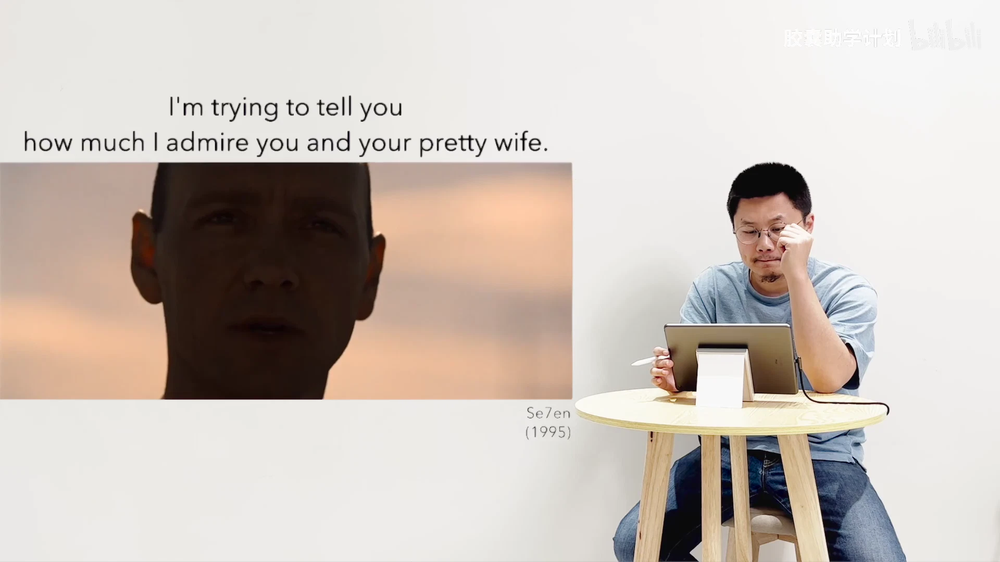

文字识别：I'm trying to tell you / how much I admire you and your pretty wife. / Se7en / (1995)

### 画面 00:04:37

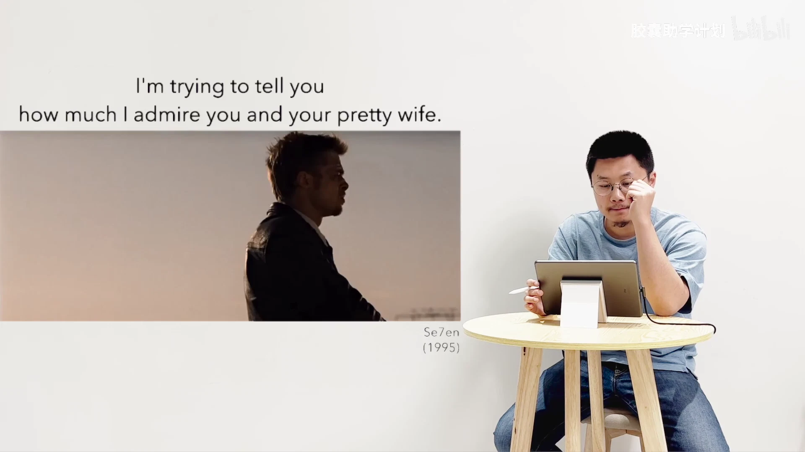

文字识别：I'm trying to tell you / how much I admire you and your pretty wife. / Se7en / (1995)

### 画面 00:04:39

文字识别：单词造句指南 / 网：v.+v.变化 / 囊助字计划 / 四句型转换 / 方式/地点/时间 / 结合习惯用法 / 其他单词+词性 / 原文摘抄+变 / 6123456 / /klauz/ / close adj.

### 画面 00:04:46

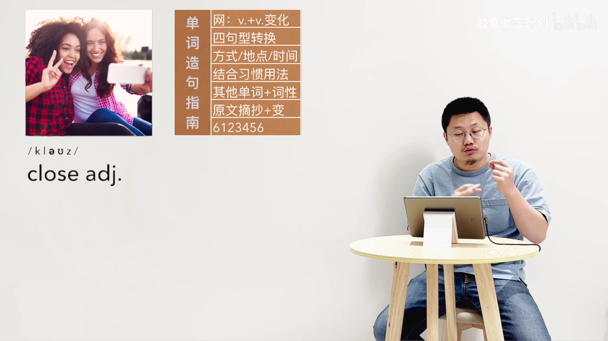

文字识别：单词造句指南 / 网：v.+v.变化 / 四句型转换 / 方式/地点/时间 / 结合习惯用法 / 其他单词+词性 / 原文摘抄+变 / 6123456 / /klauz/ / close adj.

### 画面 00:04:56

文字识别：单词造句指南 / 网：v.+v.变化 / 奏助学计划 / 四句型转换 / 方式/地点/时间 / 结合习惯用法 / 其他单词+词性 / 原文摘抄+变 / 6123456 / /klauz/ / close adj. / ① close friend

## 00:05:00–00:05:30

它指的是什么呢？指的是说关系很亲密啊。比如说我们造句啊，很常用的这样几个小的句子，口语当中非常常用，叫 we were close。 Were you close? Why weren't you close? 对吧？哎，we were close，叫做我们当时关系还是很亲密的啊。这个在电影当中经常出现的情况是，比如说我举个例子，嗯，你小的时候有一个兄弟姐妹，对吧？长大了之后呢，变得不那

### 画面 00:05:04

文字识别：单词造句指南 / 网：v.+v.变化 / 虞助学计划 / 四句型转换 / 方式/地点/时间 / 结合习惯用法 / 其他单词+词性 / 原文摘抄+变 / 6123456 / /klauzl / close adj. / ① close friend /  We were close. Were you close? why weren't .

### 画面 00:05:06

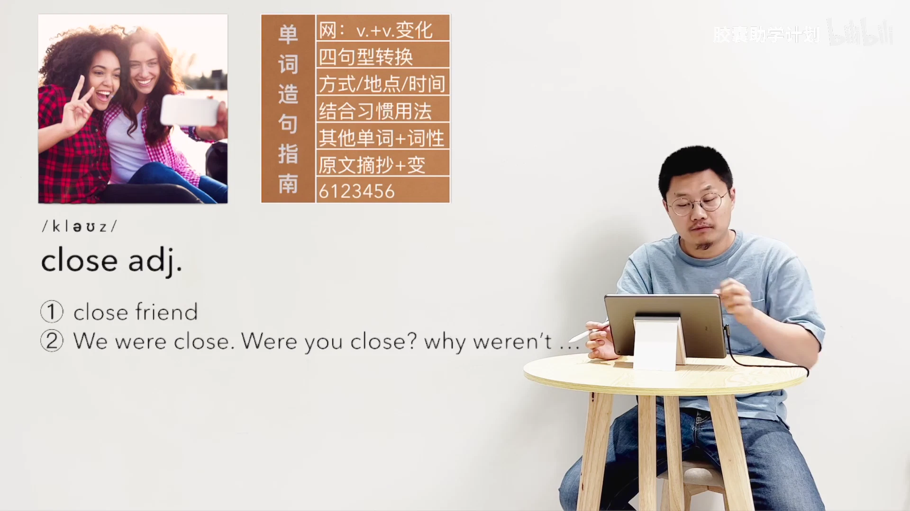

文字识别：单词造句指南 / 网：v.+v.变化 / 四句型转换 / 方式/地点/时间 / 结合习惯用法 / 其他单词+词性 / 原文摘抄+变 / 6123456 / /klauz/ / close adj. / ① close friend /  We were close. Were you close? why weren't

### 画面 00:05:10

文字识别：单词造句指南 / 网：v.+v.变化 / 助学计划 / 四句型转换 / 方式/地点/时间 / 结合习惯用法 / 其他单词+词性 / 原文摘抄+变 / 6123456 / /klauz/ / close adj. / ① close friend /  We were close. Were you close? why weren't .

### 画面 00:05:15

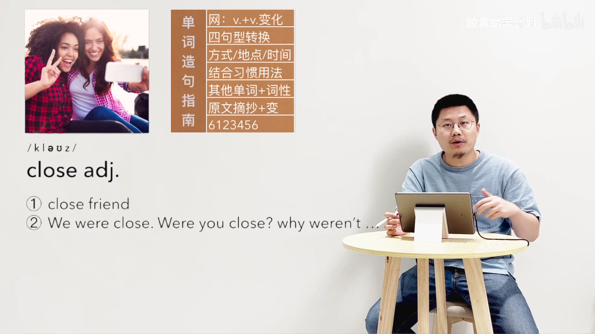

文字识别：单词造句指南 / 网：v.+v.变化 / 建助学计划 / 四句型转换 / 方式/地点/时间 / 结合习惯用法 / 其他单词+词性 / 原文摘抄+变 / 6123456 / /klauz/ / close adj. / ① close friend /  We were close. Were you close? why weren't ..

### 画面 00:05:20

文字识别：单词造句指南 / 网：v.+v.变化 / 四句型转换 / 方式/地点/时间 / 结合习惯用法 / 其他单词+词性 / 原文摘抄+变 / 6123456 / /klauzl / close adj. / ① close friend /  We were close. Were you close? why weren't ..

### 画面 00:05:25

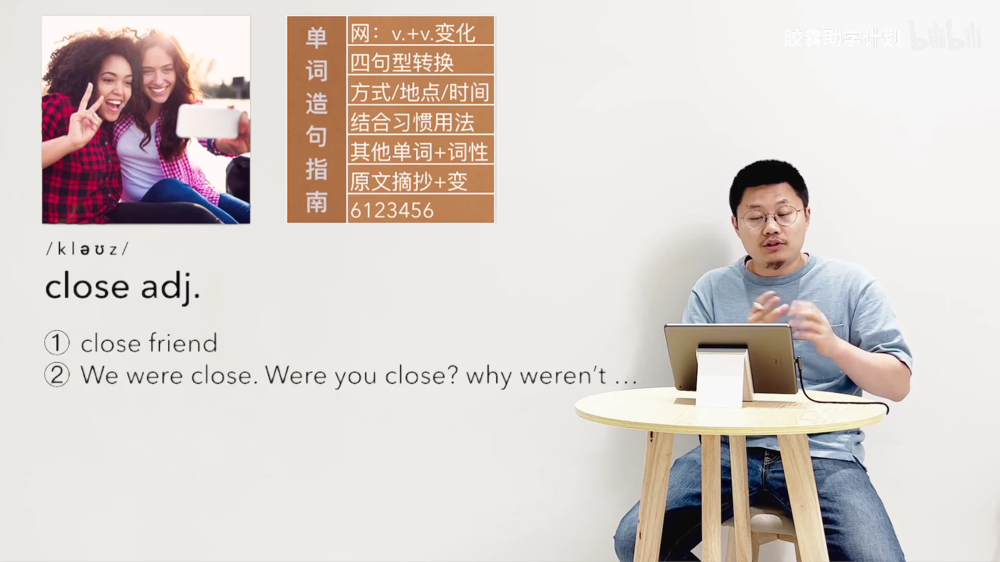

文字识别：单词造句指南 / 网：v.+v.变化 / 四句型转换 / 方式/地点/时间 / 结合习惯用法 / 其他单词+词性 / 原文摘抄+变 / 6123456 / /klauz/ / close adj. / ① close friend /  We were close. Were you close? why weren't ..

## 00:05:30–00:06:00

么亲密了，因为各种各样的原因吧。那别人可能问你，你说，哎，我们小的时候还是 we were close，还是很亲密的啊，用的是 were，对吧？那另一个使用场景呢？比如说祖父辈啊，也可能是父辈，也可能是祖辈，对吧？祖父辈都有。那比如说他们假设过世了，那你现在去回想，说我小的时候啊，和我的爷爷奶奶、姥姥姥爷，对吧？叫 we were close。注意这里的用 were 的原因是什么呢？有两方面

### 画面 00:05:38

文字识别：单词造句指南 / 网：v.+v.变化 / 子计划 / 四句型转换 / 方式/地点/时间 / 结合习惯用法 / 其他单词+词性 / 原文摘抄+变 / 6123456 / /klauz/ / close adj. / ① close friend /  We were close. Were you close? why weren't ..

### 画面 00:05:53

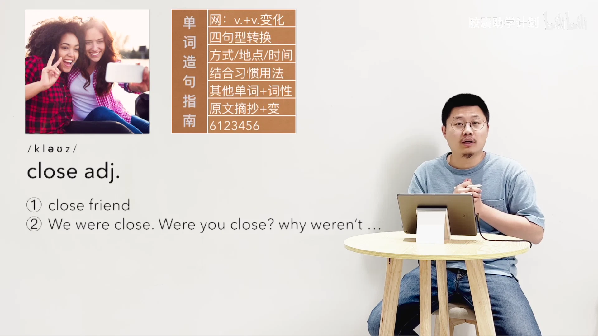

文字识别：单词造句指南 / 网：v.+v.变化 / 虞助字计划 / 四句型转换 / 方式/地点/时间 / 结合习惯用法 / 其他单词+词性 / 原文摘抄+变 / 6123456 / /klauz/ / close adj. / ① close friend /  We were close. Were you close? why weren't ..

## 00:06:00–00:06:30

原因，一方面可能指的是，比如说我们的祖父祖母那一辈呢过世了，另一个呢就是我们现在不再 close 了啊，不再那么亲密了，所以这里用的是 work 这个小的时态问题要注意一下。好，continue 下一句话。We had been working together for years before we became very close friends。如果各位六十二课认认真真的学了也练了，那这课这个句子见到你应该再熟悉不过了，连

### 画面 00:06:11

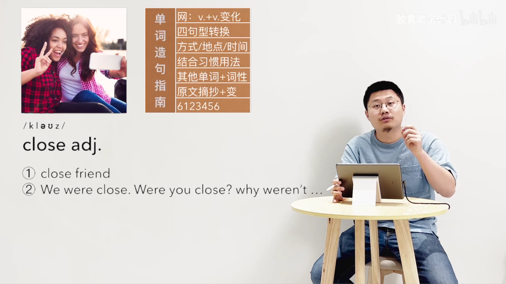

文字识别：单词造句指南 / 网：v.+v.变化 / 助学计划 / 四句型转换 / 方式/地点/时间 / 结合习惯用法 / 其他单词+词性 / 原文摘抄+变 / 6123456 / /klauzl / close adj. / ① close friend /  We were close. Were you close? why weren't

### 画面 00:06:13

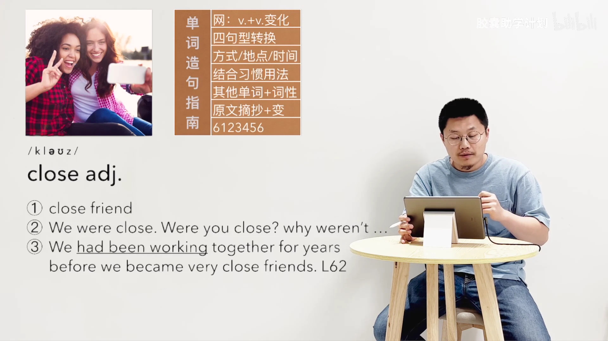

文字识别：单词造句指南 / 网：v.+v.变化 / 四句型转换 / 方式/地点/时间 / 结合习惯用法 / 其他单词+词性 / 原文摘抄+变 / 6123456 / /klauz/ / close adj. / ① close friend / ② We were close. Were you close? why weren't / We had been working together for years / before we became very close friends. L62

### 画面 00:06:16

文字识别：单词造句指南 / 网：v.+v.变化 / 四句型转换 / 方式/地点/时间 / 结合习惯用法 / 其他单词+词性 / 原文摘抄+变 / 6123456 / /klauz/ / close adj. / ① close friend / ② We were close. Were you close? why weren't / We had been working together for years / 3 / before we became very close friends. L62

### 画面 00:06:21

文字识别：单词造句指南 / 网：v.+v.变化 / 四句型转换 / 方式/地点/时间 / 结合习惯用法 / 其他单词+词性 / 原文摘抄+变 / 6123456 / /klauz/ / close adj. / ① close friend / ② We were close. Were you close? why weren't / We had been working together for years / 3 / before we became very close friends. L62

## 00:06:30–00:07:00

句型都是一样的，对吧？过去完成进行时学完，咱们立刻复习，叫做我们在一起工作已经数年了。然后在什么之前呢？在我们成为特别亲密的朋友之前，对吧？各位脑海当中想这么一个场景，就是我们一起工作了很多很多年，然后在这个点上，哎，或者说那可能现实生活没有这么没有这么简单，但是我们给它简单化啊，我们就变成了非常亲密的朋友，

### 画面 00:06:45

文字识别：单词造句指南 / 网：v.+v.变化 / 字计划 / 四句型转换 / 方式/地点/时间 / 结合习惯用法 / 其他单词+词性 / 原文摘抄+变 / 6123456 / /klauz/ / close adj. / ① close friend / ② We were close. Were you close? why weren't . / We had been working together for years / 3 / before we became very close friends. L62

### 画面 00:06:50

文字识别：单词造句指南 / 网：v.+v.变化 / 四句型转换 / 方式/地点/时间 / 结合习惯用法 / 其他单词+词性 / 原文摘抄+变 / 6123456 / /klauz/ / close adj. / ① close friend / ② We were close. Were you close? why weren't .. / We had been working together for years / before we became very close friends. L62

### 画面 00:06:55

文字识别：单词造句指南 / 网：v.+v.变化 / 四句型转换 / 方式/地点/时间 / 结合习惯用法 / 其他单词+词性 / 原文摘抄+变 / 6123456 / /klauz/ / close adj. / ① close friend / ② We were close. Were you close? why weren't .. / We had been working together for years / before we became very close friends. L62

## 00:07:00–00:07:30

close friends. Okay,好。下一句话，for centuries, close circle of friends.注意，你看我们单词造句的时候，用最好能用到之前学过的单词，对吧？哎，呃，很亲密的一圈朋友，对吧？这个小圈子这些朋友呢，almost always live together，几乎总是住在一起。我们所谓叫熟人社会，对吧？而不是来到像北京这样的大都市生活。But

### 画面 00:07:00

文字识别：单词造句指南 / 网：v.+v.变化 / 学计划 / 四句型转换 / 方式/地点/时间 / 结合习惯用法 / 其他单词+词性 / 原文摘抄+变 / 6123456 / /klauz/ / close adj. / ① close friend / ② We were close. Were you close? why weren't . / We had been working together for years / before we became very close friends. L62

### 画面 00:07:02

文字识别：单词造句指南 / 网：v.+v.变化 / 助学计划 / 四句型转换 / 方式/地点/时间 / 结合习惯用法 / 其他单词+词性 / 原文摘抄+变 / 6123456 / /klauz/ / close adj. / ① close friend / ② We were close. Were you close? why weren't / ③ We had been working together for years / 3 / before we became very close friends. L62 / For centuries close circle of friends almost / always lived together, but things have changed / now.L62

### 画面 00:07:05

文字识别：单词造句指南 / 网：v.+v.变化 / 建助字计划陽 / 四句型转换 / 方式/地点/时间 / 结合习惯用法 / 其他单词+词性 / 原文摘抄+变 / 6123456 / /klauz/ / close adj. / ① close friend / ② We were close. Were you close? why weren't / ③ We had been working together for years / 3 / before we became very close friends. L62 / For centuries close circle of friends almost / always lived together, but things have changed / now.L62

### 画面 00:07:11

文字识别：单词造句指南 / 网：v.+v.变化 / 奏助字计划 / 四句型转换 / 方式/地点/时间 / 结合习惯用法 / 其他单词+词性 / 原文摘抄+变 / 6123456 / /klauz/ / close adj. / ① close friend / ② We were close. Were you close? why weren't .. / ③ We had been working together for years / before we became very close friends. L62 / For centuries close circle of friends almost / always lived together, Out things have changed / now.L62

### 画面 00:07:16

文字识别：单词造句指南 / 网：v.+v.变化 / [助学计划 / 四句型转换 / 方式/地点/时间 / 🌸 / 结合习惯用法 / 其他单词+词性 / 原文摘抄+变 / 6123456 / /klauz/ / close adj. / ① close friend / ② We were close. Were you close? why weren't .. / ③ We had been working together for years / before we became very close friends. L62 / For centuries close circle of friends almost / always lived together, but things have changed / now.L62

### 画面 00:07:20

文字识别：单词造句指南 / 网：v.+v.变化 / 毫助学计划 / 四句型转换 / 方式/地点/时间 / 结合习惯用法 / 其他单词+词性 / 原文摘抄+变 / 6123456 / /klauz/ / close adj. / ① close friend / ② We were close. Were you close? why weren't .. / ③ We had been working together for years / 3 / before we became very close friends. L62 / For centuries close circle of friends almost / always lived together, but things have changed / now.L62

### 画面 00:07:25

文字识别：单词造句指南 / 网：v.+v.变化 / 毫助学计划 / 四句型转换 / 方式/地点/时间 / 结合习惯用法 / 其他单词+词性 / 原文摘抄+变 / 6123456 / /klauz/ / close adj. / ① close friend / ② We were close. Were you close? why weren't .. / ③ We had been working together for years / 3 / before we became very close friends. L62 / For centuries close circle of friends almost / always lived together, but things have changed / now. L62

## 00:07:30–00:08:00

things have changed now.但是事情已经改变了，所以这里用到了其实六十二课咱们刚刚学过的for centuries这个小的短语，数个世纪以来。Very good.那这个单词就算结束了。再跟我读一遍，叫clothes. Very good.下一个单词wedding, wedding, wedding的意思呢，指的是婚礼啊。那你比如说wedding，你要很简单，比如说我们造一句话叫It was a wonderful wedding, wasn't it?对吧？像这句话对

### 画面 00:07:30

文字识别：单词造句指南 / 网：v.+v.变化 / 虞助字计划 / 四句型转换 / 方式/地点/时间 / 结合习惯用法 / 其他单词+词性 / 原文摘抄+变 / 6123456 / /klauz/ / close adj. / ① close friend / ② We were close. Were you close? why weren't .. / ③ We had been working together for years / 3 / before we became very close friends. L62 / For centuries close circle of friends almost / always lived together, but things have changed / now. L62

### 画面 00:07:38

文字识别：单词造句指南 / 网：v.+v.变化 / 臺助字计划 / 四句型转换 / 方式/地点/时间 / 结合习惯用法 / 其他单词+词性 / 原文摘抄+变 / 6123456 / /klauz/ / close adj. / ① close friend / ② We were close. Were you close? why weren't / ③ We had been working together for years / before we became very close friends. L62 / For centuries close circle of friends almost / always lived together, but things have changed / now.L62

### 画面 00:07:45

文字识别：单词造句指南 / 网：v.+v.变化 / 四句型转换 / 方式/地点/时间 / 结合习惯用法 / 其他单词+词性 / 原文摘抄+变 / 6123456 / /'wedin/ / wedding n.

### 画面 00:07:47

文字识别：单词造句指南 / 网：v.+v.变化 / 四句型转换 / 方式/地点/时间 / 结合习惯用法 / 其他单词+词性 / 原文摘抄+变 / 6123456 / /'wedin/ / wedding n.

### 画面 00:07:50

文字识别：单词造句指南 / 网：v.+v.变化 / 四句型转换 / 方式/地点/时间 / 结合习惯用法 / 其他单词+词性 / 原文摘抄+变 / 6123456 / /'wedin/ / wedding n.

### 画面 00:07:53

文字识别：单词造句指南 / 网：v.+v.变化 / 四句型转换 / 方式/地点/时间 / 结合习惯用法 / 其他单词+词性 / 原文摘抄+变 / 6123456 / / ' w e d i n / / wedding n. / ) It was a wonderful wedding, wasn't it?

### 画面 00:07:55

文字识别：单词造句指南 / 网：v.+v.变化 / 四句型转换 / 方式/地点/时间 / 结合习惯用法 / 其他单词+词性 / 原文摘抄+变 / 6123456 / / ' w e dIn / / wedding n. / ) Ilt was a wonderful wedding, wasn't it?

## 00:08:00–00:08:30

于各位来说，其实就是我们新一六十七课就学过的一个啊，这个这个句型，对吧？啊，应该是一百零三课啊，一百零三课，新一百零三课咱们学的。然后这个wasn't it就等于right，就是翻译成汉语就是对吧？OK，好。接下来我们造一句话叫做It's too late to ask her for help with my wedding。好，首先too late to do something, too late to apologize。这个一个非常有名的歌，

### 画面 00:08:01

文字识别：单词造句指南 / 网：v.+v.变化 / 四句型转换 / 方式/地点/时间 / 结合习惯用法 / 其他单词+词性 / 原文摘抄+变 / 6123456 / / ' w e din / / wedding n. / ) It was a wonderful wedding, wasn't it?

### 画面 00:08:03

文字识别：单词造句指南 / 网：v.+v.变化 / 四句型转换 / 方式/地点/时间 / 结合习惯用法 / 其他单词+词性 / 原文摘抄+变 / 6123456 / / ' w e din / / wedding n. / ) It was a wonderful wedding, wasn't it?

### 画面 00:08:05

文字识别：单词造句指南 / 网：v.+v.变化 / 四句型转换 / 方式/地点/时间 / 结合习惯用法 / 其他单词+词性 / 原文摘抄+变 / 6123456 / / ' w e din / / wedding n. / ) It was a wonderful wedding, wasn't it?

### 画面 00:08:07

文字识别：单词造句指南 / 网：v.+v.变化 / 四句型转换 / 方式/地点/时间 / 结合习惯用法 / 其他单词+词性 / 原文摘抄+变 / 6123456 / / ' w e din / / wedding n. / ) It was a wonderful wedding, wasn't it?

### 画面 00:08:10

文字识别：单词造句指南 / 网：v.+v.变化 / 四句型转换 / 方式/地点/时间 / 结合习惯用法 / 其他单词+词性 / 原文摘抄+变 / 6123456 / / ' w e d i n / / wedding n. / ) Ilt was a wonderful wedding, wasn't'

### 画面 00:08:12

文字识别：单词造句指南 / 网：v.+v.变化 / 四句型转换 / 方式/地点/时间 / 结合习惯用法 / 其他单词+词性 / 原文摘抄+变 / 6123456 / / ' w e din / / wedding n. / ) It was a wonderful wedding, wasn't it?

### 画面 00:08:14

文字识别：单词造句指南 / 网：v.+v.变化 / 四句型转换 / 方式/地点/时间 / 结合习惯用法 / 其他单词+词性 / 原文摘抄+变 / 6123456 / / ' w e din / / wedding n. / ) It was a wonderful wedding, wasn't it?

### 画面 00:08:16

文字识别：单词造句指南 / 网：v.+v.变化 / 四句型转换 / 方式/地点/时间 / 结合习惯用法 / 其他单词+词性 / 原文摘抄+变 / 6123456 / /'w e dⅠn / / wedding n. /  It was a wonderful wedding, wasn't it? / ) It's too late to ask her for help with my wedding.

### 画面 00:08:19

文字识别：单词造句指南 / 网：v.+v.变化 / 四句型转换 / 方式/地点/时间 / 结合习惯用法 / 其他单词+词性 / 原文摘抄+变 / 6123456 / /' w e dⅠn / / wedding n. /  It was a wonderful wedding, wasn't it? / ) It's too late to ask her for help with my wedding.

### 画面 00:08:21

文字识别：单词造句指南 / 网：v.+v.变化 / 四句型转换 / 方式/地点/时间 / 结合习惯用法 / 其他单词+词性 / 原文摘抄+变 / 6123456 / / 'w e dⅠn / / wedding n. / ) It was a wonderful wedding, wasn't it? / ) It's too late to ask her for help with my wedding.

### 画面 00:08:24

文字识别：单词造句指南 / 网：v.+v.变化 / 四句型转换 / 方式/地点/时间 / 结合习惯用法 / 其他单词+词性 / 原文摘抄+变 / 6123456 / /'w e dⅠn / / wedding n. / ) It was a wonderful wedding, wasn't it? / ) It's too late to ask her for help with my wedding.

### 画面 00:08:27

文字识别：单词造句指南 / 网：v.+v.变化 / 四句型转换 / 方式/地点/时间 / 结合习惯用法 / 其他单词+词性 / 原文摘抄+变 / 6123456 / / ' w e d In / / wedding n. / ) It was a wonderful wedding, wasn't it? / ) It's too late to ask her for help with my wedding.

### 画面 00:08:29

文字识别：单词造句指南 / 网：v.+v.变化 / 四句型转换 / 方式/地点/时间 / 结合习惯用法 / 其他单词+词性 / 原文摘抄+变 / 6123456 / / 'w e d In / / wedding n. / ) It was a wonderful wedding, wasn't it? / ) It's too late to ask her for help with my wedding.

## 00:08:30–00:09:00

Transcribe the exact words in their original spoken languages. Never translate. Preserve repetitions, questions and examples.

### 画面 00:08:31

文字识别：单词造句指南 / 网：v.+v.变化 / 四句型转换 / 方式/地点/时间 / 结合习惯用法 / 其他单词+词性 / 原文摘抄+变 / 6123456 / / ' w e d In / / wedding n. / ) It was a wonderful wedding, wasn't it? / ) It's too late to ask her for help with my wedding.

### 画面 00:08:35

文字识别：单词造句指南 / 网：v.+v.变化 / 四句型转换 / 方式/地点/时间 / 结合习惯用法 / 其他单词+词性 / 原文摘抄+变 / 6123456 / /'w e din / / wedding n. /  It was a wonderful wedding, wasn't it? / ) It's too late to ask her for help with my wedding.

### 画面 00:08:38

文字识别：单词造句指南 / 网：v.+v.变化 / 四句型转换 / 方式/地点/时间 / 结合习惯用法 / 其他单词+词性 / 原文摘抄+变 / 6123456 / / 'w e dⅠn / / wedding n. / ) It was a wonderful wedding, wasn't it? / ) It's too late to ask her for help with my wedding

### 画面 00:08:40

文字识别：单词造句指南 / 网：v.+v.变化 / 四句型转换 / 方式/地点/时间 / 结合习惯用法 / 其他单词+词性 / 原文摘抄+变 / 6123456 / / ' w e d In / / wedding n. / ) It was a wonderful wedding, wasn't it? /  It's too late to ask her for help with my wedding.

### 画面 00:08:43

文字识别：单词造句指南 / 网：v.+v.变化 / 学计划 / 四句型转换 / 方式/地点/时间 / 结合习惯用法 / 其他单词+词性 / 原文摘抄+变 / 6123456 / / ' w e d Ⅰn / / wedding n. /  It was a wonderful wedding, wasn't it? / 1 /  It's too late to ask her for help with my wedding. / 2 / ③ wedding gift/present/ring

### 画面 00:08:45

文字识别：单词造句指南 / 网：v.+v.变化 / 字计划 / 四句型转换 / 方式/地点/时间 / 结合习惯用法 / 其他单词+词性 / 原文摘抄+变 / 6123456 / / 'we d i n / / wedding n. / ) It was a wonderful wedding, wasn't it? /  It's too late to ask her for help with my wedding / 2) / ③ wedding gift/present/ring

### 画面 00:08:51

文字识别：单词造句指南 / 网：v.+v.变化 / 四句型转换 / 方式/地点/时间 / 结合习惯用法 / 其他单词+词性 / 原文摘抄+变 / 6123456 / / 'w e d i n / / wedding n. / ) It was a wonderful wedding, wasn't it? / ② It's too late to ask her for help with my wedding. / 2） / ③ wedding gift/present/ring

### 画面 00:08:53

文字识别：单词造句指南 / 网：v.+v.变化 / 四句型转换 / 方式/地点/时间 / 结合习惯用法 / 其他单词+词性 / 原文摘抄+变 / 6123456 / / 'w e d i n / / wedding n. / ) It was a wonderful wedding, wasn't it? / ② It's too late to ask her for help with my wedding. / 2） / ③ wedding gift/present/ring

### 画面 00:08:55

文字识别：单词造句指南 / 网：v.+v.变化 / 四句型转换 / 方式/地点/时间 / 结合习惯用法 / 其他单词+词性 / 原文摘抄+变 / 6123456 / /'we d l n / / wedding n. / ) It was a wonderful wedding, wasn't it? / 1 / ② It's too late to ask her for help with my wedding. / 2） / ③ wedding gift/present/ring

### 画面 00:08:58

文字识别：单词造句指南 / 网：v.+v.变化 / 学计划 / 四句型转换 / 方式/地点/时间 / 结合习惯用法 / 其他单词+词性 / 原文摘抄+变 / 6123456 / /wedin / / wedding n. / ) It was a wonderful wedding, wasn't it? / ② It's too late to ask her for help with my wedding. / 2) / ③ wedding gift/present/ring

## 00:09:00–00:09:30

单词几乎就是同义词，表示礼物。那我们想拿它去造句就很简单了，因为整个上面这个短语合起来其实就是起到了一个名词的作用。你无非接下来是不是要去找动词？比如说很简单，叫buy you a wedding present，给你买个结婚礼物。OK，好，continue。比如说，don't you threaten me with my wedding ring？说这个是六十二

### 画面 00:09:00

文字识别：单词造句指南 / 网：v.+v.变化 / 字计划 / 四句型转换 / 方式/地点/时间 / 结合习惯用法 / 其他单词+词性 / 原文摘抄+变 / 6123456 / / 'we d i n / / wedding n. / ) It was a wonderful wedding, wasn't it? /  It's too late to ask her for help with my wedding. / 2） / ③ wedding gift/present/ring

### 画面 00:09:02

文字识别：单词造句指南 / 网：v.+v.变化 / 学计划 / 四句型转换 / 方式/地点/时间 / 结合习惯用法 / 其他单词+词性 / 原文摘抄+变 / 6123456 / /we dln / / wedding n. / ) It was a wonderful wedding, wasn't it? / ② It's too late to ask her for help with my wedding. / 2) / ③ wedding gift/present/ring

### 画面 00:09:04

文字识别：单词造句指南 / 网：v.+v.变化 / 学计划 / 四句型转换 / 方式/地点/时间 / 结合习惯用法 / 其他单词+词性 / 原文摘抄+变 / 6123456 / / w e din / / wedding n. / ) Ilt was a wonderful wedding, wasn't it? / 1 /  It's too late to ask her for help with my wedding. / 2 / wedding gift/present/ring / 3 / ④ I'll buy you a wedding present.

### 画面 00:09:06

文字识别：单词造句指南 / 网：v.+v.变化 / 字计划 / 四句型转换 / 方式/地点/时间 / 结合习惯用法 / 其他单词+词性 / 原文摘抄+变 / 6123456 / /'w e dⅠn / / wedding n. / ) It was a wonderful wedding, wasn't it? / 1 / ) It's too late to ask her for help with my wedding. / 2 / wedding gift/present/ring / 3) / ④ I'll buy you a wedding present.

### 画面 00:09:08

文字识别：单词造句指南 / 网：v.+v.变化 / 四句型转换 / 方式/地点/时间 / 结合习惯用法 / 其他单词+词性 / 原文摘抄+变 / 6123456 / / 'w e d I n / / wedding n. / ) It was a wonderful wedding, wasn't it? / It's too late to ask her for help with my wedding. / wedding gift/present/ring / 'll buy you a wedding present.

### 画面 00:09:10

文字识别：单词造句指南 / 网：v.+v.变化 / 四句型转换 / 方式/地点/时间 / 结合习惯用法 / 其他单词+词性 / 原文摘抄+变 / 6123456 / / 'we din / / wedding n. / It was a wonderful wedding, wasn't it? / It's too late to ask her for help with my wedding. / wedding gift/present/ring / 'll buy you a wedding present.

### 画面 00:09:15

文字识别：单词造句指南 / 网：v.+v.变化 / 四句型转换 / 方式/地点/时间 / 结合习惯用法 / 其他单词+词性 / 原文摘抄+变 / 6123456 / / 'we din / / wedding n. /  It was a wonderful wedding, wasn't it? / It's too late to ask her for help with my wedding. / wedding gift/present/ring / 'll buy you a wedding present.

### 画面 00:09:17

文字识别：单词造句指南 / 网：v.+v.变化 / 四句型转换 / 方式/地点/时间 / 结合习惯用法 / 其他单词+词性 / 原文摘抄+变 / 6123456 / / 'we din / / wedding n. / It was a wonderful wedding, wasn't it? / It's too late to ask her for help with my wedding. / wedding gift/present/ring / 'll buy you a wedding present.

### 画面 00:09:20

文字识别：单词造句指南 / 网：v.+v.变化 / 四句型转换 / 方式/地点/时间 / 结合习惯用法 / 其他单词+词性 / 原文摘抄+变 / 6123456 / / 'we din / / wedding n. /  It was a wonderful wedding, wasn't it? / It's too late to ask her for help with my wedding. / wedding gift/present/ring / 'll buy you a wedding present.

### 画面 00:09:22

文字识别：单词造句指南 / 网：v.+v.变化 / 四句型转换 / 方式/地点/时间 / 结合习惯用法 / 其他单词+词性 / 原文摘抄+变 / 6123456 / /  wedin / / wedding n. / ) It was a wonderful wedding, wasn't it? / 1 / It's too late to ask her for help with my wedding. / wedding gift/present/ring / D I'll buy you a wedding present. / ⑤ Don't you threaten me with my wedding ring. L62

### 画面 00:09:24

文字识别：单词造句指南 / 网：v.+v.变化 / 四句型转换 / 方式/地点/时间 / 结合习惯用法 / 其他单词+词性 / 原文摘抄+变 / 6123456 / / 'wedn/ / wedding n. / へ / ) It was a wonderful wedding, wasn't it? /  It's too late to ask her for help with my wedding. / wedding gift/present/rine / ④ I'll buy you a wedding present. / ⑤ Don't you threaten me with my wedding ring. L62

### 画面 00:09:26

文字识别：单词造句指南 / 网：v.+v.变化 / 四句型转换 / 方式/地点/时间 / 结合习惯用法 / 其他单词+词性 / 原文摘抄+变 / 6123456 / / wedin / / wedding n. / ) It was a wonderful wedding, wasn't it? / 1 /  It's too late to ask her for help with my wedding. / wedding gift/present/ring / ④ I'll buy you a wedding present. / ⑤ Don't you threaten me with my wedding ring. L62

### 画面 00:09:29

文字识别：单词造句指南 / 网：v.+v.变化 / 四句型转换 / 方式/地点/时间 / 结合习惯用法 / 其他单词+词性 / 原文摘抄+变 / 6123456 / / 'we din / / wedding n. / ) It was a wonderful wedding, wasn't it? / 1 / It's too late to ask her for help with my wedding. / wedding gift/present/ring / ④ I'll buy you a wedding present. / ⑤ Don't you threaten me with my wedding ring. L62

## 00:09:30–00:10:00

课咱们学的，叫threaten somebody with something，对吧？说哎，你甭想着说拿我的婚戒来威胁我啊，老娘不吃那一套，大概就是这样的感觉啊。OK，那注意力集中，我们听一个电影片段啊，他用到了at my wedding，叫在我的婚礼上。It's a complete list of every person that was at my wedding. Very good. 接下来下一个单词叫reception. Reception是什么意

### 画面 00:09:31

文字识别：单词造句指南 / 网：v.+v.变化 / 四句型转换 / 方式/地点/时间 / 结合习惯用法 / 其他单词+词性 / 原文摘抄+变 / 6123456 / /'wedin / / wedding n. /  It was a wonderful wedding, wasn't it? / 1 / It's too late to ask her for help with my wedding. / wedding gift/present/rine /  I'll buy you a wedding present. / 4 / ⑤ Don't you threaten me with my wedding ring. L62

### 画面 00:09:34

文字识别：单词造句指南 / 网：v.+v.变化 / 四句型转换 / 方式/地点/时间 / 结合习惯用法 / 其他单词+词性 / 原文摘抄+变 / 6123456 / /'wedin / / wedding n. / ) It was a wonderful wedding, wasn't it? / 1 / It's too late to ask her for help with my wedding. / wedding gift/present/rine / D I'll buy you a wedding present. / 4 / ⑤ Don't you threaten me with my wedding ring. L62

### 画面 00:09:36

文字识别：单词造句指南 / 网：v.+v.变化 / 四句型转换 / 方式/地点/时间 / 结合习惯用法 / 其他单词+词性 / 原文摘抄+变 / 6123456 / / 'w e din / / wedding n. / ) It was a wonderful wedding, wasn't it? / 1 / It's too late to ask her for help with my wedding. / wedding gift/present/rine / D I'll buy you a wedding present. / 4 / ⑤ Don't you threaten me with my wedding ring. L62

### 画面 00:09:38

文字识别：单词造句指南 / 网：v.+v.变化 / 四句型转换 / 方式/地点/时间 / 结合习惯用法 / 其他单词+词性 / 原文摘抄+变 / 6123456 / /'wedin / / wedding n. / ) It was a wonderful wedding, wasn't it? / 1 / It's too late to ask her for help with my wedding. / wedding gift/present/rine / ④ I'll buy you a wedding present. / ⑤ Don't you threaten me with my wedding ring. L62

### 画面 00:09:40

文字识别：单词造句指南 / 网：v.+v.变化 / 四句型转换 / 方式/地点/时间 / 结合习惯用法 / 其他单词+词性 / 原文摘抄+变 / 6123456 / / ' w e dIn / / wedding n. /  It was a wonderful wedding, wasn't it? / 1 /  It's too late to ask her for help with my wedding. / wedding gift/present/rine /  I'll buy you a wedding present. / 4 / ⑤ Don't you threaten me with my wedding ring. L62

### 画面 00:09:42

文字识别：It's a complete list of every person / that was at my wedding. / Belfort-Lapaglia Wedding / Kelley Cribben / Wade Sullivan / Daniel Fine / Susan Strine / Donnie & Hildy Azoff / MegO'Shea / Max& Leah Belfort / Adam &Kirsten Wolenski / Emma Peachum / Joseph Whitmeyer / Chester Ming / Katherine O'Donnell / Robbie Feinberg / Nils Widboom / Koskoff / hrvn Blondell / The Wolf of Wall Street / (2013)

### 画面 00:09:52

文字识别：It's a complete list of every person / that was at my wedding. / Kelley Cribben / Wade Sullivan / Daniel Fine / Susan Strine / Donnie & Hildy Azoff / MegO'Shea / Max& Leah Belfort / Adam & Kirsten Wolenski / Emma Peachum / Joseph Whitmeyer / Chester Ming / Katherine ODonnell / Robbie Feinberg / Nils Widboom / Nicky Koskoff / Kathryn Blondell / Alden Kupferberg / Patricia Sprott / vimmy Belzar / aelo / Jessica Emerson / Taterberger / The Wolf of Wall Street / (2013)

### 画面 00:09:54

文字识别：单词造句指南 / 网：v.+v.变化 / 四句型转换 / 方式/地点/时间 / 结合习惯用法 / 其他单词+词性 / 原文摘抄+变 / 6123456 / /rι'sｅｐ∫an/ / reception n.

### 画面 00:09:56

文字识别：单词造句指南 / 网：v.+v.变化 / 四句型转换 / 方式/地点/时间 / 结合习惯用法 / 其他单词+词性 / 原文摘抄+变 / 6123456 / /rιsｅｐ∫an/ / reception n.

### 画面 00:09:58

文字识别：单词造句指南 / 网：v.+v.变化 / 四句型转换 / 方式/地点/时间 / 结合习惯用法 / 其他单词+词性 / 原文摘抄+变 / 6123456 / /rι'sｅｐ∫an/ / reception n.

## 00:10:00–00:10:30

思呢？Reception有两个常见的意思，一个是指的是各种招待的场所，比如说在咱们文章当中的wedding reception合起来就翻译成两个字儿，其实跟wedding本身是一样的，就是婚礼。那对于各位来说，可能非常有用的一个单词reception指的是各种地方的前台，尤其比如说是酒店。所以呢，我们就可以造几句话，比如说I'll see you at the reception。哎，我在前台见你啊，我在前台

### 画面 00:10:00

文字识别：单词造句指南 / 网：v.+v.变化 / 四句型转换 / 方式/地点/时间 / 结合习惯用法 / 其他单词+词性 / 原文摘抄+变 / 6123456 / /rｌ'sｅｐ∫ａn/ / reception n.

### 画面 00:10:04

文字识别：单词造句指南 / 网：v.+v.变化 / 四句型转换 / 方式/地点/时间 / 结合习惯用法 / 其他单词+词性 / 原文摘抄+变 / 6123456 / /rl'sｅp∫an/ / reception n.

### 画面 00:10:06

文字识别：单词造句指南 / 网：v.+v.变化 / 四句型转换 / 方式/地点/时间 / 结合习惯用法 / 其他单词+词性 / 原文摘抄+变 / 6123456 / /rl'sｅp∫an/ / reception n.

### 画面 00:10:09

文字识别：单词造句指南 / 网：v.+v.变化 / 素助字计划 / 四句型转换 / 方式/地点/时间 / 结合习惯用法 / 其他单词+词性 / 原文摘抄+变 / 6123456 / /rl'sｅp∫an/ / reception n.

### 画面 00:10:11

文字识别：单词造句指南 / 网：v.+v.变化 / 四句型转换 / 方式/地点/时间 / 结合习惯用法 / 其他单词+词性 / 原文摘抄+变 / 6123456 / /rι'sｅp∫an/ / reception n.

### 画面 00:10:15

文字识别：单词造句指南 / 网：v.+v.变化 / 四句型转换 / 方式/地点/时间 / 结合习惯用法 / 其他单词+词性 / 原文摘抄+变 / 6123456 / /rl'sｅp∫an/ / reception n.

### 画面 00:10:18

文字识别：单词造句指南 / 网：v.+v.变化 / 虞助字计划 / 四句型转换 / 方式/地点/时间 / 结合习惯用法 / 其他单词+词性 / 原文摘抄+变 / 6123456 / /rｉ'sｅｐlan/ / reception n.

### 画面 00:10:20

文字识别：单词造句指南 / 网：v.+v.变化 / 四句型转换 / 方式/地点/时间 / 结合习惯用法 / 其他单词+词性 / 原文摘抄+变 / 6123456 / /rｉ'sｅｐ∫ａn/ / reception n.

### 画面 00:10:24

文字识别：单词造句指南 / 网：v.+v.变化 / 四句型转换 / 方式/地点/时间 / 结合习惯用法 / 其他单词+词性 / 原文摘抄+变 / 6123456 / /rl'sep∫an/ / reception n. / ① I will see you at the reception.

### 画面 00:10:26

文字识别：单词造句指南 / 网：v.+v.变化 / 建助字计划 / 四句型转换 / 方式/地点/时间 / 结合习惯用法 / 其他单词+词性 / 原文摘抄+变 / 6123456 / /rl'seplan / / reception n. / ① I will see you at the reception.

### 画面 00:10:28

文字识别：单词造句指南 / 网：v.+v.变化 / 星助字计划 / 四句型转换 / 方式/地点/时间 / 结合习惯用法 / 其他单词+词性 / 原文摘抄+变 / 6123456 / /rl'seplan / / reception n. / ① I will see you at the reception.

## 00:10:30–00:11:00

等你。其实这个 see you 就是前台等你，或者咱前台见。 Next one，你可以问别人说，Excuse me， where is the reception？这是口语当中很能用到的句子，对吧？前台在哪儿？ Next one，比如说，I saw them fighting at the reception last night。昨天晚上我看见他们在前台打架来着。 Okay，这里用到的习惯用法叫 see somebody doing something，叫做看见某人正在做某件事情。

### 画面 00:10:30

文字识别：单词造句指南 / 网：v.+v.变化 / 四句型转换 / 方式/地点/时间 / 结合习惯用法 / 其他单词+词性 / 原文摘抄+变 / 6123456 / /rl'sep lan / / reception n. / ① I will see you at the reception.

### 画面 00:10:34

文字识别：单词造句指南 / 网：v.+v.变化 / 学计划 / 四句型转换 / 方式/地点/时间 / 结合习惯用法 / 其他单词+词性 / 原文摘抄+变 / 6123456 / /rI'sep∫an / / reception n. / ① I will see you at the reception. / Excuse me, where is the reception?

### 画面 00:10:36

文字识别：单词造句指南 / 网：v.+v.变化 / 字计划 / 四句型转换 / 方式/地点/时间 / 结合习惯用法 / 其他单词+词性 / 原文摘抄+变 / 6123456 / /ri'sep∫an / / reception n. / ① I will see you at the reception. /  Excuse me, where is the reception?

### 画面 00:10:40

文字识别：单词造句指南 / 网：v.+v.变化 / 四句型转换 / 方式/地点/时间 / 结合习惯用法 / 其他单词+词性 / 原文摘抄+变 / 6123456 / /rI'sep∫an / / reception n. / ① I will see you at the reception. / Excuse me, where is the reception?

### 画面 00:10:42

文字识别：单词造句指南 / 网：v.+v.变化 / 四句型转换 / 方式/地点/时间 / 结合习惯用法 / 其他单词+词性 / 原文摘抄+变 / 6123456 / /rl'sｅｐlanl / reception n. / ① I will see you at the reception. / ② Excuse me, where is the reception? / 2） / ③ I saw them fighting at the reception / last night. L35

### 画面 00:10:44

文字识别：单词造句指南 / 网：v.+v.变化 / 四句型转换 / 方式/地点/时间 / 结合习惯用法 / 其他单词+词性 / 原文摘抄+变 / 6123456 / /rｉ'sｅｐlanl / reception n. / ① I will see you at the reception. / ② Excuse me, where is the reception? / 2) / ③ I saw them fighting at the reception / last night. L35

### 画面 00:10:46

文字识别：单词造句指南 / 网：v.+v.变化 / 四句型转换 / 方式/地点/时间 / 结合习惯用法 / 其他单词+词性 / 原文摘抄+变 / 6123456 / / rl'sep∫an/ / reception n. / ① I will see you at the reception. / ② Excuse me, where is the reception? / ③ I saw them fighting at the reception / last night. L35

### 画面 00:10:48

文字识别：单词造句指南 / 网：v.+v.变化 / 四句型转换 / 方式/地点/时间 / 结合习惯用法 / 其他单词+词性 / 原文摘抄+变 / 6123456 / / rl'sep∫an / / reception n. / ① I will see you at the reception. /  Excuse me, where is the reception? / 2） / ③ I saw them fighting at the reception / 3 / last night. L35

### 画面 00:10:50

文字识别：单词造句指南 / 网：v.+v.变化 / 四句型转换 / 方式/地点/时间 / 结合习惯用法 / 其他单词+词性 / 原文摘抄+变 / 6123456 / / ri'seplan / / reception n. / ① I will see you at the reception. / ② Excuse me, where is the reception? / ③ I saw them fighting at the reception / last night. L35

### 画面 00:10:54

文字识别：单词造句指南 / 网：v.+v.变化 / 四句型转换 / 方式/地点/时间 / 结合习惯用法 / 其他单词+词性 / 原文摘抄+变 / 6123456 / / rI'sep∫an / / reception n. / ① I will see you at the reception. /  Excuse me, where is the reception? / 2 / ③ I saw them fighting at the reception / 3 / last night. L35

### 画面 00:10:56

文字识别：单词造句指南 / 网：v.+v.变化 / 四句型转换 / 方式/地点/时间 / 结合习惯用法 / 其他单词+词性 / 原文摘抄+变 / 6123456 / / rl'sep∫an / / reception n. / ① I will see you at the reception. / ) Excuse me, where is the reception? / 2 / ) I saw them fighting at the reception / 3 / last night. L35

### 画面 00:10:58

文字识别：单词造句指南 / 网：v.+v.变化 / 四句型转换 / 方式/地点/时间 / 结合习惯用法 / 其他单词+词性 / 原文摘抄+变 / 6123456 / / rl'sep∫an / / reception n: / ① I will see you at the reception. /  Excuse me, where is the reception? / 2 /  I saw them fighting at the reception / 3 / last night. L35

## 00:11:00–00:11:30

那他就是说看见他们正在打架，对吧？好，然后呢，当然了，这句话您可以做四句型转换，特别的好，对吧？地点、这个时间、人物啊都有，对不对？好，那我们就不多说了。包括你可以问为啥？那为啥他们在那儿打？对不对？OK，那接下来呢，注意力集中，我们听一个电影片段，这里面有一个小的短语是咱其实新一七十五课啊，七十七课咱们就学过的一个短语叫 make

### 画面 00:11:00

文字识别：单词造句指南 / 网：v.+v.变化 / 四句型转换 / 方式/地点/时间 / 结合习惯用法 / 其他单词+词性 / 原文摘抄+变 / 6123456 / /rｉ'sｅｐ∫an/ / reception n. / ① I will see you at the reception. / ) Excuse me, where is the reception? / ) I saw them fighting at the reception / 3 / last night. L35

### 画面 00:11:02

文字识别：单词造句指南 / 网：v.+v.变化 / 四句型转换 / 方式/地点/时间 / 结合习惯用法 / 其他单词+词性 / 原文摘抄+变 / 6123456 / /rl'sｅｐlan/ / reception n. / ① I will see you at the reception. /  Excuse me, where is the reception? /  I saw them fighting at the reception / 3 / last night. L35

### 画面 00:11:05

文字识别：单词造句指南 / 网：v.+v.变化 / 四句型转换 / 方式/地点/时间 / 结合习惯用法 / 其他单词+词性 / 原文摘抄+变 / 6123456 / /ri'sep∫an / / reception n. / ① I will see you at the reception. / ) Excuse me, where is the reception? / 2 / ) I saw them fighting at the reception / 3 / last night. L35

### 画面 00:11:10

文字识别：单词造句指南 / 网：v.+v.变化 / 四句型转换 / 方式/地点/时间 / 结合习惯用法 / 其他单词+词性 / 原文摘抄+变 / 6123456 / /ri'sep∫an/ / reception n. / ① I will see you at the reception. / ) Excuse me, where is the reception? / 2 / ) I saw them fighting at the reception / 3 / last night. L35

### 画面 00:11:12

文字识别：单词造句指南 / 网：v.+v.变化 / 四句型转换 / 方式/地点/时间 / 结合习惯用法 / 其他单词+词性 / 原文摘抄+变 / 6123456 / /rl'sep∫an/ / reception n. / ① I will see you at the reception. / ② Excuse me, where is the reception? / ③ I saw them fighting at the reception / last night. L35 / did/who/why/where/when...

### 画面 00:11:14

文字识别：单词造句指南 / 网：v.+v.变化 / 四句型转换 / 方式/地点/时间 / 结合习惯用法 / 其他单词+词性 / 原文摘抄+变 / 6123456 / /rｌ'sｅｐlanl / reception n. / ① I will see you at the reception. / ② Excuse me, where is the reception? / 2) / ③ I saw them fighting at the reception / last night. L35 / did/who/why/where/when...

### 画面 00:11:16

文字识别：单词造句指南 / 网：v.+v.变化 / 四句型转换 / 方式/地点/时间 / 结合习惯用法 / 其他单词+词性 / 原文摘抄+变 / 6123456 / /rl'sｅｐlan/ / reception n.: / ① I will see you at the reception. / ② Excuse me, where is the reception? / 2) / ③ I saw them fighting at the reception / last night. L35 / did/who/why/where/when...

### 画面 00:11:18

文字识别：You can make an appointment at reception. / All right? / Another Year / (2010)

### 画面 00:11:23

文字识别：You can make an appointment / tat reception. / All right? / Another Year / (2010)

## 00:11:30–00:12:00

an appointment，看牙那一课是吧？不知道各位还记不记得啊？那注意力集中，我们听一下。Make an appointment at reception. All right. Very good. 接下来下一个单词，跟我一起读，叫做 sort. Sort. Sort 这个单词呢，种类最常见的有如下几个用法。第一个叫做 what sort of。第二个，它等同于类似于 what kind of。 What kind of 对于各位来说，

### 画面 00:11:38

文字识别：You car make an appointment / at reception. / All right? / Another Year / (2010)

### 画面 00:11:40

文字识别：You can make an appointment at reception. / All right? / Another Year / (2010)

### 画面 00:11:42

文字识别：单词造句指南 / 网：v.+v.变化 / 妻助字计划 / 四句型转换 / 方式/地点/时间 / 结合习惯用法 / 其他单词+词性 / 原文摘抄+变 / 6123456 / /so:t/ / sort n.

### 画面 00:11:45

文字识别：单词造句指南 / 网：v.+v.变化 / 四句型转换 / 方式/地点/时间 / 结合习惯用法 / 其他单词+词性 / 原文摘抄+变 / 6123456 / /so:t/ / sort n.

### 画面 00:11:51

文字识别：单词造句指南 / 网：v.+v.变化 / 建助字计划 / 四句型转换 / 方式/地点/时间 / 结合习惯用法 / 其他单词+词性 / 原文摘抄+变 / 6123456 / /so:t/ / sort n. / what sort of / what kind of.

### 画面 00:11:55

文字识别：单词造句指南 / 网：v.+v.变化 / 四句型转换 / 方式/地点/时间 / 结合习惯用法 / 其他单词+词性 / 原文摘抄+变 / 6123456 / /so:t/ / sort n. / what sort of / what kind of.

## 00:12:00–00:12:30

学到新二这一课应该是很熟悉的了。我印象当中，我们的 ask me if 这个练习当中也出现过 what sort of，对吧？什么类型，什么种类？比如说，what sort of questions will they ask？说他们会问什么类型的问题呢？再来，比如说，what sort of a life would I have without you？如果没有你的话，我会

### 画面 00:12:00

文字识别：单词造句指南 / 网：v.+v.变化 / 四句型转换 / 方式/地点/时间 / 结合习惯用法 / 其他单词+词性 / 原文摘抄+变 / 6123456 / /so:t/ / sort n. / what sort of / what kind of ..

### 画面 00:12:04

文字识别：单词造句指南 / 网：v.+v.变化 / 四句型转换 / 方式/地点/时间 / 结合习惯用法 / 其他单词+词性 / 原文摘抄+变 / 6123456 / /so:t/ / sort n. / what sort of / what kind of ..

### 画面 00:12:06

文字识别：单词造句指南 / 网：v.+v.变化 / 四句型转换 / 方式/地点/时间 / 结合习惯用法 / 其他单词+词性 / 原文摘抄+变 / 6123456 / /so:t/ / sort n. / what sort of / what kind of ..

### 画面 00:12:10

文字识别：单词造句指南 / 网：v.+v.变化 / 四句型转换 / 方式/地点/时间 / 结合习惯用法 / 其他单词+词性 / 原文摘抄+变 / 6123456 / /so:t/ / sort n. / what sort of / what kind of ..

### 画面 00:12:15

文字识别：单词造句指南 / 网：v.+v.变化 / 四句型转换 / 方式/地点/时间 / 结合习惯用法 / 其他单词+词性 / 原文摘抄+变 / 6123456 / /so:t/ / sort n. / what sort of / what kind of / What sort of questions will they ask? Beautiful / Thing(1996)

### 画面 00:12:20

文字识别：单词造句指南 / 网：v.+v.变化 / 四句型转换 / 方式/地点/时间 / 结合习惯用法 / 其他单词+词性 / 原文摘抄+变 / 6123456 / /so:t/ / sort n. / what sort of / what kind of. / What sort of questions will they ask? Beautiful / Thing(1996)

### 画面 00:12:23

文字识别：单词造句指南 / 网：v.+v.变化 / 四句型转换 / 方式/地点/时间 / 结合习惯用法 / 其他单词+词性 / 原文摘抄+变 / 6123456 / /so:t/ / sort n. / what sort of / what kind of .. / What sort of questions will they ask? Beautiful / Thing(1996) / What sort of a life would I have / without you? Maurice(1987)

### 画面 00:12:25

文字识别：单词造句指南 / 网：v.+v.变化 / 字计划 / 四句型转换 / 方式/地点/时间 / 结合习惯用法 / 其他单词+词性 / 原文摘抄+变 / 6123456 / /so:t/ / sort n. / what sort of / what kind of .. / What sort of questions will they ask? Beautiful / Thing(1996) / What sort of a life would I have / without you? Maurice(1987)

## 00:12:30–00:13:00

过一种什么类型的生活呢？Okay,那接下来下一个跟sort很常见的叫all or啊，sorry all sorts of或者是all kinds of all kinds of all sorts of都是一样的，就是各种类型的，对吧？比如说我们造一句话很简单，I tell him all sorts of things about you. Okay,我告诉他关于你的各种类型、各种方方面面，对吧？

### 画面 00:12:31

文字识别：单词造句指南 / 网：v.+v.变化 / 学计划 / 四句型转换 / 方式/地点/时间 / 结合习惯用法 / 其他单词+词性 / 原文摘抄+变 / 6123456 / /so:t/ / sort n. / what sort of / what kind of .. / What sort of questions will they ask? Beautiful / Thing(1996) / What sort of a life would I have / without you? Maurice(1987)

### 画面 00:12:35

文字识别：单词造句指南 / 网：v.+v.变化 / 四句型转换 / 方式/地点/时间 / 结合习惯用法 / 其他单词+词性 / 原文摘抄+变 / 6123456 / /so:t/ / sort n. / what sort of / what kind of .. / What sort of questions will they ask? Beautiful / Thing(1996) / What sort of a life would I have / without you? Maurice (1987) / ④ all sorts of / all kinds of .

### 画面 00:12:42

文字识别：单词造句指南 / 网：v.+v.变化 / 学计划 / 四句型转换 / 方式/地点/时间 / 结合习惯用法 / 其他单词+词性 / 原文摘抄+变 / 6123456 / /so:t/ / sort n. / what sort of / what kind of ... / What sort of questions will they ask? Beautiful / Thing (1996) / What sort of a life would I have / 3 / without you? Maurice(1987) / ④ all sorts of / all kinds of

### 画面 00:12:46

文字识别：单词造句指南 / 网：v.+v.变化 / 四句型转换 / 方式/地点/时间 / 结合习惯用法 / 其他单词+词性 / 原文摘抄+变 / 6123456 / /so:t/ / sort n. / what sort of / what kind of. / What sort of questions will they ask? Beautiful / Thing(1996) /  What sort of a life would I have / 3 / without you? Maurice(1987) / ④ all sorts of / all kinds of

### 画面 00:12:50

文字识别：单词造句指南 / 网：v.+v.变化 / 四句型转换 / 方式/地点/时间 / 结合习惯用法 / 其他单词+词性 / 原文摘抄+变 / 6123456 / /so:t/ / sort n. / what sort of / what kind of . /  What sort of questions will they ask? Beautiful / Thing(1996) /  What sort of a life would I have / 3 / without you? Maurice(1987) / ④ all sorts of / all kinds of . / ⑤ I tell him all sorts of things about you.

### 画面 00:12:56

文字识别：单词造句指南 / 网：v.+v.变化 / 助字计划 / 四句型转换 / 方式/地点/时间 / 结合习惯用法 / 其他单词+词性 / 原文摘抄+变 / 6123456 / /so:t/ / sort n. / what sort of / what kind of ... / What sort of questions will they ask? Beautiful / Thing(1996) /  What sort of a life would I have / 3 / without you? Maurice(1987) / ④ all sorts of / all kinds of . / ⑤ I tell him all sorts of things about you.

## 00:13:00–00:13:30

方方面面的事情，very good。那咱们注意力集中，看一下这个电影片段。这里还出现了一个之前我们学过的习惯用法，叫 It's important for somebody to do something。啊，对于某人来说去做某件事情很重要。OK，注意力集中，听一下。Oh, never! It's important for him to meet all sorts of people. Very good. Recap. 本课除了单词重要以外，这些习惯用法又是重

### 画面 00:13:01

文字识别：单词造句指南 / 网：v.+v.变化 / 字计划 / 四句型转换 / 方式/地点/时间 / 结合习惯用法 / 其他单词+词性 / 原文摘抄+变 / 6123456 / /so:t/ / sort n. / what sort of / what kind of ... /  What sort of questions will they ask? Beautiful / Thing(1996) /  What sort of a life would I have / 3 / without you? Maurice(1987) / ④ all sorts of / all kinds of . / ⑤ I tell him all sorts of things about you.

### 画面 00:13:03

文字识别：Oh, Nev, it's important for him to meet / all sorts of people. / S.W.A.L.K. / (1971)

### 画面 00:13:09

文字识别：Oh, Nev, it's important for him to meet / all sorts of people. / S.W.A.L.K. / (1971)

### 画面 00:13:19

文字识别：Oh, Nev, it's important for him to meet / all sorts of people. / S.W.A.L.K. / (1971)

### 画面 00:13:21

文字识别：Oh, Nev, it's important for him to meet / all sorts of people. / S.W.A.L.K. / (1971)

### 画面 00:13:23

文字识别：Recap / Words / a large circle of friends / admire / sb. for sth/doing sth. / close / friend / Expression / at the / reception / what sort of / what kind of / all sorts of / all kinds of

### 画面 00:13:25

文字识别：Recap / Words / a large circle of friends / admire s / sb. for sth/doing sth. / close / friend / Expression / at the / reception / what sort of / what kind of / all sorts of/ all kinds of

### 画面 00:13:27

文字识别：Recap / Words / a large circle of friends / admire s / sb. for sth/doing sth. / close / friend / Expression / at the / reception / what sort of/ what kind of / all sorts of/ all kinds of

### 画面 00:13:29

文字识别：Recap / Words / large circle of friends / admire sb. for sth/doing sth. / close / friend / Expression / at the / reception / what sort of / what kind of / all sorts of / all kinds of

## 00:13:30–00:14:00

头戏啊！我们在不停的拓展我们在用用英文表达的能力啊，这些东西就是我们的原材料。那当然你要去练了，单词包括这些习惯用法，记得去造句，对吧？然后你要反复听这些电影片段，一遍可能不够，对吧？你可能要多听几遍，玩一个。最后呢，我们置顶留言当中可以找到重复间隔的学习材料。OK，那以上呢就是本期视频的全部内容了。如

### 画面 00:13:31

文字识别：Recap / Words / large circle of friends / a / admires / sb. for sth/doing sth. / close / friend / Expression / at the / reception / what sort of / what kind of / all sorts of / all kinds of

### 画面 00:13:35

文字识别：Recap / Words / large circle of friends / a / admire s / sb. for sth/doing sth. / close / friend / Expression / at the / reception / what sort of/ what kind of / all /  sorts of / all kinds of

### 画面 00:13:37

文字识别：Recap / Words /  large circle of friends / a / admire sb. for sth/doing sth. / close / friend / Expression / at the / reception / what sort of / what kind of / all sorts of / all kinds of

### 画面 00:13:39

文字识别：辜助字计划 / 单词造句/对话 / 1. / 【单词造句指南】 / 每个5句

### 画面 00:13:41

文字识别：单词造句/对话 / 1. / 【单词造句指南】 / 每个5句

### 画面 00:13:44

文字识别：单词造句/对话 / 【单词造句指南】 / 每个5句 / 反复听电影片段，直到能 / 听出关键短语/句子

### 画面 00:13:46

文字识别：单词造句/对话 / 【单词造句指南】 / 每个5句 / 2.反复听电影片段，直到能 / 听出关键短语/句子

### 画面 00:13:50

文字识别：单词造句/对话 / 【单词造句指南】 / 每个5句 / 2.反复听电影片段，直到能 / 听出关键短语/句子 / 3.重复间隔（置顶留言）

### 画面 00:13:53

文字识别：单词造句/对话 / 【单词造句指南】 / 每个5句 / 2.反复听电影片段，直到能 / 听出关键短语/句子 / 3.重复间隔（置顶留言）

### 画面 00:13:55

文字识别：单词造句/对话 / 1. / 【单词造句指南】 / 每个5句 / 2.反复听电影片段，直到能 / 听出关键短语/句子 / 3.重复间隔（置顶留言）

### 画面 00:13:57

文字识别：奏助字计划 / ￥

## 00:14:00–00:14:21

果各位喜欢我们的课程呢，欢迎各位关注、订阅、一键三连，分享给那些需要的朋友，来帮助我们快速成长。See you next time.

### 画面 00:14:09

### 画面 00:14:11

文字识别：臺珈字計切 / CAPSULEACADEMY / 胶囊助学计划 / 小红书 / Lecturer / □ / Leo / OE

### 画面 00:14:14

文字识别：CAPSULEACADEMY / 胶囊助学计划 / 小红书 / □ / Editor / OE

### 画面 00:14:17

文字识别：珈学針物 / CAPSULEACADEMY / 胶囊助学计划 / 小红书 / Creator / Leo & Berlin / OE

### 画面 00:14:19

文字识别：bilbili / 胶囊助学计划 / 胶囊助学计划 / 小红书 / OE

### 画面 00:14:21

文字识别：bilbili / 胶囊助学计划

