# 063 文章

快速机器解析：语音为单模型转写，未进行独立交叉校对或人工复核；画面每秒采样并按变化选帧，短时文字和标记可能遗漏。截图时间约有 1 秒误差。图片有损压缩；遇到疑点请按时间查看 Google Drive 原视频。

## 00:00:00–00:00:30

Hello everyone, welcome to Capsule Academy. This is Leo. Today we're going to learn new concept English Book Two Lesson Sixty Three Story. Hope you can enjoy it. We, we come to the story. We come to the story. We come to the story. We come to the story. We come to the story. We come to the story. We come to the story. We come to the story. We come to the story. We come to the story. We come to the story. We come to the story. We come to the story. We come to the story. We come to the story. We come to the story. We come to the story. We come to the story. We come to the story. We come to the story. We come to the story. We come to the story. We come to the story. We come to the story. We come to the story. We come to the story. We come to the story. We come to the story. We come to the story. We come to the story. We come to the story. We come to the story. We come to the story. We come to the story. We come to the story. We come to the story. We come to the story. We come to the story. We come to the story. We come to the story. We come to the story. We come to the story. We come to the story. We come to the story. We come to the story. We come to the story. We come to the story. We come to the story. We come to the story. We come to the story. We come to the story. We come to the story. We come to the story. We come to the story. We come to the story. We come to the story. We come to the story. We come to the story. We come to the story. We come to the story. We come to the story. We come to the story. We come to the story. We come to the story. We come to the story. We come to the story. We come to the story. We come to the story. We come to the story. We come to the story. We come to the story. We come to the story. We come to the story. We come to the story. We come to the story. We come to the story. We come to the story. We come to the story. We come to the story. We come to the story. We come to the story. We come to the story. We come to the story. We come to the story. We come to the story. We come to the story. We come to the story. We come to the story. We come to the story. We come to the story. We come to the story. We come to the story. We come to the story. We come to

### 画面 00:00:00

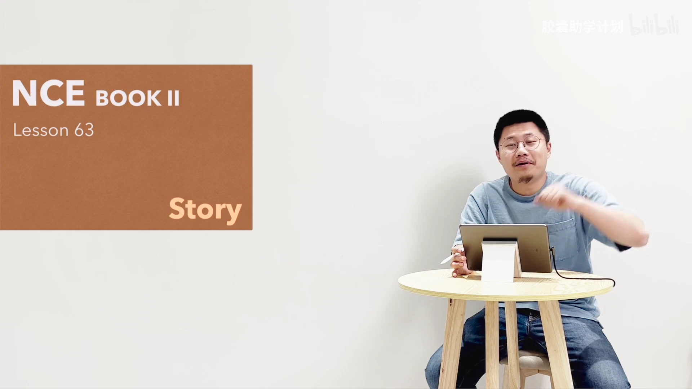

文字识别：NCE / BOOKII / Lesson 63 / Story

### 画面 00:00:02

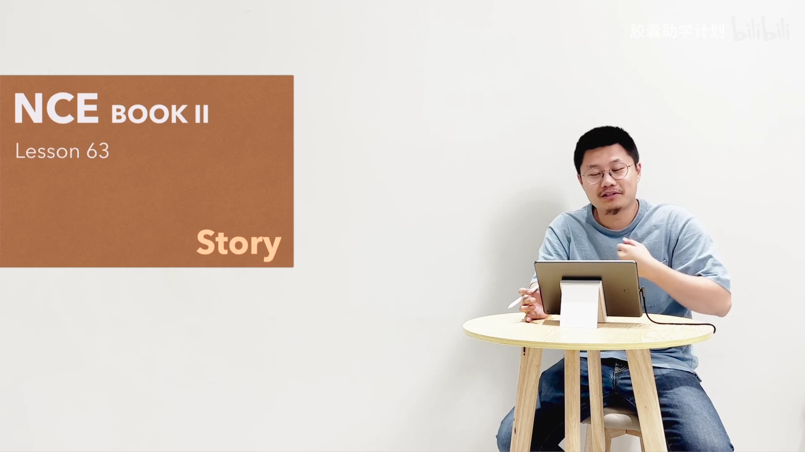

文字识别：NCE / BOOKⅡI / Lesson 63 / Story

### 画面 00:00:05

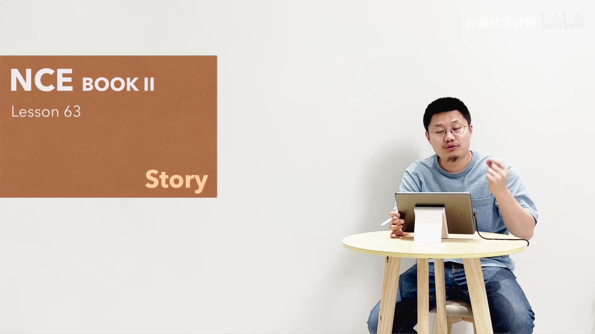

文字识别：NCE / BOOKII / Lesson 63 / Story

### 画面 00:00:07

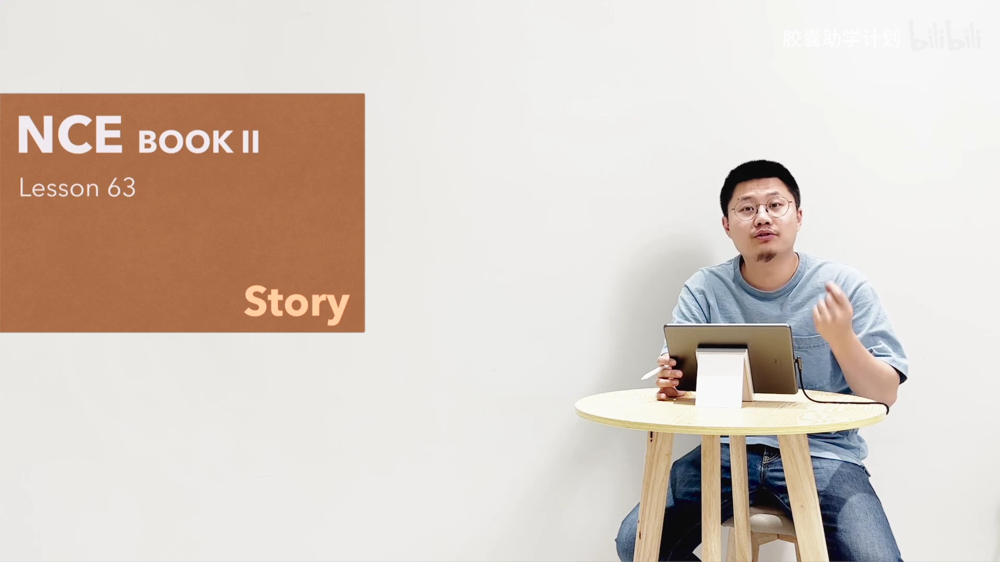

文字识别：NCE / BOOKII / Lesson 63 / Story

### 画面 00:00:09

文字识别：胶囊助学计划 bilbl

### 画面 00:00:13

文字识别：胶囊助学计划

### 画面 00:00:15

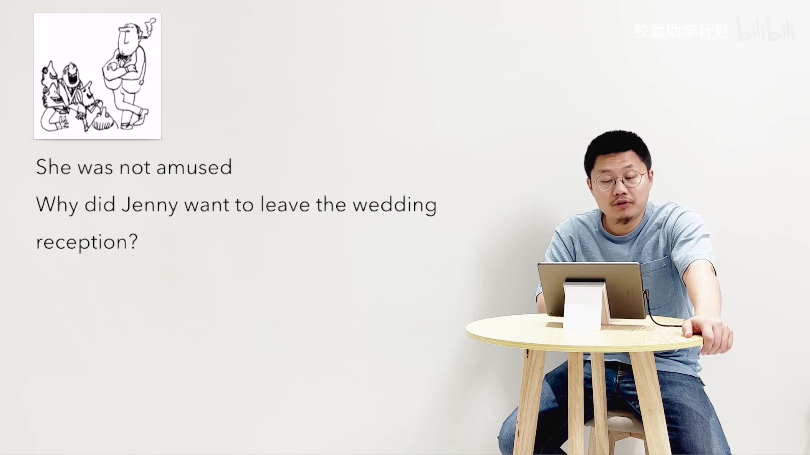

文字识别：She was not amused / Why did Jenny want to leave the wedding / reception? / 川

## 00:00:30–00:01:00

名字一听就是女性。那这个 she was not amused 就是 Jenny，对吧？是 Jenny 为什么想要离开这个婚礼呢？是新娘子吗？我们看一下文章。上来没有说女性，先说的是 Jeremy Hampton。那这样一个人 has a large circle of friends and is very popular at parties. 句号，第一句话结束。有很交际非常的广，有很大一圈子朋

### 画面 00:00:41

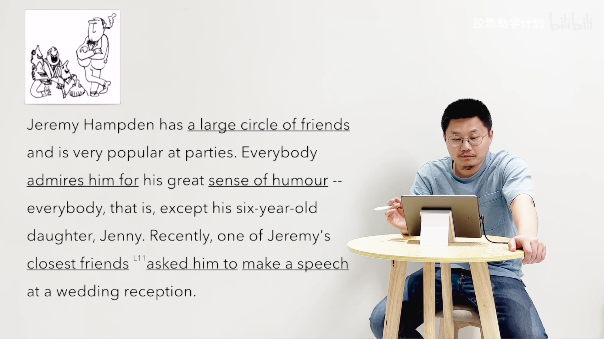

文字识别：Jeremy Hampden has a large circle of friends / and is very popular at parties. Everybody / admires him for his great sense of humour -- / everybody, that is, except his six-year-old / daughter, Jenny. Recently, one of Jeremy's / closest friends '"'asked him to make a speech / at a wedding reception.

## 00:01:00–00:01:30

友，并且呢，very popular at parties，在各种聚会上都特别的受欢迎。Continue，你看，everybody admires him for his great sense of humor. Everybody that is except his six-year-old daughter Jenny.第二句话结束，你看依旧很长，虽然很长，但是没有什么太多这个连词啊

### 画面 00:01:11

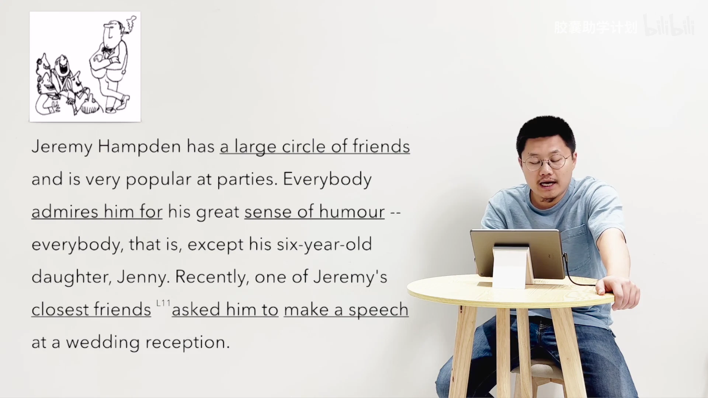

文字识别：Jeremy Hampden has a large circle of friends / and is very popular at parties. Everybody / admires him for his great sense of humour -- / everybody, that is, except his six-year-old / daughter, Jenny. Recently, one of Jeremy's / closest friends "'asked him to make a speech / at a wedding reception.

## 00:01:30–00:02:00

从句说每个人呢，每个人大家都怎么样呢？Admires him for his great sense of humor。这里面有几个小点，我们要注意啊。第一个，admires somebody for something，在讲单词部分我们讲过了，对吧？因为某件事情而崇拜、欣赏某人，不是崇拜啊，欣赏某人。那你看这个，其次第二件事情呢，叫 everybody。你注意后边用的是 admires，这个和直觉好像是有点反着的，

### 画面 00:01:41

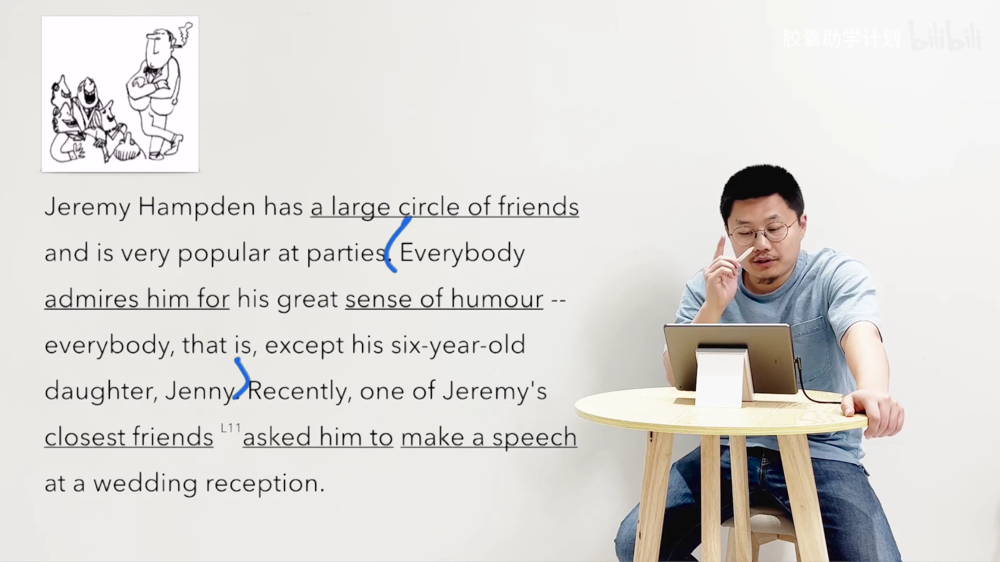

文字识别：Jeremy Hampden has a large circle of friends / and is very popular at parties Everybody / admires him for his great sense of humour -- / everybody, that is, except his six-year-old / daughter, Jeny Recently, one of Jeremy's / closest friends "'asked him to make a speech / at a wedding reception.

## 00:02:00–00:02:30

因为一说呃每一个人所有人，好像就至少得不能是一个人吧，得是一群人。也就是说，你用连词用的是they，对不对？那你说用they的时候，怎么会后边用的是admires呢？没办法，英语就是这么规定的，对吧？我们新概念一册也学过这个语法，everybody不定代词后边如果出现动词要用动词三单啊。当然了，如果是过去式，那就用过去式啊；如果是一般现在时，那就用三单。

### 画面 00:02:11

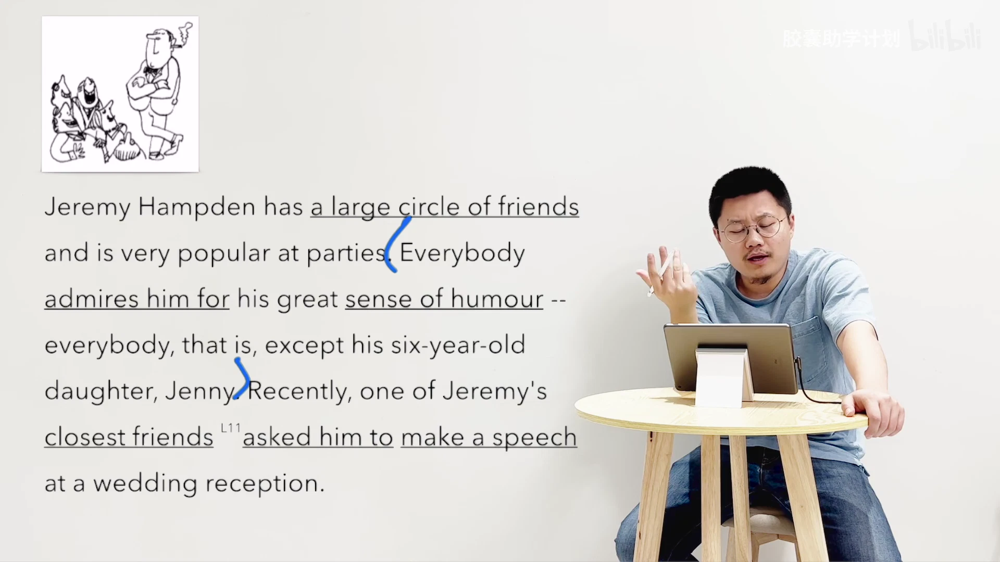

文字识别：Jeremy Hampden has a large circle of friends / and is very popular at parties Everybody / admires him for his great sense of humour -- / everybody, that is, except his six-year-old / daughter, JennyRecently, one of Jeremy's / closest friends ["'asked him to make a speech / at a wedding reception.

## 00:02:30–00:03:00

钦佩呃欣欣赏他呃这个因为什么呢？His great sense of humor。首先这里有一个短语要记下来，叫 sense of humor，就是幽默感，幽默感，对吧？以后往前翻译跟汉语意义对应，幽默感。那他那个 great sense of humor 呢，就是他很有非常有幽默感。Everybody，每一个人。That is 这个东西我们管它叫插入语。插入语这个东西各位非常容易理解，就有没有它无所谓。这个

### 画面 00:02:41

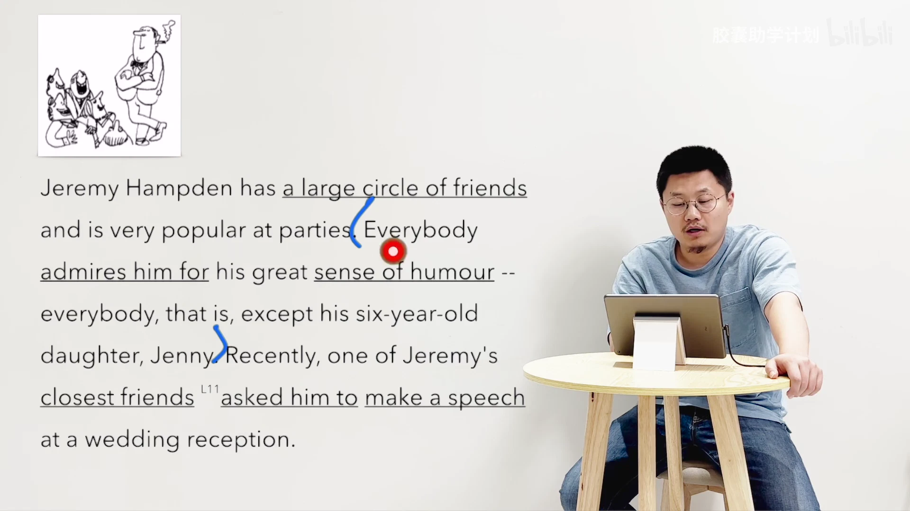

文字识别：Jeremy Hampden has a large circle of friends / and is very popular at parties Everybody / admires him for his great sense of humour -- / everybody, that is, except his six-year-old / daughter, Jenny Recently one of Jeremy's / closest friends '"'asked him to make a speech / at a wedding reception.

## 00:03:00–00:03:30

is 就是，也就是说啊，每一个人，也就是说什么呢？ Except除了他的六岁的女儿，六岁女儿是谁呢？ Jenny，哎呀，终于出来了。标题问的问题，对吧？说他女儿为什么要离开婚礼？这个 Jenny 并不觉得开心。为什么呢？好，我们看一下啊。你看这句话就很有意思。这句话引出来说，每个人都觉得他幽默感特别好，大家都很喜欢他。但是他六岁的女

### 画面 00:03:11

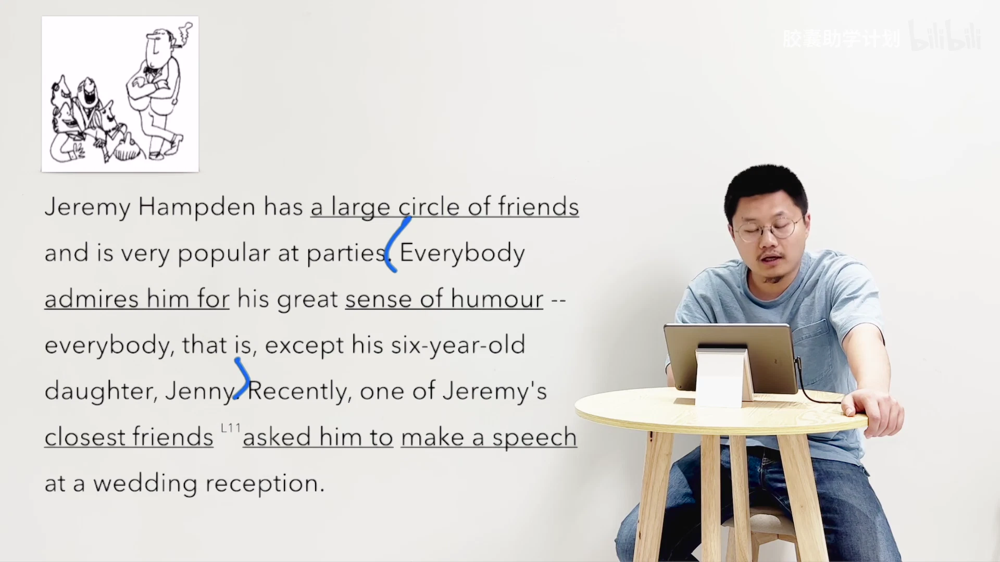

文字识别：Jeremy Hampden has a large circle of friends / and is very popular at parties Everybody / admires him for his great sense of humour -- / everybody, that is, except his six-year-old / daughter, Jeny Recently, one of Jeremy's / closest friends '"'asked him to make a speech / at a wedding reception.

### 画面 00:03:13

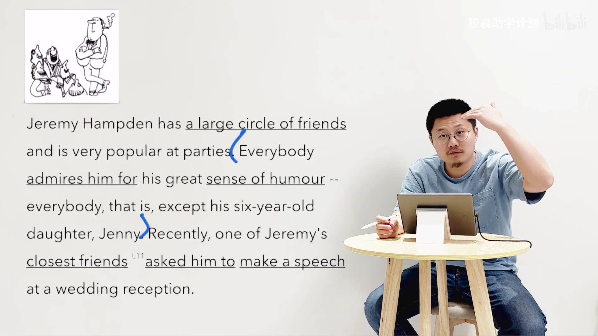

文字识别：Jeremy Hampden has a large circle of friends / and is very popular at parties Everybody / admires him for his great sense of humour -- / everybody, that is, except his six-year-old / daughter, JennyRecently, one of Jeremy's / closest friends '"'asked him to make a speech / at a wedding reception.

### 画面 00:03:15

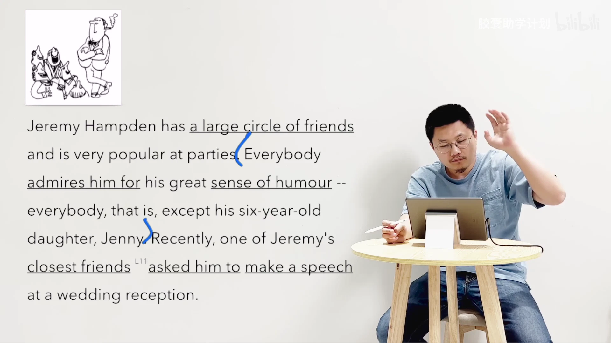

文字识别：Jeremy Hampden has a large circle of friends / and is very popular at partiesEverybody / admires him for his great sense of humour -- / everybody, that is, except his six-year-old / daughter, Jeny Recently, one of Jeremy's / closest friends ["'asked him to make a speech / at a wedding reception.

### 画面 00:03:21

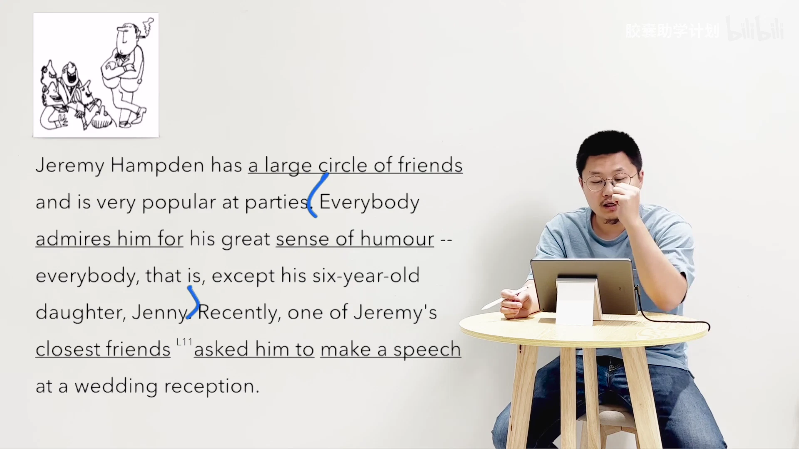

文字识别：Jeremy Hampden has a large circle of friends / and is very popular at parties Everybody / admires him for his great sense of humour -- / everybody, that is, except his six-year-old / daughter, Jeny Recently, one of Jeremy's / closest friends "'asked him to make a speech / at a wedding reception.

## 00:03:30–00:04:00

儿 Jenny 并不这样认为。我们看为什么？Recently, one of Jeremy's closest friends asked him to make a speech at a wedding reception.说最近呢，Jeremy 的一个非常最亲近的朋友，closest。我们单词学 close 的时候，我给各位造的句子叫 close friend 这个短语，对吧？那现在 closest 不就是最高级嘛，最亲密的朋友之一。

### 画面 00:03:51

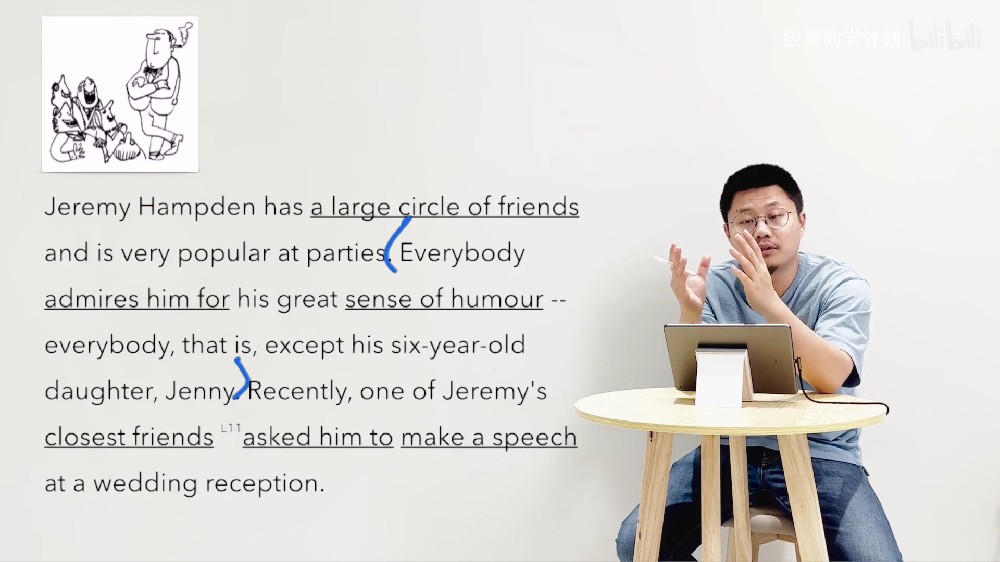

文字识别：Jeremy Hampden has a large circle of friends / and is very popular at parties Everybody / admires him for his great sense of humour -- / everybody, that is, except his six-year-old / daughter, JenyRecently, one of Jeremy's / closest friends '"'asked him to make a speech / at a wedding reception.

## 00:04:00–00:04:30

下一个习惯用法叫 ask somebody to do something。十一课咱学过，不多说了啊。要求某人做某事儿，对吧？还是说请？那这里我们翻译成请求更好一点，对吧？求别人帮个忙嘛，干什么事儿呢？Make a speech，做一个小的演讲。At wedding reception，在这个这个这个这个婚礼上。那你注意这里的做一个小的演讲，并不是说让他拿个麦上那儿给人家教英语去，跟我似的，不是这个意思啊。是什么意思？这里边 make a speech呢？

### 画面 00:04:21

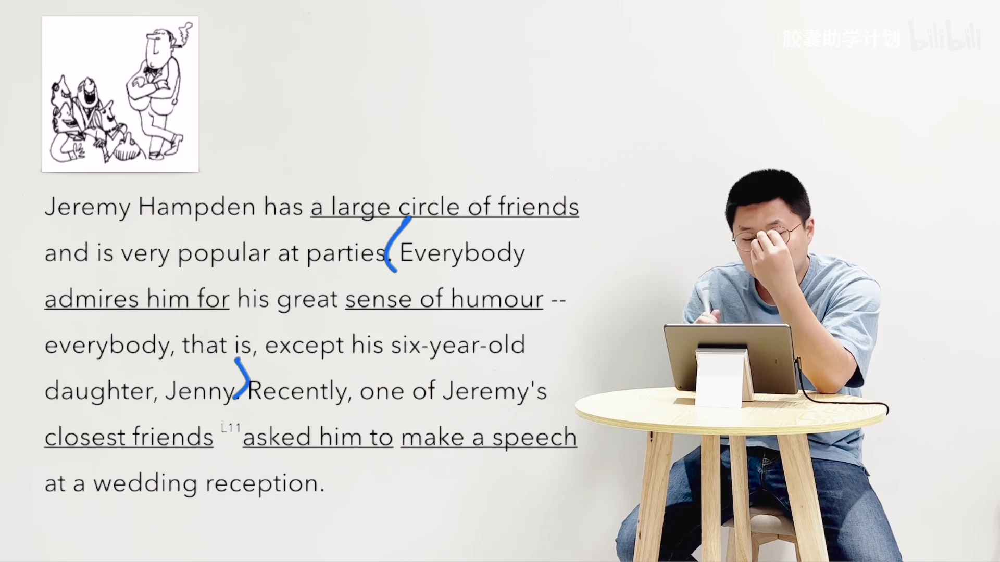

文字识别：Jeremy Hampden has a large circle of friends / and is very popular at parties Everybody / admires him for his great sense of humour -- / everybody, that is, except his six-year-old / daughter, JnnyRecenty,one of Jeremy's / closest friends "'asked him to make a speech / at a wedding reception.

### 画面 00:04:25

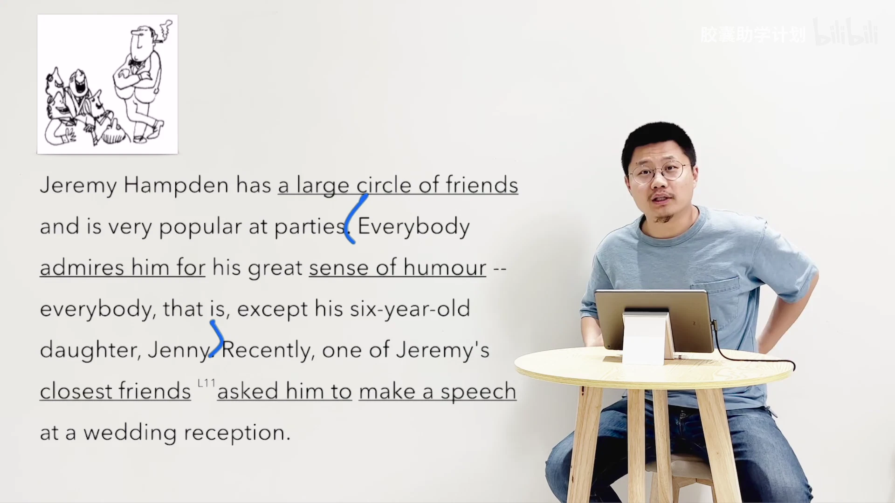

文字识别：Jeremy Hampden has a large circle of friends / and is very popular at partiesEverybody / admires him for his great sense of humour -- / everybody, that is, except his six-year-old / daughter, JenyRecenty,one of Jeremy's / closest friends ["'asked him to make a speech / at a wedding reception.

### 画面 00:04:27

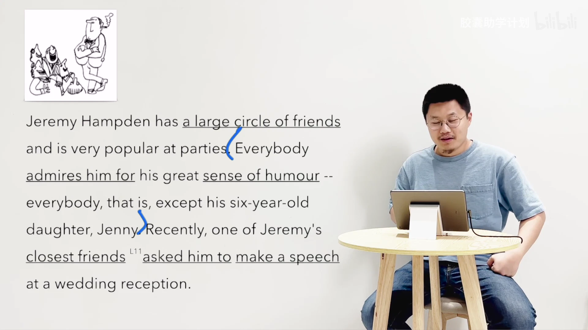

文字识别：Jeremy Hampden has a large circle of friends / and is very popular at partiesEverybody / admires him for his great sense of humour -- / everybody, that is, except his six-year-old / daughter, JenyRecenty,one of Jeremy's / closest friends "'asked him to make a speech / at a wedding reception.

### 画面 00:04:29

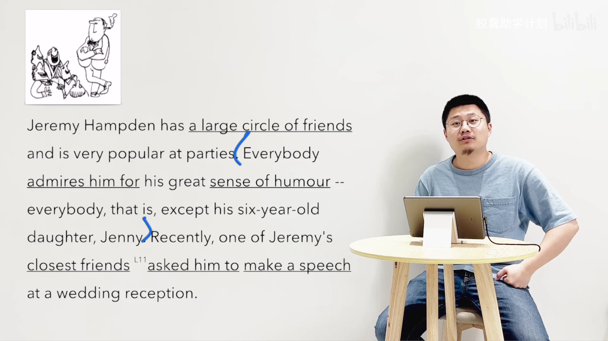

文字识别：Jeremy Hampden has a large circle of friends / and is very popular at parties Everybody / admires him for his great sense of humour -- / everybody, that is, except his six-year-old / daughter, Jeny Recently, one of Jeremy's / closest friends "'asked him to make a speech / at a wedding reception.

## 00:04:30–00:05:00

就是西方有这样一个传统，一般来说在别人的婚礼上会有发言人，对吧？一般可能会提前跟你说谁发言，你不要到那儿乱发言去。然后呢，大家比如说也是坐圆桌嘛，你呢可能拿个刀叉，然后拿一个这个喝酒的杯子，香槟杯呀、红酒杯呀，站起来噔噔噔敲一下，也许各位看电影就见过这个场景。然后呢，你就跟大家说一些呃祝福的话啊，说一些新郎新娘的糗事儿。但是整体

### 画面 00:04:44

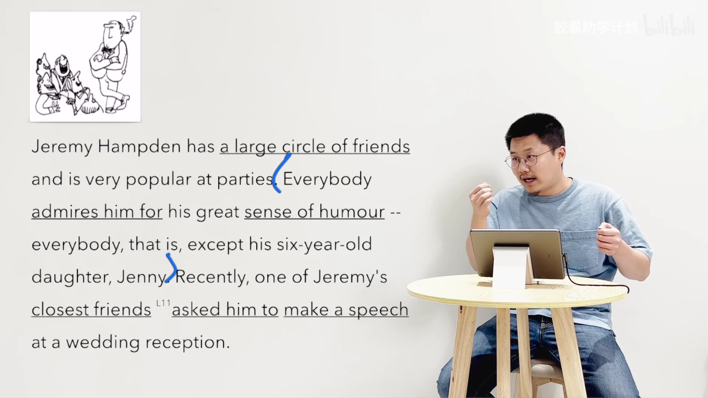

文字识别：Jeremy Hampden has a large circle of friends / and is very popular at parties Everybody / admires him for his great sense of humour -- / everybody, that is, except his six-year-old / daughter, JenyRecently, one of Jeremy's / closest friends '"'asked him to make a speech / at a wedding reception.

### 画面 00:04:49

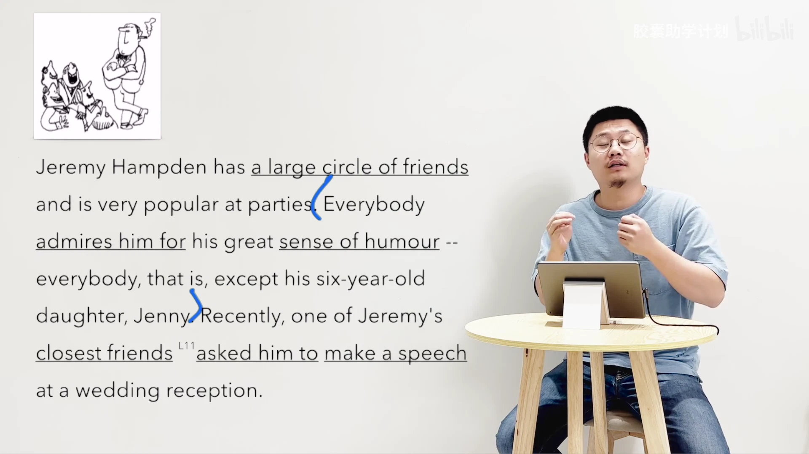

文字识别：Jeremy Hampden has a large circle of friends / and is very popular at parties Everybody / admires him for his great sense of humour -- / everybody, that is, except his six-year-old / daughter, JennyRecently, one of Jeremy's / closest friends ["'asked him to make a speech / at a wedding reception.

### 画面 00:04:52

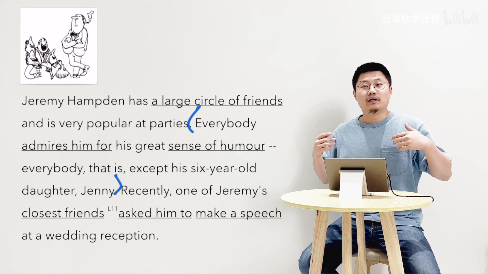

文字识别：Jeremy Hampden has a large circle of friends / and is very popular at parties Everybody / admires him for his great sense of humour -- / everybody, that is, except his six-year-old / daughter, JenyRecently, one of Jeremy's / closest friends "'asked him to make a speech / at a wedding reception.

### 画面 00:04:54

文字识别：Jeremy Hampden has a large circle of friends / and is very popular at partiesEverybody / admires him for his great sense of humour -- / everybody, that is, except his six-year-old / daughter, JenyRecently, one of Jeremy's / closest friends "'asked him to make a speech / at a wedding reception.

## 00:05:00–00:05:30

上来说，他必须要完成一个任务，就是让大家哈哈一笑，对吧？人们都喜欢这种愉悦的气氛，所以你看，为什么让他去呢？因为 his great sense of humor，对吧？巨大的幽幽默感。 Next one，说 this is the sort of thing that Jeremy loves。如果您语法基础特别好，这句话指定能看懂，对吧？我们看，我带着各位分析，说这是这样一类事情，

### 画面 00:05:05

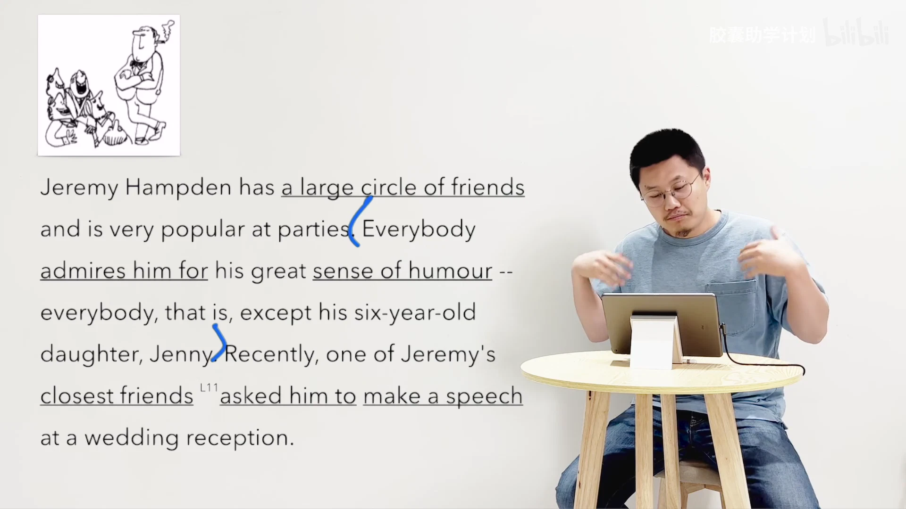

文字识别：Jeremy Hampden has a large circle of friends / and is very popular at parties Everybody / admires him for his great sense of humour -- / everybody, that is, except his six-year-old / daughter, Jeny Recently, one of Jeremy's / closest friends ["'asked him to make a speech / at a wedding reception.

### 画面 00:05:08

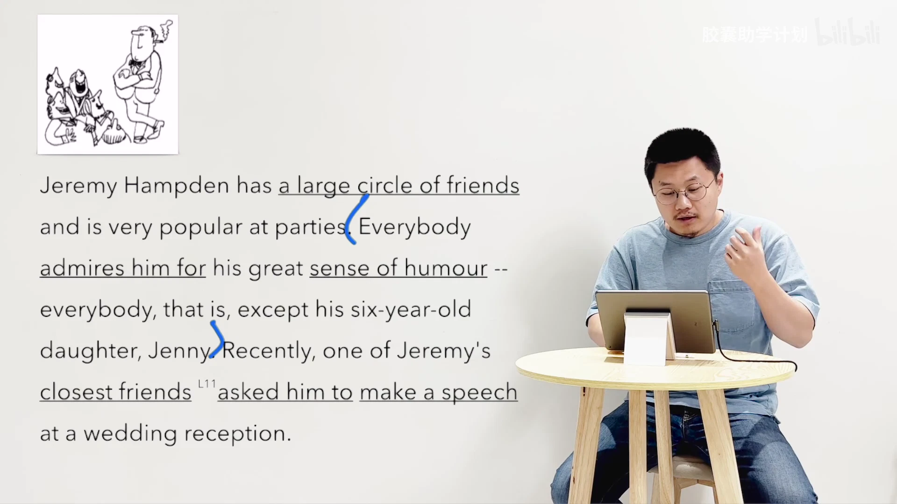

文字识别：Jeremy Hampden has a large circle of friends / and is very popular at partiesEverybody / admires him for his great sense of humour -- / everybody, that is, except his six-year-old / daughter, Jeny Recently, one of Jeremy's / closest friends ["'asked him to make a speech / at a wedding reception.

### 画面 00:05:14

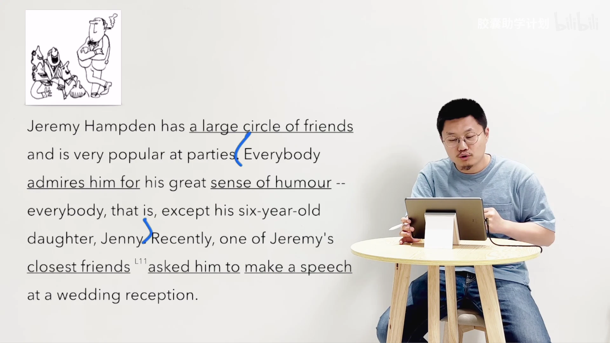

文字识别：Jeremy Hampden has a large circle of friends / and is very popular at parties Everybody / admires him for his great sense of humour -- / everybody, that is, except his six-year-old / daughter, JenyRecenty,one of Jeremy's / closest friends "'asked him to make a speech / at a wedding reception.

### 画面 00:05:16

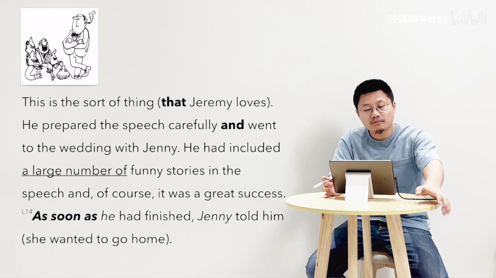

文字识别：This is the sort of thing (that Jeremy loves). / He prepared the speech carefully and went / to the wedding with Jenny. He had included / a large number of funny stories in the / speech and, of course, it was a great success. / L14 / 4As soon as he had finished, Jenny told him / (she wanted to go home).

## 00:05:30–00:06:00

这是这样一类事情，哪样一类事情呢？That Jeremy loves叫Jeremy爱的这类事情。翻译到这儿，我就想问一个问题，叫做这是我们二十八课学的定语从句，还是我们四十六课学的同位语从句？啊，翻译到这儿，我认为你应该已经有答案了，对吧？您可以自己暂停一下，想一想，再听我接下来说的答案。好，公布答案了啊，定语从句，对吧？

### 画面 00:05:43

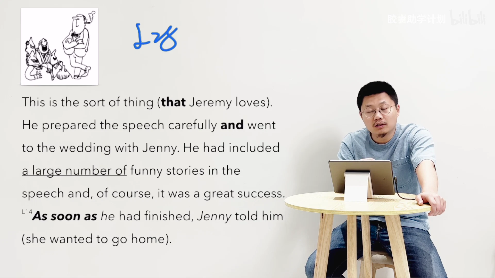

文字识别：This is the sort of thing (that Jeremy loves). / He prepared the speech carefully and went / to the wedding with Jenny. He had included / a large number of funny stories in the / speech and, of course, it was a great success. / L14As soon as he had finished, Jenny told him / (she wanted to go home).

### 画面 00:05:46

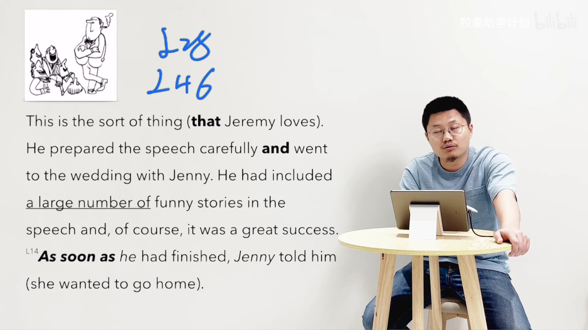

文字识别：L46 / This is the sort of thing (that Jeremy loves). / He prepared the speech carefully and went / to the wedding with Jenny. He had included / a large number of funny stories in the / speech and, of course, it was a great success. / L4As soon as he had finished, Jenny told him / (she wanted to go home).

### 画面 00:05:51

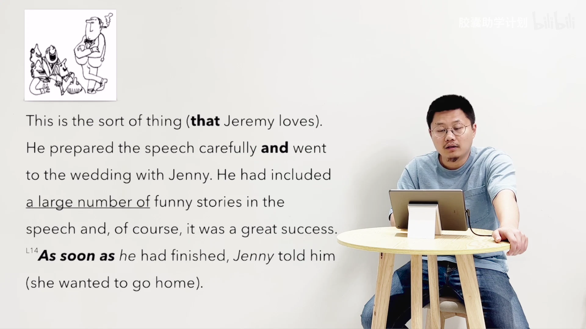

文字识别：This is the sort of thing (that Jeremy loves). / He prepared the speech carefully and went / to the wedding with Jenny. He had included / a large number of funny stories in the / speech and, of course, it was a great success. / L14As soon as he had finished, Jenny told him / (she wanted to go home).

## 00:06:00–00:06:30

我已经翻译成了，就是他喜欢的一类事情，对吧？喜欢的事情，啊，热爱的事情，对吧？好，He prepared the speech carefully and went to the wedding with Jenny. 是吧？他准备这个演讲，对吧？这个婚礼上的演讲非常的仔细，然后呢，去了婚礼，和 Jenny 一起去了婚礼。He had included a large number of funny stories in

### 画面 00:06:17

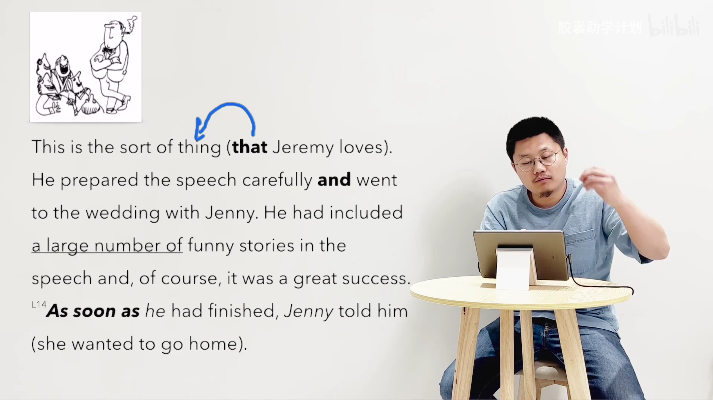

文字识别：This is the sort of thing (that Jeremy loves). / He prepared the speech carefully and went / to the wedding with Jenny. He had included / a large number of funny stories in the / speech and, of course, it was a great success. / L14As soon as he had finished, Jenny told him / (she wanted to go home).

## 00:06:30–00:07:00

the speech, and of course it was a great success. 又这么长，啊又这么长。我们往下看。它呀已经包含了，囊括了 a large number of，类似于 a lot of，大量的，很大数量的 funny stories，很滑稽的、很有趣的故事

### 画面 00:06:36

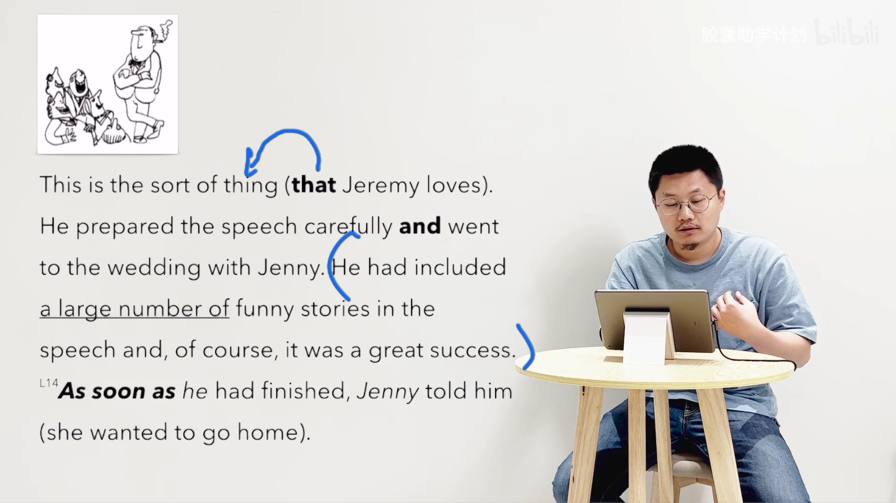

文字识别：This is the sort of thing (that Jeremy loves). / He prepared the speech carefully and went / to the wedding with Jenny.He had included / a large number of funny stories in the / speech and, of course, it was a great success. / L14 / 4As soon as he had finished, Jenny told him / (she wanted to go home).

## 00:07:00–00:07:30

in the speech，在什么当中呢？在这个演讲当中啊，在他这个字这个讲话当中啊，我们给他翻译成讲话会更好一点，祝词当中啊会更好一点。And提醒你，第一句话结束了，第二句话开始了，叫做 Of course, it was a great success. 说当然了，它是一个巨大的成功。OK，好，这里很容易理解。Continue. As soon as he had finished, 说

### 画面 00:07:05

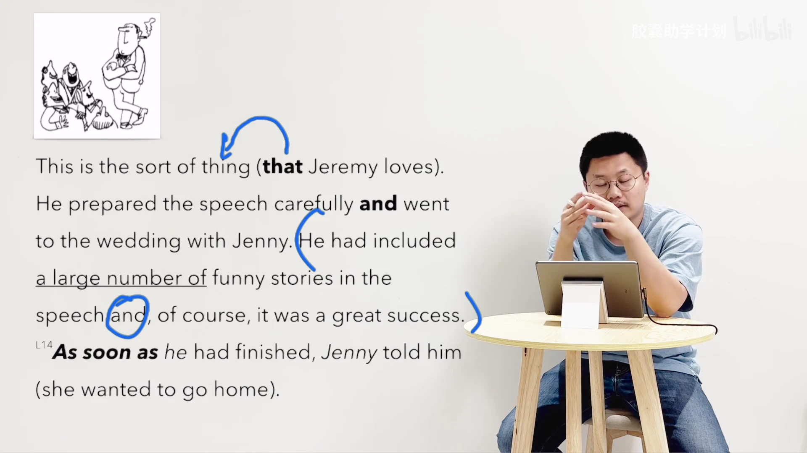

文字识别：This is the sort of thing (that Jeremy loves). / He prepared the speech carefully and went / to the wedding with Jenny.He had included / a large number of funny stories in the / speechand / of course,it was a great success. / L14 / ⁴As soon as he had finished, Jenny told him / (she wanted to go home).

### 画面 00:07:17

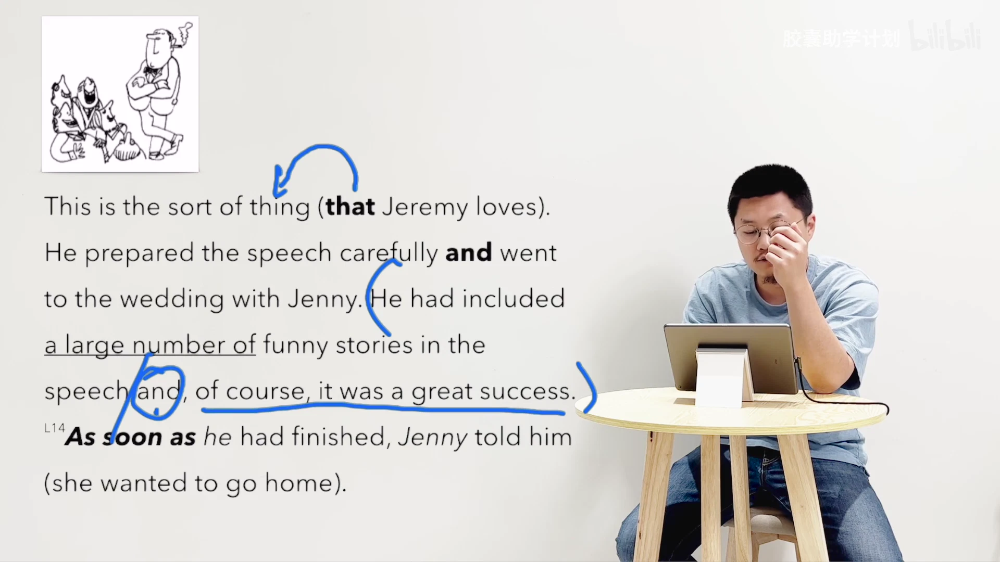

文字识别：This is the sort of thing (that Jeremy loves). / He prepared the speech carefully and went / to the wedding with Jenny.He had included / a large number of funny stories in the / speechand / of course, it was a great success. / L14As soon as he had finished, Jenny told him / (she wanted to go home).

## 00:07:30–00:08:00

他一怎么怎么样就怎么怎么样。十四课咱们学的as soon as，对吧？然后这里我故意不知道各位有没有注意到，我把as soon as和he和Jenny给下划线了啊。我就重新弄一下啊，我把as soon as he和Jenny给下划线了。我想问的问题是，参考四十九课，想问前面这里可不可以变成having finished，Jenny

### 画面 00:07:40

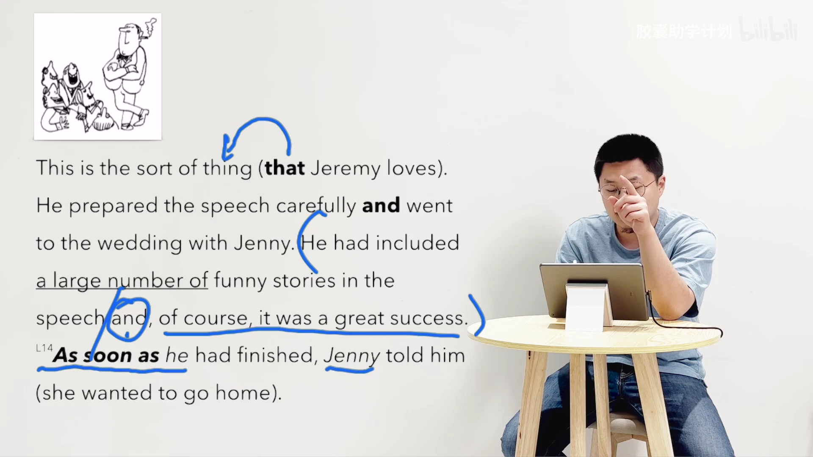

文字识别：This is the sort of thing (that Jeremy loves). / He prepared the speech carefully and went / to the wedding with Jenny.He had included / a large number of funny stories in the / of course, it was a great success. / speech / and / L4As soon as he had finished, Jenny told him / (she wanted to go home).

### 画面 00:07:42

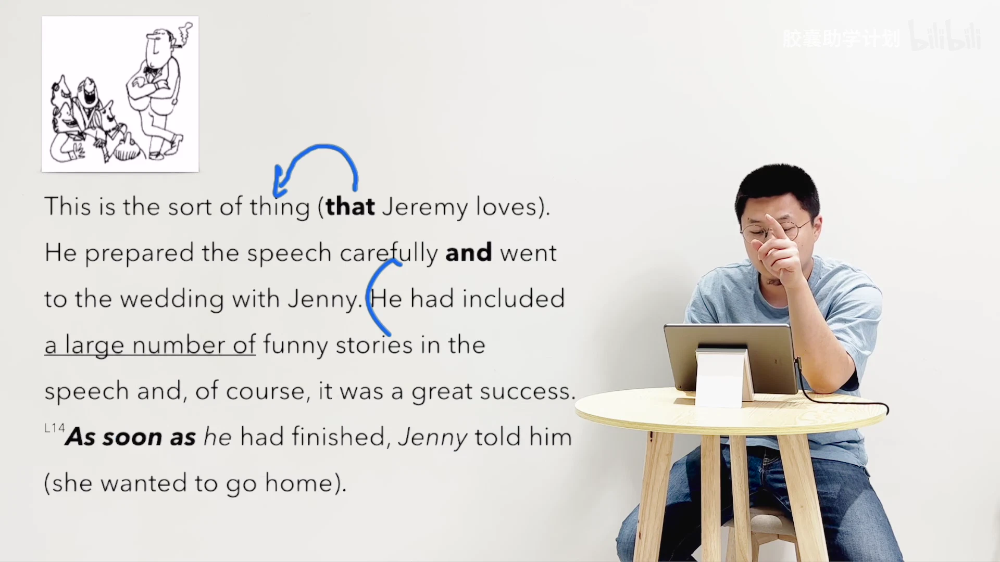

文字识别：This is the sort of thing (that Jeremy loves). / He prepared the speech carefully and went / to the wedding with Jenny.He had included / a large number of funny stories in the / speech and, of course, it was a great success. / L14 / 4As soon as he had finished, Jenny told him / (she wanted to go home).

### 画面 00:07:44

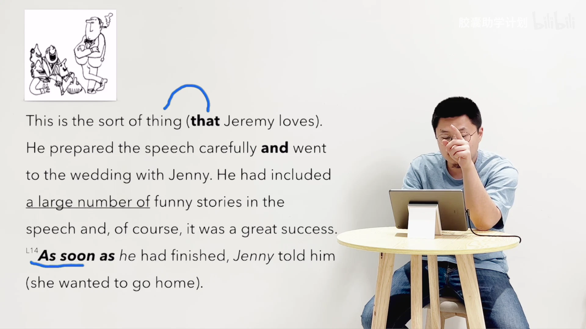

文字识别：This is the sort of thing (that Jeremy loves). / He prepared the speech carefully and went / to the wedding with Jenny. He had included / a large number of funny stories in the / speech and, of course, it was a great success. / L4As soon as he had finished, Jenny told him / (she wanted to go home).

### 画面 00:07:46

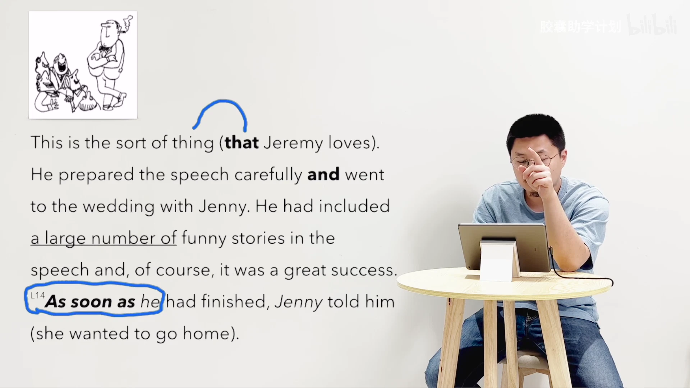

文字识别：This is the sort of thing (that Jeremy loves). / He prepared the speech carefully and went / to the wedding with Jenny. He had included / a large number of funny stories in the / speech and, of course, it was a great success. / As soon as hehad finished, Jenny told him / (she wanted to go home).

### 画面 00:07:51

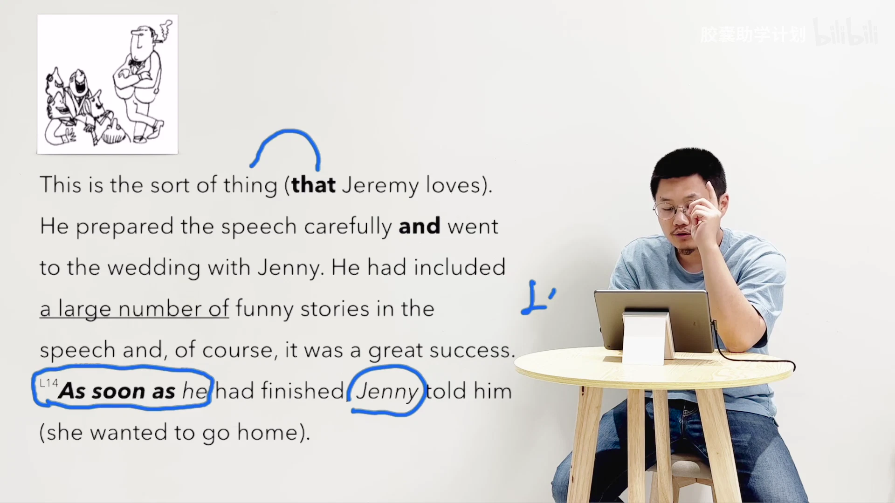

文字识别：This is the sort of thing (that Jeremy loves). / He prepared the speech carefully and went / to the wedding with Jenny. He had included / L / a large number of funny stories in the / speech and, of course, it was a great success. / L4As soon as he had finished Jennytold him / (she wanted to go home).

### 画面 00:07:55

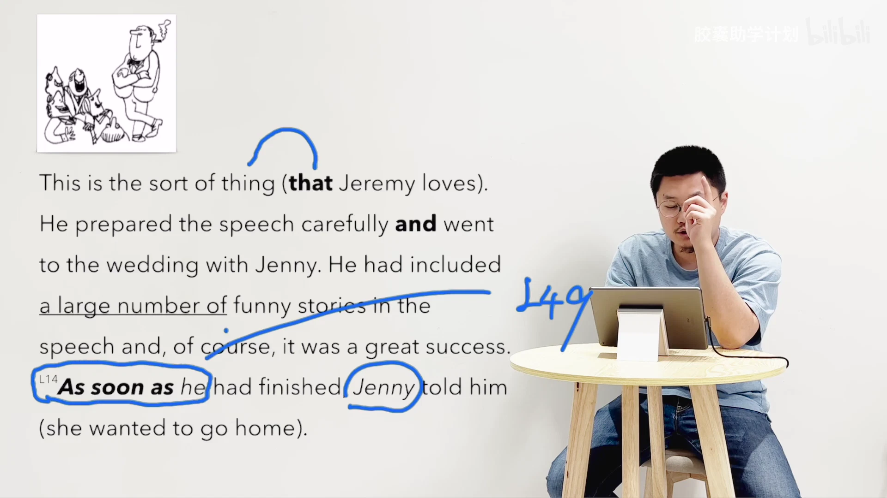

文字识别：This is the sort of thing (that Jeremy loves). / He prepared the speech carefully and went / to the wedding with Jenny. He had included / 4% / a large number of funny stories in the / speech and, of course, it was a great success. / L4As soon as he had finished Jennytold him / (she wanted to go home).

## 00:08:00–00:08:30

Jenny told him she wanted to go home. 可不可以？啊，您可以弹幕告诉我或者留言告诉我，可不可以？啊，你可以暂停回顾一下四十九课。哎，马上我公布答案。不可以，原因是主语怎么样？不一致，对吧？是他爸爸一说完，女儿 Jenny 就告诉他怎么怎么样了，对不对？所以主语不一致，不可以啊。分词作状语，至少在

### 画面 00:08:16

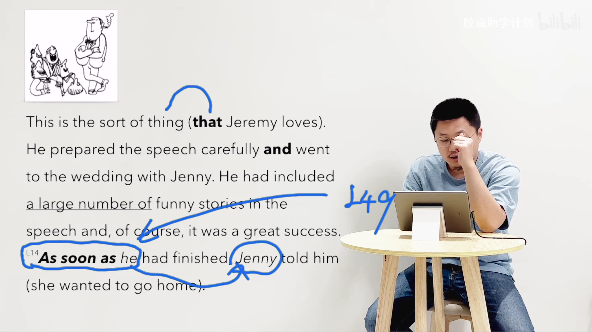

文字识别：This is the sort of thing (that Jeremy loves). / He prepared the speech carefully and went / to the wedding with Jenny. He had included / 4% / a large number of funny stories in the / speech and, of curse,it was a great success. / L4As soon as he had finishedJennytold him / (she wanted to go home).

### 画面 00:08:20

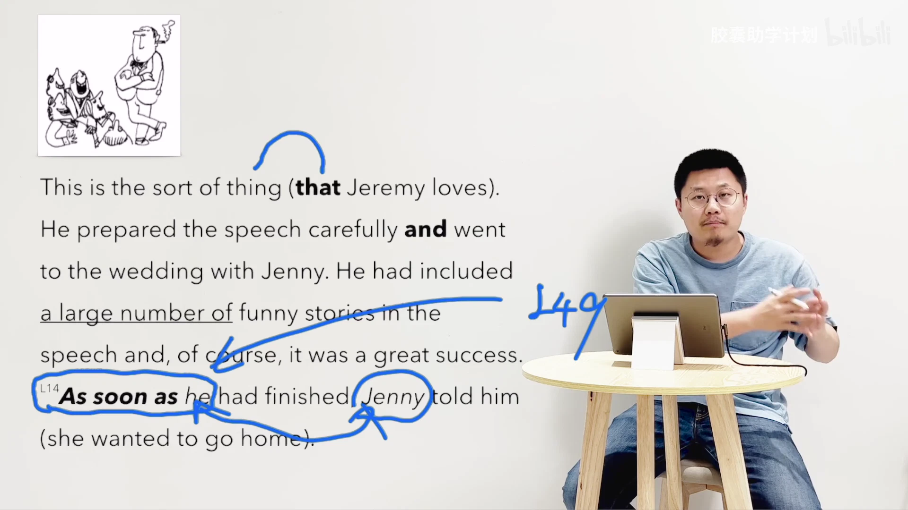

文字识别：This is the sort of thing (that Jeremy loves). / He prepared the speech carefully and went / to the wedding with Jenny. He had included / 4% / a large number of funny stories in the / speech and, of c&rse,it was a great success. / M4As soon as he had finished Jenny told him / (she wanted to go home).

### 画面 00:08:28

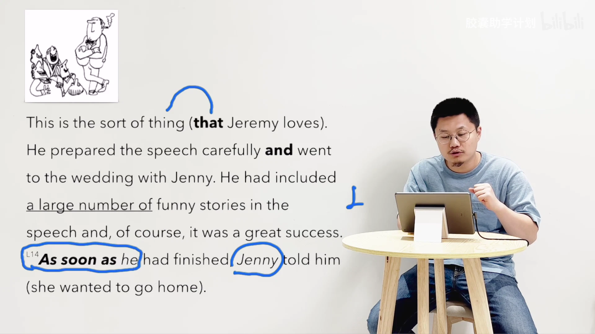

文字识别：This is the sort of thing (that Jeremy loves). / He prepared the speech carefully and went / to the wedding with Jenny. He had included / a large number of funny stories in the / speech and, of course, it was a great success. / L4As soon as he had finished Jennytold him / (she wanted to go home).

## 00:08:30–00:09:00

目前阶段最重要的就是主语的一致啊。那我们接着往下看，说 Jenny told him she wanted to go home. Jenny 告诉他说他想回家了啊。这个后边是一个非常典型的宾语从句嘛。告诉他的是一件事情，什么事儿呢？他想回家了。接着往下看，Jeremy was a little disappointed by this, but he did as his daughter asked. 说 Jeremy，哎，这个单词部分我们已经讲啊，语法部分我们已经

### 画面 00:08:30

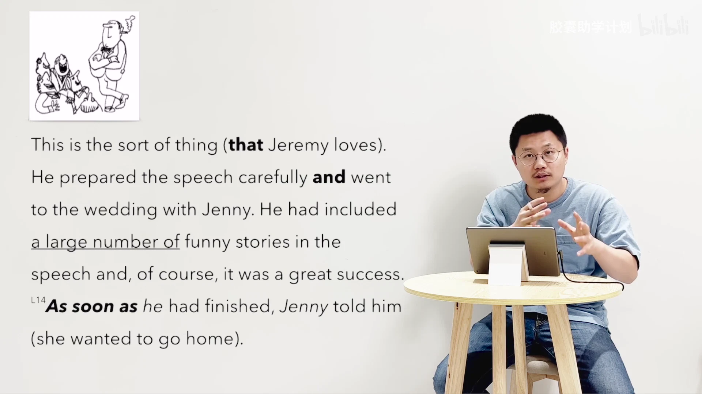

文字识别：This is the sort of thing (that Jeremy loves). / He prepared the speech carefully and went / to the wedding with Jenny. He had included / a large number of funny stories in the / speech and, of course, it was a great success. / L14 / 4As soon as he had finished, Jenny told him / (she wanted to go home).

### 画面 00:08:44

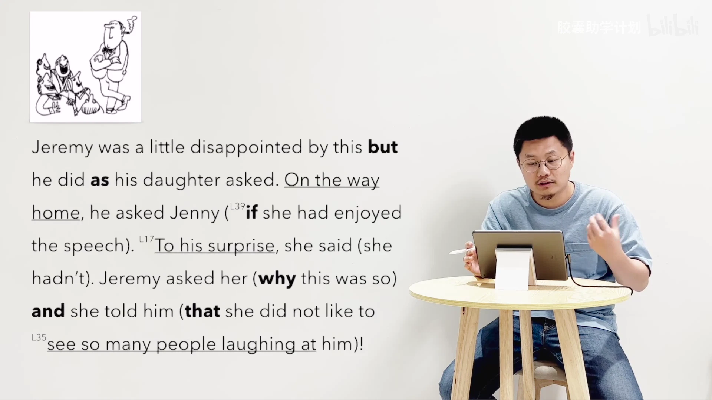

文字识别：Jeremy was a little disappointed by this but / he did as his daughter asked. On the way / home, he asked Jenny (L3if she had enjoyed / the speech). 17To his surprise, she said (she / hadn't). Jeremy asked her (why this was so) / and she told him (that she did not like to / L35, / see so many people laughing at him)!

## 00:09:00–00:09:30

讲过了，是吧？我就稍微快一点。Jamie因为这件事情被这件事情弄得有一点点的失望，但是呢，他做了按照他女儿要求的方式。他做了什么？回家。他女儿要求什么？回家，对吧？哎，他 did as his daughter asked. 下一个短语习惯用法叫 on the way home，叫在回家的路上。这个我们待会儿要单词造啊，习惯用法造句的啊。He asked Jenny if

### 画面 00:09:14

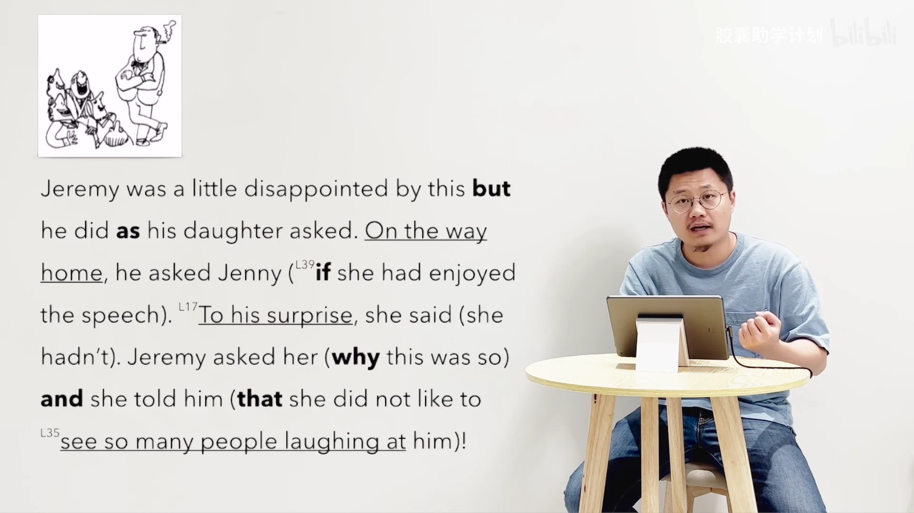

文字识别：Jeremy was a little disappointed by this but / he did as his daughter asked. On the way / home, he asked Jenny (3³if she had enjoyed / the speech). 17To his surprise, she said (she / hadn't). Jeremy asked her (why this was so) / and she told him (that she did not like to / L35, / see so many people laughing at him)!

## 00:09:30–00:10:00

she had enjoyed the speech.在回家路上，他问 Jenny 了一件事情。新概念一册一百三十九课，新概念二册十五课、三十九课，我们都讲过这个语法点。这里的 if 不翻译成如果，它引导的是一个宾语从句啊，并且是一般疑问句做的宾语从句，所以翻译成是否。他问 Jenny 说，是否他很享受这个演讲？

### 画面 00:09:44

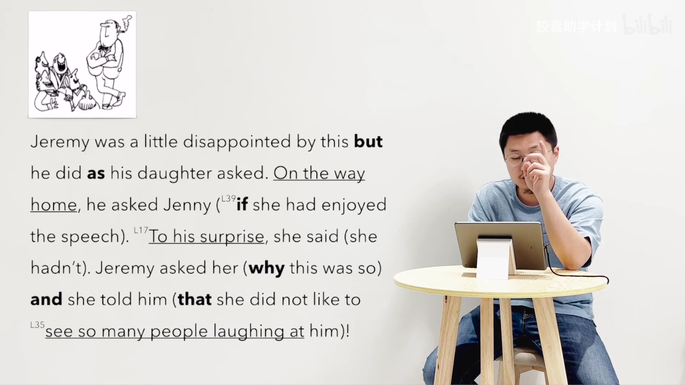

文字识别：Jeremy was a little disappointed by this but / he did as his daughter asked. On the way / home, he asked Jenny (L3if she had enjoyed / the speech). 17To his surprise, she said (she / hadn't). Jeremy asked her (why this was so) / and she told him (that she did not like to / L35, / see so many people laughing at him)!

## 00:10:00–00:10:30

a Chinese-English teaching recording. Transcribe the exact words in their original spoken languages. Never translate. Preserve repetitions, questions and examples. To somebody's surprise, 十七课咱们学叫令某人感到很惊讶的是什么呢？ She said she hadn't. 她说她并不享受。嗯，不知道为什么，但大家都很开心，他女儿不开心。 Jeremy asked her why this was so, and she told him that she did not like to see so many people laughing at him. 这句话很长，我跟各位原来说

### 画面 00:10:14

文字识别：Jeremy was a little disappointed by this but / he did as his daughter asked. On the way / home, he asked Jenny (L3if she had enjoyed / the speech). 17To his surprise, she said (she / hadn't). Jeremy asked her (why this was so) / and she told him (that she did not like to / L35, / 'see so many people laughing at him)!

## 00:10:30–00:11:00

过，我们很长的一句话，在新概念二册下半册，包括新三，我们一定要学会英语阅读上的一个能力，包括这也是英语听力上的能力啊。其实，坦诚来讲，听说读写都需要这个能力啊。是什么呢？就是长难句的分析，对吧？第一步，那你就是找各种什么逗号、句号啊，句号其实不用说了嘛，那主要是逗号啊，然后包括连词，why

### 画面 00:10:44

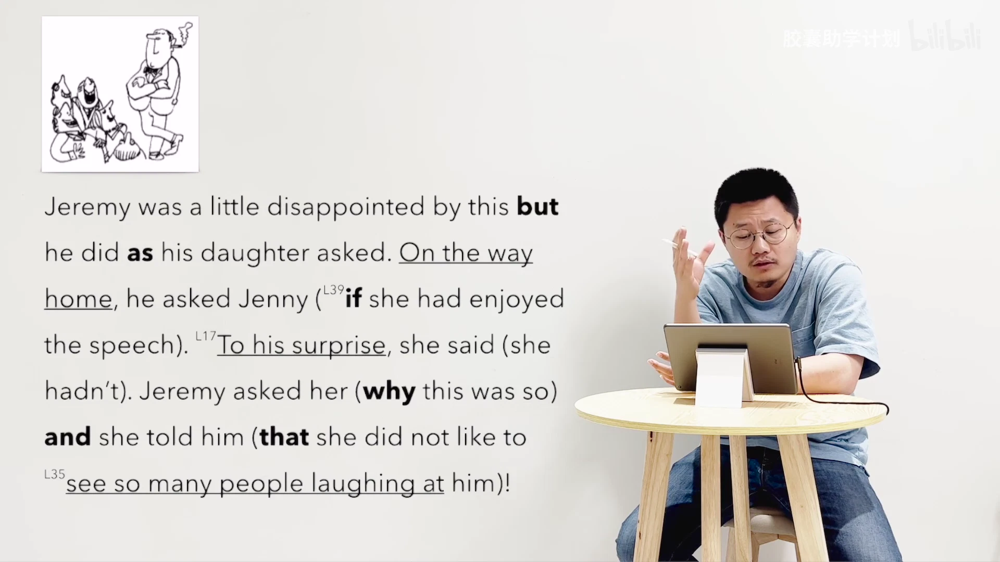

文字识别：Jeremy was a little disappointed by this but / he did as his daughter asked. On the way / home, he asked Jenny (L3if she had enjoyed / the speech). 17To his surprise, she said (she / hadn't). Jeremy asked her (why this was so) / and she told him (that she did not like to / L35, / see so many people laughing at him)!

## 00:11:00–00:11:30

and that? 那我们看 Jeremy asked her why this was so. Jeremy问他，实在不行，咱把它当第一句话。第二句话叫 why this was so？为什么这个事情是这样的？哪个事情是哪样的？叫做其实这个事情是这样指的，就是他不喜欢他的演讲，这个事情是这样的，对吧？为什么你不喜欢我的演讲啊？其实就是这个意思。那这是一个非常典型的特殊

### 画面 00:11:14

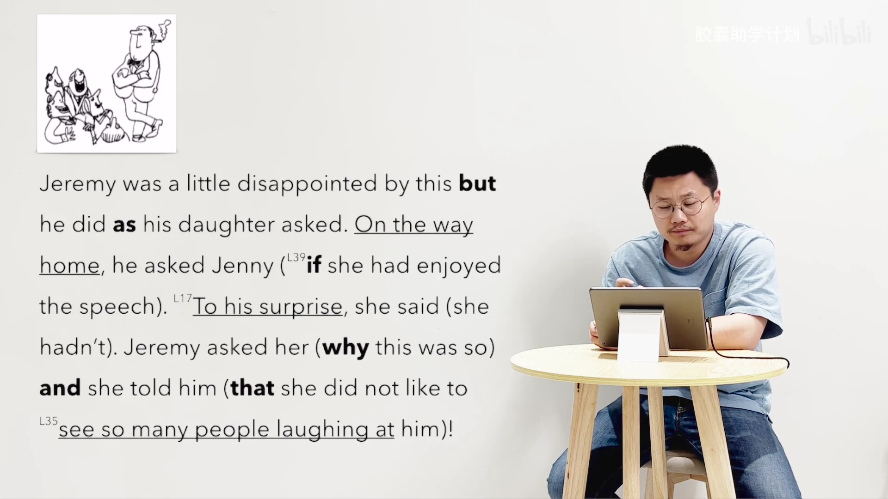

文字识别：Jeremy was a little disappointed by this but / he did as his daughter asked. On the way / home, he asked Jenny (3³if she had enjoyed / the speech). 17To his surprise, she said (she / hadn't). Jeremy asked her (why this was so) / and she told him (that she did not like to / L35, / see so many people laughing at him)!

## 00:11:30–00:12:00

疑问词引导的宾语从句，对吧？也就是说，叫特殊疑问句做宾语从句。希望各位还记得，and提醒你前面结束了，对吧？看后边，She told him that。一看that后边一句话，他告诉了他谁？告诉给Jenny，告诉了他爸爸，对吧？告诉的是什么呢？She did not like to see。他不喜欢

### 画面 00:11:44

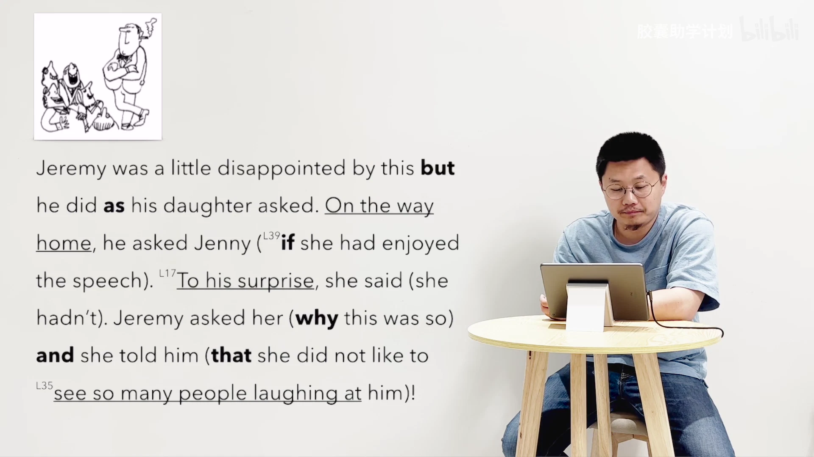

文字识别：Jeremy was a little disappointed by this but / he did as his daughter asked. On the way / home, he asked Jenny (3³if she had enjoyed / the speech). 17To his surprise, she said (she / hadn't). Jeremy asked her (why this was so) / and she told him (that she did not like to / L35 / see so many people laughing at him)!

## 00:12:00–00:12:30

看到 so many people laughing at him. 如此多的人嘲笑他，就是这孩子给弄，就没理解，就他以为底下那些人是嘲笑他父亲的，并不是那些人是嘲笑他父亲说的笑话，是吧？ Funny stories. 那这里的 that 引导了一个也是宾语从句，这是肯定句啊，就是不是肯定句，否定句，但是是陈述句啊。陈述句我们分为肯定句、否定句嘛，对

### 画面 00:12:14

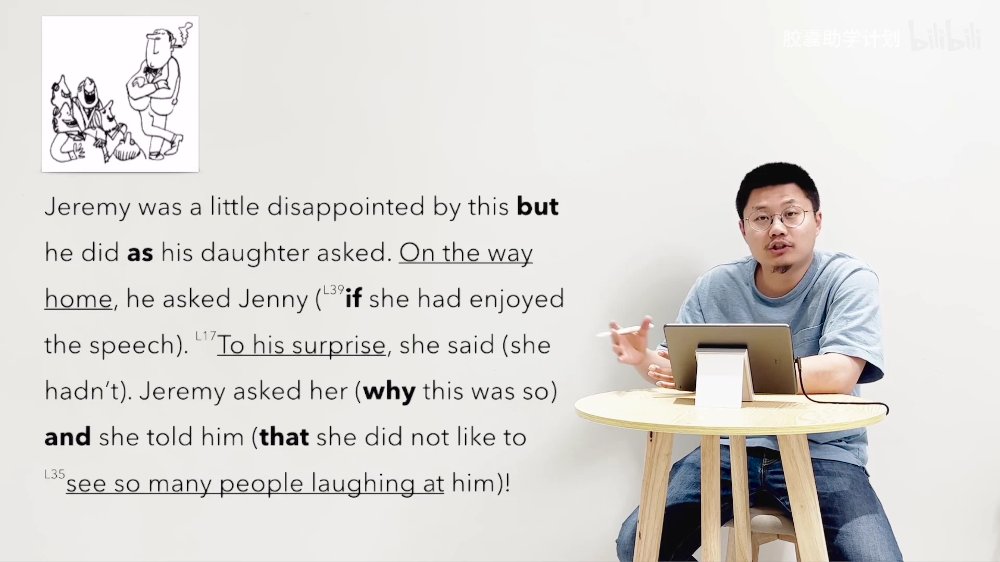

文字识别：Jeremy was a little disappointed by this but / he did as his daughter asked. On the way / home, he asked Jenny (3³if she had enjoyed / the speech). 17To his surprise, she said (she / hadn't). Jeremy asked her (why this was so) / and she told him (that she did not like to / L35, / see so many people laughing at him)!

## 00:12:30–00:13:00

吧？他不喜欢，这里还包含了一个三十五课我们学的习惯用法，see somebody doing something。OK，那文章就这样了。那接下来呢，我们习惯用法造句啊，呃，本课有这么四个，我们挨个说一下。第一个，那 sense of humor，humor 这个单词有两个拼写方式，一个是前面这个，一个是后边这个，前面的英式，后边美式啊。sense of humor，sense of humor 发音是一样的，只不过拼写上这里少

### 画面 00:12:42

文字识别：习惯用法造句 / sense of humour/humor / make a speech / a large number of.. / on the way home

### 画面 00:12:45

文字识别：习惯用法造句 / sense of humour/humor / make a speech / a large number of.. / on the way home

### 画面 00:12:47

文字识别：网：v.+v.变化 / 习惯用法造句指南 / 四句型转换 / 方式/地点/时间 / 其他习惯用法 / 其他单词+词性 / 原文摘抄+变 / 6123456 / sense of humour/humor

### 画面 00:12:51

文字识别：网：v.+v.变化 / 习惯用法造句指南 / 四句型转换 / 方式/地点/时间 / 其他习惯用法 / 其他单词+词性 / 原文摘抄+变 / 6123456 / sense of humour/humor

### 画面 00:12:53

文字识别：网：v.+v.变化 / 习惯用法造句指南 / 四句型转换 / 方式/地点/时间 / 其他习惯用法 / 其他单词+词性 / 原文摘抄+变 / 6123456 / sense of humour/humor

### 画面 00:12:56

文字识别：网：v.+v.变化 / 习惯用法造句指南 / 四句型转换 / 方式/地点/时间 / 其他习惯用法 / 其他单词+词性 / 原文摘抄+变 / 6123456 / sense of humour/humor

### 画面 00:12:58

文字识别：网：v.+v.变化 / 习惯用法造句指南 / 四句型转换 / 方式/地点/时间 / 其他习惯用法 / 其他单词+词性 / 原文摘抄+变 / 6123456 / sense of humour/humor

## 00:13:00–00:13:30

了一个，后面少了一个 u，对吧？啊，都是幽默感。那我们造句子呗，很简单，比如说 I like people with a sense of humor，我喜欢有幽默感的人啊。Who doesn't？对吧？Who don't？啊，谁不喜欢呢？Next one，He's got a sense of humor，哎，他有幽默感。这里的 has got 就类似于 have 嘛，对不对？Next one，说 anyone，任何 人，你看这句话的我的灵感就来自于新概念一册一百四四十三课，也就是

### 画面 00:13:01

文字识别：网：v.+v.变化 / 习惯用法造句指南 / 四句型转换 / 方式/地点/时间 / 其他习惯用法 / 其他单词+词性 / 原文摘抄+变 / 6123456 / sense of humoúr/humor

### 画面 00:13:03

文字识别：网：v.+v.变化 / 习惯用法造句指南 / 四句型转换 / 方式/地点/时间 / 其他习惯用法 / 其他单词+词性 / 原文摘抄+变 / 6123456 / sense of humoúr/humor / I like people with a sense of humour.

### 画面 00:13:12

文字识别：网：v.+v.变化 / 习惯用法造句指南 / 四句型转换 / 方式/地点/时间 / 其他习惯用法 / 其他单词+词性 / 原文摘抄+变 / 6123456 / sense of humoúr/humor / I like people with a sense of humour. / He's got a sense of humor.

### 画面 00:13:22

文字识别：网：v.+v.变化 / 习惯用法造句指南 / 四句型转换 / 方式/地点/时间 / 其他习惯用法 / 其他单词+词性 / 原文摘抄+变 / 6123456 / sense of humoúr/humor / I like people with a sense of humour. / He's got a sense of humor. / Anyone (who has a sense of humor) is always / very popular at any parties. L28

### 画面 00:13:26

文字识别：网：v.+v.变化 / 习惯用法造句指南 / 四句型转换 / 方式/地点/时间 / 其他习惯用法 / 其他单词+词性 / 原文摘抄+变 / 6123456 / sense of humoúr/humor / I like people with a sense of humour. / He's got a sense of humor. / Anyone (who has a sense of humor) is always / very popular at any parties. L28

## 00:13:30–00:14:00

新概念一册最后一课，是吧？Anyone怎么怎么样啊？Anyone who has a sense of humor，说任何人有幽默感啊，有幽默感的任何人is always very popular at any parties啊，总是非常的受欢迎，在任何聚会上。OK，玩一个，那注意力集中，我们看一下这个电影片段，并且这里出现了used to do，三十一课咱们学的叫过去常

### 画面 00:13:31

文字识别：网：v.+v.变化 / 习惯用法造句指南 / 四句型转换 / 方式/地点/时间 / 其他习惯用法 / 其他单词+词性 / 原文摘抄+变 / 6123456 / sense of humoúr/humor / I like people with a sense of humour. / He's got a sense of humor. / Anyone (who has a sense of humor) is always / very popular at any parties. L28

### 画面 00:13:39

文字识别：网：v.+v.变化 / 习惯用法造句指南 / 四句型转换 / 方式/地点/时间 / 其他习惯用法 / 其他单词+词性 / 原文摘抄+变 / 6123456 / sense of humoúr/humor / I like people with a sense of humour. / He's got a sense of humor. / Anyone (who has a sense of humor) is always / very popular at any parties. L28

### 画面 00:13:50

文字识别：You used to have a sense of humour. / Heathers / (1988)

### 画面 00:13:52

文字识别：You used to have a sense of humour. / Heathers / (1988)

### 画面 00:13:57

文字识别：人 / You used to have a sense of humour. / Heathers / (1988)

## 00:14:00–00:14:30

常怎么样？复习一遍，OK，注意力集中，开听。Used to have a sense of humor。玩一个，下一个，make a speech，做演讲，对吧？那你在这个婚礼上可能就祝词好一点，对吧？讲话好一点。那你也可以是说，比如说我发表一个什么什么东西，make a speech，对吧？好，我们看这儿啊，比如说 I want to make a speech at your wedding，我想在你的婚礼上这个讲几句，make a speech，OK，好，说 he

### 画面 00:14:05

文字识别：3 / You used to have a sense of humour. / Heathers / (1988)

### 画面 00:14:07

文字识别：网：v.+v.变化 / 习惯用法造句指南 / 四句型转换 / 方式/地点/时间 / 其他习惯用法 / 其他单词+词性 / 原文摘抄+变 / 6123456 / make a speech

### 画面 00:14:24

文字识别：网：v.+v.变化 / 习惯用法造句指南 / 四句型转换 / 方式/地点/时间 / 其他习惯用法 / 其他单词+词性 / 原文摘抄+变 / 6123456 / make a speech / I want to make a speech at your wedding.

### 画面 00:14:28

文字识别：网：v.+v.变化 / 习惯用法造句指南 / 四句型转换 / 方式/地点/时间 / 其他习惯用法 / 其他单词+词性 / 原文摘抄+变 / 6123456 / make a speech / I want to make a speech at your wedding. / He succeeded in making a speech at that / wedding. L36

## 00:14:30–00:15:00

succeeded in making a speech at that wedding. Succeeded in doing something. 复习一下，好久没见了。三十六课咱们学的，成功做了完完成了某件事情。最后一个 he was so nervous. 他是如此的紧张。三十五课咱学的叫以至于 that he didn't even make a speech at his own wedding. 就在他自己的婚礼上，他如此

### 画面 00:14:43

文字识别：网：v.+v.变化 / 习惯用法造句指南 / 四句型转换 / 方式/地点/时间 / 其他习惯用法 / 其他单词+词性 / 原文摘抄+变 / 6123456 / make a speech / I want to make a speech at your wedding. / He succeeded in making a speech at that / wedding. L36 / He was so nervous that he didn't even make / a speech at his own wedding. L35

### 画面 00:14:59

文字识别：网：v.+v.变化 / 习惯用法造句指南 / 四句型转换 / 方式/地点/时间 / 其他习惯用法 / 其他单词+词性 / 原文摘抄+变 / 6123456 / make a speech / I want to make a speech at your wedding. / He succeeded in making a speech at that / wedding. L36 / He was so nervous that he didn't even make / a speech at his own wedding. L35

## 00:15:00–00:15:30

的紧张，以至于啊，在他自己的婚礼上，他都没有怎么样呢？没有发表任何的讲话、谈话。OK，好，那注意力集中，我们听一下这个电影片段。I have to make a speech in three days. A large number of，大量。比如说，I know，我知道，后边连了一个宾语从句，对吧？知道的是什么呢？They fired a large number of people，或者employees

### 画面 00:15:02

文字识别：网：v.+v.变化 / 习惯用法造句指南 / 四句型转换 / 方式/地点/时间 / 其他习惯用法 / 其他单词+词性 / 原文摘抄+变 / 6123456 / make a speech / I want to make a speech at your wedding. / He succeeded in making a speech at that / wedding. L36 / He was so nervous that he didn't even make / a speech at his own wedding. L35

### 画面 00:15:07

文字识别：网：v.+v.变化 / 习惯用法造句指南 / 四句型转换 / 方式/地点/时间 / 其他习惯用法 / 其他单词+词性 / 原文摘抄+变 / 6123456 / make a speech / I want to make a speech at your wedding. / He succeeded in making a speech at that / wedding. L36 / He was so nervous that he didn't even make / a speech at his own wedding. L35

### 画面 00:15:10

文字识别：I have to make a speech in three days. / Larger Than Life / (1996)

### 画面 00:15:14

文字识别：I have to make a speech in three days. / Larger Than Life / (1996)

### 画面 00:15:16

文字识别：网：v.+v.变化 / 习惯用法造句指南 / 四句型转换 / 方式/地点/时间 / 其他习惯用法 / 其他单词+词性 / 原文摘抄+变 / 6123456 / a large number of...

### 画面 00:15:21

文字识别：网：v.+v.变化 / 习惯用法造句指南 / 四句型转换 / 方式/地点/时间 / 其他习惯用法 / 其他单词+词性 / 原文摘抄+变 / 6123456 / a large number of... / I know that they fired a large number of / people.

### 画面 00:15:25

文字识别：网：v.+v.变化 / 习惯用法造句指南 / 四句型转换 / 方式/地点/时间 / 其他习惯用法 / 其他单词+词性 / 原文摘抄+变 / 6123456 / a large number of... / I know hat they fired a large number of / people.

## 00:15:30–00:16:00

都可以。Employees，新一咱前二十课学的。Next one，说A large number of magazines were sold last week。说大量的杂志，第十课咱们学的，一般过去式被动，被卖了last week，上周。Continue，They must have sold a large number of magazines last week。哎，第二句话其实造出来的时候，我就突然间转念一想，那咱给它变成个主动表推测吧。

### 画面 00:15:37

文字识别：网：v.+v.变化 / 习惯用法造句指南 / 四句型转换 / 方式/地点/时间 / 其他习惯用法 / 其他单词+词性 / 原文摘抄+变 / 6123456 / a large number of... / I know hat they fired a large number of / people. / A largenumber of magazines were sold last / week.L10

### 画面 00:15:42

文字识别：网：v.+v.变化 / 习惯用法造句指南 / 四句型转换 / 方式/地点/时间 / 其他习惯用法 / 其他单词+词性 / 原文摘抄+变 / 6123456 / a large number of... / I know hat they fired a large number of / people. / A large number of magazines were sold last / week.L10

### 画面 00:15:48

文字识别：网：v.+v.变化 / 习惯用法造句指南 / 四句型转换 / 方式/地点/时间 / 其他习惯用法 / 其他单词+词性 / 原文摘抄+变 / 6123456 / a large number of.. / I know lhat they fired a large number of / people. / A large number of magazines were sold last / week.L10 / They must have sold a large number of / magazines last week. L17

### 画面 00:15:56

文字识别：网：v.+v.变化 / 习惯用法造句指南 / 四句型转换 / 方式/地点/时间 / 其他习惯用法 / 其他单词+词性 / 原文摘抄+变 / 6123456 / a large number of... / I know hat they fired a large number of / people. / A large number of magazines were sold las / week.L10 / They must have sold a large number of / magazines last week. L17

### 画面 00:15:58

文字识别：网：v.+v.变化 / 习惯用法造句指南 / 四句型转换 / 方式/地点/时间 / 其他习惯用法 / 其他单词+词性 / 原文摘抄+变 / 6123456 / a large number of... / I know lhat they fired a large number of / people.! / A large number of magazines were sold last / week.L10 / They / nust have sold / a large number of / magazines last week. L17

## 00:16:00–00:16:30

上周他们当时一定是卖掉了大量的什么呢？Magazines,杂志。On the way home,叫在回家的路上。这句话其实就很容易，这个短语就很容易造了。为什么？因为on the way home，我永远给它放到前面，后面其实我随便造一句话就行，只要逻辑上说得通就可以了，对吧？比如说，在回家的路上，be busy doing something，他依旧在忙于工作。On the way home, they went through the park.他们穿过了公园，

### 画面 00:16:00

文字识别：网：v.+v.变化 / 习惯用法造句指南 / 四句型转换 / 方式/地点/时间 / 其他习惯用法 / 其他单词+词性 / 原文摘抄+变 / 6123456 / a large number of... / I know lhat they fired a large number of / people. / A large number of magazines were sold last / week.L10 / They / nust have sold / a large number of / magazines last week. L17

### 画面 00:16:05

文字识别：网：v.+v.变化 / 习惯用法造句指南 / 四句型转换 / 方式/地点/时间 / 其他习惯用法 / 其他单词+词性 / 原文摘抄+变 / 6123456 / a large number of... / I know hat they fired a large number of / people. / A large number of magazines were sold last / week.L10 / They / nust have solg / a large number of / magazines last week. L17

### 画面 00:16:07

文字识别：网：v.+v.变化 / 习惯用法造句指南 / 四句型转换 / 方式/地点/时间 / 其他习惯用法 / 其他单词+词性 / 原文摘抄+变 / 6123456 / on the way home

### 画面 00:16:11

文字识别：网：v.+v.变化 / 习惯用法造句指南 / 四句型转换 / 方式/地点/时间 / 其他习惯用法 / 其他单词+词性 / 原文摘抄+变 / 6123456 / on the way home

### 画面 00:16:13

文字识别：网：v.+v.变化 / 习惯用法造句指南 / 四句型转换 / 方式/地点/时间 / 其他习惯用法 / 其他单词+词性 / 原文摘抄+变 / 6123456 / on the way home / On the way home, he was still busy working. / L40

### 画面 00:16:15

文字识别：网：v.+v.变化 / 习惯用法造句指南 / 四句型转换 / 方式/地点/时间 / 其他习惯用法 / 其他单词+词性 / 原文摘抄+变 / 6123456 / on the way home / On the way home,fe was still busy working. / L40

### 画面 00:16:18

文字识别：网：v.+v.变化 / 习惯用法造句指南 / 四句型转换 / 方式/地点/时间 / 其他习惯用法 / 其他单词+词性 / 原文摘抄+变 / 6123456 / on the way home / On the way home, fe was still busy working / L40

### 画面 00:16:24

文字识别：网：v.+v.变化 / 习惯用法造句指南 / 四句型转换 / 方式/地点/时间 / 其他习惯用法 / 其他单词+词性 / 原文摘抄+变 / 6123456 / on the way home / On the way home, pe was still busy working / L40

### 画面 00:16:27

文字识别：网：v.+v.变化 / 习惯用法造句指南 / 四句型转换 / 方式/地点/时间 / 其他习惯用法 / 其他单词+词性 / 原文摘抄+变 / 6123456 / on the way home / On the way home, fe was stil busy working / L40 / On the way home, they went through the / park. L44

## 00:16:30–00:17:00

okay? On the way home, it occurred to him that he didn't close office door. He didn't close office door. He didn't close office door. He didn't close office door. He didn't close office door. He didn't close office door. He didn't close office door. He didn't close office door. He didn't close office door. He didn't close office door. He didn't close office door. He didn't close office door. He didn't close office door. He didn't close office door. He didn't close office door. He didn't close office door. He didn't close office door. He didn't close office door. He didn't close office door. He didn't close office door. He didn't close office door. He didn't close office door. He didn't close office door. He didn't close office door. He didn't close office door. He didn't close office door. He

### 画面 00:16:30

文字识别：网：v.+v.变化 / 习惯用法造句指南 / 四句型转换 / 方式/地点/时间 / 其他习惯用法 / 其他单词+词性 / 原文摘抄+变 / 6123456 / on the way home / On the way home,fe was still busy working / L40 / On the way home, they went through the / park. L44 / On the way home, it occurred to him that he / didn't close the office door. L46

### 画面 00:16:36

文字识别：网：v.+v.变化 / 习惯用法造句指南 / 四句型转换 / 方式/地点/时间 / 其他习惯用法 / 其他单词+词性 / 原文摘抄+变 / 6123456 / on the way home / On the way home, fe was stil busy working / L40 / On the way home, they went through the / park. L44 / On the way home, it occurred to him that he / didn't close the office door. L46

### 画面 00:16:40

文字识别：网：v.+v.变化 / 习惯用法造句指南 / 四句型转换 / 方式/地点/时间 / 其他习惯用法 / 其他单词+词性 / 原文摘抄+变 / 6123456 / on the way home / On the way home, le was still busy working / L40 / On the way home, they went through the / park. L44 / On the way home, it occurred to him that he / didn't close the office door. L46

### 画面 00:16:47

文字识别：On the way home, I was gonna / get us some pizza. / El Camino: A Breaking Bad Movie / (2019)

### 画面 00:16:51

文字识别：On the way home, I was gonna / get us some pizza. / El Camino: A Breaking Bad Movie / (2019)

### 画面 00:16:53

文字识别：On the way home, I was gonna / qet us some pizza. / El Camino: A Breaking Bad Movie / (2019)

## 00:17:00–00:17:30

对吧？那呃 get 万能动词，呃，怎怎么翻译舒服怎么翻译，对吧？比如说在回家的路上，我本来我正准备说给咱们弄点披萨呢，对吧？那这个弄点披萨就买点披萨呗。 On the way home, I was gonna get us some pizza. Recap，本课除了文章重要以外，这些习惯用法也是我们手边的利器，对吧？还能帮助各位拓展各位的英语表达。那咱们肯定是造句呗，对吧？然

### 画面 00:17:13

文字识别：On the way home, I was gonna / get us some pizza. / El Camino: A Breaking Bad Movie / (2019)

### 画面 00:17:15

文字识别：On the way home, I was gonna / get us some pizza. / El Camino: A Breaking Bad Movie / (2019)

### 画面 00:17:17

文字识别：Recap / sense of humour/humor / make a speech / Expression / a large / number of... / on the / way / home

### 画面 00:17:19

文字识别：Recap / sense of humour/humor / make a speech / Expression / a large / e number of.. / on the / way / home

### 画面 00:17:21

文字识别：Recap / sense of humour/humor / make a speech / Expression / a large number of.. / on the way / home

### 画面 00:17:25

文字识别：Recap / sense of humour/humor / make a speech / Expression / a large number of.. / on the / way / home

### 画面 00:17:27

文字识别：1. / 习惯用法造句/对话 / 【习惯用法造句指南】 / 每个5句

### 画面 00:17:29

文字识别：习惯用法造句/对话 / 【习惯用法造句指南】 / 每个5句 / 文章跟读至熟读成诵 / 内化单词+语法+习惯用法 / 听力+口语+写作练习

## 00:17:30–00:18:00

后文章必须熟读成诵啊，因为有两个原因。然后呢，置顶留言可以找到这些重复间隔的学习材料。那以上呢就是本期视频的全部内容了。如果各位喜欢我们的课程呢，欢迎各位关注、订阅、一键三连、分享给那些需要的朋友，来帮助我们快速成长。See you next time.

### 画面 00:17:31

文字识别：习惯用法造句/对话 / 1. / 【习惯用法造句指南】 / 每个5句 / 文章跟读至熟读成诵 / 内化单词+语法+习惯用法 / 听力+口语+写作练习

### 画面 00:17:33

文字识别：习惯用法造句/对话 / 1. / 【习惯用法造句指南】 / 每个5句 / 文章跟读至熟读成诵 / 内化单词+语法+习惯用法 / 听力+口语+写作练习 / 重复间隔（置顶留言）

### 画面 00:17:35

文字识别：习惯用法造句/对话 / 【习惯用法造句指南】 / 每个5句 / 文章跟读至熟读成诵 / 内化单词+语法+习惯用法 / 听力+口语+写作练习 / 3. / 重复间隔（置顶留言）

### 画面 00:17:37

### 画面 00:17:40

文字识别：￥

### 画面 00:17:43

文字识别：餐

### 画面 00:17:51

### 画面 00:17:53

文字识别：CAPSULEACADEMY / 胶囊助学计划 / 『 / 小红书 / Lecturer / Leo / OE

### 画面 00:17:56

文字识别：CAPSULEACADEMY / 胶囊助学计划 / 小红书

### 画面 00:17:59

文字识别：CAPSULEACADEMY / 胶囊助学计划 / 『 / 小红书 / Creator / Leo & Berlin / OE

## 00:18:00–00:18:04

### 画面 00:18:01

文字识别：bibii / 胶囊助学计划 / CAPSULEACADEMY / 胶囊助学计划 / 小红书 / 品 / OE

### 画面 00:18:03

文字识别：bilibili / 胶囊助学计划

