# 063 练习

快速机器解析：语音为单模型转写，未进行独立交叉校对或人工复核；画面每秒采样并按变化选帧，短时文字和标记可能遗漏。截图时间约有 1 秒误差。图片有损压缩；遇到疑点请按时间查看 Google Drive 原视频。

## 00:00:00–00:00:30

Hello everyone, welcome to Capsule Academy. This is Leo. Today we're going to learn New Concept English Book Two Lesson Sixty Three Practices. 那注意，进行如下练习唯一的前提就是您文章跟读至熟读成诵，否则请勿开始。 Hope you gonna enjoy it. 我们看第一题，comprehension，练的是我们能听懂一般疑问句和特殊疑问句的能力，对吧？那我问您答，

### 画面 00:00:00

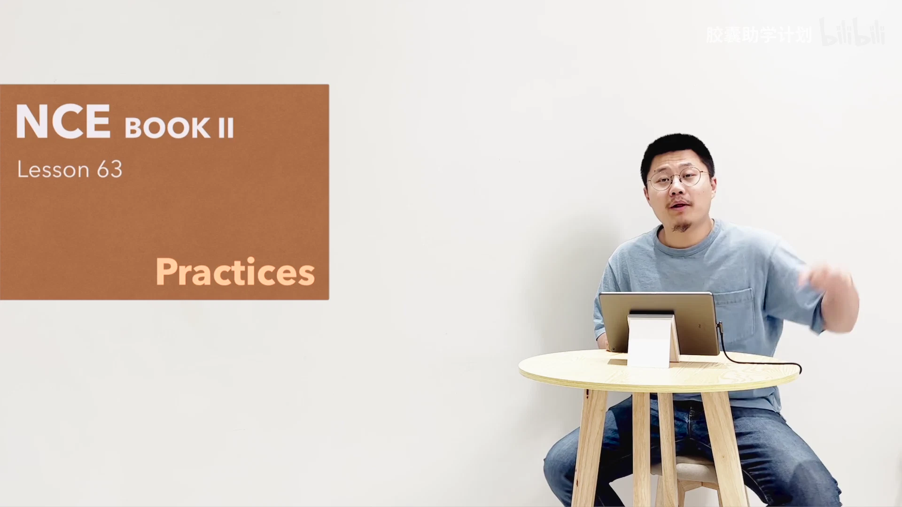

文字识别：NCE / BOOKII / Lesson 63 / Practices

### 画面 00:00:02

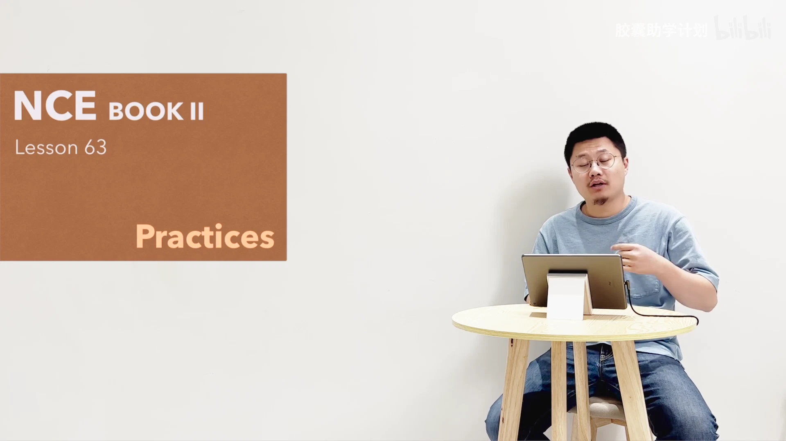

文字识别：NCE / BOOKII / Lesson 63 / Practices

### 画面 00:00:05

文字识别：NCE / BOOKII / Lesson 63 / Practices

### 画面 00:00:07

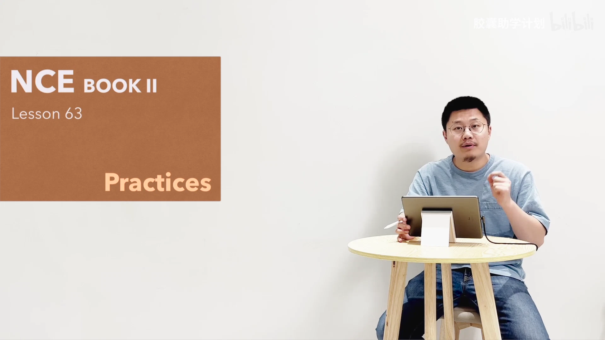

文字识别：NCE / BOOK"I / Lesson 63 / Practices

### 画面 00:00:09

文字识别：进行如下练习唯一前提 / 文章跟读至熟读成诵 / 否则请勿开始

### 画面 00:00:18

文字识别：胶囊助学计划bill / • / •

### 画面 00:00:21

文字识别：胶囊助学计划 / 胶囊助学计划

### 画面 00:00:23

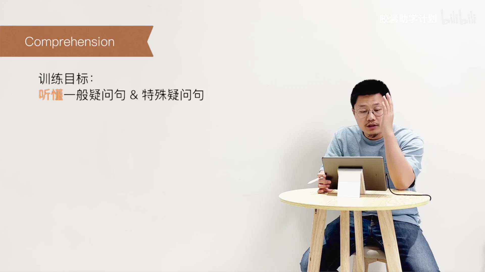

文字识别：Comprehension / 训练目标： / 听懂一般疑问句＆特殊疑问句

### 画面 00:00:25

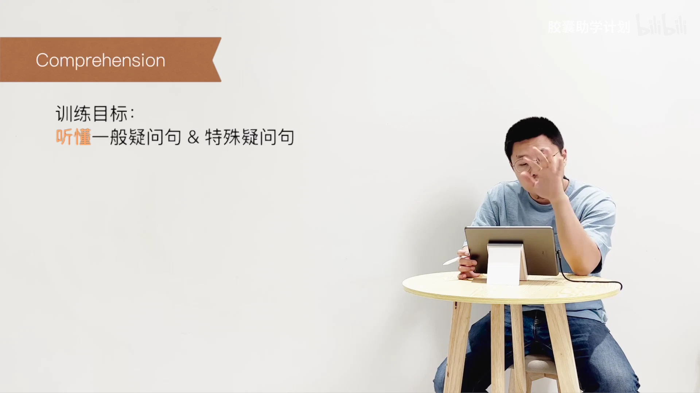

文字识别：Comprehension / 训练目标： / 听懂一般疑问句＆特殊疑问句

### 画面 00:00:28

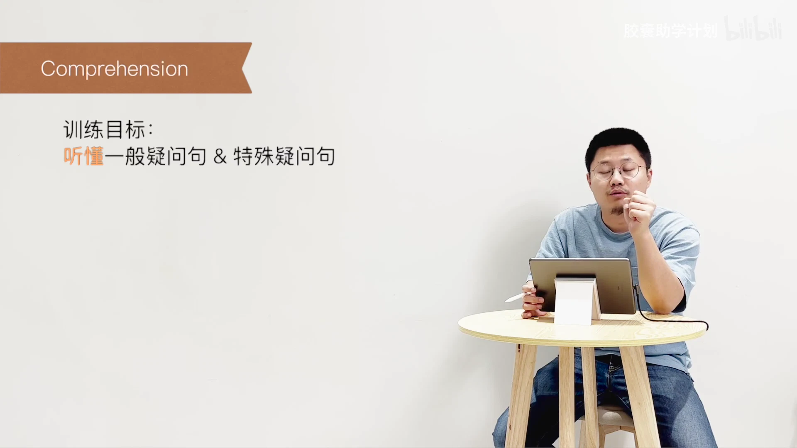

文字识别：Comprehension / 训练目标： / 听懂一般疑问句＆特殊疑问句

## 00:00:30–00:01:00

答，OK？D D has Jeremy Hampton many friends? Yes, he has. Next one, where is he very popular? At parties. What does everyone admire him for? His great sense of humor. What about his daughter Jenny?

### 画面 00:00:31

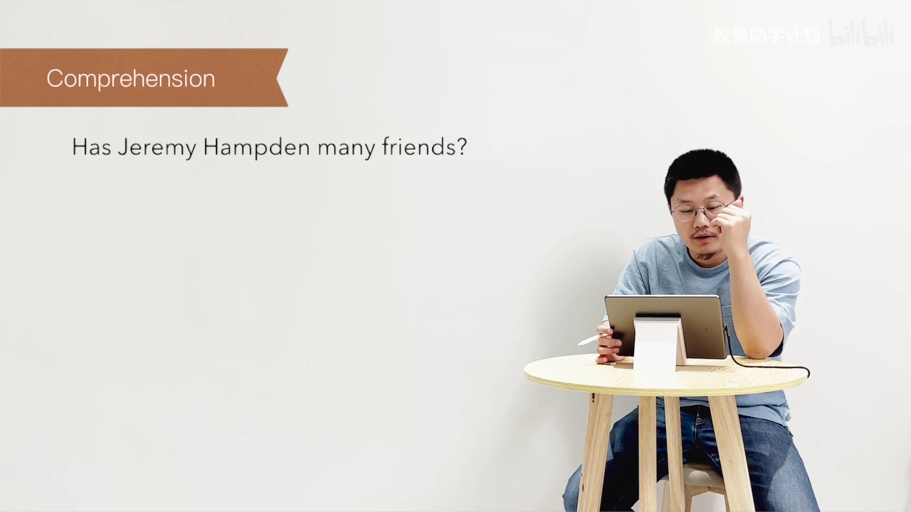

文字识别：Comprehension / Has Jeremy Hampden many friends?

### 画面 00:00:34

文字识别：Comprehension / Has Jeremy Hampden many friends?

### 画面 00:00:37

文字识别：Comprehension / Has Jeremy Hampden many friends? / Yes, he has.

### 画面 00:00:40

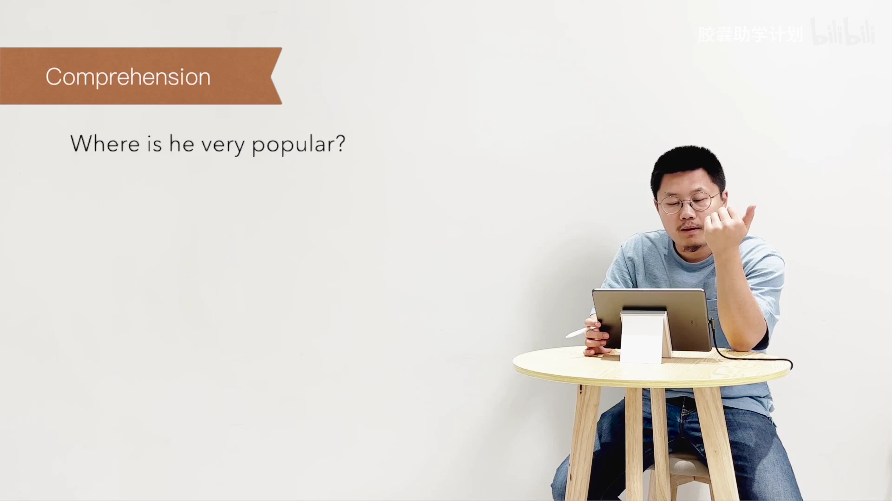

文字识别：Comprehension / Where is he very popular?

### 画面 00:00:45

文字识别：Comprehension / Where is he very popular? / At parties.

### 画面 00:00:50

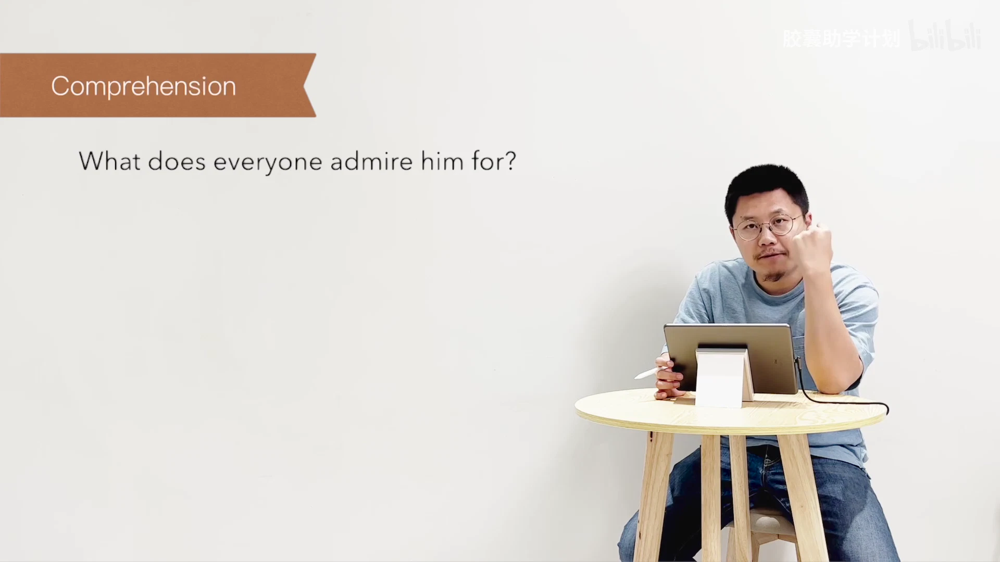

文字识别：Comprehension / What does everyone admire him for?

### 画面 00:00:56

文字识别：Comprehension / What about his daughter, Jenny?

## 00:01:00–00:01:30

She doesn't. Who asked Jeremy to make a speech? One of his closest friends. Where did he ask him to make it? At a wedding reception. How did he prepare the speech? Carefully. Who went with him to the wedding?

### 画面 00:01:00

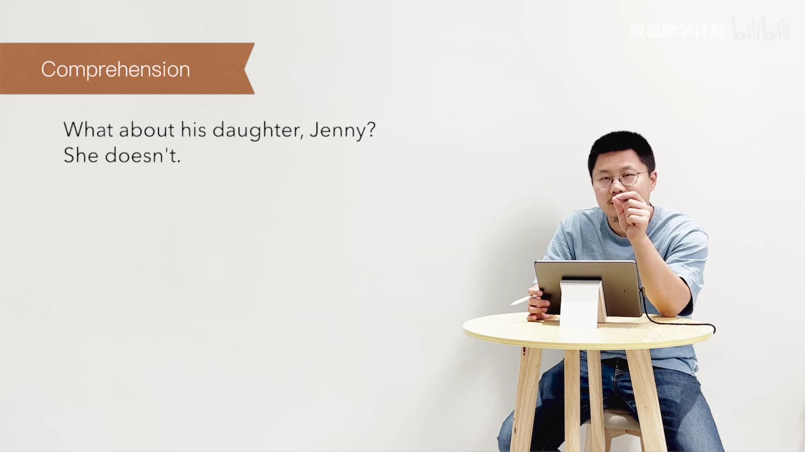

文字识别：Comprehension / What about his daughter, Jenny? / She doesn't.

### 画面 00:01:05

文字识别：Comprehension / Who asked Jeremy to make a speech?

### 画面 00:01:10

文字识别：Comprehension / Where did he ask him to make it?

### 画面 00:01:18

文字识别：Comprehension

### 画面 00:01:20

文字识别：Comprehension / How did he prepare the speech?

## 00:01:30–00:02:00

Jenny did. What had he included in his speech? A large number of funny stories. What did Jenny tell him as soon as he had finished? She wanted to go home. Was he disappointed to leave so soon?

### 画面 00:01:39

文字识别：Comprehension / What had he included in his speech? / A large number of funny stories.

### 画面 00:01:44

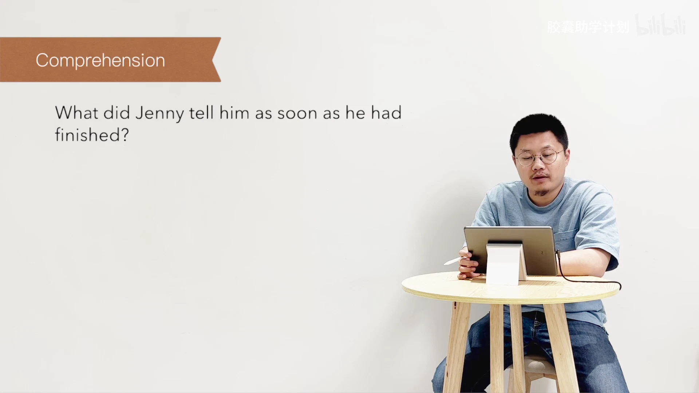

文字识别：Comprehension / What did Jenny tell him as soon as he had / finished?

### 画面 00:01:56

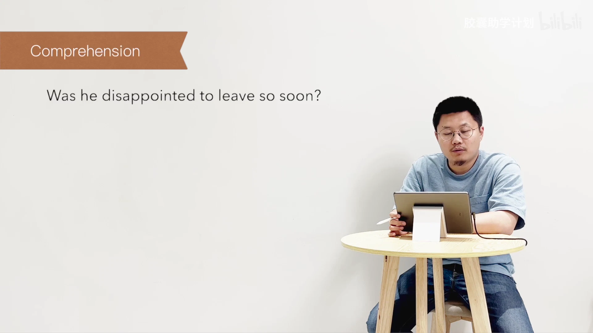

文字识别：Comprehension / Was he disappointed to leave so soon?

## 00:02:00–00:02:30

Yes, he was. What did he ask Jenny on the way home? If she had enjoyed the speech, has she enjoyed the speech? No, she hadn't. Asking questions. 练习咱们能说出来一般疑问句和特殊疑问句的能力。好，哎，我们先看第一个例子，叫 Ask me if Jeremy

### 画面 00:02:03

文字识别：Comprehension

### 画面 00:02:21

文字识别：Asking questions / 训练目标： / 会说一般疑问句＆特殊疑问句 / Accuracy / Fluency

### 画面 00:02:26

文字识别：Asking questions

## 00:02:30–00:03:00

Hampton has a large circle of friends. 大词往前一提，动词放回原形，对吧？然后呢？那 who 你可以对主语直接提问，叫 Who has a large circle of friends？好，那如果是 How many 对谁提问呢？那其实就是对 a large circle of 提问，对吧？就 How many friends does Jeremy Hampton have？他有多少朋友？答案叫 a large circle of friends。第二题， He's very popular at parties. is 往前一提，完事

### 画面 00:02:32

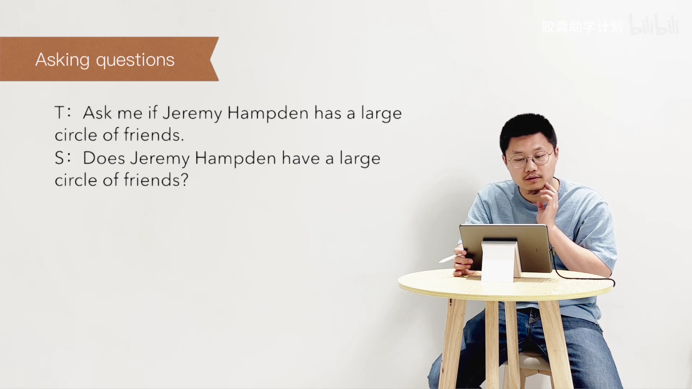

文字识别：Asking questions / T: Ask me if Jeremy Hampden has a large / circle of friends. / S: Does Jeremy Hampden have a large / circle of friends?

### 画面 00:02:38

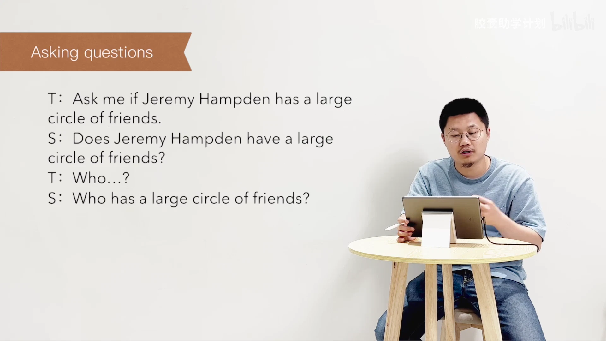

文字识别：Asking questions / T: Ask me if Jeremy Hampden has a large / circle of friends. / S: Does Jeremy Hampden have a large / circle of friends? / T: Who...? / S: Who has a large circle of friends?

### 画面 00:02:42

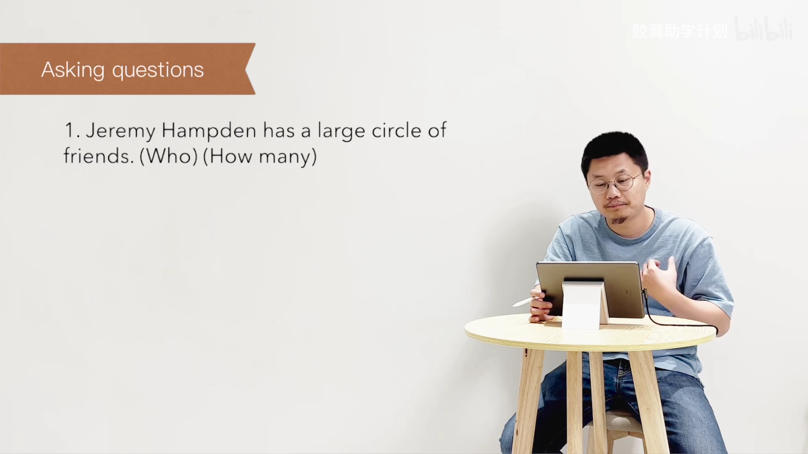

文字识别：Asking questions / 1. Jeremy Hampden has a large circle of / friends.(Who)(How many)

### 画面 00:02:44

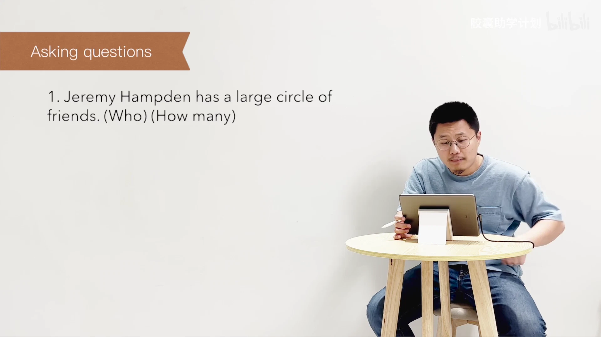

文字识别：Asking questions / 1. Jeremy Hampden has a large circle of / friends. (Who) (How many)

### 画面 00:02:56

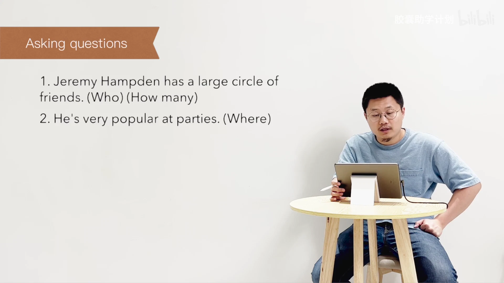

文字识别：Asking questions / 1. Jeremy Hampden has a large circle of / friends.(Who)(How many) / 2. He's very popular at parties. (Where)

## 00:03:00–00:03:30

儿了。Where对at parties提问，对吧？Everyone admires him for his sense of humor. That admires does往前一提，对吧？Why整句啊？呃呃，Why应该是这样的。Why不是整句啊？Why does everyone admire him？听到了吧？OK啊。His daughter is called Jenny. Is提前What对Jenny提问，对吧？What is his daughter called？他女儿被叫做什么？She's six years

### 画面 00:03:02

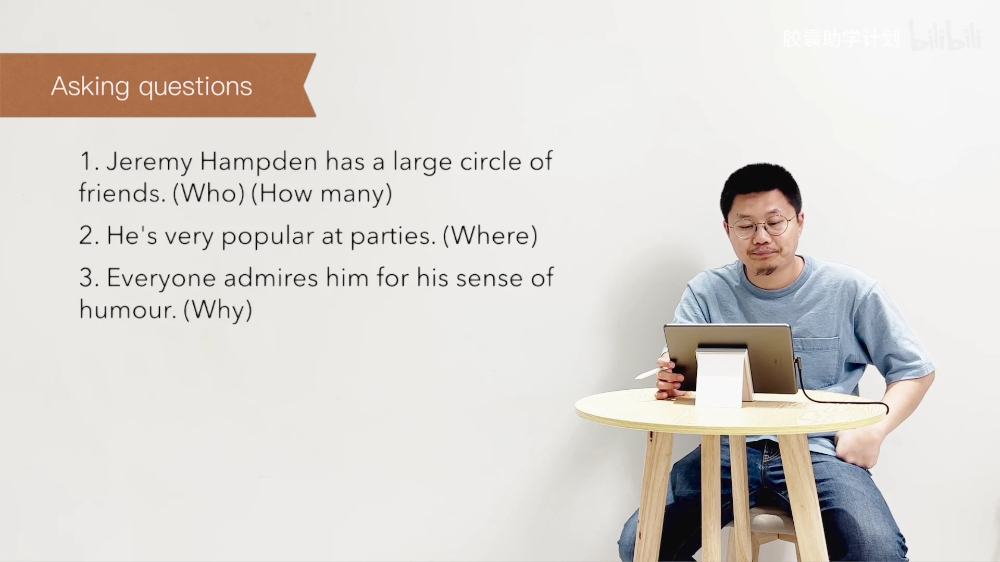

文字识别：Asking questions / 1. Jeremy Hampden has a large circle of / friends.(Who)(How many) / 2. He's very popular at parties. (Where) / 3. Everyone admires him for his sense of / humour. (Why)

### 画面 00:03:27

文字识别：Asking questions / 1. Jeremy Hampden has a large circle of / friends. (Who)(How many) / 2. He's very popular at parties. (Where) / 3. Everyone admires him for his sense of / humour.(Why) / 4. His daughter is called Jenny. (What) / 5. She's six years old. (How old)

## 00:03:30–00:04:00

old. Is提前，然后how old对six years old提问。Okay, uh,第六个，One of Jeremy's friends asked him to make a speech recently. Asked him to make a speech recently. Did往前一提，对吧？When对recently提问。Who对one of Jeremy's friends。当然也可以对him提问，但是你要注意，对主语提问不变一般疑问句，对吧？His friends wanted him to make to speak at a wedding reception.那where肯定是对

### 画面 00:03:30

文字识别：Asking questions / 1. Jeremy Hampden has a large circle of / friends.(Who) (How many) / 2. He's very popular at parties. (Where) / 3. Everyone admires him for his sense of / humour. (Why) / 4. His daughter is called Jenny. (What) / 5. She's six years old. (How old)

### 画面 00:03:34

文字识别：Asking questions

### 画面 00:03:38

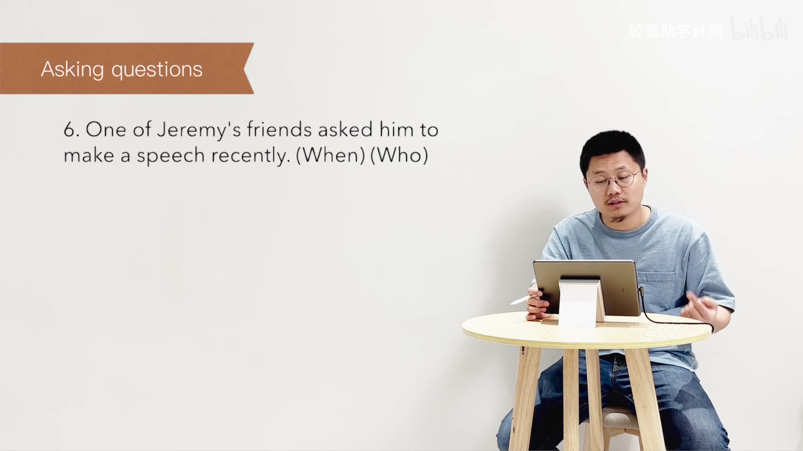

文字识别：Asking questions / 6. One of Jeremy's friends asked him to / make a speech recently. (When)(Who)

### 画面 00:03:40

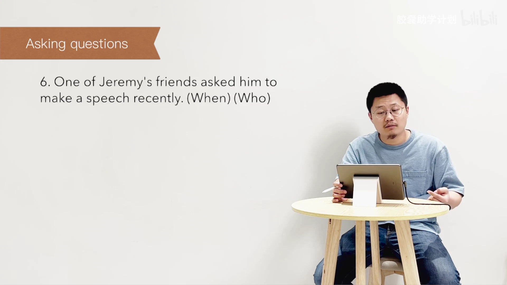

文字识别：Asking questions / 6. One of Jeremy's friends asked him to / make a speech recently. (When)(Who)

### 画面 00:03:52

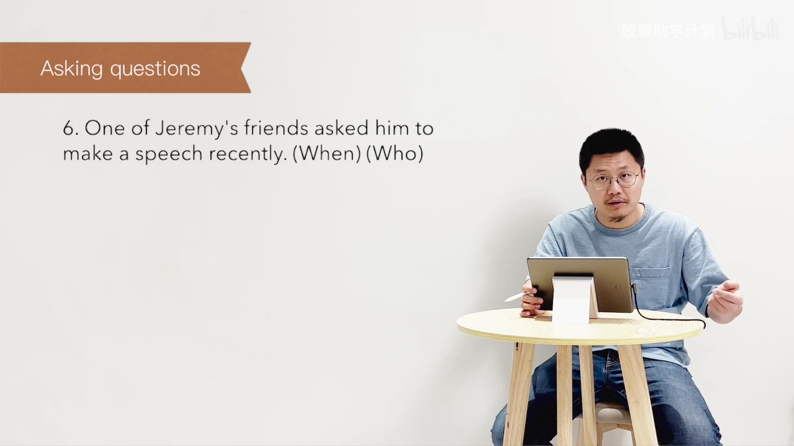

文字识别：Asking questions / 6. One of Jeremy's friends asked him to / make a speech recently. (When) (Who)

### 画面 00:03:56

文字识别：Asking questions / 6. One of Jeremy's friends asked him to / make a speech recently. (When)(Who) / 7. His friend wanted him to speak at a / wedding reception.(Where)

## 00:04:00–00:04:30

at the wedding reception提问 wanted一般过去时 did提前。呃 Jeremy loves this sort of thing 哎热爱这类事情陈述客观事实哎所以是一般现在时啊 does提前。那 what对 this sort of thing提问 OK 第九个 he prepared the speech carefully did往前一提 how对 carefully提问对吧 How did he prepare the speech？第十个 he took Jenny to the wedding 你 did往前提呗对吧 Did he take

### 画面 00:04:11

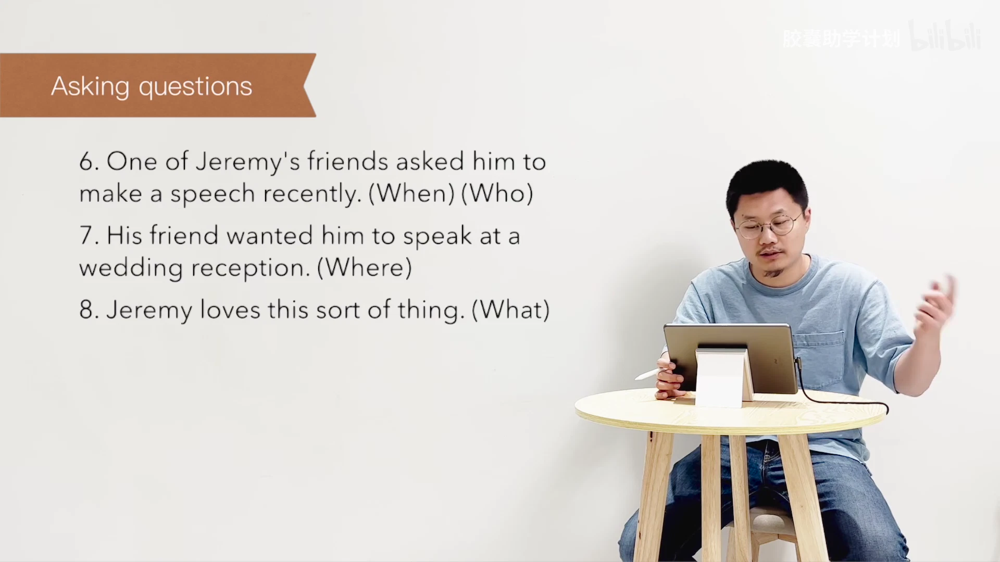

文字识别：Asking questions / 6. One of Jeremy's friends asked him to / make a speech recently. (When)(Who) / 7. His friend wanted him to speak at a / wedding reception. (Where) / 8. Jeremy loves this sort of thing. (What)

### 画面 00:04:15

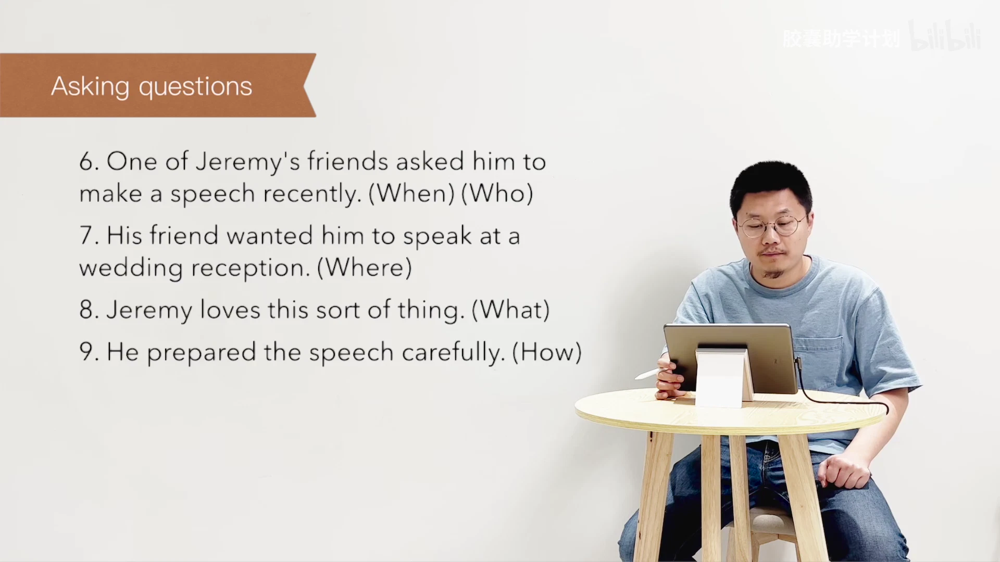

文字识别：Asking questions / 6. One of Jeremy's friends asked him to / make a speech recently.(When)(Who) / 7. His friend wanted him to speak at a / wedding reception. (Where) / 8. Jeremy loves this sort of thing. (What) / 9. He prepared the speech carefully. (How)

## 00:04:30–00:05:00

Jenny to the wedding? Who?可以对 he 可以对 Jenny。注意对主语提问不变一般疑问句，对别的东西提问要变一般疑问句啊。那就结束了。Tell the story.各位口语复述，对吧？文章读熟了，看着这个复述就可以了，就这么简单啊。然后呢，summary writing，摘要写作，写完了来这里可以对一下答案，对吧？呃，topic for discussion。我们这是我们所有练习其实最终的目的，

### 画面 00:04:40

文字识别：Tell the story / 训练目标： / 口语复述能力 / Accuracy / Fluency

### 画面 00:04:43

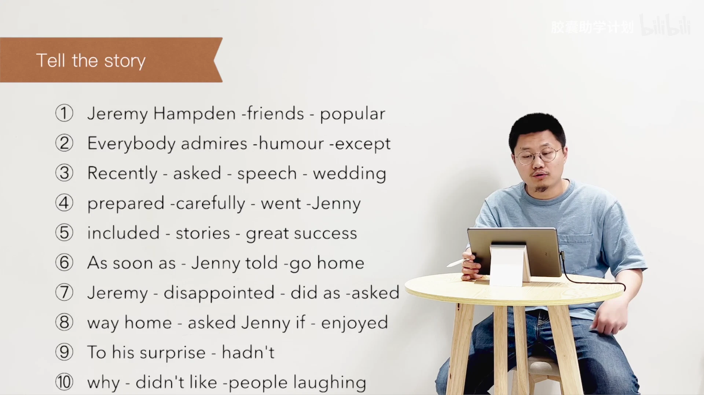

文字识别：Tell the story / ① / ) / Jeremy Hampden -friends - popular / Everybody admires -humour -except / Recently - asked - speech - wedding / prepared -carefully - went -Jenny / included - stories - great success / 5 / ) As soon as - Jenny told -go home / 6 / Jeremy - disappointed - did as -asked / way home - asked Jenny if - enjoyed / 8 /  To his surprise - hadn't / 9 / ⑩ why- didn't like -people laughing

### 画面 00:04:45

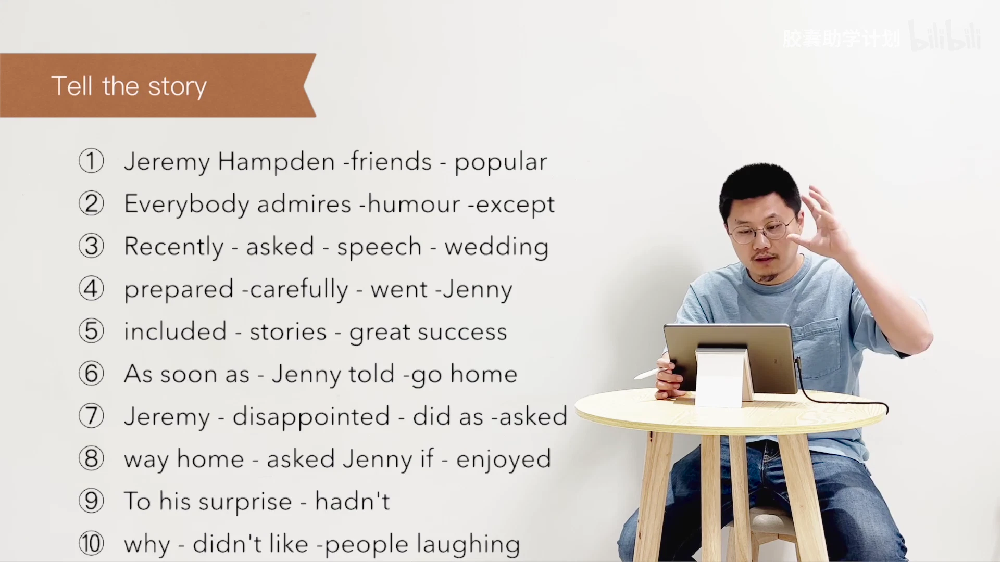

文字识别：Tell the story / 1 / ) / Jeremy Hampden -friends - popular / Everybody admires -humour -except / Recently - asked - speech - wedding / 3 / prepared -carefully - went -Jenny / included - stories - great success / 5 / 6 / ) As soon as - Jenny told -go home / Jeremy - disappointed - did as -asked / 8 / way home - asked Jenny if - enjoyed / ) To his surprise - hadn't / 9 / ⑩ why - didn'tlike -people laughing

### 画面 00:04:49

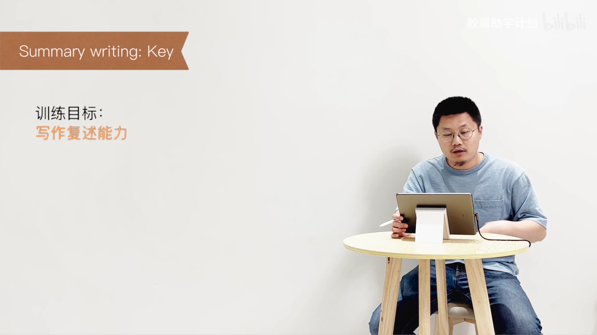

文字识别：Summary writing: Key / 训练目标： / 写作复述能力

### 画面 00:04:52

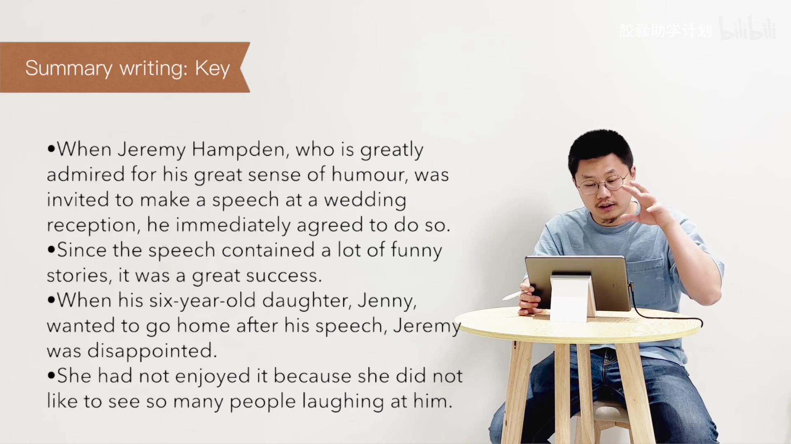

文字识别：Summary writing: Key / •When Jeremy Hampden, who is greatly / admired for his great sense of humour, was / invited to make a speech at a wedding / reception, he immediately agreed to do so. / •Since the speech contained a lot of funny / stories, it was a great success. / •When his six-year-old daughter, Jenny, / wanted to go home after his speech, Jeremy / was disappointed. / •She had not enjoyed it because she did not / like to see so many people laughing at him.

### 画面 00:04:54

文字识别：Topics for discussion / 训练目标： / 完全自由的对话 / Accuracy / Fluency

### 画面 00:04:57

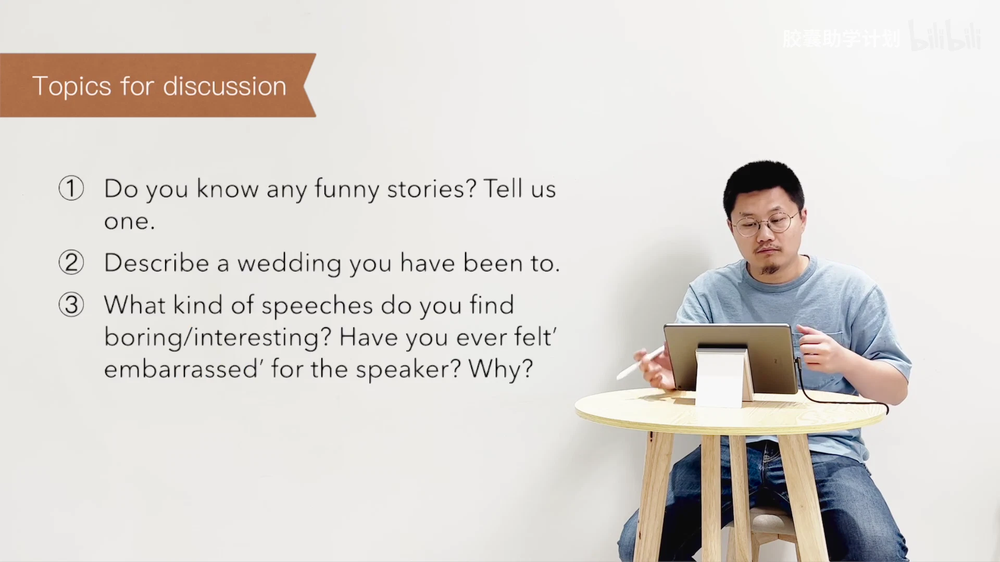

文字识别：Topics for discussion / Do you know any funny stories? Tell us / one. / Describe a wedding you have been to. / What kind of speeches do you find / boring/interesting? Have you ever felt' / embarrassed' for the speaker? Why?

## 00:05:00–00:05:30

就是能跟英说英语的人，就理论上这里边的任何一个问题，简单的聊一聊。比如说第一个，他说 Do you know any funny stories? Tell us one. 哎，你知道任何有趣的故事吗？给我们讲一个。第二，Describe a wedding wedding you have been to. 哎，跟我们聊一个你去过的婚礼。第三个，What kind of speeches do you find boring, tiring, ah interesting? 你觉得什么样的演讲有

### 画面 00:05:02

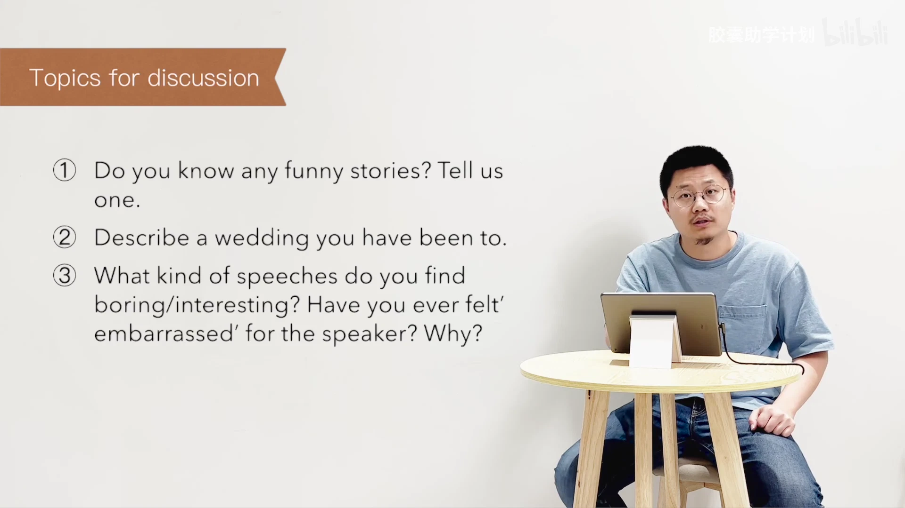

文字识别：Topics for discussion / Do you know any funny stories? Tell us / one. / Describe a wedding you have been to. / What kind of speeches do you find / boring/interesting? Have you ever felt' / embarrassed' for the speaker? Why?

### 画面 00:05:05

文字识别：Topics for discussion / Do you know any funny stories? Tell us / one. / Describe a wedding you have been to. / What kind of speeches do you find / boring/interesting? Have you ever felt' / embarrassed' for the speaker? Why?

### 画面 00:05:10

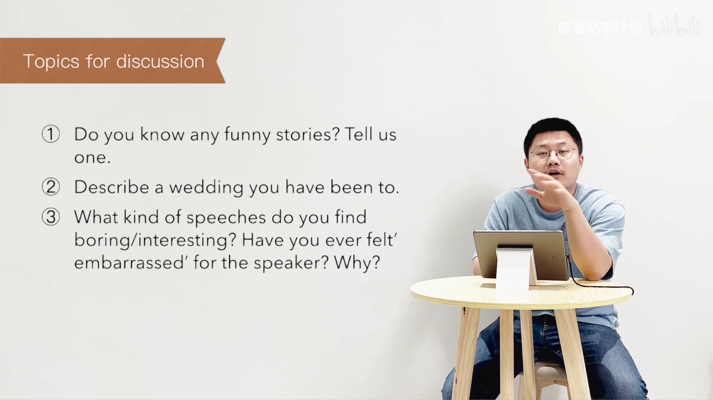

文字识别：Topics for discussion / Do you know any funny stories? Tell us / one. / Describe a wedding you have been to. / What kind of speeches do you find / boring/interesting? Have you ever felt' / embarrassed' for the speaker? Why?

### 画面 00:05:17

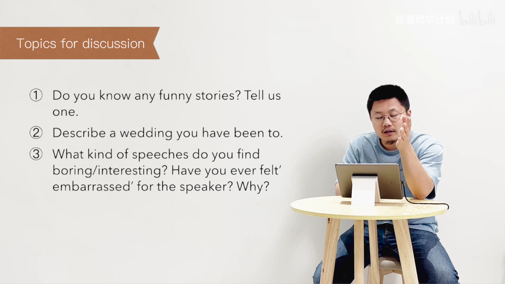

文字识别：Topics for discussion / Do you know any funny stories? Tell us / one. / Describe a wedding you have been to. / What kind of speeches do you find / boring/interesting? Have you ever felt' / embarrassed' for the speaker? Why?

## 00:05:30–00:06:00

趣或无趣呢？Have you ever felt embarrassed for the speaker? Why?你有没有因为说话者而感到尴尬？就是说，你替他感到尴尬，对吧？为啥？啊，为啥你会替他感到尴尬？OK，呃，那不多说了，加上作业。Ask Smith先写再朗读，这要写作，写完对答案。这要the story口语复述，呃，置顶留言找这个重复间隔的学习材料，对吧？那以上呢就是本期视频的全部

### 画面 00:05:37

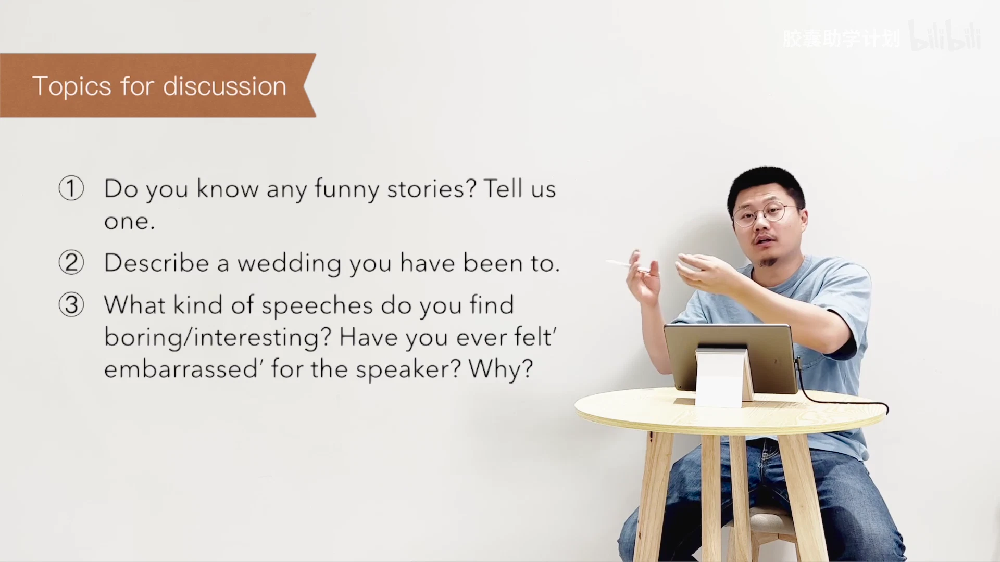

文字识别：Topics for discussion / Do you know any funny stories? Tell us / one. / Describe a wedding you have been to. / What kind of speeches do you find / boring/interesting? Have you ever felt' / embarrassed' for the speaker? Why?

### 画面 00:05:42

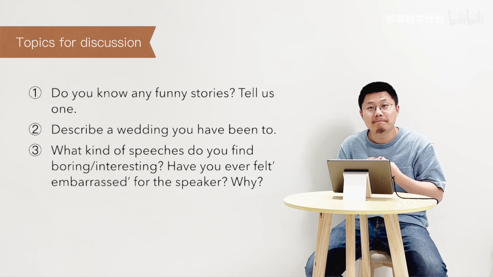

文字识别：Topics for discussion / Do you know any funny stories? Tell us / one. / Describe a wedding you have been to. / What kind of speeches do you find / boring/interesting? Have you ever felt' / embarrassed' for the speaker? Why?

### 画面 00:05:46

### 画面 00:05:48

文字识别：1.Ask me if写&朗读

### 画面 00:05:50

文字识别：1.Ask me if写&朗读 / 2. / 摘要写作写&答案

### 画面 00:05:52

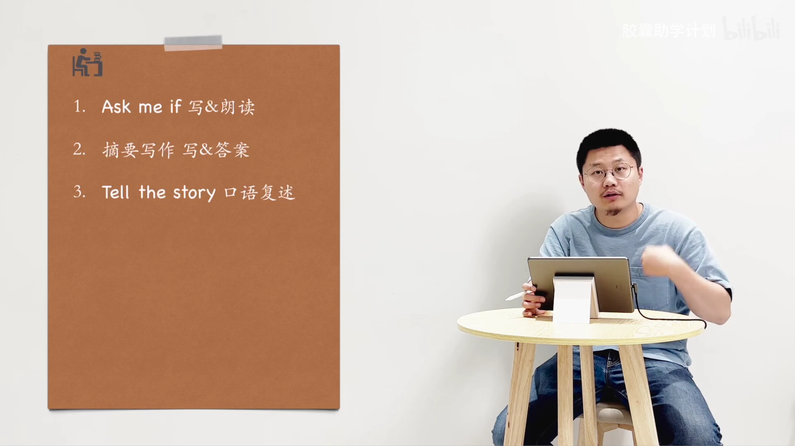

文字识别：1.Ask me if写&朗读 / 摘要写作写&答案 / 3.Tell the story 口语复述

### 画面 00:05:54

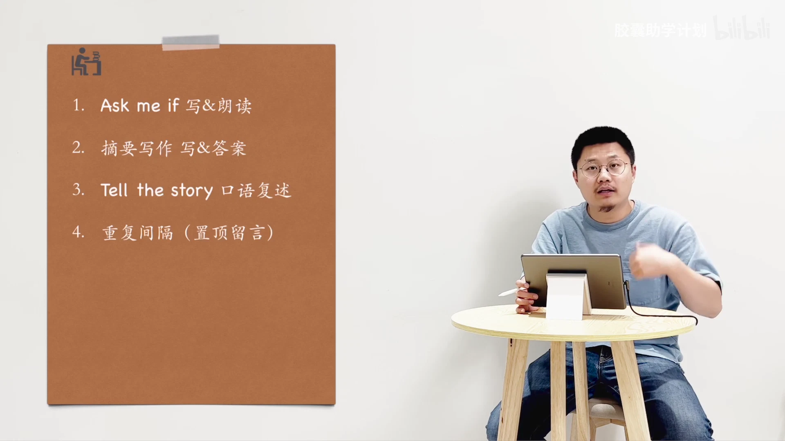

文字识别：1.Ask me if写&朗读 / 摘要写作写&答案 / 3.Tell the story 口语复述 / 4.重复间隔（置顶留言）

### 画面 00:05:56

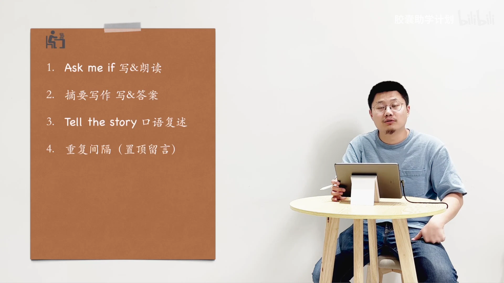

文字识别：1.Ask me if写&朗读 / 摘要写作写&答案 / 3.Tell the story 口语复述 / .重复间隔（置顶留言） / 4.

### 画面 00:05:58

文字识别：不 / 🌟

## 00:06:00–00:06:22

内容了。如果各位喜欢我们的课程呢，欢迎各位关注、订阅、一键三连，分享给那些需要的朋友，来帮助我们快速成长。See you next time.

### 画面 00:06:07

### 画面 00:06:10

### 画面 00:06:12

文字识别：CAPSULEACADEMY / 胶囊助学计划 / 小红书 / Lecturer / □ / Leo / OE

### 画面 00:06:15

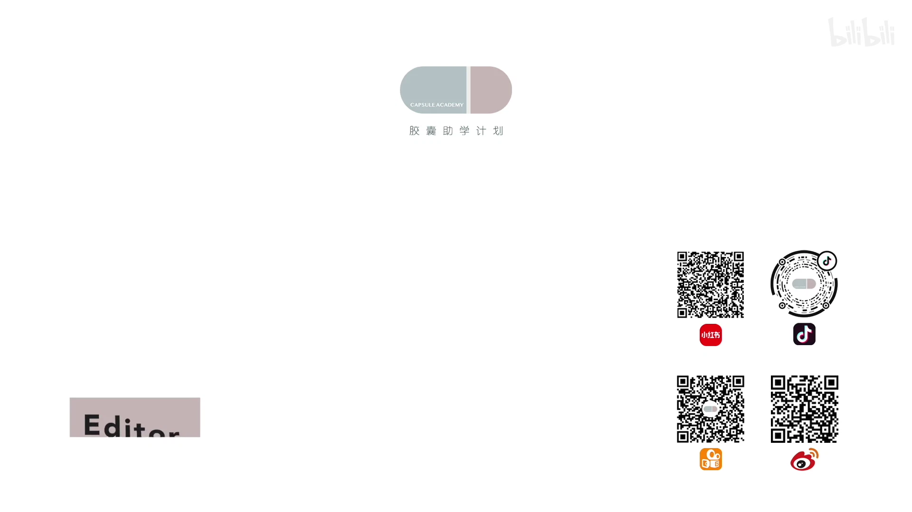

文字识别：CAPSULEACADEMY / 胶囊助学计划 / 小红书 / □ / 口 / Editor / OE

### 画面 00:06:18

文字识别：CAPSULEACADEMY / 胶囊助学计划 / 『 / 小红书 / Creator / □ / Leo & Berlin / OE

### 画面 00:06:20

文字识别：bilibili / 胶囊助学计划 / 胶囊助学计划 / 小红书 / 品 / OE

### 画面 00:06:22

文字识别：bilibili / 胶囊助学计划

