# 064 单词

快速机器解析：语音为单模型转写，未进行独立交叉校对或人工复核；画面每秒采样并按变化选帧，短时文字和标记可能遗漏。截图时间约有 1 秒误差。图片有损压缩；遇到疑点请按时间查看 Google Drive 原视频。

## 00:00:00–00:00:30

Hello everyone, welcome to Capsule Academy. This is Leo. Today we're going to learn new concept English book two lesson sixty four words. 那老习惯进入正式课程之前，咱们先看几个小的问题啊。首先，如何表达海平面上下，对吧？比如海平面以上，海平面以下。第二个问题，如何表达复查，再检查一遍。那最后一个问题，如何表达我恐怕怎么怎么样？带着这三个问题， hope you can enjoy

### 画面 00:00:00

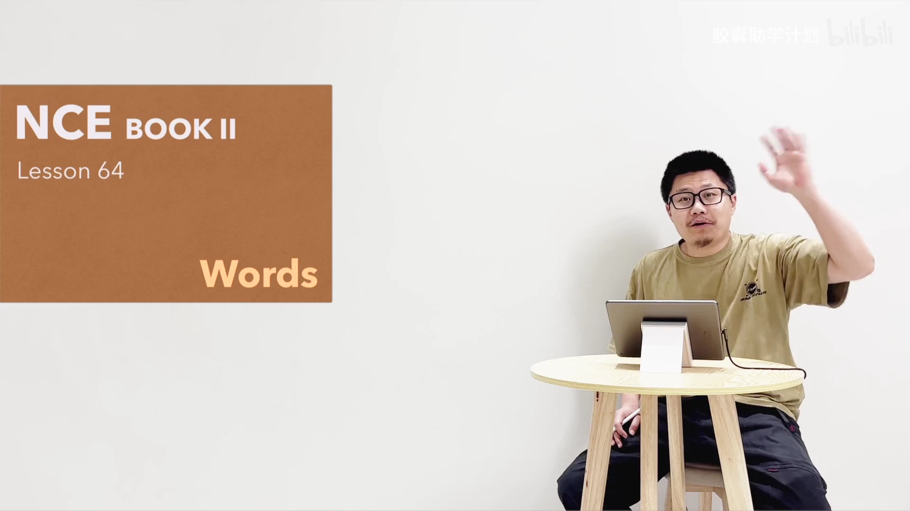

文字识别：NCE / BOOKII / Lesson 64 / Words

### 画面 00:00:02

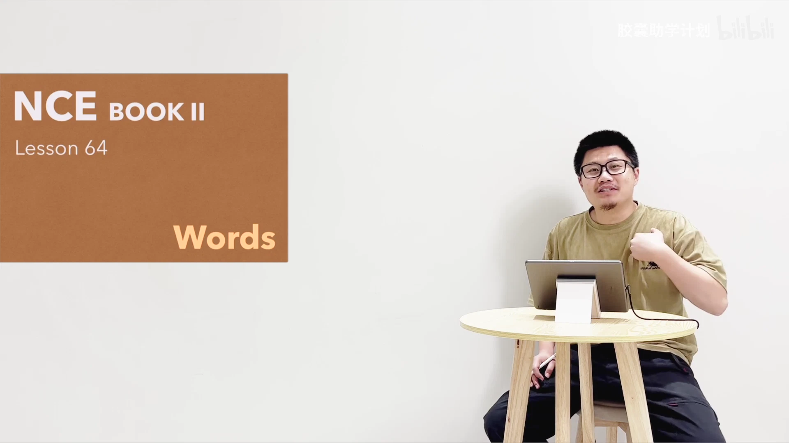

文字识别：NCE / BOOKII / Lesson 64 / Words

### 画面 00:00:05

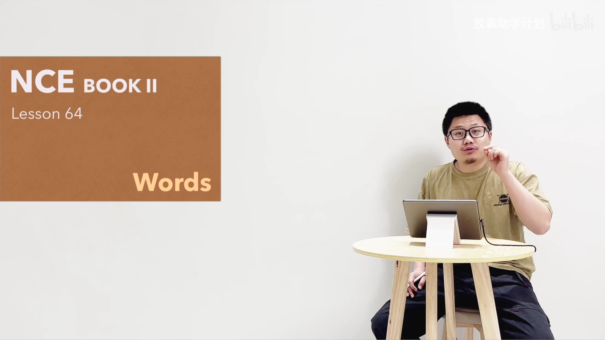

文字识别：NCE / BOOKⅡI / Lesson 64 / Words

### 画面 00:00:12

### 画面 00:00:14

文字识别：①如何表达“海平面上/下”？

### 画面 00:00:20

文字识别：①如何表达“海平面上/下”？ / 如何表达“复查”

### 画面 00:00:22

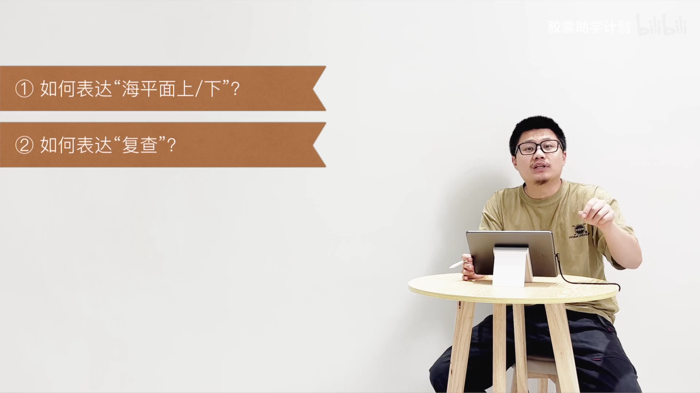

文字识别：①如何表达“海平面上/下”？ / 如何表达“复查”

### 画面 00:00:24

文字识别：①如何表达“海平面上/下”? / 如何表达“复查” / 如何表达“我恐怕.

### 画面 00:00:26

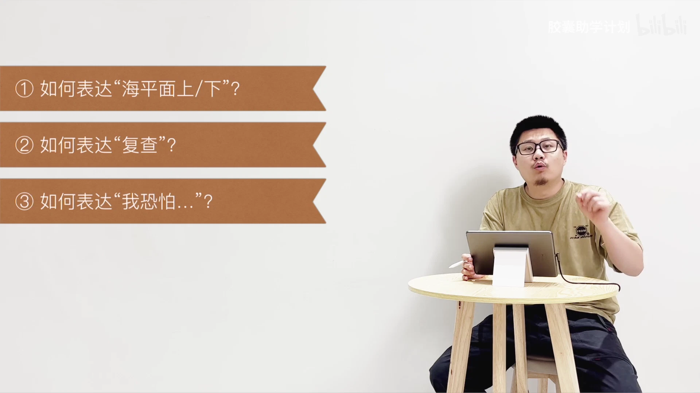

文字识别：①如何表达“海平面上/下”？ / 如何表达“复查”? / 如何表达“我恐怕

## 00:00:30–00:01:00

enjoy。好，第一个单词跟我一起读一下，看音标叫做 tunnel，tunnel。好，tunnel 是我们出现在标题上的单词，它的意思就像这个图一样啊，隧道啊，tunnel。OK，好，那我们想它呢去造句，我先给大家一个短语，很常用叫 in the tunnel，啊 in the tunnel，OK，叫在在隧道当中，OK。那你就想六一二三四五六当中，

### 画面 00:00:30

文字识别：胶囊助学计划bill / •

### 画面 00:00:34

文字识别：胶囊助学计划

### 画面 00:00:36

文字识别：单词造句指南 / 网：v.+v.变化 / 四句型转换 / 方式/地点/时间 / 结合习惯用法 / 其他单词+词性 / 原文摘抄+变 / 6123456 / /'tΛnal/ / tunnel n.

### 画面 00:00:39

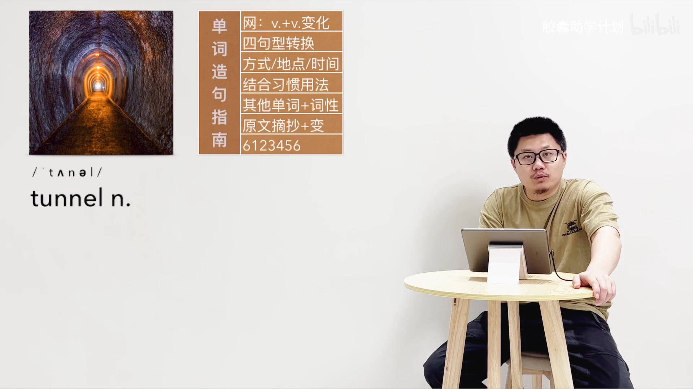

文字识别：单词造句指南 / 网：v.+v.变化 / 四句型转换 / 方式/地点/时间 / 结合习惯用法 / 其他单词+词性 / 原文摘抄+变 / 6123456 / /'tΛnal/ / tunnel n.

### 画面 00:00:41

文字识别：单词造句指南 / 网：v.+v.变化 / 四句型转换 / 方式/地点/时间 / 结合习惯用法 / 其他单词+词性 / 原文摘抄+变 / 6123456 / /'tΛnal/ / tunnel n.

### 画面 00:00:45

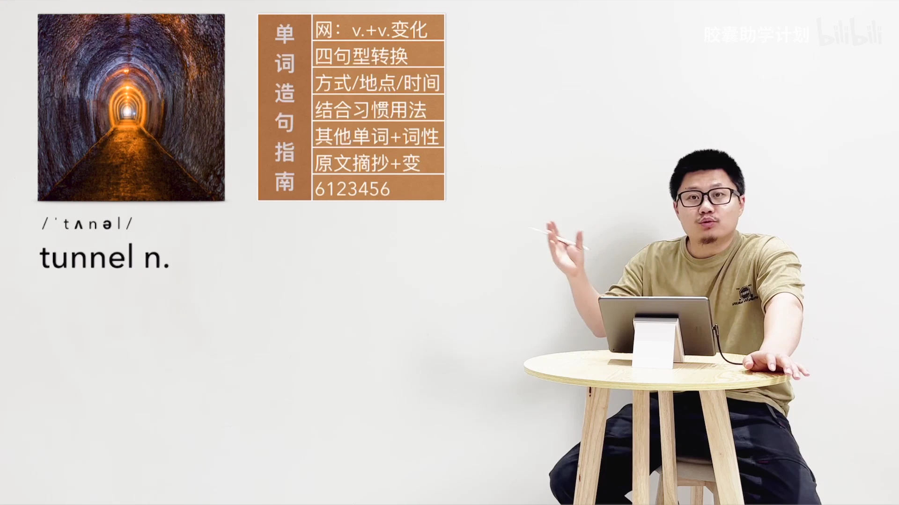

文字识别：单词造句指南 / 网：v.+v.变化 / 四句型转换 / 方式/地点/时间 / 结合习惯用法 / 其他单词+词性 / 原文摘抄+变 / 6123456 / /'tΛnal/ / tunnel n.

### 画面 00:00:50

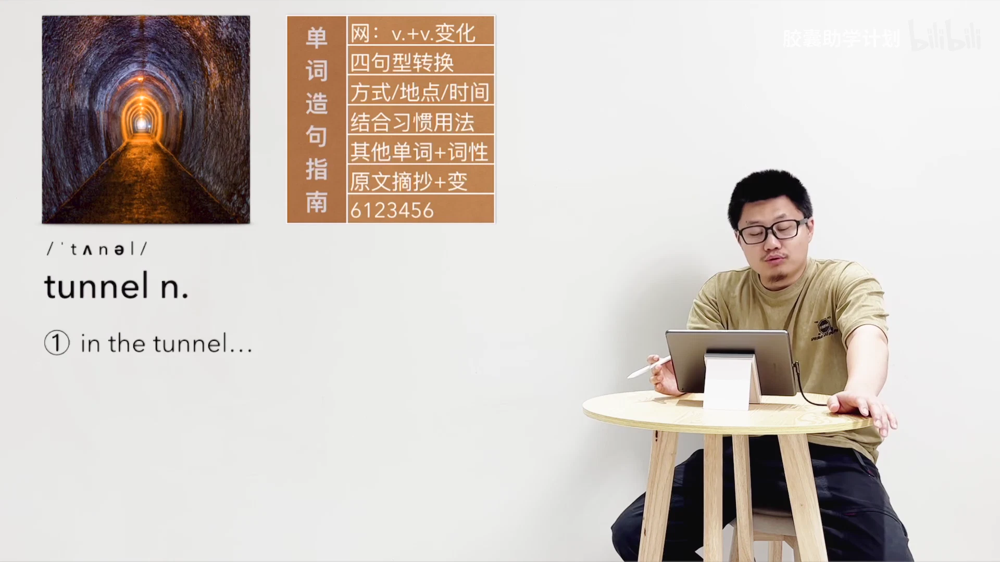

文字识别：单词造句指南 / 网：v.+v.变化 / 四句型转换 / 方式/地点/时间 / 结合习惯用法 / 其他单词+词性 / 原文摘抄+变 / 6123456 / /'tanal/ / tunnel n. / ① in the tunnel..

### 画面 00:00:57

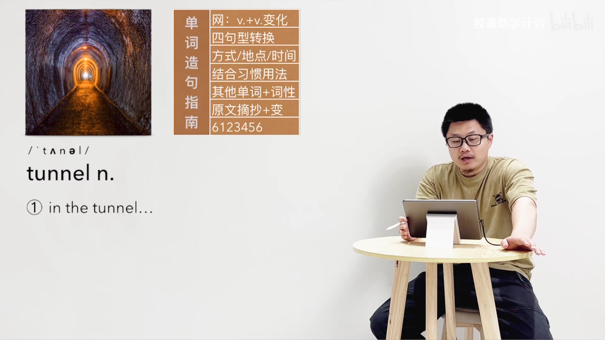

文字识别：单词造句指南 / 网：v.+v.变化 / 四句型转换 / 方式/地点/时间 / 结合习惯用法 / 其他单词+词性 / 原文摘抄+变 / 6123456 / /'tΛnal/ / tunnel n. / ① in the tunnel..

## 00:01:00–00:01:30

它很可能最常现、最常出现的位置就是五。理论上，它也可以出现在什么地方呢？一和三的位置，但是它和一一三的一部分 in the tunnel，就是介词后置做定语，对吧？这个知识点二八二九三十咱们讲过。那我拿它尝试去造一些句子啊。跟着我读，repeat after me. It got colder when we were in the tunnel. 当我们在隧道当中的时候

### 画面 00:01:00

文字识别：单词造句指南 / 网：v.+v.变化 / 四句型转换 / 方式/地点/时间 / 结合习惯用法 / 其他单词+词性 / 原文摘抄+变 / 6123456 / /'tΛnal/ / tunnel n. / ① in the tunnel..

### 画面 00:01:05

文字识别：单词造句指南 / 网：v.+v.变化 / 四句型转换 / 方式/地点/时间 / 结合习惯用法 / 其他单词+词性 / 原文摘抄+变 / 6123456 / /'tΛnal/ / tunnel n. / ① in the tunnel..

### 画面 00:01:10

文字识别：单词造句指南 / 网：v.+v.变化 / 四句型转换 / 方式/地点/时间 / 结合习惯用法 / 其他单词+词性 / 原文摘抄+变 / 6123456 / /'tΛnal/ / tunnel n. / ① in the tunnel..

### 画面 00:01:19

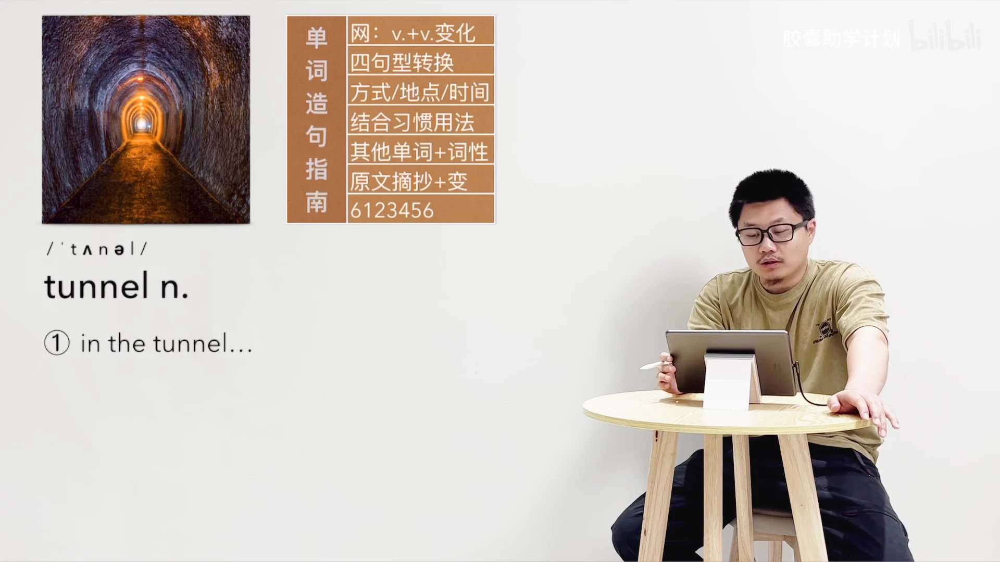

文字识别：单词造句指南 / 网：v.+v.变化 / 四句型转换 / 方式/地点/时间 / 结合习惯用法 / 其他单词+词性 / 原文摘抄+变 / 6123456 / / 'tΛnal/ / tunnel n. / ① in the tunnel..

### 画面 00:01:21

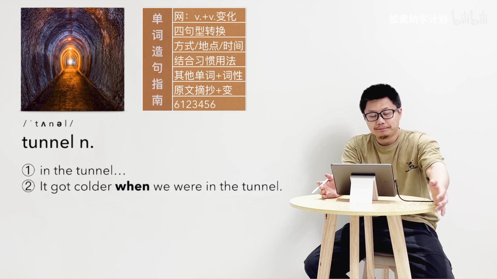

文字识别：单词造句指南 / 网：v.+v.变化 / 四句型转换 / 方式/地点/时间 / 结合习惯用法 / 其他单词+词性 / 原文摘抄+变 / 6123456 / / 'tanal/ / tunnel n. / ① in the tunnel... / ② It got colder when we were in the tunnel.

### 画面 00:01:25

文字识别：单词造句指南 / 网：v.+v.变化 / 四句型转换 / 方式/地点/时间 / 结合习惯用法 / 其他单词+词性 / 原文摘抄+变 / 6123456 / / 'tΛnal/ / tunnel n. / ① in the tunnel... / ② It got colder when we were in the tunnel.

## 00:01:30–00:02:00

live in

### 画面 00:01:33

文字识别：单词造句指南 / 网：v.+v.变化 / 四句型转换 / 方式/地点/时间 / 结合习惯用法 / 其他单词+词性 / 原文摘抄+变 / 6123456 / / 'tΛnal/ / tunnel n. / ① in the tunnel... / ② It got colder when we were in the tunnel. / I just saw something moving in that tunnel. / 3 / L35

### 画面 00:01:35

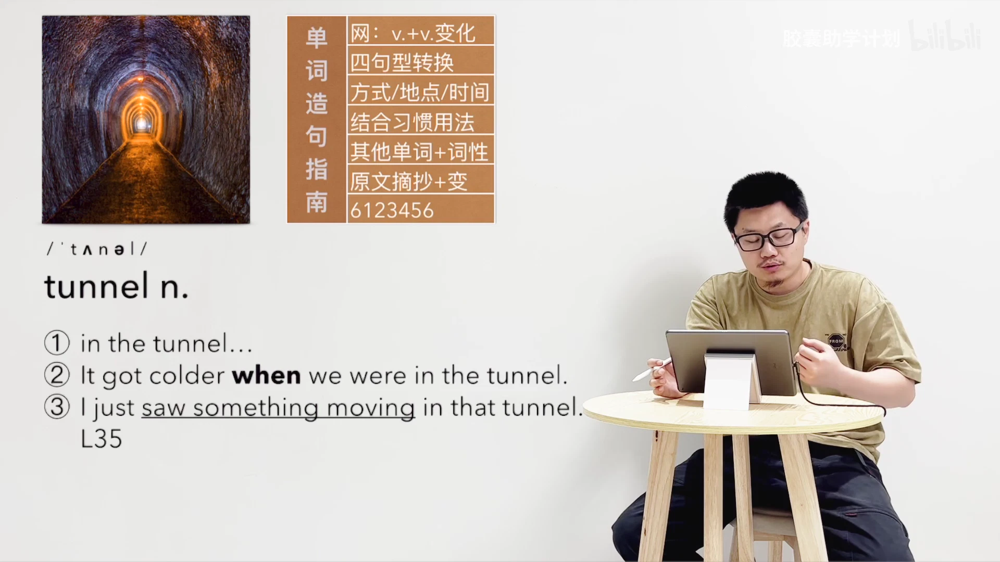

文字识别：单词造句指南 / 网：v.+v.变化 / 四句型转换 / 方式/地点/时间 / 结合习惯用法 / 其他单词+词性 / 原文摘抄+变 / 6123456 / /'tΛnal/ / tunnel n. / ① in the tunnel... / ② It got colder when we were in the tunnel. / 3 / I just saw something moving in that tunnel. / L35

### 画面 00:01:46

文字识别：单词造句指南 / 网：v.+v.变化 / 四句型转换 / 方式/地点/时间 / 结合习惯用法 / 其他单词+词性 / 原文摘抄+变 / 6123456 / / 'tΛnal/ / tunnel n. / ① in the tunnel... / ② /  It got colder when we were in the tunnel. / I just saw something moving in that tunnel. / 3 / L35

### 画面 00:01:50

文字识别：单词造句指南 / 网：v.+v.变化 / 四句型转换 / 方式/地点/时间 / 结合习惯用法 / 其他单词+词性 / 原文摘抄+变 / 6123456 / /'tΛnal/ / tunnel n. / ① in the tunnel... / ② /  It got colder when we were in the tunnel. / 3 / I just saw something moving in that tunnel. / L35

### 画面 00:01:53

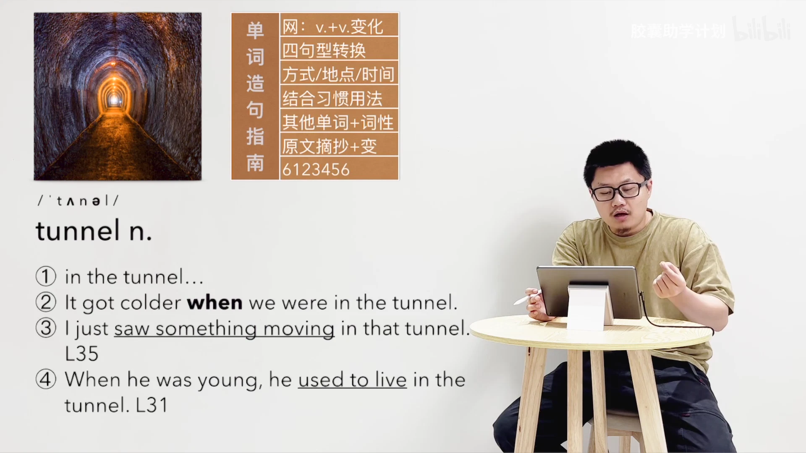

文字识别：单词造句指南 / 网：v.+v.变化 / 四句型转换 / 方式/地点/时间 / 结合习惯用法 / 其他单词+词性 / 原文摘抄+变 / 6123456 / /'tΛnal/ / tunnel n. / ① in the tunnel... / ② It got colder when we were in the tunnel. / 3 / I just saw something moving in that tunnel. / L35 / When he was young, he used to live in the / tunnel. L31

### 画面 00:01:55

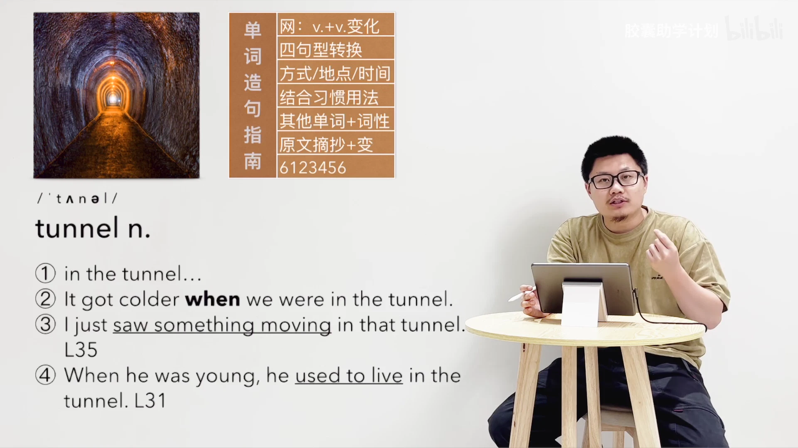

文字识别：单词造句指南 / 网：v.+v.变化 / 四句型转换 / 方式/地点/时间 / 结合习惯用法 / 其他单词+词性 / 原文摘抄+变 / 6123456 / / 'tΛnal/ / tunnel n. / ① in the tunnel... / ② It got colder when we were in the tunnel. / 3 / I just saw something moving in that tunnel. / L35 / When he was young, he used to live in the / tunnel. L31

### 画面 00:01:58

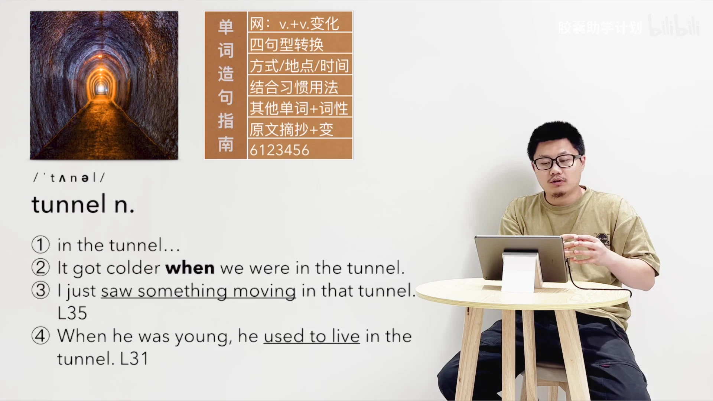

文字识别：单词造句指南 / 网：v.+v.变化 / 四句型转换 / 方式/地点/时间 / 结合习惯用法 / 其他单词+词性 / 原文摘抄+变 / 6123456 / / 'tΛnal/ / tunnel n. / ① in the tunnel... / ② It got colder when we were in the tunnel. / 3 / I just saw something moving in that tunnel. / L35 / When he was young, he used to live in the / tunnel. L31

## 00:02:00–00:02:30

住在这个隧道里面的。家里很穷，比如说没有地方住，流浪怎么办呢？这孩子就住到这个 tunnel 里面去。OK，那这里其实我们复习了两个点，第一个叫 when 第七课，第二个叫 used to do 三十一课，过去常常，但现在不再这样了。OK，再读一遍这个单词 tunnel。那我们接下来看一个电影片段吧，好吧，注意力集中啊。 Do you remember what I told you in the tunnel?

### 画面 00:02:01

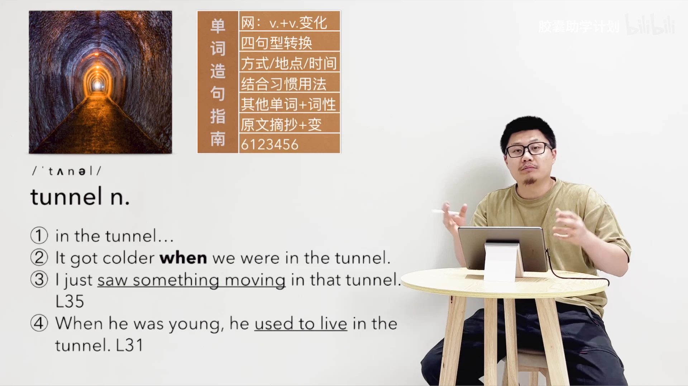

文字识别：单词造句指南 / 网：v.+v.变化 / 四句型转换 / 方式/地点/时间 / 结合习惯用法 / 其他单词+词性 / 原文摘抄+变 / 6123456 / /'tΛnal/ / tunnel n. / ① in the tunnel... / ② It got colder when we were in the tunnel. / 3 / I just saw something moving in that tunnel. / L35 / When he was young, he used to live in the / tunnel. L31

### 画面 00:02:05

文字识别：单词造句指南 / 网：v.+v.变化 / 四句型转换 / 方式/地点/时间 / 结合习惯用法 / 其他单词+词性 / 原文摘抄+变 / 6123456 / /'tΛnal/ / tunnel n. / ① in the tunnel... / ② It got colder when we were in the tunnel. / 3 / I just saw something moving in that tunnel. / L35 / When he was young, he used to live in the / tunnel. L31

### 画面 00:02:09

文字识别：单词造句指南 / 网：v.+v.变化 / 四句型转换 / 方式/地点/时间 / 结合习惯用法 / 其他单词+词性 / 原文摘抄+变 / 6123456 / /'tΛnal/ / tunnel n. / ① in the tunnel... / ② It got colder when we were in the tunnel. / 3 / I just saw something moving in that tunnel. / L35 / When he was young, he used to live in the / tunnel. L31

### 画面 00:02:12

文字识别：单词造句指南 / 网：v.+v.变化 / 四句型转换 / 方式/地点/时间 / 结合习惯用法 / 其他单词+词性 / 原文摘抄+变 / 6123456 / / 'tΛnal/ / tunnel n. / ① in the tunnel... / ② It got colder when we were in the tunnel. / 3 / I just saw something moving in that tunnel. / L35 / When he was young, he used to live in the / tunnel. L31

### 画面 00:02:15

文字识别：单词造句指南 / 网：v.+v.变化 / 四句型转换 / 方式/地点/时间 / 结合习惯用法 / 其他单词+词性 / 原文摘抄+变 / 6123456 / /'tΛnal/ / tunnel n. / ① in the tunnel... / ② It got colder when we were in the tunnel. / 3 / I just saw something moving in that tunnel. / L35 / When he was young, he used to live in the / tunnel. L31

### 画面 00:02:19

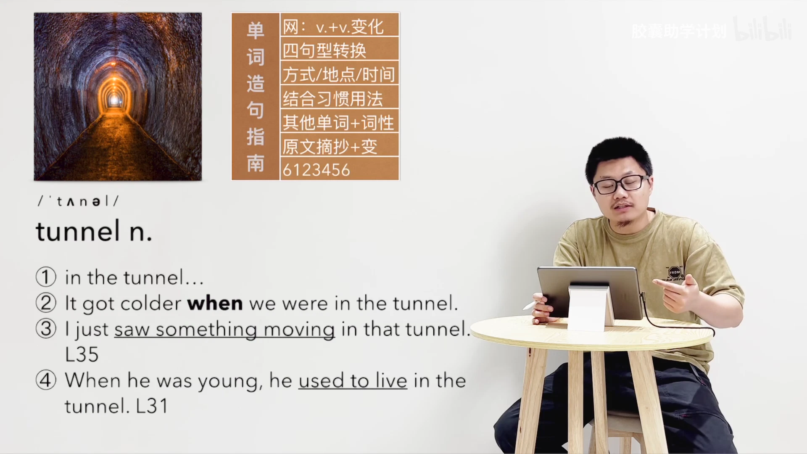

文字识别：单词造句指南 / 网：v.+v.变化 / 四句型转换 / 方式/地点/时间 / 结合习惯用法 / 其他单词+词性 / 原文摘抄+变 / 6123456 / /'tΛnal/ / tunnel n. / ① in the tunnel... / ② It got colder when we were in the tunnel. / 3 / I just saw something moving in that tunnel. / L35 / When he was young, he used to live in the / tunnel. L31

### 画面 00:02:21

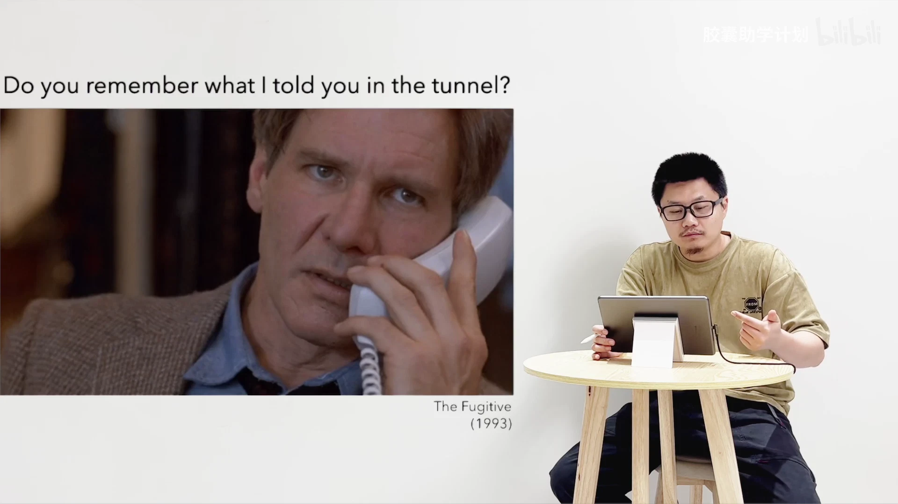

文字识别：Do you remember what I told you in the tunnel? / The Fugitive / (1993)

### 画面 00:02:27

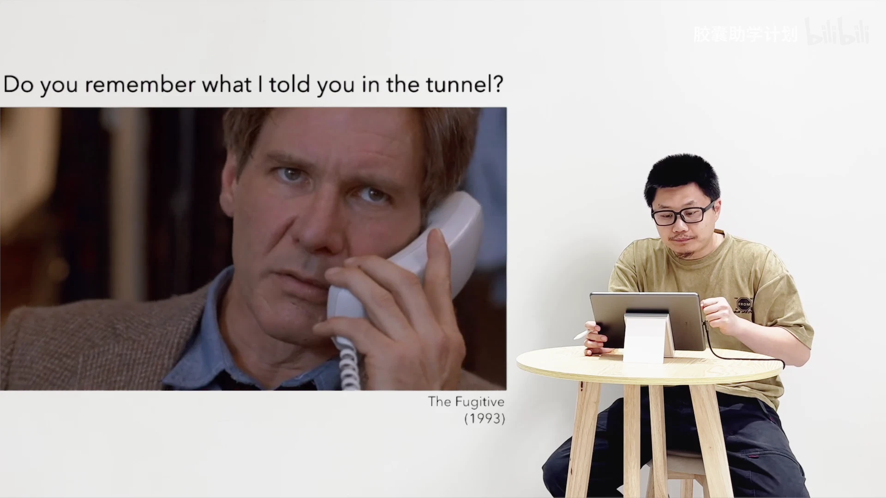

文字识别：Do you remember what I told you in the tunnel? / The Fugitive / (1993)

### 画面 00:02:29

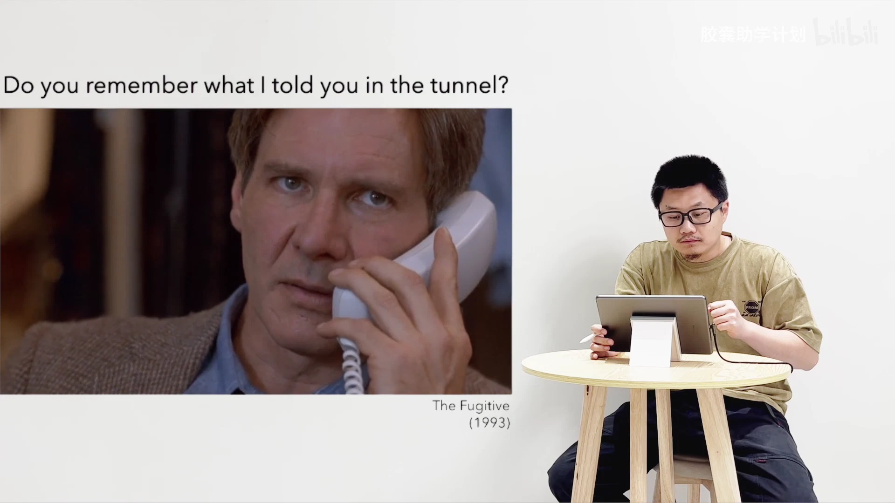

文字识别：Do you remember what I told you in the tunnel? / The Fugitive / (1993)

## 00:02:30–00:03:00

Very good. Next one. Repeat after me. Port.可以加一个儿化音啊. Port.港口啊，同理了。其实这个port又变成了一样，叫做at the port，是吧？在港口。那我们造一句话说，Lil will be waiting for you at the port.这个at the port will be doing，对吧？Next one.呃，说the man who works at the port.定语从句，who works at the port. Now，然后has

### 画面 00:02:31

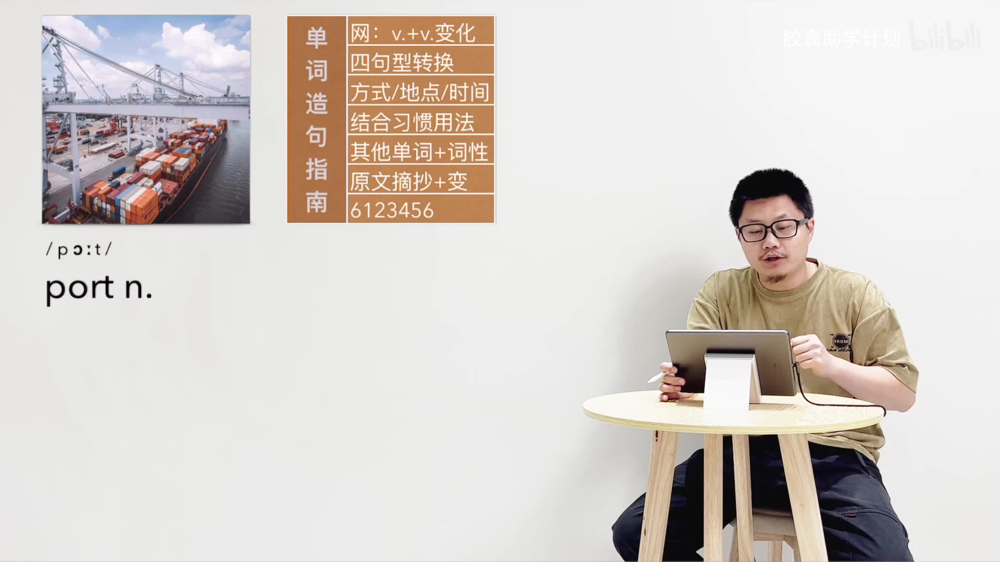

文字识别：单词造句指南 / 网：v.+v.变化 / 四句型转换 / 方式/地点/时间 / 结合习惯用法 / 其他单词+词性 / 原文摘抄+变 / 6123456 / /po:t/ / port n.

### 画面 00:02:33

文字识别：单词造句指南 / 网：v.+v.变化 / 四句型转换 / 方式/地点/时间 / 结合习惯用法 / 其他单词+词性 / 原文摘抄+变 / 6123456 / /po:t/ / port n.

### 画面 00:02:35

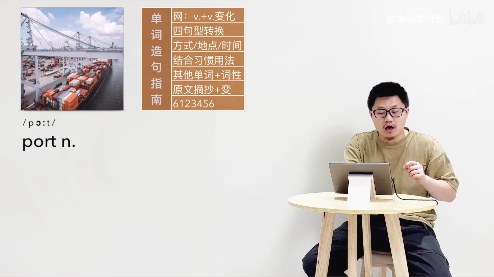

文字识别：单词造句指南 / 网：v.+v.变化 / 四句型转换 / 方式/地点/时间 / 结合习惯用法 / 其他单词+词性 / 原文摘抄+变 / 6123456 / /po:t/ / port n.

### 画面 00:02:38

文字识别：单词造句指南 / 网：v.+v.变化 / 四句型转换 / 方式/地点/时间 / 结合习惯用法 / 其他单词+词性 / 原文摘抄+变 / 6123456 / /po:t/ / port n. / ① Leo will be waiting for you at the port. L31

### 画面 00:02:40

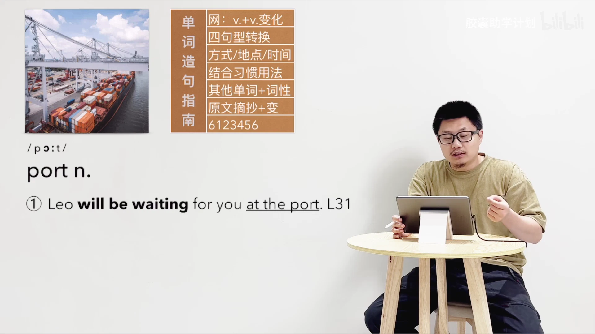

文字识别：单词造句指南 / 网：v.+v.变化 / 四句型转换 / 方式/地点/时间 / 结合习惯用法 / 其他单词+词性 / 原文摘抄+变 / 6123456 / /po:t/ / port n. / ① Leo will be waiting for you at the port. L31

### 画面 00:02:50

文字识别：单词造句指南 / 网：v.+v.变化 / 四句型转换 / 方式/地点/时间 / 结合习惯用法 / 其他单词+词性 / 原文摘抄+变 / 6123456 / /po:t/ / port n. / ① Leo will be waiting for you at the port. L31

### 画面 00:02:52

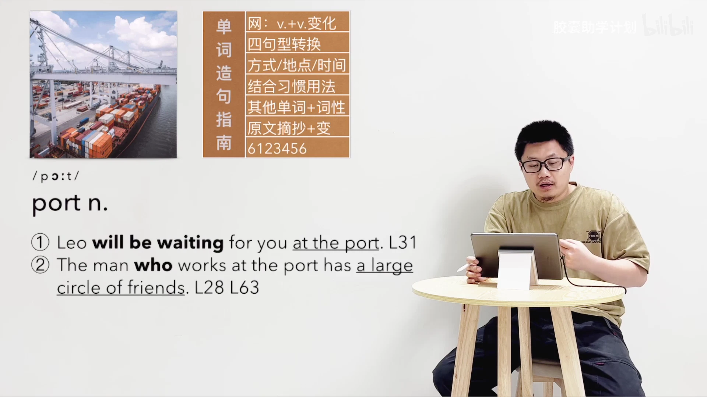

文字识别：单词造句指南 / 网：v.+v.变化 / 四句型转换 / 方式/地点/时间 / 结合习惯用法 / 其他单词+词性 / 原文摘抄+变 / 6123456 / /po:t/ / port n. / ① Leo will be waiting for you at the port. L31 / The man who works at the port has a large / circle of friends. L28 L63

### 画面 00:02:55

文字识别：单词造句指南 / 网：v.+v.变化 / 四句型转换 / 方式/地点/时间 / 结合习惯用法 / 其他单词+词性 / 原文摘抄+变 / 6123456 / /po:t/ / port n. / ① Leo will be waiting for you at the port. L31 / The man who works at the port has a large / circle of friends. L28 L63

## 00:03:00–00:03:30

a large circle of friends,有很大一圈的朋友。那什么叫很大一圈的朋友？其实就是交际圈很广。这是咱六十三课学的，对吧？Next one, one of my closest friends had been working at the port for ten years before he met his wife. Okay,那注意这里用到六十二课咱们刚刚学过的had been doing something，就是在他遇到他妻

### 画面 00:03:05

文字识别：单词造句指南 / 网：v.+v.变化 / 四句型转换 / 方式/地点/时间 / 结合习惯用法 / 其他单词+词性 / 原文摘抄+变 / 6123456 / /po:t/ / port n. / ① Leo will be waiting for you at the port. L31 / The man who works at the port has a large / circle of friends. L28 L63

### 画面 00:03:12

文字识别：单词造句指南 / 网：v.+v.变化 / 四句型转换 / 方式/地点/时间 / 结合习惯用法 / 其他单词+词性 / 原文摘抄+变 / 6123456 / /po:t/ / port n. / ① Leo will be waiting for you at the port. L31 / ) The man who works at the port has a large / 2 / circle of friends. L28 L63 / One of my closest friends had been / working at the port for ten years before he / met his wife. L62

### 画面 00:03:15

文字识别：单词造句指南 / 网：v.+v.变化 / 四句型转换 / 方式/地点/时间 / 结合习惯用法 / 其他单词+词性 / 原文摘抄+变 / 6123456 / /po:t/ / port n. / ① Leo will be waiting for you at the port. L31 / ) The man who works at the port has a large / 2 / circle of friends. L28 L63 / One of my closest friends had been / working at the port for ten years before he / met his wife. L62

### 画面 00:03:23

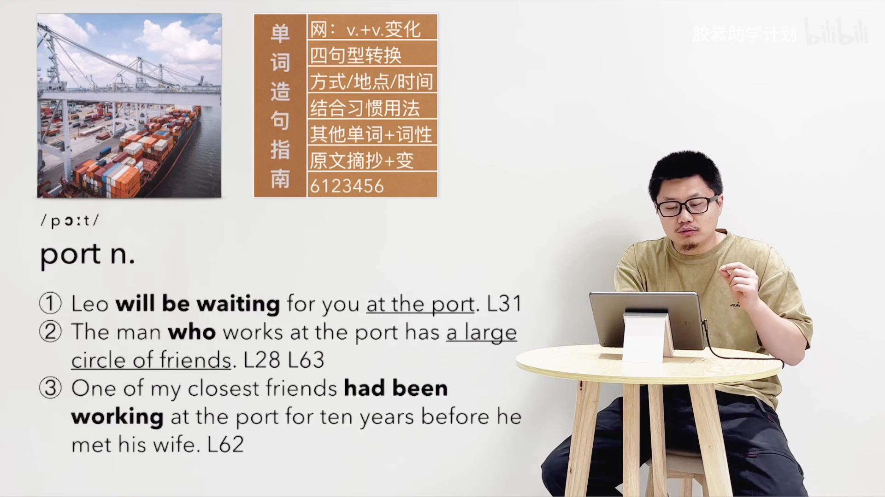

文字识别：单词造句指南 / 网：v.+v.变化 / 四句型转换 / 方式/地点/时间 / 结合习惯用法 / 其他单词+词性 / 原文摘抄+变 / 6123456 / /po:t/ / port n. / ① Leo will be waiting for you at the port. L31 /  The man who works at the port has a large / 2 / circle of friends. L28 L63 / One of my closest friends had been / working at the port for ten years before he / met his wife. L62

### 画面 00:03:26

文字识别：单词造句指南 / 网：v.+v.变化 / 四句型转换 / 方式/地点/时间 / 结合习惯用法 / 其他单词+词性 / 原文摘抄+变 / 6123456 / /po:t/ / port n. / ① Leo will be waiting for you at the port. L31 / ) The man who works at the port has a large / circle of friends. L28 L63 / One of my closest friends had been / working at the port for ten years before he / met his wife. L62

## 00:03:30–00:04:00

子，首先注意遇到他妻子就是过去的一件事情，对吧？在过去这件事情当中已经持续了很多年了。他在港口工作。OK，那这里其实有两个小点，还有一个叫 close friends，是我们之前学过的亲密的朋友。那我们在这又复习了一下这样几个小的知识点。那再读一遍这个单词叫做 port。OK, very good. Next one.接下来其实，在我们单词当中，它没有在一起出现，但我们可以给它放到

### 画面 00:03:30

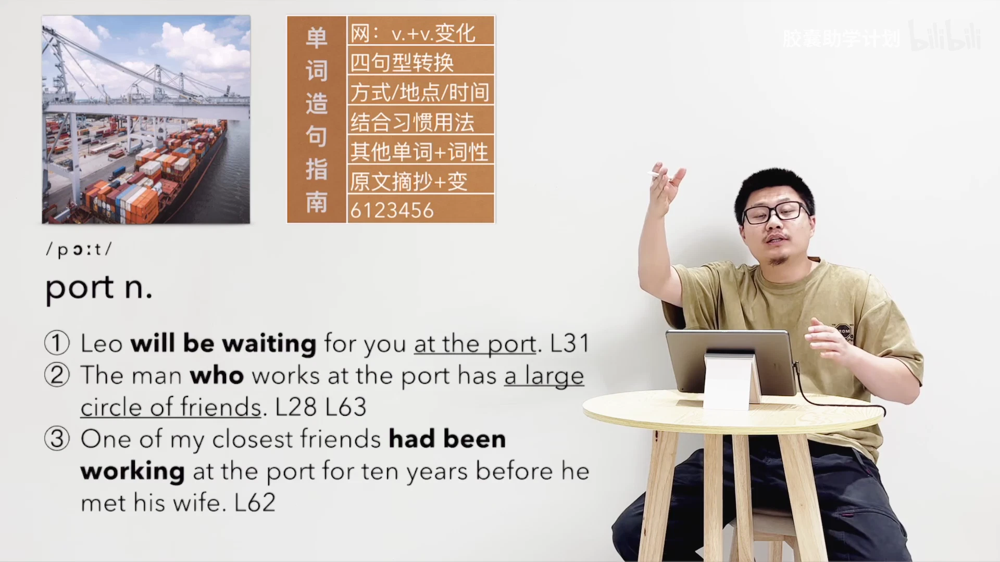

文字识别：单词造句指南 / 网：v.+v.变化 / 四句型转换 / 方式/地点/时间 / 结合习惯用法 / 其他单词+词性 / 原文摘抄+变 / 6123456 / /po:t/ / port n. / ① Leo will be waiting for you at the port. L31 / ) The man who works at the port has a large / 2 / circle of friends. L28 L63 / One of my closest friends had been / working at the port for ten years before he / met his wife. L62

### 画面 00:03:35

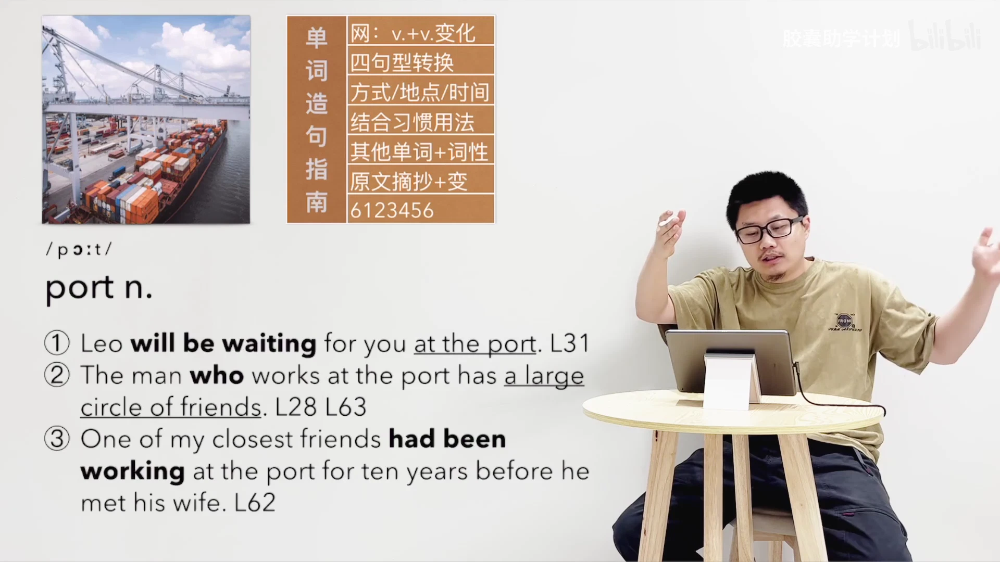

文字识别：单词造句指南 / 网：v.+v.变化 / 四句型转换 / 方式/地点/时间 / 结合习惯用法 / 其他单词+词性 / 原文摘抄+变 / 6123456 / /po:t/ / port n. / ① Leo will be waiting for you at the port. L31 / ) The man who works at the port has a large / 2 / circle of friends. L28 L63 / One of my closest friends had been / working at the port for ten years before he / met his wife. L62

### 画面 00:03:40

文字识别：单词造句指南 / 网：v.+v.变化 / 四句型转换 / 方式/地点/时间 / 结合习惯用法 / 其他单词+词性 / 原文摘抄+变 / 6123456 / /po:t/ / port n. / ① Leo will be waiting for you at the port. L31 / ) The man who works at the port has a large / 2 / circle of friends. L28 L63 / One of my closest friends had been / working at the port for ten years before he / met his wife. L62

### 画面 00:03:45

文字识别：单词造句指南 / 网：v.+v.变化 / 四句型转换 / 方式/地点/时间 / 结合习惯用法 / 其他单词+词性 / 原文摘抄+变 / 6123456 / /po:t/ / port n. / ① Leo will be waiting for you at the port. L31 / ) The man who works at the port has a large / 2 / circle of friends. L28 L63 / One of my closest friends had been / working at the port for ten years before he / met his wife. L62

### 画面 00:03:51

文字识别：单词造句指南 / 网：v.+v.变化 / 四句型转换 / 方式/地点/时间 / 结合习惯用法 / 其他单词+词性 / 原文摘抄+变 / 6123456 / /po:t/ / port n. / ① Leo will be waiting for you at the port. L31 / ) The man who works at the port has a large / 2 / circle of friends. L28 L63 / One of my closest friends had been / working at the port for ten years before he / met his wife. L62

### 画面 00:03:54

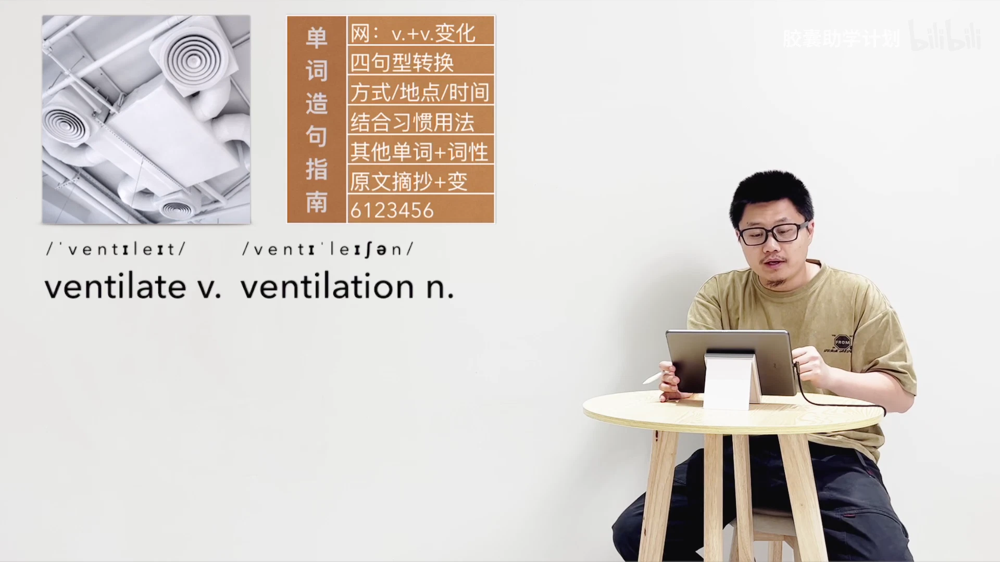

文字识别：单词造句指南 / 网：v.+v.变化 / 四句型转换 / 方式/地点/时间 / 结合习惯用法 / 其他单词+词性 / 原文摘抄+变 / 6123456 / /'ventileit/ / /venti'leifan/ / ventilate v. ventilation n.

### 画面 00:03:56

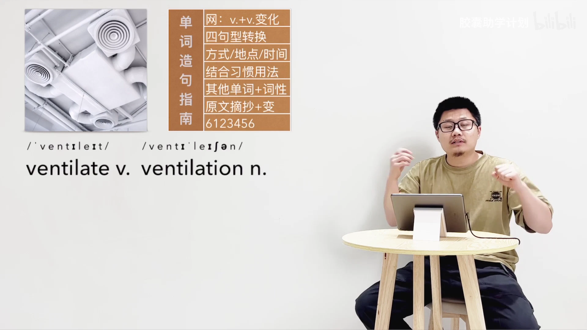

文字识别：单词造句指南 / 网：v.+v.变化 / 四句型转换 / 方式/地点/时间 / 结合习惯用法 / 其他单词+词性 / 原文摘抄+变 / 6123456 / /'ventileit/ / /ventr'lei∫an/ / ventilate v. ventilation n.

## 00:04:00–00:04:30

一起，因为很容易可以看到 ventilate 跟 ventilation 这两个单词有关系，对吧？长得太像了。Ventilate 是一个动词，那它是一个什么呢？就是通风的意思。Ventilation 呢，我们管它叫做一个名词，而且 tion 作为结尾做名词去讲，我们之前已经学过很多很多遍了，对吧？OK，都是通风的意思。那我们先说 ventilate，说 open the window and ventilate the room。这个用法

### 画面 00:04:00

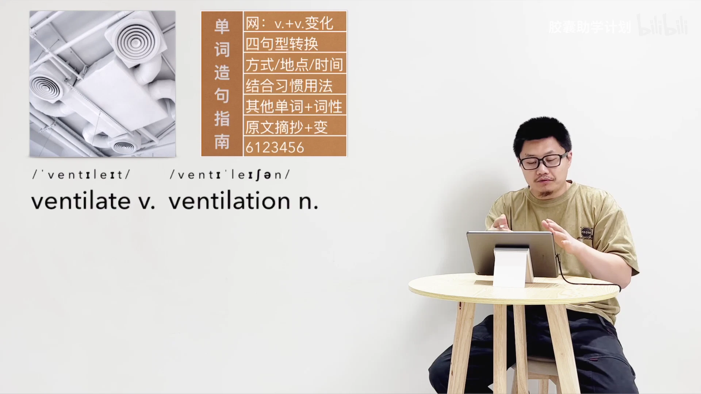

文字识别：单词造句指南 / 网：v.+v.变化 / 四句型转换 / 方式/地点/时间 / 结合习惯用法 / 其他单词+词性 / 原文摘抄+变 / 6123456 / /'ventileit/ / /venti'lei∫an/ / ventilate v. ventilation n. / TOM

### 画面 00:04:03

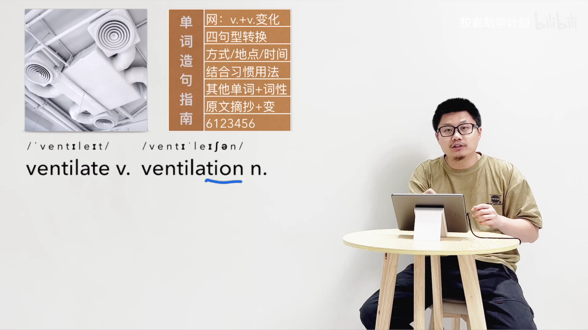

文字识别：单词造句指南 / 网：v.+v.变化 / 四句型转换 / 方式/地点/时间 / 结合习惯用法 / 其他单词+词性 / 原文摘抄+变 / 6123456 / /'ventileit/ / /venti'lei∫an/ / ventilate v. ventilation n.

### 画面 00:04:05

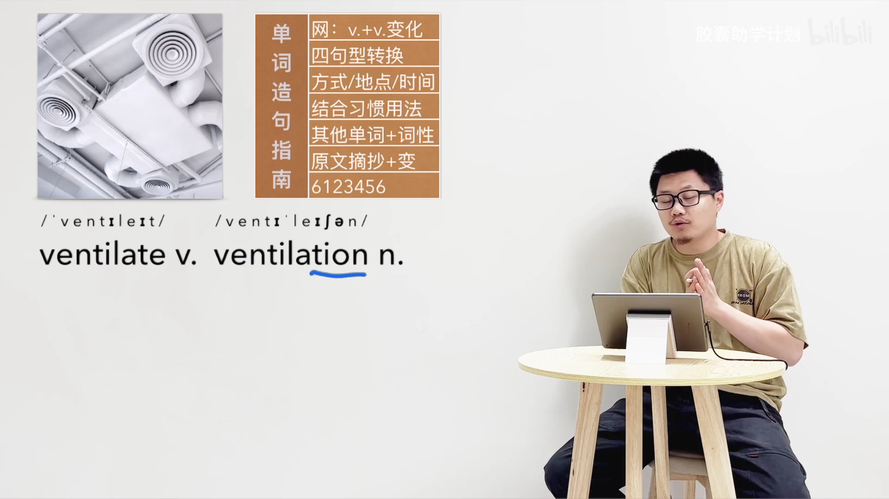

文字识别：单词造句指南 / 网：v.+v.变化 / 四句型转换 / 方式/地点/时间 / 结合习惯用法 / 其他单词+词性 / 原文摘抄+变 / 6123456 / /'ventileit/ / /ventr'lei∫an/ / ventilate v. ventilation n.

### 画面 00:04:10

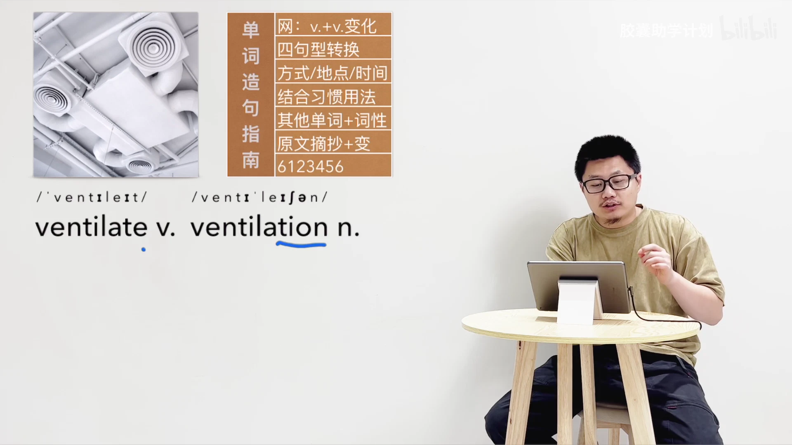

文字识别：单词造句指南 / 网：v.+v.变化 / 四句型转换 / 方式/地点/时间 / 结合习惯用法 / 其他单词+词性 / 原文摘抄+变 / 6123456 / /'ventrleit/ / /venti'leiJan/ / ventilate v. ventilation n.

### 画面 00:04:15

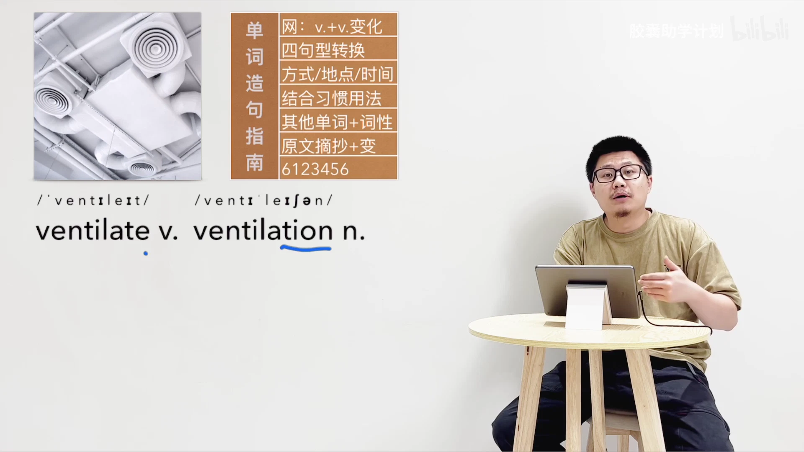

文字识别：单词造句指南 / 网：v.+v.变化 / 四句型转换 / 方式/地点/时间 / 结合习惯用法 / 其他单词+词性 / 原文摘抄+变 / 6123456 / /'ventileit/ / /venti'leifan/ / ventilate v. ventilation n.

### 画面 00:04:25

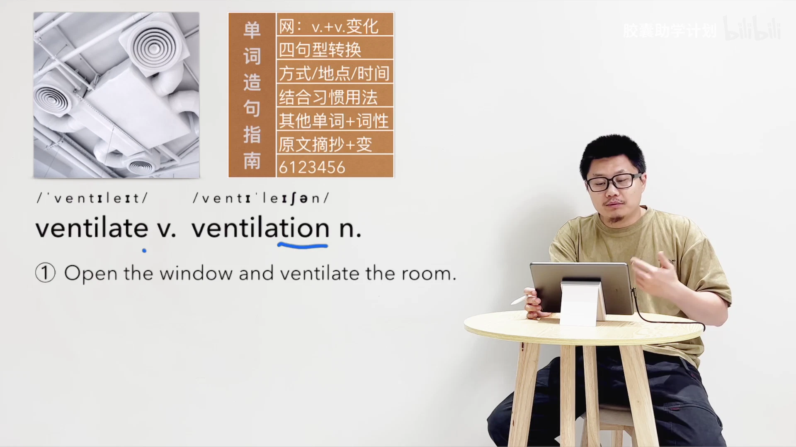

文字识别：单词造句指南 / 网：v.+v.变化 / 四句型转换 / 方式/地点/时间 / 结合习惯用法 / 其他单词+词性 / 原文摘抄+变 / 6123456 / /'ventileit/ / /venti'lei∫an/ / ventilate v. ventilation n. / ① Open the window and ventilate the room.

## 00:04:30–00:05:00

其实我们早在新一三十二十九三十课就学过。那时候咱们学的不是 ventilate the room，咱们学的是 air the room，对吧？哎，给这个通通风。OK，其实类似的。Next one，这个 ventilation呢，那我们可以把它最常见的短语叫 ventilation system，叫做通风系统。那接下来我们看它它如何去造句。首先你要知道通风系统合起来类似于起到了一个名词的作用，

### 画面 00:04:32

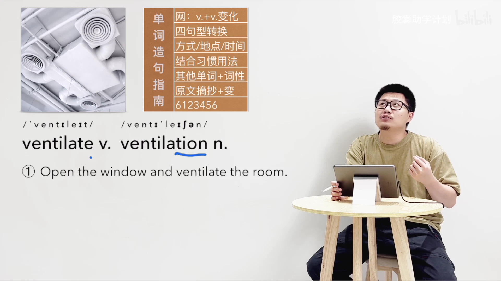

文字识别：单词造句指南 / 网：v.+v.变化 / 四句型转换 / 方式/地点/时间 / 结合习惯用法 / 其他单词+词性 / 原文摘抄+变 / 6123456 / /'ventileit/ / /venti'leifan/ / ventilate v. ventilation n. / ① Open the window and ventilate the room.

### 画面 00:04:44

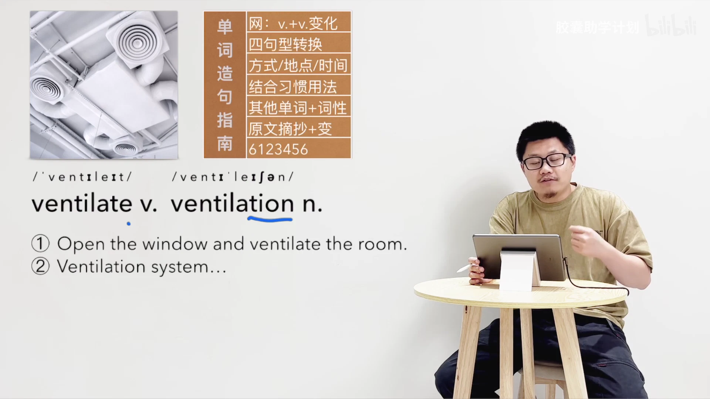

文字识别：单词造句指南 / 网：v.+v.变化 / 四句型转换 / 方式/地点/时间 / 结合习惯用法 / 其他单词+词性 / 原文摘抄+变 / 6123456 / /'ventileit/ / /venti'lei∫an/ / ventilate v. ventilation n. / ① Open the window and ventilate the room. /  Ventilation system...

### 画面 00:04:55

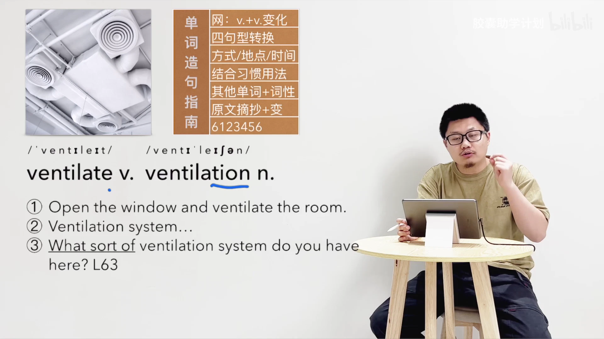

文字识别：单词造句指南 / 网：v.+v.变化 / 四句型转换 / 方式/地点/时间 / 结合习惯用法 / 其他单词+词性 / 原文摘抄+变 / 6123456 / /'ventileit/ / /venti'lei∫an/ / ventilate v. ventilation n. / ① Open the window and ventilate the room. /  Ventilation system... / 2 / What sort of ventilation system do you have / here? L63

## 00:05:00–00:05:30

对吧？你想去造句，肯定得结合点动词了。我们造句啊，说 What sort of ventilation system do you have here? 说你在这里有什么类型的通风系统呢？ What sort of 是咱们六十三课学过的啊，类似于 What kind of? Okay, next one. 说 I have been selling ventilation system to government for ten years. Have been doing 是五十二课咱们学过的现在完成进行

### 画面 00:05:00

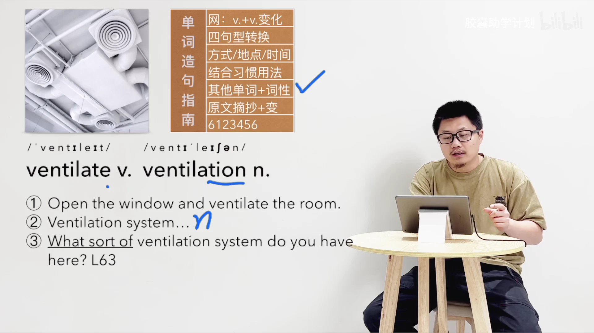

文字识别：单词造句指南 / 网：v.+v.变化 / 四句型转换 / 方式/地点/时间 / 结合习惯用法 / 其他单词+词性 / 原文摘抄+变 / 6123456 / /'ventileit/ / /venti'lei∫an/ / ventilate v. ventilation n. / ① Open the window and ventilate the room. / ②Ventilation system...Y / 2） / What sort of ventilation system do you have / here? L63

### 画面 00:05:07

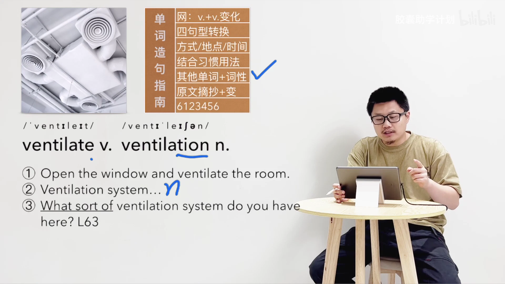

文字识别：单词造句指南 / 网：v.+v.变化 / 四句型转换 / 方式/地点/时间 / 结合习惯用法 / 其他单词+词性 / 原文摘抄+变 / 6123456 / /'ventrleit/ / /venti'lei∫an/ / ventilate v. ventilation n. / ① Open the window and ventilate the room. / ②Ventilation system..Y / 2 / What sort of ventilation system do you have / here? L63

### 画面 00:05:10

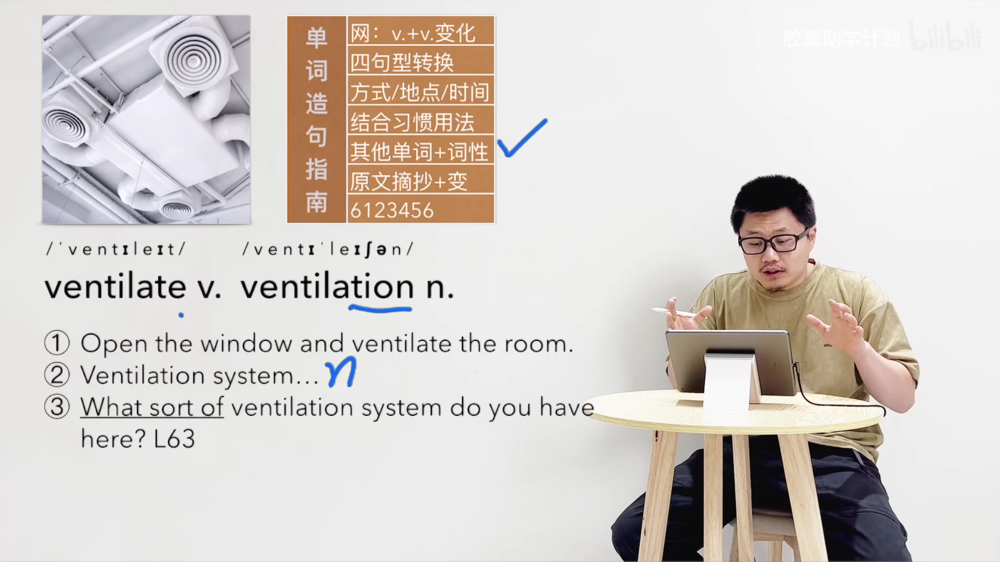

文字识别：单词造句指南 / 网：v.+v.变化 / 四句型转换 / 方式/地点/时间 / 结合习惯用法 / 其他单词+词性 / 原文摘抄+变 / 6123456 / /'ventileit/ / /venti'leifan/ / ventilate v. ventilation n. / ① Open the window and ventilate the room. / ②Ventilation system... / 2） / What sort of ventilation system do you have / here? L63

### 画面 00:05:19

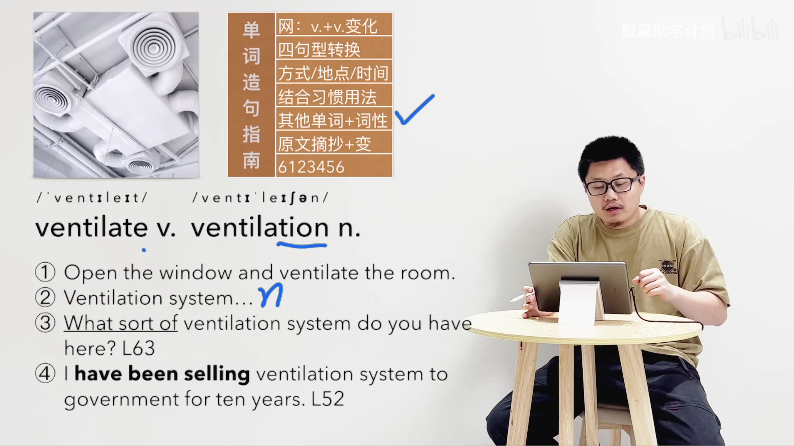

文字识别：单词造句指南 / 网：v.+v.变化 / 四句型转换 / 方式/地点/时间 / 结合习惯用法 / 其他单词+词性 / 原文摘抄+变 / 6123456 / /'ventileit/ / /venti'leiSan/ / ventilate v. ventilation n. / ① Open the window and ventilate the room. / ② Ventilation system..Y / What sort of ventilation system do you have / 3 / here? L63 /  I have been selling ventilation system to / government for ten years. L52

### 画面 00:05:25

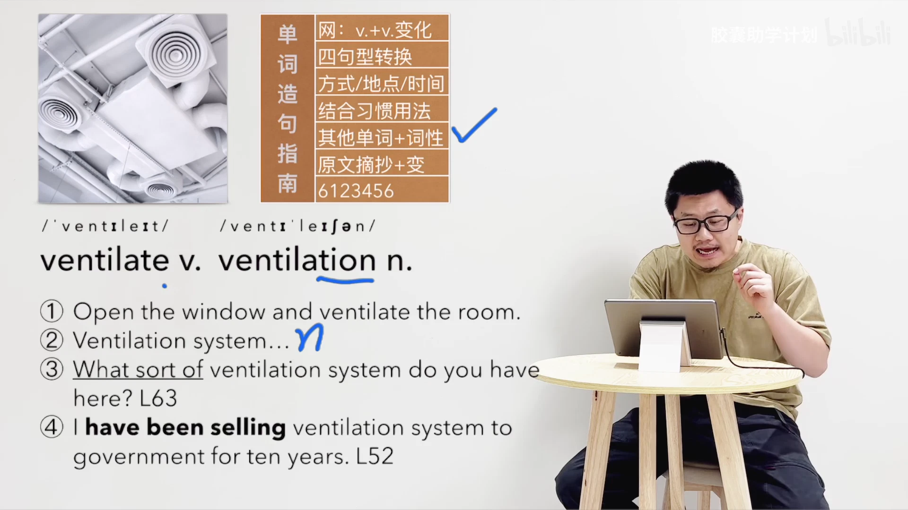

文字识别：单词造句指南 / 网：v.+v.变化 / 四句型转换 / 方式/地点/时间 / 结合习惯用法 / 其他单词+词性 / 原文摘抄+变 / 6123456 / /'ventileit/ / /venti'leiJan/ / ventilate v. ventilation n. / ① Open the window and ventilate the room. / ②Ventilation system...Y / What sort of ventilation system do you have / 3 / here? L63 /  I have been selling ventilation system to / government for ten years. L52

### 画面 00:05:27

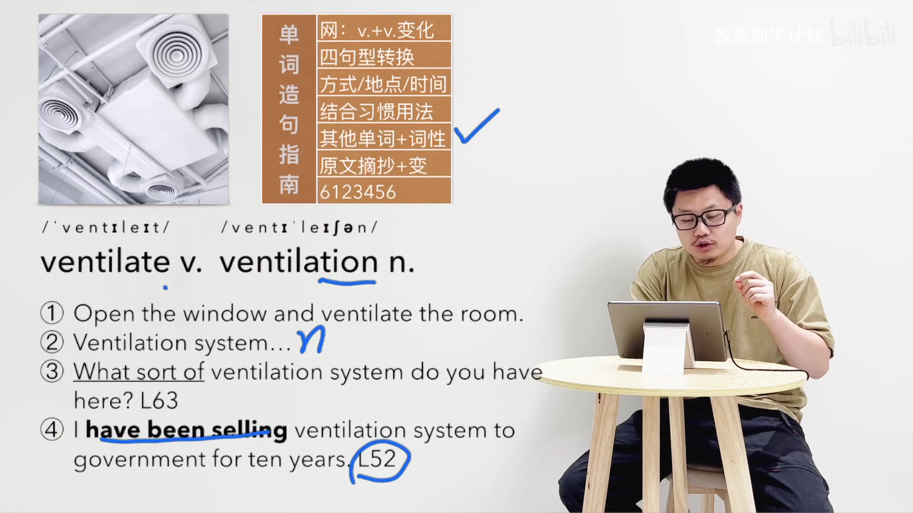

文字识别：单词造句指南 / 网：v.+v.变化 / 四句型转换 / 方式/地点/时间 / 结合习惯用法 / 其他单词+词性 / 原文摘抄+变 / 6123456 / /'ventrleit/ / /venti'lei∫an/ / ventilate v. ventilation n. / ① Open the window and ventilate the room. / ② Ventilation system.. / 2 / What sort of ventilation system do you have / here? L63 /  I have been selling ventilation system to / government for ten yearsL52

## 00:05:30–00:06:00

时，对吧？截止到现在，我已经持续不断的做通风系统，卖给政府已经持续了十年了。Okay, very good.那再跟我读一遍这两个单词，ventilate, ventilation.那接下来咱们看一个小的电影片段，哎，就出现了 ventilation system 啊，通风系统。Have you done ventilation system? Very good.啊，很短啊。接下来下一个单词，哎，这是一个比较常用的单词，叫做 chimney, chimney

### 画面 00:05:30

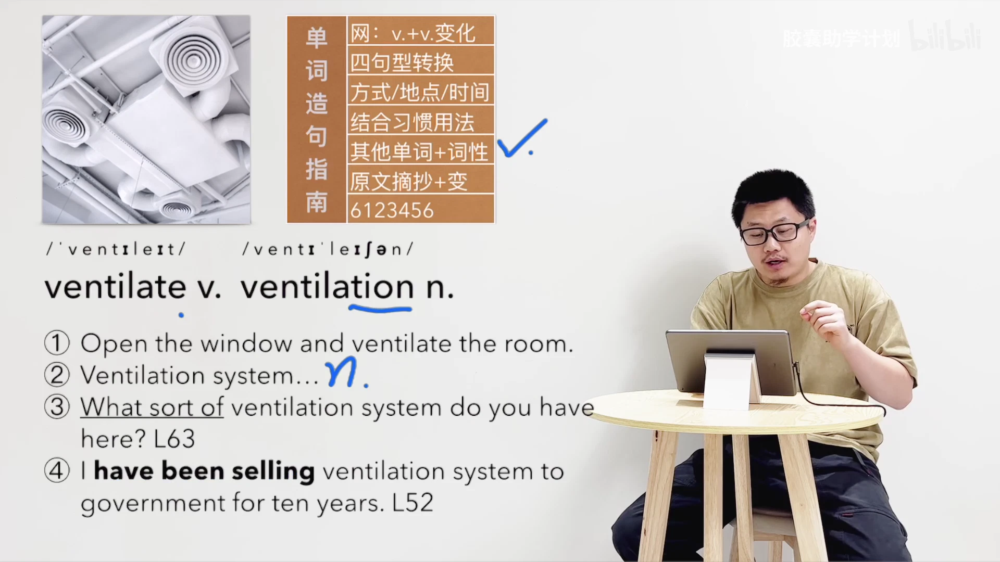

文字识别：单词造句指南 / 网：v.+v.变化 / 四句型转换 / 方式/地点/时间 / 结合习惯用法 / 其他单词+词性 / 原文摘抄+变 / 6123456 / /'ventileit/ / /venti'lei∫an/ / ventilate v. ventilation n. / ① Open the window and ventilate the room. / ② Ventilation system...Y. / What sort of ventilation system do you have / here? L63 / ) I have been selling ventilation system to / government for ten years. L52

### 画面 00:05:36

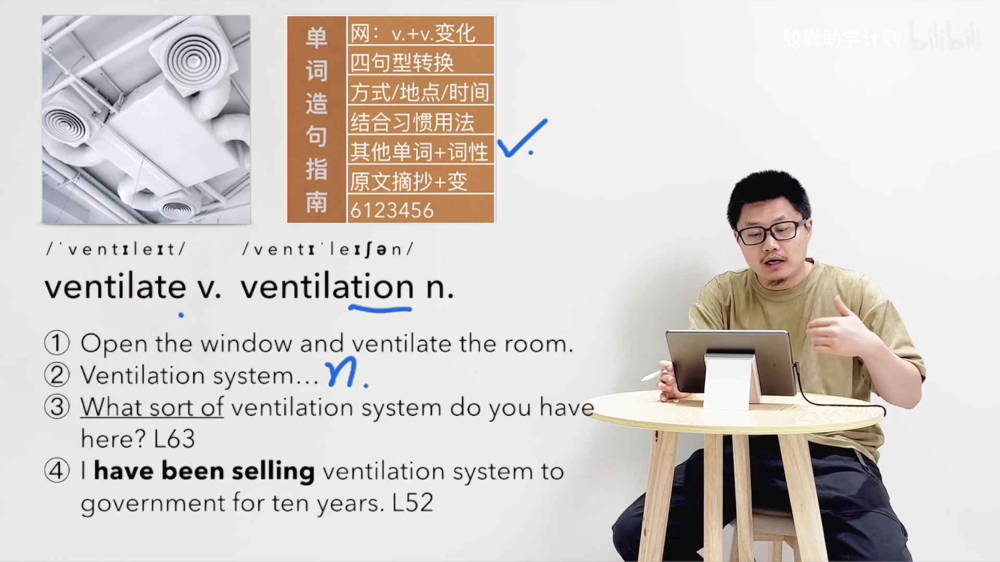

文字识别：单词造句指南 / 网：v.+v.变化 / 四句型转换 / 方式/地点/时间 / 结合习惯用法 / 其他单词+词性 / 原文摘抄+变 / 6123456 / /'ventileit/ / /ventr'lei∫an/ / ventilate v. ventilation n. / ① Open the window and ventilate the room. / ② Ventilation system..Y. / What sort of ventilation system do you have / here? L63 /  I have been selling ventilation system to / government for ten years. L52

### 画面 00:05:40

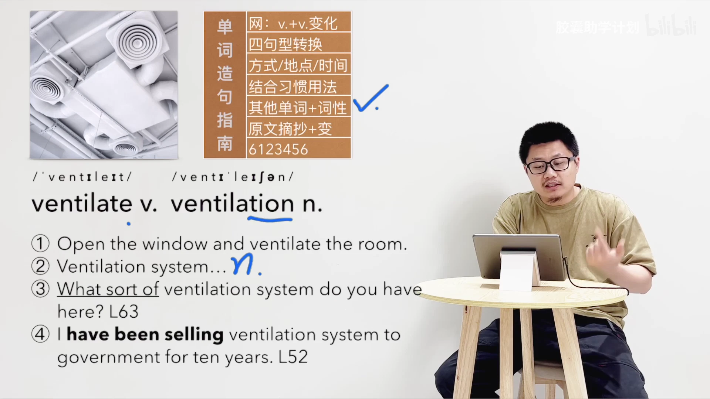

文字识别：单词造句指南 / 网：v.+v.变化 / 四句型转换 / 方式/地点/时间 / 结合习惯用法 / 其他单词+词性 / 原文摘抄+变 / 6123456 / /'ventileit/ / /venti'lei∫an/ / ventilate v. ventilation n. / ① Open the window and yentilate the room. / ② Ventilation system...Y. / What sort of ventilation system do you have / 3 / here? L63 /  I have been selling ventilation system to / government for ten years. L52

### 画面 00:05:43

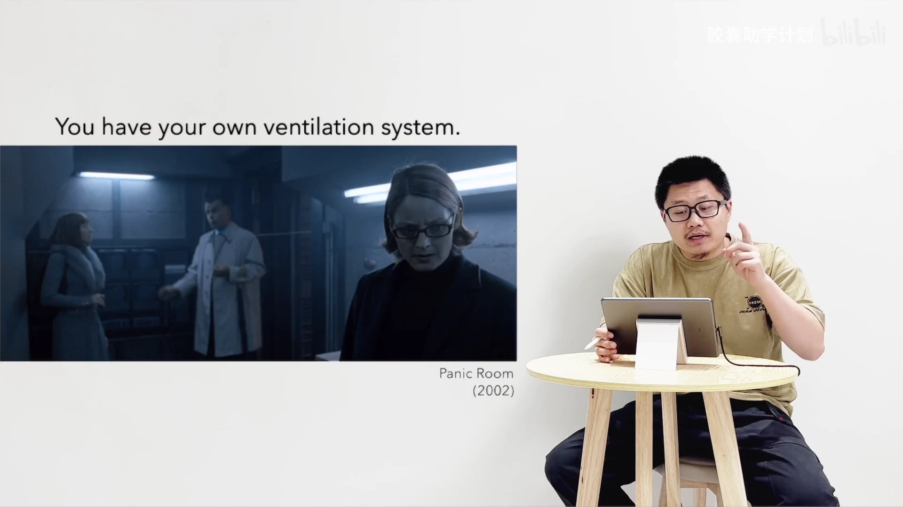

文字识别：You have your own ventilation system. / Panic Room / (2002)

### 画面 00:05:49

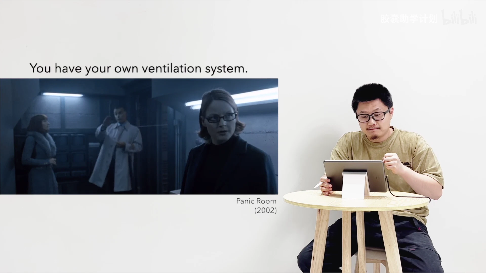

文字识别：You have your own ventilation system. / Panic Room / (2002)

### 画面 00:05:51

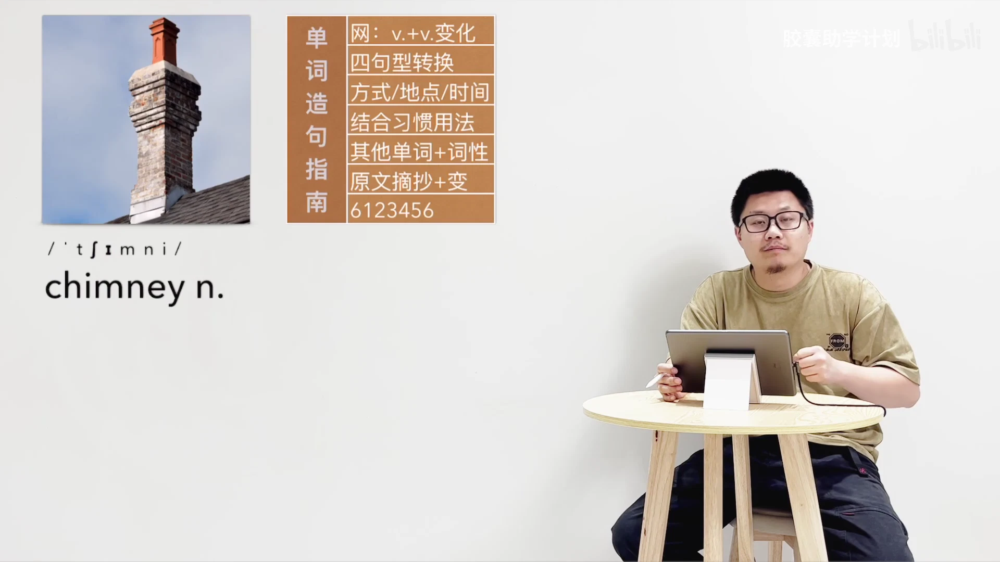

文字识别：单词造句指南 / 网：v.+v.变化 / 四句型转换 / 方式/地点/时间 / 结合习惯用法 / 其他单词+词性 / 原文摘抄+变 / 6123456 / /'t ∫imni / / chimney n.

### 画面 00:05:54

文字识别：单词造句指南 / 网：v.+v.变化 / 四句型转换 / 方式/地点/时间 / 结合习惯用法 / 其他单词+词性 / 原文摘抄+变 / 6123456 / /'t ∫imni / / chimney n.

### 画面 00:05:56

文字识别：单词造句指南 / 网：v.+v.变化 / 四句型转换 / 方式/地点/时间 / 结合习惯用法 / 其他单词+词性 / 原文摘抄+变 / 6123456 / /'t ∫imni / / chimney n.

## 00:06:00–00:06:30

啊，烟囱是吧？Okay, chimney.那chimney这个单词，你想，你可以把它当做六一二三四五六，我们现在想去造句啊，都可以做什么？当时间来说不太好做，当主语应该是可以的。那我当主语的时候，二可能我就要去选择被动，对吧？当三呢，没问题，打扫啊，清理呀，都可以打扫清理chimney。当四呢，副词不行。当地点呢，指定是没有问题了，对吧？那咱们那它去造句啊，比如说，I have been

### 画面 00:06:21

文字识别：单词造句指南 / 网：v.+v.变化 / 四句型转换 / 方式/地点/时间 / 结合习惯用法 / 其他单词+词性 / 原文摘抄+变 / 6123456 / /'t∫imni/ / chimney n.

### 画面 00:06:26

文字识别：单词造句指南 / 网：v.+v.变化 / 四句型转换 / 方式/地点/时间 / 结合习惯用法 / 其他单词+词性 / 原文摘抄+变 / 6123456 / / ' t ∫I m n i / / chimney n. / ① I have been cleaning the chimney since 9. L52

## 00:06:30–00:07:00

cleaning the chimney since nine. 我从九点钟开始就一直在打扫清理这个 chimney，对吧？这是五十二课咱们学的啊。 Next one, say he must have been cleaning the chimney yesterday afternoon. 最好其实再给他加一个具体的时间，比如说 at three o'clock. 昨天下午三点钟的时候，他当时一定是正在打扫清理什么什么 chimney，对吧？ Must have

### 画面 00:06:30

文字识别：单词造句指南 / 网：v.+v.变化 / 四句型转换 / 方式/地点/时间 / 结合习惯用法 / 其他单词+词性 / 原文摘抄+变 / 6123456 / / ' t ∫I m n i / / chimney n. / ① I have been cleaning the chimney since 9. L52

### 画面 00:06:36

文字识别：单词造句指南 / 网：v.+v.变化 / 四句型转换 / 方式/地点/时间 / 结合习惯用法 / 其他单词+词性 / 原文摘抄+变 / 6123456 / / ' t ∫I m n i / / chimney n. / ① I have been cleaning the chimney since 9. L52

### 画面 00:06:40

文字识别：单词造句指南 / 网：v.+v.变化 / 四句型转换 / 方式/地点/时间 / 结合习惯用法 / 其他单词+词性 / 原文摘抄+变 / 6123456 / / ' t ∫Ⅰ m n i / / chimney n. / ① I have been cleaning the chimney since 9. L52 / He must have been cleaning the chimney / yesterday afternoon. L17

### 画面 00:06:44

文字识别：单词造句指南 / 网：v.+v.变化 / 四句型转换 / 方式/地点/时间 / 结合习惯用法 / 其他单词+词性 / 原文摘抄+变 / 6123456 / / ' t ∫Ⅰ m n i / / chimney n. / ① I have been cleaning the chimney since 9. L52 / He must have been cleaning the chimney / yesterday afternoon. L17

### 画面 00:06:46

文字识别：单词造句指南 / 网：v.+v.变化 / 四句型转换 / 方式/地点/时间 / 结合习惯用法 / 其他单词+词性 / 原文摘抄+变 / 6123456 / / ' t ∫Ⅰ m n i / / chimney n. / ① I have been cleaning the chimney since 9. L52 / He must have been cleaning the chimney / yesterday afternoon. L17

### 画面 00:06:50

文字识别：单词造句指南 / 网：v.+v.变化 / 四句型转换 / 方式/地点/时间 / 结合习惯用法 / 其他单词+词性 / 原文摘抄+变 / 6123456 / / ' t ∫Ⅰ m n i / / chimney n. / ① I have been cleaning the chimney since 9. L52 / He must have been cleaning the chimney / yesterday afternoon. L17

### 画面 00:06:55

文字识别：单词造句指南 / 网：v.+v.变化 / 四句型转换 / 方式/地点/时间 / 结合习惯用法 / 其他单词+词性 / 原文摘抄+变 / 6123456 / / 't ∫Imni / / chimney n. / ① I have been cleaning the chimney since 9. L52 / He must have been cleaning the chimney / yesterday afternoon. L17

## 00:07:00–00:07:30

been doing叫当时一定是正在做某件事情。Okay, very good. Next one,说we need to build a chimney.我们需要建造这样一个烟囱，目的是什么呢？So that结果状语从句，对吧？哎，能起到这样一个结果啊，起到这样一个目的，什么呢？叫做the smoke can go out. Okay,啊，说这个烟呢可以出去。五十九课咱们学了so that，对不对？Okay, very good. Next

### 画面 00:07:00

文字识别：单词造句指南 / 网：v.+v.变化 / 四句型转换 / 方式/地点/时间 / 结合习惯用法 / 其他单词+词性 / 原文摘抄+变 / 6123456 / / ' t ∫Ⅰ m n i / / chimney n. / ① I have been cleaning the chimney since 9. L52 / He must have been cleaning the chimney / yesterday afternoon. L17

### 画面 00:07:04

文字识别：单词造句指南 / 网：v.+v.变化 / 四句型转换 / 方式/地点/时间 / 结合习惯用法 / 其他单词+词性 / 原文摘抄+变 / 6123456 / / ' t ∫I m n i / / chimney n. / ① I have been cleaning the chimney since 9. L52 /  He must have been cleaning the chimney / yesterday afternoon. L17 / We need to build a chimney so that the smoke / can go out. L59

### 画面 00:07:06

文字识别：单词造句指南 / 网：v.+v.变化 / 四句型转换 / 方式/地点/时间 / 结合习惯用法 / 其他单词+词性 / 原文摘抄+变 / 6123456 / / 't ∫Imni / / chimney n. / ① I have been cleaning the chimney since 9. L52 / FROM /  He must have been cleaning the chimney / yesterday afternoon. L17 / We need to build a chimney so that the smoke / can go out. L59

### 画面 00:07:10

文字识别：单词造句指南 / 网：v.+v.变化 / 四句型转换 / 方式/地点/时间 / 结合习惯用法 / 其他单词+词性 / 原文摘抄+变 / 6123456 / / ' t ∫I m n i / / chimney n. / ① I have been cleaning the chimney since 9. L52 /  He must have been cleaning the chimney / yesterday afternoon. L17 / We need to build a chimney so that the smoke / can go out. L59

### 画面 00:07:15

文字识别：单词造句指南 / 网：v.+v.变化 / 四句型转换 / 方式/地点/时间 / 结合习惯用法 / 其他单词+词性 / 原文摘抄+变 / 6123456 / / ' t ∫I m n i / / chimney n. / ① I have been cleaning the chimney since 9. L52 /  He must have been cleaning the chimney / yesterday afternoon. L17 / We need to build a chimney so that the smoke / can go out. L59

### 画面 00:07:25

文字识别：单词造句指南 / 网：v.+v.变化 / 四句型转换 / 方式/地点/时间 / 结合习惯用法 / 其他单词+词性 / 原文摘抄+变 / 6123456 / / ' t ∫I m n i / / chimney n. / ① I have been cleaning the chimney since 9. L52 / ) He must have been cleaning the chimney / yesterday afternoon. L17 / We need to build a chimney so that the smoke / can go out. L59

### 画面 00:07:29

文字识别：单词造句指南 / 网：v.+v.变化 / 四句型转换 / 方式/地点/时间 / 结合习惯用法 / 其他单词+词性 / 原文摘抄+变 / 6123456 / / ·t ∫Imni / / chimney n. / ① I have been cleaning the chimney since 9. L52 / ) He must have been cleaning the chimney / yesterday afternoon. L17 / We need to build a chimney so that the smoke / can go out. L59 / We must remove the chimney from your house / L59

## 00:07:30–00:08:00

one, say we must remove the chimney from your house. Ah, we don't use it anymore, is it? We don't use it anymore, is it? We don't use it anymore, is it? We don't use it anymore, is it? We don't use it anymore, is it? We don't use it anymore, is it? We don't use it anymore, is it? We don't use it anymore, is it? We don't use it anymore, is it? We don't use it anymore, is it? We don't use it anymore, is it? We don't use it anymore, is it? We don't use it anymore, is it? We don't use it anymore, is it? We don't use it anymore, is it? We don't use it anymore, is it? We don't use it anymore, is it? We don't use it anymore, is it? We don't use it anymore, is it? We don't use it anymore, is it? We don't use it

### 画面 00:07:31

文字识别：单词造句指南 / 网：v.+v.变化 / 四句型转换 / 方式/地点/时间 / 结合习惯用法 / 其他单词+词性 / 原文摘抄+变 / 6123456 / / 't ∫imni / / chimney n. / ① I have been cleaning the chimney since 9. L52 / 203 / ) He must have been cleaning the chimney / yesterday afternoon. L17 / We need to build a chimney so that the smoke / can go out. L59 / We must remove the chimney from your house / L59

### 画面 00:07:35

文字识别：单词造句指南 / 网：v.+v.变化 / 四句型转换 / 方式/地点/时间 / 结合习惯用法 / 其他单词+词性 / 原文摘抄+变 / 6123456 / / 't ∫imni / / chimney n. / ① I have been cleaning the chimney since 9.L52 /  He must have been cleaning the chimney / yesterday afternoon. L17 / We need to build a chimney so that the smoke / can go out. L59 / We must remove the chimney from your house / L59

### 画面 00:07:37

文字识别：单词造句指南 / 网：v.+v.变化 / 四句型转换 / 方式/地点/时间 / 结合习惯用法 / 其他单词+词性 / 原文摘抄+变 / 6123456 / / 't ∫Imni / / chimney n. / ① I have been cleaning the chimney since 9. L52 / ) He must have been cleaning the chimney / yesterday afternoon. L17 / We need to build a chimney so that the smoke / can go out. L59 / We must remove the chimney from your house. / L59

### 画面 00:07:40

文字识别：单词造句指南 / 网：v.+v.变化 / 四句型转换 / 方式/地点/时间 / 结合习惯用法 / 其他单词+词性 / 原文摘抄+变 / 6123456 / / 't ∫Imni / / chimney n. / ① I have been cleaning the chimney since 9. L52 / ) He must have been cleaning the chimney / yesterday afternoon. L17 / We need to build a chimney so that the smoke / can go out. L59 / We must remove the chimney from your house / L59

### 画面 00:07:46

文字识别：单词造句指南 / 网：v.+v.变化 / 四句型转换 / 方式/地点/时间 / 结合习惯用法 / 其他单词+词性 / 原文摘抄+变 / 6123456 / / 't ∫imni / / chimney n. / ① I have been cleaning the chimney since 9. L52 /  He must have been cleaning the chimney / yesterday afternoon. L17 / We need to build a chimney so that the smoke / can go out. L59 / We must remove the chimney from your house / L59

### 画面 00:07:49

文字识别：单词造句指南 / 网：v.+v.变化 / 四句型转换 / 方式/地点/时间 / 结合习惯用法 / 其他单词+词性 / 原文摘抄+变 / 6123456 / /'leval/ / sea level

### 画面 00:07:51

文字识别：单词造句指南 / 网：v.+v.变化 / 四句型转换 / 方式/地点/时间 / 结合习惯用法 / 其他单词+词性 / 原文摘抄+变 / 6123456 / /'leval/ / sea level

### 画面 00:07:55

文字识别：单词造句指南 / 网：v.+v.变化 / 四句型转换 / 方式/地点/时间 / 结合习惯用法 / 其他单词+词性 / 原文摘抄+变 / 6123456 / /'leval/ / sea level

### 画面 00:07:59

文字识别：单词造句指南 / 网：v.+v.变化 / 四句型转换 / 方式/地点/时间 / 结合习惯用法 / 其他单词+词性 / 原文摘抄+变 / 6123456 / /'leval/ / sea level

## 00:08:00–00:08:30

意思呢？就是水平。那 sea level就是海平面。那很常见的两个介词跟它放到一起去用 above sea level below sea level above海平面以上 below海平面以下 very good我们看句子说 the village is one thousand meters above sea level说这个小村庄是海平面以上一千米啊 next one我

### 画面 00:08:02

文字识别：单词造句指南 / 网：v.+v.变化 / 四句型转换 / 方式/地点/时间 / 结合习惯用法 / 其他单词+词性 / 原文摘抄+变 / 6123456 / /'leval/ / sea level

### 画面 00:08:04

文字识别：单词造句指南 / 网：v.+v.变化 / 四句型转换 / 方式/地点/时间 / 结合习惯用法 / 其他单词+词性 / 原文摘抄+变 / 6123456 / /'leval/ / sea level

### 画面 00:08:13

文字识别：单词造句指南 / 网：v.+v.变化 / 四句型转换 / 方式/地点/时间 / 结合习惯用法 / 其他单词+词性 / 原文摘抄+变 / 6123456 / /'leval/ / sea level / ① above/below sea level...

### 画面 00:08:16

文字识别：单词造句指南 / 网：v.+v.变化 / 四句型转换 / 方式/地点/时间 / 结合习惯用法 / 其他单词+词性 / 原文摘抄+变 / 6123456 / /'leval/ / sea level / ) above/below sea level... / The village is 1,000 meters above sea level.

### 画面 00:08:19

文字识别：单词造句指南 / 网：v.+v.变化 / 四句型转换 / 方式/地点/时间 / 结合习惯用法 / 其他单词+词性 / 原文摘抄+变 / 6123456 / /'leval/ / sea level / ) above/below sea level... / The village is 1,000 meters above sea level.

### 画面 00:08:29

文字识别：单词造句指南 / 网：v.+v.变化 / 四句型转换 / 方式/地点/时间 / 结合习惯用法 / 其他单词+词性 / 原文摘抄+变 / 6123456 / /'leval/ / sea level / ) above/below sea level... / The village is 1,000 meters above sea level. / It is said that most of the great cities are / near sea level. L58

## 00:08:30–00:09:00

it is said that if 58克啊，那个被诅咒的树那课各位学的好，这课这个知识点您应该牢牢记着，是吧？你看我不停的在用它。据说，据说什么呢？据说就不用非得给，但当然你别别瞎造谣，对吧？那大多数情况下我们不用给一个具体的理性上的原因去支持啊。说据说怎么的呢？Most of the great cities are near sea level.说据说大多数啊，特别伟大的城市

### 画面 00:08:35

文字识别：单词造句指南 / 网：v.+v.变化 / 四句型转换 / 方式/地点/时间 / 结合习惯用法 / 其他单词+词性 / 原文摘抄+变 / 6123456 / /'leval/ / sea level /  above/below sea level... / The village is 1,000 meters above sea level. / It is said that most of the great cities are / near sea level. L58

### 画面 00:08:40

文字识别：单词造句指南 / 网：v.+v.变化 / 四句型转换 / 方式/地点/时间 / 结合习惯用法 / 其他单词+词性 / 原文摘抄+变 / 6123456 / /'leval/ / sea level / ① above/below sea level... / The village is 1,000 meters above sea level. / It is said that most of the great cities are / near sea level. L58

### 画面 00:08:44

文字识别：单词造句指南 / 网：v.+v.变化 / 四句型转换 / 方式/地点/时间 / 结合习惯用法 / 其他单词+词性 / 原文摘抄+变 / 6123456 / /'leval/ / sea level /  above/below sea level... / The village is 1,000 meters above sea level. / It is said that most of the great cities are / near sea level. L58

### 画面 00:08:49

文字识别：单词造句指南 / 网：v.+v.变化 / 四句型转换 / 方式/地点/时间 / 结合习惯用法 / 其他单词+词性 / 原文摘抄+变 / 6123456 / /'leval/ / sea level /  above/below sea level... / The village is 1,000 meters above sea level. / It is said that most of the great cities are / near sea level. L58

### 画面 00:08:59

文字识别：单词造句指南 / 网：v.+v.变化 / 四句型转换 / 方式/地点/时间 / 结合习惯用法 / 其他单词+词性 / 原文摘抄+变 / 6123456 / /'leval/ / sea level /  above/below sea level... / The village is 1,000 meters above sea level. / It is said that most of the great cities are / near sea level. L58

## 00:09:00–00:09:30

啊，像北京啊，就比如说像东京啊，像比如说纽约、伦敦啊，就这样的 great cities。迪拜，对吧？怎么样呢？啊，near sea level，是在海平面附近的，对吧？就跟海平面几乎是持平的。OK，那儿一个。那再读一遍这个单词 sea level，那儿一个。接下来呢，我们看一个电影片段。这个电影片段非常好的用到了今天我们要复习和学习的这个知识点，叫

### 画面 00:09:04

文字识别：单词造句指南 / 网：v.+v.变化 / 四句型转换 / 方式/地点/时间 / 结合习惯用法 / 其他单词+词性 / 原文摘抄+变 / 6123456 / /'leval/ / sea level / ① above/below sea level... / The village is 1,000 meters above sea level. / It is said that most of the great cities are / near sea level. L58

### 画面 00:09:08

文字识别：单词造句指南 / 网：v.+v.变化 / 四句型转换 / 方式/地点/时间 / 结合习惯用法 / 其他单词+词性 / 原文摘抄+变 / 6123456 / /'leval/ / sea level /  above/below sea level... / The village is 1,000 meters above sea level. / It is said that most of the great cities are / near sea level. L58

### 画面 00:09:10

文字识别：单词造句指南 / 网：v.+v.变化 / 四句型转换 / 方式/地点/时间 / 结合习惯用法 / 其他单词+词性 / 原文摘抄+变 / 6123456 / /'leval/ / sea level /  above/below sea level... / The village is 1,000 meters above sea level. / It is said that most of the great cities are / near sea level. L58

### 画面 00:09:14

文字识别：单词造句指南 / 网：v.+v.变化 / 四句型转换 / 方式/地点/时间 / 结合习惯用法 / 其他单词+词性 / 原文摘抄+变 / 6123456 / /'leval/ / sea level /  above/below sea level... / The village is 1,000 meters above sea level. / It is said that most of the great cities are / near sea level. L58

### 画面 00:09:19

文字识别：单词造句指南 / 网：v.+v.变化 / 四句型转换 / 方式/地点/时间 / 结合习惯用法 / 其他单词+词性 / 原文摘抄+变 / 6123456 / /'leval/ / sea level / ① above/below sea level... / The village is 1,000 meters above sea level. / It is said that most of the great cities are / near sea level. L58

### 画面 00:09:21

文字识别：If we weren't so far below sea level, / the radio reception here would be much better. / Slap Shot / (1977)

## 00:09:30–00:10:00

虚拟语气啊，提前透析一下是吧？那我们复习一下四十课咱们学的 won't 以及 would be 是吧？与客观事实相反，所以你看这句话说，如果我们不是在海平面如此以下的地方，对吧？哎，离海平面如此的远，我们在海平面以下如此的远，怎么样呢？这个 radio reception here would be much better。说这个地方这个你听到的这个 radio 啊，这个呃 F M A M 那些

### 画面 00:09:51

文字识别：If we weren't so far below sea level, / the radio reception here would be much better. / Slap Shot / (1977)

## 00:10:00–00:10:30

东西对吧？哎，当然这里可能不是他要听这个这个广播啊，可能是他们的这个通讯设施啊。 Radio reception，说这里呢会好得多，但与客观事实相反，所以我们仅仅靠这句话就能判断他们现在也许是在潜艇里、潜水艇里，对不对？在海平面以下很远很远的地方。虚拟语气，注意力集中，我们听一下。 If we weren't so far below sea level, the radio reception here would be much better.

### 画面 00:10:21

文字识别：If we weren't so far below sea level, / the radio reception here would be much better. / Slap Shot / (1977)

### 画面 00:10:24

文字识别：If we weren't so far below sea level, / the radio reception here would be much better. / Slap Shot / (1977)

### 画面 00:10:26

文字识别：If we weren't so far below sea level, / the radio reception here would be much better. / Slap Shot / (1977)

## 00:10:30–00:11:00

Okay, there you go.接下来下一个单词啊，两个对吧？Double, double, double. There you go.那double这个单词呢，它既可以是形容词，又可以当动词去用。口语当中还真的经常当动词去用。这个我觉得对于各位来说，我这个例句一下你就能记住。We could double our money,对吧？我们能把我们的钱翻倍，投资理财翻倍啊，有风险需谨慎，对吧？We could double our

### 画面 00:10:31

文字识别：单词造句指南 / 网：v.+v.变化 / 四句型转换 / 方式/地点/时间 / 结合习惯用法 / 其他单词+词性 / 原文摘抄+变 / 6123456 / / 'dabal/ / double adj. v.

### 画面 00:10:34

文字识别：单词造句指南 / 网：v.+v.变化 / 四句型转换 / 方式/地点/时间 / 结合习惯用法 / 其他单词+词性 / 原文摘抄+变 / 6123456 / / 'dabal/ / double adj. v.

### 画面 00:10:39

文字识别：单词造句指南 / 网：v.+v.变化 / 四句型转换 / 方式/地点/时间 / 结合习惯用法 / 其他单词+词性 / 原文摘抄+变 / 6123456 / /  dΛ b al / / double adj. v. / ① We could double our money.

### 画面 00:10:44

文字识别：单词造句指南 / 网：v.+v.变化 / 四句型转换 / 方式/地点/时间 / 结合习惯用法 / 其他单词+词性 / 原文摘抄+变 / 6123456 / /  dΛ b al / / double adj. v. / ① We could double our money.

### 画面 00:10:49

文字识别：单词造句指南 / 网：v.+v.变化 / 四句型转换 / 方式/地点/时间 / 结合习惯用法 / 其他单词+词性 / 原文摘抄+变 / 6123456 / /  da b al / / double adj. v. / ① We could double our money.

### 画面 00:10:55

文字识别：单词造句指南 / 网：v.+v.变化 / 四句型转换 / 方式/地点/时间 / 结合习惯用法 / 其他单词+词性 / 原文摘抄+变 / 6123456 / /  dΛ b al / / double adj. v. / ① We could double our money.

### 画面 00:10:59

文字识别：单词造句指南 / 网：v.+v.变化 / 四句型转换 / 方式/地点/时间 / 结合习惯用法 / 其他单词+词性 / 原文摘抄+变 / 6123456 / /  d Λ b al / / double adj. v. / ① We could double our money.

## 00:11:00–00:11:30

Mariko. 那你看这里就是个动词，对吧？那包括你看这里说 I I am going to double your salary. 说我要把你的薪水 double掉。 Double掉什么意思？原来赚一万，我现在让你赚两万，对吧？哎，就好比比如说我现在我跟 Berlin，我们现在要去挖人了，对吧？他现在一个月赚一万，我就跟他说啊，我现在赚钱很多钱，我就跟他说底气十足。 I am going to double your salary. 那跟我走吧，对吧？ Double your salary.

### 画面 00:11:03

文字识别：单词造句指南 / 网：v.+v.变化 / 四句型转换 / 方式/地点/时间 / 结合习惯用法 / 其他单词+词性 / 原文摘抄+变 / 6123456 / /  dΛb al / / double adj. v. / ① We could double our money. / are / ② I am going to double your salary.

### 画面 00:11:05

文字识别：单词造句指南 / 网：v.+v.变化 / 四句型转换 / 方式/地点/时间 / 结合习惯用法 / 其他单词+词性 / 原文摘抄+变 / 6123456 / / 'dΛ b al / / double adj. v. / ① We could double our money. / ② I am going to double your salary.

### 画面 00:11:09

文字识别：单词造句指南 / 网：v.+v.变化 / 四句型转换 / 方式/地点/时间 / 结合习惯用法 / 其他单词+词性 / 原文摘抄+变 / 6123456 / / 'dΛb al / / double adj. v. / ① We could double our money. / ② Iam going to double your salary.

### 画面 00:11:14

文字识别：单词造句指南 / 网：v.+v.变化 / 四句型转换 / 方式/地点/时间 / 结合习惯用法 / 其他单词+词性 / 原文摘抄+变 / 6123456 / / 'dΛ b al / / double adj. v. / ① We could double our money. / ② I am going to double your salary.

### 画面 00:11:19

文字识别：单词造句指南 / 网：v.+v.变化 / 四句型转换 / 方式/地点/时间 / 结合习惯用法 / 其他单词+词性 / 原文摘抄+变 / 6123456 / / ' dΛ b a l / / double adj. v. / ① We could double our money. / ② Iam going to double your salary.

### 画面 00:11:28

文字识别：单词造句指南 / 网：v.+v.变化 / 四句型转换 / 方式/地点/时间 / 结合习惯用法 / 其他单词+词性 / 原文摘抄+变 / 6123456 / / ' dΛ b a l / / double adj. v. / ① We could double our money. / ② Iam going to double your salary.

## 00:11:30–00:12:00

of means

### 画面 00:11:32

文字识别：单词造句指南 / 网：v.+v.变化 / 四句型转换 / 方式/地点/时间 / 结合习惯用法 / 其他单词+词性 / 原文摘抄+变 / 6123456 / / d Λ ba l / / double adj. v. / ① We could double our money. / ② I am going to double your salary. / They make all sorts of good double / meat burgers. L63

### 画面 00:11:34

文字识别：单词造句指南 / 网：v.+v.变化 / 四句型转换 / 方式/地点/时间 / 结合习惯用法 / 其他单词+词性 / 原文摘抄+变 / 6123456 / / d Λ ba l / / double adj. v. / ① We could double our money. / ② I am going to double your salary. / They make all sorts of good double / meat burgers. L63

### 画面 00:11:42

文字识别：单词造句指南 / 网：v.+v.变化 / 四句型转换 / 方式/地点/时间 / 结合习惯用法 / 其他单词+词性 / 原文摘抄+变 / 6123456 / /.dΛbal/ / double adj. v. / ① We could double our money. / ② I am going to double your salary. / They / rake all sorts of good double / 3 / meat burgers. L63

### 画面 00:11:44

文字识别：单词造句指南 / 网：v.+v.变化 / 四句型转换 / 方式/地点/时间 / 结合习惯用法 / 其他单词+词性 / 原文摘抄+变 / 6123456 / / dΛbal/ / double adj. v. / ① We could double our money. / ② I am going to double your salary. / They make all sorts of good double / meat burgers. L63

### 画面 00:11:54

文字识别：单词造句指南 / 网：v.+v.变化 / 四句型转换 / 方式/地点/时间 / 结合习惯用法 / 其他单词+词性 / 原文摘抄+变 / 6123456 / / 'd Λ ba l / / double adj. v. / ① We could double our money. / ② I am going to double your salary. / They make all sorts of good double / meat burgers. L63

### 画面 00:11:59

文字识别：单词造句指南 / 网：v.+v.变化 / 四句型转换 / 方式/地点/时间 / 结合习惯用法 / 其他单词+词性 / 原文摘抄+变 / 6123456 / / d Λ ba l / / double adj. v. / ① We could double our money. / ② I am going to double your salary. / They make all sorts of good double / meat burgers. L63

## 00:12:00–00:12:30

三课咱们学的，very good。那还有一个口语当中您需要记住的叫double check，复查，再查一遍double check，对吧？比如说，we need to double check all his work。我们需要复查一遍他所有的工作。为什么呢？这个人现在出问题了，比如说经济犯罪，那我们需要把他所有的工作再审核一遍。他是我们公司财务，对吧？OK。那呃，注意力集

### 画面 00:12:04

文字识别：单词造句指南 / 网：v.+v.变化 / 四句型转换 / 方式/地点/时间 / 结合习惯用法 / 其他单词+词性 / 原文摘抄+变 / 6123456 / /.dΛbal/ / double adj. v. / ① We could double our money. / ② I am going to double your salary. / They make all sorts of good double / 3 / meat burgers. L63 / double check ...

### 画面 00:12:10

文字识别：单词造句指南 / 网：v.+v.变化 / 四句型转换 / 方式/地点/时间 / 结合习惯用法 / 其他单词+词性 / 原文摘抄+变 / 6123456 / / dnbal/ / double adj. v. / ① We could double our money. / ② I am going to double your salary. / They make all sorts of good double / meat burgers. L63 / double check ...

### 画面 00:12:14

文字识别：单词造句指南 / 网：v.+v.变化 / 四句型转换 / 方式/地点/时间 / 结合习惯用法 / 其他单词+词性 / 原文摘抄+变 / 6123456 / /dΛbal/ / double adj. v. / ① We could double our money. / ② I am going to double your salary. / They make all sorts of good double / 3 / meat burgers. L63 / double check / ⑤ We need to double check all his work.

### 画面 00:12:19

文字识别：单词造句指南 / 网：v.+v.变化 / 四句型转换 / 方式/地点/时间 / 结合习惯用法 / 其他单词+词性 / 原文摘抄+变 / 6123456 / / dΛbal/ / double adj. v. / ① We could double our money. / ② I am going to double your salary. / They make all sorts of good double / 3 / meat burgers. L63 / double check / ⑤ We need to double check all his work.

### 画面 00:12:27

文字识别：You know, I'm gonna have to double check, / but I'm pretty sure there's other girls / out there besides Rebecca. / Way Off Broadway / (2001)

## 00:12:30–00:13:00

中，我们听一个小的电影片段。这里边每个单词我们应该都是学过的，我就不多提了，注意力集中就好了啊。 Yeah, I'm gonna have to double check, but I'm pretty sure there's other girls out there besides Rebecca. Very good. 下一个说 I will double check them, sir. No problem. 来一个，我会再查一遍的，double check them，对吧？ Very good. 注意力集中啊。 I will double check them, sir. No problem. Next one, 下一个单词跟我读一下，叫做 fear.

### 画面 00:12:38

文字识别：You know, I'm gonna have to double check, / but I'm pretty sure there's other girls / out there besides Rebecca. / Way Off Broadway / (2001)

### 画面 00:12:40

文字识别：You know, I'm gonna have to double check, / but I'm pretty sure there's other girls / out there besides Rebecca. / Way Off Broadway / (2001)

### 画面 00:12:42

文字识别：You know, I'm gonna have to double check, / but I'm pretty sure there's other girls / out there besides Rebecca. / Way Off Broadway / (2001)

### 画面 00:12:44

文字识别：I will double check them, sir. No problem. / Hidden Figures / (2016)

### 画面 00:12:55

文字识别：I will double check them, sir. No problem. / Hidden Figures / (2016)

### 画面 00:12:57

文字识别：单词造句指南 / 网：v.+v.变化 / 四句型转换 / 方式/地点/时间 / 结合习惯用法 / 其他单词+词性 / 原文摘抄+变 / 6123456 / /fia/ / fear v. n.

### 画面 00:12:59

文字识别：单词造句指南 / 网：v.+v.变化 / 四句型转换 / 方式/地点/时间 / 结合习惯用法 / 其他单词+词性 / 原文摘抄+变 / 6123456 / /fia/ / fear v. n.

## 00:13:00–00:13:30

fear. 那 fear 的意思就是最基本的意思叫恐惧啊，它动动名都可以啊，都是这个含义，恐惧。当然还有一个新的意思，一会儿我们再去说。呃，生活当中实际应用当中，包括考试当中也很常用啊。但是基本上你记住恐惧就可以了，是恐惧的变体。比如说 that's why that's 啊，这个地方还有一个小的重复啊，这个就不应该再有 P S 了，就是 that is why they fear us. 说这就是

### 画面 00:13:18

文字识别：单词造句指南 / 网：v.+v.变化 / 四句型转换 / 方式/地点/时间 / 结合习惯用法 / 其他单词+词性 / 原文摘抄+变 / 6123456 / /fial / fear v. n. / That's is why they fear us.

### 画面 00:13:20

文字识别：单词造句指南 / 网：v.+v.变化 / 四句型转换 / 方式/地点/时间 / 结合习惯用法 / 其他单词+词性 / 原文摘抄+变 / 6123456 / /fia/ / fear v. n. / That's is why they fear us.

### 画面 00:13:24

文字识别：单词造句指南 / 网：v.+v.变化 / 四句型转换 / 方式/地点/时间 / 结合习惯用法 / 其他单词+词性 / 原文摘抄+变 / 6123456 / / fia/ / fear v. n. / ① That / is why they fear us.

### 画面 00:13:29

文字识别：单词造句指南 / 网：v.+v.变化 / 四句型转换 / 方式/地点/时间 / 结合习惯用法 / 其他单词+词性 / 原文摘抄+变 / 6123456 / /fia/ / fear v. n. / ① That / is why they fear us.

## 00:13:30–00:14:00

为什么他恐惧我们，他害怕我们，对吧？Next one.说Why do you fear the past?说你为什么害怕过去呢？Continue.这个地方就要引出来一个新的用法，叫Somebody fear that.再加上一句话，它是什么呢？就是某人呢，恐怕某件事情会发生，或者怎么怎么样。比如说，I fear that.我恐怕有点

### 画面 00:13:34

文字识别：单词造句指南 / 网：v.+v.变化 / 四句型转换 / 方式/地点/时间 / 结合习惯用法 / 其他单词+词性 / 原文摘抄+变 / 6123456 / /fia/ / fear v. n. / ① Thati / is why they fear us. / Why do you fear the past? The Lord of the Rings: / The Fellowship of the Ring (2001)

### 画面 00:13:39

文字识别：单词造句指南 / 网：v.+v.变化 / 四句型转换 / 方式/地点/时间 / 结合习惯用法 / 其他单词+词性 / 原文摘抄+变 / 6123456 / /fia/ / fear v. n. / ① That🎒is / is why they fear us. / Why do you fear the past? The Lord ofthe Rings: / The Fellowship of the Ring (2001)

### 画面 00:13:44

文字识别：单词造句指南 / 网：v.+v.变化 / 四句型转换 / 方式/地点/时间 / 结合习惯用法 / 其他单词+词性 / 原文摘抄+变 / 6123456 / /fia/ / fear v. n. / ① That is why they fear us. / Why do you fear the past? The Lord ofthe Rings: / The Fellowship of the Ring (2001) / ) Sb.fear that +句子

### 画面 00:13:52

文字识别：单词造句指南 / 网：v.+v.变化 / 四句型转换 / 方式/地点/时间 / 结合习惯用法 / 其他单词+词性 / 原文摘抄+变 / 6123456 / /fia/ / fear v. n. / ① Thatlis / is why they fear us. / Why do you fear the past? The Lord of the Rings: / The Fellowship of the Ring (2001) / Sb. fea that +句子

### 画面 00:13:54

文字识别：单词造句指南 / 网：v.+v.变化 / 四句型转换 / 方式/地点/时间 / 结合习惯用法 / 其他单词+词性 / 原文摘抄+变 / 6123456 / /fia/ / fear v. n. / ① That🎒i / is why they fear us. / Why do you fear the past? The Lord of the Rings: / The Fellowship of the Ring (2001) / Sb. fea that +句子

### 画面 00:13:57

文字识别：单词造句指南 / 网：v.+v.变化 / 四句型转换 / 方式/地点/时间 / 结合习惯用法 / 其他单词+词性 / 原文摘抄+变 / 6123456 / /fia/ / fear v. n. / ① Thatli / is why they fear us. / Why do you fear the past? The Lord of the Rings: / The Fellowship of the Ring (2001) / Sb.feathat +句子 / Ifear that I will never see it again.

### 画面 00:13:59

文字识别：单词造句指南 / 网：v.+v.变化 / 四句型转换 / 方式/地点/时间 / 结合习惯用法 / 其他单词+词性 / 原文摘抄+变 / 6123456 / /fia/ / fear v. n. / ① Thati /  is why they fear us. / Why do you fear the past? The Lord of the Rings: / The Fellowship of the Ring (2001) / Sb. feathat +句子 / Lfear that I will never see it again.

## 00:14:00–00:14:30

I'm afraid that he

### 画面 00:14:01

文字识别：单词造句指南 / 网：v.+v.变化 / 四句型转换 / 方式/地点/时间 / 结合习惯用法 / 其他单词+词性 / 原文摘抄+变 / 6123456 / /fia/ / fear v. n. / ① Thatis why they fear us. / Why do you fear the past? The Lord ofthe Rings: / The Fellowship of the Ring (2001) / ) Sb.fear that +句子 / ) Ifear that I will never see it again. / 4

### 画面 00:14:05

文字识别：单词造句指南 / 网：v.+v.变化 / 四句型转换 / 方式/地点/时间 / 结合习惯用法 / 其他单词+词性 / 原文摘抄+变 / 6123456 / /fia/ / fear v. n. / ① Thatis why they fear us. / Why do you fear the past? The Lord of the Rings: / The Fellowship of the Ring (2001) / ) Sb.fear that + 句子 /  Lfear that I will never see it again. / 4)

### 画面 00:14:12

文字识别：单词造句指南 / 网：v.+v.变化 / 四句型转换 / 方式/地点/时间 / 结合习惯用法 / 其他单词+词性 / 原文摘抄+变 / 6123456 / /fia/ / fear v. n. / ① That is why they fear us. / Why do you fear the past? The Lord of the Rings: / The Fellowship of the Ring (2001) / ) Sb.fear that +句子 / ④ Lfear that I will never see it again. / Lfear that he won't be able to walk again. / 5 / L43

### 画面 00:14:16

文字识别：单词造句指南 / 网：v.+v.变化 / 四句型转换 / 方式/地点/时间 / 结合习惯用法 / 其他单词+词性 / 原文摘抄+变 / 6123456 / /fia/ / fear v. n. / ① Thatis why they fear us. / Why do you fear the past? The Lord of the Rings: / The Fellowship of the Ring (2001) / ) Sb.fear that +句子 / ④ Lfear that I will never see it again. / Lfear that he won't be able to walk again. / 5 / L43

### 画面 00:14:25

文字识别：单词造句指南 / 网：v.+v.变化 / 四句型转换 / 方式/地点/时间 / 结合习惯用法 / 其他单词+词性 / 原文摘抄+变 / 6123456 / /fia/ / fear v. n. / ① That is why they fear us. / Why do you fear the past? The Lord of the Rings: / The Fellowship of the Ring (2001) / ) Sb.fear that + 句子 / ④ Lfear that I will never see it again. / Lfear that he won't be able to walk again. / 5 / L43

### 画面 00:14:28

文字识别：单词造句指南 / 网：v.+v.变化 / 四句型转换 / 方式/地点/时间 / 结合习惯用法 / 其他单词+词性 / 原文摘抄+变 / 6123456 / /In'vei3an/ / invasion n.

## 00:14:30–00:15:00

来下一个单词，跟我一起读一下，叫做 invasion。 invasion， invasion 呢，就像这图中一样，侵略啊，侵略啊，本身名词。那我们造一句话，比如说， they had been preparing all night before the invasion started。你看这里边每个单词应该都是我们学过的。他们已经整准备了整整一个晚上了，在侵略开始之前。那我们说这场战争

### 画面 00:14:30

文字识别：单词造句指南 / 网：v.+v.变化 / 四句型转换 / 方式/地点/时间 / 结合习惯用法 / 其他单词+词性 / 原文摘抄+变 / 6123456 / /In'vei3an/ / invasion n.

### 画面 00:14:40

文字识别：单词造句指南 / 网：v.+v.变化 / 四句型转换 / 方式/地点/时间 / 结合习惯用法 / 其他单词+词性 / 原文摘抄+变 / 6123456 / /in'vei3an/ / invasion n. / ① They had been preparing all night before / the invasion started. L62

### 画面 00:14:45

文字识别：单词造句指南 / 网：v.+v.变化 / 四句型转换 / 方式/地点/时间 / 结合习惯用法 / 其他单词+词性 / 原文摘抄+变 / 6123456 / /In'vei3an/ / invasion n. / ① They had been preparing all night before / the invasion started. L62

### 画面 00:14:50

文字识别：单词造句指南 / 网：v.+v.变化 / 四句型转换 / 方式/地点/时间 / 结合习惯用法 / 其他单词+词性 / 原文摘抄+变 / 6123456 / /in'vei3an/ / invasion n. / ① They had been preparing all night before / the invasion started. L62

### 画面 00:14:57

文字识别：单词造句指南 / 网：v.+v.变化 / 四句型转换 / 方式/地点/时间 / 结合习惯用法 / 其他单词+词性 / 原文摘抄+变 / 6123456 / /in'vei3an/ / invasion n. / ① They had been preparing all night before / the invasion started. L62

## 00:15:00–00:15:30

是发生在过去，所以呢 started 也是过去，对吧？那这里是过去啊，过去完成进行时，六十二课咱们学的。 Okay, continue. 说 he was killed in the invasion，是吧？哎， in the invasion，说在这个侵略战争中他被杀死了，对吧？或者他死掉了。那注意这里的 was killed 就是被杀死了。 Okay, next one. 说 why are they talking about the invasion？他们为什么

### 画面 00:15:00

文字识别：单词造句指南 / 网：v.+v.变化 / 四句型转换 / 方式/地点/时间 / 结合习惯用法 / 其他单词+词性 / 原文摘抄+变 / 6123456 / /In'vei3an/ / invasion n. / ① They had been preparing all night before / the invasion started. L62

### 画面 00:15:03

文字识别：单词造句指南 / 网：v.+v.变化 / 四句型转换 / 方式/地点/时间 / 结合习惯用法 / 其他单词+词性 / 原文摘抄+变 / 6123456 / /in'vei3an/ / invasion n. / ① They had been preparing all night before / the invasion started. L62

### 画面 00:15:05

文字识别：单词造句指南 / 网：v.+v.变化 / 四句型转换 / 方式/地点/时间 / 结合习惯用法 / 其他单词+词性 / 原文摘抄+变 / 6123456 / /in'vei3an/ / invasion n. / ① They had been preparing all night before / the invasion started. L62

### 画面 00:15:11

文字识别：单词造句指南 / 网：v.+v.变化 / 四句型转换 / 方式/地点/时间 / 结合习惯用法 / 其他单词+词性 / 原文摘抄+变 / 6123456 / /in'vei3an/ / invasion n. / ① They had been preparing all night before / the invasion started. L62 / He was killed in the invasion. L10

### 画面 00:15:15

文字识别：单词造句指南 / 网：v.+v.变化 / 四句型转换 / 方式/地点/时间 / 结合习惯用法 / 其他单词+词性 / 原文摘抄+变 / 6123456 / /in'vei3an/ / invasion n. / ① They had been preparing all night before / the invasion started. L62 / He was killed in the invasion. L10

### 画面 00:15:25

文字识别：单词造句指南 / 网：v.+v.变化 / 四句型转换 / 方式/地点/时间 / 结合习惯用法 / 其他单词+词性 / 原文摘抄+变 / 6123456 / /in'vei3an/ / invasion n. / ① They had been preparing all night before / the invasion started. L62 / He was killed in the invasion. L10 / Why are they talking about the invasion?

### 画面 00:15:28

文字识别：单词造句指南 / 网：v.+v.变化 / 四句型转换 / 方式/地点/时间 / 结合习惯用法 / 其他单词+词性 / 原文摘抄+变 / 6123456 / /in'vei3an/ / invasion n. / ① They had been preparing all night before / the invasion started. L62 / He was killed in the invasion. L10 / Why are they talking about the invasion?

## 00:15:30–00:16:00

discussing this invasion? Okay, continue. A short time before, 62课咱们学的，很短时间之前啊，不久前，对吧？好，the invasion began. 战争开始了。那你像这里面，其实大多数话我们都可以进行四句型转换。这个对于各位来说，永远是最保底的这个造句的形式。那我更建议你，这个这个呃，实实在不行了，咱们再用，对

### 画面 00:15:30

文字识别：单词造句指南 / 网：v.+v.变化 / 四句型转换 / 方式/地点/时间 / 结合习惯用法 / 其他单词+词性 / 原文摘抄+变 / 6123456 / /in'vei3an/ / invasion n. / ① They had been preparing all night before / the invasion started. L62 / He was killed in the invasion. L10 / Why are they talking about the invasion?

### 画面 00:15:43

文字识别：单词造句指南 / 网：v.+v.变化 / 四句型转换 / 方式/地点/时间 / 结合习惯用法 / 其他单词+词性 / 原文摘抄+变 / 6123456 / /in'vei3an/ / invasion n. / ① They had been preparing allnight before / the invasion started. L62 / He was killed in the invasion. L10 / 3 / Why are they talking about the invasion? / A short time before, the invasion began. / L62

### 画面 00:15:45

文字识别：单词造句指南 / 网：v.+v.变化 / 四句型转换 / 方式/地点/时间 / 结合习惯用法 / 其他单词+词性 / 原文摘抄+变 / 6123456 / /In'vei3an/ / invasion n. / ① They had been preparing all night before / the invasion started. L62 / He was killed in the invasion. L10 / 3 / Why are they talking about the invasion? / A short time before, the invasion began. / L62

### 画面 00:15:50

文字识别：单词造 / 网：v.+v.变化 / 四句型转换 / 方式/地点/时间 / 旭句指南 / 结合习惯用法 / 其他单词+词性 / 原文摘抄+变 / 6123456 / /in'vei3an/ / invasion n. / ① They had been preparing all night before / the invasion started. L62 / He was killed in the invasion. L10 / 3 / Why are they talking about the invasion? / A short time before, the invasion began. / L62

## 00:16:00–00:16:30

吧？优先还是用别的，比如说多复习复习之前的单词啊，习惯用法呀，对吧？OK，那跟我读一遍这个单词，invasion。invasion，very good。Next one，下一个单词，officially，officially，officially是什么意思呢？叫正式的啊，很正式的。比如说，there is nothing officially wrong with it，说从从正式的角度来说，这个事儿没有错，

### 画面 00:16:03

文字识别：单词造 / 网：v.+v.变化 / 四句型转换 / 方式/地点/时间 / 旭句指南 / 结合习惯用法 / 其他单词+词性 / 原文摘抄+变 / 6123456 / /in'vei3an/ / invasion n. / ① They had been preparing all night before / the invasion started. L62 / He was killed in the invasion. L10 / 3 / Why are they talking about the invasion? / A short time before, the invasion began. / L62

### 画面 00:16:05

文字识别：单词造句指南 / 网：v.+v.变化 / 四句型转换 / 方式/地点/时间 / 结合习惯用法 / 其他单词+词性 / 原文摘抄+变 / 6123456 / /in'vei3an/ / invasion n. / ① They had been preparing all night before / the invasion started. L62 / He was killed in the invasion. L10 / Why are they talking about the invasion? / 3 / A short time before, the invasion began. / L62

### 画面 00:16:15

文字识别：单词造句指南 / 网：v.+v.变化 / 四句型转换 / 方式/地点/时间 / 结合习惯用法 / 其他单词+词性 / 原文摘抄+变 / 6123456 / /a'fr∫ali/ / officially adv.

### 画面 00:16:20

文字识别：单词造句指南 / 网：v.+v.变化 / 四句型转换 / 方式/地点/时间 / 结合习惯用法 / 其他单词+词性 / 原文摘抄+变 / 6123456 / /a'fr∫ali/ / officially adv.

### 画面 00:16:25

文字识别：单词造句指南 / 网：v.+v.变化 / 四句型转换 / 方式/地点/时间 / 结合习惯用法 / 其他单词+词性 / 原文摘抄+变 / 6123456 / / a' fi ∫a l i / / officially adv. / There's nothing officially wrong with it. Ed / Wood(1994)

### 画面 00:16:28

文字识别：单词造句指南 / 网：v.+v.变化 / 四句型转换 / 方式/地点/时间 / 结合习惯用法 / 其他单词+词性 / 原文摘抄+变 / 6123456 / / a ^ fi ∫a l i / / officially adv. / There's nothing officially wrong with it. Ed / Wood(1994)

## 00:16:30–00:17:00

是符合流程的。我举个例子啊，这是我给各位脑补的，对吧？哎，用那个 there be 句型。再来，比如说，Leo officially offered me a job tonight。哎，正式的，今天晚上给我提供了这个工作。OK，下一个，continue 四句型转换，不多说啊。The park will be officially opened next weekend。啊，还是要跟读啊，总是要张开嘴去跟读。说这个

### 画面 00:16:30

文字识别：单词造句指南 / 网：v.+v.变化 / 四句型转换 / 方式/地点/时间 / 结合习惯用法 / 其他单词+词性 / 原文摘抄+变 / 6123456 / / a' fi ∫a l i / / officially adv. / There's nothing officially wrong with it. Ed / Wood(1994)

### 画面 00:16:34

文字识别：单词造句指南 / 网：v.+v.变化 / 四句型转换 / 方式/地点/时间 / 结合习惯用法 / 其他单词+词性 / 原文摘抄+变 / 6123456 / / a' fi ∫a l i / / officially adv. / There's nothing officially wrong with it. Ed / Wood(1994)

### 画面 00:16:37

文字识别：单词造句指南 / 网：v.+v.变化 / 四句型转换 / 方式/地点/时间 / 结合习惯用法 / 其他单词+词性 / 原文摘抄+变 / 6123456 / / a'fi ∫a l i / / officially adv. / ) There's nothing officially wrong with it. Ed / Wood(1994) / ) Leo officially offered me a job tonight.

### 画面 00:16:40

文字识别：单词造句指南 / 网：v.+v.变化 / 四句型转换 / 方式/地点/时间 / 结合习惯用法 / 其他单词+词性 / 原文摘抄+变 / 6123456 / / a'fi ∫a l i / / officially adv. / ) There's nothing officially wrong with it. Ed / Wood(1994) / ) Leo officially offered me a job tonight.

### 画面 00:16:47

文字识别：单词造句指南 / 网：v.+v.变化 / 四句型转换 / 方式/地点/时间 / 结合习惯用法 / 其他单词+词性 / 原文摘抄+变 / 6123456 / /a'fr ∫ali / / officially adv. / ) There's nothing officially wrong with it. Ed / Wood(1994) / Leo officially offered me a job tonight. / did/who/why/when... / 3

### 画面 00:16:50

文字识别：单词造句指南 / 网：v.+v.变化 / 四句型转换 / 方式/地点/时间 / 结合习惯用法 / 其他单词+词性 / 原文摘抄+变 / 6123456 / /a'fr ∫ali/ / officially adv. / ① There's nothing officially wrong with it. Ed / Wood(1994) / Leo officially offered me a job tonight. / did/who/why/when... / The park will be officially opened next / weekend. L10

### 画面 00:16:56

文字识别：单词造句指南 / 网：v.+v.变化 / 四句型转换 / 方式/地点/时间 / 结合习惯用法 / 其他单词+词性 / 原文摘抄+变 / 6123456 / /a'fr ∫ali / / officially adv. / ① There's nothing officially wrong with it. Ed / Wood(1994) / Leo officially offered me a job tonight. / did/who/why/when... / The park will be officially opened next / weekend. L10

## 00:17:00–00:17:30

公园呐，下周末就要正式的开放了啊！之前试运营，现在正式开放了，officially open. Very good. 再读一遍这个单词，officially. 连起来，officially. Very good. 那听一下电影片段啊，我们练一下听力，注意力集中. I'm not officially retiring until the end of the year. Very good. 下

### 画面 00:17:05

文字识别：单词造句指南 / 网：v.+v.变化 / 四句型转换 / 方式/地点/时间 / 结合习惯用法 / 其他单词+词性 / 原文摘抄+变 / 6123456 / /a'fr ∫ali / / officially adv. / ① There's nothing officially wrong with it. Ed / Wood(1994) / Leo officially offered me a job tonight. / did/who/why/when... / The park will be officially opened next / weekend. L10

### 画面 00:17:11

文字识别：单词造句指南 / 网：v.+v.变化 / 四句型转换 / 方式/地点/时间 / 结合习惯用法 / 其他单词+词性 / 原文摘抄+变 / 6123456 / /a'fi ∫ali / / officially adv. / ① There's nothing officially wrong with it. Ed / Wood(1994) / Leo officially offered me a job tonight. / did/who/why/when... / The park will be officially opened next / weekend. L10

### 画面 00:17:16

文字识别：I'm not officially / retiring until the end of the year. / Signed, Sealed, Delivered: To the Altar / (2018)

### 画面 00:17:24

文字识别：I'm not officially / retiring until the end of the year. / Signed, Sealed, Delivered: To the Altar / (2018)

### 画面 00:17:27

文字识别：I'm not officially / retiring until the end of the year. / Signed, Sealed, Delivered: To the Altar / (2018)

### 画面 00:17:29

文字识别：单词造句指南 / 网：v.+v.变化 / 四句型转换 / 方式/地点/时间 / 结合习惯用法 / 其他单词+词性 / 原文摘抄+变 / 6123456 / /ka'nekt/ / connect v.

## 00:17:30–00:18:00

一个单词 connect, connect, connect, 连接啊联系都可以。比如说 Can I connect my printer to your computer? 我能把我的打印机连到你的电脑上吗？哎，我现在这样转念一想，也许给它反过来，可能是更多人的使用场景，叫做我能把我的电脑连到你的打印机上吗？对吧？所以，我们给它简单的临场换一下，叫 Can I connect my computer to your printer?

### 画面 00:17:31

文字识别：单词造句指南 / 网：v.+v.变化 / 四句型转换 / 方式/地点/时间 / 结合习惯用法 / 其他单词+词性 / 原文摘抄+变 / 6123456 / /ka'nekt/ / connect v.

### 画面 00:17:35

文字识别：单词造句指南 / 网：v.+v.变化 / 四句型转换 / 方式/地点/时间 / 结合习惯用法 / 其他单词+词性 / 原文摘抄+变 / 6123456 / /ka'nekt/ / connect v. / 105

### 画面 00:17:37

文字识别：单词造句指南 / 网：v.+v.变化 / 四句型转换 / 方式/地点/时间 / 结合习惯用法 / 其他单词+词性 / 原文摘抄+变 / 6123456 / / ka'nekt / / connect v. / ① Can I connect my printer to your computer?

### 画面 00:17:40

文字识别：单词造句指南 / 网：v.+v.变化 / 四句型转换 / 方式/地点/时间 / 结合习惯用法 / 其他单词+词性 / 原文摘抄+变 / 6123456 / / ka'nekt / / connect v. / ① Can I connect my printer to your computer?

### 画面 00:17:45

文字识别：单词造句指南 / 网：v.+v.变化 / 四句型转换 / 方式/地点/时间 / 结合习惯用法 / 其他单词+词性 / 原文摘抄+变 / 6123456 / / ka'n ekt / / connect v. / ① Can I connect my printer to your computer?

### 画面 00:17:47

文字识别：单词造句指南 / 网：v.+v.变化 / 四句型转换 / 方式/地点/时间 / 结合习惯用法 / 其他单词+词性 / 原文摘抄+变 / 6123456 / / ka'nekt / / connect v. / ① Can I connect my printer to your computer?

### 画面 00:17:51

文字识别：单词造句指南 / 网：v.+v.变化 / 四句型转换 / 方式/地点/时间 / 结合习惯用法 / 其他单词+词性 / 原文摘抄+变 / 6123456 / / k a'nek t / / connect v. / ① Can I connect my printer to your computer?

### 画面 00:17:59

文字识别：单词造句指南 / 网：v.+v.变化 / 四句型转换 / 方式/地点/时间 / 结合习惯用法 / 其他单词+词性 / 原文摘抄+变 / 6123456 / / k a'nekt / / connect v. / ① Can I connect my printer to your computer?

## 00:18:00–00:18:30

打印机。Okay, next one.你看刚才这个叫链接，物理意义上链接，对吧？接下来这个就是联系。比如说，I know this is all connected to you，是吧？我我知道这些都跟你有关系，对吧？Next one，说Lil has a large circle of friends too. That's true, and they are all connected with each other.说他们呢都和彼此互相有联系，be

### 画面 00:18:01

文字识别：单词造句指南 / 网：v.+v.变化 / 四句型转换 / 方式/地点/时间 / 结合习惯用法 / 其他单词+词性 / 原文摘抄+变 / 6123456 / / k a'nekt / / connect v. / ① Can I connect my printer to your computer? / ② I know this is all connected to you. L15

### 画面 00:18:05

文字识别：单词造句指南 / 网：v.+v.变化 / 四句型转换 / 方式/地点/时间 / 结合习惯用法 / 其他单词+词性 / 原文摘抄+变 / 6123456 / / ka'nekt / / connect v. / ① Can I connect my printer to your computer? / ② I know this is all connected to you. L15

### 画面 00:18:10

文字识别：单词造句指南 / 网：v.+v.变化 / 四句型转换 / 方式/地点/时间 / 结合习惯用法 / 其他单词+词性 / 原文摘抄+变 / 6123456 / /ka'nekt/ / connect v. / ① Can I connect my printer to your computer? / FROM / ② I know this is all connected to you. L15

### 画面 00:18:16

文字识别：单词造句指南 / 网：v.+v.变化 / 四句型转换 / 方式/地点/时间 / 结合习惯用法 / 其他单词+词性 / 原文摘抄+变 / 6123456 / / ka'nekt / / connect v. / ① Can I connect my printer to your computer? / ② I know this is all connected to you. L15

### 画面 00:18:18

文字识别：单词造句指南 / 网：v.+v.变化 / 四句型转换 / 方式/地点/时间 / 结合习惯用法 / 其他单词+词性 / 原文摘抄+变 / 6123456 / / ka'nekt / / connect v. / ① Can I connect my printer to your computer? / ② I know this is all connected to you. L15 / ③ Leo has a large circle of friends and they / 3） / are all connected with each other. L63

### 画面 00:18:20

文字识别：单词造句指南 / 网：v.+v.变化 / 四句型转换 / 方式/地点/时间 / 结合习惯用法 / 其他单词+词性 / 原文摘抄+变 / 6123456 / / ka'nekt/ / connect v. / ① Can I connect my printer to your computer? / ② I know this is all connected to you. L15 / ③ Leo has a large circle of friends and they / 3） / are all connected with each other. L63

### 画面 00:18:23

文字识别：单词造句指南 / 网：v.+v.变化 / 四句型转换 / 方式/地点/时间 / 结合习惯用法 / 其他单词+词性 / 原文摘抄+变 / 6123456 / / ka'nekt / / connect v. / ① Can I connect my printer to your computer? / ② I know this is all connected to you. L15 / ③ Leo has a large circle of friends and they / 3) / are all connected with each other. L63

### 画面 00:18:25

文字识别：单词造句指南 / 网：v.+v.变化 / 四句型转换 / 方式/地点/时间 / 结合习惯用法 / 其他单词+词性 / 原文摘抄+变 / 6123456 / / ka'nekt/ / connect v. / ① Can I connect my printer to your computer? / ② I know this is all connected to you. L15 / ③ Leo has a large circle of friends and they / 3 / are all connected with each other. L63

## 00:18:30–00:19:00

be connected with，对吧？Very good.啊，那这个 large circle friends 我们又复习了一遍啊，交际圈很广。再读一遍这个单词，connect. Very good.接下来两个单词放到一起去学。先看第一个叫做 European，注意重音在后面。再读一遍 European, European. Very good.很好。Continue. Next one叫做 continent, continent, continent.

### 画面 00:18:30

文字识别：单词造句指南 / 网：v.+v.变化 / 四句型转换 / 方式/地点/时间 / 结合习惯用法 / 其他单词+词性 / 原文摘抄+变 / 6123456 / / ka'nekt / / connect v. / ① Can I connect my printer to your computer? / ② I know this is all connected to you. L15 / ③ Leo has a large circle of friends and they / 3） / are all connected with each other. L63

### 画面 00:18:34

文字识别：单词造句指南 / 网：v.+v.变化 / 四句型转换 / 方式/地点/时间 / 结合习惯用法 / 其他单词+词性 / 原文摘抄+变 / 6123456 / / ka'nekt / / connect v. / ① Can I connect my printer to your computer? / ② I know this is all connected to you. L15 / ③ Leo has a large circle of friends and they / 3) / are all connected with each other. L63

### 画面 00:18:36

文字识别：单词造句指南 / 网：v.+v.变化 / 四句型转换 / 方式/地点/时间 / 结合习惯用法 / 其他单词+词性 / 原文摘抄+变 / 6123456 / / ka'nekt / / connect v. / ① Can I connect my printer to your computer? / ② I know this is all connected to you. L15 / ③ Leo has a large circle of friends and they / 3） / are all connected with each other. L63

### 画面 00:18:39

文字识别：单词造句指南 / 网：v.+v.变化 / NORWEGIAN SEA / 四句型转换 / 方式/地点/时间 / 结合习惯用法 / 其他单词+词性 / 原文摘抄+变 / 6123456 / /juara'piian/ / /'kpntinant/ / European adj. n. continent n.

### 画面 00:18:41

文字识别：单词造句指南 / 网：v.+v.变化 / NOR WEOIAN SEA / 四句型转换 / 方式/地点/时间 / 结合习惯用法 / 其他单词+词性 / 原文摘抄+变 / 6123456 / /juara'piian/ / /'kpntinant/ / European adj. n. continent n.

### 画面 00:18:45

文字识别：单词造句指南 / 网：v.+v.变化 / NORWEOIAN SEA / 四句型转换 / 方式/地点/时间 / 结合习惯用法 / 其他单词+词性 / 原文摘抄+变 / 6123456 / ljuara'piian/ / /'kpntinant/ / European adj. n. continent n.

### 画面 00:18:52

文字识别：单词造句指南 / 网：v.+v.变化 / NORWEGIAN SEA / 四句型转换 / 方式/地点/时间 / 结合习惯用法 / 其他单词+词性 / 原文摘抄+变 / 6123456 / /juara'piian/ / /'kpntinant/ / European adj. n. continent n.

### 画面 00:18:56

文字识别：单词造句指南 / 网：v.+v.变化 / NORWEOIAN SEA / 四句型转换 / 方式/地点/时间 / 结合习惯用法 / 其他单词+词性 / 原文摘抄+变 / 6123456 / /juara'pi:an/ / /'kpntinant/ / European adj. n. continent n.

## 00:19:00–00:19:30

continent就是大陆，但是在汉语当中，我们说大陆的时候，好像总是某种程度上，比如说大陆、台湾，好像是这样我们去用的，对吧？好，大陆啊，那在欧洲呢？各位注意啊，所以我给各位这这个地方呢，呃，找了一个图。各位这里是我们说的英伦三岛，对吧？及爱尔兰啊，是在这里。然后呢，英国人认为这

### 画面 00:19:11

文字识别：单词造句指南 / 网：v.+v.变化 / NORWEGIAN SEA / 四句型转换 / 方式/地点/时间 / 结合习惯用法 / 其他单词+词性 / 原文摘抄+变 / 6123456 / /juara'piian/ / /'kpntinant/ / European adj. n. continent n.

### 画面 00:19:16

文字识别：单词造句指南 / 网：v.+v.变化 / NORWEOIAN SEA / 四句型转换 / 方式/地点/时间 / 结合习惯用法 / 其他单词+词性 / 原文摘抄+变 / 6123456 / ljuara'piian/ / /'kpntinant/ / European adj. n. continent n.

### 画面 00:19:22

文字识别：单词造句指南 / 网：v.+v.变化 / NORWEOIAN SEA / 四句型转换 / 方式/地点/时间 / 结合习惯用法 / 其他单词+词性 / 原文摘抄+变 / 6123456 / /juara'pi:an/ / /'kpntinant/ / European adj. n. continent n.

### 画面 00:19:26

文字识别：单词造句指南 / 网：v.+v.变化 / NORWEOIAN SEA / 四句型转换 / 方式/地点/时间 / 结合习惯用法 / 其他单词+词性 / 原文摘抄+变 / 6123456 / /juara'piian/ / /'kpntinant/ / European adj. n. continent n.

## 00:19:30–00:20:00

片地儿啊，这片地儿啊，大差不差的就是 continent。对于英国人而言，这个就是他们的大陆，叫 continent，对吧？哎，你要知道，这个对于他们而言，他又不知道你当时有这片大陆，对吧？但是对他们而言呢，那英啊，这个法德啊，这个意啊，待的这片地方啊，就是对于英伦三岛而言的 continent。所以 European continent 指的就是这片地方，好吧？

### 画面 00:19:30

文字识别：单词造句指南 / 网：v.+v.变化 / NORWEOIAN SEA / 四句型转换 / 方式/地点/时间 / 结合习惯用法 / 其他单词+词性 / 原文摘抄+变 / 6123456 / /juara'piian/ / /'kpntinant/ / European adj. n. continent n.

### 画面 00:19:35

文字识别：单词造句指南 / 网：v.+v.变化 / NORWEOIAN SEA / 四句型转换 / 方式/地点/时间 / 结合习惯用法 / 其他单词+词性 / 原文摘抄+变 / 6123456 / /juara'piian/ / /'kpntinant/ / European adj. n. continent n.

### 画面 00:19:40

文字识别：单词造句指南 / 网：v.+v.变化 / NORWEOIAN SEA / 四句型转换 / 方式/地点/时间 / 结合习惯用法 / 其他单词+词性 / 原文摘抄+变 / 6123456 / /juara'pi:an/ / /'kpntinant/ / European adj.n. c / continent n.

### 画面 00:19:45

文字识别：单词造句指南 / 网：v.+v.变化 / NORWEOIAN SEA / 四句型转换 / 方式/地点/时间 / 结合习惯用法 / 其他单词+词性 / 原文摘抄+变 / 6123456 / /juara'pi:an/ / /'kpntinant/ / European adj.n. 0 / continent n.

### 画面 00:19:53

文字识别：单词造句指南 / 网：v.+v.变化 / NORWEOIAN SEA / 四句型转换 / 方式/地点/时间 / 结合习惯用法 / 其他单词+词性 / 原文摘抄+变 / 6123456 / /juara'piian/ / /'kpntinant/ / European adj. n. continent n.

### 画面 00:19:56

文字识别：单词造句指南 / 网：v.+v.变化 / NORWEOIAN SEA / 四句型转换 / 方式/地点/时间 / 结合习惯用法 / 其他单词+词性 / 原文摘抄+变 / 6123456 / /juara'piian/ / /'kpntinant/ / European adj. n. continent n.

### 画面 00:19:59

文字识别：单词造句指南 / 网：v.+v.变化 / NORWEOIAN SEA / 四句型转换 / 方式/地点/时间 / 结合习惯用法 / 其他单词+词性 / 原文摘抄+变 / 6123456 / /juara'piian/ / /'kpntinant/ / European adj. n. continent n.

## 00:20:00–00:20:30

就是现在这个我给各位涂满的这片地方啊。当然，如果你呃在英文的语境之下，如果你直接用continent，也基本上大多数时候指的也是这片地方啊。一般可以直接不加European了，European就是欧洲呃的啊，或者欧洲人啊都可以，对吧？一个统称。那我们造句子，比如说The Channel Tunnel，Channel Tunnel connected Britain to the European

### 画面 00:20:01

文字识别：单词造句指南 / 网：v.+v.变化 / NORWEOIAN SEA / 四句型转换 / 方式/地点/时间 / 结合习惯用法 / 其他单词+词性 / 原文摘抄+变 / 6123456 / /juara'piian/ / /'kpntinant/ / European adj. n. continent n.

### 画面 00:20:04

文字识别：单词造句指南 / 网：v.+v.变化 / NORWEOIAN SEA / 四句型转换 / 方式/地点/时间 / 结合习惯用法 / 其他单词+词性 / 原文摘抄+变 / 6123456 / /juara'pi:an/ / /'kpntinant/ / European adj.n. c / continent n.

### 画面 00:20:09

文字识别：单词造句指南 / 网：v.+v.变化 / NORWEOIAN SEA / 四句型转换 / 方式/地点/时间 / 结合习惯用法 / 其他单词+词性 / 原文摘抄+变 / 6123456 / /juara'pi:an/ / /'kpntinant/ / European adj. n. / continent n.

### 画面 00:20:14

文字识别：单词造句指南 / 网：v.+v.变化 / NORWEOIAN SEA / 四句型转换 / 方式/地点/时间 / 结合习惯用法 / 其他单词+词性 / 原文摘抄+变 / 6123456 / /juara'pi:an/ / /'kpntinant/ / European adj. n. / continent n.

### 画面 00:20:19

文字识别：单词造句指南 / 网：v.+v.变化 / NORWEOIAN SEA / 四句型转换 / 方式/地点/时间 / 结合习惯用法 / 其他单词+词性 / 原文摘抄+变 / 6123456 / /juara'piian/ / /'kpntinant/ / European adj. n. continent n.

### 画面 00:20:21

文字识别：单词造句指南 / 网：v.+v.变化 / NORWEOIAN SEA / 四句型转换 / 方式/地点/时间 / 结合习惯用法 / 其他单词+词性 / 原文摘抄+变 / 6123456 / /juara'pi:an/ / /'kpntinant/ / European adj. n. continent n.

### 画面 00:20:23

文字识别：单词造句指南 / 网：v.+v.变化 / NORWEOIAN SEA / 四句型转换 / 方式/地点/时间 / 结合习惯用法 / 其他单词+词性 / 原文摘抄+变 / 6123456 / /juara'piian/ / /'kpntinant/ / European adj. n. continent n. / ① [Story]: The Channel Tunnel connected / Britain to the European continent.

### 画面 00:20:25

文字识别：单词造句指南 / 网：v.+v.变化 / NORWEGIAN SEA / 四句型转换 / 方式/地点/时间 / 结合习惯用法 / 其他单词+词性 / 原文摘抄+变 / 6123456 / ljuara'piian/ / /'kpntinant/ / European adj. n. continent n. / ① [Story]: The Channel Tunnel connected / Britain to the European continent.

### 画面 00:20:29

文字识别：单词造句指南 / 网：v.+v.变化 / NORWEGIAN SEA / 四句型转换 / 方式/地点/时间 / 结合习惯用法 / 其他单词+词性 / 原文摘抄+变 / 6123456 / /juara'piian/ / /'kontinant/ / European adj. n. continent n. / ① [Story]: The Channel Tunnel connected / Britain to the European continent.

## 00:20:30–00:21:00

continent. 这是我们原文的一句话的变体啊。那 Channel Channel 是什么呢？就是我们这个英吉利海峡，对吧？也就是我们英吉利海峡建的这个隧道啊，在咱们这个呃文章的标题有出现啊。然后联系了 Britain，连接了 A to B。 B 是欧洲大陆， A 就是大不列颠及北爱尔兰联合王国，也就是我们说的叫做英国啊。它连接

### 画面 00:20:34

文字识别：单词造句指南 / 网：v.+v.变化 / NORWEGIAN SEA / 四句型转换 / 方式/地点/时间 / 结合习惯用法 / 其他单词+词性 / 原文摘抄+变 / 6123456 / /juara'piian/ / /'kpntinant/ / European adj. n. continent n. / ① [Story]: The Channel Tunnel connected / Britain to the European continent.

### 画面 00:20:37

文字识别：单词造句指南 / 网：v.+v.变化 / NORWEOIAN SEA / 四句型转换 / 方式/地点/时间 / 结合习惯用法 / 其他单词+词性 / 原文摘抄+变 / 6123456 / /juara'piian/ / /'kpntinant/ / European adj. n. continent n. / ① [Story]: The Channel Tunnel connected / Britain to the European continent.

### 画面 00:20:39

文字识别：单词造句指南 / 网：v.+v.变化 / NORWEOIAN SEA / 四句型转换 / 方式/地点/时间 / 结合习惯用法 / 其他单词+词性 / 原文摘抄+变 / 6123456 / ljuara'pi:an/ / /'kpntinant/ / European adj. n. continent n. / ① [Story]: TheChannel Tunnel / connected / Britain to the European continent.

### 画面 00:20:44

文字识别：单词造句指南 / 网：v.+v.变化 / NORWEOIAN SEA / 四句型转换 / 方式/地点/时间 / 结合习惯用法 / 其他单词+词性 / 原文摘抄+变 / 6123456 / /juara'pi:an/ / /'kpntinant/ / European adj. n. continent n. / ① [Story]: TheChannel Tunnel / connected / Britain to the European continent.

### 画面 00:20:49

文字识别：单词造句指南 / 网：v.+v.变化 / NORWEOIAN SEA / 四句型转换 / 方式/地点/时间 / 结合习惯用法 / 其他单词+词性 / 原文摘抄+变 / 6123456 / /juara'pi:an/ / /'kpntinant/ / European adj. n. continent n. / ① [Story]: TheChannel Tunnel / connected / Britain to the European continent.

### 画面 00:20:53

文字识别：单词造句指南 / 网：v.+v.变化 / NORWEOIAN SEA / 四句型转换 / 方式/地点/时间 / 结合习惯用法 / 其他单词+词性 / 原文摘抄+变 / 6123456 / /juara'pi:an/ / /'kpntinant/ / European adj. n. continent n. / ① [Story]: TheChannel Tunnel / connected / Britain to the European continent.

### 画面 00:20:55

文字识别：单词造句指南 / 网：v.+v.变化 / NORWEOIAN SEA / 四句型转换 / 方式/地点/时间 / 结合习惯用法 / 其他单词+词性 / 原文摘抄+变 / 6123456 / /juara'piian/ / /'kpntinant/ / European adj. n. continent n. / ①[Story]: The / Channel Tunnel / connected / ON / Britail / to the European continent.

### 画面 00:20:57

文字识别：单词造句指南 / 网：v.+v.变化 / NORWEOIAN SEA / 四句型转换 / 方式/地点/时间 / 结合习惯用法 / 其他单词+词性 / 原文摘抄+变 / 6123456 / /juara'pi:an/ / /'kpntinant/ / European adj. n. continent n. / ① [Story]: The Channel Tunnel connected / ROM / Britain to the European continent.

### 画面 00:20:59

文字识别：单词造句指南 / 网：v.+v.变化 / NORWEOIAN SEA / 四句型转换 / 方式/地点/时间 / 结合习惯用法 / 其他单词+词性 / 原文摘抄+变 / 6123456 / /juara'piian/ / /'kpntinant/ / European adj. n. continent n. / ① [Story]: The Channel Tunnel connected / Britain to the European continent.

## 00:21:00–00:21:30

了A和B，对吧？OK，那我们造句子四句型转换啊是可以做的。那我们口语当中很常见的一些句子非常简单，比如说They are European，他们是欧洲人，对吧？或者说I like European girls，哎，我喜欢欧洲的姑娘。OK， continue，比如说这句话我觉得很有诗意，虽然稍微有一点点超纲，并且不完全符合语法啊，所以我不需要你去背它，它毕竟是个电影台词，你就当我分享给你就好了，好

### 画面 00:21:05

文字识别：单词造句指南 / 网：v.+v.变化 / NORWEOIAN SEA / 四句型转换 / 方式/地点/时间 / 结合习惯用法 / 其他单词+词性 / 原文摘抄+变 / 6123456 / /juara'piian/ / /'kpntinant/ / European adj. n. continent n. / ① [Story]: The Channel Tunnel connected / Britain to the European continent. / did/how/what ... / They are European.

### 画面 00:21:09

文字识别：单词造句指南 / 网：v.+v.变化 / NORWEGIAN SEA / 四句型转换 / 方式/地点/时间 / 结合习惯用法 / 其他单词+词性 / 原文摘抄+变 / 6123456 / /juara'pi:an/ / /'kontinant/ / European adj. n. continent n. / ① [Story]: The Channel Tunnel connected / Britain to the European continent. / did/how/what ... / They are European.

### 画面 00:21:13

文字识别：单词造句指南 / 网：v.+v.变化 / NORWEGIAN SEA / 四句型转换 / 方式/地点/时间 / 结合习惯用法 / 其他单词+词性 / 原文摘抄+变 / 6123456 / /juara'pi:an/ / /'kpntinant/ / European adj. n. continent n. / ① [Story]: The Channel Tunnel connected / Britain to the European continent. / did/how/what ... / They are European. / I like European girls. Underbelly Files: Tell Them / Lucifer Was Here (2011)

### 画面 00:21:16

文字识别：单词造句指南 / 网：v.+v.变化 / NORWEOIAN SEA / 四句型转换 / 方式/地点/时间 / 结合习惯用法 / 其他单词+词性 / 原文摘抄+变 / 6123456 / /juara'piian/ / /'kpntinant/ / European adj. n. continent n. / ① [Story]: The Channel Tunnel connected / Britain to the European continent. / did/how/what ... / They are European. / ) I like European girls. Underbelly Files: TellThem / Lucifer Was Here (2011) / Will I ever return to that continent I so love? / Mountains of the Moon (1990)

### 画面 00:21:19

文字识别：单词造句指南 / 网：v.+v.变化 / NORWEOIAN SEA / 四句型转换 / 方式/地点/时间 / 结合习惯用法 / 其他单词+词性 / 原文摘抄+变 / 6123456 / /juara'pi:an/ / /'kontinant/ / European adj. n. continent n. / ① [Story]: The Channel Tunnel connected / Britain to the European continent. / did/how/what ... / They are European. / I like European girls. Underbelly Files: Tell Them / Lucifer Was Here (2011) / Will  ever return to that continent I so love? / Mountains of the Moon (1990)

### 画面 00:21:24

文字识别：单词造句指南 / 网：v.+v.变化 / NORWEOIAN SEA / 四句型转换 / 方式/地点/时间 / 结合习惯用法 / 其他单词+词性 / 原文摘抄+变 / 6123456 / /juara'pi:an/ / /'kontinant/ / European adj. n. continent n. / ① [Story]: The Channel Tunnel connected / Britain to the European continent. / did/how/what ... / They are European. / I like European girls. Underbelly Files: Tell Them / Lucifer Was Here (2011) / Will I ever return to that continent I so love? / Mountains of the Moon (1990)

### 画面 00:21:29

文字识别：单词造句指南 / 网：v.+v.变化 / NORWEOIAN SEA / 四句型转换 / 方式/地点/时间 / 结合习惯用法 / 其他单词+词性 / 原文摘抄+变 / 6123456 / /juara'pi:an/ / /'kontinant/ / European adj. n. continent n. / ① [Story]: The Channel Tunnel connected / Britain to the European continent. / did/how/what .. / They are European. / I like European girls. Underbelly Files: Tell Them / Lucifer Was Here (2011) / Will I ever return to that continent I so love? / Mountains of the Moon (1990)

## 00:21:30–00:22:00

吧？说 Will I ever return to that continent I so love? 什么意思呢？就是我还有机会再回到那片大陆上吗？哪片大陆呢？That I loved so much. 说我如此热爱的那片大陆上啊，你对应的这个心情，也许就像是每年春节联欢晚会的时候，有很多的华侨，对吧？海外各地的华侨也愿意一

### 画面 00:21:34

文字识别：单词造句指南 / 网：v.+v.变化 / NORWEOIAN SEA / 四句型转换 / 方式/地点/时间 / 结合习惯用法 / 其他单词+词性 / 原文摘抄+变 / 6123456 / /juara'pi:an/ / /'kontinant/ / European adj. n. continent n. / ① [Story]: The Channel Tunnel connected / Britain to the European continent. / did/how/what ... / They are European. / I like European girls. Underbelly Files: Tell Them / Lucifer Was Here (2011) / Will I ever return to that continent I so love? / Mountains of the Moon (1990)

### 画面 00:21:39

文字识别：单词造句指南 / 网：v.+v.变化 / NORWEGIAN SEA / 四句型转换 / 方式/地点/时间 / 结合习惯用法 / 其他单词+词性 / 原文摘抄+变 / 6123456 / /juara'pi:an/ / /'kpntinant/ / European adj. n. continent n. / ① [Story]: The Channel Tunnel connected / Britain to the European continent. / did/how/what ... / They are European. / I like European girls. Underbelly Files: Tell Them / Lucifer Was Here (2011) / Will l ever return to that continent I so love? / Mountains of the Moon (1990)

### 画面 00:21:44

文字识别：单词造句指南 / 网：v.+v.变化 / NORWEOIAN SEA / 四句型转换 / 方式/地点/时间 / 结合习惯用法 / 其他单词+词性 / 原文摘抄+变 / 6123456 / /juara'pi:an/ / /'kpntinant/ / European adj. n. continent n. / ① [Story]: The Channel Tunnel connected / Britain to the European continent. / did/how/what ... / They are European. / I like European girls. Underbelly Files: Tell Them / Lucifer Was Here (2011) / Will I ever return to that continent Lso love? / Mountains of the Moon (1990)

### 画面 00:21:50

文字识别：单词造句指南 / 网：v.+v.变化 / NORWEOIAN SEA / 四句型转换 / 方式/地点/时间 / 结合习惯用法 / 其他单词+词性 / 原文摘抄+变 / 6123456 / /juara'pi:an/ / /'kontinant/ / European adj. n. continent n. / ① [Story]: The Channel Tunnel connected / Britain to the European continent. / did/how/what ... / They are European. / I like European girls. Underbelly Files: Tell Them / Lucifer Was Here (2011) / Will I ever return to that continent I so love? / Mountains of the Moon (1990)

### 画面 00:21:54

文字识别：单词造句指南 / 网：v.+v.变化 / NORWEOIAN SEA / 四句型转换 / 方式/地点/时间 / 结合习惯用法 / 其他单词+词性 / 原文摘抄+变 / 6123456 / /juara'pi:an/ / /'kontinant/ / European adj. n. continent n. / ① [Story]: The Channel Tunnel connected / Britain to the European continent. / did/how/what ... / They are European. / ) I like European girls. Underbelly Files: TellThem / Lucifer Was Here (2011) / Will I ever return to that continent I so love? / Mountains of the Moon (1990)

## 00:22:00–00:22:30

起去跟着过这个春节，不管本地过不过，那那种感觉不就是什么啊？游子归来，对吧？特别渴望再次回到这片土地上的那个感觉。这句话就是那样的一种感受，叫Will I ever return to that continent I so love? OK，Very good。再读一遍这两个单词：European continent啊，大陆。OK，好。那Recap，除了本课单

### 画面 00:22:10

文字识别：单词造句指南 / 网：v.+v.变化 / NORWEOIAN SEA / 四句型转换 / 方式/地点/时间 / 结合习惯用法 / 其他单词+词性 / 原文摘抄+变 / 6123456 / /juara'piian/ / /'kpntinant/ / European adj. n. continent n. / ① [Story]: The Channel Tunnel connected / Britain to the European continent. / did/how/what ... / They are European. / I like European girls. Underbelly Files: Tell Them / Lucifer Was Here (2011) / Will l ever return to that continent I so love? / Mountains of the Moon (1990)

### 画面 00:22:13

文字识别：单词造句指南 / 网：v.+v.变化 / NORWEOIAN SEA / 四句型转换 / 方式/地点/时间 / 结合习惯用法 / 其他单词+词性 / 原文摘抄+变 / 6123456 / /juara'piian/ / /'kpntinant/ / European adj. n. continent n. / ① [Story]: The Channel Tunnel connected / Britain to the European continent. / did/how/what .. / They are European. / I like European girls. Underbelly Files: Tell Them / Lucifer Was Here (2011) / Will I ever return to that continent I so love? / Mountains of the Moon (1990)

### 画面 00:22:19

文字识别：单词造句指南 / 网：v.+v.变化 / NORWEOIAN SEA / 四句型转换 / 方式/地点/时间 / 结合习惯用法 / 其他单词+词性 / 原文摘抄+变 / 6123456 / /juara'pi:an/ / /'kontinant/ / European adj. n. continent n. / ① [Story]: The Channel Tunnel connected / Britain to the European continent. / did/how/what .. / They are European. / ) I like European girls. Underbelly Files: TellThem / Lucifer Was Here (2011) / Will I ever return to that continent I so love? / Mountains of the Moon (1990)

### 画面 00:22:24

文字识别：单词造句指南 / 网：v.+v.变化 / NORWEOIAN SEA / 四句型转换 / 方式/地点/时间 / 结合习惯用法 / 其他单词+词性 / 原文摘抄+变 / 6123456 / /juara'pi:an/ / /'kpntinant/ / European adj. n. continent n. / ① [Story]: The Channel Tunnel connected / SROM / Britain to the European continent. / did/how/what ... / They are European. / I like European girls. Underbelly Files: Tell Them / Lucifer Was Here (2011) / Will I ever return to that continent I so love? / Mountains of the Moon (1990)

### 画面 00:22:26

文字识别：Recap / Words / in the tunnel / above/below sea level / Expression / double check / Sb. fear that +句子

### 画面 00:22:28

文字识别：Recap / Words / in the tunnel / above/below sea level / Expression / double check / Sb. fear that +句子

## 00:22:30–00:23:00

词都很重要啊，大多数都很重要，除非我单独提它不重要的，呃，剩下的这些短语您也需要记一记啊。你比如像 double check 这句话在口语当中太常见了。 OK，好，交作业，单词造句啊，听电影，反复听，对吧？您也可以，比如说第一遍学完了，转天再来听也行，我觉得没问题啊。然后呢，看这个置顶留言，找到重复间隔的那些学习材料。 OK，呃，那以

### 画面 00:22:30

文字识别：Recap / Words / in the tunnel / above/below sea level / Expression / double check / Sb. fear that +句子

### 画面 00:22:32

文字识别：Recap / Words / in the tunnel / above/below sea level / Expression / double check / Sb. fear that +句子

### 画面 00:22:34

文字识别：Recap / Words / in the tunnel / above/below sea level / Expression / double check / Sb. fear that +句子

### 画面 00:22:37

文字识别：Recap / Words / in the tunnel / above/below sea level / Expression / double check / Sb. fear that +句子

### 画面 00:22:39

文字识别：Recap / Words / in the tunnel / above/below sea level / Expression / double check / Sb. fear that +句子

### 画面 00:22:41

文字识别：Recap / Words / in the tunnel / above/below sea level / Expression / double check / Sb. fear that +句子

### 画面 00:22:43

文字识别：单词造句/对话 / 1. / 【单词造句指南】 / 每个5句

### 画面 00:22:45

文字识别：单词造句/对话 / 【单词造句指南】 / 每个5句 / 反复听电影片段，直到能 / 听出关键短语/句子

### 画面 00:22:49

文字识别：单词造句/对话 / 【单词造句指南】 / 每个5句 / 反复听电影片段，直到能 / 听出关键短语/句子 / 301

### 画面 00:22:53

文字识别：单词造句/对话 / 【单词造句指南】 / 每个5句 / 2.反复听电影片段，直到能 / 听出关键短语/句子 / 3.重复间隔（置顶留言）

### 画面 00:22:55

文字识别：单词造句/对话 / 【单词造句指南】 / 每个5句 / 2.反复听电影片段，直到能 / 听出关键短语/句子 / 3.重复间隔（置顶留言） / FRON

### 画面 00:22:58

文字识别：👍 / ROM

## 00:23:00–00:23:24

all for this video. If you like our course, please follow us, subscribe, and share it with those who need it to help us grow. See you next time.

### 画面 00:23:07

### 画面 00:23:12

文字识别：CAPSULEACADEMY / 胶囊助学计划 / 『 / 小红书 / OE

### 画面 00:23:14

文字识别：CAPSULEACADEMY / 胶囊助学计划 / 小红书 / OE

### 画面 00:23:17

文字识别：CAPSULEACADEMY / 胶囊助学计划 / 小红书 / Editor / Berlin / OE

### 画面 00:23:19

文字识别：CAPSULEACADEMY / 胶囊助学计划 / 小红书 / Creator / Leo & Berlin / OE

### 画面 00:23:21

文字识别：胶囊助学计划b出出 / CAPSULEACADEMY / 胶囊助学计划 / 小红书 / OE

### 画面 00:23:23

文字识别：bilibili / 胶囊助学计划

