# 064 练习

快速机器解析：语音为单模型转写，未进行独立交叉校对或人工复核；画面每秒采样并按变化选帧，短时文字和标记可能遗漏。截图时间约有 1 秒误差。图片有损压缩；遇到疑点请按时间查看 Google Drive 原视频。

## 00:00:00–00:00:30

Hello everyone, welcome to Capsule Academy. This is Liu. Today we are going to learn New Concept English Book Two Lesson Sixty Four Practices. 那注意啊，进行如下练习的唯一前提就是您文章要跟读至熟读成诵，否则请勿开始。 Hope you gonna enjoy it. 第一题 comprehension. 那咱们要做的事情是听懂一般疑问句和特殊疑问句，对吧？ OK,

### 画面 00:00:00

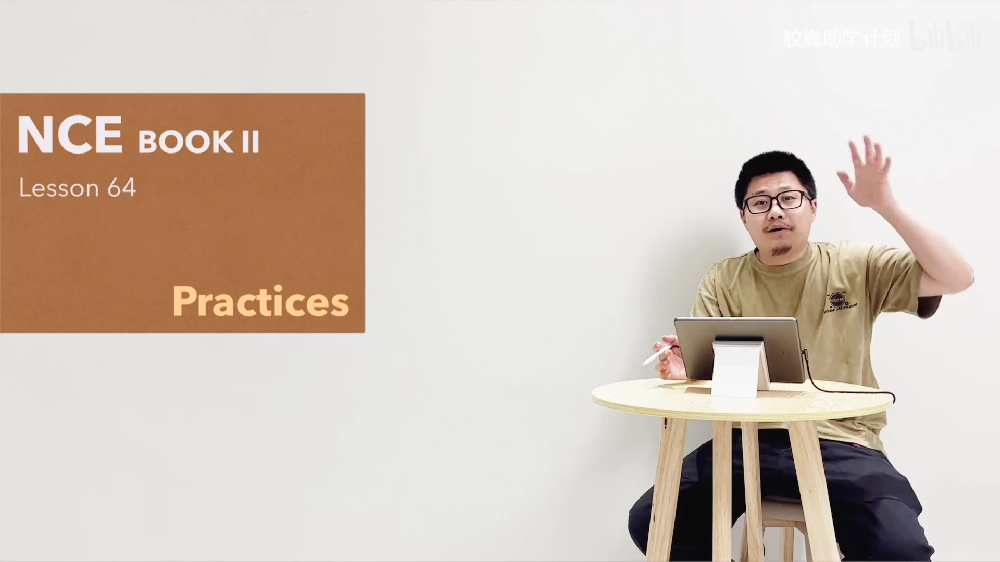

文字识别：NCE / BOOKII / Lesson 64 / Practices

### 画面 00:00:02

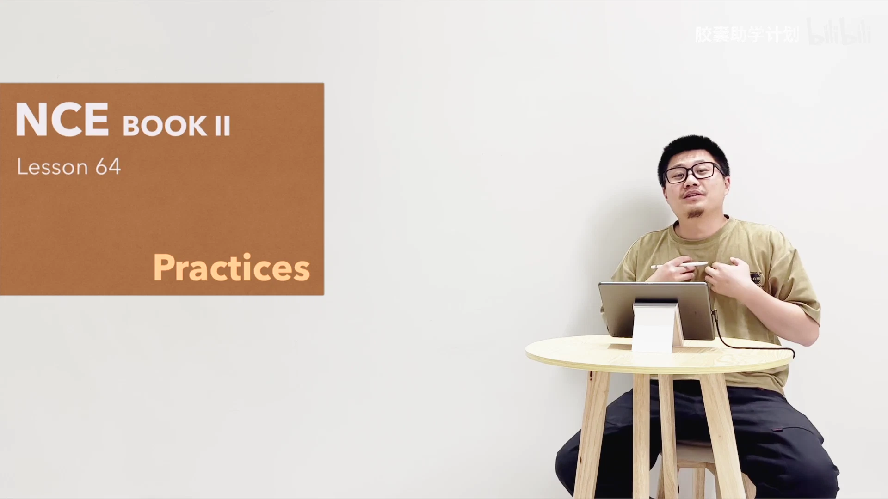

文字识别：NCE / BOOKⅡI / Lesson 64 / Practices

### 画面 00:00:04

文字识别：NCE / BOOKII / Lesson 64 / Practices

### 画面 00:00:07

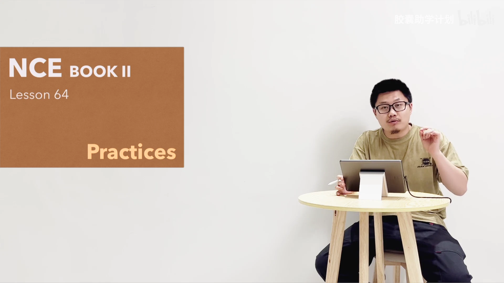

文字识别：NCE / BOOKI"I / Lesson 64 / Practices

### 画面 00:00:09

文字识别：进行如下练习唯一前提 / 文章跟读至熟读成诵 / 否则请勿开始

### 画面 00:00:18

文字识别：胶囊助学计划bill / •

### 画面 00:00:22

文字识别：胶囊助学计划

### 画面 00:00:24

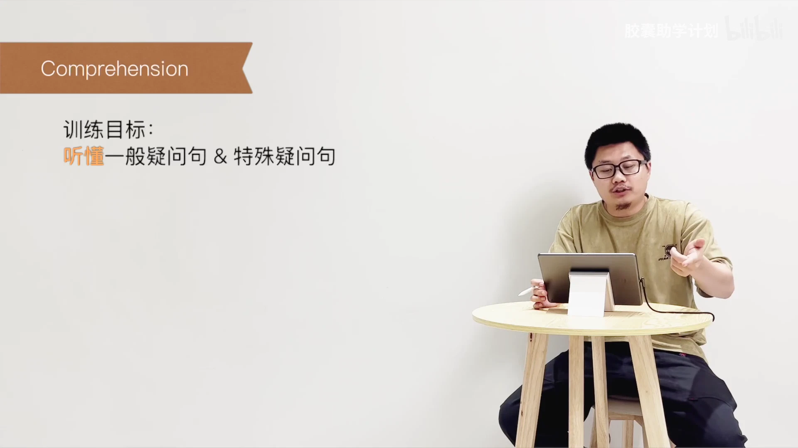

文字识别：Comprehension / 训练目标： / 听懂一般疑问句＆特殊疑问句

### 画面 00:00:27

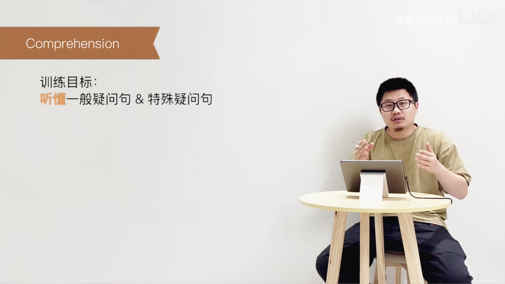

文字识别：Comprehension / 训练目标： / 听懂一般疑问句＆特殊疑问句

## 00:00:30–00:01:00

呃，我问您答来了啊。When did Emile Tomal Digamond arrived in England? In 1858. Was he an engineer or an astronaut? Astronaut就宇航员啊。那Of course, he was an engineer. What nationality was he? French. What did he have

### 画面 00:00:30

文字识别：Comprehension / ROM

### 画面 00:00:32

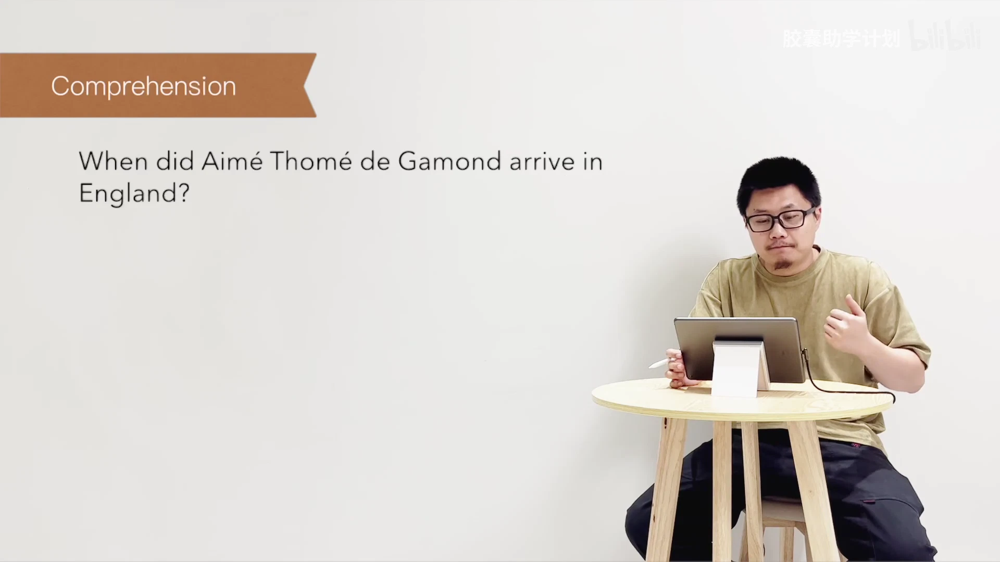

文字识别：Comprehension / When did Aimé Thomé de Gamond arrive in / England?

### 画面 00:00:38

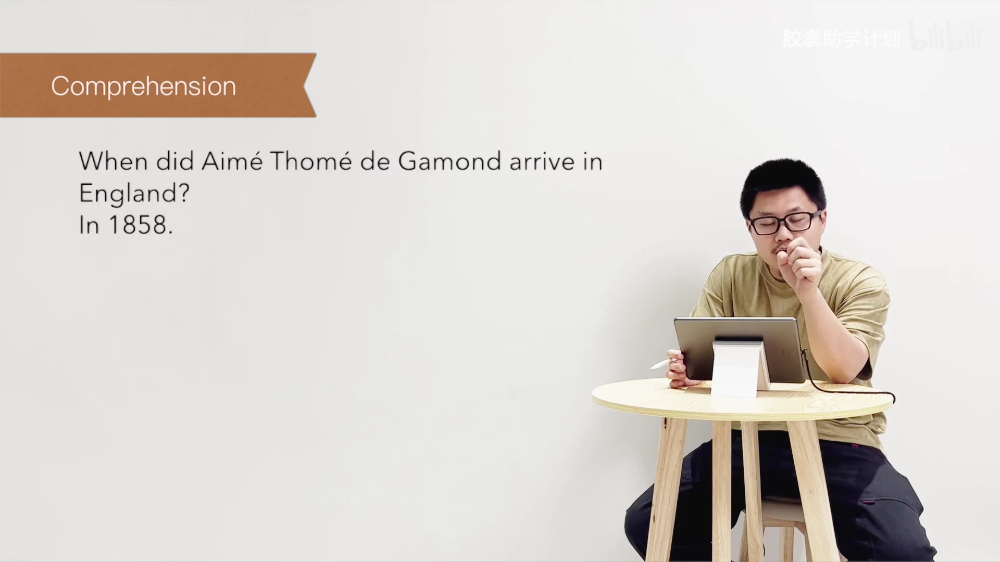

文字识别：Comprehension / When did Aimé Thomé de Gamond arrive in / England? / In 1858.

### 画面 00:00:41

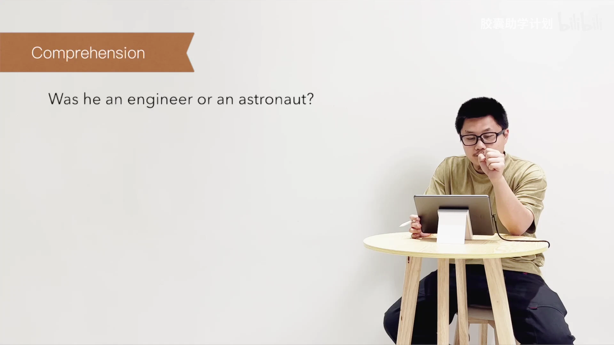

文字识别：Comprehension / Was he an engineer or an astronaut?

## 00:01:00–00:01:30

a plan for? For a twenty-one mile tunnel under the English Channel. What did he say it would be possible to build in the center of the channel? A platform. What would this platform serve as? A port and a railway station. How would the tunnel be well ventilated?

### 画面 00:01:01

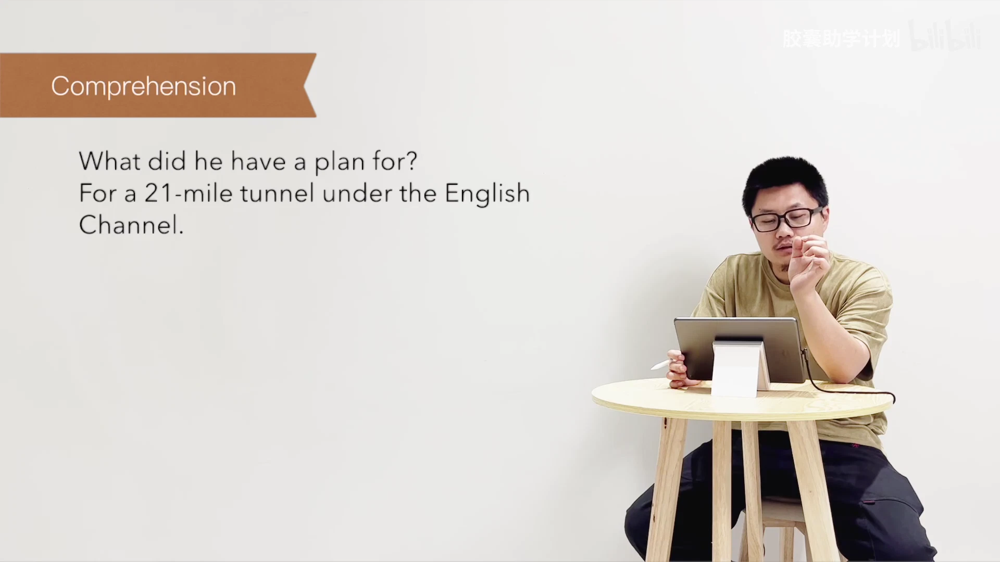

文字识别：Comprehension / What did he have a plan for? / For a 21-mile tunnel under the English / Channel.

### 画面 00:01:08

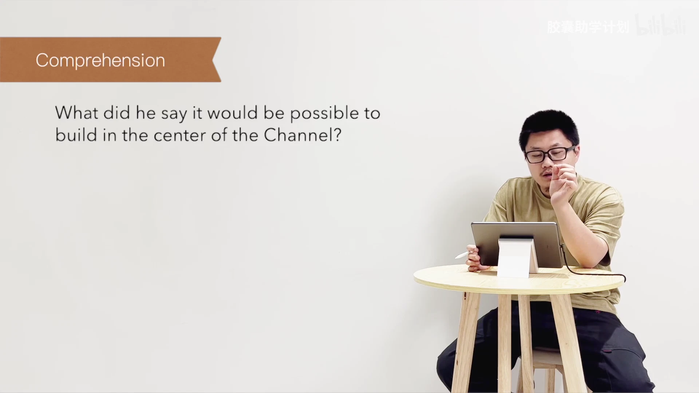

文字识别：Comprehension / What did he say it would be possible to / build in the center of the Channel?

### 画面 00:01:11

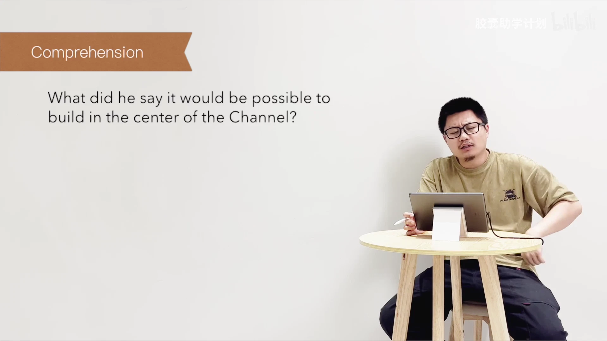

文字识别：Comprehension / What did he say it would be possible to / build in the center of the Channel?

### 画面 00:01:17

文字识别：Comprehension

### 画面 00:01:20

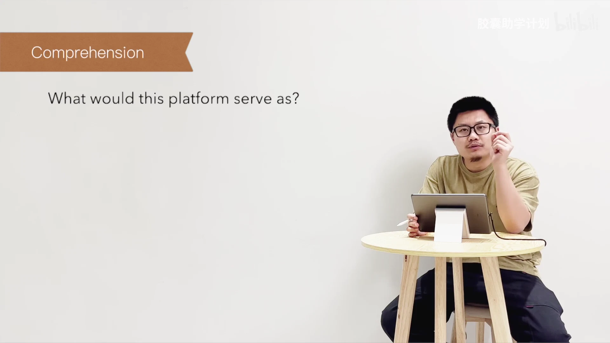

文字识别：Comprehension / What would this platform serve as?

## 00:01:30–00:02:00

be ventilated. Tall chimneys would be built above sea level. Who put forward a better plan? William Low. He wasn't French, was he? No, he wasn't. What did he suggest should be built? A double railway tunnel. What problem? What problem would

### 画面 00:01:31

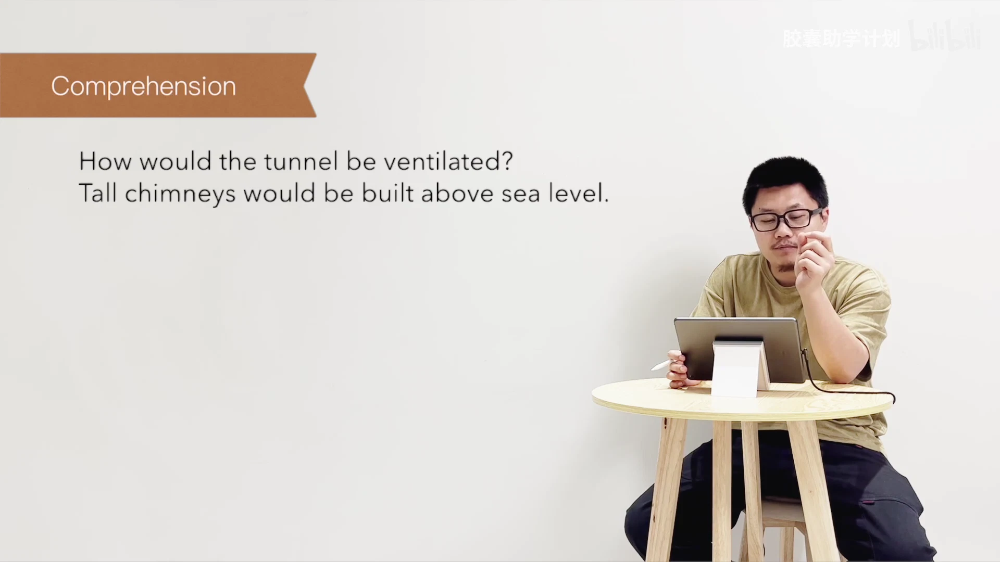

文字识别：Comprehension / How would the tunnel be ventilated? / Tall chimneys would be built above sea level.

### 画面 00:01:33

文字识别：Comprehension / How would the tunnel be ventilated? / Tall chimneys would be built above sea level.

### 画面 00:01:35

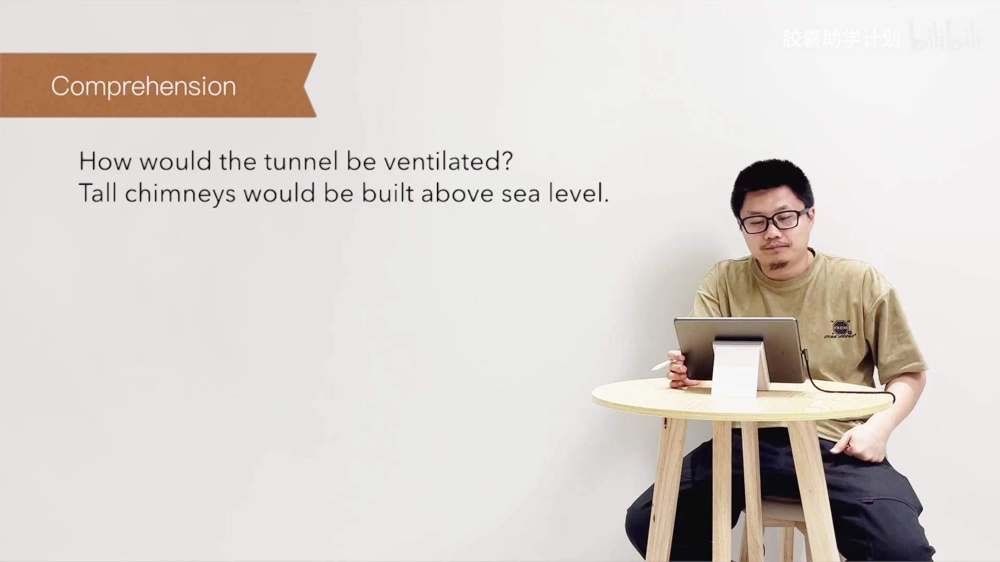

文字识别：Comprehension / How would the tunnel be ventilated? / Tall chimneys would be built above sea level.

### 画面 00:01:37

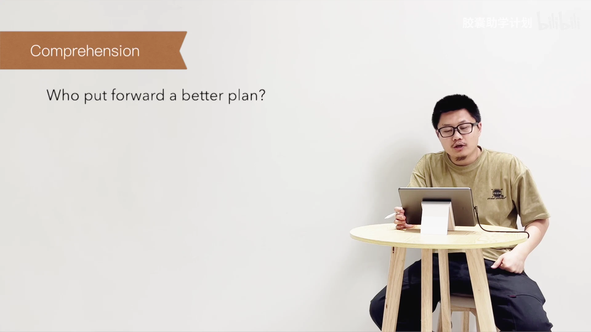

文字识别：Comprehension / Who put forward a better plan? / ROM

### 画面 00:01:40

文字识别：Comprehension / Who put forward a better plan? / William Lowe did.

### 画面 00:01:42

文字识别：Comprehension / Who put forward a better plan? / William Lowe did.

### 画面 00:01:45

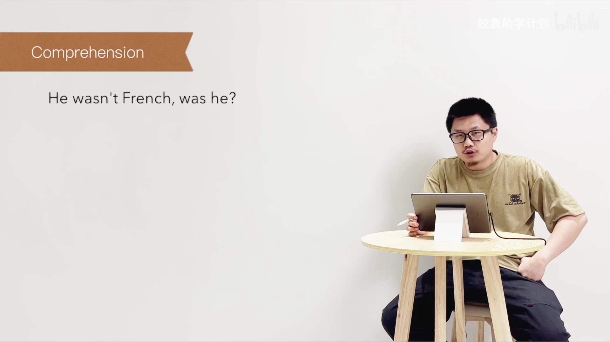

文字识别：Comprehension / He wasn't French, was he?

### 画面 00:01:51

文字识别：Comprehension / What did he suggest should be built?

### 画面 00:01:56

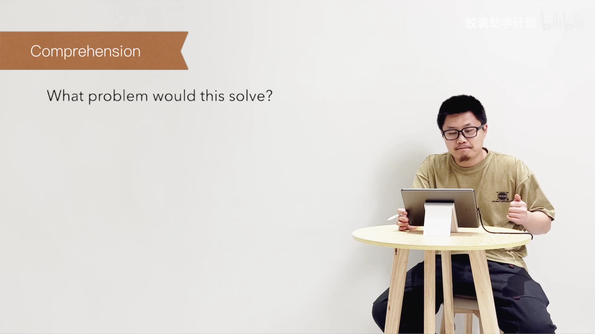

文字识别：Comprehension / What problem would this solve?

## 00:02:00–00:02:30

this solve? The problem of ventilation. What would happen if a train entered this tunnel? It would draw in fresh air behind it. When was a tunnel actually began? In 1902. 啊，这个是个数学题，你要自己去算一下，是吧？呃，asking questions，呃，能说一般疑问句，特殊疑问

### 画面 00:02:07

文字识别：Comprehension / What would happen if a train entered this / tunnel?

### 画面 00:02:15

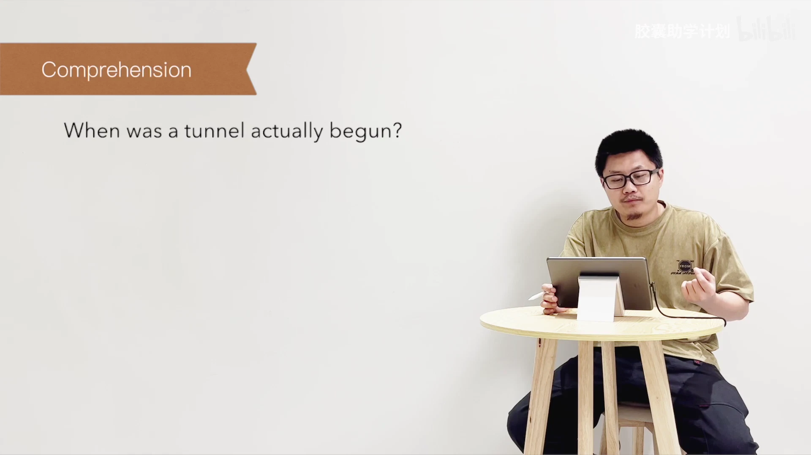

文字识别：Comprehension / When was a tunnel actually begun?

### 画面 00:02:24

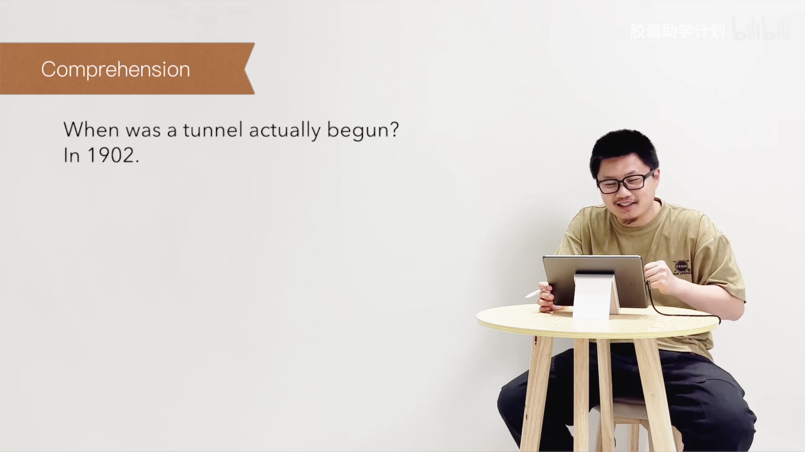

文字识别：Comprehension / When was a tunnel actually begun? / In 1902.

### 画面 00:02:26

文字识别：Asking questions / 训练目标： / 会说一般疑问句＆特殊疑问句 / Accuracy / Fluency

### 画面 00:02:29

文字识别：Asking questions

## 00:02:30–00:03:00

句是吧？老习惯了。Ask me if blah blah was提前。What nationality was a motor motor digmond?对吧？没什么可说的。呃，第二个，He was an engineer. Was提前。这个What我建议你直接就硬性给他变成What was呃his job是吧？给他变成这个，别给他变成What was he是吧？然后Who呢？你就直接对主语提问就行了。就Who was an engineer啊？

### 画面 00:02:31

文字识别：Asking questions / T: Ask me if Aimé Thomé de Gamond was / French.

### 画面 00:02:34

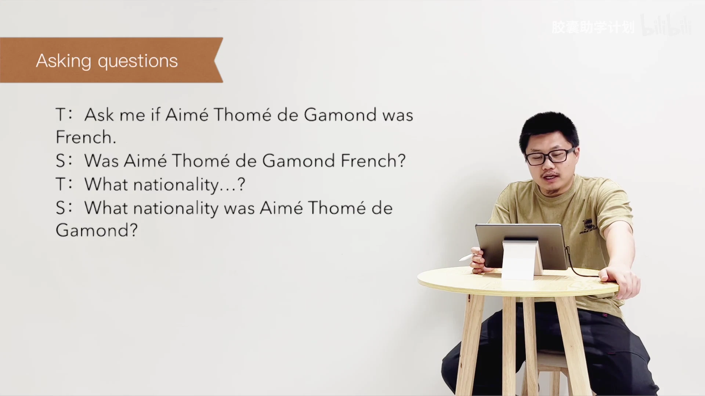

文字识别：Asking questions / T: Ask me if Aimé Thomé de Gamond was / French. / S:Was Aimé Thomé de Gamond French? / T: What nationality...? / S:What nationality was Aimé Thomé de / Gamond?

### 画面 00:02:38

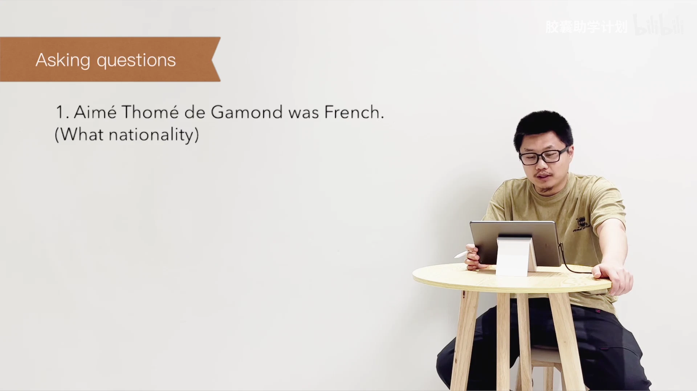

文字识别：Asking questions / 1.Aimé Thomé de Gamond was French. / (What nationality)

### 画面 00:02:59

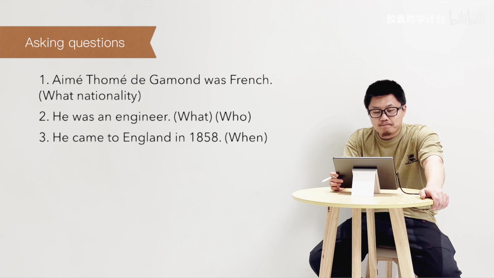

文字识别：Asking questions / 1.Aimé Thomé de Gamond was French. / (What nationality) / 2. He was an engineer. (What) (Who) / 3. He came to England in 1858.(When)

## 00:03:00–00:03:30

he came to England in 1858. Did提前，然后问对in 1858提问。He had a plan for a tunnel. Did提前What? There for?你肯定对a tunnel提问嘛，对吧？It would be 21 mile long. Ah, would提前How long对那个21 mile long提问，对吧？呃，It would cross the English Channel. Would提前那What？

### 画面 00:03:15

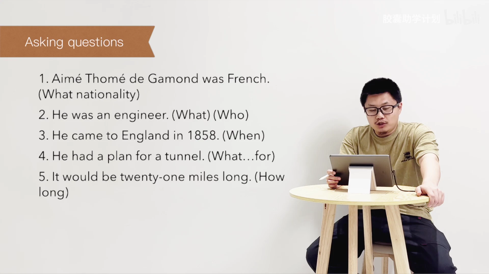

文字识别：Asking questions / 1.Aimé Thomé de Gamond was French. / (What nationality) / 2. He was an engineer. (What) (Who) / 3. He came to England in 1858. (When) / 4. He had a plan for a tunnel.(What..for) / 5. It would be twenty-one miles long. (How / long)

### 画面 00:03:23

文字识别：Asking questions

## 00:03:30–00:04:00

对 it 提问，你也可以对 the English Channel 提问啊。 A platform could be built in the center of the channel. Could 提前 where 对 in the center of channel 提问 what 对 a platform 提问，不用变一般疑问句了 what 啊，因为对主语嘛。 The platform would serve as a port. 呃 would 提前 what 对 a port 提问。 It would also serve as a railway station.

### 画面 00:03:34

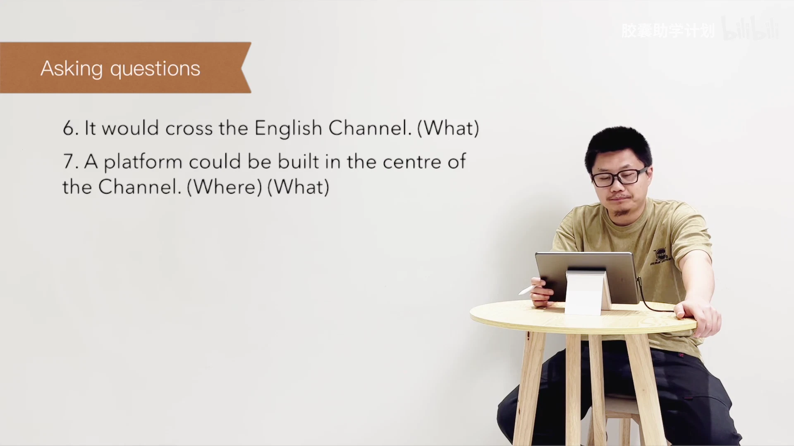

文字识别：Asking questions / 6. It would cross the English Channel. (What) / 7.A platform could be built in the centre of / the Channel.(Where) (What)

### 画面 00:03:56

文字识别：Asking questions / 6. It would cross the English Channel. (What) / 7.A platform could be built in the centre of / the Channel. (Where)(What) / 8. The platform would serve as a port. (What) / 9. It would also serve as a railway station. / (What else)

## 00:04:00–00:04:30

old提前what else跟刚才一样，what else对a railway station提问，对吧？Ventilation would be a problem. Old提前what对ventilation提问，就what would be a problem？什么会是一个问题呢？Okay, tell the story.这个是我们国内考试不太考，但是雅思托福口语考试经常要考，以及现实生活去使用英语口语的时候必定要用的一个能力，就是流利性。我们国内大多数考

### 画面 00:04:15

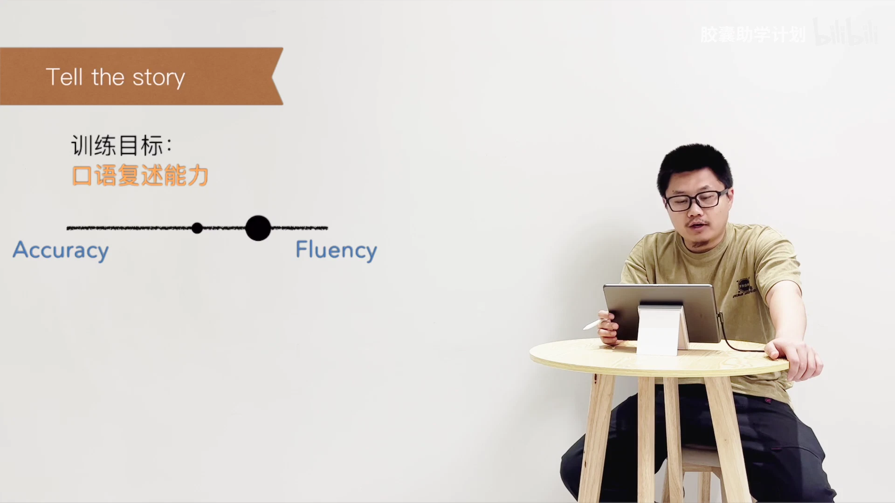

文字识别：Tell the story / 训练目标： / 口语复述能力 / Accuracy / Fluency

## 00:04:30–00:05:00

试是考准确性，谁考你流利不流利？你三十分钟答完卷子，我给你两个小时，对吧？你错了就是错了，我不管你流利，对吧？那口语当中是要有流利性的，所以呢，复述文章第一个单元我做了很多的示范，不一一示范了。您文章熟读成诵，尽可能流利来到这个地方，对吧？什么 in uh 1858 French engineer Amédée de Gomont arrived in England with a plan for twenty one什么mile

### 画面 00:04:41

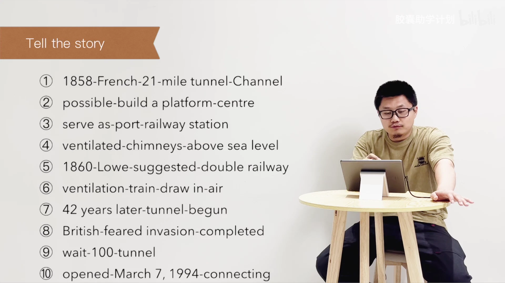

文字识别：Tell the story / 1858-French-21-mile tunnel-Channel / possible-build a platform-centre / serve as-port-railway station / ventilated-chimneys-above sea level / 1860-Lowe-suggested-double railway / ventilation-train-draw in-air / 42 years later-tunnel-begun / British-feared invasion-completed / wait-100-tunnel / 1⑩ opened-March 7, 1994-connecting

## 00:05:00–00:05:30

Tano under the English Channel,是吧？就你文章读熟了，这篇文章我从来没背过，读熟了自然而然看着这些关键词就张嘴就来了，对吧？It will be possible to build a platform in the center of the channel,对吧？Okay,呃above the sea level,啊under the sea level,Okay,呃summary writing写作复述能力摘要写作，您写完来这里对，重点是看那些连词啊。Okay,呃完全自由的对话呢，这个地方我们就是简单说一下它们的含

### 画面 00:05:11

文字识别：Tell the story / 1858-French-21-mile tunnel-Channel / possible-build a platform-centre / serve as-port-railway station / ventilated-chimneys-above sea level / 1860-Lowe-suggested-double railway / ventilation-train-draw in-air / 42 years later-tunnel-begun / British-feared invasion-completed / wait-100-tunnel / ⑩ opened-March 7, 1994-connecting

### 画面 00:05:17

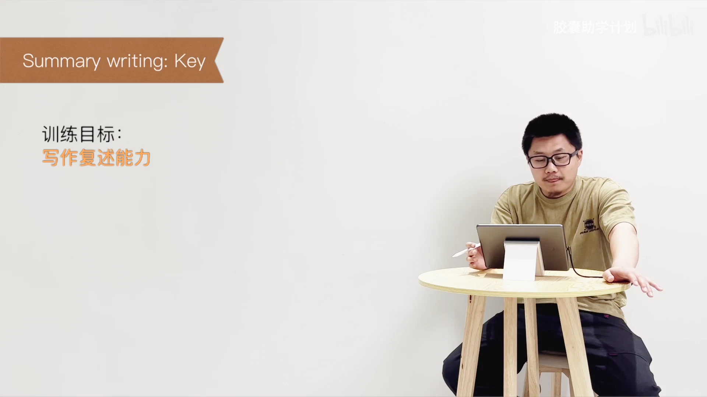

文字识别：Summary writing: Key / 训练目标： / 写作复述能力

### 画面 00:05:19

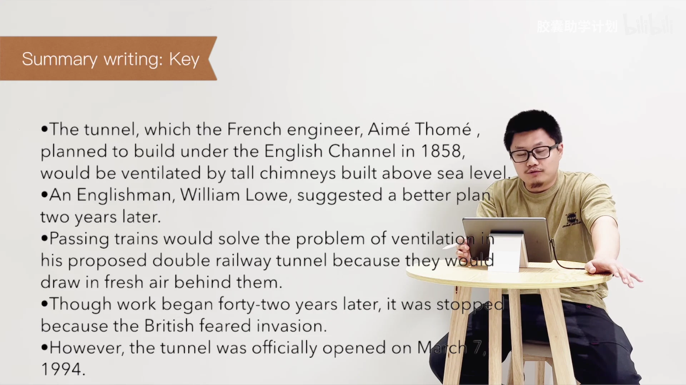

文字识别：Summary writing: Key / •The tunnel, which the French engineer, Aimé Thomé , / planned to build under the English Channel in 1858, / would be ventilated by tall chimneys built above sea level. / •An Englishman, William Lowe, suggested a better plan / two years later. / •Passing trains would solve the problem of ventilation ir / his proposed double railway tunnel because they wauld / draw in fresh air behind them. / •Though work began forty-two years later, it was stopped / because the British feared invasion. / •However, the tunnel was officially opened on Merch 7 / 1994.

### 画面 00:05:25

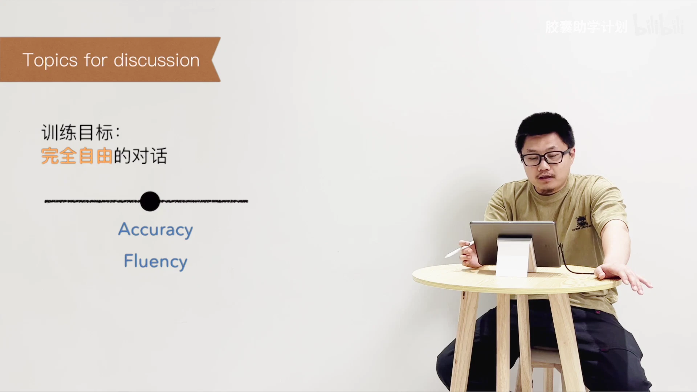

文字识别：Topics for discussion / 训练目标： / 完全自由的对话 / Accuracy / Fluency

### 画面 00:05:27

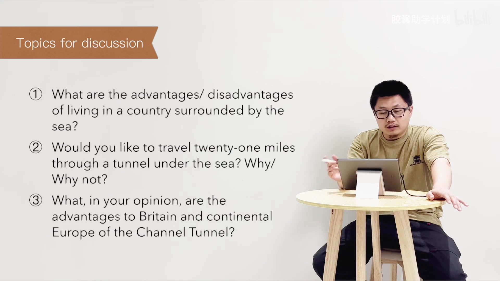

文字识别：Topics for discussion / What are the advantages/ disadvantages / of living in a country surrounded by the / sea? / Would you like to travel twenty-one miles / through a tunnel under the sea? Why/ / Why not? / What, in your opinion, are the / advantages to Britain and continental / Europe of the Channel Tunnel?

## 00:05:30–00:06:00

义啊。各位去考雅思、托福的写作跟口语的时候，这些题经常遇得到啊。那当然，现实生活当中这些题你也可能会遇到啊。我们看一下，What are the advantages disadvantages of living in a country surrounded by the sea? 所以你住在这样一个国家，这个国家是岛国。那 surrounded by the sea 就被大海包围，不就岛国吗？优势和劣势啊。优势可能是你不

### 画面 00:05:49

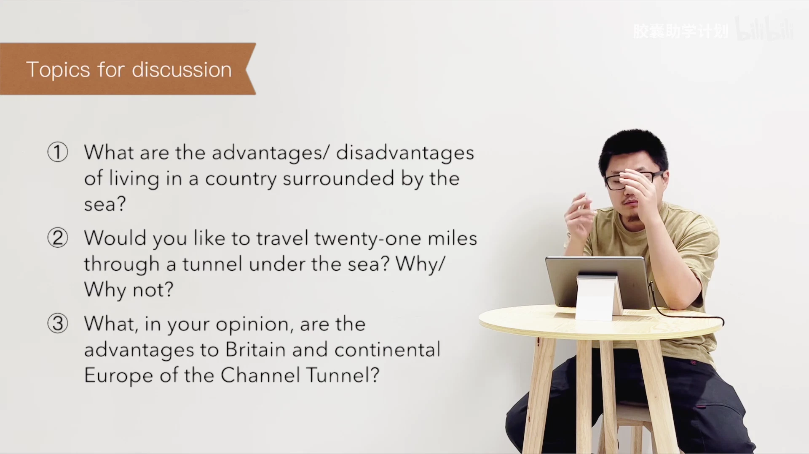

文字识别：Topics for discussion / What are the advantages/ disadvantages / of living in a country surrounded by the / sea? / Would you like to travel twenty-one miles / through a tunnel under the sea? Why/ / Why not? / What, in your opinion, are the / advantages to Britain and continental / Europe of the Channel Tunnel?

## 00:06:00–00:06:30

不容易被入侵啊，劣势是什么？海海啸一来，这国家就完了，是吧？你自己去想。Would you like to travel twenty one miles through a tunnel under the sea? Why? Why not? 所以你愿意去穿过一个二十一英里的地下隧道吗？愿意？为啥愿意？不愿意？为啥不愿意呢？第三个，What in your opinion are the advantages to Britain and continental Europe of the uh Channel Tunnel? 说在你的这个

### 画面 00:06:19

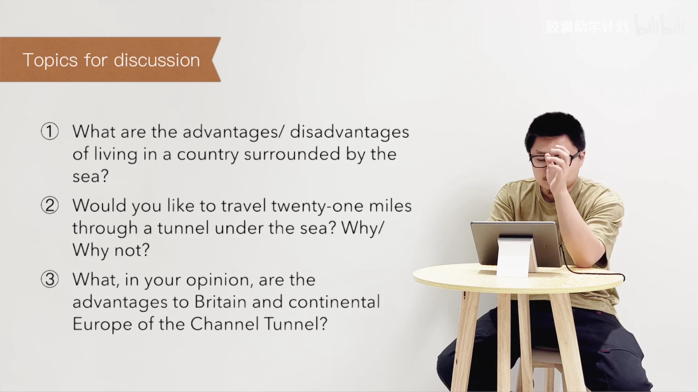

文字识别：Topics for discussion / What are the advantages/ disadvantages / of living in a country surrounded by the / sea? / Would you like to travel twenty-one miles / through a tunnel under the sea? Why/ / Why not? / What, in your opinion, are the / advantages to Britain and continental / Europe of the Channel Tunnel?

## 00:06:30–00:07:00

概念当中，你认为啊，对于英国啊，以及对于这个欧洲大陆来说，这个Channel Tunnel对他们有什么好处呢？OK，好，呃，那我们看一下家庭作业。第一个，Ask Smith，你先写再朗读，然后Just写作写完了对答案，Tell the story进行一个口语复述，重复间隔看置顶留言就可以了。OK，这个学学习的材料。那以上呢就是本期视频的全部内容了。如果各位喜欢我们的课

### 画面 00:06:41

### 画面 00:06:45

文字识别：1.Ask me if写&朗读 / 2. / 摘要写作写&答案

### 画面 00:06:47

文字识别：1.Ask me if写&朗读 / 摘要写作写&答案 / 3.Tell the story 口语复述

### 画面 00:06:49

文字识别：1.Ask me if写&朗读 / 摘要写作写&答案 / 3.Tell the story 口语复述 / 4. / 4.重复间隔（置顶留言）

### 画面 00:06:51

文字识别：1.Ask me if写&朗读 / 摘要写作写&答案 / 3.Tell the story 口语复述 / 4.重复间隔（置顶留言)

### 画面 00:06:55

文字识别：👍

### 画面 00:06:57

文字识别：￥

## 00:07:00–00:07:20

呢，欢迎各位关注、订阅、一键三连，分享给那些需要的朋友，来帮助我们快速成长。See you next time.

### 画面 00:07:01

文字识别：餐

### 画面 00:07:06

文字识别：FROM

### 画面 00:07:08

### 画面 00:07:10

文字识别：CAPSULEACADEMY / 胶囊助学计划 / 小红书 / Lecturer / □ / 口 / Leo / OE

### 画面 00:07:12

文字识别：CAPSULEACADEMY / 胶囊助学计划 / 小红书 / Photographer / Berlin / OE

### 画面 00:07:15

文字识别：CAPSULEACADEMY / 胶囊助学计划 / 『 / 小红书 / Creator / OE

### 画面 00:07:18

文字识别：bilibili / 胶囊助学计划

### 画面 00:07:20

文字识别：bilibili / 胶囊助学计划

