# 065 单词

快速机器解析：语音为单模型转写，未进行独立交叉校对或人工复核；画面每秒采样并按变化选帧，短时文字和标记可能遗漏。截图时间约有 1 秒误差。图片有损压缩；遇到疑点请按时间查看 Google Drive 原视频。

## 00:00:00–00:00:30

Hello everyone, welcome to Capsule Academy. This is Leo. Today we're going to learn New Concept English Book Two Lesson Sixty Five Words. 那老习惯，进入正式课程之前呢，咱们先看几个小的问题啊。首先，如何询问你多重啊？呃，接下来呢，如何表达很幸运，然后怎么怎么样去做某件事情？OK，那带着这两个问题，Hope you can enjoy. 好，第一个单词，我们先看一下音

### 画面 00:00:00

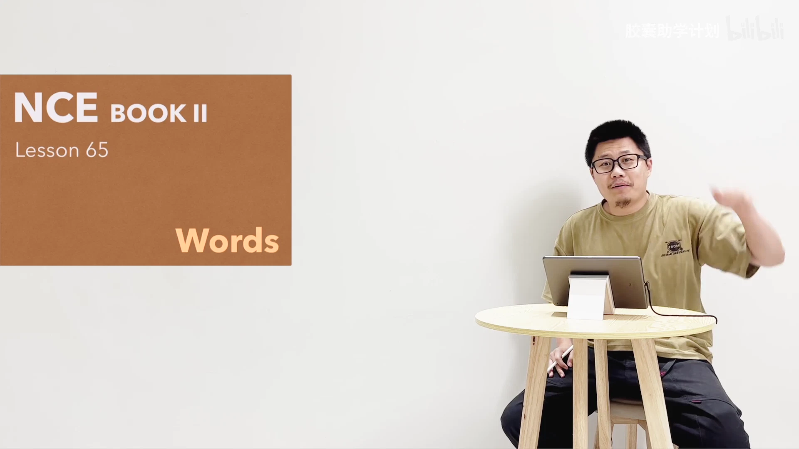

文字识别：NCE / BOOK I"I / Lesson 65 / Words

### 画面 00:00:02

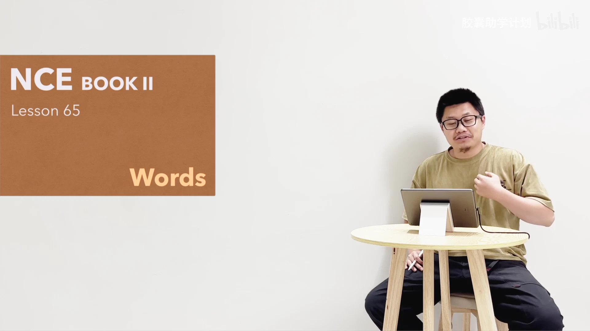

文字识别：NCE / BOOKII / Lesson 65 / Words

### 画面 00:00:06

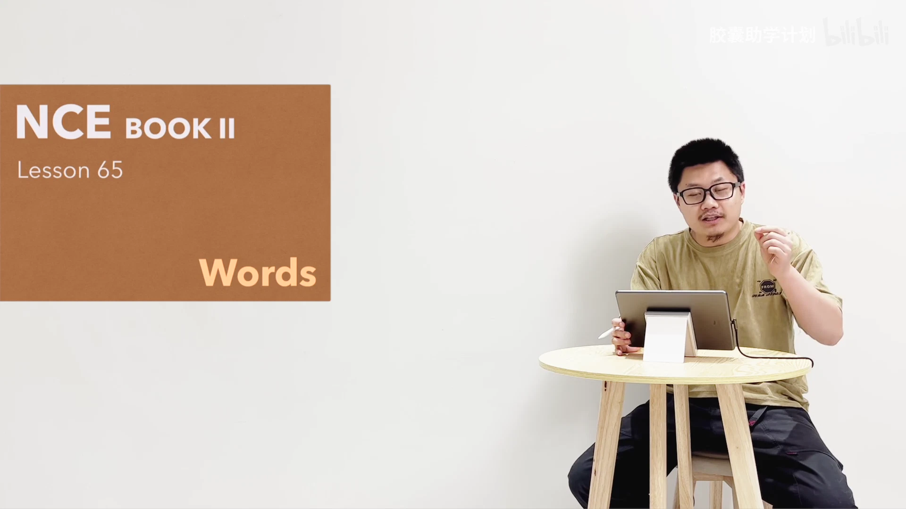

文字识别：NCE / BOOKI"I / Lesson 65 / Words

### 画面 00:00:10

### 画面 00:00:12

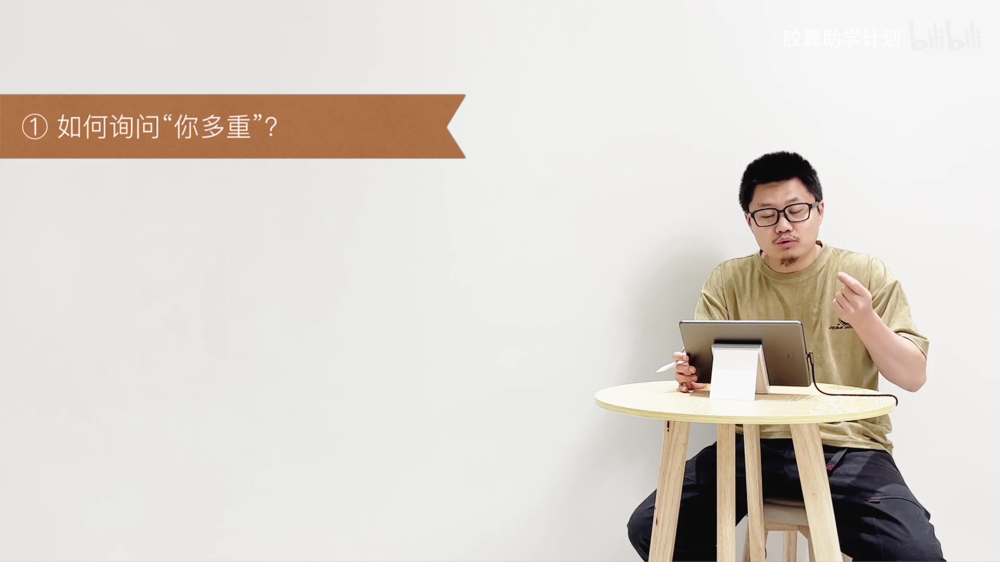

文字识别：①如何询问“你多重”？

### 画面 00:00:14

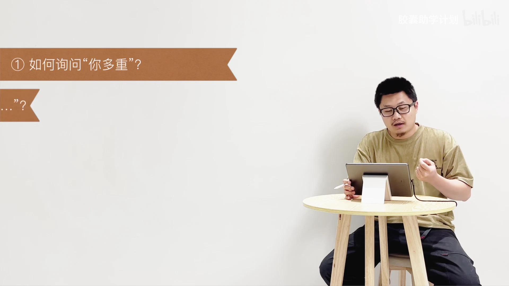

文字识别：①如何询问“你多重”？

### 画面 00:00:16

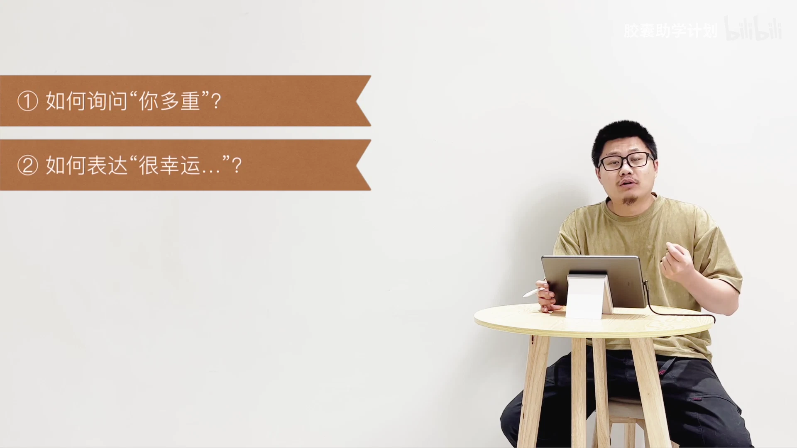

文字识别：①如何询问“你多重”? / 如何表达“很幸运

### 画面 00:00:23

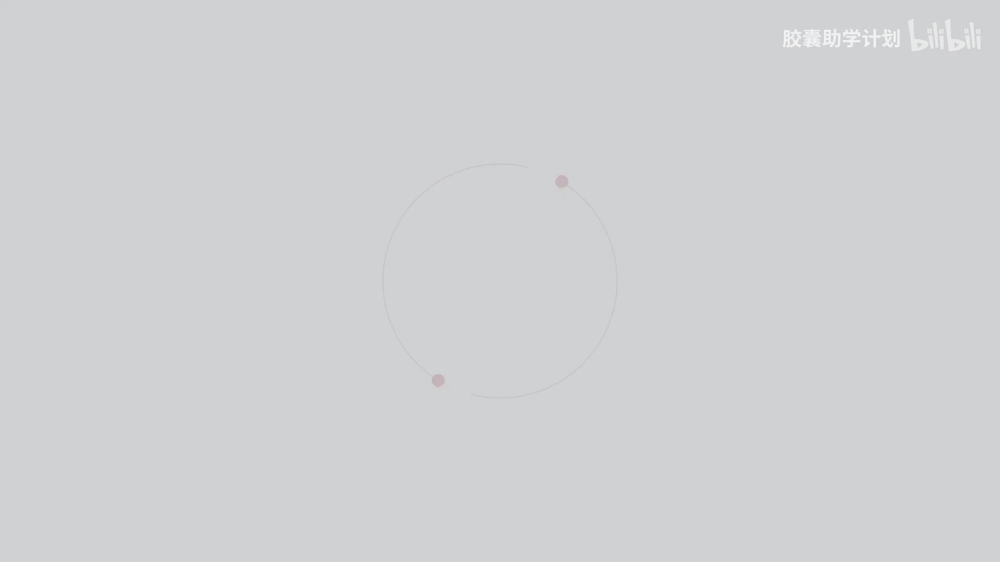

文字识别：胶囊助学计划bill / • / •

### 画面 00:00:27

### 画面 00:00:29

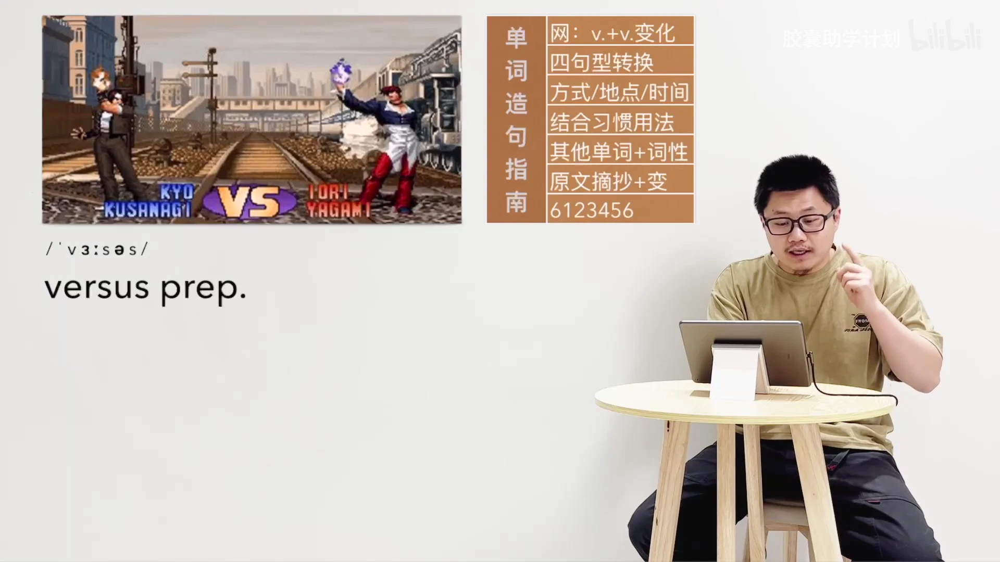

文字识别：单词造句指南 / 网：v.+v.变化 / 四句型转换 / 方式/地点/时间 / 结合习惯用法 / 其他单词+词性 / 原文摘抄+变 / KYO / VS / TORI / KUSANAGI / YAGAMT / 6123456 / / 'v3:sas/ / versus /  prep.

## 00:00:30–00:01:00

标叫 versus，这个就立刻就回到至少是我的童年记忆了，是吧？酒吧拳皇那个时候啊，谁对谁这个 vs 啊，包括现在很多综艺节目当中，他会打出那个特效 vs，对吧？这两个字母，并且注意它是大写的，它是什么呢？它就是 versus 这个单词的简称啊，叫谁对谁。那那我们造一个句子，这个单词实话实说，对于各位来说，你可以不用去造

### 画面 00:00:31

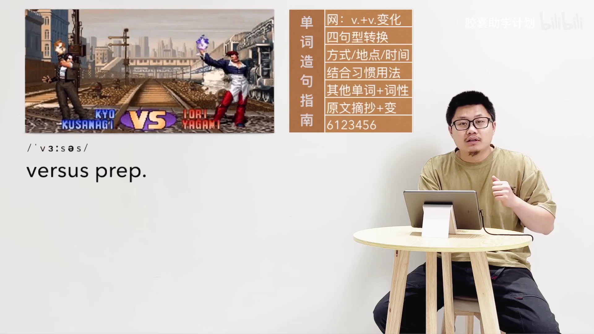

文字识别：单词造句指南 / 网：v.+v.变化 / 四句型转换 / 方式/地点/时间 / 结合习惯用法 / 其他单词+词性 / 原文摘抄+变 / KYO / VS / TORI / KUSANAGI / YAGAMT / 6123456 / / 'v3isas/ / versus prep.

### 画面 00:00:35

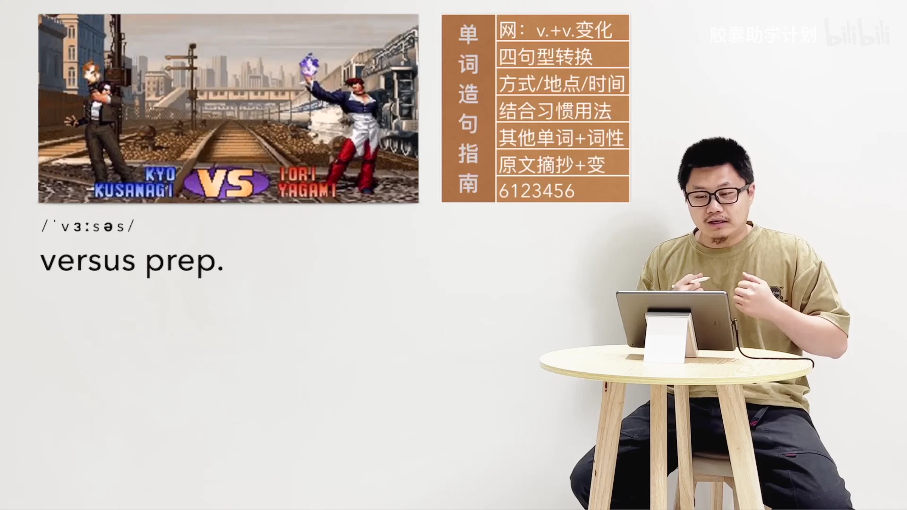

文字识别：单词造句指南 / 网：v.+v.变化 / 四句型转换 / 方式/地点/时间 / 结合习惯用法 / 其他单词+词性 / 原文摘抄+变 / KYO / VS / IORL / KUSANAGI / YAGAMI / 6123456 / /'v3isas/ / versus prep.

### 画面 00:00:40

文字识别：单词造句指南 / 网：v.+v.变化 / 四句型转换 / 方式/地点/时间 / 结合习惯用法 / 其他单词+词性 / 原文摘抄+变 / KYO / VS / IORL / KUSANAGI / YAGAMI / 6123456 / /'v3:sas/ / versus prep.

### 画面 00:00:42

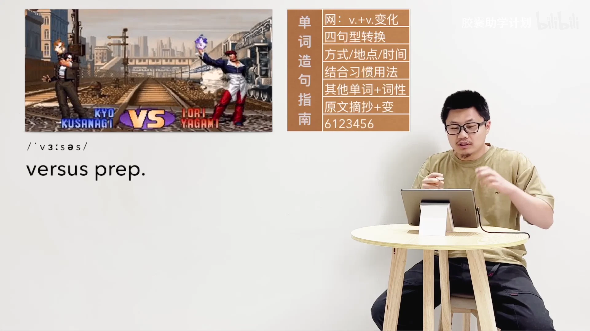

文字识别：单词造句指南 / 网：v.+v.变化 / 四句型转换 / 方式/地点/时间 / 结合习惯用法 / 其他单词+词性 / 原文摘抄+变 / KYO / VS / IORI / KUSANAGI / YAGAMI / 6123456 / /'v3:sas/ / versus | /  prep.

### 画面 00:00:44

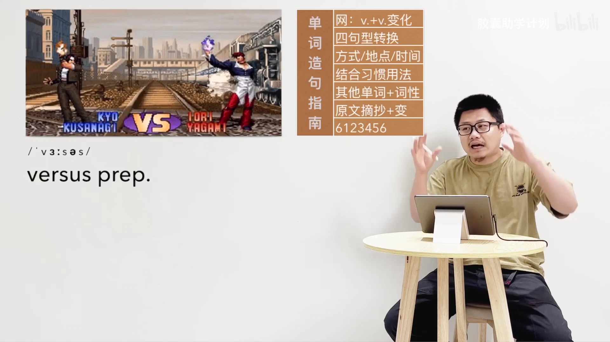

文字识别：单词造句指南 / 网：v.+v.变化 / 四句型转换 / 方式/地点/时间 / 结合习惯用法 / 其他单词+词性 / 原文摘抄+变 / KYO / VS / IORL / KUSANAGI / YAGAMT / 6123456 / /'v3isas/ / versus prep.

### 画面 00:00:46

文字识别：单词造句指南 / 网：v.+v.变化 / 四句型转换 / 方式/地点/时间 / 结合习惯用法 / 其他单词+词性 / 原文摘抄+变 / KYO / VS / IORL / KUSANAGI / YAGAMI / 6123456 / /'v3:sas/ / versus prep.

### 画面 00:00:49

文字识别：单词造句指南 / 网：v.+v.变化 / 四句型转换 / 方式/地点/时间 / 结合习惯用法 / 其他单词+词性 / 原文摘抄+变 / KYO / VS / IORL / KUSANAGI / YAGAMI / 6123456 / /'v3:sas/ / versus prep.

### 画面 00:00:51

文字识别：单词造句指南 / 网：v.+v.变化 / 四句型转换 / 方式/地点/时间 / 结合习惯用法 / 其他单词+词性 / 原文摘抄+变 / KYO / VS / IORL / KUSANAGI / YAGAMI / 6123456 / /'v3:sas/ / versus prep.

### 画面 00:00:54

文字识别：单词造句指南 / 网：v.+v.变化 / 四句型转换 / 方式/地点/时间 / 结合习惯用法 / 其他单词+词性 / 原文摘抄+变 / KYO / VS / TORL / KUSANAGI / YAGAMI / 6123456 / /'v3:sas/ / versus prep.

### 画面 00:00:56

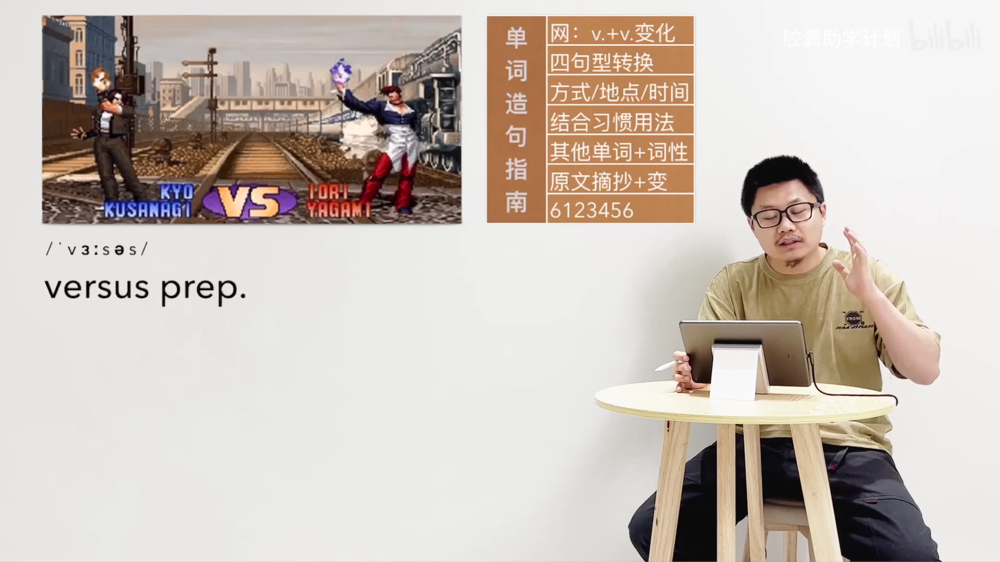

文字识别：单词造句指南 / 网：v.+v.变化 / 四句型转换 / 方式/地点/时间 / 结合习惯用法 / 其他单词+词性 / 原文摘抄+变 / KYO / VS / IORL / KUSANAGI / YAGAMI / 6123456 / /'v3:sas/ / versus prep.

### 画面 00:00:59

文字识别：单词造句指南 / 网：v.+v.变化 / 四句型转换 / 方式/地点/时间 / 结合习惯用法 / 其他单词+词性 / 原文摘抄+变 / KYO / VS / IORL / KUSANAGI / YAGAMI / 6123456 / /'v3:sas/ / versus prep.

## 00:01:00–00:01:30

它太难了，不是特别好造句。它往往都不是在整个句子里面出现。那我尝试去做了一下造句。我说，Someone must have taught us about good versus evil, for it looks like most of us know that. 好，什么意思呢？说，哎，有这么一定是有人啊，当时一定是教会我们了。我用了十七课的这个呃语法，对吧？就是当时一定是教会我们了。说，哎，对

### 画面 00:01:01

文字识别：单词造句指南 / 网：v.+v.变化 / 四句型转换 / 方式/地点/时间 / 结合习惯用法 / 其他单词+词性 / 原文摘抄+变 / KYO / VS / TORI / KUSANAGI / YAGAMI / 6123456 / /'v3:sas/ / versus prep.

### 画面 00:01:03

文字识别：单词造句指南 / 网：v.+v.变化 / 四句型转换 / 方式/地点/时间 / 结合习惯用法 / 其他单词+词性 / 原文摘抄+变 / KYO / VS / IORL / KUSANAGI / YAGAMII / 6123456 / / 'v3:sas/ / versus prep. / ) Someone must have taught us about good / 1 / versus evil, for it looks like most of us know / that. L17

### 画面 00:01:05

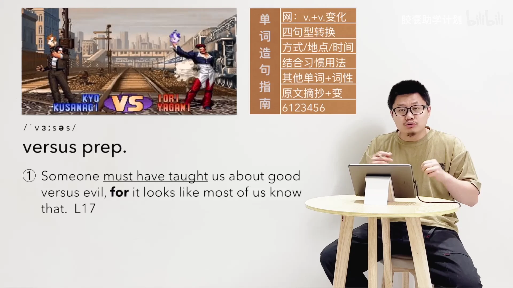

文字识别：单词造句指南 / 网：v.+v.变化 / 四句型转换 / 方式/地点/时间 / 结合习惯用法 / 其他单词+词性 / 原文摘抄+变 / KYO / VS / TORI / KUSANAGI / YAGAMI / 6123456 / / 'v3:sas/ / versus prep. /  Someone must have taught us about good / 1 / versus evil, for it looks like most of us know / that. L17

### 画面 00:01:10

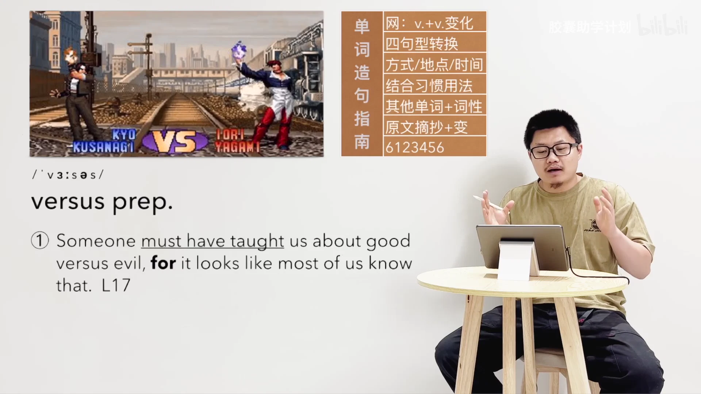

文字识别：单词造句指南 / 网：v.+v.变化 / 四句型转换 / 方式/地点/时间 / 结合习惯用法 / 其他单词+词性 / 原文摘抄+变 / KYO / VS / IORL / KUSANAGI / YAGAMI / 6123456 / /'v3:sas/ / versus prep. / ) Someone must have taught us about good / 1 / versus evil, for it looks like most of us know / that. L17

### 画面 00:01:15

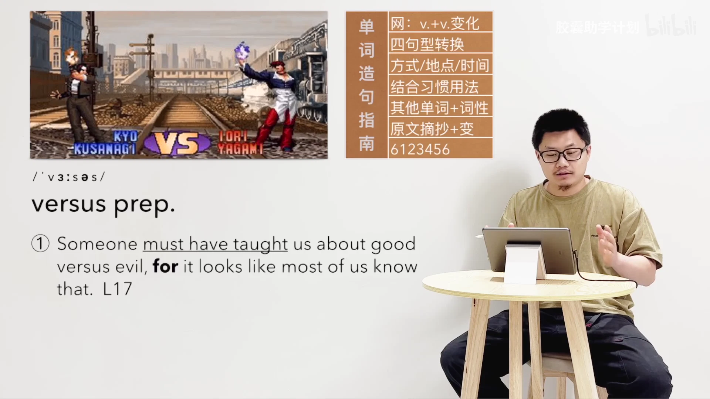

文字识别：单词造句指南 / 网：v.+v.变化 / 四句型转换 / 方式/地点/时间 / 结合习惯用法 / 其他单词+词性 / 原文摘抄+变 / KYO / VS / IORL / KUSANAGI / YAGAMI / 6123456 / / 'v3:sas/ / versus prep. / ) Someone must have taught us about good / 1 / versus evil, for it looks like most of us know / that. L17

### 画面 00:01:17

文字识别：单词造句指南 / 网：v.+v.变化 / 四句型转换 / 方式/地点/时间 / 结合习惯用法 / 其他单词+词性 / 原文摘抄+变 / KYO / VS / IORL / KUSANAGI / YAGAMI / 6123456 / / 'v3:sas/ / versus prep. / ) Someone must have taught us about good / versus evil, for it looks like most of us know / that. L17

### 画面 00:01:20

文字识别：单词造句指南 / 网：v.+v.变化 / 四句型转换 / 方式/地点/时间 / 结合习惯用法 / 其他单词+词性 / 原文摘抄+变 / KYO / VS / IORL / KUSANAGI / YAGAMI / 6123456 / / 'v3:sas/ / versus prep. /  Someone must have targht us about good / 1 / versus evil, for it looks lke most of us know / that. L17

### 画面 00:01:23

文字识别：单词造句指南 / 网：v.+v.变化 / 四句型转换 / 方式/地点/时间 / 结合习惯用法 / 其他单词+词性 / 原文摘抄+变 / KYO / VS / IORL / KUSANAGI / YAGAMI / 6123456 / / 'v3:sas/ / versus prep. / ) Someone must have taught us about good / 1 / versus evil, for it looks like most of us know / that. L17

### 画面 00:01:25

文字识别：单词造句指南 / 网：v.+v.变化 / 四句型转换 / 方式/地点/时间 / 结合习惯用法 / 其他单词+词性 / 原文摘抄+变 / KYO / VS / IORL / KUSANAGI / YAGAMI / 6123456 / /'v3:sas/ / versus prep. /  Someone must have taught us about good / 1 / versus evil, for it looks like most of us know / that. L17

### 画面 00:01:28

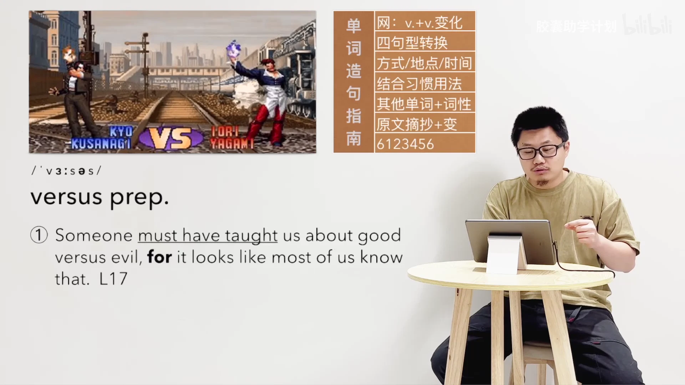

文字识别：单词造句指南 / 网：v.+v.变化 / 四句型转换 / 方式/地点/时间 / 结合习惯用法 / 其他单词+词性 / 原文摘抄+变 / KYO / VS / IORL / KUSANAGI / YAGAMI / 6123456 / /'v3:sas/ / versus prep. / ) Someone must have taught us about good / 1 / versus evil, for it looks like most of us know / that. L17

## 00:01:30–00:02:00

啊，就是说正确与什么呢？邪恶或者善良与邪恶，哎，这个这两个之间的对比，因为啊，看上去我们大多数人都知道这件事情。OK，再来一个。When we want to do anything, we must think of the risk versus reward. OK，什么意思呢？说说，当我们想去做任何事情的时候，我们必须要去想什么呢？Risk这单词咱们学过，四十四课我印象当中咱

### 画面 00:01:30

文字识别：单词造句指南 / 网：v.+v.变化 / 四句型转换 / 方式/地点/时间 / 结合习惯用法 / 其他单词+词性 / 原文摘抄+变 / KYO / VS / IORL- / KUSANAGI / YAGAMI / 6123456 / /'v3 :sas/ / versus prep. / ) Someone must have taught us about good / 1 / versus evil, for it looks like most of us know / that. L17

### 画面 00:01:35

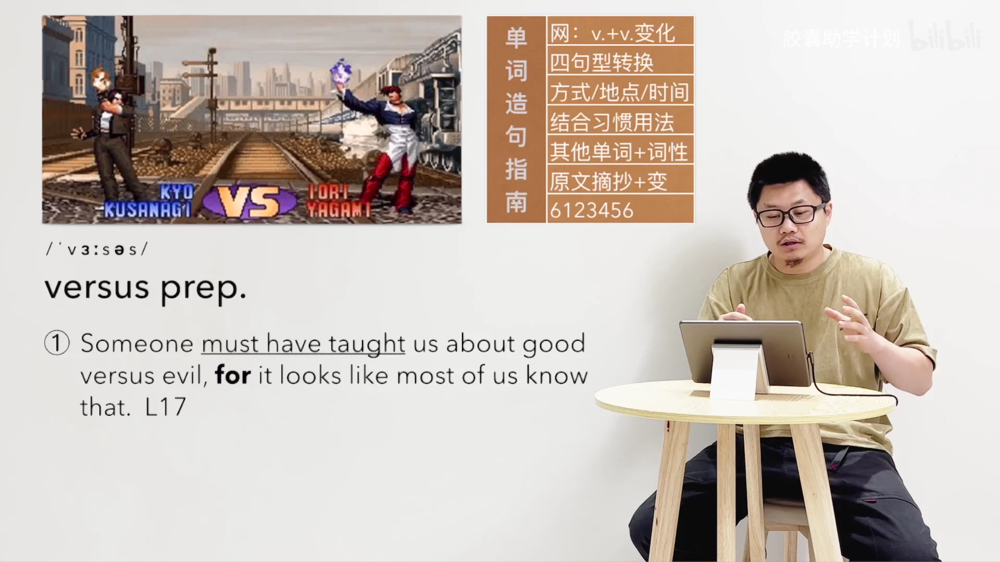

文字识别：单词造句指南 / 网：v.+v.变化 / 四句型转换 / 方式/地点/时间 / 结合习惯用法 / 其他单词+词性 / 原文摘抄+变 / KYO / VS / IORL / KUSANAGI / YAGAMI / 6123456 / / 'v3:sas/ / versus prep. / ) Someone must have taught us about good / 1 / versus evil, for it looks like most of us know / that. L17

### 画面 00:01:40

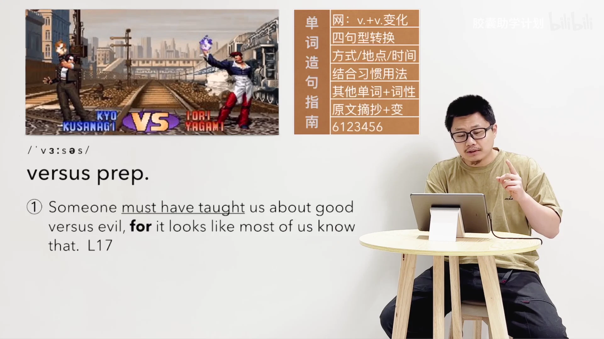

文字识别：单词造句指南 / 网：v.+v.变化 / 四句型转换 / 方式/地点/时间 / 结合习惯用法 / 其他单词+词性 / 原文摘抄+变 / KYO / VS / IORL / KUSANAGI / YAGAMI / 6123456 / / 'v3:sas/ / versus prep. /  Someone must have taught us about good / 1 / versus evil, for it looks like most of us know / that. L17

### 画面 00:01:43

文字识别：单词造句指南 / 网：v.+v.变化 / 四句型转换 / 方式/地点/时间 / 结合习惯用法 / 其他单词+词性 / 原文摘抄+变 / KYO / VS / IORL / KUSANAGI / YAGAMI / 6123456 / /'v3isas/ / versus prep. / ① Someone must have taught us about good / versus evil, for it looks like most of us know / that. L17 / When we want to do anything, we must / think of the risk versus reward.

### 画面 00:01:45

文字识别：单词造句指南 / 网：v.+v.变化 / 四句型转换 / 方式/地点/时间 / 结合习惯用法 / 其他单词+词性 / 原文摘抄+变 / KYO / VS / IORL / KUSANAGI / YAGAMI / 6123456 / / 'v3:sas/ / versus prep. / ① Someone must have taught us about good / versus evil, for it looks like most of us know / that. L17 / When we want to do anything, we must / think of the risk versus reward.

### 画面 00:01:50

文字识别：单词造句指南 / 网：v.+v.变化 / 四句型转换 / 方式/地点/时间 / 结合习惯用法 / 其他单词+词性 / 原文摘抄+变 / KYO / VS / IORI / KUSANAGI / YAGAMI / 6123456 / /'v3:sas/ / versus prep. / ① Someone must have taught us about good / versus evil, for it looks like most of us know / that. L17 / When we want to do anything, we must / think of the risk versus reward.

### 画面 00:01:55

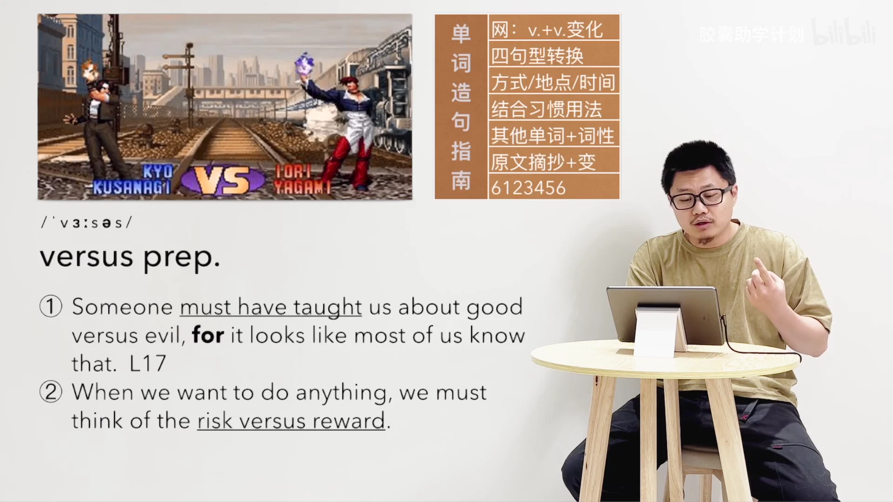

文字识别：单词造句指南 / 网：v.+v.变化 / 四句型转换 / 方式/地点/时间 / 结合习惯用法 / 其他单词+词性 / 原文摘抄+变 / KYO / VS / IORI / KUSANAGI / YAGAMI / 6123456 / / 'v3:sas/ / versus prep. /  Someone must have taught us about good / 1 / versus evil, for it looks like most of us know / that. L17 / When we want to do anything, we must / think of the risk versus reward.

## 00:02:00–00:02:30

咱们学的叫做危险风险和什么去对比呢？和奖励啊，就类似于什么投资的风险回报比啊这样的一个东西。OK，好，那接下来呢，这个是在足球场当中啊，任何的这个运动比赛当中也会用到。我就找了一个很简短的这个电影片段啊，德国对战阿根廷，对吧？这个对战versus，OK，注意力集中，我们听一下。It's Germany versus Argentina. Very good.

### 画面 00:02:00

文字识别：单词造句指南 / 网：v.+v.变化 / 四句型转换 / 方式/地点/时间 / 结合习惯用法 / 其他单词+词性 / 原文摘抄+变 / KYO / VS / IORL / KUSANAGI / YAGAMI / 6123456 / / 'v3:sas/ / versus prep. / ① Someone must have taught us about good / versus evil, for it looks like most of us know / that. L17 / When we want to do anything, we must / think of the risk versus reward.

### 画面 00:02:05

文字识别：单词造句指南 / 网：v.+v.变化 / 四句型转换 / 方式/地点/时间 / 结合习惯用法 / 其他单词+词性 / 原文摘抄+变 / KYO / VS / IORI / KUSANAGI / YAGAMI / 6123456 / /'v3:sas/ / versus prep. / ① Someone must have taught us about good / versus evil, for it looks like most of us know / that. L17 / When we want to do anything, we must / think of the risk versus reward.

### 画面 00:02:08

文字识别：单词造句指南 / 网：v.+v.变化 / 四句型转换 / 方式/地点/时间 / 结合习惯用法 / 其他单词+词性 / 原文摘抄+变 / KYO / VS / IORL / KUSANAGI / YAGAMI / 6123456 / /'v3:sas/ / versus prep. / ① Someone must have taught us about good / versus evil, for it looks like most of us know / that. L17 / When we want to do anything, we must / think of the risk versus reward.

### 画面 00:02:10

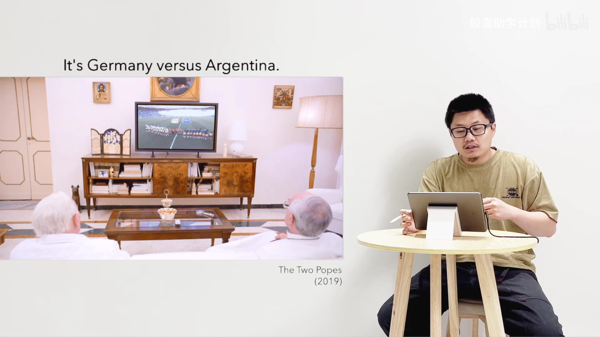

文字识别：It's Germany versus Argentina. / The Two Popes / (2019)

### 画面 00:02:26

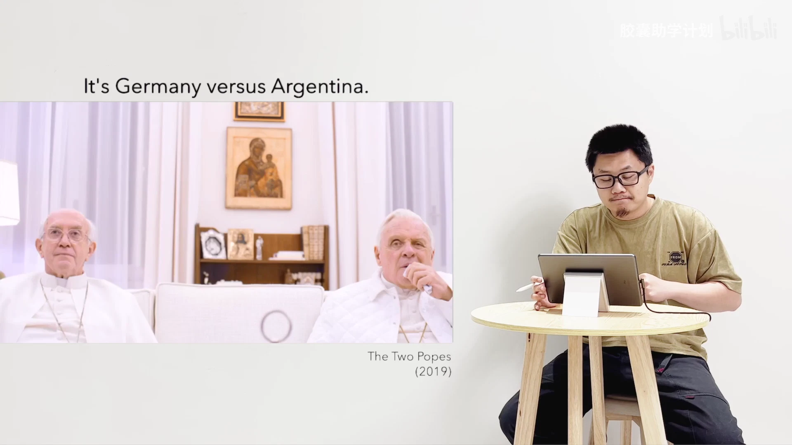

文字识别：It's Germany versus Argentina. / O / The Two Popes / (2019)

### 画面 00:02:28

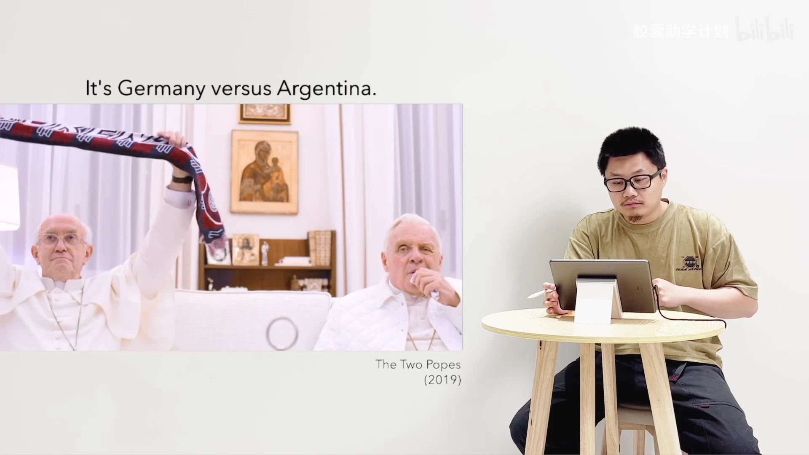

文字识别：It's Germany versus Argentina. / O / The Two Popes / (2019)

## 00:02:30–00:03:00

接下来两个单词，呃，要么是您可能认的，要么是我们之前学过。首先，我们先看后边这个叫 present present。之前咱们学过，就是礼物的意思，对吧？那前面这个单词，我相信对于很多同学而言都不是生词了，叫 Christmas 啊，一个节日，圣诞节，对吧？Christmas。好，那我们把它放到一起，那 Christmas present 就是圣诞礼物嘛。说 she bought a Christmas present for my mother。说她买了一个圣诞节礼物给我的母

### 画面 00:02:30

文字识别：单词造句指南 / 网：v.+v.变化 / 四句型转换 / 方式/地点/时间 / 结合习惯用法 / 其他单词+词性 / 原文摘抄+变 / 6123456 / / ' kr Ⅰs m a s / / /prezant/ / Christmas n. present n. / FROM

### 画面 00:02:35

文字识别：单词造句指南 / 网：v.+v.变化 / 四句型转换 / 方式/地点/时间 / 结合习惯用法 / 其他单词+词性 / 原文摘抄+变 / 6123456 / / ' kr Ⅰ s m a s / / /prezant/ / Christmas n. / present n.

### 画面 00:02:40

文字识别：单词造句指南 / 网：v.+v.变化 / 四句型转换 / 方式/地点/时间 / 结合习惯用法 / 其他单词+词性 / 原文摘抄+变 / 6123456 / / ' k r Ⅰ s m a s / / /prezant/ / Christmas n. present n.

### 画面 00:02:47

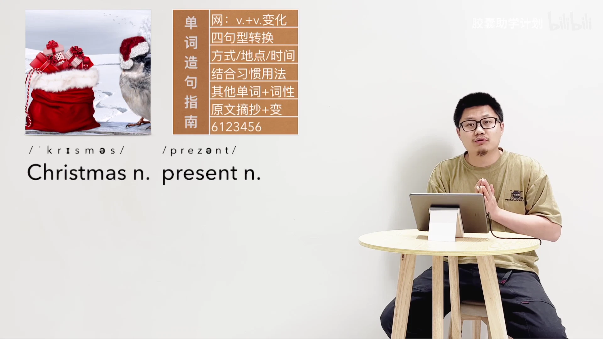

文字识别：单词造句指南 / 网：v.+v.变化 / 四句型转换 / 方式/地点/时间 / 结合习惯用法 / 其他单词+词性 / 原文摘抄+变 / 6123456 / / ' kr Ⅰ s m a s / / /prezant/ / Christmas n. present n.

### 画面 00:02:50

文字识别：单词造句指南 / 网：v.+v.变化 / 四句型转换 / 方式/地点/时间 / 结合习惯用法 / 其他单词+词性 / 原文摘抄+变 / 6123456 / /  kr Ⅰ s m a s / / /prezant/ / Christmas n. present n. / ① She bought a Christmas present for my / mother.

### 画面 00:02:53

文字识别：单词造句指南 / 网：v.+v.变化 / 四句型转换 / 方式/地点/时间 / 结合习惯用法 / 其他单词+词性 / 原文摘抄+变 / 6123456 / / ' kr Ⅰ s m a s / / /prezant/ / Christmas n. present n. / ① She bought a Christmas present for my / mother.

### 画面 00:02:55

文字识别：单词造句指南 / 网：v.+v.变化 / 四句型转换 / 方式/地点/时间 / 结合习惯用法 / 其他单词+词性 / 原文摘抄+变 / 6123456 / / ' kr Ⅰ s m a s / / /prezant/ / Christmas n. present n. / ① She bought a Christmas present for my / mother.

## 00:03:00–00:03:30

亲。那 bought something for somebody。这个咱们新一就见过了啊。当然，你想把它做一些四句型转换，比如说什么 did，然后 what，然后 who，等等等等啊。我觉得都是可以的。OK，接下来下一个句子说，If she had bought a Christmas present for my mother， I would have told you。啊，跟我读啊，记着跟着读。OK，那这里我用的语法是六十四课咱们刚刚学过的，if后边加 had done，再

### 画面 00:03:00

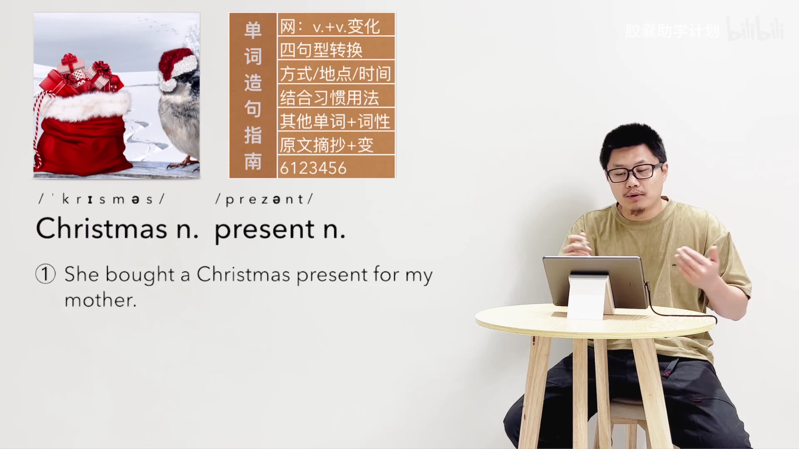

文字识别：单词造句指南 / 网：v.+v.变化 / 四句型转换 / 方式/地点/时间 / 结合习惯用法 / 其他单词+词性 / 原文摘抄+变 / 6123456 / / ' kr I s m a s / / /prezant/ / Christmas n. present n. / ① She bought a Christmas present for my / mother.

### 画面 00:03:03

文字识别：单词造句指南 / 网：v.+v.变化 / 四句型转换 / 方式/地点/时间 / 结合习惯用法 / 其他单词+词性 / 原文摘抄+变 / 6123456 / / ' k r I s m a s / / /prezant/ / Christmas n. present n. / ① She bought a Christmas present for my / mother. / If she had bought a Christmas present for / my mother, I would have told you. L64

### 画面 00:03:05

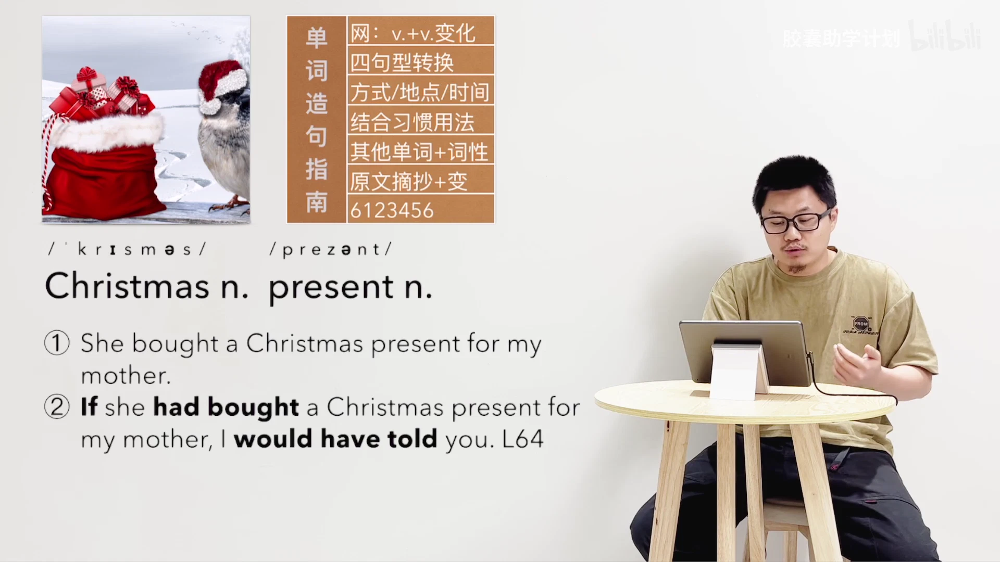

文字识别：单词造句指南 / 网：v.+v.变化 / 四句型转换 / 方式/地点/时间 / 结合习惯用法 / 其他单词+词性 / 原文摘抄+变 / 6123456 / / ' k r I s m a s / / /prezant/ / Christmas n. present n. / ① She bought a Christmas present for my / mother. / If she had bought a Christmas present for / my mother, I would have told you. L64

### 画面 00:03:08

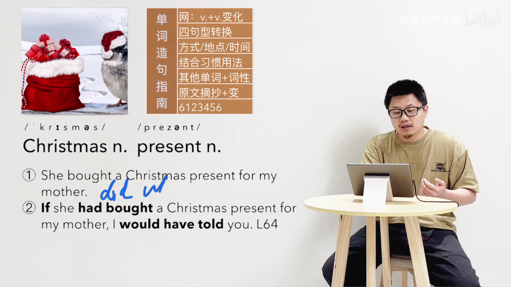

文字识别：单词造句指南 / 网：v.+v.变化 / 四句型转换 / 方式/地点/时间 / 结合习惯用法 / 其他单词+词性 / 原文摘抄+变 / 6123456 / /  krⅠ s m a s / / /prezant/ / Christmas n. present n. / ① She boughta Christmas present for my / mother. dt / W / If she had bought a Christmas present for / my mother, I would have told you. L64

### 画面 00:03:10

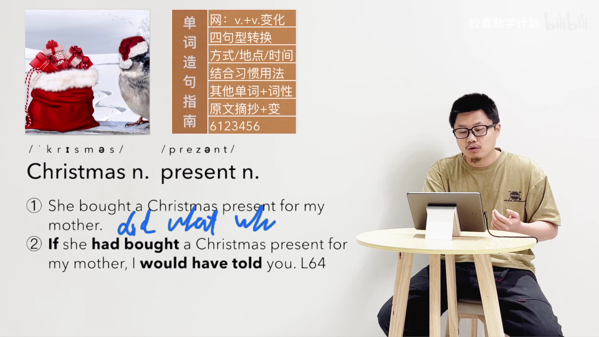

文字识别：单词造句指南 / 网：v.+v.变化 / 四句型转换 / 方式/地点/时间 / 结合习惯用法 / 其他单词+词性 / 原文摘抄+变 / 6123456 / /  k r Ⅰ s m a s / / /ｐrｅzant/ / Christmas n. present n. / ① She bought a Christmas present for my / r. dsd Med / mother. / wu / If she had bought a Christmas present for / my mother, I would have told you. L64

### 画面 00:03:13

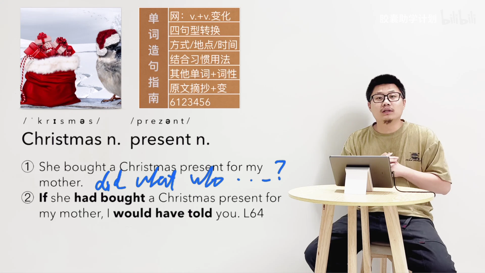

文字识别：单词造句指南 / 网：v.+v.变化 / 四句型转换 / 方式/地点/时间 / 结合习惯用法 / 其他单词+词性 / 原文摘抄+变 / 6123456 / / ' kr Ⅰ s m a s / / /ｐrezant/ / Christmas n. present n. / ① She boughta Christmas present for my / r. dst Mad / wlo / mother. / If she had bought a Christmas present for / my mother, I would have told you. L64

### 画面 00:03:15

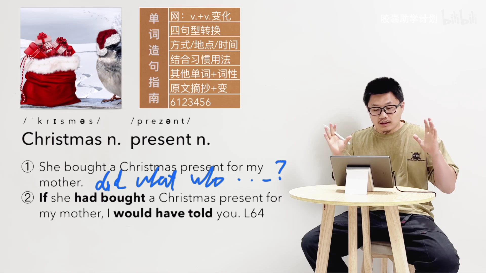

文字识别：单词造句指南 / 网：v.+v.变化 / 四句型转换 / 方式/地点/时间 / 结合习惯用法 / 其他单词+词性 / 原文摘抄+变 / 6123456 / / ' k r Ⅰ s m a s / / /ｐrｅzant/ / Christmas n. present n. / ① She boughta Christmas present for my / r. dsd Med / wlo / mother. / If she had bought a Christmas present for / my mother, I would have told you. L64

### 画面 00:03:20

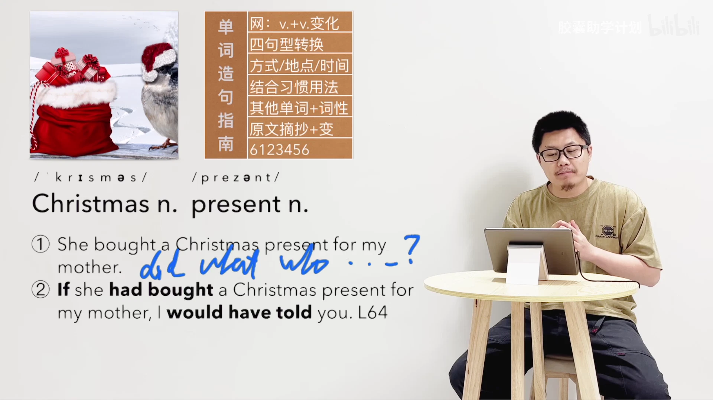

文字识别：单词造句指南 / 网：v.+v.变化 / 四句型转换 / 方式/地点/时间 / 结合习惯用法 / 其他单词+词性 / 原文摘抄+变 / 6123456 / / ' krⅠ s m a s / / /prezant/ / Christmas n. present n. / ① She boughta Christmas present for my / mother. diL Med / wlo / If she had bought a Christmas present for / my mother, I would have told you. L64

## 00:03:30–00:04:00

后边是 would have done，对吧？这个是最基本的规则 rules，啊，不是 exceptions，并不是例外。说如果他当时啊给我妈妈买了，那我当时就会告诉你了。可是他没有买，所以我也没有什么可说的，对吧？哎，与过去事实相反。下一个句子还是六十四课咱们学的。She suggested that you should buy a Christmas present for your mother。说她建议你应该买一个圣诞节礼物给你的

### 画面 00:03:45

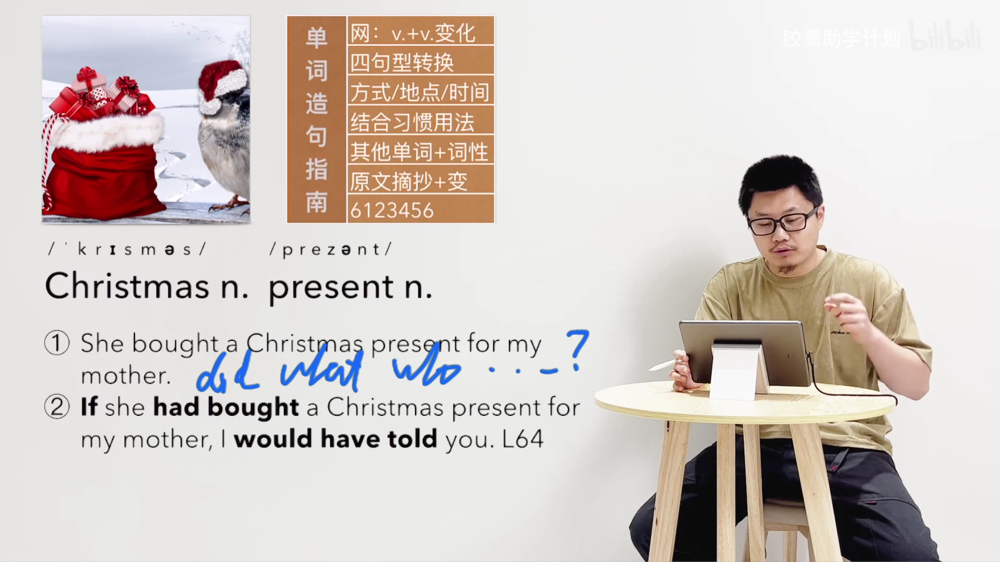

文字识别：单词造句指南 / 网：v.+v.变化 / 四句型转换 / 方式/地点/时间 / 结合习惯用法 / 其他单词+词性 / 原文摘抄+变 / 6123456 / / 'krI s ma s / / /prezant/ / Christmas n. present n. / ① She bought a Christmas present for my / mother. dit ad / wlo / If she had bought a Christmas present for / my mother, I would have told you. L64

### 画面 00:03:48

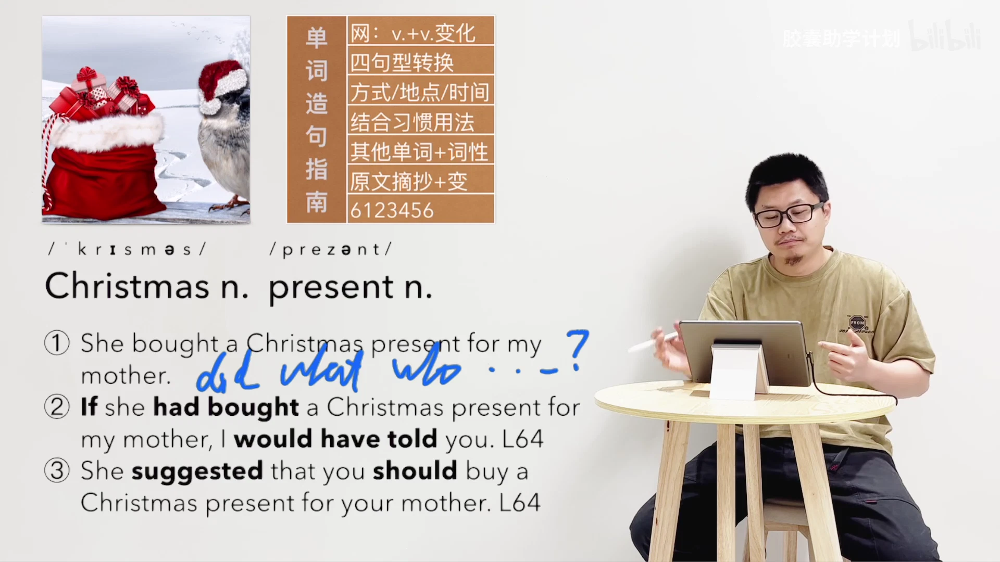

文字识别：单词造句指南 / 网：v.+v.变化 / 四句型转换 / 方式/地点/时间 / 结合习惯用法 / 其他单词+词性 / 原文摘抄+变 / 6123456 / /  krⅠ s m a s / / /prezant/ / Christmas n. present n. / ① She boughta Christmas present for my / mother. dit wad / wlo / If she had bought a Christmas present for / my mother, I would have told you. L64 / She suggested that you should buy a / Christmas present for your mother. L64

### 画面 00:03:50

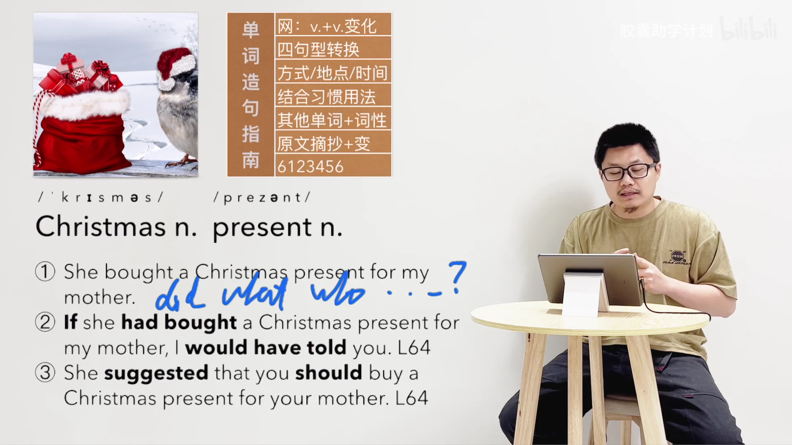

文字识别：单词造句指南 / 网：v.+v.变化 / 四句型转换 / 方式/地点/时间 / 结合习惯用法 / 其他单词+词性 / 原文摘抄+变 / 6123456 / / ' krⅠ s ma s / / /prezant/ / Christmas n. present n. / ① She boughta Christmas present for my / mother. dit wad / wlo / If she had bought a Christmas present for / my mother, I would have told you. L64 / She suggested that you should buy a / Christmas present for your mother. L64

### 画面 00:03:57

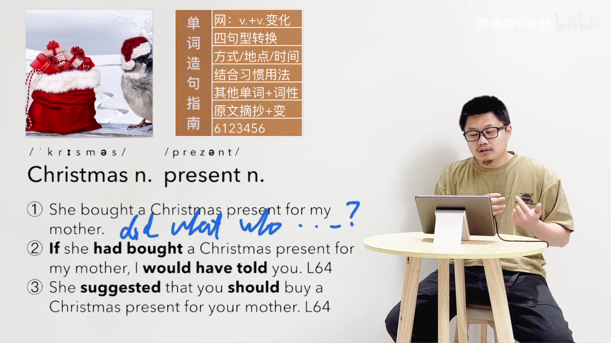

文字识别：单词造句指南 / 网：v.+v.变化 / 四句型转换 / 方式/地点/时间 / 结合习惯用法 / 其他单词+词性 / 原文摘抄+变 / 6123456 / / 'krⅠ s ma s / / /prezant/ / Christmas n. present n. / ① She boughta Christmas present for my / mother. diL Med / wlo / If she had bought a Christmas present for / my mother, I would have told you. L64 / She suggested that you should buy a / Christmas present for your mother. L64

## 00:04:00–00:04:30

母亲。OK，那你看这里的suggest后边是不是就是should加do，对吧？OK，very good。呃，包括这个语法，各位可以去红皮书里面再去学习一下。OK，好，那不多说了。呃，两个单词再跟我一起读一下吧。Like Christmas and present。Very good。Continue，下一个单词这儿可以加一个儿化音儿化音circus，后边没有儿化音，不是circus是吧？Circus，very

### 画面 00:04:02

文字识别：单词造句指南 / 网：v.+v.变化 / 四句型转换 / 方式/地点/时间 / 结合习惯用法 / 其他单词+词性 / 原文摘抄+变 / 6123456 / / ' k r Ⅰ s m a s / / /prezant/ / Christmas n. present n. / ① She boughta Christmas present for my / dd / wlo / mother. / If she had bought a Christmas present for / my mother L would have told you. L64 / She suggested /  that you should buy a / Christmas present for your mother. L64

### 画面 00:04:04

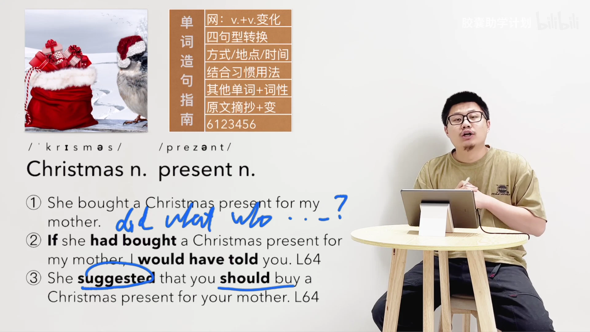

文字识别：单词造句指南 / 网：v.+v.变化 / 四句型转换 / 方式/地点/时间 / 结合习惯用法 / 其他单词+词性 / 原文摘抄+变 / 6123456 / / ' kr I s m a s / / /prezant/ / Christmas n. present n. / ① / She boughta Christmas R / presgnt for my / wlo / mother. / If she had bought a Christmas present for / my mother L would have told you. L64 / She suggested /  that you should buy a / Christmas present for your mother. L64

### 画面 00:04:07

文字识别：单词造句指南 / 网：v.+v.变化 / 四句型转换 / 方式/地点/时间 / 结合习惯用法 / 其他单词+词性 / 原文摘抄+变 / 6123456 / /  kr I s m a s / / /prezant/ / Christmas n. present n. /  She bought a Christmas present for my / ① / dL / wo / mother. / If she had bought a Christmas present for / my mother L would have told you. L64 / She suggested /  that you should buy a / Christmas present for your mother. L64

### 画面 00:04:11

文字识别：单词造句指南 / 网：v.+v.变化 / 四句型转换 / 方式/地点/时间 / 结合习惯用法 / 其他单词+词性 / 原文摘抄+变 / 6123456 / /  krI s m a s / / /prezant/ / Christmas n. present n. / ① / She boughta Christmas P /  presgnt for my / dL / wo / mother. / If she had bought a Christmas present for / my mother L would have told you. L64 / She. / suggested /  that you should buy a / Christmas present for your mother. L64

### 画面 00:04:16

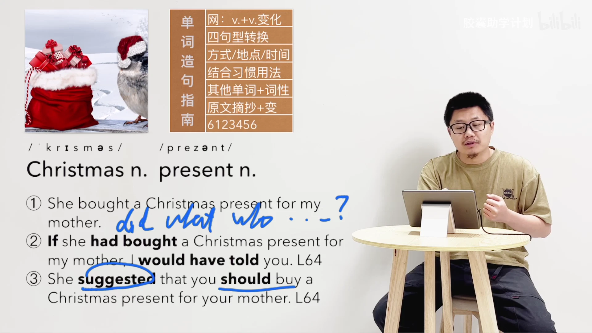

文字识别：单词造句指南 / 网：v.+v.变化 / 四句型转换 / 方式/地点/时间 / 结合习惯用法 / 其他单词+词性 / 原文摘抄+变 / 6123456 / / ·krI s m a s / / /prezant/ / Christmas n. present n. / ① / She boughta Christmas R /  presgnt for my / dd / wlo / mother. / If she had bought a Christmas present for / my mother L would have told you. L64 / She: / suggested /  that you should buy a / Christmas present for your mother. L64

### 画面 00:04:19

文字识别：单词造句指南 / 网：v.+v.变化 / 四句型转换 / 方式/地点/时间 / 结合习惯用法 / CIRCUS / SALLTO / 其他单词+词性 / 原文摘抄+变 / 6123456 / /'s3:kas/ / circus n.

### 画面 00:04:21

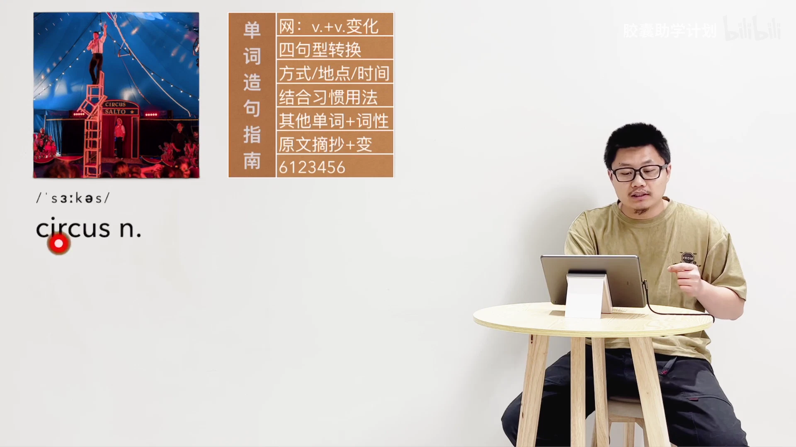

文字识别：单词造句指南 / 网：v.+v.变化 / 四句型转换 / 方式/地点/时间 / 结合习惯用法 / CIRCUS / SAIHTO / 其他单词+词性 / 原文摘抄+变 / 6123456 / /'s3:kas/ / ircus n.

### 画面 00:04:25

文字识别：单词造句指南 / 网：v.+v.变化 / 四句型转换 / 方式/地点/时间 / 结合习惯用法 / CIRCUS / SAITO / 其他单词+词性 / 原文摘抄+变 / 6123456 / /'s3:kas/ / circus n.

## 00:04:30–00:05:00

Circus, ah, uh,马戏团。那马戏团，我现在想去造句子。比如说最简单，我们跟原文有一点小的结合，叫The circus, the circus owner.哎，马戏团的拥有者。然后后边又来了个Leo。那那我们其实这个四十六课或者在它之前就已经见过了同位语，对吧？马戏团的拥有者Leo is my closest friend.这是咱们六十三课学的closest friend. Okay, next one.

### 画面 00:04:30

文字识别：单词造句指南 / 网：v.+v.变化 / 四句型转换 / 方式/地点/时间 / 结合习惯用法 / CIRCUS / SALTO / 其他单词+词性 / 原文摘抄+变 / 6123456 / /'s3:kas/ / circus n.

### 画面 00:04:35

文字识别：单词造句指南 / 网：v.+v.变化 / 四句型转换 / 方式/地点/时间 / 结合习惯用法 / CIRCUS / SAIATO / 其他单词+词性 / 原文摘抄+变 / 6123456 / /'s3:kas/ / circus n. /  The circus owner, Leo, is my closest friend. / 1 / L63

### 画面 00:04:44

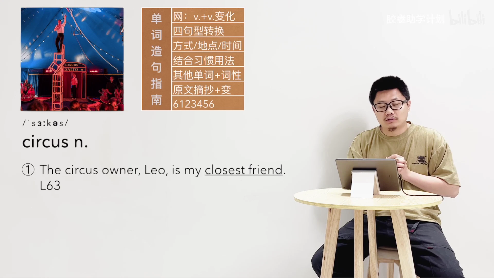

文字识别：单词造句指南 / 网：v.+v.变化 / 四句型转换 / 方式/地点/时间 / 结合习惯用法 / CIRCUS / SAIATO / 其他单词+词性 / 原文摘抄+变 / 6123456 / /'s3:kas/ / circus n. / ) The circus owner, Leo, is my closest friend. / 1 / L63

### 画面 00:04:46

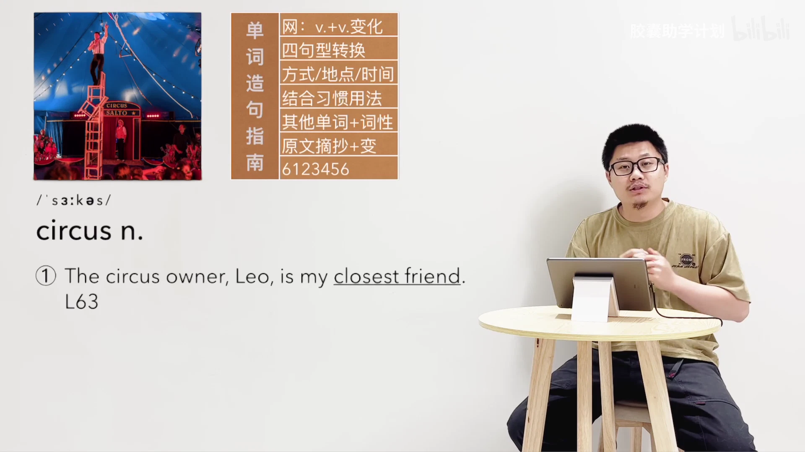

文字识别：单词造句指南 / 网：v.+v.变化 / 四句型转换 / 方式/地点/时间 / 结合习惯用法 / CIRCUS / SAIATO / 其他单词+词性 / 原文摘抄+变 / 6123456 / /'s3:kas/ / circus n. / ROM / The circus owner, Leo, is my closest friend. / L63

### 画面 00:04:50

文字识别：单词造句指南 / 网：v.+v.变化 / 四句型转换 / 方式/地点/时间 / 结合习惯用法 / CIRCUS / SALATO / 其他单词+词性 / 原文摘抄+变 / 6123456 / /'s3:kas/ / circus n. / The circus owner, Leo, is my closest friend. / L63

### 画面 00:04:53

文字识别：单词造句指南 / 网：v.+v.变化 / 四句型转换 / 方式/地点/时间 / 结合习惯用法 / CIRCUS / SAITO / 其他单词+词性 / 原文摘抄+变 / 6123456 / /'s3:kas/ / circus n. / FROM / The circus owner, Leo, is my closest friend. / L63

### 画面 00:04:55

文字识别：单词造句指南 / 网：v.+v.变化 / 四句型转换 / 方式/地点/时间 / 结合习惯用法 / CIRCUS / SAITO / 其他单词+词性 / 原文摘抄+变 / 6123456 / /'s3:kas/ / circus n. / ) The circus owner, Leo, is my closest friend. / 1 / L63

### 画面 00:04:59

文字识别：单词造句指南 / 网：v.+v.变化 / 四句型转换 / 方式/地点/时间 / 结合习惯用法 / CIRCUS / SAIATO / 其他单词+词性 / 原文摘抄+变 / 6123456 / /'s3:kas/ / circus n. /  The circus owner, Leo, is my closest friend. / L63 / What sort of circus do you have here? L63

## 00:05:00–00:05:30

What sort of circus do you have here?哎，What sort of六十三课咱们学的就是类似于What kind of什么类型的？你这儿有什么类型的马戏团呢？Next one,说Lail points out that she owns a circus.哎，指出说她实际上是个富二代，她拥有啊富一代啊，她拥有一个马戏团。Okay, next one.那Go to the circus也是一个很常见的，就跟比如说什么Go to the cinema啊，Go to the theater啊

### 画面 00:05:01

文字识别：单词造句指南 / 网：v.+v.变化 / 四句型转换 / 方式/地点/时间 / 结合习惯用法 / CIRCUS / SAITO / 其他单词+词性 / 原文摘抄+变 / 6123456 / /'s3:kas/ / circus n. /  The circus owner, Leo, is my closest friend. / 1 / L63 / What sort of circus do you have here? L63

### 画面 00:05:05

文字识别：单词造句指南 / 网：v.+v.变化 / 四句型转换 / 方式/地点/时间 / 结合习惯用法 / CIRCUS / SALTO / 其他单词+词性 / 原文摘抄+变 / 6123456 / /'s3:kas/ / circus n. / ) The circus owner, Leo, is my closest friend. / 1 / L63 / What sort of circus do you have here? L63

### 画面 00:05:10

文字识别：单词造句指南 / 网：v.+v.变化 / 四句型转换 / 方式/地点/时间 / 结合习惯用法 / CIRCUS / SALTO / 其他单词+词性 / 原文摘抄+变 / 6123456 / /'s3:kas/ / circus n. / ① The circus owner, Leo, is my closest friend. / L63 / What sort of circus do you have here? L63 / ③ Leo points out that she owns a circus. L 58 / 3

### 画面 00:05:15

文字识别：单词造句指南 / 网：v.+v.变化 / 四句型转换 / 方式/地点/时间 / 结合习惯用法 / CIRCUS / SAIATO / 其他单词+词性 / 原文摘抄+变 / 6123456 / /'s3:kas/ / circus n. / ① The circus owner, Leo, is my closest friend. / L63 / What sort of circus do you have here? L63 / ③ Leo points out that she owns a circus. L 58 / 3

### 画面 00:05:18

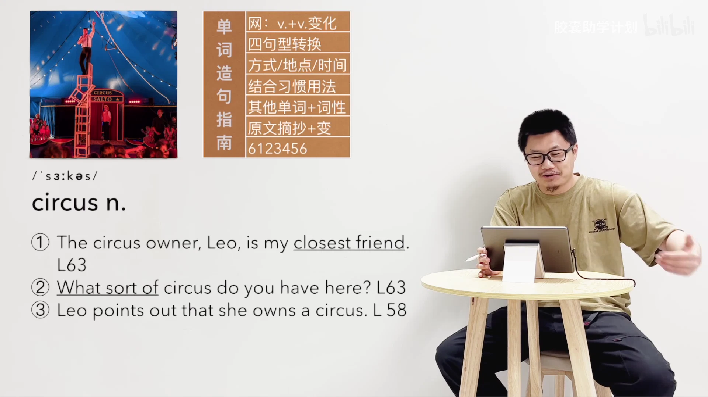

文字识别：单词造句指南 / 网：v.+v.变化 / 四句型转换 / 方式/地点/时间 / 结合习惯用法 / CIRCUS / SAIATO / 其他单词+词性 / 原文摘抄+变 / 6123456 / /'s3:kas/ / circus n. / ① The circus owner, Leo, is my closest friend. / L63 / What sort of circus do you have here? L63 / ) Leo points out that she owns a circus. L 58 / 3

### 画面 00:05:21

文字识别：单词造句指南 / 网：v.+v.变化 / 四句型转换 / 方式/地点/时间 / 结合习惯用法 / CIRCUS / SAITO / 其他单词+词性 / 原文摘抄+变 / 6123456 / /'s3:kas/ / circus n. / ① The circus owner, Leo, is my closest friend. / L63 / What sort of circus do you have here? L63 / ③ Leo points out that she owns a circus. L 58 / 3

### 画面 00:05:25

文字识别：单词造句指南 / 网：v.+v.变化 / 四句型转换 / 方式/地点/时间 / 结合习惯用法 / CIRCUS / SAITO / 其他单词+词性 / 原文摘抄+变 / 6123456 / /'s3:kas/ / circus n. / ① The circus owner, Leo, is my closest friend. / L63 / What sort of circus do you have here? L63 / Leo points out that she owns a circus. L 58 / 3 / go to the circus... / 4

## 00:05:30–00:06:00

这样的短语是类似的，去马戏团。那他想去造句，那可真的就能造的太多太多了啊！那我们就造一个句子吧，就是结合着我们刚刚学过的语法，学过立刻复习。叫If you have gone to the circus, you would have met her。说如果当时你去这个马戏团了，and怎么样，你就会见到他了，对吧？很可惜，我用的这些呃加重的部分提醒了你，叫做当时没去，所以你没见到，对吧？

### 画面 00:05:30

文字识别：单词造句指南 / 网：v.+v.变化 / 四句型转换 / 方式/地点/时间 / 结合习惯用法 / CIRCUS / SAIATO / 其他单词+词性 / 原文摘抄+变 / 6123456 / /'s3:kas/ / circus n. / ① The circus owner, Leo, is my closest friend. / L63 / What sort of circus do you have here? L63 / Leo points out that she owns a circus. L 58 / 3 / go to the circus... / 4

### 画面 00:05:36

文字识别：单词造句指南 / 网：v.+v.变化 / 四句型转换 / 方式/地点/时间 / 结合习惯用法 / CIRCUS / SAIATO / 其他单词+词性 / 原文摘抄+变 / 6123456 / /'s3:kas/ / circus n. / ① The circus owner, Leo, is my closest friend. / L63 / What sort of circus do you have here? L63 / Leo points out that she owns a circus. L 58 / 3 / go to the circus... / 4

### 画面 00:05:38

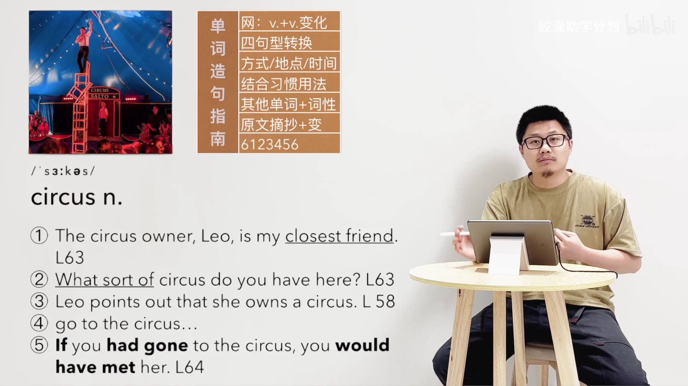

文字识别：单词造句指南 / 网：v.+v.变化 / 四句型转换 / 方式/地点/时间 / 结合习惯用法 / CIRCUS / SAIATO / 其他单词+词性 / 原文摘抄+变 / 6123456 / /'s3:kas/ / circus n. / ① The circus owner, Leo, is my closest friend. / L63 / What sort of circus do you have here? L63 / 3 / Leo points out that she owns a circus. L 58 / 4 / go to the circus... / If you had gone to the circus, you would / 5 / have met her. L64

### 画面 00:05:40

文字识别：单词造句指南 / 网：v.+v.变化 / 四句型转换 / 方式/地点/时间 / 结合习惯用法 / CIRCUS / SALTO / 其他单词+词性 / 原文摘抄+变 / 6123456 / /'s3:kas/ / circus n. / ① The circus owner, Leo, is my closest friend. / L63 / What sort of circus do you have here? L63 / 3 / Leo points out that she owns a circus. L 58 / 4 / go to the circus... / If you had gone to the circus, you would / 5 / have met her. L64

### 画面 00:05:45

文字识别：单词造句指南 / 网：v.+v.变化 / 四句型转换 / 方式/地点/时间 / 结合习惯用法 / CIRCUS / SAITO / 其他单词+词性 / 原文摘抄+变 / 6123456 / /'s3:kas/ / circus n. / ① The circus owner, Leo, is my closest friend. / L63 / What sort of circus do you have here? L63 / 3 / Leo points out that she owns a circus. L 58 / 4 / go to the circus... / If you had gone to the circus, you would / 5 / have met her. L64

### 画面 00:05:52

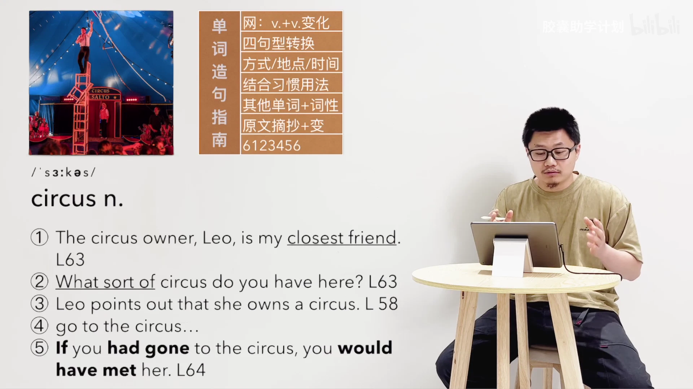

文字识别：单词造句指南 / 网：v.+v.变化 / 四句型转换 / 方式/地点/时间 / 结合习惯用法 / CIRCUS / SALO / 其他单词+词性 / 原文摘抄+变 / 6123456 / /'s3:kas/ / circus n. / ① The circus owner, Leo, is my closest friend. / L63 / What sort of circus do you have here? L63 / 3 / Leo points out that she owns a circus. L 58 / 4 / go to the circus... / If you had gone to the circus, you would / 5 / have met her. L64

### 画面 00:05:56

文字识别：单词造句指南 / 网：v.+v.变化 / 四句型转换 / 方式/地点/时间 / 结合习惯用法 / CIRCUS / SAITO / 其他单词+词性 / 原文摘抄+变 / 6123456 / /'s3:kas/ / circus n. / ① The circus owner, Leo, is my closest friend. / L63 / What sort of circus do you have here? L63 / 3 / Leo points out that she owns a circus. L 58 / 4 / go to the circus... / If you had gone to the circus, you would / 5 / have met her. L64

## 00:06:00–00:06:30

再读一遍这个单词，circus。Very good。呃，那注意力集中，我们做一个听力训练啊。I love the circus. We all go to the circus. 哎，go to the circus。OK。Very good。下一个单词叫 accompany。注意啊，accompany 看上去好像里边有一个 company。company 是原来咱们学过的公司，对吧？但是 accompany 它没什么关系。accompany 在这是一个动词，指的是陪伴某人啊。比如我们造一个句子啊，这

### 画面 00:06:00

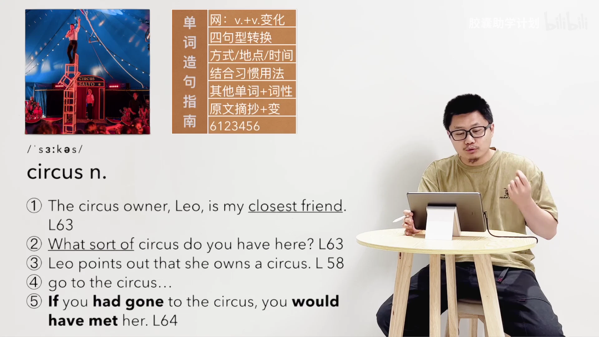

文字识别：单词造句指南 / 网：v.+v.变化 / 四句型转换 / 方式/地点/时间 / 结合习惯用法 / CIRCUS / SAIHTO / 其他单词+词性 / 原文摘抄+变 / 6123456 / /'s3:kas/ / circus n. / ① The circus owner, Leo, is my closest friend. / L63 / What sort of circus do you have here? L63 / 3 / Leo points out that she owns a circus. L 58 / go to the circus... / 4 / If you had gone to the circus, you would / 5 / have met her. L64

### 画面 00:06:03

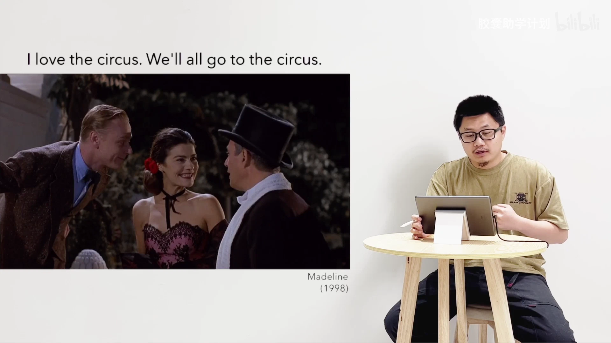

文字识别：Ilove the circus. We'll all go to the circus. / Madeline / (1998)

### 画面 00:06:09

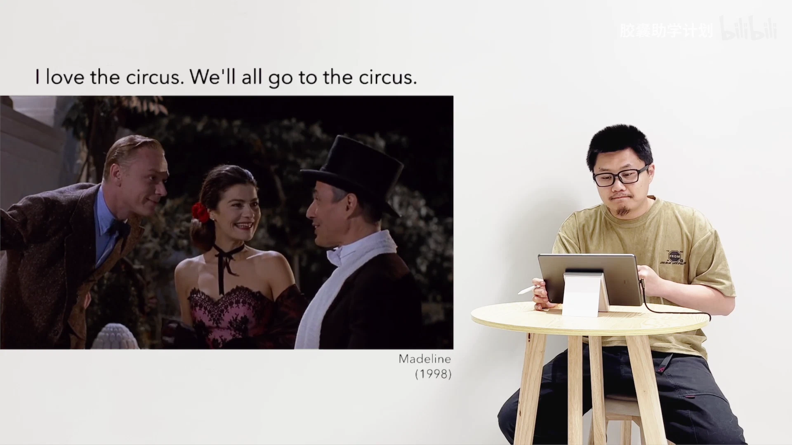

文字识别：Ilove the circus. We'll all go to the circus. / Madeline / (1998)

### 画面 00:06:11

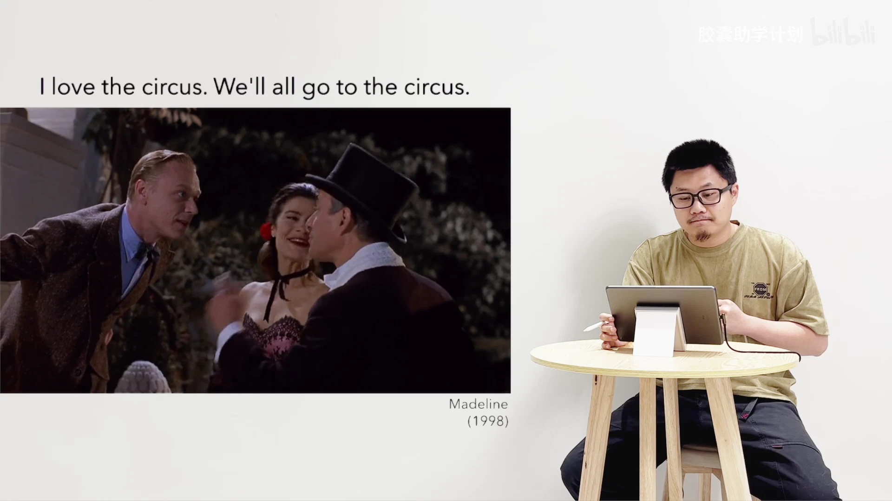

文字识别：I love the circus. We'll all go to the circus. / Madeline / (1998)

### 画面 00:06:14

文字识别：单词造句指南 / 网：v.+v.变化 / 四句型转换 / 方式/地点/时间 / 结合习惯用法 / 其他单词+词性 / 原文摘抄+变 / 6123456 / /a'kΛmｐani/ / accompany v.

### 画面 00:06:16

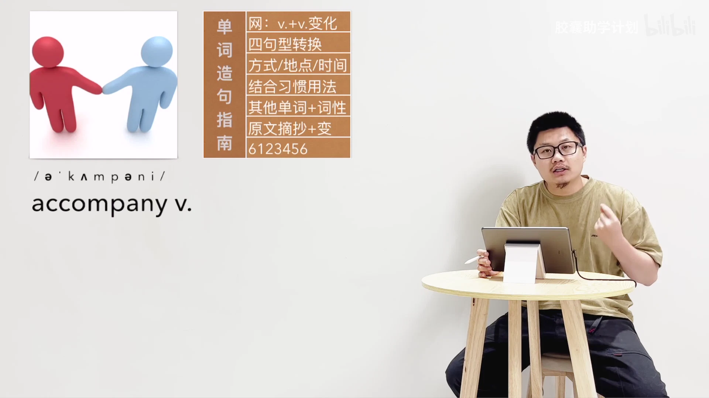

文字识别：单词造句指南 / 网：v.+v.变化 / 四句型转换 / 方式/地点/时间 / 结合习惯用法 / 其他单词+词性 / 原文摘抄+变 / 6123456 / /a'kΛmｐani/ / accompany v.

### 画面 00:06:20

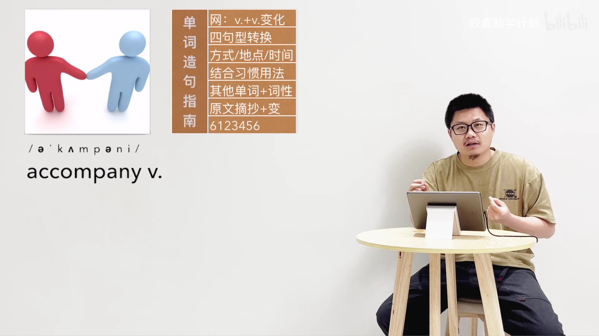

文字识别：单词造句指南 / 网：v.+v.变化 / 四句型转换 / 方式/地点/时间 / 结合习惯用法 / 其他单词+词性 / 原文摘抄+变 / 6123456 / /ａ'kΛmｐani/ / accompany v.

### 画面 00:06:28

文字识别：单词造句指南 / 网：v.+v.变化 / 四句型转换 / 方式/地点/时间 / 结合习惯用法 / 其他单词+词性 / 原文摘抄+变 / 6123456 / /a'kΛ mpani / / accompany v. / ① Aunt March is very ill, so Laurie will / accompany them. Litle Women (2019)

## 00:06:30–00:07:00

个是我们从电影当中找到的一个片段，叫做 Aunt March is very ill，病得很严重，so Laurie will accompany them，呃，所以 Laurie 要去陪伴他们，对吧？哎，很简单，就是它最基本的意思。下一个呢，比如说我再给各位来一个句子，叫做口语当中完全可以用，叫 Will you accompany？啊，这个地方其实少了一个单词，应该是 me，啊，Will you accompany me to that coffee shop, please？说你能陪着

### 画面 00:06:30

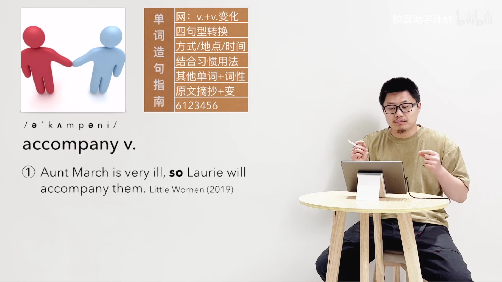

文字识别：单词造句指南 / 网：v.+v.变化 / 四句型转换 / 方式/地点/时间 / 结合习惯用法 / 其他单词+词性 / 原文摘抄+变 / 6123456 / /a'kΛmpani / / accompany v. / ① Aunt March is very ill, so Laurie will / accompany them. Litle Women (2019)

### 画面 00:06:43

文字识别：单词造句指南 / 网：v.+v.变化 / 四句型转换 / 方式/地点/时间 / 结合习惯用法 / 其他单词+词性 / 原文摘抄+变 / 6123456 / /a'kΛmｐani / / accompany v. / ① Aunt March is very ill, so Laurie will / accompany them. Little Women (2019) / Will you accompany to that coffee shop, / please?

### 画面 00:06:45

文字识别：单词造句指南 / 网：v.+v.变化 / 四句型转换 / 方式/地点/时间 / 结合习惯用法 / 其他单词+词性 / 原文摘抄+变 / 6123456 / /a'kΛmpani / / accompany v. / ① Aunt March is very ill, so Laurie will / accompany them. Little Women (2019) / Will you accompany to that coffee shop, / please?

### 画面 00:06:50

文字识别：单词造句指南 / 网：v.+v.变化 / 四句型转换 / 方式/地点/时间 / 结合习惯用法 / 其他单词+词性 / 原文摘抄+变 / 6123456 / /a'kΛmｐani / / accompany v. / ① Aunt March is very ill, so Laurie will / accompany them. Little Women (2019) / Will you accompany to that coffee shop, / please?

### 画面 00:06:53

文字识别：单词造句指南 / 网：v.+v.变化 / 四句型转换 / 方式/地点/时间 / 结合习惯用法 / 其他单词+词性 / 原文摘抄+变 / 6123456 / /a'kΛ mｐani / / accompany v. / ① Aunt March is very ill, so Laurie will / accompany them. Little Women (2019) / Willyou accompanyto that coffee shop, / please?

### 画面 00:06:55

文字识别：单词造句指南 / 网：v.+v.变化 / 四句型转换 / 方式/地点/时间 / 结合习惯用法 / 其他单词+词性 / 原文摘抄+变 / 6123456 / /ａ'kΛmｐａｎi/ / accompany v. / ① Aunt March is very ill, so Laurie will / accompany them. Little Women (2019) /  Will you accompanyto that coffee shop, / please? / me

## 00:07:00–00:07:30

我啊？Accompany somebody to some place.如果非要说的话，可以理解为这有一个小的习惯用法，要陪着某人去某地，对吧？哎，你愿意陪着我去那个咖啡厅吗？对吧？咖啡馆吗？Next one.下一个，我们就结合了这个。首先，十九课Will have to啊。本课我们也要复习这个语法。对吧？我一要复习哪个语法的时候，我就会把它拿出来，单词再造一下句子。接下来五十四课，咱们学过一个叫

### 画面 00:07:00

文字识别：单词造句指南 / 网：v.+v.变化 / 四句型转换 / 方式/地点/时间 / 结合习惯用法 / 其他单词+词性 / 原文摘抄+变 / 6123456 / /ａ'kΛmｐａni/ / accompany v. / ① Aunt March is very ill, so Laurie will / accompany them. Little Women (2019) /  Will you accompanyto that coffee shop, / please? / me

### 画面 00:07:05

文字识别：单词造句指南 / 网：v.+v.变化 / 四句型转换 / 方式/地点/时间 / 结合习惯用法 / 其他单词+词性 / 原文摘抄+变 / 6123456 / /ａ'kamｐａｎi/ / accompany v. / ① Aunt March is very ill, so Laurie will / accompany them. Little Women (2019) /  Will you accompanyto that coffee shop, / please? / me

### 画面 00:07:10

文字识别：单词造句指南 / 网：v.+v.变化 / 四句型转换 / 方式/地点/时间 / 结合习惯用法 / 其他单词+词性 / 原文摘抄+变 / 6123456 / /a'kΛmpani / / accompany v. / ① Aunt March is very ill, so Laurie will / accompany them. Little Women (2019) / Willyou accompanyto t /  that coffee shop, / please? / me

### 画面 00:07:14

文字识别：单词造句指南 / 网：v.+v.变化 / 四句型转换 / 方式/地点/时间 / 结合习惯用法 / 其他单词+词性 / 原文摘抄+变 / 6123456 / /ａ'kΛmｐａni/ / accompany v. / ① Aunt March is very ill, so Laurie will / accompany them. Little Women (2019) / Will you accompanyto that coffe shop, / please? / me. / I will have to persuade you to accompany / me to the lake this afternoon. L19 L 54

### 画面 00:07:16

文字识别：单词造句指南 / 网：v.+v.变化 / 四句型转换 / 方式/地点/时间 / 结合习惯用法 / 其他单词+词性 / 原文摘抄+变 / 6123456 / /akΛ mｐani / / accompany v. / ① Aunt March is very ill, so Laurie will / accompany them. Little Women (2019) /  Willyou accompanyto that coffee shop, / please? / I will have to persuade you to accompany / me to the lake this afternoon. L19 L 54

### 画面 00:07:18

文字识别：单词造句指南 / 网：v.+v.变化 / 四句型转换 / 方式/地点/时间 / 结合习惯用法 / 其他单词+词性 / 原文摘抄+变 / 6123456 / /a'kΛmｐani / / accompany v. / ① Aunt March is very ill, so Laurie will / accompany them. Little Women (2019) / Will you accompany to that coffee shop, / please? / I will have to persuade you to accompany / me to the lake this afternoon. L19 L 54

### 画面 00:07:20

文字识别：单词造句指南 / 网：v.+v.变化 / 四句型转换 / 方式/地点/时间 / 结合习惯用法 / 其他单词+词性 / 原文摘抄+变 / 6123456 / /a'kΛmpani / / accompany v. / ① Aunt March is very ill, so Laurie will / accompany them. Little Women (2019) / Will you accompany to that coffee shop, / please? / I will have to persuade you to accompany / me to the lake this afternoon. L19 L 54

### 画面 00:07:25

文字识别：单词造句指南 / 网：v.+v.变化 / 四句型转换 / 方式/地点/时间 / 结合习惯用法 / 其他单词+词性 / 原文摘抄+变 / 6123456 / /a'kΛmｐani / / accompany v. / ① Aunt March is very ill, so Laurie will / accompany them. Little Women (2019) / Will you accompany to that coffee shop, / please? / I will have to persuade you to accompany / me to the lake this afternoon. L19 L 54

## 00:07:30–00:08:00

persuade somebody to do something，对吧？劝某人做某件事情。那我是不是造一个句子叫 I will have to persuade you to accompany me to the lake this afternoon？所以，我将必须要劝说你，我将必须要劝你怎么样呢？ Accompany me to the lake. Accompany me to that coffee shop. 这地方少了一个 me 啊。 Accompany me to that coffee shop. 对吧？ Okay, very good. 啊，那 lake 是河边。 This afternoon 叫

### 画面 00:07:30

文字识别：单词造句指南 / 网：v.+v.变化 / 四句型转换 / 方式/地点/时间 / 结合习惯用法 / 其他单词+词性 / 原文摘抄+变 / 6123456 / /akΛ mｐani / / accompany v. / ① Aunt March is very ill, so Laurie will / accompany them. Little Women (2019) /  Will you accompany to that coffee shop, / please? / i will have to persuade you to accompany / me to the lake this afternoon. L19 L 54

### 画面 00:07:44

文字识别：单词造句指南 / 网：v.+v.变化 / 四句型转换 / 方式/地点/时间 / 结合习惯用法 / 其他单词+词性 / 原文摘抄+变 / 6123456 / /a'kΛmpani / / accompany v. / ① Aunt March is very ill, so Laurie will / accompany them. Little Women (2019) / Will you accompany to that coffee shop, / please? / I will have to persuade you to accompany / me to the lake this afternoon. L19 L 54

### 画面 00:07:46

文字识别：单词造句指南 / 网：v.+v.变化 / 四句型转换 / 方式/地点/时间 / 结合习惯用法 / 其他单词+词性 / 原文摘抄+变 / 6123456 / /akΛ mpani / / accompany v. / ① Aunt March is very ill, so Laurie will / accompany them. Little Women (2019) / Will you accompany to that coffee shop, / please? / I will have to persuade you to accompany / me to the lake this afternoon. L19 L 54

### 画面 00:07:48

文字识别：单词造句指南 / 网：v.+v.变化 / 四句型转换 / 方式/地点/时间 / 结合习惯用法 / 其他单词+词性 / 原文摘抄+变 / 6123456 / /akΛ mpani / / accompany v. / ① Aunt March is very ill, so Laurie will / accompany them. Little Women (2019) / Will you accompany to that coffee shop, / please? / I will have to persuade you to accompany / me to the lake this afternoon. L19 L 54

### 画面 00:07:50

文字识别：单词造句指南 / 网：v.+v.变化 / 四句型转换 / 方式/地点/时间 / 结合习惯用法 / 其他单词+词性 / 原文摘抄+变 / 6123456 / /a'kΛmpani / / accompany v. / ① Aunt March is very ill, so Laurie will / accompany them. Little Women (2019) / Will you accompany to that coffee shop, / please? / I will have to persuade you to accompany / me to the lake this afternoon. L19 L 54

### 画面 00:07:55

文字识别：单词造句指南 / 网：v.+v.变化 / 四句型转换 / 方式/地点/时间 / 结合习惯用法 / 其他单词+词性 / 原文摘抄+变 / 6123456 / /akΛmｐａni/ / accompany v. / ① Aunt March is very ill, so Laurie will / accompany them. Litle Women (2019) / Will you accompany to that coffee shop, / a / please? / I will have to persuade you to accompany / me to the lake this afternoon. L19 L 54

## 00:08:00–00:08:30

Ah, read again. Next one,下一个单词repeat after me. Approach, approach, approach. 最基本的意思就是这个图中展现出来的接近、靠近，对吧？Approach me, ah, 接近我，靠近我，啊，它引申出来会有新的意思，也非常常用。马上咱们就见到啊，比如说这儿。所以if you were here, you would approach the tunnel too. 好，我们先说

### 画面 00:08:01

文字识别：单词造句指南 / 网：v.+v.变化 / 四句型转换 / 方式/地点/时间 / 结合习惯用法 / 其他单词+词性 / 原文摘抄+变 / 6123456 / /a kΛ mpani / / accompany v. / ① Aunt March is very ill, so Laurie will / accompany them. Little Women (2019) / Will you accompany to that coffee shop, / please? / I will have to persuade you to accompany / me to the lake this afternoon. L19 L 54 / 口误：lake 应为湖

### 画面 00:08:04

文字识别：单词造句指南 / 网：v.+v.变化 / 四句型转换 / 方式/地点/时间 / 结合习惯用法 / 其他单词+词性 / 原文摘抄+变 / 6123456 / /a'ｐraut∫/ / approach v.

### 画面 00:08:06

文字识别：单词造句指南 / 网：v.+v.变化 / 四句型转换 / 方式/地点/时间 / 结合习惯用法 / 其他单词+词性 / 原文摘抄+变 / 6123456 / /a'ｐraut∫/ / approach v.

### 画面 00:08:09

文字识别：单词造句指南 / 网：v.+v.变化 / 四句型转换 / 方式/地点/时间 / 结合习惯用法 / 其他单词+词性 / 原文摘抄+变 / 6123456 / praut ∫/ / approach v.

### 画面 00:08:11

文字识别：单词造句指南 / 网：v.+v.变化 / 四句型转换 / 方式/地点/时间 / 结合习惯用法 / 其他单词+词性 / 原文摘抄+变 / 6123456 / praut ∫/ / approach v.

### 画面 00:08:19

文字识别：单词造句指南 / 网：v.+v.变化 / 四句型转换 / 方式/地点/时间 / 结合习惯用法 / 其他单词+词性 / 原文摘抄+变 / 6123456 / prau t ∫/ / approach v.

### 画面 00:08:22

文字识别：单词造句指南 / 网：v.+v.变化 / 四句型转换 / 方式/地点/时间 / 结合习惯用法 / 其他单词+词性 / 原文摘抄+变 / 6123456 / apraut ∫/ / approach v. / If you were here, you would approach the / tunnel too. L40

### 画面 00:08:25

文字识别：单词造句指南 / 网：v.+v.变化 / 四句型转换 / 方式/地点/时间 / 结合习惯用法 / 其他单词+词性 / 原文摘抄+变 / 6123456 / apraut ∫/ / approach v. / If you were here, you would approach the / tunnel too. L40

## 00:08:30–00:09:00

它的字面意思。说如果你在这儿，那你也会接近这个 tunnel。我们刚刚学过叫这个轨道啊，这个隧道，对吧？你也会接近这个隧道的。那它的实际使用场景呢？我给你勾勒一个。比如说，我现在在这个隧道附近，出于某些原因，我必须要接近它，靠近它。然后我现在给你打电话，你说你不要接近它，对吧？然后我就跟你说说，如果你在我这儿，你现在看我这个四周，你也会接近那个 tunnel 的，对不对？好，比如说外面下个大暴雨

### 画面 00:08:33

文字识别：单词造句指南 / 网：v.+v.变化 / 四句型转换 / 方式/地点/时间 / 结合习惯用法 / 其他单词+词性 / 原文摘抄+变 / 6123456 / a' praut ∫/ / approach v. / If you were here, you would approach the / tunnel too. L40

### 画面 00:08:40

文字识别：单词造句指南 / 网：v.+v.变化 / 四句型转换 / 方式/地点/时间 / 结合习惯用法 / 其他单词+词性 / 原文摘抄+变 / 6123456 / a' praut ∫/ / approach v. / If you were here, you would approach the / tunnel too. L40

## 00:09:00–00:09:30

啊，那你不是在我这个地方，你又不知道。但是我会告诉你说，如果你在这儿，但你并不在这儿，对吧？哎，你也会去 approach the tunnel. There you go. Next one, we need to find out who approached our house in the dark last night. 还是接近的意思，说我们必须要弄明白、搞清楚一件事情。后面跟着一个小的宾从，什么事情呢？叫 who approached our house in the dark last night. 昨晚在

### 画面 00:09:10

文字识别：单词造句指南 / 网：v.+v.变化 / 四句型转换 / 方式/地点/时间 / 结合习惯用法 / 其他单词+词性 / 原文摘抄+变 / 6123456 / Lapraut ∫/ / approach v. / If you were here, you would approach the / tunnel too. L40 / We need to find out who approached our / house in the dark last night. L53

### 画面 00:09:13

文字识别：单词造句指南 / 网：v.+v.变化 / 四句型转换 / 方式/地点/时间 / 结合习惯用法 / 其他单词+词性 / 原文摘抄+变 / 6123456 / Lapraut ∫ / / approach v. / If you were here, you would approach the / tunnel too. L40 / We need to find out who approached our / house in the dark last night. L53

### 画面 00:09:16

文字识别：单词造句指南 / 网：v.+v.变化 / 四句型转换 / 方式/地点/时间 / 结合习惯用法 / 其他单词+词性 / 原文摘抄+变 / 6123456 / La'praut ∫/ / approach v. / If you were here, you would approach the / tunnel too. L40 / We need to find out who approached our / house in the dark last night. L53

### 画面 00:09:22

文字识别：单词造句指南 / 网：v.+v.变化 / 四句型转换 / 方式/地点/时间 / 结合习惯用法 / 其他单词+词性 / 原文摘抄+变 / 6123456 / Lapraut ∫ / / approach v. / If you were here, you would approach the / tunnel too. L40 / We need to find out who approached our / house in the dark last'night. L53

### 画面 00:09:25

文字识别：单词造句指南 / 网：v.+v.变化 / 四句型转换 / 方式/地点/时间 / 结合习惯用法 / 其他单词+词性 / 原文摘抄+变 / 6123456 / La praut ∫ / / approach v. / If you were here, you would approach the / tunnel too.L40 / We need to find out who approached our / house in the dark last night.JL53

## 00:09:30–00:10:00

黑暗当中，说谁偷偷的哎，就是接近了咱这个房子，对吧？就是黑影没看清。Okay, next one. 四句型转换永远是您可以做的练习。那我不多说啊。这个是我找的一个电影片段，但非常好，它用到了五十八课，帮我们复习了五十八课的强调句，叫"It was he who approached us."说就是他怎么样了呢？哎，approached us叫接近了我们，靠近了我们。你看啊，

### 画面 00:09:38

文字识别：单词造句指南 / 网：v.+v.变化 / 四句型转换 / 方式/地点/时间 / 结合习惯用法 / 其他单词+词性 / 原文摘抄+变 / 6123456 / La'pra ut ∫ / / approach v. / If you were here, you would approach the / tunnel too. L40 / We need to find out who approached our / house in the dark last night. L53 / ) do/why/how/who...

### 画面 00:09:43

文字识别：单词造句指南 / 网：v.+v.变化 / 四句型转换 / 方式/地点/时间 / 结合习惯用法 / 其他单词+词性 / 原文摘抄+变 / 6123456 / Lapraut ∫/ / approach v. / If you were here, you would approach the / tunnel too. L40 / We need to find out who approached our / house in the dark last night. L53 / do/why/how/who... / It was he who approached us. Black Sunday / (1977) L58

### 画面 00:09:56

文字识别：单词造句指南 / 网：v.+v.变化 / 四句型转换 / 方式/地点/时间 / 结合习惯用法 / 其他单词+词性 / 原文摘抄+变 / 6123456 / Laｐraut ∫ / / approach v. / If you were here, you would approach the / 1 / tunnel too.L40 / We need to find out who approached our / house in the dark last night. L53 / do/why/how/who... / It was he who approached us. Black Sunday / (1977) L58

## 00:10:00–00:10:30

当我之前说的所有接近、靠近，都是物理意义上的接近、靠近，对吧？好，这个地方也可以是物理意义上的接近、靠近。那什么叫接近了你、靠近了你呢？它引申出来的另一个含义非常常用，就是联系了我们啊，就就是他联系了我们。Approached us，他主动靠近、接近我们，然后联系了我，对吧？比如说您现在有一个什么事儿啊？你这个，比如说要跟我们合作吧，假设啊要跟我们江塘助学计划合作，

### 画面 00:10:04

文字识别：单词造句指南 / 网：v.+v.变化 / 四句型转换 / 方式/地点/时间 / 结合习惯用法 / 其他单词+词性 / 原文摘抄+变 / 6123456 / La'ｐraut ∫/ / approach v. / If you were here, you would approach the / tunnel too. L40 / We need to find out who approached our / house in the dark last night. L53 / do/why/how/who... / It was he who approached us. Black Sunday / (1977) L58

### 画面 00:10:09

文字识别：单词造句指南 / 网：v.+v.变化 / 四句型转换 / 方式/地点/时间 / 结合习惯用法 / 其他单词+词性 / 原文摘抄+变 / 6123456 / La'praut ∫/ / approach v. / If you were here, you would approach the / tunnel too.L40 / We need to find out who approached our / house in the dark last night. L53 / do/why/how/who... / It was he who approached us. Black Sunday / (1977) L58

### 画面 00:10:15

文字识别：单词造句指南 / 网：v.+v.变化 / 四句型转换 / 方式/地点/时间 / 结合习惯用法 / 其他单词+词性 / 原文摘抄+变 / 6123456 / La'praut ∫/ / approach v. / If you were here, you would approach the / tunnel too. L40 / We need to find out who approached our / house in the dark last night. L53 / do/why/how/who... / It was he who approached us. Black Sunday / (1977) L58

### 画面 00:10:20

文字识别：单词造句指南 / 网：v.+v.变化 / 四句型转换 / 方式/地点/时间 / 结合习惯用法 / 其他单词+词性 / 原文摘抄+变 / 6123456 / La'praut ∫/ / approach v. / If you were here, you would approach the / tunnel too. L40 / We need to find out who approached our / house in the dark last night. L53 / do/why/how/who... / It was he who approached us. Black Sunday / (1977) L58

### 画面 00:10:23

文字识别：单词造句指南 / 网：v.+v.变化 / 四句型转换 / 方式/地点/时间 / 结合习惯用法 / 其他单词+词性 / 原文摘抄+变 / 6123456 / La'praut ∫/ / approach v. / If you were here, you would approach the / tunnel too. L40 / We need to find out who approached our / house in the dark last night. L53 / do/why/how/who... / It was he who approached us. Black Sunday / (1977) L58

### 画面 00:10:25

文字识别：单词造句指南 / 网：v.+v.变化 / 四句型转换 / 方式/地点/时间 / 结合习惯用法 / 其他单词+词性 / 原文摘抄+变 / 6123456 / La'praut ∫/ / approach v. / If you were here, you would approach the / tunnel too. L40 / We need to find out who approached our / house in the dark last night. L53 / do/why/how/who... / It was he who approached us. Black Sunday / (1977) L58

## 00:10:30–00:11:00

然后呢，那我就可以说，哎，你联系了我们，接近了我们，approached us，对吧？找我们来谈合作，approached us，very good。接下来呢，我们看一个电影片段，它给变成被动了，叫 I was approached by one of them today。就他们当中有一个人联系了我们，这个翻译成汉语是比较拗口的，叫我被联系了，被他们当中的其中一个人。汉语不这样去说，但英语这样是没有问题的啊。嗯嗯，注意力集中，我们听一下。

### 画面 00:10:30

文字识别：单词造句指南 / 网：v.+v.变化 / 四句型转换 / 方式/地点/时间 / 结合习惯用法 / 其他单词+词性 / 原文摘抄+变 / 6123456 / La'praut ∫/ / approach v. / If you were here, you would approach the / tunnel too. L40 / We need to find out who approached our / house in the dark last night. L53 / do/why/how/who... / It was he who approached us. Black Sunday / (1977) L58

### 画面 00:10:35

文字识别：单词造句指南 / 网：v.+v.变化 / 四句型转换 / 方式/地点/时间 / 结合习惯用法 / 其他单词+词性 / 原文摘抄+变 / 6123456 / Lapraut ∫/ / approach v. / If you were here, you would approach the / tunnel too.L40 / We need to find out who approached our / house in the dark last night. L53 / do/why/how/who... / It was he who approached us. Black Sunday / (1977) L58

### 画面 00:10:40

文字识别：Yes, I was approached by one of them today. / My Brilliant Career / (1979)

## 00:11:00–00:11:30

Yes, I was approached by one of them today. Another good. 接下来下一个还是电影片段啊，这地方只有一个小点，叫 couple of 啊，叫做呃一堆啊，一堆一也几个啊。 Several 类似于 some， several 这个单词 a couple of。 For the first time last week, a couple of them actually approached me. Okay, 啊 actually approached me 啊，接近了我，靠近了我。 Very good. Next one，下

### 画面 00:11:00

文字识别：Yes, I was approached by one of them today. / My Brilliant Career / (1979)

### 画面 00:11:02

文字识别：Yes, I was approached by one of them today. / My Brilliant Career / (1979)

### 画面 00:11:04

文字识别：Yes, I was approached by one of them today. / My Brilliant Career / (1979)

### 画面 00:11:06

文字识别："For the first time, last week, a couple of them / actually approached me. / Gorillas in the Mist / (1988)

### 画面 00:11:19

文字识别："For the first time, last week, a couple ofthem / actually approached me. / Gorillas in the Mist / (1988)

### 画面 00:11:21

文字识别："For the first time, last week, a couple ofthem / actually approached me. / Gorillas in the Mist / (1988)

### 画面 00:11:23

文字识别："For the first time, last week, a couple ofthem / actually approached me. / Gorillas in the Mist / (1988)

### 画面 00:11:28

文字识别：单词造句指南 / 网：v.+v.变化 / 四句型转换 / 方式/地点/时间 / 结合习惯用法 / 其他单词+词性 / 原文摘抄+变 / 6123456 / / o : t / / ought

## 00:11:30–00:12:00

一个单词，这个单词我们不讲，只读一下，马上说原因。先跟我读 ought, ought.啊，OK。那它的含义呢？各位就是跟 should, s h o u l d 是类似的。我们为什么在这儿不讲呢？因为它是本课的关键语法单词啊。进入语法那个地方我们再讲，在这看一下它的发音就行了。您也不用拿它去造句啊。不多说了。下一个单词 way, way.哎，就是称重的意思。那你比如说，我想问别人的体重，叫 How much do

### 画面 00:11:30

文字识别：单词造句指南 / 网：v.+v.变化 / 四句型转换 / 方式/地点/时间 / 结合习惯用法 / 其他单词+词性 / 原文摘抄+变 / 6123456 / / o : t / / ought

### 画面 00:11:35

文字识别：单词造句指南 / 网：v.+v.变化 / 四句型转换 / 方式/地点/时间 / 结合习惯用法 / 其他单词+词性 / 原文摘抄+变 / 6123456 / / o : t 1 / ought

### 画面 00:11:40

文字识别：单词造句指南 / 网：v.+v.变化 / 四句型转换 / 方式/地点/时间 / 结合习惯用法 / 其他单词+词性 / 原文摘抄+变 / 6123456 / / o : t / / ought

### 画面 00:11:42

文字识别：单词造句指南 / 网：v.+v.变化 / 四句型转换 / 方式/地点/时间 / 结合习惯用法 / 其他单词+词性 / 原文摘抄+变 / 6123456 / / o:t / / ought

### 画面 00:11:44

文字识别：单词造句指南 / 网：v.+v.变化 / 四句型转换 / 方式/地点/时间 / 结合习惯用法 / 其他单词+词性 / 原文摘抄+变 / 6123456 / / 3 : t / / ought

### 画面 00:11:46

文字识别：单词造句指南 / 网：v.+v.变化 / 四句型转换 / 方式/地点/时间 / 结合习惯用法 / 其他单词+词性 / 原文摘抄+变 / 6123456 / / o : t / / ought

### 画面 00:11:50

文字识别：单词造句指南 / 网：v.+v.变化 / 四句型转换 / 方式/地点/时间 / 结合习惯用法 / 其他单词+词性 / 原文摘抄+变 / 6123456 / / o :t / / ought

### 画面 00:11:52

文字识别：单词造句指南 / 网：v.+v.变化 / 四句型转换 / 方式/地点/时间 / 结合习惯用法 / 其他单词+词性 / 原文摘抄+变 / 6123456 / / w eI / / weigh v.

### 画面 00:11:55

文字识别：单词造句指南 / 网：v.+v.变化 / 四句型转换 / 方式/地点/时间 / 结合习惯用法 / 其他单词+词性 / 原文摘抄+变 / 6123456 / / w eI/ / weigh v.

### 画面 00:11:58

文字识别：单词造句指南 / 网：v.+v.变化 / 四句型转换 / 方式/地点/时间 / 结合习惯用法 / 其他单词+词性 / 原文摘抄+变 / 6123456 / / w eI / / weigh v. / ) How much do you weigh?

## 00:12:00–00:12:30

you weigh right now? 哎，你现在多沉呢？ How much do you weigh? 但是这个是隐私，这个实际上是这个样子的，就是，呃，我们一直在说说西方世界有一些问题，请你不要问嘛，对吧？那当然分场合，比如说什么年龄、婚姻状况，然后这个什么恋爱状况，然后什么体重啊、薪水等等，这是人家的私人隐私，对吧？呃，不是绝对不能问，但是大多数情况下，至少是完全的陌生人别问，对吧？尽量

### 画面 00:12:00

文字识别：单词造句指南 / 网：v.+v.变化 / 四句型转换 / 方式/地点/时间 / 结合习惯用法 / 其他单词+词性 / 原文摘抄+变 / 6123456 / / w eI / / weigh v. /  How much do you weigh?

### 画面 00:12:07

文字识别：单词造句指南 / 网：v.+v.变化 / 四句型转换 / 方式/地点/时间 / 结合习惯用法 / 其他单词+词性 / 原文摘抄+变 / 6123456 / / w eI / / weigh v. / ① How much do you weigh?

### 画面 00:12:11

文字识别：单词造句指南 / 网：v.+v.变化 / 四句型转换 / 方式/地点/时间 / 结合习惯用法 / 其他单词+词性 / 原文摘抄+变 / 6123456 / / w e I / / weigh v. / ) How much do you weigh?

### 画面 00:12:15

文字识别：单词造句指南 / 网：v.+v.变化 / 四句型转换 / 方式/地点/时间 / 结合习惯用法 / 其他单词+词性 / 原文摘抄+变 / 6123456 / / w eI / / weigh v. / ① How much do you weigh?

### 画面 00:12:20

文字识别：单词造句指南 / 网：v.+v.变化 / 四句型转换 / 方式/地点/时间 / 结合习惯用法 / 其他单词+词性 / 原文摘抄+变 / 6123456 / / w eI / / weigh v. / ① How much do you weigh?

### 画面 00:12:27

文字识别：单词造句指南 / 网：v.+v.变化 / 四句型转换 / 方式/地点/时间 / 结合习惯用法 / 其他单词+词性 / 原文摘抄+变 / 6123456 / / w eI / / weigh v. /  How much do you weigh?

## 00:12:30–00:13:00

还是别问啊，除非你不得不问啊。那 How much do you weigh? 就是你现在多沉啊？那这个我我开玩笑造了个句子，叫 How much money do you have? 你有多少钱呢？说 I have to weigh them first. 我得先我得先称一下啊，钱太多了数不清，我称一下，对吧？比如说一张钱多少克，我称一下，我才就知道了，是吧？这是开个玩笑的句子啊。那我们拿原文做一些小的改编，说 It must weigh a few

### 画面 00:12:30

文字识别：单词造句指南 / 网：v.+v.变化 / 四句型转换 / 方式/地点/时间 / 结合习惯用法 / 其他单词+词性 / 原文摘抄+变 / 6123456 / / w eI / / weigh v. /  How much do you weigh?

### 画面 00:12:33

文字识别：单词造句指南 / 网：v.+v.变化 / 四句型转换 / 方式/地点/时间 / 结合习惯用法 / 其他单词+词性 / 原文摘抄+变 / 6123456 / / w e I / / weigh v. /  How much do you weigh? / 1

### 画面 00:12:35

文字识别：单词造句指南 / 网：v.+v.变化 / 四句型转换 / 方式/地点/时间 / 结合习惯用法 / 其他单词+词性 / 原文摘抄+变 / 6123456 / / w eI / / weigh v. /  How much do you weigh? / How much money do you have? I have to / weigh them first.

### 画面 00:12:38

文字识别：单词造句指南 / 网：v.+v.变化 / 四句型转换 / 方式/地点/时间 / 结合习惯用法 / 其他单词+词性 / 原文摘抄+变 / 6123456 / I w e I / / weigh v. / How much do you weigh? / How much money do you have? I have to / weigh them first.

### 画面 00:12:40

文字识别：单词造句指南 / 网：v.+v.变化 / 四句型转换 / 方式/地点/时间 / 结合习惯用法 / 其他单词+词性 / 原文摘抄+变 / 6123456 / / w eI / / weigh v. / How much do you weigh? / How much money do you have? I have to / weigh them first.

### 画面 00:12:46

文字识别：单词造句指南 / 网：v.+v.变化 / 四句型转换 / 方式/地点/时间 / 结合习惯用法 / 其他单词+词性 / 原文摘抄+变 / 6123456 / / w eI / / weigh v. / How much do you weigh? / How much money do you have? I have to / weigh them first.

### 画面 00:12:54

文字识别：单词造句指南 / 网：v.+v.变化 / 四句型转换 / 方式/地点/时间 / 结合习惯用法 / 其他单词+词性 / 原文摘抄+变 / 6123456 / / w eI / / weigh v. / ① How much do you weigh? / How much money do you have? I have to / weigh them first. / [Story]: It must weigh a few tons.

### 画面 00:12:56

文字识别：单词造句指南 / 网：v.+v.变化 / 四句型转换 / 方式/地点/时间 / 结合习惯用法 / 其他单词+词性 / 原文摘抄+变 / 6123456 / / w eI / / weigh v. / ① How much do you weigh? / How much money do you have? I have to / weigh them first. / [Story]: It must weigh a few tons.

## 00:13:00–00:13:30

tons，说它呀，注意这里的 must 表的是推测。进入文章我们还会再去说，我提前先告诉你，叫做这不是翻译成必须是一定是一定是重达数吨。那这里我们实际上想去造句子的时候，有一个叫做原文摘抄再加变。那变的方式就是我可以变动词和动或动词的变化。那我现在 weigh 我不变，我什么都不变，我只把 must 换成 might。

### 画面 00:13:00

文字识别：单词造句指南 / 网：v.+v.变化 / 四句型转换 / 方式/地点/时间 / 结合习惯用法 / 其他单词+词性 / 原文摘抄+变 / 6123456 / / w eI / / weigh v. / ① How much do you weigh? / How much money do you have? I have to / weigh them first. / [Story]: It must weigh a few tons.

### 画面 00:13:05

文字识别：单词造句指南 / 网：v.+v.变化 / 四句型转换 / 方式/地点/时间 / 结合习惯用法 / 其他单词+词性 / 原文摘抄+变 / 6123456 / / w e I / / weigh v. / ) How much do you weigh? / How much money do you have? I have to / weigh them first. / [Story]: It must weigh a few tons.

### 画面 00:13:11

文字识别：单词造句指南 / 网：v.+v.变化 / 四句型转换 / 方式/地点/时间 / 结合习惯用法 / 其他单词+词性 / 原文摘抄+变 / 6123456 / / w eI / / weigh v. /  How much do you weigh? / How much money do you have? I have to / weigh them first. / [Story]: It must weigh a few tons.

### 画面 00:13:18

文字识别：单词造句指南 / 网：v.+v.变化 / 四句型转换 / 方式/地点/时间 / 结合习惯用法 / 其他单词+词性 / 原文摘抄+变 / 6123456 / / w e I / / weigh v. / D How much do you weigh? / 1 / How much money do you have? I have to / weigh them first. / [Story]: It must weigh a few tons.

### 画面 00:13:20

文字识别：单词造句指南 / 网：v.+v.变化 / 四句型转换 / 方式/地点/时间 / 结合习惯用法 / 其他单词+词性 / 原文摘抄+变 / 6123456 / / w e I / / weigh v. /  How much do you weigh? / How much money do you have? I have to / weigh them first. / [Story]: It must weigh a few tons.

### 画面 00:13:25

文字识别：单词造句指南 / 网：v.+v.变化 / 四句型转换 / 方式/地点/时间 / 结合习惯用法 / 其他单词+词性 / 原文摘抄+变 / 6123456 / / w e I / / weigh v. / D How much do you weigh? / How much money do you have? I have to / weigh them first. / [Story]: It must weigh a few tons.

### 画面 00:13:28

文字识别：单词造句指南 / 网：v.+v.变化 / 四句型转换 / 方式/地点/时间 / 结合习惯用法 / 其他单词+词性 / 原文摘抄+变 / 6123456 / / w e I / / weigh v. / ① How much do you weigh? / How much money do you have? I have to / weigh them first. / [Story]: It must weigh a few tons. / ④ It might weigh a few tons. L19

## 00:13:30–00:14:00

Must 表推测是十七课咱学的，对吧？而 might 是十九课咱学的，也是表推测，叫可能是。我就把这句话变出了一个新的句子，叫做 It might weigh a few tons. 它可能重达数吨。那我再给它做一下十七课，变成否定，叫 It can't weigh a few tons. 它一定不是重达数吨，它不可能重达数吨，还是表推测，只不过变成了否定，对吧？OK，所以你看啊，从第三句话

### 画面 00:13:30

文字识别：单词造句指南 / 网：v.+v.变化 / 四句型转换 / 方式/地点/时间 / 结合习惯用法 / 其他单词+词性 / 原文摘抄+变 / 6123456 / / w e I / / weigh v. /  How much do you weigh? / 1 / How much money do you have? I have to / weigh them first. / [Story]: It must weigh a few tons. /  It might weigh a few tons. L19 / 4

### 画面 00:13:35

文字识别：单词造句指南 / 网：v.+v.变化 / 四句型转换 / 方式/地点/时间 / 结合习惯用法 / 其他单词+词性 / 原文摘抄+变 / 6123456 / / w eI / / weigh v. / ① /  How much do you weigh? / How much money do you have? I have to / weigh them first. / [Story]: It must weigh a few tons. / It might weigh a few tons. L19

### 画面 00:13:40

文字识别：单词造句指南 / 网：v.+v.变化 / 四句型转换 / 方式/地点/时间 / 结合习惯用法 / 其他单词+词性 / 原文摘抄+变 / 6123456 / / w e I / / weigh v. / D How much do you weigh? / How much money do you have? I have to / weigh them first. / [Story]: It must weigh a few tons. / It might weigh a few tons. L19

### 画面 00:13:45

文字识别：单词造句指南 / 网：v.+v.变化 / 四句型转换 / 方式/地点/时间 / 结合习惯用法 / 其他单词+词性 / 原文摘抄+变 / 6123456 / / w e I / / weigh v. / ① How much do you weigh? / How much money do you have? I have to / weigh them first. / [Story]: It must weigh a few tons. / 4 / It might weigh a few tons. L19 / ) It can't weigh a few tons. L17 / 5

### 画面 00:13:51

文字识别：单词造句指南 / 网：v.+v.变化 / 四句型转换 / 方式/地点/时间 / 结合习惯用法 / 其他单词+词性 / 原文摘抄+变 / 6123456 / / w e I / / weigh v. / ① How much do you weigh? / How much money do you have? I have to / weigh them first. / [Story]: It must weigh a few tons. / 4 / ) It might weigh a few tons. L19 / ) It can't weigh a few tons. L17 / 5

### 画面 00:13:55

文字识别：单词造句指南 / 网：v.+v.变化 / 四句型转换 / 方式/地点/时间 / 结合习惯用法 / 其他单词+词性 / 原文摘抄+变 / 6123456 / / w e I / / weigh v. / ① How much do you weigh? / How much money do you have? I have to / weigh them first. / [Story]: It must weigh a few tons. / 4 / It might weigh a few tons. L19 / ) It can't weigh a few tons. L17 / 5

### 画面 00:13:59

文字识别：单词造句指南 / 网：v.+v.变化 / 四句型转换 / 方式/地点/时间 / 结合习惯用法 / 其他单词+词性 / 原文摘抄+变 / 6123456 / / w e I / / weigh v. / D How much do you weigh? / 1) / How much money do you have? I have to / weigh them first. / [Story]: It must weigh a few tons. / 3 / 4 / It might weigh a few tons. L19 / ) It can't weigh a few tons. L17 / 5

## 00:14:00–00:14:30

变到第四句话、第五句话，我们用到的就是首先原文我摘抄了，其次呢，我没有改变动词，但我改变了动词的变化，也就是说谓语里边的动词我没有变，还是谓，但是这个动词谓语这个组成谓语的其他部分 must 我换成了 might 或者 can't。首先复习了之前学的语法，其次它就是个新的句子，没有任何问题，对吧？这就是我们单词造句的思路啊。再读

### 画面 00:14:02

文字识别：单词造句指南 / 网：v.+v.变化 / 四句型转换 / 方式/地点/时间 / 结合习惯用法 / 其他单词+词性 / 原文摘抄+变 / 6123456 / / w e I / / weigh v. / ① How much do you weigh? / How much money do you have? I have to / weigh them first. / [Story]: It must weigh a few tons. / It might weigh a few tons. L19 / 4 /  It can't weigh a few tons. L17 / 5

### 画面 00:14:04

文字识别：单词造句指南 / 网：v.+v.变化 / 四句型转换 / 方式/地点/时间 / 结合习惯用法 / 其他单词+词性 / 原文摘抄+变 / 6123456 / / w e I / / weigh v. / D How much do you weigh? / ① / How much money do you have? I have to / weigh them first. / [Story]: It must weigh a few tons. / It might weigh a few tons. L19 /  It can't weigh a few tons. L17 / 5

### 画面 00:14:07

文字识别：单词造句指南 / 网：v.+v.变化 / 四句型转换 / 方式/地点/时间 / 结合习惯用法 / 其他单词+词性 / 原文摘抄+变 / 6123456 / / w eI / / weigh v. / ① How much do you weigh? / How much money do you have? I have to / weigh them first. / [Story]: It must weigh a few tons. / It might weigh a few tons. L19 / 4 /  It can't weigh a few tons. L17 / 5

### 画面 00:14:09

文字识别：单词造句指南 / 网：v.+v.变化 / 四句型转换 / 方式/地点/时间 / 结合习惯用法 / 其他单词+词性 / 原文摘抄+变 / 6123456 / / w e I / / weigh v. / ① How much do you weigh? / How much money do you have? I have to / weigh them first. / [Story]: It must weigh a few tons. / It might weigh a few tons. L19 / ) It can't weigh a few tons. L17 / 5

### 画面 00:14:19

文字识别：单词造句指南 / 网：v.+v.变化 / 四句型转换 / 方式/地点/时间 / 结合习惯用法 / 其他单词+词性 / 原文摘抄+变 / 6123456 / / w e I / / weigh v. / ① How much do you weigh? / How much money do you have? I have to / weigh them first. / [Story]: It must weigh a few tons. / It might weigh a few tons. L19 / 4 /  It can't weigh a few tons. L17 / 5

## 00:14:30–00:15:00

一遍这个单词 way way OK one next one fortunate fortunate fortunate 这个单词的意思就是幸运啊，比如说你买了个彩票，你中奖了 fortunate，它很常见的一个呃表达，我们直接从原文就摘抄到这里了，叫做 it is fortunate that 加句子。当然了，这里的时态您可以做改变，is 是一般现在时，对吧？比如说 is very fortunate that 后边的句子你是不

### 画面 00:14:33

文字识别：单词造句指南 / 网：v.+v.变化 / 四句型转换 / 方式/地点/时间 / R / PO / 结合习惯用法 / 其他单词+词性 / 原文摘抄+变 / 6123456 / /'fo:t∫anat/ / fortunate adj.

### 画面 00:14:35

文字识别：单词造句指南 / 网：v.+v.变化 / 四句型转换 / 方式/地点/时间 / E / R / o / 结合习惯用法 / 其他单词+词性 / 原文摘抄+变 / 6123456 / /'fo:t∫anat/ / fortunate adj.

### 画面 00:14:47

文字识别：单词造句指南 / 网：v.+v.变化 / 四句型转换 / 方式/地点/时间 / E / R / 结合习惯用法 / 其他单词+词性 / 原文摘抄+变 / 6123456 / /'fo:t∫anat/ / fortunate adj. / ① It is fortunate that + 句子…

### 画面 00:14:49

文字识别：单词造句指南 / 网：v.+v.变化 / 四句型转换 / 方式/地点/时间 / 结合习惯用法 / 其他单词+词性 / 原文摘抄+变 / 6123456 / /'fo:t∫anat/ / fortunate adj. / ① It is fortunate that + 句子

### 画面 00:14:55

文字识别：单词造句指南 / 网：v.+v.变化 / 四句型转换 / 方式/地点/时间 / AL / 结合习惯用法 / 其他单词+词性 / 原文摘抄+变 / 6123456 / /'fo:t∫anat/ / fortunate adj. / ① It is fortunate that + 句子. / It's very fortunate that this is a registered / letter. L54

### 画面 00:14:59

文字识别：单词造句指南 / 网：v.+v.变化 / 四句型转换 / 方式/地点/时间 / R / AL / 结合习惯用法 / 其他单词+词性 / 原文摘抄+变 / 6123456 / /'fo:t∫anat/ / fortunate adj. / ① It is fortunate that + 句子. / It's very fortunate that this is a registered / letter. L54

## 00:15:00–00:15:30

是就随便造了，对吧？那比如说我结合五十四课，我想复习五十四课，说This is a registered letter啊，我认为这个短语很重要，挂号信啊。再来，比如说It was fortunate that你看我把石头变成时态变成过去了，为什么呢？因为跟后边的这个想表达的含义有关系。He signed for the registered letter last night.说他怎么样呢？Signed for the registered letter.哎，他签收了这个挂号信。Sign for五

### 画面 00:15:04

文字识别：单词造句指南 / 网：v.+v.变化 / 四句型转换 / 方式/地点/时间 / 结合习惯用法 / 其他单词+词性 / 原文摘抄+变 / 6123456 / /'fo:t∫anat/ / fortunate adj. / ① It is fortunate that + 句子. / It's very fortunate that this is a registered / letter. L54

### 画面 00:15:10

文字识别：单词造句指南 / 网：v.+v.变化 / 四句型转换 / 方式/地点/时间 / W / 结合习惯用法 / 其他单词+词性 / 原文摘抄+变 / 6123456 / /'fo:t∫anat/ / fortunate adj. / ① It is fortunate that + 句子. / It's very fortunate that this is a registered / 2 / letter. L54 / It was fortunate that he signed for the / registered letter last night. L54

### 画面 00:15:25

文字识别：单词造句指南 / 网：v.+v.变化 / 四句型转换 / 方式/地点/时间 / Pow / 结合习惯用法 / 其他单词+词性 / 原文摘抄+变 / 6123456 / /'fo:t∫anat/ / fortunate adj. / ① It is fortunate that + 句子. /  It's very fortunate that this is a registered / letter. L54 / It was fortunate that he signed for the / registered letter last night. L54

### 画面 00:15:29

文字识别：单词造句指南 / 网：v.+v.变化 / 四句型转换 / 方式/地点/时间 / E / W / 结合习惯用法 / 其他单词+词性 / 原文摘抄+变 / 6123456 / /'fo:t∫anat/ / fortunate adj. / ① It is fortunate that + 句子. / It's very fortunate that this is a registered / letter. L54 / It was fortunate that he signed for the / registered letter last night. L54

## 00:15:30–00:16:00

recording. Transcribe the exact words in their original spoken languages. Never translate. Preserve repetitions, questions and examples. Okay.

### 画面 00:15:35

文字识别：单词造句指南 / 网：v.+v.变化 / 四句型转换 / 方式/地点/时间 / R / 结合习惯用法 / 其他单词+词性 / 原文摘抄+变 / 6123456 / /'fo:t∫anat/ / fortunate adj. / ① It is fortunate that + 句子. /  It's very fortunate that this is a registered / 2 / letter. L54 / It was fortunate that he signed for the / registered letter last night. L54 / It was fortunate that he didn't smash the / vase to pieces. L49

### 画面 00:15:39

文字识别：单词造句指南 / 网：v.+v.变化 / 四句型转换 / 方式/地点/时间 / R / 结合习惯用法 / 其他单词+词性 / 原文摘抄+变 / 6123456 / /'fo:t∫anat/ / fortunate adj. / ① It is fortunate that + 句子. / 2 /  It's very fortunate that this is a registered / letter. L54 / It was fortunate that he signed for the / registered letter last night. L54 / It was fortunate that he didn't smash the / vase to pieces. L49

### 画面 00:15:47

文字识别：单词造句指南 / 网：v.+v.变化 / 四句型转换 / 方式/地点/时间 / R / 结合习惯用法 / 其他单词+词性 / 原文摘抄+变 / 6123456 / /'fo:t∫anat/ / fortunate adj. / ① It is fortunate that + 句子. /  It's very fortunate that this is a registered / 2) / letter. L54 / It was fortunate that he signed for the / registered letter last night. L54 / It was fortunate that he didn't smash the / vase to pieces. L49

### 画面 00:15:49

文字识别：单词造句指南 / 网：v.+v.变化 / 四句型转换 / 方式/地点/时间 / 结合习惯用法 / 其他单词+词性 / 原文摘抄+变 / 6123456 / /'fo:t∫anat/ / fortunate adj. / ① It is fortunate that + 句子. /  It's very fortunate that this is a registered / 2) / letter. L54 / It was fortunate that he signed for the / registered letter last night. L54 / It was fortunate that he didn't smash the / vase to pieces. L49

### 画面 00:15:55

文字识别：单词造句指南 / 网：v.+v.变化 / 四句型转换 / 方式/地点/时间 / 结合习惯用法 / 其他单词+词性 / 原文摘抄+变 / 6123456 / /'fo:t∫anat/ / fortunate adj. / ① It is fortunate that + 句子. /  It's very fortunate that this is a registered / 2) / letter. L54 / It was fortunate that he signed for the / registered letter last night. L54 / It was fortunate that he didn't smash the / vase to pieces. L49

### 画面 00:15:59

文字识别：单词造句指南 / 网：v.+v.变化 / 四句型转换 / 方式/地点/时间 / AL / POWE / 结合习惯用法 / 其他单词+词性 / 原文摘抄+变 / 6123456 / /'fo:t∫anat/ / fortunate adj. / ① It is fortunate that + 句子. /  It's very fortunate that this is a registered / 2 / letter. L54 / It was fortunate that he signed for the / registered letter last night. L54 / It was fortunate that he didn't smash the / vase to pieces. L49

## 00:16:00–00:16:30

very good.那注意力集中，我们听一下这个电影片段啊。I feel very fortunate that we were invited. Very good. Recap.除了单词以外，这两个习惯用法您要记牢，对吧？以后我们造句还会不停的用它。那家庭作业呢？单词造句或者造对话，您随便。这里的字儿仔仔细细的读，是吧？啊，你别看我一遍一遍说，很多同学不按这个方式去做啊。昨天直播的时候发现的。你单

### 画面 00:16:01

文字识别：I feel very fortunate that we were invited. / Anna and the King / (1999)

### 画面 00:16:06

文字识别：I feel very fortunate that we were invited. / Anna and the King / (1999)

### 画面 00:16:08

文字识别：I feel very fortunate that we were invited. / Anna and the King / (1999)

### 画面 00:16:10

文字识别：Recap / Words / How much do you weigh? / Expression / It is fortunate that + 句子.

### 画面 00:16:12

文字识别：Recap / Words / How much do you weigh? / Expression / It is fortunate that + 句子.

### 画面 00:16:14

文字识别：Recap / Words / How much do you weigh? / Expression / It is fortunate that + 句子.

### 画面 00:16:17

### 画面 00:16:19

文字识别：单词造句/对话 / 1. / 【单词造句指南】 / 每个5句

### 画面 00:16:22

文字识别：单词造句/对话 / 1. / 【单词造句指南】 / 每个5句

### 画面 00:16:24

文字识别：1. / 单词造句/对话 / 【单词造句指南】 / 每个5句

### 画面 00:16:29

文字识别：1. / 单词造句/对话 / 【单词造句指南】 / 每个5句

## 00:16:30–00:17:00

词造句指南一定要用，不要自己瞎去造，对吧？每个单词尽可能还是造五句话，然后反复听电影片段啊，然后呢这个找置顶留言，我们可以找到重复间隔的学习材料。那以上呢就是本期视频的全部内容了。如果各位喜欢我们的课程呢，欢迎各位关注、订阅、一键三连、分享给那些需要的朋友，来帮助我们快速成长。See you next time.

### 画面 00:16:34

文字识别：1. / 单词造句/对话 / 【单词造句指南】 / 每个5句

### 画面 00:16:36

文字识别：单词造句/对话 / 1. / 【单词造句指南】 / 每个5句 / 反复听电影片段，直到能 / - / 听出关键短语/句子

### 画面 00:16:38

文字识别：单词造句/对话 / 1. / 【单词造句指南】 / 每个5句 / 反复听电影片段，直到能 / 听出关键短语/句子 / 3.重复间隔（置顶留言）

### 画面 00:16:40

文字识别：单词造句/对话 / 【单词造句指南】 / 每个5句 / 反复听电影片段，直到能 / 听出关键短语/句子 / 3.重复间隔（置顶留言）

### 画面 00:16:42

文字识别：👍

### 画面 00:16:45

文字识别：不 / ￥

### 画面 00:16:48

文字识别：🌟

### 画面 00:16:55

### 画面 00:16:57

文字识别：CAPSULEACADEMY / 胶囊助学计划 / 小红书 / Lecturer / Leo / OE

## 00:17:00–00:17:07

### 画面 00:17:00

文字识别：CAPSULEACADEMY / 胶囊助学计划 / 『 / 小红书 / Editor / OE

### 画面 00:17:03

文字识别：CAPSULEACADEMY / 胶囊助学计划 / 小红书 / Creator / □ / Leo & Berlin / OE

### 画面 00:17:05

文字识别：bilibili / 胶囊助学计划 / 胶囊助学计划 / 小红书 / 控□

### 画面 00:17:07

文字识别：bilibili / 胶囊助学计划

