# 065 语法

快速机器解析：语音为单模型转写，未进行独立交叉校对或人工复核；画面每秒采样并按变化选帧，短时文字和标记可能遗漏。截图时间约有 1 秒误差。图片有损压缩；遇到疑点请按时间查看 Google Drive 原视频。

## 00:00:00–00:00:30

Hello everyone, welcome to Capsule Academy. This is Leo. Today we are going to learn New Concept English Book Two Lesson Sixty Five Grammar. Okay,那老习惯进入正式课程之前，咱们先看几个问题。就本课的语法重点就是两个单词，一个是should，一个是ought。但是它有两个不同的结构。第一个是should do或者ought to do。第二个叫什么呢？叫做should have done或者ought to have done。那咱们全会讲到。接下来呢，呃，本课是第三单元第十七课了，对吧？哎，

### 画面 00:00:00

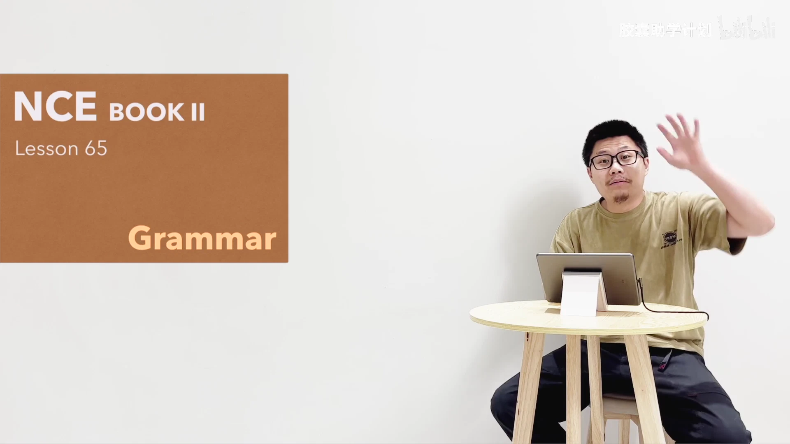

文字识别：NCE / BOOKⅡI / Lesson 65 / Grammar

### 画面 00:00:02

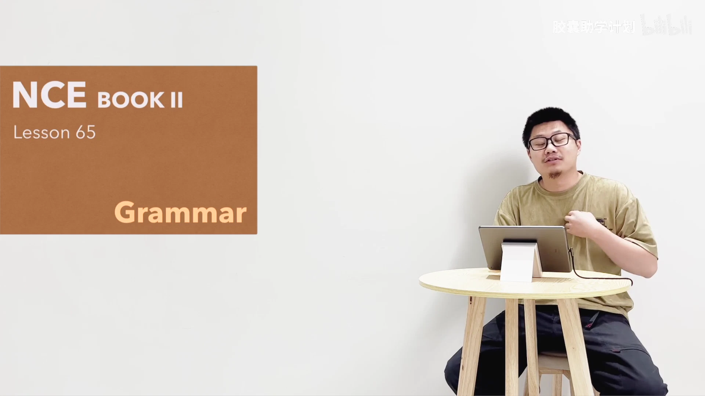

文字识别：NCE / BOOK"I / Lesson 65 / Grammar

### 画面 00:00:08

文字识别：建助字计划一州

### 画面 00:00:10

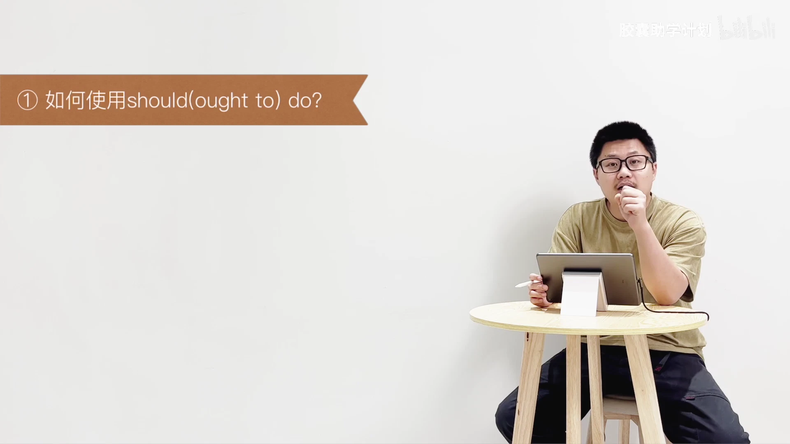

文字识别：①如何使用should(ought to) do？

### 画面 00:00:20

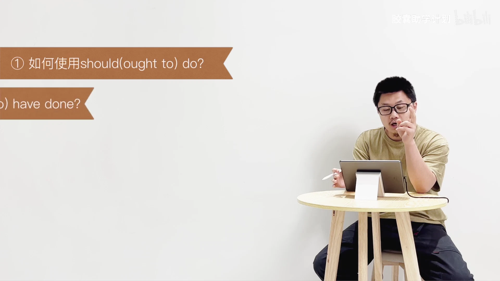

文字识别：①如何使用should(ought to） do？ / have / done?

### 画面 00:00:22

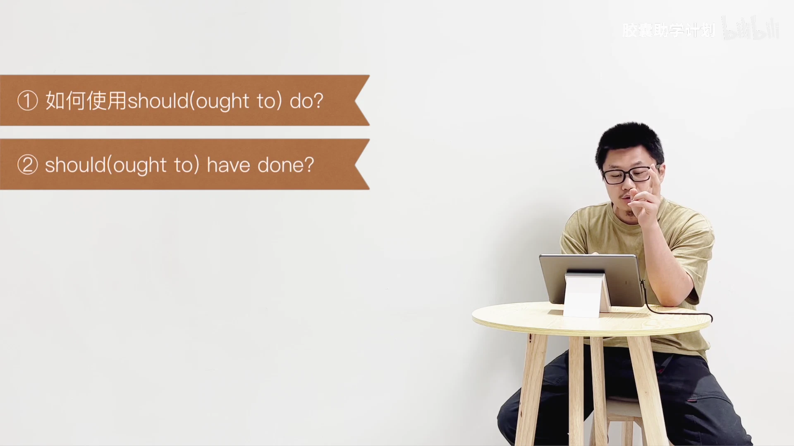

文字识别：① / 如何使用should(ought to） do？ / should(ought to) have / done?

### 画面 00:00:26

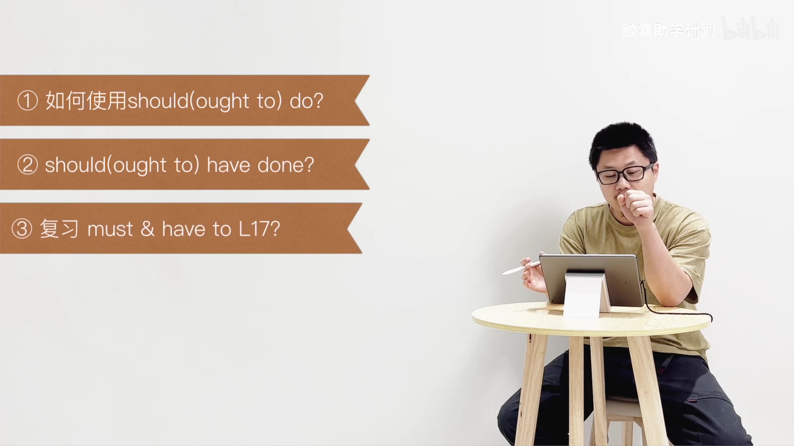

文字识别：① / 如何使用should(ought to） do？ / should(ought / t to) have / done? / 复习 / must & have / to L17?

### 画面 00:00:28

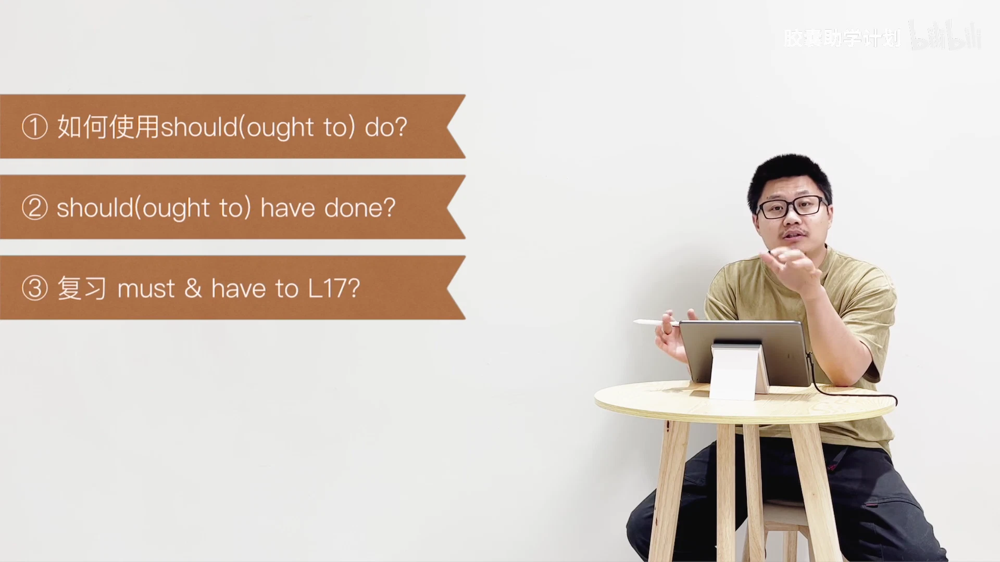

文字识别：① / 如何使用should(ought to） do？ / should(ought to) have / done? / 复习 / must & have / to L17?

## 00:00:30–00:01:00

我们已经呃要复习一下十七课啊，我们学过的 must 跟 have to，但是我们是以练代讲的方式去复习。那我们上来先说 should do 和 ought to do，这个很简单，是它的肯定结构就是 should 加动词原形，ought to 加动词原形。注意这个地方有一点不一样，就是它是一个 ought to 啊加动词原形，这个 to 你不能省啊。

### 画面 00:00:30

文字识别：① / 如何使用should(ought to） do？ / should(ought to) have / done? / 复习 / must & have / to L17?

### 画面 00:00:37

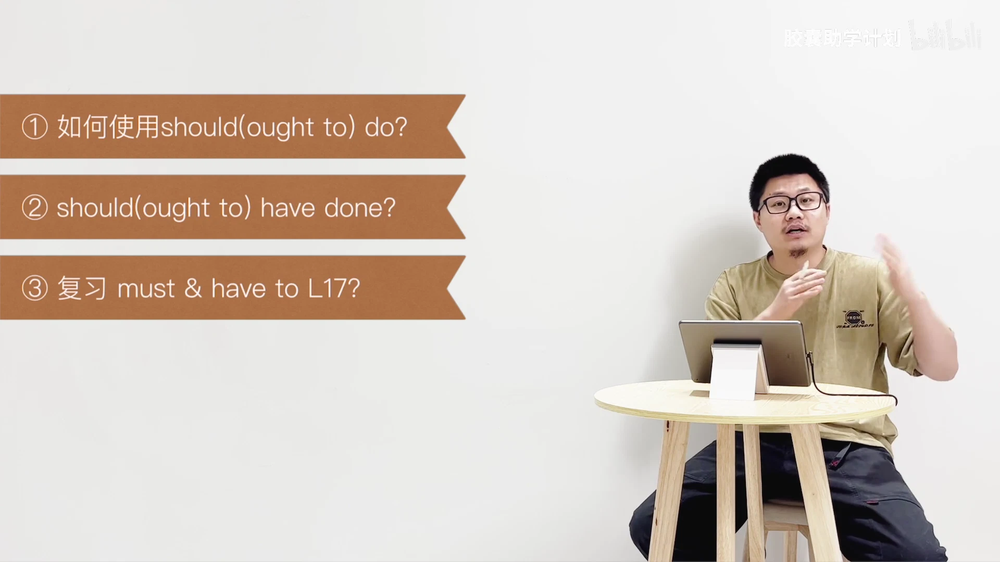

文字识别：① / 如何使用should(ought to） do？ / should(ought to) have / done? / 复习 / must & have / to L17?

### 画面 00:00:39

文字识别：bilibli / 胶囊助学计划 / •

### 画面 00:00:43

文字识别：動字計逝國一

### 画面 00:00:45

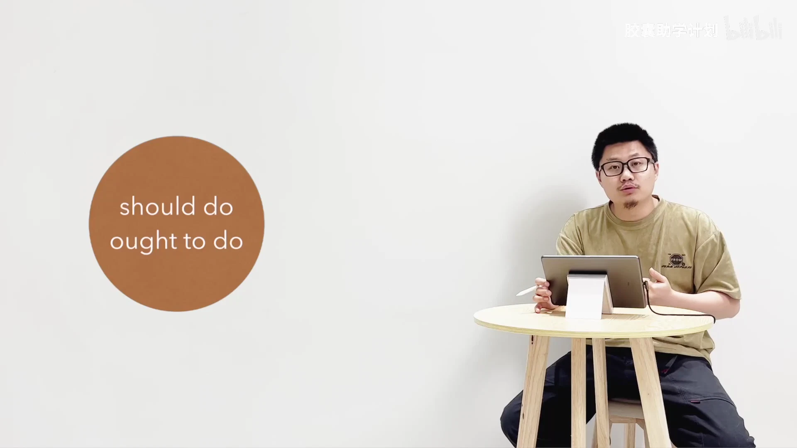

文字识别：毫助学计划 / should do / ought to do

### 画面 00:00:47

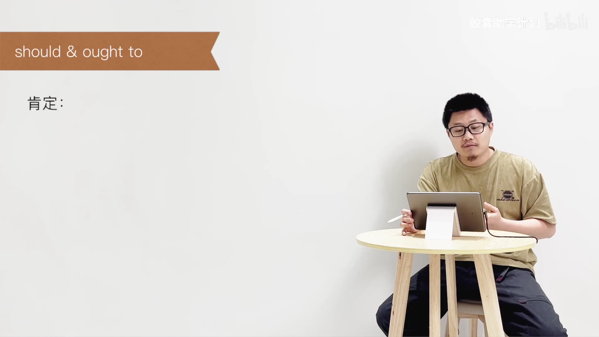

文字识别：should & ought to / 肯定：

## 00:01:00–00:01:30

比如说说 Leo will be alone tonight. 说今天晚上他会一个人。那 we should invite Leo to our party. 注意 should 和 ought to 的含义是一样的，都叫做应该啊。那叫我们应该邀请 Leo 去我们的 party。那再来，也可以完全就把它换成 we ought to invite Leo to our party。没有任何问题。呃，二者除了结构上不一样以外，含义上完全一样，都是叫做我们应该怎么怎么

### 画面 00:01:04

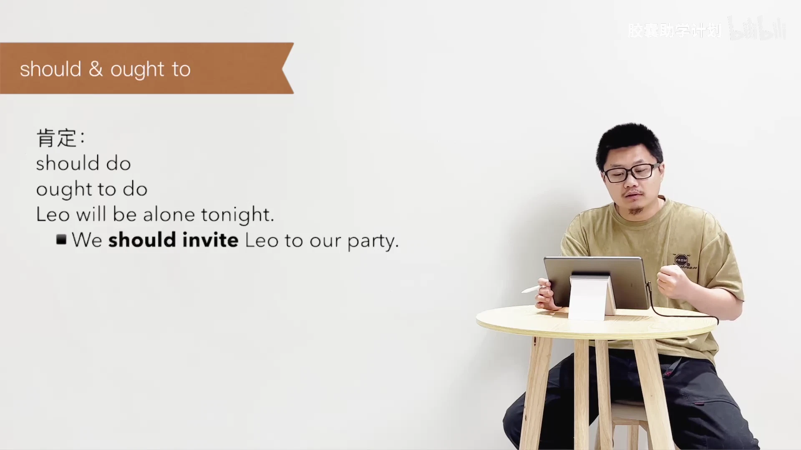

文字识别：should & ought to / 肯定： / should do / ought to do / Leo will be alone tonight. /  We should invite Leo to our party.

## 00:01:30–00:02:00

样啊！再给各位一个场景，比如说，Your salary is very low，你薪水太低了。You should look for another job，说你应该去找另一个工作，和You have to look for another job含义一样，叫做你应该。好，这个地方和 must 我简单提一句，一会儿我们以讲代练啊，以练代讲的时候还会提到它和 must 以及 have to 有点什么区别呢？你想一下，我给你翻译一下，你立刻就能懂。You must look for

### 画面 00:01:34

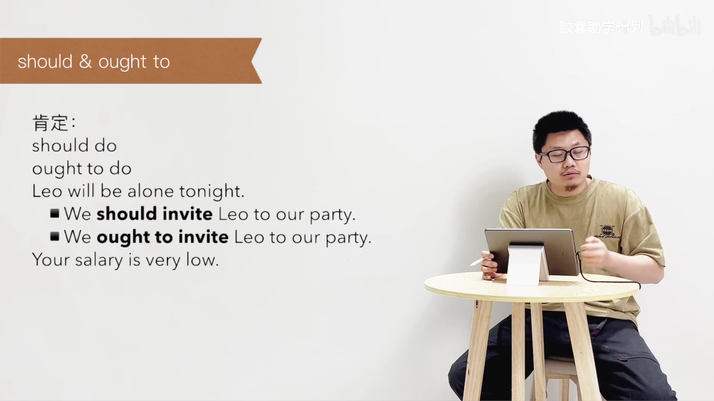

文字识别：should & ought to / 肯定： / should do / ought to do / Leo will be alone tonight. / We should invite Leo to our party. /  We ought to invite Leo to our party. / Your salary is very low.

### 画面 00:01:41

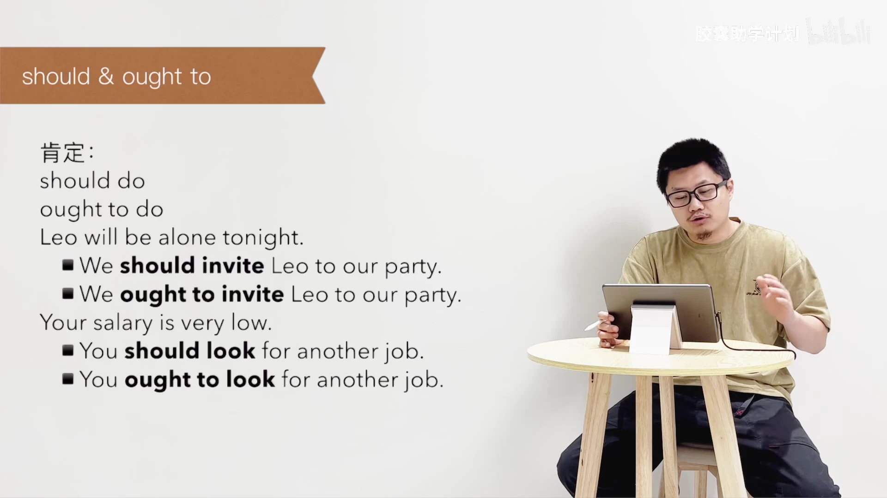

文字识别：should & ought to / 肯定： / should do / ought to do / Leo will be alone tonight. /  We should invite Leo to our party. /  We ought to invite Leo to our party. / Your salary is very low. /  You should look for another job. / You ought to look for another job.

### 画面 00:01:46

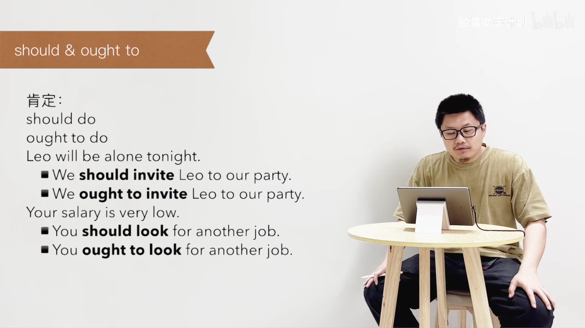

文字识别：should & ought to / 肯定： / should do / ought to do / Leo will be alone tonight. /  We should invite Leo to our party. /  We ought to invite Leo to our party. / Your salary is very low. /  You should look for another job. / You ought to look for another job.

### 画面 00:01:50

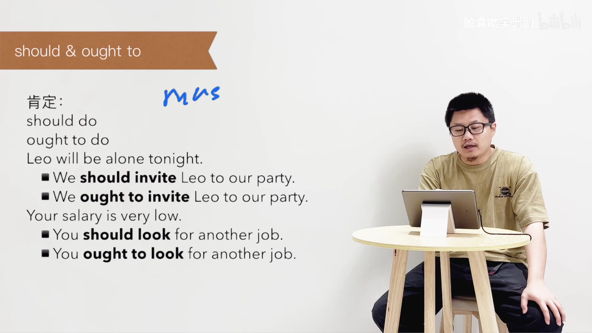

文字识别：should & ought to / mus / 肯定： / should do / ought to do / Leo will be alone tonight. / We should invite Leo to our party. /  We ought to invite Leo to our party. / Your salary is very low. / You should look for another job. / You ought to look for another job.

### 画面 00:01:52

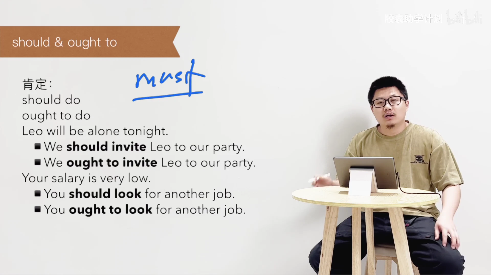

文字识别：should & ought to / musf / 肯定： / should do / ought to do / Leo will be alone tonight. /  We should invite Leo to our party. /  We ought to invite Leo to our party. / Your salary is very low. /  You should look for another job. / You ought to look for another job.

## 00:02:00–00:02:30

another job. You必须要找另一个工作，和你你应该再找一个工作，这两者听起来是不是语气强烈程度不一样？我说你应该再找一个工作，这是我给你提个建议，对吧？你听不听是你的事儿。但我如果说你必须再找一份工作，这个是不是就很强制性了？语气就很强了，对吧？You have to，包括啊，所以这地方就这样一个小的区别，好，很简单。那接下来呢，我们听几个电

### 画面 00:02:22

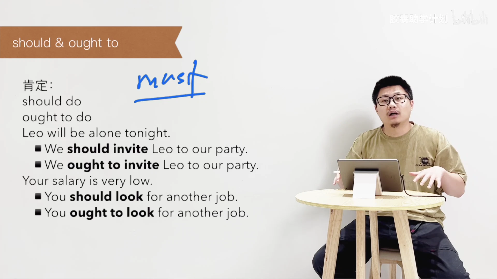

文字识别：should & ought to / musf / 肯定： / should do / ought to do / Leo will be alone tonight. / We should invite Leo to our party. /  We ought to invite Leo to our party. / Your salary is very low. / You should look for another job. / You ought to look for another job.

### 画面 00:02:27

文字识别：You ought to stay another week, at least. / ROM / Togo / (2019)

## 00:02:30–00:03:00

片段啊，看一下它在实际应用当中的应用。比如说，You ought to stay another week at least.啊，你至少应该再待一周嘛，对不对？你看，它和 you must 是不一样。你去别人家玩，你跟呃别人要走了，你说，哎，You should stay longer，是吧？你应该再多待一会儿嘛。你不能说成你必须多待一会儿，那就变成扣押人质了，是吧？注意力集中，先听一下。You ought to stay another week at least. You ought to stay another week at least.

### 画面 00:02:45

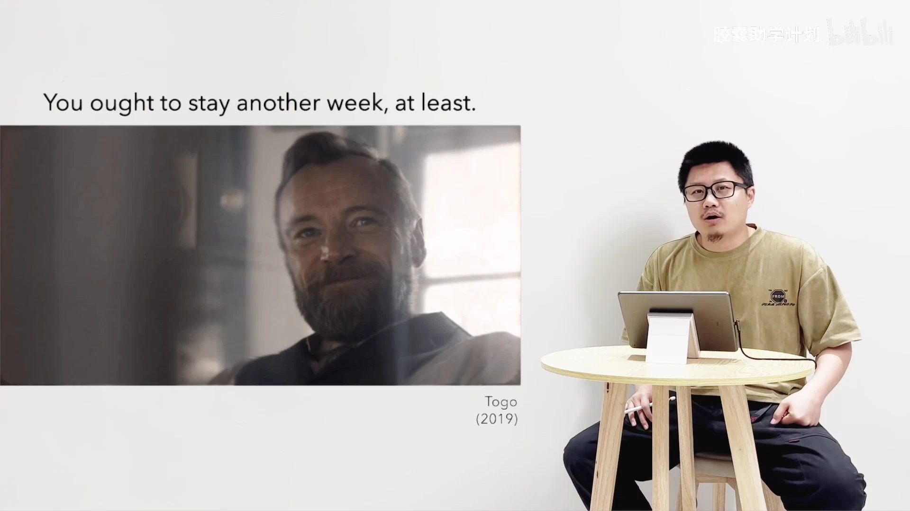

文字识别：You ought to stay another week, at least. / Togo / (2019)

### 画面 00:02:54

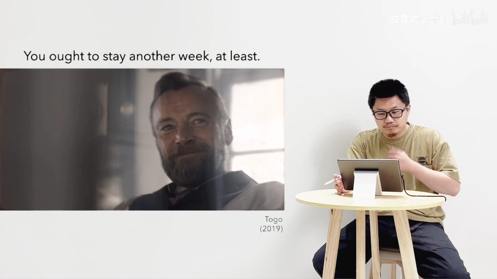

文字识别：You ought to stay another week, at least. / Togo / (2019)

### 画面 00:02:56

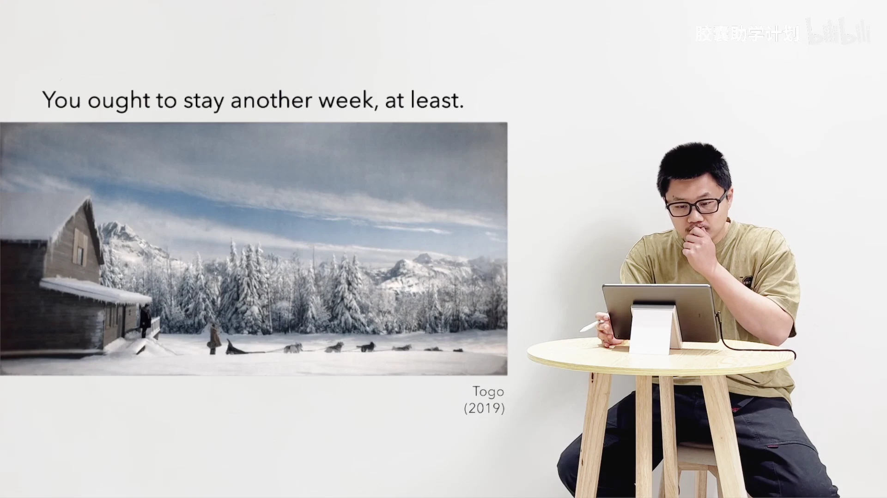

文字识别：You ought to stay another week, at least. / Togo / (2019)

## 00:03:00–00:03:30

好，下一个说 he ought to spend the year traveling instead. 注意力集中，他说的非常的快，你可能要多听几遍，倒过去多听几遍才能听清啊。 He ought 啊，这基本这就过去了啊。他没有像我似的 out to，哎，没有这个样子啊。 Ought. He ought to spend the year traveling instead. Okay. 那刚才我们说了 should out to，接下来他的否定怎么办呢？ Should 很简单，should 后边加 not

### 画面 00:03:00

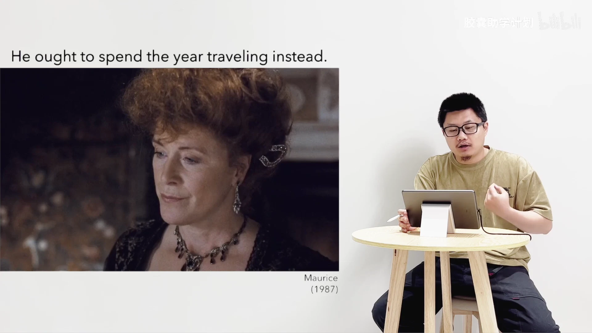

文字识别：He ought to spend the year traveling instead. / Maurice / (1987)

### 画面 00:03:20

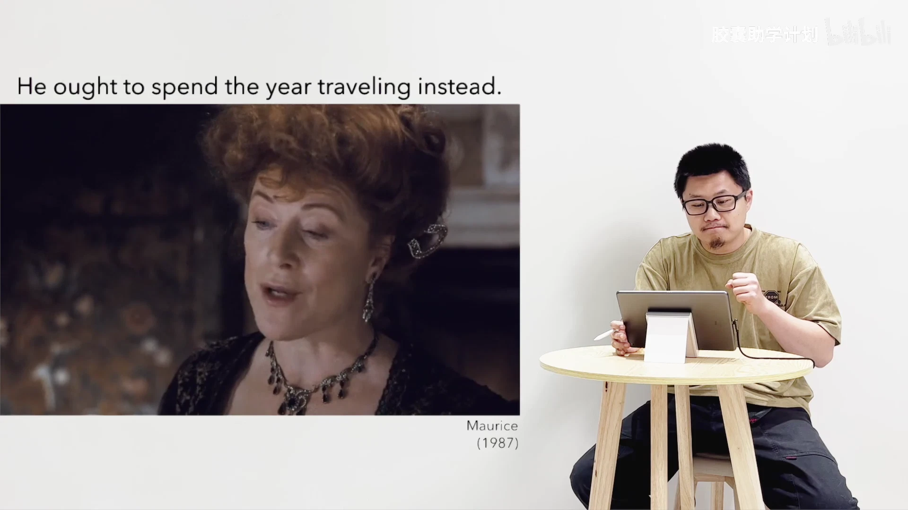

文字识别：He ought to spend the year traveling instead. / Maurice / (1987)

### 画面 00:03:22

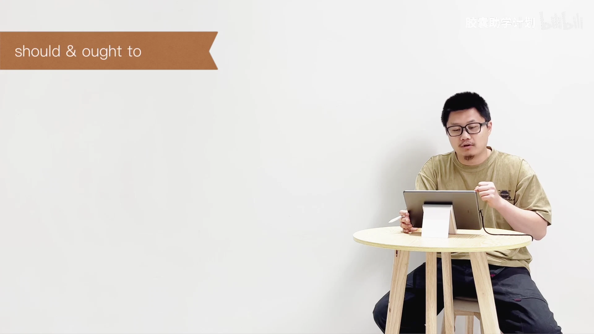

文字识别：should & ought to

## 00:03:30–00:04:00

就行了啊。You shouldn't believe him.含义就是你不应该相信他。Ought to呢，也也是类似的，就是ought后边加not就可以了。You ought not to get out of the house.啊，你不应该出这个房子。那我可能要多提一句的就是，从实际呃应用上来说，我们去查会发现shouldn't的这个出现频率啊，远远高于ought not to。啊，这个说起来也是

### 画面 00:03:35

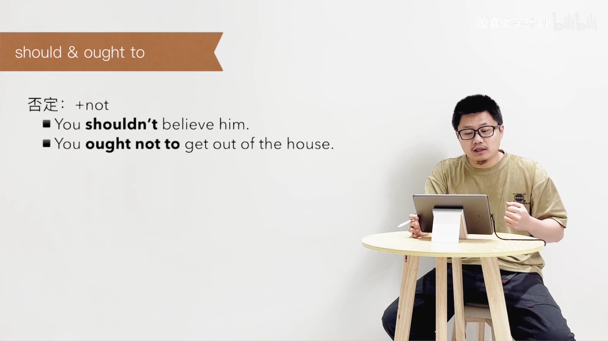

文字识别：should & ought to / 否定：+not /  You shouldn't believe him. /  You ought not to get out of the house.

## 00:04:00–00:04:30

有点拗口的。更拗口的是，你把它变成这个缩写状态，这个叫autent，是吧？autent to call。然后真正去读的时候，没有人会把它读成autent，会把它读成什么呢？autent，autent，autent，听见了吧？就是aut这个音都不读，然后呢，n撇t是nt，是吧？这两个音嗯，可能读一下，后边那个t依旧不读，所以就把它读成了叫

### 画面 00:04:04

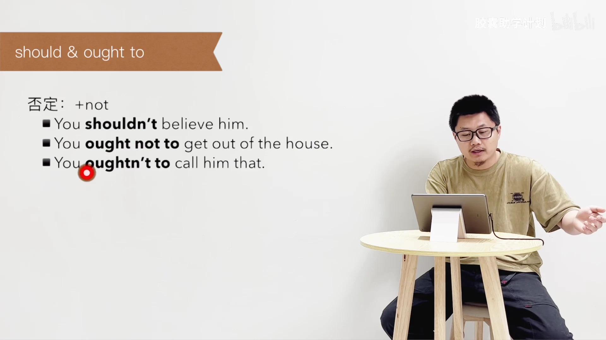

文字识别：should & ought to / 否定：+not /  You shouldn't believe / him. /  You ought not to get out of the I / house. / You oughtn't to call him that.

## 00:04:30–00:05:00

ought, ought, ought, ought，听见了吧？哎，两个 t 都是不读出来的，都叫失去爆破，叫叫嗯就可以了，对吧？Ought 啊，比方这句话我去读起来，可能不是读成 you oughtn't to call him that 啊，而把它会读成 you ought to call him that，听见了吗？Ought to call him that，还好的是这个用法出现的频率依旧很低，但是一会儿我会让你听一下啊。

### 画面 00:04:34

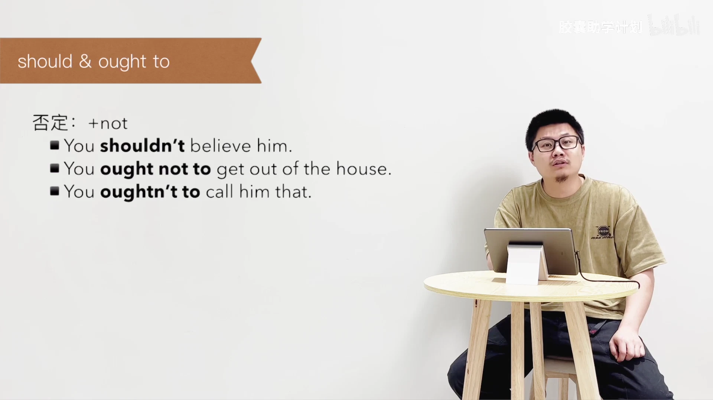

文字识别：should & ought to / 否定：+not / You shouldn't believe / him. /  You ought not to get out of the house. / You oughtn't to call him that.

## 00:05:00–00:05:30

Okay, 然后否定，当然你也可以说 you ought not to eat that. You get fat. 你不应该吃那个东西，你会变胖的。这是我找电影片段啊。否定很简单，should, ought 后边加 not 啊。多提一句，就是这个 ought 后边的 to 你别别给人丢了啊。那咱注意力集中，听个电影片段啊。 No, you really shouldn't talk that way to your Captain Quill. Alright, shouldn't 不应该，对吧？Okay, uh, it was very hard. I think

### 画面 00:05:00

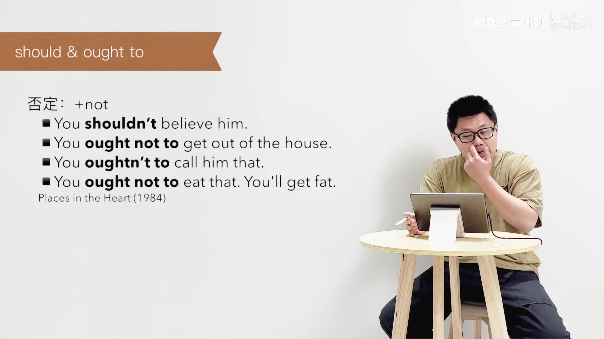

文字识别：should & ought to / 否定：+not /  You shouldn't believe him. /  You ought not to get out of the house. / You oughtn't to call him that. /  You ought not to eat that. You'll get fat. / Places in the Heart (1984)

### 画面 00:05:16

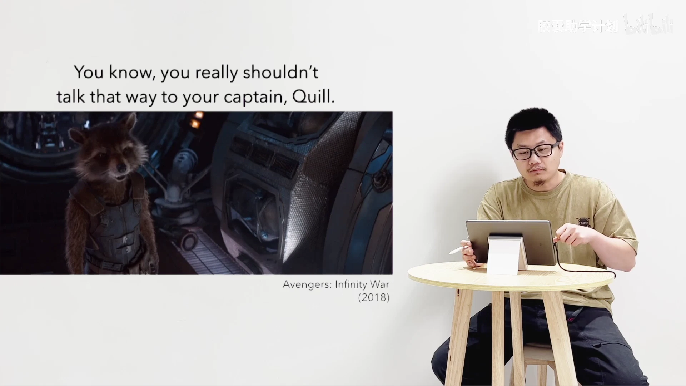

文字识别：You know, you really shouldn't / talk that way to your captain, Quill. / Avengers: Infinity War / (2018)

### 画面 00:05:21

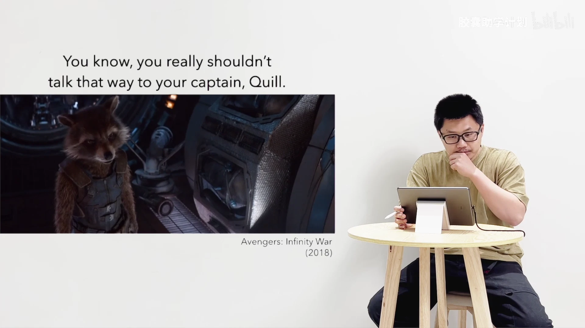

文字识别：You know, you really shouldn't / talk that way to your captain, Quill. / Avengers: Infinity War / (2018)

### 画面 00:05:23

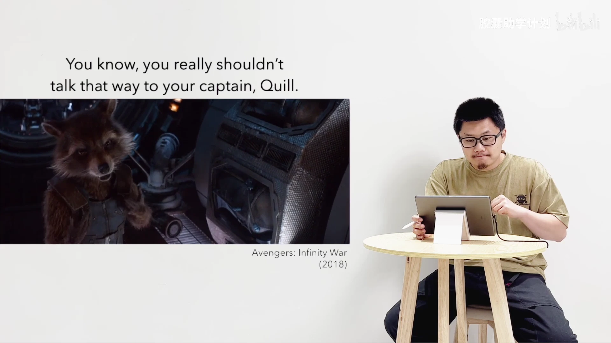

文字识别：You know, you really shouldn't / talk that way to your captain, Quill. / Avengers: Infinity War / (2018)

### 画面 00:05:25

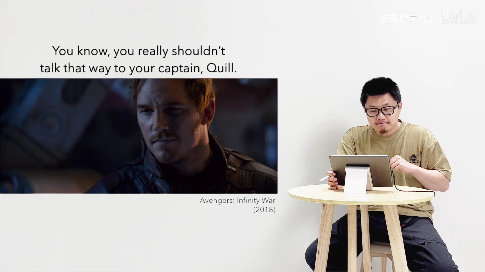

文字识别：You know, you really shouldn't / talk that way to your captain, Quill. / Avengers: Infinity War / (2018)

### 画面 00:05:27

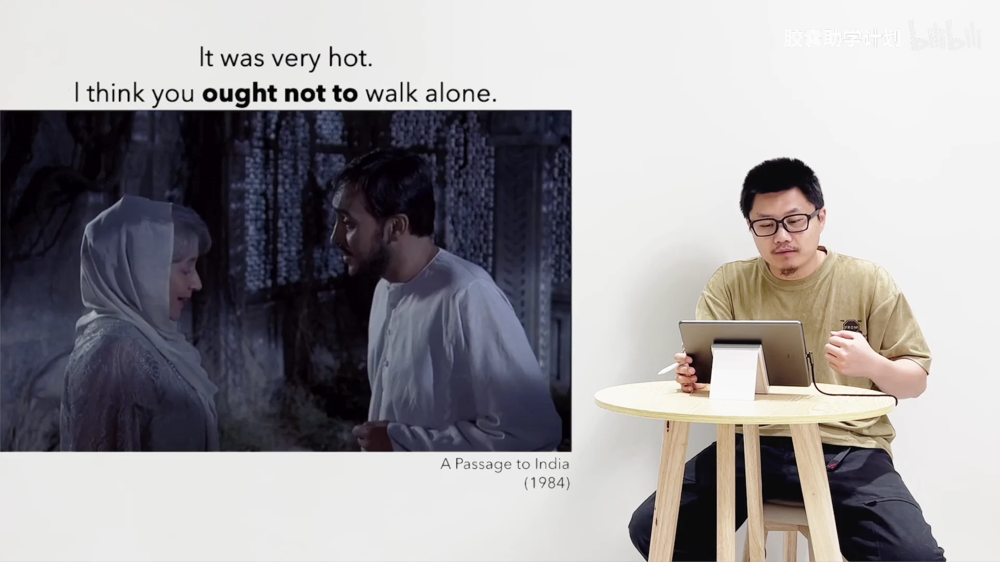

文字识别：It was very hot. / I think you ought not to walk alone. / A Passage to India / (1984)

## 00:05:30–00:06:00

you ought not to walk alone.听，It is very hot. I think you ought not to walk alone, Mrs. Moore.嗯，我觉得这个还是能听出来的哈。就ought not to，但是接下来这个ought ought，对吧？I feel I ought to make a decision. I ought to make a decision.这个ought啊，就不是那么好听懂了，是吧？你多听几遍啊啊！还我先说一下，说我觉得我不应该做一个决定，直到我和Matthew说这个聊

### 画面 00:05:35

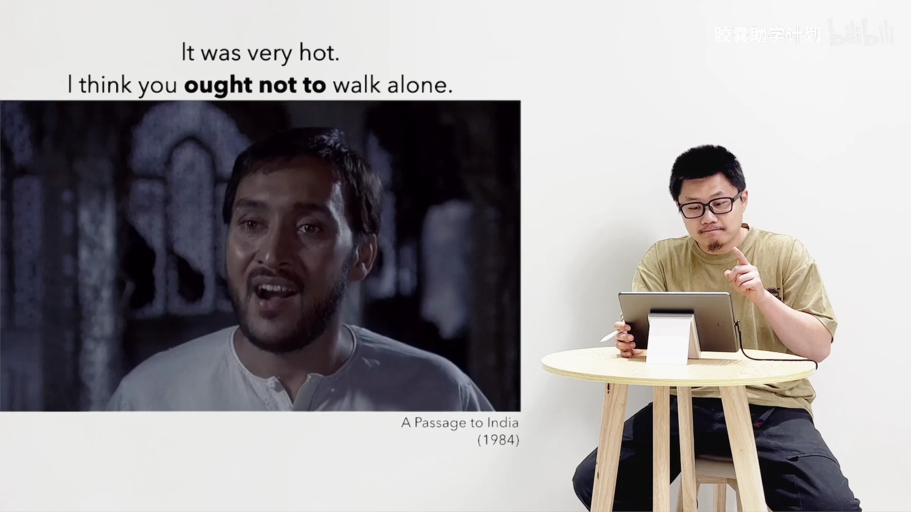

文字识别：It was very hot. / I think you ought not to walk alone. / A Passage to India / (1984)

### 画面 00:05:37

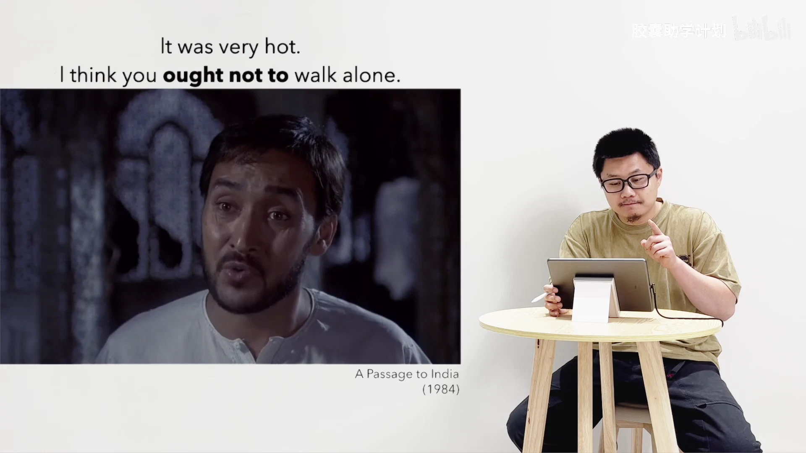

文字识别：It was very hot. / I think you ought not to walk alone. / A Passage to India / (1984)

### 画面 00:05:42

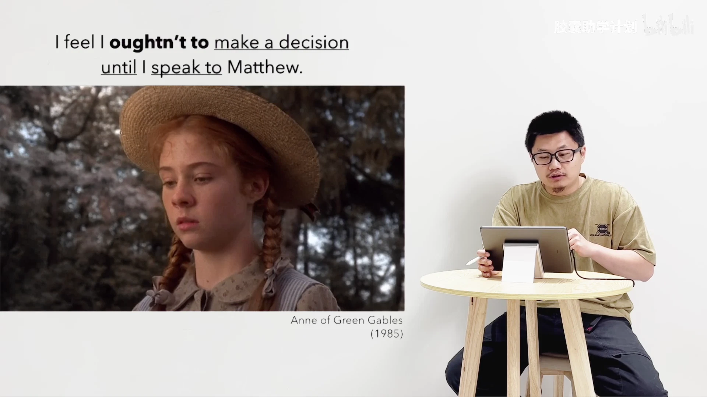

文字识别：I feel l oughtn't to make a decision / until I speak to Matthew. / Anne of Green Gables / (1985)

## 00:06:00–00:06:30

完之后，对吧？啊，剩下的单词都是咱们认识的。就这个 on 是今天新学的，注意力集中啊。 I feel I ought to make a decision until I speak to Matthew. Okay, 呃，就多提一句，多听，多听啊。按照刚才的语言习惯，我已经告诉您了，tt 基本上是不发音的，但不能读成 on，是吧？on，是吧？这个有两个 t，第一个 t，嗯，对吧？第二个 t 也是失

### 画面 00:06:07

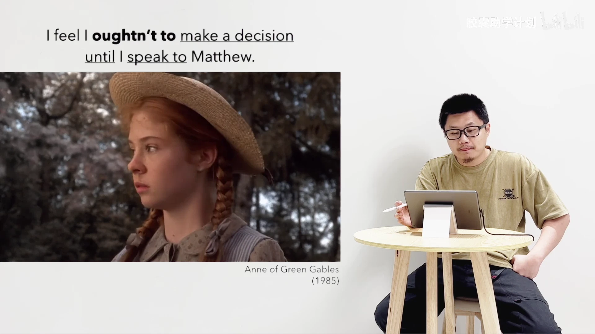

文字识别：I feel l oughtn't to make a decision / until I speak to Matthew. / Anne of Green Gables / (1985)

### 画面 00:06:09

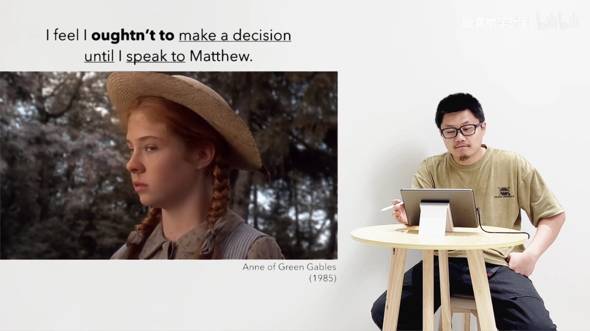

文字识别：I feel l oughtn't to make a decision / until I speak to Matthew. / Anne of Green Gables / (1985)

### 画面 00:06:11

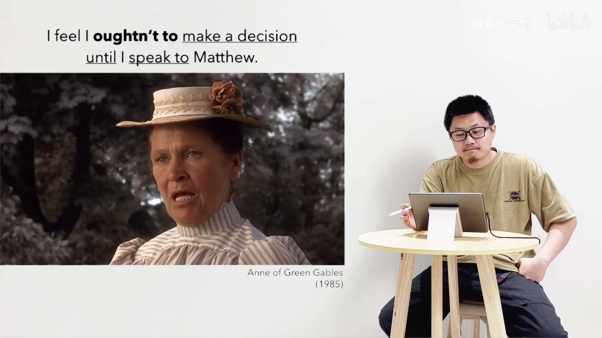

文字识别：I feel l oughtn't to make a decision / until I speak to Matthew. / Anne of Green Gables / (1985)

### 画面 00:06:13

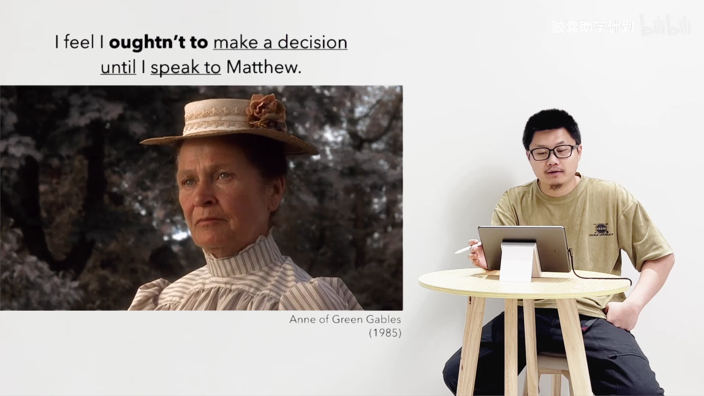

文字识别：I feel l oughtn't to make a decision / until I speak to Matthew. / Anne of Green Gables / (1985)

## 00:06:30–00:07:00

去爆破了，对吧？On to make a decision, again.接下来一般疑问句怎么办呢？首先，should很简单，提句首，其实跟你之前学的各种情态动词没什么区别。Should I call her?我应该给她打电话吗？对吧？然后 ought 呢，一样也是提句首，叫 ought way to go back。我们应该回去吗，Captain？对吧？还是多提一句，should 提句首的用法要远远多于 ought ought 提句首的用法。这个对于各位来说知道就可以了，好吧？那呃，注意力集中，我们听

### 画面 00:06:34

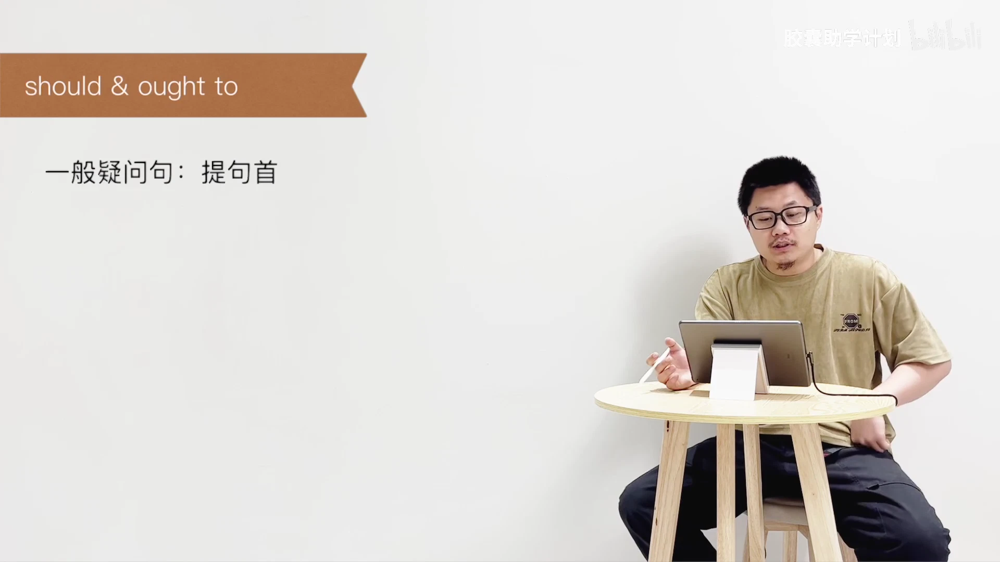

文字识别：should & ought to / 一般疑问句：提句首

### 画面 00:06:36

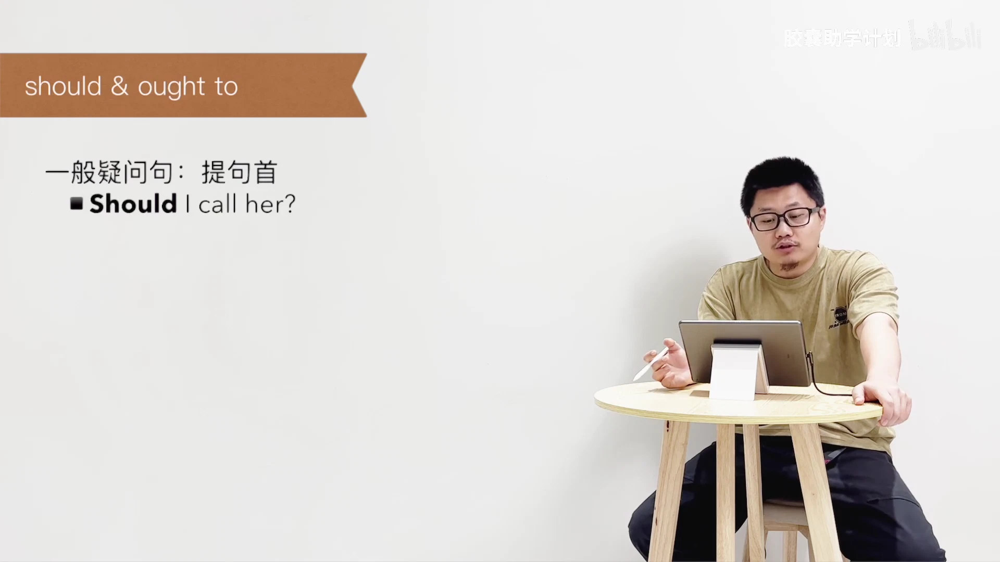

文字识别：should & ought to / 一般疑问句：提句首 /  Should I call her?

### 画面 00:06:43

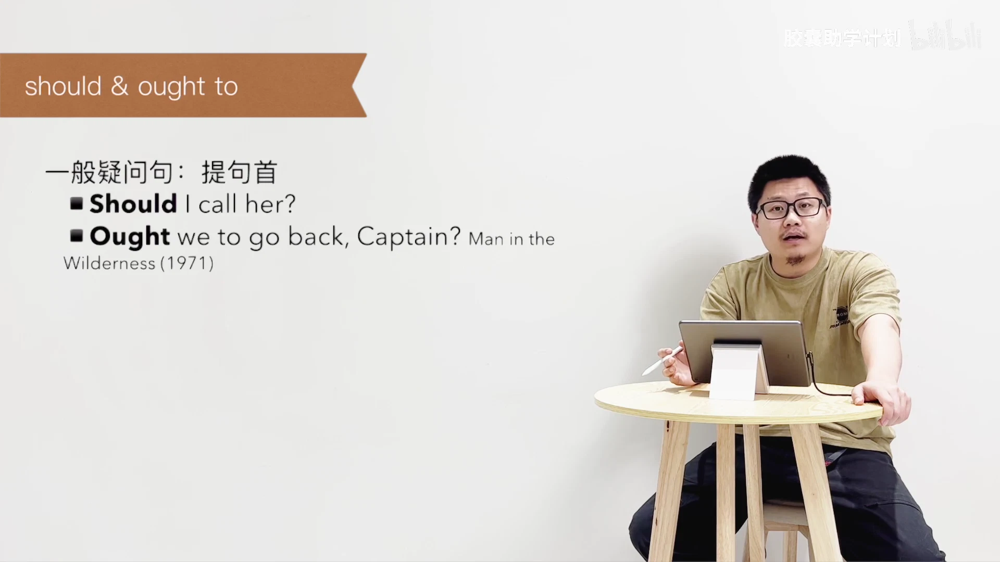

文字识别：should & ought to / 一般疑问句：提句首 / ■ Should I call her? /  Ought we to go back, Captain? Man in the / Wilderness(1971)

### 画面 00:06:57

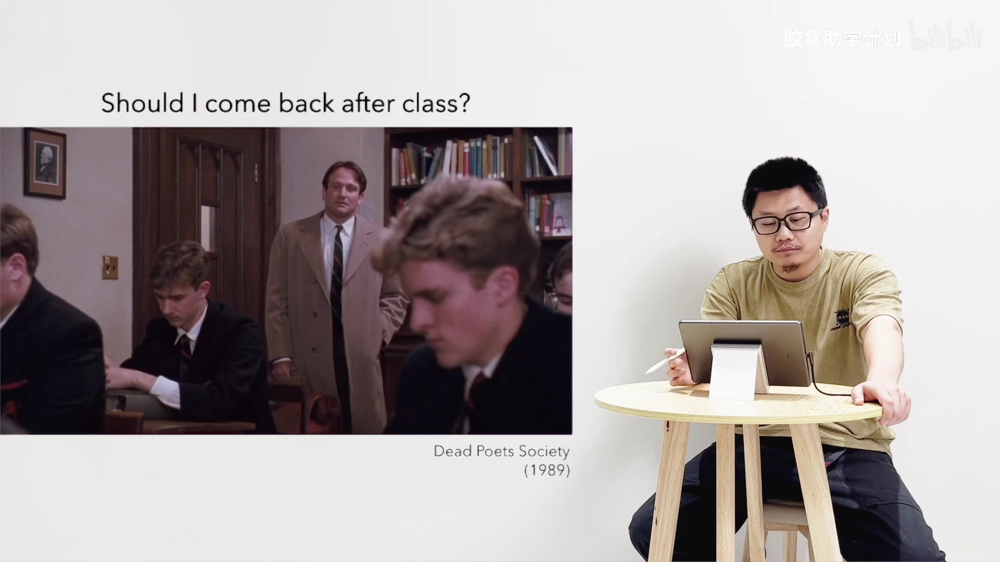

文字识别：Should I come back after class? / Dead Poets Society / (1989)

## 00:07:00–00:07:30

电影片段啊。Should I come back after class?哎，我应该下课之后再来吗？啊，呃，Death,呃，Poison Society，死亡诗社，非常棒的一个电影，是吧？哎，这是那个老师嘛？他说，这剩下的是他的学生。说我应该下课之后再来吗？Should I come back after class? Very good.接下来我们要进入他的一个另一个用法，结构不一样了。刚才是should or to后边加do，现在加的是have哒。什么意思呢？

### 画面 00:07:02

文字识别：Should I come back after class? / Dead Poets Society / (1989)

### 画面 00:07:04

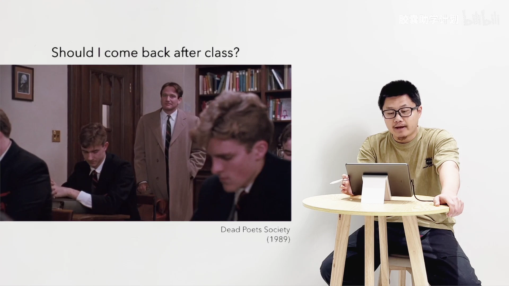

文字识别：Should I come back after class? / Dead Poets Society / (1989)

### 画面 00:07:19

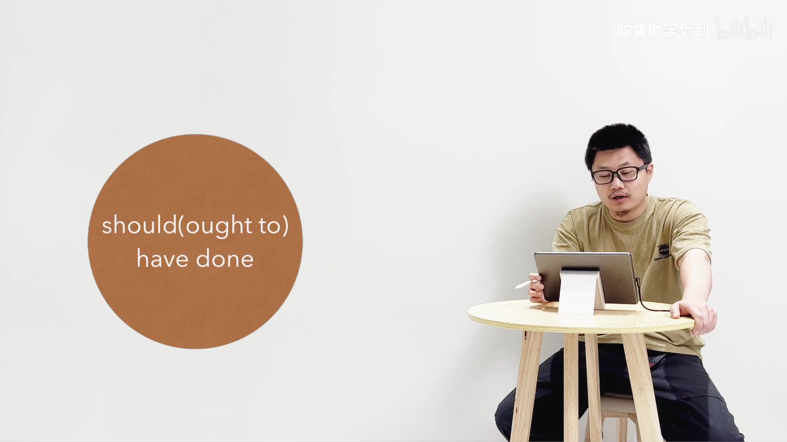

文字识别：毫助学计划 / should(ought to) / have done

### 画面 00:07:29

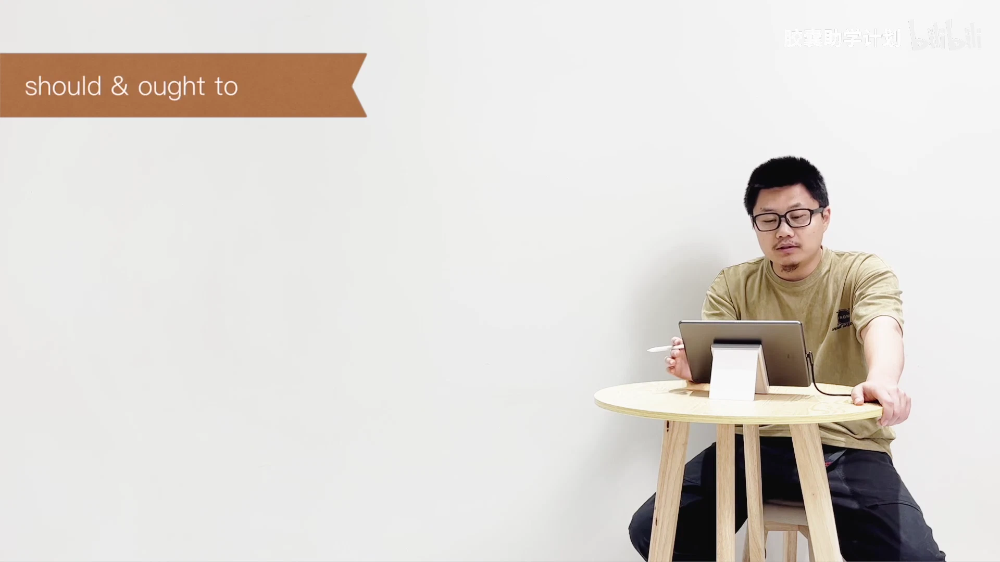

文字识别：should & ought to / TROM

## 00:07:30–00:08:00

结构先给各位摆这儿。Should have done, ought to have done，它的含义叫本应该做某事儿，但却没有做。这个事儿肯定是过去的，对吧？比如说，我们造一句话。You missed a great party last night. You should have come. Why didn't you？昨天晚上你错过了一个特别棒的party聚会。你本应该来，但你却没来。Why didn't you？叫为啥你没来？听见了吧？所以当说

### 画面 00:07:35

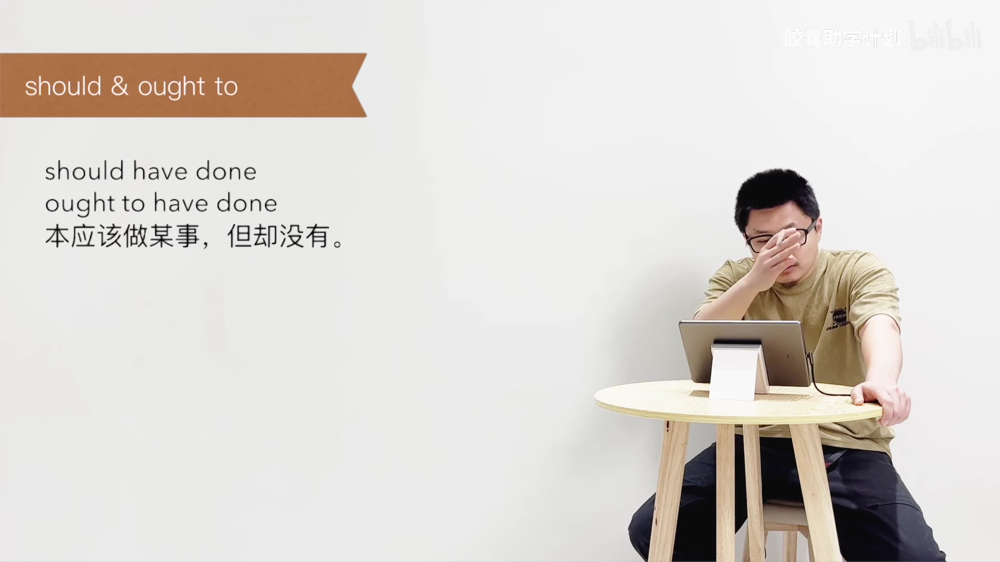

文字识别：should & ought to / should have done / ought to have done / 本应该做某事，但却没有。

### 画面 00:07:41

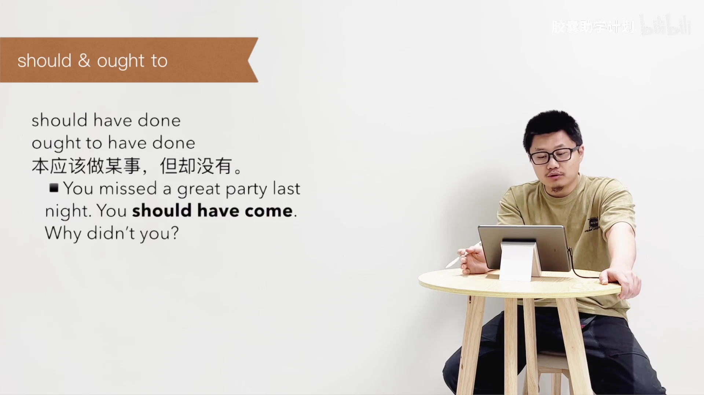

文字识别：should & ought to / should have done / ought to have done / 本应该做某事，但却没有。 /  You missed a great party last / night. You should have come. / Why didn't you?

### 画面 00:07:46

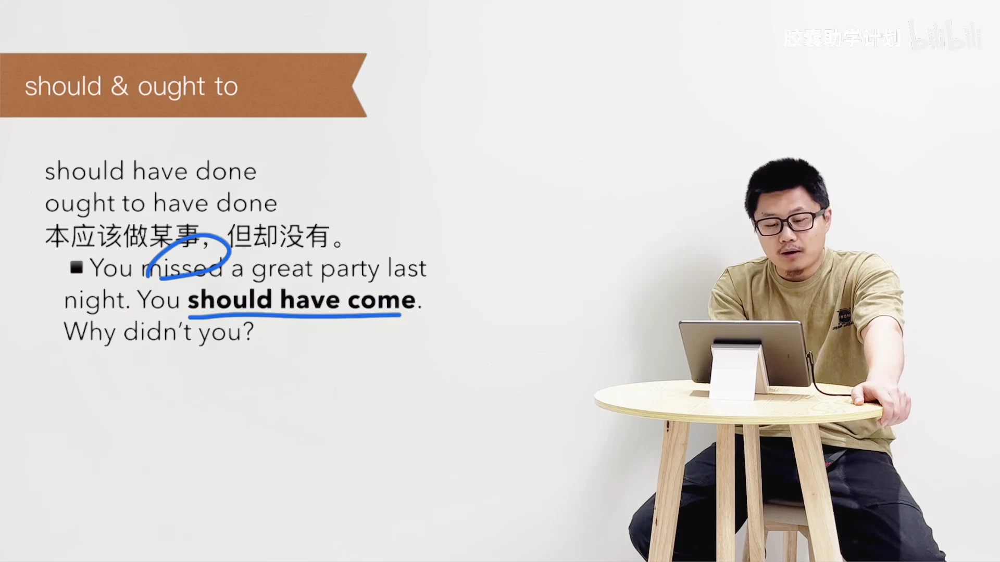

文字识别：should & ought to / should have / done / oughtto / have / done / 本应该做某事，但却没有。 / ■You / rnisseda / a great party last / night. You should / have / come. / Why / didn't you?

## 00:08:00–00:08:30

you should have come 这个结构出现的时候，我们回顾一下之前说的那个逻辑啊。尤其是我们在学时态的时候，英语这门语言很多的时候都是在做一件事情，叫用结构表达含义。这个地方出现了一个新的结构，那理论上来说，也许它就能表达一个新的含义。刚才的结构是 should do，现在是 should have done。刚才指的是我当面跟你说你应该怎么怎么样，对吧？而现在还是当面跟你说，但说的

### 画面 00:08:16

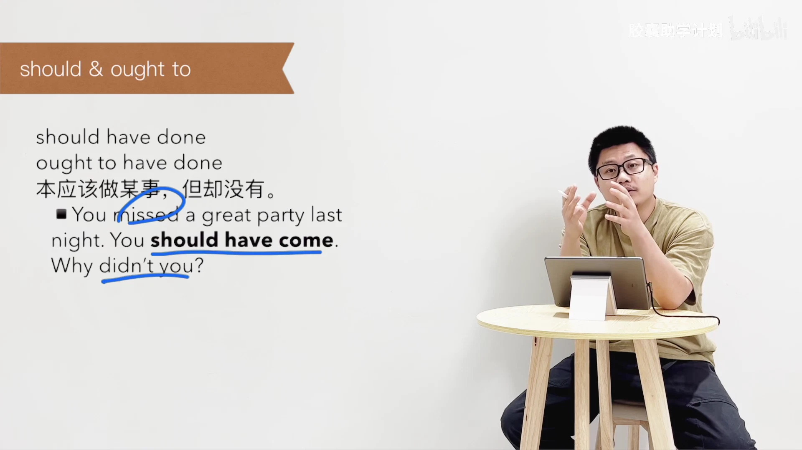

文字识别：should & ought to / should have / done / ought to have / done / 本应该做某事，但却没有。 / ■You / rnissed a great party last / night. You should / have come. / Why / didn't you?

## 00:08:30–00:09:00

事情是你之前应该怎么怎么样，但你没这么干，对吧？You should have come.你昨天应该来，但为啥你没来，对吧？一定是这个含义的。我们再来一句话，你完全可以把这个should换成ought to，说You ought to have come.哎，你应该来，你本应该来，但我一旦说了ought to have come，就意味着你来没来。No, you didn't come,对吧？你没来，并且这个事儿用的是didn't come，因为是之前的事儿。Continue.说We lost

### 画面 00:08:46

文字识别：should & ought to / should have / done / oughtto / have / done / 本应该做某事， / 但却没有。 / ■You / rhissed a great party last / night. / . You should / have / come. / Why / didn't you? / You ought to / have / come.

### 画面 00:08:58

文字识别：should & ought to / should have / done / ought to have done / 本应该做某事，但却没有。 / ■You n /  rissed a great party last / night. You should have come. / Why / didn't you? / You ought to have  / come. /  We lost the / game yesterday, / but / we： / should / have won. We were / the / better team.

## 00:09:00–00:09:30

the game yesterday. 昨天把比赛输掉了, but we should have won. We were the better team. 但是我们本应该赢，因为我们是更好的那支队伍，我们队伍的综合实力是更强的，但我们输了，所以用的是 we should have won. 本应该赢，但却没有，听见了吧？ Okay, 那一样的，这里的 should 完全可以换成 ought to 啊，叫做 we ought to have won. Very good.

### 画面 00:09:00

文字识别：should & ought to / should have / done / ought to have done / 本应该做某事，但却没有。 / ■You / rnissed a great party last / night. You should / I have come. / Why / didn't you? / You ought to / have / come. /  We lost the / game yesterday, / but / we / should / have / won. We were / the / better team.

### 画面 00:09:02

文字识别：should & ought to / should have / done / ought to have / done / 本应该做某事，但却没有。 / ■You / rnissed a great party last / night. You should / have /  come. / Why / didn't you? / 0 / ■You ought to / have / come. / We lost the / game / yesterday, / but / we / should / have / won.We / were / the / better team.

### 画面 00:09:05

文字识别：should & ought to / should have / done / ought to have done / 本应该做某事，但却没有。 / You n /  rnissed a great party last / night. You should / I have come. / Why / didn't you? / You ought to / have / come. /  We lost the / game yesterday, / but / we / should / have / won. We were / the / better team.

### 画面 00:09:23

文字识别：should & ought to / should have done / ought to have done / 本应该做某事，但却没有。 /  You missed a great party last / night. You should have come. / Why didn't you? /  You ought to have come. /  We lost the game yesterday, but / we should have won. We were the / better team.

### 画面 00:09:26

文字识别：should & ought to / should have done / ought to have done / 本应该做某事，但却没有。 /  You missed a great party last / night. You should have come. / Why didn't you? /  You ought to have come. /  We lost the game yesterday, but / we should have won. We were the / better team. /  We ought to have won.

## 00:09:30–00:10:00

注意力集中吧，咱们看几个电影片段啊。 I should have told her the truth right from the start. 从最开始我就应该告诉她真相的。如果一旦这样说， should have told her the truth 就是 I didn't tell her the truth. 我并没有告诉她事实，但我本应该告诉她。 好，注意力集中，听一下。 Should have told her the truth right from the start. Very good. Next one, I ought to have invited you. 啊，这个

### 画面 00:09:31

文字识别：I should have told her the truth / right from the start. / + / Point of Entry / (2007)

### 画面 00:09:52

文字识别：I should have told her the truth / right from the start. / + / Point of Entry / (2007)

### 画面 00:09:54

文字识别：I should have told her the truth / right from the start. / Point of Entry / (2007)

### 画面 00:09:56

文字识别：I ought to have invited you / to that concert after dinner. / S.O.S. Titanic / (1979)

## 00:10:00–00:10:30

concert is possibly a new word. But actually, if pattern drill, you carefully did it, concert this word in pattern drill has appeared, right? Concert, concert, ah, focus on this. We listen. I ought to have invited you to that concert after dinner. Okay, so next, we will make a small comparison between should do and should have done. I have already said it, but we still need to compare it. For example, you look tired. You should or ought to go to bed now. Face to face, I am telling you now. I am saying, you look

### 画面 00:10:11

文字识别：I ought to have invited you / to that concert after dinner. / ROM / S.O.S. Titanic / (1979)

### 画面 00:10:13

文字识别：I ought to have invited you / to that concert after dinner. / ROM / S.O.S. Titanic / (1979)

### 画面 00:10:15

文字识别：星助学计划 / should ought to / do / have done

### 画面 00:10:20

文字识别：should ought to

### 画面 00:10:23

文字识别：should ought to / should(ought to) do / should(ought to) have / done /  You look tired. You / should(ought to) go / to bed now.

## 00:10:30–00:11:00

说，我现在说，哎，你看起来很累，你现在应该去上床睡觉了，别再熬了，你应该去上床睡觉了，对吧？好，而另一个说法是，You went to bed very late last night. 你昨天晚上上床睡觉的特别晚，这是既定事实，对吧？来，我现在跟你说，You should have gone to bed earlier. 来，你现在哈气连天的，对吧？你事儿也干不了。我说，哎，你本应该昨天啊早点睡觉的。知道今天有这么重要的事儿，你怎么昨天不

### 画面 00:10:37

文字识别：should ought to / should(ought to) do / should(ought to) have done /  You look tired. You should(ought to) go / to bed now. /  You went to bed very late last night. You / should(ought to) have gone to bed earlier.

## 00:11:00–00:11:30

早点睡觉呢？你本应该早点睡的，但你并没早点睡，所以 should have gone，或者是 ought to have gone，对吧？OK，那我希望我就解释清楚了啊。呃，四个结构，那这四个结构肯定都是跟谓语相关的，对吧？哎，但凡跟谓语相关的就特别的重要啊。呃，接下来我们以练代讲，会练到今天新学的 should 啊，待会儿也在一个 pattern， pattern 之后还会练到 ought to，然后

### 画面 00:11:07

文字识别：should ought to / should(ought to) do / should(ought to) have done /  You look tired. You should(ought to) go / to bed now. / You went to bed very late last night. You / should(ought to) have gone to bed earlier.

### 画面 00:11:11

文字识别：泰助字计划 / should do / ought to do / should have / done / ought to have / done / 6时间 / 1主 / 2谓 / 3宾 / 4方式 / 5地点 / 6时间 / When? / Who? / action / Who? / How? / Where? / When? / Which? / (v.+v.变化) / Which? / What? / What?

### 画面 00:11:15

文字识别：喜助字计划 / should do / ought to do / should have / done / ought to have / done / 6时间 / 1主 / 2谓 / 3宾 / 4方式 / 5地点 / 6时间 / When? / Who? / action / Who? / How? / Where? / When? / Which? / (v.+v.变化) / Which? / What? / What?

### 画面 00:11:20

文字识别：Repetition drill / 训练目标： / 听力口语 / 练习包含must／ have to／ should的句子 / Accuracy / Fluency / ROM

## 00:11:30–00:12:00

呢，顺便复习一下 must 跟 have to 啊，那注意力集中，跟我读啊，Must you go to the bank? Is it absolutely necessary? 那我多提一句，这个 absolutely 就是完全的，necessary 就是有必要的啊，是完全很有必要吗？It certainly is，当然有必要了。所以我造这么一句肯定句，叫 I have to go to the bank. Is absolutely necessary? 啊，说我必须要去银行，完全有必要。Okay,

### 画面 00:11:30

文字识别：Repetition drill / 训练目标： / 听力口语 / 练习包含must/ have to/should的句子 / Accuracy / Fluency / FROM

### 画面 00:11:33

文字识别：Repetition drill / 1T: Must you go to the bank? Is it absolutely / necessary?

### 画面 00:11:50

文字识别：Repetition drill / 1T: Must you go to the bank? Is it absolutely / necessary? / It certainly is. / S: I have to go to the bank. It's absolutely / necessary.

## 00:12:00–00:12:30

repeat after me.啊，这个如果我这个大家讲解给没有给各位留充充足的时间去跟读，您暂停屏幕，咱是录屏课程，对吧？暂停屏幕，跟着我去大声朗读。啊，这个节奏一定要，哎，这个这个练习这个环节一定不能缺啊。咱们，Okay, next one. Must you go to the bank? Is it really necessary? Not really,不是特别啊。I should go to the bank, but it isn't really necessary.

### 画面 00:12:18

文字识别：Repetition drill / 2T: Must you go to the bank? Is it really / necessary?

## 00:12:30–00:13:00

我应该去银行，但不是那么必要，对吧？和必须去，必须去是不是就很必要？我应该去，我我也可以不去。我应该去，应该做的事儿多了，对吧？你每天有很多应该做的事儿，但你也并没有完全做，对不对？也也许不必要，对吧？也许必要，你拖延了。下一个，哎，这我们都不看了，我们就看最后这句话啊。张嘴跟我读。He has to call the police. It's absolutely necessary.

### 画面 00:12:36

文字识别：Repetition drill / 2T: Must you go to the bank? Is it really / necessary? / Not really. / S: I should go to the bank, but it isn't really / necessary.

### 画面 00:12:50

文字识别：Repetition drill / 3T: Must he call the police? Is it absolutely / necessary?

## 00:13:00–00:13:30

Next one, he should call police, but it isn't really necessary.你对比一下这两句话，他必须给警察打电话，完全有必要。可能是你在外面看见一帮人在揍一个人，可能揍的都半死不活了。这个时候你非常有必要赶紧给警察打电话，对吧？啊，然后另一个事儿是你在马路上遇到点鸡毛蒜皮的事儿，可能也不是多大事儿，反正有一个人踩了你一脚，然后呢还特别的那个嚣张跋扈的，对吧？也不给你道歉。

### 画面 00:13:02

文字识别：Repetition drill / 4T: Must he callthe police? Is it really / necessary? / Not really. / S: He should call the police, but it isn't really / necessary.

### 画面 00:13:09

文字识别：Repetition drill / 4T: Must he call the police? Is it really / necessary? / Not really. / S: He should call the police, but it isn't really / necessary.

## 00:13:30–00:14:00

然后你这个哎，我也可以给警察打个电话，对吧？我是他，他怎么怎么地了，怎么怎么地了？但是好像也不是那么有必要。我还有更重要的事儿。哎，算了算了，对吧？就是这个感觉啊。OK, should must有点这种感觉在里边。下一个，She should go shopping, but it isn't really necessary. He has to ask for permission. Is absolutely

### 画面 00:13:39

文字识别：Repetition drill / 4T: Must he callthe police? Is it really / necessary? / Not really. / S: He should call the police, but it isn't really / necessary.

### 画面 00:13:46

文字识别：Repetition drill / 5T: Must she go shopping? Is it really / necessary?

### 画面 00:13:54

文字识别：Repetition drill / 6T: Must he ask for permission? Is it / absolutely necessary? / It certainly is. / S: He has to ask for permission. It's / absolutely necessary.

## 00:14:00–00:14:30

necessary. He has to work this evening. Is absolutely necessary. I should send a fax, but it isn't really necessary.那你看，我现在就临场问你，临场自己想啊。我如果把它变成 I should have sent a fax，变成什么含义了？你可以暂停屏幕，给自己先

### 画面 00:14:11

文字识别：毫助字计划 / Repetition drill / 8T: Must you send a fax? Is it really / necessary? / Not really.

### 画面 00:14:23

文字识别：Repetition drill / 8T: Must you send a fax? Is it really / necessary? / Not really. / S: Lshould send a fax, but it isn't really / necessary.

## 00:14:30–00:15:00

讲一遍。好，你现在暂停屏幕回来了啊。I should have sent a fax，叫做我本应该给他发个传真快递啊，传真的。但是我没发，这事儿我应该做，但我没做。而 I should send a fax，叫我应该现在给他发一个，对吧？这个事儿跟过去没关系。I should buy a new car， but it isn't really necessary. I must buy a new car， is absolutely

### 画面 00:14:49

文字识别：Repetition drill / 9T: Must you buy a new car? Is it really / necessary?

### 画面 00:14:56

文字识别：Repetition drill / 10T: Must you buy a new car? Is it / absolutely necessary? / It certainly is.

## 00:15:00–00:15:30

necessary. Okay, pattern drill. Pattern drill. 新的练习，我们练的还是刚才说那些. Must, have to, should, ought to, 对吧？然后接下来就是我告诉各位 S E S 二，各位往里面去带，先写，然后记住一定要大声朗读啊！昨天还是我直播的时候，发现很多同学写完就完了，大声朗读，全是口语句型. Do you have to write that letter now? 说你现在必须要写那封信吗？I ought to write it, but I'm

### 画面 00:15:02

文字识别：Pattern drill / 1T:write that letter / S1: Do you have to write that letter now? / S2: I ought to write it, but I'm not going to! / prepare your speech / wash the dishes / light the fire / see the manager / do your homework / pick the apples / burn the rubbish / phone the doctor

## 00:15:30–00:16:00

not going to.说，我应该写，但我不打算写。哎，你看这里连着出现了几个，第一个 have to，第二个 ought to do，第三个 be going to do，对吧？OK，往里面去带啊，不会单词就自己去查。下一个，Do you think he should apologize?你认为他应该道歉吗？Should 加 do，对吧？It doesn't matter who apologizes, but someone's got to.说不重要谁道

### 画面 00:15:32

文字识别：Pattern drill / 1T:write that letter / S1: Do you have to write that letter now? / S2: I ought to write it, but I'm not going to! / prepare your speech / wash the dishes / light the fire / see the manager / do your homework / pick the apples / burn the rubbish / phone the doctor

### 画面 00:15:46

文字识别：Pattern drill / 2T：apologize / S1: Do you think he should / apologize? / S2: It doesn't matter who / apologizes, but / someone's got to! / stay here / open the door / pay them / stop /  the traffic / make a speech / feed the / : horses / finish the job / call the police

## 00:16:00–00:16:30

歉？但是有人必须要去做啊。这个 got to 后边其实省略了一个单词叫 apologize，没有必要句句都加，是吧？好，所以呃，他说的叫 but someone has got to。这个 P S 注意是 has 啊，has got to。哪一个？这是咱们第二个，第三个。Why didn't you take a taxi last night? 昨天晚上为什么不打车呢？I know I should have taken one. 说我知道我本应该打车的，but I didn't

### 画面 00:16:16

文字识别：Pattern drill / 2T：apologize / S1: Do you think he should / apologize? / S2: It doesn't matter who  / apologizes, but / someone's got to! / stay here / open the door / pay them / stop t /  the traffic / make a speech / feed the / e horses / finish the job / call the police

### 画面 00:16:18

文字识别：Pattern drill / 3 T: take a taxi / S1: Why didn't you take a taxi last night? / S2: I know I should have taken one, butl / didn't think of it at the time. / wear a hat / order some wine / call on the Smiths / buy a paper / book some seats / take an umbrella / ring the police / take some medicine

## 00:16:30–00:17:00

think of it at the time.但是在那个时候，我并没有想这个事儿。所以你打没打呢？你看问的就是你为啥昨天晚上不打车？你说的是，哎，我认为我本应该打的，should have done等于ought to have done，本应该做某件事儿，但我却没做，对吧？我本应该，比如说wear a hat，我本应该戴个帽子。昨天风那么大，出门之前我就知道，但是呢，anyway，我就是没戴，对

### 画面 00:16:48

文字识别：Pattern drill / 3 T: take a taxi / S1: Why didn't you take a taxi last night? / S2: I know I should have taken one, butl / didn't think of it at the time. / wear a hat / order some wine / call on the Smiths / buy a paper / book some seats / take an umbrella / ring the police / take some medicine

## 00:17:00–00:17:30

吧？但是我应该带啊。最后一个，He ought to have arrived by now.截止到现在，他本应该已经到了，到没到人？没到，对吧？He had to change his plans.他必须要改变他的计划。But he should be arriving soon.他应该很快就到了。OK，好，这里没什么可说的了。Ought to have done啊。OK，往里面去带，记得就可以了。我们看一下本课recap四个结构should do should have done ought to do

### 画面 00:17:02

文字识别：Pattern drill / 4T:arrive / S1: He ought to have arrived by now. / S2: He had to change his plans, but he / should be arriving soon. / return / phone us / buy the goods / send us the money / get home / reach the airport / tell us the result / apply forthe job / m

### 画面 00:17:24

文字识别：Recap / should do / Patterns / should have done / ought to do / Grammar / ought to have done

### 画面 00:17:26

文字识别：Recap / 臺助字计划 / should do / Patterns / should have done / & / ought to do / Grammar / ought to have done

## 00:17:30–00:18:00

out to have done. Ah,都是非常重要的。这是给我们在表达上又增加了一些新的表达能力。接下来呢，加上作业，再说一遍，pattern drill一定是先写，保证它对，然后一定要大声，我们去进行一个朗读。原因是它是口语句型，你光写下来了，你没有去，就是很多学员会说说Leo啊，我这个写的能力是越来越强，但是我还是说不出来。我就问他一个最简单的问题，我留作

### 画面 00:17:30

文字识别：Recap / 喜助字计划 / should do / Patterns / should have done / & / ought to do / Grammar / ought to have done

### 画面 00:17:35

文字识别：Recap / should do / Patterns / should have done / ＆ / ought to do / Grammar / ought to have done

### 画面 00:17:37

文字识别：1. / Pattern Drill写&朗读 / 置顶留言 / 4×4

### 画面 00:17:41

文字识别：喜助学计划国 / 1.f / Pattern Drill 写&朗读 / 置顶留言 / 4×4

### 画面 00:17:45

文字识别：建助字计划调 / 1.f / Pattern Drill 写&朗读 / 置顶留言 / 4×4

### 画面 00:17:50

文字识别：1. / Pattern Drill写&朗读 / 置顶留言 / 4×4

### 画面 00:17:52

文字识别：Pattern Drill写&朗读 / 1. / 置顶留言 / 4×4

### 画面 00:17:58

文字识别：助字计划 / 1. / Pattern Drill写&朗读 / 置顶留言 / 4×4

## 00:18:00–00:18:30

业，你张嘴读了吗？他说没有。我说那你说不出来是正常的，对吧？哎，你没做嘛？写完了，大声朗读四乘四，置顶留言去找啊。然后呢，这个尝试回忆，给自己讲解今天的核心语法。接下来呢，红皮书啊，should or to你都可以找到去做了，好吧？OK，呃，包括其实像上一课的那个suggest得了点儿should do啊，suggest that should do这个你也可以去在should里边找到了。OK，顺便就一起都做了

### 画面 00:18:06

文字识别：1.f / Pattern Drill 写&朗读 / 置顶留言 / 4×4

### 画面 00:18:09

文字识别：Pattern Drill 写&朗读 / 置顶留言 / 4×4 / 尝试回忆并给自己讲解一 / 遍今天的核心语法 / Study-Test / Learning Pyramid

### 画面 00:18:11

文字识别：Pattern Drill 写&朗读 / 置顶留言 / 4×4 / 尝试回忆并给自己讲解一 / 遍今天的核心语法 / Study-Test / Learning Pyramid

### 画面 00:18:14

文字识别：1. f / Pattern Drill 写&朗读 / 置顶留言 / 4×4 / 尝试回忆并给自己讲解一 / 遍今天的核心语法 / Study-Test / Learning Pyramid / 尝试翻阅红皮书（中级） / 通过目录或索引(Index) / 查找到本课语法

### 画面 00:18:16

文字识别：1. F / Pattern Drill 写&朗读 / 置顶留言 / 4×4 / 尝试回忆并给自己讲解一 / 遍今天的核心语法 / Study-Test / Learning Pyramid / 尝试翻阅红皮书（中级） / 通过目录或索引(Index) / 查找到本课语法

### 画面 00:18:20

文字识别：1.↑ / Pattern Drill 写&朗读 / 置顶留言 / 4×4 / 尝试回忆并给自己讲解一 / 遍今天的核心语法 / Study-Test / Learning Pyramid / 尝试翻阅红皮书（中级） / 通过目录或索引(Index) / 查找到本课语法

### 画面 00:18:22

文字识别：1. f / Pattern Drill写&朗读 / 置顶留言 / 4×4 / 尝试回忆并给自己讲解一 / 遍今天的核心语法 / Study-Test / Learning Pyramid / 尝试翻阅红皮书（中级） / 通过目录或索引(Index) / 查找到本课语法

### 画面 00:18:25

文字识别：1. f / Pattern Drill 写&朗读 / 置顶留言 / 4×4 / 尝试回忆并给自己讲解一 / 遍今天的核心语法 / Study-Test / Learning Pyramid / 尝试翻阅红皮书（中级） / 通过目录或索引(Index) / 查找到本课语法

## 00:18:30–00:18:55

啊。那以上就是本期视频的全部内容了。如果各位喜欢我们的课程呢，欢迎各位关注、订阅、一键三连，分享给那些需要的朋友，来帮助我们快速成长。See you next time.

### 画面 00:18:30

文字识别：衰助学计划園

### 画面 00:18:43

文字识别：CAPSULEACADEMY / 胶囊助学计划 / 小红书 / OE

### 画面 00:18:45

文字识别：運動字計切 / CAPSULEACADEMY / 胶囊助学计划 / 小红书 / OE

### 画面 00:18:51

文字识别：臺聖珈字計切 / CAPSULEACADEMY / 胶囊助学计划 / 小红书 / Creator / Leo & Berlin / OE

### 画面 00:18:53

文字识别：bilibili / 胶囊助学计划

### 画面 00:18:54

文字识别：bilibili / 胶囊助学计划

