# 065 文章

快速机器解析：语音为单模型转写，未进行独立交叉校对或人工复核；画面每秒采样并按变化选帧，短时文字和标记可能遗漏。截图时间约有 1 秒误差。图片有损压缩；遇到疑点请按时间查看 Google Drive 原视频。

## 00:00:00–00:00:30

Hello everyone, welcome to Capsule Academy. This is Leo. Today we are going to learn New Concept English Book Two, Lesson Sixty Five, Story. Hope you gonna enjoy.好，我们上来先看标题和问的问题啊。呃，标题叫 Jumbo versus the Police。那我们看图，其实已经这个有一些线索了。那 Jumbo 就是这个小象，那 Police 就是这些警察，是吧？OK。他问的是 Why did the

### 画面 00:00:00

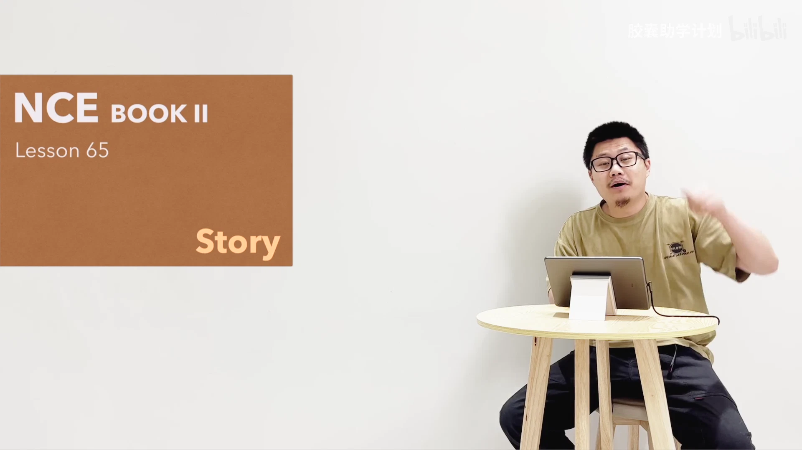

文字识别：NCE / BOOK"I / Lesson 65 / Story

### 画面 00:00:09

文字识别：胶囊助学计划bilb出 / •

### 画面 00:00:13

文字识别：胶囊助学计划

### 画面 00:00:15

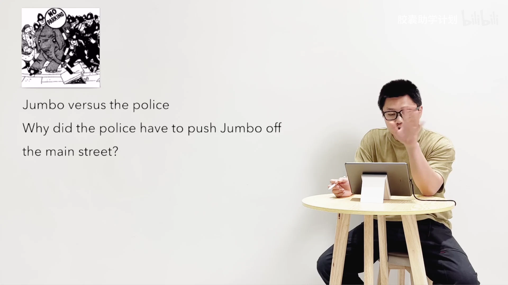

文字识别：PARKING / Jumbo versus the police / Why did the police have to push Jumbo off / the main street?

## 00:00:30–00:01:00

police have to push Jumbo off the main street?" This main street, I don't know if you guys know, is the main road. It's a important little phrase in our textbook. Why did the police have to push Jumbo off the main street? This main street, I don't know if you guys know, is the main road. It's a important little phrase in our textbook. Why did the police have to push Jumbo off the main street? This main street, I don't know if you guys know, is the main road. It's a important little phrase

### 画面 00:00:45

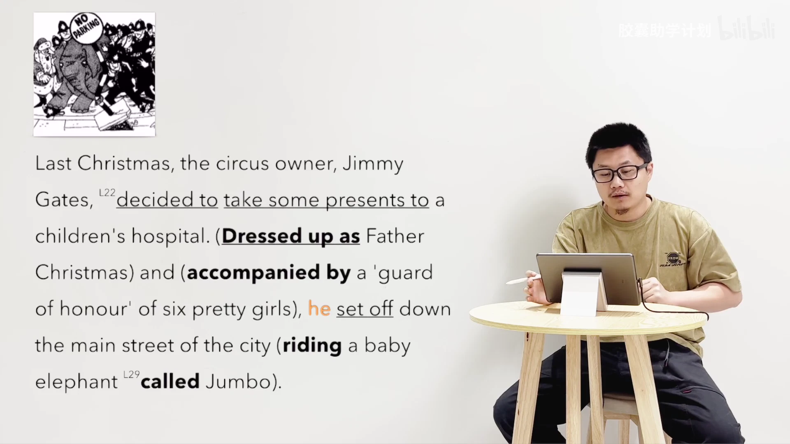

文字识别：PARKING / Last Christmas, the circus owner, Jimmy / Gates, 2²decided to take some presents to a / children's hospital. (Dressed up as Father / Christmas) and (accompanied by a 'guard / of honour' of six pretty girls), he set off down / the main street of the city (riding a baby / elephant [²2called Jumbo).

## 00:01:00–00:01:30

presents to a children's hospital. 时间上个圣诞节，人物 circus owner Jimmy Gates，对吧？这俩东西放到一起叫同位语，对吧？这个马戏团的拥有者 Jimmy Gates 怎么样了呢？ Decide to do something. 二十二课咱们学过，决定去做某件事情。决定干嘛呢？ Take some presents to a children's hospital. 啊，带一些礼物去一个儿童

### 画面 00:01:15

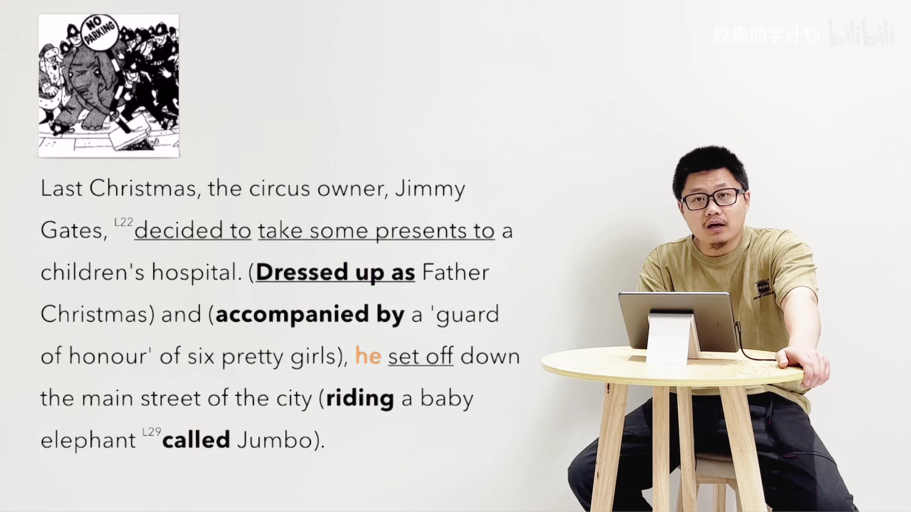

文字识别：PARKING / Last Christmas, the circus owner, Jimmy / Gates, 2²decided to take some presents to a / children's hospital. (Dressed up as Father / Christmas) and (accompanied by a 'guard / of honour' of six pretty girls), he set off down / the main street of the city (riding a baby / elephant [²called Jumbo).

## 00:01:30–00:02:00

医院啊，孩子们的医院，儿童医院，对吧？Children's Hospital. This take something or somebody to some place. 新一咱们就学过了，在这儿可就不再多提了。接下来非常重要的一句话啊，各种什么呃是但凡涉及到长难句的啊，就我知道的什么考研长难句的讲解，什么GRE啊，呃这个呃托福雅思啊，高考长难句的讲解，特别愿意用这句话啊，这是特别有名，

### 画面 00:01:45

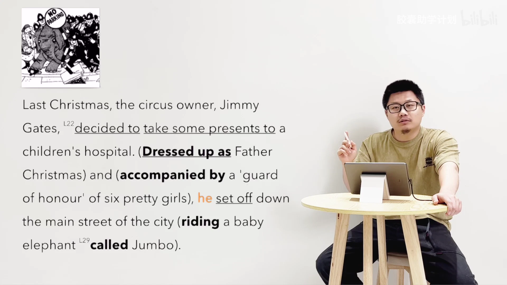

文字识别：ARKING / Last Christmas, the circus owner, Jimmy / Gates, 2²decided to take some presents to a / children's hospital. (Dressed up as Father / Christmas) and (accompanied by a 'guard / of honour' of six pretty girls), he set off down / the main street of the city (riding a baby / elephant [²2called Jumbo).

## 00:02:00–00:02:30

新概念二册》当中的一句话。我们接下来一起看一下。我先从头到尾给各位读一遍啊。Dressed up as Father Christmas and accompanied by a guard of honor of six pretty girls, he set off down the main street of the city, riding a baby elephant called Jumbo. 我个人是这样认为的，听好啊，叫做我们在完全不了解任何语法的前提之下，

### 画面 00:02:15

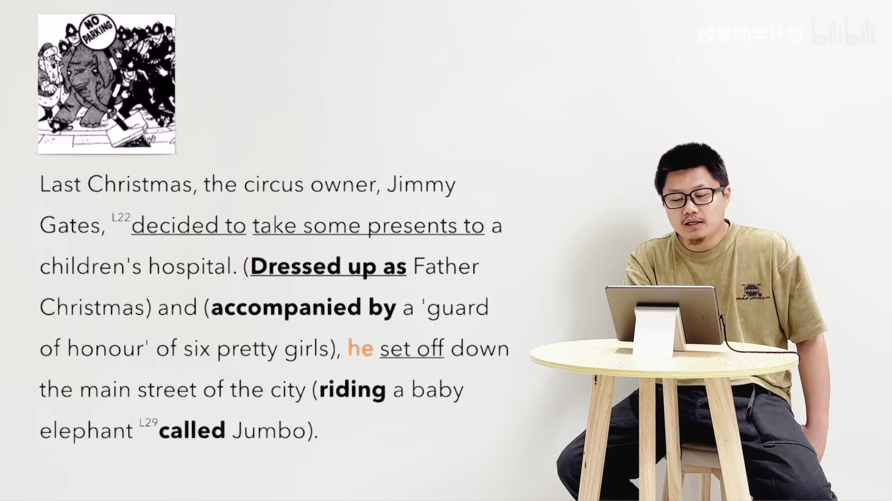

文字识别：PARKING / Last Christmas, the circus owner, Jimmy / Gates, 2²decided to take some presents to a / children's hospital.(Dressed up as Father / Christmas) and (accompanied by a 'guard / of honour' of six pretty girls), he set off down / the main street of the city (riding a baby / elephant [²called Jumbo).

## 00:02:30–00:03:00

这句话理论上是能读懂的。为什么？我们先看一下啊。但呢，这个前提假设，注意我说的是语法，你不会，但是这个习惯用法还是要会的，单词还是要会的。这个不会是不可能读懂的啊。假设您知道 dressed up as 的含义叫打扮啊，那 dress 打扮成 Father Christmas 圣诞老人，然后呢，accompanied accompany 叫陪伴吧，by 被被谁陪伴呢？A

### 画面 00:02:45

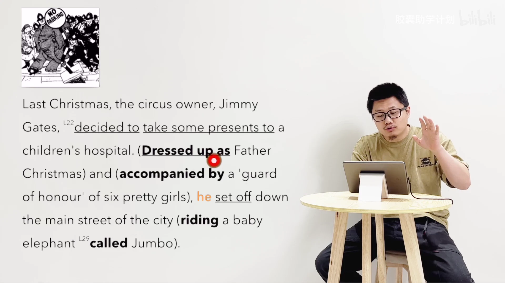

文字识别：Last Christmas, the circus owner, Jimmy / Gates, 2²decided to take some presents to a / children's hospital.(Dressed up as Father / Christmas) and (accompanied by a'guard / of honour' of six pretty girls), he set off down / the main street of the city (riding a baby / elephant [²2called Jumbo).

## 00:03:00–00:03:30

guide of honor. This you don't know. This is I directly tell you.叫仪仗队啊，什么样的仪仗队呢？Six pretty girls，六个漂亮姑娘组成的仪仗队。A guide of honor of six pretty girls.由后往前翻译啊，guide of honor，仪仗队，six pretty girls，六个漂亮姑娘，中间加了个of，由后往前翻译，六个漂亮姑娘组成的仪仗队，对吧？哎，被六个漂亮姑娘，六个漂亮姑娘组成的仪仗队陪伴着。为什么被呢？By

### 画面 00:03:15

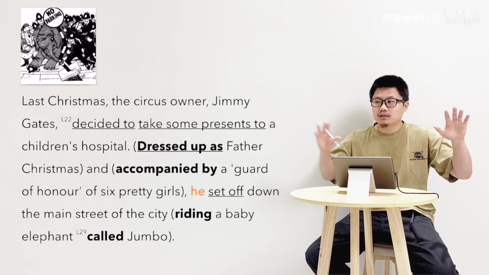

文字识别：Last Christmas, the circus owner, Jimmy / Gates, 2²decided to take some presents to a / children's hospital.(Dressed up as Father / Christmas) and (accompanied by a 'guard / of honour' of six pretty girls), he set off down / the main street of the city (riding a baby / elephant [²called Jumbo).

### 画面 00:03:20

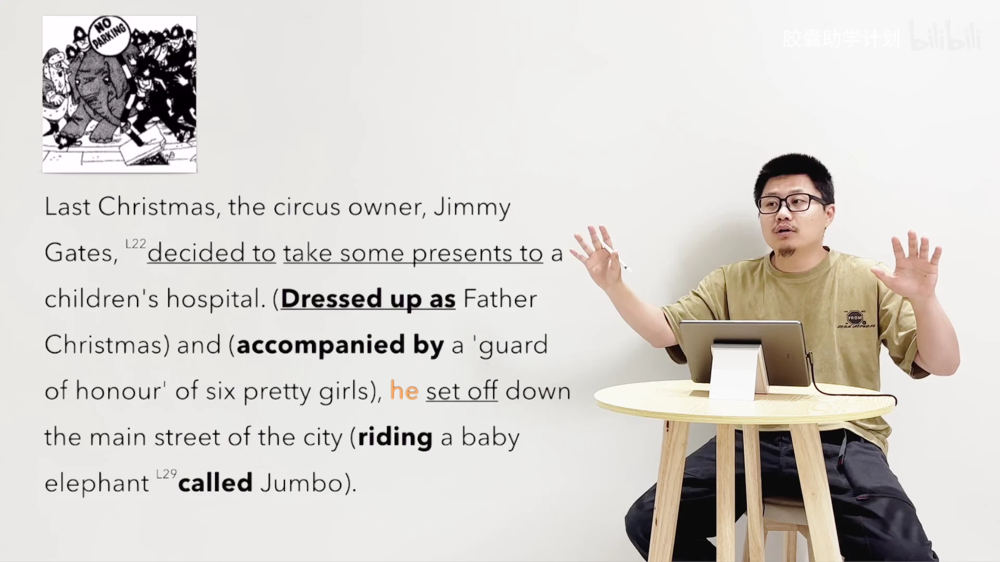

文字识别：ARKING / Last Christmas, the circus owner, Jimmy / Gates, 2²decided to take some presents to a / children's hospital. (Dressed up as Father / Christmas) and (accompanied by a 'guard / of honour' of six pretty girls), he set off down / the main street of the city (riding a baby / elephant [²2called Jumbo).

### 画面 00:03:23

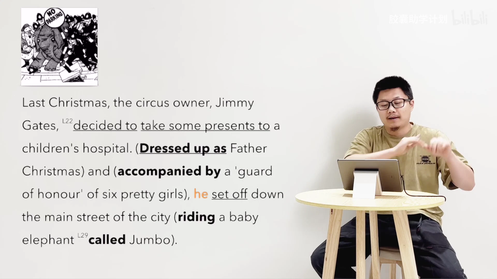

文字识别：ARKING / Last Christmas, the circus owner, Jimmy / Gates, 2²decided to take some presents to a / children's hospital. (Dressed up as Father / Christmas) and (accompanied by a 'guard / of honour' of six pretty girls), he set off down / the main street of the city (riding a baby / elephant [²2called Jumbo).

## 00:03:30–00:04:00

嘛，对吧？就是第十课咱们就学过了啊。He set off down the main street of the city.他set off是本课的习惯用法，新学的，跟我们之前十二课、十三课学过那个set out啊是一样的。十二课咱们学那个set out是一样的啊。出发了，down the main street of the city. down跟along在这地方是一样的，叫沿着，沿着什么呢？main street主干道啊，主街of the city城市的主

### 画面 00:03:53

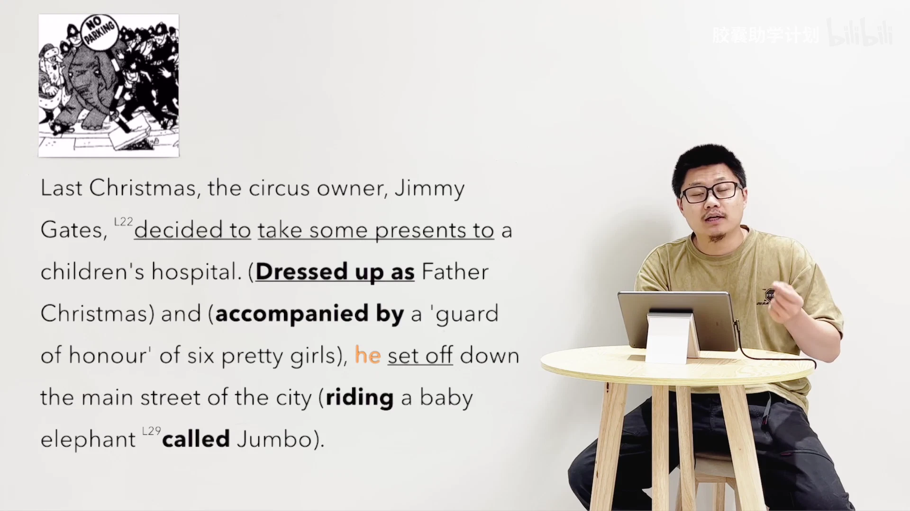

文字识别：Last Christmas, the circus owner, Jimmy / Gates, 2²decided to take some presents to a / children's hospital. (Dressed up as Father / Christmas) and (accompanied by a 'guard / of honour' of six pretty girls), he set off down / the main street of the city (riding a baby / elephant [²called Jumbo).

## 00:04:00–00:04:30

干道，他出发了，沿着城市的主干道出发了。Riding a baby elephant, ride这个单词，如果您认得，就很容易理解了，叫骑骑着什么呢？骑着一个baby elephant，elephant叫象，baby elephant你觉得是啥？就就就小象呗，对吧？哎，未成年的象啊，小象。然后called jumble叫做叫做jumble，对吧？刚才我的这个翻译里面，尽可能是把语法这个地方都

### 画面 00:04:23

文字识别：ARKING / Last Christmas, the circus owner, Jimmy / Gates, 2²decided to take some presents to a / children's hospital. (Dressed up as Father / Christmas) and (accompanied by a 'guard / of honour' of six pretty girls), he set off down / the main street of the city (riding a baby / elephant [²called Jumbo).

## 00:04:30–00:05:00

去除掉了。为什么我说这个语法就算你都不会？首先，我告诉各位，如果你四十九课学的很好，四十九课和二十九课这两课您学的很好，那这个地方基本上看一眼瞬间就懂了，对吧？我现在假设你有点忘了，依旧不妨碍你读懂这句话，但妨碍你写出来这样的句子，明白了吧？好，为什么？因为打扮成圣诞老人，被六个漂亮姑娘组成的

### 画面 00:04:38

文字识别：ARKING / Last Christmas, the circus owner, Jimmy / Gates, 2²decided to take some presents to a / children's hospital. (Dressed up as Father / W. / Christmas) and (accompanied by a 'guard / of honour' of six pretty girls), he set off down / the main street of the city (riding a baby / elephant [²called Jumbo).

### 画面 00:04:40

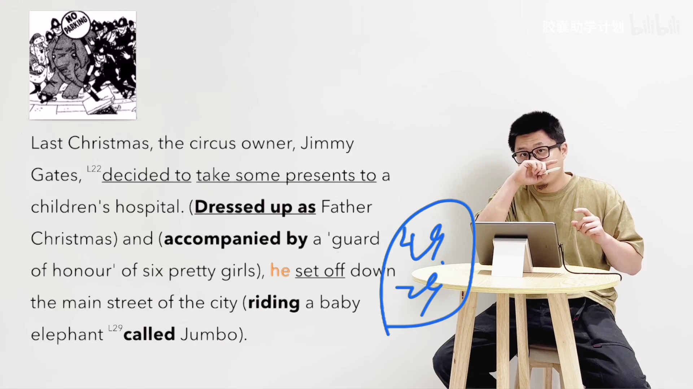

文字识别：Last Christmas, the circus owner, Jimmy / Gates, 2²decided to take some presents to a / children's hospital.(Dressed up as Father / Christmas) and (accompanied by a 'guard / of honour' of six pretty girls), he set off down / the main street of the city (riding a baby / elephant [²2called Jumbo).

### 画面 00:04:45

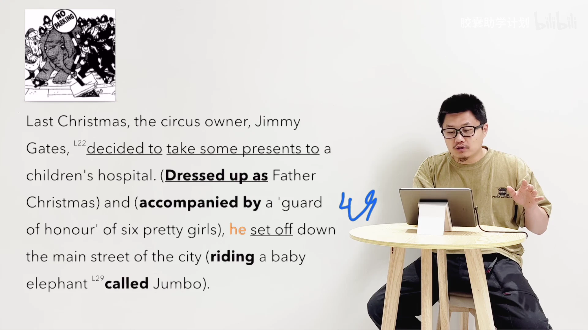

文字识别：RKING / Last Christmas, the circus owner, Jimmy / Gates, 2²decided to take some presents to a / children's hospital. (Dressed up as Father / W / Christmas) and (accompanied by a 'guard / of honour' of six pretty girls), he set off down / the main street of the city (riding a baby / elephant [²called Jumbo).

## 00:05:00–00:05:30

仪仗队陪伴着，他，你不会认为说这两个东西的主语是小象或者别的一个人，而你几乎会默认为就是他。他是谁呢？就是 Jimmy Gates，对吧？你会默认为就是 Jimmy Gates。然后 riding a baby elephant，你会默认为谁骑着？就是 Jimmy Gates，也就是 he 这个单词所指代的 Jimmy Gates 骑着，对吧？那基本上就结束了这句话。然后至于这个 called jumbo，二十九课咱们就学过了，被叫做 jumbo。

### 画面 00:05:15

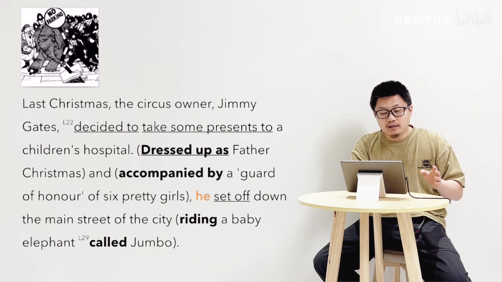

文字识别：ARKING / Last Christmas, the circus owner, Jimmy / Gates, 2²decided to take some presents to a / children's hospital. (Dressed up as Father / Christmas) and (accompanied by a 'guard / of honour' of six pretty girls), he set off down / the main street of the city (riding a baby / elephant [²called Jumbo).

## 00:05:30–00:06:00

二十九课当时咱们是呃叫做 called a pilatus porter啊，被叫做 pilatus porter嘛。这个语法后来又出现过好多回，我们就啊，我觉得还是比较简单的啊，这个您应该还记得。所以那回忆一下，这个语法叫什么呢？叫做这个啊一二三叫做分词做状语，特别的简单。分词做状语，四十九课咱们学的啊，如果你认认真真的学过了呢，就很容易理解了。所以分

### 画面 00:05:45

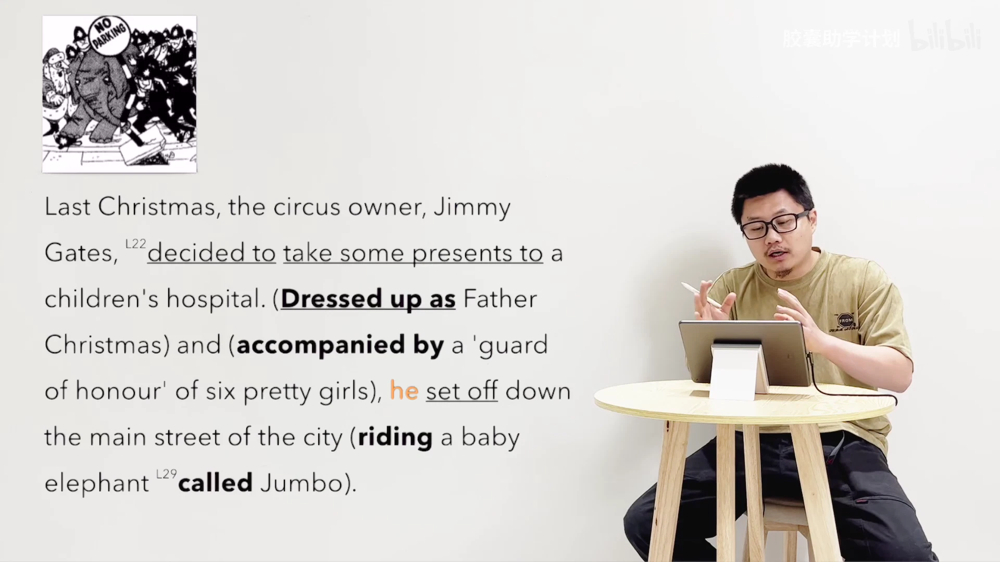

文字识别：O / ARKING / Last Christmas, the circus owner, Jimmy / Gates, 2²decided to take some presents to a / children's hospital. (Dressed up as Father / Christmas) and (accompanied by a 'guard / of honour' of six pretty girls), he set off down / the main street of the city (riding a baby / elephant [²called Jumbo).

### 画面 00:05:50

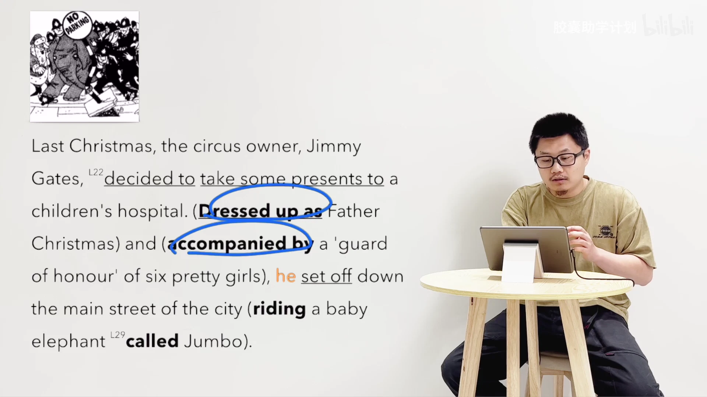

文字识别：PARKING / Last Christmas, the circus owner, Jimmy / Gates, 2²decided to take some presents to a / children's hospital.(Dressed up as Father / Christmas) and ((ccompanied b) a'guard / of honour' of six pretty girls), he set off down / the main street of the city (riding a baby / elephant [²called Jumbo).

### 画面 00:05:52

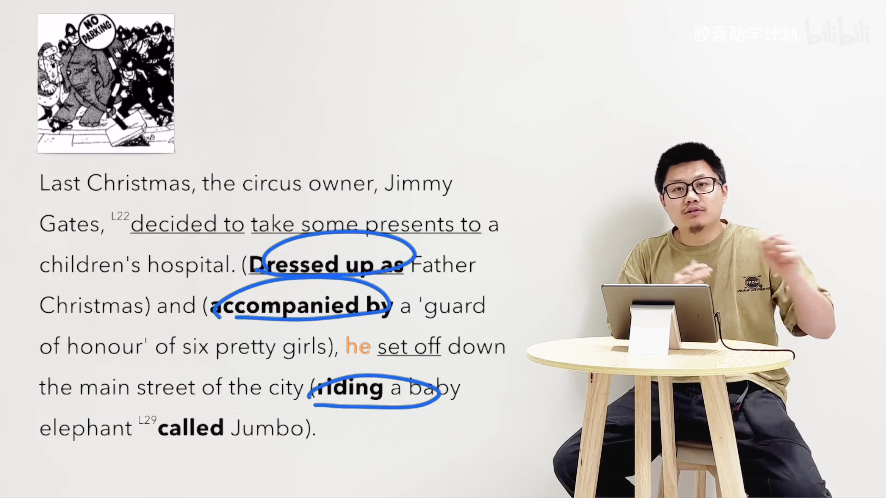

文字识别：Last Christmas, the circus owner, Jimmy / Gates, 2²decided to take some presents to a / children's hospital.(Dressed up asFather / Christmas) and ((ccompanied b) a'guard / of honour' of six pretty girls), he set off down / the main street of the city kriding a baby / elephant [²called Jumbo).

### 画面 00:05:57

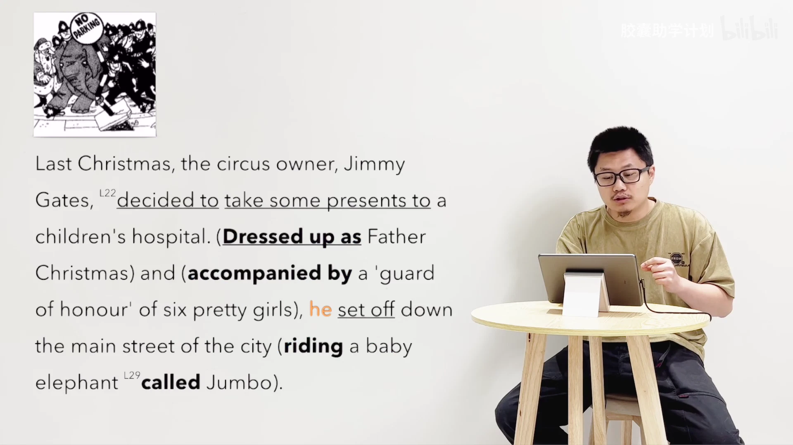

文字识别：PARKING / Last Christmas, the circus owner, Jimmy / Gates, 2²decided to take some presents to a / children's hospital. (Dressed up as Father / Christmas) and (accompanied by a'guard / of honour' of six pretty girls), he set off down / the main street of the city (riding a baby / elephant [²2called Jumbo).

## 00:06:00–00:06:30

词做状语要要说两个点还原回去。第一个，他他他的主语都是 he。第二，怎么判断主动被动特别的简单，这是 but 就是被动，但被动，如果是 doing 就是主动，就这么简单。但是这里还有一个小的点，各位会懵，比如就是这个 dressed up as Father Christmas，为什么呢？因为你拿汉语去理解的时候，你感觉它应该是主动，

### 画面 00:06:04

文字识别：PARKING) / Last Christmas, the circus owner, Jimmy / Gates, 2²decided to take some presents to a / children's hospital. (Dressed up as Father / Christmas) and (accompanied by a 'guard / of honour' of six pretty girls), he set off down / the main street of the city (riding a baby / elephant [²2called Jumbo).

### 画面 00:06:06

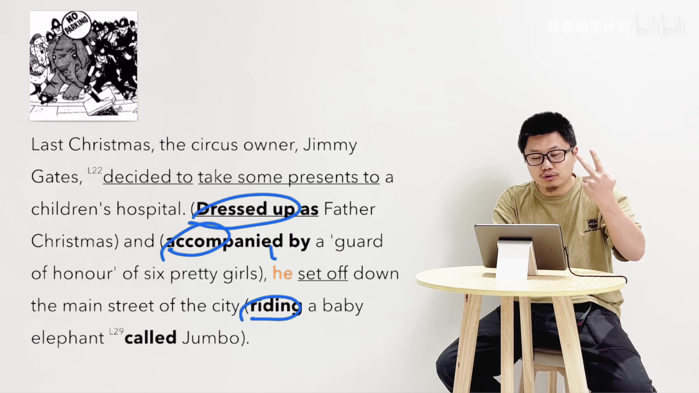

文字识别：ARKING / Last Christmas, the circus owner, Jimmy / Gates, 2²decided to take some presents to a / children's hospital. (Dressed upas Father / Christmas) and (accompanied by a 'guard / of honour' of six pretty girls), he set off down / the main street of the city(riding a baby / elephant [²2called Jumbo).

### 画面 00:06:12

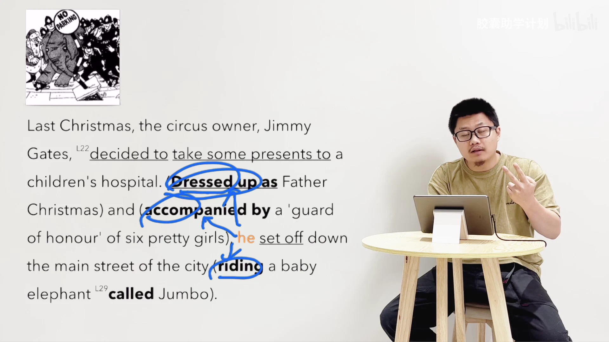

文字识别：Last Christmas, the circus owner, Jimmy / Gates, 2²decided to take some presents to a / children's hospital. / Dressed up as Father / Christmas) and (accompanied by a 'guard / of honour' of six pretty girls),he set off down / the main street of the city(riding /  a baby / elephant [2called Jumbo).

### 画面 00:06:15

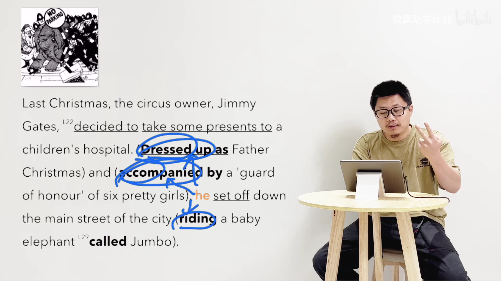

文字识别：ARKING / Last Christmas, the circus owner, Jimmy / Gates, 2²decided to take some presents to a / children's hospital. / ressed up as Father / Christmas) and (ccompanied by a'guard / of honour' of six pretty girls),he set off down / the main street of the citycriding / a baby / elephant [²called Jumbo).

### 画面 00:06:18

文字识别：ARKING / Last Christmas, the circus owner, Jimmy / Gates, 2²decided to take some presents to a / children's hospital. / Dressed lp as Father / Christmas) and (accompanied by a'guard / of honour' of six pretty girls) he set off down / the main street of the city(riding a / a baby / elephant [2called Jumbo).

### 画面 00:06:20

文字识别：PARKING / Last Christmas, the circus owner, Jimmy / Gates, 2²decided to take some presents to a / children's hospital. (Dressed up as Father / Christmas) and (accompanied by a 'guard / of honour' of six pretty girls), he set off down / the main street of the city (riding a baby / elephant [²2called Jumbo).

### 画面 00:06:22

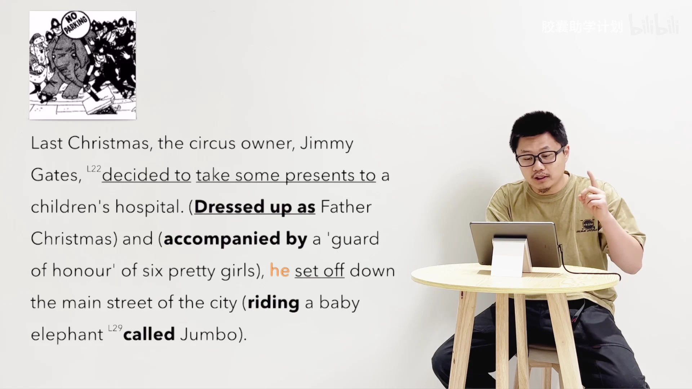

文字识别：PARKING / Last Christmas, the circus owner, Jimmy / Gates, 2²decided to take some presents to a / children's hospital. (Dressed up as Father / Christmas) and (accompanied by a 'guard / of honour' of six pretty girls), he set off down / the main street of the city (riding a baby / elephant [²2called Jumbo).

## 00:06:30–00:07:00

是它主动打扮成圣诞老人的，怎么叫它被打扮成圣诞老人们呢？好，首先我跟各位这么说啊，这个地方的含义确实就是主动的含义，我认为它不是被动的含义，但是结构是被动的结构，因为它的这个习惯用法叫做 be dressed up as，然后那个 be 被省略掉了，然后这个 dress 在英文当中默认为它就是一个被动，这个结构在呃跟我们五十五课

### 画面 00:06:52

文字识别：PARKING / Last Christmas, the circus owner, Jimmy / Gates, 2²decided to take some presents to a / children's hospital. (Dressed up as Father / Christmas) and (accompanied by a 'guard / of honour' of six pretty girls), he set off down / the main street of the city (riding a baby / elephant [²2called Jumbo).

## 00:07:00–00:07:30

学的那个 armed with a new machine 很像，包括我们在进入新三还会再见到它，所以这个地方呢，就是和你的汉语语言习惯是不一致的，它就是个被动，但是翻译起来就是个主动，就是他打扮成圣诞老人，听见了吧？但是在结构上，它叫做 be dressed up as， OK，好，然后呢，accompanied by a guard of honor of six pretty girls，这个就很容易理解了，主动被动，首先一定是主动啊，不一定是被动

### 画面 00:07:22

文字识别：PARKING / Last Christmas, the circus owner, Jimmy / Gates, 2²decided to take some presents to a / children's hospital. (Dressed up as Father / Christmas) and (accompanied by a 'guard / of honour' of six pretty girls), he set off down / the main street of the city (riding a baby / elephant [²called Jumbo).

## 00:07:30–00:08:00

啊，就是主语一定是他，他被六个漂亮姑娘组成的仪仗队陪伴着。然后其次这儿人by都给你了，第十课咱们学的那更是被动了，所以用的是但，这不是过去式，这是过去分词啊。然后呢，他出发了，怎么怎么样？Riding a baby elephant这个地方基本上用正常大脑汉语就可以理解了，肯定是他骑着主动骑着大象，不是被大象骑着，对吧？OK，所以他骑着一个大象，riding的主语是谁？是he，

### 画面 00:07:52

文字识别：0 / ARKING / Last Christmas, the circus owner, Jimmy / Gates, 2²decided to take some presents to a / children's hospital. (Dressed up as Father / Christmas) and (accompanied by a 'guard / of honour' of six pretty girls), he set off down / the main street of the city (riding a baby / elephant ²°called Jumbo).

## 00:08:00–00:08:30

主动被动？主动对吧？所以这句话就又可以被拆开了。好，所以呢，这个里边这么长的一句话，从左括弧到右括弧的结束，我们就可以把它拆成 n 句话。这个也是我们在进入新二下半册，包括将来进入新三啊，我们很多考试，托福、雅思啊，这个考研、高考啊，长难句里边都要学的一个能力，就是如何把长难句拆成短句。当然，这是现

### 画面 00:08:22

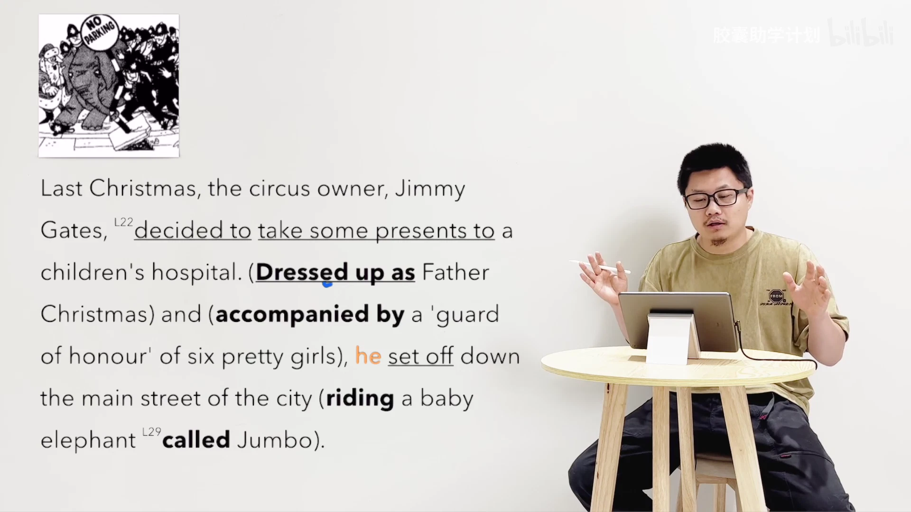

文字识别：0 / PARKING / Last Christmas, the circus owner, Jimmy / Gates, 2²decided to take some presents to a / children's hospital. (Dressed up as Father / Christmas) and (accompanied by a 'guard / of honour' of six pretty girls), he set off down / the main street of the city (riding a baby / elephant [²called Jumbo).

## 00:08:30–00:09:00

实生活当中你更需要用到的。你比如说我去新西兰奥大读研的时候，那很多的句子就是长难句，对吧？你就得给它拆。所以这里怎么拆呢？特别的简单。各位看啊，第一句话叫做 He was dressed up as Father Christmas，他打扮成圣诞老人。第二句话 He was accompanied by a a guard of honor of six pretty girls，这是第二句话，很简单吧？第三句话叫 Instead of down the main street of the city，这是第三句话。第四句话叫做

### 画面 00:08:42

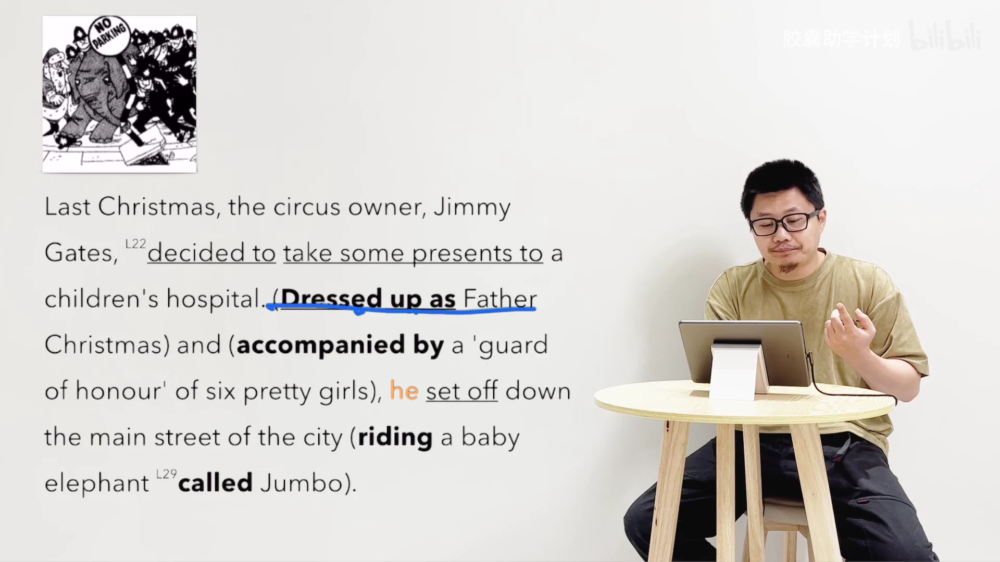

文字识别：ARKING / Last Christmas, the circus owner, Jimmy / Gates, 2²decided to take some presents to a / children's hospital.(Dressed up as Father / Christmas) and (accompanied by a'guard / of honour' of six pretty girls), he set off down / the main street of the city (riding a baby / elephant [²called Jumbo).

### 画面 00:08:49

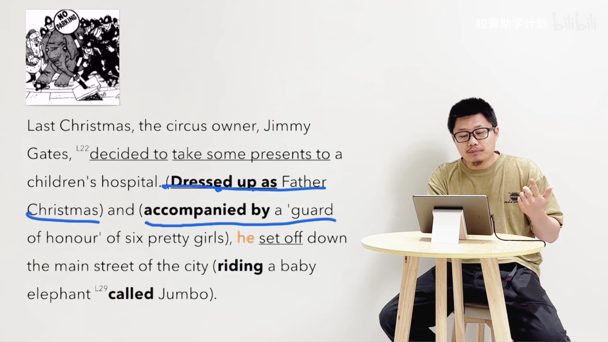

文字识别：O / PARKING / Last Christmas, the circus owner, Jimmy /  L22decided to take some presents to a / Gates, [2 / children's hospital. (Dressed up as Father / Christmas) and (accompanied by a 'guard / of honour' of six pretty girls), he set off down / the main street of the city (riding a baby / elephant [²2called Jumbo).

### 画面 00:08:51

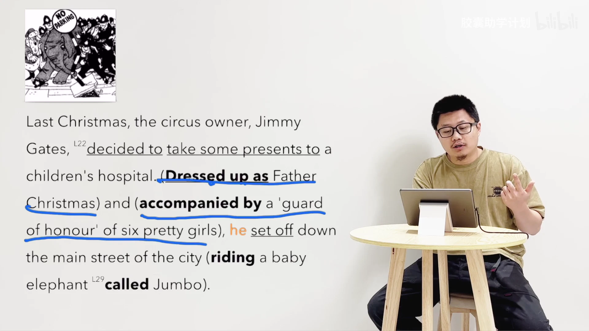

文字识别：PARKING / Last Christmas, the circus owner, Jimmy /  L22decided to take some presents to a / Gates, [2 / children's hospital. (Dressed up as Father / Christmas) and (accompanied by a 'guard / of honour' of six pretty girls), he set off down / the main street of the city (riding a baby / elephant [²2called Jumbo).

### 画面 00:08:56

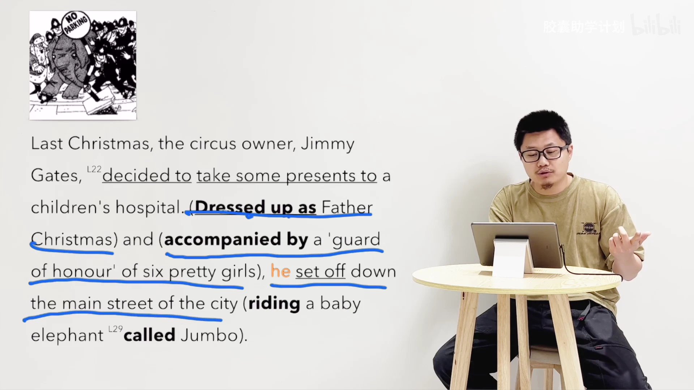

文字识别：PARKING / Last Christmas, the circus owner, Jimmy / L22decided to take some presents to a / Gates, 2 / children's hospital. (Dressed up as Father / Christmas) and (accompanied by a 'guard / of honour' of six pretty girls), he set off down / the main street of the city (riding a baby / elephant / L29 / 'called Jumbo).

## 00:09:00–00:09:30

He was riding a baby elephant. 他当时正骑着一个小象啊。你要非拆出来第五句话叫做呃，the jam呃呃the the baby elephant is called Jumbo或者was called Jumbo。我觉得都OK了，是吧？陈述客观事实还是说单纯表述过去都OK。那这就拆出来了五句话，长难句就这么搞。OK。所以还是那句话，本课呢，我觉得在这个地方唯一说有点难点的就是这个习惯用法特别不符

### 画面 00:09:01

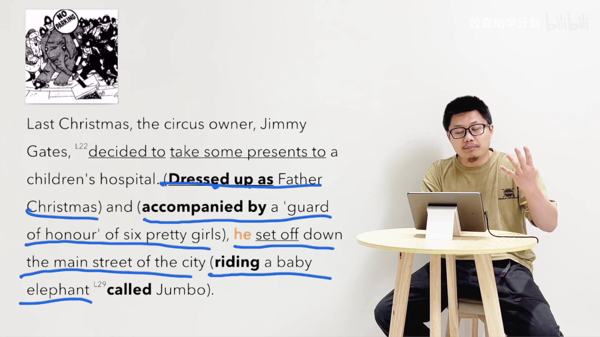

文字识别：AO / PARKING / Last Christmas, the circus owner, Jimmy / Gates, / ²decided to take some presents to a / children's hospital. (Dressed up as Father / LOM / Christmas) and (accompanied by a 'guard / of honour' of six pretty girls), he set off down / the main street of the city (riding a baby / elephant / 9called Jumbo).

### 画面 00:09:18

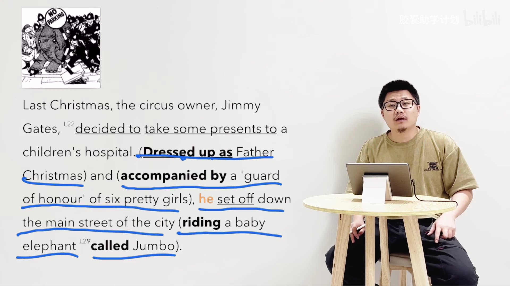

文字识别：PARKING / Last Christmas, the circus owner, Jimmy / Gates, / ²decided to take some presents to a / children's hospital.(Dressed up as Father / Christmas) and (accompanied by a 'guard / of honour' of six pretty girls), he set off down / the main street of the city (riding a baby / elephant / called Jumbo).

### 画面 00:09:23

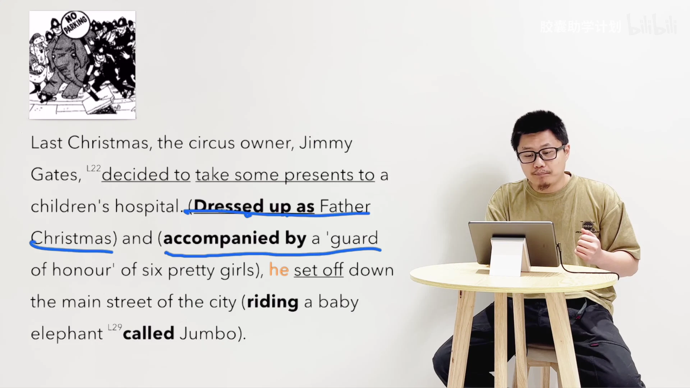

文字识别：PARKING / Last Christmas, the circus owner, Jimmy / Gates, 2²decided to take some presents to a / children's hospital. (Dressed up as Father / Christmas) and (accompanied by a 'guard / of honour' of six pretty girls), he set off down / the main street of the city (riding a baby / elephant [²2called Jumbo).

### 画面 00:09:25

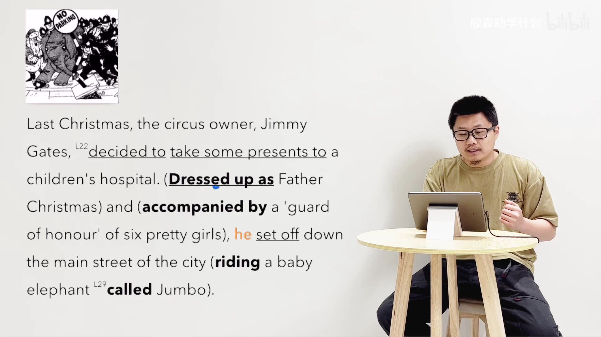

文字识别：PARKING / Last Christmas, the circus owner, Jimmy / Gates, 2²decided to take some presents to a / children's hospital. (Dressed up as Father / Christmas) and (accompanied by a 'guard / of honour' of six pretty girls), he set off down / the main street of the city (riding a baby / elephant ²°called Jumbo).

### 画面 00:09:28

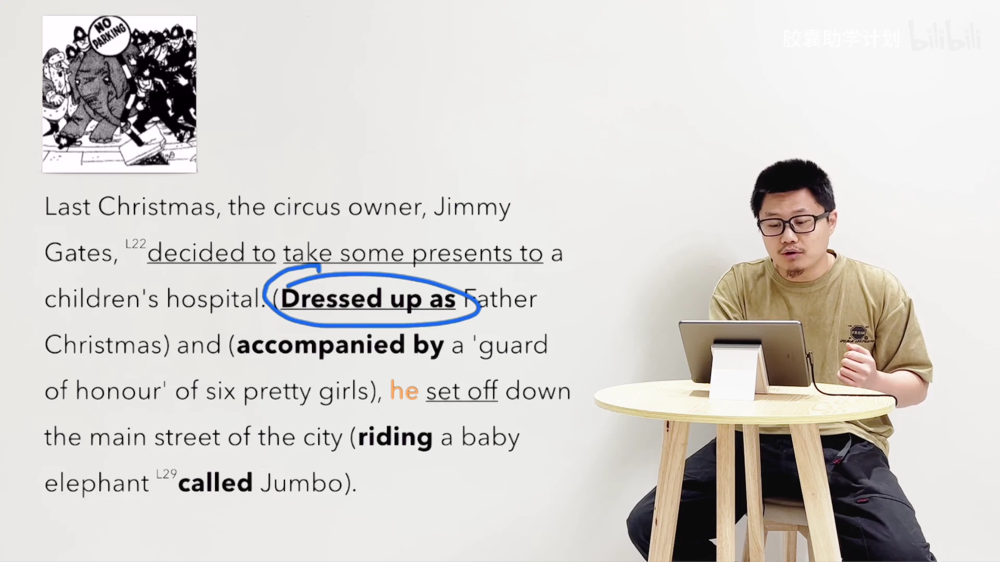

文字识别：0 / PARKING / Last Christmas, the circus owner, Jimmy / Gates, 2²decided to take some presents to a / children's hospital(Dressed up as Sather / Christmas) and (accompanied by a 'guard / of honour' of six pretty girls), he set off down / the main street of the city (riding a baby / elephant [²2called Jumbo).

## 00:09:30–00:10:00

合我们汉语的习惯，但没办法，学的是英文。剩下所有这些，都是四十九课您学好了，这课就顺水推舟的事儿啊，我就不多说了。Next one, he should have known that the police would never allow this sort of thing. Should have known, 他本应该知道。那我想问他知不知道？No, he didn't know, 对吧？不是他不知道，他本应该知道的是一件事儿。

### 画面 00:09:35

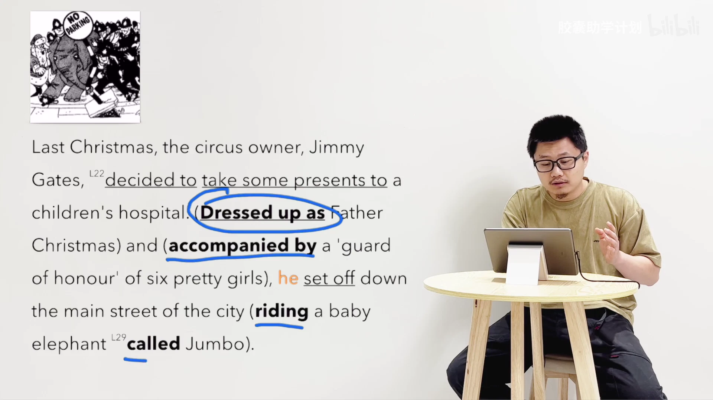

文字识别：1O / PARKING / Last Christmas, the circus owner, Jimmy / Gates, 2²decided to take some presents to a / children's hospital (Dressed up as Sather / Christmas) and (accompanied by a 'guard / of honour' of six pretty girls), he set off down / the main street of the city (riding a baby / t (2°called Jumbo). / elephant'

### 画面 00:09:41

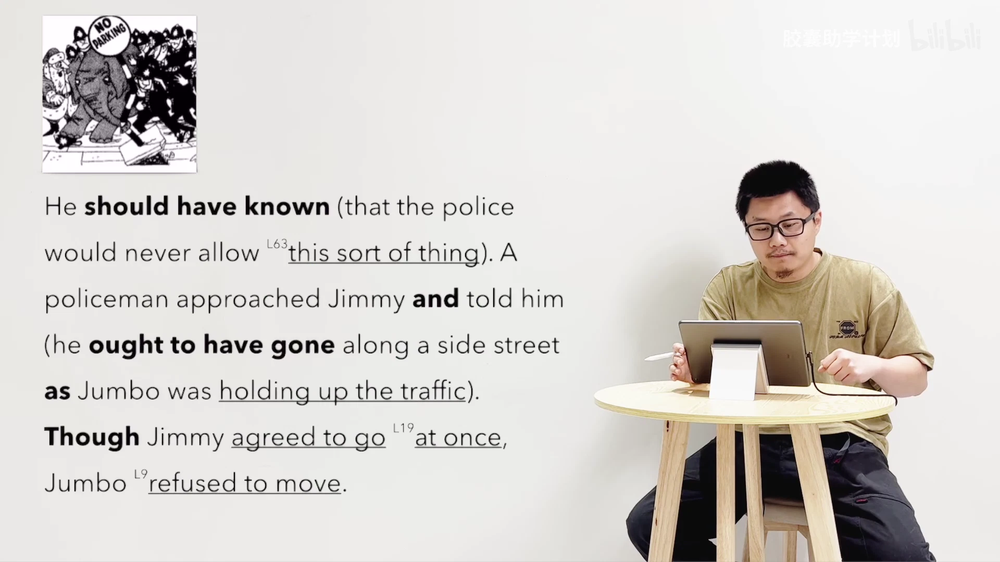

文字识别：0 / PARKING / He should have known (that the police / v [6³this sort of thing). A / would never allow / policeman approached Jimmy and told him / (he ought to have gone along a side street / as Jumbo was holding up the traffic). / Though Jimmy agreed to go 1'at once, / Jumbo 'refused to move.

## 00:10:00–00:10:30

宾语从句，什么事儿呢？The police would never allow this sort of thing.说警察绝对不会允许这类事情的发生。这类事情，sort this sort of，是吧？All sorts of，六十三课咱们学的这类事情，他应该知道，他本应该知道，但他不知道，对吧？A policeman approached Jimmy and told him he ought to have gone along a side

### 画面 00:10:11

文字识别：O / PARKING) / He should have known (that the police / v [6³this sort of thing). A / would never allow / policeman approached Jimmy and told him / (he ought to have gone along a side street / as Jumbo was holding up the traffic). / Though Jimmy agreed to go / 2 -1°at once, / L19 / Jumbo 'refused to move.

## 00:10:30–00:11:00

street as Jumbo was holding up the traffic. Ah,又是好长的一句话。我们先做几个事儿。第一个事儿，连词先给它标出来。连词一标出来，这个句子瞬间就变短了。第一句话，Policeman, a policeman approached Jimmy.一个警察接近了Jimmy。第二句话，told him，告诉他，告诉他了一件事儿。什么事儿呢？我们把第一个事儿跟他连到一起，叫做He ought

### 画面 00:10:40

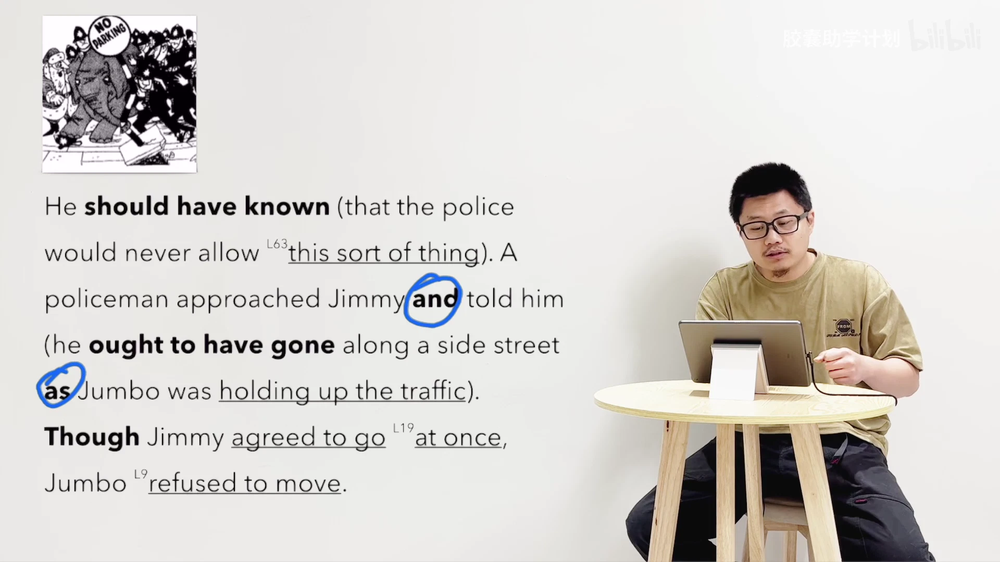

文字识别：ARKING / He should have known (that the police / v [6³this sort of thing). A / would never allow / policeman approached Jimmy / and / told him / (he ought to have gone along a side street / Jumbo was holding up the traffic). / as / Though Jimmy agreed to go /  L1°at once, / L19 / Jumbo 'refused to move.

### 画面 00:10:44

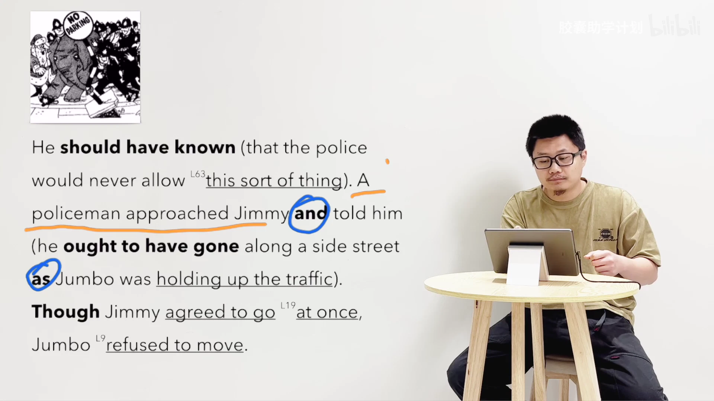

文字识别：PARKING / He should have known (that the police / L6³3this sort of thing). A / would never allow / policeman approached Jimmy / and / told him / (he ought to have gone along a side street / Jumbo was holding up the traffic). / as / Though Jimmy agreed to go / L19 / 'at once, / Jumbo '"refused to move.

### 画面 00:10:57

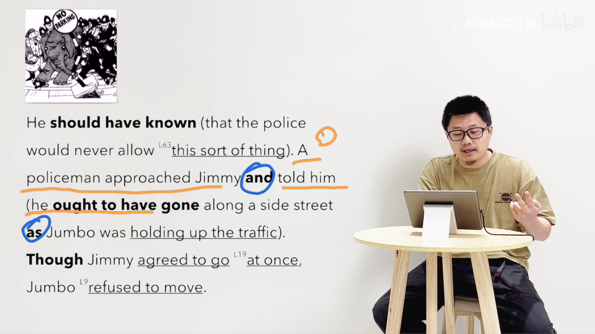

文字识别：PARKING / He should have known (that the police /  6³this sort of thing). A / would never allow / policeman approached Jimmy / and / told him / (he ought to have gone along a side street / Jumbo was holding up the traffic). / as / Though Jimmy agreed to go / L19 / "at once, / Jumbo '"refused to move.

### 画面 00:10:59

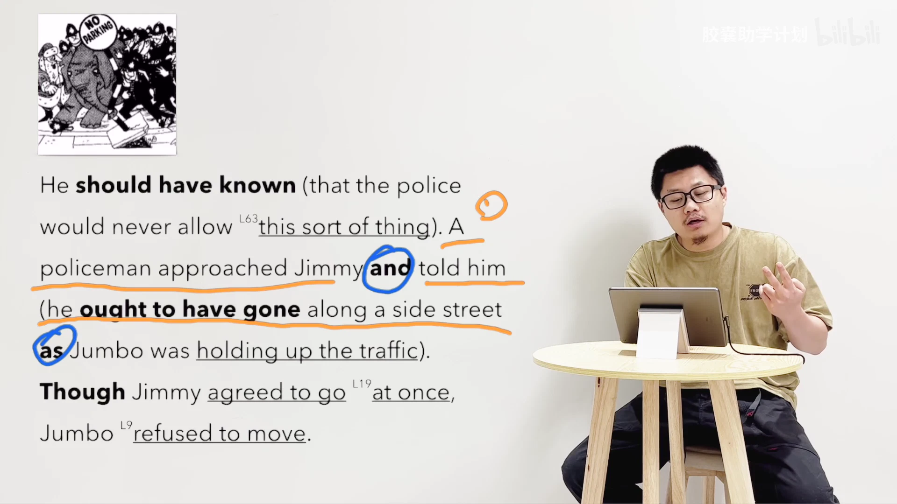

文字识别：PARKING / He should have known (that the police /  L63this sort of thing). A / would never allow / policeman approached Jimmy / told him / and / (he ought to have gone along a side street / Jumbo was holding up the traffic). / as / Though Jimmy agreed to go / L19 / 1'at once, / Jumbo 'refused to move.

## 00:11:00–00:11:30

to have gone along a side street. Ought to have gone跟should have gone是一样的，一码事儿啊，一码事儿。叫做本应该说他本应该这等会儿啊，这是第二句话。他本应该沿着side street跟刚才的main street是对应的。Main叫主要的，main street就主干道，side叫边上，side street就是辅路啊。他本应该

### 画面 00:11:07

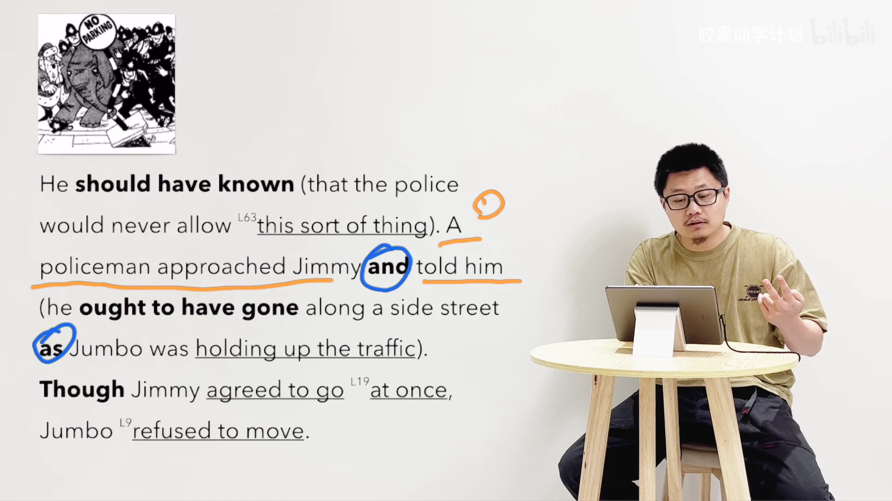

文字识别：PARKING / He should have known (that the police / L6³this sort of thing). A / would never allow / policeman approached Jimmy / told him / and / (he ought to have gone along a side street / sJumbo was holding up the traffic). / as / Though Jimmy agreed to go / L19 / 'at once, / Jumbo '"refused to move.

### 画面 00:11:09

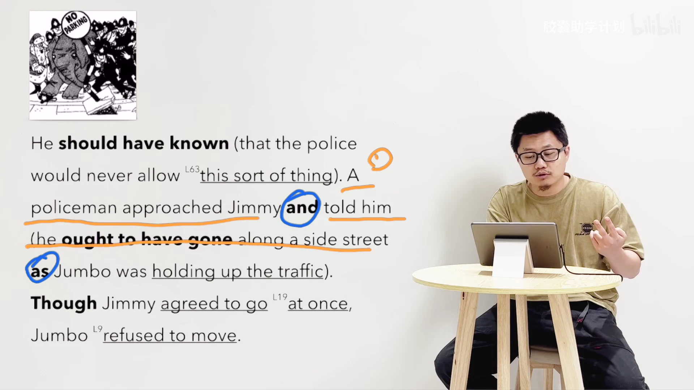

文字识别：RKING / He should have known (that the police / L6³this sort of thing). A / would never allow / policeman approached Jimmy / told him / and / (he ought to have gone along a side street / umbo was holding up the traffic). / Though Jimmy agreed to go / L19 / 'at once, / Jumbo 'refused to move.

### 画面 00:11:11

文字识别：He should have known (that the police / L6³this sort of thing). A / would never allow / policeman approached Jimmy / told him / and / (he ought to have gone along a side street / Jumbo was holding up the traffic). / as / Though Jimmy agreed to go / L19 / 'at once, / Jumbo 'refused to move.

### 画面 00:11:13

文字识别：PARKING / He should have known (that the police / L6³this sort of thing).A / would never allow / policeman approached Jimmy / told him / and / (he ought to have gone along a side street / asJumbo was holding up the traffic). / Though Jimmy agreed to go / L19 / 'at once, / Jumbo 'refused to move.

## 00:11:30–00:12:00

这个 along 跟刚才的 down 啊 side of down the main street of the city 的那个 down 几乎是同义词啊，叫做沿着一个辅路走。然后这儿又来了，到第三句话是由 as 引导的，as 引导的后边那句话，我是没有办法直接去判断它到底这个 as 怎么翻译的，必须看完后半那句话。Jumbo was holding up the traffic. 说 Jumbo 正在怎么样呢？Hold

### 画面 00:11:43

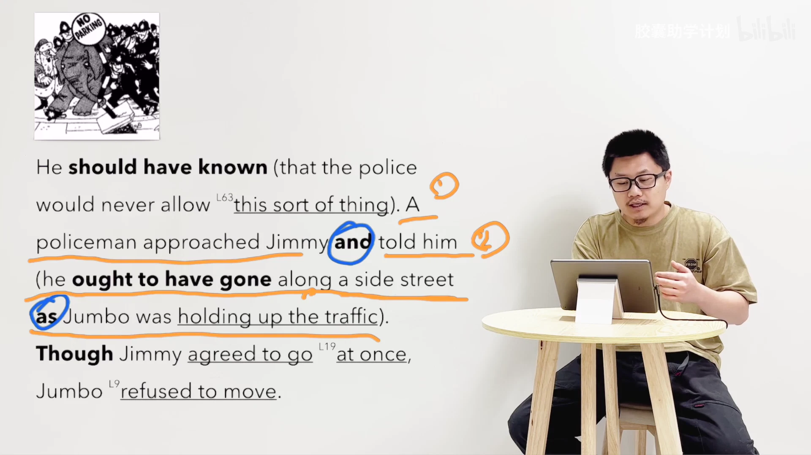

文字识别：PARKING / He should have known (that the police / L6³this sort of thing). A / would never allow / policeman approached Jimmy / told him / and / (he ought to have gone along a side street / Jumbo was holding up the traffic). / as / Though Jimmy agreed to go / L19 / at once, / Jumbo 'refused to move.

## 00:12:00–00:12:30

up the traffic. Hold up the traffic是本课的习惯用法，直接连起来记就可以了啊。那首先traffic这个单词你应该认的，叫交通嘛。Hold up the traffic就阻碍交通。说Jambo正在阻碍交通。那你其实如何判断这个as是翻译成什么含义呢？你其实要由前面那句话读懂了，后边那句话读懂了，你才能判断出来，对吧？翻译成因为啊，because。那我们回来再看一遍这句话，一个长难句又被我们拆成了三句话，其实

### 画面 00:12:13

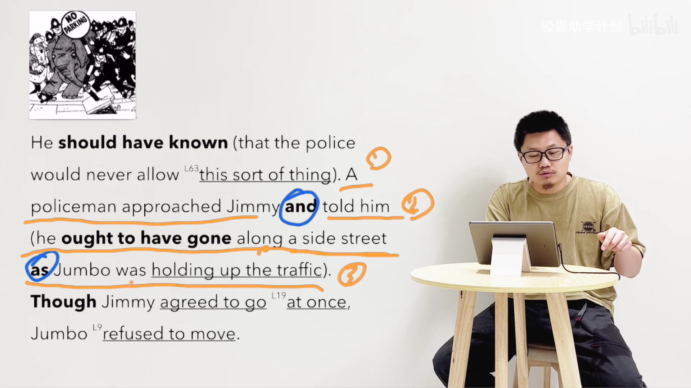

文字识别：PARKING) / He should have known (that the police / L6³this sort of thing). A / would never allow / policeman approached Jimmy / told him / and / (he ought to have gone along a side street / asJumbo was holding up the traffic). / Though Jimmy agreed to go / L19 / at once, / Jumbo "refused to move.

## 00:12:30–00:13:00

实能拆成四句话，但没有必要拆成三句话就够了。第一句话，一个警察接近了Jimmy，然后第二句话告诉他他本应该沿着辅路走。第三句话，因为Jumble就是那个小巷正在阻碍交通，没问题，很舒服。三句话拆开了，对吧？Okay, continue. 最后啊，说Though Jimmy agreed to go at once, Jumble refused to move.啊，这这就不算长难句了，这

### 画面 00:12:43

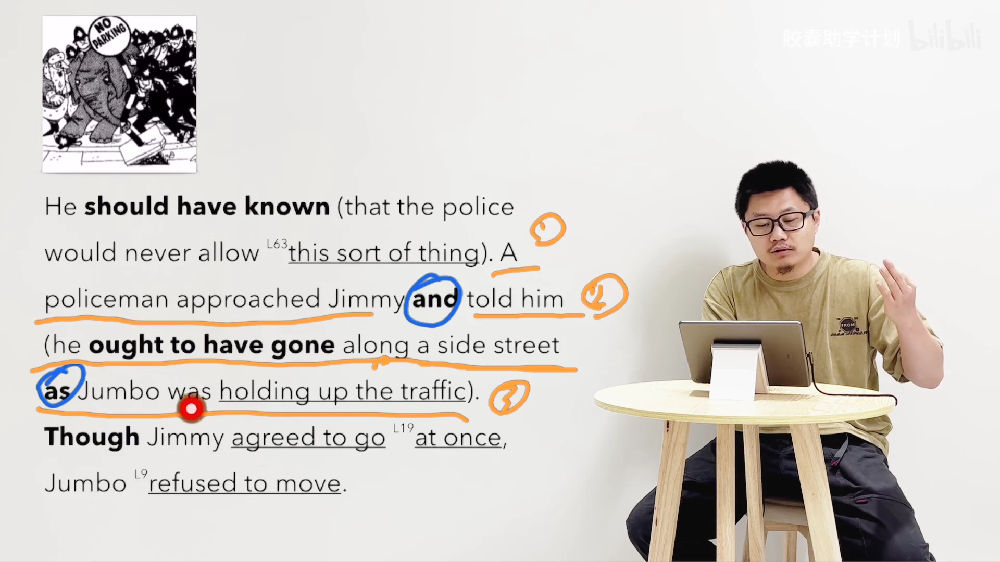

文字识别：PARKING / He should have known (that the police / L6³this sort of thing). A / would never allow / policeman approached Jimmy / told him / and / (he ought to have gone along a side street / sJumbo was holding up the traffic). / Though Jimmy agreed to go / L19 / at once, / Jumbo 'refused to move.

### 画面 00:12:49

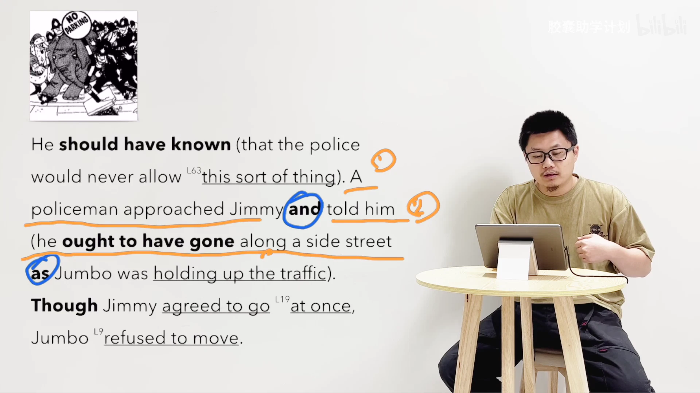

文字识别：PARKING / He should have known (that the police / L6³this sort of thing). A / would never allow / policeman approached Jimmy / told him / and / (he ought to have gone along a side street / asJumbo was holding up the traffic). / Though Jimmy agreed to go / L19 / 'at once, / Jumbo 'refused to move.

### 画面 00:12:51

文字识别：O / PARKING / He should have known (that the police / v [6³this sort of thing). A / would never allow  / policeman approached Jimmy and told him / (he ought to have gone along a side street / as Jumbo was holding up the traffic). / Though Jimmy agreed to go / 2 1at once, / [19 / Jumbo 'refused to move.

## 00:13:00–00:13:30

就两句话组成了一句话，就很简单。尽管四十八一到四十八课总结那个视频啊，我们讲过了。呃，尽管Jimmy类似于although，even though，对吧？都可以说尽管Jimmy agreed to go at once。首先，agree to do something是本课要学的一个习惯用法，叫同意做某件事情。叫Jimmy同意走了。Jimmy是那个circus owner，对吧？呃，马戏团的这个拥有者啊，老板，他同意走了。at once，十九课咱们学的，立刻马上。

### 画面 00:13:21

文字识别：PARKING / He should have known (that the police / would never allow [6³this sort of thing). A / policeman approached Jimmy and told him / (he ought to have gone along a side street / as Jumbo was holding up the traffic). / Though Jimmy agreed to go / 2 -19at once, / L19 / Jumbo 'refused to move.

## 00:13:30–00:14:00

Jumbo refused to move.那Jumbo怎么样呢？第九课咱们学的refuse to do something拒绝做某件事情，但是Jumbo拒绝挪动啊，拒绝移动，他不想走。Continue. Fifteen policemen had to push very hard to get him off the main street.这地方的to我们已经见过很多很多遍了，每次我都在前面给你加个斜线，我没有现到现在为止没有专门花时间去讲过，

### 画面 00:13:43

文字识别：Fifteen policemen had to push very hard / to / get him of the main stret. The police ³had a / e L34most amused. / difficult time, but they were' / 'Jumbo [1'must weigh a few tons,' said a / policeman afterwards, 'so it was fortunate (that / we didn't have to carry him). Of course, we / should arrest him, but as he has a good record, / we shall let him off this time.'

## 00:14:00–00:14:30

但每次我都会提一下啊，怎么样呢？看一下啊，而十五个警察不得不推的特别的努力，目的是 get him off the main street，把他推离啊，off不是离开吗？这个 get 万能动词对吧？弄，把他弄啊，推离啊，包括你用这儿 push him off the main street，这儿的 push 也行，但因为前面用 push 了，后边就别再重复了。 get him off the main

### 画面 00:14:13

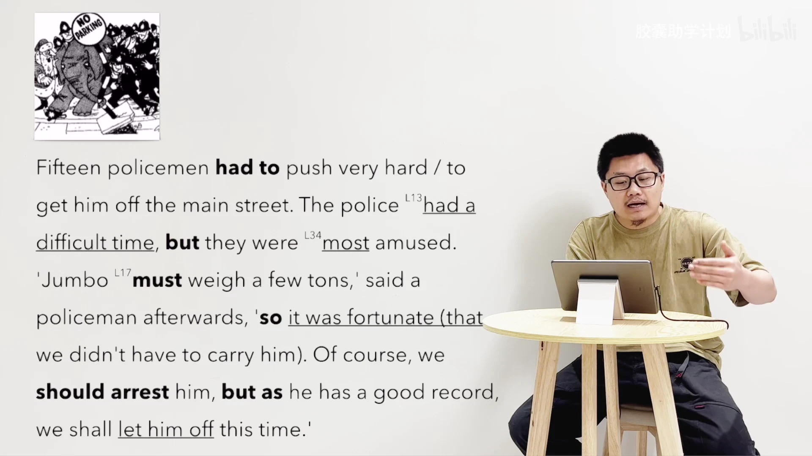

文字识别：Fifteen policemen had to push very hard / to / get him off the main street. The police 1³had a / difficult time, but they were /  L³4most amused. / L34p / 'Jumbo [17must weigh a few tons,' said a / policeman afterwards, 'so it was fortunate (that / we didn't have to carry him). Of course, we / should arrest him, but as he has a good record, / we shall let him off this time.'

## 00:14:30–00:15:00

street,就是把他推离这个主干道，目的是为了把他推离这个主干道，对吧？表目的。The police had a difficult time, but they were most amused.说警察怎么样的？十三课绿林少年Greenwood Boys那课咱们学的是吧？说有一个特别困难的时光，但是呢，他们most amused。三十四课咱们学的，对吧？那个我丢自行车那课，警察找到我丢的自行车那课咱

### 画面 00:14:43

文字识别：PARKING / Fifteen policemen had to push very hard / to / get him off the main street. The police 3had a / difficult time, but they were / e L³4most amused. / L34 / 'Jumbo [1must weigh a few tons,' said a / policeman afterwards, 'so it was fortunate (that / we didn't have to carry him). Of course, we / should arrest him, but as he has a good record, / we shall let him off this time.'

## 00:15:00–00:15:30

们学的 most 那个那个那个地方用的是 most surprised，对吧？那一刻见到的 most 就类似于 very 啊 very 啊， they were very amused，他们特别的开心啊。你看 but 连接了两个句子，对吧？很简单，继续. Jumbo must weigh a few tons， said a policeman afterwards. So it was fortunate that we didn't have to carry him. 哎，看这个句子，看上去好像又

### 画面 00:15:13

文字识别：Fifteen policemen had to push very hard / to / get him off the main street. The police 13had a / difficult time but they were / e L³4most amused. / L34p / 'Jumbo [1'must weigh a few tons,' said a / policeman afterwards, 'so it was fortunate (that / we didn't have to carry him). Of course, we / should arrest him, but as he has a good record, / we shall let him off this time.'

## 00:15:30–00:16:00

很长，但其实嘛，因为首先你有了个so嘛，so前面一句话说jumbo一定是重达数吨，一个警察后来说到afterwards后来，对吧？这句话第一句话结束了，第二句话，it was fortunate that we didn't have to carry him，很足够的幸运。这个在单词部分我们讲过了，我们不必携带他，我们不必扛着他跑，对吧？我们不必推着他跑，

### 画面 00:15:43

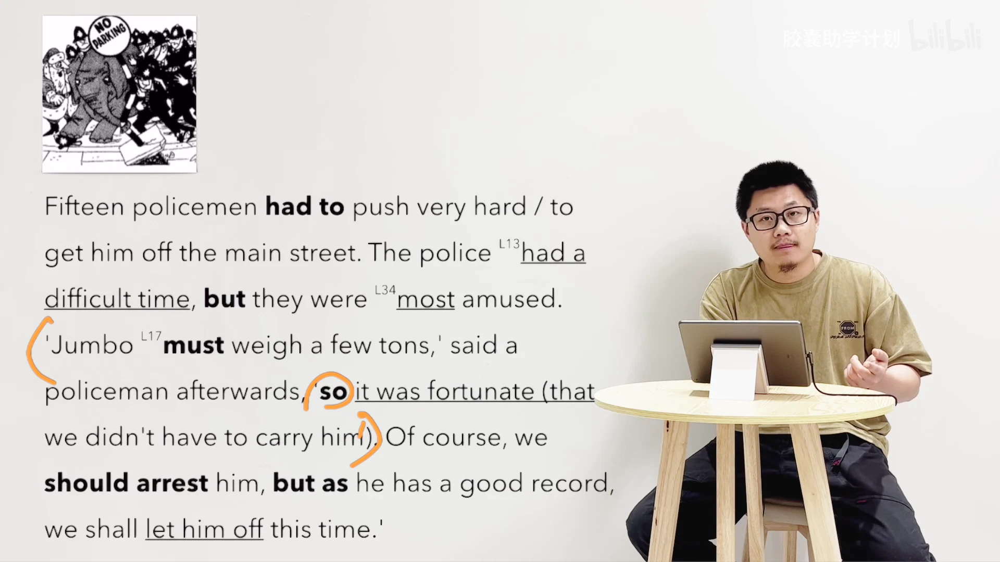

文字识别：ARKING / Fifteen policemen had to push very hard / to / get him off the main street. The police ³had a / difficult time, but they were /  L³4most amused. / L34y / 'Jumbo [17must weigh a few tons,' said a / policeman afterwardssoit was fortunate (that / we didn't have to carry him?) Of course, we / should arrest him, but as he has a good record, / we shall let him off this time.'

### 画面 00:15:59

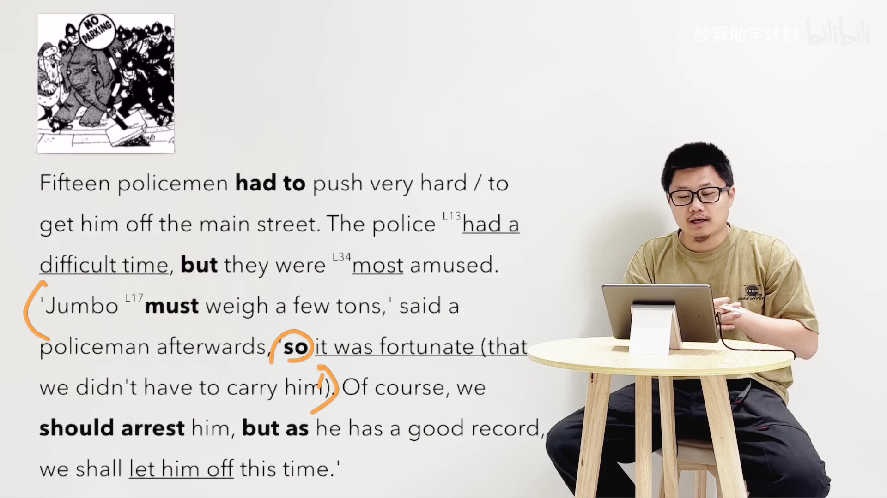

文字识别：ARKING / Fifteen policemen had to push very hard / to / get him off the main street. The police 13had a / difficult time, but they were /  L34most amused. / L34 / 'Jumbo -1"must weigh a few tons,' said a / policeman afterwards, soit was fortunate (that / we didn't have to carry hinmi) Of course, we / should arrest him, but as he has a good record, / we shall let him off this time.'

## 00:16:00–00:16:30

对吧？虽然他很重，但我们不必弄个车来拖着他走啊！不用携带他。Okay, of course,当然了。We should arrest him, but as he has a good record, we shall let him off this time.啊，这里边的he很有意思啊！我又细品了品，我觉得这个he啊，就是包括我们也看参考了一下这个参考译文，这个he指的是小象，小象啊，什么意思呢？他说警察说说，当然了，那我们应

### 画面 00:16:06

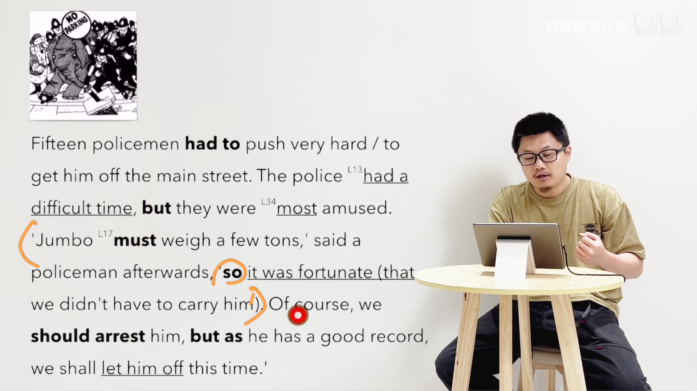

文字识别：ARKING / Fifteen policemen had to push very hard / to / get him off the main street. The police "3had a / difficult time, but they were / L34, / 'most amused. / 'Jumbo [17must weigh a few tons,' said a / policeman afterwards, soit was fortunate (that / we didn't have to carry himl) Of ourse, we / should arrest him, but as he has a good record, / we shall let him off this time.'

## 00:16:30–00:17:00

该逮捕这个小象，对吧？好，应该逮捕这个小。但是呢，因为这地方的 as 是因为 he has a good record 啊， record 这个单词咱们之前学过了，记录，对吧？他有一个很好的记录啊，很好的记录放到警察那儿就是你案底很干净，对吧？案底很干净。 We shall let him off this time. Let somebody off 叫让某人离开啊，我们就不逮捕他了啊。这个我们将让他离开这一次，对吧？所以什

### 画面 00:16:36

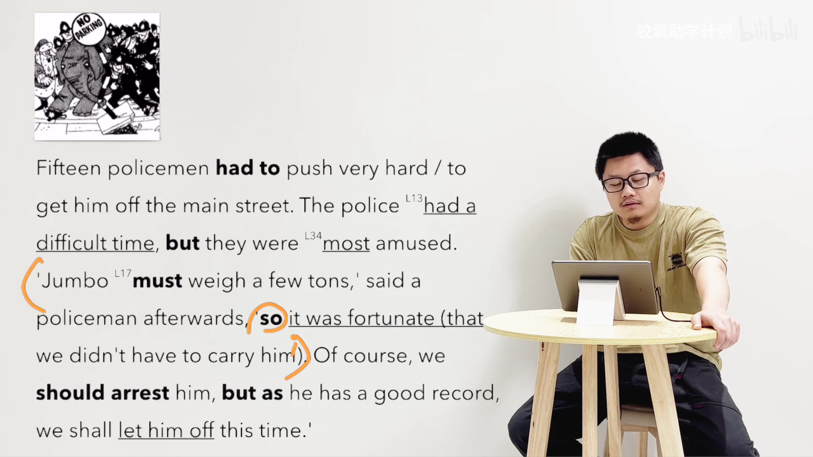

文字识别：PARKING / Fifteen policemen had to push very hard / to / get him off the main street. The police 13had a / difficult time, but they were / e L³4most amused. / L34 / 'Jumbo [17must weigh a few tons,' said a / policeman afterwards, soit was fortunate (that / we didn't have to carry himl) Of course, we / should arrest him, but as he has a good record, / we shall let him off this time.'

## 00:17:00–00:17:30

么意思呢？我觉得他是有一些那种很英国人那种小小的戏谑和幽默。就是你不可能把大象逮捕了，但是呢，我是把它当人去处理，那么去聊的。说当然了，我们应该逮捕这个大象，但是啊，案底很干净，对吧？那大象有什么案底不干净的？然后我们这次就让他走了，下回不能再犯了啊！哎，大概就是这样一种小的幽默在里面。OK，文章讲完了，习惯用法这一溜，咱挨个说。第一个，be

### 画面 00:17:06

文字识别：ARKING / Fifteen policemen had to push very hard / to / get him off the main street. The police 3had a / difficult time, but they were / L34 / most amused. / “ / 'Jumbo [17must weigh a few tons,' said a / policeman afterwards,soit was fortunate (that / we didn't have to carry himl) Of course, we / should arrest him, but as he has a good record, / we shall let him off this time.'

### 画面 00:17:25

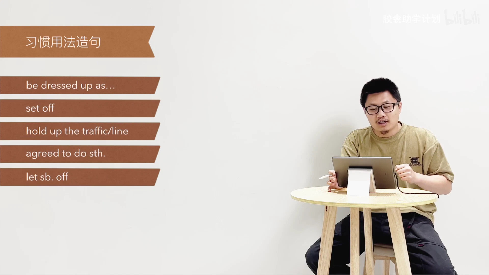

文字识别：习惯用法造句 / be dressed up as... / set off / hold up the traffic/line / agreed to do sth. / let sb.off

### 画面 00:17:27

文字识别：习惯用法造句 / be dressed up as... / set off / hold up the traffic/line / agreed to do sth. / let sb.off

### 画面 00:17:29

文字识别：网：v.+v.变化 / 习惯用法造句指南 / 四句型转换 / 方式/地点/时间 / 其他习惯用法 / 其他单词+词性 / 原文摘抄+变 / 6123456 / be dressed up as / dressed up as ...

## 00:17:30–00:18:00

dressed up as，这个是最麻烦的一个啊。这个 dressed up as 什么？一会儿我们再说。首先，你 be dressed up as 完全可以造，比如说 Why are you dressed up as a woman？注意 be dressed up as a 对吧？叫做打扮成 a。那你为什么要打扮成一个女人的样子呢？哎，我把它变成了特殊疑问句，对吧？再来，比如说 a guy dressed up as a dog was selling watches

### 画面 00:17:31

文字识别：网：v.+v.变化 / 习惯用法造句指南 / 四句型转换 / 方式/地点/时间 / 其他习惯用法 / 其他单词+词性 / 原文摘抄+变 / 6123456 / be dressed up as / dressed up as ... / 2

### 画面 00:17:34

文字识别：网：v.+v.变化 / 习惯用法造句指南 / 四句型转换 / 方式/地点/时间 / 其他习惯用法 / 其他单词+词性 / 原文摘抄+变 / 6123456 / be dressed up as / dressed up as ...

### 画面 00:17:39

文字识别：网：v.+v.变化 / 习惯用法造句指南 / 四句型转换 / 方式/地点/时间 / 其他习惯用法 / 其他单词+词性 / 原文摘抄+变 / 6123456 / be dressed up as / dressed up as ... /  Why are you dressed up as a woman?

### 画面 00:17:42

文字识别：网：v.+v.变化 / 习惯用法造句指南 / 四句型转换 / 方式/地点/时间 / 其他习惯用法 / 其他单词+词性 / 原文摘抄+变 / 6123456 / be dressed up as / dressed up as ... /  Why are you dressed up as a woman?

### 画面 00:17:44

文字识别：网：v.+v.变化 / 习惯用法造句指南 / 四句型转换 / 方式/地点/时间 / 其他习惯用法 / 其他单词+词性 / 原文摘抄+变 / 6123456 / be dressed up as / dressed up as ….. /  Why are you dressed up as a woman?

### 画面 00:17:49

文字识别：网：v.+v.变化 / 习惯用法造句指南 / 四句型转换 / 方式/地点/时间 / 其他习惯用法 / 其他单词+词性 / 原文摘抄+变 / 6123456 / be dressed up as / dressed up as ... /  Why are you dressed up as a woman?

### 画面 00:17:52

文字识别：网：v.+v.变化 / 习惯用法造句指南 / 四句型转换 / 方式/地点/时间 / 其他习惯用法 / 其他单词+词性 / 原文摘抄+变 / 6123456 / be dressed up as / dressed up as ... /  Why are you dressed up as a woman? /  A guy (dressed up as a dog) was selling / watches there.

### 画面 00:17:54

文字识别：网：v.+v.变化 / 习惯用法造句指南 / 四句型转换 / 方式/地点/时间 / 其他习惯用法 / 其他单词+词性 / 原文摘抄+变 / 6123456 / be dressed up as / dressed up as ... /  Why are you dressed up as a woman? /  A guy (dressed up as a dog) was selling / watches there.

### 画面 00:17:57

文字识别：网：v.+v.变化 / 习惯用法造句指南 / 四句型转换 / 方式/地点/时间 / 其他习惯用法 / 其他单词+词性 / 原文摘抄+变 / 6123456 / be dressed up as / dressed up as ... /  Why are you dressed up as a woman? /  A guy (dressed up as a dog) was selling / watches there.

### 画面 00:17:59

文字识别：网：v.+v.变化 / 习惯用法造句指南 / 四句型转换 / 方式/地点/时间 / 其他习惯用法 / 其他单词+词性 / 原文摘抄+变 / 6123456 / be dressed up as / dressed up as ... /  Why are you dressed up as a woman? /  A guy (dressed up as a dog) was selling / watches there.

## 00:18:00–00:18:30

there?那你看这里的dressed up as a dog，我就把be给省略掉了，看见了吧？并且这地方是但，但是在这儿它用的不是状语嘛，在这儿用的是什么？你要去想，在这个地方我们用的实际上是一个定语后置了，对吧？说叫做一个打扮成狗的男人啊，比如说他这个穿着那个充气玩充气的那个木偶，对吧？哎，充气玩具的那些东西是吧？然后呢，这毛绒玩具是吧？

### 画面 00:18:04

文字识别：网：v.+v.变化 / 习惯用法造句指南 / 四句型转换 / 方式/地点/时间 / 其他习惯用法 / 其他单词+词性 / 原文摘抄+变 / 6123456 / be dressed up as / dressed up as ... /  Why are you dressed up as a woman? /  A guy (dressed up as a dog) was selling / watches there.

### 画面 00:18:09

文字识别：网：v.+v.变化 / 习惯用法造句指南 / 四句型转换 / 方式/地点/时间 / 其他习惯用法 / 其他单词+词性 / 原文摘抄+变 / 6123456 / be dressed up as / dressed up as ... /  Why are you dressed up as a woman? /  A guy (dressed up as a dog) was selling / watches there.

### 画面 00:18:15

文字识别：网：v.+v.变化 / 习惯用法造句指南 / 四句型转换 / 方式/地点/时间 / 其他习惯用法 / 其他单词+词性 / 原文摘抄+变 / 6123456 / be dressed up as / dressed up as ... /  Why are you dressed up as a woman? /  A guy (dressed up as a dog) was selling / watches there.

### 画面 00:18:19

文字识别：网：v.+v.变化 / 习惯用法造句指南 / 四句型转换 / 方式/地点/时间 / 其他习惯用法 / 其他单词+词性 / 原文摘抄+变 / 6123456 / be dressed up as / dressed up as ... /  Why are you dressed up as a woman? /  A guy (dressed up as a dog) was selling / watches there.

### 画面 00:18:21

文字识别：网：v.+v.变化 / 习惯用法造句指南 / 四句型转换 / 方式/地点/时间 / 其他习惯用法 / 其他单词+词性 / 原文摘抄+变 / 6123456 / be dressed up as / dressed up as ... /  Why are you dressed up as a woman? /  A guy (dressed up as a dog) was selling / watches there.

### 画面 00:18:23

文字识别：网：v.+v.变化 / 习惯用法造句指南 / 四句型转换 / 方式/地点/时间 / 其他习惯用法 / 其他单词+词性 / 原文摘抄+变 / 6123456 / be dressed up as / dressed up as ... /  Why are you dressed up as a woman? /  A guy (dressed up as a dog) was selling / watches there.

### 画面 00:18:25

文字识别：网：v.+v.变化 / 习惯用法造句指南 / 四句型转换 / 方式/地点/时间 / 其他习惯用法 / 其他单词+词性 / 原文摘抄+变 / 6123456 / be dressed up as / dressed up as ... /  Why are you dressed up as a woman? /  A guy (dressed up as a dog) was selling / watches there.

### 画面 00:18:29

文字识别：网：v.+v.变化 / 习惯用法造句指南 / 四句型转换 / 方式/地点/时间 / 其他习惯用法 / 其他单词+词性 / 原文摘抄+变 / 6123456 / be dressed up as / dressed up as ... /  Why are you dressed up as a woman? /  A guy (dressed up as a dog) was selling / watches there.

## 00:18:30–00:19:00

as a dog, right, dressed up as a dog, right, dressed up as a dog. Then, he's selling a watch. Okay. Next one, say she's dressed up as an old fat man. Ah, a line from a movie. She's dressed up as an old fat man. Right. This sentence uses the phrase "be dressed up as." Right. This sentence uses the phrase "be dressed up as." Right.

### 画面 00:18:34

文字识别：网：v.+v.变化 / 习惯用法造句指南 / 四句型转换 / 方式/地点/时间 / 其他习惯用法 / 其他单词+词性 / 原文摘抄+变 / 6123456 / be dressed up as / dressed up as ... /  Why are you dressed up as a woman? /  A guy (dressed up as a dog) was selling / watches there.

### 画面 00:18:37

文字识别：网：v.+v.变化 / 习惯用法造句指南 / 四句型转换 / 方式/地点/时间 / 其他习惯用法 / 其他单词+词性 / 原文摘抄+变 / 6123456 / be dressed up as / dressed up as ….. /  Why are you dressed up as a woman? /  A guy (dressed up as a dog) was selling / watches there. /  She's dressed up as an old fat man. A Bad / Moms Christmas (2017)

### 画面 00:18:39

文字识别：网：v.+v.变化 / 习惯用法造句指南 / 四句型转换 / 方式/地点/时间 / 其他习惯用法 / 其他单词+词性 / 原文摘抄+变 / 6123456 / be dressed up as / dressed up as ….. / RON /  Why are you dressed up as a woman? /  A guy (dressed up as a dog) was selling / watches there. /  She's dressed up as an old fat man. A Bad / Moms Christmas (2017)

### 画面 00:18:42

文字识别：网：v.+v.变化 / 习惯用法造句指南 / 四句型转换 / 方式/地点/时间 / 其他习惯用法 / 其他单词+词性 / 原文摘抄+变 / 6123456 / be dressed up as / dressed up as ... /  Why are you dressed up as a woman? /  A guy (dressed up as a dog) was selling / watches there. /  She's dressed up as an old fat man. A Bad / Moms Christmas (2017)

### 画面 00:18:44

文字识别：网：v.+v.变化 / 习惯用法造句指南 / 四句型转换 / 方式/地点/时间 / 其他习惯用法 / 其他单词+词性 / 原文摘抄+变 / 6123456 / be dressed up as / dressed up as ….. /  Why are you dressed up as a woman? /  A guy (dressed up as a dog) was selling / watches there. /  She's dressed up as an old fat man.A Bad / Moms Christmas (2017)

### 画面 00:18:47

文字识别：网：v.+v.变化 / 习惯用法造句指南 / 四句型转换 / 方式/地点/时间 / 其他习惯用法 / 其他单词+词性 / 原文摘抄+变 / 6123456 / be dressed up as / dressed up as ….. /  Why are you dressed up as a woman? /  A guy (dressed up as a dog) was selling / watches there. /  She's dressed up as an old fat man. A Bad / Moms Christmas (2017)

### 画面 00:18:49

文字识别：网：v.+v.变化 / 习惯用法造句指南 / 四句型转换 / 方式/地点/时间 / 其他习惯用法 / 其他单词+词性 / 原文摘抄+变 / 6123456 / be dressed up as / dressed up as ... /  Why are you dressed up as a woman? /  A guy (dressed up as a dog) was selling / watches there. /  She's dressed up as an old fat man.A Bad / Moms Christmas (2017)

### 画面 00:18:51

文字识别：网：v.+v.变化 / 习惯用法造句指南 / 四句型转换 / 方式/地点/时间 / 其他习惯用法 / 其他单词+词性 / 原文摘抄+变 / 6123456 / be dressed up as / dressed up as ….. /  Why are you dressed up as a woman? /  A guy (dressed up as a dog) was selling / watches there. /  She's dressed up as an old fat man. A Bad / Moms Christmas (2017)

### 画面 00:18:54

文字识别：网：v.+v.变化 / 习惯用法造句指南 / 四句型转换 / 方式/地点/时间 / 其他习惯用法 / 其他单词+词性 / 原文摘抄+变 / 6123456 / be dressed up as / dressed up as /  Why are you dressed up as a woman? /  A guy (dressed up as a dog) was selling / watches there. /  She's dressed up as an old fat man.A Bad / Moms Christmas (2017)

### 画面 00:18:56

文字识别：网：v.+v.变化 / 习惯用法造句指南 / 四句型转换 / 方式/地点/时间 / 其他习惯用法 / 其他单词+词性 / 原文摘抄+变 / 6123456 / be dressed up as / dressed up as ... /  Why are you dressed up as a woman? /  A guy (dressed up as a dog) was selling / watches there. /  She's dressed up as an old fat man. A Bad / Moms Christmas (2017)

### 画面 00:18:58

文字识别：网：v.+v.变化 / 习惯用法 / 四句型转换 / 方式/地点/时间 / 么造句指南 / 其他习惯用法 / 其他单词+词性 / 原文摘抄+变 / 6123456 / be dressed up as / dressed up as ….. /  Why are you dressed up as a woman? /  A guy (dressed up as a dog) was selling / watches there. /  She's dressed up as an old fat man.A Bad / Moms Christmas (2017) / I think he is the guy who dressed up as a Santa.

## 00:19:00–00:19:30

叫做 I think he's the guy who dressed up as a Santa. 我可以说成 Who is dressed up as a Santa? 也可以直接说 Who dressed up as a Santa? 啊，这个地方稍微有点麻烦，但是都可以用啊。就是跟各位说一下，那 Santa 就是呃比那个 Christmas Father 更常用的一个表示圣诞老人的短语。口语当中一般就是 Santa Claus, Santa，是吧？那注意力集中，咱们看一下这个电影片段啊。看之

### 画面 00:19:00

文字识别：网：v.+v.变化 / 习惯 / 四句型转换 / 用 / 方式/地点/时间 / 法 / 么造句指南 / 其他习惯用法 / 其他单词+词性 / 原文摘抄+变 / 6123456 / be dressed up as / dressed up as ... /  Why are you dressed up as a woman? /  A guy (dressed up as a dog) was selling / watches there. /  She's dressed up as an old fat man. A Bad / Moms Christmas (2017) / I think he is the guy who dressed up as a Santa.

### 画面 00:19:02

文字识别：网：v.+v.变化 / 习惯用 / 四句型转换 / 方式/地点/时间 / 法 / 么造句指南 / 其他习惯用法 / 其他单词+词性 / 原文摘抄+变 / 6123456 / be dressed up as / dressed up as ... /  Why are you dressed up as a woman? /  A guy (dressed up as a dog) was selling / watches there. /  She's dressed up as an old fat man.A Bad / Moms Christmas (2017) /  I think he is the guy who dressed up as a Santa.

### 画面 00:19:04

文字识别：网：v.+v.变化 / 习惯用法造句指南 / 四句型转换 / 方式/地点/时间 / 其他习惯用法 / 其他单词+词性 / 原文摘抄+变 / 6123456 / be dressed up as / dressed up as ….. /  Why are you dressed up as a woman? /  A guy (dressed up as a dog) was selling / watches there. /  She's dressed up as an old fat man.A Bad / Moms Christmas (2017) / I think he is the guy who dressed up as a Santa.

### 画面 00:19:11

文字识别：网：v.+v.变化 / 习惯用法造句指南 / 四句型转换 / 方式/地点/时间 / 其他习惯用法 / 其他单词+词性 / 原文摘抄+变 / 6123456 / be dressed up as / dressed up as ….. /  Why are you dressed up as a woman? /  A guy (dressed up as a dog) was selling / watches there. /  She's dressed up as an old fat man. A Bad / Moms Christmas (2017) / I think he is the guy who dressed up as a Santa.

### 画面 00:19:13

文字识别：网：v.+v.变化 / 习惯用法造句指南 / 四句型转换 / 方式/地点/时间 / 其他习惯用法 / 其他单词+词性 / 原文摘抄+变 / 6123456 / be dressed up as / dressed up as ….. /  Why are you dressed up as a woman? /  A guy (dressed up as a dog) was selling / watches there. /  She's dressed up as an old fat man. A Bad / Moms Christmas (2017) / I think he is the guy who dressed up as a Santa.

### 画面 00:19:15

文字识别：网：v.+v.变化 / 习惯用法造句指南 / 四句型转换 / 方式/地点/时间 / 其他习惯用法 / 其他单词+词性 / 原文摘抄+变 / 6123456 / be dressed up as / dressed up as ….. /  Why are you dressed up as a woman? /  A guy (dressed up as a dog) was selling / watches there. /  She's dressed up as an old fat man. A Bad / Moms Christmas (2017) / I think he is the guy who dressed up as a Santa.

### 画面 00:19:18

文字识别：网：v.+v.变化 / 习惯 / 四句型转换 / 用 / 方式/地点/时间 / 法 / 么造句指南 / 其他习惯用法 / 其他单词+词性 / 原文摘抄+变 / 6123456 / be dressed up as / dressed up as ... /  Why are you dressed up as a woman? /  A guy (dressed up as a dog) was selling / watches there. /  She's dressed up as an old fat man.A Bad / Moms Christmas (2017) / I think he is the guy who dressed up as a Santa.

### 画面 00:19:20

文字识别：网：v.+v.变化 / 习惯用法 / 四句型转换 / 方式/地点/时间 / 么造句指南 / 其他习惯用法 / 其他单词+词性 / 原文摘抄+变 / 6123456 / be dressed up as / dressed up as .. /  Why are you dressed up as a woman? /  A guy (dressed up as a dog) was selling / watches there. /  She's dressed up as an old fat man.A Bad / Moms Christmas (2017) / I think he is the guy who dressed up as a Santa.

### 画面 00:19:22

文字识别：网：v.+v.变化 / 习惯用法造句指南 / 四句型转换 / 方式/地点/时间 / 其他习惯用法 / 其他单词+词性 / 原文摘抄+变 / 6123456 / be dressed up as / dressed up as ….. /  Why are you dressed up as a woman? /  A guy (dressed up as a dog) was selling / watches there. /  She's dressed up as an old fat man.A Bad / Moms Christmas (2017) / I think he is the guy who dressed up as a Santa.

### 画面 00:19:24

文字识别：网：v.+v.变化 / 习惯用法 / 四句型转换 / 方式/地点/时间 / 么造句指南 / 其他习惯用法 / 其他单词+词性 / 原文摘抄+变 / 6123456 / be dressed up as / dressed up as .. /  Why are you dressed up as a woman? /  A guy (dressed up as a dog) was selling / watches there. /  She's dressed up as an old fat man.A Bad / Moms Christmas (2017) / I think he is the guy who dressed up as a Santa.

### 画面 00:19:26

文字识别：Last year, attended a Halloween party / dressed up as Lady Gaga. / The Campaign / (2012)

## 00:19:30–00:20:00

前我先说一下，比如 last year I attended a Halloween party dressed up as Lady Gaga. Lady Gaga是谁？您就自己去查了，一个歌手，对吧？说我 attended，我参加了一个 Halloween party啊！前两天不是刚过去嘛，万圣节，对吧？然后打扮成了 Lady Gaga，是吧？注意力集中，我们听一下。 Last year I attended a Halloween party dressed up as Lady Gaga. Okay,

### 画面 00:19:30

文字识别：Last year, attended a Halloween party / dressed up as Lady Gaga. / The Campaign / (2012)

### 画面 00:19:39

文字识别：Last year, attended a Halloween party / dressed up as Lady Gaga. / The Campaign / (2012)

### 画面 00:19:53

文字识别：Last year, attended a Halloween party / dressed up as Lady Gaga. / The Campaign / (2012)

### 画面 00:19:55

文字识别：Last year, attended a Halloween party / dressed up as Lady Gaga. / eisen / SPORTS / LOCALPTCIER / DRAIED / NORTH CAROLINA / The Campaign / (2012)

### 画面 00:19:57

文字识别：Last year, attended a Halloween party / dressed up as Lady Gaga. / eisen / SPORTS / LOCALPTCHER / DRAFIFD / NORTH CAROLINA / The Campaign / (2012)

### 画面 00:19:59

文字识别：网：v.+v.变化 / 习惯用法造句指南 / 四句型转换 / 方式/地点/时间 / 其他习惯用法 / 其他单词+词性 / 原文摘抄+变 / 6123456 / set off L12 set out

## 00:20:00–00:20:30

next one. Set off.呃，跟我们十二课那课叫 Captain, my captain,是吧？这个船长那课是一样的。那课学的是 set out,啊, set off是一样。比如说, we will set off at eight o'clock.那课是 we will set out at eight o'clock,对吧？啊，然后四句型转换啊，很容易。再来，比如说, when will you set off tomorrow?明天你什么时候离开，出发，对吧？Set off.啊, set off不是只有出发的意思，有很多意思啊，但是可

### 画面 00:20:01

文字识别：网：v.+v.变化 / 习惯用法造句指南 / 四句型转换 / 方式/地点/时间 / 其他习惯用法 / 其他单词+词性 / 原文摘抄+变 / 6123456 / set off L12 set out

### 画面 00:20:03

文字识别：网：v.+v.变化 / 习惯用法造句指南 / 四句型转换 / 方式/地点/时间 / 其他习惯用法 / 其他单词+词性 / 原文摘抄+变 / 6123456 / set off L12 set out

### 画面 00:20:05

文字识别：网：v.+v.变化 / 习惯用法造句指南 / 四句型转换 / 方式/地点/时间 / 其他习惯用法 / 其他单词+词性 / 原文摘抄+变 / 6123456 / set off L12 set out

### 画面 00:20:10

文字识别：网：v.+v.变化 / 习惯用法造句指南 / 四句型转换 / 方式/地点/时间 / 其他习惯用法 / 其他单词+词性 / 原文摘抄+变 / 6123456 / set off L12 set out /  We will set off at eight o'clock.

### 画面 00:20:12

文字识别：网：v.+v.变化 / 习惯用法造句指南 / 四句型转换 / 方式/地点/时间 / 其他习惯用法 / 其他单词+词性 / 原文摘抄+变 / 6123456 / set off L12 set out /  We will set off at eight o'clock.

### 画面 00:20:15

文字识别：网：v.+v.变化 / 习惯用法造句指南 / 四句型转换 / 方式/地点/时间 / 其他习惯用法 / 其他单词+词性 / 原文摘抄+变 / 6123456 / set off L12 set out /  We will set off at eight o'clock.

### 画面 00:20:19

文字识别：网：v.+v.变化 / 习惯用法造句指南 / 四句型转换 / 方式/地点/时间 / 其他习惯用法 / 其他单词+词性 / 原文摘抄+变 / 6123456 / set off L12 set out /  We will set off at eight o'clock. /  will/when/who/why... /  When will you set off tomorrow?

### 画面 00:20:21

文字识别：网：v.+v.变化 / 习惯用法造句指南 / 四句型转换 / 方式/地点/时间 / 其他习惯用法 / 其他单词+词性 / 原文摘抄+变 / 6123456 / set off L12 set out /  We will set off at eight o'clock. /  will/when/who/why... /  When will you set off tomorrow?

### 画面 00:20:25

文字识别：网：v.+v.变化 / 习惯用法造句指南 / 四句型转换 / 方式/地点/时间 / 其他习惯用法 / 其他单词+词性 / 原文摘抄+变 / 6123456 / set off L12 set out /  We will set off at eight o'clock. /  will/when/who/why... /  When will you set off tomorrow?

## 00:20:30–00:21:00

以当做出发去讲，没有问题。呃，那注意力集中，我们听一个电影片段吧。A small group of us set off to find a new home. 这个我们当中的一小组人啊，一小群人出发去找到去找一个新的家园，对吧？OK。接下来，hold up the traffic. Hold up the traffic. 其实并不是口语当中最常见的。那我要给各位补充一个口语当中啊，包括你将来去做听力啊，我之

### 画面 00:20:30

文字识别：网：v.+v.变化 / 习惯用法造句指南 / 四句型转换 / 方式/地点/时间 / 其他习惯用法 / 其他单词+词性 / 原文摘抄+变 / 6123456 / set off L12 set out /  We will set off at eight o'clock. /  will/when/who/why... /  When will you set off tomorrow?

### 画面 00:20:32

文字识别：A small group of us set off to find a new home. / Star Trek: Insurrection / (1998)

### 画面 00:20:37

文字识别：A small group of us set off to find a new home. / Star Trek: Insurrection / (1998)

### 画面 00:20:39

文字识别：A small group of us set off to find a new home. / Star Trek: Insurrection / (1998)

### 画面 00:20:47

文字识别：网：v.+v.变化 / 习惯用法造句指南 / 四句型转换 / 方式/地点/时间 / 其他习惯用法 / 其他单词+词性 / 原文摘抄+变 / 6123456 / hold up the traffic/line

### 画面 00:20:49

文字识别：网：v.+v.变化 / 习惯用法造句指南 / 四句型转换 / 方式/地点/时间 / 其他习惯用法 / 其他单词+词性 / 原文摘抄+变 / 6123456 / hold up the traffic/line

### 画面 00:20:51

文字识别：网：v.+v.变化 / 习惯用法造句指南 / 四句型转换 / 方式/地点/时间 / 其他习惯用法 / 其他单词+词性 / 原文摘抄+变 / 6123456 / hold up the traffic/line

### 画面 00:20:55

文字识别：网：v.+v.变化 / 习惯用法造句指南 / 四句型转换 / 方式/地点/时间 / 其他习惯用法 / 其他单词+词性 / 原文摘抄+变 / 6123456 / hold up the traffic/line

## 00:21:00–00:21:30

前一直说口语当中常见，听力当中必然常见。那 hold up the traffic 最常见的另一个叫 hold up the line，对吧？Line 是什么？Waiting in line。之前咱们学过排队等着。那 hold up the line 就是你原来叫阻碍交通了，你现在不就是？比如说前面有一个人磨磨唧唧，磨磨唧唧，磨磨唧唧，对吧？别人两分钟完事儿了，他二十分钟还没完事儿呢。他这个动作就阻碍大家排队啊！这个排队往前走不往前走了，对吧？Hold up the

### 画面 00:21:00

文字识别：网：v.+v.变化 / 习惯用法造句指南 / 四句型转换 / 方式/地点/时间 / 其他习惯用法 / 其他单词+词性 / 原文摘抄+变 / 6123456 / hold up the traffic/line

### 画面 00:21:05

文字识别：网：v.+v.变化 / 习惯用法造句指南 / 四句型转换 / 方式/地点/时间 / 其他习惯用法 / 其他单词+词性 / 原文摘抄+变 / 6123456 / hold up the traffic/line

### 画面 00:21:10

文字识别：网：v.+v.变化 / 习惯用法造句指南 / 四句型转换 / 方式/地点/时间 / 其他习惯用法 / 其他单词+词性 / 原文摘抄+变 / 6123456 / hold up the traffic/line

### 画面 00:21:15

文字识别：网：v.+v.变化 / 习惯用法造句指南 / 四句型转换 / 方式/地点/时间 / 其他习惯用法 / 其他单词+词性 / 原文摘抄+变 / 6123456 / hold up the traffic/line

### 画面 00:21:17

文字识别：网：v.+v.变化 / 习惯用法造句指南 / 四句型转换 / 方式/地点/时间 / 其他习惯用法 / 其他单词+词性 / 原文摘抄+变 / 6123456 / hold up the traffic/line

### 画面 00:21:20

文字识别：网：v.+v.变化 / 习惯用法造句指南 / 四句型转换 / 方式/地点/时间 / 其他习惯用法 / 其他单词+词性 / 原文摘抄+变 / 6123456 / hold up the traffic/line / ROM

### 画面 00:21:23

文字识别：网：v.+v.变化 / 习惯用法造句指南 / 四句型转换 / 方式/地点/时间 / 其他习惯用法 / 其他单词+词性 / 原文摘抄+变 / 6123456 / hold up the traffic/line

### 画面 00:21:25

文字识别：网：v.+v.变化 / 习惯用法造句指南 / 四句型转换 / 方式/地点/时间 / 其他习惯用法 / 其他单词+词性 / 原文摘抄+变 / 6123456 / hold up the traffic/line / ROM

## 00:21:30–00:22:00

Okay. 那你看，我们造一句话说, Move, man, you're holding up the traffic. 当然，这地方我用的是 traffic，是吧？你别停这儿啊，开呀，你这阻塞交通了，兄弟，对吧？再来说, Don't hold up the line. 说赶紧走啊，不要阻碍这个排队，对吧？哎，赶紧往前排呀。 Okay. 再来说, It's said that someone is holding up the line. 说据说前面有人啊，正在这个阻碍这个排队，是吧？就是这个影响大家排队啊，就是他磨磨唧唧

### 画面 00:21:31

文字识别：网：v.+v.变化 / 习惯用法造句指南 / 四句型转换 / 方式/地点/时间 / 其他习惯用法 / 其他单词+词性 / 原文摘抄+变 / 6123456 / hold up the traffic/line /  Move man! You're holding up the traffic.

### 画面 00:21:34

文字识别：网：v.+v.变化 / 习惯用法造句指南 / 四句型转换 / 方式/地点/时间 / 其他习惯用法 / 其他单词+词性 / 原文摘抄+变 / 6123456 / hold up the traffic/line /  Move man! You're holding up the traffic.

### 画面 00:21:36

文字识别：网：v.+v.变化 / 习惯用法造句指南 / 四句型转换 / 方式/地点/时间 / 其他习惯用法 / 其他单词+词性 / 原文摘抄+变 / 6123456 / hold up the traffic/line /  Move man! You're holding up the traffic.

### 画面 00:21:40

文字识别：网：v.+v.变化 / 习惯用法造句指南 / 四句型转换 / 方式/地点/时间 / 其他习惯用法 / 其他单词+词性 / 原文摘抄+变 / 6123456 / hold up the traffic/line /  Move man! You're holding up the traffic.

### 画面 00:21:45

文字识别：网：v.+v.变化 / 习惯用法造句指南 / 四句型转换 / 方式/地点/时间 / 其他习惯用法 / 其他单词+词性 / 原文摘抄+变 / 6123456 / hold up the traffic/line /  Move man! You're holding up the traffic. /  Don't hold up the line.

### 画面 00:21:49

文字识别：网：v.+v.变化 / 习惯用法造句指南 / 四句型转换 / 方式/地点/时间 / 其他习惯用法 / 其他单词+词性 / 原文摘抄+变 / 6123456 / hold up the traffic/line /  Move man! You're holding up the traffic. /  Don't hold up the line. /  It's said that someone is holding up the / line. L58

### 画面 00:21:51

文字识别：网：v.+v.变化 / 习惯用法造句指南 / 四句型转换 / 方式/地点/时间 / 其他习惯用法 / 其他单词+词性 / 原文摘抄+变 / 6123456 / hold up the traffic/line /  Move man! You're holding up the traffic. /  Don't hold up the line. /  It's said that someone is holding up the / line.L58

### 画面 00:21:55

文字识别：网：v.+v.变化 / 习惯用法造句指南 / 四句型转换 / 方式/地点/时间 / 其他习惯用法 / 其他单词+词性 / 原文摘抄+变 / 6123456 / hold up the traffic/line /  Move man! You're holding up the traffic. / Don't hold up the line. /  It's said that someone is holding up the / line.L58

## 00:22:00–00:22:30

没完没了的啊， hold up the line，对，让这个队排不下去了。 Okay，当然这个 is that that 是五十八课咱们学的。接下来呢，你直接看这个电影片段就非常好，对吧？有这个过安检，有一个人站在那儿不动了啊， you are holding up the line，对吧？ Hey， wake up， buddy， you're holding up the line。 Okay，下一个 agree to do，当然你不一定非得是过去式啊，只是我们原文用的是过去式。呃， he might agree to meet you，他也

### 画面 00:22:00

文字识别：网：v.+v.变化 / 习惯用法造句指南 / 四句型转换 / 方式/地点/时间 / 其他习惯用法 / 其他单词+词性 / 原文摘抄+变 / 6123456 / hold up the traffic/line /  Move man! You're holding up the traffic. /  Don't hold up the line. / ■ It's said that someone is holding up the / line.L58

### 画面 00:22:03

文字识别：网：v.+v.变化 / 习惯用法造句指南 / 四句型转换 / 方式/地点/时间 / 其他习惯用法 / 其他单词+词性 / 原文摘抄+变 / 6123456 / hold up the traffic/line /  Move man! You're holding up the traffic. /  Don't hold up the line. / ■ It's said that someone is holding up the / line.L58

### 画面 00:22:05

文字识别：网：v.+v.变化 / 习惯用法造句指南 / 四句型转换 / 方式/地点/时间 / 其他习惯用法 / 其他单词+词性 / 原文摘抄+变 / 6123456 / hold up the traffic/line /  Move man! You're holding up the traffic. /  Don't hold up the line. /  It's said that someone is holding up the / line. L58

### 画面 00:22:07

文字识别：Hey, wake up, buddy. Come on, / you're holding up the line. / The Goldfinch / (2019)

### 画面 00:22:09

文字识别：Hey, wake up, buddy. Come on, / you're holding up the line. / The Goldfinch / (2019)

### 画面 00:22:14

文字识别：Hey, wake up, buddy. Come on, / you're holding up the line. / The Goldfinch / (2019)

### 画面 00:22:16

文字识别：Hey, wake up, buddy. Come on, / you're holding up the line. / The Goldfinch / (2019)

### 画面 00:22:18

文字识别：Hey, wake up, buddy. Come on, / you're holding up the line. / The Goldfinch / (2019)

### 画面 00:22:20

文字识别：网：v.+v.变化 / 习惯用法造句指南 / 四句型转换 / 方式/地点/时间 / 其他习惯用法 / 其他单词+词性 / 原文摘抄+变 / 6123456 / agreed to do sth.

### 画面 00:22:25

文字识别：网：v.+v.变化 / 习惯用法造句指南 / 四句型转换 / 方式/地点/时间 / 其他习惯用法 / 其他单词+词性 / 原文摘抄+变 / 6123456 / agreed to do sth. /  He might agree to meet you. L19

## 00:22:30–00:23:00

也许会同意见你. Agree to do something. 那这个might复习了一下十九课，也许. The Wickers agree to visit you. 哎，这个P.S.注意是has，啊，这个教区的牧师Wickers是之前咱们学的单词对吧？我结合了一下其他的单词，说这个牧师啊已经怎么样了呢？同意来拜访你了，是吧？同意来看看你。再来，这个agree，它否定agree to do something，

### 画面 00:22:30

文字识别：网：v.+v.变化 / 习惯用法造句指南 / 四句型转换 / 方式/地点/时间 / 其他习惯用法 / 其他单词+词性 / 原文摘抄+变 / 6123456 / agreed to do sth. /  He might agree to meet you. L19

### 画面 00:22:35

文字识别：网：v.+v.变化 / 习惯用法造句指南 / 四句型转换 / 方式/地点/时间 / 其他习惯用法 / 其他单词+词性 / 原文摘抄+变 / 6123456 / agreed to do sth. /  He might agree to meet you. L19

### 画面 00:22:37

文字识别：网：v.+v.变化 / 习惯用法造句指南 / 四句型转换 / 方式/地点/时间 / 其他习惯用法 / 其他单词+词性 / 原文摘抄+变 / 6123456 / agreed to do sth. /  He might agree to meet you. L19 /  The vicar's agreed to visit you.

### 画面 00:22:39

文字识别：网：v.+v.变化 / 习惯用法造句指南 / 四句型转换 / 方式/地点/时间 / 其他习惯用法 / 其他单词+词性 / 原文摘抄+变 / 6123456 / agreed to do sth. / FROM /  He might agree to meet you. L19 /  The vicar's agreed to visit you.

### 画面 00:22:41

文字识别：网：v.+v.变化 / 习惯用法造句指南 / 四句型转换 / 方式/地点/时间 / 其他习惯用法 / 其他单词+词性 / 原文摘抄+变 / 6123456 / agreed to do sth. /  He might agree to meet you. L19 /  The vicar's agreed to visit you.

### 画面 00:22:44

文字识别：网：v.+v.变化 / 习惯用法造句指南 / 四句型转换 / 方式/地点/时间 / 其他习惯用法 / 其他单词+词性 / 原文摘抄+变 / 6123456 / agreed to do sth. /  He might agree to meet you. L19 /  The vicar's agreed to visit you.

### 画面 00:22:46

文字识别：网：v.+v.变化 / 习惯用法造句指南 / 四句型转换 / 方式/地点/时间 / 其他习惯用法 / 其他单词+词性 / 原文摘抄+变 / 6123456 / agreed to do sth. /  He might agree to meet you. L19 /  The vicar's agreed to visit you.

### 画面 00:22:50

文字识别：网：v.+v.变化 / 习惯用法造句指南 / 四句型转换 / 方式/地点/时间 / 其他习惯用法 / 其他单词+词性 / 原文摘抄+变 / 6123456 / agreed to do sth. /  He might agree to meet you. L19 /  The vicar's agreed to visit you.

### 画面 00:22:55

文字识别：网：v.+v.变化 / 习惯用法造句指南 / 四句型转换 / 方式/地点/时间 / 其他习惯用法 / 其他单词+词性 / 原文摘抄+变 / 6123456 / agreed to do sth. /  He might agree to meet you. L19 /  The vicar's agreed to visit you.

## 00:23:00–00:23:30

他的否定可以变成agree not to do something,对吧？哎，你比如说, you agreed not to make a sound,是吧？说你同意了，不去制造任何声响。五六课make a sound, OK.大家注意力集中，我们看这个电影片段。Do not tell me that's the reason you agreed to come this weekend. Very good. Let somebody off,让某人走。Why did they let him off?啊，他偷东西了，为什么他们让他就走

### 画面 00:23:00

文字识别：网：v.+v.变化 / 习惯用法造句指南 / 四句型转换 / 方式/地点/时间 / 其他习惯用法 / 其他单词+词性 / 原文摘抄+变 / 6123456 / agreed to do sth. /  He might agree to meet you. L19 /  The vicar's agreed to visit you. /  You agreed not to make a sound. L56

### 画面 00:23:03

文字识别：网：v.+v.变化 / 习惯用法造句指南 / 四句型转换 / 方式/地点/时间 / 其他习惯用法 / 其他单词+词性 / 原文摘抄+变 / 6123456 / agreed to do sth. /  He might agree to meet you. L19 /  The vicar's agreed to visit you. /  You agreed not to make a sound. L56

### 画面 00:23:05

文字识别：网：v.+v.变化 / 习惯用法造句指南 / 四句型转换 / 方式/地点/时间 / 其他习惯用法 / 其他单词+词性 / 原文摘抄+变 / 6123456 / agreed to do sth. /  He might agree to meet you. L19 /  The vicar's agreed to visit you. /  You agreed not to make a sound. L56

### 画面 00:23:09

文字识别：网：v.+v.变化 / 习惯用法造句指南 / 四句型转换 / 方式/地点/时间 / 其他习惯用法 / 其他单词+词性 / 原文摘抄+变 / 6123456 / agreed to do sth. /  He might agree to meet you. L19 /  The vicar's agreed to visit you. /  You agreed not to make a sound. L56

### 画面 00:23:11

文字识别：网：v.+v.变化 / 习惯用法造句指南 / 四句型转换 / 方式/地点/时间 / 其他习惯用法 / 其他单词+词性 / 原文摘抄+变 / 6123456 / agreed to do sth. /  He might agree to meet you. L19 /  The vicar's agreed to visit you. /  You agreed not to make a sound. L56

### 画面 00:23:14

文字识别：Do not tell me that's the reason / you agreed to come this weekend. / ALP-947 / Secrets in the Fall / (2015)

### 画面 00:23:18

文字识别：Do not tell me that's the reason / you agreed to come this weekend. / Secrets in the Fall / (2015)

### 画面 00:23:20

文字识别：Do not tell me that's the reason / you agreed to come this weekend. / Secrets in the Fall / (2015)

### 画面 00:23:22

文字识别：网：v.+v.变化 / 习惯用法造句指南 / 四句型转换 / 方式/地点/时间 / 其他习惯用法 / 其他单词+词性 / 原文摘抄+变 / 6123456 / let sb.off

### 画面 00:23:24

文字识别：网：v.+v.变化 / 习惯用法造句指南 / 四句型转换 / 方式/地点/时间 / 其他习惯用法 / 其他单词+词性 / 原文摘抄+变 / 6123456 / let sb. off /  Why did they let him off?

### 画面 00:23:26

文字识别：网：v.+v.变化 / 习惯用法造句指南 / 四句型转换 / 方式/地点/时间 / 其他习惯用法 / 其他单词+词性 / 原文摘抄+变 / 6123456 / let sb.off /  Why did they let him off?

## 00:23:30–00:24:00

了呢？特殊疑问句，再来。It was you who let him off, not me.说你现在后悔了，说当是你把他给放跑了的，可不是我。五十八课强调句。If you hadn't let him off, we would have got the money.说如果你当时没有给他放跑啊，假设比如说你是赏金猎人，是吧？我不知道各位知不知道什么是赏金猎人啊？如果假设你是赏金

### 画面 00:23:30

文字识别：网：v.+v.变化 / 习惯用法造句指南 / 四句型转换 / 方式/地点/时间 / 其他习惯用法 / 其他单词+词性 / 原文摘抄+变 / 6123456 / let sb. off /  Why did they let him off?

### 画面 00:23:32

文字识别：网：v.+v.变化 / 习惯用法造句指南 / 四句型转换 / 方式/地点/时间 / 其他习惯用法 / 其他单词+词性 / 原文摘抄+变 / 6123456 / let sb.off /  Why did they let him off? /  It was you who let him off, not me!!! L58

### 画面 00:23:34

文字识别：网：v.+v.变化 / 习惯用法造句指南 / 四句型转换 / 方式/地点/时间 / 其他习惯用法 / 其他单词+词性 / 原文摘抄+变 / 6123456 / let sb.off /  Why did they let him off? /  It was you who let him off, not mel!! L58

### 画面 00:23:36

文字识别：网：v.+v.变化 / 习惯用法造句指南 / 四句型转换 / 方式/地点/时间 / 其他习惯用法 / 其他单词+词性 / 原文摘抄+变 / 6123456 / let sb.off /  Why did they let him off? /  It was you who let him off, not me!!! L58

### 画面 00:23:38

文字识别：网：v.+v.变化 / 习惯用法造句指南 / 四句型转换 / 方式/地点/时间 / 其他习惯用法 / 其他单词+词性 / 原文摘抄+变 / 6123456 / let sb.off /  Why did they let him off? /  It was you who let him off, not mel!! L58

### 画面 00:23:40

文字识别：网：v.+v.变化 / 习惯用法造句指南 / 四句型转换 / 方式/地点/时间 / 其他习惯用法 / 其他单词+词性 / 原文摘抄+变 / 6123456 / let sb.off /  Why did they let him off? /  It was you who let him off, not me!!! L58

### 画面 00:23:42

文字识别：网：v.+v.变化 / 习惯用法造句指南 / 四句型转换 / 方式/地点/时间 / 其他习惯用法 / 其他单词+词性 / 原文摘抄+变 / 6123456 / let sb.off /  Why did they let him off? /  It was you who let him off, not me!!! L58

### 画面 00:23:44

文字识别：网：v.+v.变化 / 习惯用法造句指南 / 四句型转换 / 方式/地点/时间 / 其他习惯用法 / 其他单词+词性 / 原文摘抄+变 / 6123456 / let sb.off /  Why did they let him off? /  It was you who let him off, not me!!! L58 /  If you hadn't let him off, we would have / got the money. L64

### 画面 00:23:46

文字识别：网：v.+v.变化 / 习惯用法造句指南 / 四句型转换 / 方式/地点/时间 / 其他习惯用法 / 其他单词+词性 / 原文摘抄+变 / 6123456 / let sb. off /  Why did they let him off? /  It was you who let him off, not me!!! L58 /  If you hadn't let him off, we would have / got the money. L64

### 画面 00:23:48

文字识别：网：v.+v.变化 / 习惯用法造句指南 / 四句型转换 / 方式/地点/时间 / 其他习惯用法 / 其他单词+词性 / 原文摘抄+变 / 6123456 / let sb. off /  Why did they let him off? /  It was you who let him off, not me!!! L58 /  If you hadn't let him off, we would have / got the money. L64

### 画面 00:23:50

文字识别：网：v.+v.变化 / 习惯用法造句指南 / 四句型转换 / 方式/地点/时间 / 其他习惯用法 / 其他单词+词性 / 原文摘抄+变 / 6123456 / let sb.off /  Why did they let him off? /  It was you who let him off, not me!!! L58 /  If you hadn't let him off, we would have / got the money. L64

### 画面 00:23:52

文字识别：网：v.+v.变化 / 习惯用法造句指南 / 四句型转换 / 方式/地点/时间 / 其他习惯用法 / 其他单词+词性 / 原文摘抄+变 / 6123456 / let sb.off /  Why did they let him off? /  It was you who let him off, not me!!! L58 /  If you hadn't let him off, we would have / got the money. L64

### 画面 00:23:55

文字识别：网：v.+v.变化 / 习惯用法造句指南 / 四句型转换 / 方式/地点/时间 / 其他习惯用法 / 其他单词+词性 / 原文摘抄+变 / 6123456 / let sb.off /  Why did they let him off? /  It was you who let him off, not me!!! L58 /  If you hadn't let him off, we would have / got the money. L64

## 00:24:00–00:24:30

猎人，啊说这个你们是合伙人对吧？说如果不是你当时把他给放跑了，我们现在就啊我说我们当时就拿到钱了对吧？虚拟语气 hadn't done would have done OK，那儿一个哎，注意力集中，我们看这个电影片段啊。 Officer, let him off. He's not hurting anyone. There you go. Recap本课文章以外习惯用法肯定是要造句的对吧？第一个作业造句子

### 画面 00:24:00

文字识别：网：v.+v.变化 / 习惯用法造句指南 / 四句型转换 / 方式/地点/时间 / 其他习惯用法 / 其他单词+词性 / 原文摘抄+变 / 6123456 / let sb.off /  Why did they let him off? /  It was you who let him off, not me!!! L58 /  If you hadn't let him off, we would have / got the money. L64

### 画面 00:24:03

文字识别：网：v.+v.变化 / 习惯用法造句指南 / 四句型转换 / 方式/地点/时间 / 其他习惯用法 / 其他单词+词性 / 原文摘抄+变 / 6123456 / let sb.off /  Why did they let him off? /  It was you who let him off, not me!!! L58 /  If you hadn't let him off, we would have / got the money. L64

### 画面 00:24:05

文字识别：网：v.+v.变化 / 习惯用法造句指南 / 四句型转换 / 方式/地点/时间 / 其他习惯用法 / 其他单词+词性 / 原文摘抄+变 / 6123456 / let sb. off /  Why did they let him off? /  It was you who let him off, not me!!! L58 /  If you hadn't let him off, we would have / got the money. L64

### 画面 00:24:10

文字识别：网：v.+v.变化 / 习惯用法造句指南 / 四句型转换 / 方式/地点/时间 / 其他习惯用法 / 其他单词+词性 / 原文摘抄+变 / 6123456 / let sb.off /  Why did they let him off? /  It was you who let him off, not me!!! L58 /  If you hadn't let him off, we would have / got the money. L64

### 画面 00:24:13

文字识别：Officer, let him off. He's not hurting anyone. / SHERIFF / Roadside Prophets / (1992)

### 画面 00:24:19

文字识别：Officer, let him off. He's not hurting anyone. / SHERIFF / Roadside Prophets / (1992)

### 画面 00:24:21

文字识别：Officer, let him off. He's not hurting anyone. / SHERIFF / Roadside Prophets / (1992)

### 画面 00:24:23

文字识别：Recap / be dressed up as... / set off / Expression / hold up the traffic/line / let sb.off / agreed to do sth.

### 画面 00:24:25

文字识别：Recap / be dressed up as... / set off / Expression / hold up the traffic/line / let sb.off / agreed to do sth.

### 画面 00:24:27

### 画面 00:24:29

文字识别：1. / 习惯用法造句/对话 / 【习惯用法造句指南】 / 每个5句 / 文章跟读至熟读成诵 / 内化单词+语法+习惯用法 / 听力+口语+写作练习

## 00:24:30–00:25:00

啊，第二作业文章也还是要熟读成诵啊。然后呢，置顶留言可以找到重复间隔的学习材料。那以上呢就是本期视频的全部内容了。如果各位喜欢我们的课程呢，欢迎各位关注、订阅、一键三连，分享给那些需要的朋友，来帮助我们快速成长。See you next time.

### 画面 00:24:31

文字识别：1. / 习惯用法造句/对话 / 【习惯用法造句指南】 / 每个5句 / 文章跟读至熟读成诵 / 内化单词+语法+习惯用法 / 听力+口语+写作练习

### 画面 00:24:33

文字识别：1. / 习惯用法造句/对话 / 【习惯用法造句指南】 / 每个5句 / 文章跟读至熟读成诵 / 内化单词+语法+习惯用法 / 听力+口语+写作练习 / 重复间隔（置顶留言）

### 画面 00:24:35

文字识别：1. / 习惯用法造句/对话 / 【习惯用法造句指南】 / 每个5句 / 文章跟读至熟读成诵 / 内化单词+语法+习惯用法 / 听力+口语+写作练习 / 3. / 重复间隔（置顶留言）

### 画面 00:24:37

文字识别：不 / ￥

### 画面 00:24:48

### 画面 00:24:50

文字识别：CAPSULEACADEMY / 胶囊助学计划 / 小红书 / Lecturer / □ / Leo / OE

### 画面 00:24:53

文字识别：CAPSULEACADEMY / 胶囊助学计划 / 小红书 / □ / 口 / Editor / OE

### 画面 00:24:56

文字识别：CAPSULEACADEMY / 胶囊助学计划 / 小红书 / Creator / Leo & Berlin / OE

### 画面 00:24:58

文字识别：bilibili / 胶囊助学计划 / 胶囊助学计划 / 小红书 / 只识

## 00:25:00–00:25:00

### 画面 00:25:00

文字识别：bilibili / 胶囊助学计划

