# 065 练习

快速机器解析：语音为单模型转写，未进行独立交叉校对或人工复核；画面每秒采样并按变化选帧，短时文字和标记可能遗漏。截图时间约有 1 秒误差。图片有损压缩；遇到疑点请按时间查看 Google Drive 原视频。

## 00:00:00–00:00:30

Hello everyone, welcome to Capsule Academy. This is Liu. Today we are going to learn new concept English Book Two Lesson Sixty Five Practices. 那注意进行如下练习，唯一的前提就是文章跟读至熟读成诵，否则请勿开始。 Hope you gonna enjoy. 我们看第一题 comprehension 练习，我们能听懂别人问我们问题的能力。我问您答，尽量不要看啊，文章读熟了，自然而然

### 画面 00:00:00

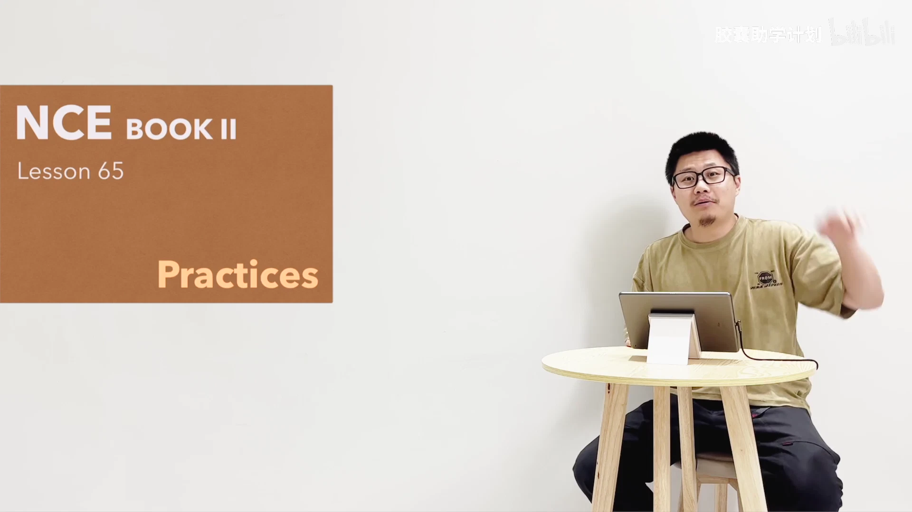

文字识别：NCE / BOOK I"I / Lesson 65 / Practices

### 画面 00:00:02

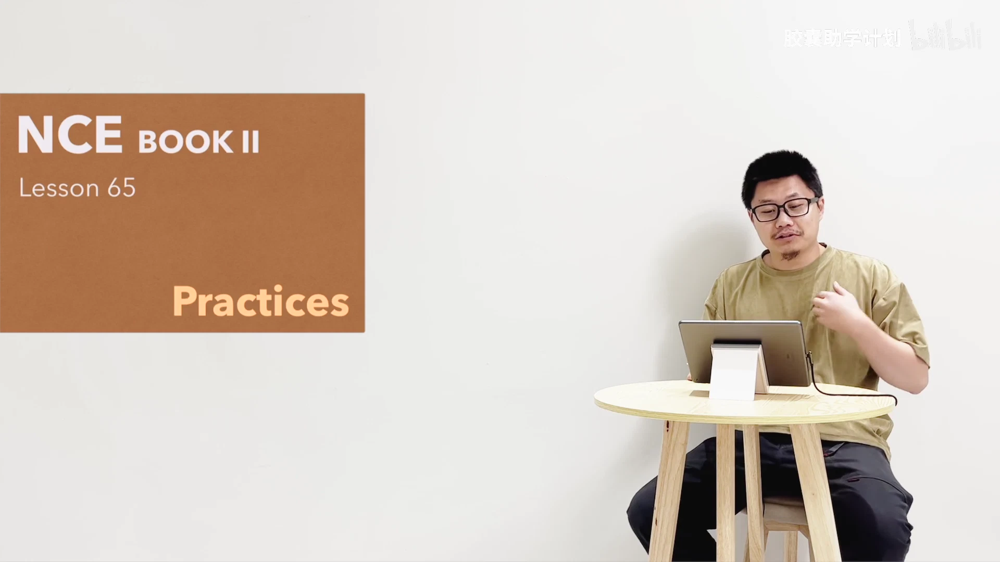

文字识别：NCE / BOOK I"I / Lesson 65 / Practices

### 画面 00:00:07

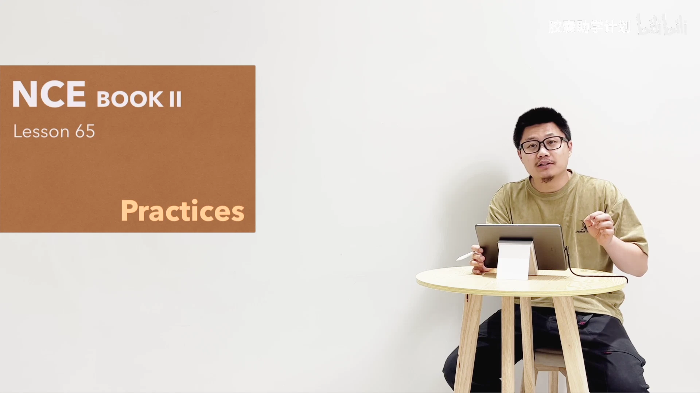

文字识别：NCE / BOOKII / Lesson 65 / Practices

### 画面 00:00:09

文字识别：进行如下练习唯一前提 / 文章跟读至熟读成诵 / 否则请勿开始 / LON

### 画面 00:00:16

文字识别：J bitbii / 胶囊助学计划 / •

### 画面 00:00:20

文字识别：動子計切園

### 画面 00:00:22

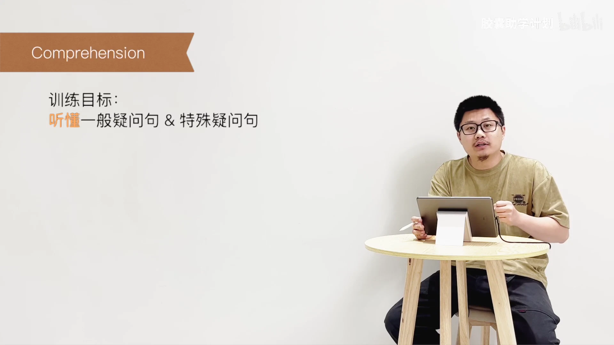

文字识别：Comprehension / 训练目标： / 听懂一般疑问句＆特殊疑问句

## 00:00:30–00:01:00

就可以回答出来了。第一题，Who is Jimmy Gates? A circus owner. Next one, What did he decide to do last Christmas? To take some presents to a children's hospital. Who did he dressed up as? As Father Christmas. Who was in his guard of honor? Six pretty girls.

### 画面 00:00:31

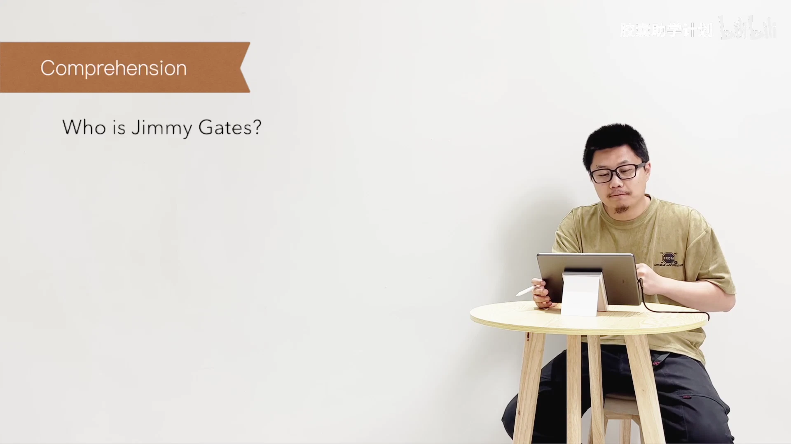

文字识别：Comprehension / Who is Jimmy Gates?

### 画面 00:00:41

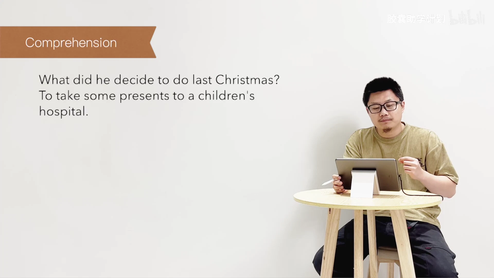

文字识别：Comprehension / What did he decide to do last Christmas? / To take some presents to a children's / hospital.

### 画面 00:00:46

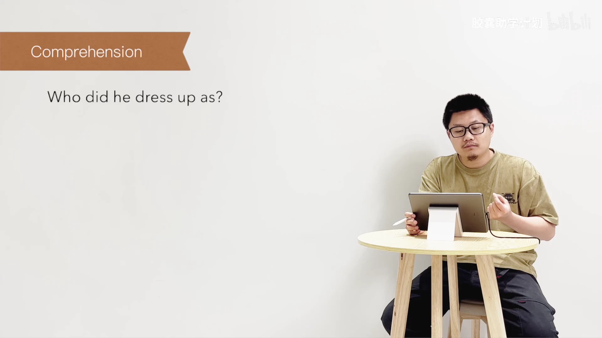

文字识别：助字计划 / Comprehension / Who did he dress up as?

## 00:01:00–00:01:30

Did he set off down the main street of the city or a side street? The main street. What was he writing? A baby elephant. He was called Jumbo, wasn't he? Yes, he was. What should Jimmy have known? That the police would never allow this sort of thing. Who

### 画面 00:01:03

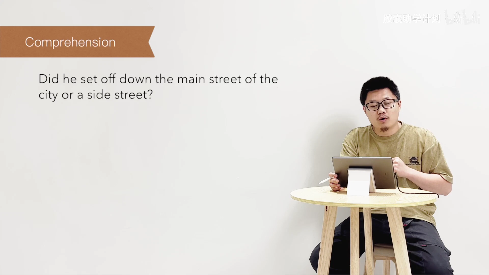

文字识别：Comprehension / Did he set off down the main street of the / city or a side street? / FROM

### 画面 00:01:10

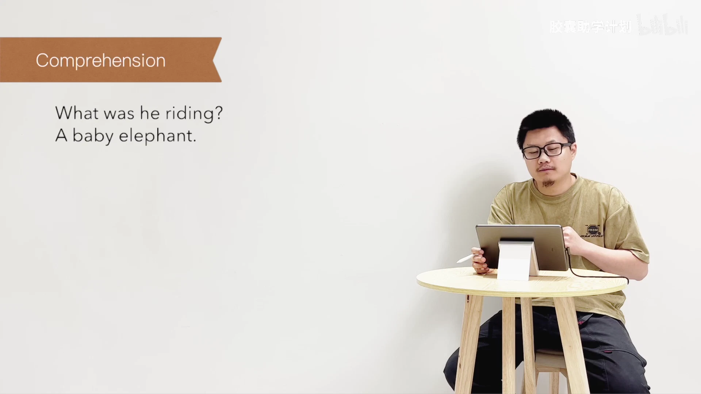

文字识别：Comprehension / What was he riding? / A baby elephant. / FROM

### 画面 00:01:23

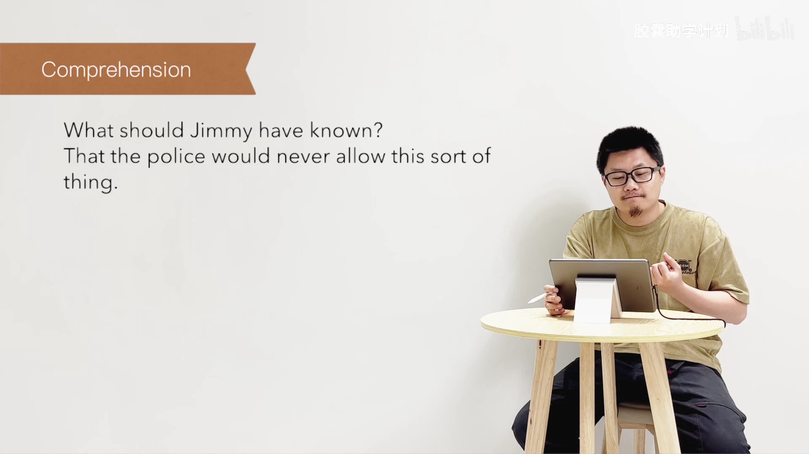

文字识别：Comprehension / What should Jimmy have known? / That the police would never allow this sort of / thing.

### 画面 00:01:29

文字识别：Comprehension / Who approached him?

## 00:01:30–00:02:00

approached him? A policeman did. Which way did he say Janbo ought to have gone? Along a side street. Why should he have done this? Because Janbo was holding up the traffic. Did Jimmy agree to go? Yes, he did. What about Janbo?

### 画面 00:01:47

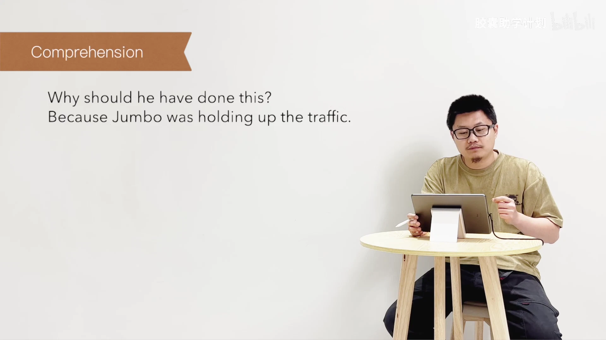

文字识别：Comprehension / Why should he have done this? / Because Jumbo was holding up the traffic.

### 画面 00:01:52

文字识别：毫助子计划 / Comprehension / Did Jimmy agree to go?

## 00:02:00–00:02:30

He refused to move. How many policemen had to push him? Fifteen. Asking questions.练习我们发问的能力。我们能问别人问题了，对吧？好，第一个永远是例子啊。Jimmy Gaze is the circus owner. Is提前就可以了。Who那Who is Jimmy Gaze就可以了，对吧？包括你这句话也可以变成Who is the circus owner或者Who is the circus owner会更好一点啊。Next one.

### 画面 00:02:09

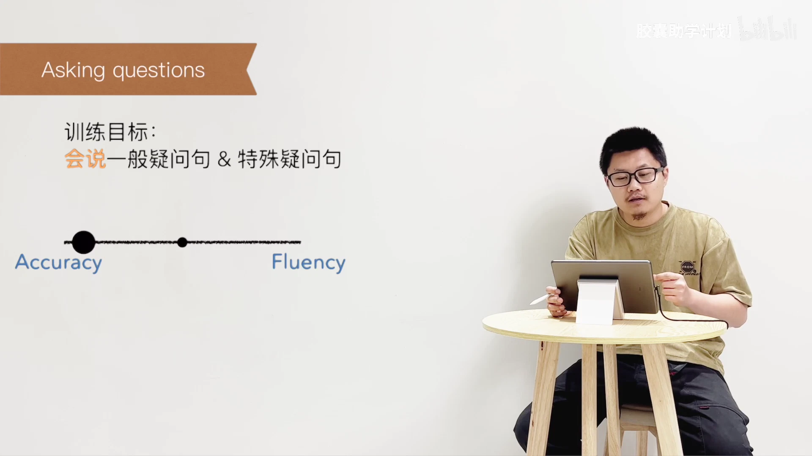

文字识别：Asking questions / 训练目标： / 会说一般疑问句＆特殊疑问句 / Accuracy / Fluency

### 画面 00:02:15

文字识别：Asking questions

### 画面 00:02:19

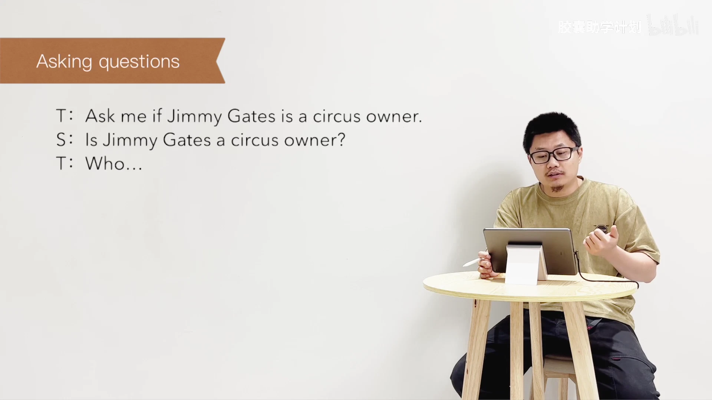

文字识别：Asking questions / T: Ask me if Jimmy Gates is a circus owner. / S: Is Jimmy Gates a circus owner? / T: Who...

### 画面 00:02:29

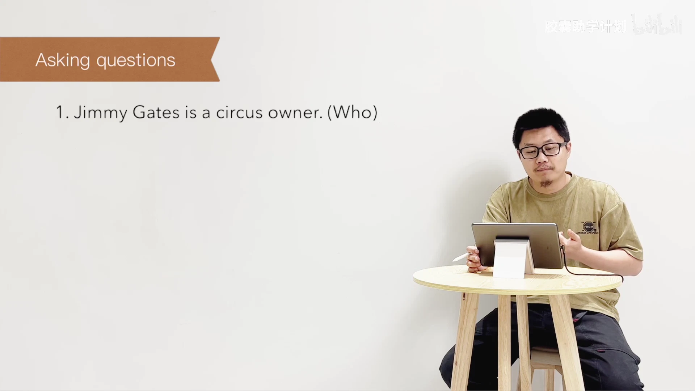

文字识别：Asking questions / 1. Jimmy Gates is a circus owner. (Who)

## 00:02:30–00:03:00

呃，第二个，He decided to take some presents to a children's hospital last Christmas.这句话可变的其实挺多的，但是这已经有 decide to do 了，你把 did 提前，动词换原形，when 对 last Christmas 提问，对吧？He dressed up as Father Christmas. 哎，did 提前，对吧？动词换原形，what 对 Father Christmas 提问，啊，What did he dress up as？He was accompanied by six pretty girls. 你把 was 提前，How many 对，呃，我其实

### 画面 00:02:31

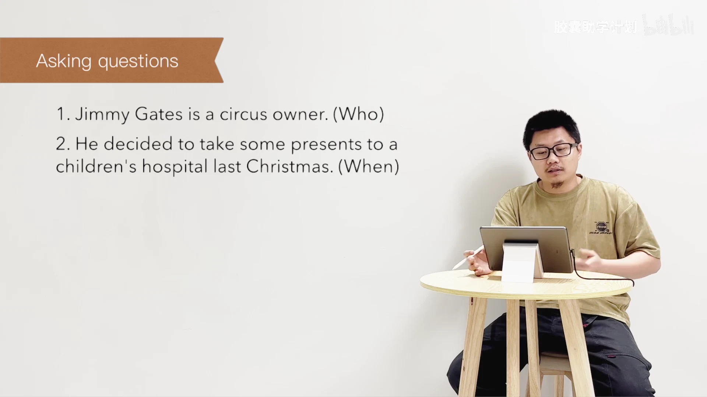

文字识别：Asking questions / 1. Jimmy Gates is a circus owner. (Who) / 2. He decided to take some presents to a / children's hospital last Christmas. (When)

### 画面 00:02:43

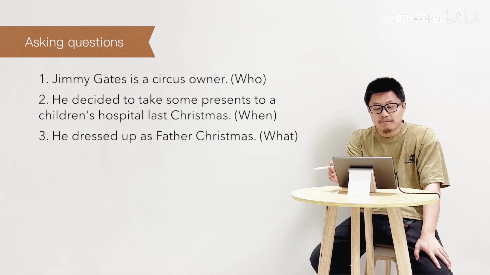

文字识别：Asking questions / 1. Jimmy Gates is a circus owner. (Who) / 2. He decided to take some presents to a / children's hospital last Christmas. (When) / 3. He dressed up as Father Christmas. (What)

## 00:03:00–00:03:30

你要对啊，对six提问，对吧？那这个by也得，呃，我们看一下啊，叫How many pretty girls was he accompanied by? By还可以留着啊。那who带着点by，那who你就直接对主语提问没问题，对吧？谁被六个漂亮姑娘陪伴着呢？They were his god of honor. What提前，What对his god of honor，对吧？呃，He set off down the main street of the city.啊，你did提前，Which way

### 画面 00:03:10

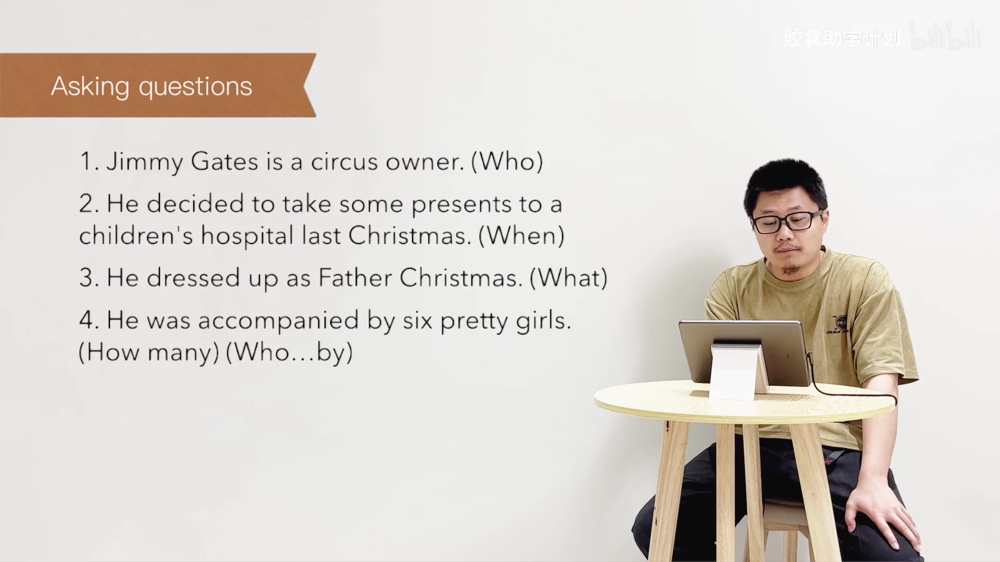

文字识别：Asking questions / 1. Jimmy Gates is a circus owner. (Who) / 2. He decided to take some presents to a / children's hospital last Christmas. (When) / 3. He dressed up as Father Christmas. (What) / 4. He was accompanied by six pretty girls. / (How many) (Who...by)

### 画面 00:03:16

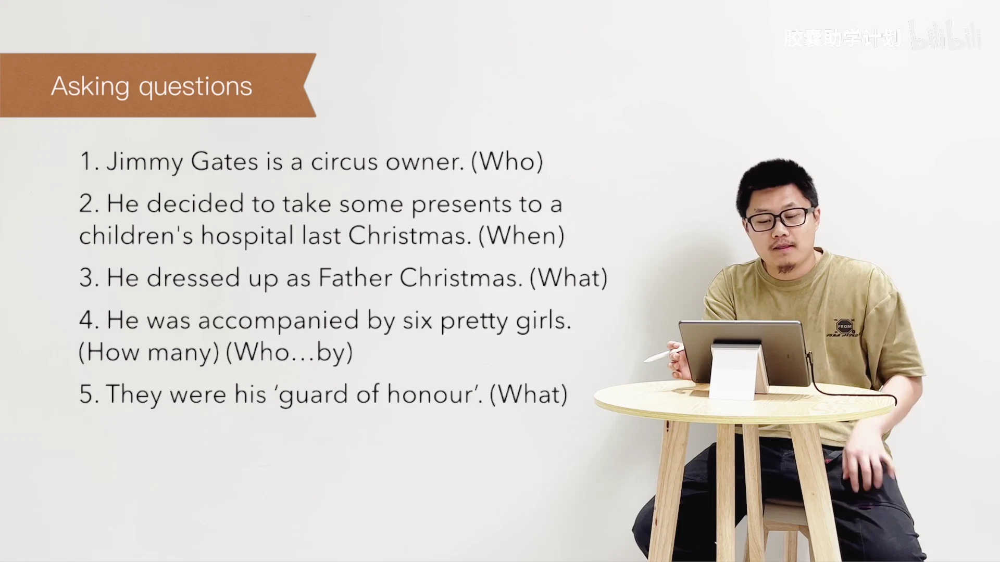

文字识别：Asking questions / 1. Jimmy Gates is a circus owner. (Who) / 2. He decided to take some presents to a / children's hospital last Christmas. (When) / 3. He dressed up as Father Christmas. (What) / 4. He was accompanied by six pretty girls. / RO / (How many) (Who..by) / 5. They were his 'guard of honour' (What)

### 画面 00:03:23

文字识别：Asking questions / FROM

## 00:03:30–00:04:00

对 down the main street of the city 对吧？他从哪条？他从哪个方向出发的？ He was riding a baby elephant. Was 提前啊？ What 对 a baby elephant 提问？ What was he riding？ The elephant was called Jumbo. Was 提前？ What 对 Jumbo 提问？ What was elephant called？ A policeman approached him. Did 提前？ Who 对呃？ A policeman 也可以，对 them 也可以。只不过你对主语提问就不变一

### 画面 00:03:32

文字识别：Asking questions / 6. He set off down the main street of the city. / (Which way) / 7. He was riding a baby elephant. (What)

### 画面 00:03:49

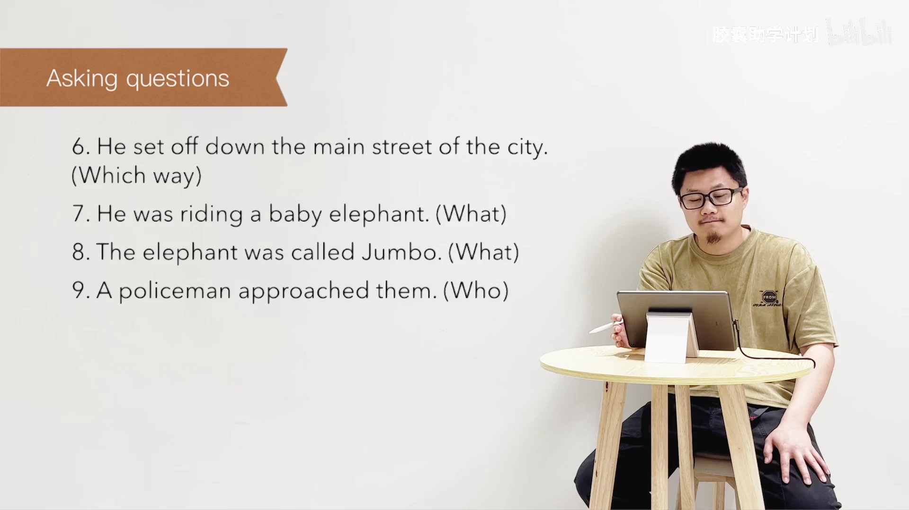

文字识别：Asking questions / 6. He set off down the main street of the city. / (Which way) / 7. He was riding a baby elephant. (What) / 8.The elephant was called Jumbo. (What) / 9.A policeman approached them.(Who)

## 00:04:00–00:04:30

般疑问句了，对 them 提问还是要变一般疑问句的啊。 It told Jimmy that Jimbo was holding up the traffic。这个不看后边，注意不看宾语从句啊，要看主句啊，所以是 did 提前，动词换原形。那 what 是对宾语从句的内容提问，所以 what did he tell Jimmy？ Very good。 Tell the story。老习惯，文章读熟了之后，来这里去练习我们的流利性，对吧？第一单元有非常多的示范啊，文章读熟了，看这些关键词就可以

### 画面 00:04:02

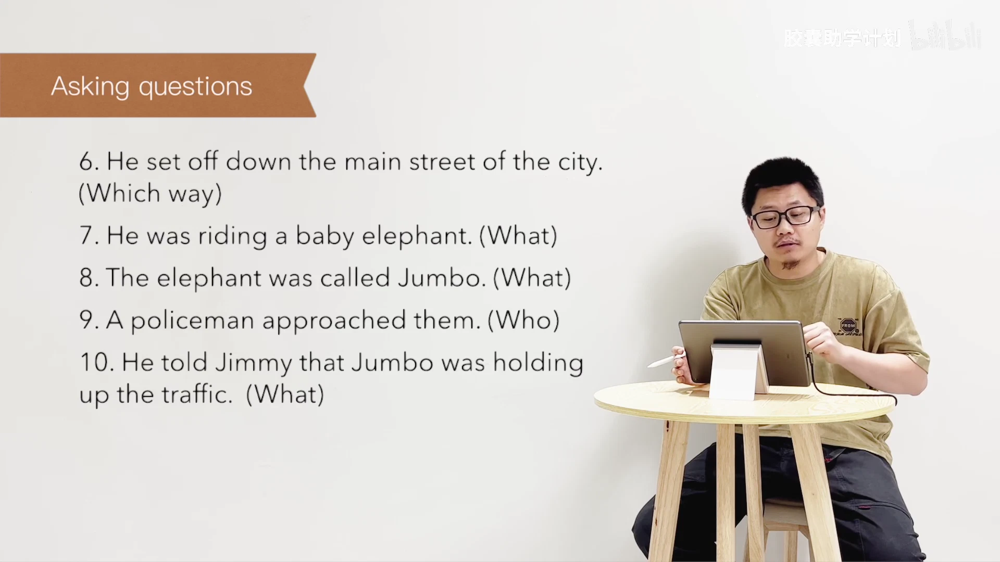

文字识别：Asking questions / 6. He set off down the main street of the city. / (Which way) / 7. He was riding a baby elephant. (What) / 8.The elephant was called Jumbo. (What) / 9.A policeman approached them.(Who) / 10. He told Jimmy that Jumbo was holding / up the traffic. (What)

### 画面 00:04:19

文字识别：Tell the story / 训练目标： / 口语复述能力 / Accuracy / Fluency

### 画面 00:04:25

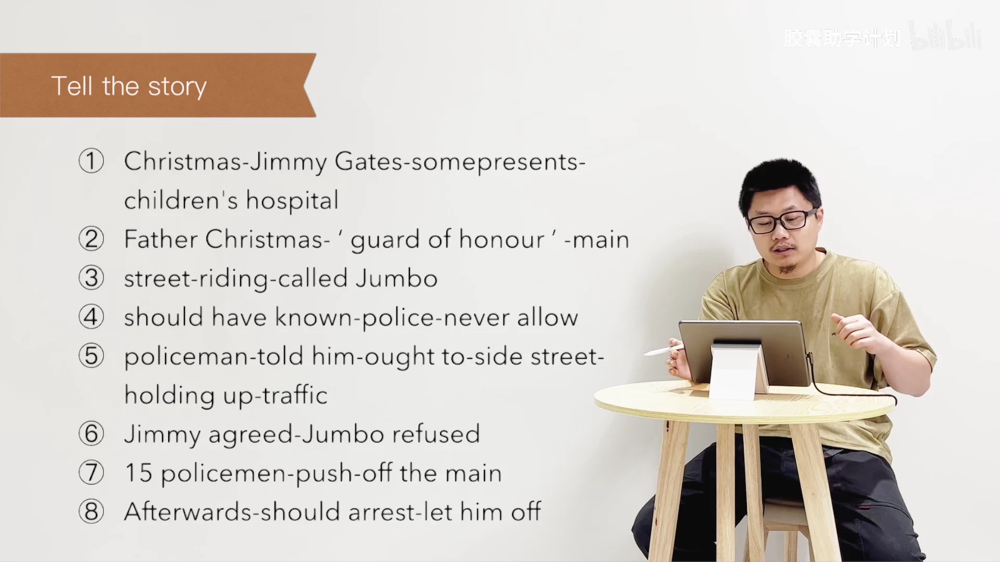

文字识别：Tell the story / Christmas-Jimmy Gates-somepresents- / children's hospital / Father Christmas-'guard of honour'-main / street-riding-called Jumbo / should have known-police-never allow / policeman-told him-ought to-side street- / holding up-traffic / Jimmy agreed-Jumbo refused / 15 policemen-push-off the main / Afterwards-should arrest-let him off / 8

## 00:04:30–00:05:00

了。这是一个非常重要的口语练习，雅思、托福，包括我们的实际应用，全需要这个能力。而我们国内的大多数考试是不大多数考试啊，从小到大我们是不练这个能力的。所以，这是我们最缺失的一个能力啊。OK, next one, summary writing.写完了摘要写作，来这里对答案就行了，没什么太多可说的。呃，topic for discussion.这个是你要去完美的控制你的accuracy and fluency啊，你的准确性和你的流利性。所以这个

### 画面 00:04:45

文字识别：Summary writing: Key / 训练目标： / 写作复述能力

### 画面 00:04:47

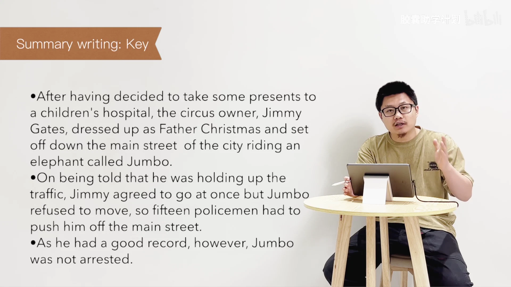

文字识别：助字计划 / Summary writing: Key / •After having decided to take some presents to / a children's hospital, the circus owner, Jimmy / Gates, dressed up as Father Christmas and set / off down the main street of the city riding an / elephant called Jumbo. / •On being told that he was holding up the / traffic, Jimmy agreed to go at once but Jumbo / refused to move, so fifteen policemen had to / push him off the main street. / •As he had a good record, however, Jumbo / was not arrested.

### 画面 00:04:50

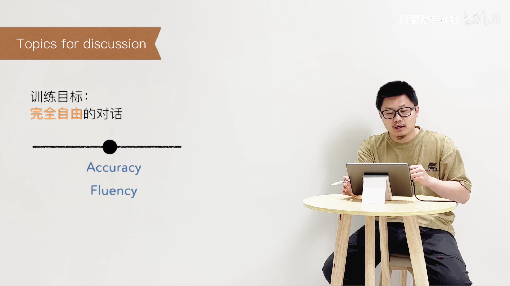

文字识别：Topics for discussion / 训练目标： / 完全自由的对话 / Accuracy / Fluency

### 画面 00:04:59

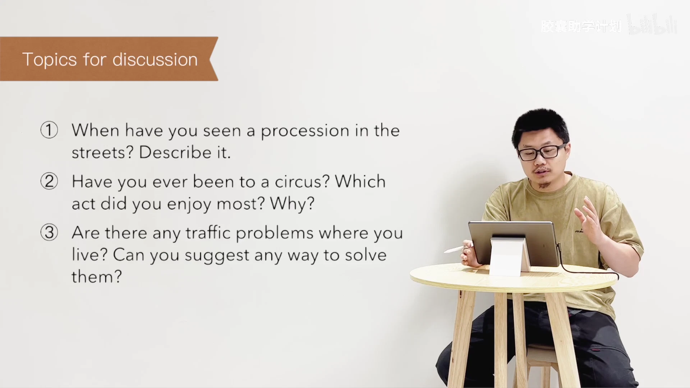

文字识别：Topics for discussion / When have you seen a procession in the / streets? Describe it. / Have you ever been to a circus? Which / act did you enjoy most? Why? / Are there any traffic problems where you / 3 / live? Can you suggest any way to solve / them?

## 00:05:00–00:05:30

呢，我们在这儿没有办法去带着各位挨个去练，对吧？这个各位水平也不一样，但是我们可以提前看一下题，准备内容，对吧？因为我们的口语是包含了内容加表达的啊。内容您可以随时随地准备。说 When have you seen a procession in the street? Describe it. 你什么时候在街上看见过一些，比如说狂欢的行为啊？聊聊，对吧？我觉得其实中国这个狂欢不太多，但是中国是有一些，比如说什么暴走团啊，在马路上暴走，对吧？你可以描

### 画面 00:05:29

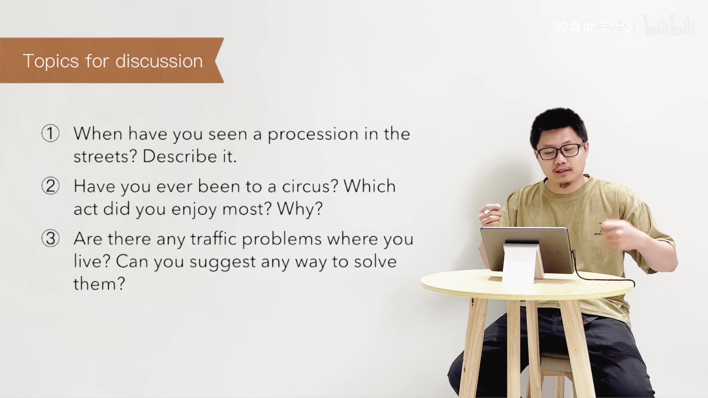

文字识别：Topics for discussion / When have you seen a procession in the / streets? Describe it. / Have you ever been to a circus? Which / act did you enjoy most? Why? / Are there any traffic problems where you / live? Can you suggest any way to solve / them?

## 00:05:30–00:06:00

述这个事儿吗？第二个，Have you ever been to a circus? Which act did you enjoy most? Why? 你以前去过这个马戏团吗？哎，你最欣赏什么？聊一聊，为啥？第三个，Are there any traffic problems where you live? Can you suggest any way to solve? 说在你住的那个地方有没有什么交通上的问题？那我住北京，对吧？那你能这个建议一些这个提一些

### 画面 00:05:59

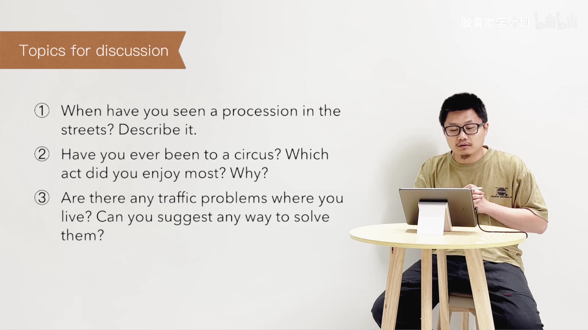

文字识别：Topics for discussion / When have you seen a procession in the / streets? Describe it. / Have you ever been to a circus? Which / act did you enjoy most? Why? / Are there any traffic problems where you / live? Can you suggest any way to solve / them?

## 00:06:00–00:06:30

建议去解决这些问题嘛？那你可以去提一提呗。OK，好，呃，家庭作业，Ask me if，还是看好啊，写完一定要大声朗读。然后呢，摘要写作写完一定要对答案啊。Tell the story口语复述，置顶留言找重复间隔的学习材料。OK，那以上呢就是本期视频的全部内容了。如果各位喜欢我们的课程呢，欢迎各位关注订阅，一键三连，分享给那些需要的朋友来帮助我们

### 画面 00:06:04

文字识别：助字计划 / C

### 画面 00:06:06

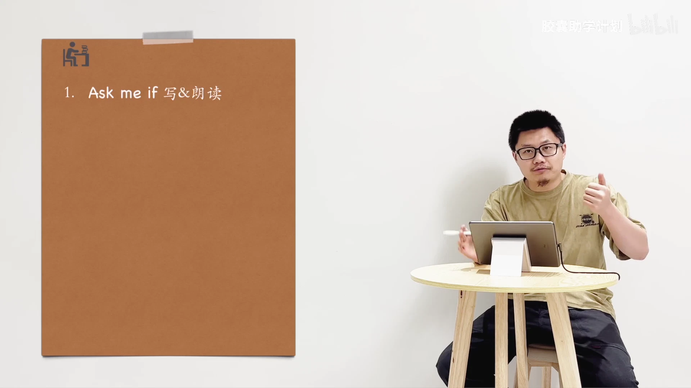

文字识别：臺助字计划一 / 1.A / Ask me if写&朗读

### 画面 00:06:08

文字识别：助学计划调 / 1.Ask me if写&朗读 / ROM

### 画面 00:06:10

文字识别：奏助字计划園 / 1.Ask me if写&朗读 / ROM

### 画面 00:06:12

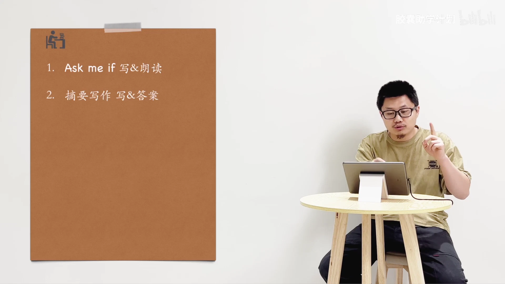

文字识别：字计划 / 1.Ask me if写&朗读 / 2. / 摘要写作写&答案 / ROM

### 画面 00:06:14

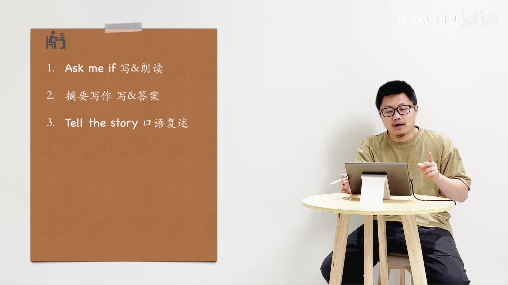

文字识别：1.Ask me if写&朗读 / 摘要写作写&答案 / 3.Tell the story 口语复述

### 画面 00:06:16

文字识别：宁 / 1.Ask me if写&朗读 / 摘要写作写&答案 / 3.Tell the story 口语复述 / 4.重复间隔（置顶留言) / RON

### 画面 00:06:19

文字识别：建助字计划 / ROM

### 画面 00:06:24

文字识别：助字计划 / ￥

## 00:06:30–00:06:44

快速成长。 See you next time.

### 画面 00:06:32

文字识别：CAPSULEACADEMY / 胶囊助学计划 / 『 / 小红书 / OE

### 画面 00:06:34

文字识别：CAPSULEACADEMY / 胶囊助学计划 / 『 / 小红书

### 画面 00:06:40

文字识别：CAPSULEACADEMY / 胶囊助学计划 / 小红书 / Creator / □ / Leo & Berlin / OE

### 画面 00:06:42

文字识别：bilbili / 胶囊助学计划

### 画面 00:06:43

文字识别：bilbili / 胶囊助学计划

