# 066 单词

快速机器解析：语音为单模型转写，未进行独立交叉校对或人工复核；画面每秒采样并按变化选帧，短时文字和标记可能遗漏。截图时间约有 1 秒误差。图片有损压缩；遇到疑点请按时间查看 Google Drive 原视频。

## 00:00:00–00:00:30

Hello everyone, welcome to Capsule Academy. This is Leo. Today we're going to learn new concept English Book Two Lesson Sixty Six Words. 那老习惯进入正式课程之前呢，咱们看几个问题。第一，如何表达遥控器啊？第二，如何表达做调查？最后一个，如何表达你能想象吗？OK，那带着这三个问题，Hope you gonna enjoy. 好，呃，本课的单

### 画面 00:00:00

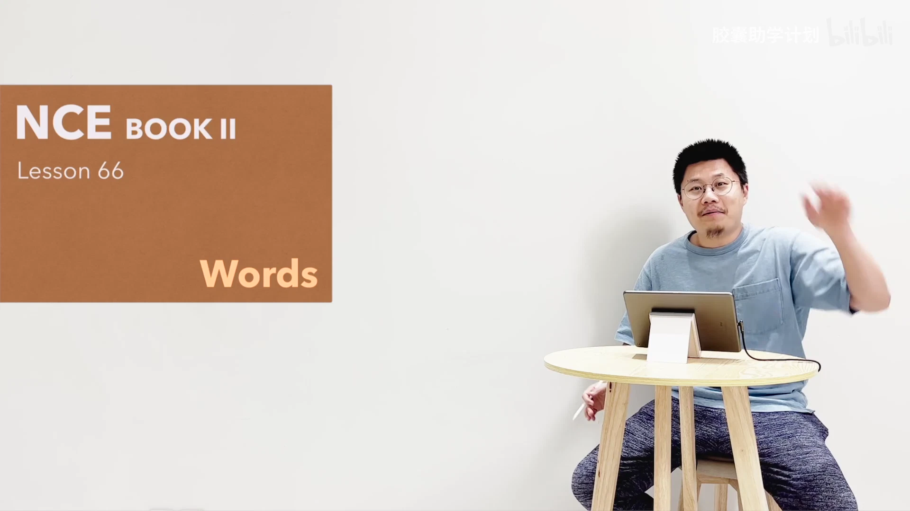

文字识别：NCE / BOOKⅡI / Lesson 66 / Words

### 画面 00:00:02

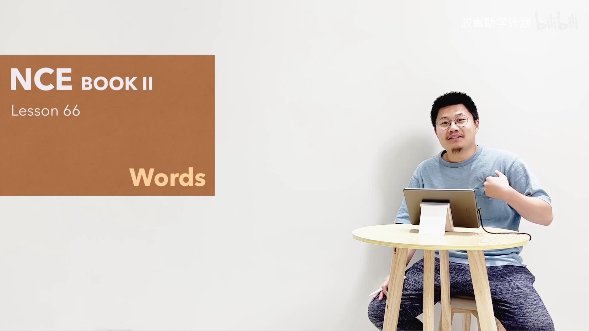

文字识别：NCE / BOOKⅡI / Lesson 66 / Words

### 画面 00:00:05

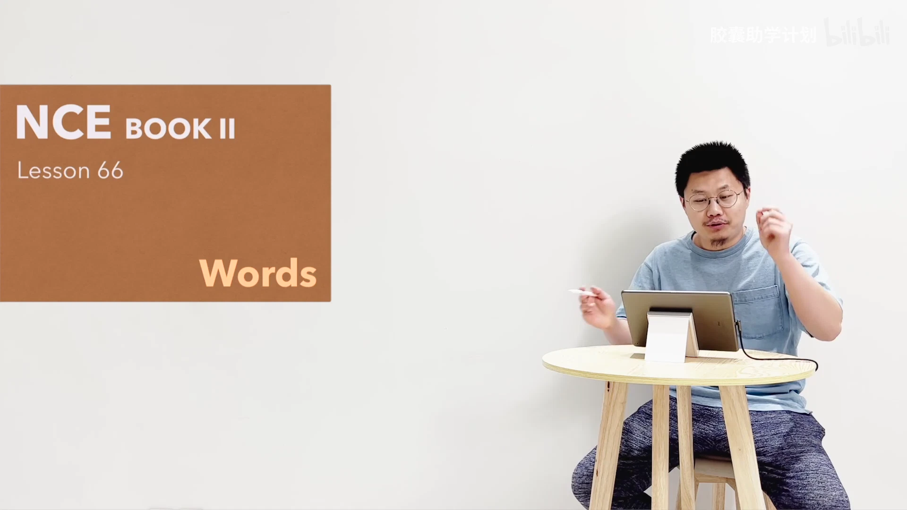

文字识别：NCE / BOOKⅡI / Lesson 66 / Words

### 画面 00:00:10

文字识别：遥控器”

### 画面 00:00:12

文字识别：①如何表达“遥控器”?

### 画面 00:00:14

文字识别：①如何表达“遥控器”? / 如何表达“做调查”?

### 画面 00:00:16

文字识别：①如何表达“遥控器” / 如何表达“做调查”?

### 画面 00:00:18

文字识别：①如何表达“遥控器”？ / 如何表达“做调查”? / 如何表达“你能想象么

### 画面 00:00:20

文字识别：①如何表达“遥控器”? / 如何表达“做调查”? / 如何表达“你能想象么

### 画面 00:00:23

文字识别：胶囊助学计划 bilbl

### 画面 00:00:27

### 画面 00:00:29

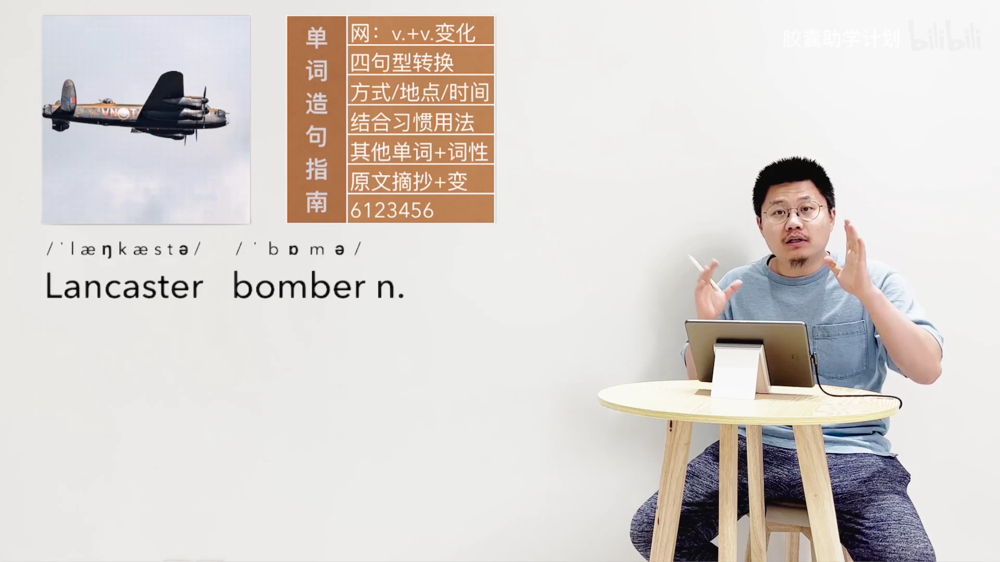

文字识别：单词造句指南 / 网：v.+v.变化 / 四句型转换 / 方式/地点/时间 / 结合习惯用法 / 其他单词+词性 / 原文摘抄+变 / 6123456 / / 'lænkæsta/ / /·bｐma / / Lancaster / bomber n.

## 00:00:30–00:01:00

词稍微有点多啊，但并不是每个单词它的重要性都是一样的。比如说像第一个单词 Lancaster 这个单词是什么意思呢？它是一个轰炸机的型号啊，就类似于比如说咱们经常说的客机型号，什么波音啊、空客呀，它是一个型号，您不用专门去背它，基本上您再见到它的可能性为零，是吧？所以这个单词我们不用背啊，只要知道它是个轰炸机型号就行了。但是音标我们还是要读一下啊，

### 画面 00:00:59

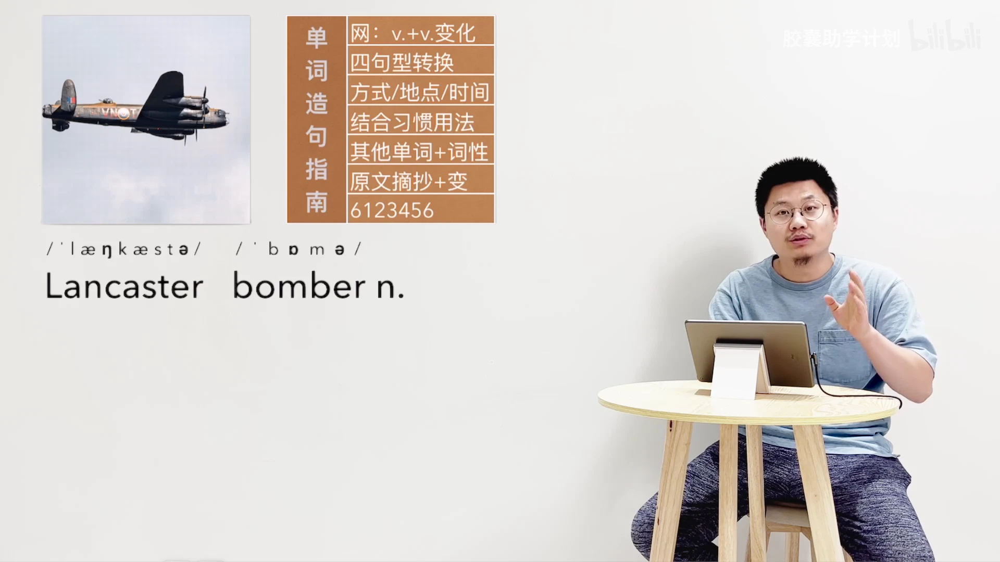

文字识别：单词造句指南 / 网：v.+v.变化 / 四句型转换 / 方式/地点/时间 / 结合习惯用法 / 其他单词+词性 / 原文摘抄+变 / 6123456 / / ' lænkæ sta / / /·bｐma/ / Lancaster / bomber n.

## 00:01:00–00:01:30

Lancaster, OK.后边这个单词要记一下，叫做bomber, bomber轰炸机啊，bomber轰炸机。那Lancaster bomber合起来就兰卡斯特轰炸机嘛，OK。那比如说我们造一句话，我们刚学的六十四课叫做If you had gone to the museum yesterday, you would have seen that Lancaster bomber. Ah, don't forget, don't forget to repeat after me. Ah,别忘了跟我去读啊。那我们回顾一下语法，If had done would have seen，对吧？所以它的意思

### 画面 00:01:11

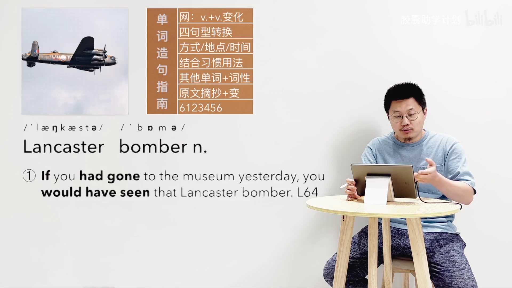

文字识别：单词造句指南 / 网：v.+v.变化 / 四句型转换 / 方式/地点/时间 / 结合习惯用法 / 其他单词+词性 / 原文摘抄+变 / 6123456 / / ' |ænkæsta/ / /·bｐma/ / Lancaster / bomber n. / If you had gone to the museum yesterday, you / would have seen that Lancaster bomber. L64

### 画面 00:01:21

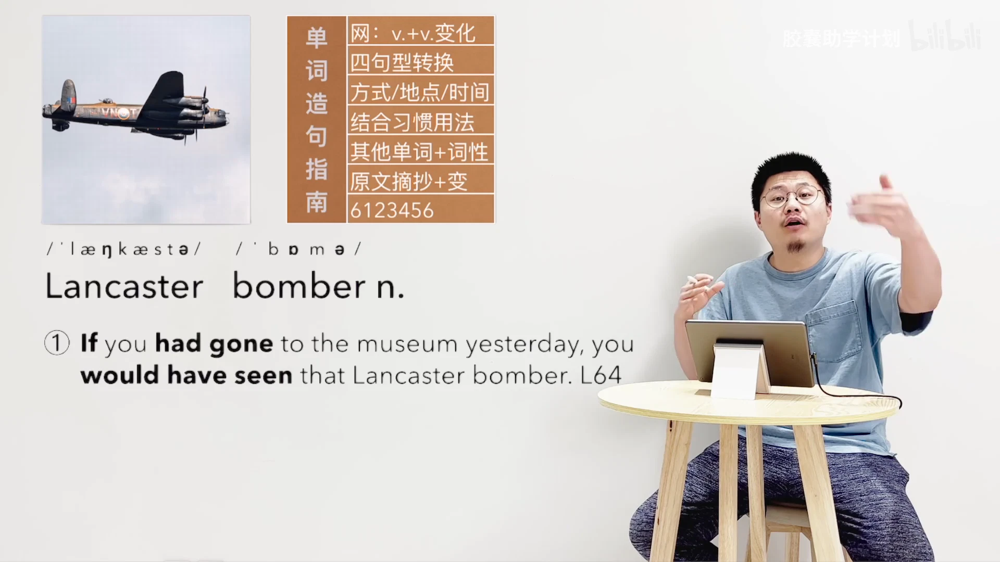

文字识别：单词造句指南 / 网：v.+v.变化 / 四句型转换 / 方式/地点/时间 / 结合习惯用法 / 其他单词+词性 / 原文摘抄+变 / 6123456 / / ' |ænkæsta/ / /·bｐma / / Lancaster / bomber n. / If you had gone to the museum yesterday, you / would have seen that Lancaster bomber. L64

## 00:01:30–00:02:00

是，如果你昨天去这个博物馆了，那你本来是能看见呃那一架兰卡斯特轰炸机的。但因为你没去，所以你也没看见，对吧？哎，那你就可以再来一个，比如说，I had been studying all sorts of bombers before I finally saw a real Lancaster bomber.好，这里其实我用到了好几个。第一个啊，had been doing，然后before是吧？咱们之前学过的啊，这个小的短语叫一直在

### 画面 00:01:43

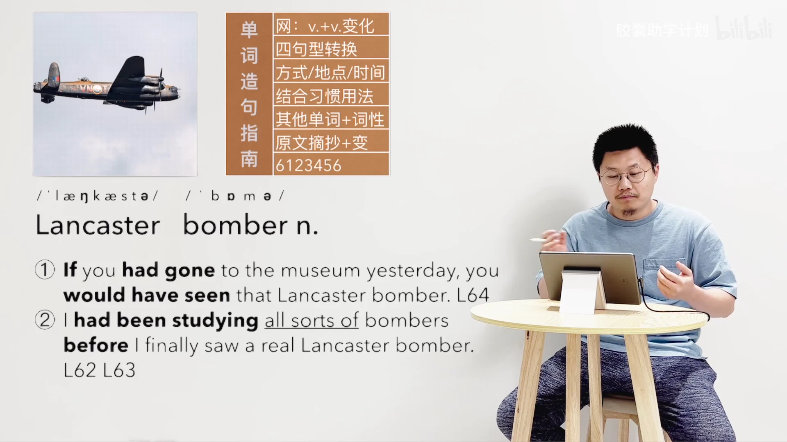

文字识别：单词造句指南 / 网：v.+v.变化 / 四句型转换 / 方式/地点/时间 / 结合习惯用法 / 其他单词+词性 / 原文摘抄+变 / 6123456 / / ' |ænkæ sta/ / /'bpma / / Lancaster / bomber n. / If you had gone to the museum yesterday, you / would have seen that Lancaster bomber. L64 / I had been studying all sorts of bombers / before I finally saw a real Lancaster bomber. / L62 L63

### 画面 00:01:48

文字识别：单词造句指南 / 网：v.+v.变化 / 四句型转换 / 方式/地点/时间 / 结合习惯用法 / 其他单词+词性 / 原文摘抄+变 / 6123456 / / ' |æηkæsta/ / /bbma / / Lancaster / bomber n. / If you had gone to the museum yesterday, you / would have seen that Lancaster bomber. L64 / I had been studying all sorts of bombers / before I finally saw a real Lancaster bomber. / L62 L63

## 00:02:00–00:02:30

研究那 all sorts of各种各样的轰炸机。在我最终真的见到一个真的兰卡斯特轰炸机啊，现实中的轰炸机之前啊，我已经研究了很多很很很长时间了。Very good. Next one,说Lyle spent years studying Lancaster bomber.那我们随便造一个句子的话，就是spend some time doing something，对吧？哎，花了数年的时间研究这个轰炸机。Very good.那读一遍这两个单词Lancaster

### 画面 00:02:06

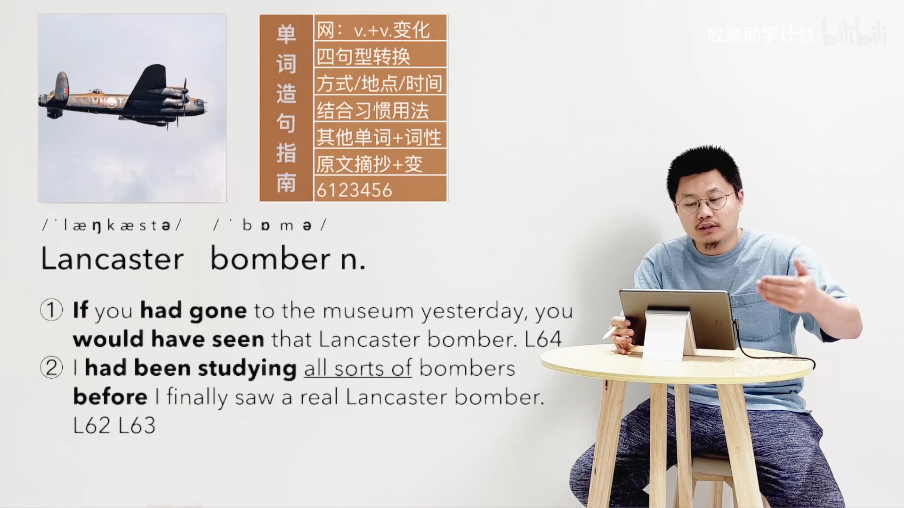

文字识别：单词造句指南 / 网：v.+v.变化 / 四句型转换 / 方式/地点/时间 / 结合习惯用法 / 其他单词+词性 / 原文摘抄+变 / 6123456 / / ' |ænkæ sta/ / /bpma / / Lancaster / bomber n. / If you had gone to the museum yesterday, you / would have seen that Lancaster bomber. L64 / I had been studying all sorts of bombers / before I finally saw a real Lancaster bomber. / L62 L63

### 画面 00:02:11

文字识别：单词造句指南 / 网：v.+v.变化 / 四句型转换 / 方式/地点/时间 / 结合习惯用法 / 其他单词+词性 / 原文摘抄+变 / 6123456 / / ' |æηkæsta/ / /bpma / / Lancaster / bomber n. / If you had gone to the museum yesterday, you / would have seen that Lancaster bomber. L64 / I had been studying all sorts of bombers / before I finally saw a real Lancaster bomber. / L62 L63

### 画面 00:02:14

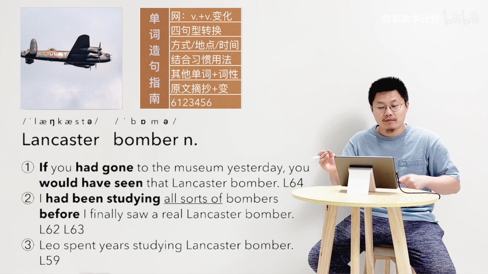

文字识别：单词造句指南 / 网：v.+v.变化 / 四句型转换 / 方式/地点/时间 / 结合习惯用法 / 其他单词+词性 / 原文摘抄+变 / 6123456 / /  l æη kæ st a / / /·bｏma/ / Lancaster / bomber n. / If you had gone to the museum yesterday, you / would have seen that Lancaster bomber. L64 / I had been studying all sorts of bombers / before I finally saw a real Lancaster bomber. / L62 L63 / Leo spent years studying Lancaster bomber. / L59

### 画面 00:02:20

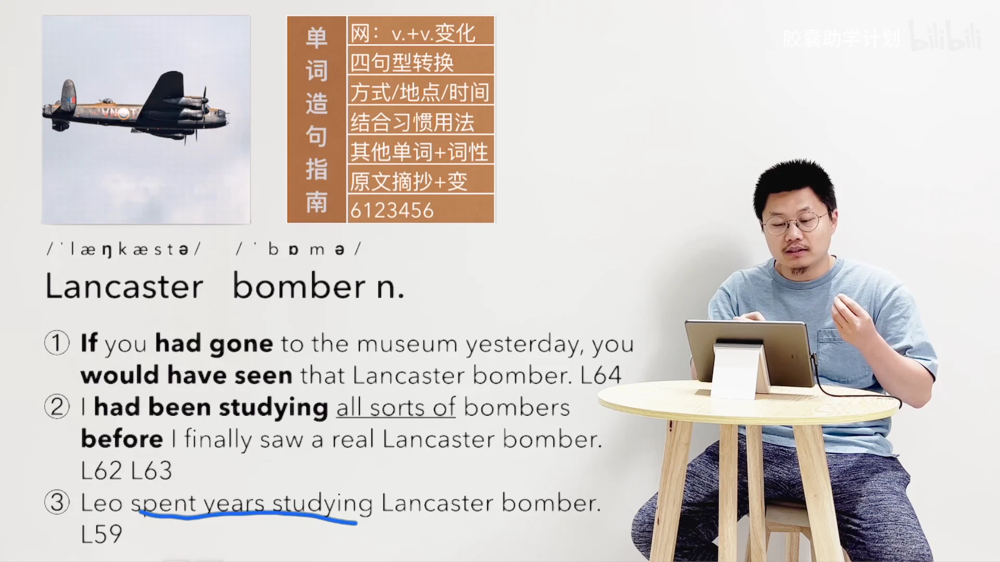

文字识别：单词造句指南 / 网：v.+v.变化 / 四句型转换 / 方式/地点/时间 / 结合习惯用法 / 其他单词+词性 / 原文摘抄+变 / 6123456 / / ' l æη kæ st a / / /·boma / / Lancaster / bomber n. / If you had gone to the museum yesterday, you / would have seen that Lancaster bomber. L64 / I had been studying all sorts of bombers / before I finally saw a real Lancaster bomber. / L62 L63 / Leo spent years studying Lancaster bomber. / L59

## 00:02:30–00:03:00

bomber, there again. Next one, remote, remote. 注意它是个形容词，偏远的、偏僻的，对吧？OK，啊，更更偏向于是偏远的，是吧？好，啊，天涯海角这样的感觉。那你比如说造一个句子，叫 He's in a remote house. 你看这个地方，我们去造句的时候，这个 remote，那我们要有词性想一下，那什么跟 remote 能连起来？我告诉您， remote house 是可以连起来的。后边呢，我为了

### 画面 00:02:31

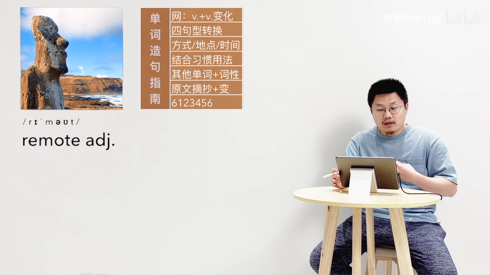

文字识别：单词造句指南 / 网：v.+v.变化 / 四句型转换 / 方式/地点/时间 / 结合习惯用法 / 其他单词+词性 / 原文摘抄+变 / 6123456 / /ri'maut/ / remote adj.

### 画面 00:02:33

文字识别：单词造句指南 / 网：v.+v.变化 / 四句型转换 / 方式/地点/时间 / 结合习惯用法 / 其他单词+词性 / 原文摘抄+变 / 6123456 / /ri'maut/ / remote adj.

### 画面 00:02:35

文字识别：单词造句指南 / 网：v.+v.变化 / 四句型转换 / 方式/地点/时间 / 结合习惯用法 / 其他单词+词性 / 原文摘抄+变 / 6123456 / /ri'maut/ / remote adj.

### 画面 00:02:38

文字识别：单词造句指南 / 网：v.+v.变化 / 四句型转换 / 方式/地点/时间 / 结合习惯用法 / 其他单词+词性 / 原文摘抄+变 / 6123456 / /ri'maut/ / remote adj.

### 画面 00:02:40

文字识别：单词造句指南 / 网：v.+v.变化 / 四句型转换 / 方式/地点/时间 / 结合习惯用法 / 其他单词+词性 / 原文摘抄+变 / 6123456 / /ri'maut/ / remote adj.

### 画面 00:02:42

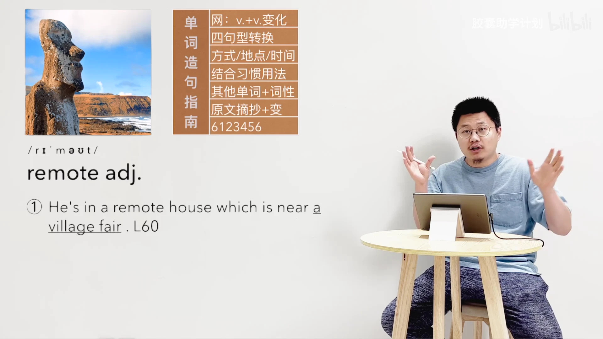

文字识别：单词造句指南 / 网：v.+v.变化 / 四句型转换 / 方式/地点/时间 / 结合习惯用法 / 其他单词+词性 / 原文摘抄+变 / 6123456 / /ri'maut/ / remote adj. / D He's in a remote house which is near a / 1 / village fair . L60

### 画面 00:02:46

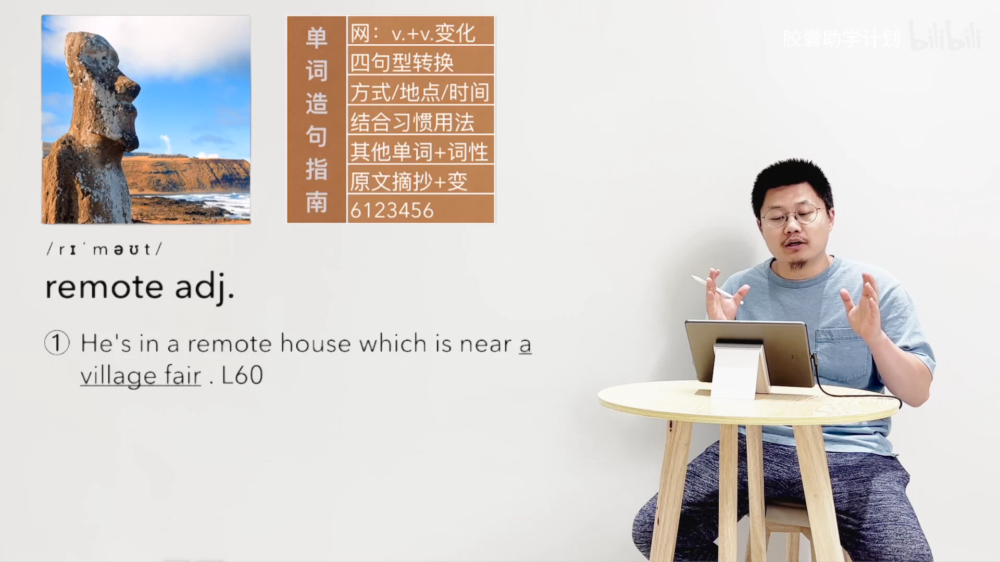

文字识别：单词造句指南 / 网：v.+v.变化 / 四句型转换 / 方式/地点/时间 / 结合习惯用法 / 其他单词+词性 / 原文摘抄+变 / 6123456 / /rI'maut/ / remote adj. /  He's in a remote house which is near a / village fair. L60

### 画面 00:02:50

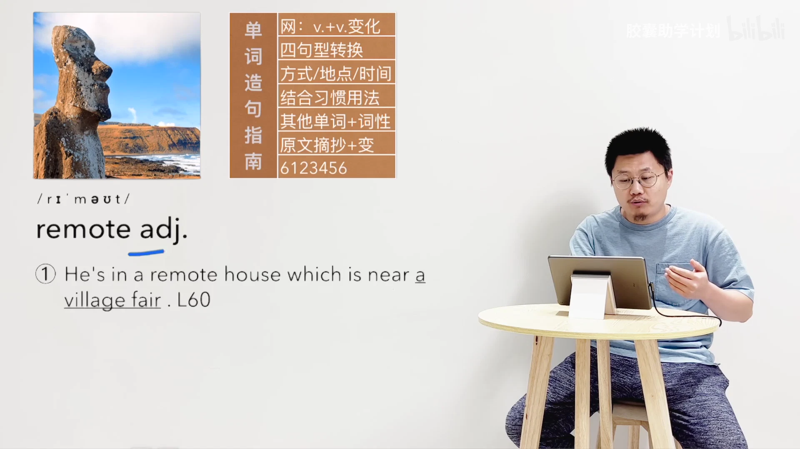

文字识别：单词造句指南 / 网：v.+v.变化 / 四句型转换 / 方式/地点/时间 / 结合习惯用法 / 其他单词+词性 / 原文摘抄+变 / 6123456 / /rI'maut/ / remote adj. / ) He's in a remote house which is near a / village fair. L60

### 画面 00:02:52

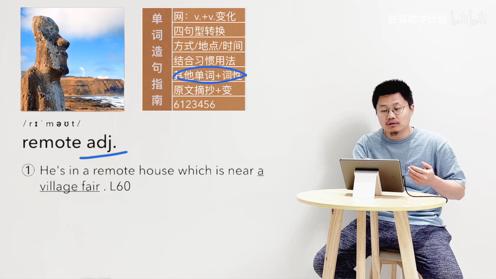

文字识别：单词造句指南 / 网：v.+v.变化 / 四句型转换 / 方式/地点/时间 / 结合习惯用法 / 他单词+词性 / 原文摘抄+变 / 6123456 / / rI'maut/ / remote adj. / ) He's in a remote house which is near a / village fair. L60

### 画面 00:02:56

文字识别：单词造句指南 / 网：v.+v.变化 / 四句型转换 / 方式/地点/时间 / 结合习惯用法 / 具他单词+词收 / 原文摘抄+变 / 6123456 / /rI'maut/ / remote adj. / ) He's in a remote house which is near a / village fair. L60

## 00:03:00–00:03:30

让这个句子显得稍微复杂一点，又复习了二十八课的定语从句，叫 which is near a village fair，对吧？ Okay， one again.好，next one说 the moment I got out of this remote place，六十课咱们学的，哎，这个呃啊算命那一刻，集市那一刻，对吧？哎，那课咱们学的 the moment叫一怎么怎么样就怎么怎么样，后半句话我留给您了，对吧？哎，我一离开这个偏僻的地方，我就要干嘛？比如说洗

### 画面 00:03:00

文字识别：单词造句指南 / 网：v.+v.变化 / 四句型转换 / 方式/地点/时间 / 结合习惯用法 / 具他单词+词收 / 原文摘抄+变 / 6123456 / /ri'maut/ / remote adj. / ) He's in a remote house / which is near a / village fair . L60

### 画面 00:03:06

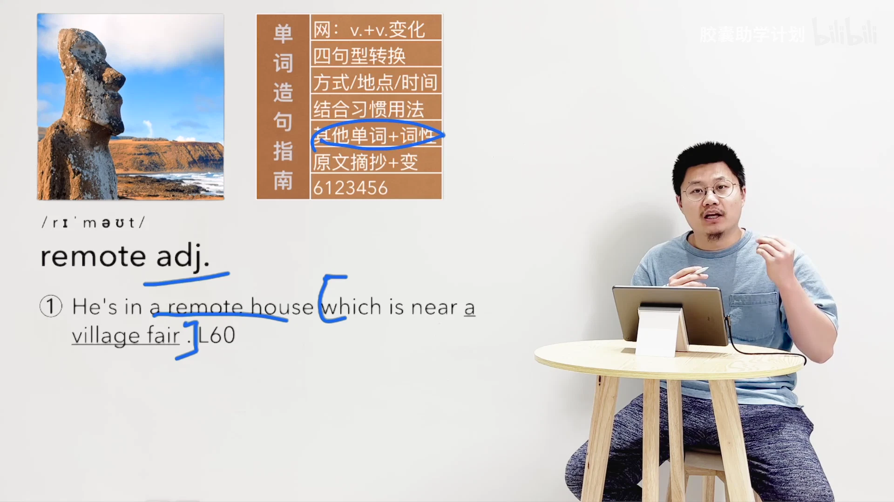

文字识别：单词造句指南 / 网：v.+v.变化 / 四句型转换 / 方式/地点/时间 / 结合习惯用法 / 具他单词+词性 / 原文摘抄+变 / 6123456 / /ri'maut/ / remote adj. / ) He's in a remote house / which is near a / village fair]L60

### 画面 00:03:10

文字识别：单词造句指南 / 网：v.+v.变化 / 四句型转换 / 方式/地点/时间 / 结合习惯用法 / 具他单词+词性 / 原文摘抄+变 / 6123456 / /rI'maut/ / remote adj. / ) He's in a remote house / which is near a / village fair7L60 / The moment I got out of this remote place, / I will... L60

### 画面 00:03:13

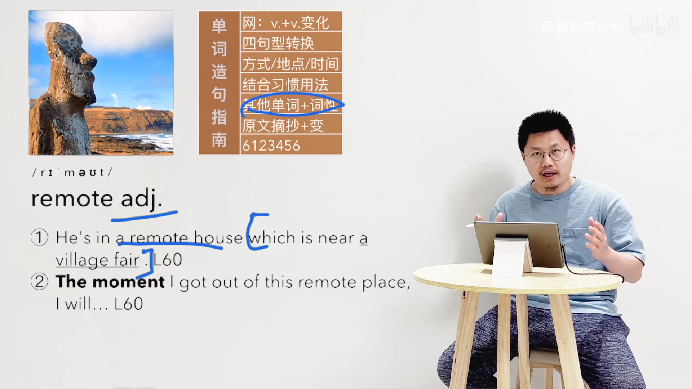

文字识别：单词造句指南 / 网：v.+v.变化 / 四句型转换 / 方式/地点/时间 / 结合习惯用法 / 具他单词+词性 / 原文摘抄+变 / 6123456 / /rI'maut/ / remote adj. / ) He's in aremote house / which is near a / village fair7L60 / The moment I got out of this remote place, / I will... L60

### 画面 00:03:15

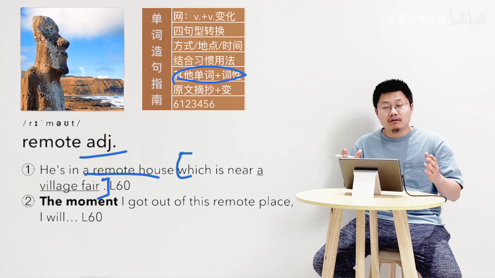

文字识别：单词造句指南 / 网：v.+v.变化 / 四句型转换 / 方式/地点/时间 / 结合习惯用法 / 具他单词+词性 / 原文摘抄+变 / 6123456 / / rI'maut/ / remote adj. / ) He's in aremote house / which is near a / village fair7L60 / The moment I got out of this remote place, / I will... L60

### 画面 00:03:20

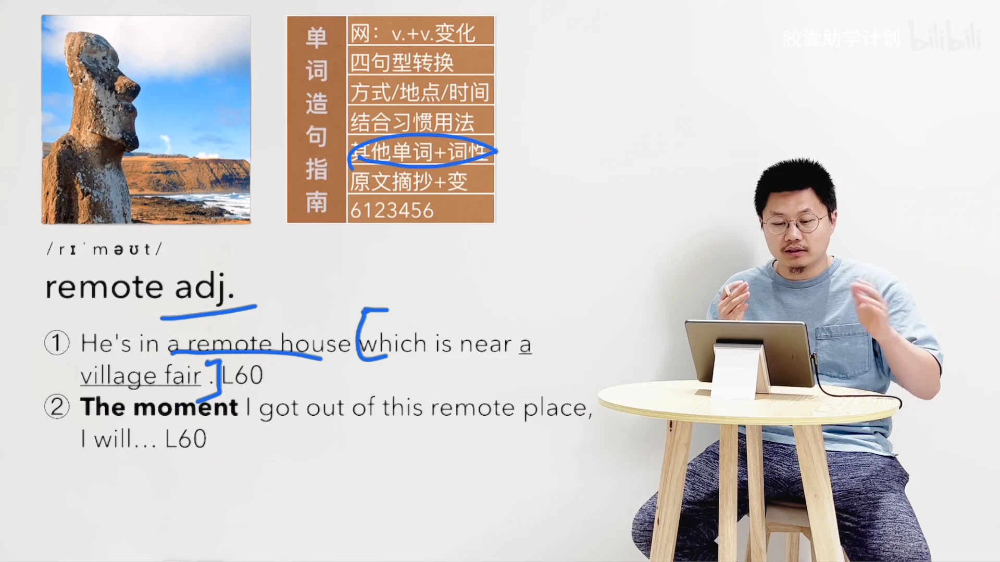

文字识别：单词造句指南 / 网：v.+v.变化 / 四句型转换 / 方式/地点/时间 / 结合习惯用法 / 具他单词+词收 / 原文摘抄+变 / 6123456 / / rI'maut/ / remote adj. / ) He's in aremote house / which is near a / village fair7L60 / The moment I got out of this remote place, / I will... L60

### 画面 00:03:25

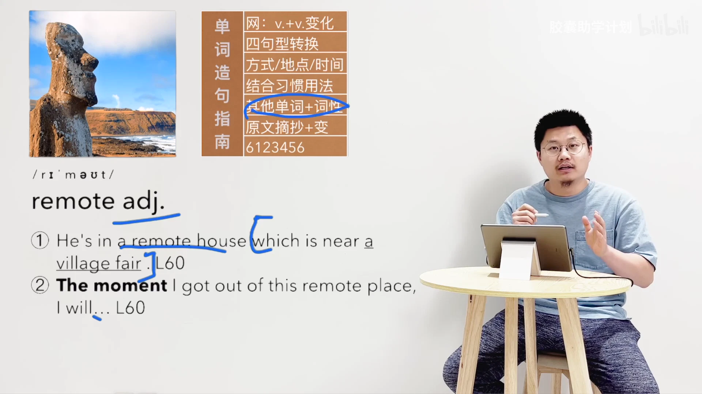

文字识别：单词造句指南 / 网：v.+v.变化 / 四句型转换 / 方式/地点/时间 / 结合习惯用法 / 他单词+词收 / 原文摘抄+变 / 6123456 / /rI'maut/ / remote adj. / ) He's in aremote house / which is near a / village fair7L60 / The moment I got out of this remote place, / I will... L60

## 00:03:30–00:04:00

个什么热水澡，怎么说啊？是吧？吃顿大餐，怎么说啊？这个好好睡他一觉，怎么说啊？您都是应该是学过的。OK，Next one，五十八课咱们学的说，It is said that Leo lives in a remote area in Beijing。啊，住在北京偏远的地方，比如说北京的大北边，对吧？哎，那什么怀柔、密云、延庆啊，那可能再靠北啊。Remote area，very good。再读一遍这个单词，remote。

### 画面 00:03:37

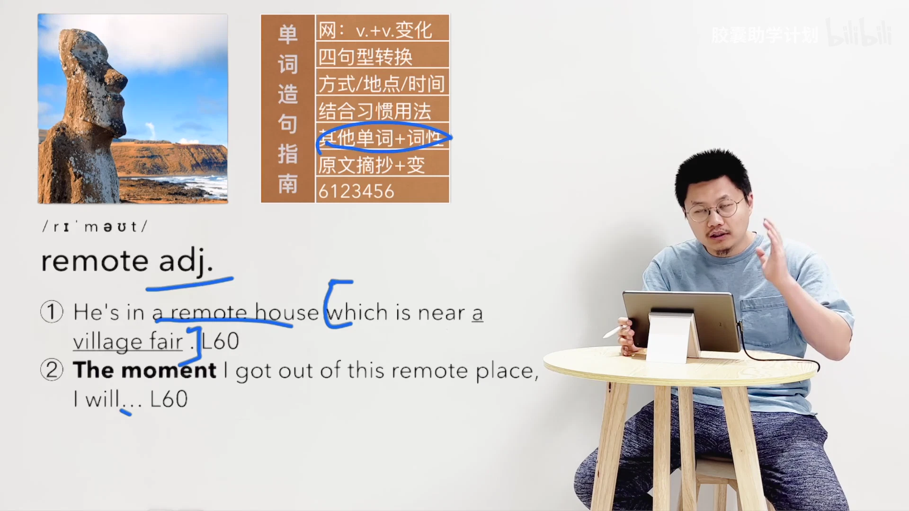

文字识别：单词造句指南 / 网：v.+v.变化 / 四句型转换 / 方式/地点/时间 / 结合习惯用法 / 具他单词+词收 / 原文摘抄+变 / 6123456 / / rI'maut/ / remote adj. / ) He's in aremote house / which is near a / village fair7L60 / The moment I got out of this remote place, / I will... L60

### 画面 00:03:40

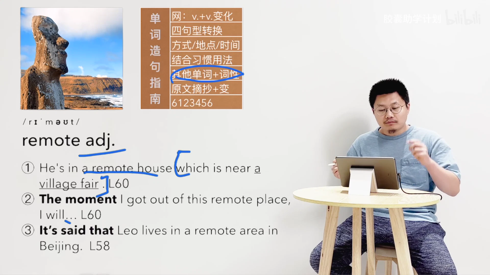

文字识别：单词造句指南 / 网：v.+v.变化 / 四句型转换 / 方式/地点/时间 / 结合习惯用法 / 他单词+词性 / 原文摘抄+变 / 6123456 / / rI'maut/ / remote adj. /  He's in aremote house / which is near a / 1 / village fair7L60 / The moment I got out of this remote place, / I will... L60 / It's said that Leo lives in a remote area in / Beijing. L58

### 画面 00:03:55

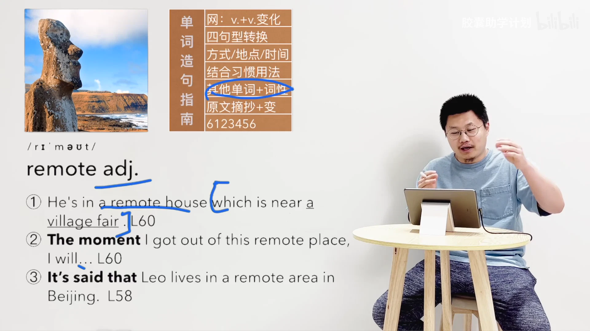

文字识别：单词造句指南 / 网：v.+v.变化 / 四句型转换 / 方式/地点/时间 / 结合习惯用法 / 具他单词+词性 / 原文摘抄+变 / 6123456 / / rI'maut/ / remote adj. / ① He's in aremote house / which is near a / village fair7L60 / The moment I got out of this remote place, / I will... L60 / It's said that Leo lives in a remote area in / Beijing. L58

## 00:04:00–00:04:30

好，这里其实复习了一下。 It said that. 据说啊。 Next one, 我们看一个电影片段，这里就引出来了一个生活当中非常常用的叫 remote control 啊，远距离遥控遥控器啊。 Where's the remote control I gave you? Why? There we go. Next one, Pacific. Pacific. 我专门给大家画了一个图，因为很多同学我原来上课的时候发现的，就

### 画面 00:04:00

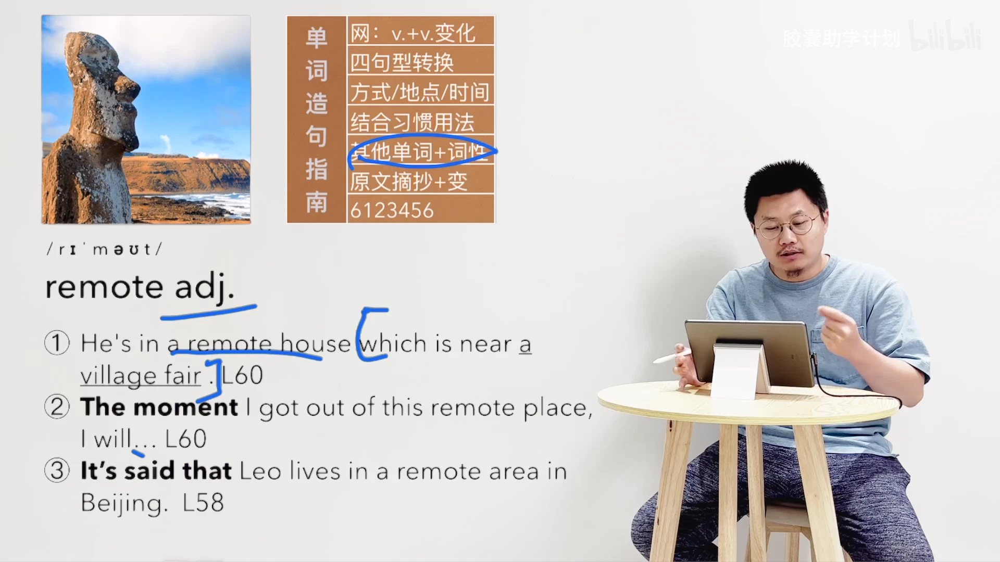

文字识别：单词造句指南 / 网：v.+v.变化 / 四句型转换 / 方式/地点/时间 / 结合习惯用法 / 具他单词+词收 / 原文摘抄+变 / 6123456 / / rI'maut/ / remote adj. / ① He's in a remote house / which is near a / village fair7L60 / The moment I got out of this remote place, / I will... L60 / It's said that Leo lives in a remote area in / Beijing. L58

### 画面 00:04:02

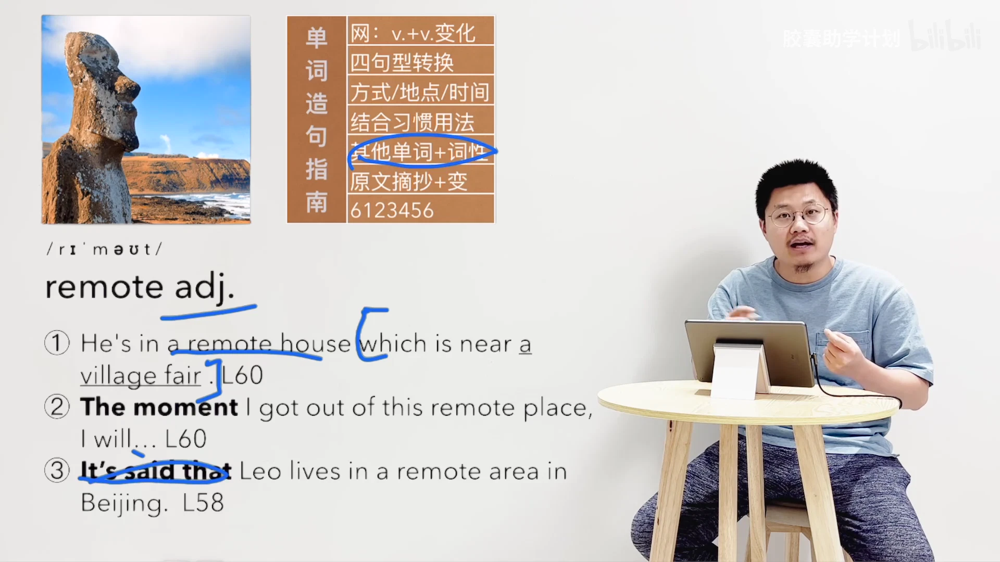

文字识别：单词造句指南 / 网：v.+v.变化 / 四句型转换 / 方式/地点/时间 / 结合习惯用法 / 具他单词+词收 / 原文摘抄+变 / 6123456 / /rI'maut/ / remote adj. /  He's in a_remote house / which is near a / village fair7L60 / The moment I got out of this remote place, / I will... L60 / It's said thot / t Leo lives in a remote area in / Beijing. L58

### 画面 00:04:04

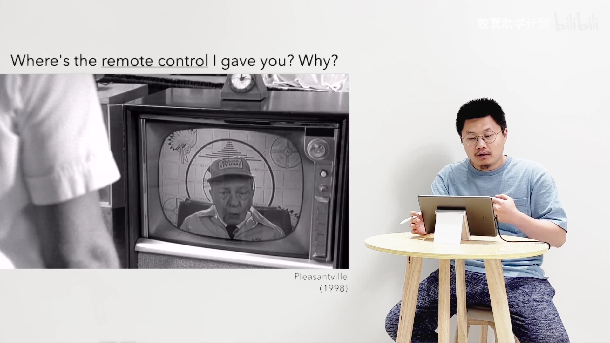

文字识别：Where's the remote control I gave you? Why? / V / Pleasantville / (1998)

### 画面 00:04:18

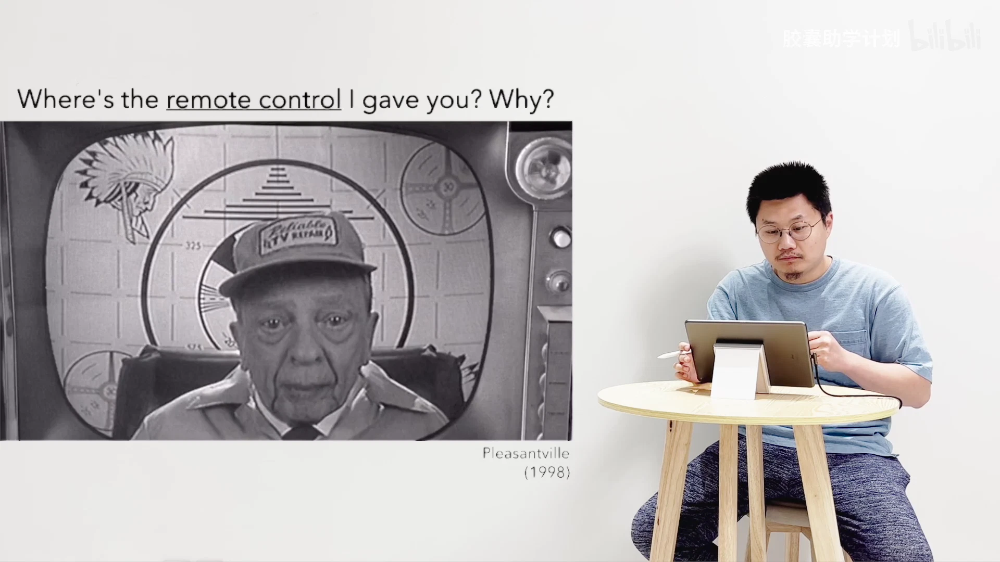

文字识别：Where's the remote control I gave you? Why? / 325 / Pleasantville / (1998)

### 画面 00:04:20

文字识别：单词造句指南 / 网：v.+v.变化 / 四句型转换 / PACIFIC / 方式/地点/时间 / OCEAN / 结合习惯用法 / 其他单词+词性 / OCEANIA / 原文摘抄+变 / 6123456 / /pa'sifik/ / Pacific n.

### 画面 00:04:22

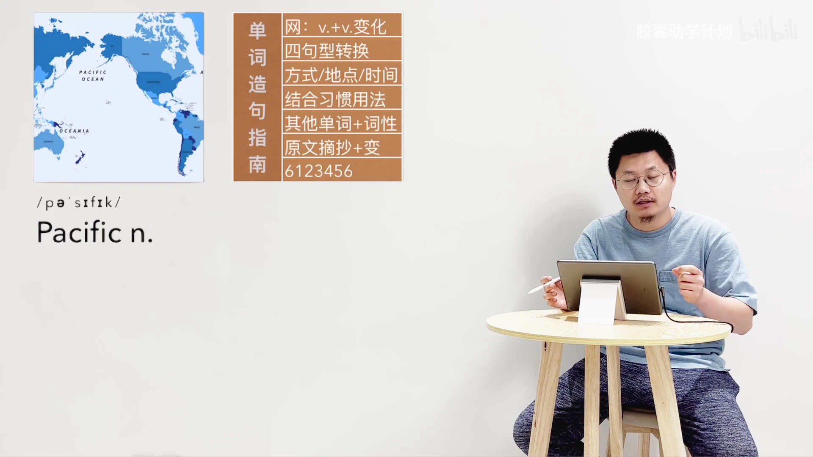

文字识别：单词造句指南 / 网：v.+v.变化 / 四句型转换 / PACIFIC / 方式/地点/时间 / OCEAN / 结合习惯用法 / 其他单词+词性 / OCEANIA / 原文摘抄+变 / 6123456 / /pa'sifik/ / Pacific n.

### 画面 00:04:25

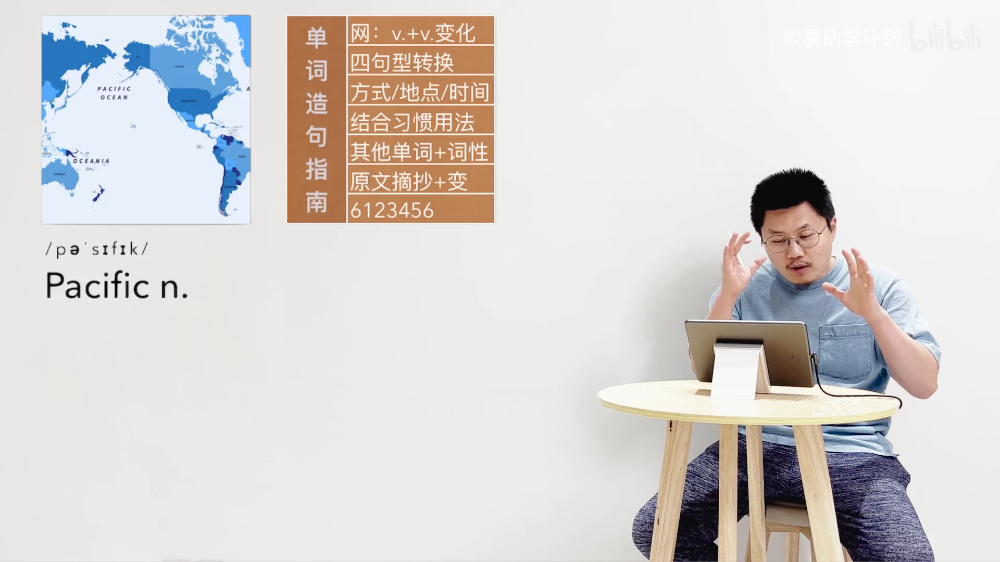

文字识别：单词造句指南 / 网：v.+v.变化 / 四句型转换 / PACIFIC / 方式/地点/时间 / OCEAN / 结合习惯用法 / 其他单词+词性 / OCEANIA / 原文摘抄+变 / 6123456 / /pa'sifik/ / Pacific n.

## 00:04:30–00:05:00

是呃 Pacific and Atlantic 是吧？这个大西洋和太平洋不是特别分啊。那我们就看图，这儿是咱们中国，对吧？呃，这边是美洲，美国、加拿大。我们中间的这个就叫做 Pacific Ocean 啊。注意这个地方，你可能要注意一下 Pacific Ocean。然后欧洲跟美国之间的那个叫什么？Atlantic 是吧？OK 啊，大西洋，Very good。那 Pacific，那他想去造句，比如说，哎，我们

### 画面 00:04:33

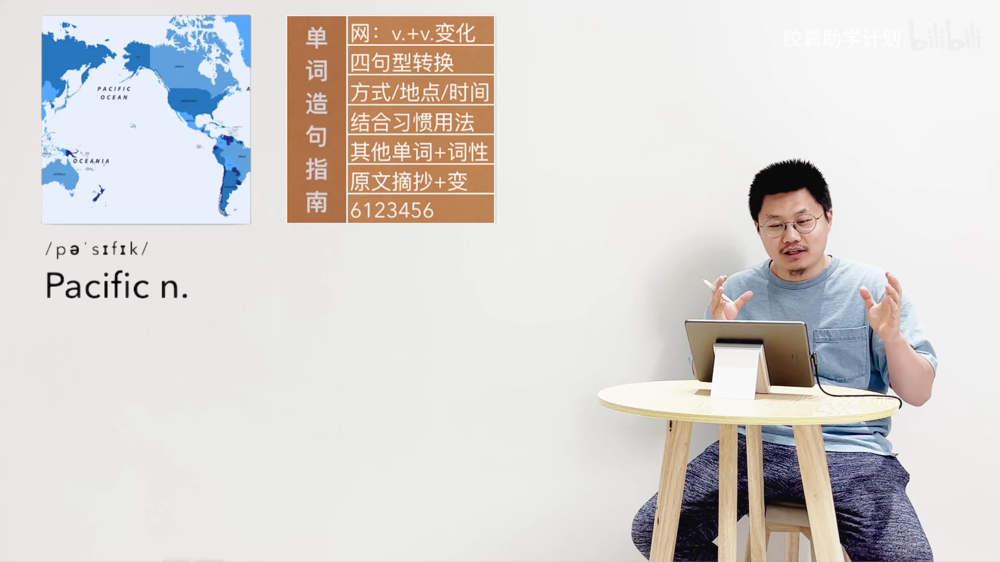

文字识别：单词造句指南 / 网：v.+v.变化 / 四句型转换 / PACIFIC / 方式/地点/时间 / OCEAN / 结合习惯用法 / 其他单词+词性 / OCEANIA / 原文摘抄+变 / 6123456 / /pa'sifik/ / Pacific n.

### 画面 00:04:36

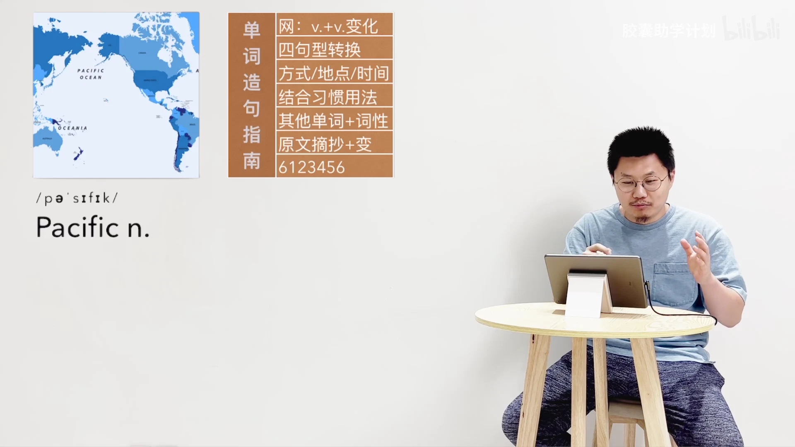

文字识别：单词造句指南 / 网：v.+v.变化 / 四句型转换 / PACIFIC / 方式/地点/时间 / OCEAN / 结合习惯用法 / 其他单词+词性 / OCEANIA / 原文摘抄+变 / 6123456 / /pa'sifik/ / Pacific n.

### 画面 00:04:39

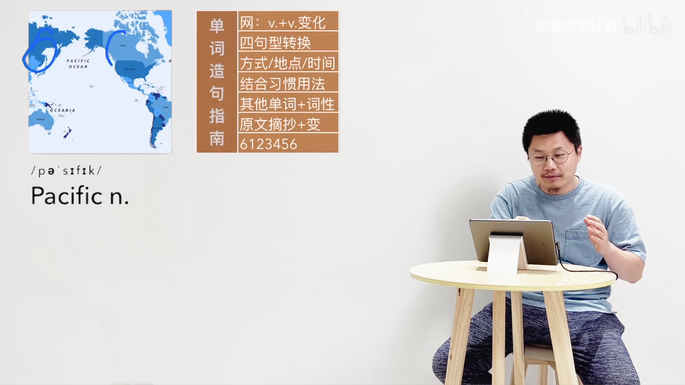

文字识别：单词造句指南 / 网：v.+v.变化 / 四句型转换 / PACIFIC / 方式/地点/时间 / OCEAN / 结合习惯用法 / 其他单词+词性 / OCEANIA / 原文摘抄+变 / 6123456 / /pa'sifik/ / Pacific n.

### 画面 00:04:41

文字识别：单词造句指南 / 网：v.+v.变化 / 四句型转换 / PACIFIC / 方式/地点/时间 / OCEAN / 结合习惯用法 / 其他单词+词性 / OCEANIA / 原文摘抄+变 / 6123456 / /pa'sifik/ / Pacific n.

### 画面 00:04:43

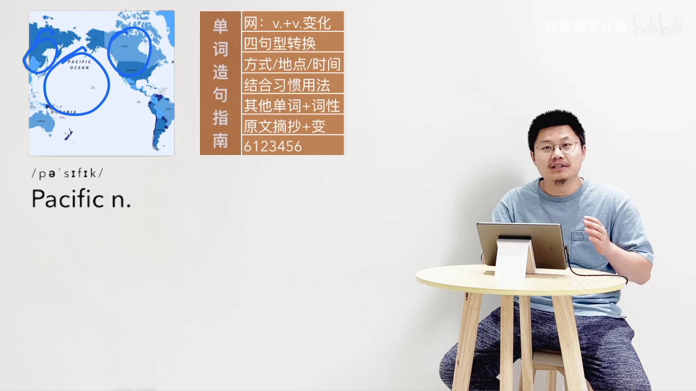

文字识别：单词造句指南 / 网：v.+v.变化 / 四句型转换 / PACIFIC / 方式/地点/时间 / OCEAN / 结合习惯用法 / 其他单词+词性 / 原文摘抄+变 / 6123456 / /pa'sifik/ / Pacific n.

### 画面 00:04:45

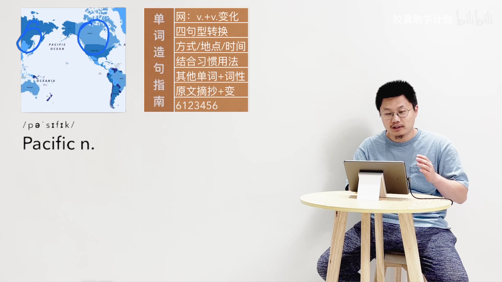

文字识别：单词造句指南 / 网：v.+v.变化 / 四句型转换 / PACIFIC / 方式/地点/时间 / OCEAN / 结合习惯用法 / 其他单词+词性 / OCEANIA / 原文摘抄+变 / 6123456 / /pa'sifik/ / Pacific n.

### 画面 00:04:47

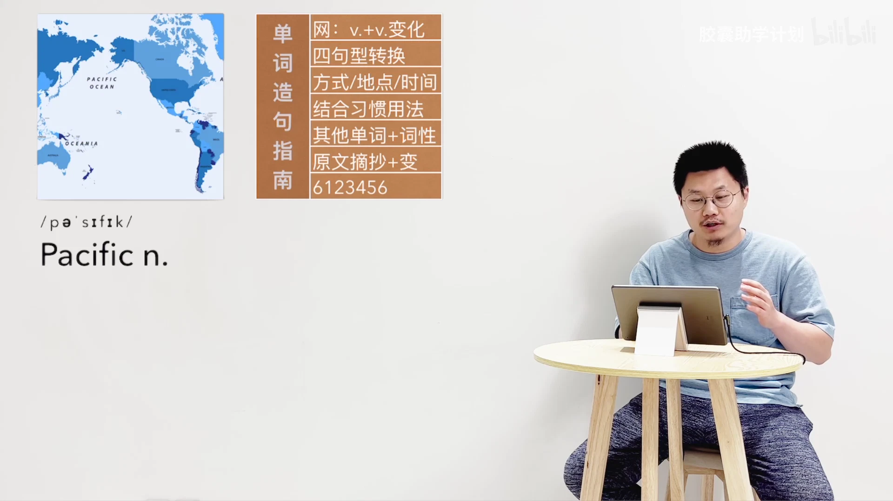

文字识别：单词造句指南 / 网：v.+v.变化 / 四句型转换 / PACIFIC / 方式/地点/时间 / OCEAN / 结合习惯用法 / 其他单词+词性 / OCEANIA / 原文摘抄+变 / 6123456 / /pa'sifik/ / Pacific n.

### 画面 00:04:51

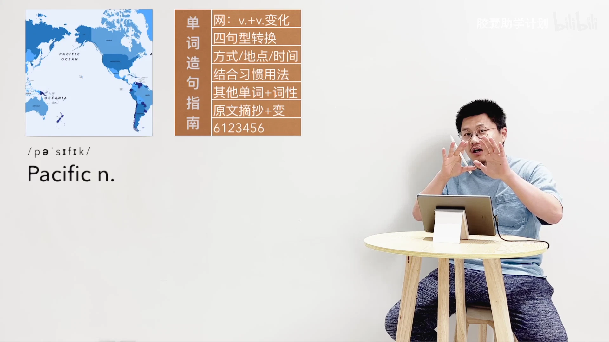

文字识别：单词造句指南 / 网：v.+v.变化 / 四句型转换 / PACIFIC / 方式/地点/时间 / OCEAN / 结合习惯用法 / 其他单词+词性 / OCEANIA / 原文摘抄+变 / 6123456 / /pa'sifik/ / Pacific n.

### 画面 00:04:55

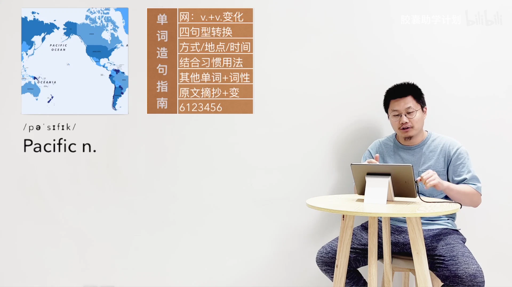

文字识别：单词造句指南 / 网：v.+v.变化 / 四句型转换 / PACIFIC / 方式/地点/时间 / OCEAN / 结合习惯用法 / 其他单词+词性 / OCEANIA / 原文摘抄+变 / 6123456 / /pa'sifik/ / Pacific n.

### 画面 00:04:57

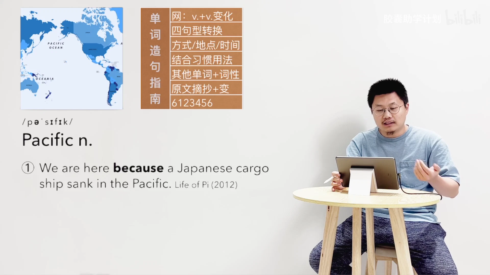

文字识别：单词造句指南 / 网：v.+v.变化 / 四句型转换 / PACIFIC / 方式/地点/时间 / OCEAN / 结合习惯用法 / 其他单词+词性 / OCEANIA / 原文摘抄+变 / 6123456 / /pa'sifik/ / Pacific n. / ① We are here because a Japanese cargo / ship sank in the Pacific. Life of Pi (2012)

## 00:05:00–00:05:30

直接看到了一个非常棒的电影片段。他用了这么一句话，说 We're here because a Japanese cargo ship sank in the Pacific. 那这里其实对于各位来说，重点叫 in the Pacific，叫在太平洋，对吧？OK，说我们在这里是因为什么呢？因为一个日本的货船沉在了太平洋里。OK， next one，说 Our captain，这里其实这句话我是模仿了十二课我们学过的那篇文章，

### 画面 00:05:01

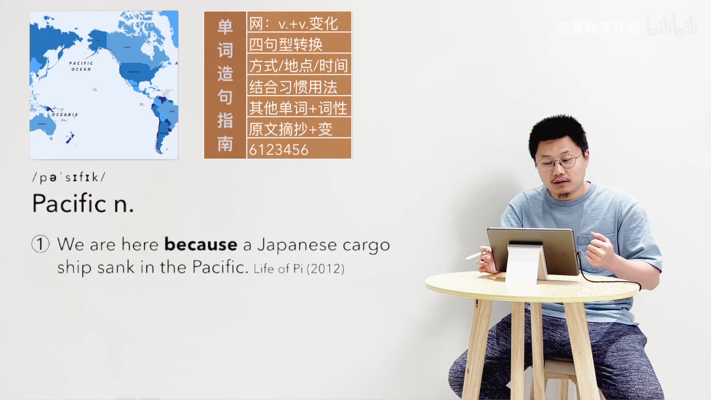

文字识别：单词造句指南 / 网：v.+v.变化 / 四句型转换 / PACIFIC / 方式/地点/时间 / OCEAN / 结合习惯用法 / 其他单词+词性 / OCEANIA / 原文摘抄+变 / 6123456 / /pa'sifik/ / Pacific n. / ① We are here because a Japanese cargo / ship sank in the Pacific. Life of Pi (2012)

### 画面 00:05:05

文字识别：单词造句指南 / 网：v.+v.变化 / 四句型转换 / PACIFIC / 方式/地点/时间 / OCEAN / 结合习惯用法 / 其他单词+词性 / OCEANIA / 原文摘抄+变 / 6123456 / /pa'sifik/ / Pacific n. / ① We are here because a Japanese cargo / ship sank in the Pacific. Life of Pi (2012)

### 画面 00:05:11

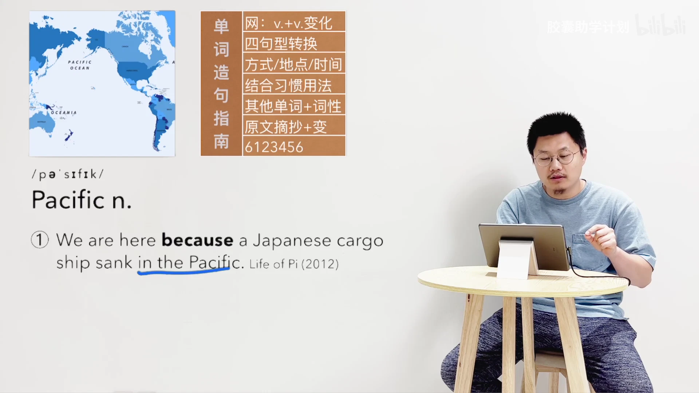

文字识别：单词造句指南 / 网：v.+v.变化 / 四句型转换 / PACIFIC / 方式/地点/时间 / OCEAN / 结合习惯用法 / 其他单词+词性 / OCEANIA / 原文摘抄+变 / 6123456 / /pa'sifik/ / Pacific n. / ① We are here because a Japanese cargo / ship sank in the Pacific. Life of Pi (2012)

### 画面 00:05:14

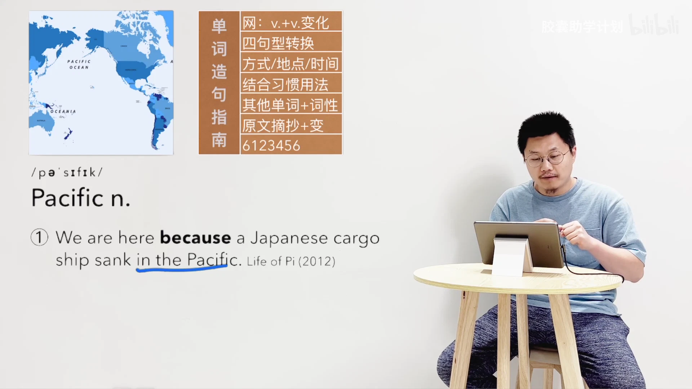

文字识别：单词造句指南 / 网：v.+v.变化 / 四句型转换 / PACIFIC / 方式/地点/时间 / OCEAN / 结合习惯用法 / 其他单词+词性 / OCEANLA / 原文摘抄+变 / 6123456 / /pa'sifik/ / Pacific n. / ① We are here because a Japanese cargo / ship sank in the Pacific. Life of Pi (2012)

### 画面 00:05:16

文字识别：单词造句指南 / 网：v.+v.变化 / 四句型转换 / PACIFIC / 方式/地点/时间 / OCEAN / 结合习惯用法 / 其他单词+词性 / OCEANIA / 原文摘抄+变 / 6123456 / /pa'sifik/ / Pacific n. / ① We are here because a Japanese cargo / ship sank in the Pacific. Life of Pi (2012)

### 画面 00:05:20

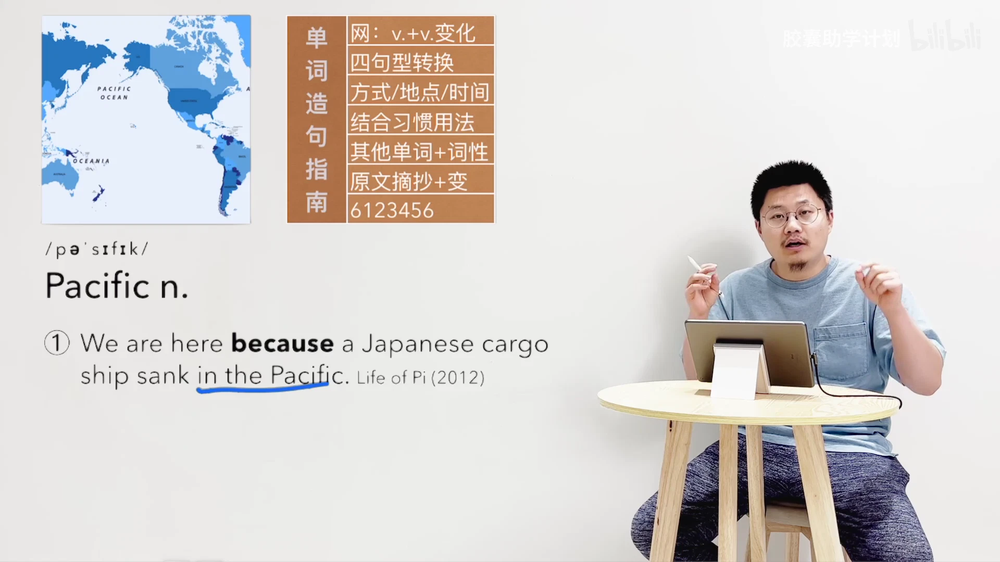

文字识别：单词造句指南 / 网：v.+v.变化 / 四句型转换 / PACIFIC / 方式/地点/时间 / OCEAN / 结合习惯用法 / 其他单词+词性 / OCEANIA / 原文摘抄+变 / 6123456 / /pa'sifik/ / Pacific n. / ① We are here because a Japanese cargo / ship sank in the Pacific. Life of Pi (2012)

### 画面 00:05:23

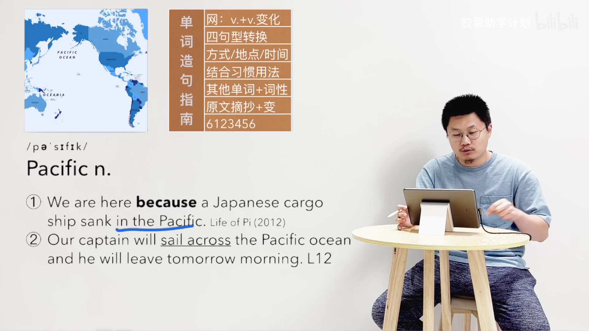

文字识别：单词造句指南 / 网：v.+v.变化 / 四句型转换 / PACIFIC / 方式/地点/时间 / OCEAN / 结合习惯用法 / 其他单词+词性 / OCEANIA / 原文摘抄+变 / 6123456 / /pa'sifik/ / Pacific n. / ① We are here because a Japanese cargo / ship sank in the Pacific. Life of Pi (2012) / ② Our captain will sail across the Pacific ocean / and he will leave tomorrow morning. L12

### 画面 00:05:25

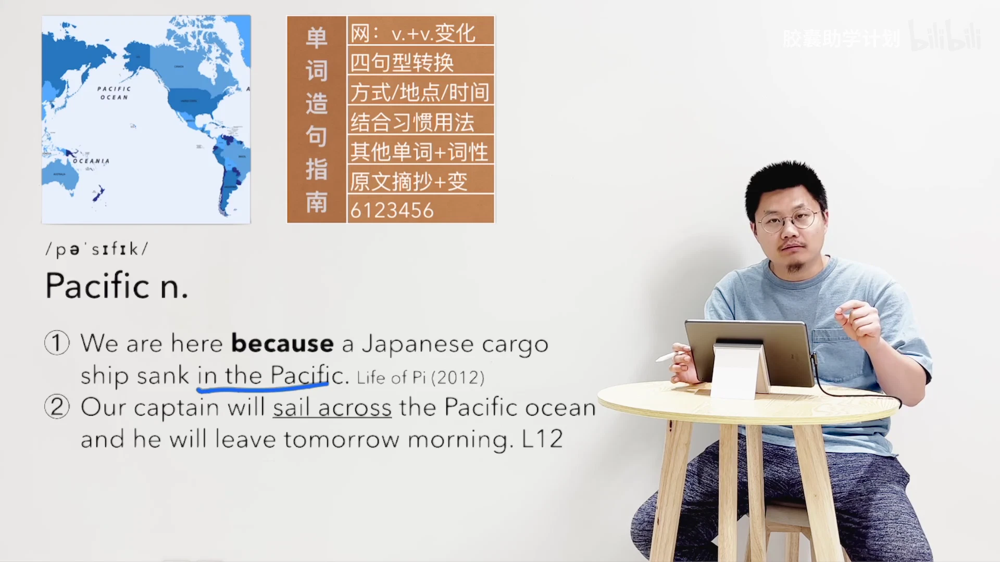

文字识别：单词造句指南 / 网：v.+v.变化 / 四句型转换 / PACIFIC / 方式/地点/时间 / OCEAN / 结合习惯用法 / 其他单词+词性 / OCEANIA / 原文摘抄+变 / 6123456 / /pa'sifik/ / Pacific n. / ① We are here because a Japanese cargo / ship sank in the Pacific. Life of Pi (2012) / ② Our captain will sail across the Pacific ocean / and he will leave tomorrow morning. L12

## 00:05:30–00:06:00

对吧？Our captain那篇文章说，Our captain will sail across the Pacific Ocean and he will leave tomorrow morning.哎，他将哎这个呃帆船也好，什么船也好啊，他将会呃穿越整个太平洋，明天早上出发。There you go. Next one. You know, it's been over thirty years since I saw the Pacific Ocean.啊，这里其实出现了好几个点，我一跟大家说一下。首先，

### 画面 00:05:31

文字识别：单词造句指南 / 网：v.+v.变化 / 四句型转换 / PACIFIC / 方式/地点/时间 / OCEAN / 结合习惯用法 / 其他单词+词性 / OCEANIA / 原文摘抄+变 / 6123456 / /pa'sifik/ / Pacific n. / ① We are here because a Japanese cargo / ship sank in the Pacific. Life of Pi (2012) / ② Our captain will sail across the Pacific ocean / and he will leave tomorrow morning. L12

### 画面 00:05:37

文字识别：单词造句指南 / 网：v.+v.变化 / 四句型转换 / PACIFIC / 方式/地点/时间 / OCEAN / 结合习惯用法 / 其他单词+词性 / OCEANIA / 原文摘抄+变 / 6123456 / /pa'sifik/ / Pacific n. / ① We are here because a Japanese cargo / ship sank in the Pacific. Life of Pi (2012) / ② Our captain will sail across the Pacific ocean / and he will leave tomorrow morning. L12

### 画面 00:05:41

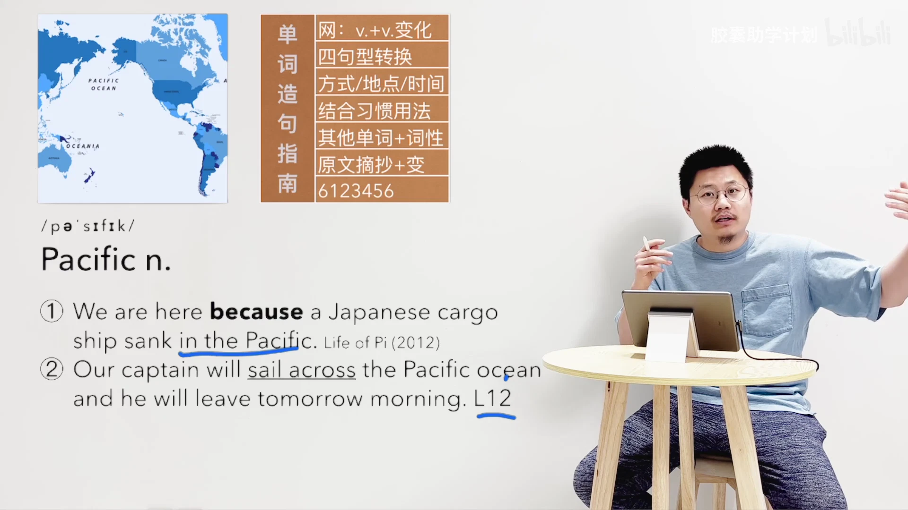

文字识别：单词造句指南 / 网：v.+v.变化 / 四句型转换 / PACIFIC / 方式/地点/时间 / OCEAN / 结合习惯用法 / 其他单词+词性 / OCEANIA / 原文摘抄+变 / 6123456 / /pa'sifik/ / Pacific n. / ① We are here because a Japanese cargo / ship sank in the Pacific. Life of Pi (2012) / ② Our captain will sail across the Pacific ocean / and he will leave tomorrow morning. L12

### 画面 00:05:45

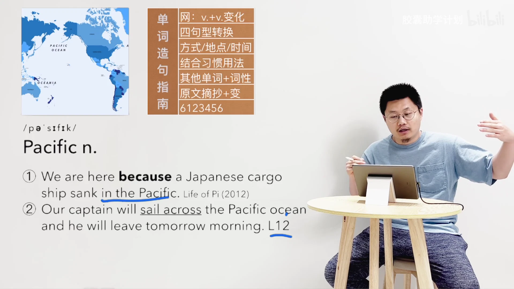

文字识别：单词造句指南 / 网：v.+v.变化 / 四句型转换 / PACIFIC / 方式/地点/时间 / OCEAN / 结合习惯用法 / 其他单词+词性 / OCEANIA / 原文摘抄+变 / 6123456 / /pa'sifik/ / Pacific n. / ① We are here because a Japanese cargo / ship sank in the Pacific. Life of Pi (2012) / ② Our captain will sail across the Pacific ocean / and he will leave tomorrow morning. L12

### 画面 00:05:48

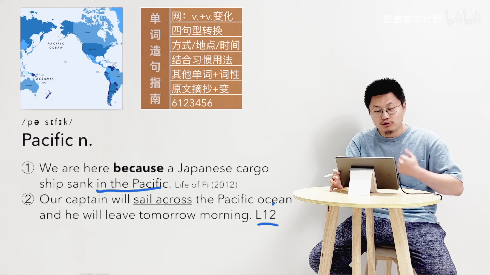

文字识别：单词造句指南 / 网：v.+v.变化 / 四句型转换 / PACIFIC / 方式/地点/时间 / OCEAN / 结合习惯用法 / 其他单词+词性 / OCEANIA / 原文摘抄+变 / 6123456 / /pa'sifik/ / Pacific n. / ① We are here because a Japanese cargo / ship sank in the Pacific. Life of Pi (2012) / ② Our captain will sail across the Pacific ocean / and he will leave tomorrow morning. L12

### 画面 00:05:50

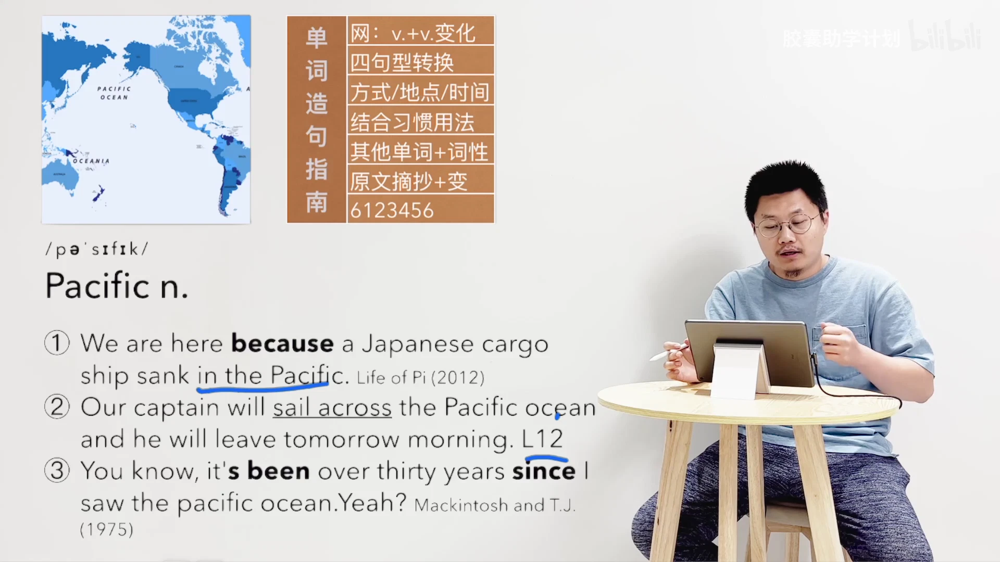

文字识别：单词造句指南 / 网：v.+v.变化 / 四句型转换 / PACIFIC / 方式/地点/时间 / OCEAN / 结合习惯用法 / 其他单词+词性 / OCEANIA / 原文摘抄+变 / 6123456 / /pa'sifik/ / Pacific n. / ① We are here because a Japanese cargo / ship sank in the Pacific. Life of Pi (2012) / ② Our captain will sail across the Pacific ocean / and he will leave tomorrow morning. L12 / ③ You know, it's been over thirty years since I / saw the pacific ocean.Yeah? Mackintosh and T.J. / (1975)

### 画面 00:05:55

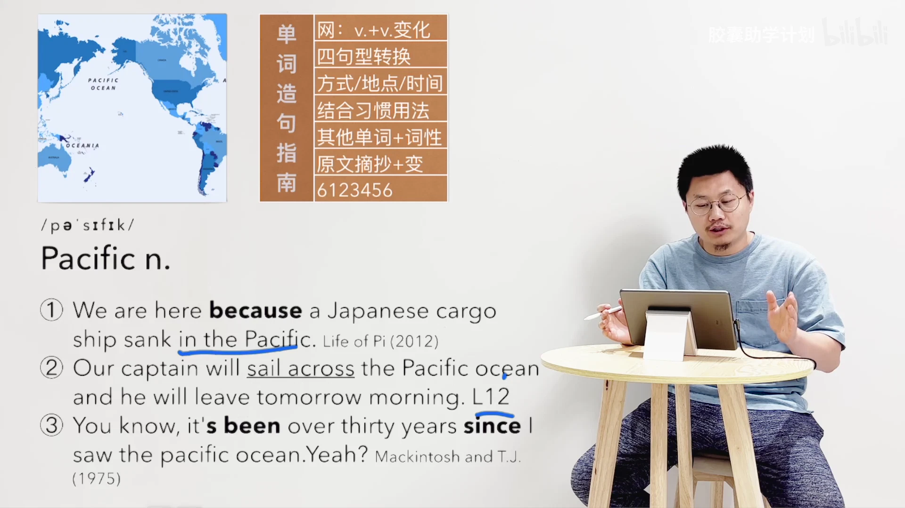

文字识别：单词造句指南 / 网：v.+v.变化 / 四句型转换 / PACIFIC / 方式/地点/时间 / OCEAN / 结合习惯用法 / 其他单词+词性 / OCEANIA / 原文摘抄+变 / 6123456 / /pa'sifik/ / Pacific n. / ① We are here because a Japanese cargo / ship sank in the Pacific. Life of Pi (2012) / ② Our captain will sail across the Pacific ocean / and he will leave tomorrow morning. L12 / ③ You know, it's been over thirty years since I / saw the pacific Ocean.Yeah? Mackintosh and T.J. / (1975)

### 画面 00:05:57

文字识别：单词造句指南 / 网：v.+v.变化 / 四句型转换 / PACIFIC / 方式/地点/时间 / OCEAN / 结合习惯用法 / 其他单词+词性 / OCEANIA / 原文摘抄+变 / 6123456 / /pa'sifik/ / Pacific n. / ① We are here because a Japanese cargo / ship sank in the Pacific. Life of Pi (2012) / ② Our captain will sail across the Pacific ocean / and he will leave tomorrow morning. L12 / ③ You know, it's been over thirty years since I / saw the pacific ocean.Yeah? Mackintosh and T.J. / (1975)

## 00:06:00–00:06:30

is been 这个地方其实是 has 加 been 现在完成时，对吧？已经超过过去了将近三十年。自从什么时候开始呢？我看见太平洋已经超过了将近三十年，对吧？它虽然是个电影台词，但其实都是在复习我们之前学过的东西啊。我之所以有的时候会开始加入这个电影台词呢，呃，有一些原因。对于各位来说很重要的事情就是告诉各位，我们在这里学到的很多东西，呃，如果您不是

### 画面 00:06:00

文字识别：单词造句指南 / 网：v.+v.变化 / 四句型转换 / PACIFIC / 方式/地点/时间 / OCEAN / 结合习惯用法 / 其他单词+词性 / OCEANIA / 原文摘抄+变 / 6123456 / /pa'sifik/ / Pacific n. / ① We are here because a Japanese cargo / ship sank in the Pacific. Life of Pi (2012) / ② Our captain will sail across the Pacific ocean / and he will leave tomorrow morning. L12 / ③ You know, it's been over thirty years since I / saw the pacific ocean.Yeah? Mackintosh and T.J. / (1975)

### 画面 00:06:11

文字识别：单词造句指南 / 网：v.+v.变化 / 四句型转换 / PACIFIC / 方式/地点/时间 / OCEAN / 结合习惯用法 / 其他单词+词性 / OCEANIA / 原文摘抄+变 / 6123456 / /pa'sifik/ / Pacific n. / ① We are here because a Japanese cargo / ship sank in the Pacific. Life of Pi (2012) / ② Our captain will sail across the Pacific ocean / and he will leave tomorrow morning. L12 / ③ You know, it's been over thirty years since I / saw the pacific ocean.Yeah? Mackintosh and T.J. / (1975)

### 画面 00:06:16

文字识别：单词造句指南 / 网：v.+v.变化 / 四句型转换 / PACIFIC / 方式/地点/时间 / OCEAN / 结合习惯用法 / 其他单词+词性 / OCEANIA / 原文摘抄+变 / 6123456 / /pa'sifik/ / Pacific n. / ① We are here because a Japanese cargo / ship sank in the Pacific. Life of Pi (2012) / ② Our captain will sail across the Pacific ocean / and he will leave tomorrow morning. L12 / ③ You know, it's been over thirty years since I / saw the pacific ocean.Yeah? Mackintosh and T.J. / (1975)

### 画面 00:06:28

文字识别：单词造句指南 / 网：v.+v.变化 / 四句型转换 / PACIFIC / 方式/地点/时间 / OCEAN / 结合习惯用法 / 其他单词+词性 / OCEANIA / 原文摘抄+变 / 6123456 / /pa'sifik/ / Pacific n. / ① We are here because a Japanese cargo / ship sank in the Pacific. Life of Pi (2012) / ② Our captain will sail across the Pacific ocean / and he will leave tomorrow morning. L12 / ③ You know, it's been over thirty years since I / saw the pacific ocean.Yeah? Mackintosh and T.J. / (1975)

## 00:06:30–00:07:00

纯为了考试，考试肯定有用，对吧？如果不是为了纯考试，比如说我是为了实际应用，那这些单词它都是不停的出现的，所以您一定要去记啊，在现实生活当中啊，再读一遍这个单词，Repeat after me, OK? Pacific, very good. 那来吧，对吧？电影片段，注意力集中。I hope the Pacific is as blue as it has been in my dreams. 哎，这个地方我要多提一句，三十二课咱们学的这个语法，新概

### 画面 00:06:30

文字识别：单词造句指南 / 网：v.+v.变化 / 四句型转换 / PACIFIC / 方式/地点/时间 / OCEAN / 结合习惯用法 / 其他单词+词性 / OCEANIA / 原文摘抄+变 / 6123456 / /pa'sifik/ / Pacific n. / ① We are here because a Japanese cargo / ship sank in the Pacific. Life of Pi (2012) / ② Our captain will sail across the Pacific ocean / and he will leave tomorrow morning. L12 / ③ You know, it's been over thirty years since I / saw the pacific ocean.Yeah? Mackintosh and T.J. / (1975)

### 画面 00:06:38

文字识别：单词造句指南 / 网：v.+v.变化 / 四句型转换 / PACIFIC / 方式/地点/时间 / OCEAN / 结合习惯用法 / 其他单词+词性 / OCEANIA / 原文摘抄+变 / 6123456 / /pa'sifik/ / Pacific n. / ① We are here because a Japanese cargo / ship sank in the Pacific. Life of Pi (2012) / ② Our captain will sail across the Pacific ocean / and he will leave tomorrow morning. L12 / ③ You know, it's been over thirty years since I / saw the pacific ocean.Yeah? Mackintosh and T.J. / (1975)

### 画面 00:06:40

文字识别：单词造句指南 / 网：v.+v.变化 / 四句型转换 / PACIFIC / 方式/地点/时间 / OCEAN / 结合习惯用法 / 其他单词+词性 / OCEANIA / 原文摘抄+变 / 6123456 / /pa'sifik/ / Pacific n. / ① We are here because a Japanese cargo / ship sank in the Pacific. Life of Pi (2012) / ② Our captain will sail across the Pacific ocean / and he will leave tomorrow morning. L12 / ③ You know, it's been over thirty years since I / saw the pacific ocean.Yeah? Mackintosh and T.J. / (1975)

### 画面 00:06:45

文字识别：单词造句指南 / 网：v.+v.变化 / 四句型转换 / PACIFIC / 方式/地点/时间 / OCEAN / 结合习惯用法 / 其他单词+词性 / OCEANIA / 原文摘抄+变 / 6123456 / /pa'sifik/ / Pacific n. / ① We are here because a Japanese cargo / ship sank in the Pacific. Life of Pi (2012) / ② Our captain will sail across the Pacific ocean / and he will leave tomorrow morning. L12 / ③ You know, it's been over thirty years since I / saw the pacific ocean.Yeah? Mackintosh and T.J. / (1975)

### 画面 00:06:47

文字识别：I hope the Pacific is as blue as / it has been in my dreams. / The Shawshank Redemption / (1994)

### 画面 00:06:53

文字识别：I hope the Pacific is as blue as / it has been in my dreams. / The Shawshank Redemption / (1994)

### 画面 00:06:55

文字识别：I hope the Pacific is as blue as / it has been in my dreams. / The Shawshank Redemption / (1994)

### 画面 00:06:57

文字识别：I hope the Pacific is as blue as / it has been in my dreams. / The Shawshank Redemption / (1994)

### 画面 00:06:59

文字识别：I hope the Pacific is as blue as / it has been in my dreams. / The Shawshank Redemption / (1994)

## 00:07:00–00:07:30

念一册一百一十一课咱们学的叫 as 形容词 as 对吧？哎，我希望这个太平洋是同样的蓝，和我在梦中啊想到的那些对吧？和我梦中的感受是一样的蓝啊，as blue as，而一个是同样的蓝。Next one，两个单词，第一个单词其实咱们第十课就学过了，叫 damage 啊，叫损坏、损毁。而第二个单词是本课你重点需要记的一个名词，叫做 wreck，

### 画面 00:07:01

文字识别：I hope the Pacific is as blue as / it has been in my dreams. / The Shawshank Redemption / (1994)

### 画面 00:07:03

文字识别：I hope the Pacific is as blue as / it has been in my dreams. / The Shawshank Redemption / (1994)

### 画面 00:07:05

文字识别：I hope the Pacific is as blue as / it has been in my dreams. / The Shawshank Redemption / (1994)

### 画面 00:07:10

文字识别：I hope the Pacific is as blue as / it has been in my dreams. / The Shawshank Redemption / (1994)

### 画面 00:07:12

文字识别：I hope the Pacific is as blue as / it has been in my dreams. / The Shawshank Redemption / (1994)

### 画面 00:07:14

文字识别：I hope the Pacific is as blue as / it has been in my dreams. / The Shawshank Redemption / (1994)

### 画面 00:07:16

文字识别：I hope the Pacific is as blue as / it has been in my dreams. / The Shawshank Redemption / (1994)

### 画面 00:07:18

文字识别：单词造句指南 / 网：v.+v.变化 / 四句型转换 / 方式/地点/时间 / 结合习惯用法 / 其他单词+词性 / 原文摘抄+变 / 6123456 / / 'd æmid3/ / / r e k / / damage v. wreck n.(car/ship)

### 画面 00:07:21

文字识别：单词造句指南 / 网：v.+v.变化 / 四句型转换 / 方式/地点/时间 / 结合习惯用法 / 其他单词+词性 / 原文摘抄+变 / 6123456 / /d emI d 3/ / / r e k / / damage v. wreck n.(car/ship)

### 画面 00:07:26

文字识别：单词造句指南 / 网：v.+v.变化 / 四句型转换 / 方式/地点/时间 / 结合习惯用法 / 其他单词+词性 / 原文摘抄+变 / 6123456 / /' d emI d 3/ / / r e k / / damage v. wreck n.(car/ship)

## 00:07:30–00:08:00

叫做残骸，对吧？你损毁了之后剩下的那个东西叫做 wreck。比如说这个桌子，我现在拿斧头给它凿了，对吧？这个动作叫做 damage。凿完了之后，一地的碎屑，对吧？这个叫做 wreck。Very good。那 wreck 这个单词有它自己比较常见的搭配是 car 跟 ship，是 car wreck 和 ship wreck，对吧？哎，不是说是个东西它就用 wreck 啊，这是英文的习惯，不是不可以。听见

### 画面 00:07:35

文字识别：单词造句指南 / 网：v.+v.变化 / 四句型转换 / 方式/地点/时间 / 结合习惯用法 / 其他单词+词性 / 原文摘抄+变 / 6123456 / /d æemI dz1 / / r e k / / damage v. y / wreck n.(car/ship)

### 画面 00:07:53

文字识别：单词造句指南 / 网：v.+v.变化 / 四句型转换 / 方式/地点/时间 / 结合习惯用法 / 其他单词+词性 / 原文摘抄+变 / 6123456 / / d emI d z1 / / r e k / / wreck n.(car/ship) / damage v.y

### 画面 00:07:55

文字识别：单词造句指南 / 网：v.+v.变化 / 四句型转换 / 方式/地点/时间 / 结合习惯用法 / 其他单词+词性 / 原文摘抄+变 / 6123456 / /  d æ m I d z/ / / r e k / / damage v. wreck n.(car/ship)

## 00:08:00–00:08:30

了啊？比如说，我们先造一句子，叫做 The house was damaged by the floods。啊，你看这里全是我们之前学过的。首先，floods洪水，对吧？然后 was damaged，第十课被动啊，被损毁了，被洪水毁坏了。Next one， when we were looking at the wreck of the boat， the captain came。说当我们正在看什么呢？这个船的残骸的时候，船长到了。哎，比如

### 画面 00:08:00

文字识别：单词造句指南 / 网：v.+v.变化 / 四句型转换 / 方式/地点/时间 / 结合习惯用法 / 其他单词+词性 / 原文摘抄+变 / 6123456 / /dæmI dz1 / / r e k / / damage v. y / wreck n.(car/ship) / ① The house was damaged by the floods. L10

### 画面 00:08:08

文字识别：单词造句指南 / 网：v.+v.变化 / 四句型转换 / 方式/地点/时间 / 结合习惯用法 / 其他单词+词性 / 原文摘抄+变 / 6123456 / / ' d æ m I d z/ / / r e k / / damage v. wreck n.(car/ship) / ① The house was damaged by the floods. L10

### 画面 00:08:11

文字识别：单词造句指南 / 网：v.+v.变化 / 四句型转换 / 方式/地点/时间 / 结合习惯用法 / 其他单词+词性 / 原文摘抄+变 / 6123456 / / ' d æ m I d z/ / / r e k / / damage v. wreck n.(car/ship) / ① The house was damaged by the floods. L10

### 画面 00:08:14

文字识别：单词造句指南 / 网：v.+v.变化 / 四句型转换 / 方式/地点/时间 / 结合习惯用法 / 其他单词+词性 / 原文摘抄+变 / 6123456 / /  d æe m I d z/ / / r e k 1 / damage v. wreck n.(car/ship) / ① The house was damaged by the floods. L10 / When we were looking at the wreck of the / boat, the captain came. L7

## 00:08:30–00:09:00

说在港口，对吧？他得到了这个噩耗啊。 Next one is apart from that wreck, I don't have anything. So,除了，比如说这个 wreck，那你其实加一个上下文场景就好理解了，对吧？哎，那我在造这个句子的时候，脑海当中有场景，比如说除了，其实大概的含义就是除了这堆破烂，我一无所有嘛。那这个破烂是什么？可能是比如说我开汽车撞车了，这是我买辆二手车，但是我又给撞坏了啊。 Car wreck. 说除了这堆破铜烂铁以外，

### 画面 00:08:35

文字识别：单词造句指南 / 网：v.+v.变化 / 四句型转换 / 方式/地点/时间 / 结合习惯用法 / 其他单词+词性 / 原文摘抄+变 / 6123456 / /  d æ m I d z/ / / r e k / / damage v. wreck n.(car/ship) / ① The house was damaged by the floods. L10 / When we were looking at the wreck of the / boat, the captain came. L7 / Apart from that wreck, I don't have / anything. L14

### 画面 00:08:50

文字识别：单词造句指南 / 网：v.+v.变化 / 四句型转换 / 方式/地点/时间 / 结合习惯用法 / 其他单词+词性 / 原文摘抄+变 / 6123456 / / 'd æmI d z/ / / r e k / / damage v. wreck n.(car/ship) / ① The house was damaged by the floods. L10 / When we were looking at the wreck of the / boat, the captain came. L7 / Apart from that wreck, I don't have / anything. L14

### 画面 00:08:53

文字识别：单词造句指南 / 网：v.+v.变化 / 四句型转换 / 方式/地点/时间 / 结合习惯用法 / 其他单词+词性 / 原文摘抄+变 / 6123456 / / ' d æ m I d z/ / / r e k / / damage v. wreck n.(car/ship) / ① The house was damaged by the floods. L10 / When we were looking at the wreck of the / boat, the captain came. L7 / Apart from that wreck, I don't have / anything. L14

### 画面 00:08:55

文字识别：单词造句指南 / 网：v.+v.变化 / 四句型转换 / 方式/地点/时间 / 结合习惯用法 / 其他单词+词性 / 原文摘抄+变 / 6123456 / /  dæmI d 3 / / r e k / / damage v. wreck n.(car/ship) / ① The house was damaged by the floods. L10 / When we were looking at the wreck of the / boat, the captain came. L7 / Apart from that wreck, I don't have / anything. L14

## 00:09:00–00:09:30

我一无所有，就是这句话. Apart from that wreck, I don't have anything. That part from十四课咱们学的，除了 next one, they must have found the wreck of the bomber in that remote island. 那我们和这课的文章做一下联动，说啊，他们当时一定是找到了。十七课咱们学的 the wreck of the bomber 是什么呢？说这个轰炸机的残骸 in that remote island. 这是咱们刚学的另一个单词

### 画面 00:09:07

文字识别：单词造句指南 / 网：v.+v.变化 / 四句型转换 / 方式/地点/时间 / 结合习惯用法 / 其他单词+词性 / 原文摘抄+变 / 6123456 / /  d æ mI d z/ / / r e k / / damage v. wreck n.(car/ship) / ① The house was damaged by the floods. L10 / When we were looking at the wreck of the / boat, the captain came. L7 / Apart from that wreck, I don't have / anything. L14

### 画面 00:09:09

文字识别：单词造句指南 / 网：v.+v.变化 / 四句型转换 / 方式/地点/时间 / 结合习惯用法 / 其他单词+词性 / 原文摘抄+变 / 6123456 / /' d æe mI d z/ / / r e k / / damage v. wreck n.(car/ship) / ① The house was damaged by the floods. L10 / When we were looking at the wreck of the / boat, the captain came. L7 / Apart from that wreck, I don't have / anything. L14 / They must have found the wreck of the / bomber in that remote island. L17

### 画面 00:09:18

文字识别：单词造句指南 / 网：v.+v.变化 / 四句型转换 / 方式/地点/时间 / 结合习惯用法 / 其他单词+词性 / 原文摘抄+变 / 6123456 / / d æ mI d z/ / / r e k / / damage v. wreck n.(car/ship) / ① The house was damaged by the floods. L10 / When we were looking at the wreck of the / boat, the captain came. L7 / Apart from that wreck, I don't have / anything. L14 /  They nust have foundthe wreck of the / bomber in that remote island. L17

### 画面 00:09:21

文字识别：单词造句指南 / 网：v.+v.变化 / 四句型转换 / 方式/地点/时间 / 结合习惯用法 / 其他单词+词性 / 原文摘抄+变 / 6123456 / /  d æ mI d z/ / / r e k / / damage v. wreck n.(car/ship) / ① The house was damaged by the floods. L10 / When we were looking at the wreck of the / boat, the captain came. L7 / Apart from that wreck, I don't have / anything. L14 / They ngust have foundthe wreck of the / bomber in that remote island. L17

### 画面 00:09:25

文字识别：单词造句指南 / 网：v.+v.变化 / 四句型转换 / 方式/地点/时间 / 结合习惯用法 / 其他单词+词性 / 原文摘抄+变 / 6123456 / /  d æ mI d z/ / / r e k / / damage v. wreck n.(car/ship) / ① The house was damaged by the floods. L10 / When we were looking at the wreck of the / boat, the captain came. L7 / Apart from that wreck, I don't have / anything. L14 / They ngust have foundthe wreck of the / bomber in that remote island. L17

## 00:09:30–00:10:00

remote 啊，在那个偏僻的小岛上。Very good. 再读一下这两个单词 damage, wreck. 好，那接下来呢，咱们看一个小的电影片段。但这句话我想简单提一句，叫 I'm just a stupid kid. 我就是一个又啊，我是一个很笨的孩子小孩儿。什么样的孩子呢？后边加一个定语从句， who lives in an old wreck of a car. 说他住在一个旧的汽车的

### 画面 00:09:33

文字识别：单词造句指南 / 网：v.+v.变化 / 四句型转换 / 方式/地点/时间 / 结合习惯用法 / 其他单词+词性 / 原文摘抄+变 / 6123456 / /d æe mI d 3/ / / r e k / / damage v. wreck n.(car/ship) / ① The house was damaged by the floods. L10 / When we were looking at the wreck of the / boat, the captain came. L7 / Apart from that wreck, I don't have / anything. L14 / They ngust have foundthe wreck of the / bomber in that remote island. L17

### 画面 00:09:38

文字识别：I'm just a stupid kid / who lives in an old wreck of a car. / Once Were Warriors / (1994)

## 00:10:00–00:10:30

这个残骸是吧？就其实就是可能这个车很破，形容不一定真的就是碎了，当然也可以指它真的就是坏了，是吧？啊，比如说这是一个 van 啊，是一个这个货车啊，啊七座那种货车，然后它在后边搭了个床。 OK，注意力集中，我们听一下。 I'm just a stupid kid who lives in an old wreck of a car. OK，接下来这个单词其实对于各位来说应该是认得

### 画面 00:10:08

文字识别：I'm just a stupid kid / who lives in an old wreck of a car. / Once Were Warriors / (1994)

### 画面 00:10:20

文字识别：I'm just a stupid kid / who lives in an old wreck of a car. / Once Were Warriors / (1994)

### 画面 00:10:22

文字识别：I'm just a stupid kid / who lives in an old wreck of a car. / Once Were Warriors / (1994)

### 画面 00:10:24

文字识别：单词造句指南 / 网：v.+v.变化 / 四句型转换 / 方式/地点/时间 / 结合习惯用法 / 其他单词+词性 / 原文摘抄+变 / 6123456 / /ri:dI'skΛva/ / rediscover V. o / discover

## 00:10:30–00:11:00

的，因为有一个 re，然后还有一个 discover，那我就把 discover 单独拉出来，discover 叫发现，对吧？哎，那 re discover，你想一下，咱们每一课都有一个部分单词部分叫 recap，re view，re cap，re discover，re 就是 re marry，包括对吧？哎，就是再一次，那 re discover 就是再一次重新啊，重新发现它，对吧？

### 画面 00:10:30

文字识别：单词造句指南 / 网：v.+v.变化 / 四句型转换 / 方式/地点/时间 / 结合习惯用法 / 其他单词+词性 / 原文摘抄+变 / 6123456 / /ri:dI'skΛva/ / rediscover V. discover

## 00:11:00–00:11:30

好，比如说我们造一句话啊，说 I want to help you, I'm gonna help you rediscover your manhood。我要帮你重建你的雄风，是吧？让你重新找到做男人的感觉啊。I'm gonna help you rediscover your manhood. Very good. Next one. 二十个，She realized that 意识到这样一件事儿。说 Repeat after me. She realized that she could rediscover her purple purpose of life. 哎，

### 画面 00:11:00

文字识别：单词造句指南 / 网：v.+v.变化 / 四句型转换 / 方式/地点/时间 / 结合习惯用法 / 其他单词+词性 / 原文摘抄+变 / 6123456 / / ri:dI's kΛ va / / rediscover v. discover / ① I wanna help you. I'm gonna help you / rediscover your manhood. Thin Ice(2011)

### 画面 00:11:16

文字识别：单词造句指南 / 网：v.+v.变化 / 四句型转换 / 方式/地点/时间 / 结合习惯用法 / 其他单词+词性 / 原文摘抄+变 / 6123456 / / ri:dι's kΛva/ / rediscover v. discover / ① I wanna help you. I'm gonna help you / rediscover your manhood. Thin Ice (2011) / She realized that she could rediscover her / purpose of life. L20

### 画面 00:11:24

文字识别：单词造句指南 / 网：v.+v.变化 / 四句型转换 / 方式/地点/时间 / 结合习惯用法 / 其他单词+词性 / 原文摘抄+变 / 6123456 / /ri:dι'skΛva/ / rediscover V. discover / ① I wanna help you. I'm gonna help you / rediscover your manhood. Thin lce(2011) / She realized that she could rediscover her / purpose of life. L20

## 00:11:30–00:12:00

他人生的意义，他意识到他可以重新发掘他人生的意义。Next one, say everybody thinks the bomber, 哎，这是我们造的句子，叫每个人都认为这个什么样的 bomber 呢？哎，后边跟了一个这个呃呃这个分词引导的啊，过去分词引导的一个这个呃定语，对吧？后置了啊， damage during World War Two, 哎，

### 画面 00:11:35

文字识别：单词造句指南 / 网：v.+v.变化 / 四句型转换 / 方式/地点/时间 / 结合习惯用法 / 其他单词+词性 / 原文摘抄+变 / 6123456 / /ri:dI'skΛva/ / rediscover v. discover / ① I wanna help you. I'm gonna help you / rediscover your manhood. Thin ce(2011) / She realized that she could rediscover her / purpose of life. L20 / Everyone thinks the bomber(damaged / during World War ll) can be rediscovered. / L21

### 画面 00:11:47

文字识别：单词造句指南 / 网：v.+v.变化 / 四句型转换 / 方式/地点/时间 / 结合习惯用法 / 其他单词+词性 / 原文摘抄+变 / 6123456 / /ri:dI'sknva/ / rediscover V. discover / ① I wanna help you.I'm gonna help you / rediscover your manhood. Thin lce(2011) / She realized that she could rediscover her / purpose of life. L20 / Everyone thinks the bomber (damaaed / during World War ll) can be rediscovered. / L21

### 画面 00:11:49

文字识别：单词造句指南 / 网：v.+v.变化 / 四句型转换 / 方式/地点/时间 / 结合习惯用法 / 其他单词+词性 / 原文摘抄+变 / 6123456 / /ri:dI'skΛva/ / rediscover v. discover / ① I wanna help you.I'm gonna help you / rediscover your manhood. Thin Ice(2011) / She realized that she could rediscover her / purpose of life. L20 / Everyone thinks the bomber (damaaed / during World WarHI) can be rediscovered. / L21

### 画面 00:11:55

文字识别：单词造句指南 / 网：v.+v.变化 / 四句型转换 / 方式/地点/时间 / 结合习惯用法 / 其他单词+词性 / 原文摘抄+变 / 6123456 / /ri:dι'skΛva/ / rediscover v. discover / ① I wanna help you.I'm gonna help you / rediscover your manhood. Thin lce(2011) / She realized that she could rediscover her / purpose of life. L20 / Everyone thinks the bomber (damaaed / during World WarHI) can be rediscovered. / L21

### 画面 00:11:58

文字识别：单词造句指南 / 网：v.+v.变化 / 四句型转换 / 方式/地点/时间 / 结合习惯用法 / 其他单词+词性 / 原文摘抄+变 / 6123456 / /ri:dι'skΛval / rediscover V. discover / ① I wanna help you.I'm gonna help you / rediscover your manhood. Thin Ice(2011) / She realized that she could rediscover her / purpose of life. L20 / Everyone thinks the bomber (damaaed / during World War ll) can be rediscovered. / L21

## 00:12:00–00:12:30

the period of World War II, the bomber that was damaged, everyone thought this bomber was how? Can be found again, and used again. Twenty-one, we have learned can be done, must be done, and will be done. Let's review with you. Ah, is the passive form of various modal verbs. Again, next one, that attention, we listen to this film clip. Ah, here is a new word called documentary, called documentary.

### 画面 00:12:11

文字识别：单词造句指南 / 网：v.+v.变化 / 四句型转换 / 方式/地点/时间 / 结合习惯用法 / 其他单词+词性 / 原文摘抄+变 / 6123456 / /ri:dI'skΛval / rediscover V. discover / ① I wanna help you. I'm gonna help you / rediscover your manhood. Thin Ice(2011) / She realized that she could rediscover her / purpose of life. L20 / Everyone thinks the bomber (damaaed / during World War ll) can be rediscovered. / L21

### 画面 00:12:22

文字识别：I'm gonna find it, rediscover / it and do a documentary on the whole history. / The Hills Run Red / (2009)

## 00:12:30–00:13:00

叫纪录片。I'm gonna find it, rediscover it, and do a documentary on the whole history。哎，我要找到它，我要重新发现它，对吧？Next one，下一个单词跟我读一下，叫做 survey。survey 啊，这个对于我来说简直太熟悉了，这个单词啊，我新西兰读研期间最后写这个论文的时候，如何收集的数据呢？Online survey，对吧？网络调查，我相信各位其实也可能，至少你

### 画面 00:12:33

文字识别：I'm gonna find it, rediscover / it and do a documentary on the whole history. / The Hills Run Red / (2009)

### 画面 00:12:35

文字识别：I'm gonna find it, rediscover / it and do a documentary on the whole history. / DERD / The Hills Run Red / (2009)

### 画面 00:12:37

文字识别：I'm gonna find it, rediscover / it and do a documentary on the whole history. / The Hills Run Red / (2009)

### 画面 00:12:41

文字识别：单词造句指南 / 网：v.+v.变化 / 四句型转换 / 方式/地点/时间 / 结合习惯用法 / 其他单词+词性 / 原文摘抄+变 / 6123456 / /'s3:vel/ / survey n.

### 画面 00:12:47

文字识别：单词造句指南 / 网：v.+v.变化 / 四句型转换 / 方式/地点/时间 / 结合习惯用法 / 其他单词+词性 / 原文摘抄+变 / 6123456 / /'s3:vel/ / survey n.

## 00:13:00–00:13:30

各种各样的 survey 是轰炸过的，对吧？还总是让你填一下这，填一下那个的，对不对？ Survey，那它很常见，就是各种动词，就是 do 的各种形态，加上一个 survey，啊， do a survey，那做一个调查。好，比如说，说 Do you want to do a survey？ 很简单的一句话，说你想做一个调查吗？ OK， next one，说 He said that he was doing a survey。 哎，他说他当时正在做一个调查，对吧？哎，那填

### 画面 00:13:05

文字识别：单词造句指南 / 网：v.+v.变化 / 四句型转换 / 方式/地点/时间 / 结合习惯用法 / 其他单词+词性 / 原文摘抄+变 / 6123456 / /'s3:vel/ / survey n.

### 画面 00:13:09

文字识别：单词造句指南 / 网：v.+v.变化 / 四句型转换 / 方式/地点/时间 / 结合习惯用法 / 其他单词+词性 / 原文摘抄+变 / 6123456 / /'s3:veI/ / survey n. / ① do/does/did/doing/done a survey…..

### 画面 00:13:11

文字识别：单词造句指南 / 网：v.+v.变化 / 四句型转换 / 方式/地点/时间 / 结合习惯用法 / 其他单词+词性 / 原文摘抄+变 / 6123456 / /'s3:veI/ / survey n. / ①do/does/did/doing/donea survey..

### 画面 00:13:16

文字识别：单词造句指南 / 网：v.+v.变化 / 四句型转换 / 方式/地点/时间 / 结合习惯用法 / 其他单词+词性 / 原文摘抄+变 / 6123456 / / 's3:veI/ / survey n. / ①do/does/did/doing/done a survey... /  Do you want to do a survey?

### 画面 00:13:18

文字识别：单词造句指南 / 网：v.+v.变化 / 四句型转换 / 方式/地点/时间 / 结合习惯用法 / 其他单词+词性 / 原文摘抄+变 / 6123456 / / 's3:veI/ / survey n. / ① do/does/did/doing/done a survey... / ② Do you want to do a survey?

## 00:13:30–00:14:00

### 画面 00:13:31

文字识别：单词造句指南 / 网：v.+v.变化 / 四句型转换 / 方式/地点/时间 / 结合习惯用法 / 其他单词+词性 / 原文摘抄+变 / 6123456 / / 's3:veI/ / survey n. / ① do/does/did/doing/done a survey….. / ② Do you want to do a survey? / He said that he was doing a survey. / The survey must be taken before next / Friday. L21

### 画面 00:13:43

文字识别：No, we're from Channel twelve News / and we're doing a survey. / the / CC / 12 / Madhouse / (1990)

### 画面 00:13:56

文字识别：No, we're from Channel twelve News / and we're doing a survey. / the / Madhouse / (1990)

## 00:14:00–00:14:30

了，对吧？那 Channel Twelve 就是呃这个频道十二 News 就是新闻啊，新闻十二频道。 We're doing a survey. 我们现在正在做一个调查啊，采访您，调查一些事情。注意力集中。 Now we're from Channel Twelve News, and we're doing a survey. Very good. 接下来还是一个电影片段啊。后边这些其实不太重要，就是我在给谁谁谁做一个调查啊。然后我能问你几个问题吗？后边这些不太重要啊，

### 画面 00:14:14

文字识别：No, we're from Channel twelve News / and we're doing a survey. / the / C / 2 / Madhouse / (1990)

### 画面 00:14:16

文字识别：No, we're from Channel twelve News / and we're doing a survey. / the / 12 / Madhouse / (1990)

### 画面 00:14:18

文字识别：I'm making a survey / for Power Through Positive Real Estate.. / may I ask you a few questions? / Rubin and Ed / (1991)

### 画面 00:14:23

文字识别：I'm making a survey / for / Power Through Positive Real Estate... / may I ask you a few questions? / Rubin and Ed / (1991)

### 画面 00:14:25

文字识别：I'm making a survey / for / Power Through Posi / Real Estate.. / may I ask you a few questions? / Rubin and Ed / (1991)

### 画面 00:14:27

文字识别：I'm making a survey / for Power Through Positive Real Estate.. / may l ask you a few questions? / Rubin and Ed / (1991)

### 画面 00:14:29

文字识别：I'm making a survey / for Power Through Positive Real Estate.. / may I ask you a few questions? / Rubin and Ed / (1991)

## 00:14:30–00:15:00

不用去仔细管，就重点听上前后两头。 I'm making a survey for power through positive real estate. May I ask you a few questions? 下一个单词 rescue rescue，好，拯救对吧？然后这个单词呢，因为这个图我们给它放到一起叫 aerial aerial，啊，叫做空中的航空的。 OK，那比如说 rescue 这个单词，注意它既可以是名词，也可以是动词，对吧？啊，既

### 画面 00:14:35

文字识别：I'm making a survey / for Power Through Positive Real Estate.. / may I ask you a few questions? / Rubin and Ed / (1991)

### 画面 00:14:37

文字识别：I'm making a survey / for Power Through Positive Real Estate. / may I ask you a few questions? / Rubin and Ed / (1991)

### 画面 00:14:39

文字识别：I'm making a survey / for Power Through Positive Real Estate.. / may I ask you a few questions? / Rubin and Ed / (1991)

### 画面 00:14:41

文字识别：单词造句指南 / 网：v.+v.变化 / 四句型转换 / 方式/地点/时间 / 结合习惯用法 / 其他单词+词性 / 原文摘抄+变 / 6123456 / /'reskju:/ / /'earial/ / aerial adj. / rescue v.n.

### 画面 00:14:44

文字识别：单词造句指南 / 网：v.+v.变化 / 四句型转换 / 方式/地点/时间 / 结合习惯用法 / 其他单词+词性 / 原文摘抄+变 / 6123456 / /'reskju:/ / /'earial/ / aerial adj. / rescue v. n.

### 画面 00:14:54

文字识别：单词造句指南 / 网：v.+v.变化 / 四句型转换 / 方式/地点/时间 / 结合习惯用法 / 其他单词+词性 / 原文摘抄+变 / 6123456 / /'reskju:/ / /'eariall / aerial adj. / rescue v. n. / The moment we have a rescue plan, we will / tell you. L60

## 00:15:00–00:15:30

可以是动词，又可以是名词。这个顺序是这样标的。那我们造一句话：The moment we have a rescue plan, we will tell you. 我们一旦拥有一个拯救的计划，我们就会告诉你的，对吧？Next one, oh, repeat after me, ah,别忘。Our captain has ordered us to rescue Lile. 让我们的船长 rescue order somebody to do something. 命令我们去把Lile救出来。四十三课咱们学的，对

### 画面 00:15:02

文字识别：单词造句指南 / 网：v.+v.变化 / 四句型转换 / 方式/地点/时间 / 结合习惯用法 / 其他单词+词性 / 原文摘抄+变 / 6123456 / /'reskju:/ / /'eariall / aerial adj. / rescue / V.n. / The moment we have a rescue plan, we will / tell you. L60

### 画面 00:15:10

文字识别：单词造句指南 / 网：v.+v.变化 / 四句型转换 / 方式/地点/时间 / 结合习惯用法 / 其他单词+词性 / 原文摘抄+变 / 6123456 / /'reskju:/ / /'earialL / aerial adj. / rescue / ￥.n. / The moment we have a rescue plan, we will / tell you. L60

### 画面 00:15:24

文字识别：单词造句指南 / 网：v.+v.变化 / 四句型转换 / 方式/地点/时间 / 结合习惯用法 / 其他单词+词性 / 原文摘抄+变 / 6123456 / /'reskju:/ / /'eariall / aerial adj. / rescue / ￥.n. / The moment we have a rescue plan, we will / tell you. L60 / ② Our captain hasbrdered us to rescue Leo. L43

### 画面 00:15:29

文字识别：单词造句指南 / 网：v.+v.变化 / 四句型转换 / 方式/地点/时间 / 结合习惯用法 / 其他单词+词性 / 原文摘抄+变 / 6123456 / /'reskju:/ / /'eariall / aerial adj. / rescue / ￥.n. / The moment we have a rescue plan, we will / tell you. L60 / ) Our captain has 6rdered us to rescue Leo. L43

## 00:15:30–00:16:00

吧？Next one, 哎，四十六课咱们学的。It occurred to me that it occurred to me that是什么？不是单纯的我想到，就我突然间灵光一动想到，对吧？我突然间想到什么呢？We found this in an aerial survey of the island. 这后边我给你加个story是什么意思呢？因为这个短语in an aerial survey of an island实际上是我从文章当中摘过来的一个语言片段，对吧？那我们看一下它什么意思。

### 画面 00:15:31

文字识别：单词造句指南 / 网：v.+v.变化 / 四句型转换 / 方式/地点/时间 / 结合习惯用法 / 其他单词+词性 / 原文摘抄+变 / 6123456 / /'reskju:/ / /'eariall / aerial adj. / rescueと.n. / The moment we have a rescue plan, we will / tell you. L60 /  Our captain has brdered us to rescue Leo. L43 / It occurred to me that we found this in an aerial / survey of the island.[Story] L46

### 画面 00:15:34

文字识别：单词造句指南 / 网：v.+v.变化 / 四句型转换 / 方式/地点/时间 / 结合习惯用法 / 其他单词+词性 / 原文摘抄+变 / 6123456 / /'reskju:/ / /'eariall / aerial adj. / rescueと.n. / The moment we have a rescue plan, we will / tell you. L60 / ② Our captain has ordered us to rescue Leo. L43 / It occurred to me that we found this in an aerial / 3 / survey of the island.[Story] L46

### 画面 00:15:39

文字识别：单词造句指南 / 网：v.+v.变化 / 四句型转换 / 方式/地点/时间 / 结合习惯用法 / 其他单词+词性 / 原文摘抄+变 / 6123456 / /'reskju:/ / /'eariall / aerial adj. / rescuey.n. / The moment we have a rescue plan, we will / tell you. L60 / ② Our captain has ordered us to rescue Leo. L43 / It occurred to me that we found this in an aerial / 3 / survey of the island.[Story] L46

### 画面 00:15:46

文字识别：单词造句指南 / 网：v.+v.变化 / 四句型转换 / 方式/地点/时间 / 结合习惯用法 / 其他单词+词性 / 原文摘抄+变 / 6123456 / /'reskju:/ / /'eariall / aerial adj. / rescueと.n. / The moment we have a rescue plan, we will / tell you. L60 / ② Our captain has ordered us to rescue Leo. L43 / It occurred to me that we found this in an aerial / 3 / survey of the island.[Story] L46

### 画面 00:15:48

文字识别：单词造句指南 / 网：v.+v.变化 / 四句型转换 / 方式/地点/时间 / 结合习惯用法 / 其他单词+词性 / 原文摘抄+变 / 6123456 / /'reskju:/ / /'eariall / aerial adj. / rescuey.n. / The moment we have a rescue plan, we will / tell you. L60 /  Our captain has ordered us to rescue Leo. L43 / 2) / It occurred to me that we found this in an aerial / 3 / survey of the island.TStory] L46

### 画面 00:15:50

文字识别：单词造句指南 / 网：v.+v.变化 / 四句型转换 / 方式/地点/时间 / 结合习惯用法 / 其他单词+词性 / 原文摘抄+变 / 6123456 / /'reskju:/ / /'eariall / aerial adj. / rescuey.n. / The moment we have a rescue plan, we will / tell you. L60 / ② Our captain has ordered us to rescue Leo. L43 / 2） / It occurred to me that we found this in an aerial / survey of the island.[Story] L46

### 画面 00:15:52

文字识别：单词造句指南 / 网：v.+v.变化 / 四句型转换 / 方式/地点/时间 / 结合习惯用法 / 其他单词+词性 / 原文摘抄+变 / 6123456 / /'reskju:/ / /'eariall / aerial adj. / rescueと.n. / The moment we have a rescue plan, we will / tell you. L60 / ② Our captain has ordered us to rescue Leo. L43 / 2) / It occurred to me that we found this in an aerial / 3 / survey of the island.[Story] L46

### 画面 00:15:54

文字识别：单词造句指南 / 网：v.+v.变化 / 四句型转换 / 方式/地点/时间 / 结合习惯用法 / 其他单词+词性 / 原文摘抄+变 / 6123456 / /'reskju:/ / /'eariall / aerial adj. / rescuey.n. / The moment we have a rescue plan, we will / tell you. L60 /  Our captain has ordered us to rescue Leo. L43 / 2） / It occurred to me that we found this in an aerial / 3 / survey of the island.[Story] L46

### 画面 00:15:59

文字识别：单词造句指南 / 网：v.+v.变化 / 四句型转换 / 方式/地点/时间 / 结合习惯用法 / 其他单词+词性 / 原文摘抄+变 / 6123456 / /'reskju:/ / /'eariall / aerial adj. / rescuey.n. / The moment we have a rescue plan, we will / tell you. L60 /  Our captain has ordered us to rescue Leo. L43 / 2 / It occurred to me that we found this in an aerial / survey of the island.[Story] L46

## 00:16:00–00:16:30

aerial survey,

### 画面 00:16:19

文字识别：单词造句指南 / 网：v.+v.变化 / 四句型转换 / 方式/地点/时间 / 结合习惯用法 / 其他单词+词性 / 原文摘抄+变 / 6123456 / /'reskju:/ / /'eariall / aerial adj. / rescueと.n. / The moment we have a rescue plan, we will / tell you. L60 /  Our captain has ordered us to rescue Leo. L43 / 2） / It occurred to me that we found this in an aerial / 3 / survey of the island.[Story] L46 / Can you fix the aerial? The aerial needs fixing. / L44

### 画面 00:16:21

文字识别：单词造句指南 / 网：v.+v.变化 / 四句型转换 / 方式/地点/时间 / 结合习惯用法 / 其他单词+词性 / 原文摘抄+变 / 6123456 / /'reskju:/ / /'eariall / aerial adj. / rescueと.n. / The moment we have a rescue plan, we will / tell you. L60 / ② Our captain has ordered us to rescue Leo. L43 /  It occurred to me that we found this in an aerial / 3 / survey of the island.[Story] L46 / ④ Can you fix the aerial? The aerial needs fixing. / L44

### 画面 00:16:23

文字识别：单词造句指南 / 网：v.+v.变化 / 四句型转换 / 方式/地点/时间 / 结合习惯用法 / 其他单词+词性 / 原文摘抄+变 / 6123456 / /'reskju:/ / /'eariall / aerial adj. / rescueと.n. / The moment we have a rescue plan, we will / tell you. L60 / ② Our captain has ordered us to rescue Leo. L43 / ) It occurred to me that we found this in an aerial / 3 / survey of the island.[Story] L46 / ④ Can you fix the aerial? The aerial needs fixing. / L44

## 00:16:30–00:17:00

不是形容词的意思了，它是另外一个意思。好，呃，我想卖一个小的官司，是吧？哎，你自己去查一下。我一直在说这句话，学习越主动，效果越好。你去查一下 area 的哪个名词可以联系上被修理，然后包括说，哎， need doing 是四十四课咱们学的，对吧？叫做需要被修理啊，是我们很常见的生活当中很常见的一个

### 画面 00:16:35

文字识别：单词造句指南 / 网：v.+v.变化 / 四句型转换 / 方式/地点/时间 / 结合习惯用法 / 其他单词+词性 / 原文摘抄+变 / 6123456 / /'reskju:/ / /'eariall / aerial adj. / rescueと.n. / The moment we have a rescue plan, we will / tell you. L60 / ② Our captain has ordered us to rescue Leo. L43 /  It occurred to me that we found this in an aerial / 3 / survey of the island.[Story] L46 / ④ Can you fix the aerial? The aerial needs fixing. / L44

### 画面 00:16:39

文字识别：单词造句指南 / 网：v.+v.变化 / 四句型转换 / 方式/地点/时间 / 结合习惯用法 / 其他单词+词性 / 原文摘抄+变 / 6123456 / /'reskju:/ / /'eariall / aerial adj. / rescueと.n. / The moment we have a rescue plan, we will / tell you. L60 / ② Our captain has ordered us to rescue Leo. L43 / ) It occurred to me that we found this in an aerial / 3 / survey of the island.[Story] L46 / ④ Can you fix the aerial? The aerial needs fixing / L44

### 画面 00:16:46

文字识别：单词造句指南 / 网：v.+v.变化 / 四句型转换 / 方式/地点/时间 / 结合习惯用法 / 其他单词+词性 / 原文摘抄+变 / 6123456 / /'reskju:/ / /'eariall / aerial adj. / rescuey.n. / The moment we have a rescue plan, we will / tell you. L60 / ② Our captain has ordered us to rescue Leo. L43 /  It occurred to me that we found this in an aerial / 3 / survey ofthe island.[Story] L46 / ④ Can youfixthe aerial? The aerial needs fixing. / L44

### 画面 00:16:49

文字识别：单词造句指南 / 网：v.+v.变化 / 四句型转换 / 方式/地点/时间 / 结合习惯用法 / 其他单词+词性 / 原文摘抄+变 / 6123456 / /'reskju:/ / /'eariall / aerial adj. / rescuey.n. / The moment we have a rescue plan, we will / tell you. L60 / ② Our captain has ordered us to rescue Leo. L43 /  It occurred to me that we found this in an aerial / 3 / survey ofthe island.[Story] L46 / ④ Can youlfixthe aerial? The aerial needs fixing. / L44

### 画面 00:16:51

文字识别：单词造句指南 / 网：v.+v.变化 / 四句型转换 / 方式/地点/时间 / 结合习惯用法 / 其他单词+词性 / 原文摘抄+变 / 6123456 / /'reskju:/ / /'eariall / aerial adj. / rescueと.n. / The moment we have a rescue plan, we will / tell you. L60 /  Our captain has ordered us to rescue Leo. L43 / 2 / It occurred to me that we found this in an aerial / 3 / survey of the island.[Story] L46 / ④ Can youfixthe aerial? The aeria / needs fixing. / L44

### 画面 00:16:53

文字识别：单词造句指南 / 网：v.+v.变化 / 四句型转换 / 方式/地点/时间 / 结合习惯用法 / 其他单词+词性 / 原文摘抄+变 / 6123456 / /'reskju:/ / /'eariall / aerial adj. / rescueと.n. / The moment we have a rescue plan, we will / tell you. L60 / ② Our captain has ordered us to rescue Leo. L43 /  It occurred to me that we found this in an aerial / 3 / survey ofthe island.[Story] L46 / ④ Can youfixthe aerial? The aerial needs fixing. / L44

### 画面 00:16:55

文字识别：单词造句指南 / 网：v.+v.变化 / 四句型转换 / 方式/地点/时间 / 结合习惯用法 / 其他单词+词性 / 原文摘抄+变 / 6123456 / /'reskju:/ / /'eariall / aerial adj. / rescueと.n. / The moment we have a rescue plan, we will / tell you. L60 / ② Our captain has ordered us to rescue Leo. L43 /  It occurred to me that we found this in an aerial / 3 / survey of the island.[Story] L46 / ④ Can you fix the aerial? The aerial needs fixing. / L44

## 00:17:00–00:17:30

呃东西吧，你可以这样去理解啊。我们口语当中，可能汉语当中还是经常会提的。OK，那这个作业我留给您了。学习越主动，效果越好啊。Next one，那注意力集中，您去听一下这句话。He's coming to rescue me, then we'll go live in Paris. OK, next one, package, package, package，动词打包，名词包裹，对吧？好，你看啊，比如说名词，Please

### 画面 00:17:10

文字识别：He's coming to rescue me, / then we'll go live in Paris. / Jojo Rabbit / (2019)

### 画面 00:17:12

文字识别：He's coming to rescue me, / then we'll go live in Paris. / Jojo Rabbit / (2019)

### 画面 00:17:14

文字识别：He's coming to rescue me, / then we'll go live in Paris. / Jojo Rabbit / (2019)

### 画面 00:17:16

文字识别：He's coming to rescue me, / then we'll go live in Paris. / Jojo Rabbit / (2019)

### 画面 00:17:18

文字识别：He's coming to rescue me, / then we'll go live in Paris. / Jojo Rabbit / (2019)

### 画面 00:17:20

文字识别：单词造句指南 / 网：v.+v.变化 / 四句型转换 / 方式/地点/时间 / 结合习惯用法 / 其他单词+词性 / 原文摘抄+变 / 6123456 / / pæki d 3 / / package v.n.

### 画面 00:17:29

文字识别：单词造句指南 / 网：v.+v.变化 / 四句型转换 / 方式/地点/时间 / 结合习惯用法 / 其他单词+词性 / 原文摘抄+变 / 6123456 / /  ρ æ k Ⅰ d 3 / / package v.n. / ① Please, Leave your package on the desk.

## 00:17:30–00:18:00

leave your package on the desk. 哎，把你这包裹放在桌子上就行了. Leave your package on the desk. Next one, the package is so big that he won't be able to carry it. 这还是名词对吧？说这个包裹是如此的大，以至于他就没有他没有办法带着它，对吧？扛得动它啊？So在这点儿that如此以至于三十五课咱们学的包括还有such点儿点儿that对吧？

### 画面 00:17:34

文字识别：单词造句指南 / 网：v.+v.变化 / 四句型转换 / 方式/地点/时间 / 结合习惯用法 / 其他单词+词性 / 原文摘抄+变 / 6123456 / /  ρ æ k Ⅰ d 3 / / package v.n. / ① Please, Leave your package on the desk.

### 画面 00:17:38

文字识别：单词造句指南 / 网：v.+v.变化 / 四句型转换 / 方式/地点/时间 / 结合习惯用法 / 其他单词+词性 / 原文摘抄+变 / 6123456 / /  p æ k Ⅰ d 3 / / package v.n. / ① Please, Leave your package on the desk. / ② The package is so big that he won't be able / to carry it. L35

## 00:18:00–00:18:30

好，说 your mother sent these packages. 哎，你母亲发来的这些包裹啊， sent these packages. 包括你可以做四句型转换啊。那我们来一个名词动词的用法，叫做 let's pack package. 啊， let's package this tonight. All right, OK. 啊，其实它跟那个我们新一啊学过那个 pack 很像啊，打包啊，很像。

### 画面 00:18:00

文字识别：单词造句指南 / 网：v.+v.变化 / 四句型转换 / 方式/地点/时间 / 结合习惯用法 / 其他单词+词性 / 原文摘抄+变 / 6123456 / / ' p æ kⅠ d 3 / / package v.n. / ① Please, Leave your package on the desk. / ② The package is so big that he won't be able / to carry it. L35 / ③ Your mother sent these packages. did/who.

### 画面 00:18:08

文字识别：单词造句指南 / 网：v.+v.变化 / 四句型转换 / 方式/地点/时间 / 结合习惯用法 / 其他单词+词性 / 原文摘抄+变 / 6123456 / /  p æ k Ⅰ d 3 / / package v. n. / ① Please, Leave your package on the desk. / ② The package is so big that he won't be able / to carry it. L35 / ③ Your mother sent these packages. did/who.

### 画面 00:18:12

文字识别：单词造句指南 / 网：v.+v.变化 / 四句型转换 / 方式/地点/时间 / 结合习惯用法 / 其他单词+词性 / 原文摘抄+变 / 6123456 / /  p æ k Ⅰ d 3 / / package v. n. / ① Please, Leave your package on the desk. / ② The package is so big that he won't be able / to carry it. L35 / ③ Your mother sent these packages. did/who.

### 画面 00:18:19

文字识别：单词造句指南 / 网：v.+v.变化 / 四句型转换 / 方式/地点/时间 / 结合习惯用法 / 其他单词+词性 / 原文摘抄+变 / 6123456 / /  p æ k Ⅰ d 3 / / package v. n. / ① Please, Leave your package on the desk. / ② The package is so big that he won't be able / to carry it. L35 / ③ Your mother sent these packages. did/who. / ④ Let's package these tonight, all right?

### 画面 00:18:25

文字识别：单词造句指南 / 网：v.+v.变化 / 四句型转换 / 方式/地点/时间 / 结合习惯用法 / 其他单词+词性 / 原文摘抄+变 / 6123456 / / 'p æ ki d 3 / / package v. n. / ① Please, Leave your package on the desk. / ② The package is so big that he won't be able / to carry it. L35 / ③ Your mother sent these packages. did/who. / ④ Let's package these tonight, all right? / Po

### 画面 00:18:27

文字识别：单词造句指南 / 网：v.+v.变化 / 四句型转换 / 方式/地点/时间 / 结合习惯用法 / 其他单词+词性 / 原文摘抄+变 / 6123456 / / 'p æ ki d 3 / / package v.n. / ① Please, Leave your package on the desk. / ② The package is so big that he won't be able / to carry it. L35 / ③ Your mother sent these packages. did/who. / ④ Let's package these tonight, al right? / pad

### 画面 00:18:29

文字识别：单词造句指南 / 网：v.+v.变化 / 四句型转换 / 方式/地点/时间 / 结合习惯用法 / 其他单词+词性 / 原文摘抄+变 / 6123456 / / ' p æ k Ⅰ d 3 / / package v.n. / ① Please, Leave your package on the desk. / ② The package is so big that he won't be able / to carry it. L35 / ③ Your mother sent these packages. did/who. / ④ Let's package these tonight, all right?

## 00:18:30–00:19:00

OK，呃，再来说，You can't eat packaged food the rest of your life. 我觉得这句话当中，它用到了 package，是 package 的一个额外的用法啊，叫什么呢？我希望你把这个短语记下来，因为生活当中很常用，叫 packaged food。什么叫做被打包好的食物呢？呃，简单来说就是那些塑封的食物。我不知道各位去超市见没见过，比如说啊，我想吃鱼香肉丝，

### 画面 00:18:31

文字识别：单词造句指南 / 网：v.+v.变化 / 四句型转换 / 方式/地点/时间 / 结合习惯用法 / 其他单词+词性 / 原文摘抄+变 / 6123456 / / 'p æ kⅠ d 3 / / package v.n. / ① Please, Leave your package on the desk. / ② The package is so big that he won't be able / to carry it. L35 / ③ Your mother sent these packages. did/who. / ④ Let's package these tonight, alTright? / ⑤ You can't eat packaged food the rest of / your life. Just Add Water (2008)

### 画面 00:18:40

文字识别：单词造句指南 / 网：v.+v.变化 / 四句型转换 / 方式/地点/时间 / 结合习惯用法 / 其他单词+词性 / 原文摘抄+变 / 6123456 / / 'p æ kⅠ d 3 / / package v.n. / ① Please, Leave your package on the desk. / ② The package is so big that he won't be able / to carry it. L35 / ③ Your mother sent these packages. did/who. / ④ Let's package these tonight, alTright? / ⑤ You can't eat packaged food the rest of / your life. Just Add Water (2008)

### 画面 00:18:44

文字识别：单词造句指南 / 网：v.+v.变化 / 四句型转换 / 方式/地点/时间 / 结合习惯用法 / 其他单词+词性 / 原文摘抄+变 / 6123456 / /  p æ k i d 3 / / package v. n. / ① Please, Leave your package on the desk. / ② The package is so big that he won't be able / to carry it. L35 / ③ Your mother sent these packages. did/who. / ④ Let's package these tonight, alTright? / ⑤ You can't eat packaged food the rest of / your life. Just Add Water (2008)

### 画面 00:18:51

文字识别：单词造句指南 / 网：v.+v.变化 / 四句型转换 / 方式/地点/时间 / 结合习惯用法 / 其他单词+词性 / 原文摘抄+变 / 6123456 / /  p æ k Ⅰ d 3 / / package v. n. / ① Please, Leave your package on the desk. / ② The package is so big that he won't be able / to carry it. L35 / ③ Your mother sent these packages. did/who. / ④ Let's package these tonight, allright? / ⑤ You can't eat packaged food the rest of / your life. Just Add Water (2008)

## 00:19:00–00:19:30

我在城市工作很忙，我又不想下班去外边吃，怎么办呢？哎，这个超市里面有很多的半成品，塑封好的，对吧？你买回来微波炉一加热，鱼香肉丝盖饭就出来了。Packaged food，哎，塑封好、打包好的这些食物。OK，呃，下一个单词，这个说起来比较拗口，我们要看一下音标。In the

### 画面 00:19:01

文字识别：单词造句指南 / 网：v.+v.变化 / 四句型转换 / 方式/地点/时间 / 结合习惯用法 / 其他单词+词性 / 原文摘抄+变 / 6123456 / /  pæ ki d 3 / / package v.n. / ① Please, Leave your package on the desk. / ② The package is so big that he won't be able / to carry it. L35 / ③ Your mother sent these packages. did/who. / ④ Let's package these tonight, alTright? / ⑤ You can't eat packaged food the rest of / your life. Just Add Water (2008)

### 画面 00:19:08

文字识别：单词造句指南 / 网：v.+v.变化 / 四句型转换 / 方式/地点/时间 / 结合习惯用法 / 其他单词+词性 / 原文摘抄+变 / 6123456 / / 'p æ kⅠ d 3 / / package v.n. / ① Please, Leave your package on the desk. / ② The package is so big that he won't be able / to carry it. L35 / ③ Your mother sent these packages. did/who. / ④ Let's package these tonight, all right? / ⑤ You can't eat packaged food the rest of / your life. Just Add Water (2008)

### 画面 00:19:19

文字识别：单词造句指南 / 网：v.+v.变化 / 四句型转换 / 方式/地点/时间 / 结合习惯用法 / 其他单词+词性 / 原文摘抄+变 / 6123456 / /in'θjuiziæst/ / enthusiast n.

### 画面 00:19:25

文字识别：单词造句指南 / 网：v.+v.变化 / 四句型转换 / 方式/地点/时间 / 结合习惯用法 / 其他单词+词性 / 原文摘抄+变 / 6123456 / /In'θju:ziæst/ / enthusiast n.

## 00:19:30–00:20:00

音节我已经给各位划分好了. Enthusiast, enthusiast, enthusiast. Very good.啊，这个地方的舌尖还是要舔一下，对吧？出来，咬住舌尖啊. Enthusiast, enthusiast. Okay.呃，我们文章当中呢，有的书给它有版本不同啊，有的书给它翻译成了叫热心人啊，热心人就比如说我这个人很热心肠

### 画面 00:19:30

文字识别：单词造句指南 / 网：v.+v.变化 / 四句型转换 / 方式/地点/时间 / 结合习惯用法 / 其他单词+词性 / 原文摘抄+变 / 6123456 / /In'θjuiziæst/ / enthusiast n.

### 画面 00:19:53

文字识别：单词造句指南 / 网：v.+v.变化 / 四句型转换 / 方式/地点/时间 / 结合习惯用法 / 其他单词+词性 / 原文摘抄+变 / 6123456 / /in'θju:ziæst/ / enthusiast n.

## 00:20:00–00:20:30

啊，这个地方并不是这个意思，它不是热心肠的意思啊，它更多的是什么感觉呢？就是某个东西的狂热爱好者、狂热喜欢者，对吧？或者类似于那种呃，比如说我特别喜欢摄影啊，摄影这个发烧友啊，我觉得翻译成这个是比较感觉是对的啊。比如说我们造句啊，比如说 You can see Grandpa fishing every day, so I guess we could say that he is a

### 画面 00:20:01

文字识别：单词造句指南 / 网：v.+v.变化 / 四句型转换 / 方式/地点/时间 / 结合习惯用法 / 其他单词+词性 / 原文摘抄+变 / 6123456 / /in'θju:ziæst/ / enthusiast n.

### 画面 00:20:06

文字识别：单词造句指南 / 网：v.+v.变化 / 四句型转换 / 方式/地点/时间 / 结合习惯用法 / 其他单词+词性 / 原文摘抄+变 / 6123456 / /In'θjuiziæst/ / enthusiast n.

### 画面 00:20:11

文字识别：单词造句指南 / 网：v.+v.变化 / 四句型转换 / 方式/地点/时间 / 结合习惯用法 / 其他单词+词性 / 原文摘抄+变 / 6123456 / /in'θjuiziæst/ / enthusiast n.

### 画面 00:20:21

文字识别：单词造句指南 / 网：v.+v.变化 / 四句型转换 / 方式/地点/时间 / 结合习惯用法 / 其他单词+词性 / 原文摘抄+变 / 6123456 / /in'θjuiziæst/ / enthusiast n.

### 画面 00:20:23

文字识别：单词造句指南 / 网：v.+v.变化 / 四句型转换 / 方式/地点/时间 / 结合习惯用法 / 其他单词+词性 / 原文摘抄+变 / 6123456 / /In'θju:ziæst/ / enthusiast n. / ① You can see grandpa fishing everyday, so I / guess we could say that he is a fish enthusiast. / L35

## 00:20:30–00:21:00

fish enthusiast.说你能看啊？说Grandpapa是吧？说Grandpapa, Grandpa是什么呢？就我们的祖父啊，爷爷，姥爷啊，这个呃，外公是吧？哎，呃，每天都钓鱼，所以呢，我猜我们可以说他是一个呃钓鱼的发烧友，对吧？Next one, he is really looking forward to to uh every holiday. So we call

### 画面 00:20:31

文字识别：单词造句指南 / 网：v.+v.变化 / 四句型转换 / 方式/地点/时间 / 结合习惯用法 / 其他单词+词性 / 原文摘抄+变 / 6123456 / /In'θjuiziæst/ / enthusiast n. / ① You can see grandpa fishing everyday, so I / guess we could say that he is a fish enthusiast. / L35

### 画面 00:20:36

文字识别：单词造句指南 / 网：v.+v.变化 / 四句型转换 / 方式/地点/时间 / 结合习惯用法 / 其他单词+词性 / 原文摘抄+变 / 6123456 / /In'θju:ziæst/ / enthusiast n. / ① You can see grandpa fishing everyday, so I / guess we could say that he is a fish enthusiast. / L35

### 画面 00:20:41

文字识别：单词造句指南 / 网：v.+v.变化 / 四句型转换 / 方式/地点/时间 / 结合习惯用法 / 其他单词+词性 / 原文摘抄+变 / 6123456 / /In'θju:ziæst/ / enthusiast n. / ① You can see grandpa fishing everyday, so I / guess we could say that he is a fish enthusiast. / L35

### 画面 00:20:52

文字识别：单词造句指南 / 网：v.+v.变化 / 四句型转换 / 方式/地点/时间 / 结合习惯用法 / 其他单词+词性 / 原文摘抄+变 / 6123456 / /In'θjuiziæst/ / enthusiast n. / ① You can see grandpa fishing everyday, so I / guess we could say that he is a fish enthusiast. / L35 / He is really looking forward to every holiday, so / we call him a holiday enthusiast. L37

## 00:21:00–00:21:30

him a holiday enthusiast,是吧？他特别期待每一个假期，我们管他叫假期发烧友，对吧？哎，这些单词各位不是我随便编的啊，fish enthusiast, holiday enthusiast，都是我们实际从时俱语料库当中拿出来，真的有人就这么用过啊，你别自己去乱用啊。然后呢，啊，至少我们初期，对吧？我一直说我们语言学习初期，二册肯定还算是初期，呃，多模仿，少创造啊。我告诉您，

### 画面 00:21:01

文字识别：单词造句指南 / 网：v.+v.变化 / 四句型转换 / 方式/地点/时间 / 结合习惯用法 / 其他单词+词性 / 原文摘抄+变 / 6123456 / /In'θjuiziæst/ / enthusiast n. / ① You can see grandpa fishing everyday, so I / guess we could say that he is a fish enthusiast. / L35 / He is really looking forward to every holiday, so / we call him a holiday enthusiast. L37

### 画面 00:21:17

文字识别：单词造句指南 / 网：v.+v.变化 / 四句型转换 / 方式/地点/时间 / 结合习惯用法 / 其他单词+词性 / 原文摘抄+变 / 6123456 / /In'θju:ziæst/ / enthusiast n. / ① You can see grandpa fishing everyday, so I / guess we could say that he is a fish enthusiast. / L35 / He is really looking forward to every holiday, so / we call him a holiday enthusiast. L37

## 00:21:30–00:22:00

这个是对的，您就先用这个对的把它搞定。以后你自己再见到别的了，你再添到你自己的这个语感当中来啊！呃，咱三十七课学的 a look forward to，对吧？期待、期盼。Next one，那咱结合了好几个之前学的，我们先把这个句子跟我读一遍啊。If I were a computer enthusiast, I would be able to solve all your problems啊，solve your problem，是吧？这句话说，如果我

### 画面 00:21:43

文字识别：单词造句指南 / 网：v.+v.变化 / 四句型转换 / 方式/地点/时间 / 结合习惯用法 / 其他单词+词性 / 原文摘抄+变 / 6123456 / /In'θju:ziæst/ / enthusiast n. / ① You can see grandpa fishing everyday, so I / guess we could say that he is a fish enthusiast. / L35 / He is really looking forward to every holiday, so / we call him a holiday enthusiast. L37 / If I were a computer enthusiast, I would be / able to solve your problem. L40 L43 L64

### 画面 00:21:45

文字识别：单词造句指南 / 网：v.+v.变化 / 四句型转换 / 方式/地点/时间 / 结合习惯用法 / 其他单词+词性 / 原文摘抄+变 / 6123456 / /In'θju:ziæst/ / enthusiast n. / ① You can see grandpa fishing everyday, so I / guess we could say that he is a fish enthusiast. / L35 / He is really looking forward to every holiday, so / we call him a holiday enthusiast. L37 / If I were a computer enthusiast, I would be / able to solve your problem. L40 L43 L64

### 画面 00:21:50

文字识别：单词造句指南 / 网：v.+v.变化 / 四句型转换 / 方式/地点/时间 / 结合习惯用法 / 其他单词+词性 / 原文摘抄+变 / 6123456 / /In'θju:ziæest/ / enthusiast n. / ① You can see grandpa fishing everyday, so I / guess we could say that he is a fish enthusiast. / L35 / He is really looking forward to every holiday, so / we call him a holiday enthusiast. L37 / If I were a computer enthusiast, I would be / able to solve your problem. L40 L43 L64

### 画面 00:21:56

文字识别：单词造句指南 / 网：v.+v.变化 / 四句型转换 / 方式/地点/时间 / 结合习惯用法 / 其他单词+词性 / 原文摘抄+变 / 6123456 / /In'θju:ziæst/ / enthusiast n. / ① You can see grandpa fishing everyday, so I / guess we could say that he is a fish enthusiast. / L35 / He is really looking forward to every holiday, so / we call him a holiday enthusiast. L37 / If I were a computer enthusiast, I would be / able to solve your problem. L40 L43 L64

## 00:22:00–00:22:30

是个电脑的发烧友，那我就能解决你的问题了。OK，第一大结构四十课，if were would be，完了解决不了。啊，我不是个电脑发烧友，虚拟语气对吧？第二，be able to do，四十三课咱们学的叫能。第三，六十四课咱们学的solve your problem，对吧？解决你的问题，完事一个。再读一遍这个单词，enthusiast。啊，next one，

### 画面 00:22:12

文字识别：单词造句指南 / 网：v.+v.变化 / 四句型转换 / 方式/地点/时间 / 结合习惯用法 / 其他单词+词性 / 原文摘抄+变 / 6123456 / /In'θju:ziæst/ / enthusiast n. / ① You can see grandpa fishing everyday, so I / guess we could say that he is a fish enthusiast. / L35 / He is really looking forward to every holiday, so / we call him a holiday enthusiast. L37 / If I were a computer enthusiast, I would be / able to solve your problem. L40 L43 L64

### 画面 00:22:15

文字识别：单词造句指南 / 网：v.+v.变化 / 四句型转换 / 方式/地点/时间 / 结合习惯用法 / 其他单词+词性 / 原文摘抄+变 / 6123456 / /In'θju:ziæst/ / enthusiast n. / ① You can see grandpa fishing everyday, so I / guess we could say that he is a fish enthusiast. / L35 / He is really looking forward to every holiday, so / we call him a holiday enthusiast. L37 / If I were a computer enthusiast, I would be / able to solve your problem. L40 L43 L64

### 画面 00:22:28

文字识别：单词造句指南 / 网：v.+v.变化 / 四句型转换 / 方式/地点/时间 / 结合习惯用法 / 其他单词+词性 / 原文摘抄+变 / 6123456 / /In'θju:ziæst/ / enthusiast n. / ① You can see grandpa fishing everyday, so I / guess we could say that he is a fish enthusiast. / L35 / He is really looking forward to every holiday, so / we call him a holiday enthusiast. L37 / If I were a computer enthusiast, I would be / able to solve your problem. L40 L43 L64

## 00:22:30–00:23:00

注意力集中，很简单一句话，听一下就可以了。I'm a railway enthusiast. Next one，下一个单词，别忘了浊化。Restore, restore,哎，修复啊，给它修复好啊。Restore，比如说，the police must try to restore order，哎，恢复修复秩序啊，把秩序给它恢复了，对吧？Order是咱们之前学过的，keep order，对吧？好，

### 画面 00:22:30

文字识别：I'm a railway enthusiast. / The Railway Man / (2013)

### 画面 00:22:35

文字识别：I'm a railway enthusiast. / The Railway Man / (2013)

### 画面 00:22:37

文字识别：单词造句指南 / 网：v.+v.变化 / After use / Before use / 四句型转换 / 方式/地点/时间 / 结合习惯用法 / 其他单词+词性 / 原文摘抄+变 / 6123456 / /rI'sto:/ / restore v.

### 画面 00:22:40

文字识别：单词造句指南 / 网：v.+v.变化 / After use / Before use / 四句型转换 / 方式/地点/时间 / 结合习惯用法 / 其他单词+词性 / 原文摘抄+变 / 6123456 / /rI'sto:/ / restore v.

### 画面 00:22:55

文字识别：单词造句指南 / 网：v.+v.变化 / After use / Before use / 四句型转换 / 方式/地点/时间 / 结合习惯用法 / 其他单词+词性 / 原文摘抄+变 / 6123456 / /rI'sto:/ / restore v. / ① The police must try to restore order.

## 00:23:00–00:23:30

警察必须要尝试这么去做。再来，说It was possible that it is possible that六十四课咱们学是有可能的什么呢？The police was only trying to restore order.说有可能是什么呢？说这个警察他当时仅仅是在尝试想恢复这个秩序，对吧？Next one,说They should have tried to restore order.哎，换一句话来说，这里我给各位定住的是restore order，而前

### 画面 00:23:01

文字识别：单词造句指南 / 网：v.+v.变化 / After use / Before use / 四句型转换 / 方式/地点/时间 / 结合习惯用法 / 其他单词+词性 / 原文摘抄+变 / 6123456 / /rI'sto:/ / restore v. / ① The police must try to restore order. / It was possible that the police was only / trying to restore order. L64

### 画面 00:23:27

文字识别：单词造句指南 / 网：v.+v.变化 / After use / Before use / 四句型转换 / 方式/地点/时间 / 结合习惯用法 / 其他单词+词性 / 原文摘抄+变 / 6123456 / /rI'sto:/ / restore v. / ① The police must try to restere order. / It was possible that the police was only / trying to restore order. L64 / They should have tried to restore order. / L65

### 画面 00:23:29

文字识别：单词造句指南 / 网：v.+v.变化 / After use / Before use / 四句型转换 / 方式/地点/时间 / 结合习惯用法 / 其他单词+词性 / 原文摘抄+变 / 6123456 / /rI'sto:/ / restore v. / ① The police must try to restore or / It was possible that the police was only / trying to restore order. L64 / They should have tried to restore order. / L65

## 00:23:30–00:24:00

面你怎么变加什么东西您随便加，哎，这个就是各位造句的一个思路啊。这个 restore 你别自己瞎用，比如说 restore shoes 啊， restore 什么修复这个，有修复脸，对吧？所以别乱用啊，它不一定是这个单词。但是 restore order 是绝对没有问题的。您在这个基础之上别变，前面随便动。比如说， they should have tried to restore order.

### 画面 00:23:35

文字识别：单词造句指南 / 网：v.+v.变化 / After use / Before use / 四句型转换 / 方式/地点/时间 / 结合习惯用法 / 其他单词+词性 / 原文摘抄+变 / 6123456 / /rI'sto:/ / restore v. / ① The police must try to restore orde / It was possible that the police was only / trying to restore order. L64 / They should have tried to restore order. / L65

### 画面 00:23:48

文字识别：单词造句指南 / 网：v.+v.变化 / After use / Before use / 四句型转换 / 方式/地点/时间 / 结合习惯用法 / 其他单词+词性 / 原文摘抄+变 / 6123456 / /rI'sto:/ / restore v. / ① The police must try torestore / It was possible that the police was only / trying to restore order. L64 / They should have tried to restore order. / L65

### 画面 00:23:51

文字识别：单词造句指南 / 网：v.+v.变化 / After use / Before use / 四句型转换 / 方式/地点/时间 / 结合习惯用法 / 其他单词+词性 / 原文摘抄+变 / 6123456 / /rI'sto:/ / restore v. / ① The police must try to Yestore / It was possible that the police was only / trying to restore order. L64 / They should have tried torestore order. / L65

### 画面 00:23:55

文字识别：单词造句指南 / 网：v.+v.变化 / After use / Before use / 四句型转换 / 方式/地点/时间 / 结合习惯用法 / 其他单词+词性 / 原文摘抄+变 / 6123456 / /rI'sto:/ / restore v. / ① The police must try torestore / It was possible that the police was only / trying to restore order. L64 / They should have tried torestore order / L65

### 画面 00:23:58

文字识别：单词造句指南 / 网：v.+v.变化 / After use / Before use / 四句型转换 / 方式/地点/时间 / 结合习惯用法 / 其他单词+词性 / 原文摘抄+变 / 6123456 / /rI'sto:/ / restore v. / ① The police must try toYestore / It was possible that the police was only / trying to restore order. L64 / They should have tried torestore order / L65

## 00:24:00–00:24:30

### 画面 00:24:01

文字识别：单词造句指南 / 网：v.+v.变化 / After use / Before use / 四句型转换 / 方式/地点/时间 / 结合习惯用法 / 其他单词+词性 / 原文摘抄+变 / 6123456 / /rI'sto:/ / restore v. / ① The police must try to restore / It was possible that the police was only / trying to restore order. L64 / They should have tried torestore order / L65

### 画面 00:24:05

文字识别：单词造句指南 / 网：v.+v.变化 / After use / Before use / 四句型转换 / 方式/地点/时间 / 结合习惯用法 / 其他单词+词性 / 原文摘抄+变 / 6123456 / /rI'sto:/ / restore v. / ① The police must try to restore / It was possible that the police was only / trying to restore order. L64 / They should have tried torestore order / L65

### 画面 00:24:10

文字识别：Is anybody trying to restore order, / um, down there? / Pontypool / (2008)

### 画面 00:24:14

文字识别：Is anybody trying to restore order, / um, down there? / Pontypool / (2008)

### 画面 00:24:16

文字识别：Is anybody trying to restore order, / um, down there? / Pontypool / (2008)

### 画面 00:24:18

文字识别：Is anybody trying to restore order, / um, down there? / Pontypool / (2008)

### 画面 00:24:20

文字识别：单词造句指南 / 网：v.+v.变化 / 四句型转换 / 方式/地点/时间 / 结合习惯用法 / 其他单词+词性 / 原文摘抄+变 / 6123456 / /I'mæd3in/ / imagine v.

### 画面 00:24:25

文字识别：单词造句指南 / 网：v.+v.变化 / 四句型转换 / 方式/地点/时间 / 结合习惯用法 / 其他单词+词性 / 原文摘抄+变 / 6123456 / /I'mæd3In/ / imagine V. / ① I don't know how you found me, / but imagine my surprise. Se7en (1995)

## 00:24:30–00:25:00

其实这个 imagine my surprise 跟我们原文是一样的，我们就提前看一下就行了啊。说我不知道，不知道的是什么呢？How you find me? 跟了一个宾语从句，对吧？你是如何找到我的？但是呢，你想象一下我的这个惊讶，是吧？Next one, say I can't imagine what you saw out there. 说我没有办法去想象 what you saw out there. 你在外面看到了什么？

### 画面 00:24:31

文字识别：单词造句指南 / 网：v.+v.变化 / 四句型转换 / 方式/地点/时间 / 结合习惯用法 / 其他单词+词性 / 原文摘抄+变 / 6123456 / /I'mæd3In/ / imagine V. / ① I don't know how you found me, / but imagine my surprise. Se7en (1995)

### 画面 00:24:35

文字识别：单词造句指南 / 网：v.+v.变化 / 四句型转换 / 方式/地点/时间 / 结合习惯用法 / 其他单词+词性 / 原文摘抄+变 / 6123456 / /I'mæd3In/ / imagine V. / ① I don't know how you found me, / but imagine my surprise_Se7en (1995)

### 画面 00:24:39

文字识别：单词造句指南 / 网：v.+v.变化 / 四句型转换 / 方式/地点/时间 / 结合习惯用法 / 其他单词+词性 / 原文摘抄+变 / 6123456 / /I'mæd3In/ / imagine v. / ① I don't know haw you found me / but imagine my surprise_Se7en (1995)

### 画面 00:24:49

文字识别：单词造句指南 / 网：v.+v.变化 / 四句型转换 / 方式/地点/时间 / 结合习惯用法 / 其他单词+词性 / 原文摘抄+变 / 6123456 / /I'mæd3in/ / imagine v. / ① I don't know how you found me, / but imagine my surprise_Se7en (1995) / ② I can't imagine what you saw out there. L39

### 画面 00:24:51

文字识别：单词造句指南 / 网：v.+v.变化 / 四句型转换 / 方式/地点/时间 / 结合习惯用法 / 其他单词+词性 / 原文摘抄+变 / 6123456 / /1'mæd3in/ / imagine v. / ① I don't know how you found me, / but imagine my surprise. Se7en (1995) / ② I can't imagine what you saw out there. L39

### 画面 00:24:57

文字识别：单词造句指南 / 网：v.+v.变化 / 四句型转换 / 方式/地点/时间 / 结合习惯用法 / 其他单词+词性 / 原文摘抄+变 / 6123456 / /I'mæd3in/ / imagine v. / ① I don't know how you found me, / but imagine my surprise. Se7en (1995) / ② I can't imagine what you saw out there L39

## 00:25:00–00:25:30

Next one,口语当中很常用的一句话，当然了，听力当中就必然常用，叫Can you imagine that？这事儿你能想吗？你能想象得到吗？口语当中很常用，直接记下来，不用管这句话怎么造出来的，对吧？哎，非要说有语法，那不就是个新概念一册这个四十三课咱们学的那个Can怎么去用，把它变成一般疑问句了吗？对吧？没什么太多很难的。下一句话依旧是口语当中很常用，

### 画面 00:25:03

文字识别：单词造句指南 / 网：v.+v.变化 / 四句型转换 / 方式/地点/时间 / 结合习惯用法 / 其他单词+词性 / 原文摘抄+变 / 6123456 / /I'mæd3In/ / imagine v. / ① I don't know how you found me, / but imagine my surprise. Se7en (1995) / ② I can't imagine what you saw out there. L39 / ③ Can you imagine that?

### 画面 00:25:12

文字识别：单词造句指南 / 网：v.+v.变化 / 四句型转换 / 方式/地点/时间 / 结合习惯用法 / 其他单词+词性 / 原文摘抄+变 / 6123456 / /I'mæd3In/ / imagine v. / ① I don't know how you found me, / but imagine my surprise. Se7en (1995) / ② I can't imagine what you saw out there. L39 / ③ Can you imagine that?

### 画面 00:25:18

文字识别：单词造句指南 / 网：v.+v.变化 / 四句型转换 / 方式/地点/时间 / 结合习惯用法 / 其他单词+词性 / 原文摘抄+变 / 6123456 / /I'mæd3in/ / imagine v. / ① I don't know how you found me, / but imagine my surprise. Se7en (1995) / ② I can't imagine what you saw out there. L39 / Can you imagine that? / 3

## 00:25:30–00:26:00

不是我们单独去造的，是我从语料库里拉出来的，叫 "is hard to imagine"，很难想象。汉语是不是也经常说很难想象？ "is hard to imagine"，啊，这事儿你想得了，你想得到吗？ "Can you imagine that?" 对吧？ OK，再读一遍这个单词 "imagine"， very good。那接下来呢，注意力集中，我们听一下这个电影片段啊。 Yes, can you imagine they're still alive? 接下来两个单词放到一

### 画面 00:25:30

文字识别：单词造句指南 / 网：v.+v.变化 / 四句型转换 / 方式/地点/时间 / 结合习惯用法 / 其他单词+词性 / 原文摘抄+变 / 6123456 / /I'mæd3in/ / imagine v. / ① I don't know how you found me, / but imagine my surprise. Se7en (1995) / ② I can't imagine what you saw out there. L39 / Can you imagine that? / 3 / It's hard to imagine.t

### 画面 00:25:35

文字识别：单词造句指南 / 网：v.+v.变化 / 四句型转换 / 方式/地点/时间 / 结合习惯用法 / 其他单词+词性 / 原文摘抄+变 / 6123456 / /I'mæd3in/ / imagine v. / ① I don't know how you found me, / but imagine my surprise. Se7en (1995) / ② I can't imagine what you saw out there. L39 / Can you imagine that? / 3 / It's hard to imagine.t

### 画面 00:25:44

文字识别：单词造句指南 / 网：v.+v.变化 / 四句型转换 / 方式/地点/时间 / 结合习惯用法 / 其他单词+词性 / 原文摘抄+变 / 6123456 / /I'mæd3in/ / imagine v. / ① I don't know how you found me, / but imagine my surprise. Se7en (1995) / ② I can't imagine what you saw out there. L39 / Can you imagine that? / 3 / It's hard to imagine.c

### 画面 00:25:48

文字识别：Yes! Can you imagine? They're still alive! / The Joy Luck Club (1993) / The Joy Luck Club / (1993)

### 画面 00:25:54

文字识别：Yes! Can you imagine? They're still alive! / The Joy Luck Club (1993) / The Joy Luck Club / (1993)

### 画面 00:25:56

文字识别：Yes! Can you imagine? They're still alive! / The Joy Luck Club (1993) / The Joy Luck Club / (1993)

### 画面 00:25:58

文字识别：单词造句指南 / 网：v.+v.变化 / 四句型转换 / 方式/地点/时间 / 结合习惯用法 / 其他单词+词性 / 原文摘抄+变 / 6123456 / 二 / / 'pækIn/ /keis/ / packing case

## 00:26:00–00:26:30

起叫 packing case，哎哎包装箱啊集装箱啊这种包包装的东西对吧？Next one，说 you should have opened these packing cases，你本应该打开。我们的目的一个是拿它去造句，一个是要复习之前学的东西啊啊。But you didn't。Next one，说 Leo agreed to open the packing case，他同意了打开这个包装箱，对吧？Next one，说 she suggested that you shouldn't

### 画面 00:26:01

文字识别：单词造句指南 / 网：v.+v.变化 / 四句型转换 / 方式/地点/时间 / 结合习惯用法 / 其他单词+词性 / 原文摘抄+变 / 6123456 / / pækIn/ /keis/ / packing case

### 画面 00:26:07

文字识别：单词造句指南 / 网：v.+v.变化 / 四句型转换 / 方式/地点/时间 / 结合习惯用法 / 其他单词+词性 / 原文摘抄+变 / 6123456 / /  pækIn / / keIs/ / packing case / ① You should have opened these packing / cases. L65

### 画面 00:26:14

文字识别：单词造句指南 / 网：v.+v.变化 / 四句型转换 / 方式/地点/时间 / 结合习惯用法 / 其他单词+词性 / 原文摘抄+变 / 6123456 / /  pækⅡn / / keis/ / packing case / ① You should have opened these packing / cases. L65

### 画面 00:26:16

文字识别：单词造句指南 / 网：v.+v.变化 / 四句型转换 / 方式/地点/时间 / 结合习惯用法 / 其他单词+词性 / 原文摘抄+变 / 6123456 / / 'pækIn/ /keis/ / packing case / ① You should have opened these packing / cases. L65

### 画面 00:26:19

文字识别：单词造句指南 / 网：v.+v.变化 / 四句型转换 / 方式/地点/时间 / 结合习惯用法 / 其他单词+词性 / 原文摘抄+变 / 6123456 / / pækⅡn / / keis/ / packing case / ① You should have opened these packing / cases. L65 /  Leo agreed to open the packing case. L65

### 画面 00:26:23

文字识别：单词造句指南 / 网：v.+v.变化 / 四句型转换 / 方式/地点/时间 / 结合习惯用法 / 其他单词+词性 / 原文摘抄+变 / 6123456 / / pækⅡn / / keis/ / packing case / ① You should have opened these packing / cases. L65 / ② Leo agreed to open the packing case. L65

### 画面 00:26:26

文字识别：单词造句指南 / 网：v.+v.变化 / 四句型转换 / 方式/地点/时间 / 结合习惯用法 / 其他单词+词性 / 原文摘抄+变 / 6123456 / /'ρækin/ /keis/ / packing case / ① You should have opened these packing / cases. L65 / ② Leo agreed to open the packing case. L65 / ③ She suggested that you shouldn't open the / packing case. L64 L65

## 00:26:30–00:27:00

open the packing case,对吧？他提议说你不应该打开怎么怎么的，对吧？Suggest that，哒哒哒哒哒，六十四课咱们学的啊，should do，对吧？好，Next one啊，接下来呢，这个单词colony，colony，colony，一群，当然它还有别的含义啊，殖民地啊什么，咱们先不说啊，colony。下一个呢叫做bee，叫做蜜蜂，那很常见的一个短语，我们先

### 画面 00:26:30

文字识别：单词造句指南 / 网：v.+v.变化 / 四句型转换 / 方式/地点/时间 / 结合习惯用法 / 其他单词+词性 / 原文摘抄+变 / 6123456 / / pækin/ /kels/ / packing case / ① You should have opened these packing / cases. L65 / ② Leo agreed to open the packing case. L65 / ③ She suggested that you shouldn't open the / packing case. L64 L65

### 画面 00:26:35

文字识别：单词造句指南 / 网：v.+v.变化 / 四句型转换 / 方式/地点/时间 / 结合习惯用法 / 其他单词+词性 / 原文摘抄+变 / 6123456 / /'pækin/ /keis/ / packing case / ① You should have opened these packing / cases. L65 / ② Leo agreed to open the packing case. L65 / ③ She suggested that you shouldn't open the / packing case. L64 L65

### 画面 00:26:42

文字识别：单词造句指南 / 网：v.+v.变化 / 四句型转换 / 方式/地点/时间 / 结合习惯用法 / 其他单词+词性 / 原文摘抄+变 / 6123456 / /'kplani/ / / bi:/ / colony n. bee n.

### 画面 00:26:45

文字识别：单词造句指南 / 网：v.+v.变化 / 四句型转换 / 方式/地点/时间 / 结合习惯用法 / 其他单词+词性 / 原文摘抄+变 / 6123456 / /'kolani/ / / bi:/ / colony n. bee n.

### 画面 00:26:48

文字识别：单词造句指南 / 网：v.+v.变化 / 四句型转换 / 方式/地点/时间 / 结合习惯用法 / 其他单词+词性 / 原文摘抄+变 / 6123456 / / 'kolani/ / / bi:/ / cōlony n. bee n.

### 画面 00:26:57

文字识别：单词造句指南 / 网：v.+v.变化 / 四句型转换 / 方式/地点/时间 / 结合习惯用法 / 其他单词+词性 / 原文摘抄+变 / 6123456 / / 'kolani/ / / bi:/ / colony n. bee n.

### 画面 00:26:59

文字识别：单词造句指南 / 网：v.+v.变化 / 四句型转换 / 方式/地点/时间 / 结合习惯用法 / 其他单词+词性 / 原文摘抄+变 / 6123456 / /'kolani/ / / bi:/ / cōlony n. bee n. / ① After he had lived with a colony of bees in / his garage, he finally put forward a plan to / solve this problem. L64

## 00:27:00–00:27:30

看一下，叫做 a colony of，哎，一群蜜蜂是吧？一巢、一窝的蜜蜂。那我们看我造的这句话啊。After he had lived with a colony of bees in his garage，这个地方应该最好再加一个小的时间，比如说我们给它加上叫做 for ten， for two months，啊， for two months。

### 画面 00:27:04

文字识别：单词造句指南 / 网：v.+v.变化 / 四句型转换 / 方式/地点/时间 / 结合习惯用法 / 其他单词+词性 / 原文摘抄+变 / 6123456 / /'kolani/ / / bi:/ / cōlony n. bee n. / ① After he had lived with G colony of bee in / his garage, he finally put forward a plan to / solve this problem. L64

### 画面 00:27:12

文字识别：单词造句指南 / 网：v.+v.变化 / 四句型转换 / 方式/地点/时间 / 结合习惯用法 / 其他单词+词性 / 原文摘抄+变 / 6123456 / /'kolani/ / / bi:/ / cōlony n. bee n. / ① After he had lived with colony of bee in / his garage, he finally put forward a plan to / solve this problem. L64

### 画面 00:27:14

文字识别：单词造句指南 / 网：v.+v.变化 / 四句型转换 / 方式/地点/时间 / 结合习惯用法 / 其他单词+词性 / 原文摘抄+变 / 6123456 / / 'kolani/ / / bi:1 / cōlony n. bee n. / ① After he had lived with a colony of bees in / his garage, he finally put forward a plan to / solve this problem. L64

### 画面 00:27:20

文字识别：单词造句指南 / 网：v.+v.变化 / 四句型转换 / 方式/地点/时间 / 结合习惯用法 / 其他单词+词性 / 原文摘抄+变 / 6123456 / /'kolani/ / / bi:/ / cōlony n. bee n. / ① After he had lived with a colony of bees in / his garage, he finally put forward a plan to / solve this problem. L64

### 画面 00:27:22

文字识别：单词造句指南 / 网：v.+v.变化 / 四句型转换 / 方式/地点/时间 / 结合习惯用法 / 其他单词+词性 / 原文摘抄+变 / 6123456 / /'kolani/ / / bi:/ / 2 / colony n. bee n / ① After he had Hved with a colony of bees in / his garage, he finally put forward a plan to / solve this problem. L64

### 画面 00:27:24

文字识别：单词造句指南 / 网：v.+v.变化 / 四句型转换 / 方式/地点/时间 / 结合习惯用法 / 其他单词+词性 / 原文摘抄+变 / 6123456 / /'kolani/ / / bi:/ / colony n. bee n / ① After he had Hved with a colony of bees in / his garage,he finally put forward a plan to / solve this problem. L64

### 画面 00:27:27

文字识别：单词造句指南 / 网：v.+v.变化 / 四句型转换 / 方式/地点/时间 / 结合习惯用法 / 其他单词+词性 / 原文摘抄+变 / 6123456 / /'kolani/ / / bi:/ / colony n. bee n> / ① After he had hved with a colony of bees in / his garage, he finally put forward a plan to / solve this problem. L64

### 画面 00:27:29

文字识别：单词造句指南 / 网：v.+v.变化 / 四句型转换 / 方式/地点/时间 / 结合习惯用法 / 其他单词+词性 / 原文摘抄+变 / 6123456 / M. / /'kolani/ / / bi:/ / colony n. bee n > / ① After he had Hved with a colony of bees in / his garage, he finally put forward a plan to / solve this problem. L64

## 00:27:30–00:28:00

he finally put forward a plan to solve this problem.什么样的问题呢？说在他已经和这一群蜜蜂，什么样的蜜蜂，在他的车库里的蜜蜂一起住了两个月之后，他最终提出了一个计划去解决这个问题，对吧？哎，我找这个，呃，花钱找人帮我把这个蜂窝给他除了吧。Next one, if she had seen that

### 画面 00:27:36

文字识别：单词造句指南 / 网：v.+v.变化 / 四句型转换 / 方式/地点/时间 / 结合习惯用法 / 其他单词+词性 / 原文摘抄+变 / 6123456 / M. / /'kolani/ / / bi:/ / colony n. b / bee n> / ① After he had Hved with a colony of bees in / his garage, he finally put forward a plan to / solve this problem. L64

### 画面 00:27:40

文字识别：单词造句指南 / 网：v.+v.变化 / 四句型转换 / 方式/地点/时间 / 结合习惯用法 / 其他单词+词性 / 原文摘抄+变 / 6123456 / M. / /'kolani/ / / bi:/ / colony n. bee n / ① After he had lved with a colony of bees in / his garage,he finally put forward a plan to / solve this problem. L64

### 画面 00:27:45

文字识别：单词造句指南 / 网：v.+v.变化 / 四句型转换 / 方式/地点/时间 / 结合习惯用法 / 其他单词+词性 / 原文摘抄+变 / 6123456 / M. / /'kolani/ / / bi:/ / colony n. b / been> / ① After he had Hved with a colony of bees in / his garage, he finally put forward a plan to / solve this problem. L64

### 画面 00:27:50

文字识别：单词造句指南 / 网：v.+v.变化 / 四句型转换 / 方式/地点/时间 / 结合习惯用法 / 其他单词+词性 / 原文摘抄+变 / 6123456 / M. / /'kolani/ / / bi:/ / colony n. bee n / ① After he had Hved with a colony of bees in / his garage, he finally put forward a plan to / solve this problem. L64

### 画面 00:27:57

文字识别：单词造句指南 / 网：v.+v.变化 / 四句型转换 / 方式/地点/时间 / 结合习惯用法 / 其他单词+词性 / 原文摘抄+变 / 6123456 / 2 M. / /'kolani/ / / bi:/ / colony n. beenl> / ① After he had Hved with a colony of bees in / his garage, he finally put forward a plan to / solve this problem. L64 / If she had seen that colony of bees, she / wouldn't have been in the hospital. L64

## 00:28:00–00:28:30

colony of bees, she wouldn't have been in the hospital.说如果她当时看见那群蜜蜂了，她就不会在医院里了。那什么意思？哎，如果这个语法您学的好，if had done would have done，对吧？如果这个六十四课作业您写好了，文章听懂了，那这就是一个很悲伤的故事。昨天呢，他出去了，跑到森林里边探险，地上有个马蜂窝啊，有一个什么蜂窝啊，

### 画面 00:28:00

文字识别：单词造句指南 / 网：v.+v.变化 / 四句型转换 / 方式/地点/时间 / 结合习惯用法 / 其他单词+词性 / 原文摘抄+变 / 6123456 / 2 M. / /'kplani/ / / bi:/ / colony n. been> / ① After he had Hved with a colony of bees in / his garage, he finally put forward a plan to / solve this problem. L64 / If she had seen that colony of bees, she / wouldn't have been in the hospital. L64

### 画面 00:28:10

文字识别：单词造句指南 / 网：v.+v.变化 / 四句型转换 / 方式/地点/时间 / 结合习惯用法 / 其他单词+词性 / 原文摘抄+变 / 6123456 / 2 M. / /'kolani/ / / bi:/ / colony n. bee n> / ① After he had Hved with a colony of bees in / his garage, he finally put forward a plan to / solve this problem. L64 / If she had seen that colony of bees, she / wouldn't have been in the hospital. L64

### 画面 00:28:14

文字识别：单词造句指南 / 网：v.+v.变化 / 四句型转换 / 方式/地点/时间 / 结合习惯用法 / 其他单词+词性 / 原文摘抄+变 / 6123456 / M. / /'kolani/ / / bi:/ / colony n. bee n> / ① After he had Hved with a colony of bees in / his garage,he finally put forward a plan to / solve this problem. L64 / If / she lad secn that colony of bees, she / Woulan't have been in the hospital. L64

### 画面 00:28:16

文字识别：单词造句指南 / 网：v.+v.变化 / 四句型转换 / 方式/地点/时间 / 结合习惯用法 / 其他单词+词性 / 原文摘抄+变 / 6123456 / 2 M. / /'kplani/ / / bi:/ / colony n. beenl> / ① After he had Hved with a colony of bees in / his garage, he finally put forward a plan to / solve this problem. L64 / If / )she had seen that colony of bees, she / Wouldn't have been in the hospital. L64

### 画面 00:28:18

文字识别：单词造句指南 / 网：v.+v.变化 / 四句型转换 / 方式/地点/时间 / 结合习惯用法 / 其他单词+词性 / 原文摘抄+变 / 6123456 / /'kplani/ / / bi:/ / cōlony n. bee n. / ① After he had lived with a colony of bees in / his garage, he finally put forward a plan to / solve this problem. L64 / If she had seen that colony of bees, she / wouldn't have been in the hospital. L64

### 画面 00:28:20

文字识别：单词造句指南 / 网：v.+v.变化 / 四句型转换 / 方式/地点/时间 / 结合习惯用法 / 其他单词+词性 / 原文摘抄+变 / 6123456 / /'kolani/ / / bi:/ / colony n. bee n. / ① After he had lived with a colony of bees in / his garage, he finally put forward a plan to / solve this problem. L64 / If she had seen that colony of bees, she / wouldn't have been in the hospital. L64

### 画面 00:28:25

文字识别：单词造句指南 / 网：v.+v.变化 / 四句型转换 / 方式/地点/时间 / 结合习惯用法 / 其他单词+词性 / 原文摘抄+变 / 6123456 / /kplani/ / / bi:/ / colony n. bee n. / ① After he had lived with a colony of bees in / his garage, he finally put forward a plan to / solve this problem. L64 / If she had seen that colony of bees, she / wouldn't have been in the hospital. L64

## 00:28:30–00:29:00

有很多蜂窝是建在地上的啊，别惊讶，是吧？然后呢，他没看见，不小心咣一脚怼进去了，怼进去一堆蜜蜂出来，把他给蛰蛰医院去了，对吧？所以说，哎，如果他当时看见了，那他现在就啊，他他昨天就不会在医院里待着了，对吧？OK，下一个 in the future，刘师哥咱们学的未来，When you see a colony of bees， listen to me， run away。啊，刚才那句连起来了，说未来，如果你看见一群蜜蜂，

### 画面 00:28:39

文字识别：单词造句指南 / 网：v.+v.变化 / 四句型转换 / 方式/地点/时间 / 结合习惯用法 / 其他单词+词性 / 原文摘抄+变 / 6123456 / /'kolani/ / / bi:1 / colony n. bee n. / ① After he had lived with a colony of bees in / his garage, he finally put forward a plan to / solve this problem. L64 / If she had seen that colony of bees, she / wouldn't have been in the hospital. L64

### 画面 00:28:47

文字识别：单词造句指南 / 网：v.+v.变化 / 四句型转换 / 方式/地点/时间 / 结合习惯用法 / 其他单词+词性 / 原文摘抄+变 / 6123456 / /'kolani/ / / bi:/ / colony n. bee n. / ① After he had lived with a colony of bees in / his garage, he finally put forward a plan to / solve this problem. L64 / If she had seen that colony of bees, she / wouldn't have been in the hospital. L64 / ) In the future, when you see a colony of / 3 / bees, listen to me, run away. L60

### 画面 00:28:50

文字识别：单词造句指南 / 网：v.+v.变化 / 四句型转换 / 方式/地点/时间 / 结合习惯用法 / 其他单词+词性 / 原文摘抄+变 / 6123456 / /'kolani/ / / bi:/ / colony n. bee n. / ① After he had lived with a colony of bees in / his garage, he finally put forward a plan to / solve this problem. L64 / If she had seen that colony of bees, she / wouldn't have been in the hospital. L64 / ) In the future, when you see a colony of / 3 / bees, listen to me, run away. L60

### 画面 00:28:53

文字识别：单词造句指南 / 网：v.+v.变化 / 四句型转换 / 方式/地点/时间 / 结合习惯用法 / 其他单词+词性 / 原文摘抄+变 / 6123456 / /'kolani/ / / bi:/ / colony n. bee n. / ① After he had lived with a colony of bees in / his garage, he finally put forward a plan to / solve this problem. L64 / If she had seen that colony of bees, she / wouldn't have been in the hospital. L64 / ) In the future, when you see a colony of / 3 / bees, listen to me, run away. L60

### 画面 00:28:55

文字识别：单词造句指南 / 网：v.+v.变化 / 四句型转换 / 方式/地点/时间 / 结合习惯用法 / 其他单词+词性 / 原文摘抄+变 / 6123456 / /'kolani/ / / bi:/ / colony n. bee n. / ① After he had lived with a colony of bees in / his garage, he finally put forward a plan to / solve this problem. L64 / If she had seen that colony of bees, she / wouldn't have been in the hospital. L64 / ) In the future, when you see a colony of / 3 / bees, listen to me, run away. L60

## 00:29:00–00:29:30

你听我的，赶紧跑啊！Run away, run again.好，再读一下这两个单词 colony bee.好，呃，这没什么可说的了，跟刚才是类似的，跟我造的那句话，对吧？我造那句话的灵感就是这句话给我的。那只不过这句话是 a colony of ants，蚂蚁啊。注意力集中，咱听一下。 For the last two years, I've been living there with a colony of ants. 下一个单词 hive，蜂房啊 hive。

### 画面 00:29:07

文字识别：For the last two years / I've lived there with a colony of ants. / Delirious / (1991)

### 画面 00:29:13

文字识别：For the last two years / I've lived there with a colony of ants. / Delirious / (1991)

### 画面 00:29:23

文字识别：For the last two years / I've lived there witha colony of ants. / Delirious / (1991)

### 画面 00:29:25

文字识别：For the last two years / I've lived there witha colony of ants. / Delirious / (1991)

### 画面 00:29:27

文字识别：单词造句指南 / 网：v.+v.变化 / 四句型转换 / 方式/地点/时间 / 结合习惯用法 / 其他单词+词性 / 原文摘抄+变 / 6123456 / /haIv/ / hive n.

## 00:29:30–00:30:00

造句子说，there must be a hive in it。很简单的一个句子，但实际上有两个小知识点。第一个是 there be 句型，第二个是在最简单新概念一册啊十五课咱们就学过的非常简单的 there be 句型的基础之上呢，给它又加了个二册的 must be，对吧？新概念一册二十五课咱学过 there be，新概念二册十七课咱们又学过 must be，给它连起来说，那里边一定有一个蜂房，对吧？

### 画面 00:29:30

文字识别：单词造句指南 / 网：v.+v.变化 / 四句型转换 / 方式/地点/时间 / 结合习惯用法 / 其他单词+词性 / 原文摘抄+变 / 6123456 / /haIv/ / hive n. / ) There must be a hive in it. L17

### 画面 00:29:35

文字识别：单词造句指南 / 网：v.+v.变化 / 四句型转换 / 方式/地点/时间 / 结合习惯用法 / 其他单词+词性 / 原文摘抄+变 / 6123456 / /haIv/ / hive n. / ) There must be a hive in it. L17

### 画面 00:29:39

文字识别：单词造句指南 / 网：v.+v.变化 / 四句型转换 / 方式/地点/时间 / 结合习惯用法 / 其他单词+词性 / 原文摘抄+变 / 6123456 / /haIv/ / hive n. / There must be a hive in it. L17

### 画面 00:29:42

文字识别：单词造句指南 / 网：v.+v.变化 / 四句型转换 / 方式/地点/时间 / 结合习惯用法 / 其他单词+词性 / 原文摘抄+变 / 6123456 / /haIv/ / hive n. / There must be a hive in it. L17

### 画面 00:29:45

文字识别：单词造句指南 / 网：v.+v.变化 / 四句型转换 / 方式/地点/时间 / 结合习惯用法 / 其他单词+词性 / 原文摘抄+变 / 6123456 / /haIv/ / hive n. / There must be a hive in it. L17

### 画面 00:29:52

文字识别：单词造句指南 / 网：v.+v.变化 / 四句型转换 / 方式/地点/时间 / 结合习惯用法 / 其他单词+词性 / 原文摘抄+变 / 6123456 / /haIv/ / hive n. / There must be a hive in it. L17

### 画面 00:29:55

文字识别：单词造句指南 / 网：v.+v.变化 / 四句型转换 / 方式/地点/时间 / 结合习惯用法 / 其他单词+词性 / 原文摘抄+变 / 6123456 / /haIv/ / hive n. / There must be a hive in it. L17

## 00:30:00–00:30:30

Next one, say the queen bee never leaves the hive.怎么样呢？这个 queen bee 是什么？Queen 是皇后，bee 是蜜蜂，蜂后，对吧？哎，从来都不离开这个蜂房。那给它来个四句型转换就行了。但是呢，注意一个小点啊。首先，如果你把它变成一般疑问句，你先把 never 去掉啊。Never 是个否定词嘛，对吧？OK.接下来，It's said that there is a

### 画面 00:30:00

文字识别：单词造句指南 / 网：v.+v.变化 / 四句型转换 / 方式/地点/时间 / 结合习惯用法 / 其他单词+词性 / 原文摘抄+变 / 6123456 / /haIv/ / hive n. / There must be a hive in it. L17 / The queen bee never leaves the hive.

### 画面 00:30:07

文字识别：单词造句指南 / 网：v.+v.变化 / 四句型转换 / 方式/地点/时间 / 结合习惯用法 / 其他单词+词性 / 原文摘抄+变 / 6123456 / /haIv/ / hive n. / There must be a hive in it. L17 / The queen bee never leaves the hive.

### 画面 00:30:10

文字识别：单词造句指南 / 网：v.+v.变化 / 四句型转换 / 方式/地点/时间 / 结合习惯用法 / 其他单词+词性 / 原文摘抄+变 / 6123456 / /haIv/ / hive n. / There must be a hive in it. L17 / The queen bee never leaves the hive.

### 画面 00:30:13

文字识别：单词造句指南 / 网：v.+v.变化 / 四句型转换 / 方式/地点/时间 / 结合习惯用法 / 其他单词+词性 / 原文摘抄+变 / 6123456 / /haIv/ / hive n. / ① There must be a hive in it. L17 / ) The queen bee never leaves the hive.

### 画面 00:30:15

文字识别：单词造句指南 / 网：v.+v.变化 / 四句型转换 / 方式/地点/时间 / 结合习惯用法 / 其他单词+词性 / 原文摘抄+变 / 6123456 / /haIv/ / hive n. / ① There must be a hive in it. L17 / ② The queen bee never leaves the hive. / ③ does/why...

### 画面 00:30:21

文字识别：单词造句指南 / 网：v.+v.变化 / 四句型转换 / 方式/地点/时间 / 结合习惯用法 / 其他单词+词性 / 原文摘抄+变 / 6123456 / /haIv/ / hive n. / ① There must be a hive in it. L17 / ② The queen bee never leaves the hive. / ③ does/why...

### 画面 00:30:26

文字识别：单词造句指南 / 网：v.+v.变化 / 四句型转换 / 方式/地点/时间 / 结合习惯用法 / 其他单词+词性 / 原文摘抄+变 / 6123456 / /haiv/ / hive n. / ① There must be a hive in it. L17 /  The queen bee never leaves the hive. / 2) / ③ does/why... / 3 / It's said that there is a hive in the tunnel. L58

## 00:30:30–00:31:00

hive in the tunnel. 据说，在这个小的隧道里边有一个蜂房。哎，又是回到了“据说”这个句型啊。OK，再来，这是我们找的电影片段，但是我认为它很好，正好包含了四十六课咱们学的一个不太常出现的语法。你看这句话叫“That is what we called a hive.” 说那就是什么我们叫一个蜂房，

### 画面 00:30:30

文字识别：单词造句指南 / 网：v.+v.变化 / 四句型转换 / 方式/地点/时间 / 结合习惯用法 / 其他单词+词性 / 原文摘抄+变 / 6123456 / /haiv/ / hive n. / ① There must be a hive in it. L17 /  The queen bee never leaves the hive. / 2) / ③ does/why... / 3 / It's said that there is a hive in the tunnel. L58

### 画面 00:30:38

文字识别：单词造句指南 / 网：v.+v.变化 / 四句型转换 / 方式/地点/时间 / 结合习惯用法 / 其他单词+词性 / 原文摘抄+变 / 6123456 / /haiv/ / hive n. / ① There must be a hive in it. L17 /  The queen bee never leaves the hive. / 2) / ③ does/why... / 3 / It's said that there is a hive in the tunnel. L58

### 画面 00:30:41

文字识别：单词造句指南 / 网：v.+v.变化 / 四句型转换 / 方式/地点/时间 / 结合习惯用法 / 其他单词+词性 / 原文摘抄+变 / 6123456 / /haIv/ / hive n. / ① There must be a hive in it. L17 / ② The queen bee never leaves the hive. / does/why... / 3 / It's said that there is a hive in the tunnel. L58 / ) That is what we call a hive. Brightburn (2019) L46

### 画面 00:30:44

文字识别：单词造句指南 / 网：v.+v.变化 / 四句型转换 / 方式/地点/时间 / 结合习惯用法 / 其他单词+词性 / 原文摘抄+变 / 6123456 / /haiv/ / hive n. / ① There must be a hive in it. L17 / ② The queen bee never leaves the hive. / does/why... / 3 / It's said that there is a hive in the tunnel. L58 / ) That is what we call a hive. Brightburn (2019) L46

### 画面 00:30:47

文字识别：单词造句指南 / 网：v.+v.变化 / 四句型转换 / 方式/地点/时间 / 结合习惯用法 / 其他单词+词性 / 原文摘抄+变 / 6123456 / /haIv/ / hive n. / ① There must be a hive in it. L17 / ② The queen bee never leaves the hive. / ③ does/why... / 3 / It's said that there is a hive in the tunnel. L58 / ) That is what we call a hive. Brightburn (2019) L46

### 画面 00:30:51

文字识别：单词造句指南 / 网：v.+v.变化 / 四句型转换 / 方式/地点/时间 / 结合习惯用法 / 其他单词+词性 / 原文摘抄+变 / 6123456 / /haiv/ / hive n. / ① There must be a hive in it. L17 / ② The queen bee never leaves the hive. / does/why... / 3 / It's said that there is a hive in the tunnel. L58 / That is what we call a hive. Brightburn (2019) L46

### 画面 00:30:59

文字识别：单词造句指南 / 网：v.+v.变化 / 四句型转换 / 方式/地点/时间 / 结合习惯用法 / 其他单词+词性 / 原文摘抄+变 / 6123456 / /haIv/ / hive n. / ① There must be a hive in it. L17 / ② The queen bee never leaves the hive. / does/why... / 3 / It's said that there is a hive in the tunnel. L58 / ) That is what we call a hive. Brightburn (2019) L46

## 00:31:00–00:31:30

翻译不通。我说了，what最常见的两种翻译方式，一个翻译成什么，这当然是最常见的。第二种不那么常见，在四十六课我们学过，把它翻译成叫做 the thing or the things that，要么是 the thing that，要么是 the things that。呃，这个单复数无所谓了，那我们就统一给它说成 the things that。所以这句话就变成了 that is the thing，说那就是这么个东西，什么东西呢？哎，we call a hive，我们管它叫蜂房。

### 画面 00:31:05

文字识别：单词造句指南 / 网：v.+v.变化 / 四句型转换 / 方式/地点/时间 / 结合习惯用法 / 其他单词+词性 / 原文摘抄+变 / 6123456 / /haIv/ / hive n. / ① There must be a hive in it. L17 /  The queen bee never leaves the hive. / 2) / does/why... / 3 / It's said that there is a hive in the tunnel. L58 / That is what we call a hive. Brightburn (2019) L46

### 画面 00:31:10

文字识别：单词造句指南 / 网：v.+v.变化 / 四句型转换 / 方式/地点/时间 / 结合习惯用法 / 其他单词+词性 / 原文摘抄+变 / 6123456 / /haIv/ / hive n. / ① There must be a hive in it. L17 / ) The queen bee never leaves the hive. / 2) / does/why... / 3 / It's said that there is a hive in the tunnel. L58 / That is what we call a hive. Brightburn (2019) L46

### 画面 00:31:16

文字识别：单词造句指南 / 网：v.+v.变化 / 四句型转换 / 方式/地点/时间 / 结合习惯用法 / 其他单词+词性 / 原文摘抄+变 / 6123456 / /haiv/ / hive n. / ① There must be a hive in it. L17 / ) The queen bee never leaves the hive. / 2) / does/why... / 3 / It's said that there is a hive in the tunnel. L58 / That is what we call a hive. Brightburn (2019) L46

### 画面 00:31:20

文字识别：单词造句指南 / 网：v.+v.变化 / 四句型转换 / 方式/地点/时间 / 结合习惯用法 / 其他单词+词性 / 原文摘抄+变 / 6123456 / /haiv/ / hive n. / ① There must be a hive in it. L17 / ) The queen bee never leaves the hive. / 2） / does/why... / 3 / It's said that there is a hive in the tunnel. L58 / That is what we call a hive. Brightburn (2019) L46 / •

### 画面 00:31:23

文字识别：单词造句指南 / 网：v.+v.变化 / 四句型转换 / 方式/地点/时间 / 结合习惯用法 / 其他单词+词性 / 原文摘抄+变 / 6123456 / /haIv/ / hive n. / ① There must be a hive in it. L17 / ) The queen bee never leaves the hive. / 2 / does/why... / 3 / It's said that there is a hive in the tunnel. L58 / That is what we call a hive. Brightburn (2019) L46 / •

### 画面 00:31:25

文字识别：单词造句指南 / 网：v.+v.变化 / 四句型转换 / 方式/地点/时间 / 结合习惯用法 / 其他单词+词性 / 原文摘抄+变 / 6123456 / /haIv/ / hive n. / ① There must be a hive in it. L17 / ) The queen bee never leaves the hive. / 2） / does/why... / 3 / It's said that there is a hive in the tunnel. L58 / That is what we call a hive. Brightburn (2019) L46

### 画面 00:31:29

文字识别：单词造句指南 / 网：v.+v.变化 / 四句型转换 / 方式/地点/时间 / 结合习惯用法 / 其他单词+词性 / 原文摘抄+变 / 6123456 / /haIv/ / hive n. / ① There must be a hive in it. L17 / ) The queen bee never leaves the hive. / 2） / does/why... / 3 / It's said that there is a hive in the tunnel. L58 / That is what we call a hive. Brightburn (2019) L46

## 00:31:30–00:32:00

换一句话来说，This is a hive, 对吧？非常简单的一句话啊。再读一遍这个单词，hive，蜂房。Next one, 本课单词真的不少啊。注意力集中，preserve, preserve, 保藏、保护啊，给它弄好。下一个呢，beeswax, beeswax, 蜂蜡。哎，你看这个beeswax, bee, 蜜蜂, wax, 蜡, beeswax, 蜂蜡。我

### 画面 00:31:31

文字识别：单词造句指南 / 网：v.+v.变化 / 四句型转换 / 方式/地点/时间 / 结合习惯用法 / 其他单词+词性 / 原文摘抄+变 / 6123456 / /haiv/ / hive n. / ① There must be a hive in it. L17 / ) The queen bee never leaves the hive. / 2） / does/why... / 3 / It's said that there is a hive in the tunnel. L58 / That is what we call a hive. Brightburn (2019) L46

### 画面 00:31:34

文字识别：单词造句指南 / 网：v.+v.变化 / 四句型转换 / 方式/地点/时间 / 结合习惯用法 / 其他单词+词性 / 原文摘抄+变 / 6123456 / /haiv/ / hive n. / ① There must be a hive in it. L17 / ) The queen bee never leaves the hive. / 2） / does/why... / 3 / It's said that there is a hive in the tunnel. L58 / That is what we call a hive. Brightburn (2019) L46

### 画面 00:31:36

文字识别：单词造句指南 / 网：v.+v.变化 / 四句型转换 / 方式/地点/时间 / 结合习惯用法 / 其他单词+词性 / 原文摘抄+变 / 6123456 / /haiv/ / hive n. / ① There must be a hive in it. L17 / ) The queen bee never leaves the hive. / 2） / does/why... / 3 / It's said that there is a hive in the tunnel. L58 / That is what we call a hive. Brightburn (2019) L46

### 画面 00:31:39

文字识别：单词造句指南 / 网：v.+v.变化 / 四句型转换 / 方式/地点/时间 / 结合习惯用法 / 其他单词+词性 / 原文摘抄+变 / 6123456 / /ρrⅠ'z3:v / / / ' bi:z w æe k s / / preserve v. beeswax n.

### 画面 00:31:45

文字识别：单词造句指南 / 网：v.+v.变化 / 四句型转换 / 方式/地点/时间 / 结合习惯用法 / 其他单词+词性 / 原文摘抄+变 / 6123456 / /ρrⅠ'z3:v/ / / ' bi:z wæ k s / / preserve v. beeswax n.

### 画面 00:31:57

文字识别：单词造句指南 / 网：v.+v.变化 / 四句型转换 / 方式/地点/时间 / 结合习惯用法 / 其他单词+词性 / 原文摘抄+变 / 6123456 / /ρrⅠ'z3:v/ / / ' bi:z w æ k s / / preserve v. beeswax n.

## 00:32:00–00:32:30

造一句话说 we preserve it in beeswax. We把它保藏在蜂蜡当中。哎，so that目的是什么呢？It won't turn bad.目的是它不会变坏。哎，就这么简单，对吧？Next one. It had preserved in beeswax for almost ninety years before we found it.在我们找到它之前，找到它就是过去。那在过去之

### 画面 00:32:00

文字识别：单词造句指南 / 网：v.+v.变化 / 四句型转换 / 方式/地点/时间 / 结合习惯用法 / 其他单词+词性 / 原文摘抄+变 / 6123456 / /ρrⅠ^z3:v/ / / ' bi:zwæks / / preserve v. beeswax n. / ① We preserve it in beeswax so that it won't / turn bad. L59

### 画面 00:32:05

文字识别：单词造句指南 / 网：v.+v.变化 / 四句型转换 / 方式/地点/时间 / 结合习惯用法 / 其他单词+词性 / 原文摘抄+变 / 6123456 / /ρrⅠ'z3:ν/ / / ' bi:z wæ k s / / preserve v. beeswax n. / ① We preserve it in beeswax so that it won't / turn bad. L59

### 画面 00:32:17

文字识别：单词造句指南 / 网：v.+v.变化 / 四句型转换 / 方式/地点/时间 / 结合习惯用法 / 其他单词+词性 / 原文摘抄+变 / 6123456 / /ρrⅠ'z3iv/ / / ' biiz wæ ks / / preserve v. beeswax n. / ① We preserve it in beeswax so that it won't / turn bad. L59 / ② It had preserved in beeswax for almost 90 / years before we found it. L14

### 画面 00:32:21

文字识别：单词造句指南 / 网：v.+v.变化 / 四句型转换 / 方式/地点/时间 / 结合习惯用法 / 其他单词+词性 / 原文摘抄+变 / 6123456 / /ρrⅠ'z3iν/ / / ' biiz wæ ks / / preserve v. beeswax n. / ① We preserve it in beeswax so that it won't / turn bad. L59 / ② It had preserved in beeswax for almost 90 / years before we found it. L14

### 画面 00:32:25

文字识别：单词造句指南 / 网：v.+v.变化 / 四句型转换 / 方式/地点/时间 / 结合习惯用法 / 其他单词+词性 / 原文摘抄+变 / 6123456 / /ｐrＩ'z3:v/ / / 'bi:zwæ ks/ / preserve v. beeswax n. / ① We preserve it in beeswax so that it won't / turn bad. L59 / ② It had preserved in beeswax for almost 90 / years before we found it. L14

## 00:32:30–00:33:00

前又持续了九十年，had加但对吧？十四课咱们学的过去完成时，已经在这个蜂蜡当中保存了将近九十年。Next one, it must have been preserved in beeswax for it is in perfect condition. 哎，说它一当时一定是被保存在了什么里边呢？哎，被保在了这个 beeswax，在这个蜂

### 画面 00:32:30

文字识别：单词造句指南 / 网：v.+v.变化 / 四句型转换 / 方式/地点/时间 / 结合习惯用法 / 其他单词+词性 / 原文摘抄+变 / 6123456 / /ρrⅠ'z3iv/ / / ' bi:z wæ ks / / preserve v. beeswax n. / ① We preserve it in beeswax so that it won't / turn bad. L59 / ② It had preserved in beeswax for almost 90 / years before we found it. L14

### 画面 00:32:33

文字识别：单词造句指南 / 网：v.+v.变化 / 四句型转换 / 方式/地点/时间 / 结合习惯用法 / 其他单词+词性 / 原文摘抄+变 / 6123456 / /ρrⅠ'z 3iv/ / / ' bi:z wæ ks / / preserve v. beeswax n. / ① We preserve it in beeswax so that it won't / turn bad. L59 / ② It had preserved in beeswax for almost 90 / years before we found it. L14

### 画面 00:32:40

文字识别：单词造句指南 / 网：v.+v.变化 / 四句型转换 / 方式/地点/时间 / 结合习惯用法 / 其他单词+词性 / 原文摘抄+变 / 6123456 / /ρrⅠ'z3iν/ / / ' bi:z wæ ks / / preserve v. beeswax n. / ① We preserve it in beeswax so that it won't / turn bad. L59 / ② It had preserved in beeswax for almost 90 / years before we found it. L14

### 画面 00:32:42

文字识别：单词造句指南 / 网：v.+v.变化 / 四句型转换 / 方式/地点/时间 / 结合习惯用法 / 其他单词+词性 / 原文摘抄+变 / 6123456 / /ρrⅠ'z 3iv/ / / ' bi:z w æ k s / / preserve v. beeswax n. / ① We preserve it in beeswax so that it won't / turn bad. L59 / ② It had preserved in beeswax for almost 90 / years before we found it. L14 / It must have been preserved in beeswax / for it is in perfect condition. L21

### 画面 00:32:45

文字识别：单词造句指南 / 网：v.+v.变化 / 四句型转换 / 方式/地点/时间 / 结合习惯用法 / 其他单词+词性 / 原文摘抄+变 / 6123456 / /ρrⅠ^z3iv/ / / ' bi:z w æ k s / / preserve v. beeswax n. / ① We preserve it in beeswax so that it won't / turn bad. L59 / ② It had preserved in beeswax for almost 90 / years before we found it. L14 / It must have been preserved in beeswax / for it is in perfect condition. L21

### 画面 00:32:50

文字识别：单词造句指南 / 网：v.+v.变化 / 四句型转换 / 方式/地点/时间 / 结合习惯用法 / 其他单词+词性 / 原文摘抄+变 / 6123456 / /ρrⅠ'z3iv/ / / 'bi:z wæks / / preserve v. beeswax n. / ① We preserve it in beeswax so that it won't / turn bad. L59 / ② It had preserved in beeswax for almost 90 / years before we found it. L14 / It must have been preserved in beeswax / 3 / for it is in perfect condition. L21

### 画面 00:32:52

文字识别：单词造句指南 / 网：v.+v.变化 / 四句型转换 / 方式/地点/时间 / 结合习惯用法 / 其他单词+词性 / 原文摘抄+变 / 6123456 / /ρrⅠ'z3:v/ / / 'bi:zwæks/ / preserve v. beeswax n. / ① We preserve it in beeswax so that it won't / turn bad. L59 / ② It had preserved in beeswax for almost 90 / years before we found it. L14 / It must have been preserved in beeswax / 3 / for it is in perfect condition. L21

### 画面 00:32:55

文字识别：单词造句指南 / 网：v.+v.变化 / 四句型转换 / 方式/地点/时间 / 结合习惯用法 / 其他单词+词性 / 原文摘抄+变 / 6123456 / /ρrⅠ'z3iν/ / / 'bi:zwæks/ / preserve v. beeswax n. / ① We preserve it in beeswax so that it won't / turn bad. L59 / ② It had preserved in beeswax for almost 90 / years before we found it. L14 / It must have been preserved in beeswax / 3 / for it is in perfect condition. L2

## 00:33:00–00:33:30

蜡当中，因为什么呢？因为它依旧在非常棒的一个状态之下。那这个 in perfect condition 对于这个视频而言稍微有一点点超纲了，但是进入文章咱们立刻就会学到啊。提前让各位看一下也无所谓，叫做完美的状况，对吧？哎，它的状态很好。那再读一遍这两个单词：preserve beeswax. Okay, recap

### 画面 00:33:03

文字识别：单词造句指南 / 网：v.+v.变化 / 四句型转换 / 方式/地点/时间 / 结合习惯用法 / 其他单词+词性 / 原文摘抄+变 / 6123456 / /ρrⅠ'z3iν/ / / 'bi:zwæks/ / preserve v. beeswax n. / ① We preserve it in beeswax so that it won't / turn bad. L59 / ② It had preserved in beeswax for almost 90 / years before we found it. L14 / It must have been preserved in beeswax / 3 / for it is in perfect condition. L21

### 画面 00:33:06

文字识别：单词造句指南 / 网：v.+v.变化 / 四句型转换 / 方式/地点/时间 / 结合习惯用法 / 其他单词+词性 / 原文摘抄+变 / 6123456 / /ρrⅠ'z3iν/ / / 'bi:zwæks/ / preserve v. beeswax n. / ① We preserve it in beeswax so that it won't / turn bad. L59 / ② It had preserved in beeswax for almost 90 / years before we found it. L14 / It must have been preserved in beeswax / 3 / for it is in perfect condition. L21

### 画面 00:33:10

文字识别：单词造句指南 / 网：v.+v.变化 / 四句型转换 / 方式/地点/时间 / 结合习惯用法 / 其他单词+词性 / 原文摘抄+变 / 6123456 / /ρrⅠ'z3:v/ / / 'bi:z wæ ks / / preserve v. beeswax n. / ① We preserve it in beeswax so that it won't / turn bad. L59 / ② It had preserved in beeswax for almost 90 / years before we found it. L14 / It must have been preserved in beeswax / 3 / for it is in perfect condition. L21

### 画面 00:33:15

文字识别：单词造句指南 / 网：v.+v.变化 / 四句型转换 / 方式/地点/时间 / 结合习惯用法 / 其他单词+词性 / 原文摘抄+变 / 6123456 / /ρrⅠ'z3iν/ / / 'bi:z wæ ks / / preserve v. beeswax n. / ① We preserve it in beeswax so that it won't / turn bad. L59 / ② It had preserved in beeswax for almost 90 / years before we found it. L14 / It must have been preserved in beeswax / 3 / for it is in perfect condition. L21

### 画面 00:33:18

文字识别：单词造句指南 / 网：v.+v.变化 / 四句型转换 / 方式/地点/时间 / 结合习惯用法 / 其他单词+词性 / 原文摘抄+变 / 6123456 / /ρrι^z3iν/ / / 'bi:z wæ ks / / preserve v. beeswax n. / ① We preserve it in beeswax so that it won't / turn bad. L59 / ② It had preserved in beeswax for almost 90 / years before we found it. L14 / It must have been preserved in beeswax / 3 / for it is in perfect condition. L21

### 画面 00:33:20

文字识别：单词造句指南 / 网：v.+v.变化 / 四句型转换 / 方式/地点/时间 / 结合习惯用法 / 其他单词+词性 / 原文摘抄+变 / 6123456 / /ρrⅠ'z3iv/ / / 'bi:z wæks / / preserve v. beeswax n. / ① We preserve it in beeswax so that it won't / turn bad. L59 / ② It had preserved in beeswax for almost 90 / years before we found it. L14 / It must have been preserved in beeswax / 3 / for it is in perfect condition. L21

### 画面 00:33:22

文字识别：单词造句指南 / 网：v.+v.变化 / 四句型转换 / 方式/地点/时间 / 结合习惯用法 / 其他单词+词性 / 原文摘抄+变 / 6123456 / /ρrⅠ'z3iv/ / / 'bi:z wæks / / preserve v. beeswax n. / ① We preserve it in beeswax so that it won't / turn bad. L59 / ② It had preserved in beeswax for almost 90 / years before we found it. L14 / It must have been preserved in beeswax / 3 / for it is in perfect condition. L21

### 画面 00:33:25

文字识别：单词造句指南 / 网：v.+v.变化 / 四句型转换 / 方式/地点/时间 / 结合习惯用法 / 其他单词+词性 / 原文摘抄+变 / 6123456 / /ρrⅠ^z3iv/ / / 'bi:z wæks / / preserve v. beeswax n. / ① We preserve it in beeswax so that it won't / turn bad. L59 / ② It had preserved in beeswax for almost 90 / years before we found it. L14 / It must have been preserved in beeswax / 3 / for it is in perfect condition. L21

### 画面 00:33:28

文字识别：Recap / Words / remote control / doa / a survey / Expression / Can you / imagine that? / It's hard t / toi / imagine. / A colony / of bees

## 00:33:30–00:34:00

expression.除了本课单词重要以外，这些expression您也需要去记一记啊。然后呢，单词造句老习惯啊，也可以造对话啊。随着您学到这一刻，你可以逐渐去造对话。换一句话来说，造对话绝对比单独造一个句子要费劲。我造的越多，这个慢慢不就变连成一个故事了吗？对吧？Next one.反复听电影片段，置顶留言可以找到重复间隔的那些学习材料。

### 画面 00:33:30

文字识别：Recap / Words / remote control / doa / a survey / Expression / Can you / imagine that? / It's hard to imagine. / A colony / of bees

### 画面 00:33:32

文字识别：Recap / Words / remote control / doa / a survey / Expression / Can you / imagine that? / It's hard t / I to imagine. / A colony / of bees

### 画面 00:33:34

文字识别：Recap / Words / remote control / doa / a survey / Expression / Can youi / imagine that? / It's hard t / I to imagine. / A colony / of bees

### 画面 00:33:36

文字识别：Recap / Words / remote control / do / a survey / Expression / Can youi / imagine that? / It's hard to imagine. / A colony / ofbees

### 画面 00:33:38

文字识别：1. / 单词造句/对话 / 【单词造句指南】 / 每个5句

### 画面 00:33:43

文字识别：1. / 单词造句/对话 / 【单词造句指南】 / 每个5句

### 画面 00:33:46

文字识别：单词造句/对话 / 1. / 【单词造句指南】 / 每个5句

### 画面 00:33:53

文字识别：单词造句/对话 / 1. / 【单词造句指南】 / 每个5句 / 反复听电影片段，直到能 / 听出关键短语/句子

### 画面 00:33:55

文字识别：单词造句/对话 / 【单词造句指南】 / 每个5句 / 2.反复听电影片段，直到能 / 听出关键短语/句子 / 3.重复间隔（置顶留言）

## 00:34:00–00:34:25

那以上呢就是本期视频的全部内容了。如果各位喜欢我们的课程呢，欢迎各位关注、订阅、一键三连、分享给那些需要的朋友，来帮助我们快速成长。See you next time.

### 画面 00:34:00

文字识别：👍

### 画面 00:34:13

### 画面 00:34:15

文字识别：CAPSULEACADEMY / 胶囊助学计划 / 小红书 / Lecturer / □ / Leo / OE

### 画面 00:34:18

文字识别：CAPSULEACADEMY / 胶囊助学计划 / 小红书 / Editor / OE

### 画面 00:34:21

文字识别：CAPSULEACADEMY / 胶囊助学计划 / 『 / 小红书 / Creator / Leo & Berlin / OE

### 画面 00:34:23

文字识别：bilibili / 胶囊助学计划 / 胶囊助学计划 / 小红书 / OE

### 画面 00:34:25

文字识别：bilibili / 胶囊助学计划

