# 066 语法

快速机器解析：语音为单模型转写，未进行独立交叉校对或人工复核；画面每秒采样并按变化选帧，短时文字和标记可能遗漏。截图时间约有 1 秒误差。图片有损压缩；遇到疑点请按时间查看 Google Drive 原视频。

## 00:00:00–00:00:30

Hello everyone, welcome to Capsule Academy. This is Leo. Today we are going to learn new concept English Book Two Lesson Sixty Six Grammar. 那老习惯，进入正式课程之前，咱们看一下本课的核心语法，叫做 Have something done. 这个结构很独特，我们从来也没见过啊。那 hope you guys enjoyed. 首先啊，我们先不管它什么含义，先把结构给各位拽

### 画面 00:00:00

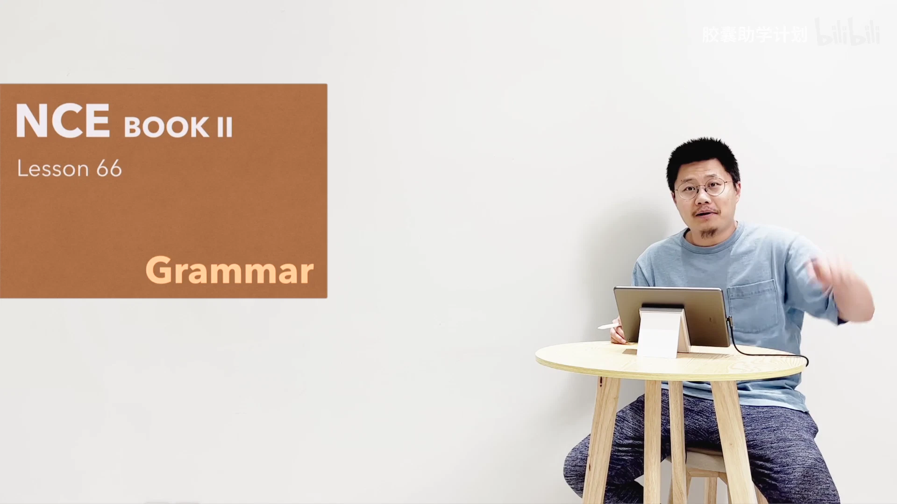

文字识别：NCE / BOOKⅡI / Lesson 66 / Grammar

### 画面 00:00:08

### 画面 00:00:13

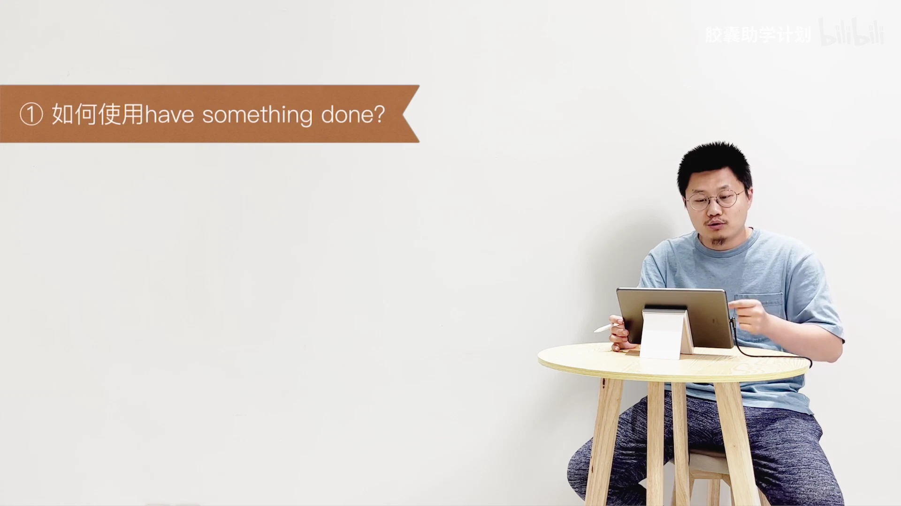

文字识别：①如何使用have something done？

### 画面 00:00:21

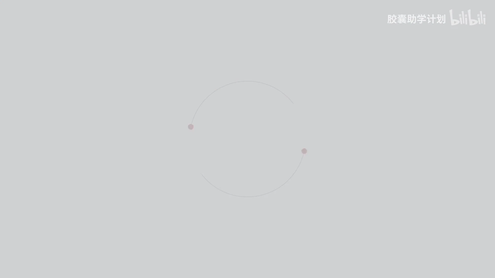

文字识别：胶囊助学计划 bilbl / •

### 画面 00:00:25

### 画面 00:00:27

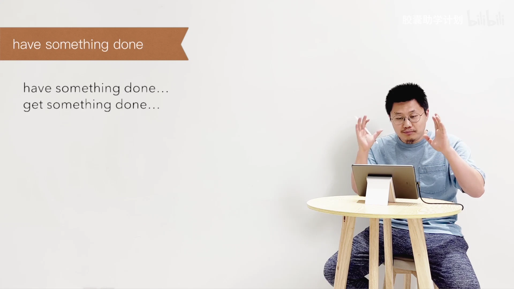

文字识别：have something / done / have something / done.... / get something / done...

## 00:00:30–00:01:00

拽拽在这个地方，先看一下。首先，这个 have 跟 get 注意，它俩都可以放在最前面，含义差别不大。 something 的就是某个东西， done 是什么啊？ done 是动词的过去分词。你看，咱们学过 have done， have done 后边再加一个 something，但是呢，现在把 something 放到 have 跟 done 中间去了。注意，跟 have done 再加 something，就是现在完成时，没什么关系。那我们要看一下它什么含义

### 画面 00:00:36

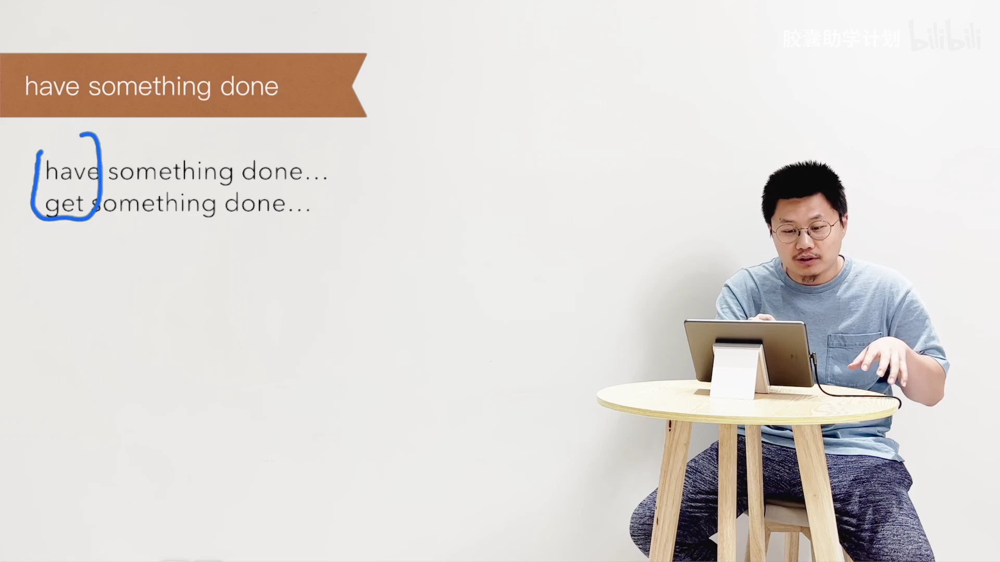

文字识别：have something / done / havesomething / done... / get omething / done...

### 画面 00:00:39

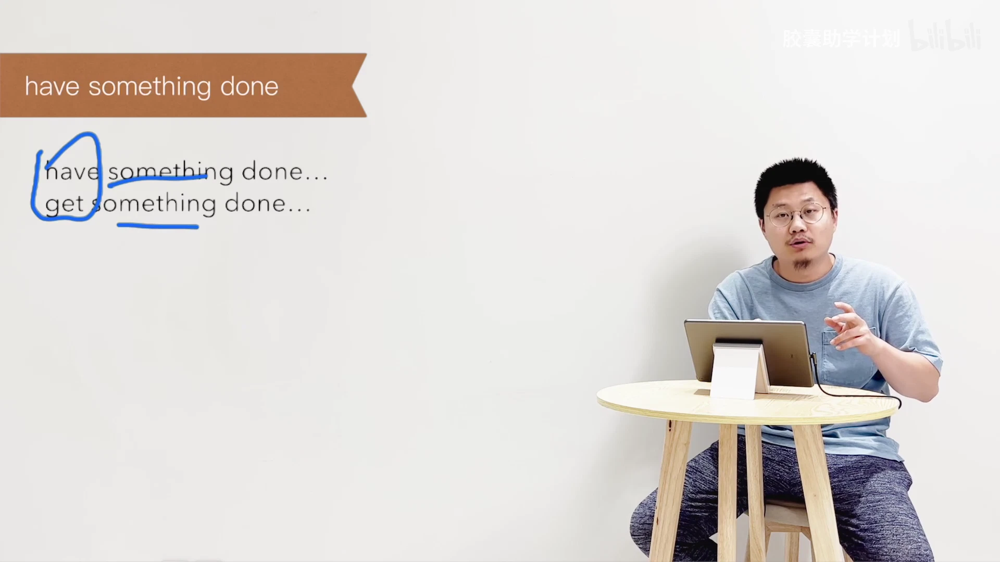

文字识别：have / something / done / something / done... / have / get omething / done...

### 画面 00:00:41

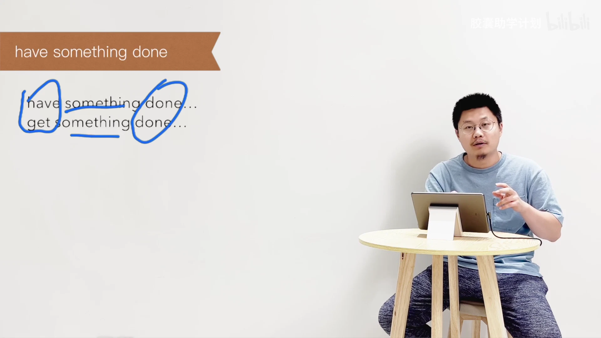

文字识别：have / something / done / somethingdone. / have / get omething / done

### 画面 00:00:59

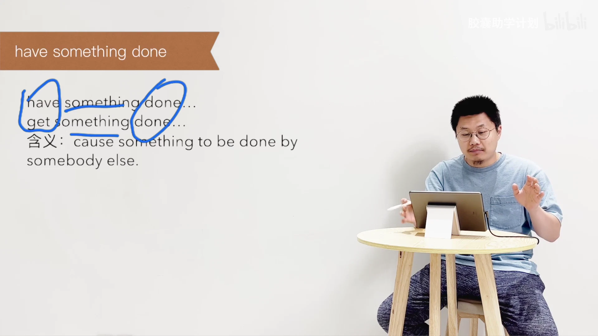

文字识别：have something / done / somethingdone. / have / getomething / done. / 含义： / cause something to be done by / somebody / else.

## 00:01:00–00:01:30

呢？叫做 cause something to be done by somebody else，直接翻译过来就是让一些事情做，让别人去做。然后再更语语序更捋一下，就是让别人去给我做一些事儿。比如说，I must have my watch repaired. Have something.但首先满足这个结构，英语我跟各位之前说过，对吧？跟各位分享过啊，叫做咱们呢英语

### 画面 00:01:01

文字识别：have something done / have something done... / get something done... / 含义：cause something to be done by / somebody else.

### 画面 00:01:04

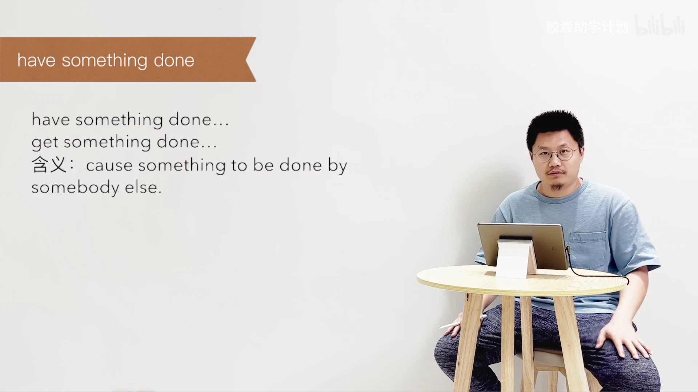

文字识别：have something done / have something done... / get something done... / 含义：cause something to be done by / somebody else.

### 画面 00:01:07

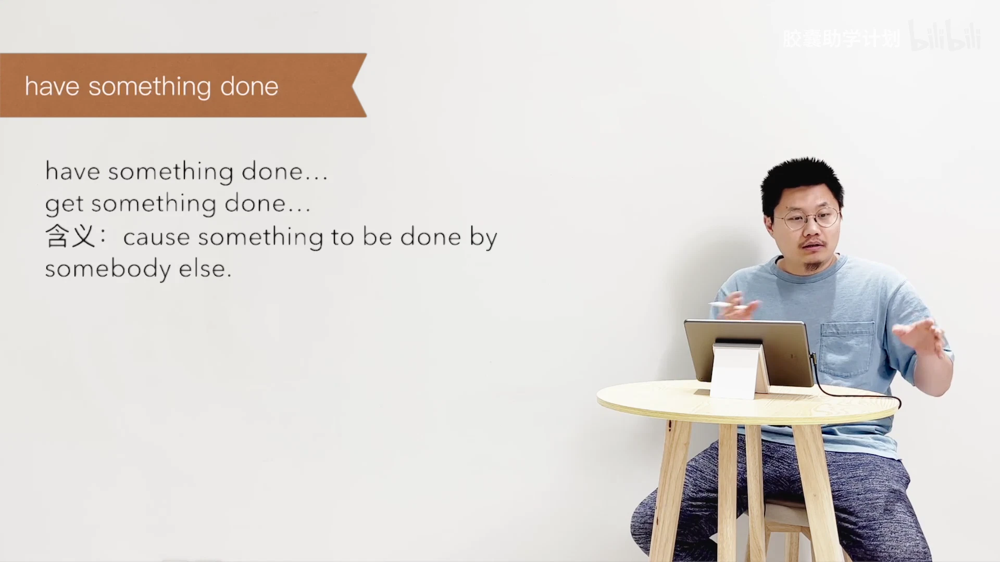

文字识别：have something done / have something done... / get something done.. / 含义：cause something to be done by / somebody else.

### 画面 00:01:19

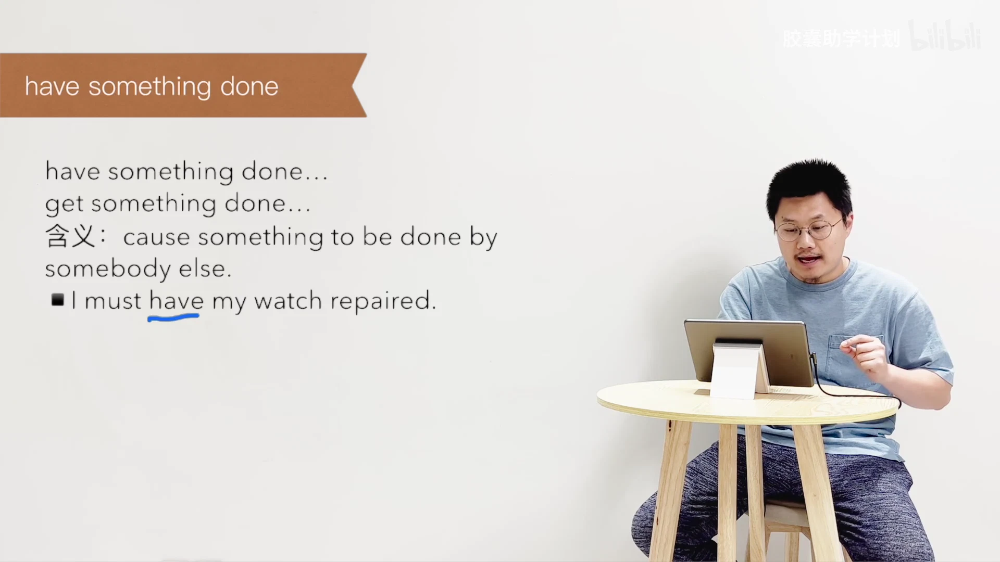

文字识别：have something / y done / have something done... / get something done... / 含义：cause something to be done by / somebody else. /  I must have my watch repaired.

### 画面 00:01:21

文字识别：have something / done / have something / done... / get something / done... / 含义：cause something to be done by / somebody e / else. / ■I must have / ny wato / h repaired.

### 画面 00:01:28

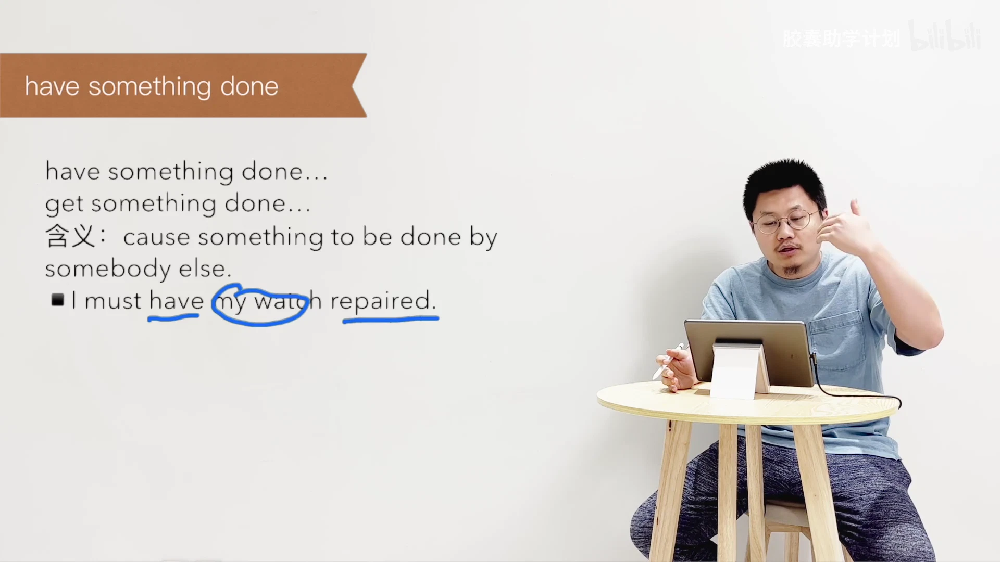

文字识别：have something / done / have something / done... / get something / done... / 含义：cause something to be done by / somebody else. / | must have / mywato / h repaired.

## 00:01:30–00:02:00

这个语言基本上出现特殊结构，往往都有点说头。这个说头就是它有什么特殊含义。所以这里边的特殊含义是什么呢？不是 I must。你看，我们习惯性的句子叫 I must repair my watch，对吧？我必须要修理我的表。而这里是 have something done 的结构，是什么意思？就是我必须要找别人把我这表给修了，我自己不会修。再来，那这里的 have 完全可以变成 get。

### 画面 00:01:39

文字识别：have something done / have something done... / get something done... / 含义： cause something to be done by / somebody else. /  I must have my watch repaired.

### 画面 00:01:43

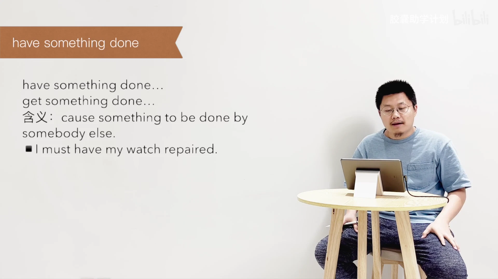

文字识别：have something done / have something done... / get something done... / 含义： cause something to be done by / somebody else. /  I must have my watch repaired.

### 画面 00:01:49

文字识别：have something done / have something done... / get something done... / 含义： cause something to be done by / somebody else. /  I must have my watch repaired.

### 画面 00:01:51

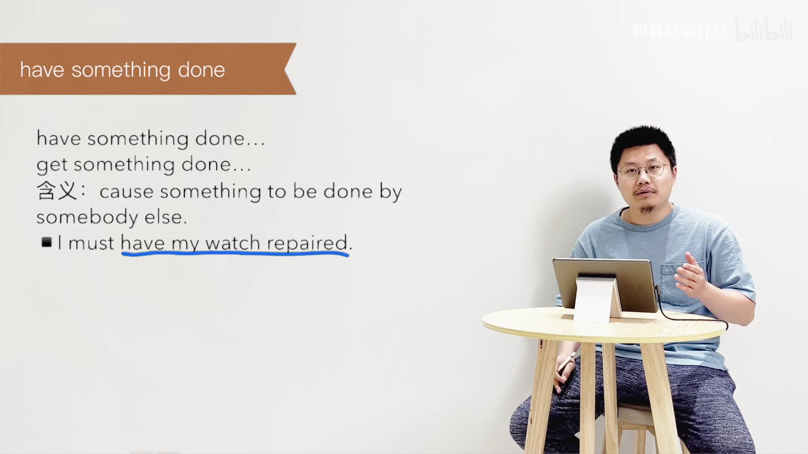

文字识别：have something done / have something done... / get something done... / 含义： cause something to be done by / somebody else. /  I must have my watch repaired.

## 00:02:00–00:02:30

并且口语当中很常用的也确实就是 get 啊，比如说 I must get my watch repaired. 我必须找别人把我的表给修了啊。当然这两句话的含义没有区别。再来， I'm going to have my hair cut this afternoon. 你注意到了一个事儿，叫做 have something done，并不影响它前面可以有时态，叫做我今儿下午一定要去理发。

### 画面 00:02:16

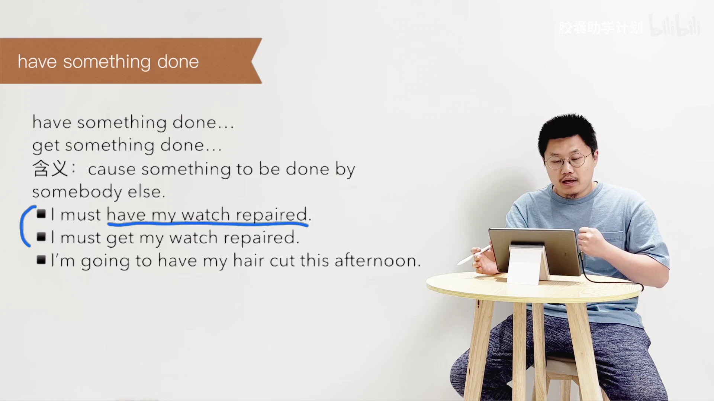

文字识别：have something done / have something done... / get something done... / 含义： cause something to be done by / somebody else. / I must have my watch repaired. /  I must get my watch repaired. /  I'm going to have my hair cut this afternoon.

### 画面 00:02:22

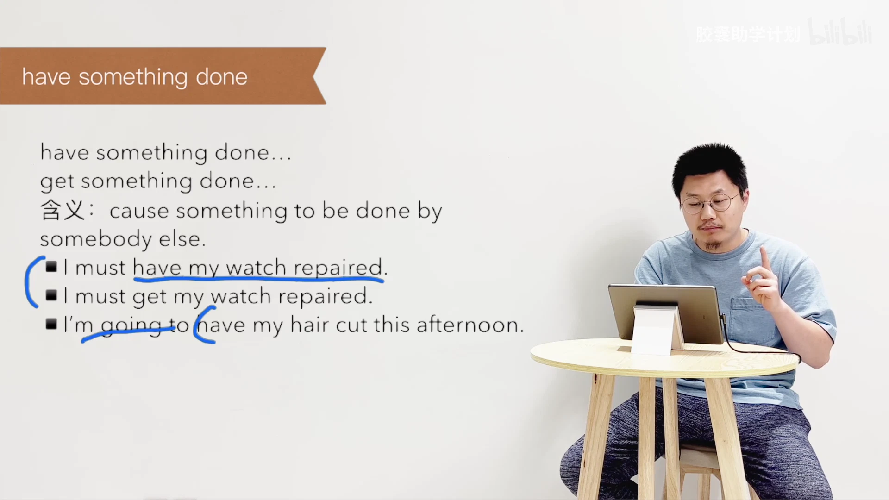

文字识别：have something done / have something done... / get something done... / 含义： cause something to be done by / somebody else. / I must have my watch repaired. /  I must get my watch repaired. /  I'm going to have my hair cut this afternoon.

### 画面 00:02:25

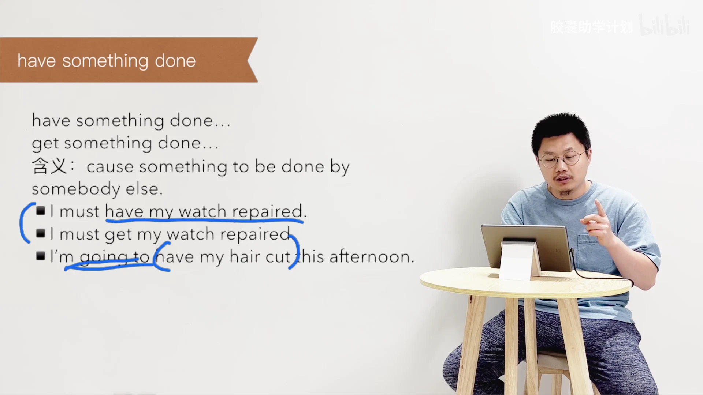

文字识别：have something done / have something done... / get something done... / 含义： cause something to be done by / somebody else. / I must have my watch repaired. /  I must get my watch repaired / I'm going to have my hair cut his afternoon.

## 00:02:30–00:03:00

哎，你注意，你看这里的理发，其实我们在说的时候都能去理解。往就比如说，我说汉语说下午我去剪个头，剪个头发啊，很少有人会理解为叫做我自己去给我自己理发，对吧？好，这个地方是没有什么歧义的。但是呢，你为了让他在一些语言当中可能有歧义，我举个例子，比如说我去洗个车，你看这句话至少有两个含义。第一个含义叫我开车去让

### 画面 00:02:32

文字识别：have something done / have something done... / get something done... / 含义： cause something to be done by / somebody else. / I must have my watch repaired. /  I must get my watch repaired. / I'm going to have my hair cut this afternoon.

### 画面 00:02:34

文字识别：have something done / have something done... / get something done... / 含义： cause something to be done by / somebody else. /  I must have my watch repaired. /  I must get my watch repaired. / I'm going to have my hair cut this afternoon.

### 画面 00:02:38

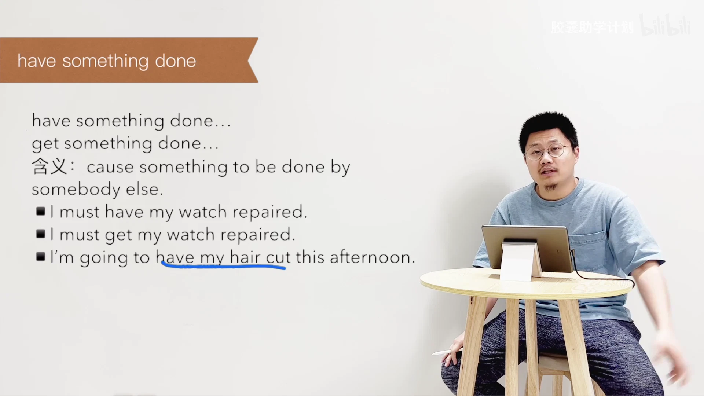

文字识别：have something done / have something done... / get something done... / 含义： cause something to be done by / somebody else. /  I must have my watch repaired. /  I must get my watch repaired. /  I'm going to have my hair cut this afternoon.

### 画面 00:02:41

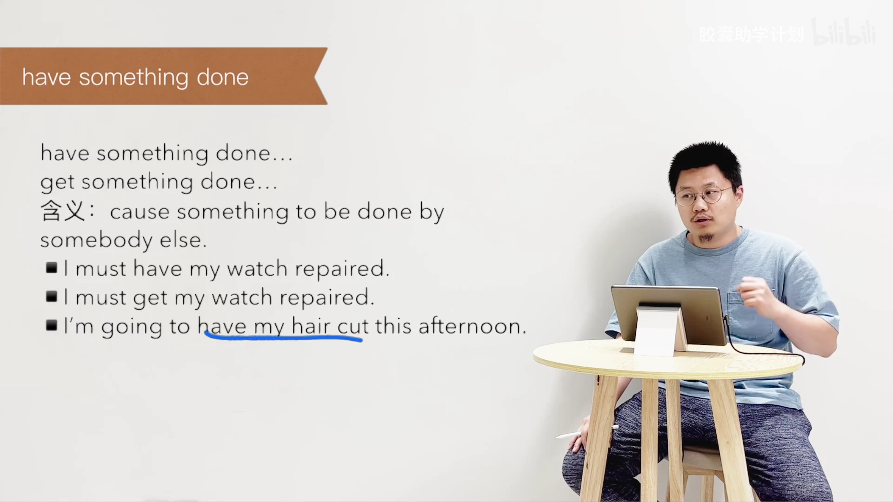

文字识别：have something done / have something done... / get something done... / 含义： cause something to be done by / somebody else. /  I must have my watch repaired. /  I must get my watch repaired. /  I'm going to have my hair cut this afternoon.

### 画面 00:02:57

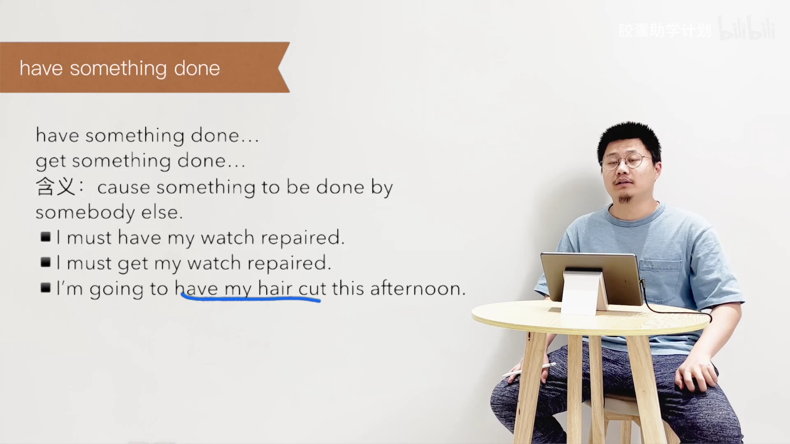

文字识别：have something done / have something done... / get something done... / 含义： cause something to be done by / somebody else. /  I must have my watch repaired. / I must get my watch repaired. /  I'm going to have my hair cut this afternoon.

## 00:03:00–00:03:30

别人把我的车洗了，叫 have my car cleaned。另外一种就是我下楼自己去拿水把我的车清洗一下，那就不不用 have something done 了，直接就用 clean my car。而英语啊，因为有这个结构，所以基本上就不会有歧义了。我用哪个结构就很很容易理解了，对吧？比如说，我也可以这里把我的 have 变成 get，叫 I'm going to get my hair cut this afternoon。就我

### 画面 00:03:00

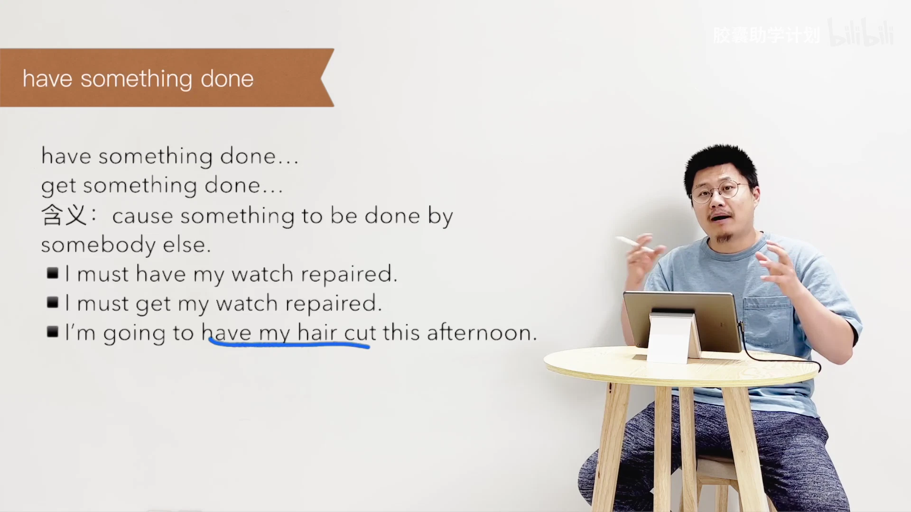

文字识别：have something done / have something done... / get something done... / 含义： cause something to be done by / somebody else. /  I must have my watch repaired. /  I must get my watch repaired. / I'm going to have my hair cut this afternoon.

### 画面 00:03:03

文字识别：have something done / have something done.. / get something done.. / 含义： cause something to be done by / somebody else. /  I must have my watch repaired. /  I must get my watch repaired. / I'm going to have my hair cut this afternoon.

### 画面 00:03:16

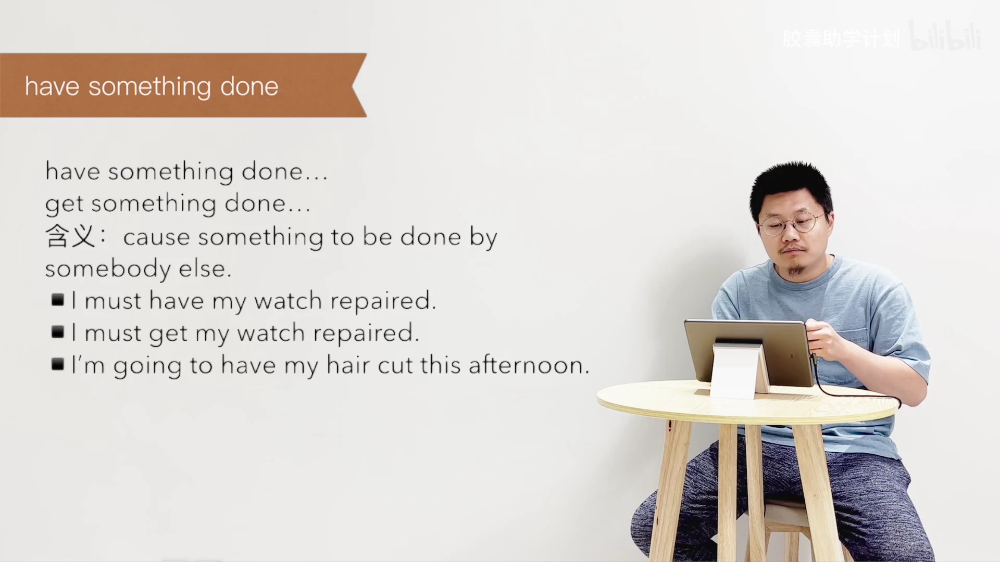

文字识别：have something done / have something done... / get something done... / 含义： cause something to be done by / somebody else. /  I must have my watch repaired. /  I must get my watch repaired. /  I'm going to have my hair cut this afternoon.

### 画面 00:03:24

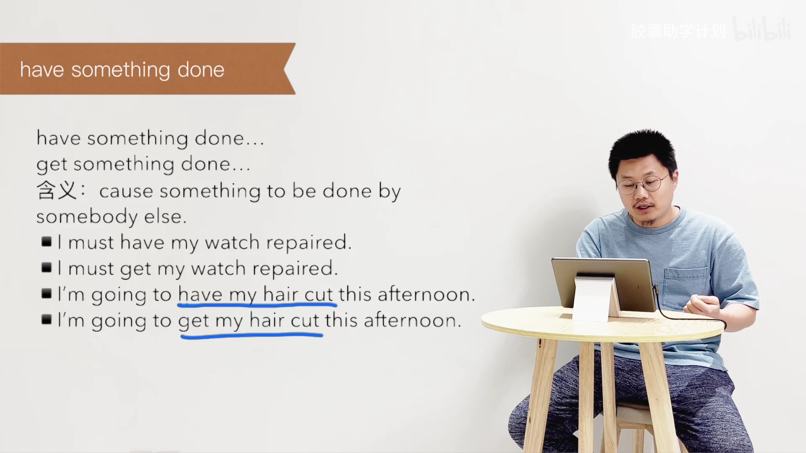

文字识别：have something done / have something done... / get something done... / 含义： cause something to be done by / somebody else. /  I must have my watch repaired. /  I must get my watch repaired. / I'm going to have my hair cut this afternoon. / I'm going to get my hair cut this afternoon.

## 00:03:30–00:04:00

今儿下午去找别人帮我去理个发。但是汉语不用这么说，对吧？哎，因为这个一切尽在语境当中，由你的生活经验决定。大多数人明白，呃，理个发是自己去理，对吧？啊，是是找别人给我理，而不是我自己拿个推子推，对不对？哎，Next one, have something done跟get something done呢，它竟然还有时态变化。那我们拿have举个例子，比如说，你看啊，这个时态是由谁去变的？是由have这个单词去变

### 画面 00:03:47

文字识别：have something / done

### 画面 00:03:54

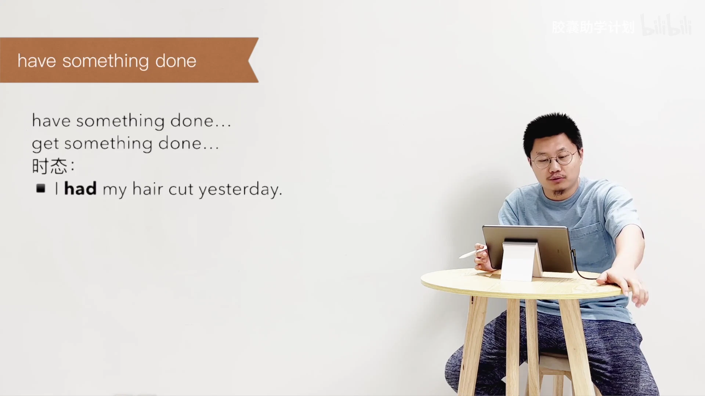

文字识别：have something / done / have something / done... / get something / done... / 时态： /  I had my hair cut yesterday.

### 画面 00:03:59

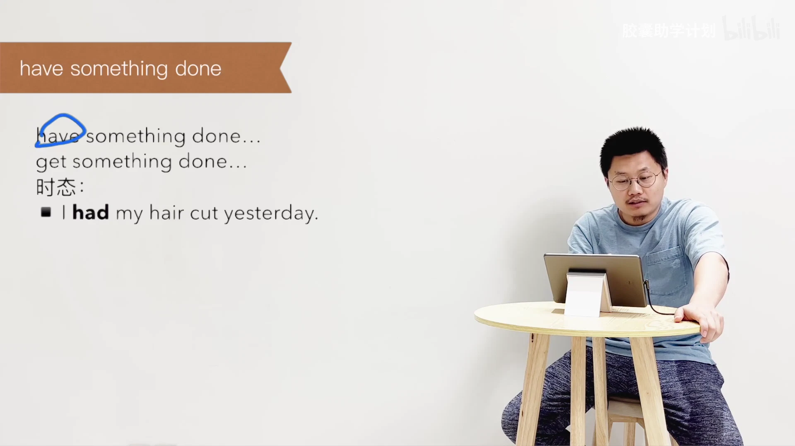

文字识别：have something / done / KavOsomething / done... / get something / done... / 时态： /  I had my hair cut yesterday.

## 00:04:00–00:04:30

的，但不变。I had my hair cut yesterday. 昨天我找别人给我剪了个头发，对吧？理了个发。说 We are having the house painted this week. 你看这里不仅用到了现在进行时，后边还加上了 this week，是咱们第二科学的现在进行时表将来，对吧？I we are having the house painted. 那这里边出现了一个结构，就是 have something done，叫做我们要找人啊，把咱这房

### 画面 00:04:15

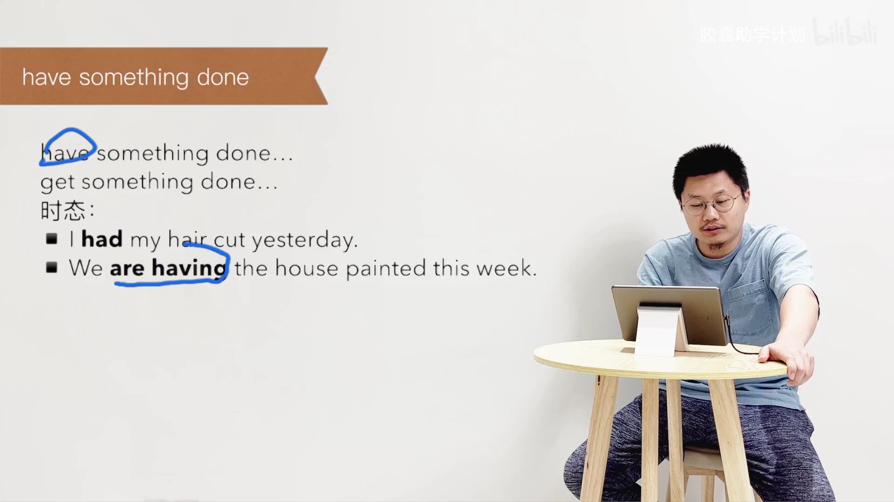

文字识别：have something / done / Kavesomething / done... / get something / done... / 时态： / Ihad / I my hair cut yesterday. / We: / are having /  the house painted this week.

### 画面 00:04:17

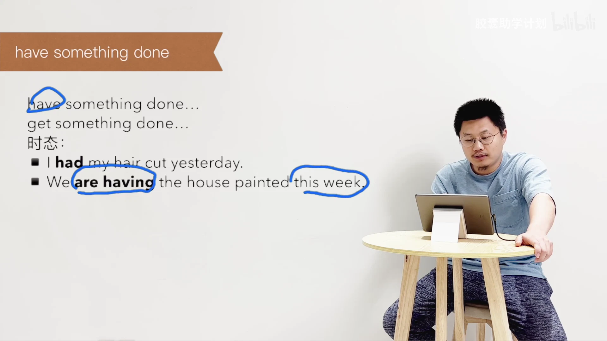

文字识别：have / something / done / Kavesomething / done... / get something / done... / 时态： / I had my hair cut yesterday. / We / are H / having / the / house painted'this week.

### 画面 00:04:25

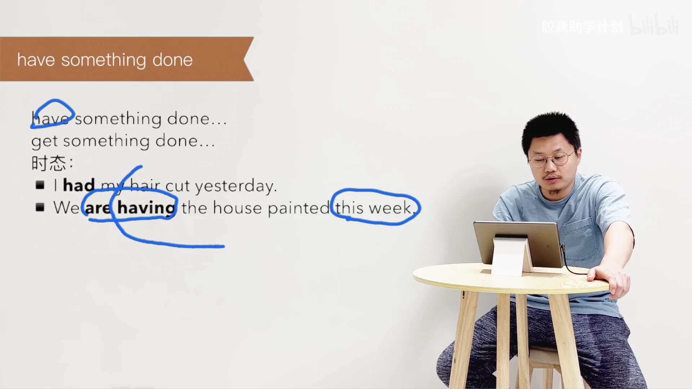

文字识别：have / something / done / LavOsomething / done... / get something / done... / 时态： / I had my hair cuty / t yesterday. / We / are / having / thel /  house paintedthis week.

### 画面 00:04:27

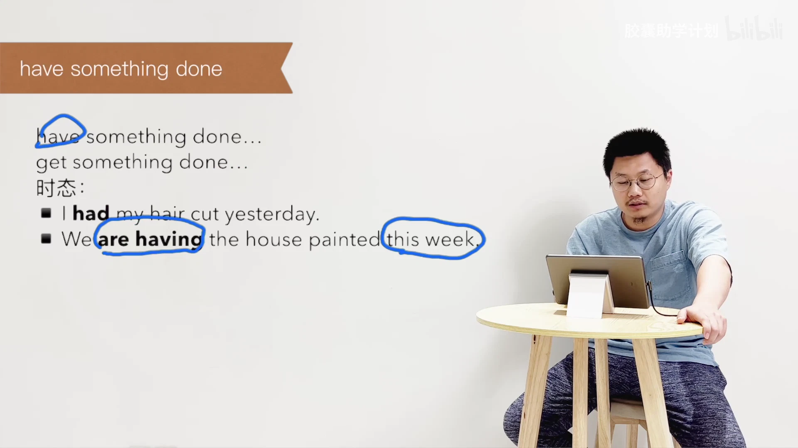

文字识别：have / something / done / LavOsomething / done... / get something / done... / 时态： /  I had my hair cut yesterday. / Weare havind / thel /  house paintedthis week.

### 画面 00:04:29

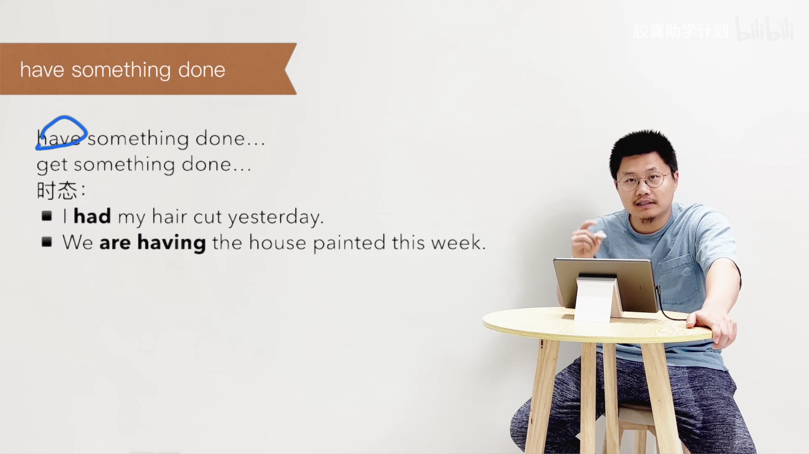

文字识别：have something / done / Kavesomething / done.... / get something / done... / 时态： /  I had my hair cut yesterday. /  We are having the house painted this week.

## 00:04:30–00:05:00

子再刷一遍漆啊。这个在国外是很常见的，在国内不很常见，对吧？好，next one，对，你不用总刷，对不对？你外边，你房子的外沿跟你是你不用去维护的，对不对？好，那你要国外独立的house，那你就要自己去刷这个漆。再来说，I'm going to have my hair cut this afternoon，跟刚才没区别，一般将来时，be going to do。说He has his hair cut every month，一般现在时，生活习惯。你看

### 画面 00:04:38

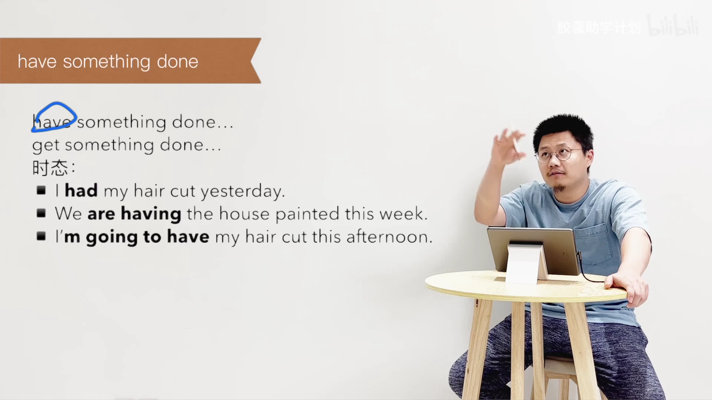

文字识别：have something done / Lavesomething done... / get something done... / 时态： /  I had my hair cut yesterday. / We are having the house painted this week. /  I'm going to have my hair cut this afternoon.

### 画面 00:04:53

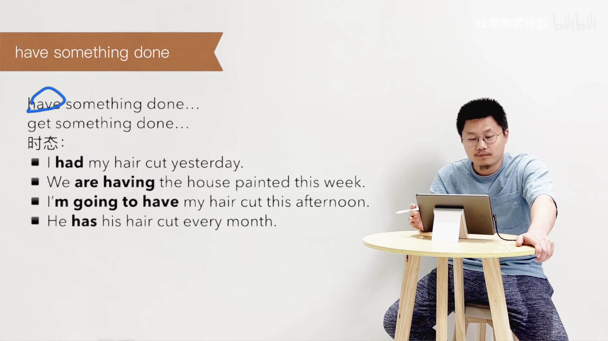

文字识别：have something done / kavesomething done... / get something done... / 时态： /  I had my hair cut yesterday. /  We are having the house painted this week. /  I'm going to have my hair cut this afternoon. /  He has his hair cut every month.

## 00:05:00–00:05:30

这句话，你想变一般疑问句，你就你提谁？你跟但是没有任何关系的，只看我现在加粗的这些部分，对吧？OK，那时态的部分很容易理解。Next one，接下来，那你怎么去对比一下 did 跟 have something done 呢？哎，其实刚才我已经说了，你比如说 Lisa repaired the roof，这句话指的是至少啊，听好啊，至少指的是他自己去把这个房顶给

### 画面 00:05:06

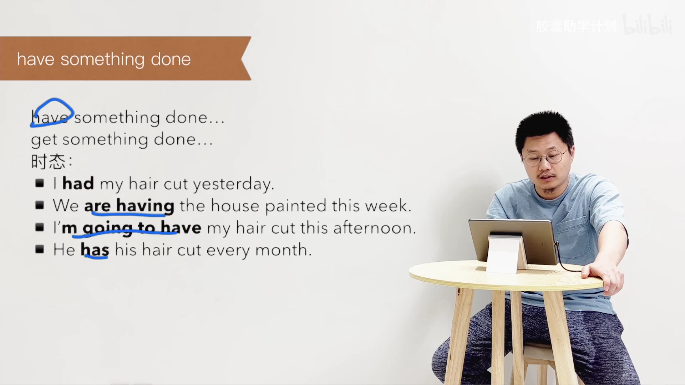

文字识别：have something / g done / kavOsomething done... / get something done... / 时态： /  I had my hair cut yesterday. / We are having / g the house painted this week. / I'm going to have my hair cut this afternoon. /  He has his hair cut every month.

### 画面 00:05:13

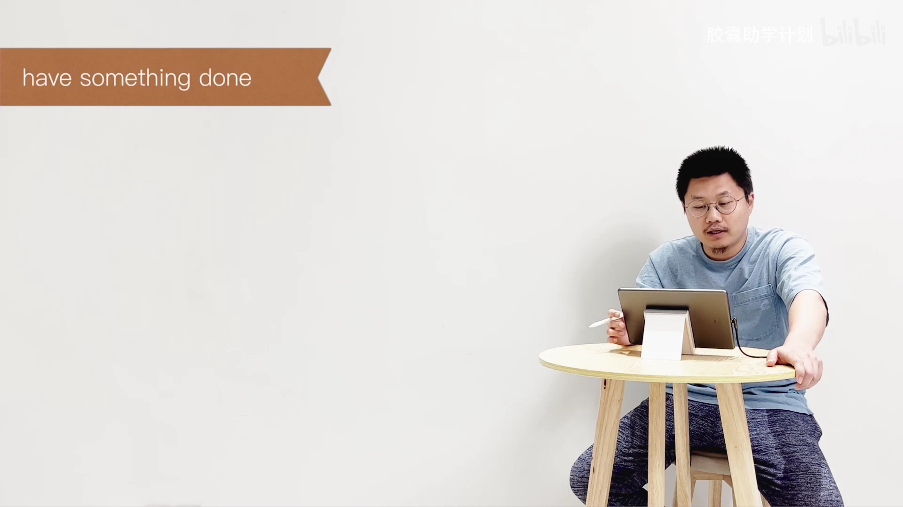

文字识别：have something / done

### 画面 00:05:25

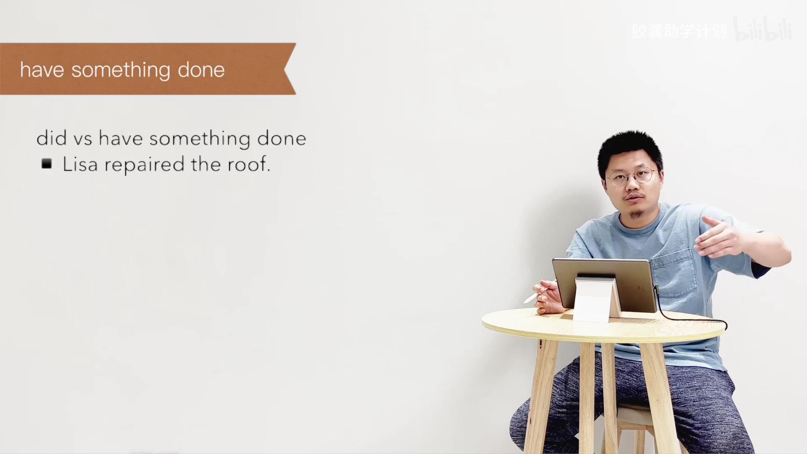

文字识别：have something done / did vs have something done / Lisa repaired the roof.

## 00:05:30–00:06:00

修了，字面意思对吧？再来，比如说 Lisa had the roof repaired. Have something done.只不过我变成了一般过去时，说昨儿啊，他找人把他这个房顶给修了一下。Have something done.再来，I made those curtains.我呀自己做的这些 curtain 啊做的这些窗帘，对吧？然后说 I had those curtains made.说我找别人给我做的这些窗帘。Have something done.这个是他们两者的

### 画面 00:05:36

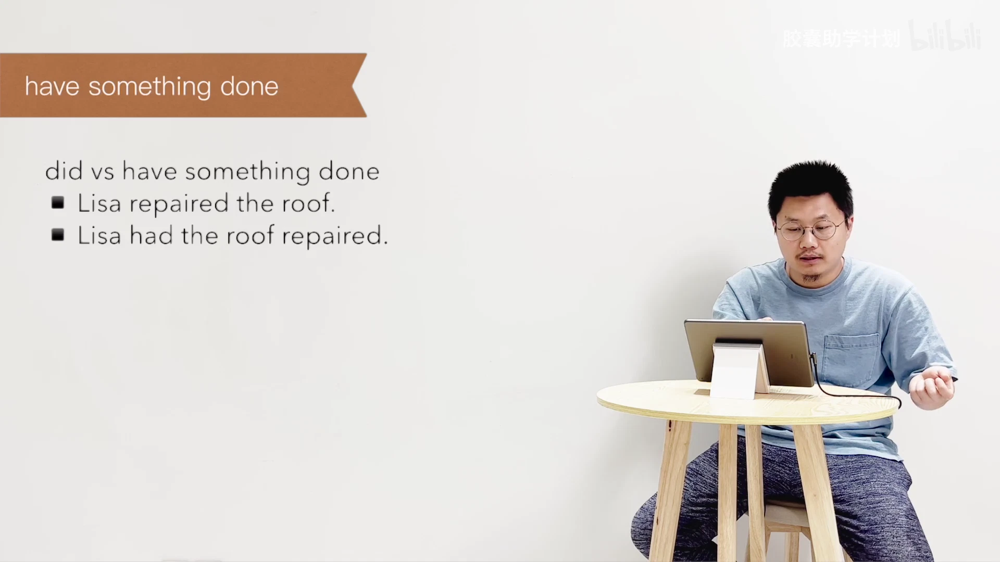

文字识别：have something done / did vs have something done / Lisa repaired the roof. / Lisa had the roof repaired.

### 画面 00:05:38

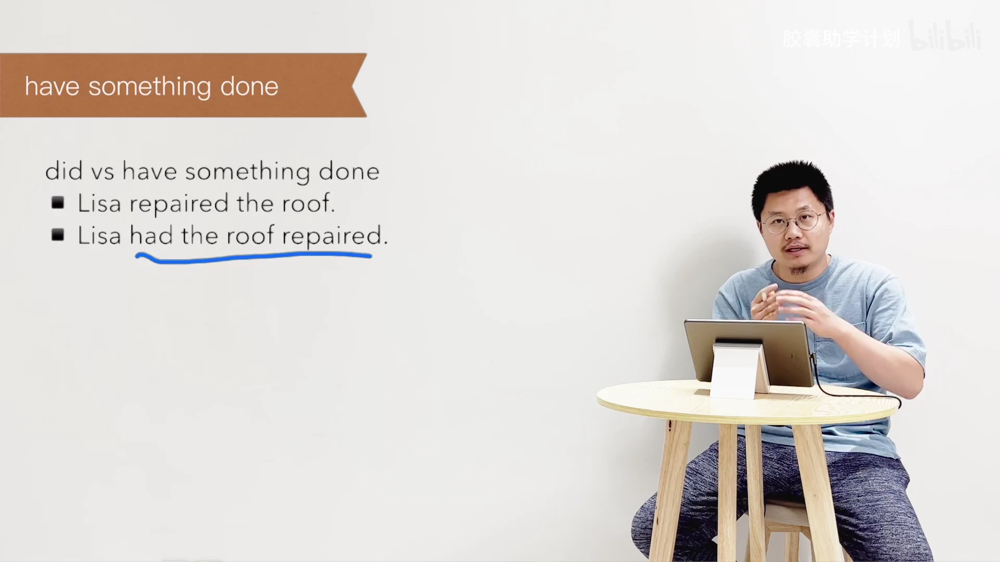

文字识别：have something / done / did vs have something / done / Lisa repaired the roof. / Lisa had the roof repaired.

### 画面 00:05:46

文字识别：have something done / did vs have something done / Lisa repaired the roof. /  Lisa had the roof repaired. /  I made those curtains.

### 画面 00:05:58

文字识别：have something done / did vs have something done / Lisa repaired the roof. / Lisa had the roof repaired. /  I made those curtains. /  I had those curtains made.

## 00:06:00–00:06:30

difference, ah, it's very simple. Today we learn this small structure. That this structure, it has another translation. It's not about finding someone how how. It's another translation called an unexpected unfortunate encounter. Translate into something. For example, Gary had his nose broken in a fight. First, you see the structure is not have something that this is perfectly fine. Ah, in a fight in a fight, in

### 画面 00:06:00

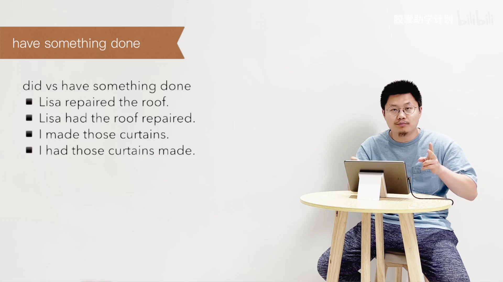

文字识别：have something done / did vs have something done /  Lisa repaired the roof. /  Lisa had the roof repaired. /  I made those curtains. /  I had those curtains made.

### 画面 00:06:04

文字识别：have something done / 意外，不幸的遭遇。翻译成被。

### 画面 00:06:18

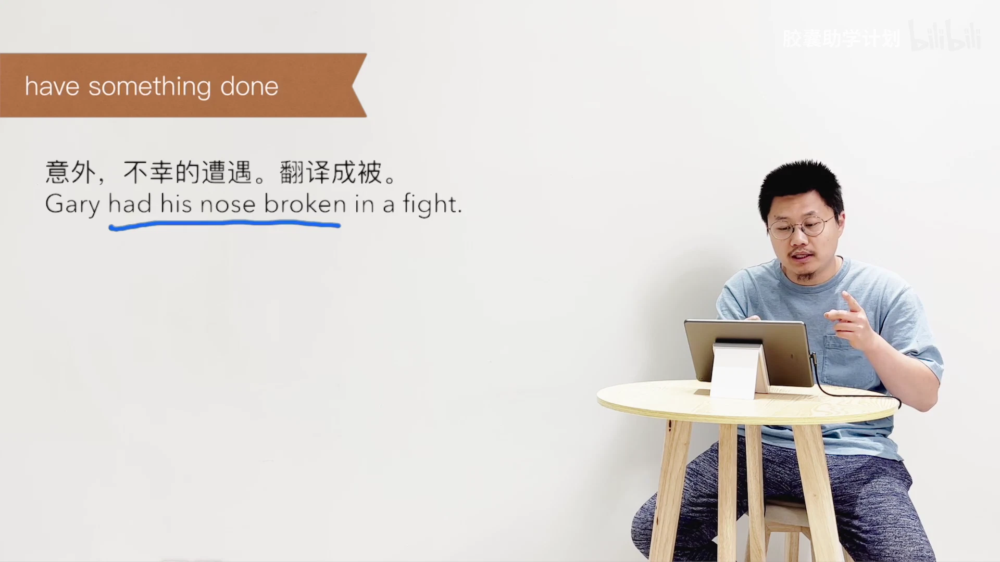

文字识别：have something done / 意外，不幸的遭遇。翻译成被。 / Gary had his nose broken in a fight.

## 00:06:30–00:07:00

译不通，对吧？那是怎么回事呢？就是打架当中，他的鼻子被弄骨折了。其实就类似于，呃，Gary's nose was broken in a fight，就跟最简单的一般过去时的被动其实含义是一样的，好吧？好，所以我的理解就是，你脑海当中有这个信息，大多数情况下，have something done，它表达的就是刚才我们讲的找别人帮我去把这件事情做了。偶尔它也可以表示最基本的被动，对吧？比如说，

### 画面 00:06:48

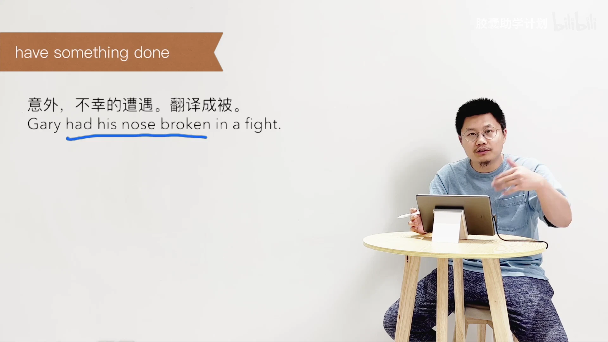

文字识别：have something done / 意外，不幸的遭遇。翻译成被。 / Gary had his nose broken in a fight.

## 00:07:00–00:07:30

I had my bag stolen. 说我雇了俩小偷，说你就是测试我一下，我今儿要把这包丢了，我要看一下我足不足够这个警觉对吧？然后我雇俩小偷，呃，整天就这今天一天跟着我说这个包你要是偷了，我给你俩一人五万块钱奖金对吧？也不是不能用那，但是大多数情况下 I had my bag stolen 的意思就是我的包被偷了，就是 my bag was stolen 对吧？好理解啊。

### 画面 00:07:00

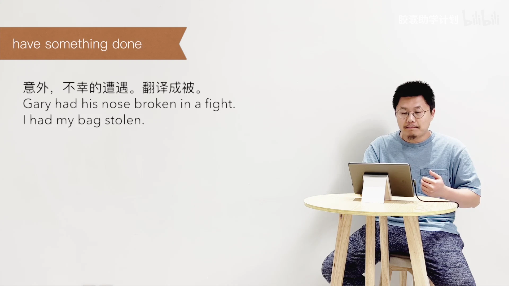

文字识别：have something done / 意外，不幸的遭遇。翻译成被。 / Gary had his nose broken in a fight. / I had my bag stolen.

### 画面 00:07:03

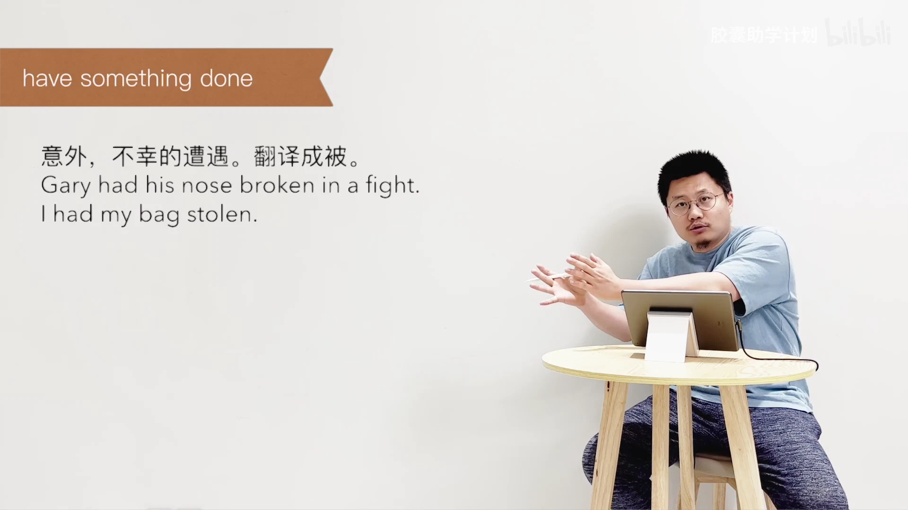

文字识别：have something done / 意外，不幸的遭遇。翻译成被。 / Gary had his nose broken in a fight. / I had my bag stolen.

### 画面 00:07:06

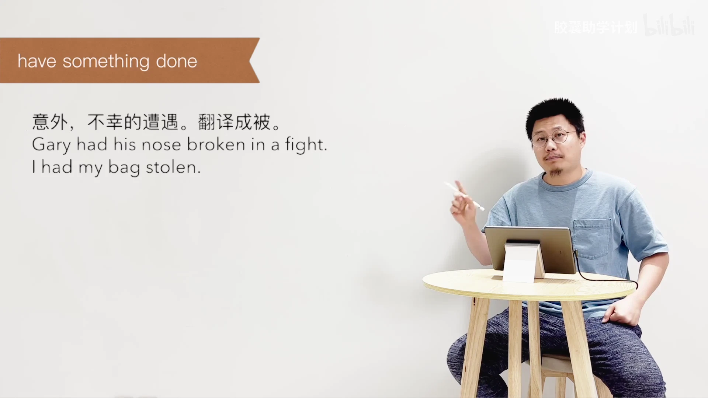

文字识别：have something done / 意外，不幸的遭遇。翻译成被。 / Gary had his nose broken in a fight. / I had my bag stolen.

### 画面 00:07:14

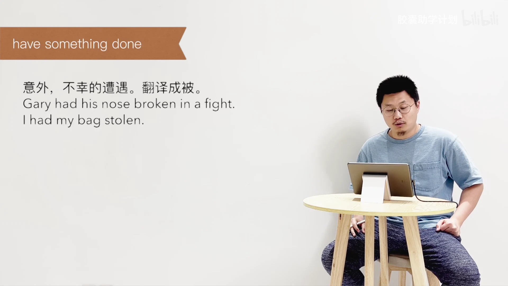

文字识别：have something done / 意外，不幸的遭遇。翻译成被。 / Gary had his nose broken in a fight. / I had my bag stolen.

### 画面 00:07:17

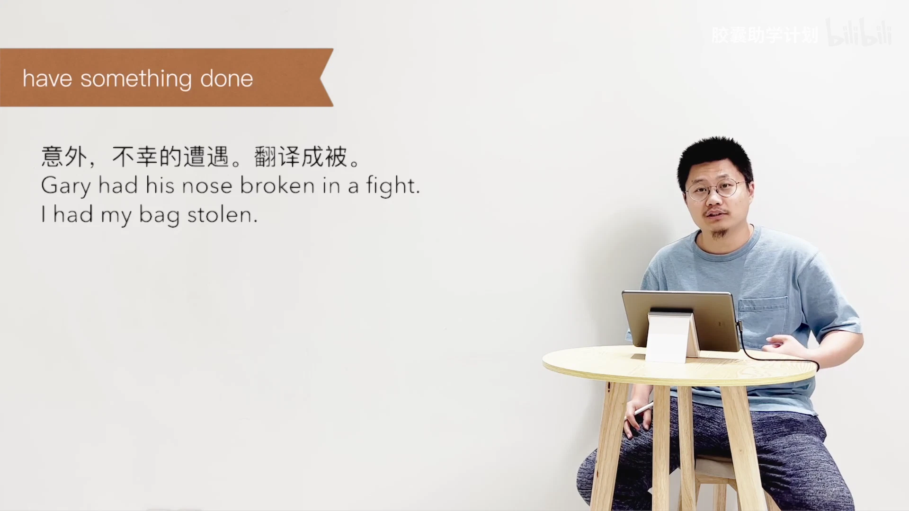

文字识别：have something done / 意外，不幸的遭遇。翻译成被。 / Gary had his nose broken in a fight. / I had my bag stolen.

### 画面 00:07:22

文字识别：have something done / 意外，不幸的遭遇。翻译成被。 / Gary had his nose broken in a fight. / I had my bag stolen.

## 00:07:30–00:08:00

再来，比如说，Have you ever had your bike stolen? 你自行车被偷过吗？就是这么一句话啊。OK，那不多说了。Have something done? 那当然，在这个结构当中，肯定就是谓语喽，对吧？好，呃，接下来咱们就开始大面积的练。我读，您大声张开嘴跟我读就好了。I washed my car. Surely you didn't wash it yourself. You had it washed. 你看，我觉得这个场景呢很好。A说说，

### 画面 00:07:30

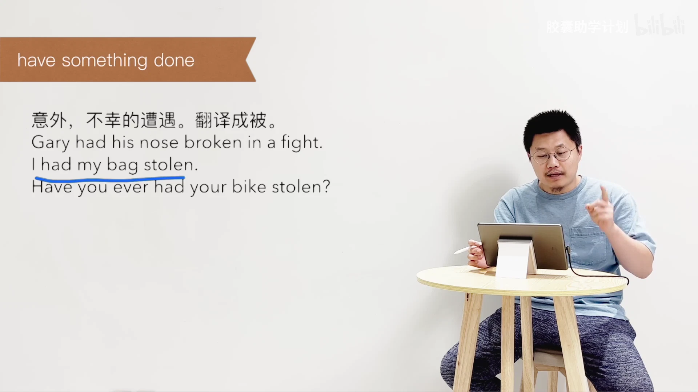

文字识别：have something done / 意外，不幸的遭遇。翻译成被。 / Gary had his nose broken in a fight. / I had my bag stolen. / Have you ever had your bike stolen?

### 画面 00:07:36

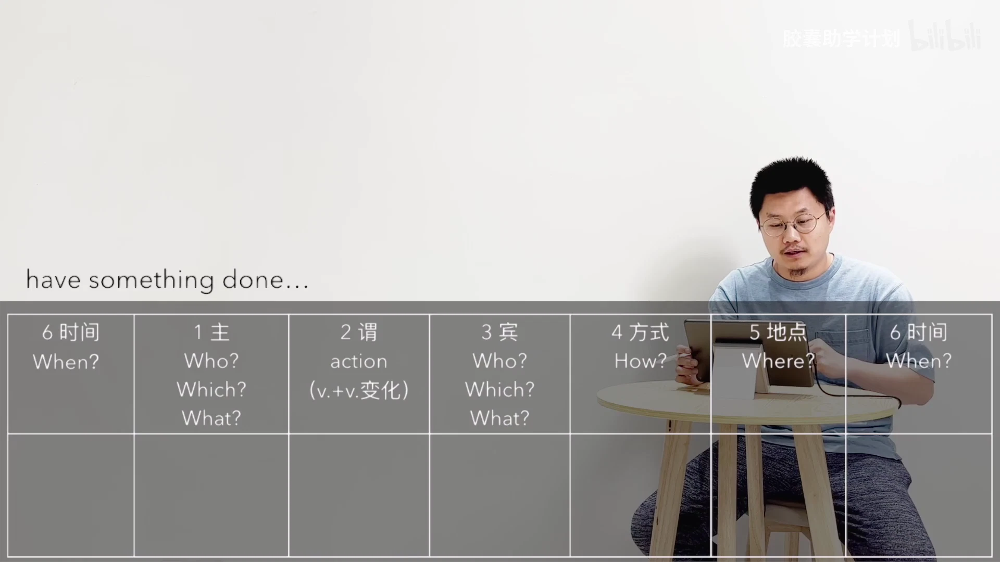

文字识别：have something / done... / 6时间 / 1主 / 2谓 / 3宾 / 4方式 / 5地点 / 6时间 / When? / Who? / action / Who? / How? / Where? / When? / Which? / (v.+v.变化) / Which? / What? / What?

### 画面 00:07:40

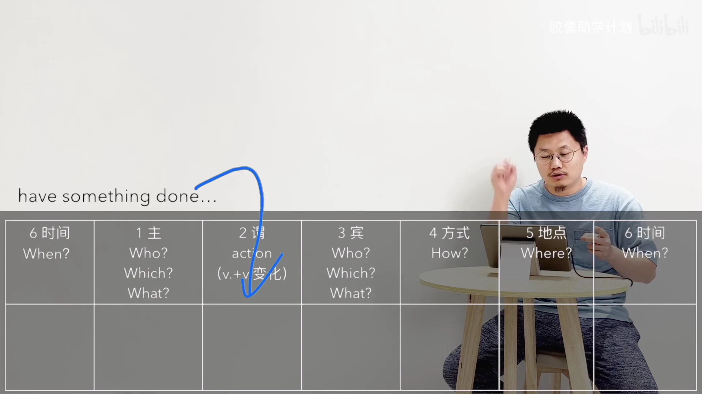

文字识别：have something / done... / 6时间 / 1主 / 2调 / 3宾 / 4方式 / 5地点 / 6时间 / When? / Who? / acton / Who? / How? / Where? / When? / Which? / (v.+V变七) / Which? / What? / What?

### 画面 00:07:44

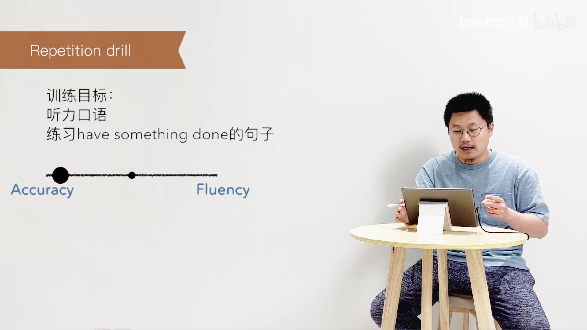

文字识别：Repetition drill / 训练目标： / 听力口语 / 练习have something done的句子 / Accuracy / Fluency

### 画面 00:07:48

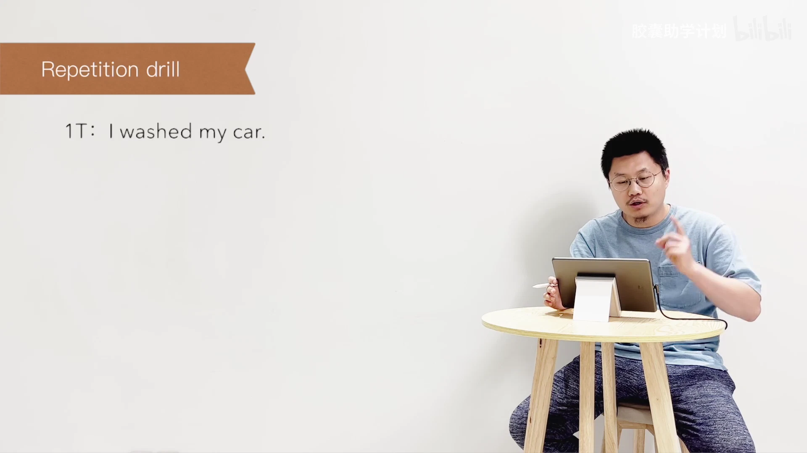

文字识别：Repetition drill / 1T: I washed my car.

### 画面 00:07:51

文字识别：Repetition drill / 1T: I washed my car. / S: Surely you didn't wash it yourself. You / had it washed.

## 00:08:00–00:08:30

哎，我把我车洗了。第二人说，哎，你肯定不是自己洗的，你是 had it washed，找人给你洗的嘛。好，你看，他很好的把这两句话给做了一下对比啊。剩下的各位就是张嘴跟我读就好了啊。这个知识点还好，不是太难。He cleaned his suit. Surely he didn't clean it himself. He had it cleaned. Repeat after me.

### 画面 00:08:02

文字识别：Repetition drill / 1T: I washed my car. / S: Surely you didn't wash it yourself. You / had it washed.

### 画面 00:08:05

文字识别：Repetition drill / 1T: I washed my car. / S: Surely you didn't wash it yourself. You / had it washed.

### 画面 00:08:10

文字识别：Repetition drill / 1T:Iwashed / my car. / S: Surely you didn't wash it yourself. You / had it washed.

### 画面 00:08:15

文字识别：Repetition drill / 1T: I washed my car. / S: Surely you didn't wash it yourself. You / had it washed.

### 画面 00:08:20

文字识别：Repetition drill / 2T: He cleaned his suit. / S: Surely he didn't clean it himself. He had it / cleaned.

### 画面 00:08:29

文字识别：Repetition drill / 3T: She made a beautiful dress.

## 00:08:30–00:09:00

She made a beautiful dress. Surely she didn't make it herself. She had it made. I built a new garage. Surely you didn't build it yourself. You had it built. I decorated my house. Surely you didn't decorate it yourself. You had it decorated.

### 画面 00:08:43

文字识别：Repetition drill / 4T: I built a new garage. / S: Surely you didn't build it yourself. You / had it built.

### 画面 00:08:53

文字识别：Repetition drill / 5T: I decorated my house. / S: Surely you didn't decorate it yourself. / You had it decorated.

## 00:09:00–00:09:30

He repaired his watch. Surely he didn't repair it himself. He had it repaired. I installed a new television set. Surely you didn't install it yourself. You had it installed. She cut her hair. Surely she didn't cut it herself. She had it cut.

### 画面 00:09:01

文字识别：Repetition drill / 6T: He repaired his watch.

### 画面 00:09:16

文字识别：Repetition drill / 7T: Iinstalled a new television set. / S: Surely you didn't install it yourself. You / had it installed.

### 画面 00:09:23

文字识别：Repetition drill / 8T: She cut her hair.

## 00:09:30–00:10:00

Pattern drill, pattern drill,老习惯啊，就是我讲完这两句话，您往里面去带，对吧？Did she make the cake herself?她自己做的这个蛋糕嘛？Good heavens, no!啊，就是no, no, no!啊，就是这个Good heavens!它就是一个口头禅，就天哪，当然不是了啊啊，就和no是一样，加强了一下语气。She had it made in town. Had it made?找别人做

### 画面 00:09:31

文字识别：Pattern drill / 1T: make the cake / S1: Did she make the cake herself? / S2: Good heavens no! She had it made in / town. / cut her hair / polish the car / make the curtains / sharpen those knives / clean her coat / repair her watch / mend the typewriter / translate the article

## 00:10:00–00:10:30

的这个蛋糕，对吧？往里面去带啊！啊，这个地方注意几个小点。第一个，这是动词原形，对吧？这你要换回过去式还是过去分词？Have something done，过去分词啊。第二个，How nice your hair looks！感叹句，哎，头发看起来真棒。Thank you. I've just had it cut.我刚刚剪的头，你看翻译成汉语就是我刚刚剪的剪的呃这个剪的头发，对吧？刚刚理的发，对不对？好，

### 画面 00:10:01

文字识别：Pattern drill / 1T: make the cake / S1: Did she make the cake herself? / S2: Good heavens no! She had it made in / town. / cut her hair / polish the car / make the curtains / sharpen those knives / clean her coat / repair her watch / mend the typewriter / translate the article

### 画面 00:10:13

文字识别：Pattern drill / 2T:hair-cut / S1: How nice your hair looks! / S2: Thank you. I've just had it cut. / carpet-cleaned / car-washed / kitchen-painted / furniture-installed / floor-polished / suit-made / house-redecorated / roses-sprayed

## 00:10:30–00:11:00

啊，往里面去带啊。只不过这个结构告诉你，就是我找别人给我理的发。第三个，You will need some photos for your passport.啊，你将需要一些照片啊，这个用于你的这个护照上。I'll have some taken next week.那下周我找别人给我拍一张吧。Have some taken，对吧？第四个，He says

### 画面 00:10:36

文字识别：Pattern drill / 3T: photos-your passport-taken / S1: You'll need some photos for your passport. / S2: I'll have some taken next week. / heating/gasfre----hewinter---nstalled / warm clothes/ boots---thejourney----made / oil/safetybe-t--yourcar--putin / tables/chair--themeetin----sentround

### 画面 00:10:58

文字识别：Pattern drill / 4T: clean his suit / S1: He says he's got to clean his suit. / S2: He can't clean it himself! Why doesn't / he have it cleaned? / mend the stereo / lay the carpet / test the engine / rebuild the garage / paint the gate / decorate the house / cut the trees down / install the lighting

## 00:11:00–00:11:30

he's got to clean his suit. 他说他必须 have got has got to 等于 have to，对吧？说他必须要清理一下他的这个啊，打就是弄干净他的这个西服。He can't clean himself. 他自己又弄不干净。Why doesn't he have it cleaned? 他为什么不找个人给他弄干净呢？找干洗店，对吧？Have it cleaned. 好，那 recap 本课语法就一个核心的 have something done. 啊，语法的角度并不难，本课。然后呢，将

### 画面 00:11:21

文字识别：Recap / Patterns / ＆ / have something done / Grammar

### 画面 00:11:23

文字识别：Recap / Patterns / have something done / Grammar

### 画面 00:11:25

文字识别：Recap / Patterns / ＆ / have something done / Grammar

### 画面 00:11:28

## 00:11:30–00:12:00

作业 pattern drill，哎，各位这个呃四乘四对吧？然后呢，在我们不去专栏了啊，置顶留言可以找得到这个练习材料。然后先写，然后在大声朗读啊，不要忘了大声朗读。尝试回忆讲解一下今天的语法，也不是很困难。然后呢，翻阅一下红皮书啊，你可以通过目录或者索引找到本课的语法 have something done 啊，是中级当中就有的啊。我们很多例句也是从这

### 画面 00:11:30

文字识别：1.f / Pattern Drill写&朗读 / 专栏 / 4×4

### 画面 00:11:35

文字识别：1. f / Pattern Drill写&朗读 / 专栏 / 4×4

### 画面 00:11:44

文字识别：1. / Pattern Drill写&朗读 / 专栏 / 4X4 / 尝试回忆并给自己讲解一 / 遍今天的核心语法 / Study-Test / Learning Pyramid

### 画面 00:11:46

文字识别：Pattern Drill写&朗读 / 专栏 / 4×4 / 尝试回忆并给自己讲解一 / 遍今天的核心语法 / Study-Test / Learning Pyramid

### 画面 00:11:48

文字识别：1. f / Pattern Drill 写&朗读 / 专栏 / 4×4 / 尝试回忆并给自己讲解一 / 遍今天的核心语法 / Study-Test / Learning Pyramid / 尝试翻阅红皮书（中级） / 通过目录或索引(Index) / 查找到本课语法

### 画面 00:11:50

文字识别：1. ↑ / Pattern Drill写&朗读 / 专栏 / 4×4 / 尝试回忆并给自己讲解一 / 遍今天的核心语法 / Study-Test / Learning Pyramid / 尝试翻阅红皮书（中级） / 通过目录或索引(Index) / 查找到本课语法

### 画面 00:11:55

文字识别：1. f / Pattern Drill写&朗读 / 专栏 / 4×4 / 尝试回忆并给自己讲解一 / 遍今天的核心语法 / Study-Test / Learning Pyramid / 尝试翻阅红皮书（中级） / 通过目录或索引(Index) / 查找到本课语法

### 画面 00:11:58

文字识别：1. f / Pattern Drill写&朗读 / 专栏 / 4X4 / 尝试回忆并给自己讲解一 / 遍今天的核心语法 / Study-Test / Learning Pyramid / 尝试翻阅红皮书（中级） / 通过目录或索引(Index) / 查找到本课语法

## 00:12:00–00:12:27

里摘抄的啊。好，那以上呢就是本期视频的全部内容了。如果各位喜欢我们的课程呢，欢迎各位关注、订阅、一键三连，分享给那些需要的朋友，来帮助我们快速成长。See you next time.

### 画面 00:12:00

文字识别：1. f / Pattern Drill 写&朗读 / 专栏 / 4×4 / 尝试回忆并给自己讲解一 / 遍今天的核心语法 / Study-Test / Learning Pyramid / 尝试翻阅红皮书（中级） / 通过目录或索引(Index) / 查找到本课语法

### 画面 00:12:02

文字识别：不

### 画面 00:12:05

文字识别：不 / ￥

### 画面 00:12:15

文字识别：CAPSULEACADEMY / 胶囊助学计划 / 小红书 / 品 / OE

### 画面 00:12:17

文字识别：CAPSULEACADEMY / 胶囊助学计划 / 小红书 / 品 / OE

### 画面 00:12:20

文字识别：CAPSULEACADEMY / 胶囊助学计划 / 『 / 小红书 / Editor / □ / Berlin / OE

### 画面 00:12:22

文字识别：CAPSULEACADEMY / 胶囊助学计划 / 小红书 / Creator / Leo & Berlin

### 画面 00:12:24

文字识别：胶囊助学计划 bl出 / CAPSULEACADEMY / 胶囊助学计划 / 小红书 / OE

### 画面 00:12:26

文字识别：bilibili / 胶囊助学计划

