# 066 练习

快速机器解析：语音为单模型转写，未进行独立交叉校对或人工复核；画面每秒采样并按变化选帧，短时文字和标记可能遗漏。截图时间约有 1 秒误差。图片有损压缩；遇到疑点请按时间查看 Google Drive 原视频。

## 00:00:00–00:00:30

Hello everyone, welcome to Capsule Academy. This is Leo. Today we're going to learn new concept English Book Two Lesson Sixty Six Practices. 那注意，进行如下练习的唯一前提就是文章跟读至熟读成诵，否则请勿开始。 Hope you can enjoy. 我们看第一题 comprehension，练习我们能听懂别人问问题的能力。我问您答，尽量不要看这里啊。好，第一题，

### 画面 00:00:00

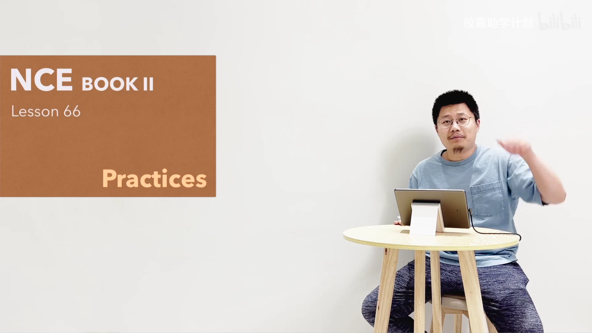

文字识别：NCE / BOOK I"I / Lesson 66 / Practices

### 画面 00:00:02

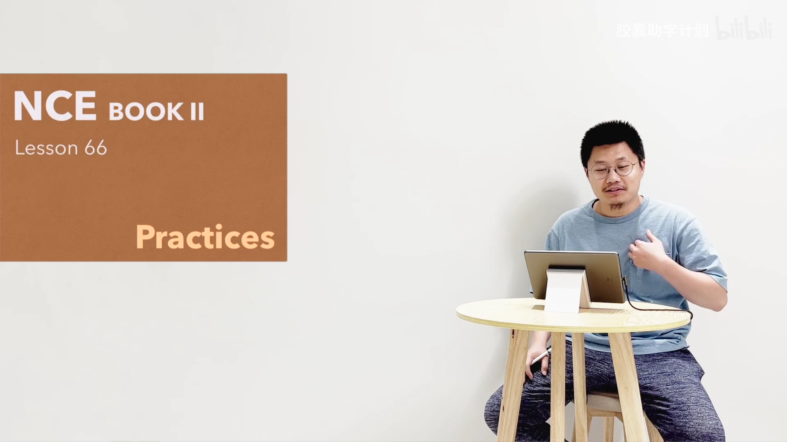

文字识别：NCE / BOOKI"I / Lesson 66 / Practices

### 画面 00:00:07

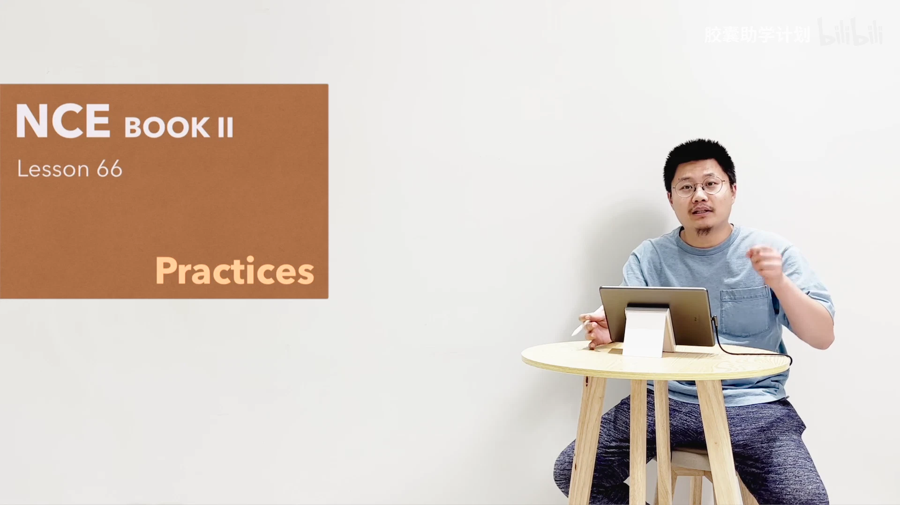

文字识别：NCE / BOOKII / Lesson 66 / Practices

### 画面 00:00:09

文字识别：进行如下练习唯一前提 / 文章跟读至熟读成诵 / 否则请勿开始

### 画面 00:00:16

文字识别：胶囊助学计划bill / •

### 画面 00:00:20

文字识别：胶囊助学计划

### 画面 00:00:22

文字识别：Comprehension / 训练目标： / 听懂一般疑问句＆特殊疑问句

### 画面 00:00:28

文字识别：Comprehension / 训练目标： / 听懂一般疑问句＆特殊疑问句

## 00:00:30–00:01:00

Where did a Lancaster bomber crash? Answer on Wallace Island. Next one, where is Wallace Island? In the South Pacific. Next one, when did it happen? In 1963. Was the plane badly damaged? No, it wasn't. When was the plane

### 画面 00:00:30

文字识别：Comprehension / Where did a Lancaster bomber crash?

### 画面 00:00:37

文字识别：Comprehension

### 画面 00:00:41

文字识别：Comprehension / Where is Wallis Island? / In the South Pacific.

### 画面 00:00:52

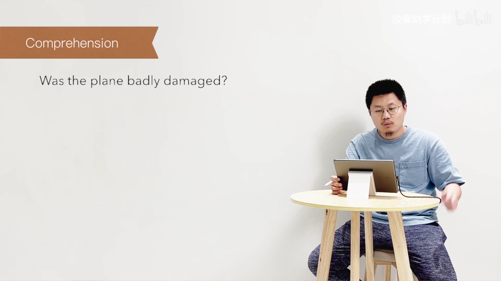

文字识别：Comprehension / Was the plane badly damaged?

### 画面 00:00:58

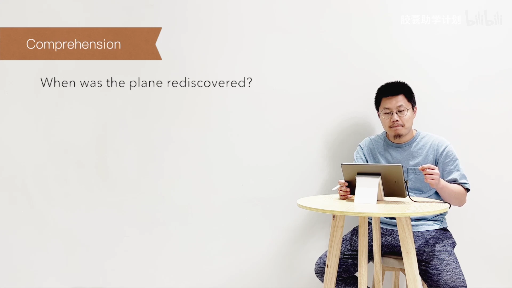

文字识别：Comprehension / When was the plane rediscovered?

## 00:01:00–00:01:30

rediscovered? In 1989. Why was it worth rescuing? Because a Lancaster bomber was rare by this time. Who had the plan packaged? The French authorities. What are the enthusiasts going to do with the plan? Have it restored.

### 画面 00:01:09

文字识别：Comprehension / Why was it worth rescuing? / Because a Lancaster bomber was rare by this / time.

### 画面 00:01:15

文字识别：Comprehension / Who had the plane packaged?

### 画面 00:01:20

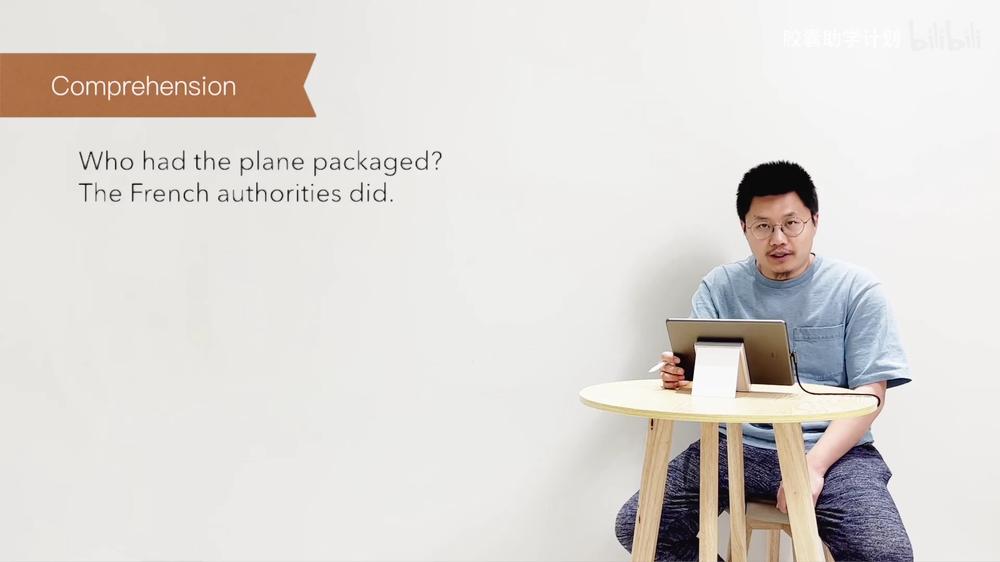

文字识别：Comprehension / Who had the plane packaged? / The French authorities did.

### 画面 00:01:22

文字识别：Comprehension / What are the enthusiasts going to do with / the plane?

## 00:01:30–00:02:00

把它修复了。What type of engine does the plane have? Rolls Royce Merlin engines. How many of the engines do they have to rebuild? Three. What was the condition of the fourth engine? Perfect. Who had preserved the last engine?

### 画面 00:01:31

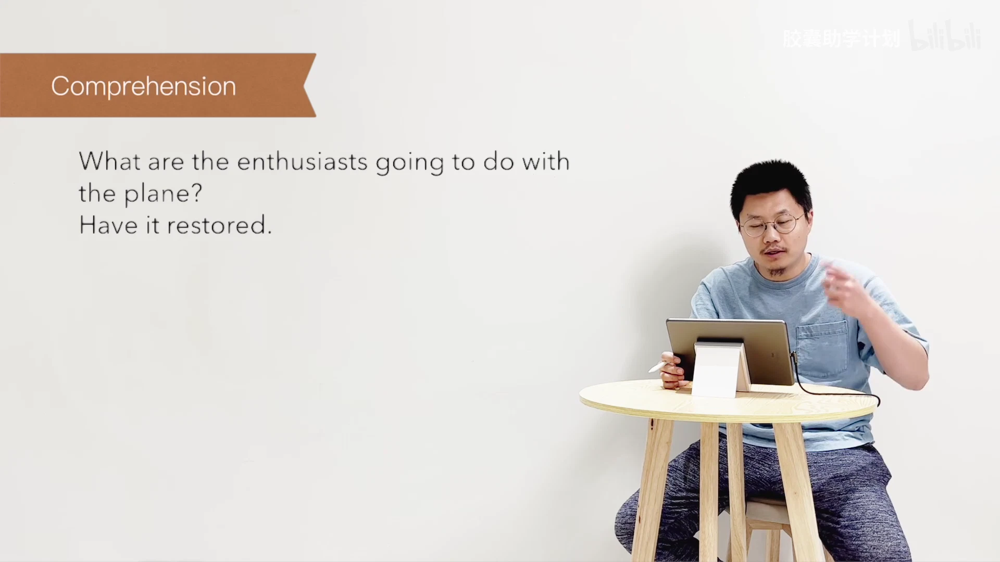

文字识别：Comprehension / What are the enthusiasts going to do with / the plane? / Have it restored.

### 画面 00:01:33

文字识别：Comprehension / What type of engine does the plane have?

### 画面 00:01:46

文字识别：Comprehension / How many of the engines do they have to / rebuild? / Three.

### 画面 00:01:59

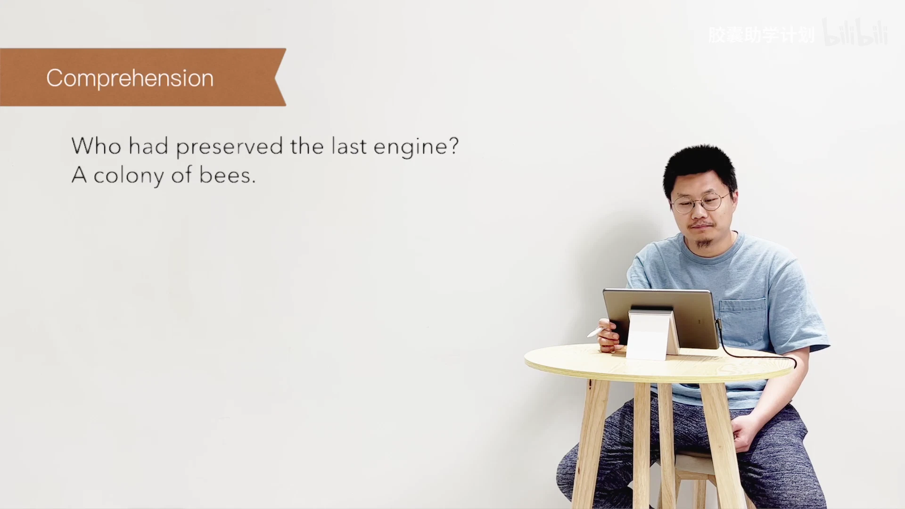

文字识别：Comprehension / Who had preserved the last engine? / A colony of bees.

## 00:02:00–00:02:30

a colony of bees, asking questions. 练习咱们能说出来一般疑问句和特殊疑问句的能力，对吧？也就是我们发问的能力啊。Accuracy啊，这个准确性很重要，可以慢，不能错。第一个，呃，In 1963, Lancaster bomber crashed on Wallace Island. Crashed. 核心词，对吧？六一二三四五六里边，咱们看二。那 did 提前，动词换为原

### 画面 00:02:03

文字识别：Asking questions / 训练目标： / 会说一般疑问句＆特殊疑问句 / Accuracy / Fluency

### 画面 00:02:05

文字识别：Asking questions / 训练目标： / 会说一般疑问句＆特殊疑问句 / Accuracy / Fluency

### 画面 00:02:07

文字识别：Asking questions / 训练目标： / 会说一般疑问句＆特殊疑问句 / Accuracy / Fluency

### 画面 00:02:09

文字识别：Asking questions / 训练目标： / 会说一般疑问句＆特殊疑问句 / Accuracy / Fluency

### 画面 00:02:14

文字识别：Asking questions / 训练目标： / 会说一般疑问句＆特殊疑问句 / Accuracy / Fluency

### 画面 00:02:17

文字识别：Asking questions / T: Ask me if in 1963 a Lancaster bomber / crashed on Wallis Island.

### 画面 00:02:23

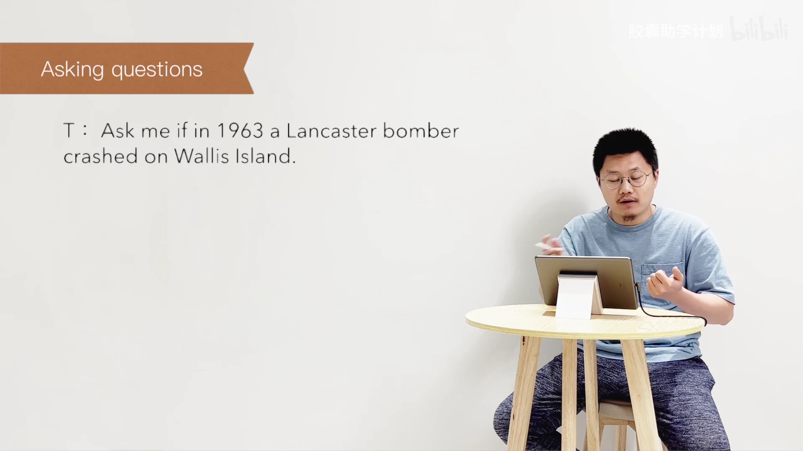

文字识别：Asking questions / T: Ask me if in 1963 a Lancaster bomber / crashed on Wallis Island.

### 画面 00:02:28

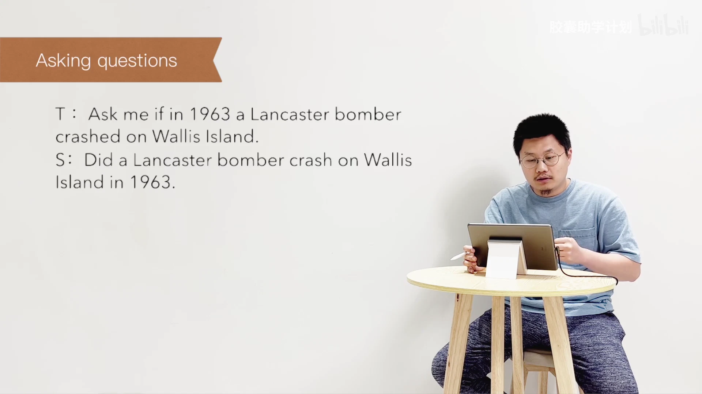

文字识别：Asking questions / T : Ask me if in 1963 a Lancaster bomber / crashed on Wallis Island. / S: Did a Lancaster bomber crash on Wallis / Island in 1963.

## 00:02:30–00:03:00

形，when 那肯定是对一九六三年提问了，对吧？直接一加，这个就结束了。好，我们说一下思路。那 what 对什么提问呢？A Lancaster bomber 提问，对吧？那你把时间其实放到最后面去吧。啊， where 呢？对 Wallace Island 提问啊啊， on Wallace Island 提问。The island is a long way west.呃， is 提前，对吧？那 where 对整个后边这个提问，对吧？Where is the island？The

### 画面 00:02:34

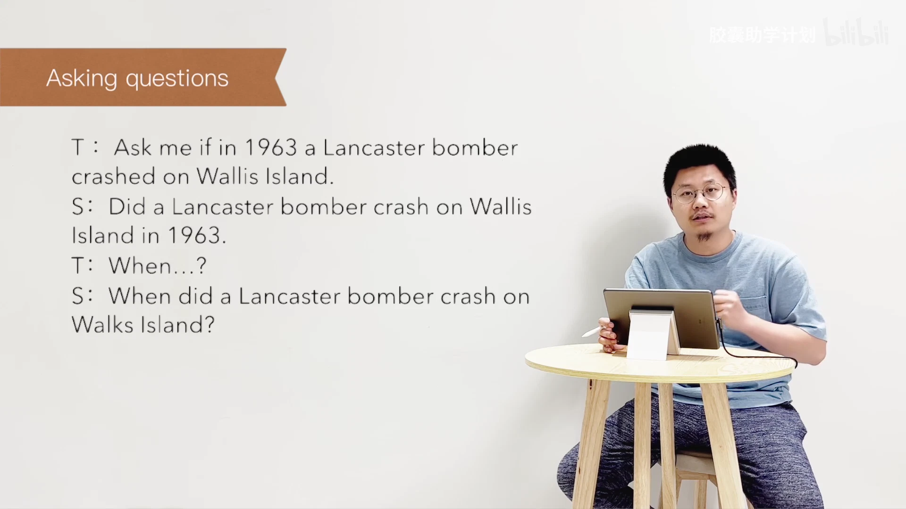

文字识别：Asking questions / T : Ask me if in 1963 a Lancaster bomber / crashed on Wallis Island. / S: Did a Lancaster bomber crash on Wallis / Island in 1963. / T: When...? / S: When did a Lancaster bomber crash on / Walks Island?

### 画面 00:02:36

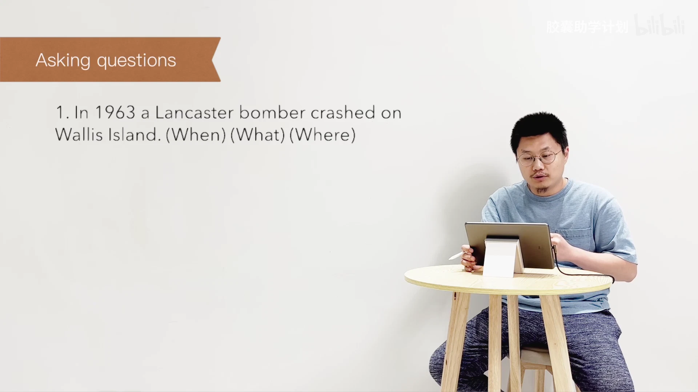

文字识别：Asking questions / 1.In 1963 a Lancaster bomber crashed on / Wallis Island. (When) (What) (Where)

### 画面 00:02:47

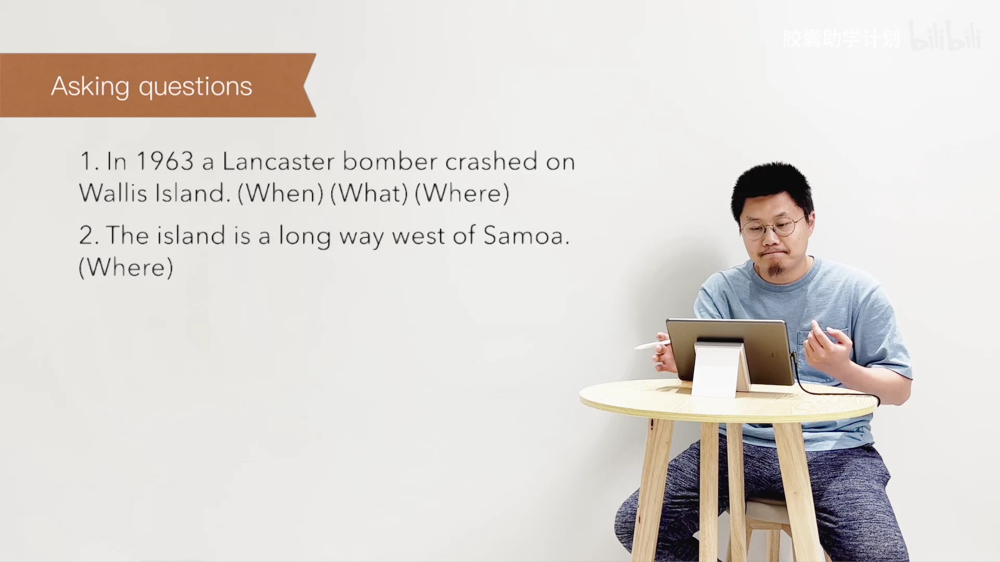

文字识别：Asking questions / 1.In 1963 a Lancaster bomber crashed on / Wallis Island. (When) (What) (Where) / 2. The island is a long way west of Samoa. / (Where)

### 画面 00:02:49

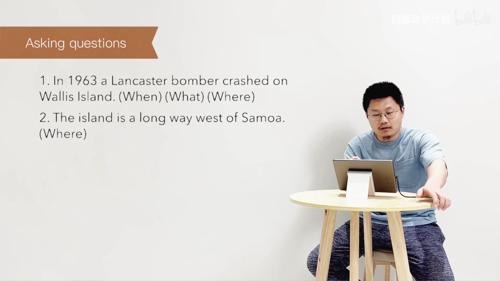

文字识别：Asking questions / 1.In 1963 a Lancaster bomber crashed on / Wallis Island. (When) (What) (Where) / 2. The island is a long way west of Samoa. / (Where)

### 画面 00:02:59

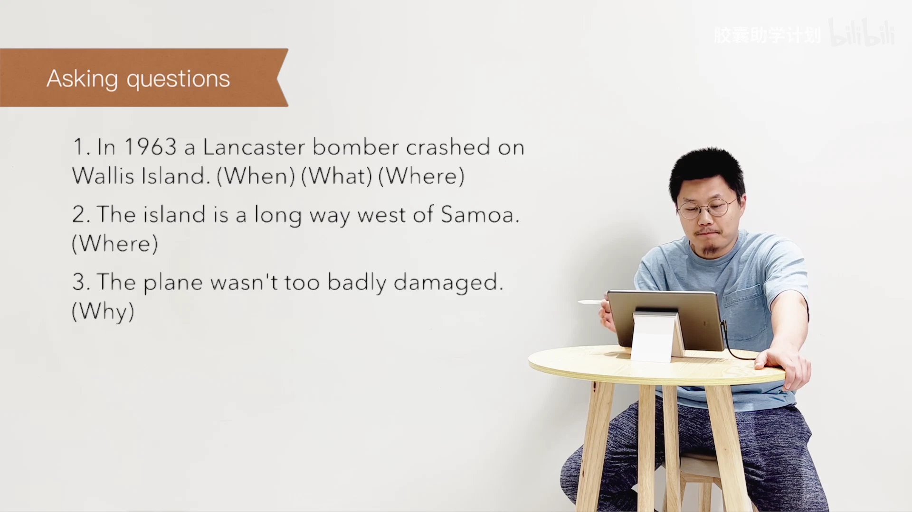

文字识别：Asking questions / 1. In 1963 a Lancaster bomber crashed on / Wallis Island. (When) (What) (Where) / 2. The island is a long way west of Samoa. / (Where) / 3. The plane wasn't too badly damaged. / (Why)

## 00:03:00–00:03:30

The plan wasn't too badly damaged. You注意这是个否定，你先给它变成肯定，对吧？哎，你先把was提前，对吧？Was the plan badly damaged?你把这个too也给它去掉啊，毁坏的很严重吗？然后why这个地方你直接用的叫做why wasn't the plan too badly damaged? 好吧，啊，文章没给答案啊。The wreck remained undisturbed. Did提前why整句啊？It was rediscovered.

### 画面 00:03:27

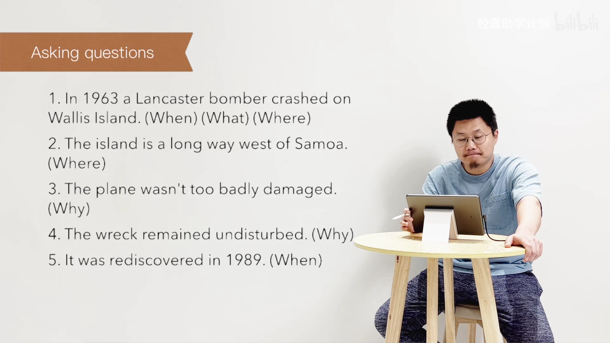

文字识别：Asking questions / 1. In 1963 a Lancaster bomber crashed on / Wallis Island. (When) (What) (Where) / 2. The island is a long way west of Samoa. / (Where) / 3. The plane wasn't too badly damaged. / (Why) / 4. The wreck remained undisturbed. (Why) / 5. It was rediscovered in 1989. (When)

## 00:03:30–00:04:00

Passive. That was提前. When?对, in 1989. The French authorities had the plan packaged and moved to France.你看这里叫had the plan packaged.那你是谁提前?Did提前喽. Who对the French authorities提问? What对呃我们看一下这个what对什么提问啊?哇, what可以对这个plan提问,对吧?哎,他们把什么打包了?OK, very good.

### 画面 00:03:34

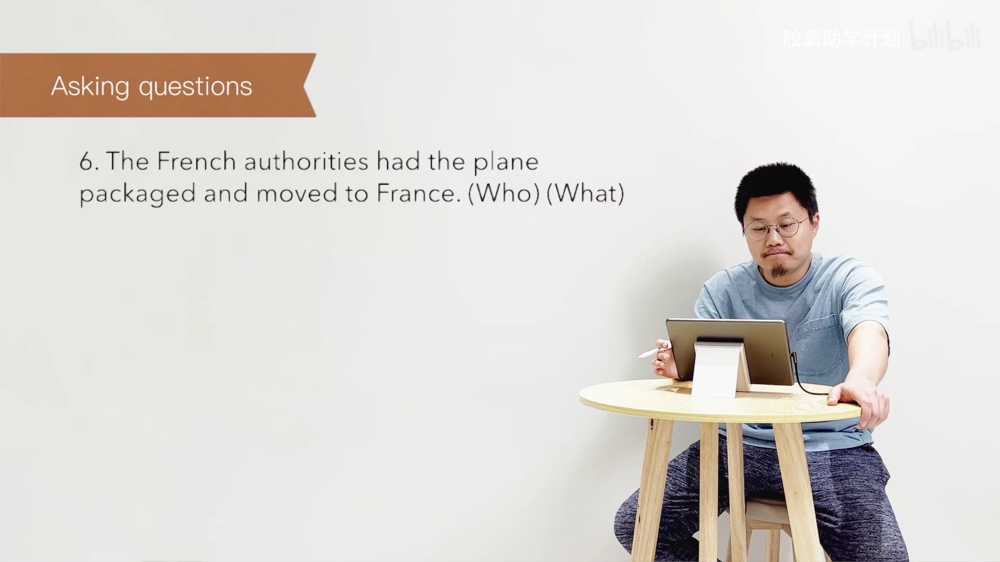

文字识别：Asking questions / 6. The French authorities had the plane / packaged and moved to France. (Who) (What)

### 画面 00:03:59

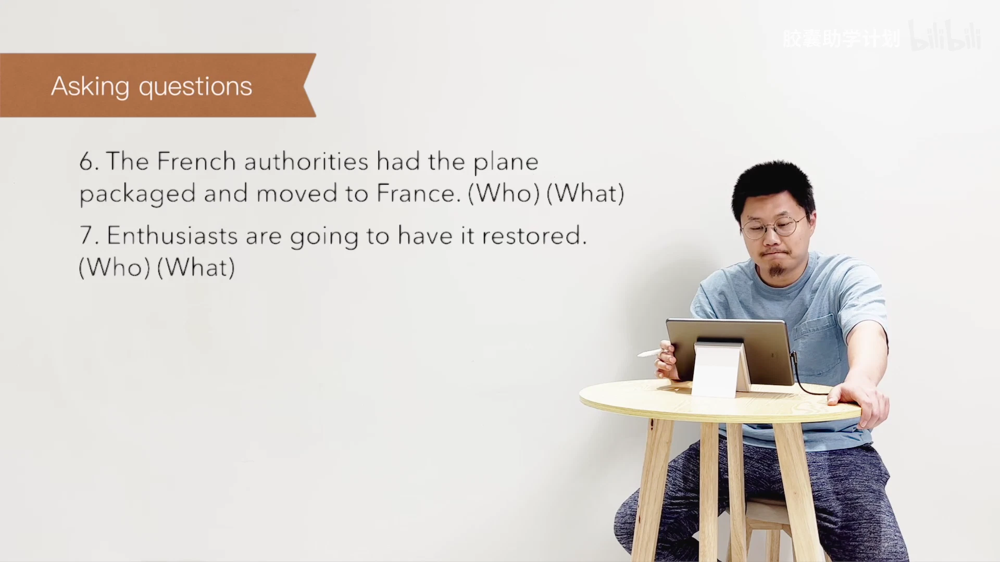

文字识别：Asking questions / 6. The French authorities had the plane / packaged and moved to France. (Who)(What) / 7. Enthusiasts are going to have it restored. / (Who) (What)

## 00:04:00–00:04:30

Next one,第七个, enthusiasts are going to have it restored. Be going to do are提前。Who对enthusiasts提问？那what跟刚才一样对这个it提问，对吧？They need to rebuild three of the four engines. Do提前。How many对three of the four提问，对吧？四个四个当中的三个，对吧？其实就是How many engines do they need to rebuild? The first engine was still in perfect condition. Was提前嘛，对吧？然后

### 画面 00:04:10

文字识别：Asking questions / 6. The French authorities had the plane / packaged and moved to France. (Who) (What) / 7. Enthusiasts are going to have it restored. / (Who)(What) / 8. They need to rebuild three of the four / engines. (How many)

## 00:04:30–00:05:00

呃，那这个 how 可以对 still in perfect condition，就是 how was the engine？那 what 点点 like 其实它同义词啊， what was the fourth engine like？啊， how's the weather？ What was the weather like？对吧？第十个 had turned the engine into a hype，注意这是过去完成时 had 提前，对吧？ What 对 be 提问？ Tell the story，文章熟读来这个地方练复述口语复述能力，就是给别人讲一遍故事，对吧？

### 画面 00:04:31

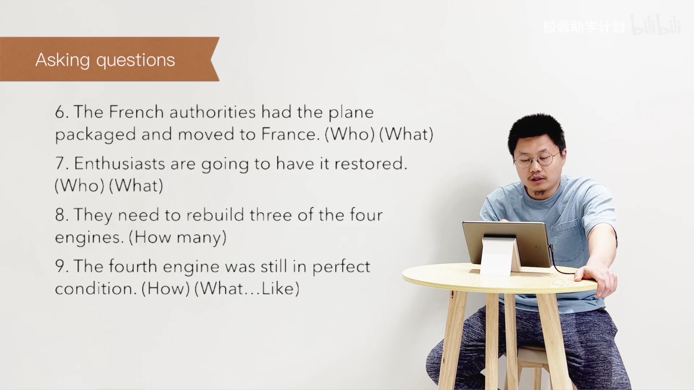

文字识别：Asking questions / 6. The French authorities had the plane / packaged and moved to France. (Who)(What) / 7. Enthusiasts are going to have it restored. / (Who)(What) / 8. They need to rebuild three of the four / engines.(How many) / 9. The fourth engine was still in perfect / condition. (How) (What...Like)

### 画面 00:04:51

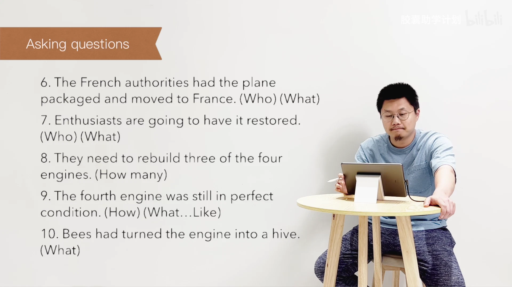

文字识别：Asking questions / 6. The French authorities had the plane / packaged and moved to France. (Who) (What) / 7. Enthusiasts are going to have it restored. / (Who)(What) / 8. They need to rebuild three of the four / engines.(How many) / 9. The fourth engine was still in perfect / condition. (How) (What...Like) / 10. Bees had turned the engine into a hive. / (What)

### 画面 00:04:53

文字识别：Tell the story / 训练目标： / □语复述能力 / Accuracy / Fluency

### 画面 00:04:55

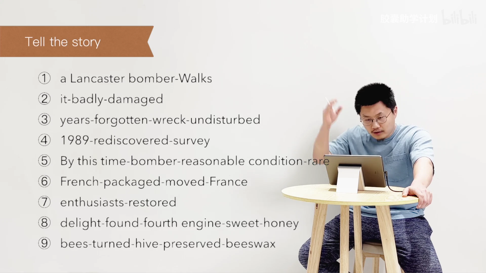

文字识别：Tell the story / ① / ) a Lancaster bomber-Walks / it-badly-damaged / years-forgotten-wreck-undisturbed /  1989-rediscovered-survey /  By this time-bomber-reasonable condition-rare / 5 / French-packaged-moved-France / enthusiasts-restored / delight-found-fourth engine-sweet-honey / 8 /  bees-turned-hive-preserved-beeswax / 9

## 00:05:00–00:05:30

呃，summary writing写完来这里对答案，有什么问题直接留言，好吧？没什么可说的啊。这个练习一定要做啊！虽然我们基本上花的时间去讲它很少，因为没有太多必要啊。然后呢，topic for discussion，我们还是老习惯说一遍题。Tell us about any plane crash you've heard about recently. 给我们讲讲你最近听过的坠机事件。第二个。Tell us about the pleasure of restoring

### 画面 00:05:01

文字识别：Summary writing: Key / 训练目标： / 写作复述能力

### 画面 00:05:03

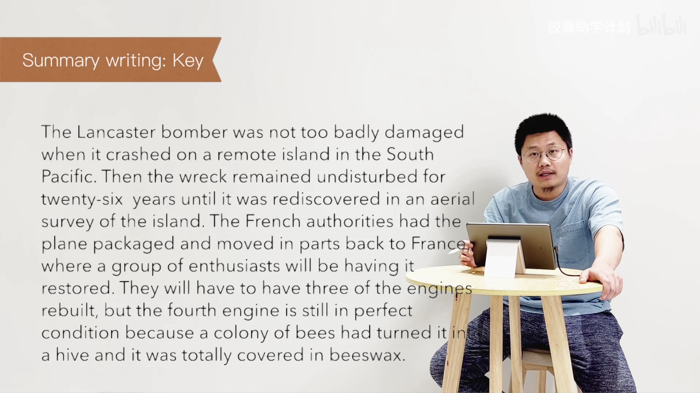

文字识别：Summary writing: Key / The Lancaster bomber was not too badly damaged / when it crashed on a remote island in the South / Pacific. Then the wreck remained undisturbed for / twenty-six years until it was rediscovered in an aerial / survey of the island. The French authorities had the / plane packaged and moved in parts back to France / where a group of enthusiasts will be having it / restored. They will have to have three of the engines / rebuilt, but the fourth engine is still in perfect / condition because a colony of bees had turned it / tir / a hive and it was totally covered in beeswax.

### 画面 00:05:13

文字识别：Topics for discussion / 训练目标： / 完全自由的对话 / Accuracy / Fluency

### 画面 00:05:15

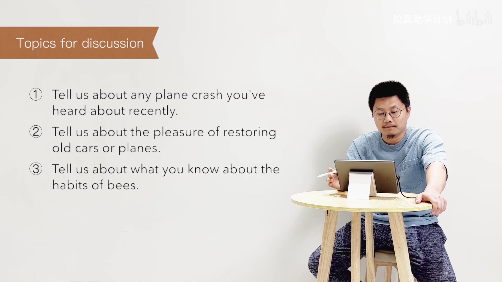

文字识别：Topics for discussion / Tell us about any plane crash you've / heard about recently. / Tell us about the pleasure of restoring / old cars or planes. / Tell us about what you know about the / habits of bees.

## 00:05:30–00:06:00

old cars or planes. 可说给我们讲一讲恢复这些老车啊，或者说这这些古董车啊，或者说这些飞机的愉快的地方在什么地方啊？这个事儿我没干过，我真不知道，是吧？那你可能想一下，我说也许您看过那种视频啊，那个车特别脏了，然后都给它弄一遍，是吧？那个愉快点在哪？第三个说， tell us about what you know about the habits of bees. 这就很有意思了，给我们讲讲你知道蜜蜂的一些习惯

### 画面 00:05:45

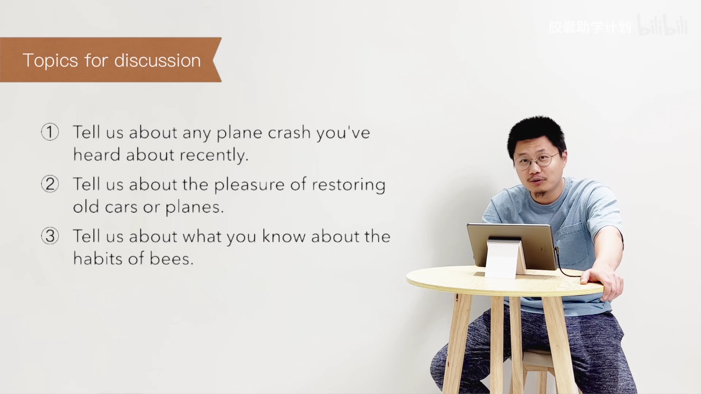

文字识别：Topics for discussion / Tell us about any plane crash you've / heard about recently. / Tell us about the pleasure of restoring / old cars or planes. / Tell us about what you know about the / habits of bees.

## 00:06:00–00:06:30

啊，那家庭作业 ask me if 先写再朗读，然后写作写完来这里对答案， tell the story 进行口语复述，置顶留言能看到重复间隔的学习材料。以上呢就是本期视频的全部内容了。如果各位喜欢我们的课程呢，欢迎各位关注订阅，一键三连，分享给那些需要的朋友来帮助我们快速成长。 See you next time.

### 画面 00:06:01

### 画面 00:06:04

文字识别：1.Ask me if写&朗读 / 2.摘要写作写&答案

### 画面 00:06:06

文字识别：1.Ask me if写&朗读 / 摘要写作写&答案 / 3.Tell the story 口语复述

### 画面 00:06:08

文字识别：1.Ask me if写&朗读 / 摘要写作写&答案 / 3.Tell the story 口语复述 / .重复间隔（置顶留言） / 4.

### 画面 00:06:10

文字识别：1.Ask me if写&朗读 / 摘要写作写&答案 / 3.Tell the story 口语复述 / 4.重复间隔（置顶留言)

### 画面 00:06:12

### 画面 00:06:14

文字识别：不 / ￥

### 画面 00:06:16

文字识别：不 / ￥

### 画面 00:06:18

### 画面 00:06:24

文字识别：🙌

### 画面 00:06:26

文字识别：CAPSULEACADEMY / 胶囊助学计划 / 小红书 / Leo'irer / OE

### 画面 00:06:28

文字识别：CAPSULEACADEMY / 胶囊助学计划 / 小红书 / Photographer / OE

## 00:06:30–00:06:37

### 画面 00:06:31

文字识别：CAPSULEACADEMY / 胶囊助学计划 / 『 / 小红书 / Editor / Berlin / OE

### 画面 00:06:34

文字识别：CAPSULEACADEMY / 胶囊助学计划 / 小红书

### 画面 00:06:36

文字识别：bilibili / 胶囊助学计划

### 画面 00:06:37

文字识别：bilibili / 胶囊助学计划

