# 067 单词

快速机器解析：语音为单模型转写，未进行独立交叉校对或人工复核；画面每秒采样并按变化选帧，短时文字和标记可能遗漏。截图时间约有 1 秒误差。图片有损压缩；遇到疑点请按时间查看 Google Drive 原视频。

## 00:00:00–00:00:30

Hello everyone, welcome to Capsule Academy. This is Leo. Today we're going to learn New Concept English Book Two, Lesson Sixty Seven Words. 那老习惯进入正式课程之前呢，咱们看几个问题啊。首先啊，其实就这一个问题，如何表达你这主意真棒啊？那带着这个问题，后边呢，Enjoy. 好，我们先看第一个单词，看一下音标叫做 volcano。注意重音在

### 画面 00:00:00

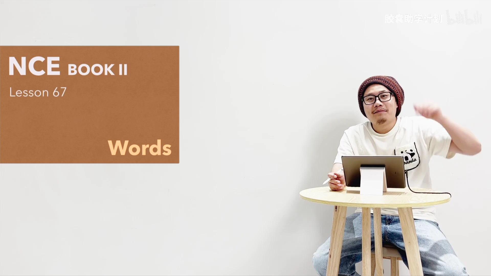

文字识别：NCE / BOOK"I / Lesson 67 / Words / panda

### 画面 00:00:02

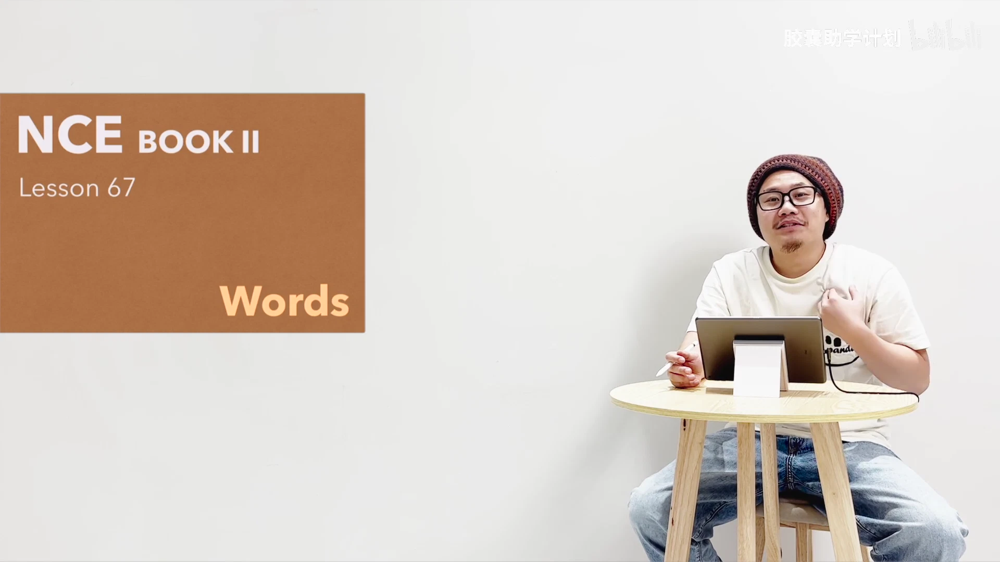

文字识别：NCE / BOOKⅡI / Lesson 67 / Words

### 画面 00:00:11

文字识别：袁助学计划一洲

### 画面 00:00:13

文字识别：① 如何表达“主意真棒”？ / panda

### 画面 00:00:19

文字识别：bibii / 胶囊助学计划 / • / •

### 画面 00:00:23

文字识别：交囊助学计划旧 / 胶囊助学计划

### 画面 00:00:25

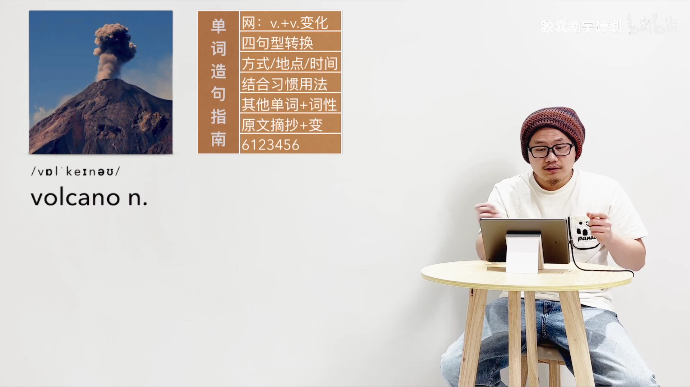

文字识别：单词造句指南 / 网：v.+v.变化 / 囊助学计划 / 四句型转换 / 方式/地点/时间 / 结合习惯用法 / 其他单词+词性 / 原文摘抄+变 / 6123456 / /vpl'keinau/ / volcano n. / panau

### 画面 00:00:28

文字识别：单词造句指南 / 网：v.+v.变化 / 奏助学计划一调 / 四句型转换 / 方式/地点/时间 / 结合习惯用法 / 其他单词+词性 / 原文摘抄+变 / 6123456 / /vpl'keinau/ / volcano n. / pa.

## 00:00:30–00:01:00

第二个音节上，连起来读volcano, volcano. Okay, volcano火山的意思，注意它是个名词。那我们想拿它去连，就必须要找不同的动词，对吧？那我在这个地方找到的动词是study。然后呢，我们就造了一个句子，跟着我读，repeat after me. I should have spent more time studying volcanoes.这里用了两个，第一个是咱们之前学过的should have done啊，本应该；第二个是spend

### 画面 00:00:30

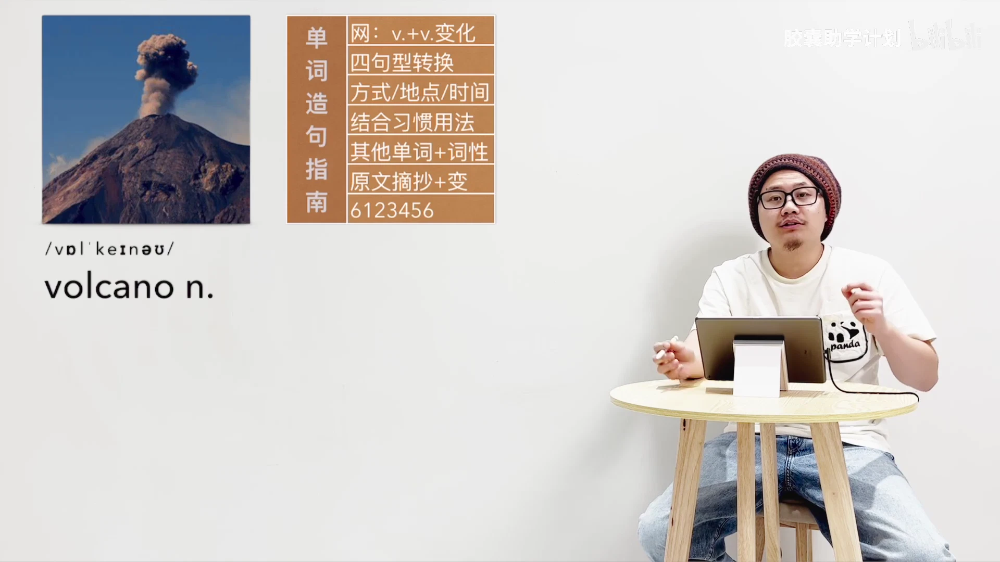

文字识别：单词造句指南 / 网：v.+v.变化 / 妻助学计划園 / 四句型转换 / 方式/地点/时间 / 结合习惯用法 / 其他单词+词性 / 原文摘抄+变 / 6123456 / /vpl'keinau/ / volcano n. / panda

### 画面 00:00:32

文字识别：单词造句指南 / 网：v.+v.变化 / 妻助学计划園 / 四句型转换 / 方式/地点/时间 / 结合习惯用法 / 其他单词+词性 / 原文摘抄+变 / 6123456 / /vpl'keinau/ / volcano n. / pa

### 画面 00:00:35

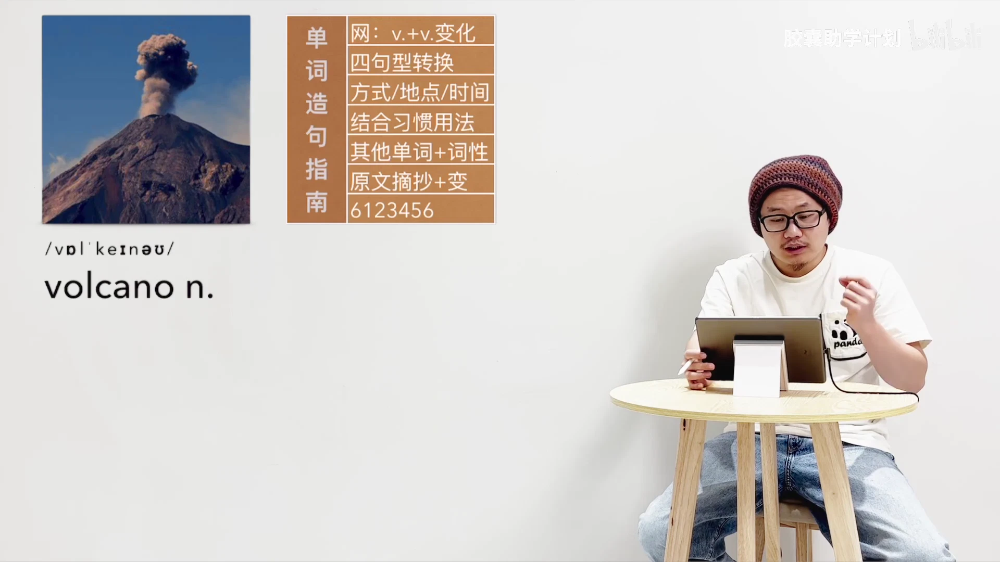

文字识别：单词造句指南 / 网：v.+v.变化 / 妻助字计划 / 四句型转换 / 方式/地点/时间 / 结合习惯用法 / 其他单词+词性 / 原文摘抄+变 / 6123456 / /vpl'keinau/ / volcano n. / panda

### 画面 00:00:37

文字识别：单词造句指南 / 网：v.+v.变化 / 妻助学计划 / 四句型转换 / 方式/地点/时间 / 结合习惯用法 / 其他单词+词性 / 原文摘抄+变 / 6123456 / /vpl'keinau/ / volcano n. / ① I should have spent more time studying / panda / volcanoes. L65 L59

### 画面 00:00:40

文字识别：单词造句指南 / 网：v.+v.变化 / 囊助字计划 / 四句型转换 / 方式/地点/时间 / 结合习惯用法 / 其他单词+词性 / 原文摘抄+变 / 6123456 / /vpl'keinau/ / volcano n. / ① I should have spent more time studying / panda / volcanoes. L65 L59

### 画面 00:00:42

文字识别：单词造句指南 / 网：v.+v.变化 / 囊助字计划 / 四句型转换 / 方式/地点/时间 / 结合习惯用法 / 其他单词+词性 / 原文摘抄+变 / 6123456 / /vpl'keinau/ / volcano n. / ① I should have spent more time studying / panda / volcanoes. L65 L59

### 画面 00:00:44

文字识别：单词造句指南 / 网：v.+v.变化 / 囊助学计划陽 / 四句型转换 / 方式/地点/时间 / 结合习惯用法 / 其他单词+词性 / 原文摘抄+变 / 6123456 / /vpl'keinau/ / volcano n. / ① I should have spent more time studying / volcanoes. L65 L59

### 画面 00:00:46

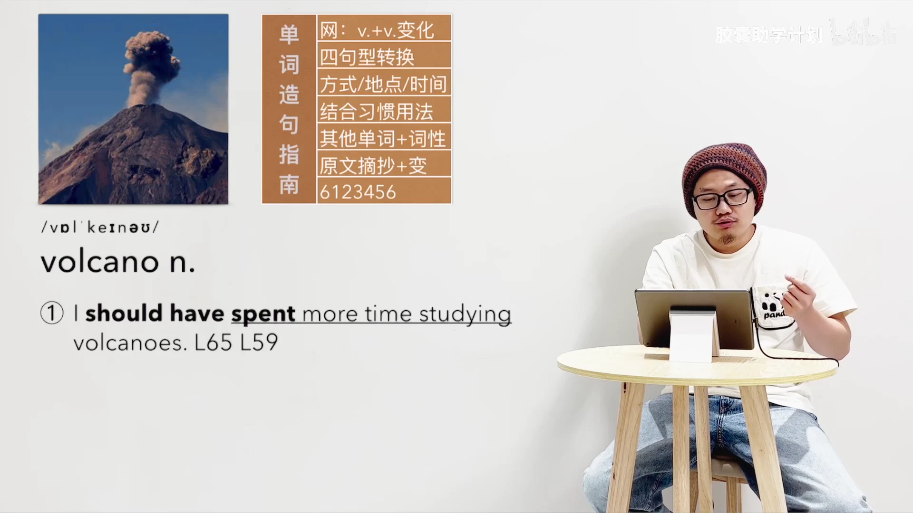

文字识别：单词造句指南 / 网：v.+v.变化 / 囊助学计划 / 四句型转换 / 方式/地点/时间 / 结合习惯用法 / 其他单词+词性 / 原文摘抄+变 / 6123456 / /vpl'keinau/ / volcano n. / ① I should have spent more time studying / pand / volcanoes. L65 L59

### 画面 00:00:48

文字识别：单词造句指南 / 网：v.+v.变化 / 囊助学计划 / 四句型转换 / 方式/地点/时间 / 结合习惯用法 / 其他单词+词性 / 原文摘抄+变 / 6123456 / /vpl'keinau/ / volcano n. / ① I should have spent more time studying / volcanoes. L65 L59

### 画面 00:00:50

文字识别：单词造句指南 / 网：v.+v.变化 / 喜助字计划 / 四句型转换 / 方式/地点/时间 / 结合习惯用法 / 其他单词+词性 / 原文摘抄+变 / 6123456 / /vpl'keinau/ / volcano n. / ① I should have spent more time studying / panda / volcanoes. L65 L59

### 画面 00:00:53

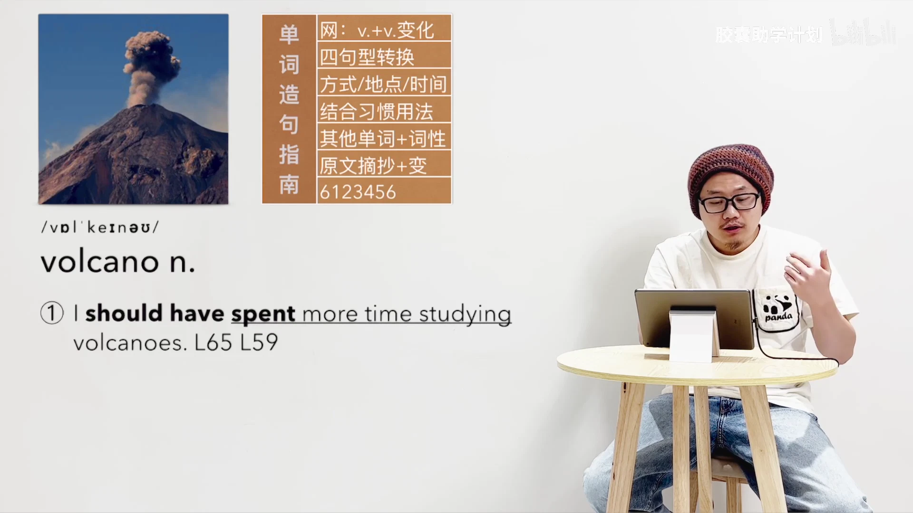

文字识别：单词造句指南 / 网：v.+v.变化 / 奏助字计划 / 四句型转换 / 方式/地点/时间 / 结合习惯用法 / 其他单词+词性 / 原文摘抄+变 / 6123456 / /vpl'keinau/ / volcano n. / ① I should have spent more time studying / panda / volcanoes. L65 L59

### 画面 00:00:55

文字识别：单词造句指南 / 网：v.+v.变化 / 妻助学计划 / 四句型转换 / 方式/地点/时间 / 结合习惯用法 / 其他单词+词性 / 原文摘抄+变 / 6123456 / /vpl'keinau/ / volcano n. / ① I should have spent more time studying / volcanoes. L65 L59

### 画面 00:00:58

文字识别：单词造句指南 / 网：v.+v.变化 / 囊助学计划 / 四句型转换 / 方式/地点/时间 / 结合习惯用法 / 其他单词+词性 / 原文摘抄+变 / 6123456 / /vpl'keinau/ / volcano n. / ① I should have spent more time studying / panda / volcanoes. L65 L59

## 00:01:00–00:01:30

some time doing something，啊，花费某些时间做某些事情。那在这儿我们就是结合了其他的习惯用法。好，第二个，She is eager to see the volcano. 哎，她对于某件事情感到特别的渴望，她很想去做某件事情。Be eager to do something. 然后 see the volcano，去看这个火山啊。Next one,说Lyle became an expert at volcanoes.啊，你可以说 after

### 画面 00:01:00

文字识别：单词造句指南 / 网：v.+v.变化 / 囊助学计划 / 四句型转换 / 方式/地点/时间 / 结合习惯用法 / 其他单词+词性 / 原文摘抄+变 / 6123456 / /vpl'keinau/ / volcano n. / ① I should have spent more time studying / volcanoes. L65 L59

### 画面 00:01:03

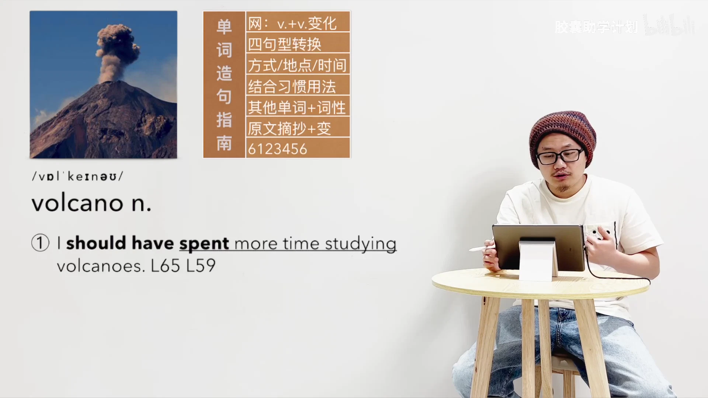

文字识别：单词造句指南 / 网：v.+v.变化 / 妻助学计划 / 四句型转换 / 方式/地点/时间 / 结合习惯用法 / 其他单词+词性 / 原文摘抄+变 / 6123456 / /vpl'keinau/ / volcano n. / ① I should have spent more time studying / volcanoes. L65 L59

### 画面 00:01:05

文字识别：单词造句指南 / 网：v.+v.变化 / 毫助学计划 / 四句型转换 / 方式/地点/时间 / 结合习惯用法 / 其他单词+词性 / 原文摘抄+变 / 6123456 / /vpl'keinau/ / volcano n. / ① I should have spent more time studying / panda / volcanoes. L65 L59

### 画面 00:01:08

文字识别：单词造句指南 / 网：v.+v.变化 / 学计划 / 四句型转换 / 方式/地点/时间 / 结合习惯用法 / 其他单词+词性 / 原文摘抄+变 / 6123456 / /vpl'keinau/ / volcano n. / ① I should have spent more time studying / volcanoes. L65 L59 / She is eager to see the volcano. L57

### 画面 00:01:10

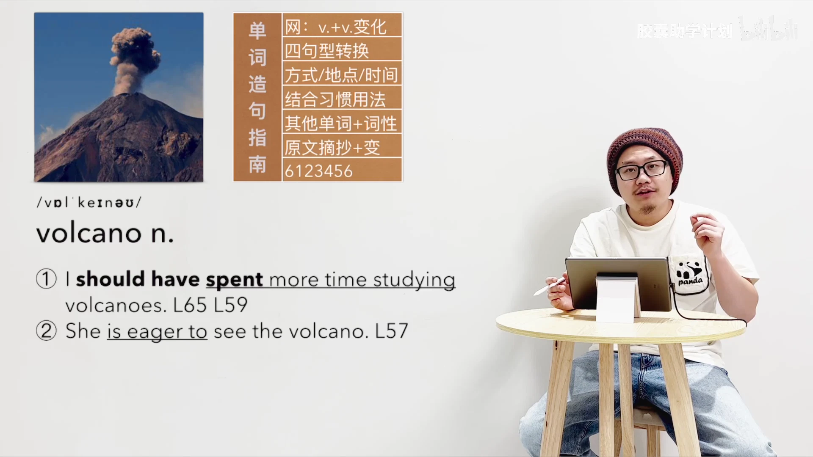

文字识别：单词造句指南 / 网：v.+v.变化 / 喜助学计划 / 四句型转换 / 方式/地点/时间 / 结合习惯用法 / 其他单词+词性 / 原文摘抄+变 / 6123456 / /vpl'keinau/ / volcano n. / ① I should have spent more time studying / panda / volcanoes. L65 L59 / She is eager to see the volcano. L57

### 画面 00:01:13

文字识别：单词造句指南 / 网：v.+v.变化 / 囊助学计划陽 / 四句型转换 / 方式/地点/时间 / 结合习惯用法 / 其他单词+词性 / 原文摘抄+变 / 6123456 / /vpl'keinau/ / volcano n. / ① I should have spent more time studying / panda / volcanoes. L65 L59 / She is eager to see the volcano. L57

### 画面 00:01:15

文字识别：单词造句指南 / 网：v.+v.变化 / 妻助学计划 / 四句型转换 / 方式/地点/时间 / 结合习惯用法 / 其他单词+词性 / 原文摘抄+变 / 6123456 / /vpl'keinau/ / volcano n. / ① I should have spent more time studying / panda / volcanoes. L65 L59 / She is eager to see the volcano. L57

### 画面 00:01:20

文字识别：单词造句指南 / 网：v.+v.变化 / 妻助学计划 / 四句型转换 / 方式/地点/时间 / 结合习惯用法 / 其他单词+词性 / 原文摘抄+变 / 6123456 / /vpl'keinau/ / volcano n. / ① I should have spent more time studying / panda / volcanoes. L65 L59 / She is eager to see the volcano. L57

### 画面 00:01:24

文字识别：单词造句指南 / 网：v.+v.变化 / 四句型转换 / 方式/地点/时间 / 结合习惯用法 / 其他单词+词性 / 原文摘抄+变 / 6123456 / /vpl'keinau/ / volcano n. / ① I should have spent more time studying / pana. / volcanoes. L65 L59 / She is eager to see the volcano. L57 / ③ Leo became an expert at volcanoes. L59

### 画面 00:01:26

文字识别：单词造句指南 / 网：v.+v.变化 / 妻助字计划 / 四句型转换 / 方式/地点/时间 / 结合习惯用法 / 其他单词+词性 / 原文摘抄+变 / 6123456 / /vpl'keinau/ / volcano n. / ① I should have spent more time studying / panda / volcanoes. L65 L59 / She is eager to see the volcano. L57 / ③ Leo became an expert at volcanoes. L59

## 00:01:30–00:02:00

years of studying, is right. In learning for many years, he finally became a volcano expert. Ah, become an expert at doing something. That you can also say become an expert at something. Okay, very good. Read again this word volcano. Very good. Another sentence: If you had gone to the national park, you would have seen the famous volcano. I have marked the key grammar points for you, right? In bold form. Lesson 64, intonation. So I can ask.

### 画面 00:01:30

文字识别：单词造句指南 / 网：v.+v.变化 / 妻助学计划陽 / 四句型转换 / 方式/地点/时间 / 结合习惯用法 / 其他单词+词性 / 原文摘抄+变 / 6123456 / /vpl'keinau/ / volcano n. / ① I should have spent more time studying / panda / volcanoes. L65 L59 / She is eager to see the volcano. L57 / ③ Leo became an expert at volcanoes. L59

### 画面 00:01:35

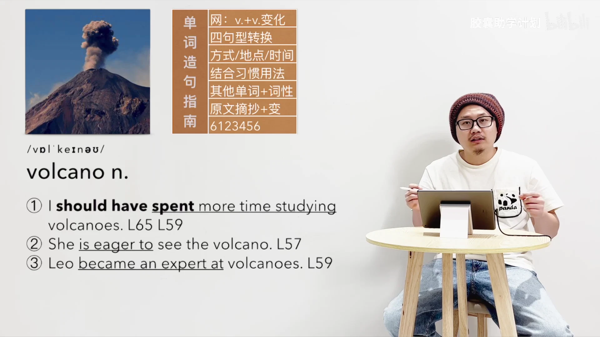

文字识别：单词造句指南 / 网：v.+v.变化 / 奏助学计划一州 / 四句型转换 / 方式/地点/时间 / 结合习惯用法 / 其他单词+词性 / 原文摘抄+变 / 6123456 / /vpl'keinau/ / volcano n. / ① I should have spent more time studying / panda / volcanoes. L65 L59 / She is eager to see the volcano. L57 / ③ Leo became an expert at volcanoes. L59 / 3）

### 画面 00:01:37

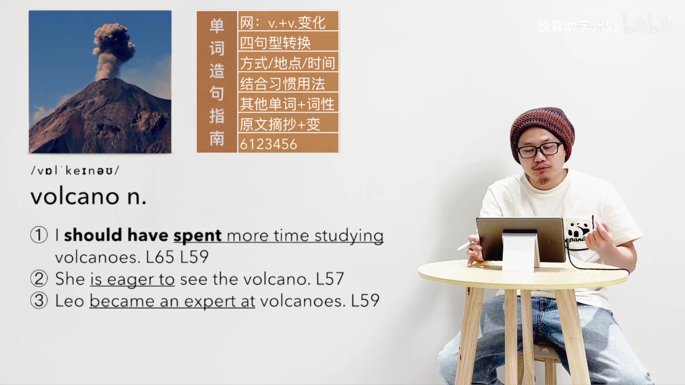

文字识别：单词造句指南 / 网：v.+v.变化 / 喜助学计划 / 四句型转换 / 方式/地点/时间 / 结合习惯用法 / 其他单词+词性 / 原文摘抄+变 / 6123456 / /vpl'keinau/ / volcano n. / ① I should have spent more time studying / pand / volcanoes. L65 L59 / She is eager to see the volcano. L57 / ③ Leo became an expert at volcanoes. L59

### 画面 00:01:40

文字识别：单词造句指南 / 网：v.+v.变化 / 龔助字计划 / 四句型转换 / 方式/地点/时间 / 结合习惯用法 / 其他单词+词性 / 原文摘抄+变 / 6123456 / /vpl'keinau/ / volcano n. / ① I should have spent more time studying / panda / volcanoes. L65 L59 / She is eager to see the volcano. L57 / ③ Leo became an expert at volcanoes. L59

### 画面 00:01:42

文字识别：单词造句指南 / 网：v.+v.变化 / 襲助字计划 / 四句型转换 / 方式/地点/时间 / 结合习惯用法 / 其他单词+词性 / 原文摘抄+变 / 6123456 / /vpl'keinau/ / volcano n. / ① I should have spent more time studying / volcanoes. L65 L59 / She is eager to see the volcano. L57 / ③ Leo became an expert at volcanoes. L59

### 画面 00:01:45

文字识别：单词造句指南 / 网：v.+v.变化 / 四句型转换 / 方式/地点/时间 / 结合习惯用法 / 其他单词+词性 / 原文摘抄+变 / 6123456 / /vpl'keinau/ / volcano n. / ① I should have spent more time studying / pan / volcanoes. L65 L59 / She is eager to see the volcano. L57 / ③ Leo became an expert at volcanoes. L59

### 画面 00:01:47

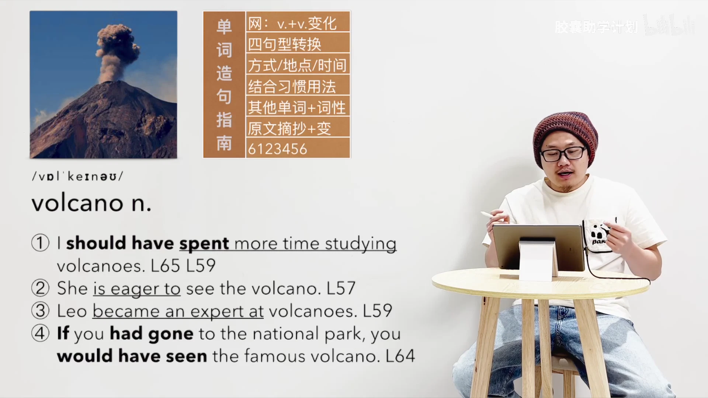

文字识别：单词造句指南 / 网：v.+v.变化 / 妻助学计划 / 四句型转换 / 方式/地点/时间 / 结合习惯用法 / 其他单词+词性 / 原文摘抄+变 / 6123456 / /vpl'keinau/ / volcano n. / ① I should have spent more time studying / pan / volcanoes. L65 L59 / She is eager to see the volcano. L57 / Leo became an expert at volcanoes. L59 / 3 / If you had gone to the national park, you / would have seen the famous volcano. L64

### 画面 00:01:50

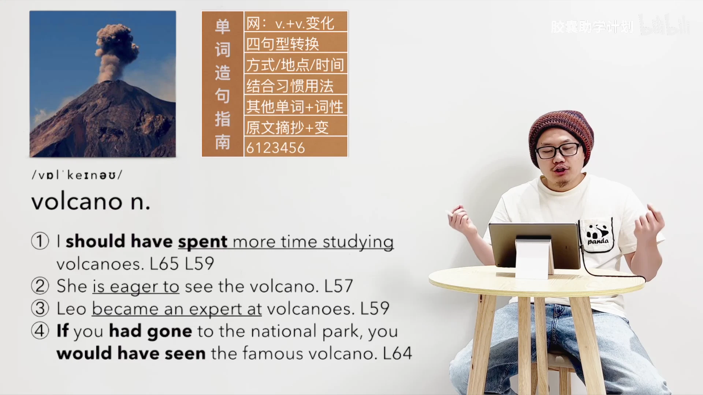

文字识别：单词造句指南 / 网：v.+v.变化 / 助字计划 / 四句型转换 / 方式/地点/时间 / 结合习惯用法 / 其他单词+词性 / 原文摘抄+变 / 6123456 / /vpl'keinau/ / volcano n. / ① I should have spent more time studying / panda / volcanoes. L65 L59 / She is eager to see the volcano. L57 / Leo became an expert at volcanoes. L59 / 3 / If you had gone to the national park, you / would have seen the famous volcano. L64

## 00:02:00–00:02:30

所以我可以问一个问题叫 Did you go to the national park? 如果你的回答是 No, I didn't, 那说明这个语法你就非常熟悉了。如果你不太熟呢，回到六十四课再复习一下。OK，那接下来呢，注意力集中，我们先听一下这个电影片段。 But let me just tell you, she's like, she's like a volcano. OK，那你看啊，这里边在说的是说她就就像是个火山一样，是什么意

### 画面 00:02:00

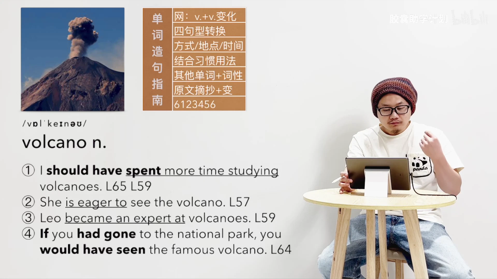

文字识别：单词造句指南 / 网：v.+v.变化 / 虞助学计划 / 四句型转换 / 方式/地点/时间 / 结合习惯用法 / 其他单词+词性 / 原文摘抄+变 / 6123456 / /vpl'keinau/ / volcano n. / ① I should have spent more time studying / panda / volcanoes. L65 L59 / She is eager to see the volcano. L57 / Leo became an expert at volcanoes. L59 / 3 / If you had gone to the national park, you / would have seen the famous volcano. L64

### 画面 00:02:05

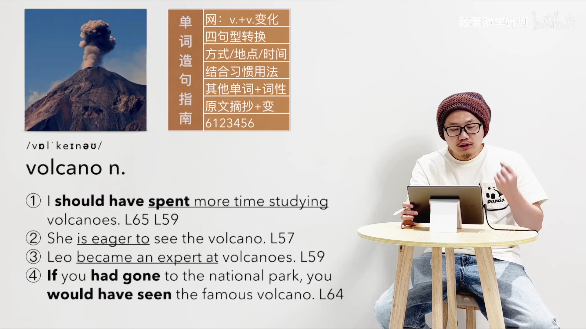

文字识别：单词造句指南 / 网：v.+v.变化 / 奏助学计划陽 / 四句型转换 / 方式/地点/时间 / 结合习惯用法 / 其他单词+词性 / 原文摘抄+变 / 6123456 / /vpl'keinau/ / volcano n. / ① I should have spent more time studying / panda / volcanoes. L65 L59 / She is eager to see the volcano. L57 / Leo became an expert at volcanoes. L59 / 3 / If you had gone to the national park, you / would have seen the famous volcano. L64

### 画面 00:02:13

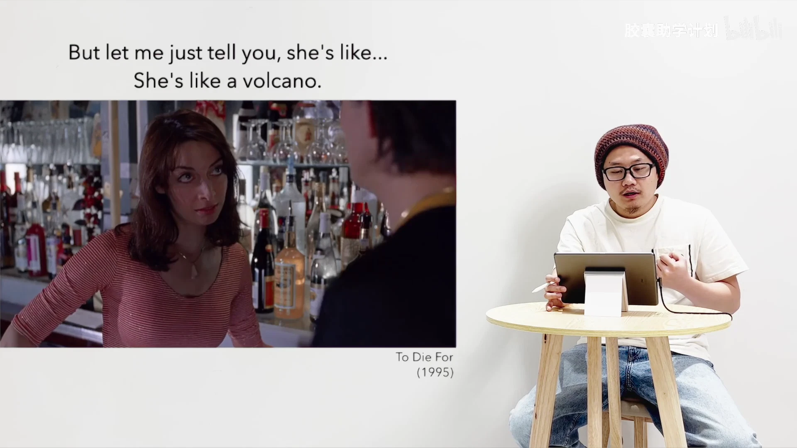

文字识别：But let me just tell you, she's like. / She's like a volcano. / To Die For / (1995)

### 画面 00:02:19

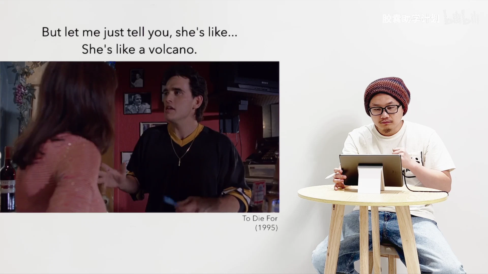

文字识别：But let me just tell you, she's like. / She's like a volcano. / To Die For / (1995)

### 画面 00:02:21

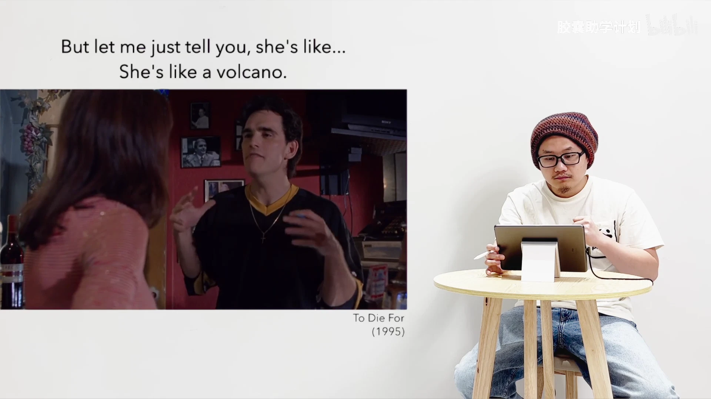

文字识别：But let me just tell you, she's like. / She's like a volcano. / To Die For / (1995)

### 画面 00:02:23

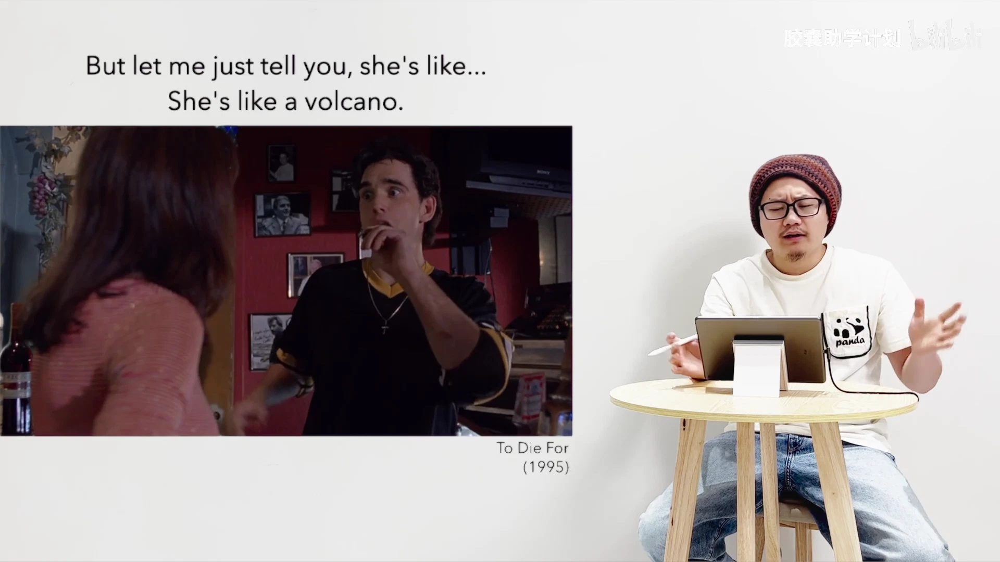

文字识别：But let me just tell you, she's like.. / She's like a volcano. / panda / To Die For / (1995)

### 画面 00:02:27

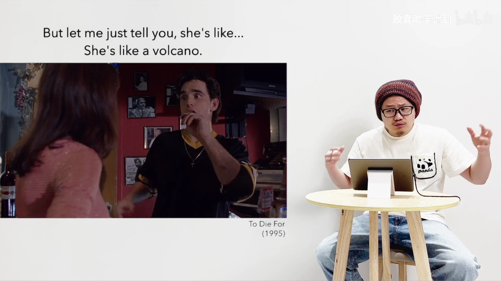

文字识别：But let me just tell you, she's like. / She's like a volcano. / panda / To Die For / (1995)

## 00:02:30–00:03:00

思呢？Volcano这个单词，它本身很常用的意思啊，是火山。那口语当中很常用的意思呢，就是说某人就像个火山一样。你想火山有什么样的特点，是吧？好像那种感觉叫随时情绪就要爆发了一样。所以说这个人，比如说他说他这个情绪随时要爆发，对吧？哎，你就 she's like a volcano. Very good. Next one. 那注意力集中，我们听这个电影片段。 Dear Alex Rover, I'm not sure what it looks like

### 画面 00:02:31

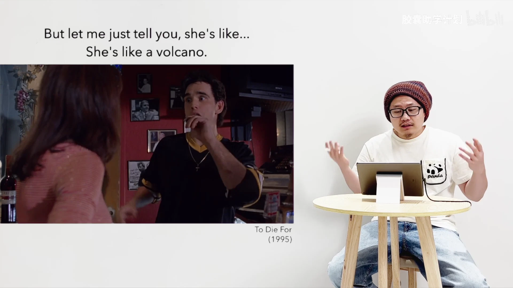

文字识别：But let me just tell you, she's like.. / She's like a volcano. / panda / To Die For / (1995)

### 画面 00:02:52

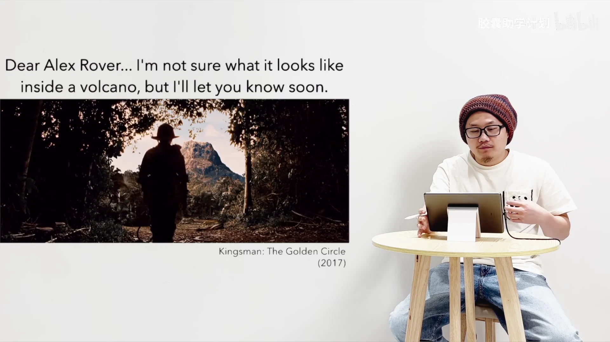

文字识别：Dear Alex Rover.. I'm not sure what it looks like / inside a volcano, but I'll let you know soon. / Kingsman: The Golden Circle / (2017)

### 画面 00:02:57

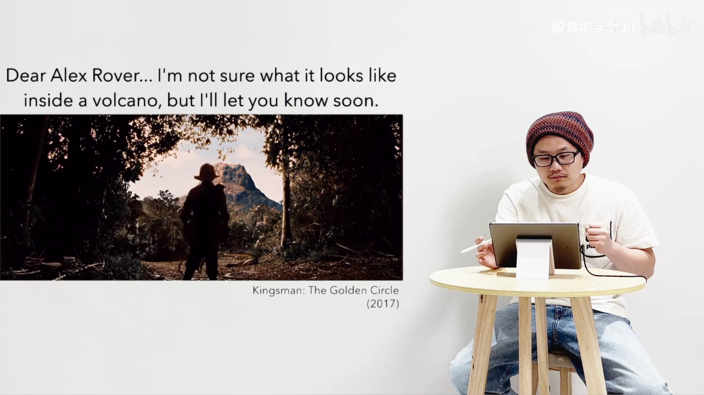

文字识别：Dear Alex Rover.. I'm not sure what it looks like / inside a volcano, but I'l let you know soon. / Kingsman: The Golden Circle / (2017)

### 画面 00:02:59

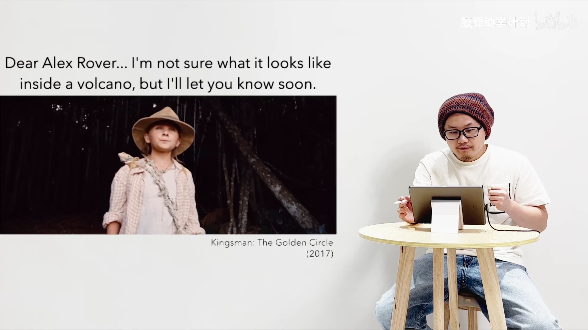

文字识别：Dear Alex Rover...I'm not sure what it looks like / inside a volcano, but I'll let you know soon. / Kingsman: The Golden Circle / (2017)

## 00:03:00–00:03:30

inside a volcano, but I'll let you know soon. Ah, you like this movie line? I think it's almost every word we've learned before, right? I don't need to explain too much. Next one, the next word, active, active, active, active. Active means active, right? It's also very active, very active, very active. It can be called active. For example, the article gives us a phrase. You see, active itself is a noun. Noun needs to find a noun, right? Active volcano means active volcano. For example, we look at a

### 画面 00:03:01

文字识别：Dear Alex Rover.. I'm not sure what it looks like / inside a volcano, but I'll let you know soon. / Kingsman: The Golden Circle / (2017)

### 画面 00:03:03

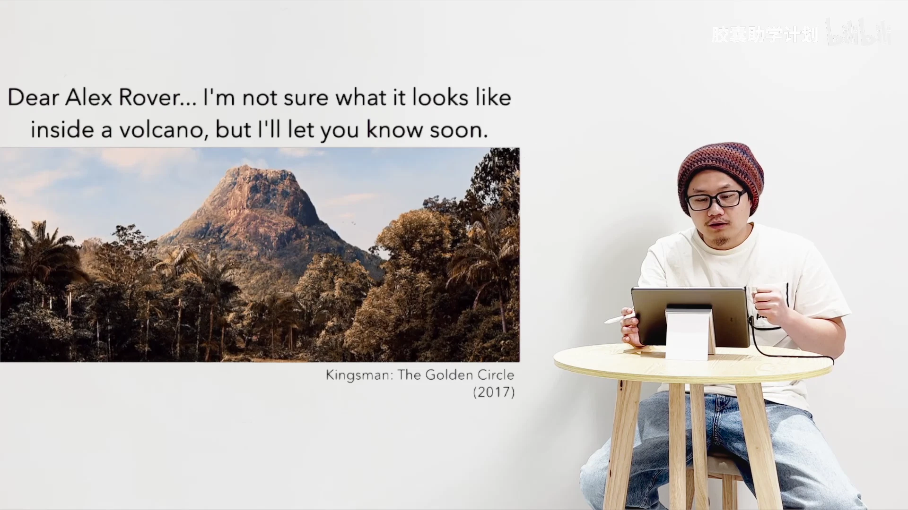

文字识别：Dear Alex Rover.. I'm not sure what it looks like / inside a volcano, but I'll let you know soon. / Kingsman: The Golden Circle / (2017)

### 画面 00:03:11

文字识别：单词造句指南 / 网：v.+v.变化 / 妻助学计划 / 四句型转换 / 方式/地点/时间 / 结合习惯用法 / 其他单词+词性 / 原文摘抄+变 / 6123456 / /'æektIv/ / active adj.

### 画面 00:03:13

文字识别：单词造句指南 / 网：v.+v.变化 / 妻助字计划 / 四句型转换 / 方式/地点/时间 / 结合习惯用法 / 其他单词+词性 / 原文摘抄+变 / 6123456 / /'æektIv/ / active adj. / panda

### 画面 00:03:15

文字识别：单词造句指南 / 网：v.+v.变化 / 卖助字计划 / 四句型转换 / 方式/地点/时间 / 结合习惯用法 / 其他单词+词性 / 原文摘抄+变 / 6123456 / /'æktIv/ / active adj. / panda

### 画面 00:03:19

文字识别：单词造句指南 / 网：v.+v.变化 / 囊助学计划 / 四句型转换 / 方式/地点/时间 / 结合习惯用法 / 其他单词+词性 / 原文摘抄+变 / 6123456 / /'æektIv/ / active adj. / panda

### 画面 00:03:21

文字识别：单词造句指南 / 网：v.+v.变化 / 奏助学计划一州 / 四句型转换 / 方式/地点/时间 / 结合习惯用法 / 其他单词+词性 / 原文摘抄+变 / 6123456 / /'æktIv/ / active adj. / pu

### 画面 00:03:25

文字识别：单词造句指南 / 网：v.+v.变化 / 囊助学计划限测 / 四句型转换 / 方式/地点/时间 / 结合习惯用法 / 其他单词+词性 / 原文摘抄+变 / 6123456 / /'æektIv/ / active adj. / active volcano / pan!

## 00:03:30–00:04:00

火山嘛。那比如说，我们看一句话叫 If you had spent more time studying active volcanoes, you should have known this. 你看，我们结合了之前刚刚学过的 volcano，啊，包括 spend some time doing something，然后再加上六十四课的这个虚拟语气，对吧？所以这个句子我们就造出来了。别忘了 repeat after me 啊！如果速度有点快，你就暂停视频，一定要张开嘴跟我去读这些例句。 Next one, so two years

### 画面 00:03:30

文字识别：单词造句指南 / 网：v.+v.变化 / 囊助学计划国 / 四句型转换 / 方式/地点/时间 / 结合习惯用法 / 其他单词+词性 / 原文摘抄+变 / 6123456 / /'æktiv/ / active adj. / active volcano

### 画面 00:03:32

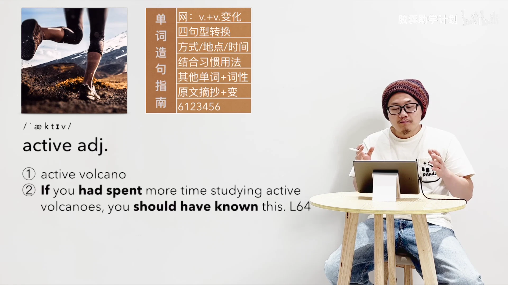

文字识别：单词造句指南 / 网：v.+v.变化 / 奏助字计划 / 四句型转换 / 方式/地点/时间 / 结合习惯用法 / 其他单词+词性 / 原文摘抄+变 / 6123456 / /'æktIv/ / active adj. / active volcano / pando / If you had spent more time studying active / volcanoes, you should have known this. L64

### 画面 00:03:35

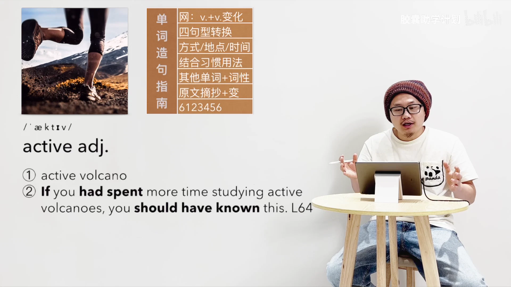

文字识别：单词造句指南 / 网：v.+v.变化 / 喜助字计划 / 四句型转换 / 方式/地点/时间 / 结合习惯用法 / 其他单词+词性 / 原文摘抄+变 / 6123456 / /'æktIv/ / active adj. / active volcano / panda / If you had spent more time studying active / volcanoes, you should have known this. L64

### 画面 00:03:41

文字识别：单词造句指南 / 网：v.+v.变化 / 四句型转换 / 方式/地点/时间 / 结合习惯用法 / 其他单词+词性 / 原文摘抄+变 / 6123456 / /'æktIv/ / active adj. / active volcano / panda / If you had spent more time studying active / volcanoes, you should have known this. L64

### 画面 00:03:49

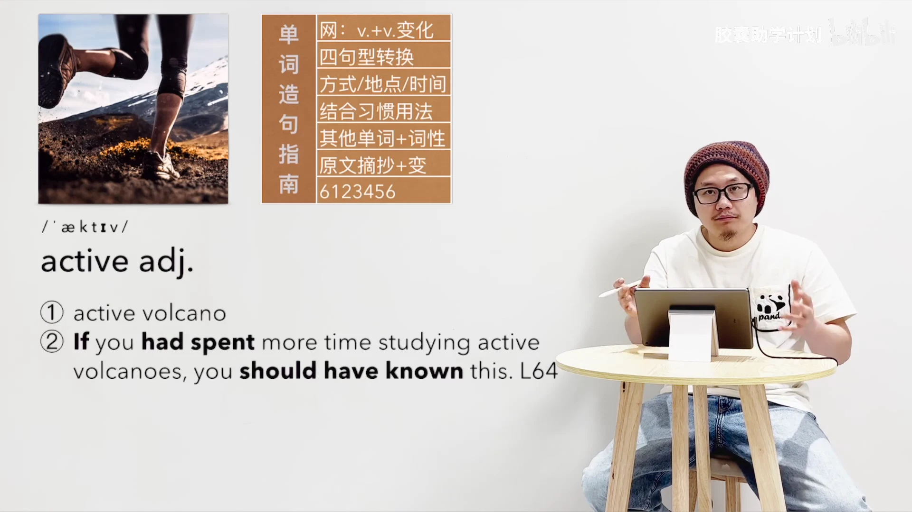

文字识别：单词造句指南 / 网：v.+v.变化 / 四句型转换 / 方式/地点/时间 / 结合习惯用法 / 其他单词+词性 / 原文摘抄+变 / 6123456 / /'æktIv/ / active adj. / active volcano / pand / If you had spent more time studying active / volcanoes, you should have known this. L64

### 画面 00:03:55

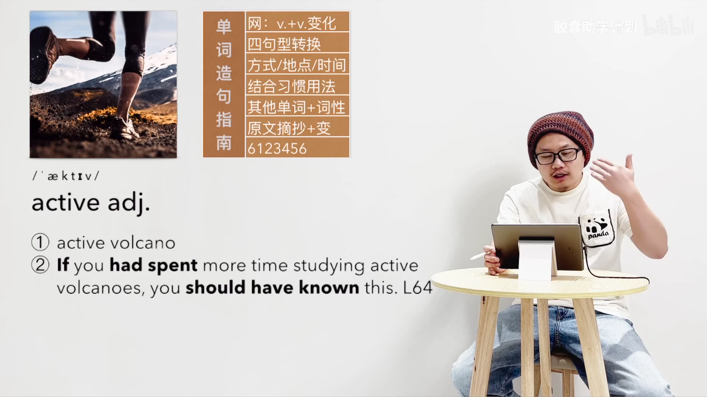

文字识别：单词造句指南 / 网：v.+v.变化 / 毫助字计划 / 四句型转换 / 方式/地点/时间 / 结合习惯用法 / 其他单词+词性 / 原文摘抄+变 / 6123456 / /'æktiv/ / active adj. / active volcano / panda / If you had spent more time studying active / volcanoes, you should have known this. L64

### 画面 00:03:58

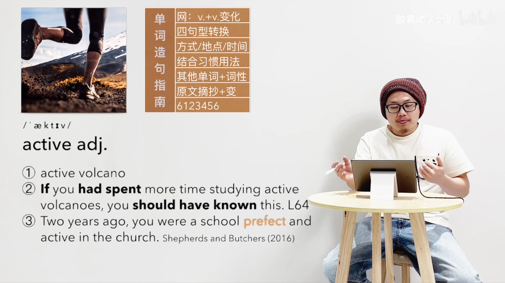

文字识别：单词造句指南 / 网：v.+v.变化 / 奏助学计划 / 四句型转换 / 方式/地点/时间 / 结合习惯用法 / 其他单词+词性 / 原文摘抄+变 / 6123456 / /æktiv/ / active adj. / active volcano / If you had spent more time studying active / volcanoes, you should have known this. L64 / Two years ago, you were a school prefect and / active in the church. Shepherds and Butchers (2016)

## 00:04:00–00:04:30

ago, you were a school prefect and active in the church. You注意，你看这里的前面其实并不是重要。prefect就指的是我们这种学长啊。然后这个active in the church是什么意思呢？注意active in the church就在教堂当中，你很活跃，你去参加了很多这样的活动，叫active in the church啊。Very good.那当然了，这个是一个电影的片段，我们找过来，我觉得能帮助各位更好的去从不同的角度理解active这个单词。

### 画面 00:04:00

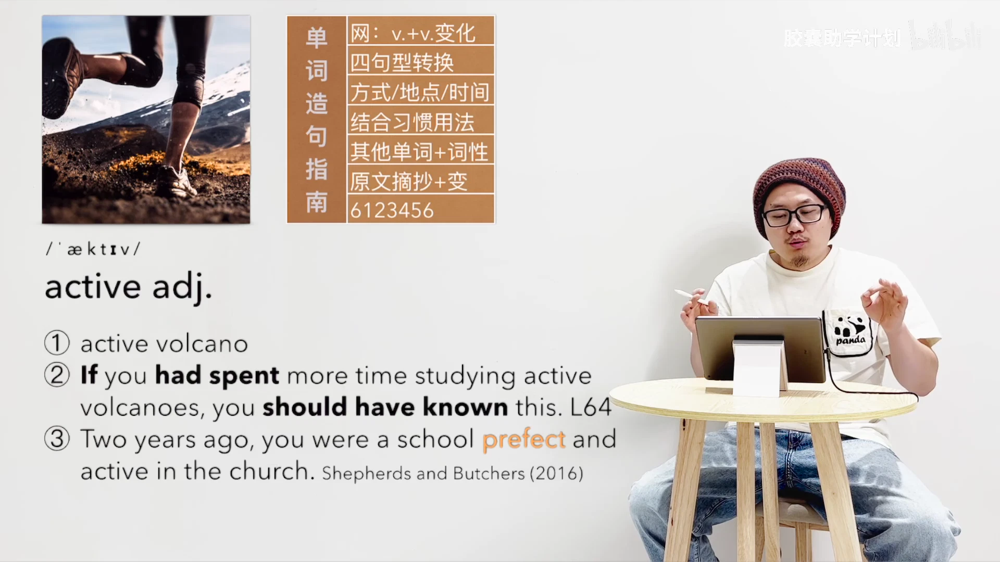

文字识别：单词造句指南 / 网：v.+v.变化 / 囊助学计划 / 四句型转换 / 方式/地点/时间 / 结合习惯用法 / 其他单词+词性 / 原文摘抄+变 / 6123456 / /'æktiv/ / active adj. / active volcano / 1 / panda / If you had spent more time studying active / volcanoes, you should have known this. L64 / Two years ago, you were a school prefect and / active in the church. Shepherds and Butchers (2016)

### 画面 00:04:05

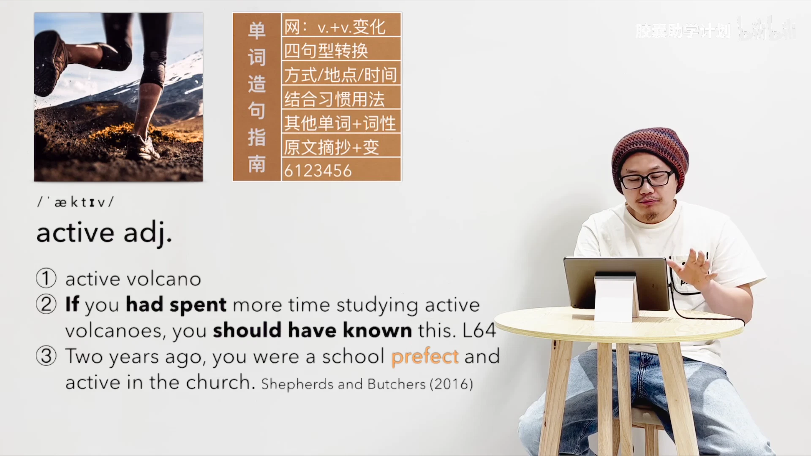

文字识别：单词造句指南 / 网：v.+v.变化 / 毫助字计划 / 四句型转换 / 方式/地点/时间 / 结合习惯用法 / 其他单词+词性 / 原文摘抄+变 / 6123456 / /'æktiv/ / active adj. / active volcano / If you had spent more time studying active / volcanoes, you should have known this. L64 / Two years ago, you were a school prefect and / active in the church. Shepherds and Butchers (2016)

### 画面 00:04:10

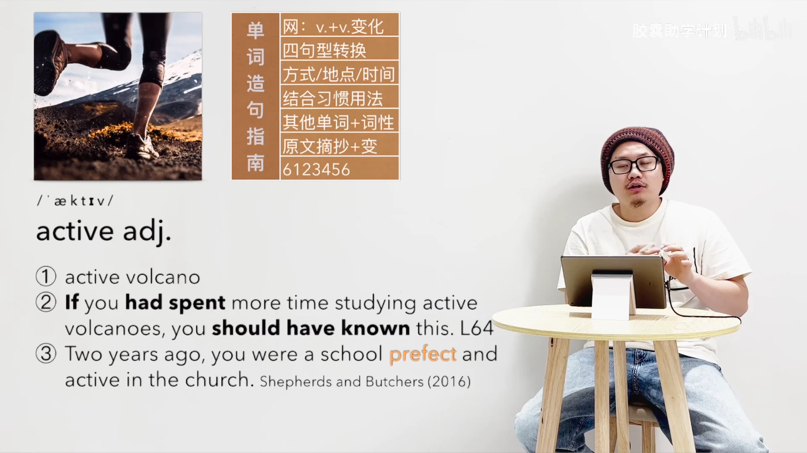

文字识别：单词造句指南 / 网：v.+v.变化 / 喜助学计划 / 四句型转换 / 方式/地点/时间 / 结合习惯用法 / 其他单词+词性 / 原文摘抄+变 / 6123456 / /æktiv/ / active adj. / active volcano / If you had spent more time studying active / volcanoes, you should have known this. L64 / Two years ago, you were a school prefect and / active in the church. Shepherds and Butchers (2016)

### 画面 00:04:21

文字识别：单词造句指南 / 网：v.+v.变化 / 妻助学计划 / 四句型转换 / 方式/地点/时间 / 结合习惯用法 / 其他单词+词性 / 原文摘抄+变 / 6123456 / /'æktiv/ / active adj. / ① active volcano / If you had spent more time studying active / volcanoes, you should have known this. L64 / Two years ago, you were a school prefect and / active in the church. Shepherds and Butchers (2016) / ④ We ought to have learnt more about active / volcanoes.L65

### 画面 00:04:25

文字识别：单词造句指南 / 网：v.+v.变化 / 毒助学计划 / 四句型转换 / 方式/地点/时间 / 结合习惯用法 / 其他单词+词性 / 原文摘抄+变 / 6123456 / /'æktiv/ / active adj. / ① active volcano / pandu. / If you had spent more time studying active / volcanoes, you should have known this. L64 / Two years ago, you were a school prefect and / active in the church. Shepherds and Butchers (2016) /  We ought to have learnt more about active / volcanoes.L65

## 00:04:30–00:05:00

Next one, 中规中矩造一句话. Repeat after me. We ought to have learned more about active volcanoes. 说我们本应该学习更多关于活火山的知识, but we didn't. 注意 ought to have done, should have done, 一个意思, 本应该做, but I didn't, 对吧? Very good. 读一下这个单词 active. 那接下来呢, 注意力集中, 我们听一下这个电影片段. Winston's been very active

### 画面 00:04:30

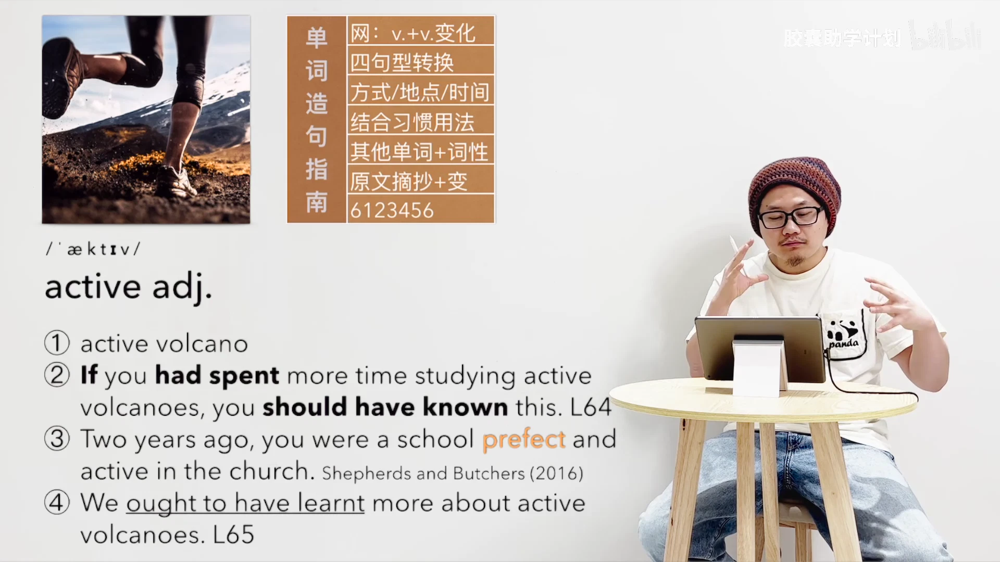

文字识别：单词造句指南 / 网：v.+v.变化 / 建助学计划 / 四句型转换 / 方式/地点/时间 / 结合习惯用法 / 其他单词+词性 / 原文摘抄+变 / 6123456 / /'æktiv/ / active adj. / ① / active volcano / panda / If you had spent more time studying active / volcanoes, you should have known this. L64 / Two years ago, you were a school prefect and / active in the church. Shepherds and Butchers (2016) /  We ought to have learnt more about active / volcanoes.L65

### 画面 00:04:35

文字识别：单词造句指南 / 网：v.+v.变化 / 妻助学计划陽 / 四句型转换 / 方式/地点/时间 / 结合习惯用法 / 其他单词+词性 / 原文摘抄+变 / 6123456 / /'æektiv/ / active adj. / ① /  active volcano / panda / If you had spent more time studying active / volcanoes, you should have known this. L64 / Two years ago, you were a school prefect and / active in the church. Shepherds and Butchers (2016) /  We ought to have learnt more about active / volcanoes.L65

### 画面 00:04:50

文字识别：单词造句指南 / 网：v.+v.变化 / 奏助学计划 / 四句型转换 / 方式/地点/时间 / 结合习惯用法 / 其他单词+词性 / 原文摘抄+变 / 6123456 / /'æktiv/ / active adj. / ① active volcano / panda / If you had spent more time studying active / volcanoes, you should have known this. L64 / Two years ago, you were a school prefect and / active in the church. Shepherds and Butchers (2016) /  We ought to have learnt more about active / volcanoes.L65

### 画面 00:04:54

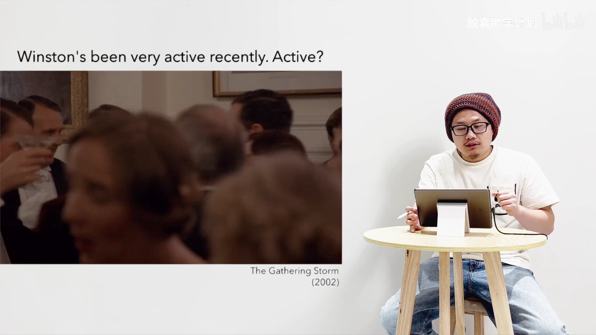

文字识别：Winston's been very active recently. Active? / The Gathering Storm / (2002)

### 画面 00:04:58

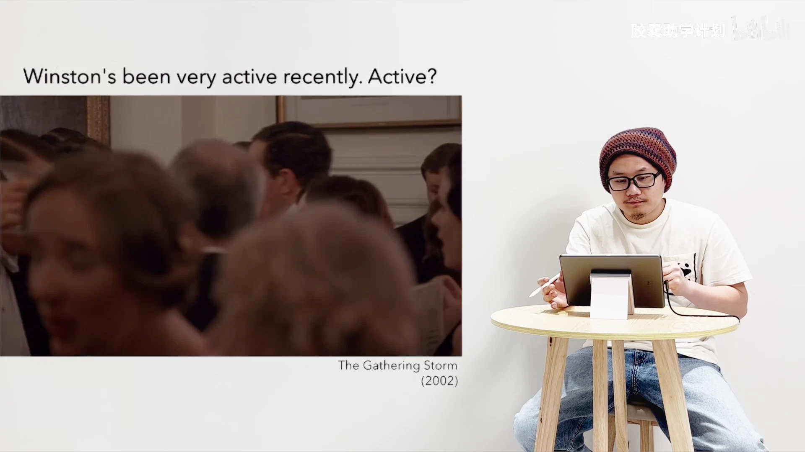

文字识别：Winston's been very active recently. Active? / The Gathering Storm / (2002)

## 00:05:00–00:05:30

recently. Active. 好，呃，最近很活跃，对吧？哎，经常参加各种各样的活动。OK. Next one. 接下来这三个单词，我个人认为没有一个需要你专门去记的。首先, Kiev, 哎，不知道是什么，不重要，就是一个地名。然后, Congo, 刚果，这个是稍微可以点花一点时间要去记的，对吧？但是大多数情况下，你可能也见不到了。Kitoro, 哎，还是一个地名，不是很重要。我们进入文章会再说一下，但是它在生词表出现了，我就跟

### 画面 00:05:00

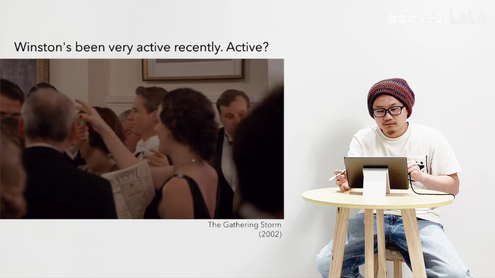

文字识别：Winston's been very active recently. Active? / The Gathering Storm / (2002)

### 画面 00:05:02

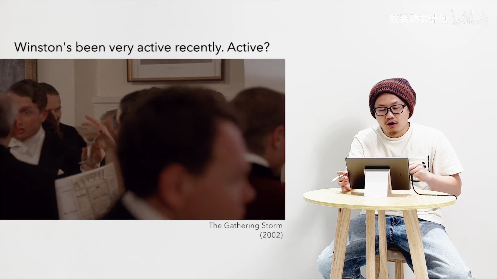

文字识别：Winston's been very active recently. Active? / The Gathering Storm / (2002)

### 画面 00:05:06

文字识别：单词造句指南 / 网：v.+v.变化 / 囊助学计划園 / 四句型转换 / 方式/地点/时间 / 结合习惯用法 / 其他单词+词性 / 原文摘抄+变 / 6123456 / /'kongau/ / Kivu n. Congo n. Kituro n.

### 画面 00:05:08

文字识别：单词造句指南 / 网：v.+v.变化 / 囊助字计划陽 / 四句型转换 / 方式/地点/时间 / 结合习惯用法 / 其他单词+词性 / 原文摘抄+变 / 6123456 / /'kongau/ / Kivu n. Congo n. Kituro n. / panda

### 画面 00:05:10

文字识别：单词造句指南 / 网：v.+v.变化 / 妻助字计划陽 / 四句型转换 / 方式/地点/时间 / 结合习惯用法 / 其他单词+词性 / 原文摘抄+变 / 6123456 / /'kongau/ / Kivu n. Congo n. Kituro n. / panda

### 画面 00:05:16

文字识别：单词造句指南 / 网：v.+v.变化 / 妻助字计划 / 四句型转换 / 方式/地点/时间 / 结合习惯用法 / 其他单词+词性 / 原文摘抄+变 / 6123456 / /'kongau/ / Kivu n. Congo n. Kituro n. / panda

### 画面 00:05:20

文字识别：单词造句指南 / 网：v.+v.变化 / 辜助字计划 / 四句型转换 / 方式/地点/时间 / 结合习惯用法 / 其他单词+词性 / 原文摘抄+变 / 6123456 / /'kongau/ / Kivu n. Congo n. Kituro n.

### 画面 00:05:25

文字识别：单词造句指南 / 网：v.+v.变化 / 妻助学计划 / 四句型转换 / 方式/地点/时间 / 结合习惯用法 / 其他单词+词性 / 原文摘抄+变 / 6123456 / /'kongau/ / Kivu n. Congo n. Kituro n. / panda

## 00:05:30–00:06:00

你简单说一下，你不用去记它啊。Okay, next one，下一个单词，这个单词要去记了。动词叫 erupt，爆发了，对吧？你比如说火山爆发了，erupt。Very good。我们造这样一句话，说 It was very fortunate that 65课刚学的。When the volcano erupted, no one was near it。说很幸运的事情是什么呢？当这个火山爆发的时候，没有人在它旁边，没有人员受伤啊。Very good。Next one，说 He's

### 画面 00:05:30

文字识别：单词造句指南 / 网：v.+v.变化 / 喜助字计划 / 四句型转换 / 方式/地点/时间 / 结合习惯用法 / 其他单词+词性 / 原文摘抄+变 / 6123456 / /'kongau/ / Kivu n. Congo n. Kituro n. / panda

### 画面 00:05:32

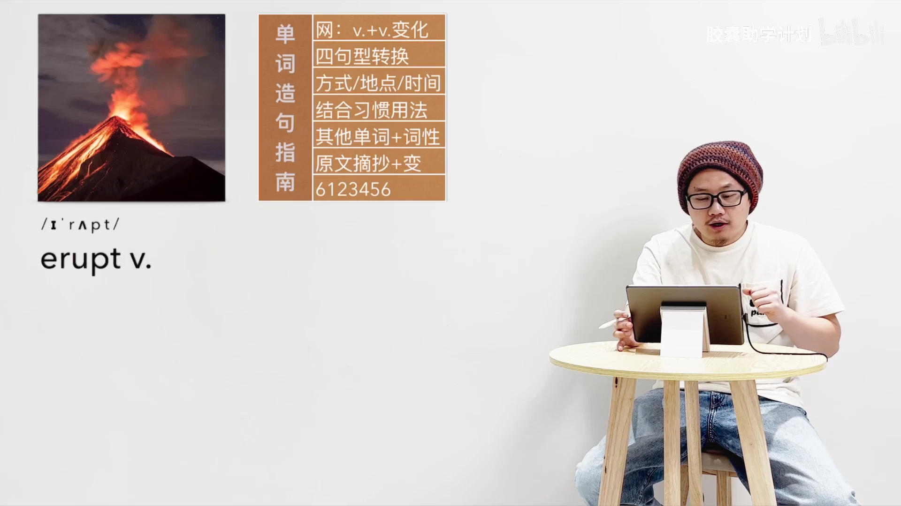

文字识别：单词造句指南 / 网：v.+v.变化 / 囊助学计划 / 四句型转换 / 方式/地点/时间 / 结合习惯用法 / 其他单词+词性 / 原文摘抄+变 / 6123456 / /I'rapt/ / erupt v.

### 画面 00:05:35

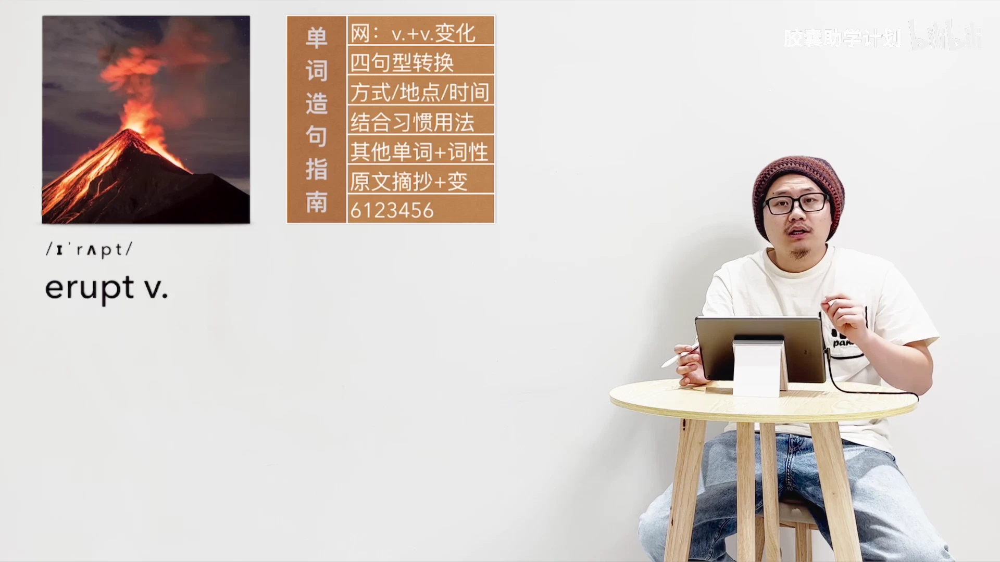

文字识别：单词造句指南 / 网：v.+v.变化 / 卖助学计划 / 四句型转换 / 方式/地点/时间 / 结合习惯用法 / 其他单词+词性 / 原文摘抄+变 / 6123456 / /I'rΛpt/ / erupt v. / pak

### 画面 00:05:38

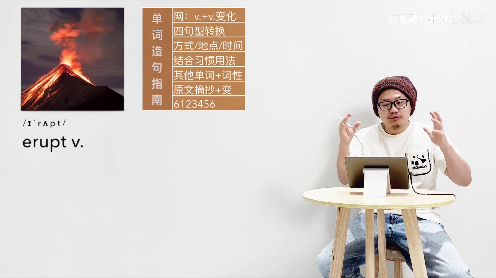

文字识别：单词造句指南 / 网：v.+v.变化 / 妻助学计划 / 四句型转换 / 方式/地点/时间 / 结合习惯用法 / 其他单词+词性 / 原文摘抄+变 / 6123456 / /I'rΛpt/ / erupt v. / panda

### 画面 00:05:41

文字识别：单词造句指南 / 网：v.+v.变化 / 臺助学计划 / 四句型转换 / 方式/地点/时间 / 结合习惯用法 / 其他单词+词性 / 原文摘抄+变 / 6123456 / /I'rapt/ / erupt v. / It was very fortunate that when the volcano / erupted, no one was near it. L65

### 画面 00:05:43

文字识别：单词造句指南 / 网：v.+v.变化 / 喜助学计划 / 四句型转换 / 方式/地点/时间 / 结合习惯用法 / 其他单词+词性 / 原文摘抄+变 / 6123456 / /I'rapt/ / erupt v. / It was very fortunate that when the volcano / erupted, no one was near it. L65

### 画面 00:05:45

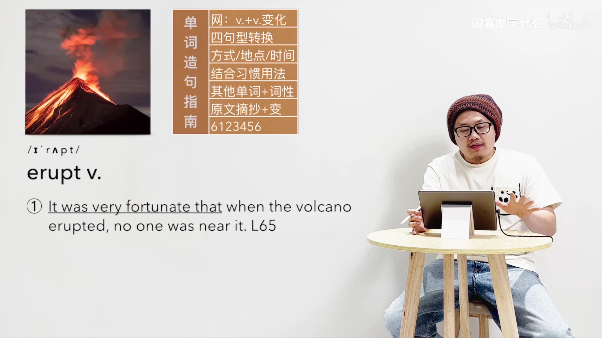

文字识别：单词造句指南 / 网：v.+v.变化 / 妻助学计划陽 / 四句型转换 / 方式/地点/时间 / 结合习惯用法 / 其他单词+词性 / 原文摘抄+变 / 6123456 / /I'rΛpt/ / erupt v. / It was very fortunate that when the volcano / erupted, no one was near it. L65

### 画面 00:05:50

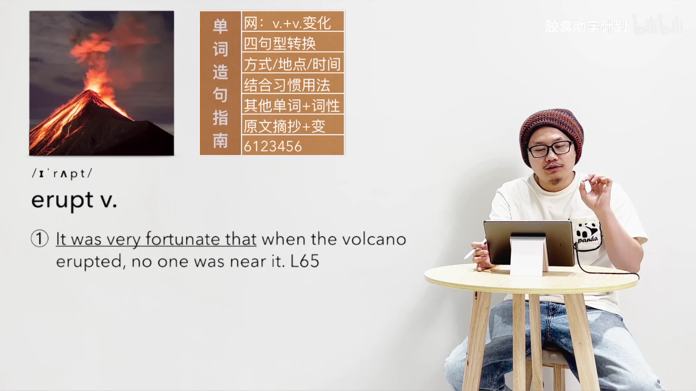

文字识别：单词造句指南 / 网：v.+v.变化 / 囊助字计划 / 四句型转换 / 方式/地点/时间 / 结合习惯用法 / 其他单词+词性 / 原文摘抄+变 / 6123456 / /I'rapt/ / erupt v. / It was very fortunate that when the volcano / panda / erupted, no one was near it. L65

### 画面 00:05:55

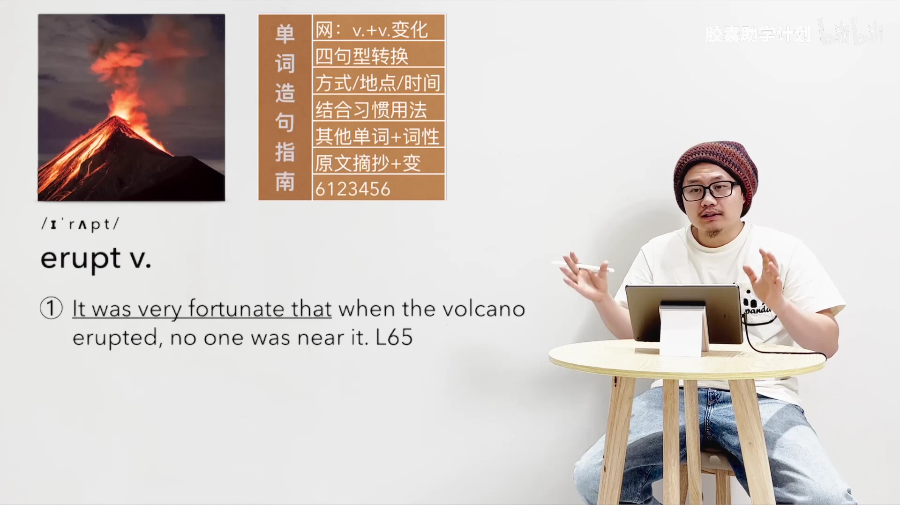

文字识别：单词造句指南 / 网：v.+v.变化 / 囊助字计划陽 / 四句型转换 / 方式/地点/时间 / 结合习惯用法 / 其他单词+词性 / 原文摘抄+变 / 6123456 / /I'rΛpt/ / erupt v. / It was very fortunate that when the volcano / panda / erupted, no one was near it. L65

### 画面 00:05:58

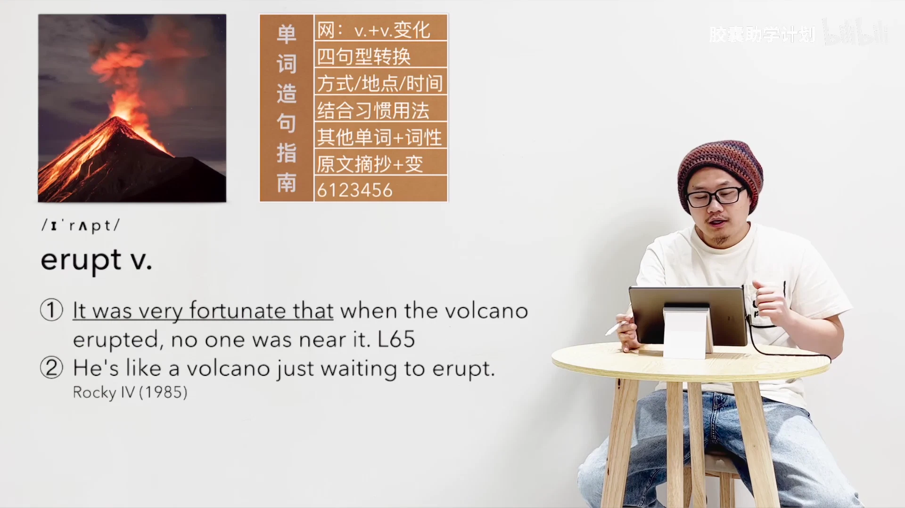

文字识别：单词造句指南 / 网：v.+v.变化 / 四句型转换 / 方式/地点/时间 / 结合习惯用法 / 其他单词+词性 / 原文摘抄+变 / 6123456 / /I'rapt/ / erupt v. / It was very fortunate that when the volcano / erupted, no one was near it. L65 / He's like a volcano just waiting to erupt. / Rocky IV(1985)

## 00:06:00–00:06:30

like a volcano just waiting to erupt.说他就像个火山一样，就等着要去爆发。所以在 volcano 那个地方，我讲到了他口语当中很常用的用法。你现在在看到这句话，是不是就能懂是什么意思了？他无非就是想表达说，这个人脾气很暴躁，阴晴不定，对吧？哎，说怒就怒了，哎，就是这样一种感觉。Very good. Next one, so an active volcano may erupt at any time.

### 画面 00:06:00

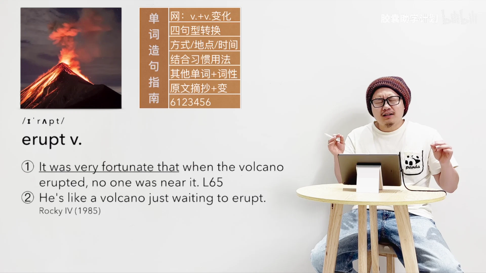

文字识别：单词造句指南 / 网：v.+v.变化 / 妻助学计划園 / 四句型转换 / 方式/地点/时间 / 结合习惯用法 / 其他单词+词性 / 原文摘抄+变 / 6123456 / /I'rΛpt/ / erupt v. / It was very fortunate that when the volcano / panda / erupted, no one was near it. L65 / He's like a volcano just waiting to erupt. / Rocky IV(1985)

### 画面 00:06:05

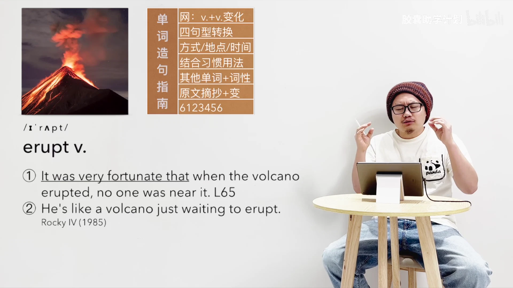

文字识别：单词造句指南 / 网：v.+v.变化 / 妻助学计划陽 / 四句型转换 / 方式/地点/时间 / 结合习惯用法 / 其他单词+词性 / 原文摘抄+变 / 6123456 / /I'rapt/ / erupt v. / 1 / It was very fortunate that when the volcano / panda / erupted, no one was near it. L65 / He's like a volcano just waiting to erupt. / Rocky IV(1985)

### 画面 00:06:10

文字识别：单词造句指南 / 网：v.+v.变化 / 四句型转换 / 方式/地点/时间 / 结合习惯用法 / 其他单词+词性 / 原文摘抄+变 / 6123456 / /I'rΛpt/ / erupt v. / It was very fortunate that when the volcano / erupted, no one was near it. L65 / He's like a volcano just waiting to erupt. / Rocky IV(1985)

### 画面 00:06:15

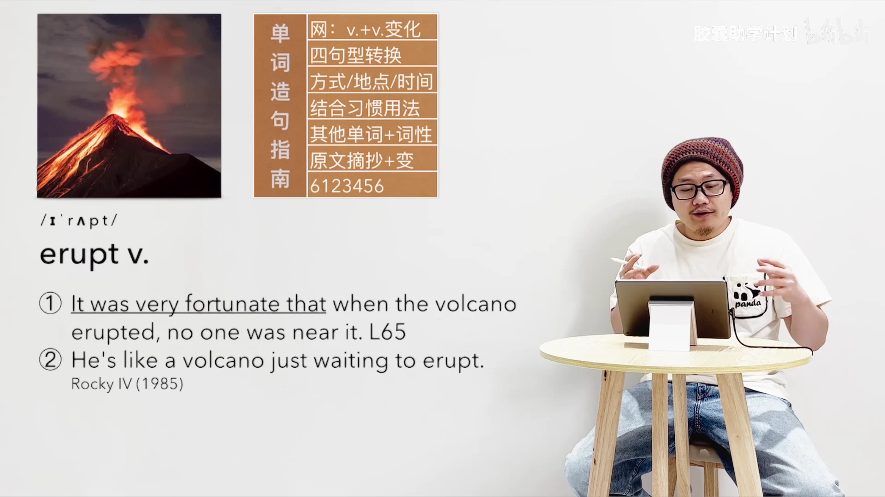

文字识别：单词造句指南 / 网：v.+v.变化 / 嚢助字计划陽 / 四句型转换 / 方式/地点/时间 / 结合习惯用法 / 其他单词+词性 / 原文摘抄+变 / 6123456 / /I'rapt/ / erupt v. / It was very fortunate that when the volcano / panda / erupted, no one was near it. L65 / He's like a volcano just waiting to erupt. / Rocky IV(1985)

### 画面 00:06:18

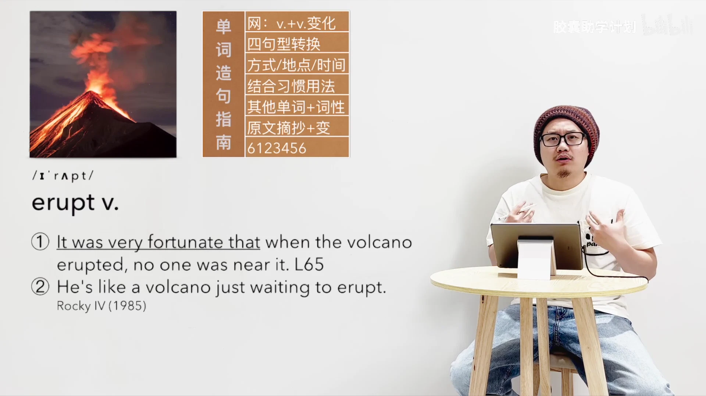

文字识别：单词造句指南 / 网：v.+v.变化 / 妻助字计划陽 / 四句型转换 / 方式/地点/时间 / 结合习惯用法 / 其他单词+词性 / 原文摘抄+变 / 6123456 / /I'rapt/ / erupt v. / It was very fortunate that when the volcano / pa / erupted, no one was near it. L65 / He's like a volcano just waiting to erupt. / Rocky IV(1985)

### 画面 00:06:20

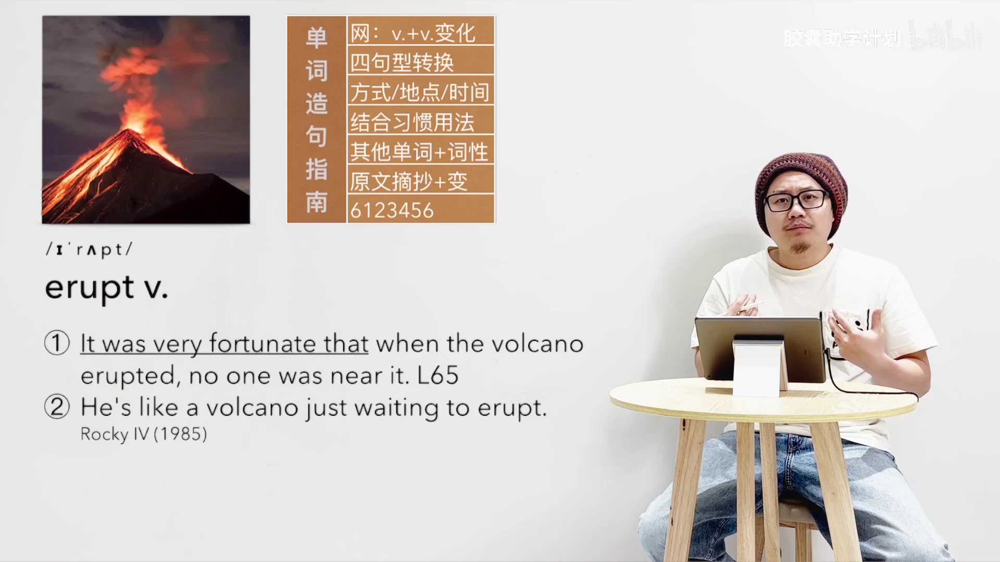

文字识别：单词造句指南 / 网：v.+v.变化 / 妻助学计划 / 四句型转换 / 方式/地点/时间 / 结合习惯用法 / 其他单词+词性 / 原文摘抄+变 / 6123456 / /I'rΛpt/ / erupt v. / It was very fortunate that when the volcano / erupted, no one was near it. L65 / He's like a volcano just waiting to erupt. / Rocky IV(1985)

### 画面 00:06:23

文字识别：单词造句指南 / 网：v.+v.变化 / 喜助字计划 / 四句型转换 / 方式/地点/时间 / 结合习惯用法 / 其他单词+词性 / 原文摘抄+变 / 6123456 / /I'rΛpt/ / erupt v. /  It was very fortunate that when the volcano / erupted, no one was near it. L65 / He's like a volcano just waiting to erupt. / Rocky IV(1985)

### 画面 00:06:25

文字识别：单词造句指南 / 网：v.+v.变化 / 囊助学计划 / 四句型转换 / 方式/地点/时间 / 结合习惯用法 / 其他单词+词性 / 原文摘抄+变 / 6123456 / /I'rΛpt/ / erupt v. / ① It was very fortunate that when the volcano / erupted, no one was near it. L65 / He's like a volcano just waiting to erupt. / Rocky IV(1985) / An active volcano may erupt at any time. / L19

### 画面 00:06:27

文字识别：单词造句指南 / 网：v.+v.变化 / 囊助学计划 / 四句型转换 / 方式/地点/时间 / 结合习惯用法 / 其他单词+词性 / 原文摘抄+变 / 6123456 / /I'rapt/ / erupt v. / ① It was very fortunate that when the volcano / panda / erupted, no one was near it. L65 / He's like a volcano just waiting to erupt. / Rocky IV(1985) / An active volcano may erupt at any time. / L19

## 00:06:30–00:07:00

说活火山是什么意思呢？哎，活跃的啊，活的火山是什么意思呢？就是可能它随时都会爆发，对吧？还有就是我们十九课学过的may加一个动词，很简单的一个语法，就是可能。Very good.再读一遍这个单词erupt. Very good.接下来下一个单词，下一个单词其实我们要从它的形容词开始去走，叫violent. violent指的是很暴力的啊。Violently其实可以表

### 画面 00:06:30

文字识别：单词造句指南 / 网：v.+v.变化 / 妻助学计划陽 / 四句型转换 / 方式/地点/时间 / 结合习惯用法 / 其他单词+词性 / 原文摘抄+变 / 6123456 / /I'rΛpt/ / erupt v. / ① It was very fortunate that when the volcano / panda / erupted, no one was near it. L65 / He's like a volcano just waiting to erupt. / Rocky IV(1985) / An active volcano may erupt at any time. / 3 / L19

### 画面 00:06:44

文字识别：单词造句指南 / 网：v.+v.变化 / 妻助字计划陽 / 四句型转换 / 方式/地点/时间 / 结合习惯用法 / 其他单词+词性 / 原文摘抄+变 / 6123456 / /I'rapt/ / erupt v. / ① It was very fortunate that when the volcano / panda / erupted, no one was near it. L65 / He's like a volcano just waiting to erupt. / Rocky IV(1985) / An active volcano may erupt at any time. / L19

### 画面 00:06:48

文字识别：单词造句指南 / 网：v.+v.变化 / 学计划 / 四句型转换 / 方式/地点/时间 / 结合习惯用法 / 其他单词+词性 / 原文摘抄+变 / 6123456 / /'vaialantli/ / violently adv. violent adj.

### 画面 00:06:50

文字识别：单词造句指南 / 网：v.+v.变化 / 四句型转换 / 方式/地点/时间 / 结合习惯用法 / 其他单词+词性 / 原文摘抄+变 / 6123456 / /'vaialantli/ / violently adv. violent adj.

### 画面 00:06:56

文字识别：单词造句指南 / 网：v.+v.变化 / 是助学计划 / 四句型转换 / 方式/地点/时间 / 结合习惯用法 / 其他单词+词性 / 原文摘抄+变 / 6123456 / /'vaialantli/ / violently adv. violent adj. / panda

## 00:07:00–00:07:30

violently，对吧？啊，没有这个ly，没有这么夸张啊。violently， OK，它是一个副词，你能看出来它是由violent这个单词变过去的，对吧？就是它最常见的意思就是很暴力的，是吧？当然了，我们本课当中引申出来它另一个含义就是剧烈的啊。比如说，说 she became so nervous that she shook violently。哎，说她变得如此的紧张，以至于她怎么样呢？

### 画面 00:07:00

文字识别：单词造句指南 / 网：v.+v.变化 / 四句型转换 / 方式/地点/时间 / 结合习惯用法 / 其他单词+词性 / 原文摘抄+变 / 6123456 / /'vaialantli/ / violently adv. violent adj. / pandi

### 画面 00:07:10

文字识别：单词造句指南 / 网：v.+v.变化 / 四句型转换 / 方式/地点/时间 / 结合习惯用法 / 其他单词+词性 / 原文摘抄+变 / 6123456 / /'vaialantli/ / violently adv. violent adj. / panda

### 画面 00:07:15

文字识别：单词造句指南 / 网：v.+v.变化 / 四句型转换 / 方式/地点/时间 / 结合习惯用法 / 其他单词+词性 / 原文摘抄+变 / 6123456 / /'vaialantli/ / violently adv. violent adj. / panda

### 画面 00:07:18

文字识别：单词造句指南 / 网：v.+v.变化 / 四句型转换 / 方式/地点/时间 / 结合习惯用法 / 其他单词+词性 / 原文摘抄+变 / 6123456 / /'vaialantli/ / violently adv. violent adj. / ① She became so nervous that she / panda / shook violently. L35

### 画面 00:07:20

文字识别：单词造句指南 / 网：v.+v.变化 / 四句型转换 / 方式/地点/时间 / 结合习惯用法 / 其他单词+词性 / 原文摘抄+变 / 6123456 / /vaialantli/ / violently adv. violent adj. / ① She became so nervous that she / panda / shook violently. L35

### 画面 00:07:25

文字识别：单词造句指南 / 网：v.+v.变化 / 四句型转换 / 方式/地点/时间 / 结合习惯用法 / 其他单词+词性 / 原文摘抄+变 / 6123456 / /'vaialantli/ / violently adv. violent adj. / ① She became so nervous that she / panda / shook violently. L35

## 00:07:30–00:08:00

浑身剧烈的颤动啊！Very good. So在这点儿that三十五课咱们学的对吧？非常重要的呃，这个一个小的语法。如此以至于next one是If you had shaken your head so violently, you would have been hospital too.那这用到了我们六十四课学的这个呃呃虚拟语气对吧？如果你啊当时也这么剧烈的晃你的头，那你当时也跑医院去了。

### 画面 00:07:30

文字识别：单词造句指南 / 网：v.+v.变化 / 四句型转换 / 方式/地点/时间 / 结合习惯用法 / 其他单词+词性 / 原文摘抄+变 / 6123456 / /'vaialantli/ / violently adv. violent adj. / ① She became so nervous that she / panda / shook violently. L35

### 画面 00:07:39

文字识别：单词造句指南 / 网：v.+v.变化 / 四句型转换 / 方式/地点/时间 / 结合习惯用法 / 其他单词+词性 / 原文摘抄+变 / 6123456 / /'vaialantli/ / violently adv. violent adj. / ① She became so nervous that she / panda / shook violently. L35

### 画面 00:07:41

文字识别：单词造句指南 / 网：v.+v.变化 / 四句型转换 / 方式/地点/时间 / 结合习惯用法 / 其他单词+词性 / 原文摘抄+变 / 6123456 / /'vaialantli/ / violently adv. violent adj. / ① She became so nervous that she / shook violently. L35 / If you had shaken your head so violently, / you would have been in hospital too. L64

### 画面 00:07:44

文字识别：单词造句指南 / 网：v.+v.变化 / 学计划 / 四句型转换 / 方式/地点/时间 / 结合习惯用法 / 其他单词+词性 / 原文摘抄+变 / 6123456 / /'vaialantli/ / violently adv. violent adj. / ① She became so nervous that she / panda / shook violently. L35 / If you had shaken your head so violently, / you would have been in hospital too. L64

### 画面 00:07:46

文字识别：单词造句指南 / 网：v.+v.变化 / 四句型转换 / 方式/地点/时间 / 结合习惯用法 / 其他单词+词性 / 原文摘抄+变 / 6123456 / /'vaialantli/ / violently adv. violent adj. / ① She became so nervous that she / panda / shook violently. L35 / If you had shaken your head so violently, / you would have been in hospital too. L64

### 画面 00:07:48

文字识别：单词造句指南 / 网：v.+v.变化 / 学计划 / 四句型转换 / 方式/地点/时间 / 结合习惯用法 / 其他单词+词性 / 原文摘抄+变 / 6123456 / /'vaialantli/ / violently adv. violent adj. / ① She became so nervous that she / shook violently. L35 / If you had shaken your head so violently, / you would have been in hospital too. L64

### 画面 00:07:50

文字识别：单词造句指南 / 网：v.+v.变化 / 学计划 / 四句型转换 / 方式/地点/时间 / 结合习惯用法 / 其他单词+词性 / 原文摘抄+变 / 6123456 / /'vaialantli/ / violently adv. violent adj. / ① She became so nervous that she / shook violently. L35 / If you had shaken your head so violently, / you would have been in hospital too. L64

### 画面 00:07:55

文字识别：单词造句指南 / 网：v.+v.变化 / 四句型转换 / 方式/地点/时间 / 结合习惯用法 / 其他单词+词性 / 原文摘抄+变 / 6123456 / /vaialantli/ / violently adv. violent adj. / ① She became so nervous that she / shook violently. L35 / If you had shaken your head so violently, / you would have been in hospital too. L64

## 00:08:00–00:08:30

不过还好你没有这么剧烈晃的头，所以你没有在医院。六十四课虚拟语气，对吧？表示对过去的虚拟。Continue说 he kicked at the door violently，说他特别剧烈的踢这个门啊。那你其实把它来个四句型转换，这个各位可以，比如说你暂停一下屏幕去处理就可以了，好吧？啊，再读一遍这个单词 violently，very good。下一个单词是我们本课的语法词，所

### 画面 00:08:00

文字识别：单词造句指南 / 网：v.+v.变化 / 计划 / 四句型转换 / 方式/地点/时间 / 结合习惯用法 / 其他单词+词性 / 原文摘抄+变 / 6123456 / /'vaialantli/ / violently adv. violent adj. / ① She became so nervous that she / shook violently. L35 / If you had shaken your head so violently, / you would have been in hospital too. L64

### 画面 00:08:05

文字识别：单词造句指南 / 网：v.+v.变化 / 字计划 / 四句型转换 / 方式/地点/时间 / 结合习惯用法 / 其他单词+词性 / 原文摘抄+变 / 6123456 / /vaialantli/ / violently adv. violent adj. / ① She became so nervous that she / panda / shook violently. L35 / If you had shaken your head so violently, / you would have been in hospital too. L64

### 画面 00:08:07

文字识别：单词造句指南 / 网：v.+v.变化 / 学计划 / 四句型转换 / 方式/地点/时间 / 结合习惯用法 / 其他单词+词性 / 原文摘抄+变 / 6123456 / /'vaialantli/ / violently adv. violent adj. / ① She became so nervous that she / shook violently. L35 / If you had shaken your head so violently, / you would have been in hospital too. L64

### 画面 00:08:09

文字识别：单词造句指南 / 网：v.+v.变化 / 四句型转换 / 方式/地点/时间 / 结合习惯用法 / 其他单词+词性 / 原文摘抄+变 / 6123456 / /'vaialantli/ / violently adv. violent adj. / ① She became so nervous that she / panda / shook violently. L35 / If you had shaken your head so violently, / you would have been in hospital too. L64 / He kicked at the door violently.

### 画面 00:08:11

文字识别：单词造句指南 / 网：v.+v.变化 / 学计划 / 四句型转换 / 方式/地点/时间 / 结合习惯用法 / 其他单词+词性 / 原文摘抄+变 / 6123456 / /'vaialantli/ / violently adv. violent adj. / ① She became so nervous that she / pa. / shook violently. L35 / If you had shaken your head so violently, / you would have been in hospital too. L64 / He kicked at the door violently.

### 画面 00:08:14

文字识别：单词造句指南 / 网：v.+v.变化 / 四句型转换 / 方式/地点/时间 / 结合习惯用法 / 其他单词+词性 / 原文摘抄+变 / 6123456 / /'vaialantli/ / violently adv. violent adj. / ① She became so nervous that she / shook violently. L35 / If you had shaken your head so violently, / you would have been in hospital too. L64 / He kicked at the door violently. / ④ did/who/what/how/why/when...

### 画面 00:08:16

文字识别：单词造句指南 / 网：v.+v.变化 / 学计划 / 四句型转换 / 方式/地点/时间 / 结合习惯用法 / 其他单词+词性 / 原文摘抄+变 / 6123456 / /'vaialantli/ / violently adv. violent adj. / ① She became so nervous that she / panuu / shook violently. L35 / If you had shaken your head so violently, / you would have been in hospital too. L64 / He kicked at the door violently. / ④ did/who/what/how/why/when...

### 画面 00:08:20

文字识别：单词造句指南 / 网：v.+v.变化 / 四句型转换 / 方式/地点/时间 / 结合习惯用法 / 其他单词+词性 / 原文摘抄+变 / 6123456 / /'vaialantli/ / violently adv. violent adj. / ① She became so nervous that she / shook violently. L35 / If you had shaken your head so violently, / you would have been in hospital too. L64 / He kicked at the door violently. / ④ did/who/what/how/why/when...

### 画面 00:08:25

文字识别：单词造句指南 / 网：v.+v.变化 / 妻助学计划 / 四句型转换 / 方式/地点/时间 / 结合习惯用法 / 其他单词+词性 / 原文摘抄+变 / 6123456 / / 'mæenid 3/ / manage V.

## 00:08:30–00:09:00

以在单词这个地方我不单独去讲了，我只是带你看一下音标，然后在语法那个视频当中我会仔仔细细给你解释。就这个单词就是本课语法啊。好，那我们读一下，叫做 manage manage 啊啊，设法啊，它其实有那种叫呃成功完成某事儿的感觉啊。这个我们现在不用去记它，只要见它会读就行了，叫 manage 啊。各位也不用本课拿它去造句啊，本视频对吧？我们进入语法，我会重点去讲解。

### 画面 00:08:30

文字识别：单词造句指南 / 网：v.+v.变化 / 囊助学计划 / 四句型转换 / 方式/地点/时间 / 结合习惯用法 / 其他单词+词性 / 原文摘抄+变 / 6123456 / /'mænid31 / manage v. / panda

### 画面 00:08:38

文字识别：单词造句指南 / 网：v.+v.变化 / 奏助字计划 / 四句型转换 / 方式/地点/时间 / 结合习惯用法 / 其他单词+词性 / 原文摘抄+变 / 6123456 / / 'mæenid3/ / manage v. / panda

### 画面 00:08:40

文字识别：单词造句指南 / 网：v.+v.变化 / 妻助学计划 / 四句型转换 / 方式/地点/时间 / 结合习惯用法 / 其他单词+词性 / 原文摘抄+变 / 6123456 / /'mænid3/ / manage v. / panda

### 画面 00:08:45

文字识别：单词造句指南 / 网：v.+v.变化 / 囊助学计划陽 / 四句型转换 / 方式/地点/时间 / 结合习惯用法 / 其他单词+词性 / 原文摘抄+变 / 6123456 / /'mæenid3/ / manage v. / panda

### 画面 00:08:50

文字识别：单词造句指南 / 网：v.+v.变化 / 奏助字计划 / 四句型转换 / 方式/地点/时间 / 结合习惯用法 / 其他单词+词性 / 原文摘抄+变 / 6123456 / / 'mæenid3/ / manage v. / panda

## 00:09:00–00:09:30

那咱们就不多说了。下一个单词，口语当中非常的常用，叫 brilliant， brilliant，啊， brilliant。比如说口语当中很常用，我直接给你来一个这个感叹句，叫 what a brilliant idea。你说你这个主意太棒了啊，非常的好啊。其实就类似于是 great， very good 的一个同义词，就 brilliant。比如说再来说， that's brilliant，说这事儿太棒了，这事儿太好了，就类似于 that's great，啊， that's very very very very

### 画面 00:09:00

文字识别：单词造句指南 / 网：v.+v.变化 / 卖助学计划一调 / 四句型转换 / 方式/地点/时间 / 结合习惯用法 / 其他单词+词性 / 原文摘抄+变 / 6123456 / /'brljant/ / brilliant adj.

### 画面 00:09:02

文字识别：单词造句指南 / 网：v.+v.变化 / 囊助学计划一 / 四句型转换 / 方式/地点/时间 / 结合习惯用法 / 其他单词+词性 / 原文摘抄+变 / 6123456 / /'briljant/ / brilliant adj. / panda

### 画面 00:09:04

文字识别：单词造句指南 / 网：v.+v.变化 / 囊助学计划園 / 四句型转换 / 方式/地点/时间 / 结合习惯用法 / 其他单词+词性 / 原文摘抄+变 / 6123456 / /'briljant/ / brilliant adj.

### 画面 00:09:06

文字识别：单词造句指南 / 网：v.+v.变化 / 妻助学计划は / 四句型转换 / 方式/地点/时间 / 结合习惯用法 / 其他单词+词性 / 原文摘抄+变 / 6123456 / /'briljant/ / brilliant adj. /  What a brilliant idea!

### 画面 00:09:10

文字识别：单词造句指南 / 网：v.+v.变化 / 囊助学计划 / 四句型转换 / 方式/地点/时间 / 结合习惯用法 / 其他单词+词性 / 原文摘抄+变 / 6123456 / /briljant/ / brilliant adj. / ① What a brilliant idea! / panda

### 画面 00:09:13

文字识别：单词造句指南 / 网：v.+v.变化 / 妻助学计划陽 / 四句型转换 / 方式/地点/时间 / 结合习惯用法 / 其他单词+词性 / 原文摘抄+变 / 6123456 / /'briljant/ / brilliant adj. /  What a brilliant idea! / panda

### 画面 00:09:15

文字识别：单词造句指南 / 网：v.+v.变化 / 囊助学计划陽 / 四句型转换 / 方式/地点/时间 / 结合习惯用法 / 其他单词+词性 / 原文摘抄+变 / 6123456 / /briljant/ / brilliant adj. / ` /  What a brilliant idea! / panda

### 画面 00:09:20

文字识别：单词造句指南 / 网：v.+v.变化 / 妻助字计划 / 四句型转换 / 方式/地点/时间 / 结合习惯用法 / 其他单词+词性 / 原文摘抄+变 / 6123456 / /'briljant/ / brilliant adj. /  What a brilliant idea! / panda

### 画面 00:09:26

文字识别：单词造句指南 / 网：v.+v.变化 / 囊助字计划 / 四句型转换 / 方式/地点/时间 / 结合习惯用法 / 其他单词+词性 / 原文摘抄+变 / 6123456 / /'briljant/ / brilliant adj. / ) What a brilliant idea! / panda / That's brilliant!

### 画面 00:09:29

文字识别：单词造句指南 / 网：v.+v.变化 / 囊助学计划 / 四句型转换 / 方式/地点/时间 / 结合习惯用法 / 其他单词+词性 / 原文摘抄+变 / 6123456 / /'briljant/ / brilliant adj. /  What a brilliant idea! / panda / That's brilliant!

## 00:09:30–00:10:00

good. Ah,就是类似于这样的一种感觉啊. Brilliant.好啊，再来，比如说I had a brilliant plan.我有一个绝佳的计划，极其棒的计划. We can have our house rebuilt.说我们能找别人把我们的房子再重建一下.这是我们六十六课刚学的语法. Have something done,对吧? Okay, very good.接下来说I have all sorts of brilliant ideas

### 画面 00:09:32

文字识别：单词造句指南 / 网：v.+v.变化 / 喜助学计划一明 / 四句型转换 / 方式/地点/时间 / 结合习惯用法 / 其他单词+词性 / 原文摘抄+变 / 6123456 / /'briljant/ / brilliant adj. / ) What a brilliant idea! / panda / That's brilliant!

### 画面 00:09:34

文字识别：单词造句指南 / 网：v.+v.变化 / 襄助学计划一 / 四句型转换 / 方式/地点/时间 / 结合习惯用法 / 其他单词+词性 / 原文摘抄+变 / 6123456 / /'briljant/ / brilliant adj. / ) What a brilliant idea! / panda / That's brilliant! / I had a brilliant plan. We can have our / house rebuilt. L66

### 画面 00:09:36

文字识别：单词造句指南 / 网：v.+v.变化 / 奏助学计划 / 四句型转换 / 方式/地点/时间 / 结合习惯用法 / 其他单词+词性 / 原文摘抄+变 / 6123456 / /'briljant/ / brilliant adj. / ) What a brilliant idea! / panda / That's brilliant! / I had a brilliant plan. We can have our / house rebuilt. L66

### 画面 00:09:40

文字识别：单词造句指南 / 网：v.+v.变化 / 囊助字计划陽 / 四句型转换 / 方式/地点/时间 / 结合习惯用法 / 其他单词+词性 / 原文摘抄+变 / 6123456 / /'briljant/ / brilliant adj. / ) What a brilliant idea! / panda / That's brilliant! / I had a brilliant plan. We can have our / house rebuilt. L66

### 画面 00:09:49

文字识别：单词造句指南 / 网：v.+v.变化 / 囊助学计划 / 四句型转换 / 方式/地点/时间 / 结合习惯用法 / 其他单词+词性 / 原文摘抄+变 / 6123456 / /'briljant/ / brilliant adj. / ① What a brilliant idea! / panda / That's brilliant! / I had a brilliant plan. We can have our / house rebuilt. L66

### 画面 00:09:51

文字识别：单词造句指南 / 网：v.+v.变化 / 美助学计划 / 四句型转换 / 方式/地点/时间 / 结合习惯用法 / 其他单词+词性 / 原文摘抄+变 / 6123456 / /'briljant/ / brilliant adj. /  What a brilliant idea! / pand / That's brilliant! / I had a brilliant plan. We can have our / house rebuilt. L66

### 画面 00:09:54

文字识别：单词造句指南 / 网：v.+v.变化 / 四句型转换 / 方式/地点/时间 / 结合习惯用法 / 其他单词+词性 / 原文摘抄+变 / 6123456 / /briljant/ / brilliant adj. / ① What a brilliant idea! / That's brilliant! / I had a brilliant plan. We can have our / house rebuilt. L66 / I have all sorts of brilliant plans in my head. / L63

### 画面 00:09:56

文字识别：单词造句指南 / 网：v.+v.变化 / 喜助学计划 / 四句型转换 / 方式/地点/时间 / 结合习惯用法 / 其他单词+词性 / 原文摘抄+变 / 6123456 / /'briljant/ / brilliant adj. /  What a brilliant idea! / panda / That's brilliant! / I had a brilliant plan. We can have our / house rebuilt. L66 / I have all sorts of brilliant plans in my head. / L63

## 00:10:00–00:10:30

in my head. I all sorts of. 六十三课咱们学的，类似于 all kinds of，啊，各式各样的，对吧？我脑海当中有各式各样非常棒的计划. Brilliant. Very good. 那接下来咱们注意力集中，听个电影片段. I think it's a brilliant idea. Very good. I think it's a brilliant idea. 好，我觉得是一个绝佳的计划. Okay. Next one. 下一个单词叫 liquid. Liquid. 啊，

### 画面 00:10:00

文字识别：单词造句指南 / 网：v.+v.变化 / 四句型转换 / 方式/地点/时间 / 结合习惯用法 / 其他单词+词性 / 原文摘抄+变 / 6123456 / /briljant/ / brilliant adj. / ① What a brilliant idea! / panda / That's brilliant! / I had a brilliant plan. We can have our / house rebuilt. L66 / I have all sorts of brilliant plans in my head. / L63

### 画面 00:10:02

文字识别：单词造句指南 / 网：v.+v.变化 / 四句型转换 / 方式/地点/时间 / 结合习惯用法 / 其他单词+词性 / 原文摘抄+变 / 6123456 / /briljant/ / brilliant adj. / ① What a brilliant idea! / panda / That's brilliant! / I had a brilliant plan. We can have our / house rebuilt. L66 / I have all sorts of brilliant plans in my head. / L63

### 画面 00:10:05

文字识别：单词造句指南 / 网：v.+v.变化 / 四句型转换 / 方式/地点/时间 / 结合习惯用法 / 其他单词+词性 / 原文摘抄+变 / 6123456 / /briljant/ / brilliant adj. / ① What a brilliant idea! / panda / That's brilliant! / I had a brilliant plan. We can have our / house rebuilt. L66 / I have all sorts of brilliant plans in my head. / L63

### 画面 00:10:10

文字识别：单词造句指南 / 网：v.+v.变化 / 助学计划 / 四句型转换 / 方式/地点/时间 / 结合习惯用法 / 其他单词+词性 / 原文摘抄+变 / 6123456 / /briljant/ / brilliant adj. / ① What a brilliant idea! / panda / That's brilliant! / I had a brilliant plan. We can have our / house rebuilt. L66 / I have allsorts of brilliant plans in my head. / L63

### 画面 00:10:13

文字识别：I think it's a brilliant idea. / pa / Neverland / (2011)

### 画面 00:10:18

文字识别：I think it's a brilliant idea. / Neverland / (2011)

### 画面 00:10:20

文字识别：星助字计划 / I think it's a brilliant idea. / Neverland / (2011)

### 画面 00:10:25

文字识别：单词造句指南 / 网：v.+v.变化 / 妻助学计划 / 四句型转换 / 方式/地点/时间 / 结合习惯用法 / 其他单词+词性 / 原文摘抄+变 / 6123456 / /'lIkwid/ / liquid adj.

### 画面 00:10:28

文字识别：单词造句指南 / 网：v.+v.变化 / 妻助字计划 / 四句型转换 / 方式/地点/时间 / 结合习惯用法 / 其他单词+词性 / 原文摘抄+变 / 6123456 / /'lIkwid/ / liquid adj.

## 00:10:30–00:11:00

基本上你要是呃呃liquid啊这个呃液态是吧？液态啊，注意就是你要是说拿英文学国外的，比如说这种学科类的教材，化学、生物啊，尤其是像化学、生物、理啊这样的学科，那liquid这个单词你是很早、很小、很小你就会的一个单词啊，液态啊。好，比如说我们造一句话叫They have been turned into liquid，说他们被变成了液态。那这个

### 画面 00:10:30

文字识别：单词造句指南 / 网：v.+v.变化 / 囊助学计划 / 四句型转换 / 方式/地点/时间 / 结合习惯用法 / 其他单词+词性 / 原文摘抄+变 / 6123456 / /'lIkwid/ / liquid adj.

### 画面 00:10:33

文字识别：单词造句指南 / 网：v.+v.变化 / 囊助字计划陽 / 四句型转换 / 方式/地点/时间 / 结合习惯用法 / 其他单词+词性 / 原文摘抄+变 / 6123456 / /'lIkwid/ / liquid adj. / panda

### 画面 00:10:36

文字识别：单词造句指南 / 网：v.+v.变化 / 妻助字计划 / 四句型转换 / 方式/地点/时间 / 结合习惯用法 / 其他单词+词性 / 原文摘抄+变 / 6123456 / /'lIkwid/ / liquid adj. / pand.

### 画面 00:10:40

文字识别：单词造句指南 / 网：v.+v.变化 / 妻助学计划 / 四句型转换 / 方式/地点/时间 / 结合习惯用法 / 其他单词+词性 / 原文摘抄+变 / 6123456 / /'lIkwid/ / liquid adj. / pand.

### 画面 00:10:45

文字识别：单词造句指南 / 网：v.+v.变化 / 奏助字计划 / 四句型转换 / 方式/地点/时间 / 结合习惯用法 / 其他单词+词性 / 原文摘抄+变 / 6123456 / /'lIkwid/ / liquid adj.

### 画面 00:10:48

文字识别：单词造句指南 / 网：v.+v.变化 / 奏助学计划 / 四句型转换 / 方式/地点/时间 / 结合习惯用法 / 其他单词+词性 / 原文摘抄+变 / 6123456 / /'lIkwid/ / liquid adj.

### 画面 00:10:50

文字识别：单词造句指南 / 网：v.+v.变化 / 四句型转换 / 方式/地点/时间 / 结合习惯用法 / 其他单词+词性 / 原文摘抄+变 / 6123456 / /'lIkwid/ / liquid adj. / ① They have been turned into liquid. L66

### 画面 00:10:55

文字识别：单词造句指南 / 网：v.+v.变化 / 四句型转换 / 方式/地点/时间 / 结合习惯用法 / 其他单词+词性 / 原文摘抄+变 / 6123456 / /'lIkwId/ / liquid adj. / ① They have been turned into liquid. L66 / pandi

### 画面 00:10:58

文字识别：单词造句指南 / 网：v.+v.变化 / 四句型转换 / 方式/地点/时间 / 结合习惯用法 / 其他单词+词性 / 原文摘抄+变 / 6123456 / /'lIkwid/ / liquid adj. / ① They have been turned into liquid. L66 / panda

## 00:11:00–00:11:30

they 你可以指的，比如说是冰，对吧？哎，我说他们被变成了液态，没有问题吧？OK， next one，那四句型转换我们就不多说了啊。然后这里又多提一句，其实这个地方这个 have been done 这个心里要有点数，是咱们第十课学的被动，对不对？Next one，本课给了一个东西叫 liquid rock，它没有用 lava 是吧？直接用的是 liquid rock，我觉得也可以，对于我们初学者来说，叫液态的

### 画面 00:11:00

文字识别：单词造句指南 / 网：v.+v.变化 / 妻助学计划陽 / 四句型转换 / 方式/地点/时间 / 结合习惯用法 / 其他单词+词性 / 原文摘抄+变 / 6123456 / /'lIkwid/ / liquid adj. / ① They have been turned into liquid. L66 / panda

### 画面 00:11:06

文字识别：单词造句指南 / 网：v.+v.变化 / 臺助字计划 / 四句型转换 / 方式/地点/时间 / 结合习惯用法 / 其他单词+词性 / 原文摘抄+变 / 6123456 / /'lIkwid/ / liquid adj. / ① They have been turned into liquid. L66

### 画面 00:11:10

文字识别：单词造句指南 / 网：v.+v.变化 / 辜助学计划 / 四句型转换 / 方式/地点/时间 / 结合习惯用法 / 其他单词+词性 / 原文摘抄+变 / 6123456 / /'lIkwid/ / liquid adj. / ① They have been turned into liquid. L66 / ② have/how/why/what... / 2) / You should have stayed away from the / liquid rock. L65

### 画面 00:11:13

文字识别：单词造句指南 / 网：v.+v.变化 / 四句型转换 / 方式/地点/时间 / 结合习惯用法 / 其他单词+词性 / 原文摘抄+变 / 6123456 / /lIkwid/ / liquid adj. / ① They have been turnedinto liquid. L66 / have/how/why/what... / You should have stayed away from the / liquid rock. L65

### 画面 00:11:15

文字识别：单词造句指南 / 网：v.+v.变化 / 囊助学计划 / 四句型转换 / 方式/地点/时间 / 结合习惯用法 / 其他单词+词性 / 原文摘抄+变 / 6123456 / /lIkwid/ / liquid adj. / ① They have been turnedinto liquid. L66 / panda / have/how/why/what... / You should have stayed away from the / liquid rock. L65

## 00:11:30–00:12:00

岩石啊，岩浆是吧？直接就这么去理解了。所以呢，我们造一句话叫 You should have stayed away from the liquid rock. Repeat after me. 别忘了，说你本应该离他们远点儿。你瞅你现在离离的太近了，对吧？你看脚受伤了吧？ Okay, next one. If you had stayed from away from the liquid rock, you wouldn't have been hurt. 哎，又是六十四课虚拟语气，因为这个结构对于各位来说是最容易忘的，我们就不停的练啊。If

### 画面 00:11:31

文字识别：单词造句指南 / 网：v.+v.变化 / 四句型转换 / 方式/地点/时间 / 结合习惯用法 / 其他单词+词性 / 原文摘抄+变 / 6123456 / /'lIkwid/ / liquid adj. / ① They have been turnedinto liquid. L66 / panda / have/how/why/what... / You should have stayed away from the / liquid rock. L65

### 画面 00:11:38

文字识别：单词造句指南 / 网：v.+v.变化 / 喜助字计划 / 四句型转换 / 方式/地点/时间 / 结合习惯用法 / 其他单词+词性 / 原文摘抄+变 / 6123456 / /lIkwid/ / liquid adj. / ① They have been turnedinto liquid. L66 / panda / have/how/why/what... / You should have stayed away from the / liquid rock. L65

### 画面 00:11:46

文字识别：单词造句指南 / 网：v.+v.变化 / 四句型转换 / 方式/地点/时间 / 结合习惯用法 / 其他单词+词性 / 原文摘抄+变 / 6123456 / /'likwid/ / liquid adj. / ① They have been turnedinto liquid. L66 / na / 2 / have/how/why/what... / You should have stayed away from the / 3 / liquid rock. L65 / If you had stayed away from the liquid / rock, you wouldn't have been hurt. L64

### 画面 00:11:50

文字识别：单词造句指南 / 网：v.+v.变化 / 四句型转换 / 方式/地点/时间 / 结合习惯用法 / 其他单词+词性 / 原文摘抄+变 / 6123456 / /'likwid/ / liquid adj. / ① They have been turnedinto liquid. L66 / panda / have/how/why/what... / 2 / You should have stayed away from the / 3 / liquid rock. L65 / If you had stayed away from the liquid / rock, you wouldn't have been hurt. L64

## 00:12:00–00:12:30

had done would have done，对吧？哎，如果你当时远离，你当时就不会受伤了。在这儿就对我们提了一个要求，我们一定要明白它背后的意思。就你当时有没有远离呢？我所以，比如说我用英文问您一句话，你自己去回答，叫Did you stay away from the liquid rock？回答是No，I didn't，对吧？那OK，不然一个。Next one，下一个单词看一下音标，escape，escape啊，什么意思呢？逃脱、逃亡，对吧？

### 画面 00:12:00

文字识别：单词造句指南 / 网：v.+v.变化 / 学计划 / 四句型转换 / 方式/地点/时间 / 结合习惯用法 / 其他单词+词性 / 原文摘抄+变 / 6123456 / /lrkwid/ / liquid adj. / ① They have been turnedinto liquid. L66 / have/how/why/what... / 2 / You should have stayed away from the / liquid rock. L65 / If you had stayed away from the liquid / rock, you wouldn'tbave been hurt. L64

### 画面 00:12:22

文字识别：单词造句指南 / 网：v.+v.变化 / 霆助学计划国 / 四句型转换 / 方式/地点/时间 / 结合习惯用法 / 其他单词+词性 / 原文摘抄+变 / 6123456 / /I'skeipl / escape v. n.

### 画面 00:12:25

文字识别：单词造句指南 / 网：v.+v.变化 / 囊助学计划陽 / 四句型转换 / 方式/地点/时间 / 结合习惯用法 / 其他单词+词性 / 原文摘抄+变 / 6123456 / /I'skeip/ / escape v. n. / panda

## 00:12:30–00:13:00

比如说 escape，我们给我给各位造了两句话啊。这句话其实是电影台词啊，但我直接用了，叫 There is no escape from this or from here。这两者有点区别，什么区别呢？如果我说 There is no escape from here，其实就是从这里，它往往指的是物理意义上的逃脱。比如说我现在在备课，我在录课的这个这个这个房间当中，我现在出不去，我逃不出去。比如说我被锁在家里面了，

### 画面 00:12:30

文字识别：单词造句指南 / 网：v.+v.变化 / 妻助学计划園 / 四句型转换 / 方式/地点/时间 / 结合习惯用法 / 其他单词+词性 / 原文摘抄+变 / 6123456 / /I'skeIp/ / escape v. n. /  There is no escape from this/here?

### 画面 00:12:36

文字识别：单词造句指南 / 网：v.+v.变化 / 妻助字计划情 / 四句型转换 / 方式/地点/时间 / 结合习惯用法 / 其他单词+词性 / 原文摘抄+变 / 6123456 / /I'skeip/ / escape v. n. / ① There is no escape from this/here? / panda

### 画面 00:12:40

文字识别：单词造句指南 / 网：v.+v.变化 / 囊助字计划 / 四句型转换 / 方式/地点/时间 / 结合习惯用法 / 其他单词+词性 / 原文摘抄+变 / 6123456 / /I'skeip/ / escape v. n. / ) There is no escape from this/here? / panda

### 画面 00:12:45

文字识别：单词造句指南 / 网：v.+v.变化 / 妻助学计划 / 四句型转换 / 方式/地点/时间 / 结合习惯用法 / 其他单词+词性 / 原文摘抄+变 / 6123456 / /I'skeip/ / escape v. n. /  There is no escape from this/here?

### 画面 00:12:48

文字识别：单词造句指南 / 网：v.+v.变化 / 妻助学计划 / 四句型转换 / 方式/地点/时间 / 结合习惯用法 / 其他单词+词性 / 原文摘抄+变 / 6123456 / /I'skeipl / escape v. n. /  There is no escape from this/here? / panda

### 画面 00:12:51

文字识别：单词造句指南 / 网：v.+v.变化 / 囊助学计划陽 / 四句型转换 / 方式/地点/时间 / 结合习惯用法 / 其他单词+词性 / 原文摘抄+变 / 6123456 / /I'skeip/ / escape v. n. /  There is no escape from this/here? / panda

## 00:13:00–00:13:30

或者因为各种各样的原因我出不去了，叫 There is no escape from here。从这里我逃不出去，这是物理意义上的。那 There is no escape from this呢？可以指的，比如说是心理上或者事情上的，对吧？比如说你做了一件事，你很内疚，然后你觉得又哎呀，我也没有办法从这件事情当中逃出去。其实就是让自己舒服起来，对吧？或者说心态好起来，或者某件事情我被纠缠，呃， get involved，对吧？纠缠

### 画面 00:13:00

文字识别：单词造句指南 / 网：v.+v.变化 / 囊助学计划陽 / 四句型转换 / 方式/地点/时间 / 结合习惯用法 / 其他单词+词性 / 原文摘抄+变 / 6123456 / /I'skeipl / escape v. n. / ① There is no escape from this/here? / panda

### 画面 00:13:05

文字识别：单词造句指南 / 网：v.+v.变化 / 囊助学计划陽 / 四句型转换 / 方式/地点/时间 / 结合习惯用法 / 其他单词+词性 / 原文摘抄+变 / 6123456 / /I'skeipl / escape v. n. / ) There is no escape from this/here? / panda

### 画面 00:13:10

文字识别：单词造句指南 / 网：v.+v.变化 / 妻助学计划 / 四句型转换 / 方式/地点/时间 / 结合习惯用法 / 其他单词+词性 / 原文摘抄+变 / 6123456 / /I'skeip/ / escape v. n. / ) There is no escape from this/here? / panda

### 画面 00:13:27

文字识别：单词造句指南 / 网：v.+v.变化 / 義助字计划 / 四句型转换 / 方式/地点/时间 / 结合习惯用法 / 其他单词+词性 / 原文摘抄+变 / 6123456 / /I'skeipl / escape v. n. / anda /  There is no escape from this/here?

## 00:13:30–00:14:00

进去了。然后呢？人家说你没有办法再想从这里，就是你想进就进，想出就出的吗？不可能。There is no escape from this.你从这个里边不是那么轻易就能脱身的，听见了吧？啊，给它不是物理意义上的啊。再读一遍，escape. Next one,我们造个很简单的句子。If you try to escape, I'll shoot you,是吧？Shoot you,啊，如果你尝试要逃跑，那我就一枪崩了你，是吧？十六课咱们学的条件句。Next one, the

### 画面 00:13:30

文字识别：单词造句指南 / 网：v.+v.变化 / 四句型转换 / 方式/地点/时间 / 结合习惯用法 / 其他单词+词性 / 原文摘抄+变 / 6123456 / /I'skeip/ / escape v. n. / ) There is no escape from this/here?

### 画面 00:13:38

文字识别：单词造句指南 / 网：v.+v.变化 / 妻助字计划 / 四句型转换 / 方式/地点/时间 / 结合习惯用法 / 其他单词+词性 / 原文摘抄+变 / 6123456 / /I'skeipl / escape v. n. / ) There is no escape from this/here? / panda

### 画面 00:13:41

文字识别：单词造句指南 / 网：v.+v.变化 / 四句型转换 / 方式/地点/时间 / 结合习惯用法 / 其他单词+词性 / 原文摘抄+变 / 6123456 / /I'skeip/ / escape v. n. / ) There is no escape from this/here? / panda

### 画面 00:13:46

文字识别：单词造句指南 / 网：v.+v.变化 / 四句型转换 / 方式/地点/时间 / 结合习惯用法 / 其他单词+词性 / 原文摘抄+变 / 6123456 / /I'skeipl / escape v. n. / ① There is no escape from this/here? / ② If you try to escape, I will shoot you. L16

### 画面 00:13:49

文字识别：单词造句指南 / 网：v.+v.变化 / 奏助字计划 / 四句型转换 / 方式/地点/时间 / 结合习惯用法 / 其他单词+词性 / 原文摘抄+变 / 6123456 / /I'skeipl / escape V. n. / ① There is no escape from this/here? / panda / ② If you try to escape, I will shoot you. L16

### 画面 00:13:51

文字识别：单词造句指南 / 网：v.+v.变化 / 囊助学计划 / 四句型转换 / 方式/地点/时间 / 结合习惯用法 / 其他单词+词性 / 原文摘抄+变 / 6123456 / /I'skeip/ / escape V. n. / ① There is no escape from this/here? / panda / ② If you try to escape, I will shoot you. L16

### 画面 00:13:58

文字识别：单词造句指南 / 网：v.+v.变化 / 奏助字计划陽 / 四句型转换 / 方式/地点/时间 / 结合习惯用法 / 其他单词+词性 / 原文摘抄+变 / 6123456 / /I'skeip/ / escape v. n. / ① There is no escape from this/here? / ② If you try to escape, I will shoot you. L16 / The cat (thatI bought from the market) / always tries to escape. L28

## 00:14:00–00:14:30

the cat,连个定语从句that I bought from the market always tries to escape,是吧？说我在这个市场上买的那只猫啊，总是想跑，总是想逃脱。那那你可能就from什么呢？From my house，对吧？From my room，巴拉巴拉巴拉都OK啊。定语从句，再读一遍这个单词escape。接下来注意力集中，我们听这个电影片段。I didn't try to escape because

### 画面 00:14:00

文字识别：单词造句指南 / 网：v.+v.变化 / 四句型转换 / 方式/地点/时间 / 结合习惯用法 / 其他单词+词性 / 原文摘抄+变 / 6123456 / /I'skeip/ / escape v. n. / ① There is no escape from this/here? / panda / ② / ② If you try to escape, I will shoot you. L16 / The cat (that I bought from the market) / always tries to escape. L28

### 画面 00:14:05

文字识别：单词造句指南 / 网：v.+v.变化 / 囊助学计划 / 四句型转换 / 方式/地点/时间 / 结合习惯用法 / 其他单词+词性 / 原文摘抄+变 / 6123456 / /I'skeip/ / escape V. n. / ① There is no escape from this/here? / panda /  If you try to escape, I will shoot you. L16 / 2 / The cat (that I bought from the market) / always tries to escape. L28

### 画面 00:14:13

文字识别：单词造句指南 / 网：v.+v.变化 / 喜助字计划 / 四句型转换 / 方式/地点/时间 / 结合习惯用法 / 其他单词+词性 / 原文摘抄+变 / 6123456 / /I'skeIp/ / escape v. n. / ① There is no escape from this/here? / panda / ② / ② If you try to escape, I will shoot you. L16 / The cat (that I bought from the market) / always tries to escape. L28

### 画面 00:14:15

文字识别：单词造句指南 / 网：v.+v.变化 / 臺助字计划 / 四句型转换 / 方式/地点/时间 / 结合习惯用法 / 其他单词+词性 / 原文摘抄+变 / 6123456 / /I'skeIpl / escape v. n. / ① There is no escape from this/here? / panda /  If you try to escape, I will shoot you. L16 / 2 / The cat (that I bought from the market) / always tries to escape. L28

### 画面 00:14:21

文字识别：单词造句指南 / 网：v.+v.变化 / 鬓助学计划 / 四句型转换 / 方式/地点/时间 / 结合习惯用法 / 其他单词+词性 / 原文摘抄+变 / 6123456 / /I'skeip/ / escape v. n. / ① There is no escape from this/here? / 2 / ) If you try to escape, I will shoot you. L16 / The cat (that I bought from the market) / always tries to escape. L28

### 画面 00:14:24

文字识别：I didn't try to escape because they had guns. / pan / The Town / (2010)

## 00:14:30–00:15:00

they had guns. Okay,下一个单词 alive, alive,活着的啊，活着的. Okay,注意它是个形容词.呃，这个这个单词在电影当中特别的常见啊，特别的常见啊，口语当中非常的常见啊。那比如说 he's alive,啊，说哎，他还活着呢啊。比如说 we need him alive, or we want him alive. 我们需要他活着，哎，我们想让他活着。但是你注意，你看

### 画面 00:14:30

文字识别：I didn't try to escape because they had guns. / pan. / The Town / (2010)

### 画面 00:14:32

文字识别：单词造句指南 / 网：v.+v.变化 / 卖助学计划） / 四句型转换 / 方式/地点/时间 / 结合习惯用法 / 其他单词+词性 / 原文摘抄+变 / 6123456 / /a'laiv/ / alive adj. / pani

### 画面 00:14:35

文字识别：单词造句指南 / 网：v.+v.变化 / 妻助学计划 / 四句型转换 / 方式/地点/时间 / 结合习惯用法 / 其他单词+词性 / 原文摘抄+变 / 6123456 / /a'laiv/ / alive adj. / panda

### 画面 00:14:40

文字识别：单词造句指南 / 网：v.+v.变化 / 達助学计划 / 四句型转换 / 方式/地点/时间 / 结合习惯用法 / 其他单词+词性 / 原文摘抄+变 / 6123456 / /a'laiv/ / alive adj. /  He's alive.

### 画面 00:14:45

文字识别：单词造句指南 / 网：v.+v.变化 / 卖助学计划一 / 四句型转换 / 方式/地点/时间 / 结合习惯用法 / 其他单词+词性 / 原文摘抄+变 / 6123456 / /a'laiv/ / alive adj. /  He's alive. / panda

### 画面 00:14:50

文字识别：单词造句指南 / 网：v.+v.变化 / 妻助学计划 / 四句型转换 / 方式/地点/时间 / 结合习惯用法 / 其他单词+词性 / 原文摘抄+变 / 6123456 / /a'laiv/ / alive adj. / ① He's alive. / We need/want him alive.

## 00:15:00–00:15:30

这里的 alive 其实往往放到后面了，对吧？这是英文一个习惯。呃，我们文章当中也是这样去处理的，是吧？一会儿我们可以去看啊。我们再说，There is something alive down here. 哎，说这底下有有一些活着的生物，我也不知道是什么啊。 Next one, say we need him alive. 这是电影台词，但我想拿他复习一个东西，叫 so that，对吧？哎，我想让他活着，目的是什么呢？对吧？好，后半句

### 画面 00:15:01

文字识别：单词造句指南 / 网：v.+v.变化 / 喜助学计划 / 四句型转换 / 方式/地点/时间 / 结合习惯用法 / 其他单词+词性 / 原文摘抄+变 / 6123456 / /a'laiv/ / alive adj. / ① He's alive. /  We need/want him alive.

### 画面 00:15:06

文字识别：单词造句指南 / 网：v.+v.变化 / 妻助字计划陽 / 四句型转换 / 方式/地点/时间 / 结合习惯用法 / 其他单词+词性 / 原文摘抄+变 / 6123456 / /a'laiv/ / alive adj. / ① He's alive. / We need/want him alive. / There's something alive down there. Star / Wars: Episode V- The Empire Strikes Back (1980)

### 画面 00:15:10

文字识别：单词造句指南 / 网：v.+v.变化 / 妻助字计划 / 四句型转换 / 方式/地点/时间 / 结合习惯用法 / 其他单词+词性 / 原文摘抄+变 / 6123456 / /a'laiv/ / alive adj. / ① He's alive. / pand / We need/want him alive. / There's something alive down there. Star / Wars: Episode V- The Empire Strikes Back (1980)

### 画面 00:15:15

文字识别：单词造句指南 / 网：v.+v.变化 / 妻助学计划園 / 四句型转换 / 方式/地点/时间 / 结合习惯用法 / 其他单词+词性 / 原文摘抄+变 / 6123456 / /a'laiv/ / alive adj. / ① He's alive. / panda / We need/want him alive. / There's something alive down there. Star / Wars: Episode V- The Empire Strikes Back (1980)

### 画面 00:15:17

文字识别：单词造句指南 / 网：v.+v.变化 / 妻助学计划陽 / 四句型转换 / 方式/地点/时间 / 结合习惯用法 / 其他单词+词性 / 原文摘抄+变 / 6123456 / /a'laiv/ / alive adj. / ① He's alive. / panda / We need/want him alive. / There's something alive down there. Star / Wars: Episode V- The Empire Strikes Back (1980) / ) We need him alive so that ... L59

### 画面 00:15:20

文字识别：单词造句指南 / 网：v.+v.变化 / 妻助学计划陽 / 四句型转换 / 方式/地点/时间 / 结合习惯用法 / 其他单词+词性 / 原文摘抄+变 / 6123456 / /a'laiv/ / alive adj. / ① He's alive. / panda / We need/want him alive. / There's something alive down there. Star / Wars: Episode V- The Empire Strikes Back (1980) /  We need him alive so that ... L59

### 画面 00:15:25

文字识别：单词造句指南 / 网：v.+v.变化 / 妻助字计划優 / 四句型转换 / 方式/地点/时间 / 结合习惯用法 / 其他单词+词性 / 原文摘抄+变 / 6123456 / /a'laiv/ / alive adj. / ① He's alive. / panda / We need/want him alive. / There's something alive down there. Star / Wars: Episode V- The Empire Strikes Back (1980) /  We need him alive so that ... L59

## 00:15:30–00:16:00

话我不给您了，这是您家庭作业，你自己去想，目的是啥？对吧？比如说，我们可以从他爸那个地方要钱，对吧？要赎金啊，我们需要他活着才能给赎金，等等等等。好，continue。那接下来我们看这个电影片段啊，注意力集中听一下。I thought you were the handsomest man alive. 哎，OK啊，很简单，你注意这个alive放到最后了，对吧？他没有说handsome alive man，哎，都很神奇，就是英文语习惯，对

### 画面 00:15:30

文字识别：单词造句指南 / 网：v.+v.变化 / 奏助学计划園 / 四句型转换 / 方式/地点/时间 / 结合习惯用法 / 其他单词+词性 / 原文摘抄+变 / 6123456 / /a'laiv/ / alive adj. / ① He's alive. / panda / We need/want him alive. / There's something alive down there. Star / Wars: Episode V- The Empire Strikes Back (1980) /  We need him alive so that ... L59

### 画面 00:15:35

文字识别：单词造句指南 / 网：v.+v.变化 / 囊助字计划 / 四句型转换 / 方式/地点/时间 / 结合习惯用法 / 其他单词+词性 / 原文摘抄+变 / 6123456 / /a'laiv/ / alive adj. / panda / ① He's alive. / We need/want him alive. / There's something alive down there. Star / Wars: Episode V- The Empire Strikes Back (1980) / ) We need him alive so that ... L59

### 画面 00:15:41

文字识别：I thought you were the handsomest man alive. / The Trip to Bountiful / (1985)

### 画面 00:15:45

文字识别：I thought you were the handsomest man alive. / The Trip to Bountiful / (1985)

### 画面 00:15:47

文字识别：I thought you were the handsomest man alive. / The Trip to Bountiful / (1985)

### 画面 00:15:49

文字识别：I thought you were the handsomest man alive. / panda / The Trip to Bountiful / (1985)

### 画面 00:15:58

文字识别：I thought you were the handsomest man alive. / panda / The Trip to Bountiful / (1985)

## 00:16:00–00:16:30

吧？一般形容词不是放名词前面吗？对吧？它不这样，它习惯。那 recap 本课其实习惯用法不多啊，我们就两个口语当中很常用的放到这儿就可以了。接下来呢，加上作业，单词、造句、对话啊，这个各位用指南造五句话，反复听这些电影片段啊，提升我们听力。然后置顶留言呢，我们去找重复间隔的学习材料。OK，好，那以上呢就是本视频的全部内容了。如果各位喜欢我们的课程呢，欢迎各位关注、订阅、一键三连，

### 画面 00:16:02

文字识别：Recap / 辜助子计划 / Words / What a brilliant idea! / panda / Expression / That's brilliant!

### 画面 00:16:04

文字识别：Recap / 辜助字计划 / Words / ` / What a brilliant idea! / panda / Expression / That's brilliant!

### 画面 00:16:06

文字识别：Recap / 喜助学计划 / Words / What a brilliant idea! / panda / Expression / That's brilliant!

### 画面 00:16:08

文字识别：Recap / 囊助字计划 / Words / What a brilliant idea! / panda / Expression / That's brilliant!

### 画面 00:16:10

文字识别：塞助学计划国明 / 1. / 单词造句/对话 / 【单词造句指南】 / 每个5句 / panda

### 画面 00:16:14

文字识别：单词造句/对话 / 1. / 【单词造句指南】 / 每个5句 / 反复听电影片段，直到能 / 听出关键短语/句子 / p

### 画面 00:16:16

文字识别：喜助字计划 / 单词造句/对话 / 【单词造句指南】 / 每个5句 / 2.反复听电影片段，直到能 / 听出关键短语/句子 / 3.重复间隔（置顶留言） / pande

### 画面 00:16:20

文字识别：喜助字计划 / 单词造句/对话 / 【单词造句指南】 / 每个5句 / 反复听电影片段，直到能 / 听出关键短语/句子 / 3.重复间隔（置顶留言）

### 画面 00:16:22

文字识别：囊助学计划

## 00:16:30–00:16:48

分享给那些需要的朋友，来帮助我们快速成长。See you next time.

### 画面 00:16:35

### 画面 00:16:37

文字识别：CAPSULEACADEMY / 胶囊助学计划 / 『 / 小红书 / Lecturer / Leo / OE

### 画面 00:16:40

文字识别：CAPSULEACADEMY / 胶囊助学计划 / 小红书 / Fdi- / OE

### 画面 00:16:43

文字识别：CAPSULEACADEMY / 胶囊助学计划 / 小红书 / Creator / □ / Leo & Berlin / OE

### 画面 00:16:45

文字识别：bilibili / 胶囊助学计划 / CAPSULEACADEMY / 胶囊助学计划 / 小红书 / OE

### 画面 00:16:47

文字识别：bilibili / 胶囊助学计划

