# 067 语法

快速机器解析：语音为单模型转写，未进行独立交叉校对或人工复核；画面每秒采样并按变化选帧，短时文字和标记可能遗漏。截图时间约有 1 秒误差。图片有损压缩；遇到疑点请按时间查看 Google Drive 原视频。

## 00:00:00–00:00:30

Hello, everyone. Welcome to Capsule Academy. This is Liu. Today, we're going to learn the concept English Book Two Lesson Sixty Seven Grammar. Old habit. Before entering the formal course, let's look at two questions. First, this lesson will learn a grammar called manage to do something, or a habit usage. But it's very important. Next, we will review what we learned in Lesson Forty-Three. But these two questions. Hope you enjoyed.

### 画面 00:00:00

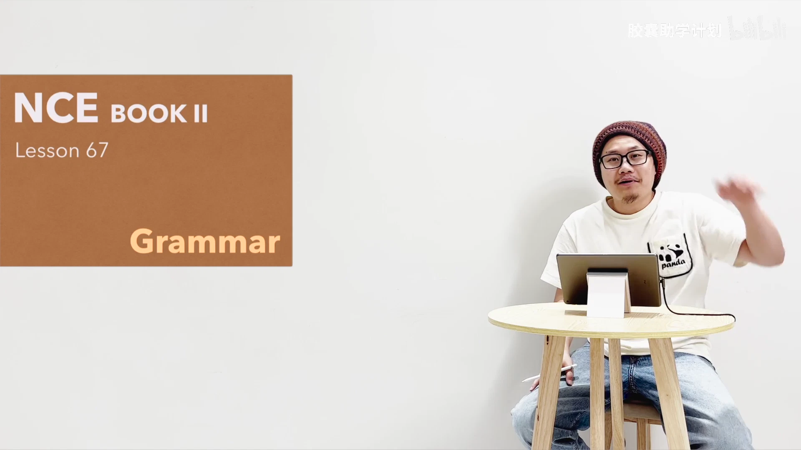

文字识别：NCE / BOOKⅡI / Lesson 67 / Grammar / panda

### 画面 00:00:02

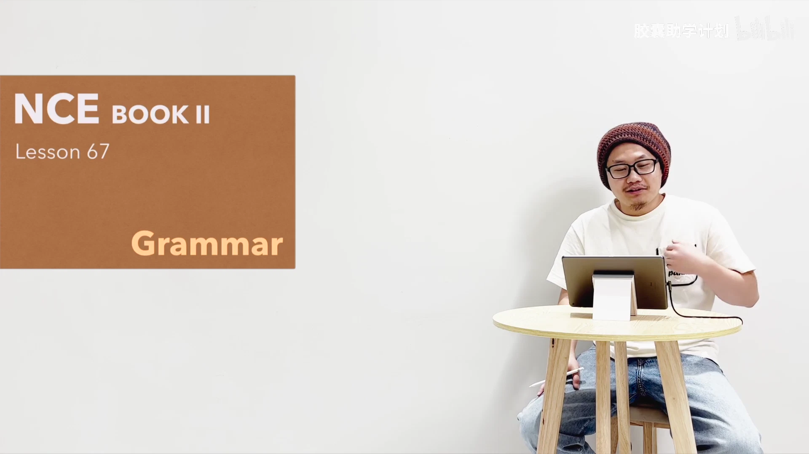

文字识别：NCE / BOOKⅡI / Lesson 67 / Grammar

### 画面 00:00:08

文字识别：囊助学计划明 / panda

### 画面 00:00:10

文字识别：① managed to do sth. ? / pai

### 画面 00:00:19

文字识别：臺助学计划 / ①managed to do sth. ? / A / panda

### 画面 00:00:21

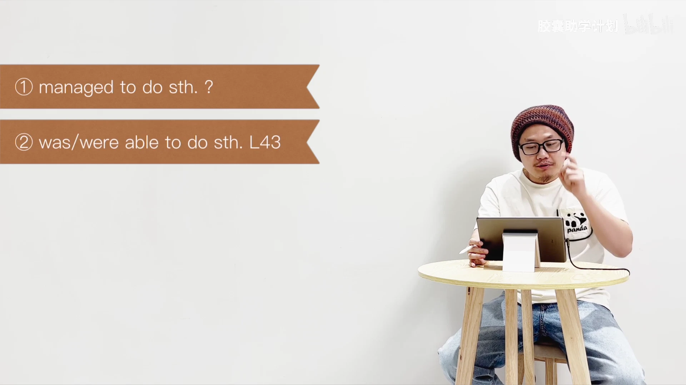

文字识别：①r / managed to do sth. ? / was/were able to do sth. L43 / panda

### 画面 00:00:28

文字识别：胶囊助学计划 bil / •

## 00:00:30–00:01:00

我们上来先看 manage 这个单词的 Cambridge 剑桥啊 Cambridge Dictionary 给我们的一个定义叫做 to succeed in doing or dealing with something, especially something difficult, 是吧？叫做成功的做了或者处理了某件事情，尤其是一些特别困难的事儿。所以如果 was were able to do 您特别的熟悉，那本课的这个 manage to something 就跟它其实是一

### 画面 00:00:32

### 画面 00:00:34

文字识别：産助字计划 / manage v. / Cambridge Dictionary:

### 画面 00:00:38

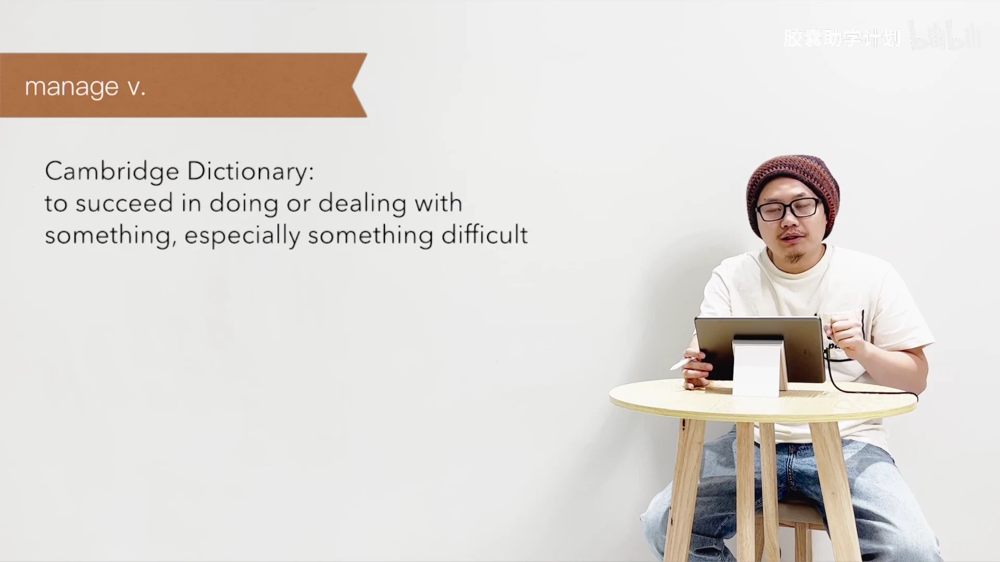

文字识别：manage v. / Cambridge / Dictionary: / to succeed in doing or dealing with / something, especially something / difficult

## 00:01:00–00:01:30

模一样，跟它的其中一个用法是一模一样的。我们直接来看啊。好，哎，那我在这儿直接给你说了，叫做 manage to do something 等于 was were able to do something。当然是等于它其中一个用法，哪个用法呢？这就要回顾一下四十三课 was were able to do。当时我们讲了两个用法，第一个叫做普遍的一个能力，对吧？哎，就是我当时能怎么怎么样，能怎么怎么样，有这么一个能力。另外一个叫过去的具体成功的事件，

### 画面 00:01:03

文字识别：臺助学计划国州 / managed to do sth.

### 画面 00:01:15

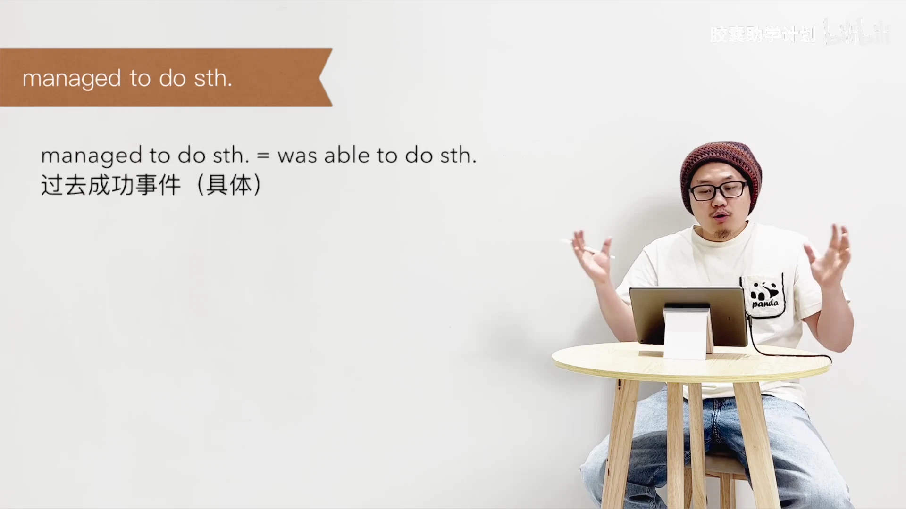

文字识别：managed to do sth. / managed to do sth. = was able to do sth. / 过去成功事件 (具体) / panda

## 00:01:30–00:02:00

就这个词我都没变，直接就是从四十三课拉过来用的，因为这两个用法一模一样，它是具体的某件事儿，对吧？那我们看一下肯定句怎么用。The fire spread quickly, but everybody managed to escape，或者是 was able to escape，这两个放在这儿都可以，均翻译成大家都成功的逃脱出去了。它其实就翻译成成功地就可以了。第二个，

### 画面 00:01:38

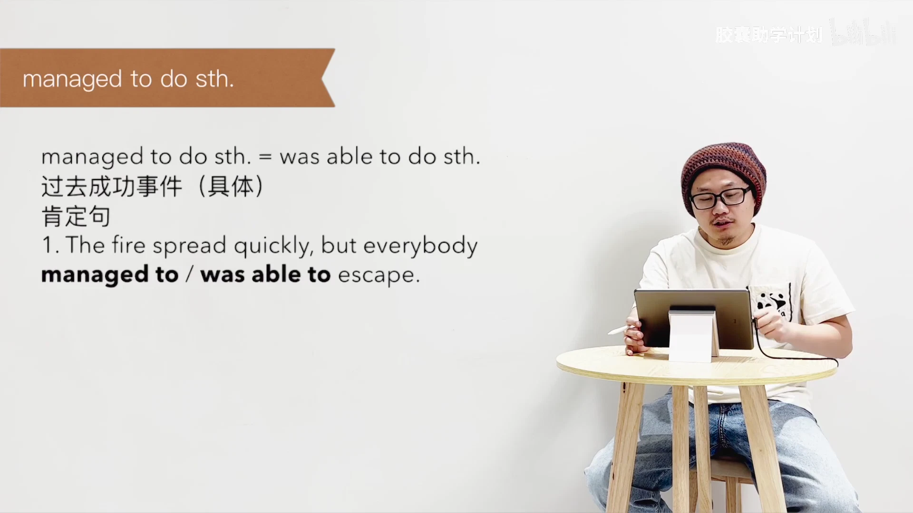

文字识别：managed to do sth. / managed to do sth. = was able to do sth. / 过去成功事件 (具体) / 肯定句 / 1. The fire spread quickly, but everybody / managed to / was able to escape.

### 画面 00:01:58

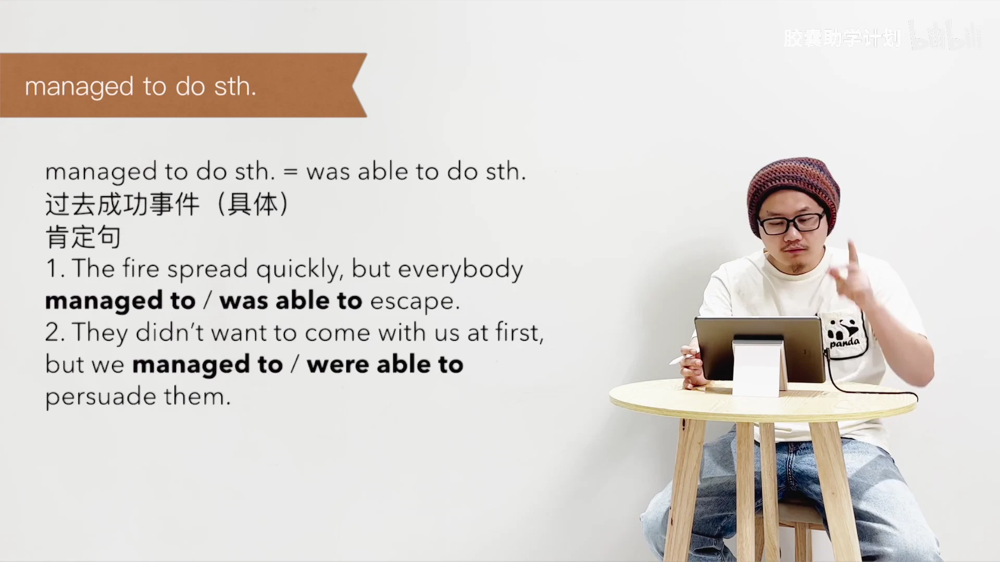

文字识别：managed to do sth. / managed to do sth. = was able to do sth. / 过去成功事件 (具体) / 肯定句 / 1. The fire spread quickly, but everybody / managed to / was able to escape. / 2. They didn't want to come with us at first, / panda / but we managed to / were able to / persuade them.

## 00:02:00–00:02:30

they didn't want to come come with us at first, but we managed, were able to persuade them.但是我们成功的说服了他们，看到了吧？这个结构放在这个地方，那它和 try to do 什么区别？ try to do 叫做尝试设法，并没有说我成没成功。但是你一旦用到了 manage to do something，它就叫做 succeed in doing or dealing with something，对吧？成功的处理了某件事情，听见了吧？就这个事儿成了。比如再来，

### 画面 00:02:28

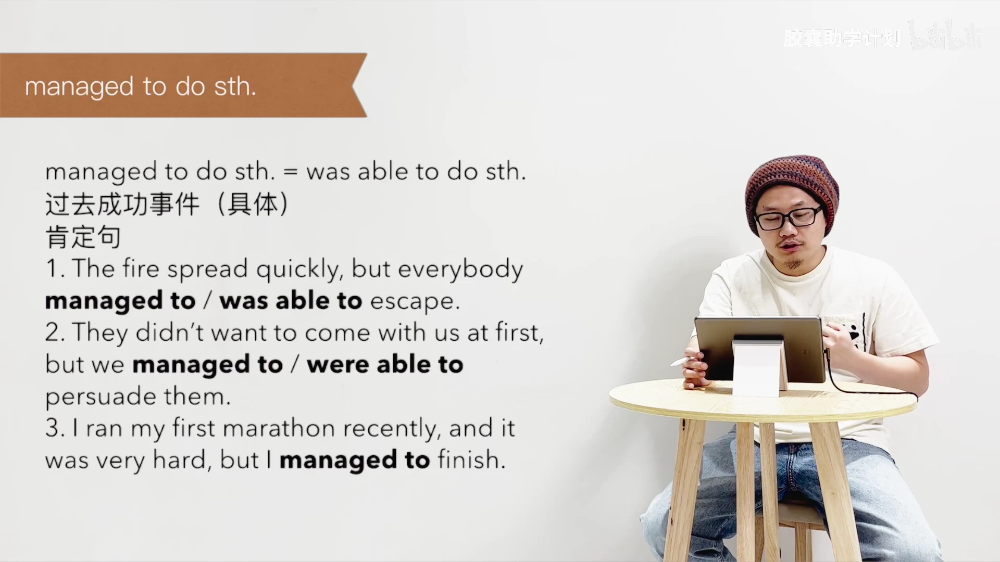

文字识别：managed to do sth. / managed to do sth. = was able to do sth. / 过去成功事件 (具体) / 肯定句 / 1. The fire spread quickly, but everybody / managed to / was able to escape. / 2. They didn't want to come with us at first, / but we managed to / were able to / persuade them. / 3.I ran my first marathon recently, and it / Was very hard, but I managed to finish.

## 00:02:30–00:03:00

I ran my first marathon recently, but it was very hard. But I managed to finish.你注意，你看啊，我最近跑了人生第一次马拉松，特别的难。我跑过，我知道确实很难。说但是啊，我还是成功的完成了全程马拉松，对吧？那你注意这里的 manage to 就等于 was were able to，对吧？所以这个地方对于各位来说，我个人认为就是四十三课，如果你学

### 画面 00:02:47

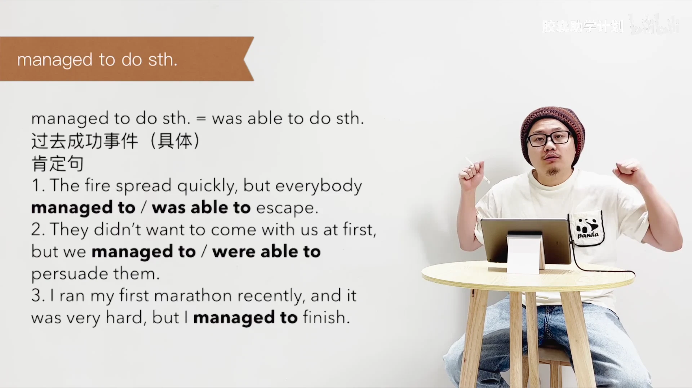

文字识别：managed to do sth. / managed to do sth. = was able to do sth. / 过去成功事件 (具体) / 肯定句 / 1. The fire spread quickly, but everybody / managed to / was able to escape. / 2. They didn't want to come with us at first, / panda / but we managed to / were able to / persuade them. / 3.I ran my first marathon recently, and it / was very hard, but I managed to finish.

### 画面 00:02:49

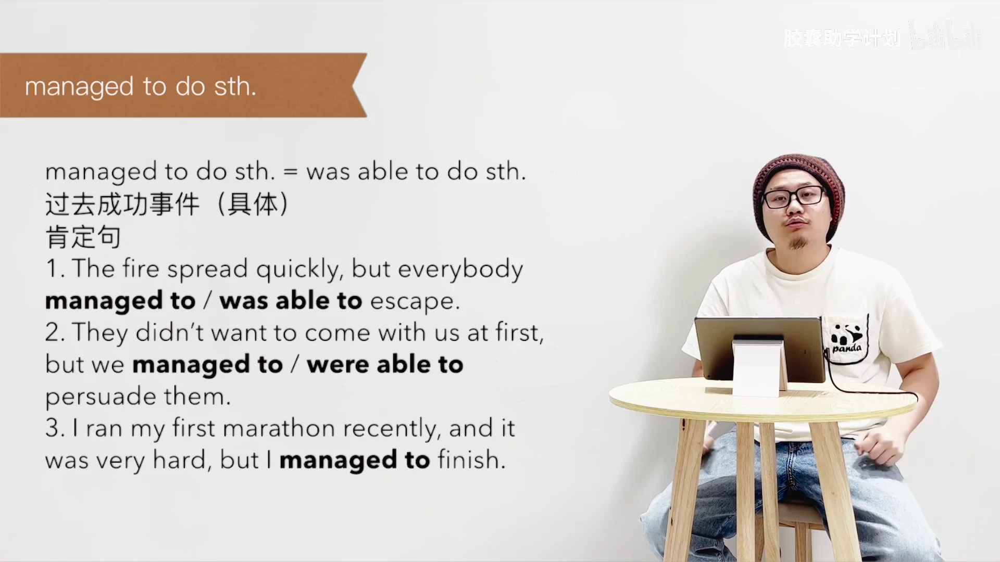

文字识别：managed to do sth. / managed to do sth. = was able to do sth. / 过去成功事件 (具体) / 肯定句 / 1. The fire spread quickly, but everybody / managed to / was able to escape. / 2. They didn't want to come with us at first, / panda / but we managed to / were able to / persuade them. / 3.I ran my first marathon recently, and it / was very hard, but I managed to finish.

## 00:03:00–00:03:30

的很好，到这儿我一点你就透了啊，没区别。那接下来呢，我们注意力集中听一下电影片段吧。 On the run, they managed to stay alive. Next one. She managed to get out, but I fear that might be why she was killed. 哎，你像这个电影片段，我觉得出现了无数多的我们之前学过的语法也好，习惯用法也好，对吧？ I fear that，啊，我很担心，是吧？我会有这样

### 画面 00:03:03

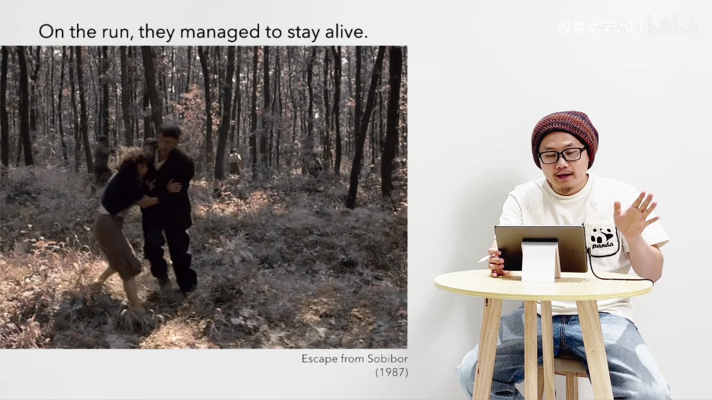

文字识别：On the run, they managed to stay alive. / panda / Escape from Sobibor / (1987)

### 画面 00:03:07

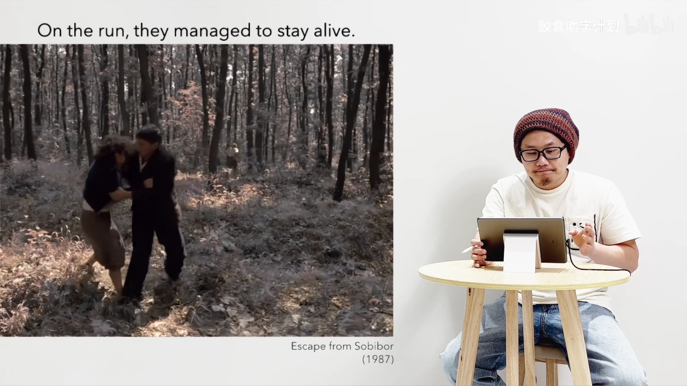

文字识别：On the run, they managed to stay alive. / Escape from Sobibor / (1987)

### 画面 00:03:09

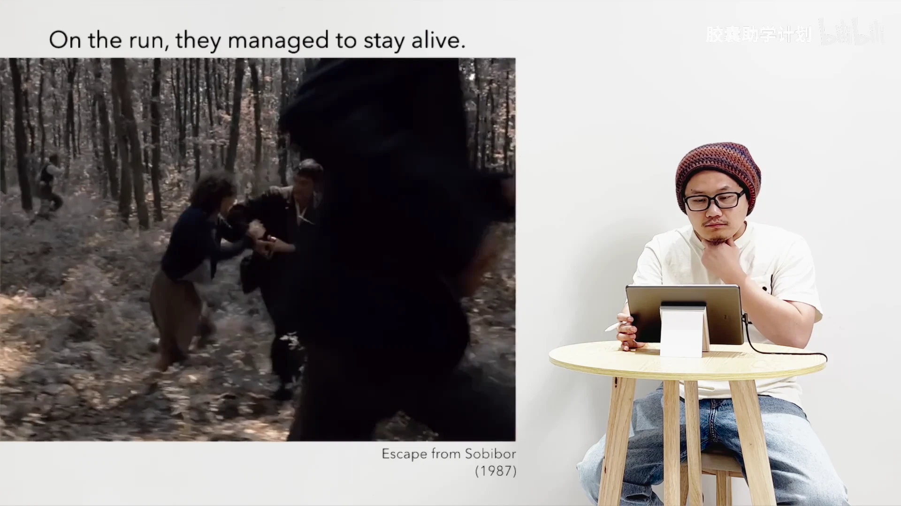

文字识别：On the run, they managed to stay alive. / Escape from Sobibor / (1987)

### 画面 00:03:11

文字识别：At least she managed to get out, / but I fear that might be why she was killed. / Aurora Teagarden Mysteries: A Very Foul Play / (2019)

### 画面 00:03:13

文字识别：At least she managed to get out, / but l fear that might be why she was killed. / Aurora Teagarden Mysteries: A Very Foul Play / (2019)

### 画面 00:03:15

文字识别：At least she managed to get out, / but l fear that might be why she was killed. / Aurora Teagarden Mysteries: A Very Foul Play / (2019)

### 画面 00:03:17

文字识别：At least she managed to get out, / but l fear that might be why she was killed. / Aurora Teagarden Mysteries: A Very Foul Play / (2019)

### 画面 00:03:19

文字识别：At least she managed to get out, / but I fear that might be why she was killed. / Aurora Teagarden Mysteries: A Very Foul Play / (2019)

### 画面 00:03:28

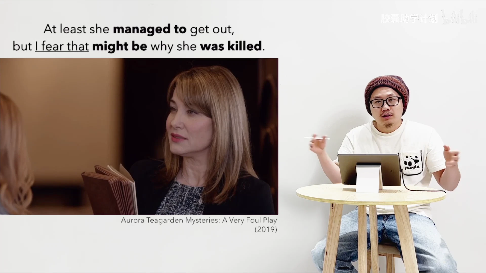

文字识别：At least she managed to get out, / but I fear that might be why she was killed. / panda / Aurora Teagarden Mysteries: A Very Foul Play / (2019)

## 00:03:30–00:04:00

一个担心啊。Next one, 那刚才我们说完了这些，那我们要看一下它的一般疑问句。一般疑问句像 Was were able to do 就是把 Was were 提前就可以了。而这里的 manage to do manage，毕竟还是个动词，所以它是把 did 去进行了一个提前啊。注意这里它是把 did 去进行了一个提前。did 提前了之后呢，那 manage to，呃，这个 do 这个 manage 的，你要换回原形，对吧？比如说 I managed to tell him, uh,

### 画面 00:03:31

文字识别：庭助字计划 / managed to do sth.

### 画面 00:03:39

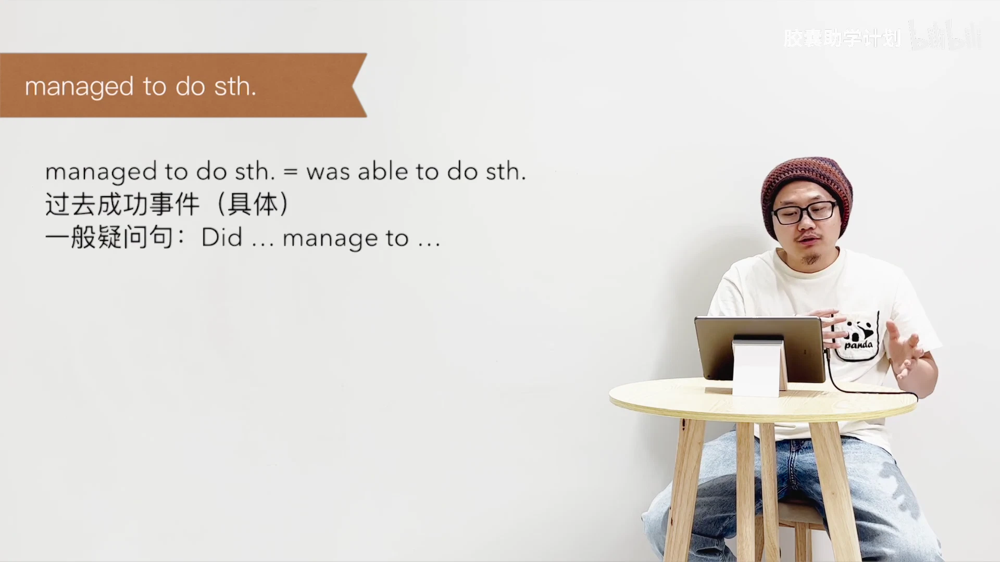

文字识别：managed to do sth. / managed to do sth. = was able to do sth. / 过去成功事件 (具体) / 一般疑问句：Did …manage to … / panda

### 画面 00:03:56

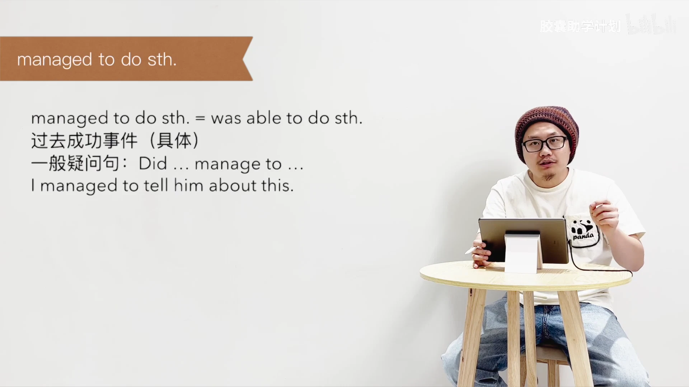

文字识别：managed to do sth. / managed to do sth. = was able to do sth. / 过去成功事件 (具体) / 一般疑问句：Did …manage to … / I managed to tell him about this. / panda

## 00:04:00–00:04:30

about this. 我设法成功的告诉他了这件事情，对吧？所以其实当 manage to do 一出来的时候，你就知道他有，因为他背后说了嘛， especially something difficult. 尤其是一些比较困难的事情，就是他总是可能是经历了弯弯绕绕，经历了一些相对有一点复杂的事情，才把这个事儿，哎，这个手段也好，程序也好，才把这个事儿告诉他了，对吧？不是很容易的一个事儿啊。 Okay, 那怎么变一

### 画面 00:04:26

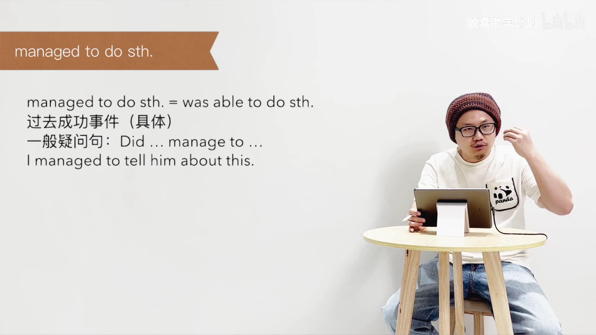

文字识别：managed to do sth. / managed to do sth. = was able to do sth. / 过去成功事件 (具体) / 一般疑问句：Did …manage to … / I managed to tell him about this. / panda

## 00:04:30–00:05:00

般疑问句呢？Did提前，manage换原形，这个句子就出来了。也就是说，和你大多数一般过去时变一般疑问句没区别。叫Did you manage to tell him about this？说你成功的告诉他这个事儿了吗？对吧？你设法告诉他这件事了吗？Next one, I managed to find the remote control. Remote control之前咱们学过remote啊，远距离的，遥远的control叫遥控，对吧？遥控器就可以了。哎，我成功的找到了它。那我问你找到它了吗？Did you

### 画面 00:04:45

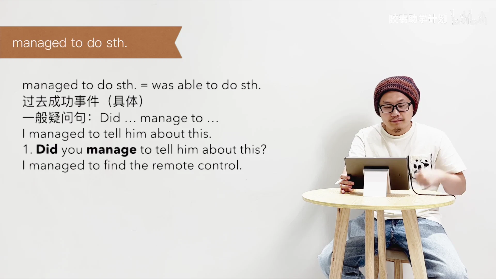

文字识别：managed to do sth. / managed to do sth. = was able to do sth. / 过去成功事件 (具体) / 一般疑问句：Did …manage to … / I managed to tell him about this. / 1. Did you manage to tell him about this? / I managed to find the remote control.

## 00:05:00–00:05:30

manage to find the remote control? Okay, one more,就这么简单啊啊！所以再总结一下这一页。Manage to do something变一般疑问句和一般过去时没有区别。Did该提前提前，动词该换原形，换原形，好吧。那注意力集中，我们听一下电影片段。Did you manage to speak to someone? Okay, next one. That's great. Did you manage to send a card? Okay,

### 画面 00:05:06

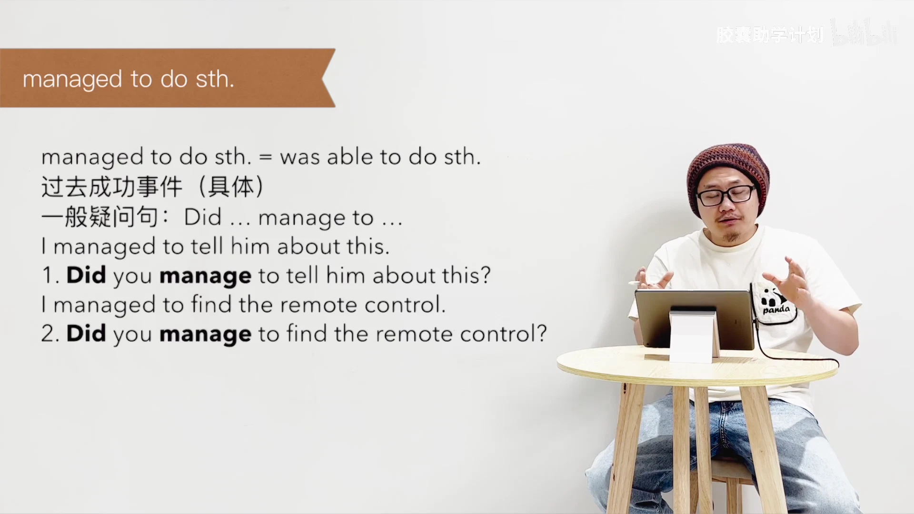

文字识别：managed to do sth. / managed to do sth. = was able to do sth. / 过去成功事件 (具体) / 一般疑问句：Did …manage to … / I managed to tell him about this. / 1. Did you manage to tell him about this? / I managed to find the remote control. / panda / 2. Did you manage to find the remote control?

### 画面 00:05:17

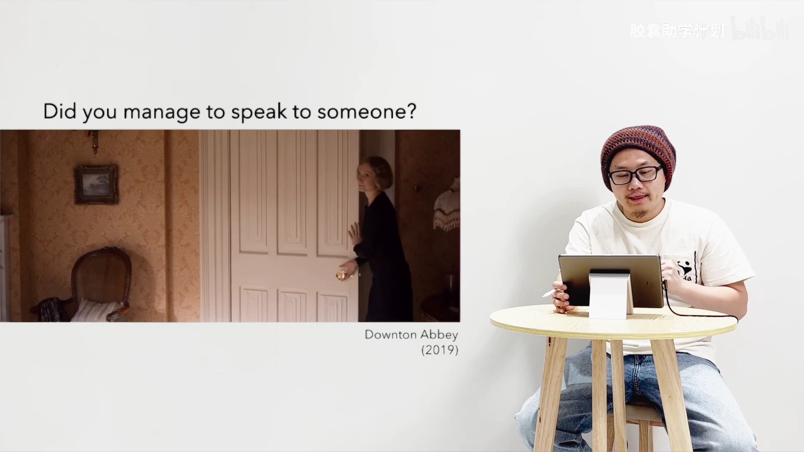

文字识别：Did you manage to speak to someone? / Downton Abbey / (2019)

### 画面 00:05:19

文字识别：Did you manage to speak to someone? / Downton Abbey / (2019)

### 画面 00:05:21

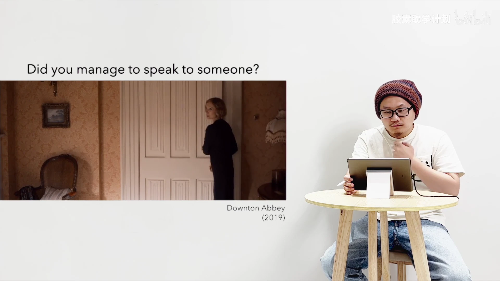

文字识别：Did you manage to speak to someone? / Downton Abbey / (2019)

### 画面 00:05:23

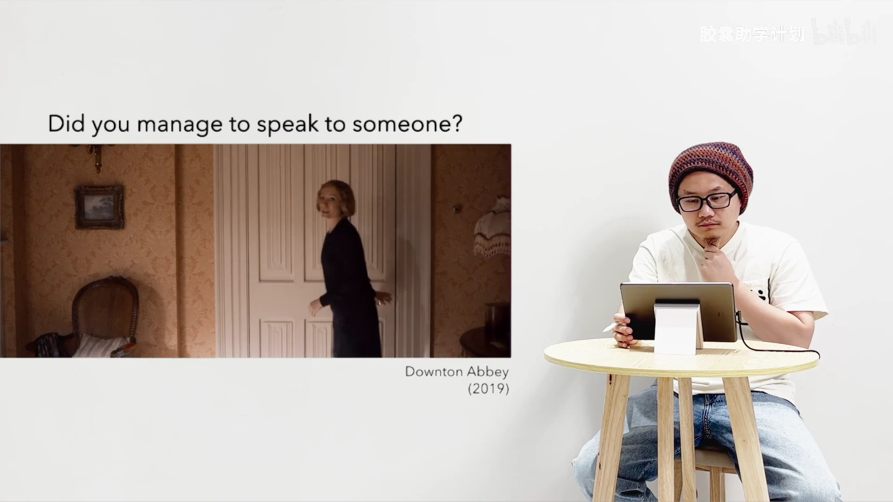

文字识别：Did you manage to speak to someone? / Downton Abbey / (2019)

### 画面 00:05:25

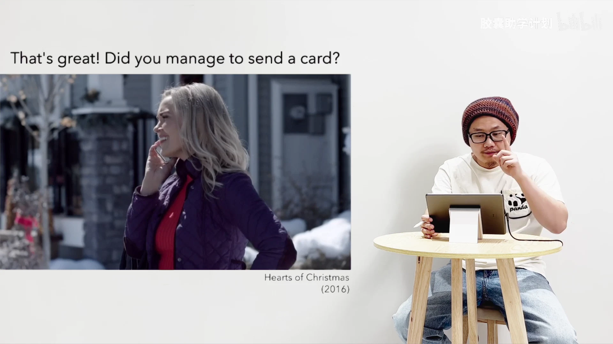

文字识别：That's great! Did you manage to send a card? / panda / Hearts of Christmas / (2016)

### 画面 00:05:27

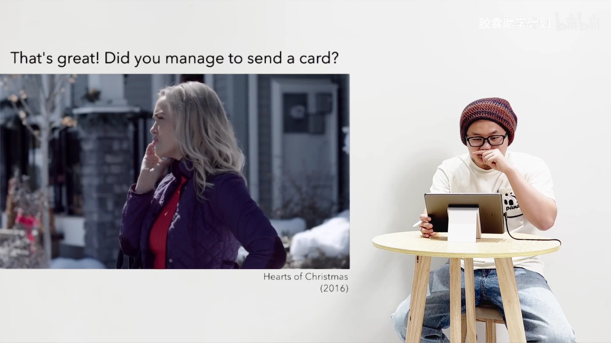

文字识别：That's great! Did you manage to send a card? / Hearts of Christmas / (2016)

### 画面 00:05:29

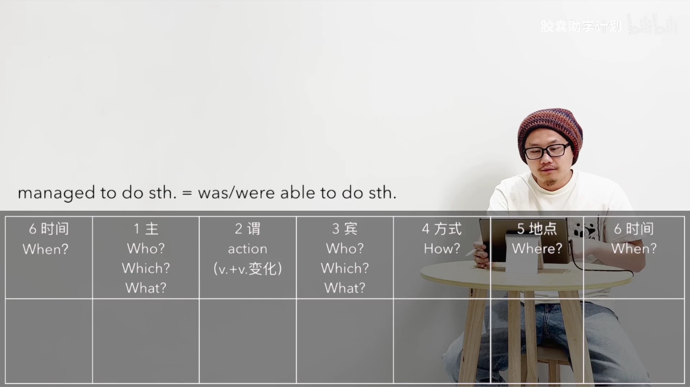

文字识别：喜助学计划 / managed to do sth. = was/were able to do sth. / 6时间 / 1主 / 2谓 / 3宾 / 4方式 / 5地点 / 6时间 / When? / Who? / action / Who? / How? / Where? / When? / Which? / (v.+v.变化) / Which? / What? / What?

## 00:05:30–00:06:00

I managed to do something, and was were able to do something. That一定都是属于我们六一二三四五六里边的二的，对吧？一旦跟二连起来，这个语法就无比的重要，要牢牢记住，对吧？我们接下来呢，开始去练，各位张开嘴啊！来了，I wasn't able to swim to the other side of the river. What about you? 那当然可以连起来，What about you? I

### 画面 00:05:42

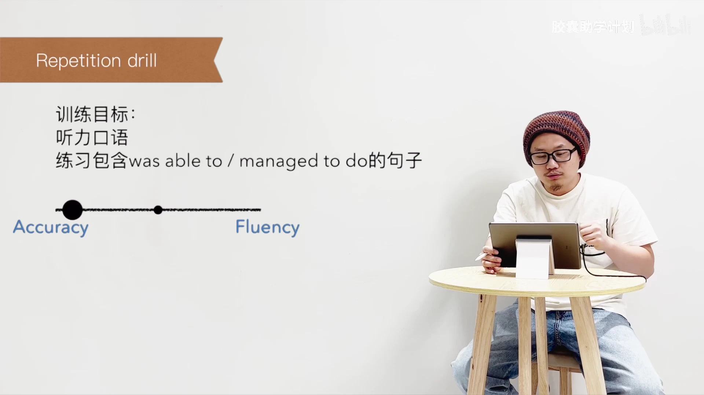

文字识别：Repetition drill / 训练目标： / 听力口语 / 练习包含was able to ／ managed to do的句子 / Accuracy / Fluency

### 画面 00:05:46

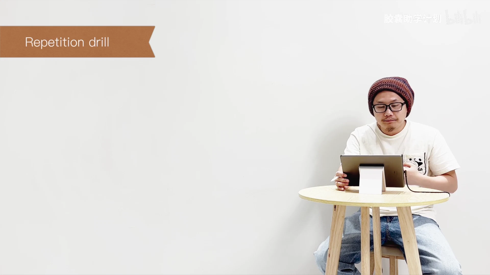

文字识别：喜助学计划 / Repetition drill

### 画面 00:05:50

文字识别：Repetition drill / 1T: I wasn't able to swim to the other side of / the river.

### 画面 00:05:58

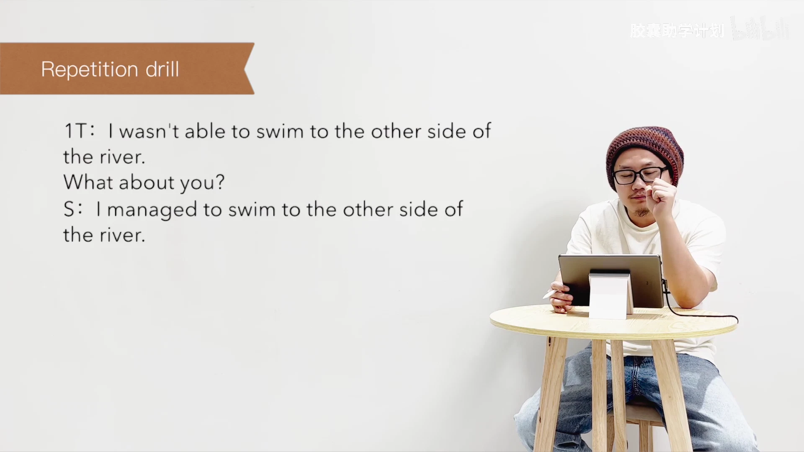

文字识别：Repetition drill / 1T: I wasn't able to swim to the other side of / the river. / What about you? / S: I managed to swim to the other side of / the river.

## 00:06:00–00:06:30

managed to swim to the other side of the river.你注意到这里我们练的是什么？Wasn't able to和manage to do，就你要知道他在这儿要让我们练什么，这是不变的，剩下不停的在变。来了啊，I wasn't able to get into town this morning. What about Mary? She managed to get into town this morning. I wasn't able to translate the passage into English.

### 画面 00:06:13

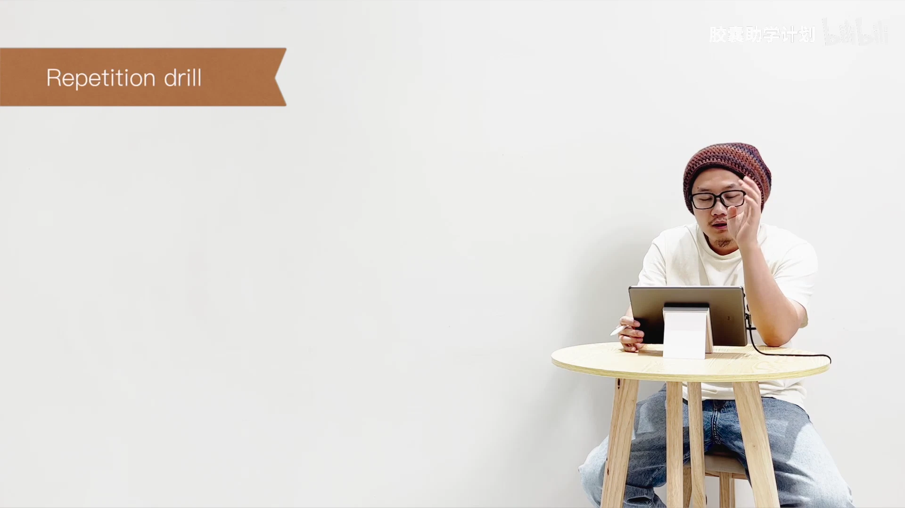

文字识别：喜助字计划 / Repetition drill

### 画面 00:06:19

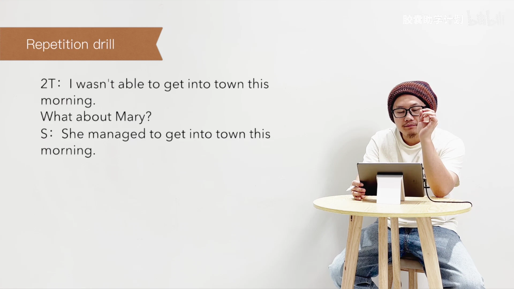

文字识别：Repetition drill / 2T: I wasn't able to get into town this / morning. / What about Mary? / S: She managed to get into town this / morning.

### 画面 00:06:24

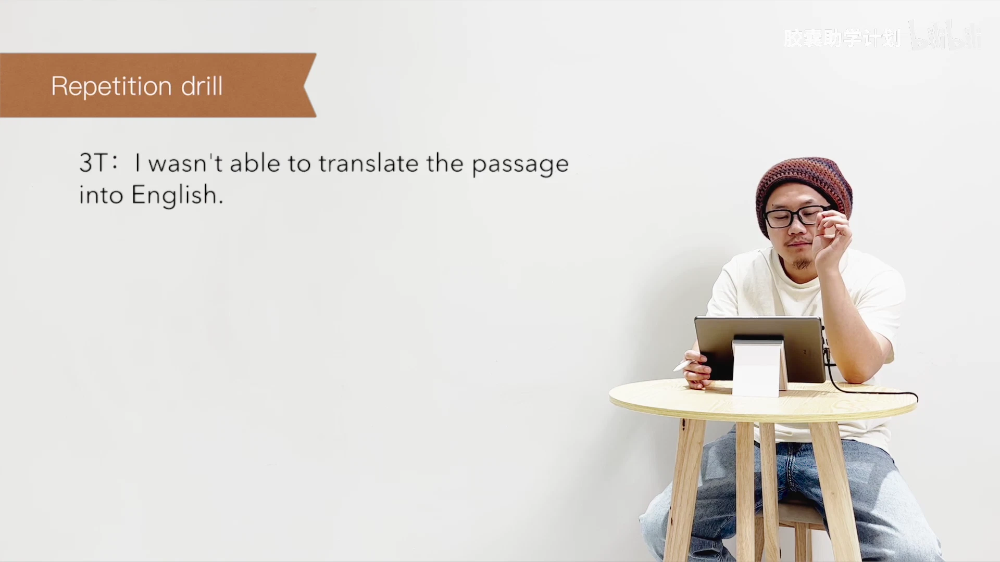

文字识别：囊助学计划 / Repetition drill / 3T: I wasn't able to translate the passage / into English.

## 00:06:30–00:07:00

What about George? He managed to translate the passage into English. Translate,翻译. I wasn't able to take any photographs. What about you and Tom? We managed to take some photographs. I wasn't able to climb to the top of the mountain. What about Jim and Frank?

### 画面 00:06:32

文字识别：Repetition drill / 3T: I wasn't able to translate the passage / into English. / What about George? / S: He managed to translate the passage / into English.

### 画面 00:06:39

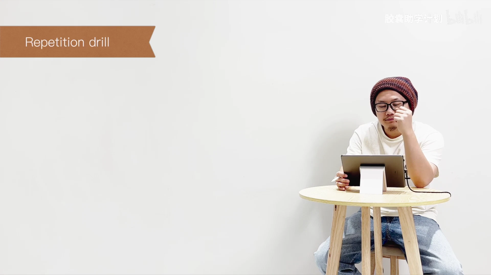

文字识别：喜助学计划 / Repetition drill

### 画面 00:06:47

文字识别：Repetition drill / 4T: I wasn't able to take any photographs. / What about you and Tom? / S: We managed to take some photographs.

### 画面 00:06:52

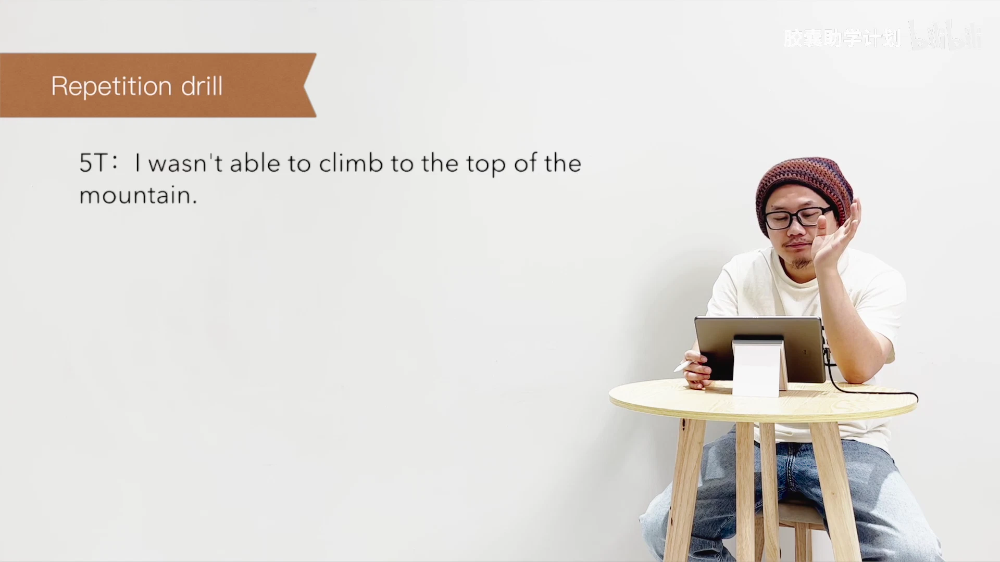

文字识别：墓助字计划 / Repetition drill / 5T: I wasn't able to climb to the top of the / mountain.

### 画面 00:06:59

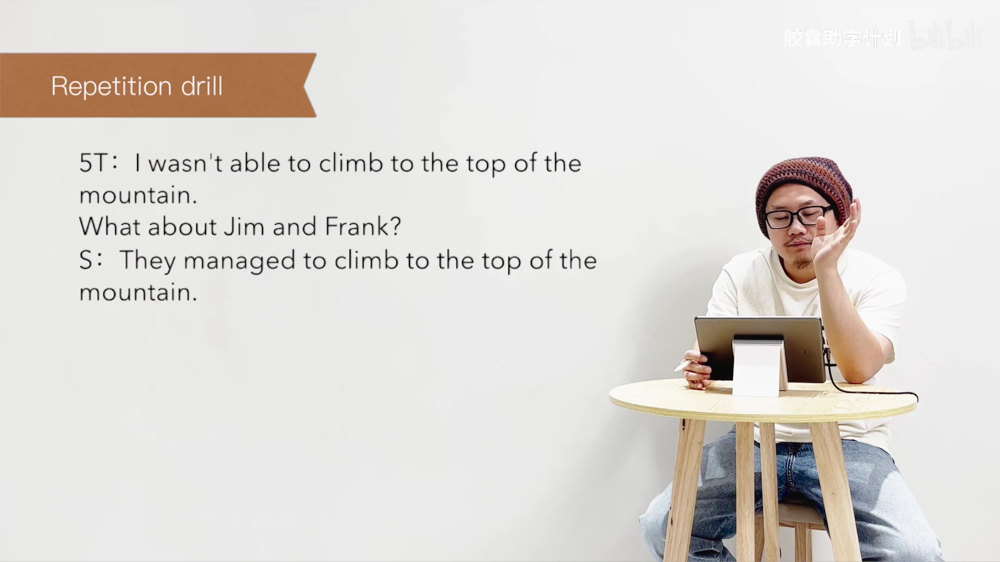

文字识别：Repetition drill / 5T: I wasn't able to climb to the top of the / mountain. / What about Jim and Frank? / S: They managed to climb to the top of the / mountain.

## 00:07:00–00:07:30

they managed to climb to the top of the mountain. I wasn't able to find a new job. What about you? I managed to find a new job. I wasn't able to leave the office until the the rain started. What about Frank? He managed to leave the office before the rain started.

### 画面 00:07:04

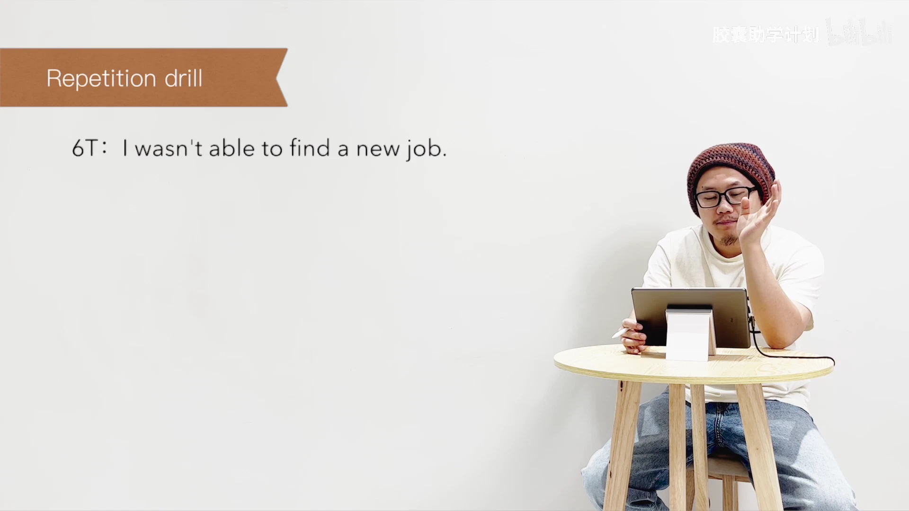

文字识别：素助字计划園園 / Repetition drill / 6T: I wasn't able to find a new job.

### 画面 00:07:21

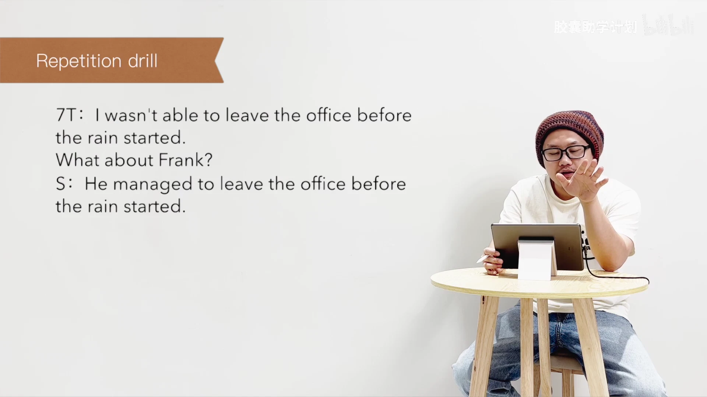

文字识别：Repetition drill / 7T: I wasn't able to leave the office before / the rain started. / What about Frank? / S: He managed to leave the ofice before / the rain started.

### 画面 00:07:29

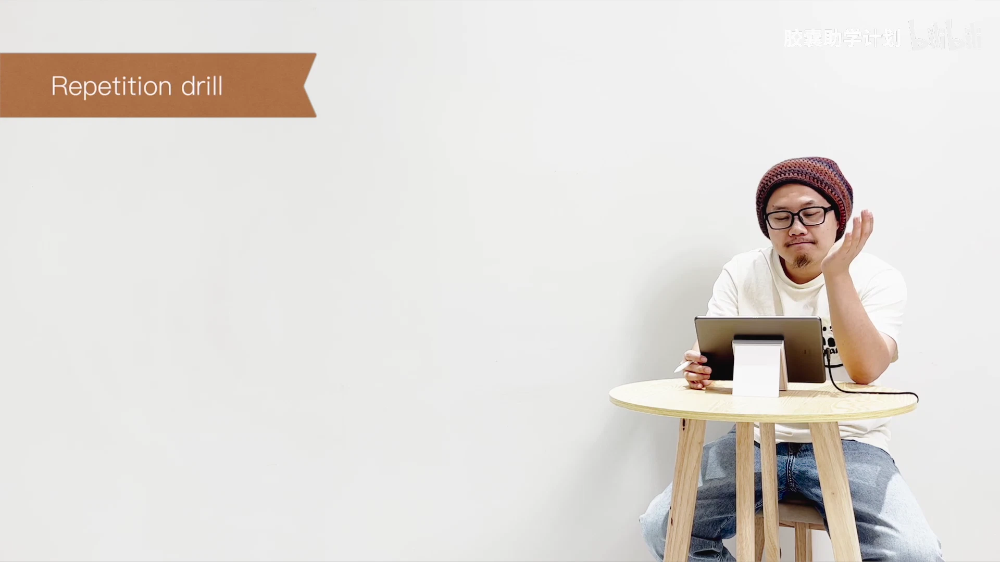

文字识别：袁助学计划 / Repetition drill

## 00:07:30–00:08:00

I wasn't able to persuade him to come with us. What about you? I managed to persuade him to come with us. I wasn't able to pass the test. What about you and Mary? We managed to pass the test. I wasn't able to return before dark. What about Tom and Mary?

### 画面 00:07:36

文字识别：Repetition drill / 8T: I wasn't able to persuade him to / come with us. / What about you? / S: I managed to persuade him to come / with us.

### 画面 00:07:40

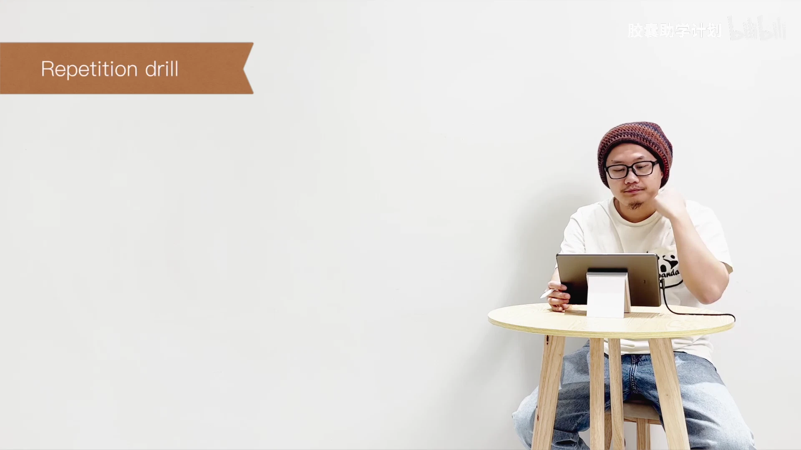

文字识别：毫助字计划 / Repetition drill / Panda

### 画面 00:07:48

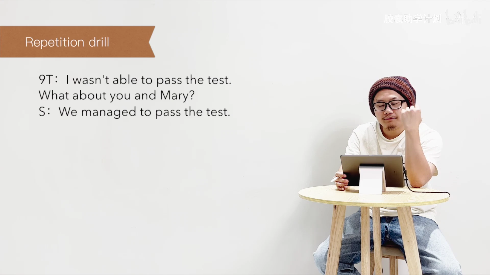

文字识别：Repetition drill / 9T: I wasn't able to pass the test. / What about you and Mary? / S: We managed to pass the test.

### 画面 00:07:53

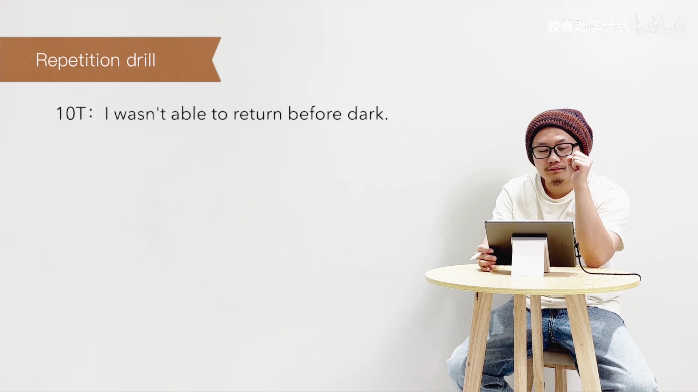

文字识别：Repetition drill / 10T: I wasn't able to return before dark.

### 画面 00:07:59

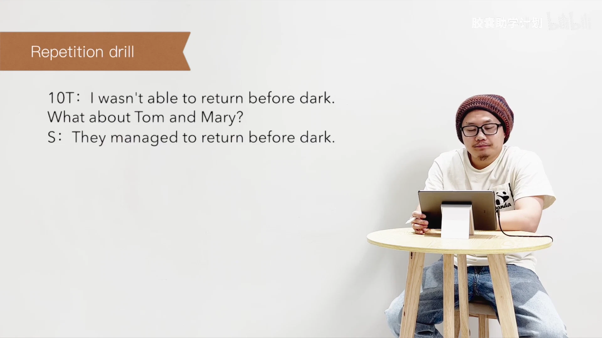

文字识别：Repetition drill / 10T: I wasn't able to return before dark. / What about Tom and Mary? / S: They managed to return before dark. / panda

## 00:08:00–00:08:30

Mary. They managed to return before dark. Ah, repetition drill就是口语听力的一些练习，放到句子里面当帮各位去看一下 manage to do和 was able to do怎么用。接下来 pattern drill，各位是我们要先写，再去大声朗读的这些例句，对吧？我们说一下这思路啊。 So did you manage to see Tom yesterday? 你昨天成功见到他了吗？ No, I won't be able to see him until next week. 说不直到下周之前我

### 画面 00:08:04

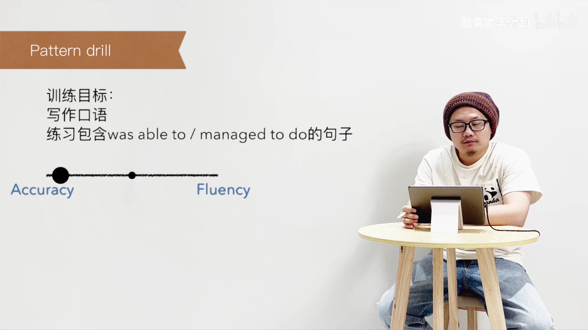

文字识别：Pattern drill / 训练目标： / 写作口语 / 练习包含was able to ／ managed to do的句子 / Accuracy / Fluency / anda

### 画面 00:08:09

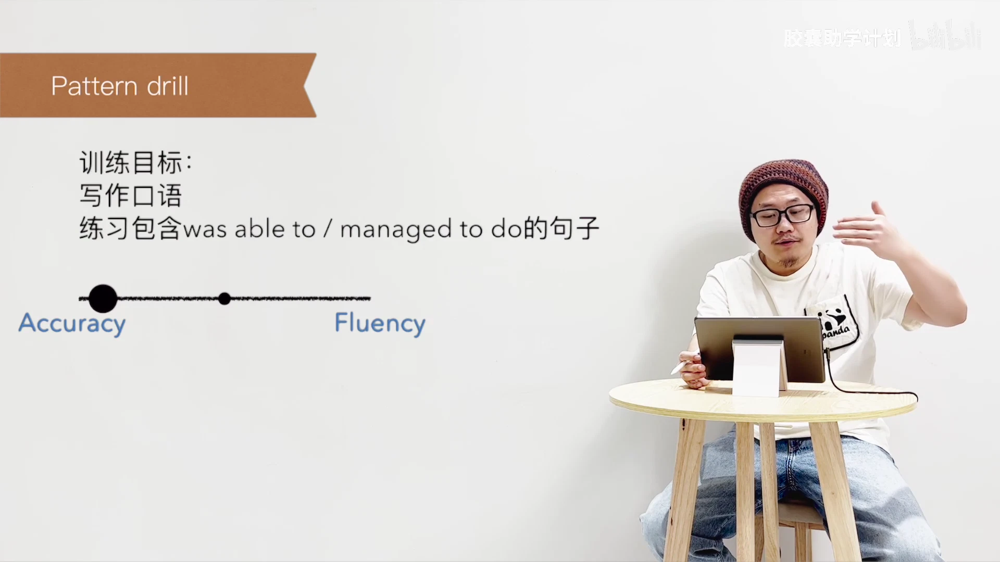

文字识别：Pattern drill / 训练目标： / 写作口语 / 练习包含was able to ／ managed to do的句子 / Accuracy / Fluency / panda

### 画面 00:08:14

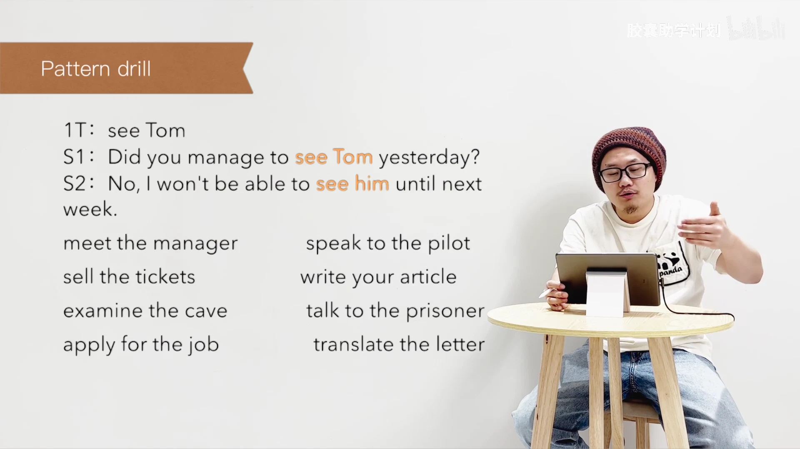

文字识别：Pattern drill / 1T:see Tom / S1: Did you manage to see Tom yesterday? / S2: No, I won't be able to see him until next / week. / meet the manager / speak to the pilot / sell the tickets / write your article / panda / examine the cave / talk to the prisoner / apply forthe job / translate the letter

### 画面 00:08:21

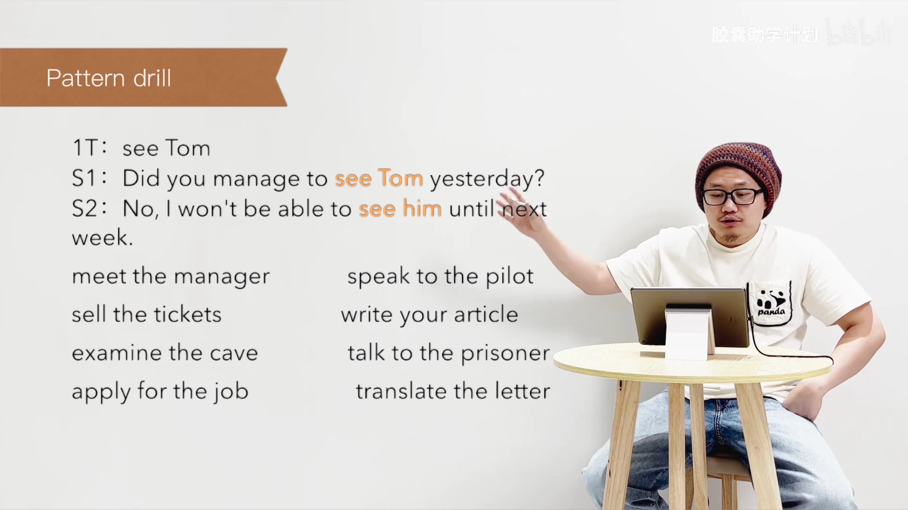

文字识别：Pattern drill / 1T:see Tom / S1: Did you manage to see Tom yesterday? / S2: No, I won't be able to see him untilnext / week. / meet the manager / speak to the pilot / sell the tickets / write your article / panda / examine the cave / talk to the prisoner / apply for the job / translate the letter

## 00:08:30–00:09:00

没有机会见到他。所以这里其实一个是 manage to do 的一般疑问句，Did you manage to？对吧？第二个是 won't be able to，表示将来的啊。练的是这两个句子，往里面去带，不多说。这是第一个，第二个。I hear he's got into university. 我听说他上大学了。Yes, he managed to get a scholarship too. 是吧？他也设法成功的获得了一份奖学金。

### 画面 00:08:35

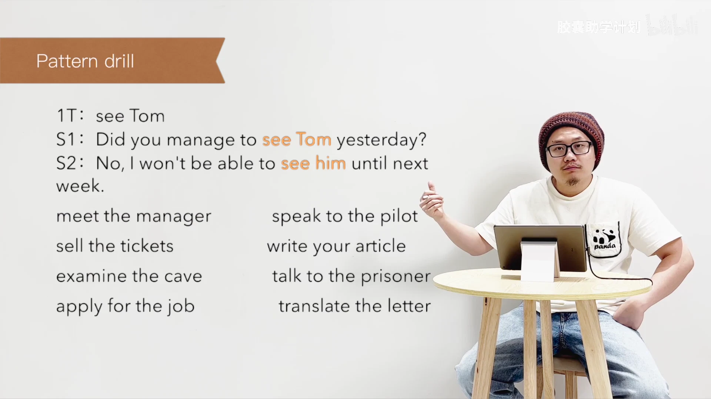

文字识别：Pattern drill / 1T:see Tom / S1: Did you manage to see Tom yesterday? / S2: No, I won't be able to see him until next / week. / meet the manager / speak to the pilot / sell the tickets / write your article / panda / examine the cave / talk to the prisoner / apply forthe job / translate the letter

### 画面 00:08:42

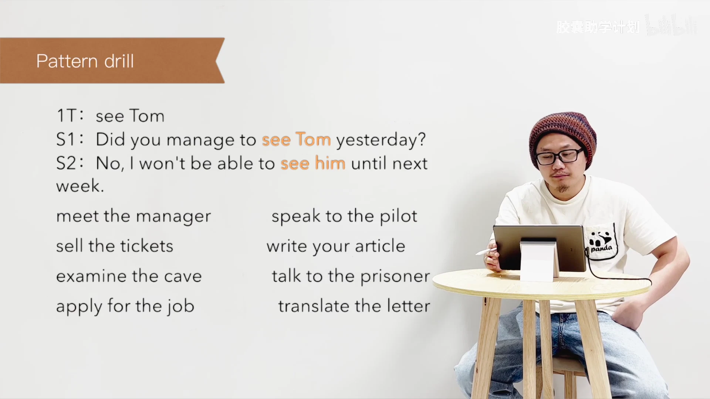

文字识别：Pattern drill / 1T:see Tom / S1: Did you manage to see Tom yesterday? / S2: No, I won't be able to see him until next / week. / meet the manager / speak to the pilot / sell the tickets / write your article / panda / examine the cave / talk to the prisoner / apply for the job / translate the letter

### 画面 00:08:44

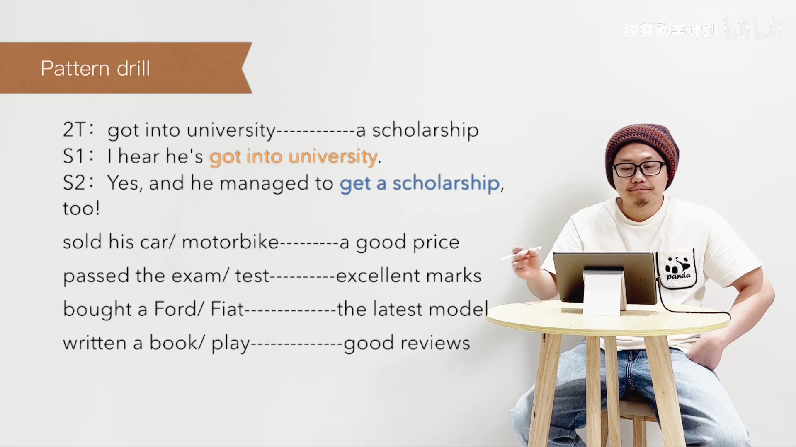

文字识别：Pattern drill / 2T:otintouniversit----ascholarship / S1: I hear he's got into university. / S2: Yes, and he managed to get a scholarship, / too! / sold his car/motorbike----a good price / passed theexam/test----excellent marks / panda / boughtaFor/ Fat---heatestmodel / written a book/ play--- / ----.goodreviews

## 00:09:00–00:09:30

非常好。Manage to do，对吧？往里面去带。第三个，What do you think of my book？你觉得我书怎么样呢？I'm afraid I haven't managed to read it yet。我恐怕很抱歉，我还没有成功的，我还没有去读它，对吧？还没有设法找到时间去读它啊。Manage to do，往里面去带。It's a pity he couldn't see the play. Oh， didn't you know？He managed to

### 画面 00:09:04

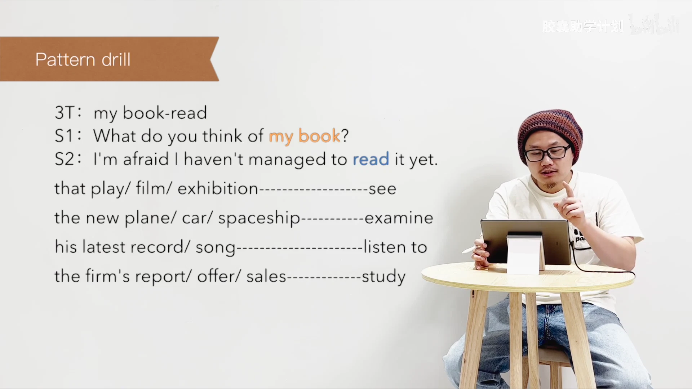

文字识别：Pattern drill / 3T:my book-read / S1: What do you think of my book? / S2: I'm afraid I haven't managed to read it yet. / that play/ film/ exhibition-- / ---see / thenewplane/car/spaceship----examine / his latest record/ song- / ---listen to / --- / the firm'sreport/offer/ sales----study

### 画面 00:09:25

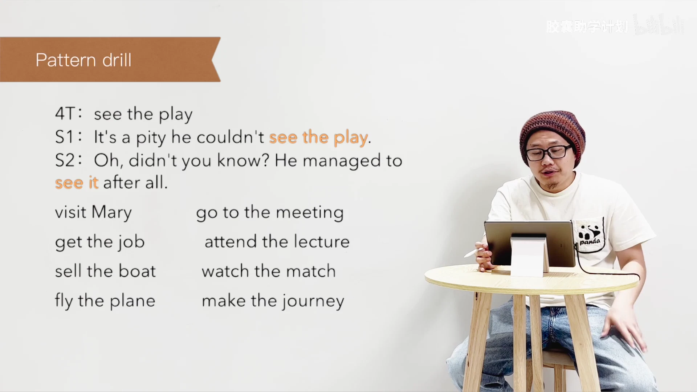

文字识别：Pattern drill / 4T: see the play / S1: It's a pity he couldn't see the play. / S2: Oh, didn't you know? He managed to / see it after all. / visit Mary / go to the meeting / get the job / attend the lecture / panda / sell the boat / watch the match / fly the plane / make the journey

## 00:09:30–00:10:00

see it after all?是吧，他最终还是成功的找到机会去看了这场话剧啊，往里面去带。这是 pattern drill。那 recap 本课的关键语法 was were able to 四十三课学的，咱们复习了一下。Managed to do 本课学的，对吧？并不难啊，我觉得。家庭作业呢， pattern drill 四乘四置顶留言可以找得到。然后呢，尝试回忆，给自己讲解一遍今天的这个核心语法，好吧？

### 画面 00:09:39

文字识别：Recap / 囊助字计划圖 / Patterns / was able to / managed to do / Grammar

### 画面 00:09:41

文字识别：Recap / 妻助字计划園 / Patterns / was able to / ＆ / managed to do / Grammar / panda

### 画面 00:09:44

文字识别：Recap / 妻助字计划 / Patterns / was able to / ＆ / managed to do / Grammar / panda

### 画面 00:09:46

文字识别：Recap / 囊助字计划国 / Patterns / was able to / ＆ / managed to do / Grammar / panda

### 画面 00:09:48

文字识别：Recap / 辜助字计划国 / Patterns / was able to / ＆ / managed to do / Grammar

### 画面 00:09:50

文字识别：奏助字计划

### 画面 00:09:52

文字识别：奏助学计划国州 / 1.f / Pattern Drill 写&朗读 / 置顶留言 / 4×4

### 画面 00:09:55

文字识别：Pattern Drill 写&朗读 / 1. / 置顶留言 / 4×4 / 尝试回忆并给自己讲解一 / 遍今天的核心语法 / Study-Test / Learning Pyramid

## 00:10:00–00:10:30

呃，然后包括红皮书，你去查一下 manage do 啊，这个索引如何去用，我之前在新概念一册的开篇视频里边解释过了，好吧，那以上呢就是本期视频的全部内容了。如果各位喜欢我们的课程呢，欢迎各位关注、订阅、一键三连，分享给那些需要的朋友，来帮助我们快速成长。See you next time.

### 画面 00:10:00

文字识别：1.f / Pattern Drill写&朗读 / 置顶留言 / 4×4 / 尝试回忆并给自己讲解一 / 遍今天的核心语法 / Study-Test / Learning Pyramid / 尝试翻阅红皮书（中级） / 通过目录或索引(Index) / 查找到本课语法

### 画面 00:10:05

文字识别：1. f / Pattern Drill写&朗读 / 置顶留言 / 4×4 / 尝试回忆并给自己讲解一 / 遍今天的核心语法 / Study-Test / Learning Pyramid / panda / 尝试翻阅红皮书（中级） / 通过目录或索引(Index) / 查找到本课语法

### 画面 00:10:09

文字识别：泰助学计划洲 / 👍

### 画面 00:10:22

文字识别：囊助学计划明 / panda

### 画面 00:10:24

文字识别：臺珈字計切 / CAPSULEACADEMY / 胶囊助学计划 / 小红书 / Lecturer / □ / Leo / OE

### 画面 00:10:27

文字识别：CAPSULEACADEMY / 胶囊助学计划 / 小红书 / Photographer / Berlin / OE

## 00:10:30–00:10:35

### 画面 00:10:30

文字识别：CAPSULEACADEMY / 胶囊助学计划 / 小红书 / Creator

### 画面 00:10:33

文字识别：bilibili / 胶囊助学计划

### 画面 00:10:35

文字识别：bilbili / 胶囊助学计划

