# 067 文章

快速机器解析：语音为单模型转写，未进行独立交叉校对或人工复核；画面每秒采样并按变化选帧，短时文字和标记可能遗漏。截图时间约有 1 秒误差。图片有损压缩；遇到疑点请按时间查看 Google Drive 原视频。

## 00:00:00–00:00:30

Hello everyone, welcome to Capsule Academy. This is Leo. Today we are going to learn New Concept English Book Two, Lesson Sixty Seven, Story. Hope you gonna enjoy. Good.好，我们先看本课的标题叫 Volcanoes，啊，就知道本课肯定要讲跟火山相关的事儿。问的问题是 Why does Dave risk his life like this? 他为什么要以这样的方式去冒险，

### 画面 00:00:00

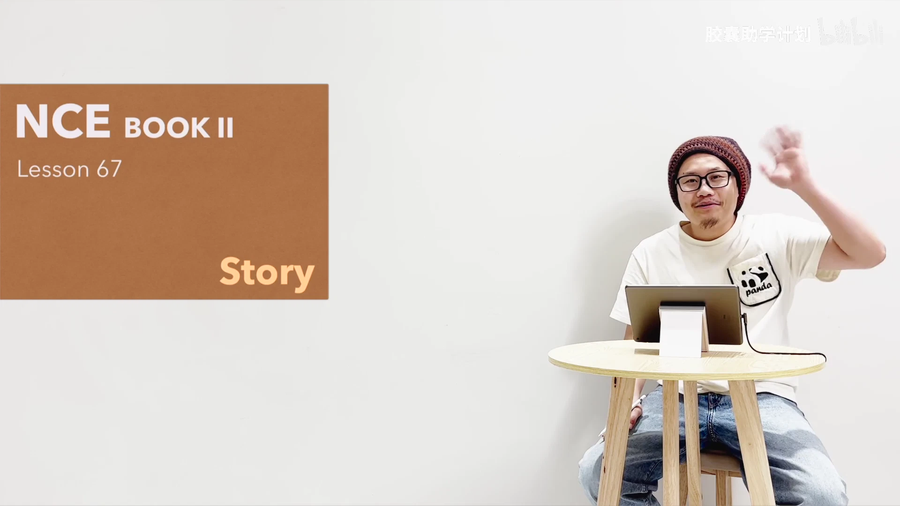

文字识别：NCE / BOOKⅡI / Lesson 67 / Story / panda

### 画面 00:00:02

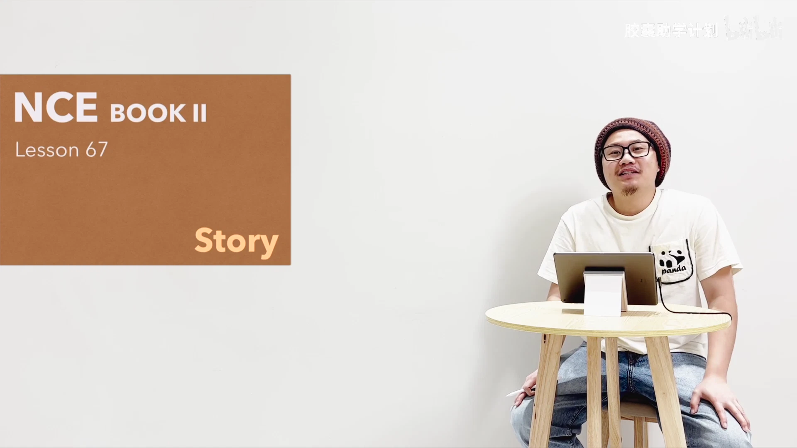

文字识别：辜助字计划 / NCE / BOOKⅡI / Lesson 67 / Story / panda

### 画面 00:00:07

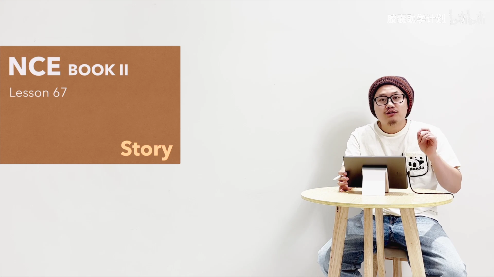

文字识别：葬助学计划 / NCE / BOOKⅡI / Lesson 67 / Story / panda

### 画面 00:00:09

文字识别：胶囊助学计划 bil / •

### 画面 00:00:13

文字识别：助学计划调 / 胶囊助学计划

### 画面 00:00:15

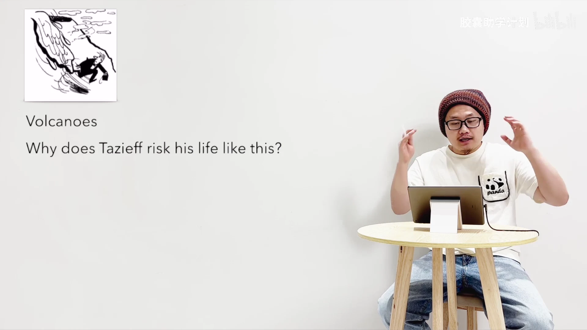

文字识别：臺助学计划園關 / Volcanoes / Why does Tazieff risk his life like this? / panda

### 画面 00:00:18

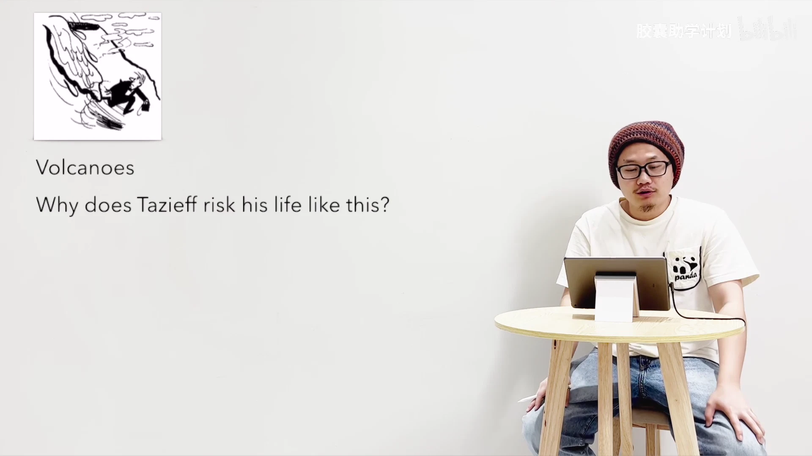

文字识别：妻助字计划園淵 / Volcanoes / Why does Tazieff risk his life like this? / panda

## 00:00:30–00:01:00

对吧？以他的生命作为代价去进行冒险。那我们就看一下，本课肯定是讲，Tziff这个人，对吧？和 volcanoes 之间的关系啊。那我们上来先看第一句话，Harran Tziff，后边直接同位语，a Polish scientist。你不认识，你这是谁呀？是吧？这其实都不是一个标准的英语发音，是吧？然后是什么呢？是波兰的科学家。Has spent his lifetime studying active volcanoes

### 画面 00:00:39

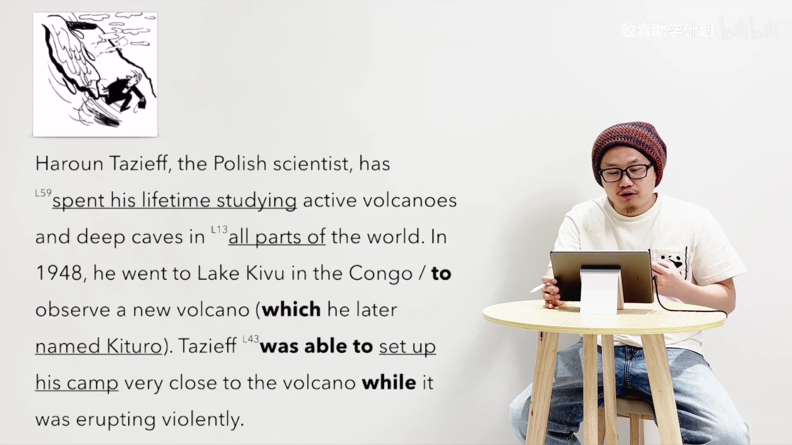

文字识别：Haroun Tazieff, the Polish scientist, has / L59, / 'spent his lifetime studying active volcanoes / and deep caves in 1'³llparts of the world. In / 1948, he went to Lake Kivu in the Congo / to / observe a new volcano (which he later / named Kituro). Tazieff 43was able to set up / his camp very close to the volcano while it / was erupting violently.

## 00:01:00–00:01:30

and deep caves in all parts of the world.这句话看起来有点长，其实就是一个很简单的句子。主语是 Harrentziv, the Polish scientist.他干嘛了呢？Spent his lifetime studying active volcanoes and deep caves,是吧？干的事情是花了他一辈子的时间研究两个东西：活火山和 deep caves 和深洞，对吧？很深的洞啊，比如说那种呃洞穴探险，对吧？那种洞

### 画面 00:01:09

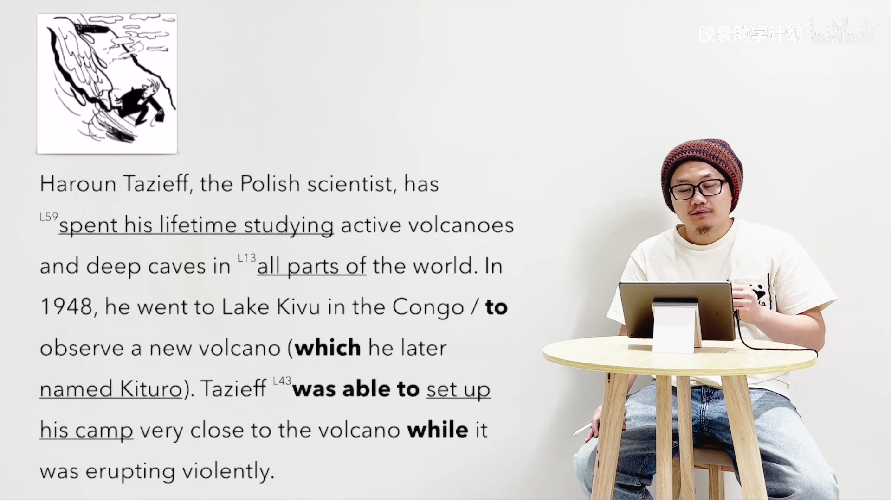

文字识别：Haroun Tazieff, the Polish scientist, has / L59, / 'spent his lifetime studying active volcanoes / and deep caves in 1"³llparts of the world. In / 1948, he went to Lake Kivu in the Congo / to / observe a new volcano (which he later / named Kituro). Tazief 43was able to set up / his camp very close to the volcano while it / was erupting violently.

## 00:01:30–00:02:00

啊，caves，山洞嘛。那这五十九课咱们学过，spend some time doing something。我们在这不多说了。然后 all parts of the world，我们当时学的十三课，绿绿绿林少年那一课，对吧？就 Greenwood Boys 那课，咱们学的是 all parts of the country 嘛，全国各地，对吧？那这是 all parts of the world，世界各地是一样的。所以就是科学家 A 这个人研究两个东西在全世界，对吧？就这一句话就完事儿了。是个简单句，虽

### 画面 00:01:39

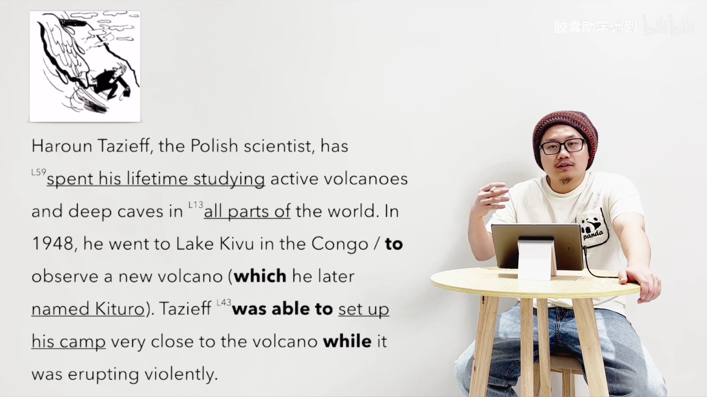

文字识别：Haroun Tazieff, the Polish scientist, has / L59, / 'spent his lifetime studying active volcanoes / and deep caves in 1"allparts of the world. In / 1948, he went to Lake Kivu in the Congo / to / panda / observe a new volcano (which he later / named Kituro). Tazieff 43was able to set up / his camp very close to the volcano while it / was erupting violently.

## 00:02:00–00:02:30

然很长啊。Continue in在哪年呢？1948，在一九四八年。一九四八，先读十九，再读四十八啊。He went to Lake Kivu in the Congo。先不往后边看了，他去了 Lake Kivu，就是这个 Lake 的名字叫做 Kivu，啊，就跟青海湖的名字叫做青海湖一样，能理解吧？好，In the Congo，在刚果这个地方，这没什么可说的，很简单的一句话。目的

### 画面 00:02:09

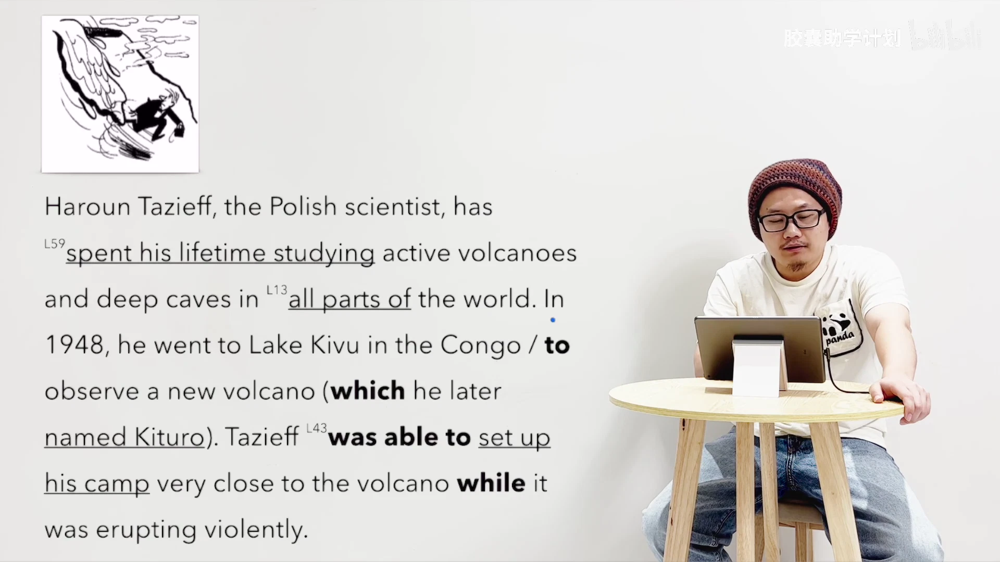

文字识别：Haroun Tazieff, the Polish scientist, has / L59 / 'spent his lifetime studying active volcanoes / and deep caves in "allparts of the world. In / 1948, he went to Lake Kivu in the Congo / to / panda / observe a new volcano (which he later / named Kituro). Tazieff 43was able to set up / his camp very close to the volcano while it / was erupting violently.

## 00:02:30–00:03:00

后边我给你加了个斜线，目的啊，目的是什么呢？To do something，在这儿一个非谓语啊，去表了一个目的，目的是 to observe a new volcano。后边先不用看，我已经给您标出来了，后边定语从句，目的是去观察一个新的这个火山，什么样的火山呢？Which he later named Kituro， which 指的就是这个 volcano，对吧？这个 new volcano 啊，就是 it，啊， he

### 画面 00:02:39

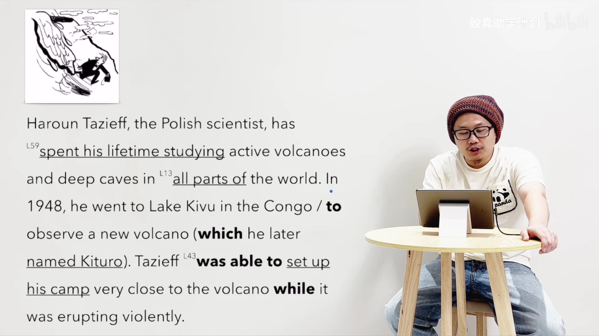

文字识别：Haroun Tazieff, the Polish scientist, has / L59, / 'spent his lifetime studying active volcanoes / and deep caves in 1allparts of the world. In / 1948, he went to Lake Kivu in the Congo / to / panda / observe a new volcano (which he later / named Kituro). Tazieff 43was able to set up / his camp very close to the volcano while it / was erupting violently.

## 00:03:00–00:03:30

### 画面 00:03:05

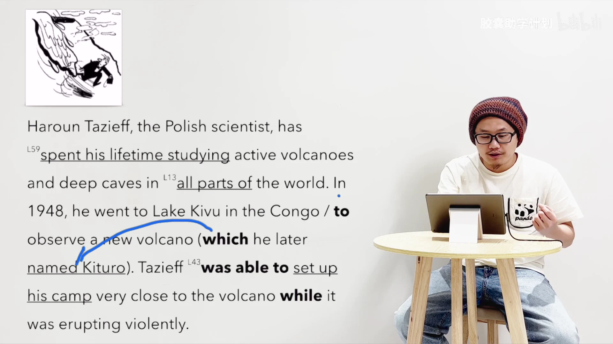

文字识别：Haroun Tazieff, the Polish scientist, has / L59, / 'spent his lifetime studying active volcanoes / and deep caves in [³allparts of the world.In / 1948, he went to Lake Kivu in the Congo / to / pando / observe a rew volcano (which he later / named Kituro). Tazief 43was able to set up / his camp very close to the volcano while it / was erupting violently.

## 00:03:30–00:04:00

以你看，这个火山的名字叫 Kituro。这个单词，我认为你也不需要记，好吧？好，那这句话我就解释清楚了。 Continue. The thief was able to set up his camp very close to the volcano while it was erupting violently. 你看这个 while，我给你加粗了，就是想告诉你，这一句话虽然不算长难句吧，但至少是主从复合句，对吧？这个有个时间状语从句，这个 while 呢，给你标出来，告诉你在哪儿要断

### 画面 00:03:35

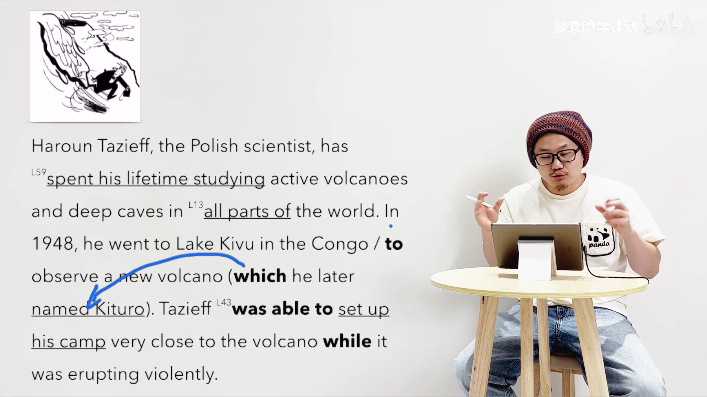

文字识别：Haroun Tazieff, the Polish scientist, has / L59 / 'spent his lifetime studying active volcanoes / and deep caves in 1allparts of the world.In / 1948, he went to Lake Kivu in the Congo / to / panda / observe a new volcano (which he later / namedKituro). Tazieff 43was able to set up / his camp very close to the volcano while it / was erupting violently.

## 00:04:00–00:04:30

句了。所以第一句话叫 Tzif was able to set up his camp very close to the volcano. 那我们看一下这里，首先 was able to 四十三课咱们学叫成功的设法的，其实在这儿完全可以换成 managed to do something，对吧？他成功的怎么样了呢？Set up his camp, camp营地。那 set up his camp 其实就是建立了他的一个营地，在这儿安营扎寨。Very close to the volcano，离这个火山特别的近。他成功的在火离火山很近的地方安营

### 画面 00:04:05

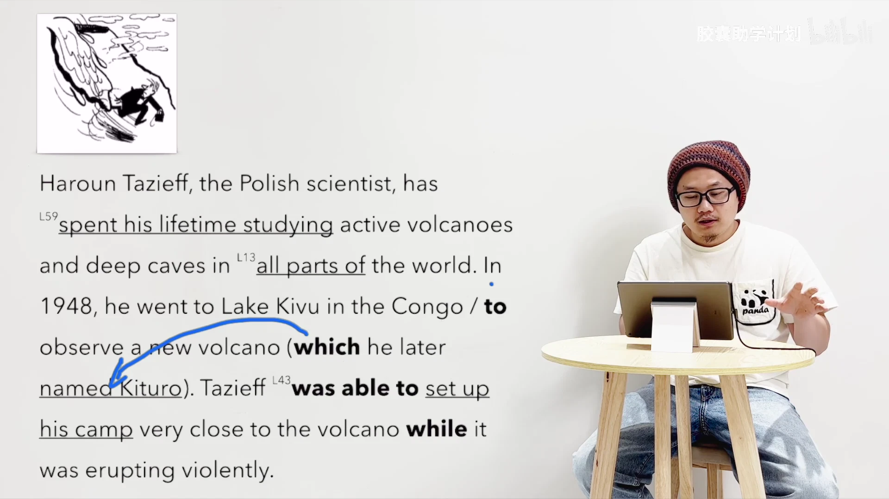

文字识别：Haroun Tazieff, the Polish scientist, has / L59, / 'spent his lifetime studying active volcanoes / and deep caves in "allparts of the world. In / 1948, he went to Lake Kivu in the Congo / to / panda / observe a rew volcano (which he later / namedKituro). Tazieff 43was able to set up / his camp very close to the volcano while it / was erupting violently.

## 00:04:30–00:05:00

扎寨了，对吧？哎，建立了起他自己的营地。Well,当什么呢？It was erupting violently，是吧？当这个火山这个非常剧烈的在喷发着的时候，他在离他很近的地方建立起来了一个营地啊。所以虽然从to save到violently很长，看上去其实就可以被拆成了两句话。而这个能力就是我们进入新概念呃二册对吧？最后一个单元，包括进入新三

### 画面 00:04:35

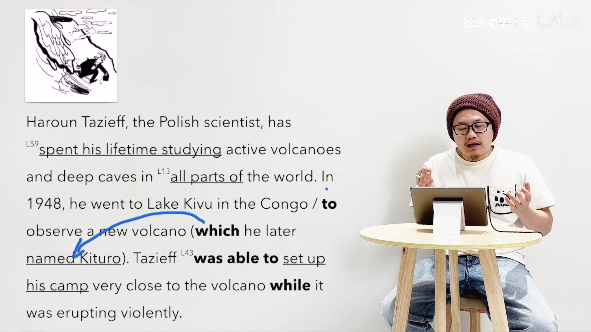

文字识别：Haroun Tazieff, the Polish scientist, has / L59, / 'spent his lifetime studying active volcanoes / and deep caves in 1allparts of the world. In / 1948, he went to Lake Kivu in the Congo / to / pana / observe a rew volcano (which he later / namedKituro). Tazief 43was able to set up / his camp very close to the volcano while it / was erupting violently.

## 00:05:00–00:05:30

整个单元的时候，要锻炼的一个能力就是英文长难句的拆解，对吧？我们一一点一点往后来就行了。Next one, though he managed to take a number of brilliant photographs, he could not stay near the volcano for very long. 好，你看又是两句话。其实这个地方还有一个关键点，就是这个小的这个逗号啊，提醒你第一句话结束了。那我们先看一下这句话的前半句，叫

### 画面 00:05:05

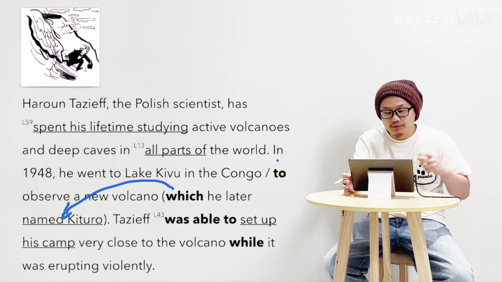

文字识别：Haroun Tazieff, the Polish scientist, has / L59, / 'spent his lifetime studying active volcanoes / and deep caves in [³all parts of the world.In / 1948, he went to Lake Kivu in the Congo / to / panda / observe a rew volcano (which he later / namedKituro). Tazief 43was able to set up / his camp very close to the volcano while it / was erupting violently.

### 画面 00:05:07

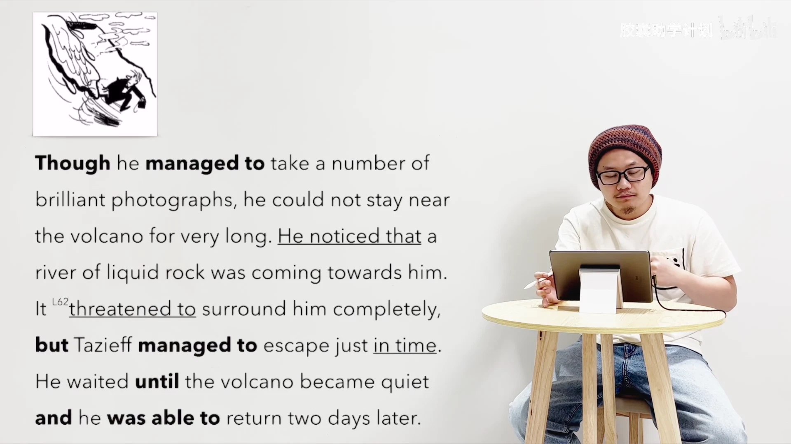

文字识别：Though he managed to take a number of / brilliant photographs, he could not stay near / the volcano for very long. He noticed that a / river of liquid rock was coming towards him. / It 6²threatened to surround him completely, / but Tazieff managed to escape just in time. / He waited until the volcano became quiet / and he was able to return two days later.

### 画面 00:05:10

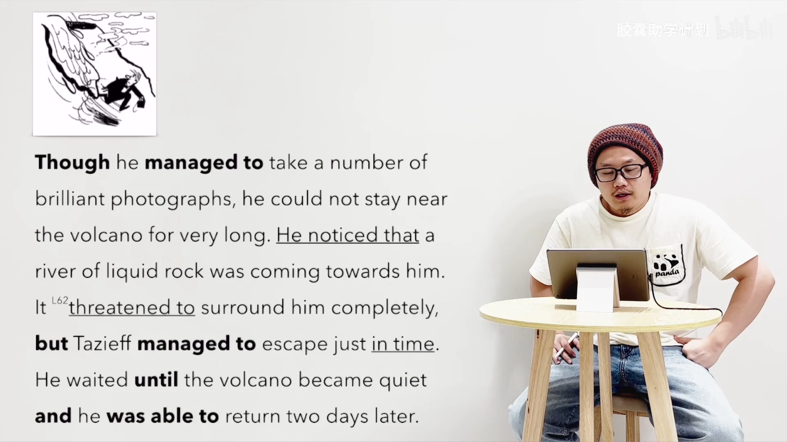

文字识别：Though he managed to take a number of / brilliant photographs, he could not stay near / the volcano for very long. He noticed that a / river of liquid rock was coming towards him. / panda / It 6²threatened to surround him completely, / but Tazieff managed to escape just in time. / He waited until the volcano became quiet / and he was able to return two days later.

### 画面 00:05:14

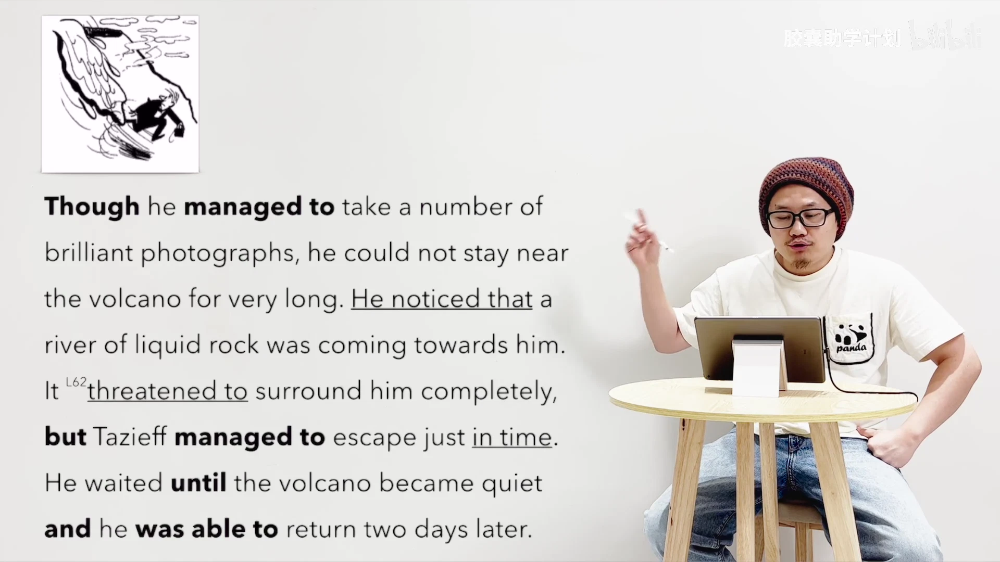

文字识别：Though he managed to take a number of / brilliant photographs, he could not stay near / the volcano for very long. He noticed that a / river of liquid rock was coming towards him. / panda / It 6²threatened to surround him completely, / but Tazieff managed to escape just in time. / He waited until the volcano became quiet / and he was able to return two days later.

### 画面 00:05:21

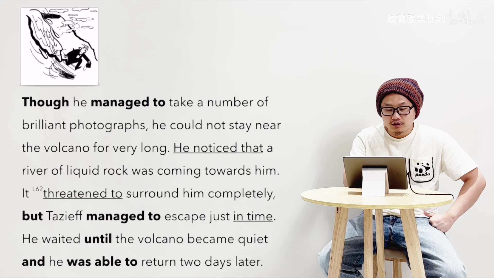

文字识别：Though he managed to take a number of / brilliant photographs, he could not stay near / the volcano for very long. He noticed that a / river of liquid rock was coming towards him. / ` / panda / It “²threatened to surround him completely, / but Tazieff managed to escape just in time. / He waited until the volcano became quiet / and he was able to return two days later.

## 00:05:30–00:06:00

做 though啊 although even though even if一到四十八课总结咱们说过了，尽管他成功的 take a number of brilliant photographs拍摄了一些非常棒的电影啊不是这个这个这个这照片啊照片啊 he could not stay near the volcano for very long他没有办法停留在什么附近呢在火山附近很长时间 for very long停很长时间很简单的一个句子 continue

### 画面 00:05:46

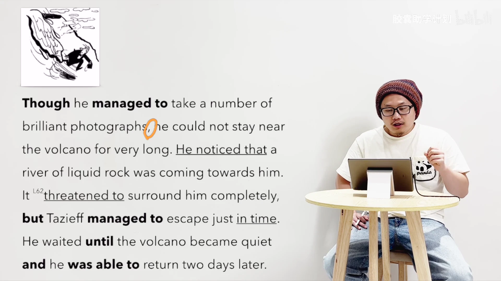

文字识别：Though he managed to take a number of / brilliant photographsOre could not stay near / the volcano for very long. He noticed that a / river of liquid rock was coming towards him. / panda / It “²threatened to surround him completely, / but Tazieff managed to escape just in time. / He waited until the volcano became quiet / and he was able to return two days later.

## 00:06:00–00:06:30

He noticed that a river of liquid rock was coming towards him.说他注意到这是一个习惯用法. Somebody noticed that后边加一句话，对吧？哎，他注意到了这样一件事情。什么事情呢？A river of liquid rock.首先，liquid rock在liquid这个单词的时候我们讲过了。其实这里指的就是岩浆。那a river of liquid rock就是岩浆变成的一条河。

### 画面 00:06:16

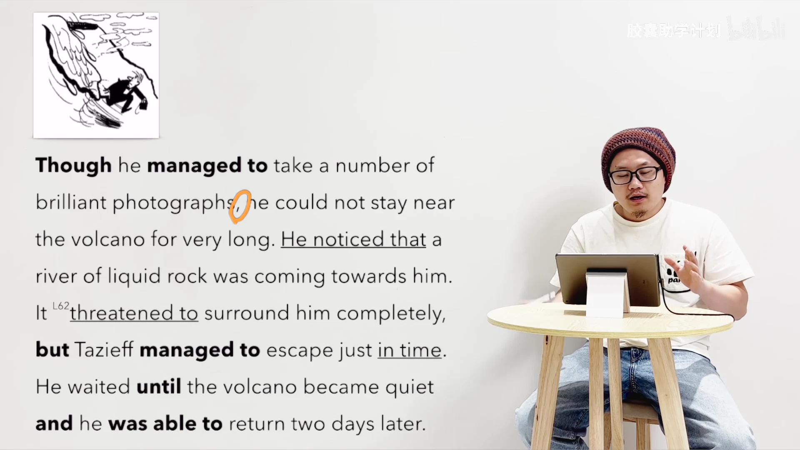

文字识别：Though he managed to take a number of / brilliant photographsOre could not stay near / the volcano for very long. He noticed that a / river of liquid rock was coming towards him. / pa / It “²threatened to surround him completely, / but Tazieff managed to escape just in time. / He waited until the volcano became quiet / and he was able to return two days later.

## 00:06:30–00:07:00

你要你要看过纪录片的话，你就知道那个岩浆，因为它是液态的，流的时候就像一条河一样。所以他在这儿用的是 a river of liquid rock。好理解啊。Was coming towards him，正在冲他过来，流过来，对吧？It threatened to surround him completely.那threat to do something，六十二课火对吧？Had been doing那一刻对吧？我们学过去完成进行时那一刻，就这个呃，这个大

### 画面 00:06:32

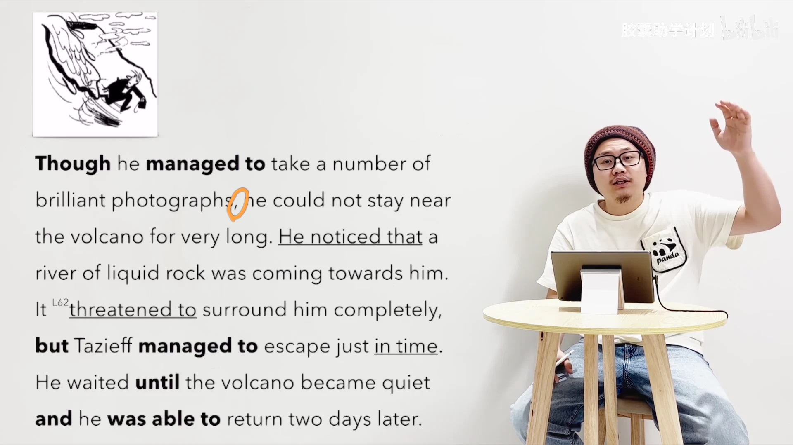

文字识别：Though he managed to take a number of / brilliant photographsOre could not stay near / the volcano for very long. He noticed that a / panda / river of liquid rock was coming towards him. / It “²threatened to surround him completely, / but Tazieff managed to escape just in time. / He waited until the volcano became quiet / and he was able to return two days later.

### 画面 00:06:35

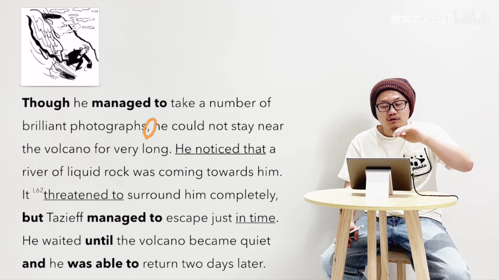

文字识别：Though he managed to take a number of / brilliant photographsre could not stay near / the volcano for very long. He noticed that a / river of liquid rock was coming towards him. / panda / It “²threatened to surround him completely, / but Tazieff managed to escape just in time. / He waited until the volcano became quiet / and he was able to return two days later.

## 00:07:00–00:07:30

火对吧？大火的那一刻啊，山火那一刻，咱们学的，说这个岩浆河呀，加引号的河呀，威胁着要把它完全包围住，对，对它产生了这样一个威胁，completely就是完全包围住。But第二句话，Tazif managed to escape just in time。说Tazif成功的逃脱了，just in time就是很及时的逃脱了。He waited，

### 画面 00:07:05

文字识别：Though he managed to take a number of / brilliant photographsOne could not stay near / the volcano for very long. He noticed that a / river of liquid rock was coming towards him. / It “²threatened to surround him completely, / but Tazieff managed to escape just in time. / He waited until the volcano became quiet / and he was able to return two days later.

## 00:07:30–00:08:00

他等until the volcano became quiet, and he was able to return two days later.好，你看这里啊。首先，until一个连词，and一个连词。从he到later啊，从he一直到later这么长一句话就被拆成了三句短话。第一句话，he waited.他等。第二句话，the volcano became quiet.等等到什么时候呢？直到这个火山变

### 画面 00:07:35

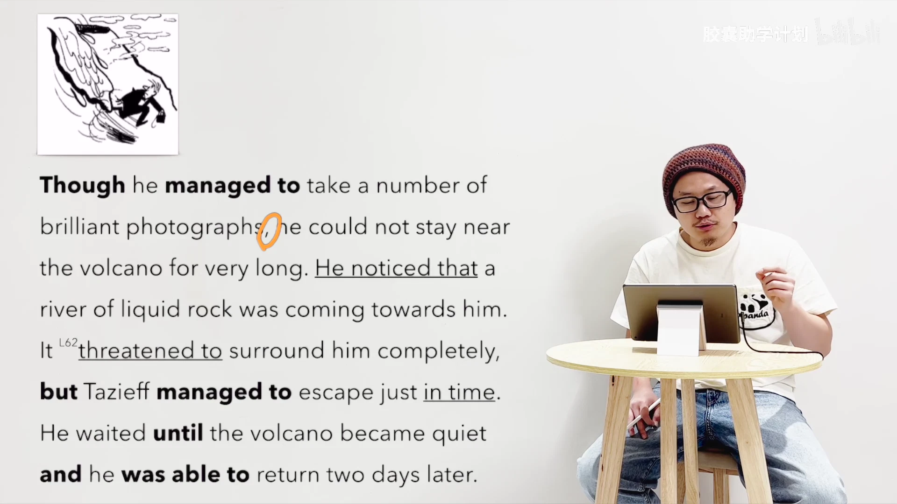

文字识别：Though he managed to take a number of / brilliant photographsOne could not stay near / the volcano for very long. He noticed that a / river of liquid rock was coming towards him. / fpanda / It 6²threatened to surround him completely, / but Tazieff managed to escape just in time. / He waited until the volcano became quiet / and he was able to return two days later.

## 00:08:00–00:08:30

得安静了下来，就不再喷发了。这是第二句话。第三句话，and he was able to return two days later.然后他两天之后成功的就回来了，对吧？回到了比如说他这个这个火山旁边的某个城市，对吧？他住的地方，他成功的就回去了。所以很长的一句话，我们想把它拆开。第一步一定要基于一个前提，就是我对各种从句，包括引导这些从句的连词，要格

### 画面 00:08:05

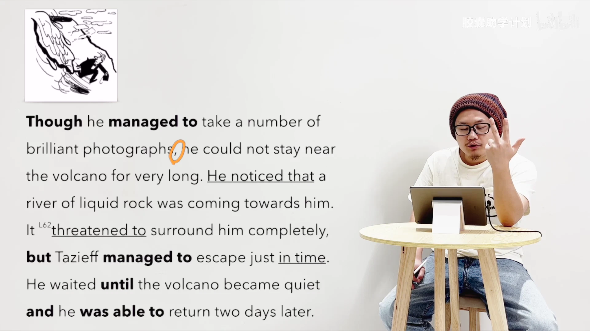

文字识别：Though he managed to take a number of / brilliant photographsOne could not stay near / the volcano for very long. He noticed that a / river of liquid rock was coming towards him. / It 6²threatened to surround him completely, / but Tazieff managed to escape just in time. / He waited until the volcano became quiet / and he was able to return two days later.

### 画面 00:08:19

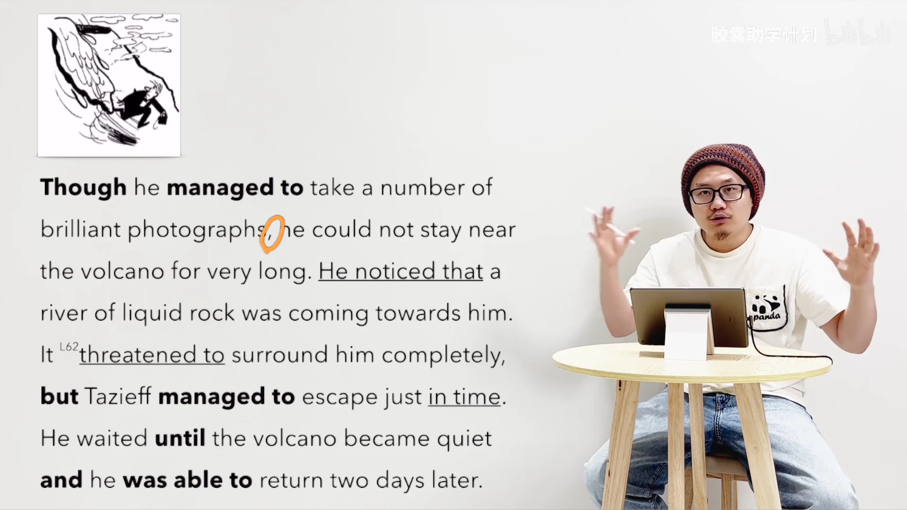

文字识别：Though he managed to take a number of / brilliant photographsOne could not stay near / the volcano for very long. He noticed that a / river of liquid rock was coming towards him. / panda / It “²threatened to surround him completely, / but Tazieff managed to escape just in time. / He waited until the volcano became quiet / and he was able to return two days later.

## 00:08:30–00:09:00

外熟悉，对吧？当然不一定是从句，也可以是并列句，比如像 and 二十五课咱们学过的那些 and but so 这些词你要非常熟悉。读这个句子的时候，立刻就知道从哪儿我要断句了。哎，这句话就能看懂了。 Continue this time.这次 he managed to climb into the mouth. Oh,好回去. He waited until the volcano became quiet. He managed to return two days later.

### 画面 00:08:44

文字识别：This time, he managed to climb into the / o [5°so that he could take / mouth of Kituro / photographs and measure temperatures. / Tazieff has often risked his life in this way. He / has been able to tell us more about active / volcanoes than any man alive.

### 画面 00:08:53

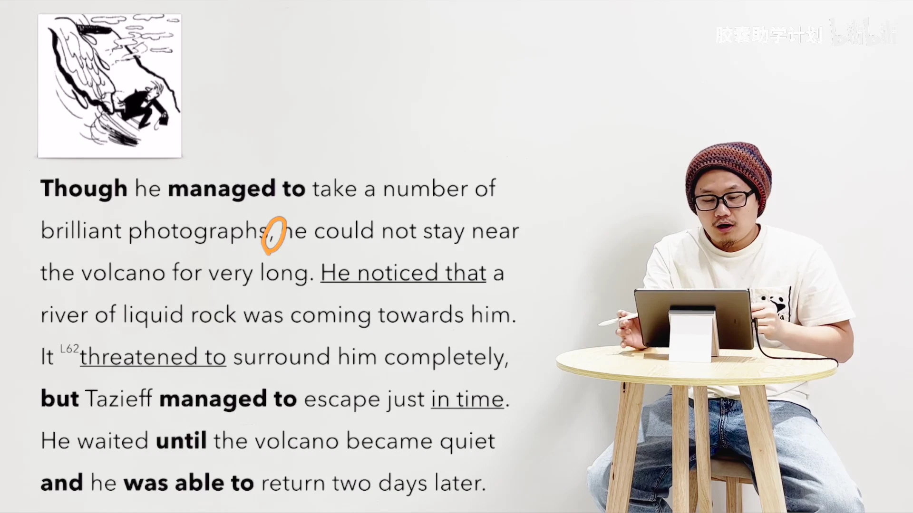

文字识别：Though he managed to take a number of / brilliant photographsre could not stay near / the volcano for very long. He noticed that a / river of liquid rock was coming towards him. / It 6²threatened to surround him completely, / but Tazieff managed to escape just in time. / He waited until the volcano became quiet / and he was able to return two days later.

## 00:09:00–00:09:30

This return,刚才我讲的是回到他住的那个地方，不是啊。这个地方指的是他回到这个地方。其实他 return back 更好一点，就是在回到 return 哪儿呢？回到他这个火山的这个地方。就是他成功脱险了之后呢，他能他再次回到了这个火山的这个地方去进行研究。为什么是这样的呢？因为跟下一句就连起来了。说这一次，对吧？他回到了这个火山的地方，然后在回来的这一次怎么样呢？He managed to climb

### 画面 00:09:03

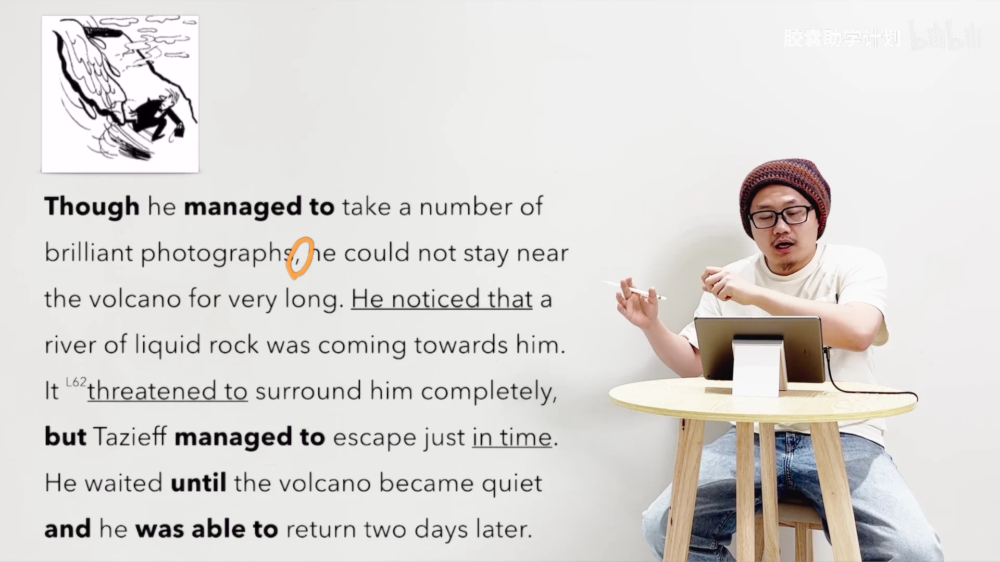

文字识别：Though he managed to take a number of / brilliant photographsOre could not stay near / the volcano for very long. He noticed that a / river of liquid rock was coming towards him. / It 6²threatened to surround him completely, / but Tazieff managed to escape just in time. / He waited until the volcano became quiet / and he was able to return two days later.

### 画面 00:09:07

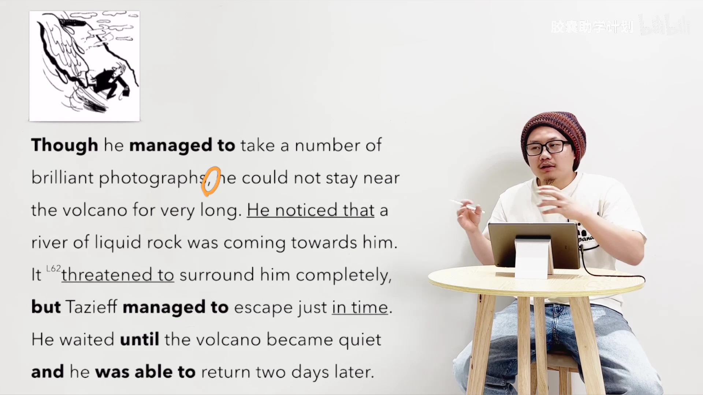

文字识别：Though he managed to take a number of / brilliant photographsOne could not stay near / the volcano for very long. He noticed that a / river of liquid rock was coming towards him. / It 6²threatened to surround him completely, / but Tazieff managed to escape just in time. / He waited until the volcano became quiet / and he was able to return two days later.

### 画面 00:09:20

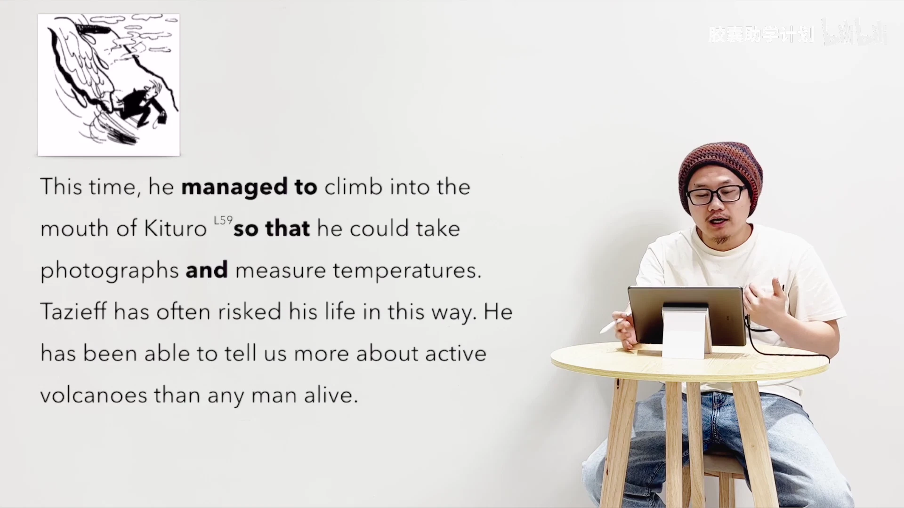

文字识别：This time, he managed to climb into the / mouth of Kituro [5°so that he could take / photographs and measure temperatures. / Tazieff has often risked his life in this way. He / has been able to tell us more about active / volcanoes than any man alive.

## 00:09:30–00:10:00

into the mouth of Kihoro so that he could take photographs and measure temperatures. 看上去又很长，但实际上你把 so that 把 and 一连，又变成了很短的几个句子。第一句话说这一次他成功的爬进了这个 Kihoro 的嘴里面，就是火山口里面，对吧？他成功的真的爬进去了啊。然后第二句话 so that he could take photographs，目的是什么呢？

### 画面 00:09:50

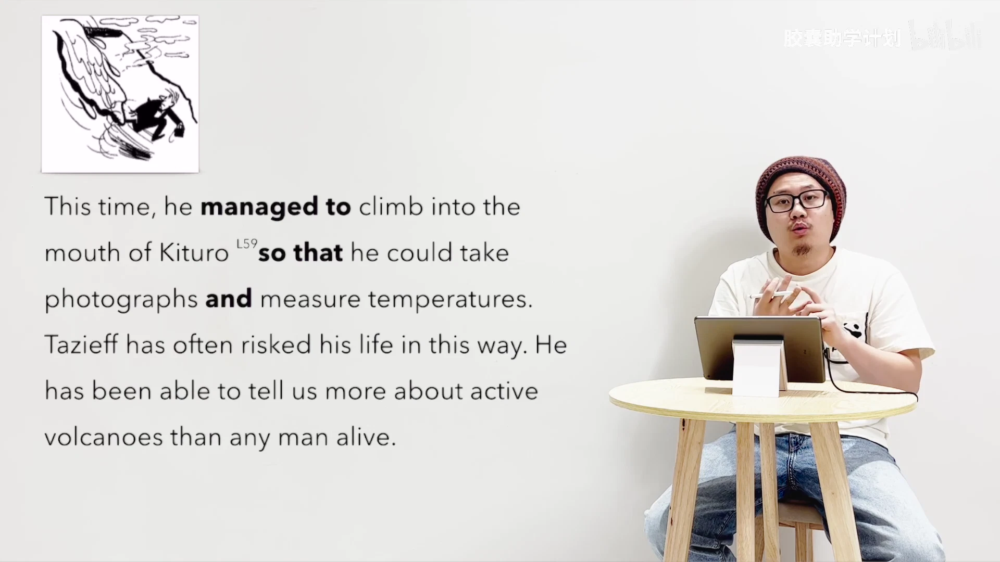

文字识别：This time, he managed to climb into the / mouth of Kituro [5°so that he could take / photographs and measure temperatures. / Tazieff has often risked his life in this way. He / has been able to tell us more about active / volcanoes than any man alive.

## 00:10:00–00:10:30

它可以做两件事儿，这两件事儿，第一件事儿叫它可以拍照，第二件事儿叫做 measure temperatures，叫做测量温度，对吧？哎，所以一共三件事儿，第一件事儿，它成功的爬到了火山口里，目的有两个，第一个叫做拍照，第二个叫做测量温度，对吧？哎，这个很长的句子又被我们拆的很简单了。Tasif has often risked his life in this way.他

### 画面 00:10:20

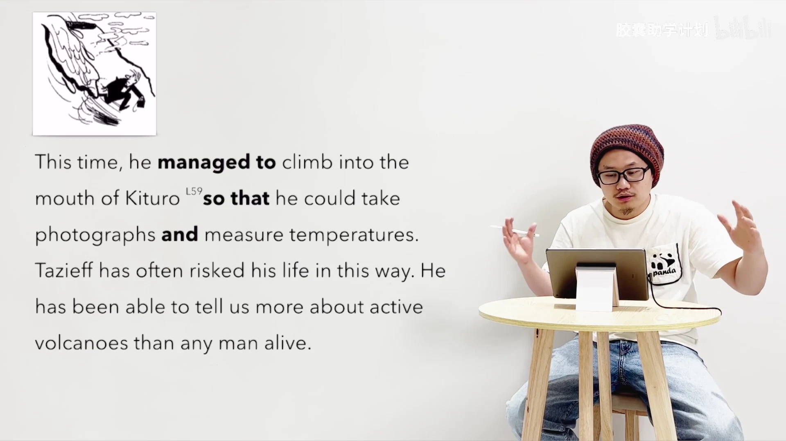

文字识别：This time, he managed to climb into the / o [5°so that he could take / mouth of Kituro / photographs and measure temperatures. / Tazieff has often risked his life in this way. He / panda / has been able to tell us more about active / volcanoes than any man alive.

## 00:10:30–00:11:00

他总用这样的一个方式去啊，这个冒险，对吧？哎，risk his life就是就是冒险，对吧？用他的生命去冒险啊，用这样一种方式。He has been able to tell us more about active volcanoes than any man alive.所以，他一直都能告诉我们更多的关于活火山的信息，比任何活着的人，对吧？你看，any他没有用any alive man。嗯，我们在讲alive这个单词的时候就提过，是吧？

### 画面 00:10:50

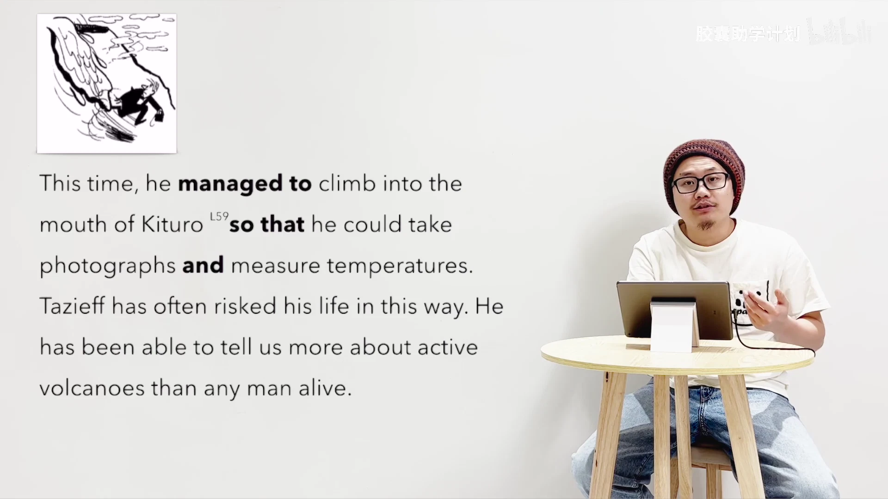

文字识别：This time, he managed to climb into the / mouth of Kituro [5°so that he could take / photographs and measure temperatures. / Tazieff has often risked his life in this way. He / has been able to tell us more about active / volcanoes than any man alive.

## 00:11:00–00:11:30

放后边可能在口语当中，在现实生活实际应用当中会更多一点，更符合英文的语序习惯，是吧？大多数是放形容词放它前面的，但在这里它就放后面了，叫Any man alive. Okay, very good.习惯用法有三个，我们挨个去造句. Name something A.比如说，你看这儿啊，说If it's a boy, I'm gonna name him Marty.这是一个电影片段，它用到了十六课我们学的习惯这个这个语法，对吧？

### 画面 00:11:14

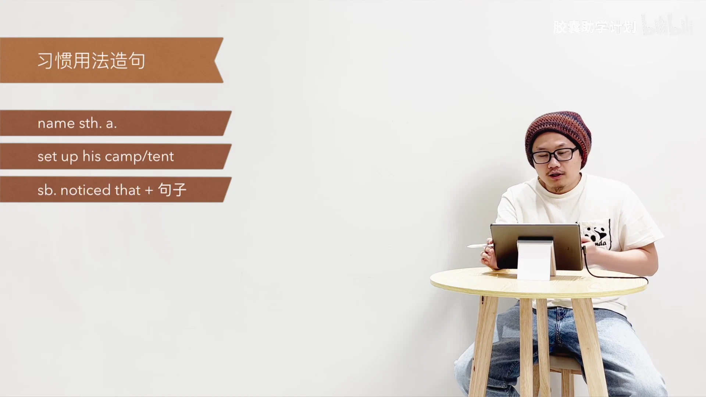

文字识别：习惯用法造句 / name sth.a. / set up his camp/tent / sb.noticed that +句子 / nda

### 画面 00:11:16

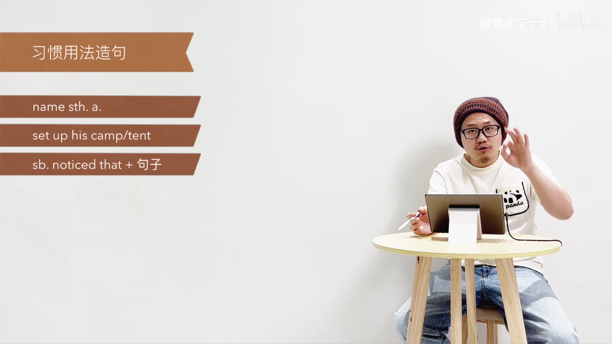

文字识别：习惯用法造句 / name sth. a. / set up his camp/tent / sb.noticed that +句子 / panda

### 画面 00:11:18

文字识别：网：v.+v.变化 / 囊助学计划 / 习惯用法造句指南 / 四句型转换 / 方式/地点/时间 / 其他习惯用法 / 其他单词+词性 / 原文摘抄+变 / 6123456 / name sth. a. / panda

### 画面 00:11:20

文字识别：网：v.+v.变化 / 习惯用法造句指南 / 妻助学计划 / 四句型转换 / 方式/地点/时间 / 其他习惯用法 / 其他单词+词性 / 原文摘抄+变 / 6123456 / name sth. a. /  If it's a boy, 'm gonna name him Marty. Bully / (2001)L16

### 画面 00:11:25

文字识别：网：v.+v.变化 / 习惯用法造句指南 / 囊助字计划陽 / 四句型转换 / 方式/地点/时间 / 其他习惯用法 / 其他单词+词性 / 原文摘抄+变 / 6123456 / name sth. a. /  If it's a boy, 'm gonna name him Marty. Bully / panda / (2001) L16

### 画面 00:11:27

文字识别：网：v.+v.变化 / 习惯用法造句指南 / 囊助字计划陽 / 四句型转换 / 方式/地点/时间 / 其他习惯用法 / 其他单词+词性 / 原文摘抄+变 / 6123456 / name sth. a. /  If it's a boy, 'm gonna name him Marty. Bully / panda / (2001) L16

## 00:11:30–00:12:00

说如果是个男孩儿，那我就给他起名字叫做 Marty. Name something a something.当然也可以是 somebody，对吧？哎，a呢就是这个名字。再来，比如说，We should have named him Leo.你看，name something a a Leo.哎，我们本应该给他起名字叫做Leo的。OK, very good. Next one. So he's cool and he's smart, and that's why I name him Tall.这孩子挺酷的，然后也贼聪明。

### 画面 00:11:30

文字识别：网：v.+v.变化 / 习惯用法造句指南 / 囊助学计划園 / 四句型转换 / 方式/地点/时间 / 其他习惯用法 / 其他单词+词性 / 原文摘抄+变 / 6123456 / name sth. a. / panda /  If it's a boy, 'm gonna name him Marty. Bully / (2001) L16

### 画面 00:11:35

文字识别：网：v.+v.变化 / 习惯用法造句指南 / 辜助字计划 / 四句型转换 / 方式/地点/时间 / 其他习惯用法 / 其他单词+词性 / 原文摘抄+变 / 6123456 / name sth. a. / panda /  If it's a boy, 'm gonna name him Marty. Bully / (2001) L16

### 画面 00:11:40

文字识别：网：v.+v.变化 / 习惯用法造句指南 / 妻助学计划 / 四句型转换 / 方式/地点/时间 / 其他习惯用法 / 其他单词+词性 / 原文摘抄+变 / 6123456 / name sth. a. / paru /  If it's a boy, I'm gonna name him Marty. Bully / (2001) L16 /  We should have named him Leo. L65

### 画面 00:11:43

文字识别：网：v.+v.变化 / 习惯用法造句指南 / 妻助学计划 / 四句型转换 / 方式/地点/时间 / 其他习惯用法 / 其他单词+词性 / 原文摘抄+变 / 6123456 / name sth. a. / panda /  If it's a boy, I'm gonna name him Marty. Bully / (2001)L16 /  We should have named him Leo. L65

### 画面 00:11:45

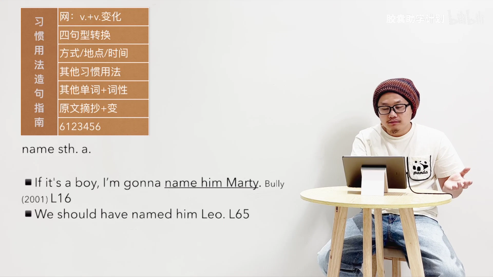

文字识别：网：v.+v.变化 / 习惯用法造句指南 / 妻助字计划 / 四句型转换 / 方式/地点/时间 / 其他习惯用法 / 其他单词+词性 / 原文摘抄+变 / 6123456 / name sth. a. / panda /  If it's a boy, I'm gonna name him Marty. Bully / (2001)L16 /  We should have named him Leo. L65

### 画面 00:11:47

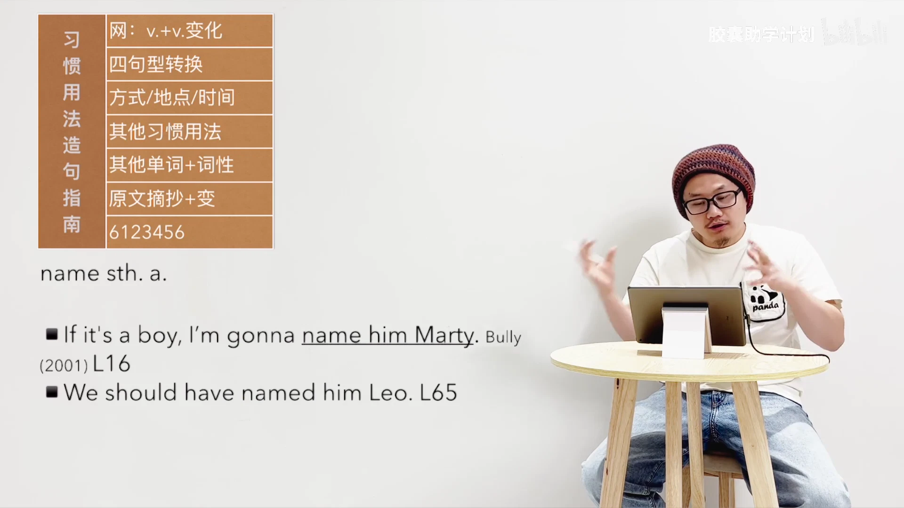

文字识别：网：v.+v.变化 / 习惯用法造句指南 / 妻助字计划 / 四句型转换 / 方式/地点/时间 / 其他习惯用法 / 其他单词+词性 / 原文摘抄+变 / 6123456 / name sth. a. / panda /  If it's a boy, I'm gonna name him Marty. Bully / (2001)L16 /  We should have named him Leo. L65

### 画面 00:11:50

文字识别：网：v.+v.变化 / 习惯用法造句指南 / 喜助字计划 / 四句型转换 / 方式/地点/时间 / 其他习惯用法 / 其他单词+词性 / 原文摘抄+变 / 6123456 / name sth. a. /  If it's a boy, I'm gonna name him Marty. Bully / (2001)L16 /  We should have named him Leo. L65

### 画面 00:11:52

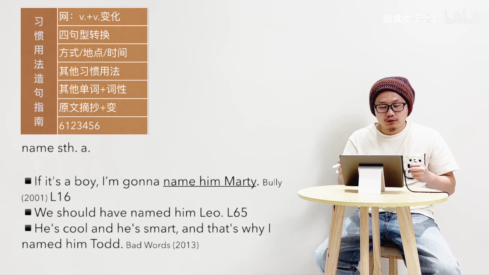

文字识别：网：v.+v.变化 / 习惯用法造句指南 / 嚢助学计划 / 四句型转换 / 方式/地点/时间 / 其他习惯用法 / 其他单词+词性 / 原文摘抄+变 / 6123456 / name sth. a. /  If it's a boy, I'm gonna name him Marty. Bully / (2001) L16 /  We should have named him Leo. L65 / He's cool and he's smart, and that's why I / named him Todd. Bad Words (2013)

### 画面 00:11:55

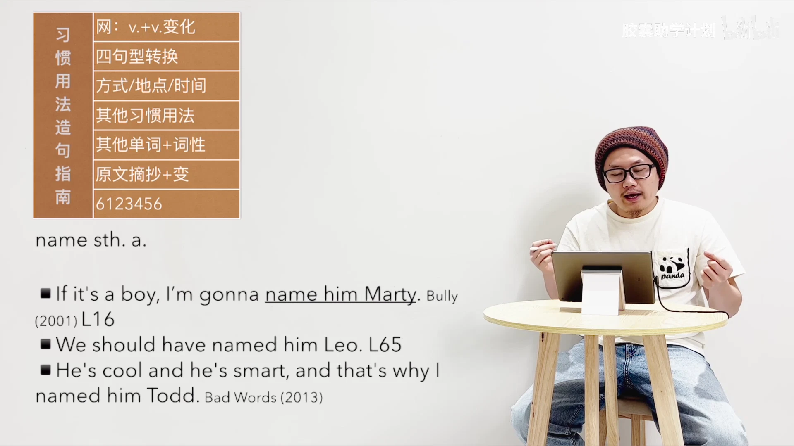

文字识别：网：v.+v.变化 / 习惯用法造句指南 / 囊助字计划陽 / 四句型转换 / 方式/地点/时间 / 其他习惯用法 / 其他单词+词性 / 原文摘抄+变 / 6123456 / name sth. a. / panda /  If it's a boy, I'm gonna name him Marty. Bully / (2001) L16 /  We should have named him Leo. L65 /  He's cool and he's smart, and that's why I / named him Todd. Bad Words (2013)

## 00:12:00–00:12:30

说这就是为啥我管他叫 Todd 的原因，对吧？那接下来呢？注意力集中，你看就很简单， name him Togo，对吧？ I'm going to name him Togo. 啊，给这个小狗起了个名字嘛，对吧？ Next one. 文章当中给的是 set up his camp，跟 camp 同义词在这里叫做 tent，啊，就是叫做帐篷，是吧？完全可以

### 画面 00:12:00

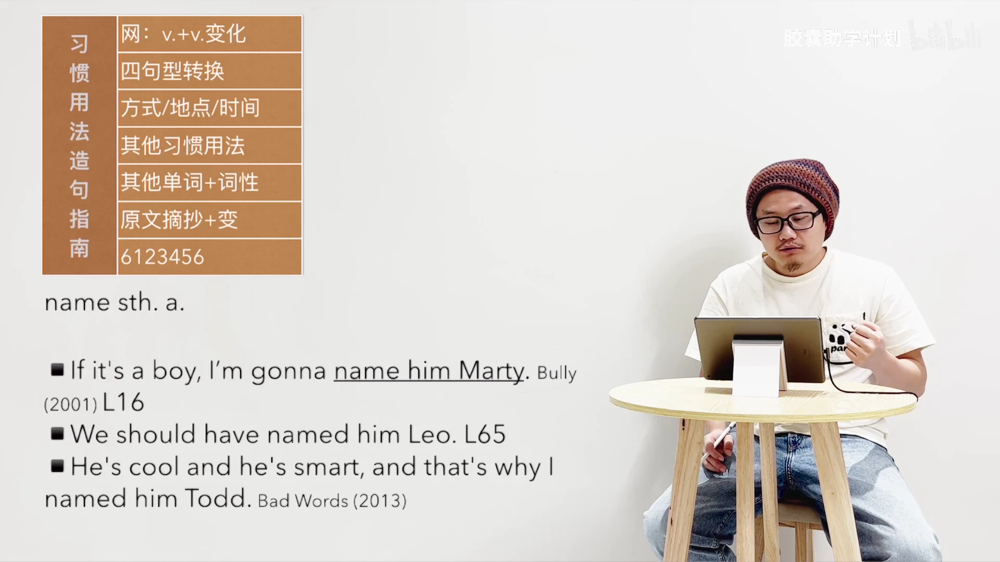

文字识别：网：v.+v.变化 / 习惯用法造句指南 / 妻助字计划陽 / 四句型转换 / 方式/地点/时间 / 其他习惯用法 / 其他单词+词性 / 原文摘抄+变 / 6123456 / name sth. a. / pal /  If it's a boy, I'm gonna name him Marty. Bully / (2001)L16 /  We should have named him Leo. L65 / He's cool and he's smart, and that's why I / named him Todd. Bad Words (2013)

### 画面 00:12:03

文字识别：网：v.+v.变化 / 习惯用法造句指南 / 妻助字计划陽 / 四句型转换 / 方式/地点/时间 / 其他习惯用法 / 其他单词+词性 / 原文摘抄+变 / 6123456 / name sth. a. /  If it's a boy, I'm gonna name him Marty. Bully / (2001)L16 /  We should have named him Leo. L65 / He's cool and he's smart, and that's why I / named him Todd. Bad Words (2013)

### 画面 00:12:05

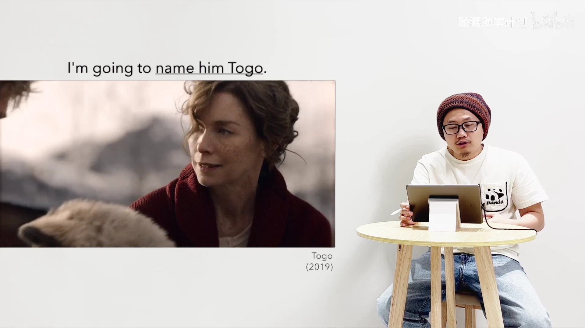

文字识别：I'm going to name him Togo. / panda / Togo / (2019)

### 画面 00:12:10

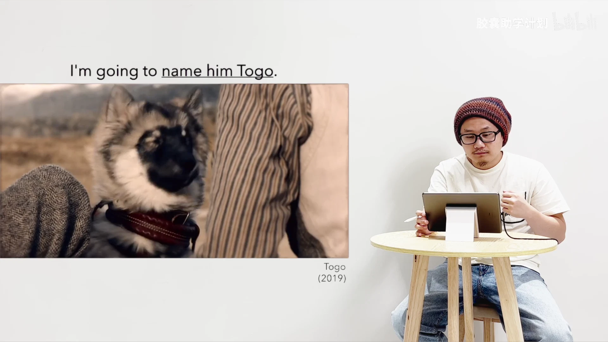

文字识别：I'm going to name him Togo. / Togo / (2019)

### 画面 00:12:12

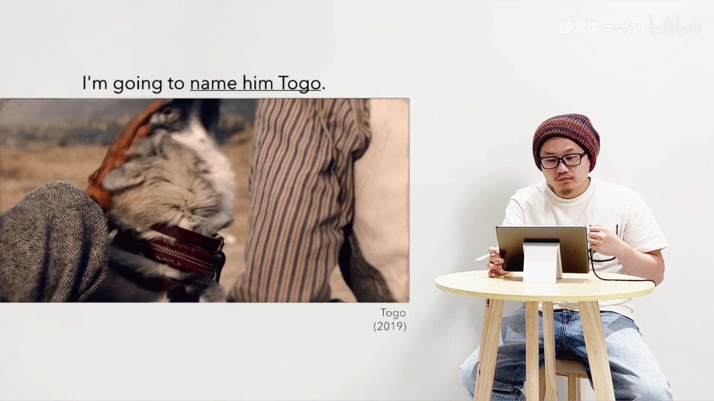

文字识别：I'm going to name him Togo. / Togo / (2019)

### 画面 00:12:16

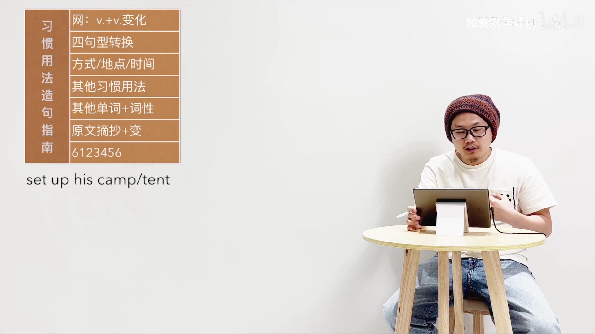

文字识别：网：v.+v.变化 / 习惯用法造句指南 / 囊助学计划 / 四句型转换 / 方式/地点/时间 / 其他习惯用法 / 其他单词+词性 / 原文摘抄+变 / 6123456 / set up his camp/tent

### 画面 00:12:18

文字识别：网：v.+v.变化 / 习惯用法造句指南 / 囊助学计划 / 四句型转换 / 方式/地点/时间 / 其他习惯用法 / 其他单词+词性 / 原文摘抄+变 / 6123456 / set up his camp/tent

### 画面 00:12:20

文字识别：网：v.+v.变化 / 习惯用法造句指南 / 交囊助学计划 / 四句型转换 / 方式/地点/时间 / 其他习惯用法 / 其他单词+词性 / 原文摘抄+变 / 6123456 / set up his camp/tent / panda

### 画面 00:12:23

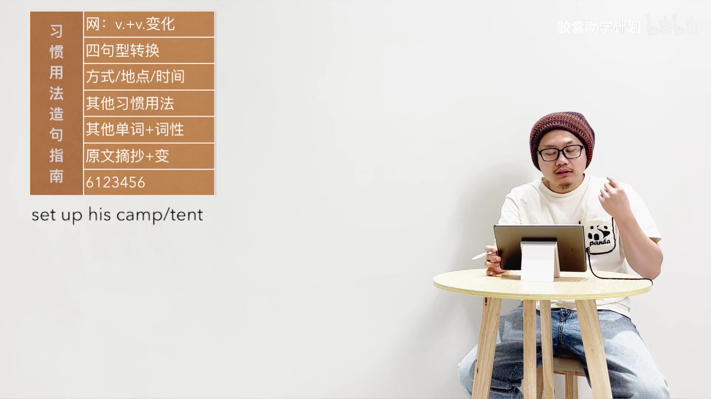

文字识别：网：v.+v.变化 / 习惯用法造句指南 / 妻助字计划 / 四句型转换 / 方式/地点/时间 / 其他习惯用法 / 其他单词+词性 / 原文摘抄+变 / 6123456 / set up his camp/tent / panda

### 画面 00:12:25

文字识别：网：v.+v.变化 / 习惯用法造句指南 / 囊助学计划陽 / 四句型转换 / 方式/地点/时间 / 其他习惯用法 / 其他单词+词性 / 原文摘抄+变 / 6123456 / set up his camp/tent

### 画面 00:12:28

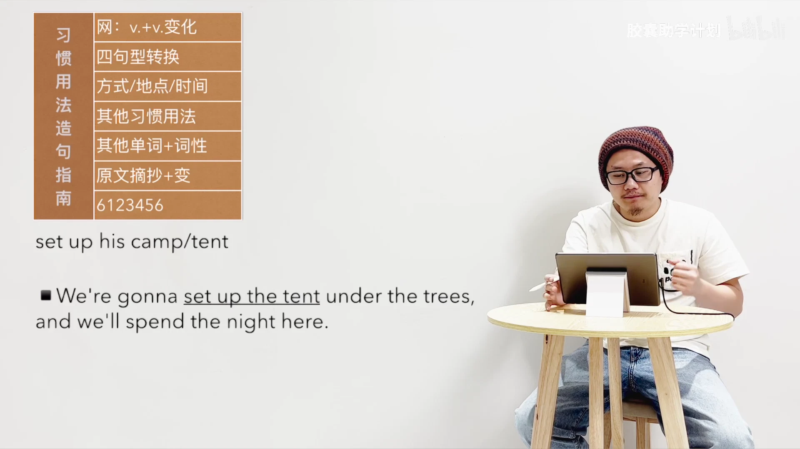

文字识别：网：v.+v.变化 / 习惯用法造句指南 / 喜助学计划陽 / 四句型转换 / 方式/地点/时间 / 其他习惯用法 / 其他单词+词性 / 原文摘抄+变 / 6123456 / set up his camp/tent /  We're gonna set up the tent under the trees, / and we'll spend the night here.

## 00:12:30–00:13:00

互换啊。那我在这造的句子叫：We're gonna set up the tent under the trees, and we'll spend the night here. 哎，咱把这个营地帐篷放在这个树的底下，今天晚上扎在这儿，然后我们今天晚上在这儿度过。那我们就在它的基础之上做一点小的变化，直接用六十四课的语法。所以，if we had set up the tent under the trees, we would have died last night. 说为啥呢？昨天晚上，

### 画面 00:12:30

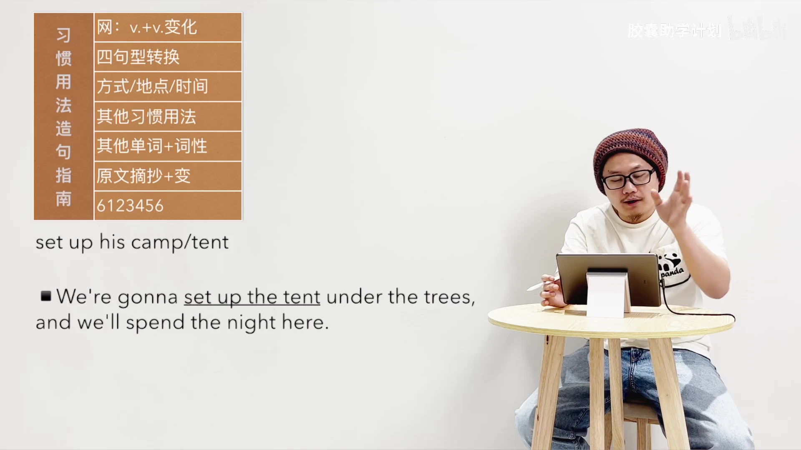

文字识别：网：v.+v.变化 / 习惯用法造句指南 / 妻助学计划 / 四句型转换 / 方式/地点/时间 / 其他习惯用法 / 其他单词+词性 / 原文摘抄+变 / 6123456 / set up his camp/tent / panda /  We're gonna set up the tent under the trees, / and we'll spend the night here.

### 画面 00:12:32

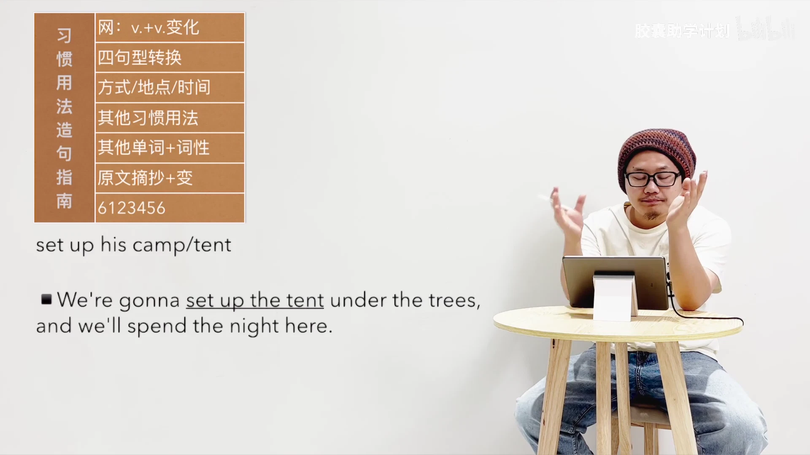

文字识别：网：v.+v.变化 / 习惯用法造句指南 / 妻助学计划 / 四句型转换 / 方式/地点/时间 / 其他习惯用法 / 其他单词+词性 / 原文摘抄+变 / 6123456 / set up his camp/tent /  We're gonna set up the tent under the trees, / and we'll spend the night here.

### 画面 00:12:35

文字识别：网：v.+v.变化 / 习惯用法造句指南 / 囊助学计划陽 / 四句型转换 / 方式/地点/时间 / 其他习惯用法 / 其他单词+词性 / 原文摘抄+变 / 6123456 / set up his camp/tent /  We're gonna set up the tent under the trees, / and we'll spend the night here.

### 画面 00:12:38

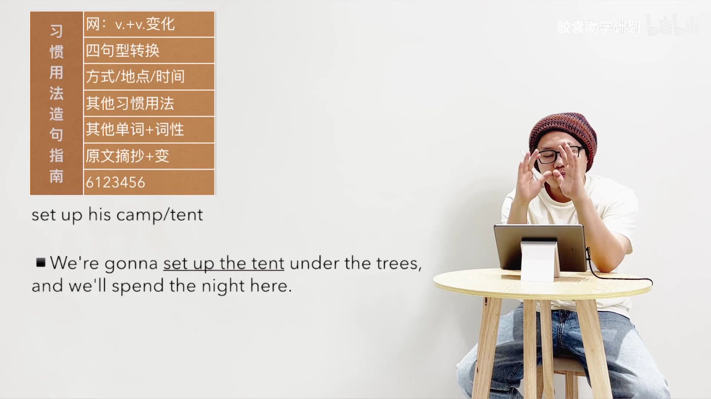

文字识别：网：v.+v.变化 / 习惯用法造句指南 / 妻助学计划陽 / 四句型转换 / 方式/地点/时间 / 其他习惯用法 / 其他单词+词性 / 原文摘抄+变 / 6123456 / set up his camp/tent /  We're gonna set up the tent under the trees, / and we'll spend the night here.

### 画面 00:12:40

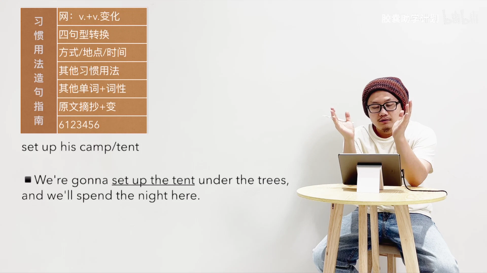

文字识别：网：v.+v.变化 / 习惯用法造句指南 / 喜助字计划 / 四句型转换 / 方式/地点/时间 / 其他习惯用法 / 其他单词+词性 / 原文摘抄+变 / 6123456 / set up his camp/tent /  We're gonna set up the tent under the trees, / and we'll spend the night here.

### 画面 00:12:42

文字识别：网：v.+v.变化 / 习惯用法造句指南 / 囊助学计划 / 四句型转换 / 方式/地点/时间 / 其他习惯用法 / 其他单词+词性 / 原文摘抄+变 / 6123456 / set up his camp/tent /  We're gonna set up the tent under the trees, / and we'll spend the night here.

### 画面 00:12:45

文字识别：网：v.+v.变化 / 习惯用法造句指南 / 囊助学计划 / 四句型转换 / 方式/地点/时间 / 其他习惯用法 / 其他单词+词性 / 原文摘抄+变 / 6123456 / set up his camp/tent /  We're gonna set up the tent under the trees, / and we'll spend the night here.

### 画面 00:12:48

文字识别：网：v.+v.变化 / 习惯用法造句指南 / 妻助学计划 / 四句型转换 / 方式/地点/时间 / 其他习惯用法 / 其他单词+词性 / 原文摘抄+变 / 6123456 / set up his camp/tent /  We're gonna set up the tent under the trees, / and we'll spend the night here. / Cold Ground (2017) /  If we had set up the tent under the trees, we / would have died last night. L64

### 画面 00:12:50

文字识别：网：v.+v.变化 / 习惯用法造句指南 / 壺助学计划 / 四句型转换 / 方式/地点/时间 / 其他习惯用法 / 其他单词+词性 / 原文摘抄+变 / 6123456 / set up his camp/tent /  We're gonna set up the tent under the trees, / and we'll spend the night here. / Cold Ground (2017) /  If we had set up the tent under the trees, we / would have died last night. L64

### 画面 00:12:55

文字识别：网：v.+v.变化 / 习惯用法造句指南 / 四句型转换 / 方式/地点/时间 / 其他习惯用法 / 其他单词+词性 / 原文摘抄+变 / 6123456 / set up his camp/tent /  We're gonna set up the tent under the trees, / and we'll spend the night here. / Cold Ground (2017) /  If we had set up the tent under the trees, we / would have died last night. L64

## 00:13:00–00:13:30

比如说这个这个暴风雨，把雷雨交加，这个雷光就劈树上了，树光就倒了，把旁边给砸了，对吧？所以如果我们昨天晚上在它底下扎的帐篷，那我们昨天晚上就没了，对吧？人就已经没了，已经走了。哎，你看这个结构，if had done would have done，是吧？Okay，完了一个，next one，they had their tent set up under the trees.哎，have something done，

### 画面 00:13:00

文字识别：网：v.+v.变化 / 习惯用法造句指南 / 奏助学计划 / 四句型转换 / 方式/地点/时间 / 其他习惯用法 / 其他单词+词性 / 原文摘抄+变 / 6123456 / set up his camp/tent /  We're gonna set up the tent under the trees, / and we'll spend the night here. / Cold Ground (2017) /  If we had set up the tent under the trees, we / would have died last night. L64

### 画面 00:13:03

文字识别：网：v.+v.变化 / 习惯用法造句指南 / 四句型转换 / 方式/地点/时间 / 其他习惯用法 / 其他单词+词性 / 原文摘抄+变 / 6123456 / set up his camp/tent /  We're gonna set up the tent under the trees, / and we'll spend the night here. / Cold Ground (2017) /  If we had set up the tent under the trees, we / would have died last night. L64

### 画面 00:13:05

文字识别：网：v.+v.变化 / 习惯用法造句指南 / 囊助学计划 / 四句型转换 / 方式/地点/时间 / 其他习惯用法 / 其他单词+词性 / 原文摘抄+变 / 6123456 / set up his camp/tent /  We're gonna set up the tent under the trees, / and we'll spend the night here. / Cold Ground (2017) /  If we had set up the tent under the trees, we / would have died last night. L64

### 画面 00:13:07

文字识别：网：v.+v.变化 / 习惯用法造句指南 / 囊助学计划 / 四句型转换 / 方式/地点/时间 / 其他习惯用法 / 其他单词+词性 / 原文摘抄+变 / 6123456 / set up his camp/tent /  We're gonna set up the tent under the trees, / and we'll spend the night here. / Cold Ground (2017) /  If we had set up the tent under the trees, we / would have died last night. L64

### 画面 00:13:10

文字识别：网：v.+v.变化 / 习惯用法造句指南 / 四句型转换 / 方式/地点/时间 / 其他习惯用法 / 其他单词+词性 / 原文摘抄+变 / 6123456 / set up his camp/tent /  We're gonna set up the tent under the trees, / and we'll spend the night here. / Cold Ground (2017) /  If we had set up the tent under the trees, we / would have died last night. L64

### 画面 00:13:13

文字识别：网：v.+v.变化 / 习惯用法造句指南 / 泰助学计划 / 四句型转换 / 方式/地点/时间 / 其他习惯用法 / 其他单词+词性 / 原文摘抄+变 / 6123456 / set up his camp/tent /  We're gonna set up the tent under the trees, / and we'll spend the night here. / Cold Ground (2017) /  If we had set up the tent under the trees, we / would have died last night. L64

### 画面 00:13:15

文字识别：网：v.+v.变化 / 习惯用法造句指南 / 四句型转换 / 方式/地点/时间 / 其他习惯用法 / 其他单词+词性 / 原文摘抄+变 / 6123456 / set up his camp/tent /  We're gonna set up the tent under the trees, / and we'll spend the night here. / Cold Ground (2017) /  If we had set up the tent under the trees, we / would have died last night. L64

### 画面 00:13:17

文字识别：网：v.+v.变化 / 习惯用法造句指南 / 四句型转换 / 方式/地点/时间 / 其他习惯用法 / 其他单词+词性 / 原文摘抄+变 / 6123456 / set up his camp/tent /  We're gonna set up the tent under the trees, / and we'll spend the night here. / Cold Ground (2017) /  If we had set up the tent under the trees, we / would have died last night. L64

### 画面 00:13:20

文字识别：网：v.+v.变化 / 习惯用法造句指南 / 四句型转换 / 方式/地点/时间 / 其他习惯用法 / 其他单词+词性 / 原文摘抄+变 / 6123456 / set up his camp/tent /  We're gonna set up the tent under the trees, / and we'll spend the night here. / Cold Ground (2017) /  If we had set up the tent under the trees, we / would have died last night. L64

### 画面 00:13:23

文字识别：网：v.+v.变化 / 习惯用法造句指南 / 嚢助学计划園 / 四句型转换 / 方式/地点/时间 / 其他习惯用法 / 其他单词+词性 / 原文摘抄+变 / 6123456 / set up his camp/tent /  We're gonna set up the tent under the trees, / and we'll spend the night here. / Cold Ground (2017) /  If we had set up the tent under the trees, we / would have died last night. L64 /  They had their tent set up under the trees. L66

### 画面 00:13:25

文字识别：网：v.+v.变化 / 习惯用法造句指南 / 喜助学计划！ / 四句型转换 / 方式/地点/时间 / 其他习惯用法 / 其他单词+词性 / 原文摘抄+变 / 6123456 / set up his camp/tent /  We're gonna set up the tent under the trees, / and we'll spend the night here. / Cold Ground (2017) /  If we had set up the tent under the trees, we / would have died last night. L64 /  They had their tent set up under the trees. L66

## 00:13:30–00:14:00

是吧？他们注意，这帮人还挺牛的，不是自己搭的，他们找别人去给他们把帐篷搭在了这个树的底下。Have something done,六十六课咱们学的语法，对吧？好，那注意力集中吧，咱们听一下这个电影片段。We haven't seen a single person since we set up the camp.那你看这句话啊，其实这这句话当中还隐含着一个小的地方，就是since跟haven't seen，

### 画面 00:13:30

文字识别：网：v.+v.变化 / 习惯用法造句指南 / 妻助学计划陽 / 四句型转换 / 方式/地点/时间 / 其他习惯用法 / 其他单词+词性 / 原文摘抄+变 / 6123456 / set up his camp/tent /  We're gonna set up the tent under the trees, / and we'll spend the night here. / Cold Ground (2017) /  If we had set up the tent under the trees, we / would have died last night. L64 /  They had their tent set up under the trees. L66

### 画面 00:13:35

文字识别：网：v.+v.变化 / 习惯用法造句指南 / 妻助学计划陽 / 四句型转换 / 方式/地点/时间 / 其他习惯用法 / 其他单词+词性 / 原文摘抄+变 / 6123456 / set up his camp/tent /  We're gonna set up the tent under the trees, / and we'll spend the night here. / Cold Ground (2017) /  If we had set up the tent under the trees, we / would have died last night. L64 /  They had their tent set up under the trees. L66

### 画面 00:13:42

文字识别：网：v.+v.变化 / 习惯用法造句指南 / 妻助学计划陽 / 四句型转换 / 方式/地点/时间 / 其他习惯用法 / 其他单词+词性 / 原文摘抄+变 / 6123456 / set up his camp/tent /  We're gonna set up the tent under the trees, / and we'll spend the night here. / Cold Ground (2017) /  If we had set up the tent under the trees, we / would have died last night. L64 /  They had their tent set up under the trees. L66

### 画面 00:13:44

文字识别：We haven't seen a single person / since we set up the camp. / panda / Open Range / (2003)

### 画面 00:13:47

文字识别：臺助学计划 / We haven't seen a single person / since we set up the camp. / Open Range / (2003)

### 画面 00:13:49

文字识别：臺助学计划 / We haven't seen a single person / since we set up the camp. / Open Range / (2003)

### 画面 00:13:56

文字识别：臺助字计划 / We haven't seen a single person / sincev / we set up t / the camp. / Open Range / (2003)

### 画面 00:13:58

文字识别：Wehaven't seen / single person / sincev / we set up t /  the camp. / Open Range / (2003)

## 00:14:00–00:14:30

自从从A这个点，A这个点叫我们在这儿建立起营地，一直到说话的现在，都没有见到任何一个人。典型的现在完成时，发现了吧？OK。接下来， somebody noticed that加句子，某人注意到。我们造一句话说， Repeat after me. I noticed that you had been looking at me since I came into this room. 说自从我进入这个房间是过去的事情，一直到这个时候，你都一直在看着我，

### 画面 00:14:02

文字识别：Wehaven't seen / single person / since / we set up t /  the camp. / anda / Open Range / (2003)

### 画面 00:14:11

文字识别：We haven't seen a single person / since we set up the camp. / Open Range / (2003)

### 画面 00:14:13

文字识别：网：v.+v.变化 / 习惯用法造句指南 / 毒助学计划 / 四句型转换 / 方式/地点/时间 / 其他习惯用法 / 其他单词+词性 / 原文摘抄+变 / 6123456 / sb.noticed that + 句子 / banda

### 画面 00:14:15

文字识别：网：v.+v.变化 / 习惯用法造句指南 / 囊助字计划 / 四句型转换 / 方式/地点/时间 / 其他习惯用法 / 其他单词+词性 / 原文摘抄+变 / 6123456 / sb.noticed that + 句子 / panda / ■ |noticed that you had been looking at / me since I came into this room. L62

### 画面 00:14:17

文字识别：网：v.+v.变化 / 习惯用法造句指南 / 囊助学计划 / 四句型转换 / 方式/地点/时间 / 其他习惯用法 / 其他单词+词性 / 原文摘抄+变 / 6123456 / sb.noticed that +句子 / anda /  |noticed that you had been looking at / me since I came into this room. L62

### 画面 00:14:20

文字识别：网：v.+v.变化 / 习惯用法造句指南 / 囊助学计划 / 四句型转换 / 方式/地点/时间 / 其他习惯用法 / 其他单词+词性 / 原文摘抄+变 / 6123456 / sb.noticed that + 句子 / anda / ■ |noticed that you had been looking at / me since I came into this room. L62

### 画面 00:14:25

文字识别：网：v.+v.变化 / 习惯用法造句指南 / 嚢助学计划 / 四句型转换 / 方式/地点/时间 / 其他习惯用法 / 其他单词+词性 / 原文摘抄+变 / 6123456 / sb.noticed that + 句子 / panda / ■ |noticed that you had been looking at / me since I came into this room. L62

### 画面 00:14:28

文字识别：网：v.+v.变化 / 习惯用法造句指南 / 嚢助学计划 / 四句型转换 / 方式/地点/时间 / 其他习惯用法 / 其他单词+词性 / 原文摘抄+变 / 6123456 / sb.noticed that + 句子 / ■ |noticed that you had been looking at / me since I came into this room. L62

## 00:14:30–00:15:00

是吧？我注意到这样一件事情。Okay, continue.接下来，I have noticed that if you do not drink, your hands shake.注意这个 drink 如果这么单独去用的时候，英文当中基本不会只喝水，基本指的就是喝酒。所以他这句话的意思是我注意到，如果你不喝酒啊，你的手就抖得厉害，是吧？Next one. I noticed that you had your house painted.

### 画面 00:14:30

文字识别：网：v.+v.变化 / 习惯用法造句指南 / 学计划 / 四句型转换 / 方式/地点/时间 / 其他习惯用法 / 其他单词+词性 / 原文摘抄+变 / 6123456 / sb.noticed that + 句子 /  |noticed that you had been looking at / me since I came into this room. L62

### 画面 00:14:32

文字识别：网：v.+v.变化 / 习惯用法造句指南 / 学诗划 / 四句型转换 / 方式/地点/时间 / 其他习惯用法 / 其他单词+词性 / 原文摘抄+变 / 6123456 / sb.noticed that + 句子 / anda /  noticed that you had been looking at / me since I came into this room. L62 / Lhave noticed that if you do not drink, / your hands shake. Dirty Pretty Things (2002)

### 画面 00:14:34

文字识别：网：v.+v.变化 / 习惯用法造句指南 / 四句型转换 / 方式/地点/时间 / 其他习惯用法 / 其他单词+词性 / 原文摘抄+变 / 6123456 / sb.noticed that + 句子 / |noticed that you had been looking at / me since I came into this room. L62 / Lhave noticed that if you do not drink, / your hands shake. Dirty Pretty Things (2002)

### 画面 00:14:36

文字识别：网：v.+v.变化 / 习惯用法造句指南 / 学计划 / 四句型转换 / 方式/地点/时间 / 其他习惯用法 / 其他单词+词性 / 原文摘抄+变 / 6123456 / sb.noticed that + 句子 /  noticed that you had been looking at / me since I came into this room. L62 / Lhave noticed that if you do not drink, / your hands shake. Dirty Pretty Things (2002)

### 画面 00:14:38

文字识别：网：v.+v.变化 / 习惯用法造句指南 / 延学计划 / 四句型转换 / 方式/地点/时间 / 其他习惯用法 / 其他单词+词性 / 原文摘抄+变 / 6123456 / sb.noticed that +句子 /  |noticed that you had been looking at / me since I came into this room. L62 / Lhave noticed that if you do not drink, / your hands shake. Dirty Pretty Things (2002)

### 画面 00:14:40

文字识别：网：v.+v.变化 / 习惯用法造句指南 / 学计划 / 四句型转换 / 方式/地点/时间 / 其他习惯用法 / 其他单词+词性 / 原文摘抄+变 / 6123456 / sb.noticed that + 句子 /  |noticed that you had been looking at / me since I came into this room. L62 / Lhave noticed that if you do not drink, / your hands shake. Dirty Pretty Things (2002)

### 画面 00:14:45

文字识别：网：v.+v.变化 / 习惯用法造句指南 / 四句型转换 / 方式/地点/时间 / 其他习惯用法 / 其他单词+词性 / 原文摘抄+变 / 6123456 / sb.noticed that + 句子 / nanda /  |noticed that you had been looking at / me since I came into this room. L62 / Lhave noticed that if you do not drink, / your hands shake. Dirty Pretty Things (2002)

### 画面 00:14:48

文字识别：网：v.+v.变化 / 习惯用法造句指南 / 髮助学计划 / 四句型转换 / 方式/地点/时间 / 其他习惯用法 / 其他单词+词性 / 原文摘抄+变 / 6123456 / sb.noticed that + 句子 /  |noticed that you had been looking at / me since I came into this room. L62 / Lhave noticed that if you do not drink, / your hands shake. Dirty Pretty Things (2002)

### 画面 00:14:50

文字识别：网：v.+v.变化 / 习惯用法造句指南 / 四句型转换 / 方式/地点/时间 / 其他习惯用法 / 其他单词+词性 / 原文摘抄+变 / 6123456 / sb.noticed that + 句子 /  |noticed that you had been looking at / me since I came into this room. L62 /  have noticed that if you do not drink, / your hands shake. Dirty Pretty Things (2002)

### 画面 00:14:55

文字识别：网：v.+v.变化 / 习惯用法造句指南 / 妻助学计划 / 四句型转换 / 方式/地点/时间 / 其他习惯用法 / 其他单词+词性 / 原文摘抄+变 / 6123456 / sb.noticed that + 句子 /  |noticed that you had been looking at / me since I came into this room. L62 / Lhave noticed that if you do not drink, / your hands shake. Dirty Pretty Things (2002) / Lnoticed that you had your house painted. / L66

### 画面 00:14:57

文字识别：网：v.+v.变化 / 习惯用法造句指南 / 妻助学计划 / 四句型转换 / 方式/地点/时间 / 其他习惯用法 / 其他单词+词性 / 原文摘抄+变 / 6123456 / sb.noticed that + 句子 / panda /  |noticed that you had been looking at / me since I came into this room. L62 / Lhave noticed that if you do not drink, / your hands shake. Dirty Pretty Things (2002) / Lnoticed that you had your house painted. / L66

## 00:15:00–00:15:30

说哎，我注意到你找人把你的房子刷了一遍漆。 Have something done. 六十六课咱们学的语法。 OK，好，那注意力集中吧，咱们听一下这个电影片段。 I thought everything was cool till I noticed that he was looking at me in kind of a weird way. OK, very good. Recap. 本课除了文章以外，三个习惯用法，您肯定需要去造句了啊。这样作业，习惯用法造句，文

### 画面 00:15:00

文字识别：网：v.+v.变化 / 习惯用法造句指南 / 臺助学计划 / 四句型转换 / 方式/地点/时间 / 其他习惯用法 / 其他单词+词性 / 原文摘抄+变 / 6123456 / sb.noticed that + 句子 / panda /  |noticed that you had been looking at / me since I came into this room. L62 / Lhave noticed that if you do not drink, / your hands shake. Dirty Prety Things (2002) / Lnoticed that you had your house painted. / L66

### 画面 00:15:04

文字识别：网：v.+v.变化 / 习惯用法造句指南 / 奏助学计划 / 四句型转换 / 方式/地点/时间 / 其他习惯用法 / 其他单词+词性 / 原文摘抄+变 / 6123456 / sb. noticed that +句子 / panda /  |noticed that you had been looking at / me since I came into this room. L62 / Lhave noticed that if you do not drink, / your hands shake. Dirty Pretty Things (2002) / Lnoticed that you had your house painted. / L66

### 画面 00:15:06

文字识别：网：v.+v.变化 / 习惯用法造句指南 / 四句型转换 / 方式/地点/时间 / 其他习惯用法 / 其他单词+词性 / 原文摘抄+变 / 6123456 / sb. noticed that + 句子 /  noticed that you had been looking at / me since I came into this room. L62 / Lhave noticed that if you do not drink, / your hands shake. Dirty Pretty Things (2002) / Lnoticed that you had your house painted. / L66

### 画面 00:15:08

文字识别：I thought everything was cool, till Lnoticed that / he was looking at me in kind of a weird way. / Same Time, Next Year / (1978)

### 画面 00:15:11

文字识别：I thought everything was cool,till L noticed that / he was looking at me in kind of a weird way. / Same Time, Next Year / (1978)

### 画面 00:15:13

文字识别：I thought everything was cool, till Lnoticed that / he was looking at me in kind of a weird way. / Same Time, Next Year / (1978)

### 画面 00:15:15

文字识别：I thought everything was cool, till Lnoticed that / he was looking at me in kind of a weird way. / Same Time, Next Year / (1978)

### 画面 00:15:17

文字识别：I thought everything was cool, till Lnoticed that / he was looking at me in kind of a weird way. / Same Time, Next Year / (1978)

### 画面 00:15:19

文字识别：I thought everything was cool, till Lnoticed that / he was looking at me in kind of a weird way. / Same Time, Next Year / (1978)

### 画面 00:15:21

文字识别：Recap / name sth. a. / Expression / set up his camp/tent / He noticed that +句子

### 画面 00:15:23

文字识别：Recap / name sth.a. / Expression / set up his camp/tent / He noticed that +句子 / panda

### 画面 00:15:25

文字识别：Recap / 奏助学计划 / name sth. a. / Expression / set up his camp/tent / He noticed that +句子 / panda

### 画面 00:15:27

文字识别：囊助字计划国 / 1. / 习惯用法造句/对话 / 【习惯用法造句指南】 / 每个5句

### 画面 00:15:29

文字识别：1. / 习惯用法造句/对话 / 【习惯用法造句指南】 / 每个5句 / 文章跟读至熟读成诵 / 内化单词+语法+习惯用法 / 听力+口语+写作练习

## 00:15:30–00:16:00

章熟读成诵，非常有用。然后呢，置顶留言去找重复间隔的学习材料。那以上呢就是本期视频的全部内容了。如果各位喜欢我们的课程呢，欢迎各位关注、订阅、一键三连，分享给那些需要的朋友，来帮助我们快速成长。See you next time.

### 画面 00:15:31

文字识别：辜助字计划 / 1. / 习惯用法造句/对话 / 【习惯用法造句指南】 / 每个5句 / 文章跟读至熟读成诵 / 内化单词+语法+习惯用法 / 听力+口语+写作练习 / 3. / 重复间隔（置顶留言）

### 画面 00:15:33

文字识别：1. / 习惯用法造句/对话 / 【习惯用法造句指南】 / 每个5句 / 文章跟读至熟读成诵 / 内化单词+语法+习惯用法 / 听力+口语+写作练习 / panda / 3. / 重复间隔（置顶留言）

### 画面 00:15:35

文字识别：囊助学计划間

### 画面 00:15:49

文字识别：助字计划一州 / panda

### 画面 00:15:51

文字识别：臺動字計划 / CAPSULEACADEMY / 胶囊助学计划 / 『 / 小红书 / Lecturer / □ / 口 / Leo / OE

### 画面 00:15:54

文字识别：CAPSULEACADEMY / 胶囊助学计划 / 『 / 小红书 / 品 / OE

### 画面 00:15:57

文字识别：CAPSULEACADEMY / 胶囊助学计划 / 『 / 小红书 / Creator / □ / Leo & Berlin / OE

### 画面 00:15:59

文字识别：bibili / 胶囊助学计划 / CAPSULEACADEMY / 胶囊助学计划 / 小红书 / OE

## 00:16:00–00:16:02

### 画面 00:16:01

文字识别：bilibili / 胶囊助学计划

