# 067 练习

快速机器解析：语音为单模型转写，未进行独立交叉校对或人工复核；画面每秒采样并按变化选帧，短时文字和标记可能遗漏。截图时间约有 1 秒误差。图片有损压缩；遇到疑点请按时间查看 Google Drive 原视频。

## 00:00:00–00:00:30

Hello everyone, welcome to Capsule Academy. This is Leo. Today we're going to learn in Casab English Book Two Lesson Sixty Seven Practices. That note:进行如下练习的唯一前提就是您文章必须熟读成诵，否则请勿开始。Hope you can enjoy.第一题，comprehension，听懂一般疑问句和特殊疑问句的能力来了。我问，您答。Who is Horantzif?

### 画面 00:00:00

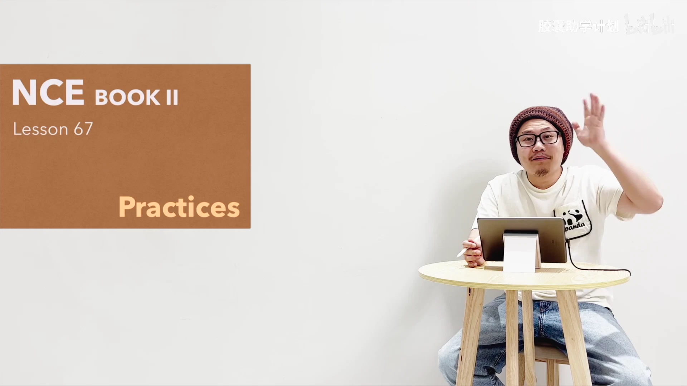

文字识别：NCE / BOOKII / Lesson 67 / Practices / panda

### 画面 00:00:02

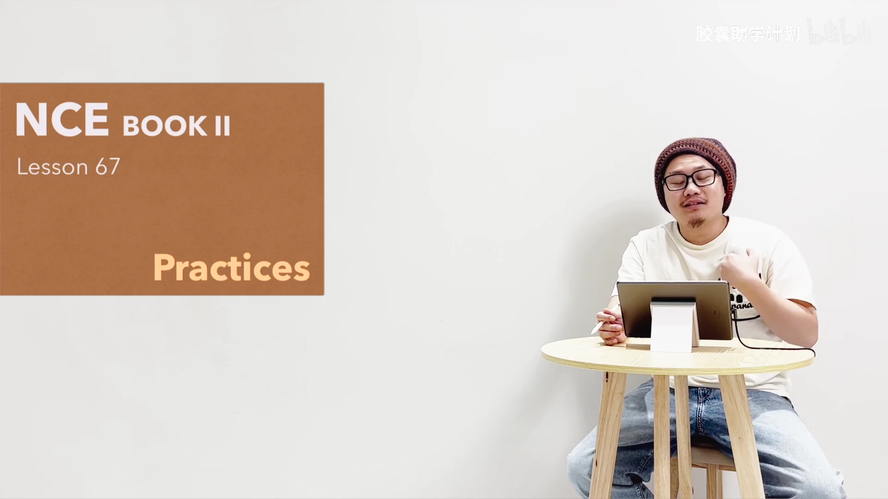

文字识别：NCE / BOOKII / Lesson 67 / Practices / nana

### 画面 00:00:08

文字识别：辜助字计划情 / 进行如下练习唯一前提 / 文章跟读至熟读成诵 / 否则请勿开始

### 画面 00:00:17

文字识别：Jbitbl / 胶囊助学计划

### 画面 00:00:21

文字识别：囊助学计划 / 胶囊助学计划

### 画面 00:00:23

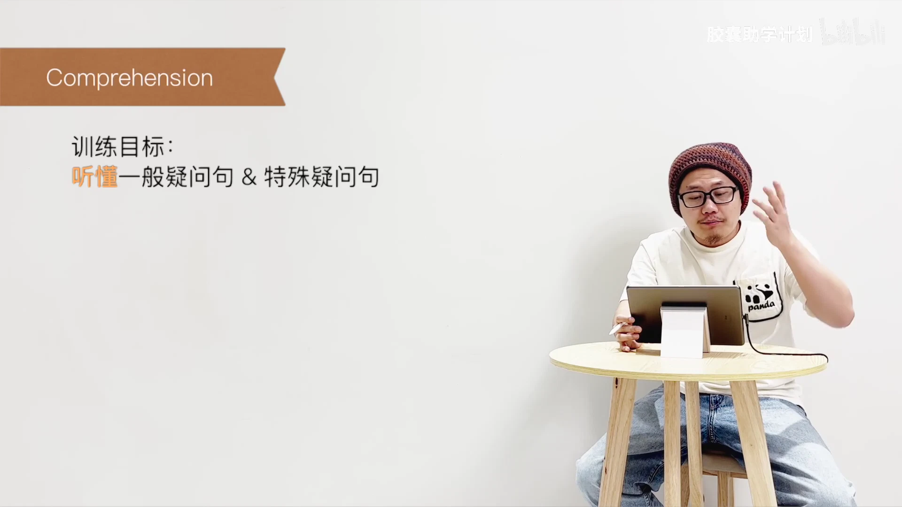

文字识别：Comprehension / 训练目标： / 听懂一般疑问句＆特殊疑问句 / panda

### 画面 00:00:26

文字识别：臺助学计划陽洲 / Comprehension

## 00:00:30–00:01:00

a Polish scientist? Next one, what has he spent his lifetime doing? Answer, studying active volcanoes and deep caves. Next one, where did he go in 1948? Lake Kivu. Why did he go there? To observe a new volcano. Where was Tazif

### 画面 00:00:38

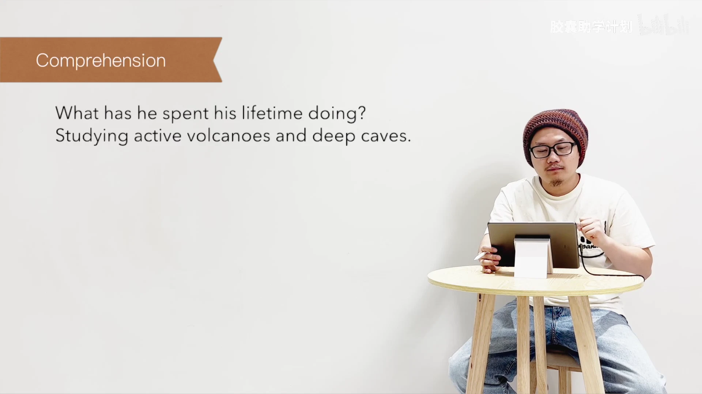

文字识别：Comprehension / What has he spent his lifetime doing? / Studying active volcanoes and deep caves. / par

### 画面 00:00:43

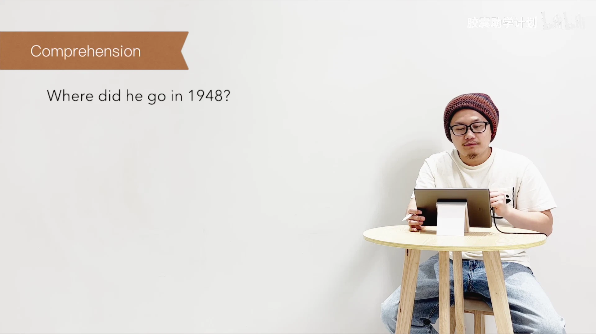

文字识别：妻助学计划園 / Comprehension / Where did he go in 1948?

## 00:01:00–00:01:30

able to set up camp? Very close to the volcano. What did he manage to do? Take a number of brilliant photographs. He couldn't stay near the volcano for very long, could he? No, he couldn't. What did he notice coming towards him?

### 画面 00:01:03

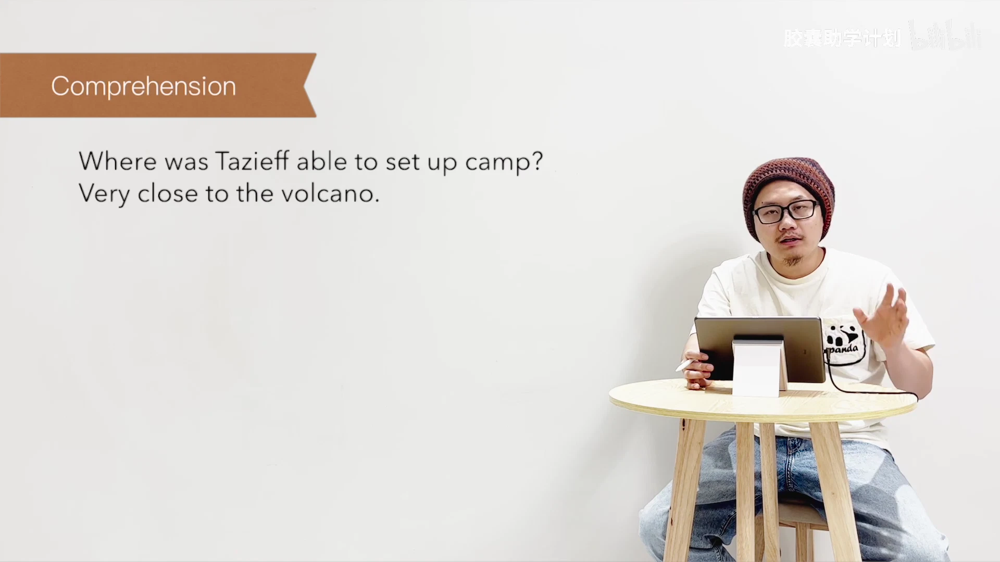

文字识别：Comprehension / Where was Tazieff able to set up camp? / Very close to the volcano. / panda

### 画面 00:01:09

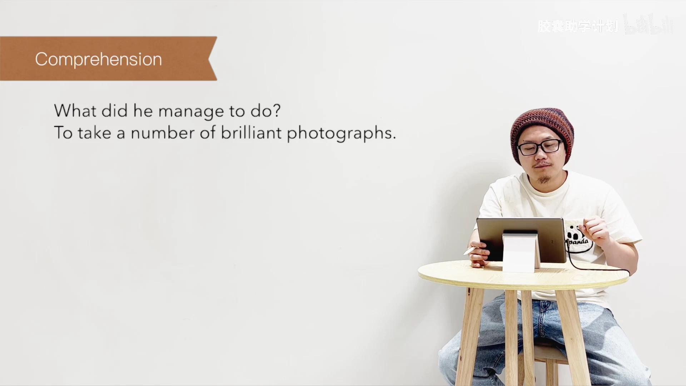

文字识别：Comprehension / What did he manage to do? / To take a number of brilliant photographs. / fpanda

### 画面 00:01:14

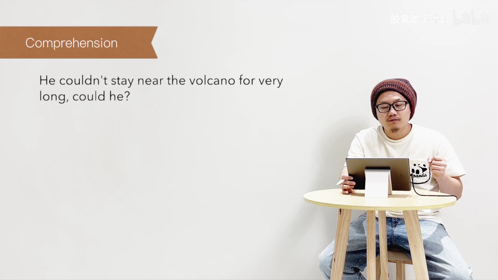

文字识别：Comprehension / He couldn't stay near the volcano for very / long, could he? / fpanda

### 画面 00:01:26

文字识别：Comprehension / What did he notice coming towards him? / panda

## 00:01:30–00:02:00

a river of liquid rock. What did it threaten to do? To surround him completely. Was Tzitzif surrounded, or did he manage to escape? He managed to escape. When was he able to return? When the volcano had become

### 画面 00:01:43

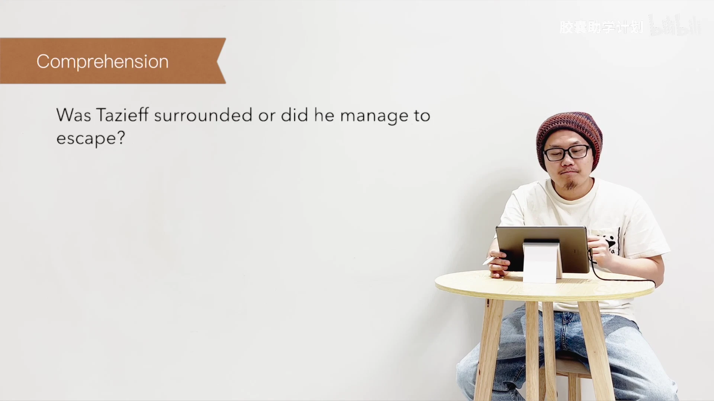

文字识别：臺助字计划 / Comprehension / Was Tazieff surrounded or did he manage to / escape?

### 画面 00:01:57

文字识别：Comprehension / When was he able to return? / When the volcano had become quiet.

## 00:02:00–00:02:30

quiet, asking questions.练习我们能说出来一般疑问句和特殊疑问句的能力。首先第一个例子叫Herrantzif is Polish，很简单，把is提前，对吧？What nationality is Herrantzif？这都是新医学的，我们不多提了。好，我们看第一个，第二个啊。So he is a scientist. Is he a scientist？这很简单。What？我建议你这个地方直接给他固定的句子叫What？What？What's

### 画面 00:02:01

文字识别：妻助字计划陽州 / Asking questions / 训练目标： / 会说一般疑问句＆特殊疑问句 / Accuracy / Fluency

### 画面 00:02:07

文字识别：臺助字计划區 / Asking questions / T: Ask me if Haroun Tazieff is Polish.

### 画面 00:02:13

文字识别：Asking questions / T: Ask me if Haroun Tazieff is Polish. / S: Is Haroun Tazieff Polish? / T:What nationality...? / S:What nationality is Haroun Tazieff?

### 画面 00:02:16

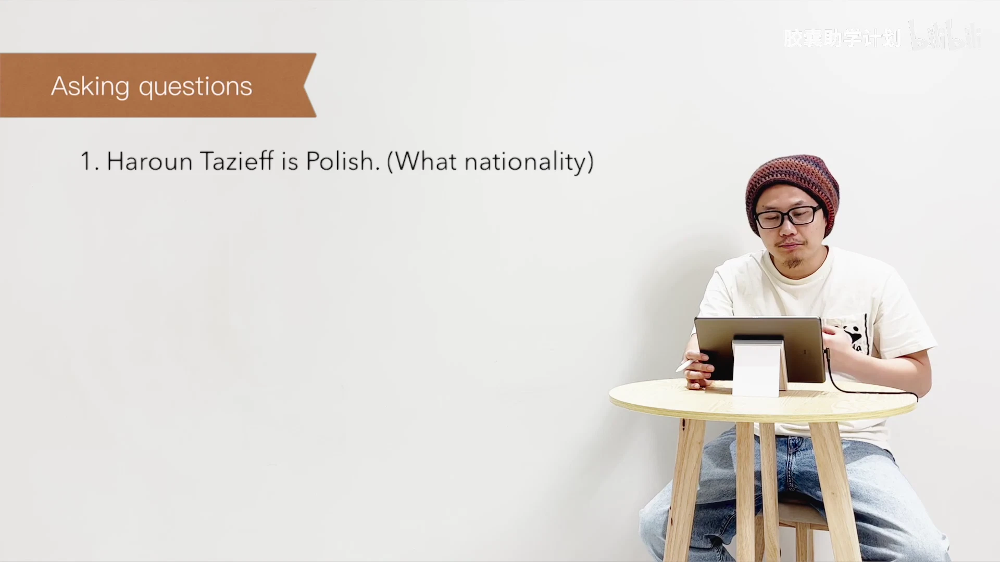

文字识别：達助学计划 / Asking questions / 1. Haroun Tazieff is Polish. (What nationality)

## 00:02:30–00:03:00

what's his job?就可以了，是吧？别说 What is he?啊，这个不太对啊，感觉。来，He studies active volcanoes. Does 提前一般疑问句，对吧？那 What 对 active volcanoes 提问，就 What does he study? He also studies deep caves.跟刚才没有任何区别，只不过这里变成了 What else does he study?对吧？他还研究什么别的东西吗？He's been in all parts of the world.这地方的关键点就是 P.S.到底是谁？肯定是 Has嘛，

### 画面 00:02:37

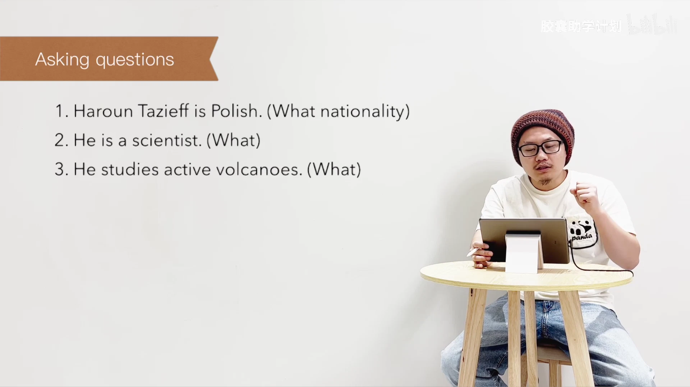

文字识别：Asking questions / 1. Haroun Tazieff is Polish. (What nationality) / 2. He is a scientist. (What) / 3. He studies active volcanoes. (What) / panda

### 画面 00:02:53

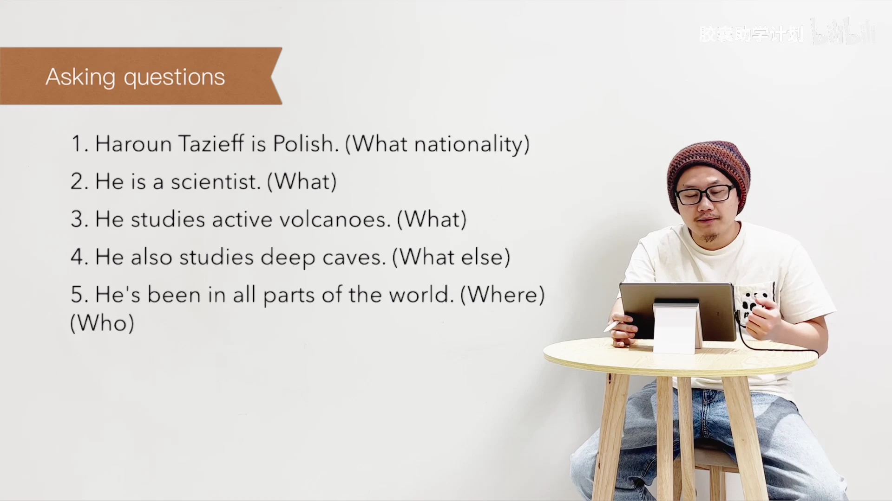

文字识别：Asking questions / 1. Haroun Tazieff is Polish. (What nationality) / 2. He is a scientist. (What) / 3. He studies active volcanoes. (What) / 4. He also studies deep caves. (What else) / 5. He's been in all parts of the world. (Where) / (Who)

## 00:03:00–00:03:30

对吧？Has提前，Where对In all parts of the world提问，对吧？后对主语提问啊，对吧？Who has been in all parts of the world？第六个，He went to Lake Kivu in 1948. Did提前，动词换回原形go。When对时间提问。Is in the Congo. Is提前，Where对In the Congo提问。What对主语It提问，对吧？What's in the Congo？He went to observe a new volcano.

### 画面 00:03:09

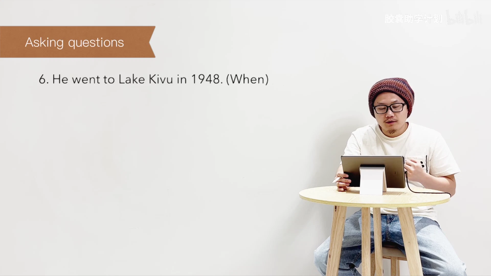

文字识别：臺助字计划 / Asking questions / 6. He went to Lake Kivu in 1948. (When)

### 画面 00:03:27

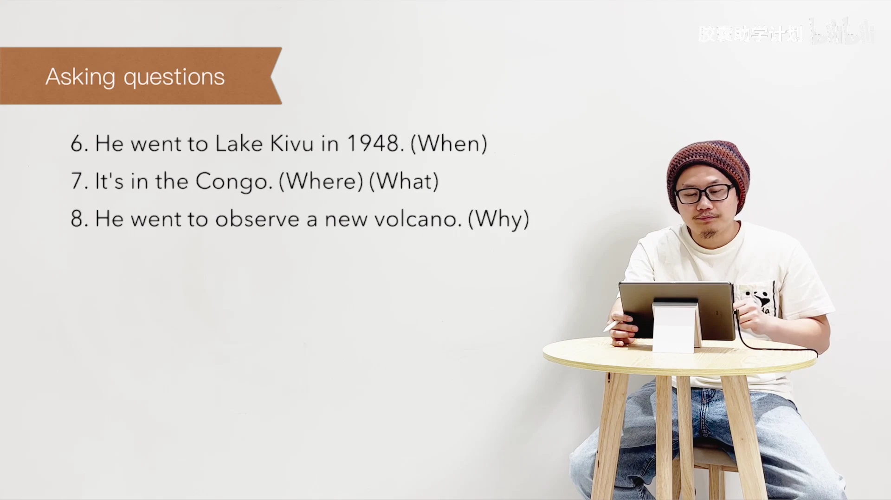

文字识别：Asking questions / 6. He went to Lake Kivu in 1948.(When) / 7. It's in the Congo.(Where) (What) / 8. He went to observe a new volcano.(Why)

## 00:03:30–00:04:00

Did提前why,呃整句话why did he go to observe a new volcano,是吧？他为啥要去研究啊？啊观察。He later named it Kituro.注意这里的动词是name, did提前对吧？name换回原形。What对it提问？What did he later name Kituro?或者对Kituro提问，我觉得可能更好一点，叫What did he later name it?是吧？他后来给他

### 画面 00:03:57

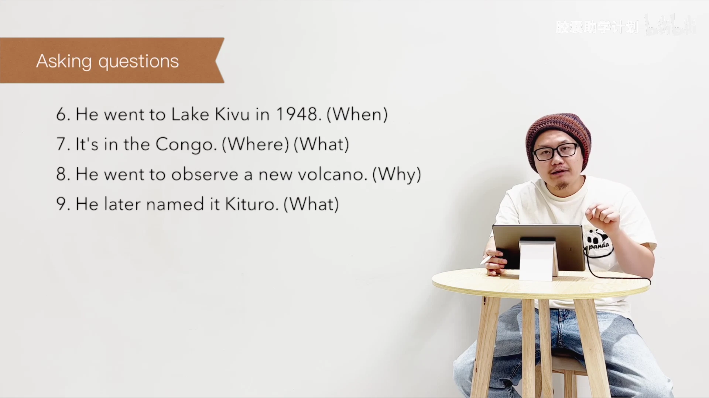

文字识别：Asking questions / 6. He went to Lake Kivu in 1948.(When) / 7. It's in the Congo.(Where) (What) / 8. He went to observe a new volcano.(Why) / 9. He later named it Kituro.(What) / panda

## 00:04:00–00:04:30

name. What is it called? It's called Kitura. The tenth one. He was able to set up his camp very close to the volcano. Was提前. That where? Definitely very close to the volcano. Question, right? The eleventh one. It was erupting violently. Past continuous. Was提前. What? The subject question, right? What was erupting violently? What was erupting violently? What was erupting violently? What was erupting violently? What was erupting violently? What was erupting violently? What was erupting violently? What was erupting violently? What was erupting violently? What was erupting violently? What was erupting violently? What was erupting violently?

### 画面 00:04:01

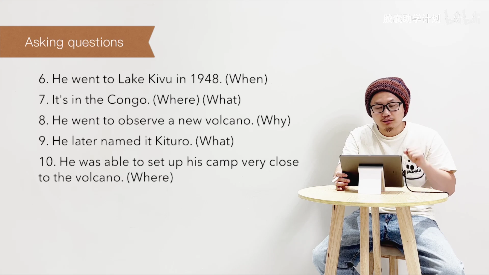

文字识别：Asking questions / 6. He went to Lake Kivu in 1948.(When) / 7. It's in the Congo.(Where) (What) / 8. He went to observe a new volcano. (Why) / 9. He later named it Kituro.(What) / 10. He was able to set up his camp very close / to the volcano.(Where) / panda

### 画面 00:04:21

文字识别：囊助学计划 / Tell the story / 训练目标： / 口语复述能力 / Accuracy / Fluency

### 画面 00:04:23

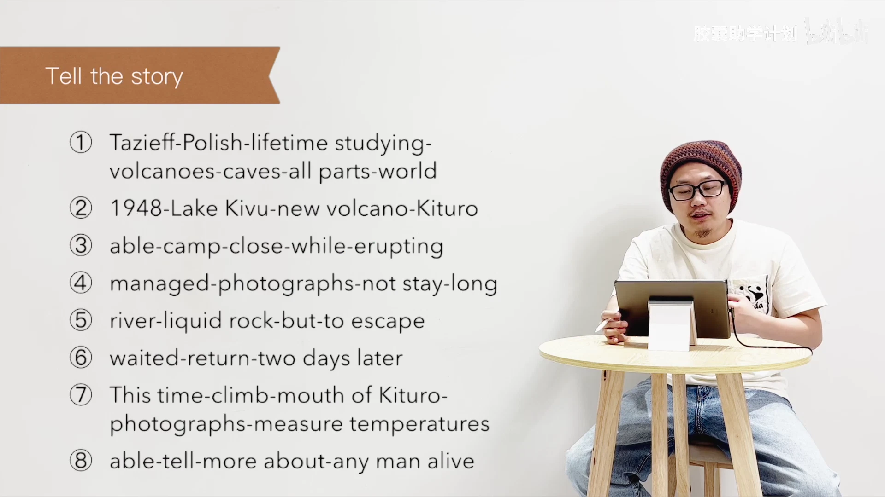

文字识别：Tell the story / Tazieff-Polish-lifetime studying- / volcanoes-caves-all parts-world / 1948-Lake Kivu-new volcano-Kituro / able-camp-close-while-erupting / managed-photographs-not stay-long / river-liquid rock-but-to escape / waited-return-two days later / This time-climb-mouth of Kituro- / photographs-measure temperatures / able-tell-more about-any man alive

## 00:04:30–00:05:00

啊。然后 summary writing 练习我们写作的能力，写完了来这里对答案，重点去看一些这样的连词的东西啊。像这 after taking photographs，这不是四十九课咱学的分词做状语嘛，对不对啊？不挨个儿提了，写完对答案，有不懂的您留言就可以了，好吧？那 topic for discussion 呢，完全自由的对话，咱们老习惯就是说一下题，然后您自己先去研究，这个我们在新概念的

### 画面 00:04:30

文字识别：Summary writing: Key / 训练目标： / 写作复述能力

### 画面 00:04:33

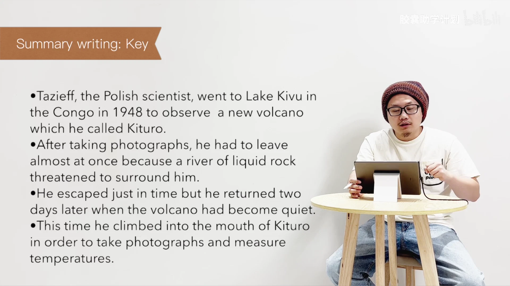

文字识别：Summary writing: Key / •Tazieff, the Polish scientist, went to Lake Kivu in / the Congo in 1948 to observe a new volcano / which he called Kituro. / •After taking photographs, he had to leave / almost at once because a river of liquid rock / threatened to surround him. / pan / •He escaped just in time but he returned two / days later when the volcano had become quiet. / •This time he climbed into the mouth of Kituro / in order to take photographs and measure / temperatures.

### 画面 00:04:49

文字识别：Topics for discussion / 训练目标： / 完全自由的对话 / Accuracy / nda / Fluency

### 画面 00:04:53

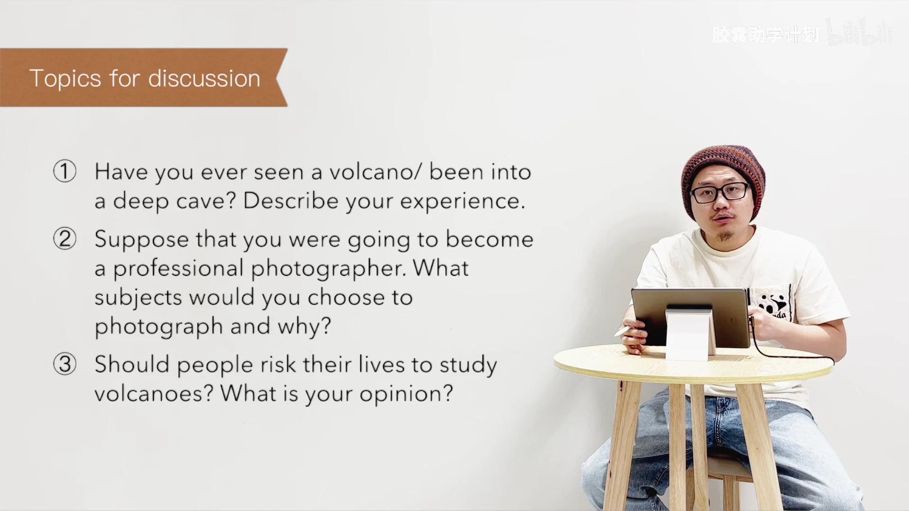

文字识别：Topics for discussion / Have you ever seen a volcano/ been into / a deep cave? Describe your experience. / Suppose that you were going to become / a professional photographer. What / subjects would you choose to / photograph and why? / Should people risk their lives to study / volcanoes? What is your opinion?

## 00:05:00–00:05:30

课堂上是没有办法处理这样的问题的。但是我需要你知道，我们早晚有一天学了很多英语，有一天就是奇迹于这里边的任何一个话题能跟别人聊一会儿，对吧？用英文，of course. 第一个，Have you ever seen a volcano or been into a deep cave? Describe your experience. 你见过火山吗？或者你去过很深的洞吗？描绘一下你的这个这个个人经验，对吧？你如果没去过，你就没得说。你比如说，你像我去过汤加里罗，见过那

### 画面 00:05:12

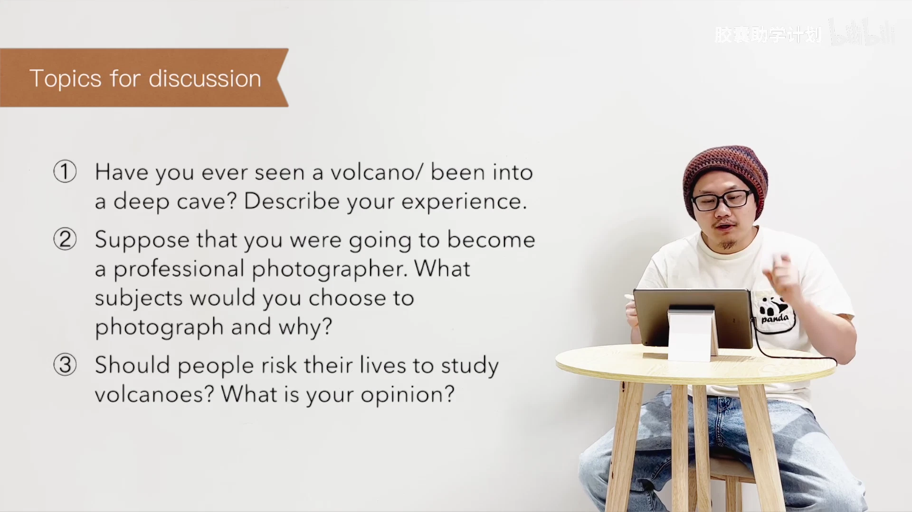

文字识别：Topics for discussion / Have you ever seen a volcano/ been into / a deep cave? Describe your experience. / Suppose that you were going to become / a professional photographer. What / subjects would you choose to / photograph and why? / panda / Should people risk their lives to study / volcanoes? What is your opinion?

### 画面 00:05:14

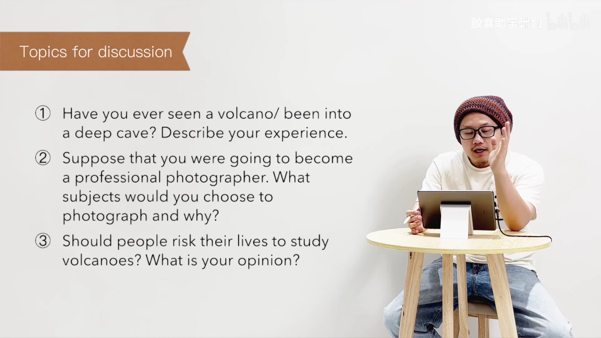

文字识别：助字计划 / Topics for discussion / Have you ever seen a volcano/ been into / a deep cave? Describe your experience. / Suppose that you were going to become / a professional photographer. What / subjects would you choose to / photograph and why? / Should people risk their lives to study / volcanoes? What is your opinion?

## 00:05:30–00:06:00

个火山，对吧？然后我在奥克兰北部也见过那个活火山。那这个我再去说的时候，我就能给你描绘很多东西，对吧？第二个说，Suppose that you are going to become a professional photographer. What subjects would you choose to photograph and why?说假设你要变成一个职业的摄影师，你要拍什么东西？为什么？关键是为啥你要拍，对吧？第三个，Should people risk their lives to study volcanoes? What's your opinion?说你认为人们应

### 画面 00:05:44

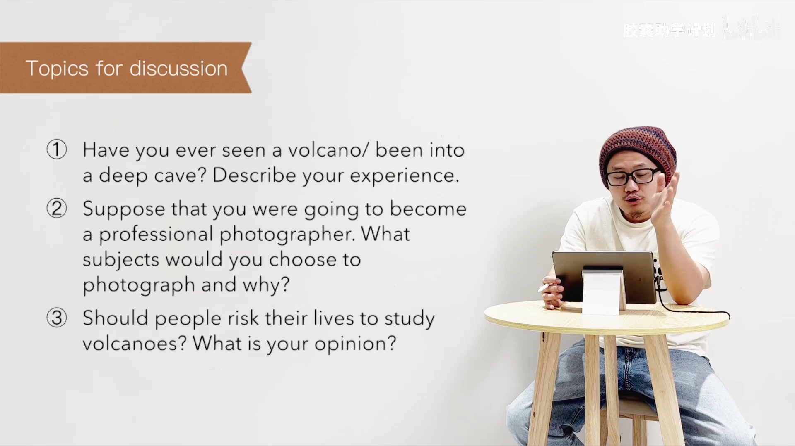

文字识别：Topics for discussion / Have you ever seen a volcano/ been into / a deep cave? Describe your experience. / Suppose that you were going to become / a professional photographer. What / subjects would you choose to / photograph and why? / Should people risk their lives to study / volcanoes? What is your opinion?

## 00:06:00–00:06:30

该冒着生命的危险去研究火山吗？说一说你的想法，对不对？好，不多说了，加上作业。Ask me if。我再强调一遍，各位一定要先写，因为写能保证我们的正确率，然后我们再大声朗读，因为这个东西本身是我们将来张嘴去说出来的和听到的，所以必须要去读啊。这两步缺一不可。这要写作呢，您写完来这对答案，tell the story口语复述，然后置顶留言可以找到

### 画面 00:06:06

文字识别：囊助学计划長洲

### 画面 00:06:10

文字识别：囊助学计划州 / 1.Ask me if写&朗读

### 画面 00:06:15

文字识别：奏助学计划 / 1.Ask me if写&朗读

### 画面 00:06:20

文字识别：囊助学计划 / 1.Ask me if写&朗读

### 画面 00:06:22

文字识别：妻助学计划调 / 1.Ask me if写&朗读 / 2. / 摘要写作写&答案

### 画面 00:06:25

文字识别：喜助学计划門 / 1.Ask me if写&朗读 / 摘要写作写&答案 / 3.Tell the story 口语复述

### 画面 00:06:27

文字识别：袁助字计划園州 / 1.Ask me if写&朗读 / 摘要写作写&答案 / 3.Tell the story 口语复述 / 4. / 4.重复间隔（置顶留言）

## 00:06:30–00:06:57

重复间隔的学习材料。那以上呢就是本期视频的全部内容了。如果各位喜欢我们的课程呢，欢迎各位关注、订阅、一键三连，分享给那些需要的朋友，来帮助我们快速成长。See you next time.

### 画面 00:06:31

文字识别：囊助学计划一州 / 👍

### 画面 00:06:35

文字识别：囊助学计划州 / 不 / panda

### 画面 00:06:44

文字识别：妻助学计划一州 / 山 / panda

### 画面 00:06:46

文字识别：CAPSULEACADEMY / 胶囊助学计划 / 『 / 小红书 / Lecturer / Leo / OE

### 画面 00:06:49

文字识别：CAPSULEACADEMY / 胶囊助学计划 / 小红书 / Photographer / Berlin / OE

### 画面 00:06:51

文字识别：CAPSULEACADEMY / 胶囊助学计划 / 小红书 / Editor / Berlin / OE

### 画面 00:06:54

文字识别：CAPSULEACADEMY / 胶囊助学计划 / 『 / 小红书

### 画面 00:06:56

文字识别：bilbili / 胶囊助学计划

