# 068 文章

快速机器解析：语音为单模型转写，未进行独立交叉校对或人工复核；画面每秒采样并按变化选帧，短时文字和标记可能遗漏。截图时间约有 1 秒误差。图片有损压缩；遇到疑点请按时间查看 Google Drive 原视频。

## 00:00:00–00:00:30

Hello everyone, welcome to Capsule Academy. This is Leo. Today we're going to learn New Concept English Book Two, Lesson Sixty Eight, Story. 那老习惯，进入这个正式课程之前，咱们看几个问题啊。首先，让步状语从句啊，不难，我们跟文章都合到一起了，它绝对不是很困难。接下来呢，动名词的逻辑主语啊，听上去依旧好像很困难的事儿，但依旧不难，放心啊。最后呢，是 I was wondering 这个句型。那带着这三个问题， hope you gonna enjoy.

### 画面 00:00:00

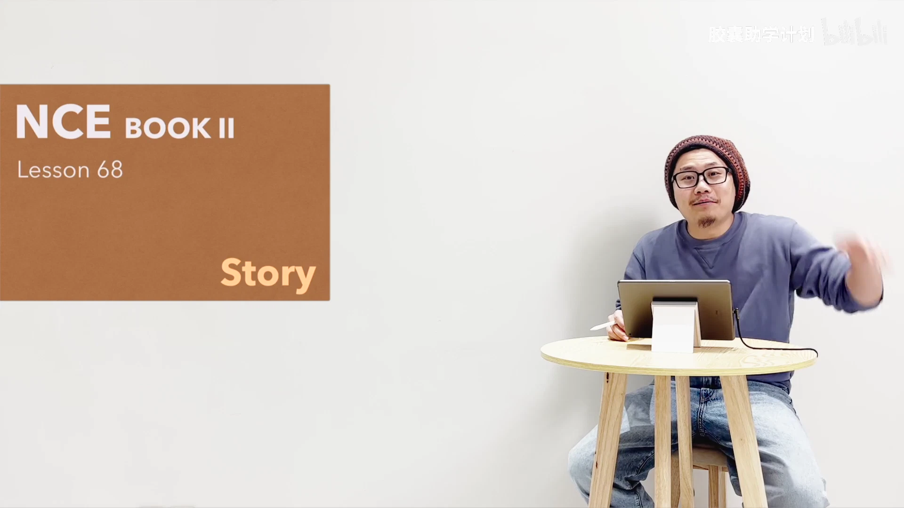

文字识别：NCE / BOOK"I / Lesson 68 / Story

### 画面 00:00:02

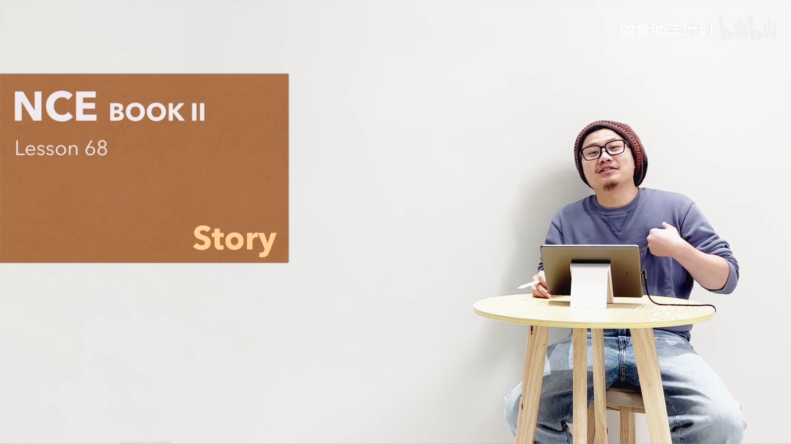

文字识别：NCE / BOOKⅡI / Lesson 68 / Story

### 画面 00:00:05

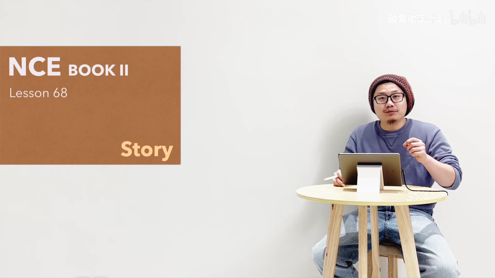

文字识别：NCE / BOOKⅡI / Lesson 68 / Story

### 画面 00:00:10

文字识别：奏助字计划一州

### 画面 00:00:12

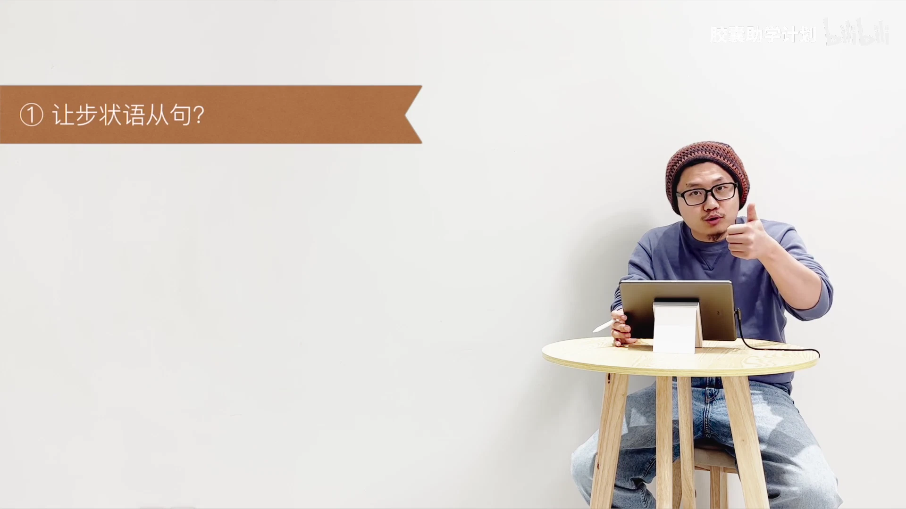

文字识别：①让步状语从句？

### 画面 00:00:16

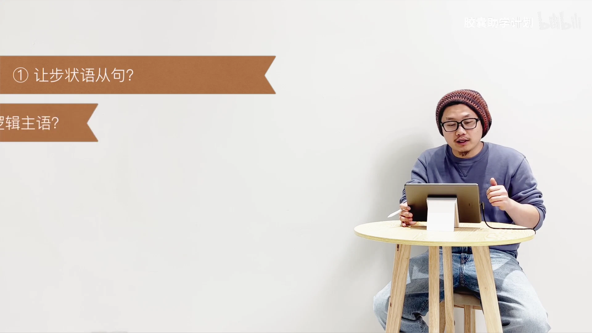

文字识别：①让步状语从句？ / 逻辑主语？

### 画面 00:00:18

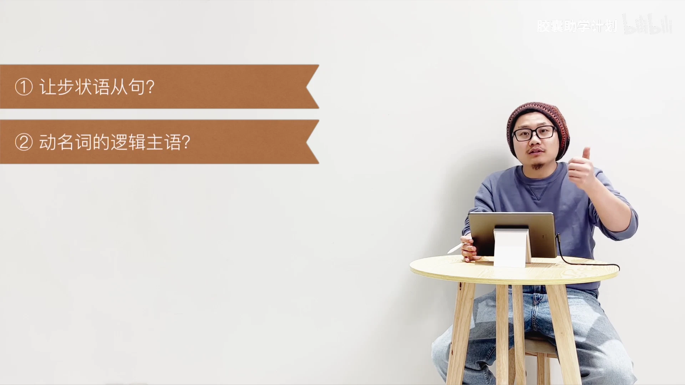

文字识别：①让步状语从句？ / 动名词的逻辑主语?

### 画面 00:00:23

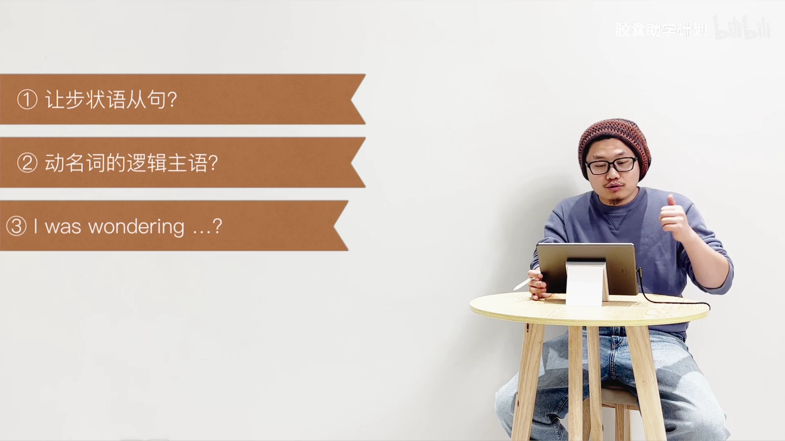

文字识别：①让步状语从句？ / 动名词的逻辑主语? / I was wondering

### 画面 00:00:25

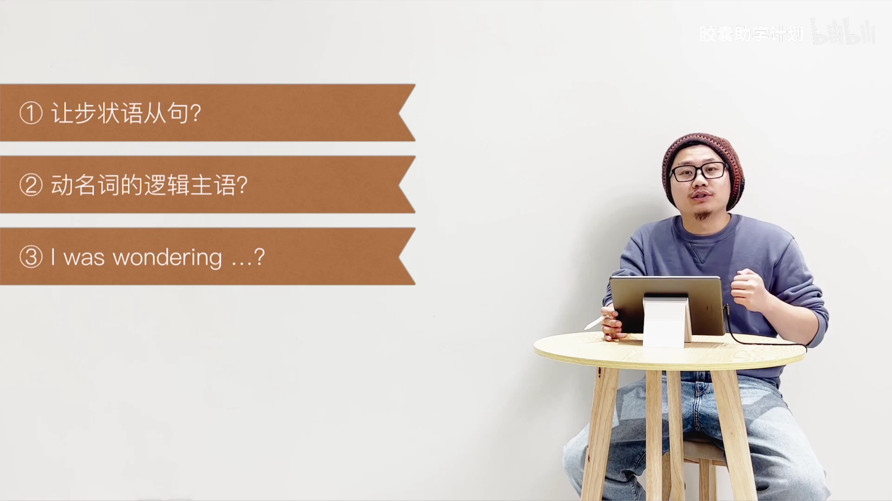

文字识别：①让步状语从句？ / 动名词的逻辑主语? / I was wondering

### 画面 00:00:28

文字识别：胶囊助学计划 bil / •

## 00:00:30–00:01:00

好，我们先看文章的标题叫 persistent. persistent 这个单词，我没有记错的话，文章当中是并没有出现的，就表示坚持不懈啊。其实就是一个挺腻歪人的人，不停的追着你啊， follow me around，是吧？四处跟着我跑，这么一个人啊，所以给他起了一个名字 persistent，是吧？管他叫说这个人呢 persistent。问的问题是 Why did Elizabeth tell Nigel that

### 画面 00:00:32

文字识别：動字計划 / 囊助学计划 / 胶

### 画面 00:00:34

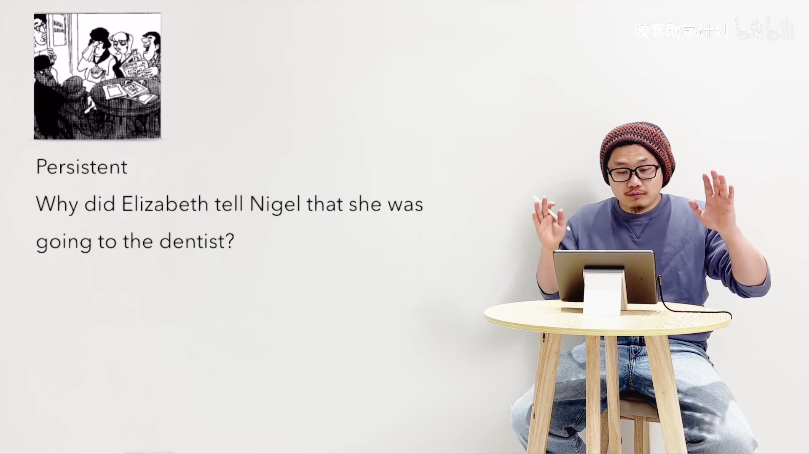

文字识别：Persistent / Why did Elizabeth tell Nigel that she was / going to the dentist?

## 00:01:00–00:01:30

she was going to the dentist.两个人，女的Elizabeth啊，然后男的Nigel说Elizabeth为啥告诉Nigel说她要去牙医那个地方？对吧？她为啥要告诉她分享她这个信息？对吧？肯定其中有别的深意。那我们看文章就可以了。这篇文章很有趣啊。然后呢，呃，它的习惯用法特别的多啊，所以我们其中一部分是放到了单词部分去讲，对吧？哎，提前让各位预习一下，别

### 画面 00:01:04

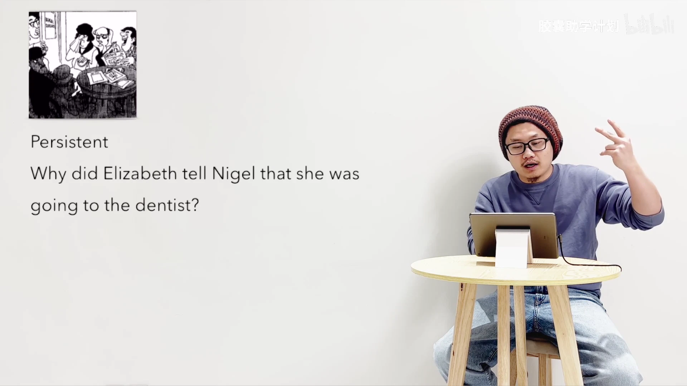

文字识别：Persistent / Why did Elizabeth tell Nigel that she was / going to the dentist?

### 画面 00:01:18

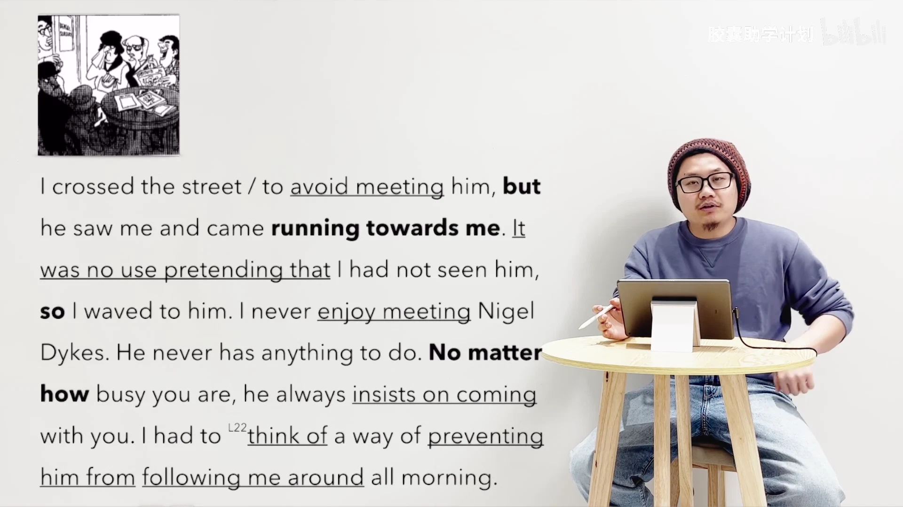

文字识别：I crossed the street / to avoid meeting him, but / he saw me and came running towards me. It / was no use pretending that I had not seen him, / so I waved to him. I never enjoy meeting Nigel / Dykes. He never has anything to do. No matter / how busy you are, he always insists on coming / with you. I had to {2²think of a way of preventing / him from following me around all morning.

## 00:01:30–00:02:00

进入文章直接就懵了。但文章本身并不是很难。我们看一下，I crossed the street to avoid meeting him, but he saw me and came running towards me. 这句话看上去挺长，但实际上就是两个简单句并列到一起了，由 but 去做了一个链接，对吧？OK，那第一句话叫做 I crossed the street，我穿过了马路，to avoid meeting him。这里的 to 经常做表目

### 画面 00:01:48

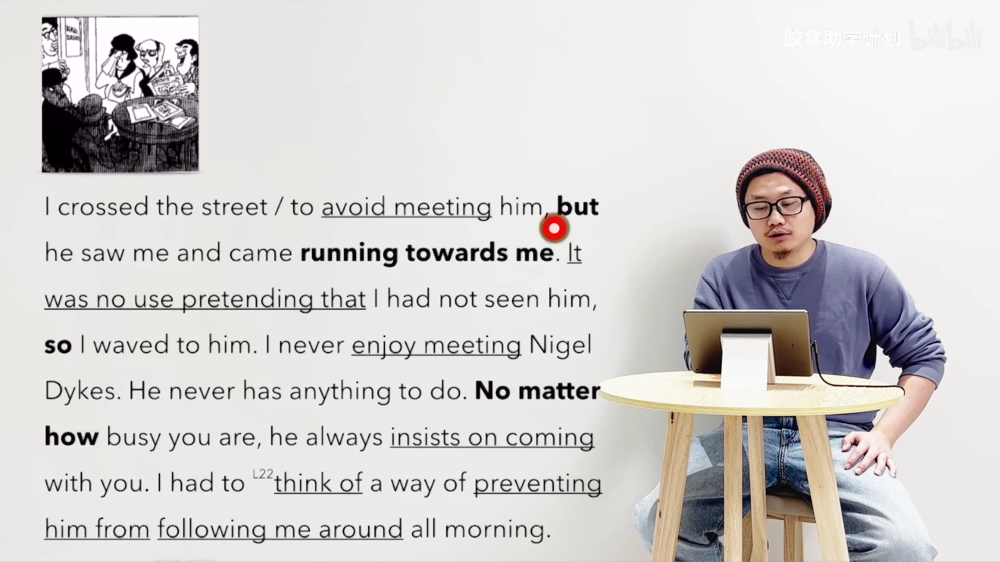

文字识别：I crossed the street / to avoid meeting him, but / he saw me and came running towards me. It / was no use pretending that I had not seen him, / so I waved to him. I never enjoy meeting Nigel / Dykes. He never has anything to do. No matter / how busy you are, he always insists on coming / with you. I had to [2²think of a way of preventing / him from following me around all morning.

## 00:02:00–00:02:30

的，目的是什么呢？目的是 avoid meeting him，避免遇见他。我老远就看他从马路这边来了，我就赶紧上马路那边去，我省得再跟他说话，对吧？目的是为了避免遇见他，对吧？但是不幸的消息来了，He saw me and came，他看见了我，然后就过来了。好，这里其实都很简单。其实这里的 and 也是连，也是类似于 but 这样的一个连词，对吧？其实类似于 he saw me and he

### 画面 00:02:11

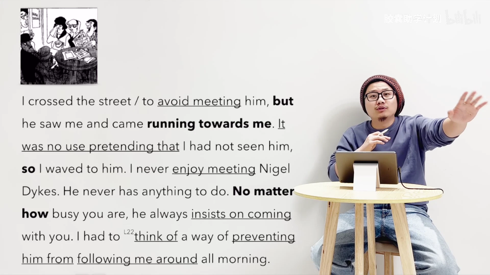

文字识别：I crossed the street / to avoid meeting him, but / he saw me and came running towards me. It / was no use pretending that I had not seen him, / so I waved to him. I never enjoy meeting Nigel / Dykes. He never has anything to do. No matter / how busy you are, he always insists on coming / with you.I had to {2²think of a way of preventing / him from following me around all morning.

## 00:02:30–00:03:00

came, 没有必要再加 he 了，所以把这个 he came 的 he 删掉了，就变成了 he saw me and came. 咱们就把它当成一句话就行了，因为太短了，没必要一个单词儿还算一句话，对吧？他看见我，然后过来了。接下来后面这个叫 running towards me, 有的同学可能会误以为是 come 加 doing. 虽然 come 确实有的时候可以加 doing, 但是这里并不是 come 加 doing 的用法，听见了哈？好，这里是什么呢？这里其实就是

### 画面 00:02:33

文字识别：I crossed the street / to avoid meeting him, but / he saw me ancOame running towards me.It / was no use pretending that I had not seen him, / so I waved to him. I never enjoy meeting Nigel / Dykes. He never has anything to do. No matter / how busy you are, he always insists on coming / with you.I had to L2²think of a way of preventing / him from following me around all morning.

### 画面 00:02:40

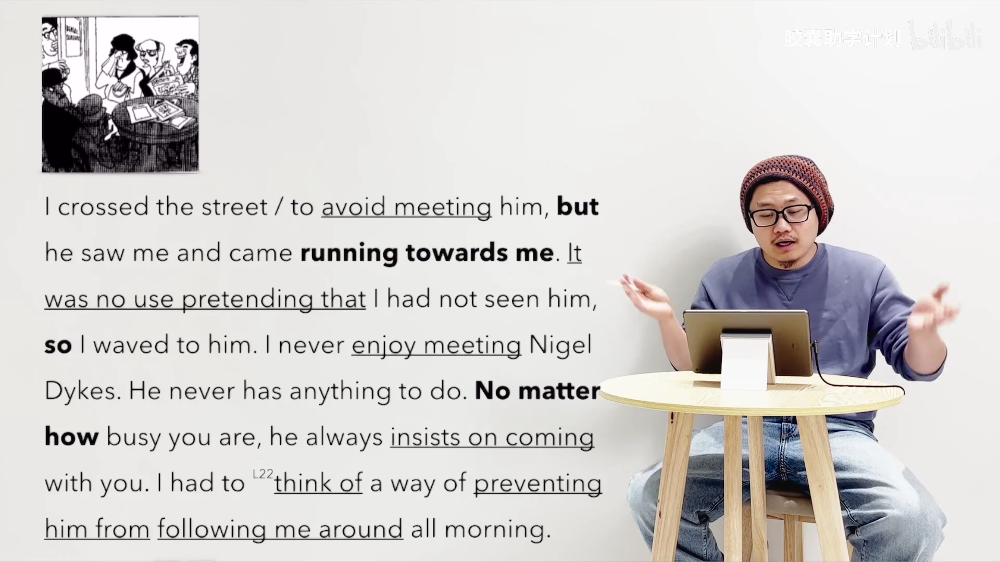

文字识别：I crossed the street / to avoid meeting him, but / he saw me and came running towards me. It / was no use pretending that I had not seen him, / so I waved to him. I never enjoy meeting Nigel / Dykes. He never has anything to do. No matter / how busy you are, he always insists on coming / with you. I had to {2²think of a way of preventing / him from following me around all morning.

### 画面 00:02:43

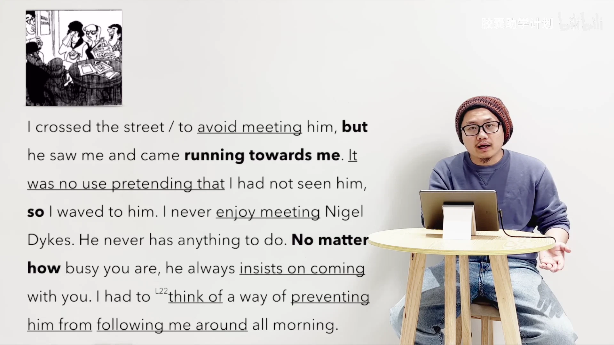

文字识别：I crossed the street / to avoid meeting him, but / he saw me and came running towards me. It / was no use pretending that I had not seen him, / so I waved to him. I never enjoy meeting Nigel / Dykes. He never has anything to do. No matter / how busy you are, he always insists on coming / with you. I had to {2²think of a way of preventing / him from following me around all morning.

## 00:03:00–00:03:30

咱们四十九课学那个分词作状语，很简单，叫 running towards me。谁 running 主语是谁？往前找 he 主动被动主动，所以这句话其实就可以拆成这个样子，叫 he saw me and came。第一句话，第二 he ran towards me，就这么简单，看见了吧？啊，或者你给他再拆一下，比如说呃呃 he saw me and came and then he呃 and then ran towards me，

### 画面 00:03:13

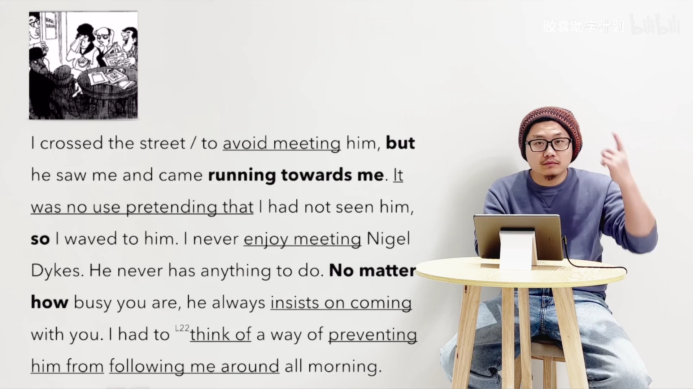

文字识别：I crossed the street / to avoid meeting him, but / he saw me and came running towards me. It / was no use pretending that I had not seen him, / so I waved to him. I never enjoy meeting Nigel / Dykes. He never has anything to do. No matter / how busy you are, he always insists on coming / with you.I had to ²think of a way of preventing / him from following me around all morning.

### 画面 00:03:18

文字识别：I crossed the street / to avoid meeting him, but / he saw me and came running towards me. It / was no use pretending that I had not seen him, / so I waved to him. I never enjoy meeting Nigel / Dykes. He never has anything to do. No matter / how busy you are, he always insists on coming / with you. I had to 2²think of a way of preventing / him from following me around all morning.

### 画面 00:03:21

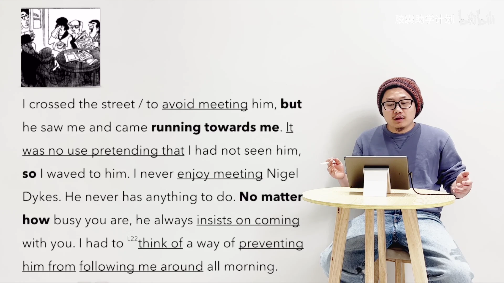

文字识别：I crossed the street / to avoid meeting him, but / he saw me and came running towards me. It / was no use pretending that I had not seen him, / so I waved to him.I never enjoy meeting Nigel / Dykes. He never has anything to do. No matter / how busy you are, he always insists on coming / with you.I had to [2²think of a way of preventing / him from following me around all morning.

## 00:03:30–00:04:00

### 画面 00:03:50

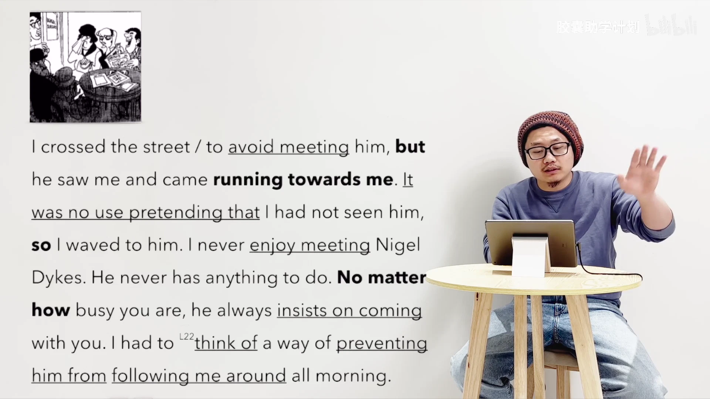

文字识别：I crossed the street / to avoid meeting him, but / he saw me and came running towards me. It / was no use pretending that I had not seen him, / so I waved to him. I never enjoy meeting Nigel / Dykes. He never has anything to do. No matter / how busy you are, he always insists on coming / with you.I had to ²think of a way of preventing / him from following me around all morning.

## 00:04:00–00:04:30

跑过来了，我没办法再假装了，都跑到我眼前了，恨不得这样挥手了，对吧？我也没有办法了。于是很不情愿，怎么样的？I wave to him. I wave to somebody.这咱们之前就学过了，这很简单的习惯用法，就是冲着某人招手。我就冲着他招了招手。I never enjoy meeting Nigel Dykes.这句话首先一个小的习惯用法，enjoy doing something，对吧？我们其实有两种理解，第一

### 画面 00:04:20

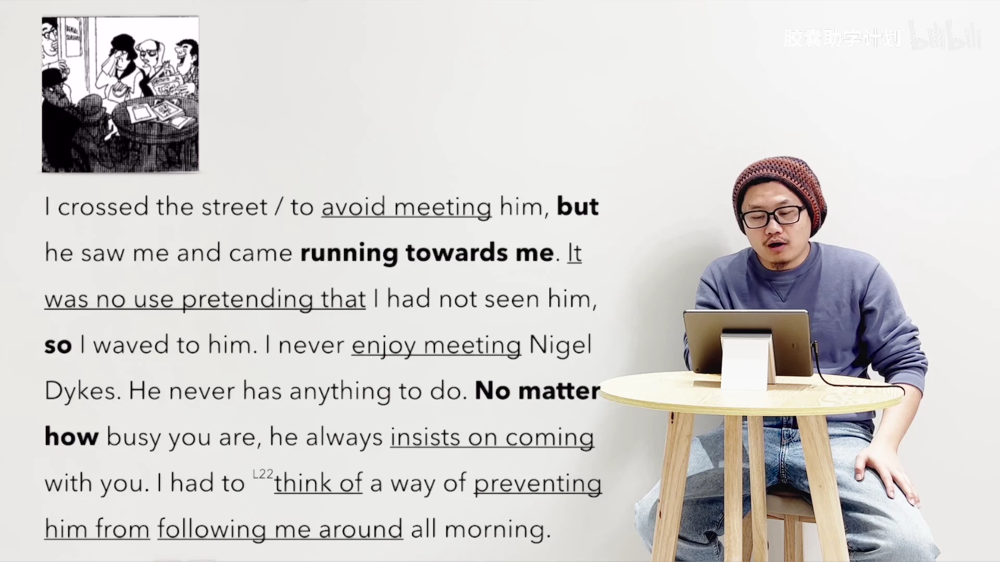

文字识别：I crossed the street / to avoid meeting him, but / he saw me and came running towards me. It / was no use pretending that I had not seen him, / so I waved to him. I never enjoy meeting Nigel / Dykes. He never has anything to do. No matter / how busy you are, he always insists on coming / with you.I had to ²think of a way of preventing / him from following me around all morning.

## 00:04:30–00:05:00

种，我比较推崇的，简单粗暴，你就记住，enjoy doing something，这事儿就结束了，对吧？第二种，如果你想再稍微深究一下呢，这无非就是动词后边的宾语，动名词做了宾语。新概念二十课咱们也讲过，所以在这我就不再赘述了啊。所以我从来就没有享受过见 Nigel Dykes 这个人。那我们接下来很好奇，看为啥呗？He never has anything to do。很简单的一个简单句，他从来都没有任何事儿去做，

### 画面 00:04:50

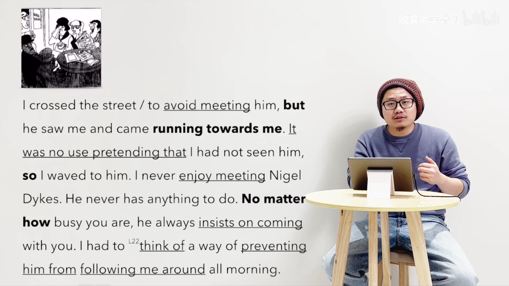

文字识别：I crossed the street / to avoid meeting him, but / he saw me and came running towards me. It / was no use pretending that I had not seen him, / so I waved to him. I never enjoy meeting Nigel / Dykes. He never has anything to do. No matter / how busy you are, he always insists on coming / with you.I had to ²think of a way of preventing / him from following me around all morning.

## 00:05:00–00:05:30

哎，总是闲来无事。No matter how busy you are, he always insists on coming with you. 好，这里出现了两个小的点。第一个，no matter how，首先，no matter how，各位要注意一下，是本课的一个小的语法。但是呢，因为它过于的小了，我们直接一会儿跟习惯用法放到一起去学和造句。您现在在这儿只要知道它是什么意思就行了啊，叫做无论啊。

### 画面 00:05:20

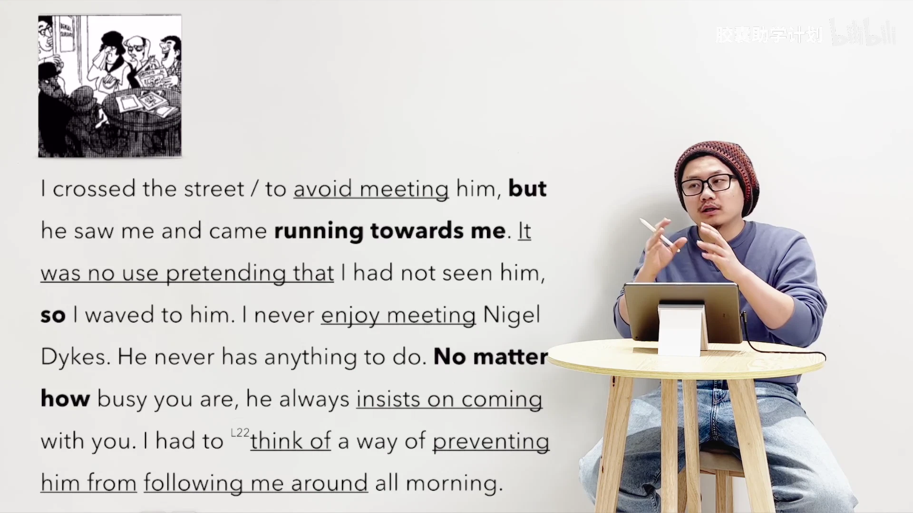

文字识别：I crossed the street / to avoid meeting him, but / he saw me and came running towards me. It / was no use pretending that I had not seen him, / so I waved to him. I never enjoy meeting Nigel / Dykes. He never has anything to do. No matter / how busy you are, he always insists on coming / with you. I had to {2²think of a way of preventing / him from following me around all morning.

## 00:05:30–00:06:00

所以 no matter 可以后边加 how 叫做无论。那 how busy 就是无论你有多忙，听见了吧？那 no matter who 是什么意思呢？就无论你是，无论是谁，无论谁。 No matter where 呢，就无论何地。 No matter when 呢，就是无论何时，听见了吧？所以 no matter 可以加上一系列各种各样的特殊疑问词。这个一会儿我们具体去讲。您现在只要知道它的含义就够了。叫做无论啊，无论你有多忙，他总是

### 画面 00:05:50

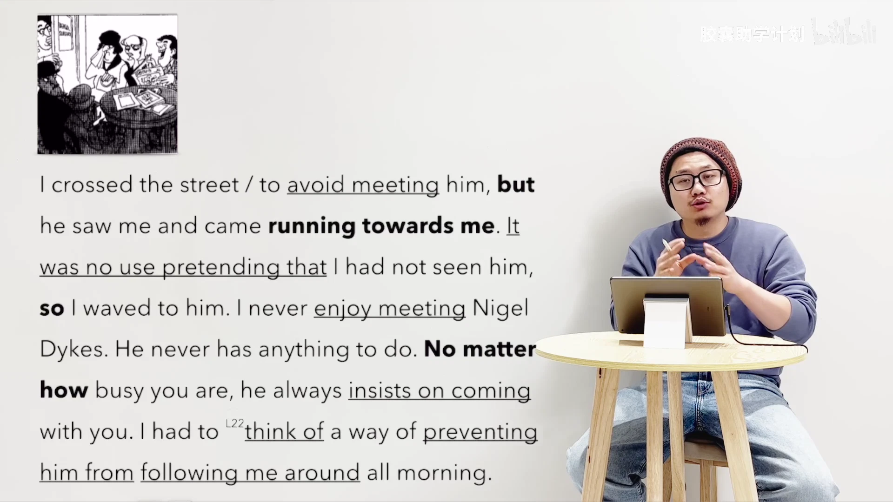

文字识别：I crossed the street / to avoid meeting him, but / he saw me and came running towards me. It / was no use pretending that I had not seen him, / so I waved to him. I never enjoy meeting Nigel / Dykes. He never has anything to do. No matter / how busy you are, he always insists on coming / with you.I had to [2²think of a way of preventing / him from following me around all morning.

## 00:06:00–00:06:30

坚持要 coming with you，总是要坚持和你一起走。Insist on doing something，单词部分咱们讲过了啊，来了。I had to think of a way of preventing him from following me around all morning。这句话虽然是简单句，可是并我觉得并不是那么的简单，因为里面出现的习惯用法小的点过于的多。我这样标一下，各位也许还能看清楚一点，不标就容易特别

### 画面 00:06:17

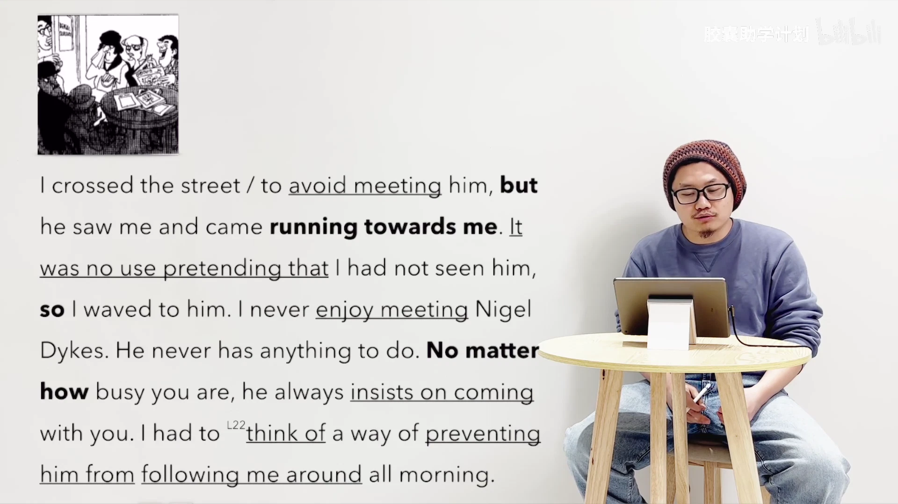

文字识别：I crossed the street / to avoid meeting him, but / he saw me and came running towards me. It / was no use pretending that I had not seen him, / so I waved to him. I never enjoy meeting Nigel / Dykes. He never has anything to do. No matter / how busy you are, he always insists on coming / with you. I had to {2²think of a way of preventing / him from following me around all morning.

### 画面 00:06:21

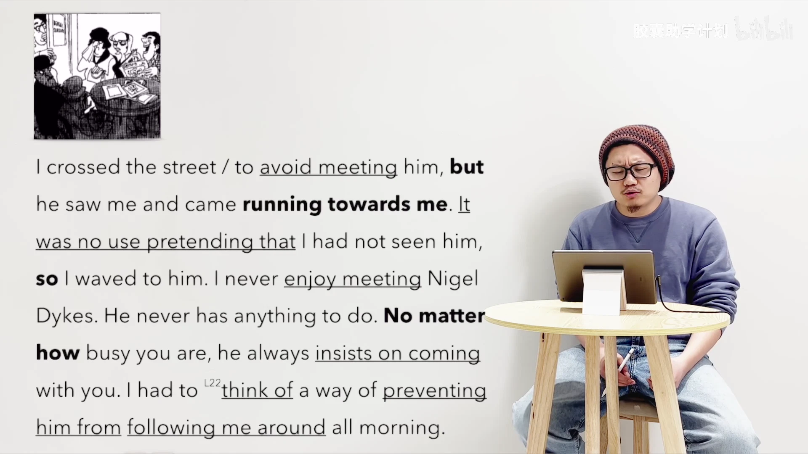

文字识别：I crossed the street / to avoid meeting him, but / he saw me and came running towards me. It / was no use pretending that I had not seen him, / so I waved to him. I never enjoy meeting Nigel / Dykes. He never has anything to do. No matter / how busy you are, he always insists on coming / with you. I had to {2²think of a way of preventing / him from following me around all morning.

## 00:06:30–00:07:00

容易懵。那我们这样看啊，你这样先给他去断一下句。这是我人为教你的，理论上其实不需要断句啊，但是因为它这个简单句还有点复杂，没办法，我们给它标一下。第一个叫 I had to think of a way。首先 think of 二十二课咱们学过，我就在这不多说了。类似于 think about，就是想的意思。说我当时不得不想到一个 way， way 最常见的几个翻译，要么是路，要么是方式。你结合

### 画面 00:06:37

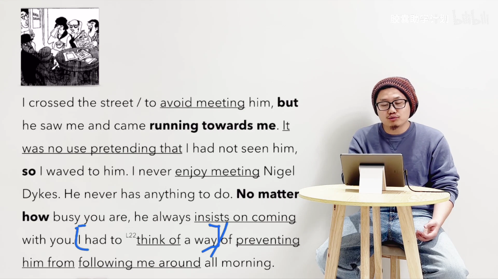

文字识别：I crossed the street/ to avoid meeting him, but / he saw me and came running towards me. It / was no use pretending that I had not seen him, / so I waved to him. I never enjoy meeting Nigel / Dykes. He never has anything to do. No matter / how busy you are, he always insists on coming / with you.I had to 2²think of a way6f preventing / him from following me around all morning.

## 00:07:00–00:07:30

上下文就能理解它是方式还是路了。在这儿是方式的意思，说我不得不想一个辙啊，我们北方话叫辙啊，不得不想一条路啊，想这么个方法啊，什么啊方法？什么样的方法呢？后边 of，你看 of 自己本身是个介词，首先这就解解释了 prevent 为什么用的是 preventing，在 ing 二十课这个咱们正经是学过，介词后边如果出现动词，这动

### 画面 00:07:07

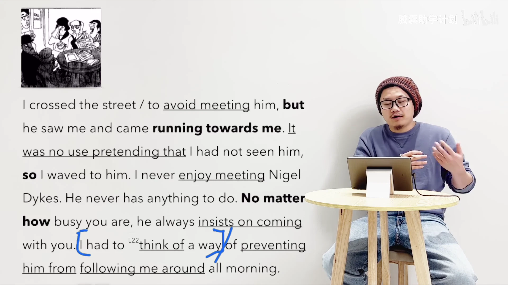

文字识别：I crossed the street / to avoid meeting him, but / he saw me and came running towards me. It / was no use pretending that I had not seen him, / so I waved to him. I never enjoy meeting Nigel / Dykes. He never has anything to do. No matter / how busy you are, he always insists on coming / with you.[had t 2²think of a wayf preventing / him from following me around all morning.

## 00:07:30–00:08:00

词你就给我必须要把它变成动名词，对吧？哎，叫做 preventing 啊。然后呢， prevent him from doing something 呢？这个在单词部分咱们讲过了，阻止某人做某事儿，对吧？我要不得不想出来一个方法，干嘛呢？阻止他做某件事情，做的是什么呢？你看 from 后边也是加 doing，对吧？所以是 following me around all morning。那这儿就引出来了第三个习惯用法，所以

### 画面 00:07:37

文字识别：I crossed the street / to avoid meeting him, but / he saw me and came running towards me. It / was no use pretending that I had not seen him, / so I waved to him. I never enjoy meeting Nigel / Dykes. He never has anything to do. No matter / how busy you are, he always insists on coming / with you.Ihad to 2think of a wayof preventing / him from following me around all morning.

## 00:08:00–00:08:30

这一句话当中有三个。第三个习惯用法叫做 follow me around，或者说 follow somebody around，对吧？你可以说 follow you around， follow him around， follow her around， follow Leo around， follow me around，对吧？那 follow me around 叫做四处跟着我，all morning 叫整个早晨。好，整句话我们给各位把语法解释清楚了之后呢，我们连贯的来翻译一遍。我当时不得不想到这样一个折啊，或者这

### 画面 00:08:06

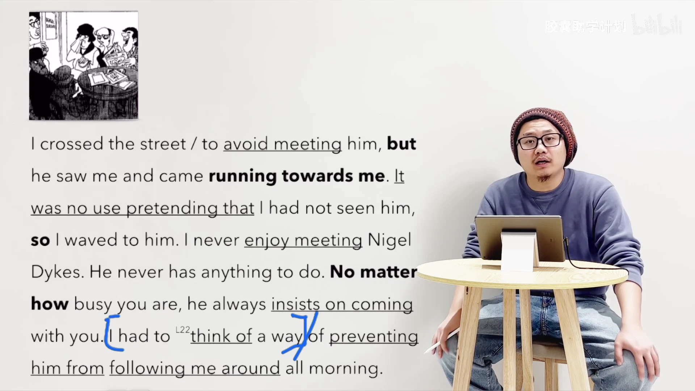

文字识别：I crossed the street/ to avoid meeting him, but / he saw me and came running towards me. It / was no use pretending that I had not seen him, / so I waved to him. I never enjoy meeting Nigel / Dykes. He never has anything to do. No matter / how busy you are, he always insists on coming / with you.[had t 2²think of a wayf preventing / him from following me around all morning.

### 画面 00:08:11

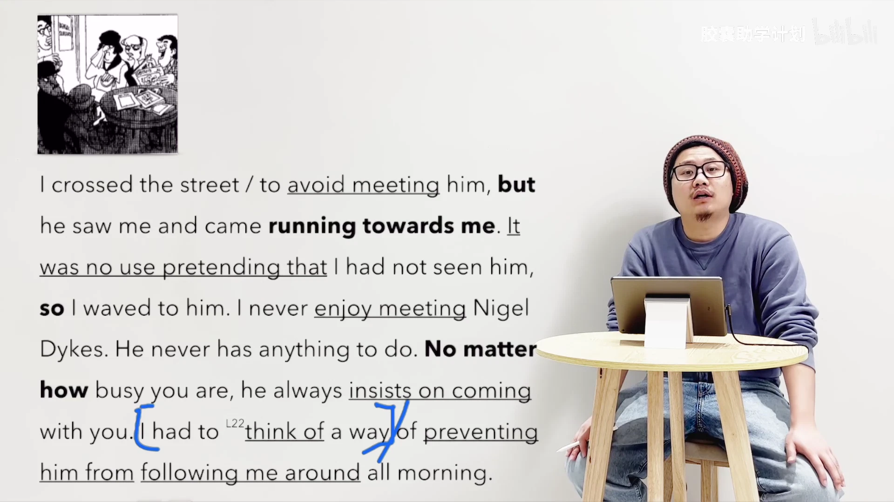

文字识别：I crossed the street/ to avoid meeting him, but / he saw me and came running towards me. It / was no use pretending that I had not seen him, / so I waved to him. I never enjoy meeting Nigel / Dykes. He never has anything to do. No matter / how busy you are, he always insists on coming / with you.I had to 2²think of a wayof preventing / him from following me around all morning.

### 画面 00:08:20

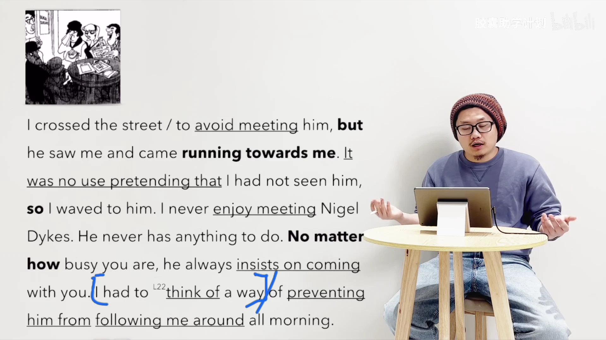

文字识别：I crossed the street / to avoid meeting him, but / he saw me and came running towards me. It / was no use pretending that I had not seen him, / so I waved to him.I never enjoy meeting Nigel / Dykes. He never has anything to do. No matter / how busy you are, he always insists on coming / with you. had to 2²think of a wayf preventing / him from following me around all morning.

## 00:08:30–00:09:00

样一个方法方式怎么样呢？去阻止他跟随着四处跟着我整个早晨，就是阻止他整个早晨四处跟着我，像跟屁虫一样四处跟着我，哎，溜达，对吧？OK， continue. Hi, hello Nigel. I said, fancy meeting you here. 大概那个感觉就我的天哪，想不到在这儿遇见你了。但是他说的时候，可能碍于面子，还是那种高高兴兴的 fancy meeting

### 画面 00:08:45

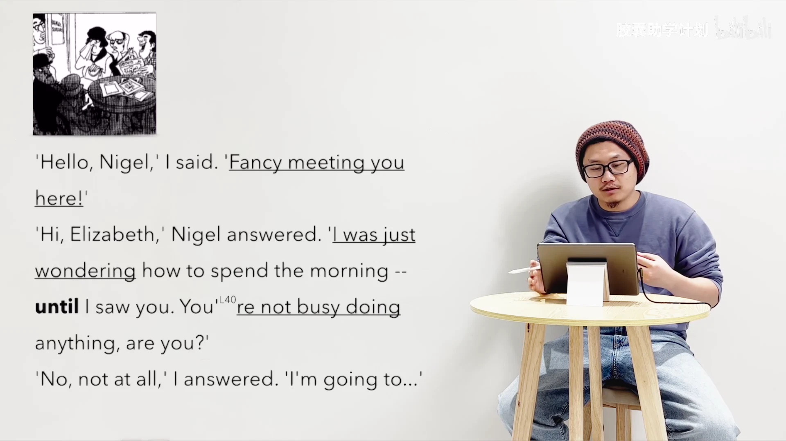

文字识别：'Hello, Nigel,'I said.'Fancy meeting you / here!' / 'Hi, Elizabeth,' Nigel answered.'Lwas just / wondering how to spend the morning / until I saw you. You'4&re not busy doing / anything, are you?' / 'No, not at all,'I answered.'I'm going to.."

### 画面 00:08:53

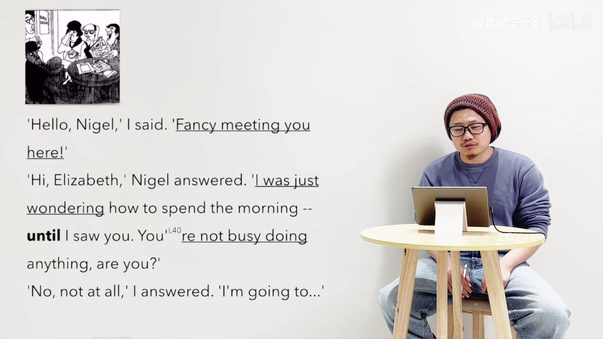

文字识别：'Hello, Nigel,'I said.'Fancy meeting you / here!' / 'Hi, Elizabeth,' Nigel answered.'Lwas just / wondering how to spend the morning / until l saw you. You'4re not busy doing / anything, are you?' / 'No, not at all,'I answered.'I'm going to..

### 画面 00:08:59

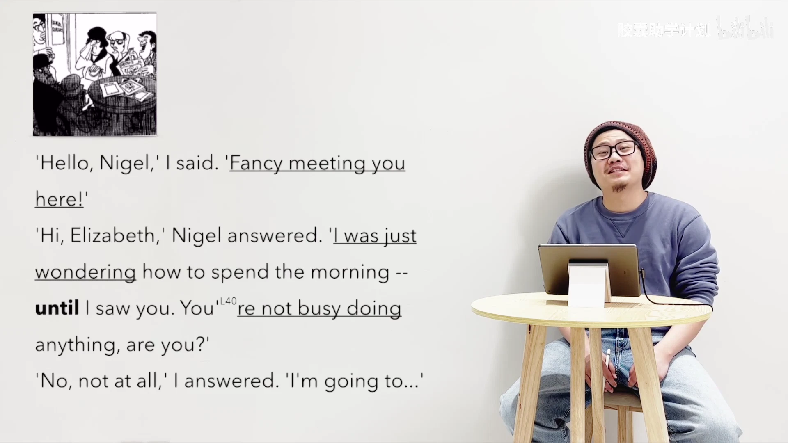

文字识别：'Hello, Nigel,' I said.'Fancy meeting you / here!' / 'Hi, Elizabeth,' Nigel answered.'Lwas just / wondering how to spend the morning / until I saw you. You'4re not busy doing / anything, are you?' / 'No, not at all,'I answered.'m going to..

## 00:09:00–00:09:30

here. 心里想的就是我的天哪，咋在这儿遇见你了啊？他不想见他嘛，对不对？ Hi, Elizabeth. Nigel answered. 我们看一下这个对话反映人的性格啊。这里的重点就是 Nigel 这个人嘛。他说上来第一句话叫 I was just wondering how to spend the morning until I saw you. 这句话很有意思。首先，这里的 I was wondering, I was wondering 呢。你如果想尝试给他直译，说

### 画面 00:09:29

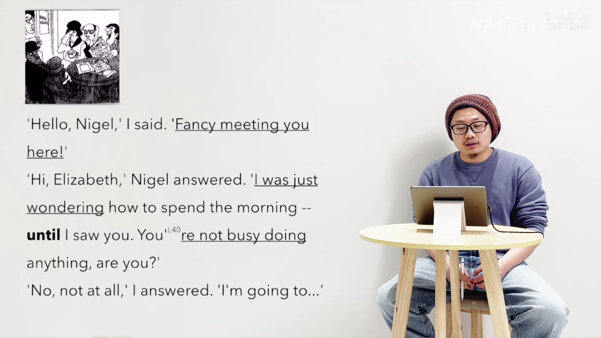

文字识别：'Hello, Nigel,'I said.'Fancy meeting you / here!' / 'Hi, Elizabeth,' Nigel answered.'Lwas just / wondering how to spend the morning / until I saw you. You'4&re not busy doing / anything, are you?' / 'No, not at all,'I answered.'m going to..'

## 00:09:30–00:10:00

我正在好奇，会稍微有点怪。其实就是我刚刚还在想，其实就是类似于我想的意思，thinking啊，类似于同义词。只不过英文当中，I was wondering是很常见表达礼貌的一种，呃，这个呃习惯用法啊。一会儿进入习惯用法的时候，我们会，你看我这是加下划线了吧？一会儿我们会重点讲。还是那句话，您现在只要知道它什么含义就够了。更多的讲解和练习在马上接下来的这

### 画面 00:09:41

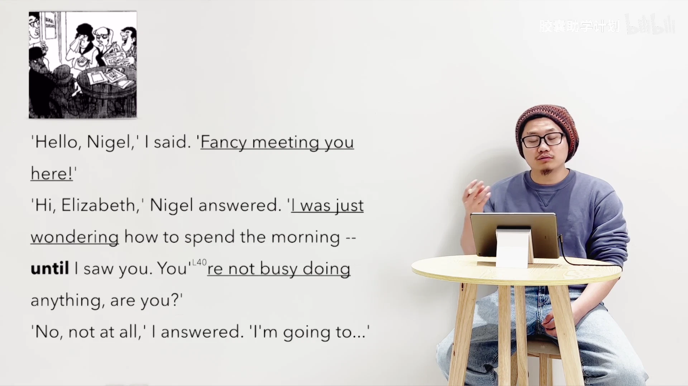

文字识别：'Hello, Nigel,'I said.'Fancy meeting you / here!' / 'Hi, Elizabeth,' Nigel answered.'Lwas just / wondering how to spend the morning / until I saw you. You'4ore not busy doing / anything, are you?' / 'No, not at all,'I answered.'I'm going to..

## 00:10:00–00:10:30

个习惯用法造句那个部分我们再说啊。说我刚才还刚刚在想如何去度过这个早晨。注意 how to，这个不是典型的一句话，看见了吧？这个我们在五十课啊，我自己一个人 go on excursion，对吧？我一个人去郊游的那一刻，咱们学过啊，那课咱们学过，你可以翻过去再看一下。但是它的含义很容易理解，how to spend the morning，叫如何度过这个早晨。Until I

### 画面 00:10:11

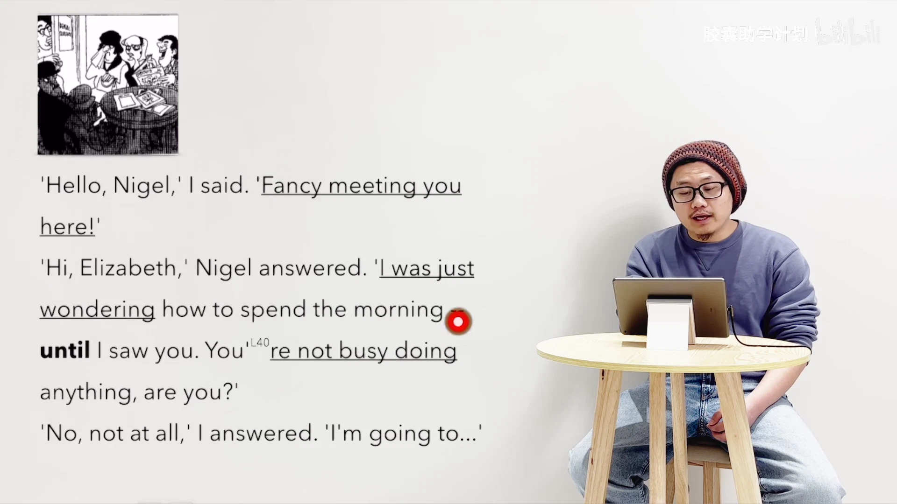

文字识别：K4 / 'Hello, Nigel,'I said.'Fancy meeting you / here!' / 'Hi, Elizabeth,' Nigel answered.'Lwas just / wondering how to spend the morning / until l saw you. You'4re not busy doing / anything, are you?' / 'No, not at all,'I answered.'m going to.."

## 00:10:30–00:11:00

saw you,直到我见到了。你想这句话的潜台词是啥？就是在见到你之前，我还在想我今儿早上咋过。但见到你之后，我就豁然开朗了。为啥？我跟着你就完了呗，对吧？哎，我跟着你就完了呗。Continue，他接着说，You are not busy doing anything, are you?首先，be busy doing something，四十课咱们学过，叫忙于做某件事情。他说的是你没

### 画面 00:10:32

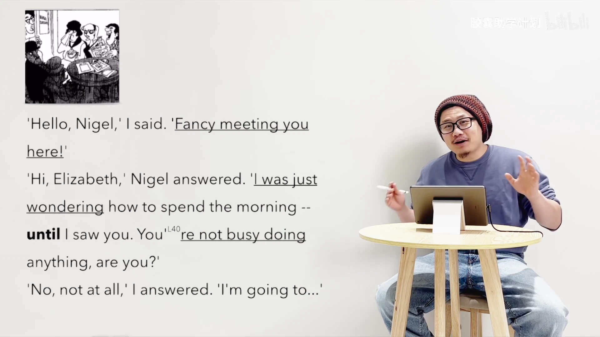

文字识别：'Hello, Nigel,'I said.'Fancy meeting you / here!' / 'Hi, Elizabeth,' Nigel answered.'Lwas just / wondering how to spend the morning / until saw you. You'4re not busy doing / anything, are you?' / 'No, not at all,'I answered.'I'm going to.."

### 画面 00:10:35

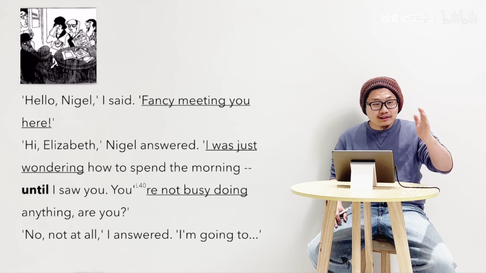

文字识别：'Hello, Nigel,'I said.'Fancy meeting you / here!' / 'Hi, Elizabeth,' Nigel answered.'Lwas just / wondering how to spend the morning / until I saw you. You'4re not busy doing / anything, are you?' / 'No, not at all,'I answered.'m going to..

## 00:11:00–00:11:30

有忙于做任何事儿，Are you就等于right，对吧？就咱们新一就学过的语法啊。说你没有忙于做任何事情，对吗？No, not at all. I'm不不不，一点也不忙。I answered.我回答道。I'm going to.注意精彩的部分来了，点儿点儿点儿是什么意思？就是ellipsis，这句话还没说完。说忙不忙？说哎，不忙不忙。说我要去去后哪

### 画面 00:11:05

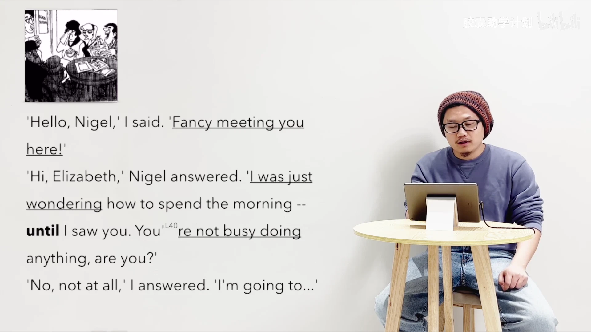

文字识别：'Hello, Nigel,'I said.'Fancy meeting you / here!' / 'Hi, Elizabeth,' Nigel answered.'Lwas just / wondering how to spend the morning / until I saw you. You'4&re not busy doing / anything, are you?' / 'No, not at all,'I answered.'I'm going to..

## 00:11:30–00:12:00

儿还没说完呢？Nigel Dykes就说了一句话，叫Would you mind my coming with you？我们先不管my这个语法，我们先说Would you mind doing something？这个叫你介不介意做某件事情？所以这句话直接翻译成叫你介不介意我和你一起去？He asked，他问道。Before I had finished speaking，在我甚至说完话之前，

### 画面 00:11:30

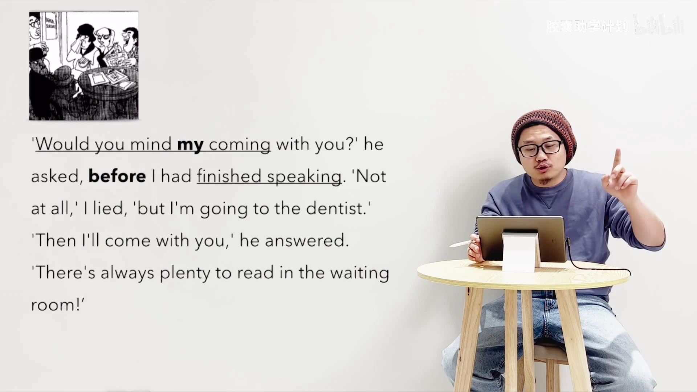

文字识别：'Would you mind my coming with you?' he / asked, before I had finished speaking.'Not / at all, I lied, 'but l'm going to the dentist.' / 'Then I'll come with you,' he answered. / 'There's always plenty to read in the waiting / room!'

## 00:12:00–00:12:30

他就开始问了。所以这个场景是什么呢？我见到你了，Nigel见到Elizabeth。假设我现在是Nigel啊，对，他是Elizabeth。我见到他了，我说哎呀，我我还在想呢，说今儿早上怎么过，是吧？我见到你，我心里豁然开朗了，对吧？哎，拨开云雾见天日了啊，非常开心。然后我说你忙吗？然后这个他回答我，他说不忙，我要去。我说哎，特别好啊，我都不管你去哪儿，对吧？你介不介意我，我和你一起去啊？就是这种表达。

### 画面 00:12:00

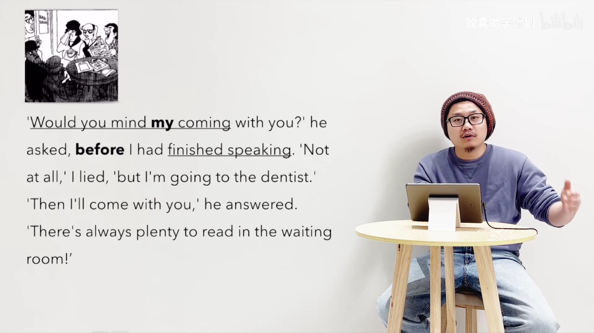

文字识别：'Would you mind my coming with you?' he / asked, before I had finished speaking.'Not / at all, I lied, 'but l'm going to the dentist.' / 'Then I'll come with you,' he answered. / 'There's always plenty to read in the waiting / room!'

### 画面 00:12:11

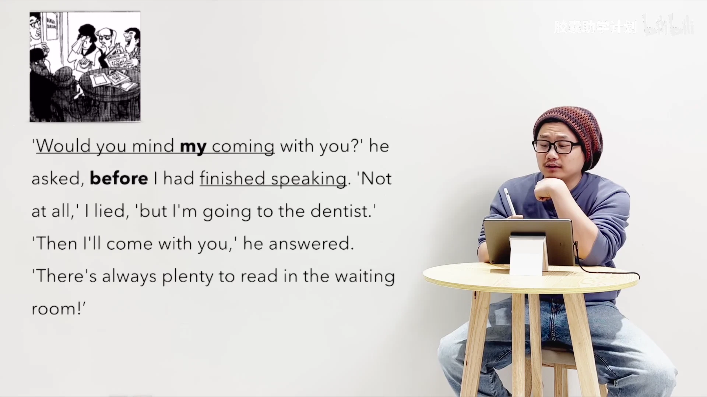

文字识别：'Would you mind my coming with you?' he / asked, before I had finished speaking.'Not / at all, I lied, 'but l'm going to the dentist.' / 'Then I'll come with you,' he answered. / 'There's always plenty to read in the waiting / room!'

### 画面 00:12:13

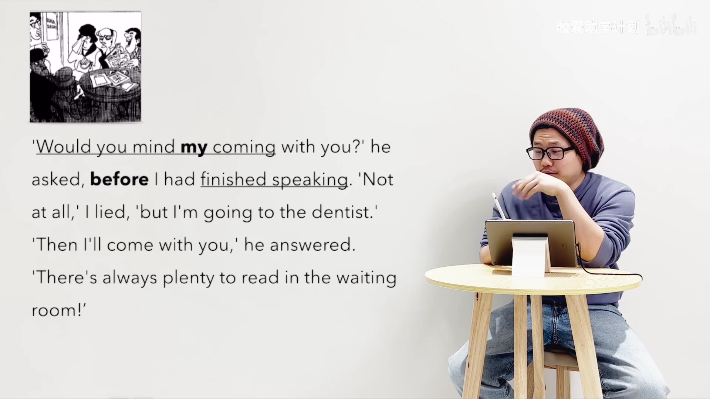

文字识别：'Would you mind my coming with you?' he / asked, before I had finished speaking.'Not / at all, I lied, 'but l'm going to the dentist.' / 'Then I'll come with you,' he answered. / 'There's always plenty to read in the waiting / room!'

## 00:12:30–00:13:00

达，所以他其实通过这种没有让他把话说完，就让这个 Nigel 抢了一句话，这人物性格就特别的明显了，就什么性格，你爱去哪儿去哪儿，我不关心，但我特别想跟着你，只要能让我跟着你就可以了，去哪儿都行，是吧？好，所以他这儿用的是 before I had finished speaking，在我说完话之前，他就问了我说你介不介意和我一起去？那这里有几个小点我们要说一下啊， before 很容易理解啊，在什

### 画面 00:12:41

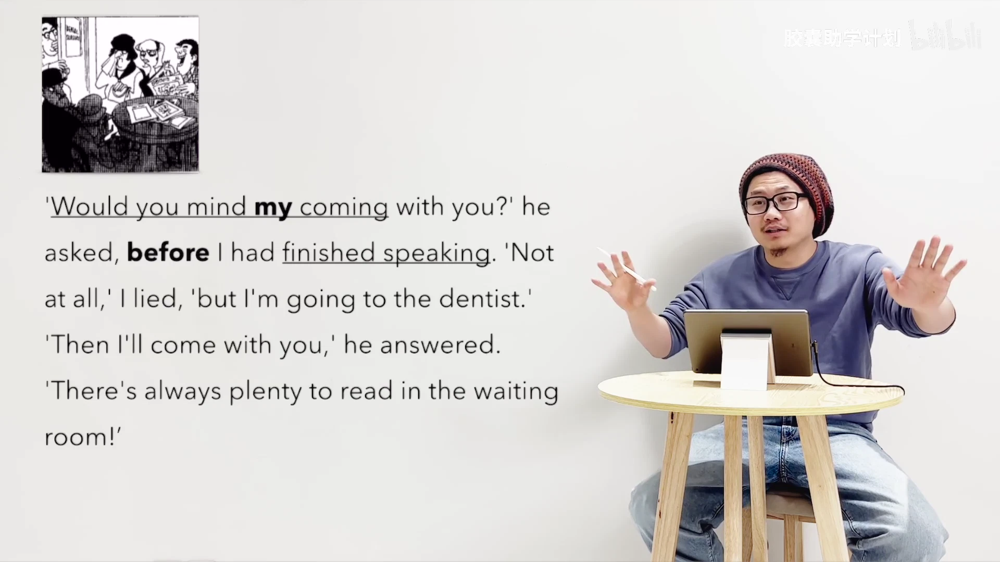

文字识别：'Would you mind my coming with you?' he / asked, before I had finished speaking.'Not / at all, I lied, 'but l'm going to the dentist.' / 'Then I'll come with you,' he answered. / 'There's always plenty to read in the waiting / room!'

### 画面 00:12:43

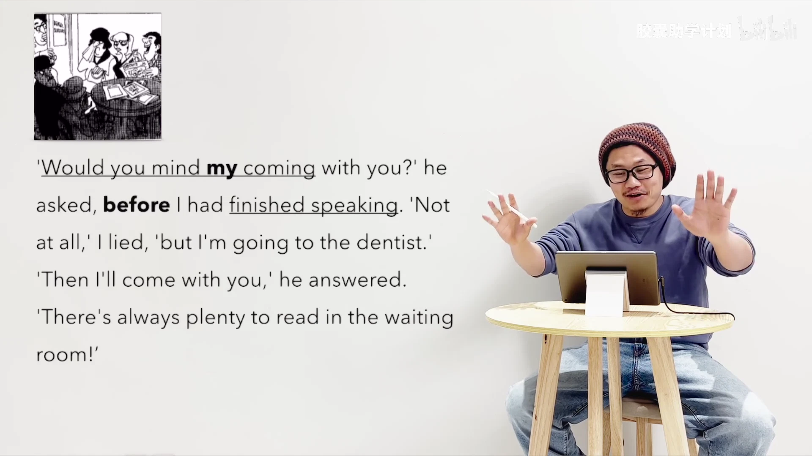

文字识别：'Would you mind my coming with you?' he / asked, before I had finished speaking.'Not / at all, I lied, 'but l'm going to the dentist.' / 'Then I'll come with you,' he answered. / 'There's always plenty to read in the waiting / room!'

### 画面 00:12:45

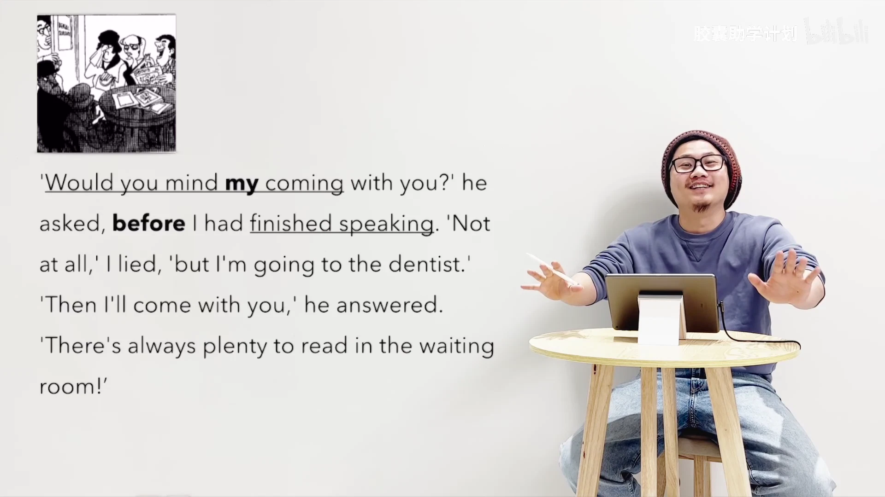

文字识别：'Would you mind my coming with you?' he / asked, before I had finished speaking.'Not / at all,'I lied, 'but l'm going to the dentist.' / 'Then I'll come with you,' he answered. / 'There's always plenty to read in the waiting / room!'

### 画面 00:12:57

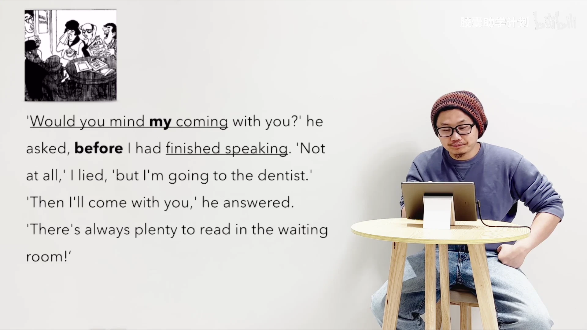

文字识别：'Would you mind my coming with you?' he / asked, before I had finished speaking.'Not / at all,'I lied, 'but l'm going to the dentist.' / 'Then I'll come with you,' he answered. / 'There's always plenty to read in the waiting / room!

## 00:13:00–00:13:30

么什么之前，这里的finish doing something叫完成做某件事儿，是吧？Okay.然后呢，这里有一个小点叫Would you mind my coming with you？同理，它其实是一个动名词逻辑主语的一个小的语法。这个小的语法呢，本身并不难。在这儿，第一步，您只要文章能看懂就行了。第二步，马上我们去进行讲解啊。我们有一个前后的顺序。那我为了不破坏故事的完整性啊，所以他

### 画面 00:13:27

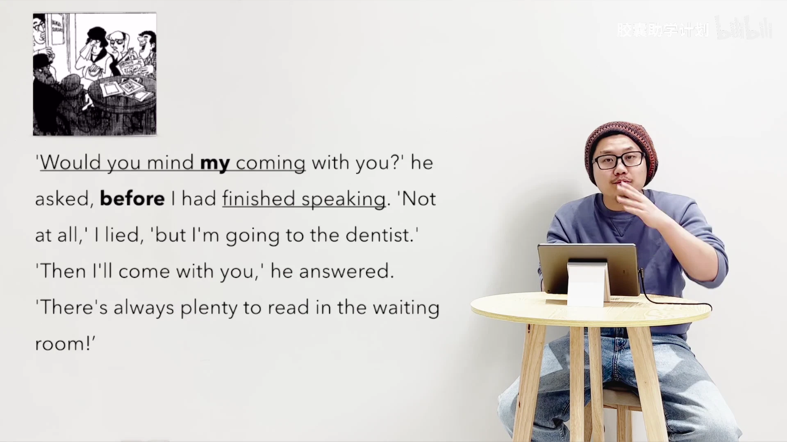

文字识别：'Would you mind my coming with you?' he / asked, before I had finished speaking.'Not / at all, I lied, 'but l'm going to the dentist.' / 'Then I'll come with you,' he answered. / 'There's always plenty to read in the waiting / room!'

## 00:13:30–00:14:00

说的是，Would you mind?你介不介意My coming with you叫做我的来和你一起。所以你如果一个单词一个单词去翻译的时候，你会觉得有点怪，因为你会觉得说你介不介意我和你一起去就行了。为什么用我的呢？你可能会觉得，比如说用个I，用个me不就行了吗？对吧？为啥这儿用my啊？这个一会儿我们再去说啊。但是你现在我先告诉你，你尝试去理解它的含义，就是你介不介意我和你一起去，就翻译成我

### 画面 00:13:57

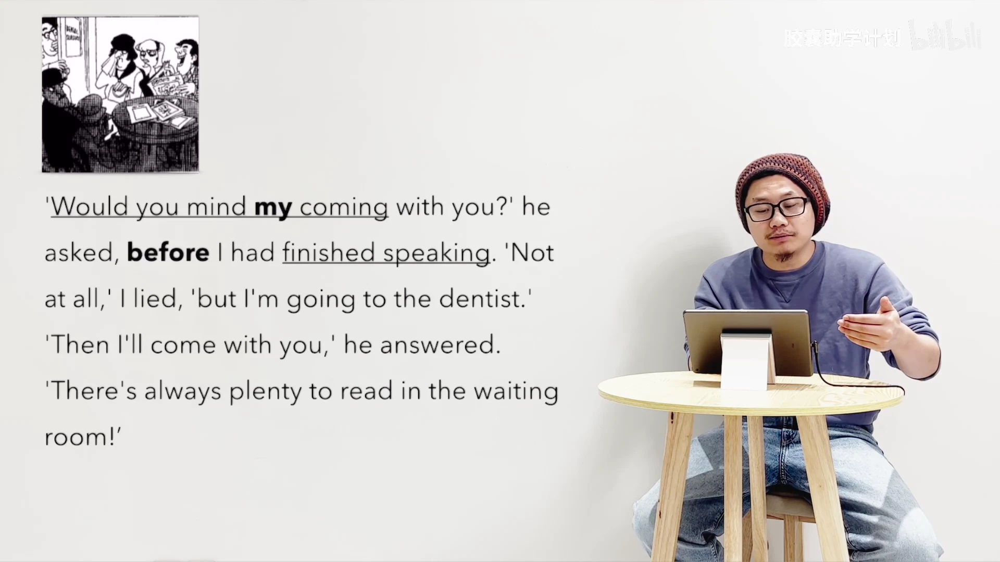

文字识别：'Would you mind my coming with you?' he / asked, before I had finished speaking.'Not / at all,'I lied, 'but l'm going to the dentist.' / 'Then I'll come with you,' he answered. / 'There's always plenty to read in the waiting / room!'

## 00:14:00–00:14:30

翻译成我的啊。好，我们先往后走。Not at all, I lied，一点儿也不，I lied，很有意思，我撒谎了，我很介意，但我撒谎了，碍于情面是吧？But I'm going to the dentist，但是呢，我我现在要去牙医那个地儿，是吧？所以他可能会觉得说，我去牙医，牙医那儿也没啥可去的，你就别跟着我了，对吧？你就别跟着我了，不行，

### 画面 00:14:27

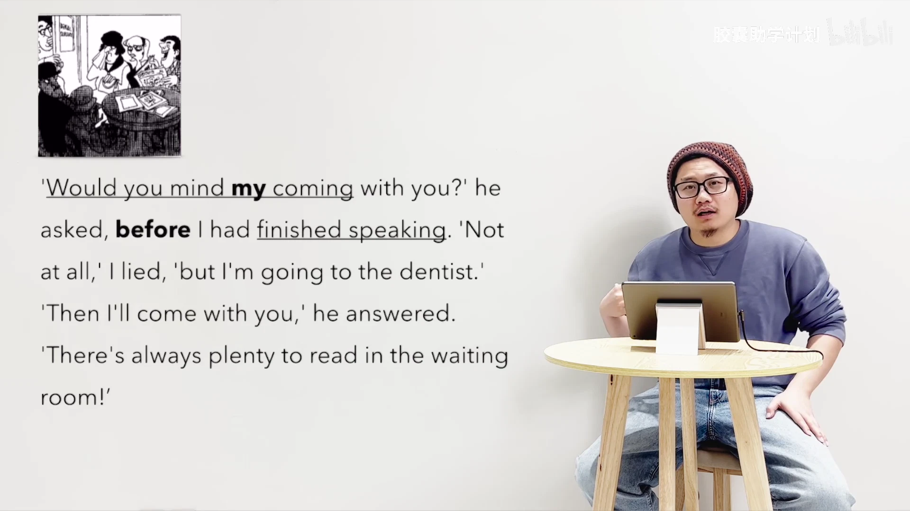

文字识别：'Would you mind my coming with you?' he / asked, before I had finished speaking.'Not / at all,'I lied, 'but l'm going to the dentist.' / 'Then I'll come with you,' he answered. / 'There's always plenty to read in the waiting / room!'

## 00:14:30–00:15:00

不的。那又说什么呢？说 Then I'll come with you. 说那那好了，那我就和你一起去了。 He answered. 他回答道， There is always plenty to read in the waiting room. 说总是有足够多的东西可以读，在哪儿呢？在等候室当中。这个 waiting room 直接就是一个固定搭配，你给他记住就行了。等候室啊，总是有足够多的东西可以读。哎，这就刻画出来了，为啥最开始这 Elizabeth 见到他就想

### 画面 00:14:57

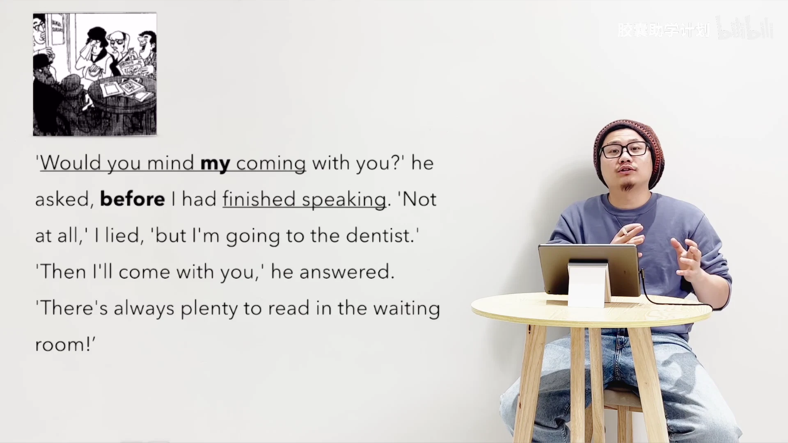

文字识别：'Would you mind my coming with you?' he / asked, before I had finished speaking.'Not / at all, I lied, 'but l'm going to the dentist.' / 'Then I'll come with you,' he answered. / 'There's always plenty to read in the waiting / room!'

## 00:15:00–00:15:30

跑啊，他他他总四处跟着你，对吧？就给你弄得很心烦。他也他其实也不是什么恶意，就是这个人闲的无聊，就爱跟着别人溜达。你去哪儿我都跟着你去，对吧？OK，那接下来呢，我们就把语法跟习惯用法杂糅到一块儿了，因为本课的语法也并不是特别难。我们罗列出来了这些，挨个讲。这块注意力要集中。文章过去了，这些就是最精髓的东西啊。第一个 enjoy doing something 很简单，我们不多废话，就是享

### 画面 00:15:12

文字识别：习惯用法造句 / enjoy doing / sth. / no matter / how/what/where / follow sb. around / I was wondering …+句子 / would you mind /  my doing. / finish doing sth.

### 画面 00:15:14

文字识别：习惯用法造句 / enjoy / doing / sth. / no matter / how/what/where / follow sb. around / I was wondering / …+句子 / would you mind / d my doing. / finish doing sth.

### 画面 00:15:16

文字识别：习惯用法造句 / enjoy / doing / sth. / no matter / how/what/where / follow / sb.around / was / wondering / …+句子 / would you mind / d my doing. / finish doing s / sth.

### 画面 00:15:18

文字识别：习惯用法造句 / enjoy / doing / sth. / no matter / how/what/where / follow sb. around / I was wondering / …+句子 / would you mind / dmy doing. / finish doing sth.

### 画面 00:15:20

文字识别：习惯用法造句 / enjoy / doing / sth. / no matter / how/what/where / follow / 1sb.around / Iwas / wondering / …+句子 / would you mind / d my doing. / finish doing s / sth.

### 画面 00:15:22

文字识别：习惯用法造句 / enjoy / doing / sth. / no matter / how/what/where / follow / sb.around / I was wondering / …+句子 / would you mind / dmy doing. / finish doing s / sth.

### 画面 00:15:24

文字识别：习惯用法造句 / enjoy / doing / sth. / no matter / how/what/where / follow sb.around / I was wondering / …+句子 / would you mind / d my doing. / finish doing s / sth.

### 画面 00:15:26

文字识别：网：v.+v.变化 / 习惯用法造句指南 / 妻助字计划 / 四句型转换 / 方式/地点/时间 / 其他习惯用法 / 其他单词+词性 / 原文摘抄+变 / 6123456 / enjoy doing sth.

### 画面 00:15:28

文字识别：网：v.+v.变化 / 习惯用法造句指南 / 四句型转换 / 方式/地点/时间 / 其他习惯用法 / 其他单词+词性 / 原文摘抄+变 / 6123456 / enjoy doing sth. / I enjoy reading every night before I go to / bed.

## 00:15:30–00:16:00

受做某件事情。Repeat after me就可以了。I enjoy reading every night before I go to bed. I enjoy drinking tea in the afternoon. 四句型转换非常简单。接下来这个小的重点，刚才那个很简单，我们就不多提了啊。这个很重要，你注意力集中。No matter后边可以加的东西，how, what, where, whose, who, which, when全可以加，无非就是那些特殊疑问词嘛。

### 画面 00:15:30

文字识别：网：v.+v.变化 / 习惯用法造句指南 / 四句型转换 / 方式/地点/时间 / 其他习惯用法 / 其他单词+词性 / 原文摘抄+变 / 6123456 / enjoy doing sth. / I enjoy reading every night before I go to / bed.

### 画面 00:15:34

文字识别：网：v.+v.变化 / 习惯用法造句指南 / 四句型转换 / 方式/地点/时间 / 其他习惯用法 / 其他单词+词性 / 原文摘抄+变 / 6123456 / enjoy doing sth. / I enjoy reading every night before I go to / bed.

### 画面 00:15:37

文字识别：网：v.+v.变化 / 习惯用法造句指南 / 四句型转换 / 方式/地点/时间 / 其他习惯用法 / 其他单词+词性 / 原文摘抄+变 / 6123456 / enjoy doing sth. / ■I enjoy reading every night before I go to / bed. / I enjoy drinking tea in the afternoon.

### 画面 00:15:39

文字识别：网：v.+v.变化 / 习惯用法造句指南 / 四句型转换 / 方式/地点/时间 / 其他习惯用法 / 其他单词+词性 / 原文摘抄+变 / 6123456 / enjoy doing sth. / I enjoy reading every night before I go to / bed. / I enjoy drinking tea in the afternoon. / do/why/what/when..

### 画面 00:15:41

文字识别：网：v.+v.变化 / 习惯用法造句指南 / 四句型转换 / 方式/地点/时间 / 其他习惯用法 / 其他单词+词性 / 原文摘抄+变 / 6123456 / enjoy doing sth. / I enjoy reading every night before I go to / bed. / I enjoy drinking tea in the afternoon. / do/why/what/when..

### 画面 00:15:43

文字识别：网：v.+v.变化 /  Meaning: It is not / 习惯用法造句指南 / 臺助字计划 / 四句型转换 / important who/what... / 无论&不管谁&什么 etc. / 方式/地点/时间 / conj. / 其他习惯用法 / 让步状语从句 / 其他单词+词性 / 原文摘抄+变 / 6123456 / no matter how/what/where/whose/who/which/when

### 画面 00:15:45

文字识别：网：v.+v.变化 /  Meaning: It is not / 习惯用法造句指南 / 四句型转换 / important who/what... / 无论&不管谁&什么 etc. / 方式/地点/时间 / conj. / 其他习惯用法 / 让步状语从句 / 其他单词+词性 / 原文摘抄+变 / 6123456 / no matter how/what/where/whose/who/which/when

### 画面 00:15:49

文字识别：网：v.+v.变化 /  Meaning: It is not / 习惯用法造句指南 / 臺助字计划 / 四句型转换 / important who/what.. / 无论&不管谁&什么 etc. / 方式/地点/时间 / conj. / 其他习惯用法 / 让步状语从句 / 其他单词+词性 / 原文摘抄+变 / 6123456 / no matter how/what/where/whose/who/which/when

### 画面 00:15:54

文字识别：网：v.+v.变化 /  Meaning: It is not / 习惯用法造句指南 / 囊助字计划 / 四句型转换 / important who/what... / 无论&不管谁&什么 etc. / 方式/地点/时间 / conj. / 其他习惯用法 / 让步状语从句 / 其他单词+词性 / 原文摘抄+变 / 6123456 / no matter how/what/where/whose/who/which/when

### 画面 00:15:56

文字识别：网：v.+v.变化 /  Meaning: It is not / 习惯用法造句指南 / 四句型转换 / important who/what... / 无论&不管谁&什么 etc. / 方式/地点/时间 / conj. / 其他习惯用法 / 让步状语从句 / 其他单词+词性 / 原文摘抄+变 / 6123456 / no matter how/what/where/whose/who/which/when

### 画面 00:15:58

文字识别：网：v.+v.变化 /  Meaning: It is not / 习惯用法造句指南 / 四句型转换 / important who/what... / 无论&不管谁&什么 etc. / 方式/地点/时间 / conj. / 其他习惯用法 / 让步状语从句 / 其他单词+词性 / 原文摘抄+变 / 6123456 / no matter how/what/where/whose/who/which/when

## 00:16:00–00:16:30

怎么翻译呢？他说 It is not important who what。说并不是特别的重要，谁呀还是什么呀？包括你后边可以把这些所有特殊疑问词都放上去，就不是很重要是谁，不是很重要是什么。所以，我们汉语直接就给它翻译成不论啊，比如说不论如何，不论什么，不论在哪里，不论是谁的，不论是谁啊，也可以说不管啊，无论或者不

### 画面 00:16:00

文字识别：网：v.+v.变化 /  Meaning: It is not / 习惯用法造句指南 / 四句型转换 / important who/what... / 无论&不管谁&什么 etc. / 方式/地点/时间 / conj. / 其他习惯用法 / 让步状语从句 / 其他单词+词性 / 原文摘抄+变 / 6123456 / no matter how/what/where/whose/who/which/when

### 画面 00:16:04

文字识别：网：v.+v.变化 /  Meaning: It is not / 习惯用法造句指南 / 字计划 / 四句型转换 / important who/what.. / 无论&不管谁&什么 etc. / 方式/地点/时间 / conj. / 其他习惯用法 / 让步状语从句 / 其他单词+词性 / 原文摘抄+变 / 6123456 / no matter how/what/where/whose/who/which/when

### 画面 00:16:08

文字识别：网：v.+v.变化 /  Meaning: It is not / 习惯用法造句指南 / 建助学计划 / 四句型转换 / important who/what... / 无论&不管谁&什么 etc. / 方式/地点/时间 / conj. / 其他习惯用法 / 让步状语从句 / 其他单词+词性 / 原文摘抄+变 / 6123456 / no matter how/what/where/whose/who/which/when

### 画面 00:16:10

文字识别：网：v.+v.变化 /  Meaning: It is not / 习惯用法造句指南 / 囊助字计划 / 四句型转换 / important who/what.. / 无论&不管谁&什么 etc. / 方式/地点/时间 / conj. / 其他习惯用法 / 让步状语从句 / 其他单词+词性 / 原文摘抄+变 / 6123456 / no matter how/what/where/whose/who/which/when

### 画面 00:16:14

文字识别：网：v.+v.变化 /  Meaning: It is not / 习惯用法造句指南 / 臺助学计划 / 四句型转换 / important who/what... / 无论&不管谁&什么 etc. / 方式/地点/时间 / conj. / 其他习惯用法 / 让步状语从句 / 其他单词+词性 / 原文摘抄+变 / 6123456 / no matter how/what/where/whose/who/which/when

### 画面 00:16:16

文字识别：网：v.+v.变化 /  Meaning: It is not / 习惯用法造句指南 / 素助字计划 / 四句型转换 / important who/what... / 无论&不管谁&什么 etc. / 方式/地点/时间 / conj. / 其他习惯用法 / 让步状语从句 / 其他单词+词性 / 原文摘抄+变 / 6123456 / no matter how/what/where/whose/who/which/when

### 画面 00:16:19

文字识别：网：v.+v.变化 /  Meaning: It is not / 习惯用法造句指南 / 四句型转换 / important who/what.. / 无论&不管谁&什么 etc. / 方式/地点/时间 / conj. / 其他习惯用法 / 让步状语从句 / 其他单词+词性 / 原文摘抄+变 / 6123456 / no matter how/what/where/whose/who/which/when

### 画面 00:16:24

文字识别：网：v.+v.变化 /  Meaning: It is not / 习惯用法造句指南 / 四句型转换 / important who/what... / 无论&不管谁&什么 etc. / 方式/地点/时间 / conj. / 其他习惯用法 / 让步状语从句 / 其他单词+词性 / 原文摘抄+变 / 6123456 / no matter how/what/where/whose/who/which/when

### 画面 00:16:29

文字识别：网：v.+v.变化 /  Meaning: It is not / 习惯用法造句指南 / 奏助学计划 / 四句型转换 / important who/what... / 无论&不管谁&什么 etc. / 方式/地点/时间 / conj. / 其他习惯用法 / 让步状语从句 / 其他单词+词性 / 原文摘抄+变 / 6123456 / no matter how/what/where/whose/who/which/when

## 00:16:30–00:17:00

不管是谁或者什么，对吧？哎，不管在哪里啊，no matter where，明白了吧？OK，所以它其实本身起到的是虽然这点，这个叫什么呢？我们管它叫连词啊，它其实本身起到了一个连词的作用，所以它连接的是一个从句，所以我们才管它叫让步状语从句。至于这个让步状语从句呢，哥，如果纯哥我自己我都不放了，因为我觉得没什么必必要。但有很多同学，你以前学过不同的老师讲的，所以我还是放到这让你

### 画面 00:16:32

文字识别：网：v.+v.变化 /  Meaning: It is not / 习惯用法造句指南 / 四句型转换 / important who/what... / 无论&不管谁&什么 etc. / 方式/地点/时间 / conj. / 其他习惯用法 / 让步状语从句 / 其他单词+词性 / 原文摘抄+变 / 6123456 / no matter how/what/where/whose/who/which/when

### 画面 00:16:34

文字识别：网：v.+v.变化 /  Meaning: It is not / 习惯用法造句指南 / 囊助字计划 / 四句型转换 / important who/what... / 无论&不管谁&什么 etc. / 方式/地点/时间 / conj. / 其他习惯用法 / 让步状语从句 / 其他单词+词性 / 原文摘抄+变 / 6123456 / no matter how/what/where/whose/who/which/when

### 画面 00:16:37

文字识别：网：v.+v.变化 /  Meaning: It is not / 习惯用法造句指南 / 喜助字计划 / 四句型转换 / important who/what... / 无论&不管谁&什么 etc. / 方式/地点/时间 / conj. / 其他习惯用法 / 让步状语从句 / 其他单词+词性 / 原文摘抄+变 / 6123456 / no matter how/what/where/whose/who/which/when

### 画面 00:16:39

文字识别：网：v.+v.变化 /  Meaning: It is not / 习惯用法造句指南 / 四句型转换 / important who/what... / 无论&不管谁&什么 etc. / 方式/地点/时间 / conj. / 其他习惯用法 / 让步状语从句 / 其他单词+词性 / 原文摘抄+变 / 6123456 / no matter how/what/where/whose/who/which/when

### 画面 00:16:44

文字识别：网：v.+v.变化 /  Meaning: It is not / 习惯用法造句指南 / 四句型转换 / important who/what... / 无论&不管谁&什么 etc. / 方式/地点/时间 / conj. / 其他习惯用法 / 让步状语从句 / 其他单词+词性 / 原文摘抄+变 / 6123456 / no matter how/what/where/whose/who/which/when

### 画面 00:16:47

文字识别：网：v.+v.变化 /  Meaning: It is not / 习惯用法造句指南 / 四句型转换 / important who/what.. / 无论&不管谁&什么 etc. / 方式/地点/时间 / conj. / 其他习惯用法 / 让步状语从句 / 其他单词+词性 / 原文摘抄+变 / 6123456 / no matter how/what/where/whose/who/which/when

### 画面 00:16:49

文字识别：网：v.+v.变化 /  Meaning: It is not / 习惯用法造句指南 / 四句型转换 / important who/what... / 无论&不管谁&什么 etc. / 方式/地点/时间 / conj. / 其他习惯用法 / 让步状语从句 / 其他单词+词性 / 原文摘抄+变 / 6123456 / no matter how/what/where/whose/who/which/when

### 画面 00:16:54

文字识别：网：v.+v.变化 /  Meaning: It is not / 习惯用法造句指南 / 四句型转换 / important who/what... / 无论&不管谁&什么 etc. / 方式/地点/时间 / conj. / 其他习惯用法 / 让步状语从句 / 其他单词+词性 / 原文摘抄+变 / 6123456 / no matter how/what/where/whose/who/which/when

### 画面 00:16:59

文字识别：网：v.+v.变化 /  Meaning: It is not / 习惯用法造句指南 / 字计划 / 四句型转换 / important who/what... / 无论&不管谁&什么 etc. / 方式/地点/时间 / conj. / 其他习惯用法 / 让步状语从句 / 其他单词+词性 / 原文摘抄+变 / 6123456 / no matter how/what/where/whose/who/which/when

## 00:17:00–00:17:30

看一下。但是我想告诉你，这个事儿对你本身没什么作用。你需要做的事情叫做学会拿它去造句。比如说，I'll love you，我会爱你的。无论，No matter what you do，无论你做了什么，你注意，No matter what you do，看见了吧？Okay，No matter where you go，I'll follow you around。这是Nairo说的话。No matter where you go，无论你去哪儿，我都跟着你，对吧？哎，Follow you around。说

### 画面 00:17:03

文字识别：网：v.+v.变化 /  Meaning: It is not / 习惯用法造句指南 / 学计划 / 四句型转换 / important who/what... / 无论&不管谁&什么 etc. / 方式/地点/时间 / conj. / 其他习惯用法 / 让步状语从句 / 其他单词+词性 / 原文摘抄+变 / 6123456 / no matter how/what/where/whose/who/which/when

### 画面 00:17:05

文字识别：网：v.+v.变化 /  Meaning: It is not / 习惯用法造句指南 / 建助学计划 / 四句型转换 / important who/what... / 无论&不管谁&什么 etc. / 方式/地点/时间 / conj. / 其他习惯用法 / 让步状语从句 / 其他单词+词性 / 原文摘抄+变 / 6123456 / no matter how/what/where/whose/who/which/when /  I'll love you no matter what you do.

### 画面 00:17:07

文字识别：网：v.+v.变化 /  Meaning: It is not / 习惯用法造句指南 / 四句型转换 / important who/what... / 无论&不管谁&什么 etc. / 方式/地点/时间 / conj. / 其他习惯用法 / 让步状语从句 / 其他单词+词性 / 原文摘抄+变 / 6123456 / no matter how/what/where/whose/who/which/when /  I'll love you no matter what you do.

### 画面 00:17:09

文字识别：网：v.+v.变化 /  Meaning: It is not / 习惯用法造句指南 / 计划 / 四句型转换 / important who/what... / 无论&不管谁&什么 etc. / 方式/地点/时间 / conj. / 其他习惯用法 / 让步状语从句 / 其他单词+词性 / 原文摘抄+变 / 6123456 / no matter how/what/where/whose/who/which/when /  I'll love you no matter what you do.

### 画面 00:17:13

文字识别：网：v.+v.变化 /  Meaning: It is not / 习惯用法造句指南 / 计划 / 四句型转换 / important who/what... / 无论&不管谁&什么 etc. / 方式/地点/时间 / conj. / 其他习惯用法 / 让步状语从句 / 其他单词+词性 / 原文摘抄+变 / 6123456 / no matter how/what/where/whose/who/which/when /  I'll love you no matter what you do.

### 画面 00:17:15

文字识别：网：v.+v.变化 /  Meaning: It is not / 习惯用法造句指南 / 四句型转换 / important who/what... / 无论&不管谁&什么 etc. / 方式/地点/时间 / conj. / 其他习惯用法 / 让步状语从句 / 其他单词+词性 / 原文摘抄+变 / 6123456 / no matter how/what/where/whose/who/which/when /  I'll love you no matter what you do.

### 画面 00:17:19

文字识别：网：v.+v.变化 /  Meaning: It is not / 习惯用法造句指南 / 四句型转换 / important who/what... / 无论&不管谁&什么 etc. / 方式/地点/时间 / conj. / 其他习惯用法 / 让步状语从句 / 其他单词+词性 / 原文摘抄+变 / 6123456 / no matter how/what/where/whose/who/which/when /  I'll love you no matter what you do. /  No matter where you go, I'll follow you / around.

### 画面 00:17:22

文字识别：网：v.+v.变化 /  Meaning: It is not / 习惯用法造句指南 / 四句型转换 / important who/what... / 无论&不管谁&什么 etc. / 方式/地点/时间 / conj. / 其他习惯用法 / 让步状语从句 / 其他单词+词性 / 原文摘抄+变 / 6123456 / no matter how/what/where/whose/who/which/when /  I'll love you no matter what you do. / No matter where you go, I'll follow you / around.

### 画面 00:17:24

文字识别：网：v.+v.变化 /  Meaning: It is not / 习惯用法造句指南 / 字计划 / 四句型转换 / important who/what... / 无论&不管谁&什么 etc. / 方式/地点/时间 / conj. / 其他习惯用法 / 让步状语从句 / 其他单词+词性 / 原文摘抄+变 / 6123456 / no matter how/what/where/whose/who/which/when /  I'll love you no matter what you do. /  No matter where you go, I'll follow you / around.

### 画面 00:17:29

文字识别：网：v.+v.变化 /  Meaning: It is not / 习惯用法造句指南 / 字计划 / 四句型转换 / important who/what... / 无论&不管谁&什么 etc. / 方式/地点/时间 / conj. / 其他习惯用法 / 让步状语从句 / 其他单词+词性 / 原文摘抄+变 / 6123456 / no matter how/what/where/whose/who/which/when /  I'll love you no matter what you do. /  No matter where you go, I'll follow you / around. /  Call me when you arrive, no matter how / late it is.

## 00:17:30–00:18:00

call me when you arrive. No matter how late it is. Say give me a call when you arrive. No matter how late it is. Say give me a call when you arrive. No matter how late it is. Say give me a call when you arrive. No matter how late it is. Say give me a call when you arrive. No matter how late it is. Say give me a call when you arrive. No matter how late it is. Say give me a call when you arrive. No matter how late it is. Say give me a call when you arrive. No matter how late it is. Say give me a call when you arrive. No matter how late it is. Say give me a call when you arrive. No matter how late it is. Say give me a call when you arrive. No matter how late it is. Say give me a call when you arrive. No matter how late it is. Say give me a call when

### 画面 00:17:34

文字识别：网：v.+v.变化 /  Meaning: It is not / 习惯用法造句指南 / 学计划 / 四句型转换 / important who/what... / 无论&不管谁&什么 etc. / 方式/地点/时间 / conj. / 其他习惯用法 / 让步状语从句 / 其他单词+词性 / 原文摘抄+变 / 6123456 / no matter how/what/where/whose/who/which/when /  I'll love you no matter what you do. /  No matter where you go, I'll follow you / around. / Call me wh / On you arrive, no matter how / late it is.

### 画面 00:17:36

文字识别：网：v.+v.变化 /  Meaning: It is not / 习惯用法造句指南 / 字计划 / 四句型转换 / important who/what... / 无论&不管谁&什么 etc. / 方式/地点/时间 / conj. / 其他习惯用法 / 让步状语从句 / 其他单词+词性 / 原文摘抄+变 / 6123456 / no matter how/what/where/whose/who/which/when /  I'll love you no matter what you do. / No matter where you go, I'll follow you / around. /  Call me when you arrive, no matter how / late it is.

### 画面 00:17:39

文字识别：网：v.+v.变化 /  Meaning: It is not / 习惯用法造句指南 / 学计划 / 四句型转换 / important who/what... / 无论&不管谁&什么 etc. / 方式/地点/时间 / conj. / 其他习惯用法 / 让步状语从句 / 其他单词+词性 / 原文摘抄+变 / 6123456 / no matter how/what/where/whose/who/which/when / I'll love you no matter what you do. /  No matter where you go, I'll follow you / around. /  Call me when you arrive, no matter how / late it is.

### 画面 00:17:44

文字识别：网：v.+v.变化 /  Meaning: It is not / 习惯用法造句指南 / 四句型转换 / important who/what... / 无论&不管谁&什么 etc. / 方式/地点/时间 / conj. / 其他习惯用法 / 让步状语从句 / 其他单词+词性 / 原文摘抄+变 / 6123456 / no matter how/what/where/whose/who/which/when /  I'll love you no matter what you do. /  No matter where you go, I'll follow you / around. /  Call me when you arrive, no matter how / late it is.

### 画面 00:17:47

文字识别：网：v.+v.变化 /  Meaning: It is not / 习惯用法造句指南 / 计划 / 四句型转换 / important who/what... / 无论&不管谁&什么 etc. / 方式/地点/时间 / conj. / 其他习惯用法 / 让步状语从句 / 其他单词+词性 / 原文摘抄+变 / 6123456 / no matter how/what/where/whose/who/which/when /  'll love you no matter what you do. /  No matter where you go, I'll follow you / around. /  Call me when you arrive, no matter how / late it is.

### 画面 00:17:49

文字识别：网：v.+v.变化 /  Meaning: It is not / 习惯用法造句指南 / 四句型转换 / important who/what... / 无论&不管谁&什么 etc. / 方式/地点/时间 / conj. / 其他习惯用法 / 让步状语从句 / 其他单词+词性 / 原文摘抄+变 / 6123456 / no matter how/what/where/whose/who/which/when /  I'll love you no matter what you do. / No matter where you go, I'll follow you / around. /  Call me when you arrive, no matter how / late it is.

### 画面 00:17:53

文字识别：网：v.+v.变化 /  Meaning: It is not / 习惯用法造句指南 / 四句型转换 / important who/what... / 无论&不管谁&什么 etc. / 方式/地点/时间 / conj. / 其他习惯用法 / 让步状语从句 / 其他单词+词性 / 原文摘抄+变 / 6123456 / no matter how/what/where/whose/who/which/when /  I'll love you no matter what you do. / No matter where you go, I'll follow you / around. /  Call me when you arrive, no matter how / late it is.

### 画面 00:17:55

文字识别：网：v.+v.变化 /  Meaning: It is not / 习惯用法造句指南 / 四句型转换 / important who/what... / 无论&不管谁&什么 etc. / 方式/地点/时间 / conj. / 其他习惯用法 / 让步状语从句 / 其他单词+词性 / 原文摘抄+变 / 6123456 / no matter how/what/where/whose/who/which/when /  I'll love you no matter what you do. / No matter where you go, I'll follow you / around. /  Call me when you arrive, no matter how / late it is.

### 画面 00:17:59

文字识别：网：v.+v.变化 /  Meaning: It is not / 习惯用法造句指南 / 四句型转换 / important who/what... / 无论&不管谁&什么 etc. / 方式/地点/时间 / conj. / 其他习惯用法 / 让步状语从句 / 其他单词+词性 / 原文摘抄+变 / 6123456 / no matter how/what/where/whose/who/which/when /  I'll love you no matter what you do. /  No matter where you go, 'll follow you / around. /  Call me when you arrive, no matter how / late it is.

## 00:18:00–00:18:30

不管你几点到，你都一定要给我打个电话啊。翻译我们知道了。其次呢，它起到了一个连词的作用，连词后边就要加半句话，所以 what you do 啊， where you go 啊， how late it is，这都是半句话，听见了吧？ OK，然后呢，它引导的是一个小的从句，这是第一个知识点，让步状语从句，很简单。接下来呢，注意力集中，我们听电影片段就可以了。 It's something that affects almost everyone in the city, no matter who they are

### 画面 00:18:04

文字识别：网：v.+v.变化 /  Meaning: It is not / 习惯用法造句指南 / 四句型转换 / important who/what... / 无论&不管谁&什么 etc. / 方式/地点/时间 / conj. / 其他习惯用法 / 让步状语从句 / 其他单词+词性 / 原文摘抄+变 / 6123456 / no matter how/what/where/whose/who/which/when /  I'll love you no matter what you do. /  No matter where you go, I'll follow you / around. /  Call me when you arrive, no matter how / late it is.

### 画面 00:18:08

文字识别：网：v.+v.变化 /  Meaning: It is not / 习惯用法造句指南 / 字计划 / 四句型转换 / important who/what... / 无论&不管谁&什么 etc. / 方式/地点/时间 / conj. / 其他习惯用法 / 让步状语从句 / 其他单词+词性 / 原文摘抄+变 / 6123456 / no matter how/what/where/whose/who/which/when /  I'll ove you no matter what you do. /  No matter where you go, I'll follow you / around. /  Call me when you arrive, no matter how / late it is.

### 画面 00:18:10

文字识别：网：v.+v.变化 /  Meaning: It is not / 习惯用法造句指南 / 四句型转换 / important who/what... / 无论&不管谁&什么 etc. / 方式/地点/时间 / conj. / 其他习惯用法 / 让步状语从句 / 其他单词+词性 / 原文摘抄+变 / 6123456 / no matter how/what/where/whose/who/which/when /  I'll ove you no matter what you do. /  No matter where you go, I'll follow you / around. /  Call me when you arrive, no matter how / late it is.

### 画面 00:18:14

文字识别：网：v.+v.变化 /  Meaning: It is not / 习惯用法造句指南 / 四句型转换 / important who/what... / 无论&不管谁&什么 etc. / 方式/地点/时间 / conj. / 其他习惯用法 / 让步状语从句 / 其他单词+词性 / 原文摘抄+变 / 6123456 / no matter how/what/where/whose/who/which/when /  I'll love you no matter what you do. / No matter where you go, I'll follow you / around. /  Call me when you arrive, no matter how / late it is.

### 画面 00:18:16

文字识别：网：v.+v.变化 /  Meaning: It is not / 习惯用法造句指南 / 子计划 / 四句型转换 / important who/what... / 无论&不管谁&什么 etc. / 方式/地点/时间 / conj. / 其他习惯用法 / 让步状语从句 / 其他单词+词性 / 原文摘抄+变 / 6123456 / no matter how/what/where/whose/who/which/when /  I'll love you no matter what you do. /  No matter where you go, I'll follow you / around. /  Call me when you arrive, no matter how / late it is.

### 画面 00:18:19

文字识别：网：v.+v.变化 /  Meaning: It is not / 习惯用法造句指南 / 四句型转换 / important who/what... / 无论&不管谁&什么 etc. / 方式/地点/时间 / conj. / 其他习惯用法 / 让步状语从句 / 其他单词+词性 / 原文摘抄+变 / 6123456 / no matter how/what/where/whose/who/which/when /  I'll love you no matter what you do. /  No matter where you go, I'll follow you / around. /  Call me when you arrive, no matter how / late it is.

### 画面 00:18:21

文字识别：It's something that affects / almost everyone in the city, / no matter who they are or where they live. / Joker / (2019)

### 画面 00:18:26

文字识别：It's something that affects / almost everyone in the city, / no matter who they are or where they live. / Joker / (2019)

### 画面 00:18:28

文字识别：It's something that affects / almost everyone in the city, / no matter who they are or where they live. / Joker / (2019)

## 00:18:30–00:19:00

无论他们是谁，或者无论他们住在何处，对吧？ Next one, follow somebody around, 四处跟着某人，很简单。比如说，很简单一句话, please don't follow me around. 拜托了，别四处跟着我，对吧？别跟着我溜达。接下来说, you should have followed me around. 说你本应该，我走到哪儿你就跟到哪儿，你怎么自己跑丢了呢？啊, you should have followed me around, 对吧？六十五课咱学的 should have done. Next one,

### 画面 00:18:30

文字识别：It's something that affects / almost everyone in the city, / no matter who they are or where they live. / Joker / (2019)

### 画面 00:18:32

文字识别：It's something that affects / almost everyone in the city, / no matter who they are or where they live. / Joker / (2019)

### 画面 00:18:35

文字识别：网：v.+v.变化 / 习惯用法造句指南 / 辜助子计划 / 四句型转换 / 方式/地点/时间 / 其他习惯用法 / 其他单词+词性 / 原文摘抄+变 / 6123456 / follow sb.around

### 画面 00:18:37

文字识别：网：v.+v.变化 / 习惯用法造句指南 / 辜助字计划 / 四句型转换 / 方式/地点/时间 / 其他习惯用法 / 其他单词+词性 / 原文摘抄+变 / 6123456 / follow sb.around

### 画面 00:18:39

文字识别：网：v.+v.变化 / 习惯用法造句指南 / 四句型转换 / 方式/地点/时间 / 其他习惯用法 / 其他单词+词性 / 原文摘抄+变 / 6123456 / follow sb. around /  Please don't follow me around.

### 画面 00:18:42

文字识别：网：v.+v.变化 / 习惯用法造句指南 / 囊助字计划 / 四句型转换 / 方式/地点/时间 / 其他习惯用法 / 其他单词+词性 / 原文摘抄+变 / 6123456 / follow sb. around /  Please don't follow me around.

### 画面 00:18:44

文字识别：网：v.+v.变化 / 习惯用法造句指南 / 四句型转换 / 方式/地点/时间 / 其他习惯用法 / 其他单词+词性 / 原文摘抄+变 / 6123456 / follow sb. around /  Please don't follow me around.

### 画面 00:18:46

文字识别：网：v.+v.变化 / 习惯用法造句指南 / 四句型转换 / 方式/地点/时间 / 其他习惯用法 / 其他单词+词性 / 原文摘抄+变 / 6123456 / follow sb. around /  Please don't follow me around. /  You should have followed me around. L65

### 画面 00:18:48

文字识别：网：v.+v.变化 / 习惯用法造句指南 / 四句型转换 / 方式/地点/时间 / 其他习惯用法 / 其他单词+词性 / 原文摘抄+变 / 6123456 / follow sb. around /  Please don't follow me around. /  You should have followed me around. L65

### 画面 00:18:50

文字识别：网：v.+v.变化 / 习惯用法造句指南 / 四句型转换 / 方式/地点/时间 / 其他习惯用法 / 其他单词+词性 / 原文摘抄+变 / 6123456 / follow sb. around /  Please don't follow me around. /  You should have followed me around. L65

### 画面 00:18:52

文字识别：网：v.+v.变化 / 习惯用法造句指南 / 四句型转换 / 方式/地点/时间 / 其他习惯用法 / 其他单词+词性 / 原文摘抄+变 / 6123456 / follow sb. around /  Please don't follow me around. /  You should have followed me around. L65

### 画面 00:18:54

文字识别：网：v.+v.变化 / 习惯用法造句指南 / 字计划 / 四句型转换 / 方式/地点/时间 / 其他习惯用法 / 其他单词+词性 / 原文摘抄+变 / 6123456 / follow sb. around /  Please don't follow me around. /  You should have followed me around. L65

### 画面 00:18:58

文字识别：网：v.+v.变化 / 习惯用法造句指南 / 学计切 / 四句型转换 / 方式/地点/时间 / 其他习惯用法 / 其他单词+词性 / 原文摘抄+变 / 6123456 / follow sb. around /  Please don't follow me around. /  You should have followed me around. L65 /  She insisted on following me around / yesterday.

## 00:19:00–00:19:30

she insisted on following me around yesterday.她她昨天呢，坚持要四处跟着我，对吧？Insisted on doing something.在联合 follow somebody around啊，两个习惯用法放到一起。好，那注意力集中呗。咱们听一下这个电影片段。这个电影片段当中呢，有一个小的叫 control freak. Control freak 就控制狂啊。注意力集中. Annoyed. He's such a control freak now. He's

### 画面 00:19:00

文字识别：网：v.+v.变化 / 习惯用法造句指南 / 四句型转换 / 方式/地点/时间 / 其他习惯用法 / 其他单词+词性 / 原文摘抄+变 / 6123456 / follow sb. around /  Please don't follow me around. /  You should have followed me around. L65 /  She insisted on following me around / yesterday.

### 画面 00:19:02

文字识别：网：v.+v.变化 / 习惯用法造句指南 / 四句型转换 / 方式/地点/时间 / 其他习惯用法 / 其他单词+词性 / 原文摘抄+变 / 6123456 / follow sb. around /  Please don't follow me around. /  You should have followed me around. L65 /  She insisted on following me around / yesterday.

### 画面 00:19:04

文字识别：网：v.+v.变化 / 习惯用法造句指南 / 四句型转换 / 方式/地点/时间 / 其他习惯用法 / 其他单词+词性 / 原文摘抄+变 / 6123456 / follow sb. around /  Please don't follow me around. /  You should have followed me around. L65 /  She insisted on following me around / yesterday.

### 画面 00:19:09

文字识别：网：v.+v.变化 / 习惯用法造句指南 / 四句型转换 / 方式/地点/时间 / 其他习惯用法 / 其他单词+词性 / 原文摘抄+变 / 6123456 / follow sb. around /  Please don't follow me around. /  You should have followed me around. L65 /  She insisted on following me around / yesterday.

### 画面 00:19:14

文字识别：网：v.+v.变化 / 习惯用法造句指南 / 四句型转换 / 方式/地点/时间 / 其他习惯用法 / 其他单词+词性 / 原文摘抄+变 / 6123456 / follow sb. around /  Please don't follow me around. /  You should have followed me around. L65 /  She insisted on following me around / yesterday.

### 画面 00:19:16

文字识别：He's such a control freak now, / he's even paying Max to follow me around. / Strange Days / (1995)

### 画面 00:19:28

文字识别：He's such a control freak now, / he's even paying Max to follow me around. / Strange Days / (1995)

## 00:19:30–00:20:00

even paying Max to follow me around. Okay,好，接下来 I was wondering，就是我想，他不用就不用说的是我刚才想，我现在跟你面对面，挺好啊。我现在去买东西，我现在和你面对面，我就可以当面问你。叫 I was wondering，他这儿不是一个过去典型的过去进行时，他就是一个小的句型。 I was wondering 加一句话，如果你用了这句话，在英文当中别人听上去会觉

### 画面 00:19:31

文字识别：He's such a control freak now, / he's even paying Max to follow me around. / Strange Days / (1995)

### 画面 00:19:33

文字识别：He's such a control freak now, / he's even paying Max to follow me around. / Strange Days / (1995)

### 画面 00:19:35

文字识别：网：v.+v.变化 / I more polite / 习惯用法造句指南 / 囊助字计划 / 四句型转换 / 方式/地点/时间 / 其他习惯用法 / 其他单词+词性 / 原文摘抄+变 / 6123456 / I was wondering …..+句子.

### 画面 00:19:37

文字识别：网：v.+v.变化 / I more polite / 习惯用法造句指南 / 遠助字计划 / 四句型转换 / 方式/地点/时间 / 其他习惯用法 / 其他单词+词性 / 原文摘抄+变 / 6123456 / I was wondering …..+句子.

### 画面 00:19:39

文字识别：网：v.+v.变化 / I more polite / 习惯用法造句指南 / 妻助字计划 / 四句型转换 / 方式/地点/时间 / 其他习惯用法 / 其他单词+词性 / 原文摘抄+变 / 6123456 / I was wondering …..+句子.

### 画面 00:19:44

文字识别：网：v.+v.变化 / I more polite / 习惯用法造句指南 / 学计划 / 四句型转换 / 方式/地点/时间 / 其他习惯用法 / 其他单词+词性 / 原文摘抄+变 / 6123456 / I was wondering …..+句子.

### 画面 00:19:49

文字识别：网：v.+v.变化 / ■ more polite / 习惯用法造句指南 / 臺助字计划 / 四句型转换 / 方式/地点/时间 / 其他习惯用法 / 其他单词+词性 / 原文摘抄+变 / 6123456 / I was wondering …..+句子.

### 画面 00:19:54

文字识别：网：v.+v.变化 / I more polite / 习惯用法造句指南 / 喜助字计划 / 四句型转换 / 方式/地点/时间 / 其他习惯用法 / 其他单词+词性 / 原文摘抄+变 / 6123456 / I was wondering …..+句子.

### 画面 00:19:59

文字识别：网：v.+v.变化 / I more polite / 习惯用法造句指南 / 四句型转换 / 方式/地点/时间 / 其他习惯用法 / 其他单词+词性 / 原文摘抄+变 / 6123456 / I was wondering …..+句子.

## 00:20:00–00:20:30

得更礼貌，可以当面用，不是表过去，听见了啊？比如说，我现在当面就问你，叫 I was wondering if you could help me，可以没有任何问题，并不是指的是我刚才想，我在那儿想半天了，我过来说，不是这个意思，就我当面和你说就可以。再来，比如说 I was wondering do you need help？啊，哎，我想知道你需不需要帮忙，对吧？其实就类似于 I want to know， I want to know，新一咱们就学

### 画面 00:20:01

文字识别：网：v.+v.变化 / I more polite / 习惯用法造句指南 / 囊助字计划 / 四句型转换 / 方式/地点/时间 / 其他习惯用法 / 其他单词+词性 / 原文摘抄+变 / 6123456 / I was wondering …..+句子.

### 画面 00:20:03

文字识别：网：v.+v.变化 / ■ more polite / 习惯用法造句指南 / 喜助字计划 / 四句型转换 / 方式/地点/时间 / 其他习惯用法 / 其他单词+词性 / 原文摘抄+变 / 6123456 / I was wondering …..+句子. / I was wondering if you could help me.

### 画面 00:20:05

文字识别：网：v.+v.变化 / ■ more polite / 习惯用法造句指南 / 字计划 / 四句型转换 / 方式/地点/时间 / 其他习惯用法 / 其他单词+词性 / 原文摘抄+变 / 6123456 / I was wondering …..+句子. / I was wondering if you could help me.

### 画面 00:20:10

文字识别：网：v.+v.变化 / ■ more polite / 习惯用法造句指南 / 字计划 / 四句型转换 / 方式/地点/时间 / 其他习惯用法 / 其他单词+词性 / 原文摘抄+变 / 6123456 / I was wondering …..+句子. / I was wondering if you could help me.

### 画面 00:20:14

文字识别：网：v.+v.变化 / Imore polite / 习惯用法造句指南 / - / 四句型转换 / 方式/地点/时间 / 其他习惯用法 / 其他单词+词性 / 原文摘抄+变 / 6123456 / I was wondering …..+句子. / I was wondering if you could help me.

### 画面 00:20:16

文字识别：网：v.+v.变化 / ■ more polite / 习惯用法造句指南 / 四句型转换 / 方式/地点/时间 / 其他习惯用法 / 其他单词+词性 / 原文摘抄+变 / 6123456 / I was wondering …..+句子. / I was wondering if you could help me.

### 画面 00:20:18

文字识别：网：v.+v.变化 / ■ more polite / 习惯用法造句指南 / 四句型转换 / 方式/地点/时间 / 其他习惯用法 / 其他单词+词性 / 原文摘抄+变 / 6123456 / I was wondering …..+句子. / I was wondering if you could help me. / I was wondering: do you need help?

### 画面 00:20:20

文字识别：网：v.+v.变化 / ■ more polite / 习惯用法造句指南 / 四句型转换 / 方式/地点/时间 / 其他习惯用法 / 其他单词+词性 / 原文摘抄+变 / 6123456 / I was wondering …..+句子. / I was wondering if you could help me. / I was wondering: do you need help?

### 画面 00:20:24

文字识别：网：v.+v.变化 / ■ more polite / 习惯用法造句指南 / 四句型转换 / 方式/地点/时间 / 其他习惯用法 / 其他单词+词性 / 原文摘抄+变 / 6123456 / I was wondering …..+句子. / I was wondering if you could help me. / I was wondering: do you need help? / I was wondering if I could buy you lunch. / Zodiac(2007)

### 画面 00:20:26

文字识别：网：v.+v.变化 / ■ more polite / 习惯用法造句指南 / 四句型转换 / 方式/地点/时间 / 其他习惯用法 / 其他单词+词性 / 原文摘抄+变 / 6123456 / I was wondering …..+句子. / I was wondering if you could help me. / I was wondering: do you need help? / I was wondering if I could buy you lunch. / Zodiac (2007)

## 00:20:30–00:21:00

过，只不过呢，I was wondering. 口语当中说上去 more polite，更有礼貌。再来，比如说 I was wondering if I could buy you lunch. 说我我在想，我说我能不能这个请你吃顿中午饭啊？好，那注意力集中吧，咱听这电影片段啊。 Well, I was wondering, do you happen to know anything about Paul Sheldon? 啊，你看当面说嘛，对吧？哎，我想知道你，你是不是恰好知道任何关于

### 画面 00:20:30

文字识别：网：v.+v.变化 / ■ more polite / 习惯用法造句指南 / 四句型转换 / 方式/地点/时间 / 其他习惯用法 / 其他单词+词性 / 原文摘抄+变 / 6123456 / I was wondering …..+句子. / I was wondering if you could help me. / I was wondering: do you need help? / I was wondering if I could buy you lunch. / Zodiac (2007)

### 画面 00:20:33

文字识别：网：v.+v.变化 / ■ more polite / 习惯用法造句指南 / 四句型转换 / 方式/地点/时间 / 其他习惯用法 / 其他单词+词性 / 原文摘抄+变 / 6123456 / I was wondering …..+句子. / I was wondering if you could help me. / I was wondering: do you need help? / I was wondering if I could buy you lunch. / Zodiac (2007)

### 画面 00:20:35

文字识别：网：v.+v.变化 / ■ more polite / 习惯用法造句指南 / 四句型转换 / 方式/地点/时间 / 其他习惯用法 / 其他单词+词性 / 原文摘抄+变 / 6123456 / I was wondering …..+句子. / I was wondering if you could help me. / I was wondering: do you need help? / I was wondering if I could buy you lunch. / Zodiac(2007)

### 画面 00:20:39

文字识别：网：v.+v.变化 / ■ more polite / 习惯用法造句指南 / 四句型转换 / 方式/地点/时间 / 其他习惯用法 / 其他单词+词性 / 原文摘抄+变 / 6123456 / I was wondering …..+句子. / I was wondering if you could help me. / I was wondering: do you need help? / I was wondering if I could buy you lunch. / Zodiac (2007)

### 画面 00:20:41

文字识别：网：v.+v.变化 / ■ more polite / 习惯用法造句指南 / 四句型转换 / 方式/地点/时间 / 其他习惯用法 / 其他单词+词性 / 原文摘抄+变 / 6123456 / I was wondering …..+句子. / I was wondering if you could help me. / I was wondering: do you need help? / I was wondering if I could buy you lunch. / Zodiac (2007)

### 画面 00:20:43

文字识别：网：v.+v.变化 / ■ more polite / 习惯用法造句指南 / 四句型转换 / 方式/地点/时间 / 其他习惯用法 / 其他单词+词性 / 原文摘抄+变 / 6123456 / I was wondering …..+句子. / I was wondering if you could help me. / I was wondering: do you need help? / I was wondering if I could buy you lunch. / Zodiac (2007)

### 画面 00:20:45

文字识别：网：v.+v.变化 / ■ more polite / 习惯用法造句指南 / 学计划 / 四句型转换 / 方式/地点/时间 / 其他习惯用法 / 其他单词+词性 / 原文摘抄+变 / 6123456 / I was wondering …..+句子. / I was wondering if you could help me. / I was wondering: do you need help? / I was wondering if I could buy you lunch. / Zodiac(2007)

### 画面 00:20:47

文字识别：Well,I was wondering, do you happen to / know anything about Paul Sheldon? / Misery / (1990)

### 画面 00:20:50

文字识别：Well,I was wondering, do you happen to / know anything about Paul Sheldon? / Misery / (1990)

### 画面 00:20:52

文字识别：Well, I was wondering, do you happen to / know anything about Paul Sheldon? / Misery / (1990)

### 画面 00:20:54

文字识别：Well,I was wondering, do you happen to / know anything about Paul Sheldon? / Misery / (1990)

## 00:21:00–00:21:30

Paul Sheldon 的事儿呢？对吧？I was wondering, do you happen to know anything about Paul Sheldon? Very good. 接下来又是一个小的重点，叫动名词的逻辑主语啊。这个玩意儿还是那句话，各位，你懂不懂这个学术术语？我放到这儿，唯一的原因就是您很可能跟别的老师学过。我为了保持让你明白，说你在那儿学的知识和在这儿学的知识是类似的，也或者你以前听过，但你没学懂，

### 画面 00:21:06

文字识别：习惯用法造句指南 / 网：v.+v.变化 / 动名词的逻辑主语 / 囊助字计划 / 四句型转换 / 方式/地点/时间 / 其他习惯用法 / 其他单词+词性 / 原文摘抄+变 / 6123456 / would you mind my doing….

### 画面 00:21:08

文字识别：习惯用法造句指南 / 网：v.+v.变化 / 动名词的逻辑主语 / 囊助学计划 / 四句型转换 / 方式/地点/时间 / 其他习惯用法 / 其他单词+词性 / 原文摘抄+变 / 6123456 / would you mind my doing….

### 画面 00:21:10

文字识别：习惯用法造句指南 / 网：v.+v.变化 / 动名词的逻辑主语 / 臺助字计划 / 四句型转换 / 方式/地点/时间 / 其他习惯用法 / 其他单词+词性 / 原文摘抄+变 / 6123456 / would you mind my doing….

### 画面 00:21:12

文字识别：习惯用法造句指南 / 网：v.+v.变化 / 动名词的逻辑主语 / 奏助字计划 / 四句型转换 / 方式/地点/时间 / 其他习惯用法 / 其他单词+词性 / 原文摘抄+变 / 6123456 / would you mind my doing….

### 画面 00:21:14

文字识别：习惯用法造句指南 / 网：v.+v.变化 / 动名词的逻辑主语 / 奏助字计划園 / 四句型转换 / 方式/地点/时间 / 其他习惯用法 / 其他单词+词性 / 原文摘抄+变 / 6123456 / would you mind my doing….

### 画面 00:21:16

文字识别：习惯用法造句指南 / 网：v.+v.变化 / 动名词的逻辑主语 / 囊助字计划 / 四句型转换 / 方式/地点/时间 / 其他习惯用法 / 其他单词+词性 / 原文摘抄+变 / 6123456 / would you mind my doing….

### 画面 00:21:18

文字识别：习惯用法造句指南 / 网：v.+v.变化 / 动名词的逻辑主语 / 囊助字计划 / 四句型转换 / 方式/地点/时间 / 其他习惯用法 / 其他单词+词性 / 原文摘抄+变 / 6123456 / would you mind my doing….

### 画面 00:21:20

文字识别：习惯用法造句指南 / 网：v.+v.变化 / 动名词的逻辑主语 / 囊助字计划 / 四句型转换 / 方式/地点/时间 / 其他习惯用法 / 其他单词+词性 / 原文摘抄+变 / 6123456 / would you mind my doing.…

### 画面 00:21:25

文字识别：习惯用法造句指南 / 网：v.+v.变化 / 动名词的逻辑主语 / 奏助学计划 / 四句型转换 / 方式/地点/时间 / 其他习惯用法 / 其他单词+词性 / 原文摘抄+变 / 6123456 / would you mind my doing….

### 画面 00:21:28

文字识别：习惯用法造句指南 / 网：v.+v.变化 / 动名词的逻辑主语 / 辜助子计划 / 四句型转换 / 方式/地点/时间 / 其他习惯用法 / 其他单词+词性 / 原文摘抄+变 / 6123456 / would you mind my doing.…

## 00:21:30–00:22:00

对吧？告诉你它的名字叫啥，但理论上我们不需要知道它，我们只要知道它怎么用就行了，特别的简单。首先，我们原文给的叫 Would you mind my doing something？我们先不管它，你先知道它最基本的叫 Would you mind doing something？叫你介不介意做某件事情。所以它其实更核心的叫做 Mind doing something？叫做介意做某件事情。比如说，因为这里的 Would you mind？我完全可以给它变成叫 Do you mind？你介不介意？比

### 画面 00:21:30

文字识别：习惯用法造句指南 / 网：v.+v.变化 / 动名词的逻辑主语 / 霆助字计划 / 四句型转换 / 方式/地点/时间 / 其他习惯用法 / 其他单词+词性 / 原文摘抄+变 / 6123456 / would you mind my doing….

### 画面 00:21:35

文字识别：习惯用法造句指南 / 网：v.+v.变化 / 动名词的逻辑主语 / 喜助字计划 / 四句型转换 / 方式/地点/时间 / 其他习惯用法 / 其他单词+词性 / 原文摘抄+变 / 6123456 / would you mind my doing….

### 画面 00:21:37

文字识别：网：v.+v.变化 / 动名词的逻辑主语 / 习惯用法造句指南 / 四句型转换 / 方式/地点/时间 / 其他习惯用法 / 其他单词+词性 / 原文摘抄+变 / 6123456 / would you mind my doing…. /  would you mind doing sth.

### 画面 00:21:40

文字识别：网：v.+v.变化 / 动名词的逻辑主语 / 习惯用法造句指南 / 四句型转换 / 方式/地点/时间 / 其他习惯用法 / 其他单词+词性 / 原文摘抄+变 / 6123456 / would you mind my doing….. /  would you mind doing sth.

### 画面 00:21:42

文字识别：网：v.+v.变化 / 动名词的逻辑主语 / 习惯用法造句指南 / 四句型转换 / 方式/地点/时间 / 其他习惯用法 / 其他单词+词性 / 原文摘抄+变 / 6123456 / would you mind my doing…. /  would you mind doing sth.

### 画面 00:21:45

文字识别：习惯用法造句指南 / 网：v.+v.变化 / 动名词的逻辑主语 / 囊助字计划 / 四句型转换 / 方式/地点/时间 / 其他习惯用法 / 其他单词+词性 / 原文摘抄+变 / 6123456 / would you mind my doing….. /  would you mind doing sth.

### 画面 00:21:47

文字识别：网：v.+v.变化 / 习惯用法造句指南 / 动名词的逻辑主语 / 喜助字计划 / 四句型转换 / 方式/地点/时间 / 其他习惯用法 / 其他单词+词性 / 原文摘抄+变 / 6123456 / would you mind my doing….. /  would you mind doing sth.

### 画面 00:21:50

文字识别：网：v.+v.变化 / 动名词的逻辑主语 / 习惯用法造句指南 / 字计划 / 四句型转换 / 方式/地点/时间 / 其他习惯用法 / 其他单词+词性 / 原文摘抄+变 / 6123456 / would you mind my doing…. /  would you mind doing sth. /  mind + doing sth.

### 画面 00:21:53

文字识别：网：v.+v.变化 / 动名词的逻辑主语 / 习惯用法造句指南 / 字计划 / 四句型转换 / 方式/地点/时间 / 其他习惯用法 / 其他单词+词性 / 原文摘抄+变 / 6123456 / would you mind my doing.… /  would you mind doing sth. /  mind + doing sth.

### 画面 00:21:55

文字识别：网：v.+v.变化 / 动名词的逻辑主语 / 习惯用法造句指南 / 四句型转换 / 方式/地点/时间 / 其他习惯用法 / 其他单词+词性 / 原文摘抄+变 / 6123456 / would you mind my doing…. /  would you mind doing sth. /  mind + doing sth.

### 画面 00:21:57

文字识别：习惯用法造句指南 / 网：v.+v.变化 / 动名词的逻辑主语 / 字计划 / 四句型转换 / 方式/地点/时间 / 其他习惯用法 / 其他单词+词性 / 原文摘抄+变 / 6123456 / would you mind my doing…. /  would you mind doing sth. /  mind + doing sth.

### 画面 00:21:59

文字识别：习惯用法造句指南 / 网：v.+v.变化 / 动名词的逻辑主语 / 辜助字计划 / 四句型转换 / 方式/地点/时间 / 其他习惯用法 / 其他单词+词性 / 原文摘抄+变 / 6123456 / would you mind my doing…. /  would you mind doing sth. /  mind + doing sth.

## 00:22:00–00:22:30

如说，我现在想造一句话，我说Do you mind opening the window？说你介意开窗户吗？对吧？Do you mind opening the window？你介意开窗户吗？听见了吧？好，所以比Would you mind my doing something更为核心、更为基础的是这两个知识点啊。这是第一步，我们先要知道。接下来呢？那这个mind是什么呢？它叫做动名词的逻辑主语。如果从这个角度怎么去

### 画面 00:22:01

文字识别：习惯用法造句指南 / 网：v.+v.变化 / 动名词的逻辑主语 / 囊助字计划 / 四句型转换 / 方式/地点/时间 / 其他习惯用法 / 其他单词+词性 / 原文摘抄+变 / 6123456 / would you mind my doing.… /  would you mind doing sth. /  mind + doing sth.

### 画面 00:22:03

文字识别：习惯用法造句指南 / 网：v.+v.变化 / 动名词的逻辑主语 / 囊助字计划 / 四句型转换 / 方式/地点/时间 / 其他习惯用法 / 其他单词+词性 / 原文摘抄+变 / 6123456 / would you mind my doing…. /  would you mind doing sth. /  mind + doing sth.

### 画面 00:22:05

文字识别：习惯用法造句指南 / 网：v.+v.变化 / 动名词的逻辑主语 / 囊助字计划 / 四句型转换 / 方式/地点/时间 / 其他习惯用法 / 其他单词+词性 / 原文摘抄+变 / 6123456 / would you mind my doing.. /  would you mind doing sth. /  mind + doing sth.

### 画面 00:22:10

文字识别：网：v.+v.变化 / 动名词的逻辑主语 / 习惯用法造句指南 / 四句型转换 / 方式/地点/时间 / 其他习惯用法 / 其他单词+词性 / 原文摘抄+变 / 6123456 / would you mind my doing.. / ■ would you mind doing sth. /  mind + doing sth.

### 画面 00:22:12

文字识别：网：v.+v.变化 / 动名词的逻辑主语 / 习惯用法造句指南 / 字计划 / 四句型转换 / 方式/地点/时间 / 其他习惯用法 / 其他单词+词性 / 原文摘抄+变 / 6123456 / would you mind my doing.. /  would you mind doing sth. /  mind + doing sth.

### 画面 00:22:15

文字识别：习惯用法造句指南 / 网：v.+v.变化 / 动名词的逻辑主语 / 囊助字计划 / 四句型转换 / 方式/地点/时间 / 其他习惯用法 / 其他单词+词性 / 原文摘抄+变 / 6123456 / would you mind my doing.…. /  would you mind doing sth. /  mind + doing sth.

### 画面 00:22:18

文字识别：网：v.+v.变化 / 动名词的逻辑主语 / 习惯用法造句指南 / 四句型转换 / 方式/地点/时间 / 其他习惯用法 / 其他单词+词性 / 原文摘抄+变 / 6123456 / would you mind my doing.…. / ■ would you mind doing sth /  mind + doing sth.

### 画面 00:22:20

文字识别：网：v.+v.变化 / 动名词的逻辑主语 / 习惯用法造句指南 / 四句型转换 / 方式/地点/时间 / 其他习惯用法 / 其他单词+词性 / 原文摘抄+变 / 6123456 / would you mind my doing.…. /  would you mind doing sth. /  mind + doing sth.

### 画面 00:22:22

文字识别：网：v.+v.变化 / 动名词的逻辑主语 / 习惯用法造句指南 / 四句型转换 / 方式/地点/时间 / 其他习惯用法 / 其他单词+词性 / 原文摘抄+变 / 6123456 / would you mind my doing.…. /  would you mind doing sth. /  mind + doing sth. / Formal: Do you mind my smoking?

### 画面 00:22:25

文字识别：网：v.+v.变化 / 动名词的逻辑主语 / 习惯用法造句指南 / 计划 / 四句型转换 / 方式/地点/时间 / 其他习惯用法 / 其他单词+词性 / 原文摘抄+变 / 6123456 / would you mind my doing.… /  would you mind doing sth. /  mind + doing sth. / Formal: Do you mind my smoking?

### 画面 00:22:29

文字识别：网：v.+v.变化 / 动名词的逻辑主语 / 习惯用法造句指南 / 计划 / 四句型转换 / 方式/地点/时间 / 其他习惯用法 / 其他单词+词性 / 原文摘抄+变 / 6123456 / would you mind my doing.… /  would you mind doing sth. /  mind + doing sth. / Formal: Do you mind my smoking?

## 00:22:30–00:23:00

理解呢？你也不用管它叫什么逻辑啊，你只要知道叫动名词和主语这事儿就够了。这里的 smoking 是什么呢？你看啊，这里的 smoking 就是动名词，这个动名词的主语其实不是 you，不是你，而是我。所以如果说 Do you mind my smoking 的意思叫做你介不介意我抽烟？听明白了吧？所以这里的 my 是 smoking 的主语，smoking 这个动作或者

### 画面 00:22:31

文字识别：网：v.+v.变化 / 动名词的逻辑主语 / 习惯用法造句指南 / 四句型转换 / 方式/地点/时间 / 其他习惯用法 / 其他单词+词性 / 原文摘抄+变 / 6123456 / would you mind my doing.…. /  would you mind doing sth. /  mind + doing sth. / Formal: Do you mind my smoking?

### 画面 00:22:33

文字识别：网：v.+v.变化 / 动名词的逻辑主语 / 习惯用法造句指南 / 字计划 / 四句型转换 / 方式/地点/时间 / 其他习惯用法 / 其他单词+词性 / 原文摘抄+变 / 6123456 / would you mind my doing.… /  would you mind doing sth. /  mind + doing sth. / Formal: Do you mind my smoking?

### 画面 00:22:35

文字识别：网：v.+v.变化 / 动名词的逻辑主语 / 习惯用法造句指南 / 四句型转换 / 方式/地点/时间 / 其他习惯用法 / 其他单词+词性 / 原文摘抄+变 / 6123456 / would you mind my doing.….. /  would you mind doing sth. /  mind + doing sth. / Formal: Do you mind my smoking?

### 画面 00:22:39

文字识别：网：v.+v.变化 / 动名词的逻辑主语 / 习惯用法造句指南 / 四句型转换 / 方式/地点/时间 / 其他习惯用法 / 其他单词+词性 / 原文摘抄+变 / 6123456 / would you mind my doing….. /  would you mind doing sth. /  mind + doing sth. / Formal: Do you mind my smoking?

### 画面 00:22:41

文字识别：网：v.+v.变化 / 动名词的逻辑主语 / 习惯用法造句指南 / 四句型转换 / 方式/地点/时间 / 其他习惯用法 / 其他单词+词性 / 原文摘抄+变 / 6123456 / would you mind my doing.… /  would you mind doing sth. /  mind + doing sth. / Formal: Do you mind my smoking?

### 画面 00:22:43

文字识别：网：v.+v.变化 / 动名词的逻辑主语 / 习惯用法造句指南 / 学计划 / 四句型转换 / 方式/地点/时间 / 其他习惯用法 / 其他单词+词性 / 原文摘抄+变 / 6123456 / would you mind my doing.… /  would you mind doing sth. /  mind + doing sth. / Formal: Do you mind my smoking?

### 画面 00:22:45

文字识别：网：v.+v.变化 / 动名词的逻辑主语 / 习惯用法造句指南 / 四句型转换 / 方式/地点/时间 / 其他习惯用法 / 其他单词+词性 / 原文摘抄+变 / 6123456 / would you mind my doing.….. /  would you mind doing sth. /  mind + doing sth. / Formal: Do you mind my smoking?

### 画面 00:22:48

文字识别：网：v.+v.变化 / 动名词的逻辑主语 / 习惯用法造句指南 / 四句型转换 / 方式/地点/时间 / 其他习惯用法 / 其他单词+词性 / 原文摘抄+变 / 6123456 / would you mind my doing.….. /  would you mind doing sth. /  mind + doing sth. /  Formal: Do you mind my smoking?

### 画面 00:22:50

文字识别：网：v.+v.变化 / 动名词的逻辑主语 / 习惯用法造句指南 / 四句型转换 / 方式/地点/时间 / 其他习惯用法 / 其他单词+词性 / 原文摘抄+变 / 6123456 / would you mind my doing.…. /  would you mind doing sth. /  mind + doing sth. / Formal: Do you mind my smoking?

### 画面 00:22:52

文字识别：网：v.+v.变化 / 动名词的逻辑主语 / 习惯用法造句指南 / 四句型转换 / 方式/地点/时间 / 其他习惯用法 / 其他单词+词性 / 原文摘抄+变 / 6123456 / would you mind my doing.…. /  would you mind doing sth. /  mind + doing sth. / Formal: Do you mind my smoking?

### 画面 00:22:55

文字识别：网：v.+v.变化 / 动名词的逻辑主语 / 习惯用法造句指南 / 四句型转换 / 方式/地点/时间 / 其他习惯用法 / 其他单词+词性 / 原文摘抄+变 / 6123456 / would you mind my doing.…. /  would you mind doing sth. /  mind + doing sth. / Formal: Do you mind / smoking?

## 00:23:00–00:23:30

这个动名词的主语还是mind，明白吧？如果你这么能去理解，就这么去理解。我尝试从字面意思给你去解释一下啊。如果不好理解呢，那我们就用一个简单粗暴的方式去处理它。我觉得很容易理解，就是你记住，至少目前为止，mind。你如果想加上让别人去做某件事，比如说你介不介意他抽烟，你介不介意我抽烟，在这儿就要用mind，不要用别的东西，对吧？你要加上

### 画面 00:23:00

文字识别：网：v.+v.变化 / 动名词的逻辑主语 / 习惯用法造句指南 / 四句型转换 / 方式/地点/时间 / 其他习惯用法 / 其他单词+词性 / 原文摘抄+变 / 6123456 / would you mind my doing.…. /  would you mind doing sth. /  mind + doing sth. / Formal: Do you mind my smoking?

### 画面 00:23:02

文字识别：网：v.+v.变化 / 动名词的逻辑主语 / 习惯用法造句指南 / 四句型转换 / 方式/地点/时间 / 其他习惯用法 / 其他单词+词性 / 原文摘抄+变 / 6123456 / would you mind my doing.….. /  would you mind doing sth. /  mind + doing sth. / Formal: Do you mind my smoking?

### 画面 00:23:05

文字识别：网：v.+v.变化 / 动名词的逻辑主语 / 习惯用法造句指南 / 字计划 / 四句型转换 / 方式/地点/时间 / 其他习惯用法 / 其他单词+词性 / 原文摘抄+变 / 6123456 / would you mind my doing.… /  would you mind doing sth. /  mind + doing sth. / Formal: Do you mind my smoking?

### 画面 00:23:10

文字识别：网：v.+v.变化 / 动名词的逻辑主语 / 习惯用法造句指南 / 学计划 / 四句型转换 / 方式/地点/时间 / 其他习惯用法 / 其他单词+词性 / 原文摘抄+变 / 6123456 / would you mind my doing.… /  would you mind doing sth. /  mind + doing sth. / Formal: Do you mind my smoking?

### 画面 00:23:15

文字识别：网：v.+v.变化 / 动名词的逻辑主语 / 习惯用法造句指南 / 四句型转换 / 方式/地点/时间 / 其他习惯用法 / 其他单词+词性 / 原文摘抄+变 / 6123456 / would you mind my doing.….. /  would you mind doing sth. /  mind + doing sth. / Formal: Do you mind my smoking?

### 画面 00:23:20

文字识别：网：v.+v.变化 / 动名词的逻辑主语 / 习惯用法造句指南 / 学计划 / 四句型转换 / 方式/地点/时间 / 其他习惯用法 / 其他单词+词性 / 原文摘抄+变 / 6123456 / would you mind my doing… /  would you mind doing sth. /  mind + doing sth. / Formal: Do you mind my smoking?

### 画面 00:23:23

文字识别：网：v.+v.变化 / 动名词的逻辑主语 / 习惯用法造句指南 / 四句型转换 / 方式/地点/时间 / 其他习惯用法 / 其他单词+词性 / 原文摘抄+变 / 6123456 / would you mind my doing.…. /  would you mind doing sth. /  mind + doing sth. / Formal: Do you mind my smoking?

### 画面 00:23:25

文字识别：习惯用法造句指南 / 网：v.+v.变化 / 动名词的逻辑主语 / 囊助学计划 / 四句型转换 / 方式/地点/时间 / 其他习惯用法 / 其他单词+词性 / 原文摘抄+变 / 6123456 / would you mind my doing…. /  would you mind doing sth. /  mind + doing sth. / Formal: Do you mind my smoking?

## 00:23:30–00:24:00

这么一个单词。至于英文为啥要用 my，哎，又回到之前咱们聊的话题了。这是研究英语者、英语学者们研究这门语言的学英语学家们要去处理的事儿。我们只需要知道啊，这个 rules 是什么，what 这个问题就可以了。我们不需要去解答 why 这个问题。那我前面给你一个叫 formal，叫做正式的。男人们口语当中就有正式，就有非正式的，

### 画面 00:23:30

文字识别：网：v.+v.变化 / 动名词的逻辑主语 / 习惯用法造句指南 / 四句型转换 / 方式/地点/时间 / 其他习惯用法 / 其他单词+词性 / 原文摘抄+变 / 6123456 / would you mind my doing…. /  would you mind doing sth. /  mind + doing sth. / Formal: Do you mind my smoking?

### 画面 00:23:32

文字识别：网：v.+v.变化 / 动名词的逻辑主语 / 习惯用法造句指南 / 四句型转换 / 方式/地点/时间 / 其他习惯用法 / 其他单词+词性 / 原文摘抄+变 / 6123456 / would you mind my doing.….. /  would you mind doing sth. /  mind + doing sth. / Formal: Do you mind my smoking?

### 画面 00:23:35

文字识别：网：v.+v.变化 / 动名词的逻辑主语 / 习惯用法造句指南 / 四句型转换 / 方式/地点/时间 / 其他习惯用法 / 其他单词+词性 / 原文摘抄+变 / 6123456 / would you mind my doing.….. /  would you mind doing sth. /  mind + doing sth. / Formal: Do you mind my smoking?

### 画面 00:23:40

文字识别：网：v.+v.变化 / 动名词的逻辑主语 / 习惯用法造句指南 / 字计划 / 四句型转换 / 方式/地点/时间 / 其他习惯用法 / 其他单词+词性 / 原文摘抄+变 / 6123456 / would you mind my doing.… /  would you mind doing sth. /  mind + doing sth. / Formal: Do you mind my smoking?

### 画面 00:23:45

文字识别：网：v.+v.变化 / 动名词的逻辑主语 / 习惯用法造句指南 / 四句型转换 / 方式/地点/时间 / 其他习惯用法 / 其他单词+词性 / 原文摘抄+变 / 6123456 / would you mind my doing.….. /  would you mind doing sth. /  mind + doing sth. / Formal: Do you mind my smoking?

### 画面 00:23:47

文字识别：网：v.+v.变化 / 动名词的逻辑主语 / 习惯用法造句指南 / 四句型转换 / 方式/地点/时间 / 其他习惯用法 / 其他单词+词性 / 原文摘抄+变 / 6123456 / would you mind my doing.….. /  would you mind doing sth. /  mind + doing sth. / Formal: Do you mind my smoking?

### 画面 00:23:50

文字识别：网：v.+v.变化 / 动名词的逻辑主语 / 习惯用法造句指南 / 四句型转换 / 方式/地点/时间 / 其他习惯用法 / 其他单词+词性 / 原文摘抄+变 / 6123456 / would you mind my doing…. /  would you mind doing sth. /  mind + doing sth. / Formal: Do you mind my smoking?

### 画面 00:23:52

文字识别：网：v.+v.变化 / 动名词的逻辑主语 / 习惯用法造句指南 / 四句型转换 / 方式/地点/时间 / 其他习惯用法 / 其他单词+词性 / 原文摘抄+变 / 6123456 / would you mind my doing.… /  would you mind doing sth. /  mind + doing sth. / Formal: Do you mind my smoking?

### 画面 00:23:54

文字识别：网：v.+v.变化 / 动名词的逻辑主语 / 习惯用法造句指南 / 四句型转换 / 方式/地点/时间 / 其他习惯用法 / 其他单词+词性 / 原文摘抄+变 / 6123456 / would you mind my doing.…. /  would you mind doing sth. /  mind + doing sth. / Formal: Do you mind my smoking?

### 画面 00:23:56

文字识别：网：v.+v.变化 / 动名词的逻辑主语 / 习惯用法造句指南 / 学计划 / 四句型转换 / 方式/地点/时间 / 其他习惯用法 / 其他单词+词性 / 原文摘抄+变 / 6123456 / would you mind my doing.… /  would you mind doing sth. /  mind + doing sth. / Formal: Do you mind my smoking?

### 画面 00:23:59

文字识别：网：v.+v.变化 / 动名词的逻辑主语 / 习惯用法造句指南 / 学计划 / 四句型转换 / 方式/地点/时间 / 其他习惯用法 / 其他单词+词性 / 原文摘抄+变 / 6123456 / would you mind my doing…. /  would you mind doing sth. /  mind + doing sth. /  Formal: Do you mind my smoking? / ■ Informal:Do you mind if I smoke?

## 00:24:00–00:24:30

完全可以说成 Do you mind if I smoke？这两句话的含义没区别，它的意思就是你介不介意我抽烟，甚至可以变成 Do you mind me smoking？看见了吗？就对于您来说，对于包括我来说，最熟悉的感觉最对的，因为它最像汉语，就是 Do you mind me smoking？你介意我抽烟吗？而不是介意我的抽烟吗？但英文就是这个习惯，

### 画面 00:24:01

文字识别：习惯用法造句指南 / 网：v.+v.变化 / 动名词的逻辑主语 / 四句型转换 / 方式/地点/时间 / 其他习惯用法 / 其他单词+词性 / 原文摘抄+变 / 6123456 / would you mind my doing.….. /  would you mind doing sth. /  mind + doing sth. /  Formal: Do you mind my smoking? /  Informal:Do you mind if I smoke?

### 画面 00:24:05

文字识别：习惯用法造句指南 / 网：v.+v.变化 / 动名词的逻辑主语 / 学计划 / 四句型转换 / 方式/地点/时间 / 其他习惯用法 / 其他单词+词性 / 原文摘抄+变 / 6123456 / would you mind my doing…. /  would you mind doing sth. /  mind + doing sth. /  Formal: Do you mind my smoking? /  Informal:Do you mind if I smoke?

### 画面 00:24:10

文字识别：网：v.+v.变化 / 动名词的逻辑主语 / 习惯用法造句指南 / 四句型转换 / 方式/地点/时间 / 其他习惯用法 / 其他单词+词性 / 原文摘抄+变 / 6123456 / would you mind my doing.…. /  would you mind doing sth. /  mind + doing sth. /  Formal: Do you mind my smoking? /  Informal:Do you mind if I smoke?

### 画面 00:24:12

文字识别：网：v.+v.变化 / 动名词的逻辑主语 / 习惯用法造句指南 / 四句型转换 / 方式/地点/时间 / 其他习惯用法 / 其他单词+词性 / 原文摘抄+变 / 6123456 / would you mind my doing.….. /  would you mind doing sth. /  mind + doing sth. / Formal: Do you mind my smoking? /  Informal:Do you mind if I smoke? /  Informal:Do you mind me smoking?

### 画面 00:24:15

文字识别：习惯用法造句指南 / 网：v.+v.变化 / 动名词的逻辑主语 / 建助字计划 / 四句型转换 / 方式/地点/时间 / 其他习惯用法 / 其他单词+词性 / 原文摘抄+变 / 6123456 / would you mind my doing.… /  would you mind doing sth. /  mind + doing sth. /  Formal: Do you mind my smoking? /  Informal:Do you mind if I smoke? /  Informal:Do you mind me smoking?

### 画面 00:24:18

文字识别：习惯用法造句指南 / 网：v.+v.变化 / 动名词的逻辑主语 / 建助字计划 / 四句型转换 / 方式/地点/时间 / 其他习惯用法 / 其他单词+词性 / 原文摘抄+变 / 6123456 / would you mind my doing….. /  would you mind doing sth. /  mind + doing sth. / Formal: Do you mind my smoking? /  Informal:Do you mind if I smoke? /  Informal:Do you mind me smoking?

### 画面 00:24:20

文字识别：习惯用法造句指南 / 网：v.+v.变化 / 动名词的逻辑主语 / 四句型转换 / 方式/地点/时间 / 其他习惯用法 / 其他单词+词性 / 原文摘抄+变 / 6123456 / would you mind my doing... /  would you mind doing sth. /  mind + doing sth. /  Formal: Do you mind my smoking? /  Informal:Do you mind if I smoke? /  Informal:Do you mind me smoking?

### 画面 00:24:24

文字识别：网：v.+v.变化 / 动名词的逻辑主语 / 习惯用法造句指南 / 四句型转换 / 方式/地点/时间 / 其他习惯用法 / 其他单词+词性 / 原文摘抄+变 / 6123456 / would you mind my doing.. /  would you mind doing sth. /  mind + doing sth. / Formal: Do you mind my smoking? /  Informal:Do you mind if I smoke? /  Informal:Do you mind me smoking?

### 画面 00:24:26

文字识别：习惯用法造句指南 / 网：v.+v.变化 / 动名词的逻辑主语 / 四句型转换 / 方式/地点/时间 / 其他习惯用法 / 其他单词+词性 / 原文摘抄+变 / 6123456 / would you mind my doing….. /  would you mind doing sth. / ■ mind + doing sth. / Formal: Do you mind / smoking? / ■Informal:Do you mind iM smoke? /  Informal:Do you mind me smoking?

## 00:24:30–00:25:00

正式的，包括你去考试啊，填空题肯定是mind，就是各种各样谁的谁的谁的谁的。那接下来我再给你点例子啊，这一页要认真再看一下。接下来我给你点例子，He insisted on reading the letter.他坚持要读这个这这封信。注意，刚才我们说的是动名词的逻辑主语，不是说mind的逻辑主语，对吧？不是说mind引导的一个什么玩意儿的逻辑主语，对吧？mind引导的动

### 画面 00:24:30

文字识别：习惯用法造句指南 / 网：v.+v.变化 / 动名词的逻辑主语 / 四句型转换 / 方式/地点/时间 / 其他习惯用法 / 其他单词+词性 / 原文摘抄+变 / 6123456 / would you mind my doing….. /  would you mind doing sth. /  mind + doing sth. / Formal: Do you mind my smoking? /  Informal:Do you mind if I smoke? /  Informal:Do you mind me smoking?

### 画面 00:24:35

文字识别：习惯用法造句指南 / 网：v.+v.变化 / 动名词的逻辑主语 / 学计划 / 四句型转换 / 方式/地点/时间 / 其他习惯用法 / 其他单词+词性 / 原文摘抄+变 / 6123456 / would you mind my doing…. /  would you mind doing sth. /  mind + doing sth. /  Formal: Do you mind my smoking? /  Informal:Do you mind if I smoke? /  Informal:Do you mind me smoking?

### 画面 00:24:37

文字识别：习惯用法造句指南 / 网：v.+v.变化 / 动名词的逻辑主语 / 学计划 / 四句型转换 / 方式/地点/时间 / 其他习惯用法 / 其他单词+词性 / 原文摘抄+变 / 6123456 / would you mind my doing.… /  would you mind doing sth. /  mind + doing sth. / Formal: Do you mind my smoking? /  Informal:Do you mind if I smoke? /  Informal:Do you mind me smoking?

### 画面 00:24:40

文字识别：习惯用法造句指南 / 网：v.+v.变化 / 动名词的逻辑主语 / 四句型转换 / 方式/地点/时间 / 其他习惯用法 / 其他单词+词性 / 原文摘抄+变 / 6123456 / would you mind my doing.. /  would you mind doing sth. /  mind + doing sth. /  Formal: Do you mind my smoking? /  Informal:Do you mind if I smoke? /  Informal:Do you mind me smoking?

### 画面 00:24:42

文字识别：网：v.+v.变化 / 习惯用法造句指南 / 四句型转换 / 方式/地点/时间 / 其他习惯用法 / 其他单词+词性 / 原文摘抄+变 / 6123456 / would you mind my doing... /  He insisted on reading the letter.

### 画面 00:24:44

文字识别：网：v.+v.变化 / 习惯用法造句指南 / 辜助字计划 / 四句型转换 / 方式/地点/时间 / 其他习惯用法 / 其他单词+词性 / 原文摘抄+变 / 6123456 / would you mind my doing... /  He insisted on reading the letter.

### 画面 00:24:46

文字识别：网：v.+v.变化 / 习惯用法造句指南 / 喜助字计划 / 四句型转换 / 方式/地点/时间 / 其他习惯用法 / 其他单词+词性 / 原文摘抄+变 / 6123456 / would you mind my doing... /  He insisted on reading the letter.

### 画面 00:24:48

文字识别：网：v.+v.变化 / 习惯用法造句指南 / 喜助字计划 / 四句型转换 / 方式/地点/时间 / 其他习惯用法 / 其他单词+词性 / 原文摘抄+变 / 6123456 / would you mind my doing... /  He insisted on reading the letter.

### 画面 00:24:50

文字识别：网：v.+v.变化 / 习惯用法造句指南 / 囊助学计划 / 四句型转换 / 方式/地点/时间 / 其他习惯用法 / 其他单词+词性 / 原文摘抄+变 / 6123456 / would you mind my doing... /  He insisted on reading the letter.

### 画面 00:24:53

文字识别：网：v.+v.变化 / 习惯用法造句指南 / 囊助学计划 / 四句型转换 / 方式/地点/时间 / 其他习惯用法 / 其他单词+词性 / 原文摘抄+变 / 6123456 / would you mind my doing... /  He insisted on reading the letter.

### 画面 00:24:55

文字识别：网：v.+v.变化 / 习惯用法造句指南 / 四句型转换 / 方式/地点/时间 / 其他习惯用法 / 其他单词+词性 / 原文摘抄+变 / 6123456 / would you mind my doing... /  He insisted on reading the letter.

### 画面 00:24:58

文字识别：网：v.+v.变化 / 习惯用法造句指南 / 四句型转换 / 方式/地点/时间 / 其他习惯用法 / 其他单词+词性 / 原文摘抄+变 / 6123456 / would you mind my doing... /  He insisted on reading the letter.

## 00:25:00–00:25:30

名词的逻辑主语，所以但凡是动名词，理论上就可以有逻辑主语，所以这句话就可以变成 He insisted on my reading the paper. 那这句话和上面那句话有什么区别呢？上面那句话的是他坚持要读信，是他要读，是 he 要读，而 he insisted on my reading the letter 是什么意思呢？叫他坚持的是啥呢？不是他要读信，他坚持让我去读这个信，听见了吧？那考

### 画面 00:25:00

文字识别：网：v.+v.变化 / 习惯用法造句指南 / 髮助学计划 / 四句型转换 / 方式/地点/时间 / 其他习惯用法 / 其他单词+词性 / 原文摘抄+变 / 6123456 / would you mind my doing... /  He insisted on reading the letter.

### 画面 00:25:03

文字识别：网：v.+v.变化 / 习惯用法造句指南 / 囊助字计划 / 四句型转换 / 方式/地点/时间 / 其他习惯用法 / 其他单词+词性 / 原文摘抄+变 / 6123456 / would you mind my doing... /  He insisted on reading the letter.

### 画面 00:25:05

文字识别：网：v.+v.变化 / 习惯用法造句指南 / 四句型转换 / 方式/地点/时间 / 其他习惯用法 / 其他单词+词性 / 原文摘抄+变 / 6123456 / would you mind my doing... /  He insisted on reading the letter. /  He insisted on my/me reading the letter.

### 画面 00:25:08

文字识别：网：v.+v.变化 / 习惯用法造句指南 / 四句型转换 / 方式/地点/时间 / 其他习惯用法 / 其他单词+词性 / 原文摘抄+变 / 6123456 / would you mind my doing... /  He insisted on reading the letter. /  He insisted on my/me reading the letter.

### 画面 00:25:10

文字识别：网：v.+v.变化 / 习惯用法造句指南 / 四句型转换 / 方式/地点/时间 / 其他习惯用法 / 其他单词+词性 / 原文摘抄+变 / 6123456 / would you mind my doing... /  He insisted on reading the letter. /  He insisted on my/me reading the letter.

### 画面 00:25:15

文字识别：网：v.+v.变化 / 习惯用法造句指南 / 四句型转换 / 方式/地点/时间 / 其他习惯用法 / 其他单词+词性 / 原文摘抄+变 / 6123456 / would you mind my doing... /  He insisted on reading the letter. /  He insisted on my/me reading the letter.

### 画面 00:25:20

文字识别：网：v.+v.变化 / 习惯用法造句指南 / 四句型转换 / 方式/地点/时间 / 其他习惯用法 / 其他单词+词性 / 原文摘抄+变 / 6123456 / would you mind my doing... /  He insisted on reading the letter. /  He insisted on my/me reading the letter.

### 画面 00:25:22

文字识别：网：v.+v.变化 / 习惯用法造句指南 / 十划 / 四句型转换 / 方式/地点/时间 / 其他习惯用法 / 其他单词+词性 / 原文摘抄+变 / 6123456 / would you mind my doing... /  He insisted on reading the letter. /  He insisted on my/me reading the letter.

### 画面 00:25:25

文字识别：网：v.+v.变化 / 习惯用法造句指南 / 四句型转换 / 方式/地点/时间 / 其他习惯用法 / 其他单词+词性 / 原文摘抄+变 / 6123456 / would you mind my doing... /  He insisted on reading the letter. /  He insisted on my/me reading the letter.

## 00:25:30–00:26:00

试比较正式的说法就是 my，不考试实际应用不用太正式的说法，用 me 绝对不错。听见了吧？OK 啊，所以这句话就是 he insisted on my reading the paper or he insisted on me reading the letter。OK，好，再来。Would you mind telling me the whole story？注意啊，你要看明白这个逻辑主语是在这个动名词的前面的。这个 Would you mind telling me 的这个 me 是在后边的，可不是它

### 画面 00:25:30

文字识别：网：v.+v.变化 / 习惯用法造句指南 / 子计划 / 四句型转换 / 方式/地点/时间 / 其他习惯用法 / 其他单词+词性 / 原文摘抄+变 / 6123456 / would you mind my doing... /  He insisted on reading the letter. /  He insisted on my/me reading the letter.

### 画面 00:25:34

文字识别：网：v.+v.变化 / 习惯用法造句指南 / 四句型转换 / 方式/地点/时间 / 其他习惯用法 / 其他单词+词性 / 原文摘抄+变 / 6123456 / would you mind my doing... /  He insisted on reading the letter. /  He insisted on my/me reading the letter.

### 画面 00:25:36

文字识别：网：v.+v.变化 / 习惯用法造句指南 / 四句型转换 / 方式/地点/时间 / 其他习惯用法 / 其他单词+词性 / 原文摘抄+变 / 6123456 / would you mind my doing... /  He insisted on reading the letter. /  He insisted on my/me reading the letter.

### 画面 00:25:40

文字识别：网：v.+v.变化 / 习惯用法造句指南 / 四句型转换 / 方式/地点/时间 / 其他习惯用法 / 其他单词+词性 / 原文摘抄+变 / 6123456 / would you mind my doing... /  He insisted on reading the letter. /  He insisted on my/me reading the letter.

### 画面 00:25:45

文字识别：网：v.+v.变化 / 习惯用法造句指南 / 字计划 / 四句型转换 / 方式/地点/时间 / 其他习惯用法 / 其他单词+词性 / 原文摘抄+变 / 6123456 / would you mind my doing... /  He insisted on reading the letter. /  He insisted on my/me reading the letter.

### 画面 00:25:47

文字识别：网：v.+v.变化 / 习惯用法造句指南 / 四句型转换 / 方式/地点/时间 / 其他习惯用法 / 其他单词+词性 / 原文摘抄+变 / 6123456 / would you mind my doing... /  He insisted on reading the letter. /  He insisted on my/me reading the letter. /  Would you mind telling me the whole story?

### 画面 00:25:49

文字识别：网：v.+v.变化 / 习惯用法造句指南 / 四句型转换 / 方式/地点/时间 / 其他习惯用法 / 其他单词+词性 / 原文摘抄+变 / 6123456 / would you mind my doing... /  He insisted on reading the letter. /  He insisted on my/me reading the letter. /  Would you mind telling me the whole story?

### 画面 00:25:51

文字识别：网：v.+v.变化 / 习惯用法造句指南 / 字计划 / 四句型转换 / 方式/地点/时间 / 其他习惯用法 / 其他单词+词性 / 原文摘抄+变 / 6123456 / would you mind my doing... /  He insisted on reading the letter. /  He insisted on my/me reading the letter. /  Would you mind telling me the whole story?

### 画面 00:25:54

文字识别：网：v.+v.变化 / 习惯用法造句指南 / 四句型转换 / 方式/地点/时间 / 其他习惯用法 / 其他单词+词性 / 原文摘抄+变 / 6123456 / would you mind my doing... /  He insisted on reading the letter. /  He insisted on my/me reading the letter. /  Would you mind telling me tne whole story?

### 画面 00:25:56

文字识别：网：v.+v.变化 / 习惯用法造句指南 / 四句型转换 / 方式/地点/时间 / 其他习惯用法 / 其他单词+词性 / 原文摘抄+变 / 6123456 / would you mind my doing... /  He insisted on reading the letter. /  He insisted on my/me reading the letter. /  Would you mind telling me the whole story?

### 画面 00:25:58

文字识别：网：v.+v.变化 / 习惯用法造句指南 / 臺助学计划 / 四句型转换 / 方式/地点/时间 / 其他习惯用法 / 其他单词+词性 / 原文摘抄+变 / 6123456 / would you mind my doing... /  He insisted on reading the letter. /  He insisted on my/me reading the letter. /  Would you mind telling me the whole story?

## 00:26:00–00:26:30

的主语啊。说你介不介意告诉我整个这个故事？再来了，那Would you mind Leo's telling us the whole story？你看，它是那个动名词，它前面的主语是Leo's或者Leo。那他俩，你觉得谁是更正式的呢？你可以暂停屏幕，回想一下你刚才学到的东西。好，我现在认为你暂停屏幕结束了啊。更正式的是

### 画面 00:26:00

文字识别：网：v.+v.变化 / 习惯用法造句指南 / 四句型转换 / 方式/地点/时间 / 其他习惯用法 / 其他单词+词性 / 原文摘抄+变 / 6123456 / would you mind my doing... /  He insisted on reading the letter. /  He insisted on my/me reading the letter. /  Would you mind telling me the whole story?

### 画面 00:26:03

文字识别：网：v.+v.变化 / 习惯用法造句指南 / 四句型转换 / 方式/地点/时间 / 其他习惯用法 / 其他单词+词性 / 原文摘抄+变 / 6123456 / would you mind my doing... /  He insisted on reading the letter. /  He insisted on my/me reading the letter. /  Would you mind telling me the whole story?

### 画面 00:26:05

文字识别：网：v.+v.变化 / 习惯用法造句指南 / 四句型转换 / 方式/地点/时间 / 其他习惯用法 / 其他单词+词性 / 原文摘抄+变 / 6123456 / would you mind my doing... /  He insisted on reading the letter. /  He insisted on my/me reading the letter. /  Would you mind telling me the whole story? /  Would you mind Leo's/Leo telling us the whole / story?

### 画面 00:26:07

文字识别：网：v.+v.变化 / 习惯用法造句指南 / 四句型转换 / 方式/地点/时间 / 其他习惯用法 / 其他单词+词性 / 原文摘抄+变 / 6123456 / would you mind my doing... /  He insisted on reading the letter. /  He insisted on my/me reading the letter. /  Would you mind telling me the whole story? /  Would you mind Leo's/Leo telling us the whole / story?

### 画面 00:26:10

文字识别：网：v.+v.变化 / 习惯用法造句指南 / 四句型转换 / 方式/地点/时间 / 其他习惯用法 / 其他单词+词性 / 原文摘抄+变 / 6123456 / would you mind my doing... /  He insisted on reading the letter. /  He insisted on my/me reading the letter. /  Would you mind telling me the whole story? /  Would you mind Leo's/Leo telling us the whole / story?

### 画面 00:26:13

文字识别：网：v.+v.变化 / 习惯 / 四句型转换 / 伙用法造句指南 / 方式/地点/时间 / 其他习惯用法 / 其他单词+词性 / 原文摘抄+变 / 6123456 / would you mind my doing... /  He insisted on reading the letter. /  He insisted on my/me reading the letter. /  Would you mind telling me the whole story? /  Would you mind Leo's/Leo telling us the whole / story?

### 画面 00:26:15

文字识别：网：v.+v.变化 / 习惯 / 学计划 / 四句型转换 / 伙用法造句指南 / 方式/地点/时间 / 其他习惯用法 / 其他单词+词性 / 原文摘抄+变 / 6123456 / would you mind my doing…. /  He insisted on reading the letter. /  He insisted on my/me reading the letter. /  Would you mind telling me the whole story? /  Would you mind Leo's/Leo telling us the whole / story?

### 画面 00:26:20

文字识别：网：v.+v.变化 / 习惯 / 四句型转换 / 用法 / 方式/地点/时间 / 么造句指南 / 其他习惯用法 / 其他单词+词性 / 原文摘抄+变 / 6123456 / would you mind my doing…. /  He insisted on reading the letter. /  He insisted on my/me reading the letter. /  Would you mind telling me the whole story? /  Would you mind Leo's/Leo telling us the whole / story?

### 画面 00:26:22

文字识别：网：v.+v.变化 / 习惯用法造句指南 / 四句型转换 / 方式/地点/时间 / 其他习惯用法 / 其他单词+词性 / 原文摘抄+变 / 6123456 / would you mind my doing... /  He insisted on reading the letter. /  He insisted on my/me reading the letter. /  Would you mind telling me the whole story? /  Would you mind Leo's/Leo telling us the whole / story?

### 画面 00:26:25

文字识别：网：v.+v.变化 / 习惯用法造句指南 / 四句型转换 / 方式/地点/时间 / 其他习惯用法 / 其他单词+词性 / 原文摘抄+变 / 6123456 / would you mind my doing... /  He insisted on reading the letter. /  He insisted on my/me reading the letter. /  Would you mind telling me the whole story? /  Would you mind Leo's/Leo telling us the whole / story?

### 画面 00:26:27

文字识别：网：v.+v.变化 / 习惯用法造句指南 / 四句型转换 / 方式/地点/时间 / 其他习惯用法 / 其他单词+词性 / 原文摘抄+变 / 6123456 / would you mind my doing... /  He insisted on reading the letter. /  He insisted on my/me reading the letter. /  Would you mind telling me the whole story? /  Would you mind Leo's/Leo telling us the whole / story?

## 00:26:30–00:27:00

Lil's谁的跟mine是一样的，但是你用Lil，注意我说的不是考试，国内的考试你还是要用Lil's啊，人家考的就是这个知识点。然后呢，呃，现实生活包括你将来去看电影啊，你会见到这类似的用法，叫Would you mind Lil telling us the whole story？我希望我说清楚了，好吧。Finish doing something很简单，就结束完成某事儿嘛。比如说，Have you finished reading the book that you borrowed from me

### 画面 00:26:30

文字识别：网：v.+v.变化 / 习惯用法造句指南 / 四句型转换 / 方式/地点/时间 / 其他习惯用法 / 其他单词+词性 / 原文摘抄+变 / 6123456 / would you mind my doing... /  He insisted on reading the letter. /  He insisted on my/me reading the letter. /  Would you mind telling me the whole story? /  Would you mind Leo's/Leo telling us the whole / story?

### 画面 00:26:35

文字识别：网：v.+v.变化 / 习惯用法造句指南 / 凝助字计划 / 四句型转换 / 方式/地点/时间 / 其他习惯用法 / 其他单词+词性 / 原文摘抄+变 / 6123456 / would you mind my doing... /  He insisted on reading the letter. /  He insisted on my/me reading the letter. /  Would you mind telling me the whole story? /  Would you mind Leo's/Leo telling us the whole / story?

### 画面 00:26:40

文字识别：网：v.+v.变化 / 习惯用法造句指南 / 量助学计划 / 四句型转换 / 方式/地点/时间 / 其他习惯用法 / 其他单词+词性 / 原文摘抄+变 / 6123456 / would you mind my doing... /  He insisted on reading the letter. /  He insisted on my/me reading the letter. /  Would you mind telling me the whole story? /  Would you mind Leo's/Leo telling us the whole / story?

### 画面 00:26:45

文字识别：网：v.+v.变化 / 习惯用法造句指南 / 四句型转换 / 方式/地点/时间 / 其他习惯用法 / 其他单词+词性 / 原文摘抄+变 / 6123456 / would you mind my doing... /  He insisted on reading the letter. /  He insisted on my/me reading the letter. /  Would you mind telling me the whole story? /  Would you mind Leo's/Leo telling us the whole / story?

### 画面 00:26:50

文字识别：网：v.+v.变化 / 习惯用法造句指南 / 字计划 / 四句型转换 / 方式/地点/时间 / 其他习惯用法 / 其他单词+词性 / 原文摘抄+变 / 6123456 / would you mind my doing... /  He insisted on reading the letter. /  He insisted on my/me reading the letter. /  Would you mind telling me the whole story? /  Would you mind Leo's/Leo telling us the whole / story?

### 画面 00:26:52

文字识别：网：v.+v.变化 / 习惯用法造句指南 / 囊助字计划 / 四句型转换 / 方式/地点/时间 / 其他习惯用法 / 其他单词+词性 / 原文摘抄+变 / 6123456 / finish doing sth.

### 画面 00:26:54

文字识别：网：v.+v.变化 / 习惯用法造句指南 / 四句型转换 / 方式/地点/时间 / 其他习惯用法 / 其他单词+词性 / 原文摘抄+变 / 6123456 / finish doing sth. /  Have you finished reading the book (that / you borrowed from me last month)? L28

### 画面 00:26:56

文字识别：网：v.+v.变化 / 习惯用法造句指南 / 计划 / 四句型转换 / 方式/地点/时间 / 其他习惯用法 / 其他单词+词性 / 原文摘抄+变 / 6123456 / finish doing sth. /  Have you finished reading the book (that / you borrowed from me last month)? L28

### 画面 00:26:59

文字识别：网：v.+v.变化 / 习惯用法造句指南 / 四句型转换 / 方式/地点/时间 / 其他习惯用法 / 其他单词+词性 / 原文摘抄+变 / 6123456 / finish doing sth. /  Have you finished reading the book (that / you borrowed from me last month)? L28

## 00:27:00–00:27:30

last month, 后边加了个定语从句。你读没读完你上个月从我这儿借的书？Next one. When you finish eating your dinner, please wash the dishes. 吃完晚饭，记着洗碗，对吧？Next one. Before I finish speaking, she had run away. 所我说完话之前，她已经跑掉了，对吧？我还没说完，她就跑掉了。Okay, finish doing something. 不多说了。Recap.

### 画面 00:27:01

文字识别：网：v.+v.变化 / 习惯用法造句指南 / 子计划 / 四句型转换 / 方式/地点/时间 / 其他习惯用法 / 其他单词+词性 / 原文摘抄+变 / 6123456 / finish doing sth. / ■ Have you finished reading the book (that / you borrowed from me last month)? L28

### 画面 00:27:04

文字识别：网：v.+v.变化 / 习惯用法造句指南 / 四句型转换 / 方式/地点/时间 / 其他习惯用法 / 其他单词+词性 / 原文摘抄+变 / 6123456 / finish doing sth. /  Have you finished reading the book (that / you borrowed from me last month)? L28

### 画面 00:27:06

文字识别：网：v.+v.变化 / 习惯用法造句指南 / 四句型转换 / 方式/地点/时间 / 其他习惯用法 / 其他单词+词性 / 原文摘抄+变 / 6123456 / finish doing sth. /  Have you finished reading the book (that / you borrowed from me last month)? L28 /  When you finish eating your dinner, please / wash the dishes.

### 画面 00:27:08

文字识别：网：v.+v.变化 / 习惯用法造句指南 / 四句型转换 / 方式/地点/时间 / 其他习惯用法 / 其他单词+词性 / 原文摘抄+变 / 6123456 / finish doing sth. /  Have you finished reading the book (that / you borrowed from me last month)? L28 /  When you finish eating your dinner, please / wash the dishes.

### 画面 00:27:10

文字识别：网：v.+v.变化 / 习惯用法造句指南 / 四句型转换 / 方式/地点/时间 / 其他习惯用法 / 其他单词+词性 / 原文摘抄+变 / 6123456 / finish doing sth. /  Have you finished reading the book (that / you borrowed from me last month)? L28 / ' When you finish eating your dinner, please / wash the dishes.

### 画面 00:27:12

文字识别：网：v.+v.变化 / 习惯用法造句指南 / 四句型转换 / 方式/地点/时间 / 其他习惯用法 / 其他单词+词性 / 原文摘抄+变 / 6123456 / finish doing sth. / ■ Have you finished reading the book (that / you borrowed from me last month)? L28 / ' When you finish eating your dinner, please / wash the dishes.

### 画面 00:27:14

文字识别：网：v.+v.变化 / 习惯用法造句指南 / 四句型转换 / 方式/地点/时间 / 其他习惯用法 / 其他单词+词性 / 原文摘抄+变 / 6123456 / finish doing sth. /  Have you finished reading the book (that / you borrowed from me last month)? L28 / ' When you finish eating your dinner, please / wash the dishes.

### 画面 00:27:16

文字识别：网：v.+v.变化 / 习惯用法造句指南 / 四句型转换 / 方式/地点/时间 / 其他习惯用法 / 其他单词+词性 / 原文摘抄+变 / 6123456 / finish doing sth. /  Have you finished reading the book (that / you borrowed from me last month)? L28 /  When you finish eating your dinner, please / wash the dishes. /  Before I finished speaking, she had run / away.

### 画面 00:27:18

文字识别：网：v.+v.变化 / 习惯用法造句指南 / 助字计划 / 四句型转换 / 方式/地点/时间 / 其他习惯用法 / 其他单词+词性 / 原文摘抄+变 / 6123456 / finish doing sth. /  Have you finished reading the book (that / you borrowed from me last month)? L28 /  When you finish eating your dinner, please / wash the dishes. /  Before I finished speaking, she had run / away.

### 画面 00:27:20

文字识别：网：v.+v.变化 / 习惯用法造句指南 / 秦助字计划 / 四句型转换 / 方式/地点/时间 / 其他习惯用法 / 其他单词+词性 / 原文摘抄+变 / 6123456 / finish doing sth. /  Have you finished reading the book (that / you borrowed from me last month)? L28 /  When you finish eating your dinner, please / wash the dishes. /  Before I finished speaking, she had run / away.

### 画面 00:27:24

文字识别：网：v.+v.变化 / 习惯用法造句指南 / 奏助学计划 / 四句型转换 / 方式/地点/时间 / 其他习惯用法 / 其他单词+词性 / 原文摘抄+变 / 6123456 / finish doing sth. /  Have you finished reading the book (that / you borrowed from me last month)? L28 /  When you finish eating your dinner, please / wash the dishes. /  Before I finished speaking, she had run / away.

### 画面 00:27:26

文字识别：网：v.+v.变化 / 习惯用法造句指南 / 四句型转换 / 方式/地点/时间 / 其他习惯用法 / 其他单词+词性 / 原文摘抄+变 / 6123456 / finish doing sth. /  Have you finished reading the book (that / you borrowed from me last month)? L28 /  When you finish eating your dinner, please / wash the dishes. /  Before I finished speaking, she had run / away.

### 画面 00:27:28

文字识别：Recap / enjoy / doing / sth. / no / matter / how/what/where / follow / sb.around / Expression / Iwas / wondering / +句子 / would you / mind / my / doing.. / finish / doing / sth.

## 00:27:30–00:28:00

本课的呃expression这种习惯用法不少，对吧？而且有一些是我们这种语法呢，给它习惯用法化了啊。各位也要去造句，家庭作业习惯用法造句或者对话文章，您熟读成诵，然后置顶留言看重复间隔啊，找到重复间隔的学习材料。那以上呢就是本期视频的全部内容了。如果各位喜欢我们的课程呢，欢迎各位关注订阅，一键三连，

### 画面 00:27:30

文字识别：Recap / enjoy / doing / sth. / no / matter / how/what/where / follow / sb.around / Expression / was / wondering / +句子 / would you / mind / my / doing... / finish / doing / sth.

### 画面 00:27:33

文字识别：Recap / enjoy / doing / sth. / no / matter / how/what/where / follow / sb.around / Expression / was / wondering / +句子 / would you / mind / my / doing…. / finish / doing / sth.

### 画面 00:27:35

文字识别：Recap / enjoy / doing / sth. / no / matter / how/what/where / follow: / sb.around / Expression / was / wondering / +句子 / would you / mind / my / doing... / finish / doing / sth.

### 画面 00:27:38

文字识别：Recap / enjoy / doing / sth. / no / matter / how/what/where / follow sb.around / Expression / Iwas / wondering / +句子 / would you / mind / my / doing.. / finish / doing / sth.

### 画面 00:27:40

文字识别：Recap / enjoy / doing / sth. / no / matter / how/what/where / follow: / sb.around / Expression / was / wondering / +句子 / would you / mind / my / doing.. / finish / doing / sth.

### 画面 00:27:42

文字识别：1. / 习惯用法造句/对话 / 【习惯用法造句指南】 / 每个5句

### 画面 00:27:44

文字识别：习惯用法造句/对话 / 1. / 【习惯用法造句指南】 / 每个5句 / 文章跟读至熟读成诵 / 内化单词+语法+习惯用法 / 听力+口语+写作练习

### 画面 00:27:46

文字识别：1. / 习惯用法造句/对话 / 【习惯用法造句指南】 / 每个5句 / 文章跟读至熟读成诵 / 内化单词+语法+习惯用法 / 听力+口语+写作练习 / 重复间隔（置顶留言）

### 画面 00:27:48

文字识别：1. / 习惯用法造句/对话 / 【习惯用法造句指南】 / 每个5句 / 文章跟读至熟读成诵 / 内化单词+语法+习惯用法 / 听力+口语+写作练习 / 重复间隔（置顶留言） / 3.

### 画面 00:27:50

文字识别：1. / 习惯用法造句/对话 / 【习惯用法造句指南】 / 每个5句 / 文章跟读至熟读成诵 / 内化单词+语法+习惯用法 / 听力+口语+写作练习 / 重复间隔（置顶留言） / 3.

### 画面 00:27:52

文字识别：助字计划一

## 00:28:00–00:28:18

分享给那些需要的朋友，来帮助我们快速成长。See you next time.

### 画面 00:28:05

### 画面 00:28:07

文字识别：CAPSULEACADEMY / 胶囊助学计划 / 小红书 / Lecturer / □ / 口 / Leo / OE

### 画面 00:28:10

文字识别：CAPSULEACADEMY / 胶囊助学计划 / 小红书 / OE

### 画面 00:28:13

文字识别：聖珈学計划 / CAPSULEACADEMY / 胶囊助学计划 / 小红书 / Creator / Leo & Berlin / OE

### 画面 00:28:15

文字识别：bilbili / 胶囊助学计划 / CAPSULEACADEMY / 胶囊助学计划 / 小红书 / OE / 0

### 画面 00:28:17

文字识别：bilbili / 胶囊助学计划

