# 069 单词

快速机器解析：语音为单模型转写，未进行独立交叉校对或人工复核；画面每秒采样并按变化选帧，短时文字和标记可能遗漏。截图时间约有 1 秒误差。图片有损压缩；遇到疑点请按时间查看 Google Drive 原视频。

## 00:00:00–00:00:30

Hello everyone, welcome to Capsule Academy. This is Leo. Today we're going to learn the Concise English Book Two Lesson Sixty Nine Words. 那老习惯进入正式课程之前呢，咱们先看几个小的问题啊。首先，如何表达被指示做某件事情？接下来呢，如何表达让我们假设？最后一个问题，如何表达敲玻璃？啊， OK， 那带着这三个问题， hope you guys enjoy.

### 画面 00:00:00

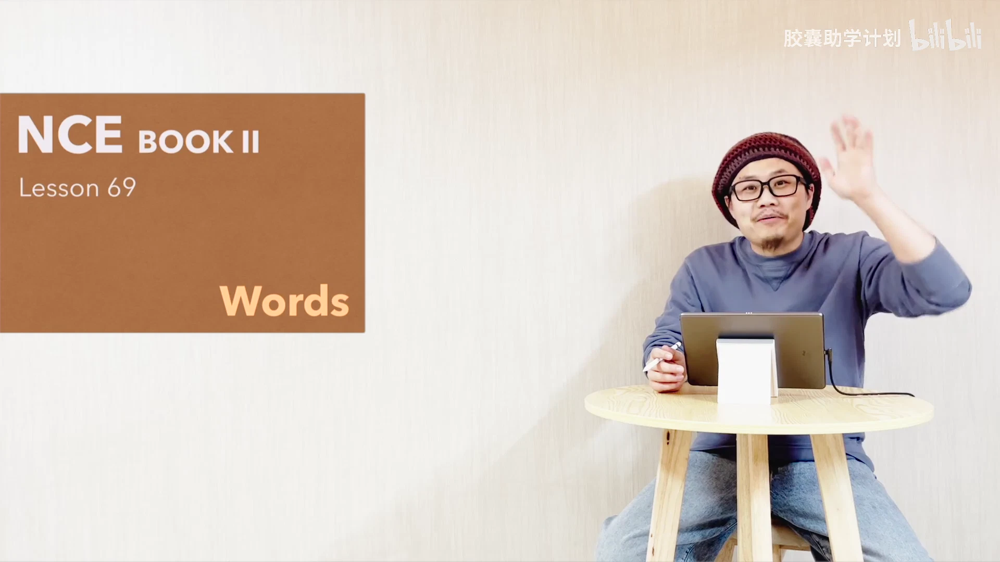

文字识别：bibil / 胶囊助学计划 / NCE / BOOKI"I / Lesson 69 / Words

### 画面 00:00:02

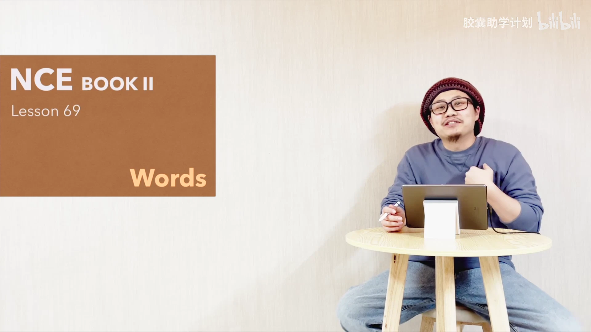

文字识别：biltbili / 胶囊助学计划 / NCE / BOOKII / Lesson 69 / Words

### 画面 00:00:04

文字识别：Bibii / 胶囊助学计划 / NCE / BOOKII / Lesson 69 / Words

### 画面 00:00:06

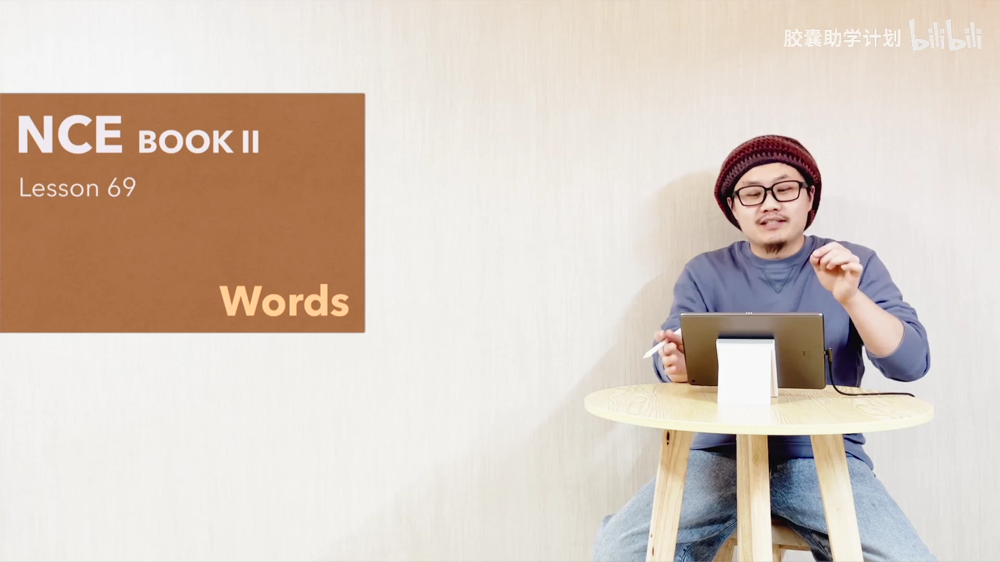

文字识别：BiBii / 胶囊助学计划 / NCE / BOOKII / Lesson 69 / Words

### 画面 00:00:08

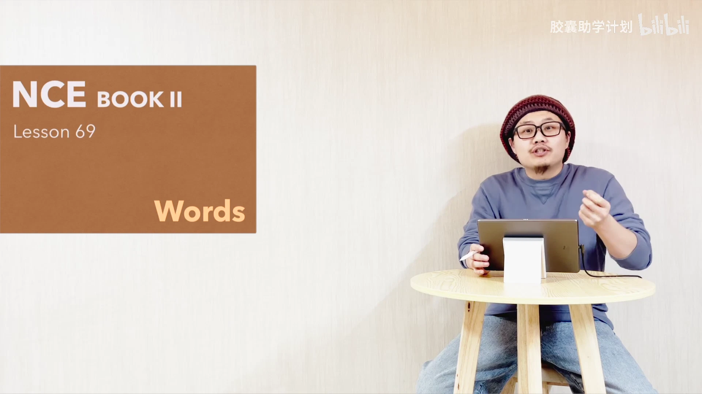

文字识别：Bibii / 胶囊助学计划 / NCE / BOOKI"I / Lesson 69 / Words

### 画面 00:00:11

文字识别：胶囊助学计划bi

### 画面 00:00:13

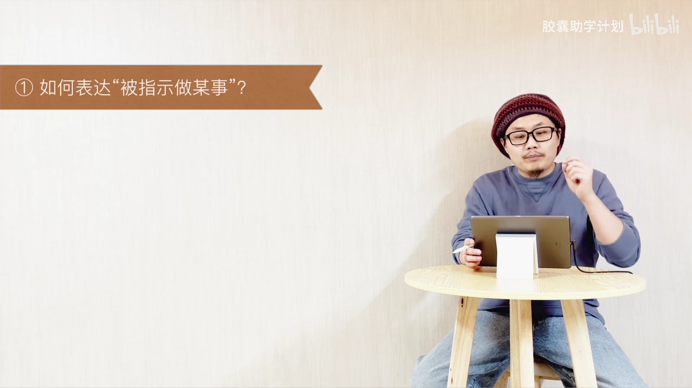

文字识别：bibili / 胶囊助学计划 / ①如何表达“被指示做某事”？

### 画面 00:00:16

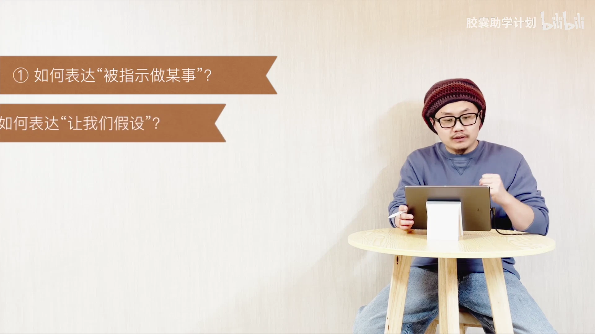

文字识别：bibii / 胶囊助学计划 / ①如何表达“被指示做某事”？ / 如何表达“让我们假设

### 画面 00:00:18

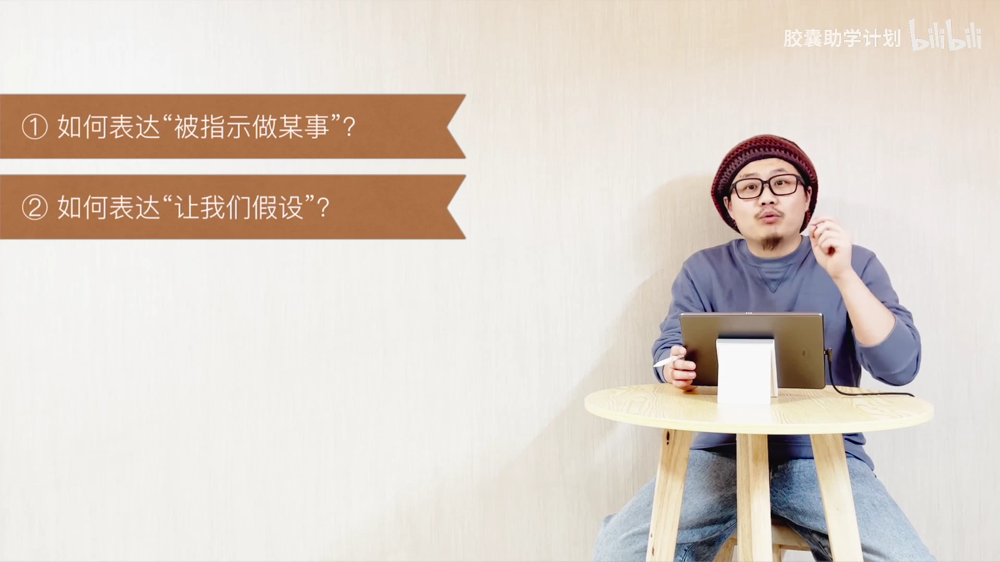

文字识别：Bilbili / 胶囊助学计划 / ①如何表达“被指示做某事”？ / 如何表达“让我们假设”

### 画面 00:00:20

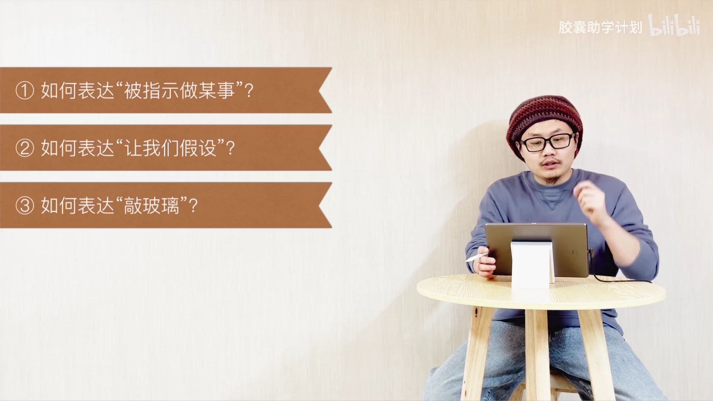

文字识别：biibili / 胶囊助学计划 / ①如何表达“被指示做某事”？ / 如何表达“让我们假设” / 如何表达“敲玻璃

### 画面 00:00:25

文字识别：胶囊助学计划ii

### 画面 00:00:29

文字识别：胶囊助学计划 / 胶囊助学计划

## 00:00:30–00:01:00

那我们上来看第一个单词，看着音标跟我一起读一下，叫做 murder murder。这个地方这两个地方，因为有两个字母 r，我们都可以加软化音啊。OK，再读一遍 murder，它是谋杀的意思。那我们先看这样一句话，叫做 It was Sam who murdered your father。好，五十八课强调句，咱们用到了之前学过的语法，对吧？说就是 Sam 这个人，哎，

### 画面 00:00:31

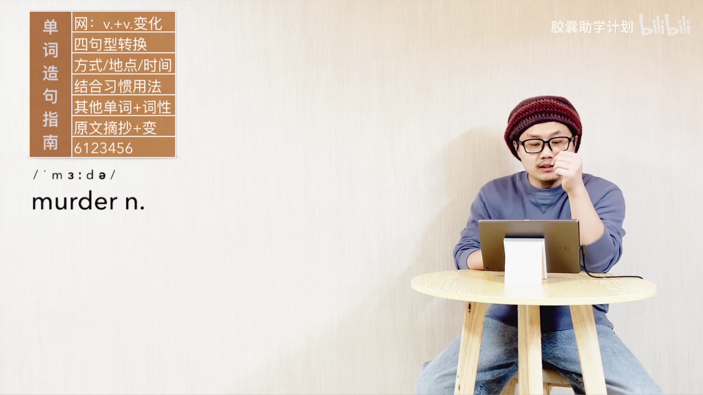

文字识别：单词造句指南 / 网：v.+v.变化 / 胶囊助学计划 / Bibii / 四句型转换 / 方式/地点/时间 / 结合习惯用法 / 其他单词+词性 / 原文摘抄+变 / 6123456 / /'m3:da/ / murder n.

### 画面 00:00:33

文字识别：单词造句指南 / 网：v.+v.变化 / 胶囊助学计划 / bilbili / 四句型转换 / 方式/地点/时间 / 结合习惯用法 / 其他单词+词性 / 原文摘抄+变 / 6123456 / /'m3:da/ / murder n.

### 画面 00:00:35

文字识别：单词造句指南 / 网：v.+v.变化 / 胶囊助学计划 / bibii / 四句型转换 / 方式/地点/时间 / 结合习惯用法 / 其他单词+词性 / 原文摘抄+变 / 6123456 / /'m3:da/ / murder n.

### 画面 00:00:39

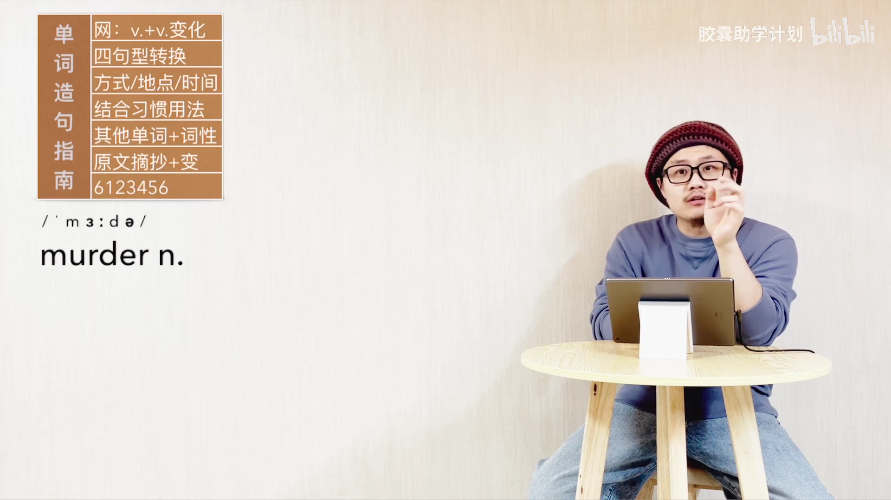

文字识别：单词造句指南 / 网：v.+v.变化 / 胶囊助学计划 / bibil / 四句型转换 / 方式/地点/时间 / 结合习惯用法 / 其他单词+词性 / 原文摘抄+变 / 6123456 / /'m3:da/ / murder n.

### 画面 00:00:41

文字识别：单词造句指南 / 网：v.+v.变化 / 胶囊助学计划 / bilbili / 四句型转换 / 方式/地点/时间 / 结合习惯用法 / 其他单词+词性 / 原文摘抄+变 / 6123456 / /'m3:da/ / murder n.

### 画面 00:00:43

文字识别：单词造句指南 / 网：v.+v.变化 / 胶囊助学计划 / bibii / 四句型转换 / 方式/地点/时间 / 结合习惯用法 / 其他单词+词性 / 原文摘抄+变 / 6123456 / /'m3:da/ / murder n.

### 画面 00:00:45

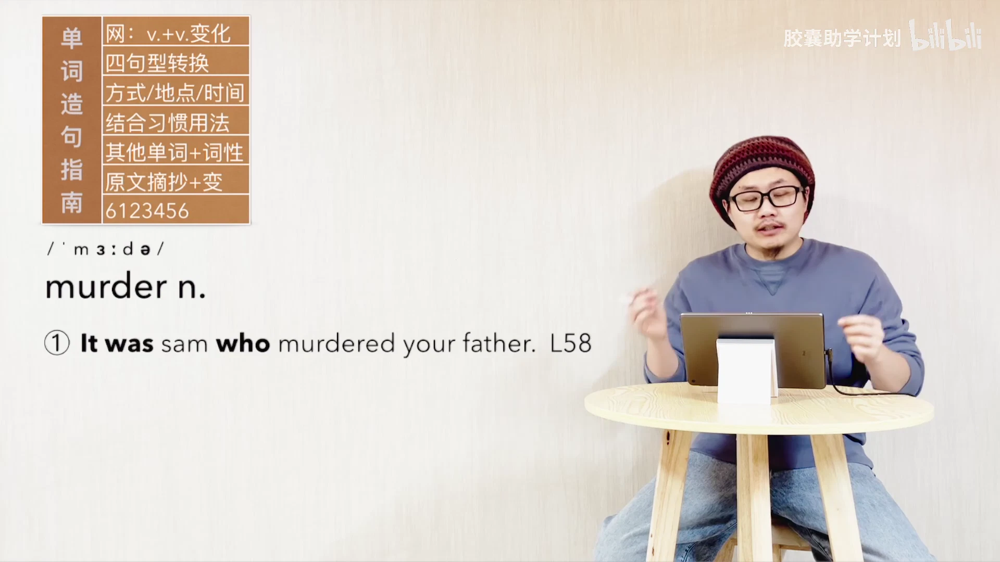

文字识别：单词造句指南 / 网：v.+v.变化 / 胶囊助学计划 / Bilbili / 四句型转换 / 方式/地点/时间 / 结合习惯用法 / 其他单词+词性 / 原文摘抄+变 / 6123456 / /'m3:da/ / murder n. / It was sam who murdered your father. L58

### 画面 00:00:47

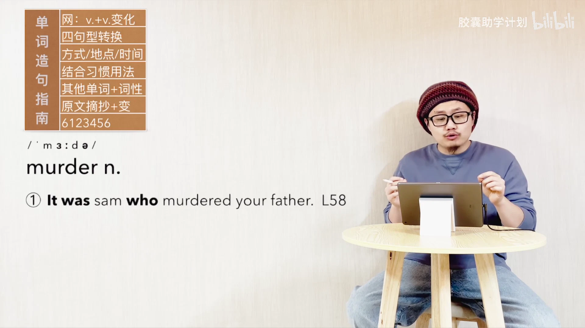

文字识别：单词造句指南 / 网：v.+v.变化 / 胶囊助学计划 / bibil / 四句型转换 / 方式/地点/时间 / 结合习惯用法 / 其他单词+词性 / 原文摘抄+变 / 6123456 / /'m3:da/ / murder n. / It was sam who murdered your father. L58

### 画面 00:00:50

文字识别：单词造句指南 / 网：v.+v.变化 / 胶囊助学计划 / Bibili / 四句型转换 / 方式/地点/时间 / 结合习惯用法 / 其他单词+词性 / 原文摘抄+变 / 6123456 / /'m3:da/ / murder n. / It was sam who murdered your father. L58

### 画面 00:00:53

文字识别：单词造句指南 / 网：v.+v.变化 / 胶囊助学计划 / bitbli / 四句型转换 / 方式/地点/时间 / 结合习惯用法 / 其他单词+词性 / 原文摘抄+变 / 6123456 / /'m3:da/ / murder n. / It was sam who murdered your father. L58

### 画面 00:00:55

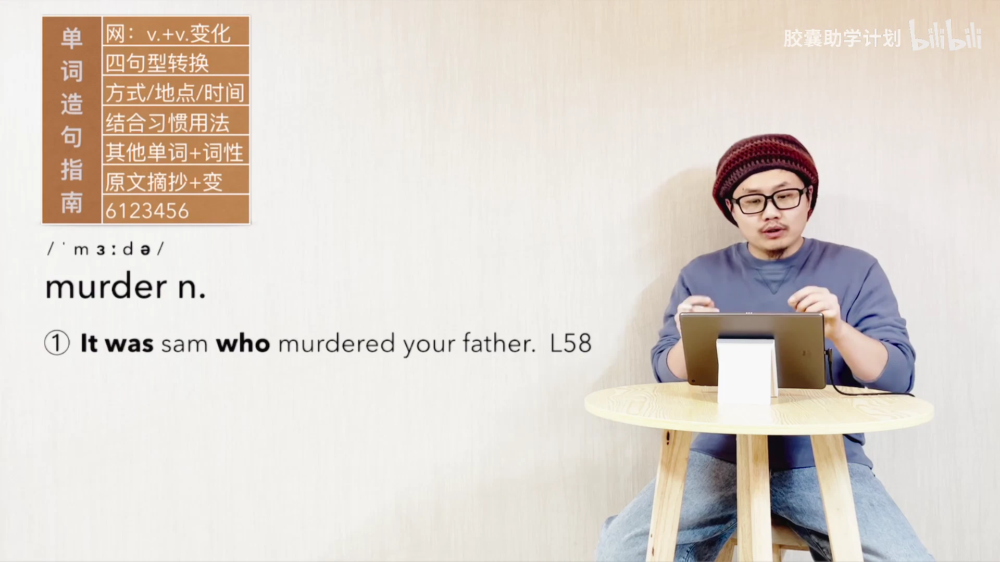

文字识别：单词造句指南 / 网：v.+v.变化 / 胶囊助学计划 / Bibili / 四句型转换 / 方式/地点/时间 / 结合习惯用法 / 其他单词+词性 / 原文摘抄+变 / 6123456 / /'m3:da/ / murder n. / It was sam who murdered your father. L58

### 画面 00:00:57

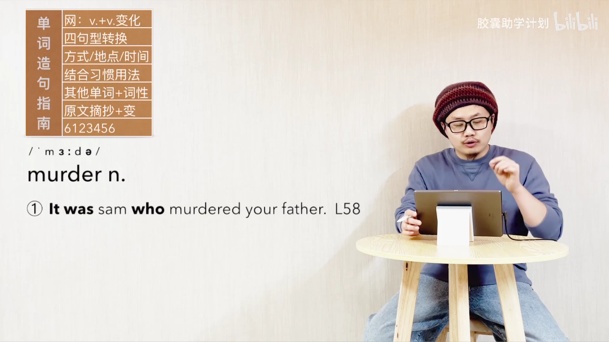

文字识别：单词造句指南 / 网：v.+v.变化 / 胶囊助学计划 / bibili / 四句型转换 / 方式/地点/时间 / 结合习惯用法 / 其他单词+词性 / 原文摘抄+变 / 6123456 / /'m3:da/ / murder n. / It was sam who murdered your father. L58

## 00:01:00–00:01:30

谋杀的你的父亲。OK, next one叫做After murdering the man, he ran away in the dark.注意这个地方的After murdering是我们四十九课学过非常重要的一个语法，分词做状语。在这儿我们复习一下啊，本课我们也会学到分词做状语的一个特殊形式啊。四十九课咱们没学到的。下一句话叫He is said to murder his wife.哎，比如说像辛非常著名的辛普森案，对吧？说啊，据说他

### 画面 00:01:00

文字识别：单词造句指南 / 网：v.+v.变化 / 胶囊助学计划 / Bibii / 四句型转换 / 方式/地点/时间 / 结合习惯用法 / 其他单词+词性 / 原文摘抄+变 / 6123456 / /'m3:da/ / murder n. / It was sam who murdered your father. L58

### 画面 00:01:02

文字识别：单词造句指南 / 网：v.+v.变化 / 胶囊助学计划 / bilbii / 四句型转换 / 方式/地点/时间 / 结合习惯用法 / 其他单词+词性 / 原文摘抄+变 / 6123456 / /'m3:da/ / murder n. / It was sam who murdered your father. L58 / After murdering the man, he ran away in / the dark. L49

### 画面 00:01:05

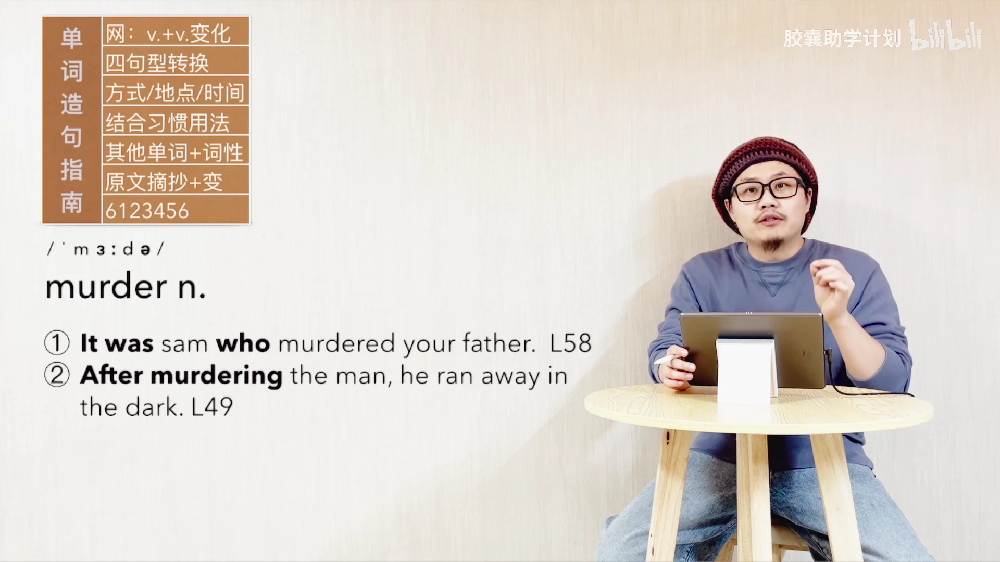

文字识别：单词造句指南 / 网：v.+v.变化 / 胶囊助学计划 / bibii / 四句型转换 / 方式/地点/时间 / 结合习惯用法 / 其他单词+词性 / 原文摘抄+变 / 6123456 / /'m3:da/ / murder n. / It was sam who murdered your father. L58 / After murdering the man, he ran away in / the dark. L49

### 画面 00:01:11

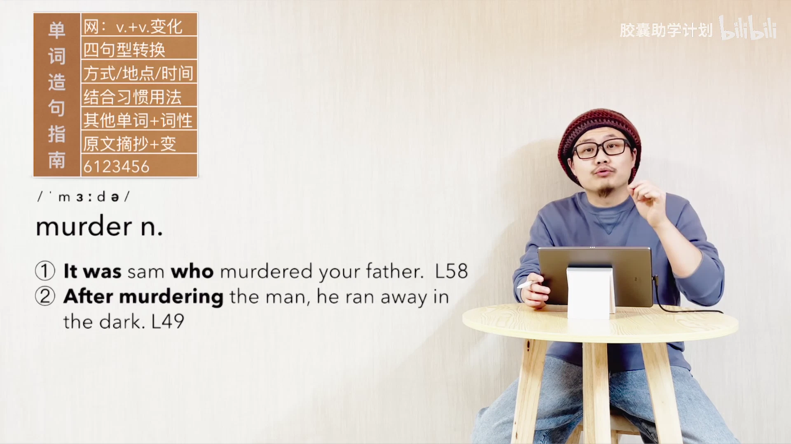

文字识别：单词造句指南 / 网：v.+v.变化 / 胶囊助学计划 / bibli / 四句型转换 / 方式/地点/时间 / 结合习惯用法 / 其他单词+词性 / 原文摘抄+变 / 6123456 / /'m3:da/ / murder n. / It was sam who murdered your father. L58 / After murdering t /  the man, he ran away in / the dark. L49

### 画面 00:01:15

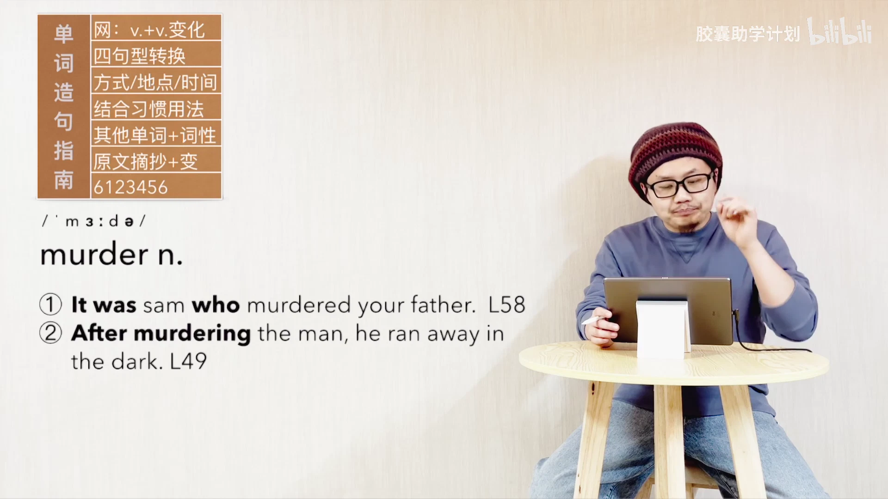

文字识别：单词造句指南 / 网：v.+v.变化 / 胶囊助学计划 / Biibili / 四句型转换 / 方式/地点/时间 / 结合习惯用法 / 其他单词+词性 / 原文摘抄+变 / 6123456 / /'m3:da/ / murder n. / It was sam who murdered your father. L58 / After murdering the man, he ran away in / the dark. L49

### 画面 00:01:21

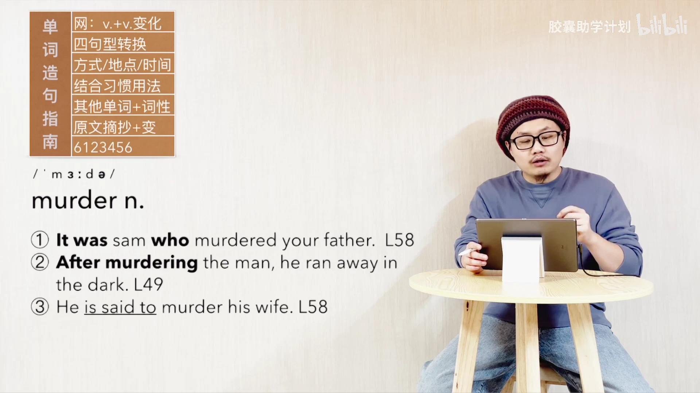

文字识别：单词造句指南 / 网：v.+v.变化 / 胶囊助学计划 / 四句型转换 / 方式/地点/时间 / 结合习惯用法 / 其他单词+词性 / 原文摘抄+变 / 6123456 / / 'm3:da/ / murder n. / It was sam who murdered your father. L58 / After murdering the man, he ran away in / the dark. L49 / He is said to murder his wife. L58

### 画面 00:01:25

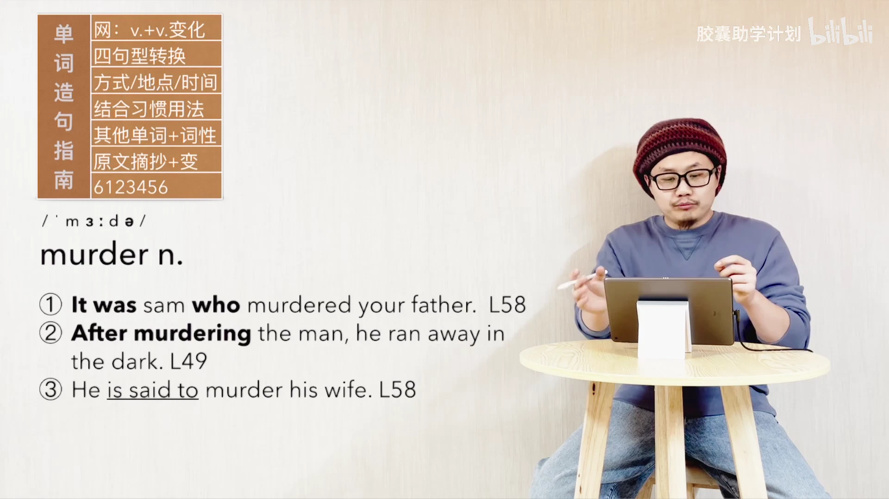

文字识别：胶囊助学计划bl / 单词造句指南 / 网：v.+v.变化 / 四句型转换 / 方式/地点/时间 / 结合习惯用法 / 其他单词+词性 / 原文摘抄+变 / 6123456 / / 'm3:da/ / murder n. / It was sam who murdered your father. L58 / After murdering the man, he ran away in / the dark. L49 / He is said to murder his wife. L58

## 00:01:30–00:02:00

谋杀了他的妻子，但是并没有实际的证据，对吧？或者说证据并不清楚啊，或者取证过程呢并不正义，所以导致呢没办法去判案，对吧？没办法确凿的呃，这个说就是这样的，所以我们用的叫做beside to do something，据说怎么怎么样。五十八课咱们学的，再读一遍这个单词murder。OK， next one，下一个单词跟我一起读，叫instruct，instruct。好，instruct

### 画面 00:01:30

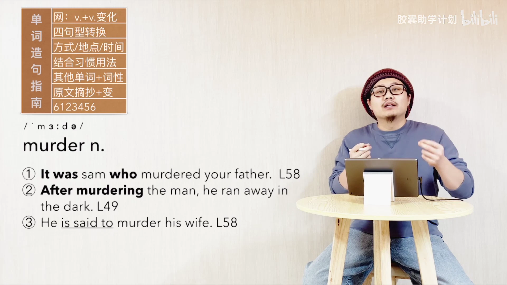

文字识别：单词造句指南 / 网：v.+v.变化 / 胶囊助学计划 / bitbli / 四句型转换 / 方式/地点/时间 / 结合习惯用法 / 其他单词+词性 / 原文摘抄+变 / 6123456 / / 'm3:da/ / murder n. / It was sam who murdered your father. L58 / After murdering the man, he ran away in / the dark. L49 / He is said to murder his wife. L58

### 画面 00:01:33

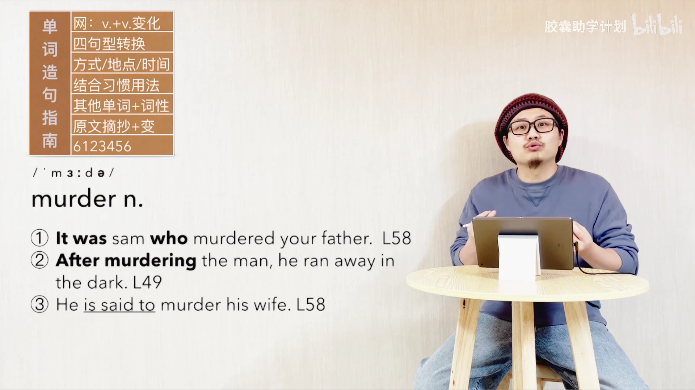

文字识别：单词造句指南 / 网：v.+v.变化 / 胶囊助学计划 / bibli / 四句型转换 / 方式/地点/时间 / 结合习惯用法 / 其他单词+词性 / 原文摘抄+变 / 6123456 / / 'm3:da/ / murder n. / It was sam who murdered your father. L58 / After murdering the man, he ran away in / the dark. L49 / He is said to murder his wife. L58

### 画面 00:01:35

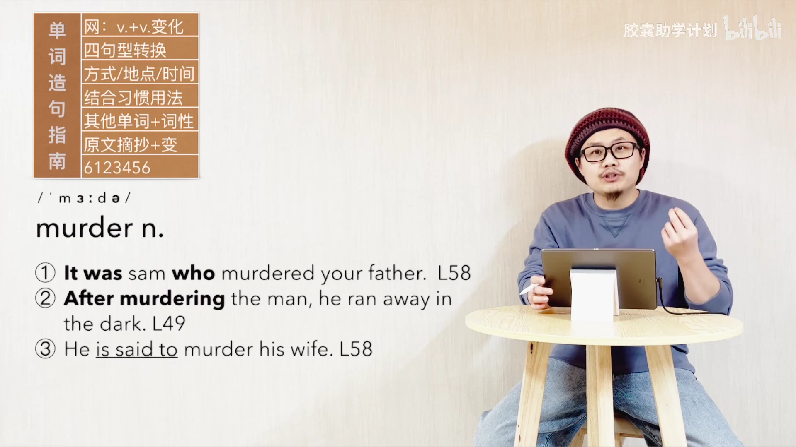

文字识别：单词造句指南 / 网：v.+v.变化 / 胶囊助学计划 / bibi / 四句型转换 / 方式/地点/时间 / 结合习惯用法 / 其他单词+词性 / 原文摘抄+变 / 6123456 / /'m3:da/ / murder n. / It was sam who murdered your father. L58 / After murdering the man, he ran away in / the dark. L49 / He is said to murder his wife. L58

### 画面 00:01:40

文字识别：单词造句指南 / 网：v.+v.变化 / 胶囊助学计划 / Bibii / 四句型转换 / 方式/地点/时间 / 结合习惯用法 / 其他单词+词性 / 原文摘抄+变 / 6123456 / / 'm3 :da/ / murder n. / It was sam who murdered your father. L58 / After murdering the man, he ran away in / the dark. L49 / He is said to murder his wife. L58

### 画面 00:01:45

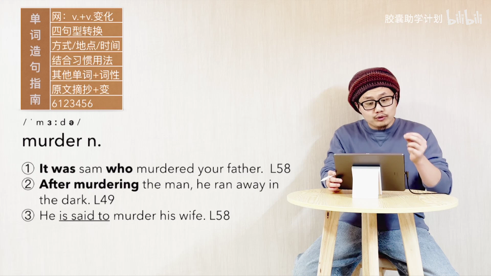

文字识别：单词造句指南 / 网：v.+v.变化 / 胶囊助学计划 / Bibli / 四句型转换 / 方式/地点/时间 / 结合习惯用法 / 其他单词+词性 / 原文摘抄+变 / 6123456 / / 'm3:da/ / murder n. / It was sam who murdered your father. L58 / After murdering the man, he ran away in / the dark. L49 / He is said to murder his wife. L58

### 画面 00:01:50

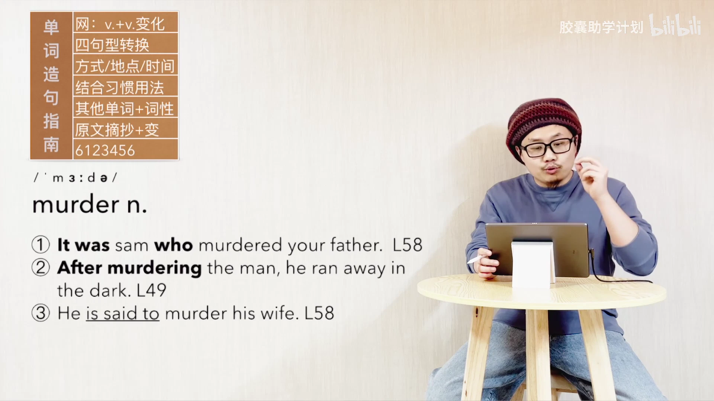

文字识别：单词造句指南 / 网：v.+v.变化 / 胶囊助学计划 / bibili / 四句型转换 / 方式/地点/时间 / 结合习惯用法 / 其他单词+词性 / 原文摘抄+变 / 6123456 / /'m3:da/ / murder n. / It was sam who murdered your father. L58 / After murdering the man, he ran away in / the dark. L49 / He is said to murder his wife. L58

### 画面 00:01:52

文字识别：单词造句指南 / 网：v.+v.变化 / 胶囊助学计划 / bilbili / 四句型转换 / 方式/地点/时间 / 结合习惯用法 / 其他单词+词性 / 原文摘抄+变 / 6123456 / /In'strakt/ / instruct v.

### 画面 00:01:54

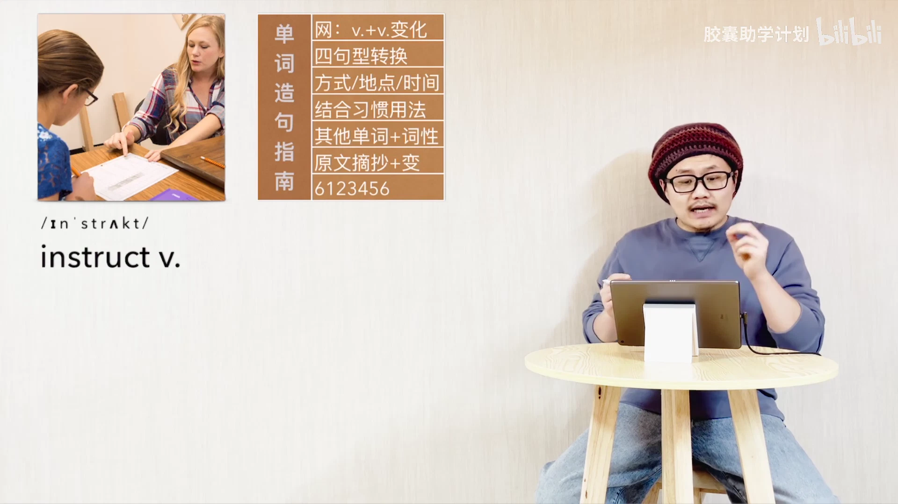

文字识别：单词造句指南 / 网：v.+v.变化 / 胶囊助学计划 / bitbili / 四句型转换 / 方式/地点/时间 / 结合习惯用法 / 其他单词+词性 / 原文摘抄+变 / 6123456 / /In'strakt/ / instruct v.

### 画面 00:01:56

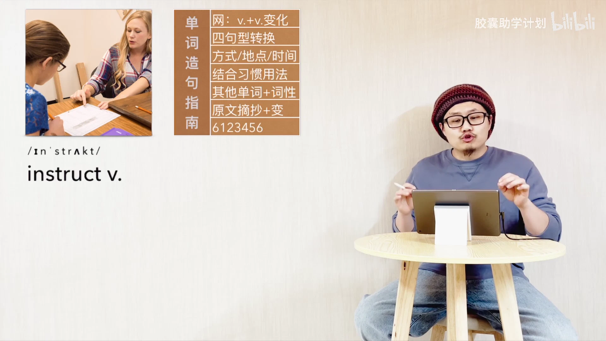

文字识别：单词造句指南 / 网：v.+v.变化 / 胶囊助学计划 / 四句型转换 / 方式/地点/时间 / 结合习惯用法 / 其他单词+词性 / 原文摘抄+变 / 6123456 / /In'strakt/ / instruct v.

### 画面 00:01:59

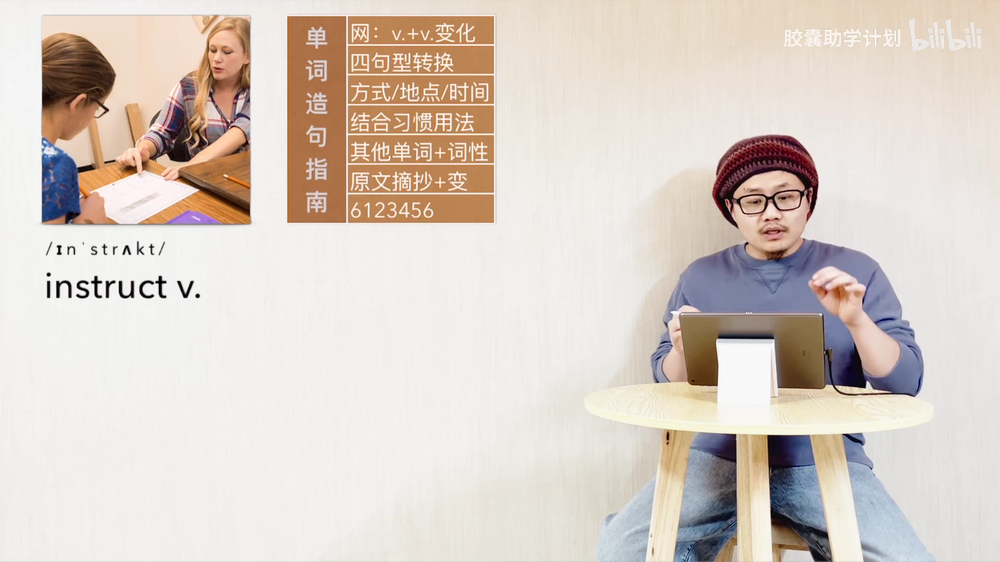

文字识别：单词造句指南 / 网：v.+v.变化 / 胶囊助学计划 / bitbii / 四句型转换 / 方式/地点/时间 / 结合习惯用法 / 其他单词+词性 / 原文摘抄+变 / 6123456 / /In'strAkt/ / instruct v.

## 00:02:00–00:02:30

什么意思呢？我们在这儿其实不用单独看它这个单词的意思，我们看这个短语，be instructed to do something。哎，那它的主语往往是某人啊，叫做某人被指令、被命令去做某件事情，有点像四十三课啊，我们那个学探险家探险北极、南极那一课叫 order somebody to do something，命令某人去做某件事情，对吧？

### 画面 00:02:01

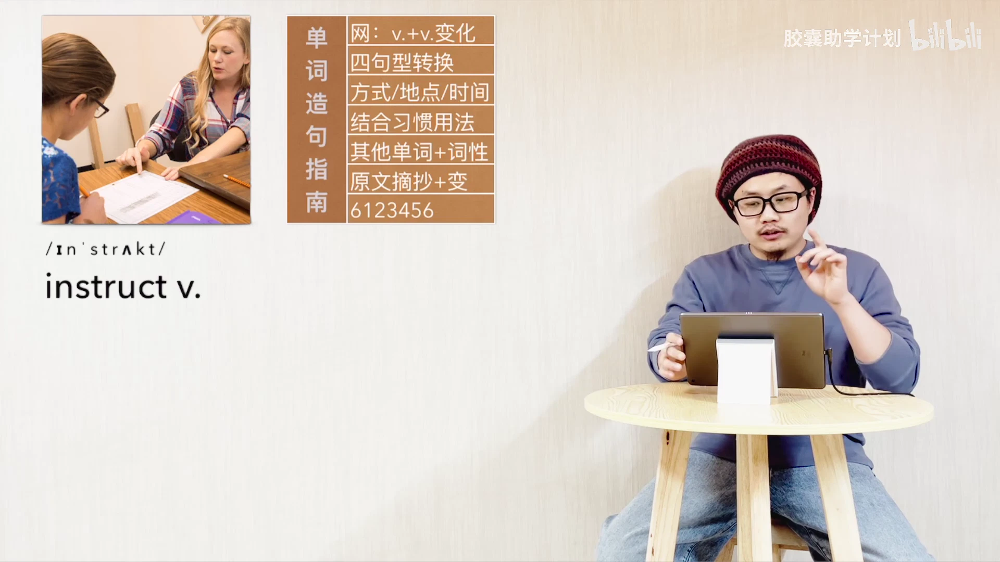

文字识别：单词造句指南 / 网：v.+v.变化 / 胶囊助学计划 / bitbili / 四句型转换 / 方式/地点/时间 / 结合习惯用法 / 其他单词+词性 / 原文摘抄+变 / 6123456 / /In'strakt/ / instruct v.

### 画面 00:02:03

文字识别：单词造句指南 / 网：v.+v.变化 / 胶囊助学计划 / Bibli / 四句型转换 / 方式/地点/时间 / 结合习惯用法 / 其他单词+词性 / 原文摘抄+变 / 6123456 / /In'strakt/ / instruct v. / ① be instructed to do sth.

### 画面 00:02:05

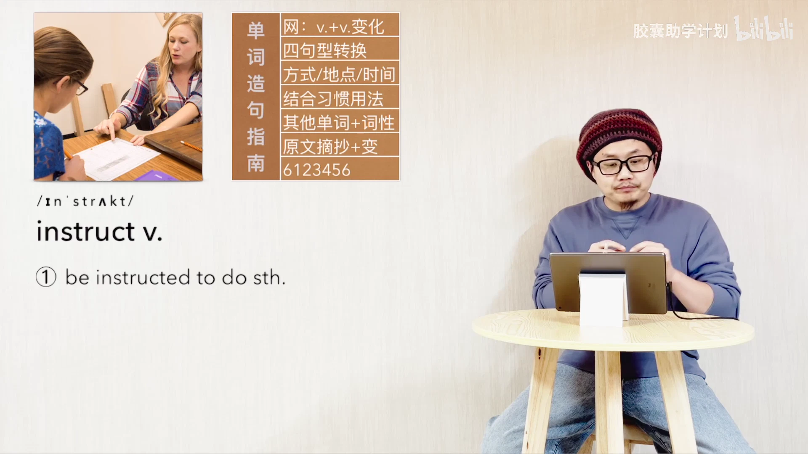

文字识别：单词造句指南 / 网：v.+v.变化 / 胶囊助学计划 / Bibili / 四句型转换 / 方式/地点/时间 / 结合习惯用法 / 其他单词+词性 / 原文摘抄+变 / 6123456 / /In'strakt/ / instruct v. / ① be instructed to do sth.

### 画面 00:02:09

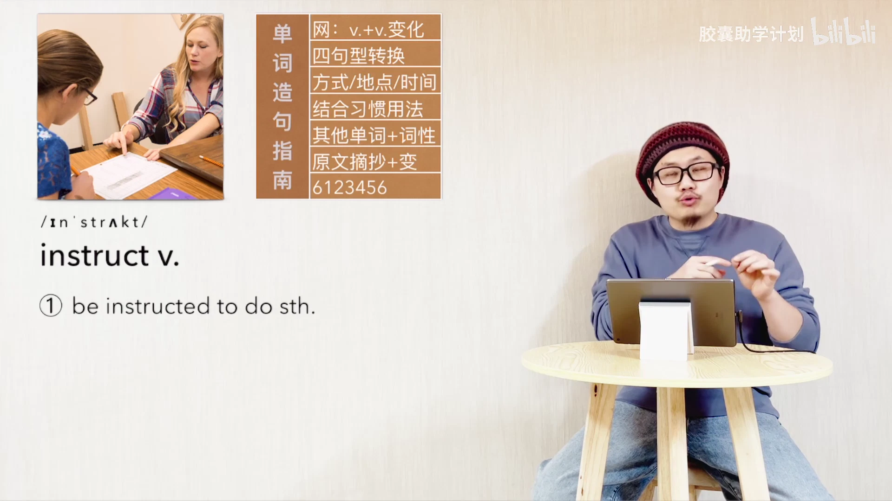

文字识别：单词造句指南 / 网：v.+v.变化 / 胶囊助学计划 / Bibii / 四句型转换 / 方式/地点/时间 / 结合习惯用法 / 其他单词+词性 / 原文摘抄+变 / 6123456 / /In'strakt/ / instruct v. / ① be instructed to do sth.

### 画面 00:02:11

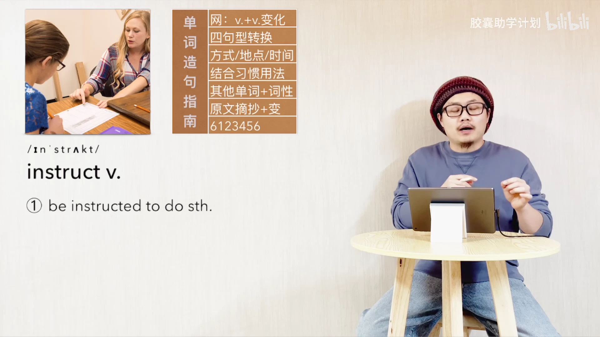

文字识别：单词造句指南 / 网：v.+v.变化 / 胶囊助学计划 / Bibii / 四句型转换 / 方式/地点/时间 / 结合习惯用法 / 其他单词+词性 / 原文摘抄+变 / 6123456 / /In'strakt/ / instruct v. / ① be instructed to do sth.

### 画面 00:02:15

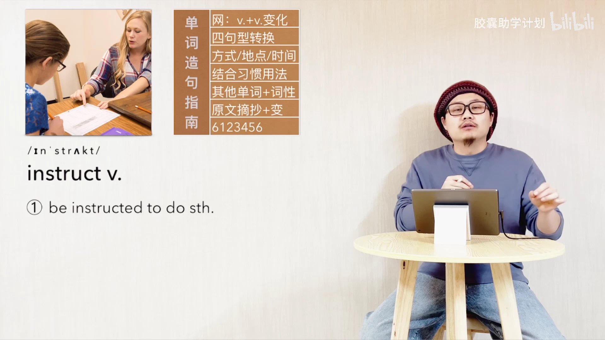

文字识别：单词造句指南 / 网：v.+v.变化 / 胶囊助学计划 / bibii / 四句型转换 / 方式/地点/时间 / 结合习惯用法 / 其他单词+词性 / 原文摘抄+变 / 6123456 / /In'strakt/ / instruct v. / ① be instructed to do sth.

### 画面 00:02:18

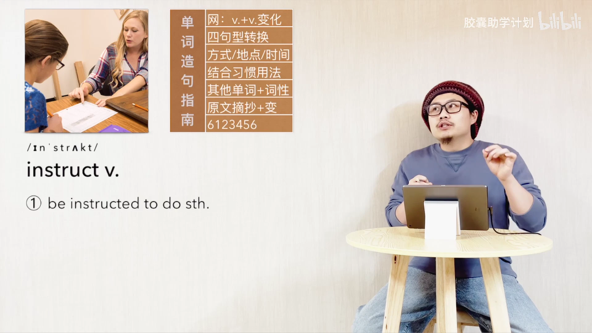

文字识别：单词造句指南 / 网：v.+v.变化 / 胶囊助学计划 / Bibili / 四句型转换 / 方式/地点/时间 / 结合习惯用法 / 其他单词+词性 / 原文摘抄+变 / 6123456 / /In'strakt/ / instruct v. / ① be instructed to do sth.

### 画面 00:02:20

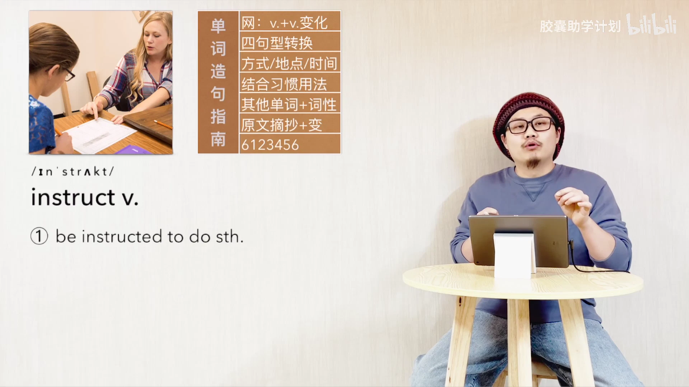

文字识别：单词造句指南 / 网：v.+v.变化 / 胶囊助学计划 / biltbii / 四句型转换 / 方式/地点/时间 / 结合习惯用法 / 其他单词+词性 / 原文摘抄+变 / 6123456 / /In'strakt/ / instruct v. / ① be instructed to do sth.

### 画面 00:02:24

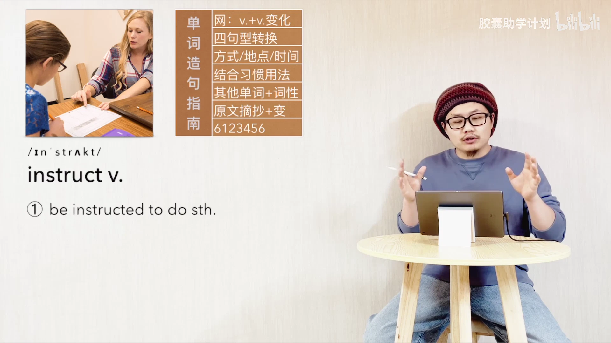

文字识别：单词造句指南 / 网：v.+v.变化 / 胶囊助学计划 / bibili / 四句型转换 / 方式/地点/时间 / 结合习惯用法 / 其他单词+词性 / 原文摘抄+变 / 6123456 / /In'strakt/ / instruct v. / ① be instructed to do sth.

### 画面 00:02:26

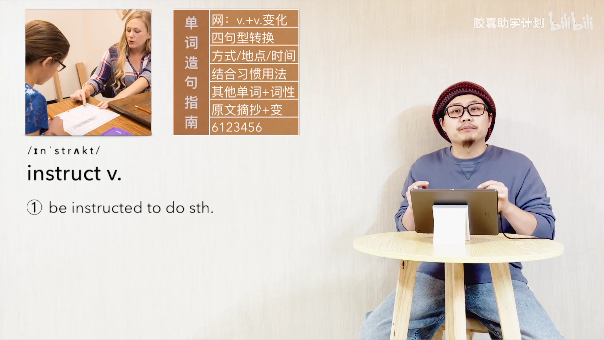

文字识别：单词造句指南 / 网：v.+v.变化 / 胶囊助学计划 / Bibii / 四句型转换 / 方式/地点/时间 / 结合习惯用法 / 其他单词+词性 / 原文摘抄+变 / 6123456 / /In'strakt/ / instruct v. / ① be instructed to do sth.

### 画面 00:02:28

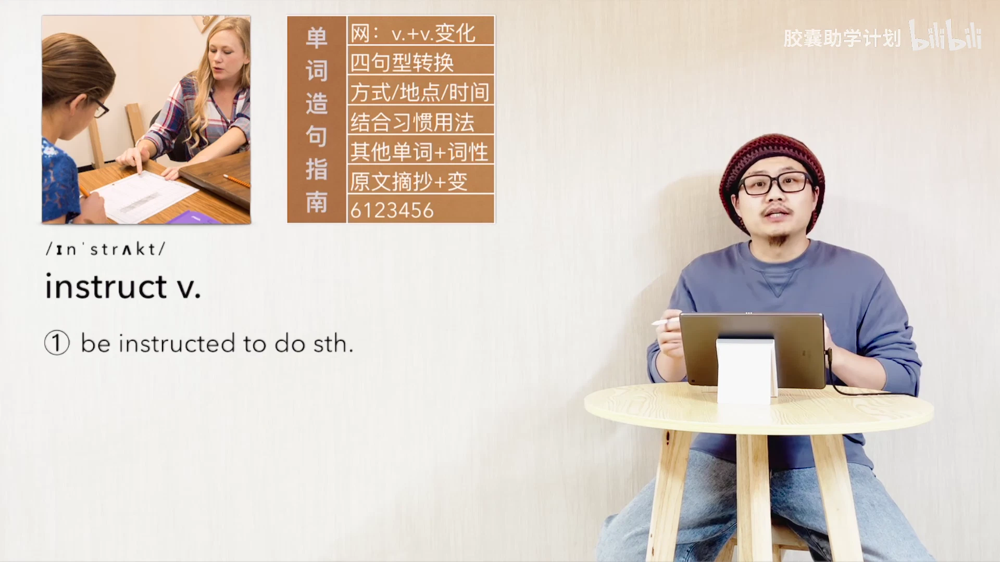

文字识别：单词造句指南 / 网：v.+v.变化 / 胶囊助学计划 / Bibii / 四句型转换 / 方式/地点/时间 / 结合习惯用法 / 其他单词+词性 / 原文摘抄+变 / 6123456 / /In'strAkt/ / instruct v. / ① be instructed to do sth.

## 00:02:30–00:03:00

好，比如说 I'm instructed to tell you if you insist on doing this, he will murder you, 对吧？哎，我被命令告诉你这件事情，对吧？我被别人指令啊告诉你这件事情。如果你坚持这么去做，那会怎么怎么样？Okay, next one. Say we have just been instructed to go home. 我们看到这里，其实它的时态也可以做一些改变。它这个 be 可以变成 have

### 画面 00:02:30

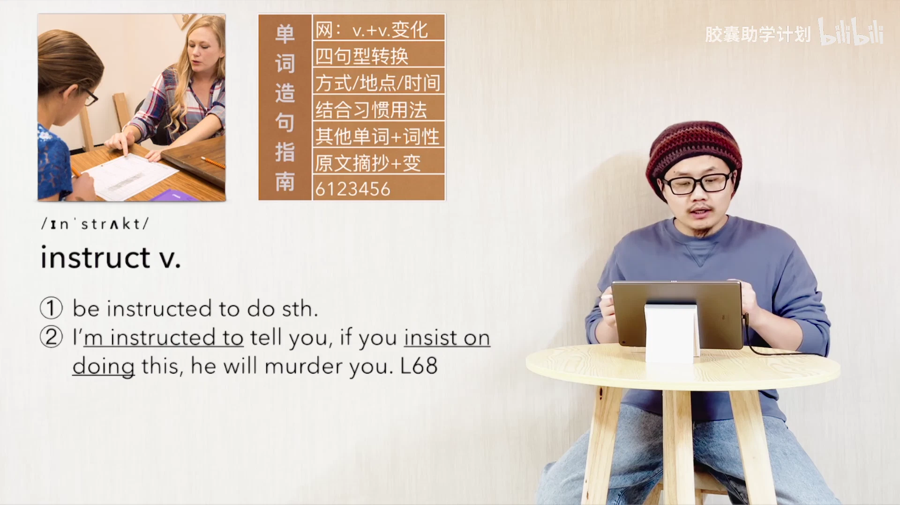

文字识别：单词造句指南 / 网：v.+v.变化 / 胶囊助学计划 / 四句型转换 / 方式/地点/时间 / 结合习惯用法 / 其他单词+词性 / 原文摘抄+变 / 6123456 / /In'strakt/ / instruct v. / ① be instructed to do sth. /  I'm instructed to tell you, if you insist on / doing this, he will murder you. L68

### 画面 00:02:33

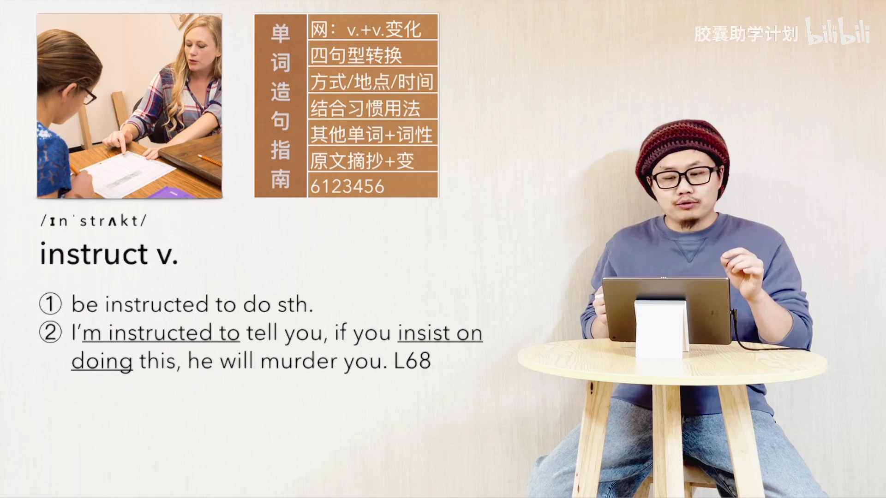

文字识别：胶囊助学计划bil出 / 单词造句指南 / 网：v.+v.变化 / 四句型转换 / 方式/地点/时间 / 结合习惯用法 / 其他单词+词性 / 原文摘抄+变 / 6123456 / /In'strakt/ / instruct V. / ① be instructed to do sth. / )I'm instructed to tell you, if you insist on / doing this, he will murder you. L68

### 画面 00:02:35

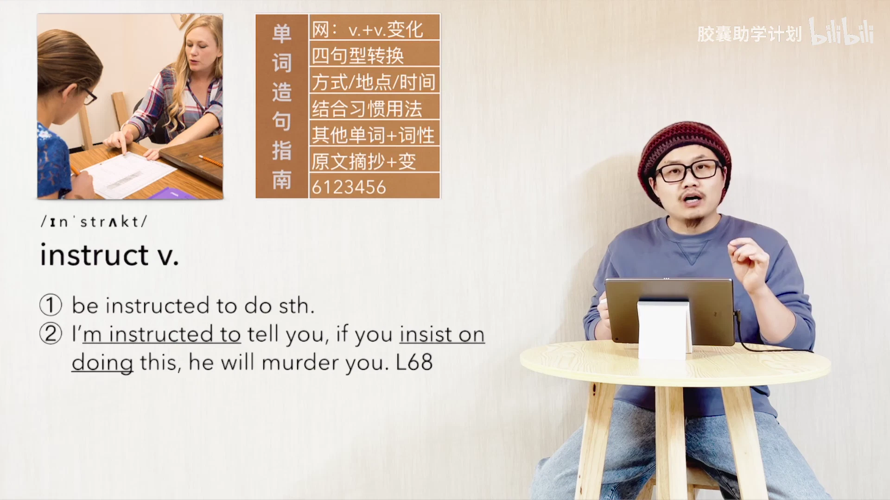

文字识别：胶囊助学计划bl出 / 单词造句指南 / 网：v.+v.变化 / 四句型转换 / 方式/地点/时间 / 结合习惯用法 / 其他单词+词性 / 原文摘抄+变 / 6123456 / /In'strakt/ / instruct v. / ① be instructed to do sth. / )I'm instructed to tell you, if you insist on / doing this, he will murder you. L68

### 画面 00:02:40

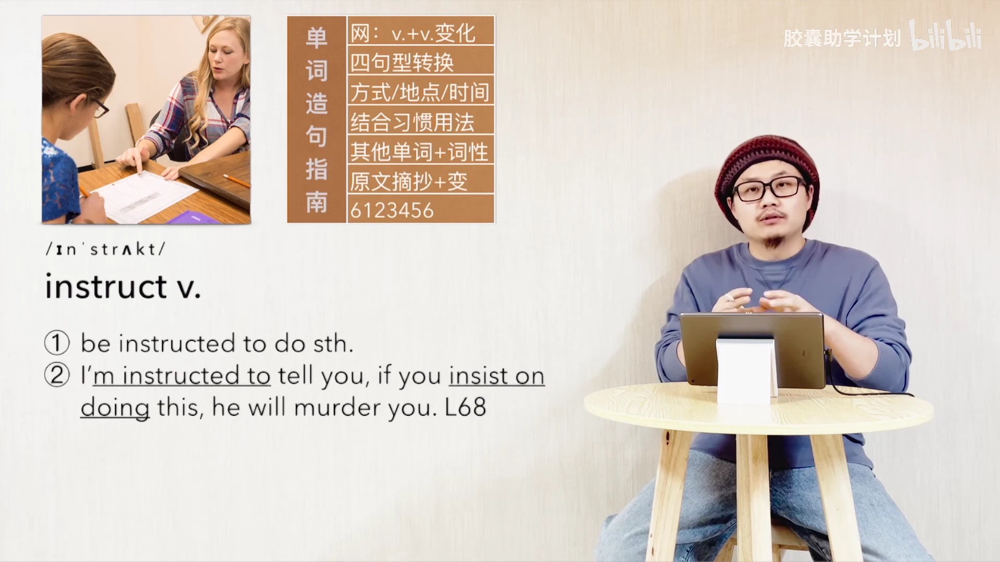

文字识别：胶囊助学计划bibi / 单词造句指南 / 网：v.+v.变化 / 四句型转换 / 方式/地点/时间 / 结合习惯用法 / 其他单词+词性 / 原文摘抄+变 / 6123456 / /In'strakt/ / instruct v. / ① be instructed to do sth. /  I'm instructed to tell you, if you insist on / doing this, he will murder you. L68

### 画面 00:02:45

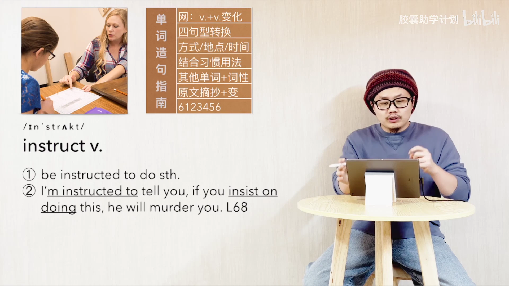

文字识别：胶囊助学计划bi山 / 单词造句指南 / 网：v.+v.变化 / 四句型转换 / 方式/地点/时间 / 结合习惯用法 / 其他单词+词性 / 原文摘抄+变 / 6123456 / /In'strakt/ / instruct v. / ① be instructed to do sth. / )I'm instructed to tell you, if you insist on / doing this, he will murder you. L68

### 画面 00:02:47

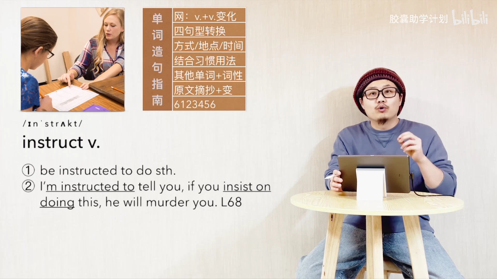

文字识别：单词造句指南 / 网：v.+v.变化 / 胶囊助学计划 / bibi / 四句型转换 / 方式/地点/时间 / 结合习惯用法 / 其他单词+词性 / 原文摘抄+变 / 6123456 / /In'strakt/ / instruct v. / ① be instructed to do sth. / ) I'm instructed to tell you, if you insist on / 2 / doing this, he will murder you. L68

### 画面 00:02:50

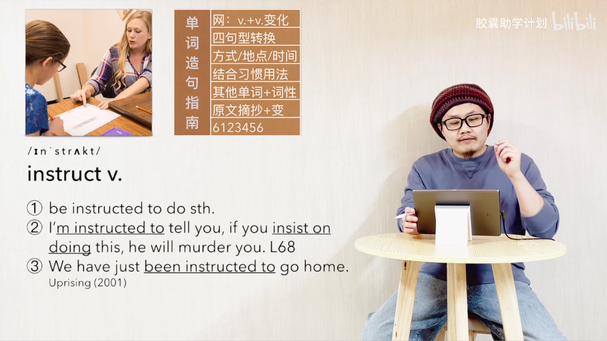

文字识别：胶囊助学计划bl / 单词造句指南 / 网：v.+v.变化 / 四句型转换 / 方式/地点/时间 / 结合习惯用法 / 其他单词+词性 / 原文摘抄+变 / 6123456 / /In'strakt/ / instruct v. / ① be instructed to do sth. / I'm instructed to tell you, if you insist on / 2） / doing this, he will murder you. L68 / We have just been instructed to go home. / Uprising (2001)

### 画面 00:02:52

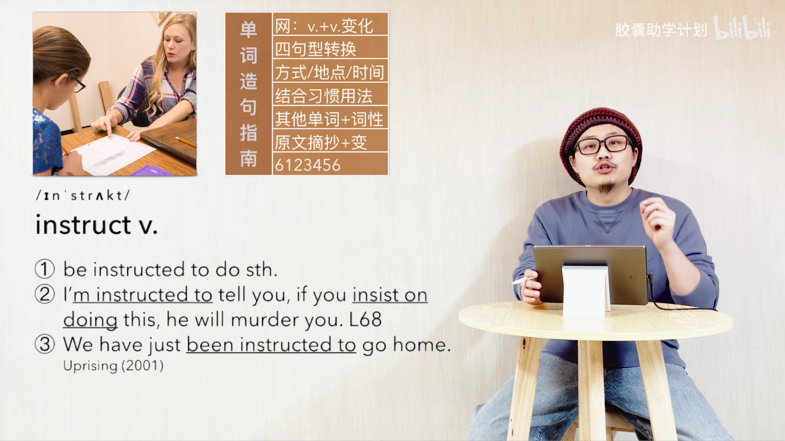

文字识别：胶囊助学计划bl出 / 单词造句指南 / 网：v.+v.变化 / 四句型转换 / 方式/地点/时间 / 结合习惯用法 / 其他单词+词性 / 原文摘抄+变 / 6123456 / /In'strakt/ / instruct v. / ① be instructed to do sth. / I'm instructed to tell you, if you insist on / 2） / doing this, he will murder you. L68 / We have just been instructed to go home. / Uprising (2001)

### 画面 00:02:54

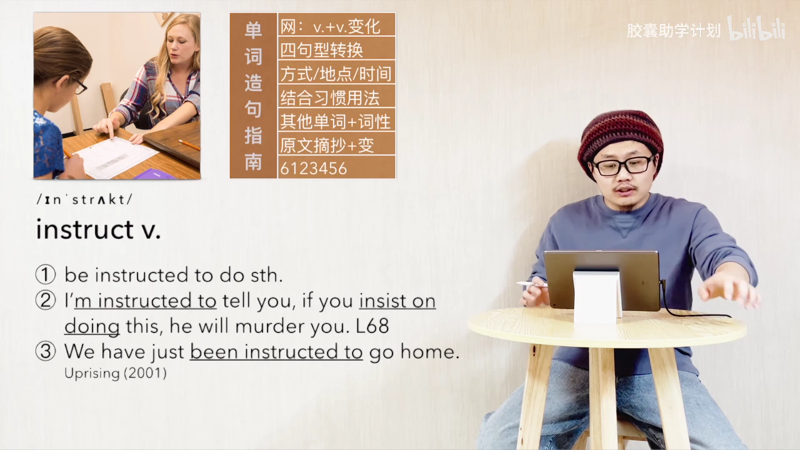

文字识别：胶囊助学计划bi / 单词造句指南 / 网：v.+v.变化 / 四句型转换 / 方式/地点/时间 / 结合习惯用法 / 其他单词+词性 / 原文摘抄+变 / 6123456 / /In'strakt/ / instruct v. / ① be instructed to do sth. /  I'm instructed to tell you, if you insist on / doing this, he will murder you. L68 / We have just been instructed to go home. / Uprising (2001)

### 画面 00:02:56

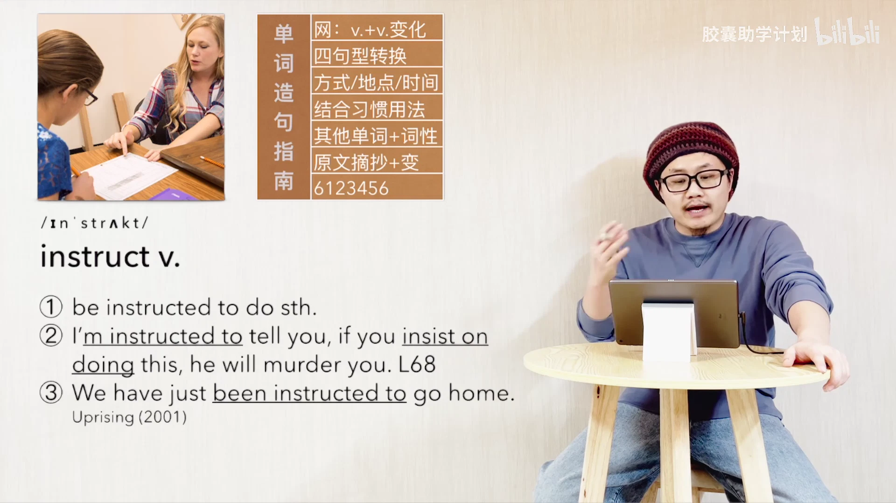

文字识别：单词造句指南 / 网：v.+v.变化 / 胶囊助学计划bib山 / 四句型转换 / 方式/地点/时间 / 结合习惯用法 / 其他单词+词性 / 原文摘抄+变 / 6123456 / /In'strakt/ / instruct v. / ① be instructed to do sth. /  I'm instructed to tell you, if you insist on / 2 / doing this, he will murder you. L68 / We have just been instructed to go home. / Uprising (2001)

## 00:03:00–00:03:30

just been 现在完成时 OK 好 Next one叫做 I'm instructed to explain this to you 哎我被指示指令去解释这个东西给你听啊 Explain something to somebody 三十三课咱们学的习惯用法再读一遍这个单词 instruct 注意这里有一个小的浊化现象不是 truct 啊是 dr dr dr druct 啊 instruct OK

### 画面 00:03:00

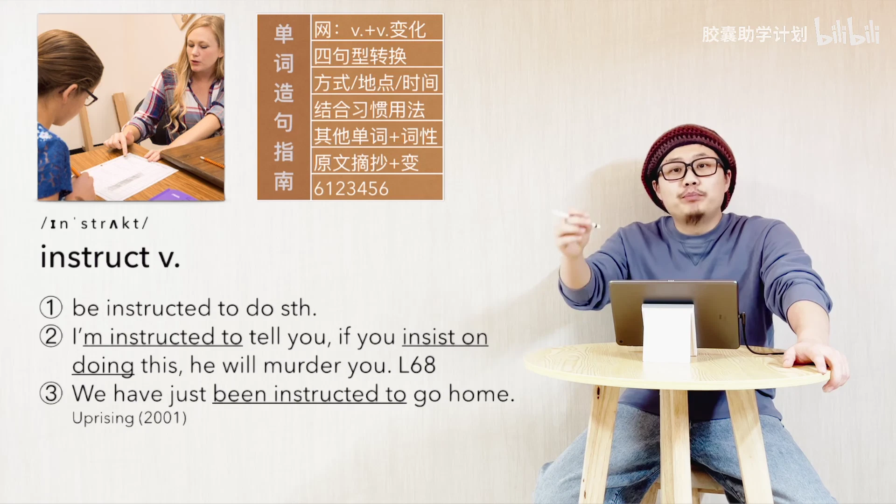

文字识别：胶囊助学计划bli / 单词造句指南 / 网：v.+v.变化 / 四句型转换 / 方式/地点/时间 / 结合习惯用法 / 其他单词+词性 / 原文摘抄+变 / 6123456 / /In'strakt/ / instruct V. / ① be instructed to do sth. / I'm instructed to tell you, if you insist on / doing this, he will murder you. L68 / We have just been instructed to go home. / Uprising (2001)

### 画面 00:03:03

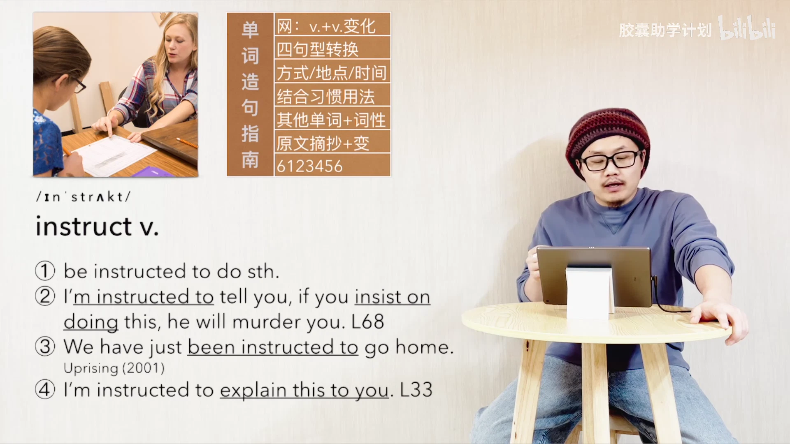

文字识别：胶囊助学计划bii / 单词造句指南 / 网：v.+v.变化 / 四句型转换 / 方式/地点/时间 / 结合习惯用法 / 其他单词+词性 / 原文摘抄+变 / 6123456 / /In'strakt/ / instruct v. / ① be instructed to do sth. / ② I'm instructed to tell you, if you insist on / doing this, he will murder you. L68 / We have just been instructed to go home. / Uprising (2001) /  I'm instructed to explain this to you. L33

### 画面 00:03:05

文字识别：单词造句指南 / 网：v.+v.变化 / 胶囊助学计划bli / 四句型转换 / 方式/地点/时间 / 结合习惯用法 / 其他单词+词性 / 原文摘抄+变 / 6123456 / /In'strakt/ / instruct v. / ① be instructed to do sth. / ② I'm instructed to tell you, if you insist on / doing this, he will murder you. L68 / We have just been instructed to go home. / Uprising (2001) / D I'm instructed to explain this to you. L33

### 画面 00:03:08

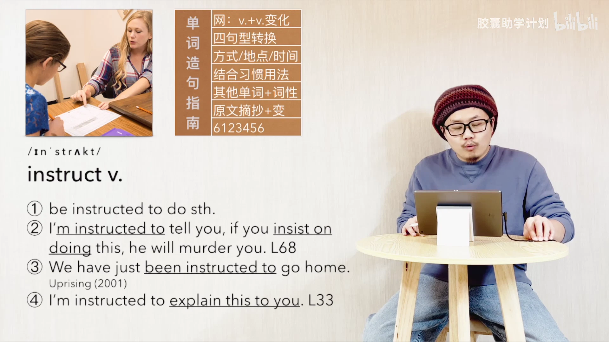

文字识别：单词造句指南 / 网：v.+v.变化 / 胶囊助学计划bi出 / 四句型转换 / 方式/地点/时间 / 结合习惯用法 / 其他单词+词性 / 原文摘抄+变 / 6123456 / /In'strakt/ / instruct v. / ① be instructed to do sth. / ② I'm instructed to tell you, if you insist on / doing this, he will murder you. L68 / We have just been instructed to go home. / Uprising (2001) /  I'm instructed to explain this to you. L33

### 画面 00:03:10

文字识别：单词造句指南 / 网：v.+v.变化 / 胶囊助学计划ibi / 四句型转换 / 方式/地点/时间 / 结合习惯用法 / 其他单词+词性 / 原文摘抄+变 / 6123456 / /In'strakt/ / instruct v. / ① be instructed to do sth. / ② I'm instructed to tell you, if you insist on / doing this, he will murder you. L68 / We have just been instructed to go home. / Uprising (2001) /  I'm instructed to explain this to you. L33

### 画面 00:03:12

文字识别：单词造句指南 / 网：v.+v.变化 / 胶囊助学计划ibi / 四句型转换 / 方式/地点/时间 / 结合习惯用法 / 其他单词+词性 / 原文摘抄+变 / 6123456 / /In'strakt/ / instruct v. / ① be instructed to do sth. / ② I'm instructed to tell you, if you insist on / doing this, he will murder you. L68 / We have just been instructed to go home. / Uprising (2001) /  I'm instructed to explain this to you. L33

### 画面 00:03:15

文字识别：单词造句指南 / 网：v.+v.变化 / 胶囊助学计划b / 四句型转换 / 方式/地点/时间 / 结合习惯用法 / 其他单词+词性 / 原文摘抄+变 / 6123456 / /In'strakt/ / instruct v. / ① be instructed to do sth. / ② I'm instructed to tell you, if you insist on / doing this, he will murder you. L68 / We have just been instructed to go home. / Uprising (2001) / ④ I'm instructed to explain this to you. L33

### 画面 00:03:17

文字识别：单词造句指南 / 网：v.+v.变化 / 胶囊助学计划bli / 四句型转换 / 方式/地点/时间 / 结合习惯用法 / 其他单词+词性 / 原文摘抄+变 / 6123456 / /In'strakt/ / instruct v. / ① be instructed to do sth. / ② I'm instructed to tell you, if you insist on / doing this, he will murder you. L68 / We have just been instructed to go home. / Uprising (2001) / ④ I'm instructed to explain this to you. L33

### 画面 00:03:20

文字识别：胶囊助学计划bl / 单词造句指南 / 网：v.+v.变化 / 四句型转换 / 方式/地点/时间 / 结合习惯用法 / 其他单词+词性 / 原文摘抄+变 / 6123456 / /In'strakt/ / instruct v. / ① be instructed to do sth. / ② I'm instructed to tell you, if you insist on / doing this, he will murder you. L68 / We have just been instructed to go home. / Uprising (2001) / D I'm instructed to explain this to you. L33

### 画面 00:03:22

文字识别：单词造句指南 / 网：v.+v.变化 / 胶囊助学计划bi出 / 四句型转换 / 方式/地点/时间 / 结合习惯用法 / 其他单词+词性 / 原文摘抄+变 / 6123456 / /In'strakt/ / instruct v. / ① be instructed to do sth. / ② I'm instructed to tell you, if you insist on / doing this, he will murder you. L68 / We have just been instructed to go home. / Uprising (2001) /  I'm instructed to explain this to you. L33

### 画面 00:03:25

文字识别：胶囊助学计划bibi / 单词造句指南 / 网：v.+v.变化 / 四句型转换 / 方式/地点/时间 / 结合习惯用法 / 其他单词+词性 / 原文摘抄+变 / 6123456 / /In'strakt/ / instruct V. / ① beinstructed to do sth. / ② I'm instructed to tell you, if you insist on / doing this, he will murder you. L68 / We have just been instructed to go home. / Uprising (2001) / D I'm instructed to explain this to you. L33

### 画面 00:03:28

文字识别：单词造句指南 / 网：v.+v.变化 / 胶囊助学计划bi出 / 四句型转换 / 方式/地点/时间 / 结合习惯用法 / 其他单词+词性 / 原文摘抄+变 / 6123456 / /In'strakt/ / instruct v. / ① be instructed to do sth. / ② I'm instructed to tell you, if you insist on / doing this, he will murder you. L68 / We have just been instructed to go home. / Uprising (2001) /  I'm instructed to explain this to you. L33

## 00:03:30–00:04:00

Next one.那接下来我们听一个小的电影片段. And I'm instructed to call her if you even come around. Next one叫做acquire, acquire啊叫做获得获取。好，那这里呢我们就获得什么呢？我们就直接叫做acquire a good knowledge of English啊叫做获取了good knowledge。其实怎么就什么叫好知识呢？就是有呃有用的知识啊，你可以这样去理解啊。我们现在这

### 画面 00:03:30

文字识别：胶囊助学计划bl出 / And I'm instructed to call her / if you even come around here. / Jack of the Red Hearts / (2015)

### 画面 00:03:34

文字识别：胶囊助学计划i出 / And I'm instructed to call her / if you even come around here. / Jack of the Red Hearts / (2015)

### 画面 00:03:36

文字识别：胶囊助学计划i出 / And I'm instructed to call her / if you even come around here. / Jack of the Red Hearts / (2015)

### 画面 00:03:38

文字识别：单词造句指南 / 网：v.+v.变化 / 胶囊助学计划 / bibili / 四句型转换 / 方式/地点/时间 / 结合习惯用法 / 其他单词+词性 / 原文摘抄+变 / 6123456 / /a'kwaia/ / acquire v.

### 画面 00:03:40

文字识别：单词造句指南 / 网：v.+v.变化 / 胶囊助学计划 / bitbili / 四句型转换 / 方式/地点/时间 / 结合习惯用法 / 其他单词+词性 / 原文摘抄+变 / 6123456 / /a'kwaia/ / acquire V.

### 画面 00:03:43

文字识别：单词造句指南 / 网：v.+v.变化 / 胶囊助学计划 / Blbii / 四句型转换 / 方式/地点/时间 / 结合习惯用法 / 其他单词+词性 / 原文摘抄+变 / 6123456 / /a'kwaia/ / acquire V. / ① We should work hard to acquire a good / knowledge of English.

### 画面 00:03:45

文字识别：单词造句指南 / 网：v.+v.变化 / 胶囊助学计划 / Bibii / 四句型转换 / 方式/地点/时间 / 结合习惯用法 / 其他单词+词性 / 原文摘抄+变 / 6123456 / /a'kwaia/ / acquire V. / ① We should work hard to acquire a good / knowledge of English.

### 画面 00:03:47

文字识别：单词造句指南 / 网：v.+v.变化 / 胶囊助学计划 / Bibii / 四句型转换 / 方式/地点/时间 / 结合习惯用法 / 其他单词+词性 / 原文摘抄+变 / 6123456 / /a'kwaia/ / acquireV. / ① We should work hard to acquire a aood / knowledge of English.

### 画面 00:03:49

文字识别：单词造句指南 / 网：v.+v.变化 / 胶囊助学计划 / bilbii / 四句型转换 / 方式/地点/时间 / 结合习惯用法 / 其他单词+词性 / 原文摘抄+变 / 6123456 / /a'kwaia/ / acquire V. / ① We should work hard to acquire a aood / knowledge of English.

### 画面 00:03:53

文字识别：单词造句指南 / 网：v.+v.变化 / 胶囊助学计划 / Bibii / 四句型转换 / 方式/地点/时间 / 结合习惯用法 / 其他单词+词性 / 原文摘抄+变 / 6123456 / /a'kwaia/ / acquire V. / ① We should work hard to acquire a good / knowledge of English.

### 画面 00:03:55

文字识别：单词造句指南 / 网：v.+v.变化 / 胶囊助学计划 / Bibii / 四句型转换 / 方式/地点/时间 / 结合习惯用法 / 其他单词+词性 / 原文摘抄+变 / 6123456 / /a'kwaia/ / acquire V. / ① We should work hard to acguire a good / knowledge of English.

## 00:04:00–00:04:30

样去理解没有问题。说，哎，我们应该努力学习去获得英语的有用的知识啊。有类似于 useful knowledge. Okay, next one.说He managed to acquire a good knowledge of English.好，manage to do something.六十七课咱们学的啊，设法有点像was able to，对吧？成功的完成了某件事情。Next one. So we we must acquire a good knowledge of the real

### 画面 00:04:00

文字识别：单词造句指南 / 网：v.+v.变化 / 胶囊助学计划 / bibl / 四句型转换 / 方式/地点/时间 / 结合习惯用法 / 其他单词+词性 / 原文摘抄+变 / 6123456 / /a'kwaia/ / acquire V. / ① We should work hard to acquire a good / knowledge of English.

### 画面 00:04:10

文字识别：单词造句指南 / 网：v.+v.变化 / 胶囊助学计划 / Bibili / 四句型转换 / 方式/地点/时间 / 结合习惯用法 / 其他单词+词性 / 原文摘抄+变 / 6123456 / /a'kwaia/ / acquire V. / ① We should work hard to acguire a good / knowledge of English.

### 画面 00:04:12

文字识别：单词造句指南 / 网：v.+v.变化 / 胶囊助学计划 / bilbii / 四句型转换 / 方式/地点/时间 / 结合习惯用法 / 其他单词+词性 / 原文摘抄+变 / 6123456 / /a'kwaia/ / acquire V. / ① We should work hard to acquire a good / knowledge of English. / He managed to acquire a good knowledge / of English. L67

### 画面 00:04:15

文字识别：单词造句指南 / 网：v.+v.变化 / 胶囊助学计划 / biibii / 四句型转换 / 方式/地点/时间 / 结合习惯用法 / 其他单词+词性 / 原文摘抄+变 / 6123456 / /a'kwaia/ / acquire V. / ① We should work hard to acquire a aood / knowledge of English. / He managed to acquire a good knowledge / of English. L67

### 画面 00:04:18

文字识别：单词造句指南 / 网：v.+v.变化 / 胶囊助学计划 / bitbli / 四句型转换 / 方式/地点/时间 / 结合习惯用法 / 其他单词+词性 / 原文摘抄+变 / 6123456 / /a'kwaia/ / acquire v. / ① We should work hard to acquire a aood / knowledge of English. / He managed to acquire a good knowledge / of English. L67

### 画面 00:04:20

文字识别：单词造句指南 / 网：v.+v.变化 / 胶囊助学计划 / bibii / 四句型转换 / 方式/地点/时间 / 结合习惯用法 / 其他单词+词性 / 原文摘抄+变 / 6123456 / /a'kwaia/ / acquire v. / ① We should work hard to acquire a good / knowledge of English. / He managed to acquire a good knowledge / of English. L67

### 画面 00:04:25

文字识别：胶囊助学计划bli / 单词造句指南 / 网：v.+v.变化 / 四句型转换 / 方式/地点/时间 / 结合习惯用法 / 其他单词+词性 / 原文摘抄+变 / 6123456 / /a'kwaia/ / acquire V. / ① We should work hard to acquire a aood / knowledge of English. / He managed to acquire a good knowledge / of English. L67 / We must acquire a good knowledge of the / real world so that we could live on our / own.L59

### 画面 00:04:27

文字识别：胶囊助学计划bii / 单词造句指南 / 网：v.+v.变化 / 四句型转换 / 方式/地点/时间 / 结合习惯用法 / 其他单词+词性 / 原文摘抄+变 / 6123456 / /a'kwaia/ / acquire v. / ① We should work hard to acquire a aood / knowledge of English. / He managed to acquire a good knowledge / of English.L67 / We must acquire a good knowledge of the / real world so that we could live on our / own.L59

## 00:04:30–00:05:00

world.目的是五十九课咱们学的，so that we could live on our own.啊，这是我们接受教育一个最重要的事情，对吧？说我们要获得关于这个世界的真实的知识，目的是我们可以独自去生存，啊，可以顶天立地于这个世界，对吧？三十而立啊的这种感觉。OK，再读一遍这个单词叫acquire. Very good. Next one.这个单词叫

### 画面 00:04:30

文字识别：胶囊助学计划山 / 单词造句指南 / 网：v.+v.变化 / 四句型转换 / 方式/地点/时间 / 结合习惯用法 / 其他单词+词性 / 原文摘抄+变 / 6123456 / /a'kwala/ / acquire v. / ① We should work hard to acquire a aood / knowledge of English. / He managed to acquire a good knowledge / of English.L67 / We must acquire a good knowledge of the / real world so that we could live on our / own.L59

### 画面 00:04:35

文字识别：胶囊助学计划bibil / 单词造句指南 / 网：v.+v.变化 / 四句型转换 / 方式/地点/时间 / 结合习惯用法 / 其他单词+词性 / 原文摘抄+变 / 6123456 / /a'kwaia/ / acquire v. / ① We should work hard to acquire a aood / knowledge of English. / He managed to acquire a good knowledge / of English. L67 / We must acquire a good knowledge of the / real world so that we could live on our / own.L59

### 画面 00:04:37

文字识别：单词造句指南 / 网：v.+v.变化 / 胶囊助学计划bii / 四句型转换 / 方式/地点/时间 / 结合习惯用法 / 其他单词+词性 / 原文摘抄+变 / 6123456 / /a'kwala/ / acquire V. / ① We should work hard to acquire a aood / knowledge of English. / He managed to acquire a good knowledge / of English. L67 / We must acquire a good knowledge of the / real world so that we could live on our / own.L59

### 画面 00:04:40

文字识别：单词造句指南 / 网：v.+v.变化 / 胶囊助学计划i / 四句型转换 / 方式/地点/时间 / 结合习惯用法 / 其他单词+词性 / 原文摘抄+变 / 6123456 / /a'kwala/ / acquire V. / ① We should work hard to acguire a aood / knowledge of English. / He managed to acquire a good knowledge / of English. L67 / We must acquire a good knowledge of the / real world so that we could live on our / own.L59

### 画面 00:04:45

文字识别：胶囊助学计划bli / 单词造句指南 / 网：v.+v.变化 / 四句型转换 / 方式/地点/时间 / 结合习惯用法 / 其他单词+词性 / 原文摘抄+变 / 6123456 / /a'kwala/ / acquire V. / ① We should work hard to acquire a aood / knowledge of English. / He managed to acquire a good knowledge / of English. L67 / We must acquire a good knowledge of the / real world so that we could live on our / own.L59

### 画面 00:04:50

文字识别：胶囊助学计划bii / 单词造句指南 / 网：v.+v.变化 / 四句型转换 / 方式/地点/时间 / 结合习惯用法 / 其他单词+词性 / 原文摘抄+变 / 6123456 / /a'kwala/ / acquire v. / ① We should work hard to acquire a aood / knowledge of English. / He managed to acquire a good knowledge / of English. L67 / We must acquire a good knowledge of the / real world so that we could live on our / own.L59

### 画面 00:04:55

文字识别：胶囊助学计划biil / 单词造句指南 / 网：v.+v.变化 / 四句型转换 / 方式/地点/时间 / 结合习惯用法 / 其他单词+词性 / 原文摘抄+变 / 6123456 / /a'kwala/ / acquire v. / ① We should work hard to acquire a aood / knowledge of English. / He managed to acquire a good knowledge / of English. L67 / We must acquire a good knowledge of the / real world so that we could live on our / own.L59

### 画面 00:04:57

文字识别：单词造句指南 / 网：v.+v.变化 / 胶囊助学计划 / Bibii / 四句型转换 / 方式/地点/时间 / 结合习惯用法 / 其他单词+词性 / 原文摘抄+变 / 6123456 / / 'kpnfidans / / confidence n. confident adj.

## 00:05:00–00:05:30

confidence. Confidence这个单词它实际上本身是个名词，各位能看到对吧？那我们其实原来学到的，它的形容词性叫做 confident. Confident它表示的是自信的，对吧？那这个confidence就是自信呗。那在这儿我们一定要复习一下五十五课咱们学过的这样一个句型，叫做 somebody be confident that再加一句话，就是某个人对于某件事情非常有信心，对吧？非常自信。OK，

### 画面 00:05:00

文字识别：单词造句指南 / 网：v.+v.变化 / 胶囊助学计划 / bilbili / 四句型转换 / 方式/地点/时间 / 结合习惯用法 / 其他单词+词性 / 原文摘抄+变 / 6123456 / / 'kpnfi d ans / / confidence n. confident adj.

### 画面 00:05:03

文字识别：单词造句指南 / 网：v.+v.变化 / 胶囊助学计划 / Bibili / 四句型转换 / 方式/地点/时间 / 结合习惯用法 / 其他单词+词性 / 原文摘抄+变 / 6123456 / / 'kpnfi d ans / / confidence n. confident adj.

### 画面 00:05:05

文字识别：单词造句指南 / 网：v.+v.变化 / 胶囊助学计划 / 四句型转换 / 方式/地点/时间 / 结合习惯用法 / 其他单词+词性 / 原文摘抄+变 / 6123456 / / 'kpnfi dans / / confidence n. confident adj.

### 画面 00:05:10

文字识别：单词造句指南 / 网：v.+v.变化 / 胶囊助学计划 / bibili / 四句型转换 / 方式/地点/时间 / 结合习惯用法 / 其他单词+词性 / 原文摘抄+变 / 6123456 / / 'kpnfidans / / confidence n. confident adj.

### 画面 00:05:16

文字识别：单词造句指南 / 网：v.+v.变化 / 胶囊助学计划 / Bibii / 四句型转换 / 方式/地点/时间 / 结合习惯用法 / 其他单词+词性 / 原文摘抄+变 / 6123456 / / 'kpnfidans / / confidence n. confident adj.

### 画面 00:05:18

文字识别：单词造句指南 / 网：v.+v.变化 / 胶囊助学计划 / bibii / 四句型转换 / 方式/地点/时间 / 结合习惯用法 / 其他单词+词性 / 原文摘抄+变 / 6123456 / / 'kpnfidans / / confidence n. confident adj. / ① sb. be confident that ...+句子 L55

### 画面 00:05:20

文字识别：单词造句指南 / 网：v.+v.变化 / 胶囊助学计划 / biltbii / 四句型转换 / 方式/地点/时间 / 结合习惯用法 / 其他单词+词性 / 原文摘抄+变 / 6123456 / / 'kpnfidans / / confidence n. confident adj. / ① sb. be confident that ...+句子 L55

### 画面 00:05:25

文字识别：单词造句指南 / 网：v.+v.变化 / 胶囊助学计划 / 四句型转换 / 方式/地点/时间 / 结合习惯用法 / 其他单词+词性 / 原文摘抄+变 / 6123456 / / 'kpnfi d ans / / confidence n. confident adj. / ① sb. be confident that ...+句子 L55

### 画面 00:05:28

文字识别：单词造句指南 / 网：v.+v.变化 / 胶囊助学计划 / bibii / 四句型转换 / 方式/地点/时间 / 结合习惯用法 / 其他单词+词性 / 原文摘抄+变 / 6123456 / / 'kpnfidans / / confidence n. confident adj. / ① sb. be confident that ...+句子 L55

## 00:05:30–00:06:00

那这个我们当时造了很多的句子，我们就不再多说了，只是在这儿提醒各位复习一下。Next one，原文给了一句话叫“I began to acquire confidence”，我开始获得了一些信心啊。那这样的一个肯定句出来了，这也是我们跟各位说为什么文章我们不是去背诵它，而是熟读成诵。熟读成诵了之后呢，然后再根据文章我们去做各种各样的练习，比如说其中一个练习就叫做我们管它叫四句型的

### 画面 00:05:30

文字识别：胶囊助学计划bi出 / 单词造句指南 / 网：v.+v.变化 / 四句型转换 / 方式/地点/时间 / 结合习惯用法 / 其他单词+词性 / 原文摘抄+变 / 6123456 / / ' kpn fi d an s / / confidence n. confident adj. / ① sb. be confident that ..+句子 L55 / ② [Story]: I began to acquire confidence.

### 画面 00:05:33

文字识别：单词造句指南 / 网：v.+v.变化 / 胶囊助学计划ibli / 四句型转换 / 方式/地点/时间 / 结合习惯用法 / 其他单词+词性 / 原文摘抄+变 / 6123456 / / 'kpn fi d ans / / confidence n. confident adj. / ① sb. be confident that ..+句子 L55 / ② [Story]: I began to acquire confidence.

### 画面 00:05:35

文字识别：胶囊助学计划bli / 单词造句指南 / 网：v.+v.变化 / 四句型转换 / 方式/地点/时间 / 结合习惯用法 / 其他单词+词性 / 原文摘抄+变 / 6123456 / / ' k p n fi d an s / / confidence n. confident adj. / ① sb. be confident that ..+句子 L55 /  [Story]: I began to acquire confidence.

### 画面 00:05:44

文字识别：胶囊助学计划bi出 / 单词造句指南 / 网：v.+v.变化 / 四句型转换 / 方式/地点/时间 / 结合习惯用法 / 其他单词+词性 / 原文摘抄+变 / 6123456 / / 'kpnfidan s / / confidence n. confident adj. / ① sb. be confident that ...+句子 L55 /  [Story]: I began to acquire confidence. / 2)

### 画面 00:05:46

文字识别：胶囊助学计划bilbi / 单词造句指南 / 网：v.+v.变化 / 四句型转换 / 方式/地点/时间 / 结合习惯用法 / 其他单词+词性 / 原文摘抄+变 / 6123456 / / 'kpn fi d ans / / confidence n. confident adj. / ① sb. be confident that ..+句子 L55 / ② [Story]: I began to acquire confidence.

### 画面 00:05:50

文字识别：胶囊助学计划bl出 / 单词造句指南 / 网：v.+v.变化 / 四句型转换 / 方式/地点/时间 / 结合习惯用法 / 其他单词+词性 / 原文摘抄+变 / 6123456 / / ' kpn fi d ans / / confidence n. confident adj. / ① sb. be confident that ..+句子 L55 / ② [Story]: I began to acquire confidence.

### 画面 00:05:55

文字识别：胶囊助学计划bibi / 单词造句指南 / 网：v.+v.变化 / 四句型转换 / 方式/地点/时间 / 结合习惯用法 / 其他单词+词性 / 原文摘抄+变 / 6123456 / / 'kpn fid ans / / confidence n. confident adj. / ① sb. be confident that ..+句子 L55 / ② [Story]: I began to acquire confidence.

### 画面 00:05:59

文字识别：胶囊助学计划bibi / 单词造句指南 / 网：v.+v.变化 / 四句型转换 / 方式/地点/时间 / 结合习惯用法 / 其他单词+词性 / 原文摘抄+变 / 6123456 / / 'kpn fi d ans / / confidence n. confident adj. / ① sb. be confident that ..+句子 L55 / ② [Story]: I began to acquire confidence.

## 00:06:00–00:06:30

的转换，对吧？如果我们把文章背下来了，我们只背了四分之一啊，这是这么这么不是很严谨的去算的话，OK，那我们可以做这样的一个四句型的转换啊，在这儿就不多说了。Continue, if you had my confidence, you would be successful too。这句话我觉得很扎心，是吧？与现在事实相反。那你看，我们首先它是四十克的虚拟语气，那你怎么判断这句话你读懂了呢？你

### 画面 00:06:01

文字识别：胶囊助学计划bi出 / 单词造句指南 / 网：v.+v.变化 / 四句型转换 / 方式/地点/时间 / 结合习惯用法 / 其他单词+词性 / 原文摘抄+变 / 6123456 / / 'kp n fi d an s / / confidence n. confident adj. / ① sb. be confident that ..+句子 L55 / ② [Story]: I began to acquire confidence.

### 画面 00:06:05

文字识别：胶囊助学计划bibi / 单词造句指南 / 网：v.+v.变化 / 四句型转换 / 方式/地点/时间 / 结合习惯用法 / 其他单词+词性 / 原文摘抄+变 / 6123456 / / ' kpn fi d ans / / confidence n. confident adj. / ① sb. be confident that ..+句子 L55 / ② [Story]: I began to acquire confidence.

### 画面 00:06:10

文字识别：单词造句指南 / 网：v.+v.变化 / 胶囊助学计划ibii / 四句型转换 / 方式/地点/时间 / 结合习惯用法 / 其他单词+词性 / 原文摘抄+变 / 6123456 / / ' kpn fid ans / / confidence n. confident adj. / ① sb. be confident that ..+句子 L55 / [Story]: I began to acquire confidence. / did/who/when/how/why...

### 画面 00:06:13

文字识别：胶囊助学计划blbi / 单词造句指南 / 网：v.+v.变化 / 四句型转换 / 方式/地点/时间 / 结合习惯用法 / 其他单词+词性 / 原文摘抄+变 / 6123456 / / 'kpn fid ans / / confidence n. confident adj. / ① sb. be confident that ...+句子 L55 / [Story]: I began to acquire confidence. / did/who/when/how/why... / If you had my confidence, you would be / successful too. L40

### 画面 00:06:15

文字识别：胶囊助学计划i出 / 单词造句指南 / 网：v.+v.变化 / 四句型转换 / 方式/地点/时间 / 结合习惯用法 / 其他单词+词性 / 原文摘抄+变 / 6123456 / / 'kpn fid ans / / confidence n. confident adj. / ① sb. be confident that ...+句子 L55 / [Story]: I began to acquire confidence. / did/who/when/how/why.. / If you had my confidence, you would be / successful too. L40

### 画面 00:06:25

文字识别：胶囊助学计划bli / 单词造句指南 / 网：v.+v.变化 / 四句型转换 / 方式/地点/时间 / 结合习惯用法 / 其他单词+词性 / 原文摘抄+变 / 6123456 / / 'kpn fi dans / / confidence n. confident adj. / ① sb. be confident that ..+句子 L55 / [Story]: I began to acquire confidence. / did/who/when/how/why... / If you had my confidence, you would be / successful too.L40

## 00:06:30–00:07:00

回答我两个问题就行了。第一个叫做呃，你有没有信心，对吧？哎，你这个人有没有信心，在这句话当中的 you 啊有没有信心？第二句话，你成功了吗？哎，如果你的答案都是否定的，对吧？哎，既没有信心，也没有成功，那我觉得四十课这个语法您基本就掌握了。OK，虚拟语气，再读一遍这个单词 confidence。OK, there you go. Next one, 主考人啊，主

### 画面 00:06:30

文字识别：胶囊助学计划i出 / 单词造句指南 / 网：v.+v.变化 / 四句型转换 / 方式/地点/时间 / 结合习惯用法 / 其他单词+词性 / 原文摘抄+变 / 6123456 / / 'kpn fi dans / / confidence n. confident adj. / ① sb. be confident that ..+句子 L55 / [Story]: I began to acquire confidence. / did/who/when/how/why... / If you had my confidence, you would be / successful too. L40

### 画面 00:06:37

文字识别：胶囊助学计划bi / 单词造句指南 / 网：v.+v.变化 / 四句型转换 / 方式/地点/时间 / 结合习惯用法 / 其他单词+词性 / 原文摘抄+变 / 6123456 / / 'kpn fi dans / / confidence n. confident adj. / ① sb. be confident that ..+句子 L55 / [Story]: I began to acquire confidence. / did/who/when/how/why... / If you had my confidence, you would be / successful too.L40

### 画面 00:06:40

文字识别：胶囊助学计划bli / 单词造句指南 / 网：v.+v.变化 / 四句型转换 / 方式/地点/时间 / 结合习惯用法 / 其他单词+词性 / 原文摘抄+变 / 6123456 / / ' kpn fid ans / / confidence n. confident adj. / ① sb. be confident that ..+句子 L55 / [Story]: I began to acquire confidence. / did/who/when/how/why... / If you had my confidence, you would be / successful too. L40

### 画面 00:06:55

文字识别：胶囊助学计划i / 单词造句指南 / 网：v.+v.变化 / 四句型转换 / 方式/地点/时间 / 结合习惯用法 / 其他单词+词性 / 原文摘抄+变 / 6123456 / / .kpn fi d ans / / confidence n. confident adj. / ① sb. be confident that ...+句子 L55 / [Story]: I began to acquire confidence. / did/who/when/how/why... / If you had my confidence, you would be / successful too. L40

### 画面 00:06:57

文字识别：单词造句指南 / 网：v.+v.变化 / 胶囊助学计划 / Bibii / 四句型转换 / 方式/地点/时间 / 结合习惯用法 / 其他单词+词性 / 原文摘抄+变 / 6123456 / /ig'zæmina/ / examiner n.

### 画面 00:06:59

文字识别：单词造句指南 / 网：v.+v.变化 / 胶囊助学计划 / Bibili / 四句型转换 / 方式/地点/时间 / 结合习惯用法 / 其他单词+词性 / 原文摘抄+变 / 6123456 / /ig'zæmīna/ / examiner n.

## 00:07:00–00:07:30

考人叫做 examiner，examiner。你看 examiner 这个单词，如果我们真正要去说 examine，examine，我没有记错的话是五十五课，咱们学挖金子那一课，对吧？什么 armed with the new machine，对吧？然后他们就去 examine the ground very carefully，thoroughly，对吧？也非常彻底的 completely 去检查了这个地面，叫 examine。那当时我们学的还是动词。那 examiner 就是

### 画面 00:07:01

文字识别：单词造句指南 / 网：v.+v.变化 / 胶囊助学计划 / Litbii / 四句型转换 / 方式/地点/时间 / 结合习惯用法 / 其他单词+词性 / 原文摘抄+变 / 6123456 / /ig'zæmīna/ / examiner n.

### 画面 00:07:08

文字识别：单词造句指南 / 网：v.+v.变化 / 胶囊助学计划 / Bibii / 四句型转换 / 方式/地点/时间 / 结合习惯用法 / 其他单词+词性 / 原文摘抄+变 / 6123456 / /ig'zæmina/ / examiner n.

### 画面 00:07:10

文字识别：单词造句指南 / 网：v.+v.变化 / 胶囊助学计划 / Bibii / 四句型转换 / 方式/地点/时间 / 结合习惯用法 / 其他单词+词性 / 原文摘抄+变 / 6123456 / /ig'zæmina/ / examiner n.

### 画面 00:07:16

文字识别：单词造句指南 / 网：v.+v.变化 / 胶囊助学计划 / bibili / 四句型转换 / 方式/地点/时间 / 结合习惯用法 / 其他单词+词性 / 原文摘抄+变 / 6123456 / /ig'zæmīna/ / examiner n.

### 画面 00:07:20

文字识别：单词造句指南 / 网：v.+v.变化 / 胶囊助学计划 / bilbii / 四句型转换 / 方式/地点/时间 / 结合习惯用法 / 其他单词+词性 / 原文摘抄+变 / 6123456 / /ig'zæmīna/ / examiner n.

### 画面 00:07:25

文字识别：单词造句指南 / 网：v.+v.变化 / 胶囊助学计划 / bilbii / 四句型转换 / 方式/地点/时间 / 结合习惯用法 / 其他单词+词性 / 原文摘抄+变 / 6123456 / /ig'zæmīna/ / examiner n.

## 00:07:30–00:08:00

做这件事的人，检查者，对吧？OK，我们类似于在这儿就可以把它翻译成主考官啊。好，那既然他是一个人，他想去造句就很容易了。我们结合之前的单词也好，习惯用法也好，很容易就出来一个肯定句。然后在这个肯定句的基础之上的四句型哐哐就来了，对吧？比如说我们造一句话叫做 The examiner insisted on coming into my house. 好，next one，哎，

### 画面 00:07:30

文字识别：单词造句指南 / 网：v.+v.变化 / 胶囊助学计划 / bitbili / 四句型转换 / 方式/地点/时间 / 结合习惯用法 / 其他单词+词性 / 原文摘抄+变 / 6123456 / /ig'zæmīna/ / examiner n.

### 画面 00:07:35

文字识别：单词造句指南 / 网：v.+v.变化 / 胶囊助学计划 / bilbii / 四句型转换 / 方式/地点/时间 / 结合习惯用法 / 其他单词+词性 / 原文摘抄+变 / 6123456 / /ig'zæmīna/ / examiner n.

### 画面 00:07:37

文字识别：单词造句指南 / 网：v.+v.变化 / 胶囊助学计划 / bilbii / 四句型转换 / 方式/地点/时间 / 结合习惯用法 / 其他单词+词性 / 原文摘抄+变 / 6123456 / /Ig'zæmīna/ / examiner n. / ① The examiner insisted on coming into my / house. L68

### 画面 00:07:39

文字识别：单词造句指南 / 网：v.+v.变化 / 胶囊助学计划 / Bibii / 四句型转换 / 方式/地点/时间 / 结合习惯用法 / 其他单词+词性 / 原文摘抄+变 / 6123456 / /Ig'zæmina/ / examiner n. / ① The examiner insisted on coming into my / house. L68

### 画面 00:07:41

文字识别：单词造句指南 / 网：v.+v.变化 / 胶囊助学计划 / Bibii / 四句型转换 / 方式/地点/时间 / 结合习惯用法 / 其他单词+词性 / 原文摘抄+变 / 6123456 / /īg'zæmīna/ / examiner n. / ① The examiner insisted on coming into my / house. L68

### 画面 00:07:45

文字识别：单词造句指南 / 网：v.+v.变化 / 胶囊助学计划 / Bibii / 四句型转换 / 方式/地点/时间 / 结合习惯用法 / 其他单词+词性 / 原文摘抄+变 / 6123456 / /ig'zæmina/ / examiner n. / ① The examiner insisted on coming into my / house. L68

### 画面 00:07:48

文字识别：单词造句指南 / 网：v.+v.变化 / 胶囊助学计划 / Bibii / 四句型转换 / 方式/地点/时间 / 结合习惯用法 / 其他单词+词性 / 原文摘抄+变 / 6123456 / /ig'zæmina/ / examiner n. / ① The examiner insisted on coming into my / house. L68

### 画面 00:07:51

文字识别：单词造句指南 / 网：v.+v.变化 / 胶囊助学计划 / Bibii / 四句型转换 / 方式/地点/时间 / 结合习惯用法 / 其他单词+词性 / 原文摘抄+变 / 6123456 / /ig'zæmina/ / examiner n. / ① The examiner insisted on coming into my / house. L68

### 画面 00:07:55

文字识别：单词造句指南 / 网：v.+v.变化 / 胶囊助学计划 / Bilbii / 四句型转换 / 方式/地点/时间 / 结合习惯用法 / 其他单词+词性 / 原文摘抄+变 / 6123456 / /īg'zæmina/ / examiner n. / ① The examiner insisted on coming into my / house. L68

### 画面 00:07:59

文字识别：单词造句指南 / 网：v.+v.变化 / 胶囊助学计划 / 四句型转换 / 方式/地点/时间 / 结合习惯用法 / 其他单词+词性 / 原文摘抄+变 / 6123456 / /ig'zæmina/ / examiner n. / ① The examiner insisted on coming into my / house. L68 / It is no use pretending that the examiner / knows you. L68

## 00:08:00–00:08:30

哎,假装某件事儿没有用,假装什么事儿没有用呢?叫做It is no use pretending that the examiner knows you.说你假装那个主考官认识你这个事儿没用,对吧?OK,啊, next one.说The examiner prevented me from doing that.好,他阻止我啊,制止我去做了这件事,去去做某件事情,他不让我去做某件事情。好,再跟我读一遍这个单词,examiner,

### 画面 00:08:01

文字识别：单词造句指南 / 网：v.+v.变化 / 胶囊助学计划 / 四句型转换 / 方式/地点/时间 / 结合习惯用法 / 其他单词+词性 / 原文摘抄+变 / 6123456 / /ig'zæmina/ / examiner n. / ① The examiner insisted on coming into my / house. L68 / It is no use pretending that the examiner / knows you. L68

### 画面 00:08:03

文字识别：单词造句指南 / 网：v.+v.变化 / 胶囊助学计划 / bilbi / 四句型转换 / 方式/地点/时间 / 结合习惯用法 / 其他单词+词性 / 原文摘抄+变 / 6123456 / /Ig'zæmina/ / examiner n. / ① The examiner insisted on coming into my / house. L68 / It is no use pretending that the examiner / knows you. L68

### 画面 00:08:05

文字识别：单词造句指南 / 网：v.+v.变化 / 胶囊助学计划 / 四句型转换 / 方式/地点/时间 / 结合习惯用法 / 其他单词+词性 / 原文摘抄+变 / 6123456 / /ig'zæmina/ / examiner n. / ① The examiner insisted on coming into my / house. L68 / It is no use pretending that the examiner / knows you. L68

### 画面 00:08:08

文字识别：单词造句指南 / 网：v.+v.变化 / 胶囊助学计划 / biibii / 四句型转换 / 方式/地点/时间 / 结合习惯用法 / 其他单词+词性 / 原文摘抄+变 / 6123456 / /ig'zæmina/ / examiner n. / ① The examiner insisted on coming into my / house. L68 / It is no use pretending that the examiner / knows you. L68

### 画面 00:08:10

文字识别：胶囊助学计划bilibi / 单词造句指南 / 网：v.+v.变化 / 四句型转换 / 方式/地点/时间 / 结合习惯用法 / 其他单词+词性 / 原文摘抄+变 / 6123456 / /ig'zæmina/ / examiner n. / ① The examiner insisted on coming into my / house. L68 / It is no use pretending that the examiner / knows you. L68

### 画面 00:08:12

文字识别：胶囊助学计划bi / 单词造句指南 / 网：v.+v.变化 / 四句型转换 / 方式/地点/时间 / 结合习惯用法 / 其他单词+词性 / 原文摘抄+变 / 6123456 / /ig'zæmina/ / examiner n. / ① The examiner insisted on coming into my / house. L68 / It is no use pretending that the examiner / knows you. L68

### 画面 00:08:15

文字识别：单词造句指南 / 网：v.+v.变化 / 胶囊助学计划i / 四句型转换 / 方式/地点/时间 / 结合习惯用法 / 其他单词+词性 / 原文摘抄+变 / 6123456 / /ig'zæmina/ / examiner n. / ① The examiner insisted on coming into my / house. L68 / It is no use pretending that the examiner / knows you. L68 / The examiner prevented me from doing / that. L68

### 画面 00:08:18

文字识别：单词造句指南 / 网：v.+v.变化 / 胶囊助学计划i / 四句型转换 / 方式/地点/时间 / 结合习惯用法 / 其他单词+词性 / 原文摘抄+变 / 6123456 / /ig'zæmīna/ / examiner n. / ① The examiner insisted on coming into my / house. L68 / It is no use pretending that the examiner / knows you. L68 / The examiner prevented me from doing / that. L68

### 画面 00:08:20

文字识别：单词造句指南 / 网：v.+v.变化 / 胶囊助学计划bili / 四句型转换 / 方式/地点/时间 / 结合习惯用法 / 其他单词+词性 / 原文摘抄+变 / 6123456 / /ig'zæmīna/ / examiner n. / ① The examiner insisted on coming into my / house. L68 / It is no use pretending that the examiner / knows you. L68 / The examiner prevented me from doing / that. L68

### 画面 00:08:25

文字识别：R / 单词造句指南 / 网：v.+v.变化 / 胶囊助学计划bi / 四句型转换 / 方式/地点/时间 / 结合习惯用法 / 其他单词+词性 / 原文摘抄+变 / 6123456 / /ig'zæmīna/ / examiner n. / ① The examiner insisted on coming into my / house. L68 / It is no use pretending that the examiner / knows you. L68 / The examiner prevented me from doing / that. L68

## 00:08:30–00:09:00

examiner, OK, very good. Next one,读一下这个单词叫 suppose suppose，叫做假想。那它很常用的一个句型叫做 let suppose that，啊，原文也出现了啊，我们直接把它当做习惯用法记下来。好，比如说我们造这样一句话叫 let us suppose that he insists on doing this。那我们现在假设他坚持要这么去做，我们的应

### 画面 00:08:30

文字识别：胶囊助学计划bli / 单词造句指南 / 网：v.+v.变化 / 四句型转换 / 方式/地点/时间 / 结合习惯用法 / 其他单词+词性 / 原文摘抄+变 / 6123456 / /ig'zæmina/ / examiner n. / ① The examiner insisted on coming into my / house. L68 / It is no use pretending that the examiner / knows you. L68 / The examiner prevented me from doing / that. L68

### 画面 00:08:32

文字识别：单词造句指南 / 网：v.+v.变化 / 胶囊助学计划 / bilbili / 四句型转换 / 方式/地点/时间 / 结合习惯用法 / 其他单词+词性 / 原文摘抄+变 / 6123456 / /sapauz/ / suppose v.

### 画面 00:08:35

文字识别：单词造句指南 / 网：v.+v.变化 / 胶囊助学计划 / bilbili / 四句型转换 / 方式/地点/时间 / 结合习惯用法 / 其他单词+词性 / 原文摘抄+变 / 6123456 / /sa'pauz/ / suppose v.

### 画面 00:08:40

文字识别：单词造句指南 / 网：v.+v.变化 / 胶囊助学计划 / bitbili / 四句型转换 / 方式/地点/时间 / 结合习惯用法 / 其他单词+词性 / 原文摘抄+变 / 6123456 / /sa'ｐauz / / suppose v. / ① Let's suppose that ..

### 画面 00:08:45

文字识别：单词造句指南 / 网：v.+v.变化 / 胶囊助学计划 / Bibii / 四句型转换 / 方式/地点/时间 / 结合习惯用法 / 其他单词+词性 / 原文摘抄+变 / 6123456 / /sa'ｐauz/ / suppose v. / ① Let's suppose that ..

### 画面 00:08:48

文字识别：单词造句指南 / 网：v.+v.变化 / 胶囊助学计划 / Bibii / 四句型转换 / 方式/地点/时间 / 结合习惯用法 / 其他单词+词性 / 原文摘抄+变 / 6123456 / /sapauz / / suppose v. / ① Let's suppose that ... / Let us suppose that he insists on doing this. / L68

### 画面 00:08:50

文字识别：单词造句指南 / 网：v.+v.变化 / 胶囊助学计划 / bibii / 四句型转换 / 方式/地点/时间 / 结合习惯用法 / 其他单词+词性 / 原文摘抄+变 / 6123456 / /sa'pauz / / suppose v. / ① Let's suppose that ... / Let us suppose that he insists on doing this. / L68

### 画面 00:08:52

文字识别：单词造句指南 / 网：v.+v.变化 / 胶囊助学计划 / bibii / 四句型转换 / 方式/地点/时间 / 结合习惯用法 / 其他单词+词性 / 原文摘抄+变 / 6123456 / /sa'ｐauz / / suppose v. / ① Let's suppose that. / Let us suppose that he insists on doing this. / L68

### 画面 00:08:55

文字识别：单词造句指南 / 网：v.+v.变化 / 胶囊助学计划 / biiLii / 四句型转换 / 方式/地点/时间 / 结合习惯用法 / 其他单词+词性 / 原文摘抄+变 / 6123456 / /sa'ρauz/ / suppose v. / ① Let's suppose that. / Let us suppose that he insists on doing this. / L68

### 画面 00:08:57

文字识别：单词造句指南 / 网：v.+v.变化 / 胶囊助学计划 / Bibii / 四句型转换 / 方式/地点/时间 / 结合习惯用法 / 其他单词+词性 / 原文摘抄+变 / 6123456 / /sapauz/ / suppose v. / ① Let's suppose that. / Let us suppose that he insists on doing this. / L68

### 画面 00:08:59

文字识别：单词造句指南 / 网：v.+v.变化 / 胶囊助学计划 / Bibii / 四句型转换 / 方式/地点/时间 / 结合习惯用法 / 其他单词+词性 / 原文摘抄+变 / 6123456 / /sa'pauz / / suppose v. / ① Let's suppose that. / . / Let us suppose that he insists on doing this. / L68

## 00:09:00–00:09:30

对方案是什么呢？Okay, next one.说Let us suppose that he noticed this.让我们假设他注意到了这件事情。Next one，最后一个。Let us suppose that I do enjoy helping people.说让我们来假设一下，我确实非常享受帮助别人啊。Enjoy doing something.这里还有一个新概念一册四十七课四十九课咱们学过的一个很小的知识点，就是这个do放在这里可以表强

### 画面 00:09:02

文字识别：胶囊助学计划bli / 单词造句指南 / 网：v.+v.变化 / 四句型转换 / 方式/地点/时间 / 结合习惯用法 / 其他单词+词性 / 原文摘抄+变 / 6123456 / /sa'ｐauz l / suppose v. / ① Let's suppose that ... /  Let us suppose that he insists on doing this. / L68 / Let us suppose that he notices this.

### 画面 00:09:05

文字识别：单词造句指南 / 网：v.+v.变化 / 胶囊助学计划 / 四句型转换 / 方式/地点/时间 / 结合习惯用法 / 其他单词+词性 / 原文摘抄+变 / 6123456 / /sa'pauz / / suppose v. / ① Let's suppose that ... /  Let us suppose that he insists on doing this. / L68 / Let us suppose that he notices this.

### 画面 00:09:10

文字识别：胶囊助学计划blii / 单词造句指南 / 网：v.+v.变化 / 四句型转换 / 方式/地点/时间 / 结合习惯用法 / 其他单词+词性 / 原文摘抄+变 / 6123456 / /sapauz l / suppose v. / ① Let's suppose that .. / ) Let us suppose that he insists on doing this. / L68 /  Let us suppose that he notices this. / ) Let us suppose that I do enjoy helping / people. L68

### 画面 00:09:15

文字识别：胶囊助学计划bibi / 单词造句指南 / 网：v.+v.变化 / 四句型转换 / 方式/地点/时间 / 结合习惯用法 / 其他单词+词性 / 原文摘抄+变 / 6123456 / /sapauz / / suppose v. / ① Let's suppose that ... /  Let us suppose that he insists on doing this. / L68 / Let us suppose that he notices this. /  Let us suppose that I do enjoy helping / people. L68

### 画面 00:09:18

文字识别：胶囊助学计划bii / 单词造句指南 / 网：v.+v.变化 / 四句型转换 / 方式/地点/时间 / 结合习惯用法 / 其他单词+词性 / 原文摘抄+变 / 6123456 / /sa'pauz / / suppose v. / ① Let's suppose that ... /  Let us suppose that he insists on doing this. / L68 /  Let us suppose that he notices this. / ) Let us suppose that I do enjoy helping / people. L68

### 画面 00:09:21

文字识别：胶囊助学计划bli / 单词造句指南 / 网：v.+v.变化 / 四句型转换 / 方式/地点/时间 / 结合习惯用法 / 其他单词+词性 / 原文摘抄+变 / 6123456 / /saρauz / / suppose v. / ①Let's suppose that ... /  Let us suppose that he insists on doing this. / L68 /  Let us suppose that he notices this. / ) Let us suppose that I do enjoy helping / people. L68

### 画面 00:09:23

文字识别：胶囊助学计划bib出 / 单词造句指南 / 网：v.+v.变化 / 四句型转换 / 方式/地点/时间 / 结合习惯用法 / 其他单词+词性 / 原文摘抄+变 / 6123456 / /sapauz / / suppose v. / ① Let's suppose that ... /  Let us suppose that he insists on doing this. / L68 /  Let us suppose that he notices this. /  Let us suppose that I do enjoy helping / people. L68

### 画面 00:09:25

文字识别：胶囊助学计划bii / 单词造句指南 / 网：v.+v.变化 / 四句型转换 / 方式/地点/时间 / 结合习惯用法 / 其他单词+词性 / 原文摘抄+变 / 6123456 / /sapauz / / suppose v. / ① Let's suppose that ... /  Let us suppose that he insists on doing this. / L68 /  Let us suppose that he notices this. / ) Let us suppose that I do enjoy helping / people. L68

## 00:09:30–00:10:00

调。进入新三，我们还会再见到。呃，再跟我读一遍这个单词，叫 suppose， suppose， very good。 Next one tap，啊，就这个动作啊， tap 就是这个动作。好，那 tap on the window 就是敲窗户，敲玻璃啊。比如说， after I tapped on the window， the bird just fly away。 Okay，那这里注意一小下，提一个小点，这明显是一个笔误，对吧？这里如果是用

### 画面 00:09:30

文字识别：胶囊助学计划bii / 单词造句指南 / 网：v.+v.变化 / 四句型转换 / 方式/地点/时间 / 结合习惯用法 / 其他单词+词性 / 原文摘抄+变 / 6123456 / /sapauz / / suppose v. / ① Let's suppose that .. / ) Let us suppose that he insists on doing this. / L68 /  Let us suppose that he notices this. / ) Let us suppose that I do enjoy helping / people. L68

### 画面 00:09:32

文字识别：胶囊助学计划bilbi / 单词造句指南 / 网：v.+v.变化 / 四句型转换 / 方式/地点/时间 / 结合习惯用法 / 其他单词+词性 / 原文摘抄+变 / 6123456 / /sapauz l / suppose v. / ① Let's suppose that ... /  Let us suppose that he insists on doing this. / L68 / Let us suppose that he notices this. / ) Let us suppose that I do enjoy helping / people. L68

### 画面 00:09:35

文字识别：胶囊助学计划bibi / 单词造句指南 / 网：v.+v.变化 / 四句型转换 / 方式/地点/时间 / 结合习惯用法 / 其他单词+词性 / 原文摘抄+变 / 6123456 / /sapauz l / suppose v. / ① Let's suppose that ... / ) Let us suppose that he insists on doing this. / L68 /  Let us suppose that he notices this. / ) Let us suppose that I do enjoy helping / people. L68

### 画面 00:09:37

文字识别：单词造句指南 / 网：v.+v.变化 / 胶囊助学计划 / bibii / 四句型转换 / 方式/地点/时间 / 结合习惯用法 / 其他单词+词性 / 原文摘抄+变 / 6123456 / /taæep/ / tap v.

### 画面 00:09:39

文字识别：单词造句指南 / 网：v.+v.变化 / 胶囊助学计划 / bibii / 四句型转换 / 方式/地点/时间 / 结合习惯用法 / 其他单词+词性 / 原文摘抄+变 / 6123456 / /tæp/ / tap V.

### 画面 00:09:41

文字识别：单词造句指南 / 网：v.+v.变化 / 胶囊助学计划 / bilbili / 四句型转换 / 方式/地点/时间 / 结合习惯用法 / 其他单词+词性 / 原文摘抄+变 / 6123456 / /tæp/ / tap v.

### 画面 00:09:43

文字识别：单词造句指南 / 网：v.+v.变化 / 胶囊助学计划 / bibili / 四句型转换 / 方式/地点/时间 / 结合习惯用法 / 其他单词+词性 / 原文摘抄+变 / 6123456 / /tæp/ / tap V. / After I tapped on the window, the bird just / ① / fly away. L14

### 画面 00:09:45

文字识别：单词造句指南 / 网：v.+v.变化 / 胶囊助学计划 / bibili / 四句型转换 / 方式/地点/时间 / 结合习惯用法 / 其他单词+词性 / 原文摘抄+变 / 6123456 / /tæep/ / tap V. / ① After I tapped on the window, the bird just / fly away. L14

### 画面 00:09:50

文字识别：单词造句指南 / 网：v.+v.变化 / 胶囊助学计划 / bitbl / 四句型转换 / 方式/地点/时间 / 结合习惯用法 / 其他单词+词性 / 原文摘抄+变 / 6123456 / /tæp/ / tap v. / ① After I tapped on the window, the bird just / fly away. L14

### 画面 00:09:53

文字识别：单词造句指南 / 网：v.+v.变化 / 胶囊助学计划 / bitbil / 四句型转换 / 方式/地点/时间 / 结合习惯用法 / 其他单词+词性 / 原文摘抄+变 / 6123456 / /tæp/ / tap V. / After I tapped on the window, the bird just / ① / fly away. L14

### 画面 00:09:56

文字识别：单词造句指南 / 网：v.+v.变化 / 胶囊助学计划 / bilbili / 四句型转换 / 方式/地点/时间 / 结合习惯用法 / 其他单词+词性 / 原文摘抄+变 / 6123456 / /tæp/ / tap v. / ① After I tapped on the window, the bird just / fly away. L14

## 00:10:00–00:10:30

一般过去时，那这里肯定也要配合着去用 flew away，要一般过去时对吧？这里要注意一下。好，第二个小点，我想提一句，就是 the bird 和 I，它不是主语不一样。那我想问一下，你回想一下四十九课啊，要么留言，要么弹幕啊，你告诉我这里可不可以变成分词作状语，叫 tapping

### 画面 00:10:00

文字识别：单词造句指南 / 网：v.+v.变化 / 胶囊助学计划 / bitbili / 四句型转换 / 方式/地点/时间 / 结合习惯用法 / 其他单词+词性 / 原文摘抄+变 / 6123456 / /tæp/ / tap v. / ① After I tappedon the window, the bird just / fly away. L14

### 画面 00:10:03

文字识别：单词造句指南 / 网：v.+v.变化 / 胶囊助学计划 / bitbili / 四句型转换 / 方式/地点/时间 / 结合习惯用法 / 其他单词+词性 / 原文摘抄+变 / 6123456 / /tæp/ / tap v. / ① After I tappedon the window, the bird just / flyaway.L14

### 画面 00:10:06

文字识别：单词造句指南 / 网：v.+v.变化 / 胶囊助学计划 / bitbii / 四句型转换 / 方式/地点/时间 / 结合习惯用法 / 其他单词+词性 / 原文摘抄+变 / 6123456 / /tæp/ / tap V. / ① After I tappedon the window, the bird just / flyaway.L14

### 画面 00:10:08

文字识别：单词造句指南 / 网：v.+v.变化 / 胶囊助学计划 / bilbili / 四句型转换 / 方式/地点/时间 / 结合习惯用法 / 其他单词+词性 / 原文摘抄+变 / 6123456 / /tæp/ / tap v. / ① After I tappedon the window, the bird just / flyaway.L14

### 画面 00:10:10

文字识别：单词造句指南 / 网：v.+v.变化 / 胶囊助学计划 / bibili / 四句型转换 / 方式/地点/时间 / 结合习惯用法 / 其他单词+词性 / 原文摘抄+变 / 6123456 / /tæp/ / tap v. / ① After I tappedon the window, the bird just / flyaway. L14

### 画面 00:10:12

文字识别：单词造句指南 / 网：v.+v.变化 / 胶囊助学计划 / bilbili / 四句型转换 / 方式/地点/时间 / 结合习惯用法 / 其他单词+词性 / 原文摘抄+变 / 6123456 / /tæp/ / tap v. / ①AfterT tappedon the window, / he biro / just / flyaway. L14

### 画面 00:10:14

文字识别：单词造句指南 / 网：v.+v.变化 / 胶囊助学计划 / bilbili / 四句型转换 / 方式/地点/时间 / 结合习惯用法 / 其他单词+词性 / 原文摘抄+变 / 6123456 / /tæp/ / tap V. / ① Afte / appedon the window, / he biro / just / flyaway.L14

### 画面 00:10:16

文字识别：单词造句指南 / 网：v.+v.变化 / 胶囊助学计划 / bibii / 四句型转换 / 方式/地点/时间 / 结合习惯用法 / 其他单词+词性 / 原文摘抄+变 / 6123456 / /taæep/ / tap v. / ① Afte / appedon the window, / he biro / just / fly / away.L14

### 画面 00:10:19

文字识别：单词造句指南 / 网：v.+v.变化 / 胶囊助学计划 / bilbil / 四句型转换 / 方式/地点/时间 / 结合习惯用法 / 其他单词+词性 / 原文摘抄+变 / 6123456 / /tæp/ / 49 / tap V. / ① Afte / appedon the window, / he birg / just / fly / away.L14

### 画面 00:10:21

文字识别：单词造句指南 / 网：v.+v.变化 / 胶囊助学计划 / bilbli / 四句型转换 / 方式/地点/时间 / 结合习惯用法 / 其他单词+词性 / 原文摘抄+变 / 6123456 / /taæep/ / 49 / tap V. / ① Afte / Uappedon the window, / he biro / just / fly / yaway.L14

### 画面 00:10:25

文字识别：单词造句指南 / 网：v.+v.变化 / 胶囊助学计划 / bilbili / 四句型转换 / 方式/地点/时间 / 结合习惯用法 / 其他单词+词性 / 原文摘抄+变 / 6123456 / /tæp/ / 49 / tap v. / b / ① Afte / appedon the window, / he bird / just / fly / yaway.L14

## 00:10:30–00:11:00

on the floor. The bird just flew away, flew away. 可不可以啊？这地方注意一下。 Next one, she insisted on tapping on the window. Why do you think so? 说你你为什么？你认为说他为啥一定要坚持去敲这个玻璃啊？对吧？ Next one, say she enjoys tapping on the table while drinking tea. 他非常享受敲这个

### 画面 00:10:30

文字识别：单词造句指南 / 网：v.+v.变化 / 胶囊助学计划 / bilbili / 四句型转换 / 方式/地点/时间 / 结合习惯用法 / 其他单词+词性 / 原文摘抄+变 / 6123456 / /tæep/ / 49 / tap V. / ① Afte / appedon the window, / he biro / just / fly / yaway.L14

### 画面 00:10:35

文字识别：单词造句指南 / 网：v.+v.变化 / 胶囊助学计划 / bilbl / 四句型转换 / 方式/地点/时间 / 结合习惯用法 / 其他单词+词性 / 原文摘抄+变 / 6123456 / /tæep/ / 49 / tap V. / ① Afte / Uappedon the window, / v, he biro / just / flyaway. L14 / She insisted on tapping on the window. / Why do you think so? L68

### 画面 00:10:38

文字识别：单词造句指南 / 网：v.+v.变化 / 胶囊助学计划 / bibii / 四句型转换 / 方式/地点/时间 / 结合习惯用法 / 其他单词+词性 / 原文摘抄+变 / 6123456 / /tæep/ / 49 / tap v. / ① Afte / Uappedon the window, he birg / just / flyaway. L14 / She insisted on tapping on the window. / Why do you think so? L68

### 画面 00:10:40

文字识别：单词造句指南 / 网：v.+v.变化 / 胶囊助学计划 / Bibii / 四句型转换 / 方式/地点/时间 / 结合习惯用法 / 其他单词+词性 / 原文摘抄+变 / 6123456 / /tæep/ / 49 / tap v. / ① Afte / appedon the window, he birg / just / flyaway. L14 / She / e insisted on tapping on the window. / Why do you think so? L68

### 画面 00:10:42

文字识别：单词造句指南 / 网：v.+v.变化 / 胶囊助学计划 / bibili / 四句型转换 / 方式/地点/时间 / 结合习惯用法 / 其他单词+词性 / 原文摘抄+变 / 6123456 / /tæep/ / 49 / tap V. / ① Afte / appedon the window, he birg / just / flyaway. L14 / She insisted on tapping on the window. / Why do you think so? L68

### 画面 00:10:45

文字识别：单词造句指南 / 网：v.+v.变化 / 胶囊助学计划 / Bibili / 四句型转换 / 方式/地点/时间 / 结合习惯用法 / 其他单词+词性 / 原文摘抄+变 / 6123456 / /tæep/ / 49 / tap V. / ① Afte / appedon the window, he birg / just / flyaway. L14 / She / e insisted on tapping on the window. / Why do you think so? L68

### 画面 00:10:47

文字识别：单词造句指南 / 网：v.+v.变化 / 胶囊助学计划 / bilbili / 四句型转换 / 方式/地点/时间 / 结合习惯用法 / 其他单词+词性 / 原文摘抄+变 / 6123456 / /tæep/ / 49 / tap v. / ① Afte / appedon the window, he birg / just / flyaway. L14 / She insisted on tapping on the window. / Why do you think so? L68

### 画面 00:10:50

文字识别：单词造句指南 / 网：v.+v.变化 / 胶囊助学计划 / Bibl / 四句型转换 / 方式/地点/时间 / 结合习惯用法 / 其他单词+词性 / 原文摘抄+变 / 6123456 / /tæep/ / 49 / tap V. / ① Afte / appedon the window, he bird / just / flyaway. L14 / She insisted on tapping on the window. / Why do you think so? L68 / She enjoys tapping on the table while / drinking tea. L68 L49

### 画面 00:10:52

文字识别：单词造句指南 / 网：v.+v.变化 / 胶囊助学计划 / 四句型转换 / 方式/地点/时间 / 结合习惯用法 / 其他单词+词性 / 原文摘抄+变 / 6123456 / /tæp/ / 49 / tap v. / ① Afte / appedon the window, he bird / just / flyaway.L14 / She insisted on tapping on the window. / Why do you think so? L68 / She enjoys tapping on the table while / drinking tea. L68 L49

### 画面 00:10:55

文字识别：单词造句指南 / 网：v.+v.变化 / 胶囊助学计划 / 四句型转换 / 方式/地点/时间 / 结合习惯用法 / 其他单词+词性 / 原文摘抄+变 / 6123456 / /tæp/ / 49 / tap V. / ① Afte / Uappedon the window, he bird / just / flyaway.L14 / She insisted on tapping on the window. / Why do you think so? L68 / She enjoys tapping on the table while / drinking tea. L68 L49

## 00:11:00–00:11:30

桌子，哎，喝茶的时候一边喝着茶一边这敲着桌子，对吧？哎，咱也不知道为啥，但是 tap on the window，哎，这里的 enjoy doing 是六十八课咱们学过的，对吧？OK，那其次呢， while drinking tea 四十九课咱们学的啊。Next one， react 叫做反应。那我们看一下这句话叫做 If you had known me better, you would have reacted

### 画面 00:11:01

文字识别：单词造句指南 / 网：v.+v.变化 / 胶囊助学计划 / biibili / 四句型转换 / 方式/地点/时间 / 结合习惯用法 / 其他单词+词性 / 原文摘抄+变 / 6123456 / /tæp/ / 49 / tap V. / ① Afte / appedon the window,he bird / just / flyaway. L14 / She insisted on tapping on the window. / Why do you think so? L68 / She enjoys tapping on the table while / drinking tea. L68 L49

### 画面 00:11:03

文字识别：胶囊助学计划bibii / 单词造句指南 / 网：v.+v.变化 / 四句型转换 / 方式/地点/时间 / 结合习惯用法 / 其他单词+词性 / 原文摘抄+变 / 6123456 / /tæp/ / 49 / tap V. / ① Afte / appedon the window, he birg / just / flyaway. L14 / She insisted on tapping on the window. / Why do you think so? L68 / She enjoys tapping on the table while / drinking tea. L68 L49

### 画面 00:11:05

文字识别：单词造句指南 / 网：v.+v.变化 / 胶囊助学计划 / bibi / 四句型转换 / 方式/地点/时间 / 结合习惯用法 / 其他单词+词性 / 原文摘抄+变 / 6123456 / /tæp/ / 49 / tap v. / ① Afte / appedon the window,he birg / just / flyaway. L14 / She insisted on tapping on the window. / Why do you think so? L68 / She enjoys tapping on the table while / drinking tea. L68 L49

### 画面 00:11:08

文字识别：单词造句指南 / 网：v.+v.变化 / 胶囊助学计划 / bibili / 四句型转换 / 方式/地点/时间 / 结合习惯用法 / 其他单词+词性 / 原文摘抄+变 / 6123456 / /tæep/ / 49 / tap V. / ① Afte / appedon the window, he bird / just / flyaway.L14 / She insisted on tapping on the window. / Why do you think so? L68 / She enjoys tapping on the table while / drinking tea. L68 L49

### 画面 00:11:10

文字识别：单词造句指南 / 网：v.+v.变化 / 胶囊助学计划 / bibii / 四句型转换 / 方式/地点/时间 / 结合习惯用法 / 其他单词+词性 / 原文摘抄+变 / 6123456 / /tæp/ / 49 / tap v. / ① Afte / appedon the window, he bird / just / flyaway. L14 / She insisted on tapping on the window. / Why do you think so? L68 / She enjoys tapping on the table while / drinking tea. L68 L49

### 画面 00:11:16

文字识别：单词造句指南 / 网：v.+v.变化 / 胶囊助学计划 / bibi / 四句型转换 / 方式/地点/时间 / 结合习惯用法 / 其他单词+词性 / 原文摘抄+变 / 6123456 / /tæep/ / 49 / tap V. / ① Afte / appedon the window, he bird / just / flyaway. L14 / She insisted on tapping on the window. / Why do you think so? L68 / She enjoys tapping on the table while / drinking tea. L68 L49

### 画面 00:11:18

文字识别：bibili / 单词造句指南 / 网：v.+v.变化 / 胶囊助学计划 / 四句型转换 / 方式/地点/时间 / 结合习惯用法 / 其他单词+词性 / 原文摘抄+变 / 6123456 / /ri'æekt/ / react v.

### 画面 00:11:20

文字识别：单词造句指南 / 网：v.+v.变化 / 胶囊助学计划 / bibili / 四句型转换 / 方式/地点/时间 / 结合习惯用法 / 其他单词+词性 / 原文摘抄+变 / 6123456 / /ri'æekt/ / react v.

### 画面 00:11:22

文字识别：单词造句指南 / 网：v.+v.变化 / 胶囊助学计划 / Bibii / 四句型转换 / 方式/地点/时间 / 结合习惯用法 / 其他单词+词性 / 原文摘抄+变 / 6123456 / /ri'æekt/ / react v. / If you had known me better, you would / 1 / have reacted differently. L64

### 画面 00:11:25

文字识别：单词造句指南 / 网：v.+v.变化 / 胶囊助学计划 / bilbili / 四句型转换 / 方式/地点/时间 / 结合习惯用法 / 其他单词+词性 / 原文摘抄+变 / 6123456 / /ri'æekt/ / react v. / If you had known me better, you would / 1 / have reacted differently. L64

## 00:11:30–00:12:00

differently.说如果你当时更了解我，六十四课咱们学的对过去的虚拟，对吧？哎，那你当时就会反应的很不一样。Okay, next one.说I had no idea.我完全没有概念how to react at that time.说在那个时候我完全没有概念应该如何去反应，如何去回应，对吧？哎，就懵了，整个人。I had no idea how to

### 画面 00:11:31

文字识别：单词造句指南 / 网：v.+v.变化 / 胶囊助学计划 / bilbii / 四句型转换 / 方式/地点/时间 / 结合习惯用法 / 其他单词+词性 / 原文摘抄+变 / 6123456 / /ri'æekt/ / react v. / If you had known me better, you would / 1 / have reacted differently. L64

### 画面 00:11:37

文字识别：单词造句指南 / 网：v.+v.变化 / 胶囊助学计划 / bibl / 四句型转换 / 方式/地点/时间 / 结合习惯用法 / 其他单词+词性 / 原文摘抄+变 / 6123456 / /ri'æekt/ / react v. / If you had known me better, you would / 1 / have reacted differently. L64

### 画面 00:11:39

文字识别：单词造句指南 / 网：v.+v.变化 / 胶囊助学计划 / bibl / 四句型转换 / 方式/地点/时间 / 结合习惯用法 / 其他单词+词性 / 原文摘抄+变 / 6123456 / /ri'æekt/ / react v. / If you had known me better, you would / 1 / have reacted differently. L64

### 画面 00:11:41

文字识别：单词造句指南 / 网：v.+v.变化 / 胶囊助学计划 / bilbili / 四句型转换 / 方式/地点/时间 / 结合习惯用法 / 其他单词+词性 / 原文摘抄+变 / 6123456 / /ri'æekt/ / react v. / If you had known me better, you would / 1 / have reacted differently. L64 / Had no idea how to react at that time. L50

### 画面 00:11:43

文字识别：单词造句指南 / 网：v.+v.变化 / 胶囊助学计划 / biiBii / 四句型转换 / 方式/地点/时间 / 结合习惯用法 / 其他单词+词性 / 原文摘抄+变 / 6123456 / /ri'æekt/ / react v. / If you had known me better, you would / 1 / have reacted differently. L64 / I had no idea how to react at that time. L50

### 画面 00:11:45

文字识别：单词造句指南 / 网：v.+v.变化 / 胶囊助学计划 / 四句型转换 / 方式/地点/时间 / 结合习惯用法 / 其他单词+词性 / 原文摘抄+变 / 6123456 / /ri'æekt/ / react v. / If you had known me better, you would / have reacted differently. L64 / I had no idea how to react at that time. L50

### 画面 00:11:51

文字识别：单词造句指南 / 网：v.+v.变化 / 胶囊助学计划 / Bibii / 四句型转换 / 方式/地点/时间 / 结合习惯用法 / 其他单词+词性 / 原文摘抄+变 / 6123456 / /ri'æekt/ / react v. / If you had known me better, you would / 1 / have reacted differently. L64 /  I had no idea how to react at that time. L50

### 画面 00:11:55

文字识别：单词造句指南 / 网：v.+v.变化 / 胶囊助学计划 / Bibii / 四句型转换 / 方式/地点/时间 / 结合习惯用法 / 其他单词+词性 / 原文摘抄+变 / 6123456 / /ri'æekt/ / react v. / If you had known me better, you would / have reacted differently. L64 / I had no idea how to react at that time. L50

### 画面 00:11:57

文字识别：单词造句指南 / 网：v.+v.变化 / 胶囊助学计划 / bibli / 四句型转换 / 方式/地点/时间 / 结合习惯用法 / 其他单词+词性 / 原文摘抄+变 / 6123456 / /ri'æekt/ / react v. / ① / If you had known me better, you would / have reacted differently. L64 / I had no idea how to react at that time. L50

## 00:12:00–00:12:30

react. Very good. Next one. I don't really know how to react to people. 我不知道如何去。你注意 react to people 就是对这些人做出回应。什么样的人呢？后边接了一个二十八课，咱们学过定语从句，叫做 who complain of their lives all the time，就是这一群人抱怨他们的生活

### 画面 00:12:00

文字识别：单词造句指南 / 网：v.+v.变化 / 胶囊助学计划 / 四句型转换 / 方式/地点/时间 / 结合习惯用法 / 其他单词+词性 / 原文摘抄+变 / 6123456 / /ri'æekt/ / react v. / If you had known me better, you would / have reacted differently. L64 / I had no idea how to react at that time. L50

### 画面 00:12:02

文字识别：胶囊助学计划bl / 单词造句指南 / 网：v.+v.变化 / 四句型转换 / 方式/地点/时间 / 结合习惯用法 / 其他单词+词性 / 原文摘抄+变 / 6123456 / /ri'æekt/ / react v. / ①I / If you had known me better, you would / have reacted differently. L64 /  I had no idea how to react at that time. L50 / ③ I don't really know how to react to people / (who complain of their lives all the time). / L28

### 画面 00:12:05

文字识别：单词造句指南 / 网：v.+v.变化 / 胶囊助学计划ibi / 四句型转换 / 方式/地点/时间 / 结合习惯用法 / 其他单词+词性 / 原文摘抄+变 / 6123456 / /ri'æekt/ / react v. / If you had known me better, you would / have reacted differently. L64 /  I had no idea how to react at that time. L50 / ③ I don't really know how to react to people / (who complain of their lives all the time). / L28

### 画面 00:12:10

文字识别：胶囊助学计划bibi / 单词造句指南 / 网：v.+v.变化 / 四句型转换 / 方式/地点/时间 / 结合习惯用法 / 其他单词+词性 / 原文摘抄+变 / 6123456 / /ri'æekt/ / react v. / If you had known me better, you would / have reacted differently. L64 /  I had no idea how to react at that time. L50 / ③ I don't really know how to react to people / (who complain of their lives all the time). / L28

### 画面 00:12:15

文字识别：胶囊助学计划bl / 单词造句指南 / 网：v.+v.变化 / 四句型转换 / 方式/地点/时间 / 结合习惯用法 / 其他单词+词性 / 原文摘抄+变 / 6123456 / /ri'æekt/ / react v. / If you had known me better, you would / have reacted differently. L64 /  I had no idea how to react at that time. L50 / ③ I don't really know how to react to people / (who complain of their lives all the time). / L28

### 画面 00:12:17

文字识别：单词造句指南 / 网：v.+v.变化 / 胶囊助学计划bi出 / 四句型转换 / 方式/地点/时间 / 结合习惯用法 / 其他单词+词性 / 原文摘抄+变 / 6123456 / /ri'æekt/ / react v. / If you had known me better, you would / have reacted differently. L64 /  I had no idea how to react at that time. L50 / ③ I don't really know how to react to people / (who complain of their lives all the time). / L28

### 画面 00:12:20

文字识别：胶囊助学计划ibi / 单词造句指南 / 网：v.+v.变化 / 四句型转换 / 方式/地点/时间 / 结合习惯用法 / 其他单词+词性 / 原文摘抄+变 / 6123456 / /ri'æekt/ / react v. / ① If you had known me better, you would / have reacted differently. L64 / I had no idea how to react at that time. L50 / ③ I don't really know how to react to people / (who complain of their lives all the time). / L28

### 画面 00:12:25

文字识别：单词造句指南 / 网：v.+v.变化 / 胶囊助学计划bi出 / 四句型转换 / 方式/地点/时间 / 结合习惯用法 / 其他单词+词性 / 原文摘抄+变 / 6123456 / /ri'æekt/ / react v. / If you had known me better, you would / have reacted differently. L64 /  I had no idea how to react at that time. L50 / ③ I don't really know how to react to people / (who complain of their lives all the time). / L28

## 00:12:30–00:13:00

持续一直 all the time 就所有的时间里都在不停的抱怨他们的生活。对于这样的人，我完全不知道我应该如何去做出回应，哎，如何做出相应的反应？OK，玩一个好，那再读一遍这个单词叫 react。好，next one，接下来是两个单词，我们放到一起了。第一个叫做 break，第二个叫做 pedal。 Break 就是刹车，pedal 就是板子。这两个单

### 画面 00:12:30

文字识别：单词造句指南 / 网：v.+v.变化 / 胶囊助学计划i出 / 四句型转换 / 方式/地点/时间 / 结合习惯用法 / 其他单词+词性 / 原文摘抄+变 / 6123456 / /ri'æekt/ / react v. / If you had known me better, you would / have reacted differently. L64 /  I had no idea how to react at that time. L50 / ③ I don't really know how to react to people / (who complain of their lives all the time). / L28

### 画面 00:12:32

文字识别：胶囊助学计划bi / 单词造句指南 / 网：v.+v.变化 / 四句型转换 / 方式/地点/时间 / 结合习惯用法 / 其他单词+词性 / 原文摘抄+变 / 6123456 / /ri'æekt/ / react v. / ①I / If you had known me better, you would / have reacted differently. L64 / ) I had no idea how to react at that time. L50 / ③ I don't really know how to react to people / (who complain of their lives all the time). / L28

### 画面 00:12:35

文字识别：胶囊助学计划bibil / 单词造句指南 / 网：v.+v.变化 / 四句型转换 / 方式/地点/时间 / 结合习惯用法 / 其他单词+词性 / 原文摘抄+变 / 6123456 / /ri'æekt/ / react v. / If you had known me better, you would / have reacted differently. L64 /  I had no idea how to react at that time. L50 / ③ I don't really know how to react to people / (who complain of their lives all the time). / L28

### 画面 00:12:38

文字识别：胶囊助学计划bibi / 单词造句指南 / 网：v.+v.变化 / 四句型转换 / 方式/地点/时间 / 结合习惯用法 / 其他单词+词性 / 原文摘抄+变 / 6123456 / /ri'æekt/ / react v. / If you had known me better, you would / have reacted differently. L64 / ② I had no idea how to react at that time. L50 / ③ I don't really know how to react to people / (who complain of their lives all the time). / L28

### 画面 00:12:41

文字识别：胶囊助学计划bilbil / 单词造句指南 / 网：v.+v.变化 / 四句型转换 / 方式/地点/时间 / 结合习惯用法 / 其他单词+词性 / 原文摘抄+变 / 6123456 / /ri'æekt/ / react v. / If you had known me better, you would / have reacted differently. L64 /  I had no idea how to react at that time. L50 / ③ I don't really know how to react to people / (who complain of their lives all the time). / L28

### 画面 00:12:43

文字识别：胶囊助学计划bibi / 单词造句指南 / 网：v.+v.变化 / 四句型转换 / 方式/地点/时间 / 结合习惯用法 / 其他单词+词性 / 原文摘抄+变 / 6123456 / /ri'æekt/ / react v. / If you had known me better, you would / have reacted differently. L64 /  I had no idea how to react at that time. L50 / ③ I don't really know how to react to people / (who complain of their lives all the time). / L28

### 画面 00:12:45

文字识别：胶囊助学计划blibi / 单词造句指南 / 网：v.+v.变化 / 四句型转换 / 方式/地点/时间 / 结合习惯用法 / 其他单词+词性 / 原文摘抄+变 / 6123456 / /ri'æekt/ / react v. / If you had known me better, you would / have reacted differently. L64 /  I had no idea how to react at that time. L50 / ③ I don't really know how to react to people / (who complain of their lives all the time). / L28

### 画面 00:12:48

文字识别：单词造句指南 / 网：v.+v.变化 / 胶囊助学计划 / biltbii / 四句型转换 / 方式/地点/时间 / 结合习惯用法 / 其他单词+词性 / 原文摘抄+变 / 6123456 / /breik/ / /'pedal/ / brake n. pedal n.

### 画面 00:12:50

文字识别：单词造句指南 / 网：v.+v.变化 / 胶囊助学计划 / bilbili / 四句型转换 / 方式/地点/时间 / 结合习惯用法 / 其他单词+词性 / 原文摘抄+变 / 6123456 / /breik/ / /'pedal/ / brake n. pedal n.

### 画面 00:12:52

文字识别：单词造句指南 / 网：v.+v.变化 / 胶囊助学计划 / bilbili / 四句型转换 / 方式/地点/时间 / 00 / 结合习惯用法 / 其他单词+词性 / 原文摘抄+变 / 6123456 / /breik/ / /'pedal/ / brake n. pedal n.

### 画面 00:12:55

文字识别：单词造句指南 / 网：v.+v.变化 / 胶囊助学计划 / bitbili / 四句型转换 / 方式/地点/时间 / 结合习惯用法 / 其他单词+词性 / 原文摘抄+变 / 6123456 / /breik/ / /'pedal/ / brake n. pedal n.

### 画面 00:12:57

文字识别：单词造句指南 / 网：v.+v.变化 / 胶囊助学计划 / Bitbil / 四句型转换 / 方式/地点/时间 / 结合习惯用法 / 其他单词+词性 / 原文摘抄+变 / 6123456 / /breik/ / /'pedal/ / brake n. pedal n.

## 00:13:00–00:13:30

词放到一起呢。那brake pedal就是这个刹车板，就是我们其实就是各位这个开车的那个呃，你脚底下不，如果分自动挡、手动挡，对吧？哎，如果分啊，这个不管你自动挡、手动挡，它都有一个踏板，就是刹车的踏板，叫做brake pedal. OK，好，那我们接下来看一下这句话，叫I suddenly pressed the brake pedal hard.说，我突然间press就是按压

### 画面 00:13:00

文字识别：单词造句指南 / 网：v.+v.变化 / 胶囊助学计划 / bilbii / 四句型转换 / 方式/地点/时间 / 结合习惯用法 / 其他单词+词性 / 原文摘抄+变 / 6123456 / /breik/ / /'pedal/ / brake n. pedal n.

### 画面 00:13:05

文字识别：单词造句指南 / 网：v.+v.变化 / 胶囊助学计划 / bibili / 四句型转换 / 方式/地点/时间 / 结合习惯用法 / 其他单词+词性 / 原文摘抄+变 / 6123456 / /breik/ / /'pedal/ / brake n. pedal n.

### 画面 00:13:11

文字识别：单词造句指南 / 网：v.+v.变化 / 胶囊助学计划 / bibili / 四句型转换 / 方式/地点/时间 / 结合习惯用法 / 其他单词+词性 / 原文摘抄+变 / 6123456 / /breik/ / /'pedal/ / brake n. pedal n.

### 画面 00:13:15

文字识别：单词造句指南 / 网：v.+v.变化 / 胶囊助学计划 / Bibii / 四句型转换 / 方式/地点/时间 / 结合习惯用法 / 其他单词+词性 / 原文摘抄+变 / 6123456 / /breik/ / /'pedal/ / brake n. pedal n.

### 画面 00:13:18

文字识别：单词造句指南 / 网：v.+v.变化 / 胶囊助学计划 / Bilbli / 四句型转换 / 方式/地点/时间 / 结合习惯用法 / 其他单词+词性 / 原文摘抄+变 / 6123456 / /breik/ / /'pedal/ / brake n. pedal n.

### 画面 00:13:20

文字识别：单词造句指南 / 网：v.+v.变化 / 胶囊助学计划 / Bibii / 四句型转换 / 方式/地点/时间 / 结合习惯用法 / 其他单词+词性 / 原文摘抄+变 / 6123456 / /breik/ / /'pedal/ / brake n. pedal n. / ① [Story]: I suddenly pressed the brake pedal / hard.

### 画面 00:13:25

文字识别：单词造句指南 / 网：v.+v.变化 / 胶囊助学计划 / Bibii / 四句型转换 / 方式/地点/时间 / 结合习惯用法 / 其他单词+词性 / 原文摘抄+变 / 6123456 / /breik/ / /'pedal/ / brake n. pedal n. / ① [Story]: I suddenly pressed the brake pedal / hard.

## 00:13:30–00:14:00

嘛，那只不过你是用脚按压，对吧？哎，刹车。其实这句话我们翻译成舒服的汉语就是我猛踩刹车，就这么简单，对吧？哎，这里的press完全可以翻译成踩啊，踩也是press这样一个按压的动作。接下来四句型转换，各位自己处理一下。这个学到今天，这应该不是很困难了啊。我们第三单元都快结束了。Next one说，I can't believe it. My brake pedal was stolen

### 画面 00:13:31

文字识别：单词造句指南 / 网：v.+v.变化 / 胶囊助学计划 / Biibii / 四句型转换 / 方式/地点/时间 / 结合习惯用法 / 其他单词+词性 / 原文摘抄+变 / 6123456 / /breik/ / /'pedal/ / brake n. pedal n. / ① [Story]: I suddenly pressed the brake pedal / hard.

### 画面 00:13:34

文字识别：单词造句指南 / 网：v.+v.变化 / 胶囊助学计划 / 四句型转换 / 方式/地点/时间 / 结合习惯用法 / 其他单词+词性 / 原文摘抄+变 / 6123456 / /breik/ / /'pedal/ / brake n. pedal n. / ① [Story]: I suddenly pressed the brake pedal / hard.

### 画面 00:13:36

文字识别：单词造句指南 / 网：v.+v.变化 / 胶囊助学计划 / bibii / 四句型转换 / 方式/地点/时间 / 结合习惯用法 / 其他单词+词性 / 原文摘抄+变 / 6123456 / /breik/ / /'pedal/ / brake n. pedal n. / ① [Story]: I suddenly pressed the brake pedal / hard.

### 画面 00:13:40

文字识别：单词造句指南 / 网：v.+v.变化 / 胶囊助学计划 / Biltbii / 四句型转换 / 方式/地点/时间 / 结合习惯用法 / 其他单词+词性 / 原文摘抄+变 / 6123456 / /breik/ / /'pedal/ / brake n. pedal n. / ① [Story]: I suddenly pressed the brake pedal / hard. / did/who/how/when/why...

### 画面 00:13:42

文字识别：单词造句指南 / 网：v.+v.变化 / 胶囊助学计划 / 四句型转换 / 方式/地点/时间 / 结合习惯用法 / 其他单词+词性 / 原文摘抄+变 / 6123456 / /breik/ / /'pedal/ / brake n. pedal n. / ① [Story]: I suddenly pressed the brake pedal / hard. / did/who/how/when/why...

### 画面 00:13:45

文字识别：单词造句指南 / 网：v.+v.变化 / 胶囊助学计划 / Blbii / 四句型转换 / 方式/地点/时间 / 结合习惯用法 / 其他单词+词性 / 原文摘抄+变 / 6123456 / /breik/ / /'pedal/ / brake n. pedal n. / ① [Story]: I suddenly pressed the brake pedal / hard. / did/who/how/when/why...

### 画面 00:13:48

文字识别：胶囊助学计划bil / 单词造句指南 / 网：v.+v.变化 / 四句型转换 / 方式/地点/时间 / 结合习惯用法 / 其他单词+词性 / 原文摘抄+变 / 6123456 / /breik/ / /'pedal/ / brake n. pedal n. / ① [Story]: I suddenly pressed the brake pedal / hard. / did/who/how/when/why...

### 画面 00:13:50

文字识别：单词造句指南 / 网：v.+v.变化 / 胶囊助学计划ibl / 四句型转换 / 方式/地点/时间 / 结合习惯用法 / 其他单词+词性 / 原文摘抄+变 / 6123456 / /breik/ / /'pedal/ / brake n. pedal n. / ① [Story]: I suddenly pressed the brake pedal / hard. / did/who/how/when/why... / ③ I can't believe it. My brake pedal was / stolen last night. was/what/when... L10

### 画面 00:13:55

文字识别：胶囊助学计划biiil / 单词造句指南 / 网：v.+v.变化 / 四句型转换 / 方式/地点/时间 / 30 / 结合习惯用法 / 其他单词+词性 / 原文摘抄+变 / 6123456 / /breik/ / /'pedal/ / brake n. pedal n. / ① [Story]: I suddenly pressed the brake pedal / hard. / did/who/how/when/why... / ③ I can't believe it. My brake pedal was / stolen last night. was/what/when... L10

## 00:14:00–00:14:30

last night.哈，说我我难以置信，I can't believe it，是吧？我完全没法相信这件事儿。说昨天我脚踏板竟然被偷了，是吧？自就类似于自行车脚蹬子被偷了一样。OK，好，然后四语音转换。这里其实多提一句，就我们用到了第十课学过的被动，对吧？哎，本课其实也是一个被动的复习。Next one，说You should have fixed the brake pedal.六十五课咱们学的，说你本应该修好这个脚踏板

### 画面 00:14:00

文字识别：单词造句指南 / 网：v.+v.变化 / 胶囊助学计划bi出 / 四句型转换 / 方式/地点/时间 / 结合习惯用法 / 其他单词+词性 / 原文摘抄+变 / 6123456 / /breik/ / /'pedal/ / brake n. pedal n. / ① [Story]: I suddenly pressed the brake pedal / hard. / did/who/how/when/why... / ③ I can't believe it. My brake pedal was / stolen last night. was/what/when... L10

### 画面 00:14:05

文字识别：胶囊助学计划bii / 单词造句指南 / 网：v.+v.变化 / 四句型转换 / 方式/地点/时间 / 结合习惯用法 / 其他单词+词性 / 原文摘抄+变 / 6123456 / /breik/ / /'pedal/ / brake n. pedal n. / ① [Story]: I suddenly pressed the brake pedal / hard. / did/who/how/when/why... / ③ I can't believe it. My brake pedal was / stolen last night. was/what/when... L10

### 画面 00:14:10

文字识别：单词造句指南 / 网：v.+v.变化 / 胶囊助学计划bibi / 四句型转换 / 方式/地点/时间 / 结合习惯用法 / 其他单词+词性 / 原文摘抄+变 / 6123456 / /breik/ / /'pedal/ / brake n. pedal n. / ① [Story]: I suddenly pressed the brake pedal / hard. / did/who/how/when/why... / ③ I can't believe it. My brake pedal was / stolen last night. was/what/when... L10

### 画面 00:14:12

文字识别：单词造句指南 / 网：v.+v.变化 / 胶囊助学计划bli / 四句型转换 / 方式/地点/时间 / 结合习惯用法 / 其他单词+词性 / 原文摘抄+变 / 6123456 / /breik/ / /'pedal/ / brake n. pedal n. / ① [Story]: I suddenly pressed the brake pedal / hard. / did/who/how/when/why... / ③ I can't believe it. My brake pedal was / stolen last night. was/what/when... L10

### 画面 00:14:15

文字识别：单词造句指南 / 网：v.+v.变化 / 胶囊助学计划bi出 / 四句型转换 / 方式/地点/时间 / 结合习惯用法 / 其他单词+词性 / 原文摘抄+变 / 6123456 / /breik/ / /'pedal/ / brake n. pedal n. / ① [Story]: I suddenly pressed the brake pedal / hard. / did/who/how/when/why... / ③ I can't believe it. My brake pedal was / stolen last night. was/what/when... L10 / ④ You should have fixed the brake pedal. L65

### 画面 00:14:17

文字识别：胶囊助学计划bli / 单词造句指南 / 网：v.+v.变化 / 四句型转换 / 方式/地点/时间 / 结合习惯用法 / 其他单词+词性 / 原文摘抄+变 / 6123456 / /breik/ / /'pedal/ / brake n. pedal n. / ① [Story]: I suddenly pressed the brake pedal / hard. / did/who/how/when/why... / ③ I can't believe it. My brake pedal was / stolen last night. was/what/when...10 / ④ You should have fixed the brake pedal. L65

### 画面 00:14:19

文字识别：单词造句指南 / 网：v.+v.变化 / 胶囊助学计划bli / 四句型转换 / 方式/地点/时间 / 结合习惯用法 / 其他单词+词性 / 原文摘抄+变 / 6123456 / /breik/ / /'pedal/ / brake n. pedal n. / ① [Story]: I suddenly pressed the brake pedal / hard. / did/who/how/when/why... / ③ I can't believe it. My brake pedal was / stolen last night. was/what/when... L10 / ④ You should have fixed the brake pedal. L65

### 画面 00:14:21

文字识别：单词造句指南 / 网：v.+v.变化 / 胶囊助学计划bli / 四句型转换 / 方式/地点/时间 / 结合习惯用法 / 其他单词+词性 / 原文摘抄+变 / 6123456 / /breik/ / /'pedal/ / brake n. pedal n. / ① [Story]: I suddenly pressed the brake pedal / hard. / did/who/how/when/why... / ③ I can't believe it. My brake pedal was / stolen last night. was/what/when... L10 / ④ You should have fixed the brake pedal. L65

### 画面 00:14:23

文字识别：单词造句指南 / 网：v.+v.变化 / 胶囊助学计划bli / 四句型转换 / 方式/地点/时间 / 结合习惯用法 / 其他单词+词性 / 原文摘抄+变 / 6123456 / /breik/ / /'pedal/ / brake n. pedal n. / ① [Story]: I suddenly pressed the brake pedal / hard. / did/who/how/when/why... / ③ I can't believe it. My brake pedal was / stolen last night. Was/what/when... L10 / ④ You should have fixed the brake pedal. L65

### 画面 00:14:25

文字识别：单词造句指南 / 网：v.+v.变化 / 胶囊助学计划bli / 四句型转换 / 方式/地点/时间 / 结合习惯用法 / 其他单词+词性 / 原文摘抄+变 / 6123456 / /breik/ / /'pedal/ / brake n. pedal n. / ① [Story]: I suddenly pressed the brake pedal / hard. / did/who/how/when/why... / ③ I can't believe it. My brake pedal was / stolen last night. was/what/when... L10 / ④ You should have fixed the brake pedal. L65

### 画面 00:14:28

文字识别：单词造句指南 / 网：v.+v.变化 / 胶囊助学计划ibl / 四句型转换 / 方式/地点/时间 / 结合习惯用法 / 其他单词+词性 / 原文摘抄+变 / 6123456 / /breik/ / /'pedal/ / brake n. pedal n. / ① [Story]: I suddenly pressed the brake pedal / hard. / did/who/how/when/why... / ③ I can't believe it. My brake pedal was / stolen last night. was/what/when... L10 / ④ You should have fixed the brake pedal. L65

## 00:14:30–00:15:00

的，但你现在没修好，导致你看出车祸了吧？哎，should have done，本应该做而没做。六十五课咱们学的非常重要的一个语法啊。Next one，下一个单词 mournful，mournful啊，就是很悲哀的，很悲伤的。那它经常用到的一个，比如说叫做 mournful look，你注意到它是一个形容词。那这里的 look 就不是一个动词了，

### 画面 00:14:30

文字识别：单词造句指南 / 网：v.+v.变化 / 胶囊助学计划bii / 四句型转换 / 方式/地点/时间 / 50 / 结合习惯用法 / 其他单词+词性 / 原文摘抄+变 / 6123456 / /breik/ / /'pedal/ / brake n. pedal n. / ① [Story]: I suddenly pressed the brake pedal / hard. / did/who/how/when/why... / ③ I can't believe it. My brake pedal was / stolen last night. was/what/when... L10 / ④ You should have fixed the brake pedal. L65

### 画面 00:14:35

文字识别：单词造句指南 / 网：v.+v.变化 / 胶囊助学计划bii / 四句型转换 / 方式/地点/时间 / 30 / 结合习惯用法 / 其他单词+词性 / 原文摘抄+变 / 6123456 / /breik/ / /'pedal/ / brake n. pedal n. / ① [Story]: I suddenly pressed the brake pedal / hard. / did/who/how/when/why... / ③ I can't believe it. My brake pedal was / stolen last night. was/what/when... L10 / ④ You should have fixed the brake pedal. L65

### 画面 00:14:40

文字识别：单词造句指南 / 网：v.+v.变化 / 胶囊助学计划bibil / 四句型转换 / 方式/地点/时间 / 结合习惯用法 / 其他单词+词性 / 原文摘抄+变 / 6123456 / /breik/ / /'pedal/ / brake n. pedal n. / ① [Story]: I suddenly pressed the brake pedal / hard. / did/who/how/when/why... / ③ I can't believe it. My brake pedal was / stolen last night. Was/what/when... L10 / ④ You should have fixed the brake pedal. L65

### 画面 00:14:42

文字识别：单词造句指南 / 网：v.+v.变化 / 胶囊助学计划 / Bitbili / 四句型转换 / 方式/地点/时间 / 结合习惯用法 / 其他单词+词性 / 原文摘抄+变 / 6123456 / /'mo:nfal/ / mournful adj.

### 画面 00:14:44

文字识别：单词造句指南 / 网：v.+v.变化 / 胶囊助学计划 / bibili / 四句型转换 / 方式/地点/时间 / 结合习惯用法 / 其他单词+词性 / 原文摘抄+变 / 6123456 / /'mo:nfal/ / mournful adj.

### 画面 00:14:46

文字识别：单词造句指南 / 网：v.+v.变化 / 胶囊助学计划 / Libii / 四句型转换 / 方式/地点/时间 / 结合习惯用法 / 其他单词+词性 / 原文摘抄+变 / 6123456 / /'mo:nfal/ / mournful adj.

### 画面 00:14:49

文字识别：单词造句指南 / 网：v.+v.变化 / 胶囊助学计划 / Bibii / 四句型转换 / 方式/地点/时间 / 结合习惯用法 / 其他单词+词性 / 原文摘抄+变 / 6123456 / /'mo:nfal/ / mournful adj.

### 画面 00:14:51

文字识别：单词造句指南 / 网：v.+v.变化 / 胶囊助学计划 / Bibii / 四句型转换 / 方式/地点/时间 / 结合习惯用法 / 其他单词+词性 / 原文摘抄+变 / 6123456 / / 'm o:n f a l / / mournful adj. / ① I couldn't bear the mournful look on her / face.

### 画面 00:14:53

文字识别：单词造句指南 / 网：v.+v.变化 / 胶囊助学计划 / Bibii / 四句型转换 / 方式/地点/时间 / 结合习惯用法 / 其他单词+词性 / 原文摘抄+变 / 6123456 / / 'm o:n f a l / / mournful adj. / ① I couldn't bear the mournful look on her / face.

### 画面 00:14:55

文字识别：单词造句指南 / 网：v.+v.变化 / 胶囊助学计划 / Bibii / 四句型转换 / 方式/地点/时间 / 结合习惯用法 / 其他单词+词性 / 原文摘抄+变 / 6123456 / / 'm o:n f a l / / mournful_adj. / ① I couldn't bear the mournful look on her / face.

### 画面 00:14:57

文字识别：单词造句指南 / 网：v.+v.变化 / 胶囊助学计划 / Bibili / 四句型转换 / 方式/地点/时间 / 结合习惯用法 / 其他单词+词性 / 原文摘抄+变 / 6123456 / / 'm o:n f a l / / mournful / adi / ① I couldn't bear the mournful look on her / face.

### 画面 00:14:59

文字识别：单词造句指南 / 网：v.+v.变化 / 胶囊助学计划 / Bibii / 四句型转换 / 方式/地点/时间 / 结合习惯用法 / 其他单词+词性 / 原文摘抄+变 / 6123456 / / 'm o:n f a l / / mournfuy / adi / ① I couldn't bear the mournful look on her / face.

## 00:15:00–00:15:30

它是一个名词，mournful look. 那你觉得这个 look 是什么意思呢？就是那个样子啊，那个脸啊，那种感觉是吧？就是他这个看上去的这个感觉。比如说，I couldn't bear the mournful look on her face. I couldn't bear it. 哎，这咱们第一课就学过。I couldn't stand it, 对吧？我忍不了了。说我没有办法忍受什么呢？这个悲哀的这种悲伤的表情

### 画面 00:15:01

文字识别：单词造句指南 / 网：v.+v.变化 / 胶囊助学计划 / Bibii / 四句型转换 / 方式/地点/时间 / 结合习惯用法 / 其他单词+词性 / 原文摘抄+变 / 6123456 / / 'm o:n f a l / / mournful / adi / ① I couldn't bear the mournful look on her / face.

### 画面 00:15:05

文字识别：单词造句指南 / 网：v.+v.变化 / 胶囊助学计划 / Biibii / 四句型转换 / 方式/地点/时间 / 结合习惯用法 / 其他单词+词性 / 原文摘抄+变 / 6123456 / /'m o:n f a l / / mournful / adi / ① I couldn't bear the mournful look on her / face.

### 画面 00:15:10

文字识别：单词造句指南 / 网：v.+v.变化 / 胶囊助学计划 / Bibii / 四句型转换 / 方式/地点/时间 / 结合习惯用法 / 其他单词+词性 / 原文摘抄+变 / 6123456 / / 'm o:n fa l / / mournful / adi / ① I couldn't bear the mournful look on her / face.

### 画面 00:15:17

文字识别：单词造句指南 / 网：v.+v.变化 / 胶囊助学计划 / Bibili / 四句型转换 / 方式/地点/时间 / 结合习惯用法 / 其他单词+词性 / 原文摘抄+变 / 6123456 / / 'm o:n f a l / / mournful / adi / ① I couldn't bear the mournful look on her / face.

### 画面 00:15:20

文字识别：单词造句指南 / 网：v.+v.变化 / 胶囊助学计划 / Bitbii / 四句型转换 / 方式/地点/时间 / 结合习惯用法 / 其他单词+词性 / 原文摘抄+变 / 6123456 / / 'm o:n f a l / / mournfuy / adi / ① I couldn't bear the mournful look on her / face.

### 画面 00:15:24

文字识别：单词造句指南 / 网：v.+v.变化 / 胶囊助学计划 / bitbii / 四句型转换 / 方式/地点/时间 / 结合习惯用法 / 其他单词+词性 / 原文摘抄+变 / 6123456 / / 'm o:n fal / / mournful / adi / ① I couldn't bear the mournful look on her / face.

### 画面 00:15:26

文字识别：单词造句指南 / 网：v.+v.变化 / 胶囊助学计划 / bibil / 四句型转换 / 方式/地点/时间 / 结合习惯用法 / 其他单词+词性 / 原文摘抄+变 / 6123456 / /'mo:nfal / / mournful / adi / ①I couldn't bear / the mournful look on her / face.

### 画面 00:15:29

文字识别：单词造句指南 / 网：v.+v.变化 / 胶囊助学计划 / bibili / 四句型转换 / 方式/地点/时间 / 结合习惯用法 / 其他单词+词性 / 原文摘抄+变 / 6123456 / /'mo:nfal / / mournful / adi / ①I couldn't bear / the mournful look on her / face.

## 00:15:30–00:16:00

on her face 叫做在她的这个脸上，对吧？在脸上这个悲哀的悲伤的表情，我没有办法忍受。 Okay, next one.啊，这个地方这个我们不常用啊，但是我们呢拿出来回顾一下，对吧？这个我们其实四句型转换的时候经常没带着它。我在这突然间想到了，我们就带它一下，叫 Why couldn't 和 Who couldn't。比如说我用 Who couldn't 举一个例子啊。 Who couldn't 其实就是把 I 去掉，

### 画面 00:15:31

文字识别：单词造句指南 / 网：v.+v.变化 / 胶囊助学计划 / bibili / 四句型转换 / 方式/地点/时间 / 结合习惯用法 / 其他单词+词性 / 原文摘抄+变 / 6123456 / /'m o:nfa l / / mournful / adi / ①I couldn't bear / the mournful look on her / face.

### 画面 00:15:35

文字识别：单词造句指南 / 网：v.+v.变化 / 胶囊助学计划 / bilbili / 四句型转换 / 方式/地点/时间 / 结合习惯用法 / 其他单词+词性 / 原文摘抄+变 / 6123456 / /'mo:nfal/ / mournful / adi / Ω / ①I couldn't bear / the mournful look on her / face.

### 画面 00:15:40

文字识别：单词造句指南 / 网：v.+v.变化 / 胶囊助学计划 / bibii / 四句型转换 / 方式/地点/时间 / 结合习惯用法 / 其他单词+词性 / 原文摘抄+变 / 6123456 / /'m o:nf a l / / mournful / adi / ①I couldn't bear / the mournful lookon her / face. / why couldn't/ who couldn't ..

### 画面 00:15:44

文字识别：单词造句指南 / 网：v.+v.变化 / 胶囊助学计划 / bibili / 四句型转换 / 方式/地点/时间 / 结合习惯用法 / 其他单词+词性 / 原文摘抄+变 / 6123456 / /'m o:nf a l / / mournful / adi / ①I couldn't bear / the mournful lookon her / face. / why couldn't/ who couldn't .

### 画面 00:15:46

文字识别：单词造句指南 / 网：v.+v.变化 / 胶囊助学计划 / bilbili / 四句型转换 / 方式/地点/时间 / 结合习惯用法 / 其他单词+词性 / 原文摘抄+变 / 6123456 / /'m o:nf a l / / mournful / adi / V / ①I couldn't bear / the mournful lookon her / face. / why couldn't/ who couldn't .

### 画面 00:15:53

文字识别：单词造句指南 / 网：v.+v.变化 / 胶囊助学计划 / Libii / 四句型转换 / 方式/地点/时间 / 结合习惯用法 / 其他单词+词性 / 原文摘抄+变 / 6123456 / /'mo:nfal / / mournfuy / adi / ①I couldn't bear / the mournful look on her / face. / why couldn't/ who couldn't .

### 画面 00:15:56

文字识别：单词造句指南 / 网：v.+v.变化 / 胶囊助学计划 / Bilbili / 四句型转换 / 方式/地点/时间 / 结合习惯用法 / 其他单词+词性 / 原文摘抄+变 / 6123456 / /'m o:nf a l / / mournful / adi / ①I couldn't bear / the mournful look on her / face. / why couldn't/ who couldn't .

## 00:16:00–00:16:30

哎，I和couldn't去掉就可以了，所以这句话就直接变成了叫Who couldn't bear the mournful look on her face?谁没有办法忍受？Okay, very good. Next one. I was wondering why she looked so mournful.说，我我之前还在想她为什么？注意这里的looked就是动词了，对吧？说她看起来如此的悲伤。Okay,

### 画面 00:16:00

文字识别：单词造句指南 / 网：v.+v.变化 / 胶囊助学计划 / Bibii / 四句型转换 / 方式/地点/时间 / 结合习惯用法 / 其他单词+词性 / 原文摘抄+变 / 6123456 / /'m o:nf a l / / mournfuy / adi / ①I couldn't bear / the mournful lookon her / face. / why couldn't/ who couldn't .

### 画面 00:16:04

文字识别：单词造句指南 / 网：v.+v.变化 / 胶囊助学计划 / Bibii / 四句型转换 / 方式/地点/时间 / 结合习惯用法 / 其他单词+词性 / 原文摘抄+变 / 6123456 / /'m o:nf al / / mournful / adi / ①I couldn't bear / the mournful lookon her / face. / why couldn't/ who couldn't 

### 画面 00:16:06

文字识别：单词造句指南 / 网：v.+v.变化 / 胶囊助学计划 / Bibii / 四句型转换 / 方式/地点/时间 / 结合习惯用法 / 其他单词+词性 / 原文摘抄+变 / 6123456 / /'mo:nfal / / mournfuy / adi / ①I couldn't bear / the mournful lookon her / face. / why couldn't/ who couldn't .

### 画面 00:16:08

文字识别：单词造句指南 / 网：v.+v.变化 / 胶囊助学计划 / Bibili / 四句型转换 / 方式/地点/时间 / 结合习惯用法 / 其他单词+词性 / 原文摘抄+变 / 6123456 / /'m o:nf a l / / mournfuy / adi / ①I couldn't bear / the mournful look on her / face. / why couldn't/ who couldn't ..

### 画面 00:16:10

文字识别：单词造句指南 / 网：v.+v.变化 / 胶囊助学计划 / Bibii / 四句型转换 / 方式/地点/时间 / 结合习惯用法 / 其他单词+词性 / 原文摘抄+变 / 6123456 / /'m o:n f a l / / mournful / adi / ①I couldn't bear / the mournful lookon her / face. / why couldn't/ who couldn't ..

### 画面 00:16:13

文字识别：单词造句指南 / 网：v.+v.变化 / 胶囊助学计划 / Bitbii / 四句型转换 / 方式/地点/时间 / 结合习惯用法 / 其他单词+词性 / 原文摘抄+变 / 6123456 / / 'm o:nfa l / / mournfuladi / ①I couldn't bear the mournful look on her / face. / why couldn't/ who couldn't ... / I was wondering why she looked so / mournful. L68

### 画面 00:16:15

文字识别：单词造句指南 / 网：v.+v.变化 / 胶囊助学计划 / bitbili / 四句型转换 / 方式/地点/时间 / 结合习惯用法 / 其他单词+词性 / 原文摘抄+变 / 6123456 / / 'm o:nfa l / / Vadi / mournfuy / ①I couldn't bearthe mournful look on her / face. / why couldn't/ who couldn't ... / Lwas wondering why she looked so / mournful. L68

### 画面 00:16:20

文字识别：单词造句指南 / 网：v.+v.变化 / 胶囊助学计划 / 四句型转换 / 方式/地点/时间 / 结合习惯用法 / 其他单词+词性 / 原文摘抄+变 / 6123456 / / 'm o:n fa l / / mournfuyadi / ① I couldn't bear the mournful look on her / face. / why couldn't/ who couldn't ... / I was wondering why she looked so / mournful. L68

### 画面 00:16:24

文字识别：单词造句指南 / 网：v.+v.变化 / 胶囊助学计划 / Bilbii / 四句型转换 / 方式/地点/时间 / 结合习惯用法 / 其他单词+词性 / 原文摘抄+变 / 6123456 / / 'm o:n f a l / / mournfuyadi / ① I couldn't bear the mournful look on her / face. / why couldn't/ who couldn't ... /  was wondering why she looked so / mournful. L68

### 画面 00:16:26

文字识别：单词造句指南 / 网：v.+v.变化 / 胶囊助学计划 / Bitibili / 四句型转换 / 方式/地点/时间 / 结合习惯用法 / 其他单词+词性 / 原文摘抄+变 / 6123456 / / 'm o:n f a l / / Vadi / mournfuy / ① I couldn't bear the mournful looy on her / face. / why couldn't/ who couldn't ... / I was wondering why she looked so / mournful. L68

## 00:16:30–00:17:00

very good. 好, next one. If you had listened to me, 如果你当时听我的, you wouldn't have looked so mournful. 哎，你当时就不会看起来那么悲伤了，对吧？其实大概那个想表达的意思就是，你看你当时没听我的吧，所以你当时很难受，对不对？OK, very good. 呃，接下来呢，注意力集中，我们听一个电影片段. Morris, why have you been looking so mournful lately? 五十二课咱们学过的 have been

### 画面 00:16:30

文字识别：单词造句指南 / 网：v.+v.变化 / 胶囊助学计划 / biibii / 四句型转换 / 方式/地点/时间 / 结合习惯用法 / 其他单词+词性 / 原文摘抄+变 / 6123456 / /'mo:nfal / / mournfuy / Vadi / ①I couldn't bear the mournful lookon her / face. / why couldn't/ who couldn't ... / L was wondering why she looked so / 3 / mournful. L68 / If you had listened to me, you wouldn't / have looked so mournful. L64

### 画面 00:16:33

文字识别：单词造句指南 / 网：v.+v.变化 / 胶囊助学计划 / bibli / 四句型转换 / 方式/地点/时间 / 结合习惯用法 / 其他单词+词性 / 原文摘抄+变 / 6123456 / /'m o:n fal / / mournfuy / Vadi / ①I couldn't bear the mournful lookon her / face. / why couldn't/ who couldn't ... / L was wondering why she looked so / mournful. L68 / If you had listened to me, you wouldn't / have looked so mournful. L64

### 画面 00:16:35

文字识别：单词造句指南 / 网：v.+v.变化 / 胶囊助学计划 / bibl / 四句型转换 / 方式/地点/时间 / 结合习惯用法 / 其他单词+词性 / 原文摘抄+变 / 6123456 / /'m o:n fal / / Vadi / mournful / ①I couldn't bear the mournful look on her / face. / why couldn't/ who couldn't ... / I was wondering why she looked so / mournful. L68 / If you had listened to me, you wouldn't / have looked so mournful. L64

### 画面 00:16:41

文字识别：单词造句指南 / 网：v.+v.变化 / 胶囊助学计划 / bibii / 四句型转换 / 方式/地点/时间 / 结合习惯用法 / 其他单词+词性 / 原文摘抄+变 / 6123456 / / 'm o:n fal / / mournfuladi / ①I couldn't bearthe mournful lookon her / face. / why couldn't/ who couldn't ... / Lwas wondering why she looked so / mournful. L68 / If you had listened to me, you wouldn't / have looked so mournful. L64

### 画面 00:16:44

文字识别：单词造句指南 / 网：v.+v.变化 / 胶囊助学计划 / bibii / 四句型转换 / 方式/地点/时间 / 结合习惯用法 / 其他单词+词性 / 原文摘抄+变 / 6123456 / /'m o:n fal / / mournfuyadi / ① I couldn't bear the mournful look on her / face. / why couldn't/ who couldn't ... / L was wondering why she looked so / mournful.L68 / If you had listened to me, you wouldn't / have looked so mournful. L64

### 画面 00:16:46

文字识别：单词造句指南 / 网：v.+v.变化 / 胶囊助学计划 / bitbii / 四句型转换 / 方式/地点/时间 / 结合习惯用法 / 其他单词+词性 / 原文摘抄+变 / 6123456 / /'m o:n fal / / mournfuy / Kadi / ①I couldn't bear the mournful look on her / face. / why couldn't/ who couldn't ... / L was wondering why she looked so / mournful. L68 / If you had listened to me, you wouldn't / have looked so mournful. L64

### 画面 00:16:49

文字识别：胶囊助学计划bibil / 单词造句指南 / 网：v.+v.变化 / 四句型转换 / 方式/地点/时间 / 结合习惯用法 / 其他单词+词性 / 原文摘抄+变 / 6123456 / / 'm o:nfa l / / mournful adj. / ① I couldn't bear the mournful look on her / face. / why couldn't/ who couldn't ... / L was wondering why she looked so / mournful.L68 / If you had listened to me, you wouldn't / have looked so mournful. L64

### 画面 00:16:51

文字识别：Bibii / 胶囊助学计划 / Morris, why have you been looking / so mournful lately? / Present Laughter / (2017)

### 画面 00:16:54

文字识别：Biibili / 胶囊助学计划 / Morris, why have you been looking / so mournful lately? / Present Laughter / (2017)

### 画面 00:16:56

文字识别：bibii / 胶囊助学计划 / Morris, why have you been looking / so mournful lately? / Present Laughter / (2017)

### 画面 00:16:58

文字识别：胶囊助学计划ilb出 / Morris, why have you been looking / so mournful lately? / Present Laughter / (2017)

## 00:17:00–00:17:30

doing 现在完成进行时。哎，你最近怎么一直都看起来这么的，就是一一忧郁对吧？呃，这么的难受呢？OK，哎，Morris， why have you been looking so mournful lately？ Very good。那 recap 本课三个习惯用法：be instructed to do something， let's suppose that 和 tap on the window。OK， very good。那这个需要您肯定是要造句了，对吧？这个要格外注意的。

### 画面 00:17:00

文字识别：胶囊助学计划l出 / Morris, why have you been looking / so mournful lately? / Present Laughter / (2017)

### 画面 00:17:04

文字识别：胶囊助学计划i出 / Morris, why have you been looking / so mournful lately? / Present Laughter / (2017)

### 画面 00:17:06

文字识别：胶囊助学计划bi山 / Morris, why have you been looking / so mournful lately? / Present Laughter / (2017)

### 画面 00:17:10

文字识别：胶囊助学计划l出 / Morris, why have you been looking / so mournful lately? / Present Laughter / (2017)

### 画面 00:17:13

文字识别：胶囊助学计划出 / Morris, why have you been looking / so mournful lately? / Present Laughter / (2017)

### 画面 00:17:15

文字识别：bibii / 胶囊助学计划 / Recap / Words / bei / instructed to do sth. / Expression / Let's suppose that / tap on thev / window

### 画面 00:17:17

文字识别：bibii / 胶囊助学计划 / Recap / Words / be / instructed to do sth. / Expression / Let'ss / supposet / that / tap on the / window

### 画面 00:17:19

文字识别：bibii / 胶囊助学计划 / Recap / Words / bei / instructed to do sth. / Expression / Let's suppose that / tap on the v / window

### 画面 00:17:21

文字识别：bibii / 胶囊助学计划 / Recap / Words / bei / instructed to do sth. / Expression / Let's suppose that / tap on the window

### 画面 00:17:23

文字识别：bibii / 胶囊助学计划 / Recap / Words / be instructed to do sth. / Expression / Let's suppose that / tap on the window

### 画面 00:17:25

文字识别：胶囊助学计划bi出

### 画面 00:17:27

文字识别：bilbii / 胶囊助学计划 / 单词造句/对话 / 1. / 【单词造句指南】 / 每个5句

### 画面 00:17:29

文字识别：bibi / 胶囊助学计划 / 单词造句/对话 / 【单词造句指南】 / 每个5句 / 反复听电影片段，直到能 / 听出关键短语/句子

## 00:17:30–00:18:00

然后电影片段呢，你可以反复多听啊。这个其实也不算家庭作业，它只是一个听力练习。各位在听每个视频的过程当中都可以去反复练啊。OK，然后呢，置顶留言可以找到这个重复间隔的学习材料。那以上呢就是本期视频的全部内容了。如果各位喜欢我们的课程呢，欢迎各位关注、订阅、一键三连，分享给那些需要的朋友，来帮助我们快速成长。See you next time.

### 画面 00:17:31

文字识别：bibl / 胶囊助学计划 / 单词造句/对话 / 【单词造句指南】 / 每个5句 / 反复听电影片段，直到能 / 听出关键短语/句子

### 画面 00:17:33

文字识别：bibl / 胶囊助学计划 / 单词造句/对话 / 【单词造句指南】 / 每个5句 / 反复听电影片段，直到能 / 听出关键短语/句子

### 画面 00:17:35

文字识别：bibii / 胶囊助学计划 / 单词造句/对话 / 【单词造句指南】 / 每个5句 / 反复听电影片段，直到能 / 听出关键短语/句子

### 画面 00:17:38

文字识别：Blbii / 胶囊助学计划 / 单词造句/对话 / 【单词造句指南】 / 每个5句 / 反复听电影片段，直到能 / 听出关键短语/句子

### 画面 00:17:40

文字识别：Blibii / 胶囊助学计划 / 单词造句/对话 / 【单词造句指南】 / 每个5句 / 反复听电影片段，直到能 / 听出关键短语/句子 / 3.重复间隔（置顶留言）

### 画面 00:17:45

文字识别：胶囊助学计划bilibi

### 画面 00:17:58

## 00:18:00–00:18:10

### 画面 00:18:00

文字识别：CAPSULEACADEMY / 胶囊助学计划 / 小红书 / Lecturer / Leo / OE

### 画面 00:18:03

文字识别：CAPSULEACADEMY / 胶囊助学计划 / 小红书 / Editor / OE

### 画面 00:18:06

文字识别：聖助学針划 / CAPSULEACADEMY / 胶囊助学计划 / 『 / 小红书 / Creator / □ / Leo & Berlin / OE

### 画面 00:18:08

文字识别：bilbili / 胶囊助学计划 / 胶囊助学计划 / 小红书 / OE

### 画面 00:18:10

文字识别：bilbili / 胶囊助学计划

