# 069 练习

快速机器解析：语音为单模型转写，未进行独立交叉校对或人工复核；画面每秒采样并按变化选帧，短时文字和标记可能遗漏。截图时间约有 1 秒误差。图片有损压缩；遇到疑点请按时间查看 Google Drive 原视频。

## 00:00:00–00:00:30

Hello everyone, welcome to Capsule Academy. This is Leo. Today we're going to learn New Concept English Book Two Lesson Sixty Nine Practices. 进行如下练习，唯一的前提叫做文章跟读至熟读成诵，否则请勿开始。 Hope you can enjoy. 那我们看第一题 Comprehension, 听懂一般疑问句和特殊疑问句，我问您答就可以了啊。那文章要非常的熟啊。第一个

### 画面 00:00:00

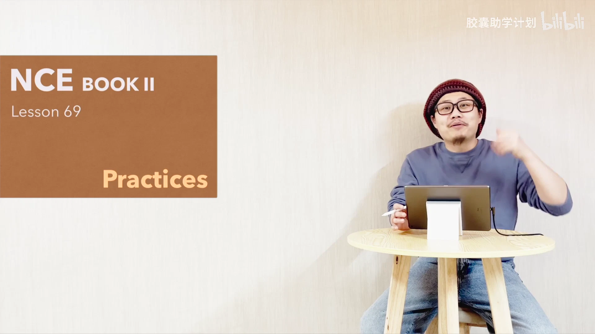

文字识别：bitbii / 胶囊助学计划 / NCE / BOOKII / Lesson 69 / Practices

### 画面 00:00:03

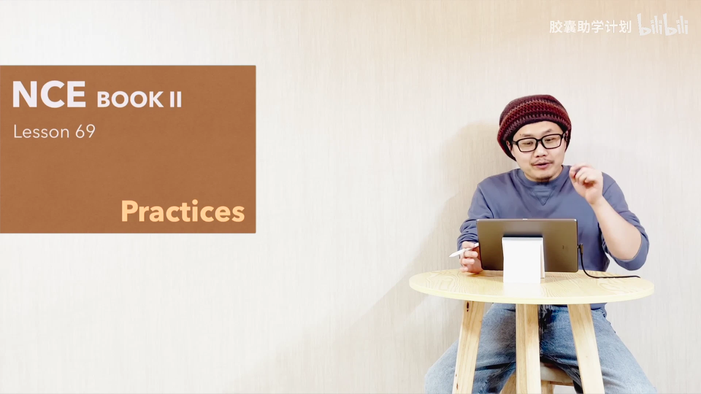

文字识别：Bitbii / 胶囊助学计划 / NCE / BOOKII / Lesson 69 / Practices

### 画面 00:00:05

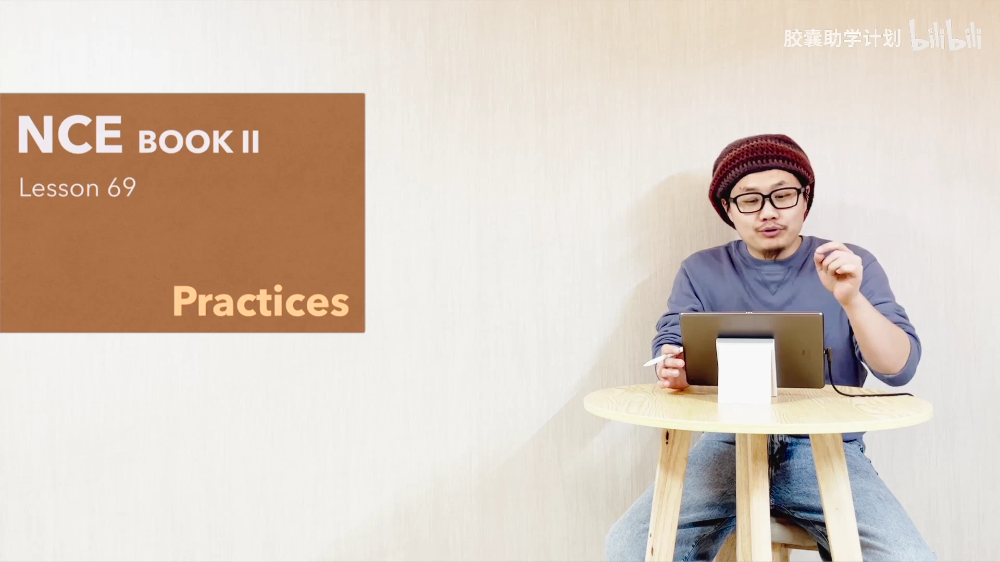

文字识别：bilbili / 胶囊助学计划 / NCE / BOOKI"I / Lesson 69 / Practices

### 画面 00:00:08

文字识别：bilbl / 胶囊助学计划 / 进行如下练习唯一前提 / 文章跟读至熟读成诵 / 否则请勿开始

### 画面 00:00:13

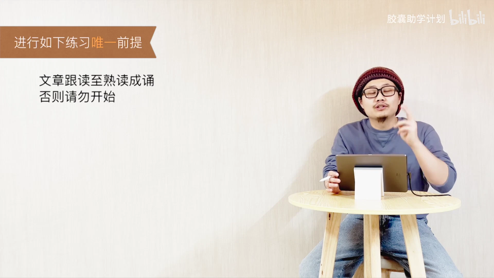

文字识别：Blbii / 胶囊助学计划 / 进行如下练习唯一前提 / 文章跟读至熟读成诵 / 否则请勿开始

### 画面 00:00:15

文字识别： bitbili / 胶囊助学计划 / •

### 画面 00:00:19

文字识别：胶囊助学计划 / 胶囊助学计划

### 画面 00:00:21

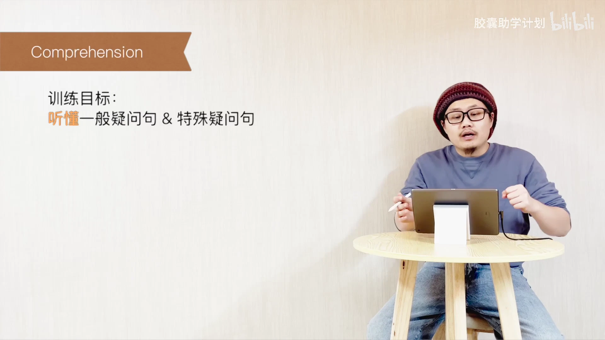

文字识别：biibii / 胶囊助学计划 / Comprehension / 训练目标： / 听懂一般疑问句＆特殊疑问句

### 画面 00:00:23

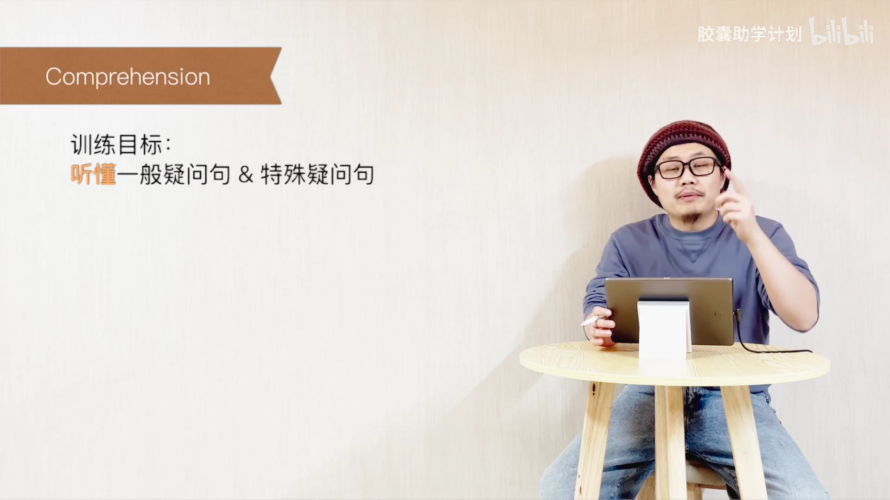

文字识别：biibli / 胶囊助学计划 / Comprehension / 训练目标： / 听懂一般疑问句＆特殊疑问句

### 画面 00:00:28

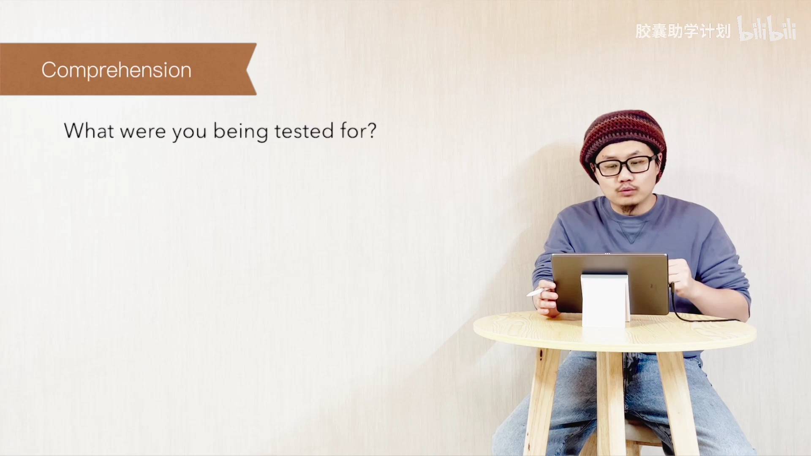

文字识别：biltbili / 胶囊助学计划 / Comprehension / What were you being tested for?

## 00:00:30–00:01:00

What were you being tested for? Answer: My driving license. Next one, Was it the second or the third time? The third time. Next one, What had you been asked to do? To drive in heavy traffic. You done it successfully, hadn't you?

### 画面 00:00:38

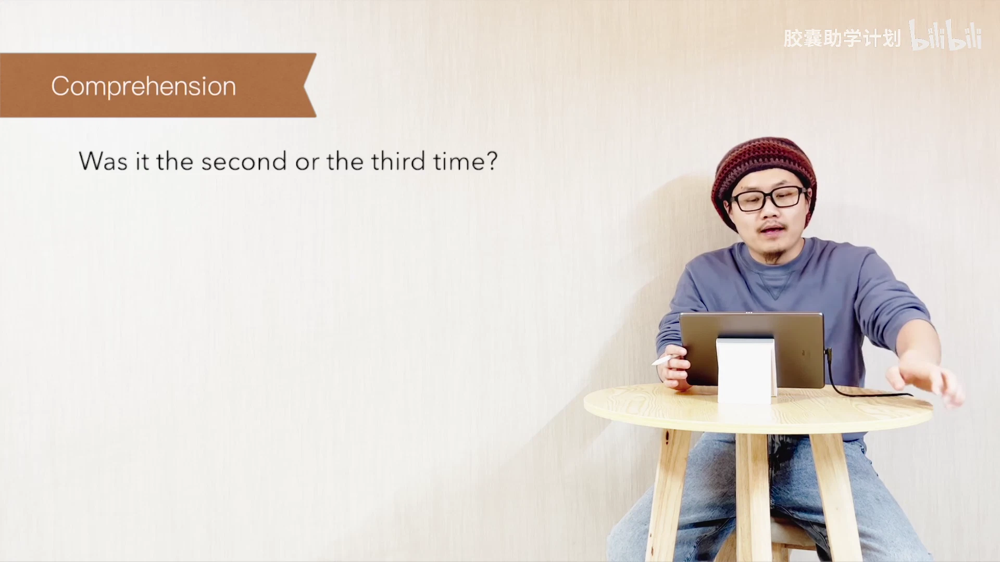

文字识别：bilbl / 胶囊助学计划 / Comprehension / Was it the second or the third time?

### 画面 00:00:50

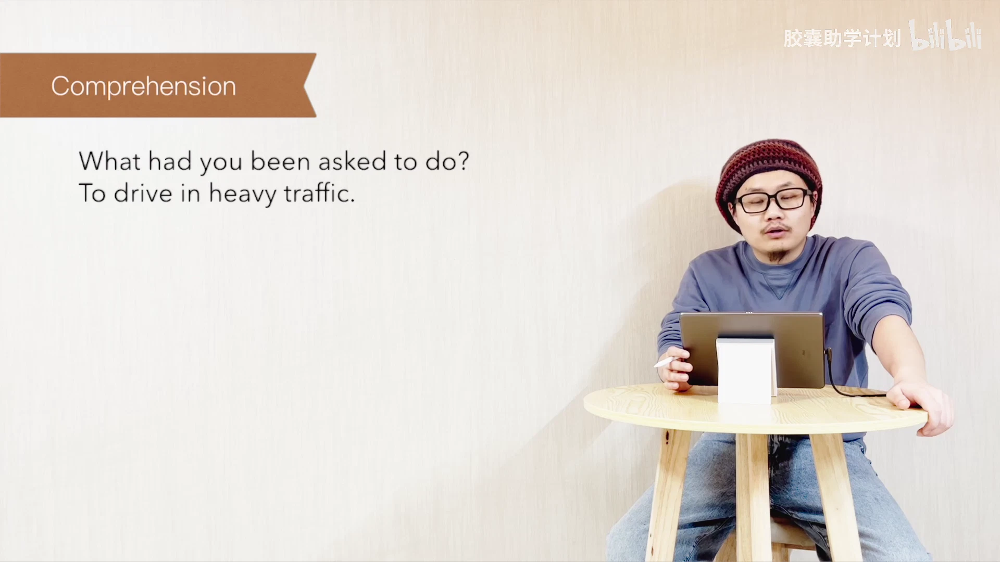

文字识别：bibli / 胶囊助学计划 / Comprehension / What had you been asked to do? / To drive in heavy traffic.

### 画面 00:00:58

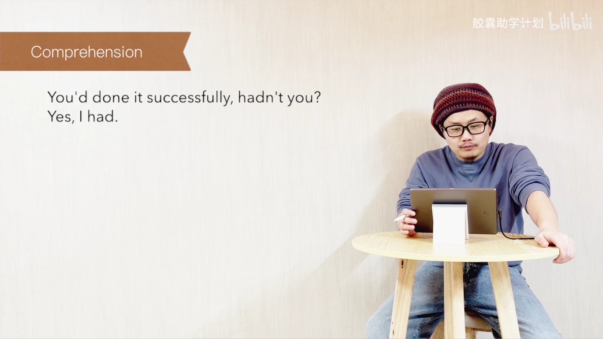

文字识别：bilbil / 胶囊助学计划 / Comprehension / You'd done it successfully, hadn't you? / Yes, I had.

## 00:01:00–00:01:30

Yes, I had. When did you begin to acquire confidence? After having been instructed to drive out of town. Why were you almost beginning to acquire to enjoy your test? Because I was sure that I had passed. What did this make you think?

### 画面 00:01:06

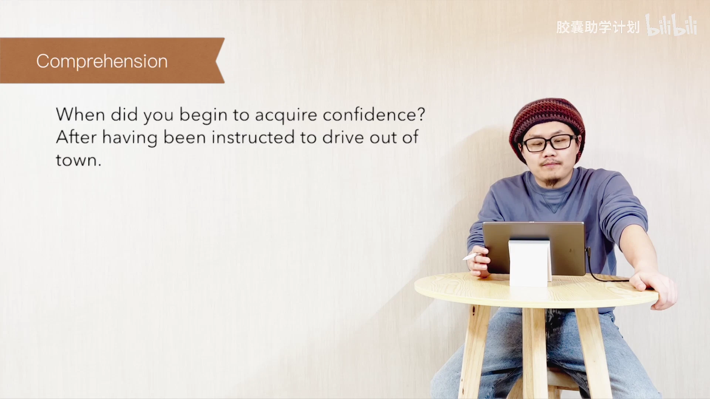

文字识别：bilbii / 胶囊助学计划 / Comprehension / When did you begin to acquire confidence? / After having /  been instructed to drive out of / town.

### 画面 00:01:13

文字识别：bibii / 胶囊助学计划 / Comprehension / Why / were / e you / almost beginning to enjoy / your test?

## 00:01:30–00:02:00

She must have been pleased with my performance. The examiner, ra. Did he ask you to do one more thing? Yes, he did. What were you asked to suppose? That a child suddenly crossed the road in front of me.

### 画面 00:01:30

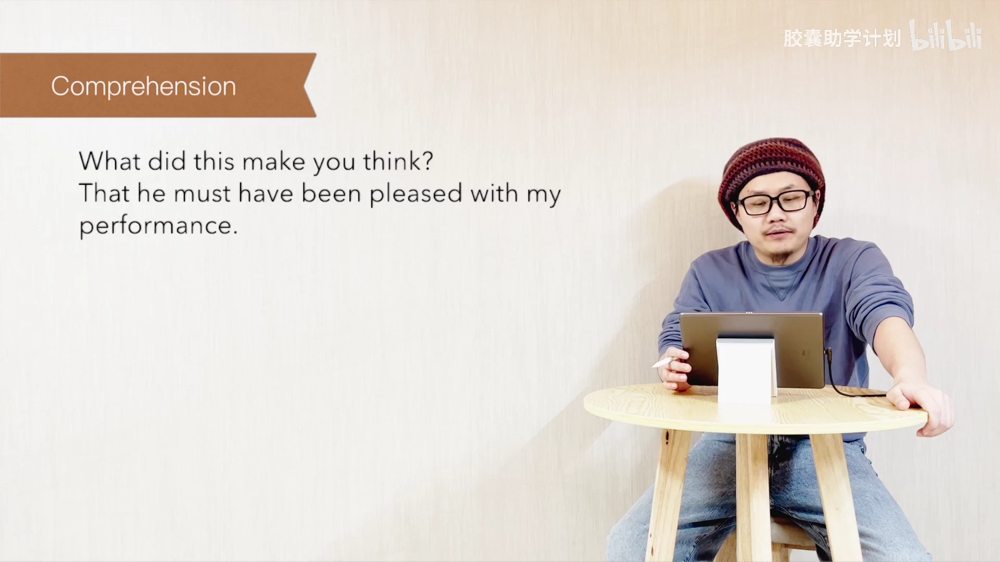

文字识别：bilbili / 胶囊助学计划 / Comprehension / What did this make you think? / That he must have been pleased with my / performance.

### 画面 00:01:40

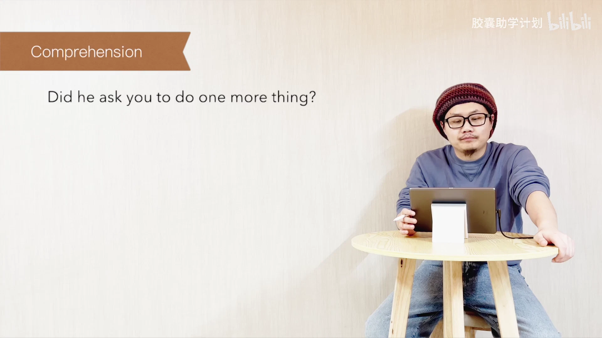

文字识别：biibli / 胶囊助学计划 / Comprehension / Did he ask you to do one more thing?

### 画面 00:01:52

文字识别：bibli / 胶囊助学计划 / Comprehension / What were you asked to suppose? / That a child suddenly crossed the road in / front of me.

## 00:02:00–00:02:30

When did he want the car to be stopped? When he tapped on the window. When did the examiner tap loudly? After some time. Could the sound be heard clearly? Yes, it could. Did you react

### 画面 00:02:00

文字识别：biibli / 胶囊助学计划 / Comprehension / When did he want the car to be stopped?

## 00:02:30–00:03:00

immediately? No, I didn't. What did you press? The brake pedal. Asking questions,练习咱们能说一般疑问句和特殊疑问句啊，俗称四句型转换，对吧？哎，除了没有否定句，其实啊，Ask me if I was being tested for my driving license. Was往前一提，What there there for? 那肯定是对 driving license, your driving license提问，对吧？所以叫做

### 画面 00:02:30

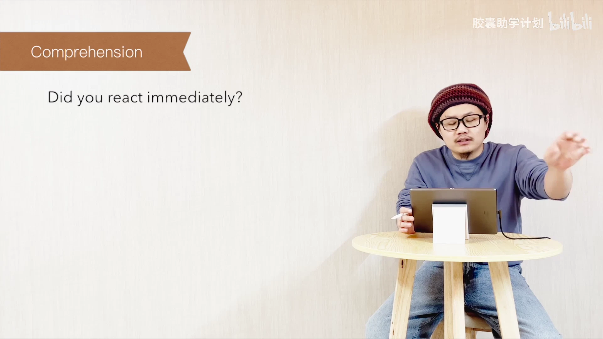

文字识别：biibii / 胶囊助学计划 / Comprehension / Did you react immediately?

### 画面 00:02:40

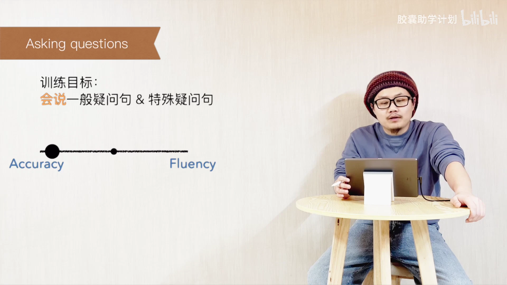

文字识别：bibili / 胶囊助学计划 / Asking questions / 训练目标： / 会说一般疑问句＆特殊疑问句 / Accuracy / Fluency

### 画面 00:02:46

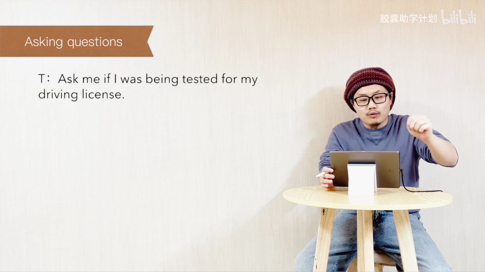

文字识别：bilbili / 胶囊助学计划 / Asking questions / T: Ask me if I was being tested for my / driving / license.

### 画面 00:02:53

文字识别：bilbii / 胶囊助学计划 / Asking questions / T: Ask me if I was being tested for my / driving / license. / S: Were you being tested for your driving / license?

## 00:03:00–00:03:30

What were you being tested for? 你当时正在被测试干嘛呀？对吧？测测什么呀？对吧？哎，测试的目的是什么呀？那 why 直接加整句，对吧？我觉得没有问题啊。呃，第二个 It was my third test. 那首先一般疑问句 was 提前，which 你可以说 Which test was it? 对吧？它是哪一次考试呢？然后这个第 I'd，你要知道这个撇 d 是 would 还是 had

### 画面 00:03:03

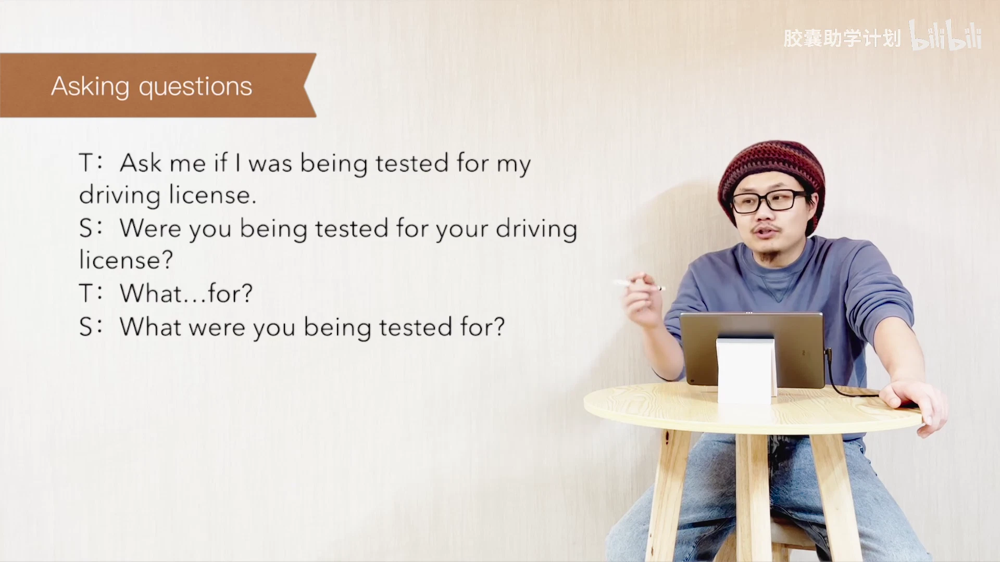

文字识别：bibii / 胶囊助学计划 / Asking questions / T: Ask me if I was being tested for my / driving l / license. / S: Were you being tested for your driving / license? / T: What...for? / S: What were you being tested for?

### 画面 00:03:06

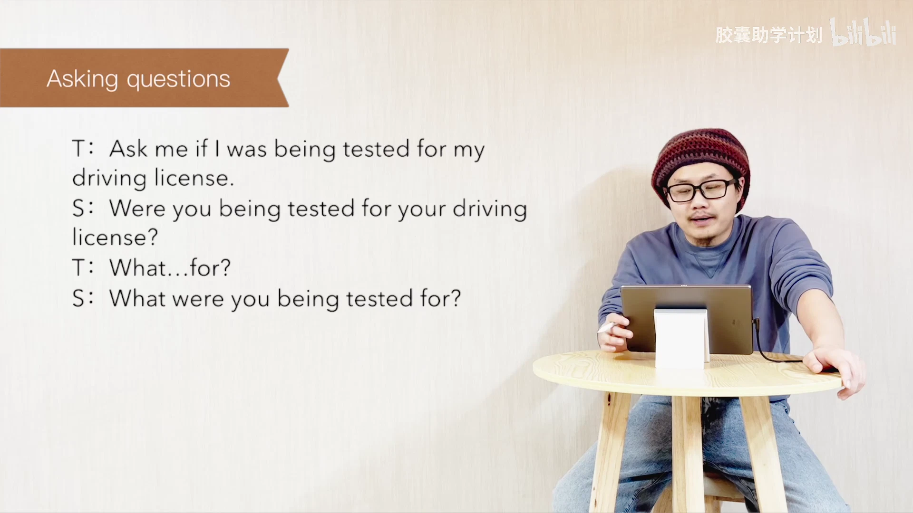

文字识别：Bitbili / 胶囊助学计划 / Asking questions / T: Ask me if I was being tested for my / driving / license. / S: Were you being tested for your driving / license? / T: What...for? / S: What were you being tested for?

### 画面 00:03:08

文字识别：bilBii / 胶囊助学计划 / Asking / questions / 1.lwas / being / tested for my / driving / y license. / (What...for.)(Why)

### 画面 00:03:23

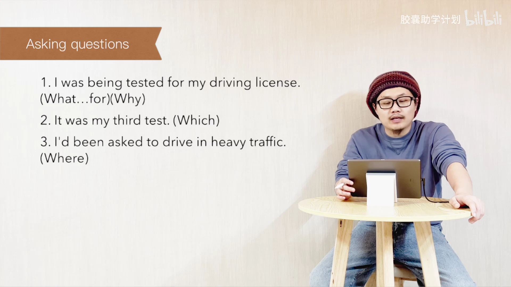

文字识别：Bilbili / 胶囊助学计划 / Asking questions / 1.I was being tested for my driving license. / (What..for)(Why) / 2. Ilt was my third test. (Which) / 3.I'd been asked to drive in heavy traffic . / (Where)

### 画面 00:03:27

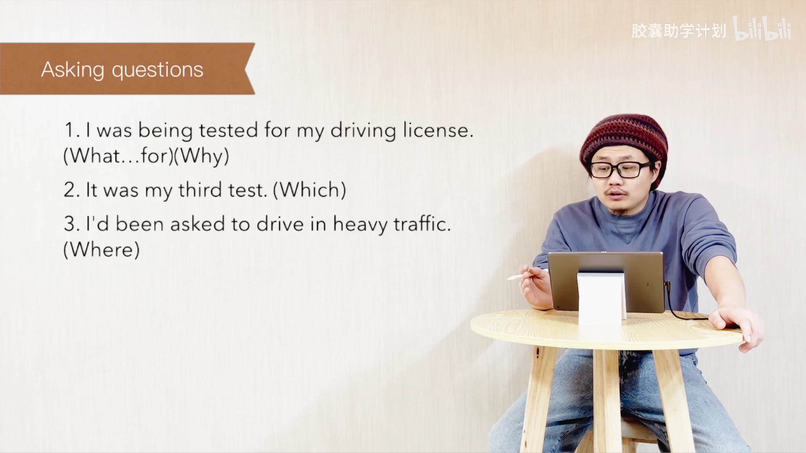

文字识别：bilibili / 胶囊助学计划 / Asking questions / 1.I was being tested for my driving license. / (What..for)(Why) / 2. Ilt was my third test. (Which) / 3.I'd been asked to drive in heavy traffic. / (Where)

## 00:03:30–00:04:00

啊？这地方肯定是个had，对吧？所以一般疑问句是had提前，然后where肯定是对in heavy traffic提问啊。Next one说I done so successfully，这个撇d依旧是had，那had提前，how对这个successfully提问嘛，对吧？So success啊，as successfully提问对吧？How had you done so？是吧？Okay，呃，next one，I began to acquire confidence. Did提前，what对confidence

### 画面 00:03:38

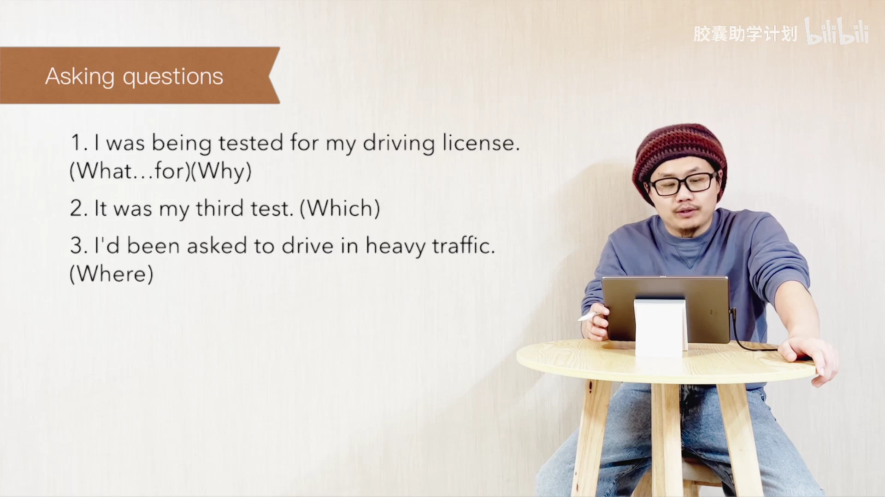

文字识别：biltbili / 胶囊助学计划 / Asking questions / 1.I was being tested for my driving license. / (What..for)(Why) / 2. Ilt was my third test. (Which) / 3. I'd been asked to drive in heavy traffic. / (Where)

### 画面 00:03:54

文字识别：bilbli / 胶囊助学计划 / Asking / questions / 5.I began to acquire confidence. (What)

## 00:04:00–00:04:30

提问 I'd been instructed to drive out of town. Had 提前 Which way to 对呃 out of town 提问对吧 Which way had you been instructed to drive? Who 对主语提问直接提代。第七个说 I was almost beginning to acquire a to enjoy my test. 那你这里 was 提前就可以了，然后 What 对 my test 提问 Why 对整句提问啊？为啥你开

### 画面 00:04:14

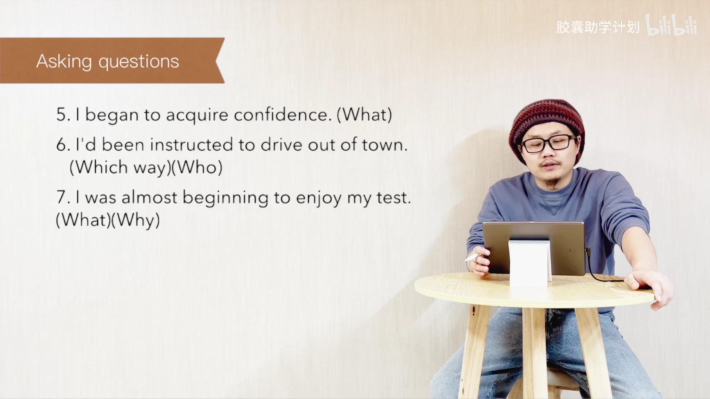

文字识别：bilbii / 胶囊助学计划 / Asking questions / 5.I began to acquire confidence. (What) / 6.I'd been instructed to drive out of town. / (Which way)(Who) / 7.I was almost beginning to enjoy my test. / (What)(Why)

### 画面 00:04:18

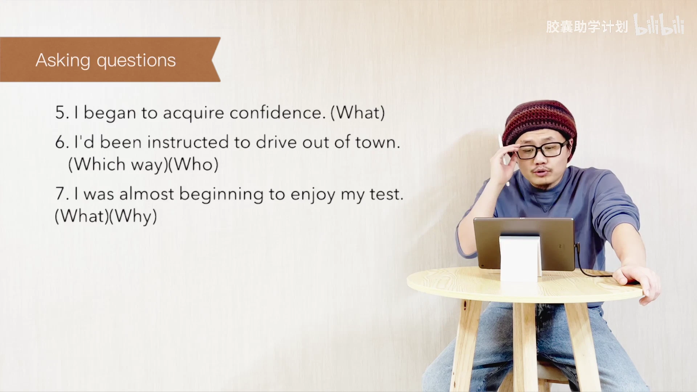

文字识别：biibili / 胶囊助学计划 / Asking questions / 5.I began to acquire confidence. (What) / 6. I'd been instructed to drive out of town. / (Which way)(Who) / 7.I was almost beginning to enjoy my test. / (What)(Why)

### 画面 00:04:21

文字识别：Biltbili / 胶囊助学计划 / Asking questions / 5.I began to acquire confidence. (What) / 6.I'd been instructed to drive out of town. / (Which way)(Who) / 7.I was almost beginning to enjoy my test. / (What)(Why)

## 00:04:30–00:05:00

始享受你的考试了都？对不对？第八个，这个 examiner must have been pleased with my performance， must 提前嘛？然后 what 点点 with 你这个 what 对 my performance 提问？ Why 呢？你可以对整句话直接提问。 OK，好，第九个那很简单， did 提前， what 点点 do 标准答案？ What did he do？对吧？ Why 整句话？ Why did he smile？啊，很简单。 Tell the story 不多说了啊，这个

### 画面 00:04:32

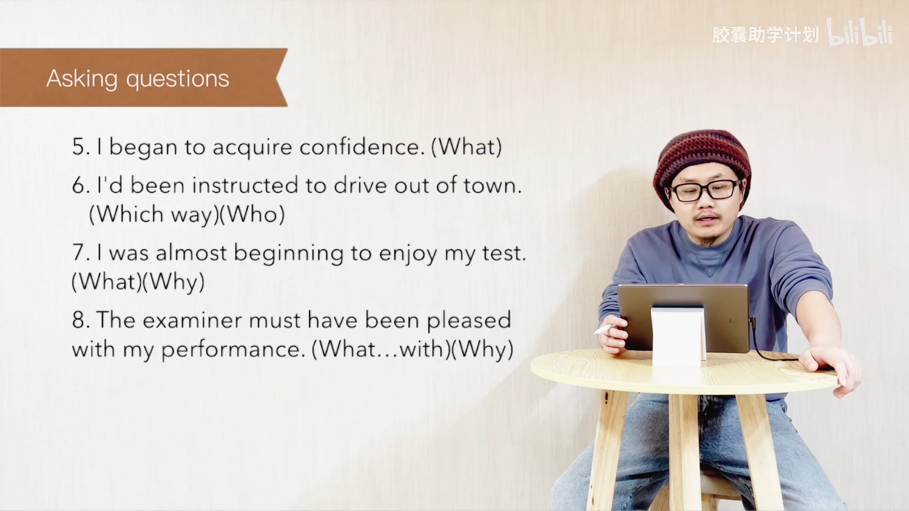

文字识别：胶囊助学计划bi出 / Asking questions / 5.I began to acquire confidence. (What) / 6.I'd been instructed to drive out of town. / (Which way)(Who) / 7.I was almost beginning to enjoy my test. / (What)(Why) / 8. The examiner must have been pleased / with my performance. (What...with)(Why)

### 画面 00:04:36

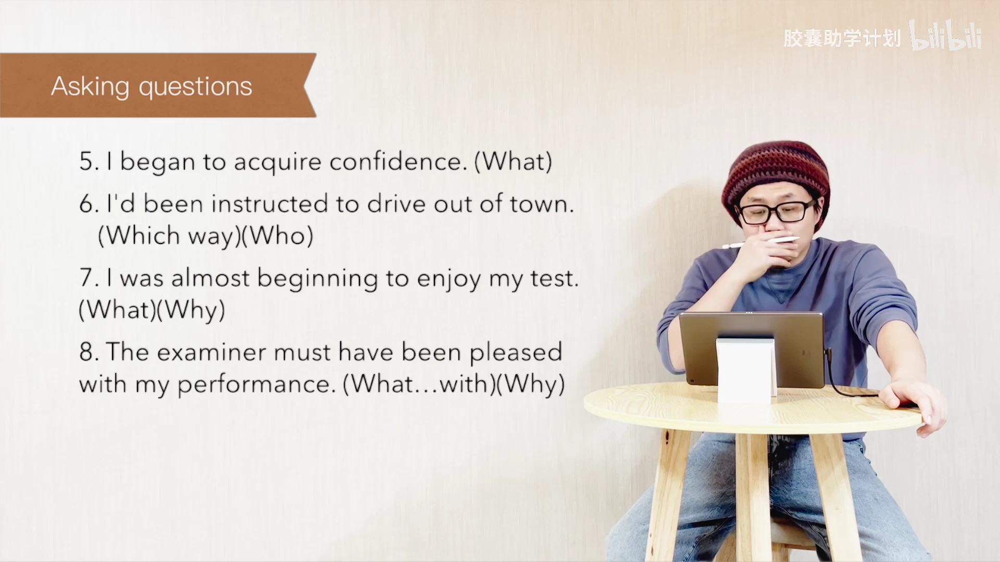

文字识别：胶囊助学计划H出 / Asking questions / 5.I began to acquire confidence. (What) / 6.I'd been instructed to drive out of town. / (Which way)(Who) / 7.I was almost beginning to enjoy my test. / (What)(Why) / 8. The examiner must have been pleased / with my performance. (What...with)(Why)

### 画面 00:04:40

文字识别：胶囊助学计划i出 / Asking questions / 5.I began to acquire confidence. (What) / 6.I'd been instructed to drive out of town. / (Which way)(Who) / 7.I was almost beginning to enjoy my test. / (What)(Why) / 8. The examiner must have been pleased / with my performance. (What...with)(Why)

### 画面 00:04:53

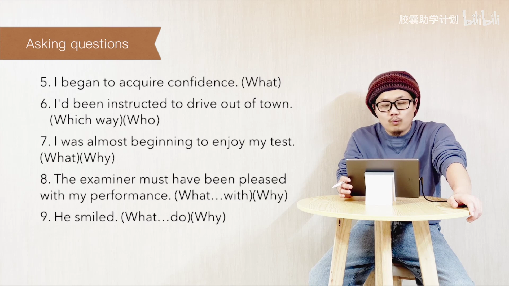

文字识别：bibii / 胶囊助学计划 / Asking questions / 5.I began to acquire confidence. (What) / 6.I'd been instructed to drive out of town. / (Which way)(Who) / 7.I was almost beginning to enjoy my test. / (What)(Why) / 8. The examiner must have been pleased / with my performance. (What...with)(Why) / 9. He smiled.(What...do)(Why)

### 画面 00:04:57

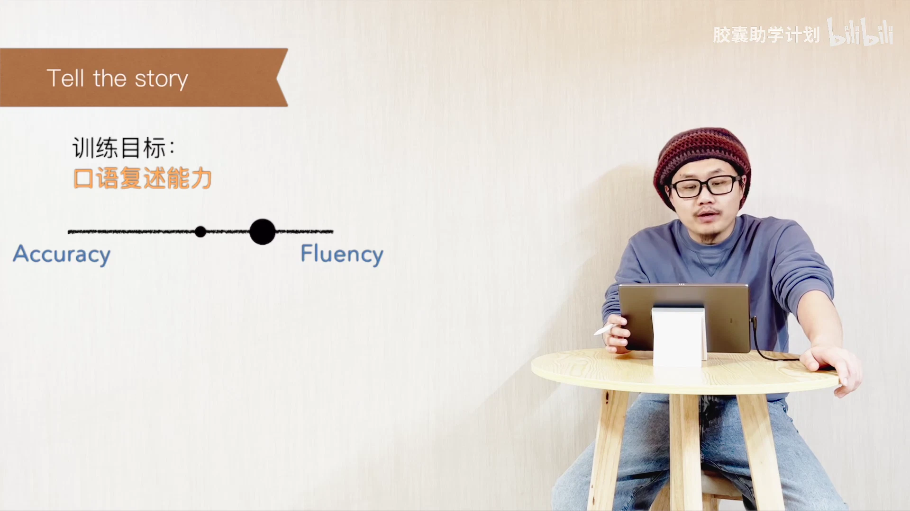

文字识别：bibili / 胶囊助学计划 / Tell the story / 训练目标： / 口语复述能力 / Accuracy / Fluency

### 画面 00:04:59

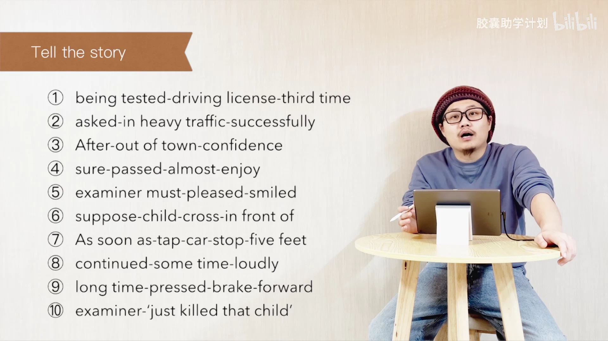

文字识别：胶囊助学计划bibi / Tell the story / ① / D being tested-driving license-third time / asked-in heavy traffic-successfully / After-out of town-confidence / sure-passed-almost-enjoy / examiner must-pleased-smiled / suppose-child-cross-in front of / 6 / As soon as-tap-car-stop-five feet / continued-some time-loudly / 8 / 9 / long time-pressed-brake-forward / ① examiner-'just killed that child'

## 00:05:00–00:05:30

文章读熟，拿它去进行一个复述练习。这我说过，是我们国内大多数考试都不考的。但是雅思、托福这样的考试，以及生活当中英语的实际应用，换一句话来说，您不是为了考试，您是为了工作和留学啊，或者生活、旅游去用的。那这个练习你一定要去练。你对比的就是孩子从小，哎，这个，比如说你给孩子讲完一个故事，让孩子再给你讲

### 画面 00:05:17

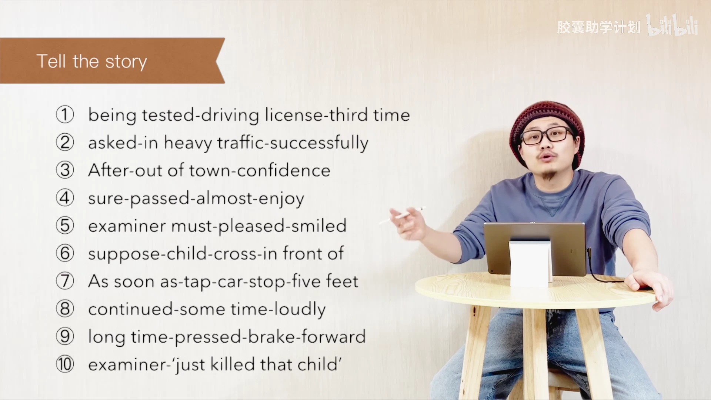

文字识别：胶囊助学计划i出 / Tell the story / ① being tested-driving license-third time / asked-in heavy traffic-successfully / After-out of town-confidence / sure-passed-almost-enjoy / examiner must-pleased-smiled / suppose-child-cross-in front of / 6 / As soon as-tap-car-stop-five feet / continued-some time-loudly / 8 / 9 / D long time-pressed-brake-forward / ⑩ examiner-'just killed that child'

### 画面 00:05:21

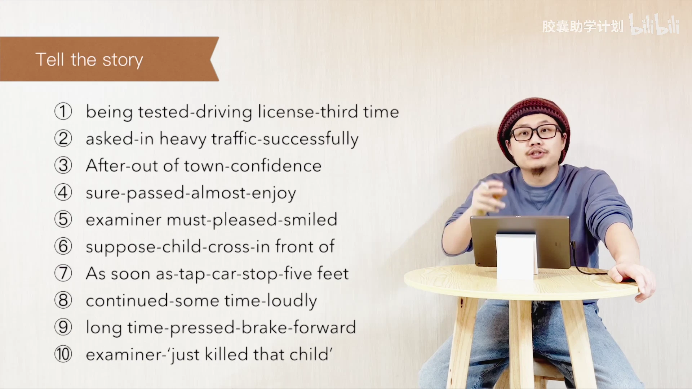

文字识别：胶囊助学计划ib出 / Tell the story / ① /  being tested-driving license-third time / asked-in heavy traffic-successfully / After-out of town-confidence / sure-passed-almost-enjoy / examiner must-pleased-smiled / suppose-child-cross-in front of / 6 / As soon as-tap-car-stop-five feet / continued-some time-loudly / 8 / 9 / ) long time-pressed-brake-forward / ① examiner-'just killed that child'

## 00:05:30–00:06:00

一遍，锻炼的就是他语言的复述能力，好吧？好，呃，summary writing写完来这儿对答案就可以了，这个我们没什么可说的啊。然后topic for discussion呢，老习惯啊，我就是把每道题迅速的过一遍，您脑海当中有一个概念就行了。就是我做的，其实您做的所有的练习，什么单词造句，所有所有之前一切的练习，就是为了有一天能够看着这三道题，能张开嘴

### 画面 00:05:34

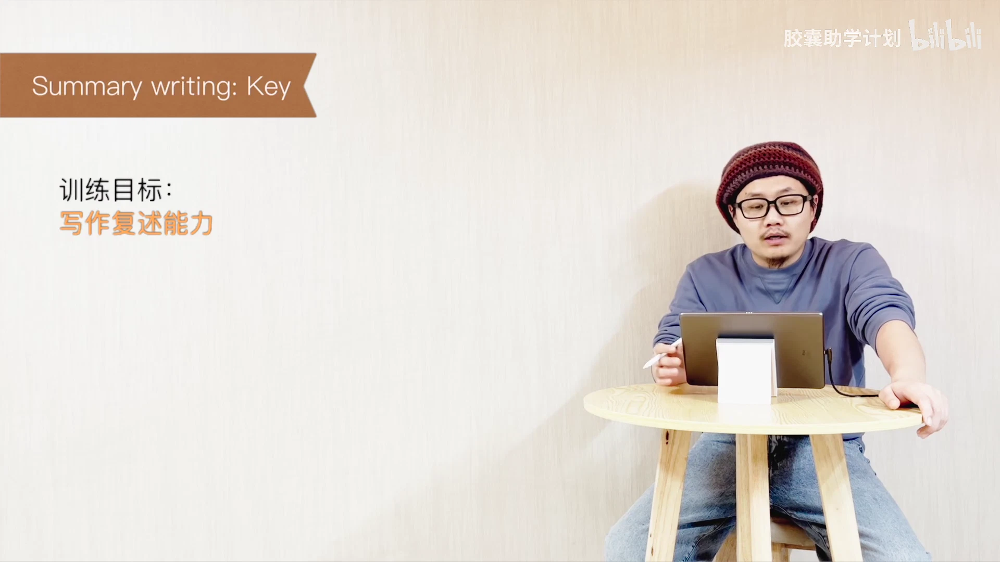

文字识别：blibii / 胶囊助学计划 / Summary writing: Key / 训练目标： / 写作复述能力

### 画面 00:05:36

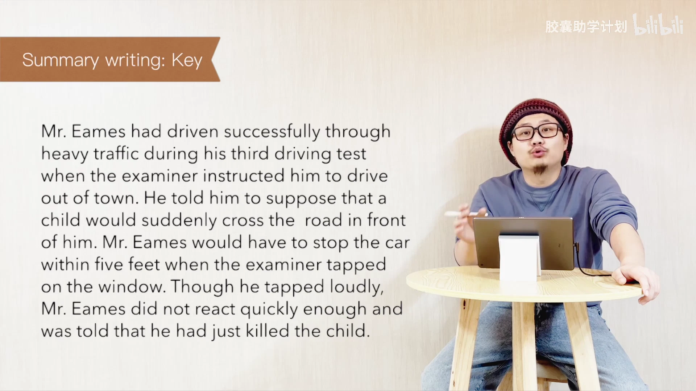

文字识别：胶囊助学计划bibi / Summary writing: Key / Mr. Eames had driven successfully through / heavy traffic during his third driving test / when the examiner instructed him to drive / out of town. He told him to suppose that a / child would suddenly cross the road in front / of him. Mr. Eames would have to stop the car / within five feet when the examiner tapped / on the window. Though he tapped loudly, / Mr. Eames did not react quickly enough and / was told that he had just killed the child.

### 画面 00:05:38

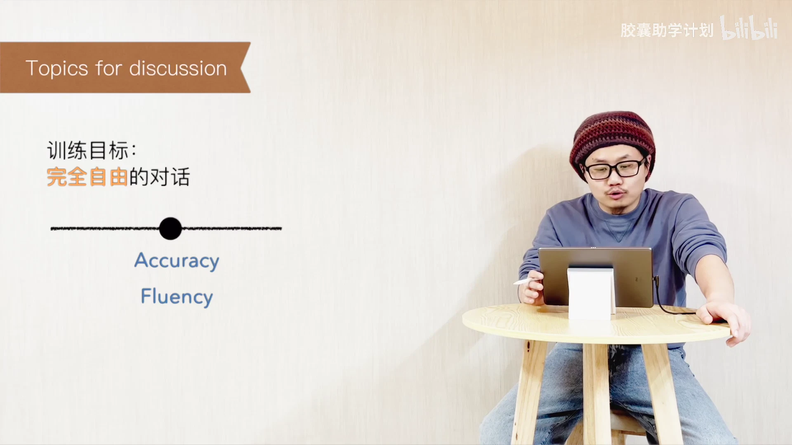

文字识别：bilbili / 胶囊助学计划 / Topics for discussion / 训练目标： / 完全自由的对话 / Accuracy / Fluency

### 画面 00:05:41

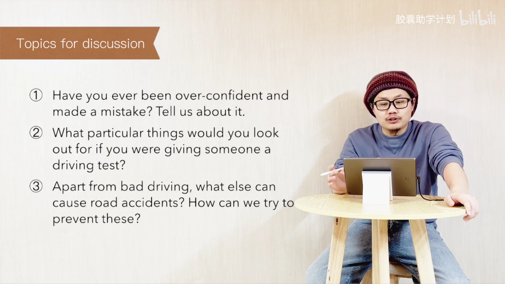

文字识别：胶囊助学计划山 / Topics for discussion / Have you ever been over-confident and / made a mistake? Tell us about it. / What particular things would you look / out for if you were giving someone a / driving test? / Apart from bad driving, what else can / cause road accidents? How can we try to / prevent these?

### 画面 00:05:50

文字识别：biibi / 胶囊助学计划 / Topics for discussion / Have you ever been over-confident and / made a mistake? Tell us about it. / What particular things would you look / out for if you were giving someone a / driving test? / Apart from bad driving, what else can / cause road accidents? How can we try to / prevent these?

## 00:06:00–00:06:30

去呃表达出来，对吧？那我们看第一个啊，说 Have you ever been overconfident and made mistake? Tell us about it. 说你有没有过于自信，然后犯错了，给我们讲一讲，对吧？说 What particular What particular things would you look out for if you were giving someone a driving test? 说如果你要，如果你正在考某个人这个驾照，如果你是那个考官，你会格外留意什么呢？

### 画面 00:06:15

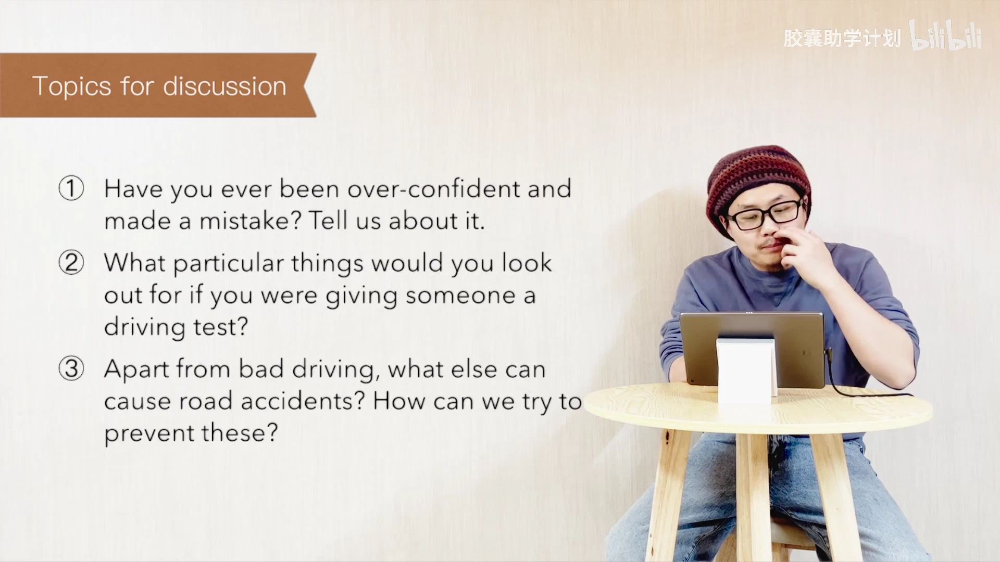

文字识别：胶囊助学计划i出 / Topics for discussion / Have you ever been over-confident and / made a mistake? Tell us about it. / What particular things would you look / out for if you were giving someone a / driving test? / Apart from bad driving, what else can / cause road accidents? How can we try to / prevent these?

### 画面 00:06:23

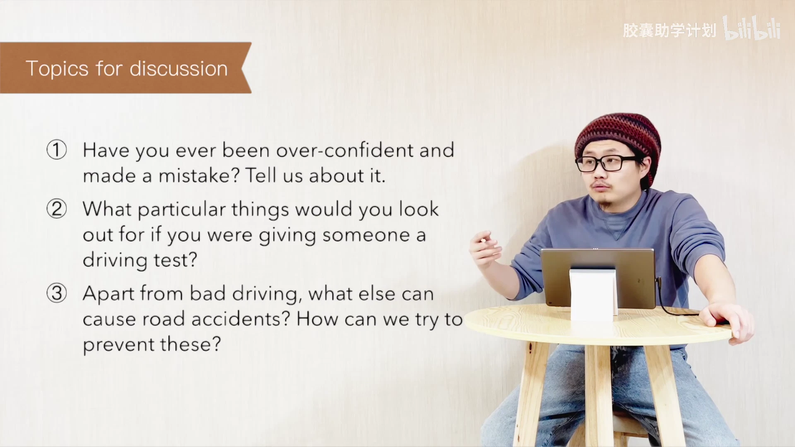

文字识别：胶囊助学计划出 / Topics for discussion / Have you ever been over-confident and / made a mistake? Tell us about it. / What particular things would you look / out for if you were giving someone a / driving test? / Apart from bad driving, what else can / cause road accidents? How can we try to / prevent these?

## 00:06:30–00:07:00

Apart from bad driving, what else can cause road accidents? How can we try to prevent this? 哎，这个如果您开车或者有过思考，这个就很容易说了，对吧？说除了这个你驾驶，嗯，你这个驾驶的这个技术不行以外，还有什么会引起道路上的这些事故？然后我们如何才能避免这些事情的发生呢？OK，好，那家庭作业，Ask Smith

### 画面 00:06:53

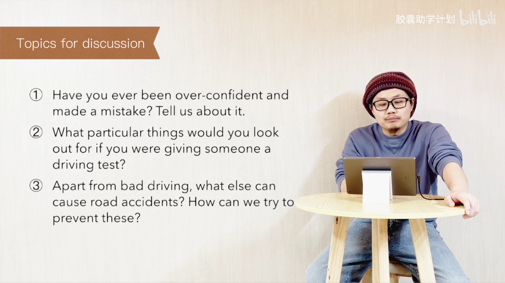

文字识别：Bitbii / 胶囊助学计划 / Topics for discussion / Have you ever been over-confident and / made a mistake? Tell us about it. / What particular things would you look / out for if you were giving someone a / driving test? / Apart from bad driving, what else can / cause road accidents? How can we try to / prevent these?

### 画面 00:06:56

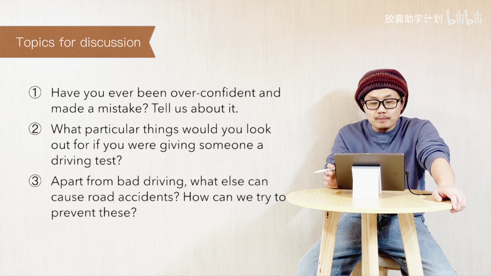

文字识别：胶囊助学计划出 / Topics for discussion / Have you ever been over-confident and / made a mistake? Tell us about it. / What particular things would you look / out for if you were giving someone a / driving test? / Apart from bad driving, what else can / cause road accidents? How can we try to / prevent these?

### 画面 00:06:58

文字识别：bibi / 胶囊助学计划 / 1.Ask me if写&朗读

## 00:07:00–00:07:30

先写再朗读，摘要写作，写完对答案，Tell the story，口语复述，然后重复间隔，哎，可以看置顶留言，可以找到重复间隔的学习材料。那以上呢就是本期视频的全部内容了。如果各位喜欢我们的课程呢，欢迎各位关注、订阅、一键三连，分享给那些需要的朋友，来帮助我们快速成长。See you next time.

### 画面 00:07:00

文字识别：biibii / 胶囊助学计划 / 1.Ask me if写&朗读 / 摘要写作写&答案

### 画面 00:07:02

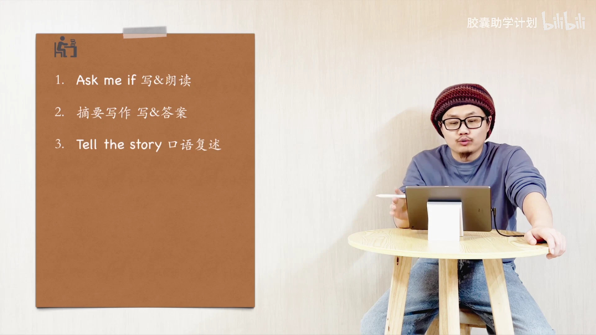

文字识别：Blibii / 胶囊助学计划 / 1.Ask me if写&朗读 / 摘要写作写&答案 / 3.Tell the story 口语复述

### 画面 00:07:04

文字识别：Biibli / 胶囊助学计划 / 1.Ask me if写&朗读 / 摘要写作写&答案 / 3.Tell the story 口语复述 / 重复间隔（置顶留言）

### 画面 00:07:06

文字识别：Bibii / 胶囊助学计划 / 1.Ask me if写&朗读 / 摘要写作写&答案 / 3.Tell the story 口语复述 / .重复间隔（置顶留言） / 4.

### 画面 00:07:08

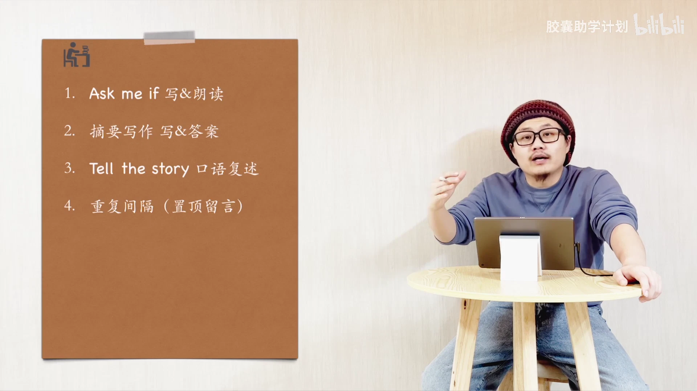

文字识别：Blibii / 胶囊助学计划 / 1.Ask me if写&朗读 / 摘要写作写&答案 / 3.Tell the story 口语复述 / 4.重复间隔（置顶留言)

### 画面 00:07:10

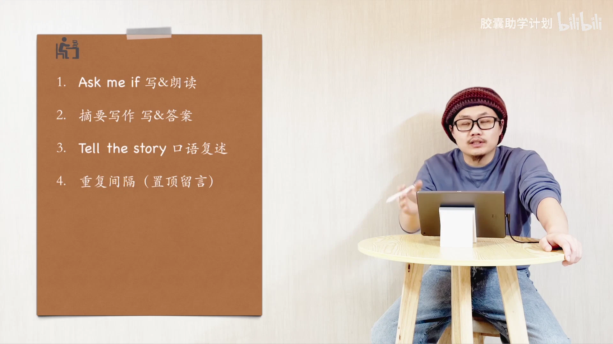

文字识别：blibii / 胶囊助学计划 / 1.Ask me if写&朗读 / 摘要写作写&答案 / 3.Tell the story 口语复述 / .重复间隔（置顶留言） / 4.

### 画面 00:07:12

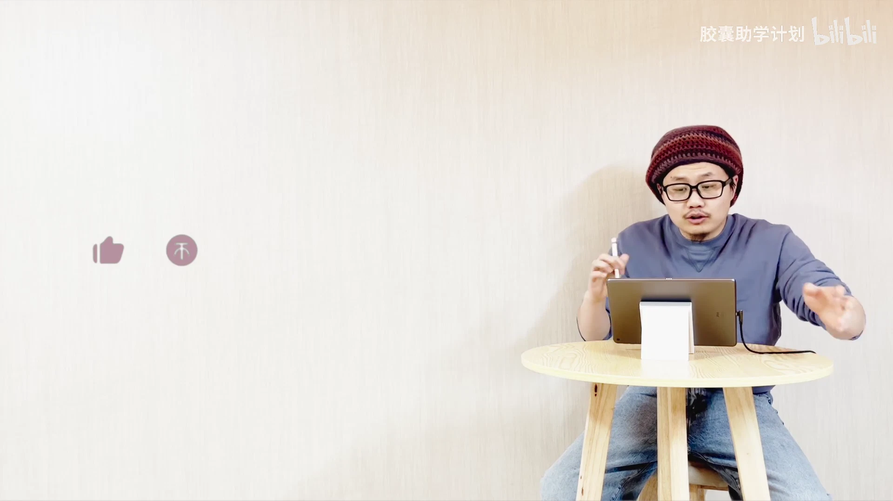

文字识别：胶囊助学计划bilibi / 不

### 画面 00:07:25

### 画面 00:07:27

文字识别：臺動字計制 / CAPSULEACADEMY / 胶囊助学计划 / 『 / 小红书 / Lecturer / Leo / OE

## 00:07:30–00:07:37

### 画面 00:07:30

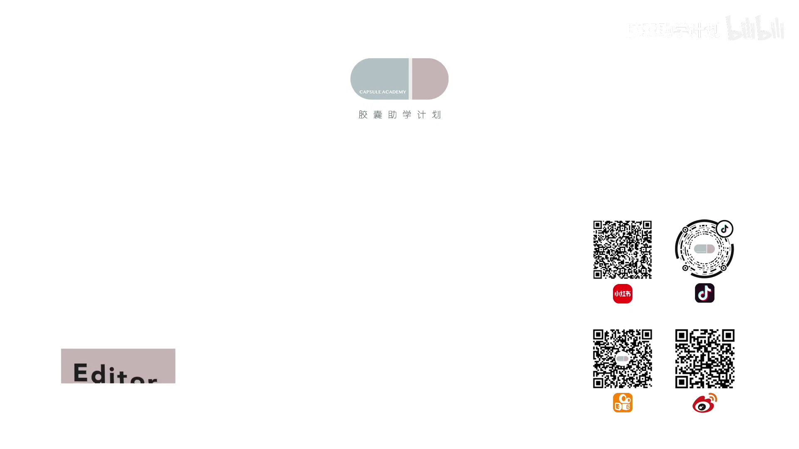

文字识别：CAPSULEACADEMY / 胶囊助学计划 / 小红书 / □ / Edito. / OE

### 画面 00:07:33

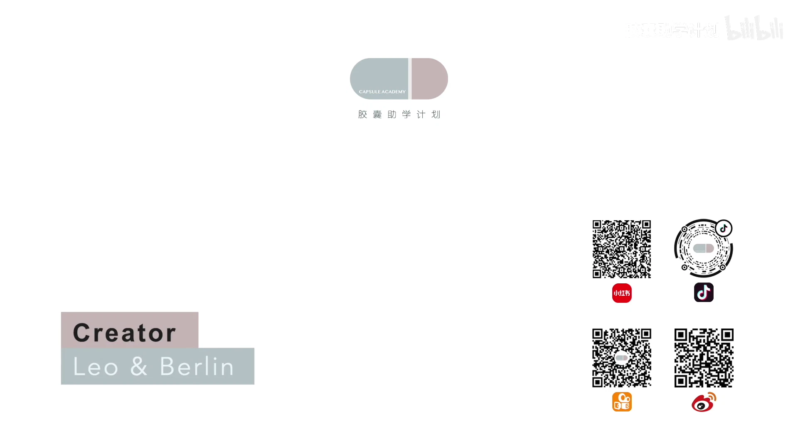

文字识别：臺聖珈字計划 / CAPSULEACADEMY / 胶囊助学计划 / 『 / 小红书 / Creator / □ / Leo & Berlin / OE

### 画面 00:07:35

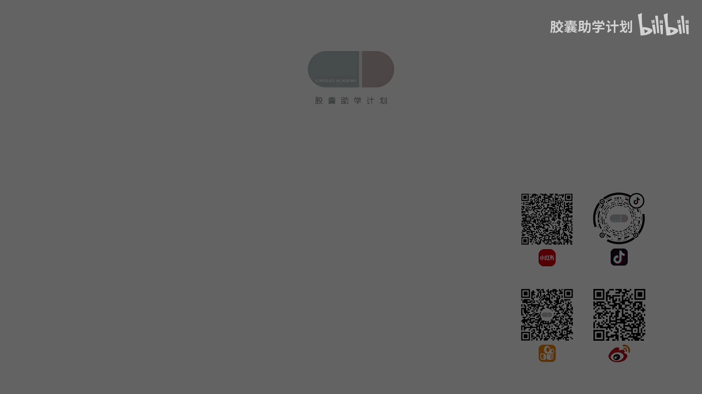

文字识别：bilibili / 胶囊助学计划 / 胶囊助学计划 / 小红书 / 品 / OE

### 画面 00:07:37

文字识别：bilbili / 胶囊助学计划

