# 070 单词

快速机器解析：语音为单模型转写，未进行独立交叉校对或人工复核；画面每秒采样并按变化选帧，短时文字和标记可能遗漏。截图时间约有 1 秒误差。图片有损压缩；遇到疑点请按时间查看 Google Drive 原视频。

## 00:00:00–00:00:30

Hello everyone, welcome to Capsule Academy. This is Leo. Today we're going to learn new concept English Book Two Lesson Seventy Words. 那老习惯进入正式课程之前呢，咱们先看几个问题啊。首先，如何表达没有觉察？接下来呢，如何表达对某件事情非常的敏感？最后一个问题叫做如何表达接受批评？那带着这三个问题，Hope you can enjoy.

### 画面 00:00:00

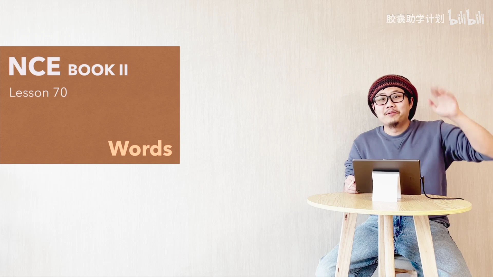

文字识别：blbii / 胶囊助学计划 / NCE / BOOKII / Lesson 70 / Words

### 画面 00:00:02

文字识别：blibii / 胶囊助学计划 / NCE / BOOKII / Lesson 70 / Words

### 画面 00:00:04

文字识别：biibii / 胶囊助学计划 / NCE / BOOKII / Lesson 70 / Words

### 画面 00:00:06

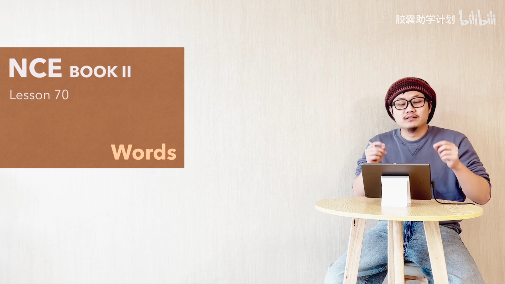

文字识别：bibil / 胶囊助学计划 / NCE / BOOKII / Lesson 70 / Words

### 画面 00:00:08

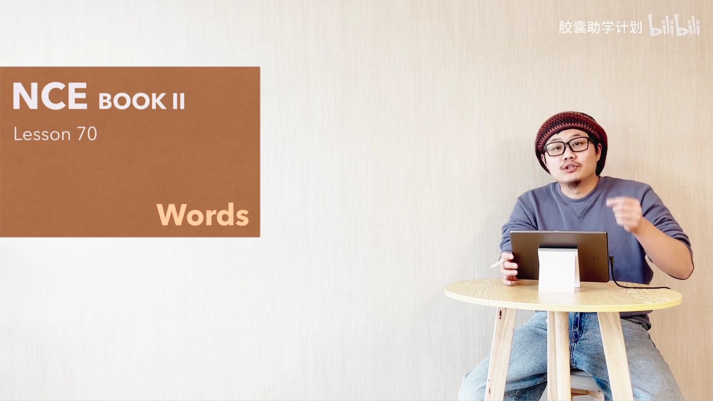

文字识别：bilbil / 胶囊助学计划 / NCE / BOOKII / Lesson 70 / Words

### 画面 00:00:10

文字识别：胶囊助学计划bibl

### 画面 00:00:12

文字识别：biibili / 胶囊助学计划 / ①如何表达“没有觉察”？

### 画面 00:00:14

文字识别：bilbili / 胶囊助学计划 / ①如何表达“没有觉察”？

### 画面 00:00:16

文字识别：bilbili / 胶囊助学计划 / ①如何表达“没有觉察”？ / 如何表达“对某事很敏感”?

### 画面 00:00:19

文字识别：bilbii / 胶囊助学计划 / ①如何表达“没有觉察”？ / 如何表达“对某事很敏感”？ / 如何表达“接受批评”?

### 画面 00:00:21

文字识别：bilbili / 胶囊助学计划 / ①如何表达“没有觉察”？ / 如何表达“对某事很敏感” / 如何表达“接受批评”

### 画面 00:00:23

文字识别：bilbii / 胶囊助学计划 / ①如何表达“没有觉察”？ / 如何表达“对某事很敏感” / 如何表达“接受批评”?

### 画面 00:00:25

文字识别：胶囊助学计划 i / •

### 画面 00:00:29

文字识别：臺助字计划一淵 / 胶囊助学计划

## 00:00:30–00:01:00

好，在讲单词之前呢，我先简单说一下。从本课开始，呃，虽然它是第三单元的最后几课啊，但是其实跟第四单元甚至跟三册已经开始有点像了。语法并不多，单词比较多，各种习惯用法开始变得越来越多啊。本文就是一个特别明显的一课，是吧？单词特别多，然后习惯用法特别的多啊，全是通篇的造句。

### 画面 00:00:31

文字识别：bibii / 单词造句指南 / 网：v.+v.变化 / 胶囊助学计划 / 四句型转换 / 方式/地点/时间 / 结合习惯用法 / 其他单词+词性 / 原文摘抄+变 / 6123456 / /'bulfait/ / /rin/ / bullfight n. ring n.

### 画面 00:00:33

文字识别：单词造句指南 / 网：v.+v.变化 / 胶囊助学计划 / bibili / 四句型转换 / 方式/地点/时间 / 结合习惯用法 / 其他单词+词性 / 原文摘抄+变 / 6123456 / /'bulfait / / /rin/ / bullfight n. ring n.

### 画面 00:00:35

文字识别：单词造句指南 / 网：v.+v.变化 / 胶囊助学计划 / bilbili / 四句型转换 / 方式/地点/时间 / 结合习惯用法 / 其他单词+词性 / 原文摘抄+变 / 6123456 / /'bu lfait/ / /rin/ / bullfight n. ring n.

### 画面 00:00:40

文字识别：单词造句指南 / 网：v.+v.变化 / 胶囊助学计划 / bilbl / 四句型转换 / 方式/地点/时间 / 结合习惯用法 / 其他单词+词性 / 原文摘抄+变 / 6123456 / /'bulfait/ / /rin/ / bullfight n. ring n.

### 画面 00:00:46

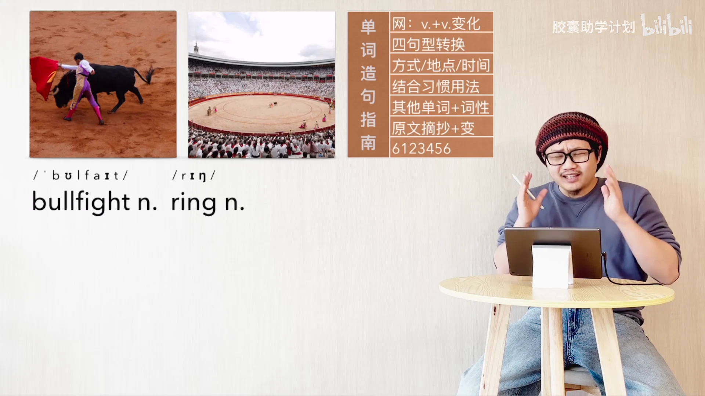

文字识别：单词造句指南 / 网：v.+v.变化 / 胶囊助学计划 / blbili / 四句型转换 / 方式/地点/时间 / 结合习惯用法 / 其他单词+词性 / 原文摘抄+变 / 6123456 / /'bulfait/ / /rin/ / bullfight n. ring n.

### 画面 00:00:48

文字识别：单词造句指南 / 网：v.+v.变化 / 胶囊助学计划 / Bibii / 四句型转换 / 方式/地点/时间 / 结合习惯用法 / 其他单词+词性 / 原文摘抄+变 / 6123456 / /'bulfait/ / /rin/ / bullfight n. ring n.

### 画面 00:00:50

文字识别：单词造句指南 / 网：v.+v.变化 / 胶囊助学计划 / bibili / 四句型转换 / 方式/地点/时间 / 结合习惯用法 / 其他单词+词性 / 原文摘抄+变 / 6123456 / /'bulfait/ / /rin/ / bullfight n. ring n.

### 画面 00:00:56

文字识别：单词造句指南 / 网：v.+v.变化 / 胶囊助学计划 / bilibili / 四句型转换 / 方式/地点/时间 / 结合习惯用法 / 其他单词+词性 / 原文摘抄+变 / 6123456 / /'bulfait/ / /rin/ / bullfight n. ring n.

## 00:01:00–00:01:30

那我们看一下这两个单词，第一个 bullfight， bullfight，好，bullfight这个单词实际上是两个单词给它连到一起了。首先 bull， bull公牛的意思，然后这个 fight 指的是打架，对吧？bullfight，斗牛。然后这个 rain 呢，其实我们之前我隐约记得我们是学过的啊，rain 它比较常见的意思，比如说戒指，比如说

### 画面 00:01:01

文字识别：bibili / 单词造句指南 / 网：v.+v.变化 / 胶囊助学计划 / 四句型转换 / 方式/地点/时间 / 结合习惯用法 / 其他单词+词性 / 原文摘抄+变 / 6123456 / /'bulfait/ / /rin/ / bullfight n. ring n.

### 画面 00:01:05

文字识别：单词造句指南 / 网：v.+v.变化 / 胶囊助学计划 / bibili / 四句型转换 / 方式/地点/时间 / 结合习惯用法 / 其他单词+词性 / 原文摘抄+变 / 6123456 / /'bulfait/ / /rin/ / bullfight n. ring n.

### 画面 00:01:10

文字识别：单词造句指南 / 网：v.+v.变化 / 胶囊助学计划 / bibili / 四句型转换 / 方式/地点/时间 / 结合习惯用法 / 其他单词+词性 / 原文摘抄+变 / 6123456 / /'bulfait/ / /rin/ / bullfight n. ring n.

### 画面 00:01:16

文字识别：单词造句指南 / 网：v.+v.变化 / 胶囊助学计划 / bilbili / 四句型转换 / 方式/地点/时间 / 结合习惯用法 / 其他单词+词性 / 原文摘抄+变 / 6123456 / /'bulfait/ / /rin/ / bullfight n. ring n.

### 画面 00:01:21

文字识别：单词造句指南 / 网：v.+v.变化 / 胶囊助学计划 / bibii / 四句型转换 / 方式/地点/时间 / 结合习惯用法 / 其他单词+词性 / 原文摘抄+变 / 6123456 / /'bulfait/ / /rin/ / bullfight n. ring n.

## 00:01:30–00:02:00

环路啊，这个五环、四环啊，五环比四环多一环，那个环啊，环路叫 ring ring road，对吧？那在这里呢，其实你基本上理解为它是一个圈儿就行了，然后你结合上下文去理解。比如说像在这篇文章当中啊，因为它是讲斗牛的嘛，它指的就是那个斗牛场啊的那个形状啊，就是一个环形的斗牛场，它就叫做 ring。 OK， there you go。那我们拿它们去造句吧。

### 画面 00:01:30

文字识别：单词造句指南 / 网：v.+v.变化 / 胶囊助学计划 / bilbii / 四句型转换 / 方式/地点/时间 / 结合习惯用法 / 其他单词+词性 / 原文摘抄+变 / 6123456 / /'bu lfait/ / /rin/ / bullfight n. ring n.

### 画面 00:01:38

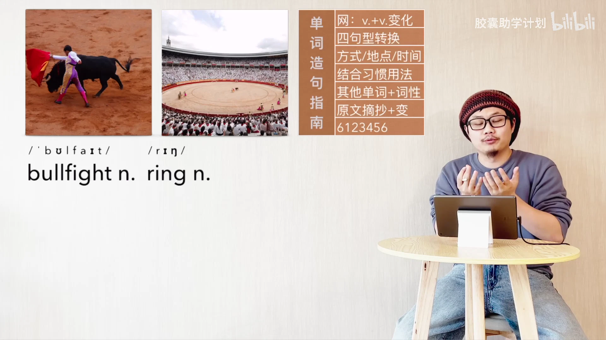

文字识别：单词造句指南 / 网：v.+v.变化 / 胶囊助学计划 / biibili / 四句型转换 / 方式/地点/时间 / 结合习惯用法 / 其他单词+词性 / 原文摘抄+变 / 6123456 / /'bulfait / / /rin/ / bullfight n. ring n.

### 画面 00:01:41

文字识别：Bibii / 单词造句指南 / 网：v.+v.变化 / 胶囊助学计划 / 四句型转换 / 方式/地点/时间 / 结合习惯用法 / 其他单词+词性 / 原文摘抄+变 / 6123456 / /'bulfait/ / /rin/ / bullfight n. ring n.

### 画面 00:01:47

文字识别：单词造句指南 / 网：v.+v.变化 / 胶囊助学计划 / Bibili / 四句型转换 / 方式/地点/时间 / 结合习惯用法 / 其他单词+词性 / 原文摘抄+变 / 6123456 / /'bulfait / / /rin/ / bullfight n. ring n.

### 画面 00:01:50

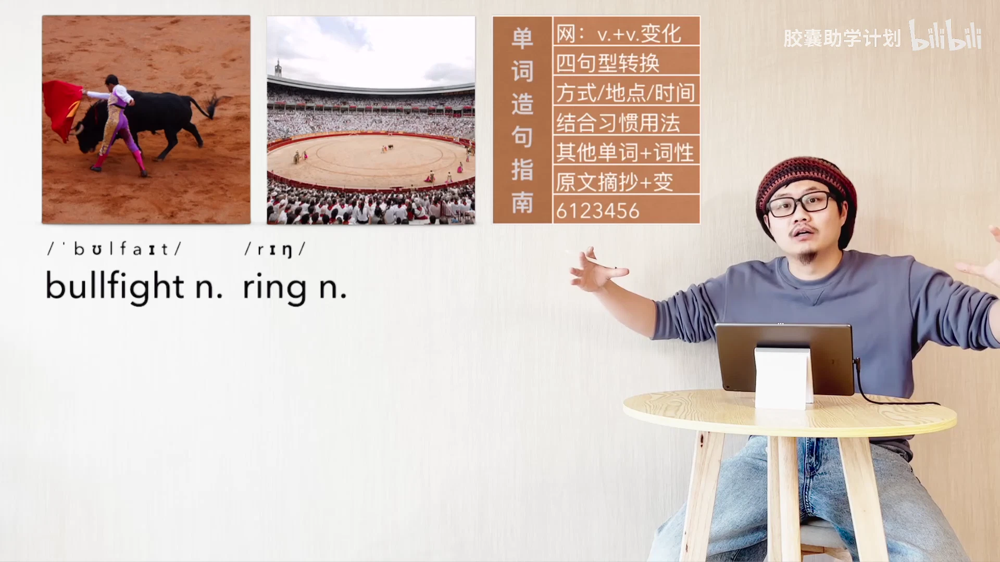

文字识别：单词造句指南 / 网：v.+v.变化 / 胶囊助学计划 / biibili / 四句型转换 / 方式/地点/时间 / 结合习惯用法 / 其他单词+词性 / 原文摘抄+变 / 6123456 / /'bulfait/ / /rin/ / bullfight n. ring n.

### 画面 00:01:52

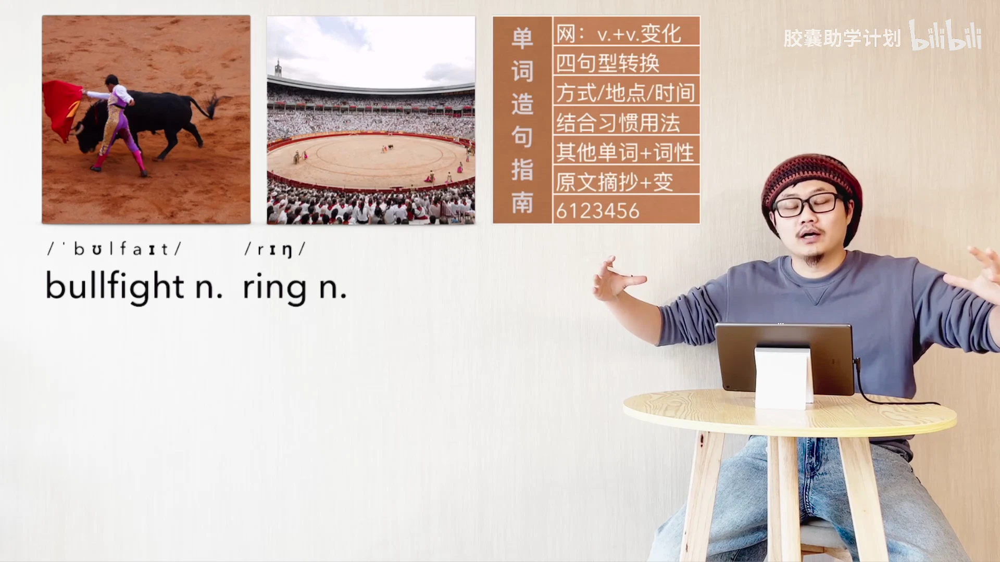

文字识别：单词造句指南 / 网：v.+v.变化 / 胶囊助学计划 / bibili / 四句型转换 / 方式/地点/时间 / 结合习惯用法 / 其他单词+词性 / 原文摘抄+变 / 6123456 / /'bulfait/ / /rin/ / bullfight n. ring n.

### 画面 00:01:55

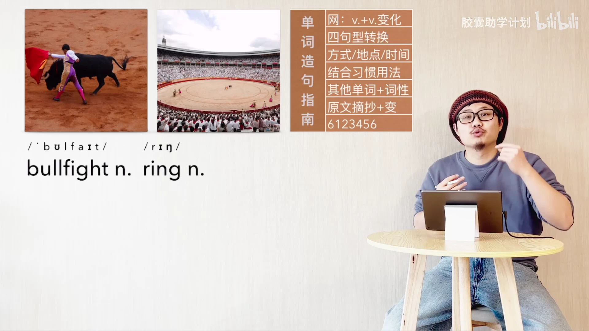

文字识别：单词造句指南 / 网：v.+v.变化 / 胶囊助学计划 / bilbili / 四句型转换 / 方式/地点/时间 / 结合习惯用法 / 其他单词+词性 / 原文摘抄+变 / 6123456 / /'bulfait/ / /rin/ / bullfight n. ring n.

### 画面 00:01:58

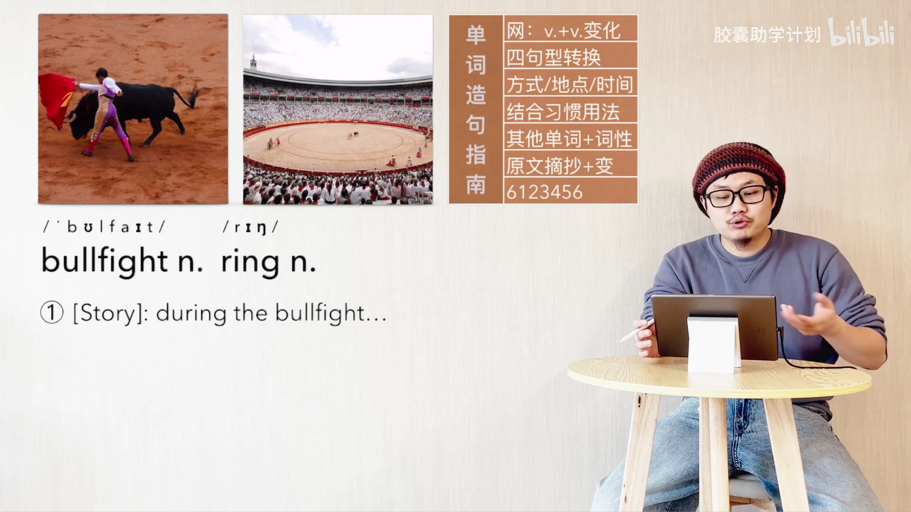

文字识别：单词造句指南 / 网：v.+v.变化 / 胶囊助学计划 / biibii / 四句型转换 / 方式/地点/时间 / 结合习惯用法 / 其他单词+词性 / 原文摘抄+变 / 6123456 / /'bu l fai t / / /rin/ / bullfight n. ring n. / ① [Story]: during the bulfight...

## 00:02:00–00:02:30

我们先看一下文章，比如说我直接让我用 bullfight 去造句还是比较困难，那怎么办呢？我先直接去看一下文章啊，回顾啊，还原一下各位脑海当中如何拿这个单词造句的思路啊，教给各位。一看文章，有一个小的短语叫 during the bullfight，这个小短语非常棒，叫在斗牛期间。这个短语我一旦学会了之后，那接下来我就去想六一二三四五六当中，它可能最常出现的

### 画面 00:02:00

文字识别：单词造句指南 / 网：v.+v.变化 / 胶囊助学计划 / biibii / 四句型转换 / 方式/地点/时间 / 结合习惯用法 / 其他单词+词性 / 原文摘抄+变 / 6123456 / /'bu l fai t / / /rin/ / bullfight n. ring n. / ① [Story]: during the bulfight...

### 画面 00:02:05

文字识别：单词造句指南 / 网：v.+v.变化 / 胶囊助学计划 / bibii / 四句型转换 / 方式/地点/时间 / 结合习惯用法 / 其他单词+词性 / 原文摘抄+变 / 6123456 / /'bu lfai t / / /rin/ / bullfight n. ring n. / ① [Story]: during the bulfight...

### 画面 00:02:12

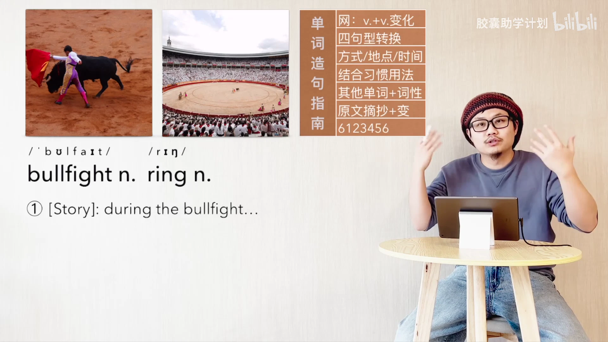

文字识别：单词造句指南 / 网：v.+v.变化 / 胶囊助学计划 / bibli / 四句型转换 / 方式/地点/时间 / 结合习惯用法 / 其他单词+词性 / 原文摘抄+变 / 6123456 / / 'bu l fai t / / /rin/ / bullfight n. ring n. / ① [Story]: during the bulfight...

### 画面 00:02:14

文字识别：单词造句指南 / ：v.+v.变化 / 胶囊助学计划 / bibili / 四句型转换 / 方式/地点/时间 / 结合习惯用法 / 其他单词+词性 / 原文摘抄+变 / 6123456 / / 'bu lfait / / /rin/ / bullfight n. ring n. / ① [Story]: during the bullfight...

### 画面 00:02:16

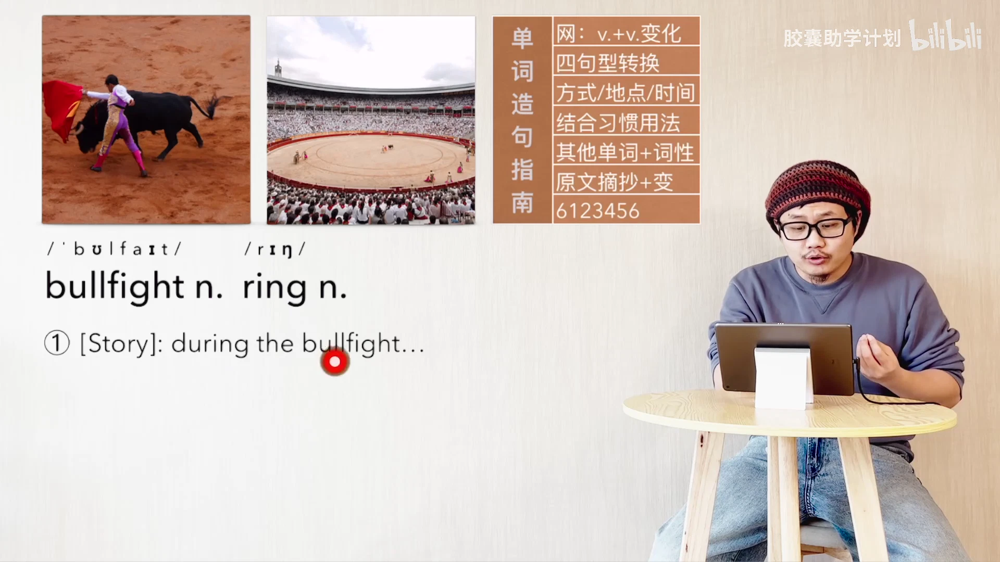

文字识别：单词造句指南 / 网：v.+v.变化 / 胶囊助学计划 / bibii / 四句型转换 / 方式/地点/时间 / 结合习惯用法 / 其他单词+词性 / 原文摘抄+变 / 6123456 / / 'bu l fait / / /rin/ / bullfight n. ring n. / ① [Story]: during the bullfight..

### 画面 00:02:19

文字识别：单词造句指南 / 网：v.+v.变化 / 胶囊助学计划 / bibii / 四句型转换 / 方式/地点/时间 / 结合习惯用法 / 其他单词+词性 / 原文摘抄+变 / 6123456 / /'bu l fait / / /rin/ / bullfight n. ring n. / ① [Story]: during the bullfight...

### 画面 00:02:21

文字识别：单词造句指南 / 网：v.+v.变化 / 胶囊助学计划 / bibii / 四句型转换 / 方式/地点/时间 / 结合习惯用法 / 其他单词+词性 / 原文摘抄+变 / 6123456 / /'bu l fait / / /rin/ / bullfight n. ring n. / ① [Story]: during the bulfight...

### 画面 00:02:25

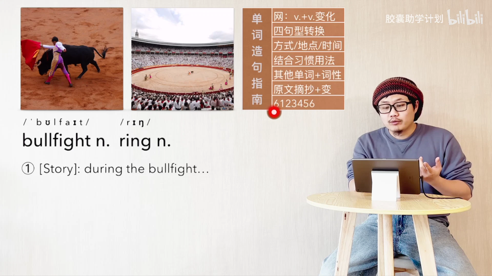

文字识别：单词造句指南 / 网：v.+v.变化 / 胶囊助学计划 / bibli / 四句型转换 / 方式/地点/时间 / 结合习惯用法 / 其他单词+词性 / 原文摘抄+变 / 16123456 / /'bu lfait / / /rin/ / bullfight n. ring n. / ① [Story]: during the bullfight...

## 00:02:30–00:03:00

位置应该就是六了，对不对？那我再结合之前的各种习惯用法、语法、单词，对吧？然后我再去添加地点、方式、时间，对吧？然后再做四形转换，我很可能就能造出来很很棒的句子。比如说，During the bullfight, we should avoid throwing all sorts of things into the rain。说在这个斗牛期间，我们应该避免 avoid doing something，

### 画面 00:02:32

文字识别：单词造句指南 / 网：v.+v.变化 / 胶囊助学计划 / biibii / 四句型转换 / 方式/地点/时间 / 结合习惯用法 / 其他单词+词性 / 原文摘抄+变 / 6123456 / / 'bu l fait / / /rin/ / bullfight n. ring n. / ① [Story]: during the bulfight...

### 画面 00:02:34

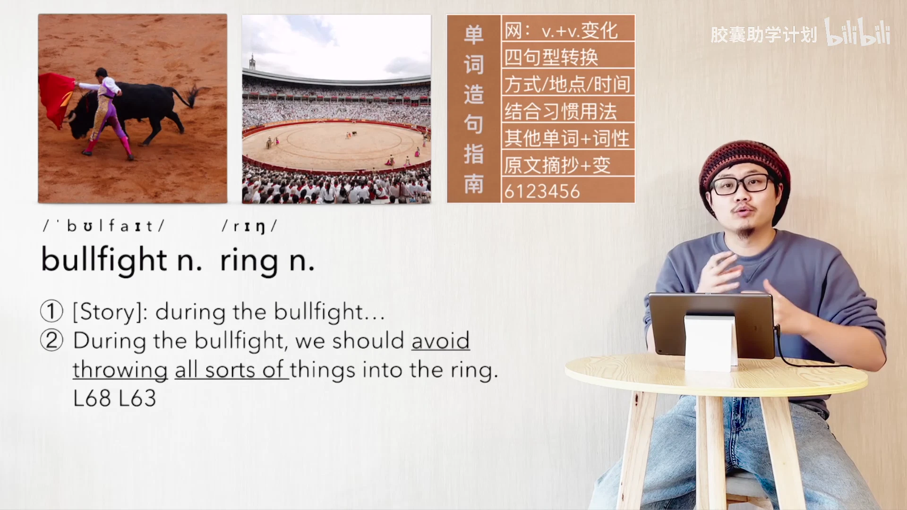

文字识别：单词造句指南 / 网：v.+v.变化 / 胶囊助学计划 / biibii / 四句型转换 / 方式/地点/时间 / 结合习惯用法 / 其他单词+词性 / 原文摘抄+变 / 6123456 / / 'bu l fait / / /rin/ / bullfight n. ring n. / 1 / [Story]: during the bullfight... / During the bullfight, we should avoid / throwing all sorts of things into the ring. / L68 L63

### 画面 00:02:36

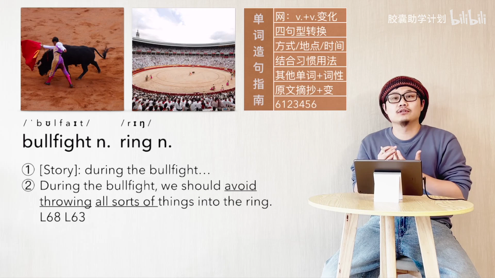

文字识别：单词造 / 网：v.+v.变化 / 胶囊助学计划 / bibii / 四句型转换 / 方式/地点/时间 / 旭句指南 / 结合习惯用法 / 其他单词+词性 / 原文摘抄+变 / 6123456 / / 'bu lfai t / / /rin/ / bullfight n. ring n. / 1 / [Story]: during the bullfight... / During the bullfight, we should avoid / throwing all sorts of things into the ring. / L68 L63

### 画面 00:02:40

文字识别：单词造 / 网：v.+v.变化 / 胶囊助学计划 / bilibili / 四句型转换 / 方式/地点/时间 / 旭句指南 / 结合习惯用法 / 其他单词+词性 / 原文摘抄+变 / 6123456 / / ' bu l fait / / /rin/ / bullfight n. ring n. / 1 / [Story]: during the bullfight... / During the bullfight, we should avoid / throwing all sorts of things into the ring. / L68 L63

### 画面 00:02:46

文字识别：单词造 / 网：v.+v.变化 / 胶囊助学计划 / bibili / 四句型转换 / 方式/地点/时间 / 旭句指南 / 结合习惯用法 / 其他单词+词性 / 原文摘抄+变 / 6123456 / / 'bu lfai t / / /rin/ / bullfight n. ring n. / 1 / [Story]: during the bullfight... / During the bullfight, we should avoid / throwing all sorts of things into the ring. / L68 L63

### 画面 00:02:50

文字识别：单词造 / 网：v.+v.变化 / 胶囊助学计划 / biibili / 四句型转换 / 方式/地点/时间 / 旭句指 / 结合习惯用法 / 其他单词+词性 / 原文摘抄+变 / 南 / 6123456 / /'bu lfait / / /rin/ / bullfight n. ring n. / 1 / [Story]: during the bullfight... / During the bullfight, we should avoid / throwing all sorts of things into the ring. / L68 L63

## 00:03:00–00:03:30

something, 对吧？避免扔什么的 all sorts of all sorts of 就是各种各样的东西 things, 各种各样的东西 into the ring 叫做扔到这个场地当中。这个 ring 是刚才我们讲过了，对吧？这个环形的斗牛场的这个场地啊，我们应该避免去做这件事儿。当然，你其实什么看篮球、看足球是一样的，羽毛球、乒乓球，对吧？好，接下来 I never really enjoy watching bullfight. 啊，因为太血腥了，对吧？所所以所以，

### 画面 00:03:01

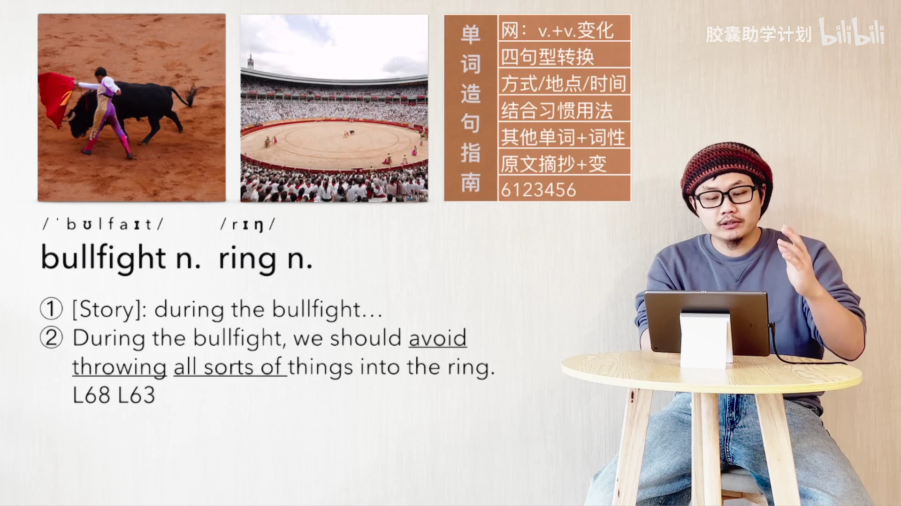

文字识别：单词造句指南 / 网：v.+v.变化 / 胶囊助学计划 / biibili / 四句型转换 / 方式/地点/时间 / 结合习惯用法 / 其他单词+词性 / 原文摘抄+变 / 6123456 / /'bu l fai t / / /rin/ / bullfight n. ring n. / 1 / [Story]: during the bullfight... / During the bullfight, we should avoid / throwing all sorts of things into the ring. / L68 L63

### 画面 00:03:09

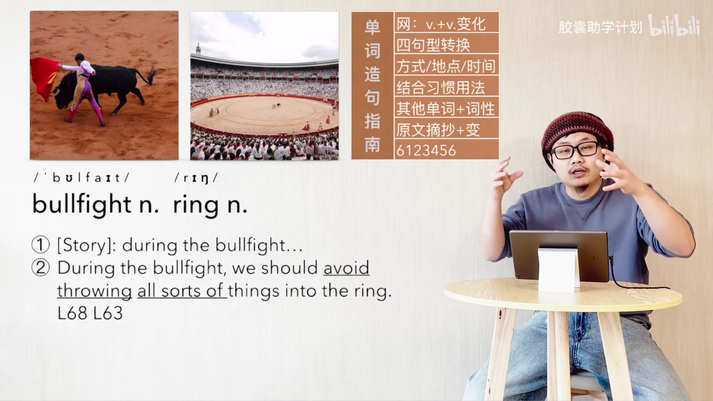

文字识别：单词造 / 网：v.+v.变化 / 胶囊助学计划 / bilibili / 四句型转换 / 方式/地点/时间 / 旭句指南 / 结合习惯用法 / 其他单词+词性 / 原文摘抄+变 / 6123456 / /' bu l fait / / /rin/ / bullfight n. ring n. / ① [Story]: during the bullfight... / During the bullfight, we should avoid / throwing all sorts of things into the ring. / L68 L63

### 画面 00:03:11

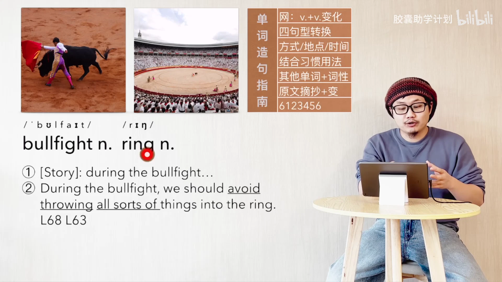

文字识别：单词造句指南 / 网：v.+v.变化 / 胶囊助学计划 / biibii / 四句型转换 / 方式/地点/时间 / 结合习惯用法 / 其他单词+词性 / 原文摘抄+变 / 6123456 / / 'bu l fait / / /rin/ / bullfight n. ring n. / [Story]: during the bullfight... / 1 / During the bullfight, we should avoid / throwing all sorts of things into the ring. / L68 L63

### 画面 00:03:15

文字识别：单词造 / 网：v.+v.变化 / 胶囊助学计划 / bilibili / 四句型转换 / 方式/地点/时间 / 旭句指 / 结合习惯用法 / 其他单词+词性 / 原文摘抄+变 / 南 / 6123456 / / 'bu lfai t / / /rin/ / bullfight n. ring n. / ① / [Story]: during the bullfight... / During the bullfight, we should avoid / throwing all sorts of things into the ring. / L68 L63

### 画面 00:03:17

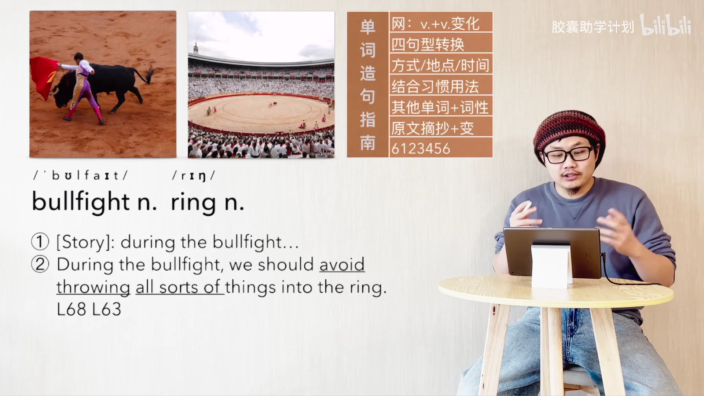

文字识别：单词造句指南 / 网：v.+v.变化 / 胶囊助学计划 / bibii / 四句型转换 / 方式/地点/时间 / 结合习惯用法 / 其他单词+词性 / 原文摘抄+变 / 6123456 / / 'bu l fait / / /rin/ / bullfight n. ring n. / 1 / [Story]: during the bullfight... / During the bullfight, we should avoid / throwing all sorts of things into the ring. / L68 L63

### 画面 00:03:19

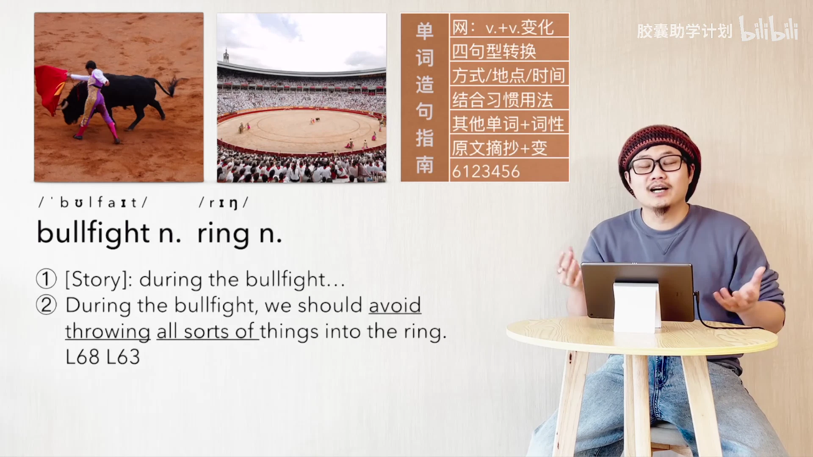

文字识别：单词造 / 网：v.+v.变化 / 胶囊助学计划 / biibli / 四句型转换 / 方式/地点/时间 / 旭句指南 / 结合习惯用法 / 其他单词+词性 / 原文摘抄+变 / 6123456 / / 'bu lfai t / / /rin/ / bullfight n. ring n. / 1 / [Story]: during the bullfight... / During the bullfight, we should avoid / throwing all sorts of things into the ring. / L68 L63

### 画面 00:03:21

文字识别：单词造 / 网：v.+v.变化 / 胶囊助学计划 / bilibii / 四句型转换 / 方式/地点/时间 / 旭句指 / 结合习惯用法 / 其他单词+词性 / 原文摘抄+变 / 南 / 6123456 / / 'bu lfait / / /rin/ / bullfight n. ring n. / 1 / [Story]: during the bullfight... / During the bullfight, we shouldavoid / throwing all sorts of things into the ring. / L68 L63 / I never really enjoy watching bullfight. L68

### 画面 00:03:23

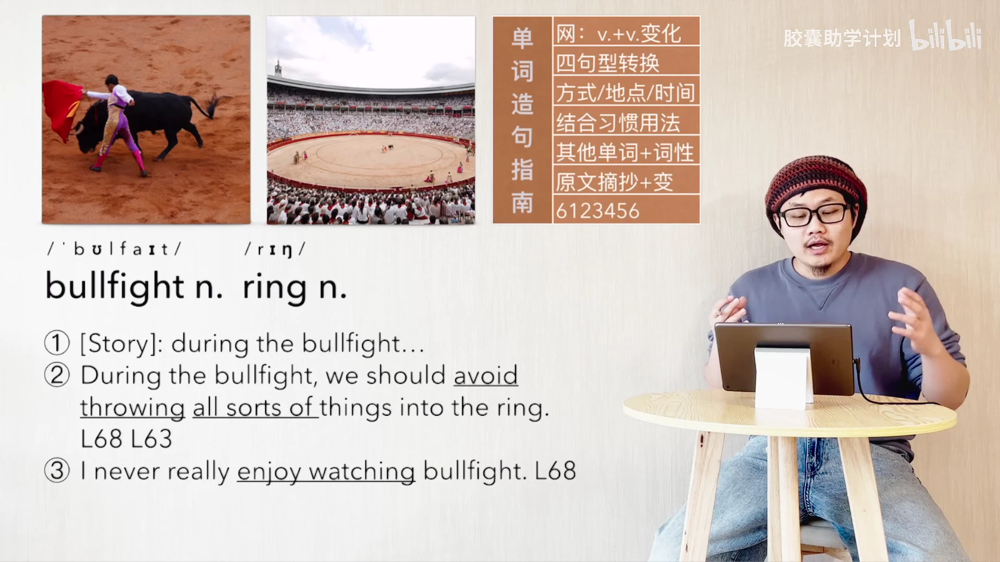

文字识别：单词造 / 网：v.+v.变化 / 胶囊助学计划 / bilbl / 四句型转换 / 方式/地点/时间 / 句 / 结合习惯用法 / 其他单词+词性 / 指 / 原文摘抄+变 / 南 / 6123456 / /  bu lfait / / /rin/ / bullfight n. ring n. / ① [Story]: during the bullfight... / During the bullfight, we should avoid / throwing all sorts of things into the ring. / L68 L63 / I never really enjoy watching bullfight. L68

### 画面 00:03:25

文字识别：单词造 / 网：v.+v.变化 / 胶囊助学计划 / bilbl / 四句型转换 / 方式/地点/时间 / 句 / 结合习惯用法 / 其他单词+词性 / 指 / 原文摘抄+变 / 南 / 6123456 / /bulfait/ / /rin/ / bullfight n. ring n. / ①[ / [Story]: during the bullfight... / During the bullfight, we should avoid / throwing all sorts of things into the ring. / L68 L63 / I never really enjoy watching bullfight. L68

### 画面 00:03:28

文字识别：单词造 / 网：v.+v.变化 / 胶囊助学计划 / bibii / 四句型转换 / 方式/地点/时间 / 句 / 结合习惯用法 / 其他单词+词性 / 指 / 原文摘抄+变 / 南 / 6123456 / /  bu l fait / / /rin/ / bullfight n. ring n. / ① [Story]: during the bullfight... / During the bullfight, we should avoid / throwing all sorts of things into the ring. / L68 L63 / I never really enjoy watching bullfight. L68

## 00:03:30–00:04:00

我实际上从来都没有真正特别享受过去观看斗牛比赛啊。Enjoy doing something. Very good. Next one. 这是一个电影台词，很棒啊。叫做 I've never seen a bullfight. Have you? 哎，我从来没有看过斗牛比赛。说你呢？啊，Have you? 其实类似于这个地方有点像 What about you? Okay. Very good. 那接下来呢，我们看一个电影片段啊。Take somebody to see his first bullfight.

### 画面 00:03:30

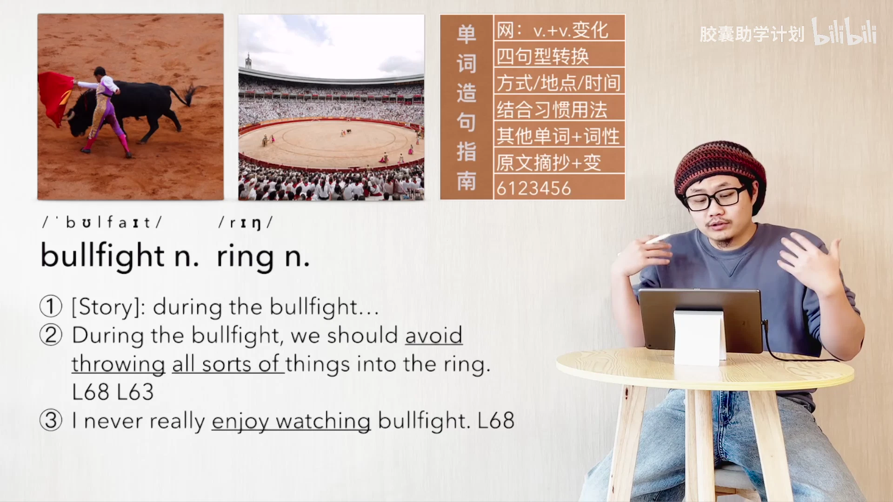

文字识别：单词造 / 网：v.+v.变化 / 胶囊助学计划 / bibili / 四句型转换 / 方式/地点/时间 / 句 / 结合习惯用法 / 其他单词+词性 / 指 / 原文摘抄+变 / 南 / 6123456 / / 'bu l fait / / /rin/ / bullfight n. ring n. / ① [Story]: during the bullfight... / During the bullfight, we should avoid / throwing all sorts of things into the ring. / L68 L63 / I never really enjoy watching bullfight. L68

### 画面 00:03:35

文字识别：单词造 / 网：v.+v.变化 / 胶囊助学计划 / bilbili / 四句型转换 / 方式/地点/时间 / 旭句指 / 结合习惯用法 / 其他单词+词性 / 原文摘抄+变 / 南 / 6123456 / / 'bu l fait / / /rin/ / bullfight n. ring n. / ① / [Story]: during the bullfight... / During the bullfight, we should avoid / throwing all sorts of things into the ring. / L68 L63 / I never really enjoy watching bullfight. L68

### 画面 00:03:37

文字识别：单词造 / 网：v.+v.变化 / 胶囊助学计划 / biibili / 四句型转换 / 方式/地点/时间 / 句 / 结合习惯用法 / 其他单词+词性 / 指 / 原文摘抄+变 / 南 / 6123456 / /  bu l fait / / /rin/ / bullfight n. ring n. / ①[ / [Story]: during the bullfight... / During the bullfight, we should avoid / throwing all sorts of things into the ring. / L68 L63 / I never really enjoy watching bullfight. L68 / I've never seen a bullfight, have you? 10 to / Midnight(1983)

### 画面 00:03:39

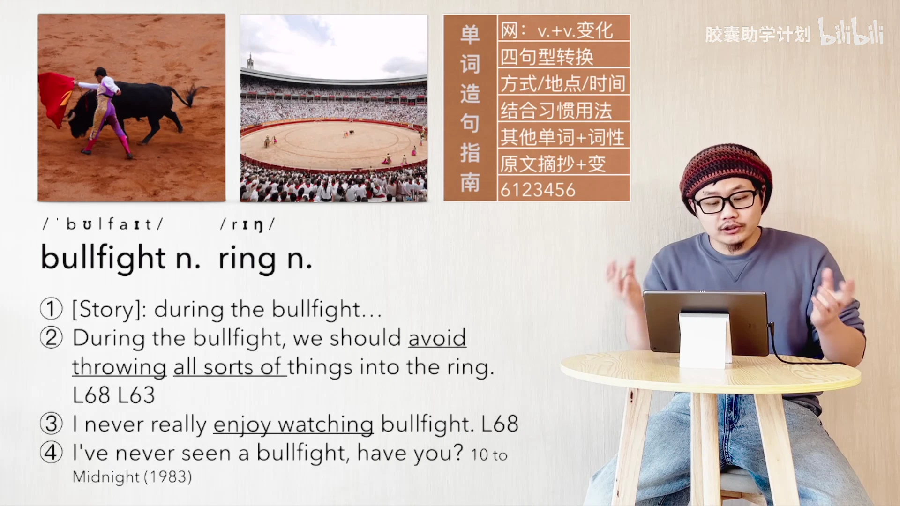

文字识别：单 / 网：v.+v.变化 / 胶囊助学计划 / Bilbili / 干词造 / 四句型转换 / 方式/地点/时间 / 结合习惯用法 / 句 / 其他单词+词性 / 指 / 原文摘抄+变 / 南 / 6123456 / / 'bu l fait / / /rin/ / bullfight n. ring n. / ①[ / [Story]: during the bullfight... / During the bullfight, we should avoid / throwing all sorts of things into the ring. / L68 L63 / I never really enjoy watching bullfight. L68 / I've never seen a bullfight, have you? 10 to / Midnight(1983)

### 画面 00:03:41

文字识别：单 / 网：v.+v.变化 / 胶囊助学计划 / bibili / 干词造 / 四句型转换 / 方式/地点/时间 / 句 / 结合习惯用法 / 其他单词+词性 / 指 / 原文摘抄+变 / 南 / 6123456 / / ' bu l fait / / /rin/ / bullfight n. ring n. / ① [Story]: during the bulfight... / During the bullfight, we should avoid / throwing all sorts of things into the ring. / L68 L63 / I never really enjoy watching bullfight. L68 / I've never seen a bullfight, have you? 10 to / Midnight(1983)

### 画面 00:03:45

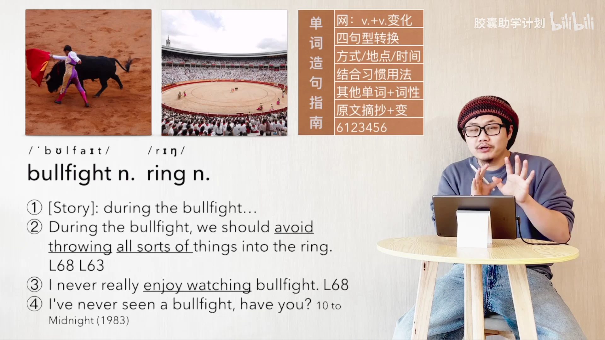

文字识别：单 / 网：v.+v.变化 / 胶囊助学计划 / bibili / +词造 / 四句型转换 / 方式/地点/时间 / 结合习惯用法 / 句 / 其他单词+词性 / 指 / 原文摘抄+变 / 南 / 6123456 / / ' bu l fait / / /rin/ / bullfight n. ring n. / ①[ / [Story]: during the bullfight... / During the bullfight, we should avoid / throwing all sorts of things into the ring. / L68 L63 / I never really enjoy watching bullfight. L68 / I've never seen a bullfight, have you? 10 to / Midnight(1983)

### 画面 00:03:47

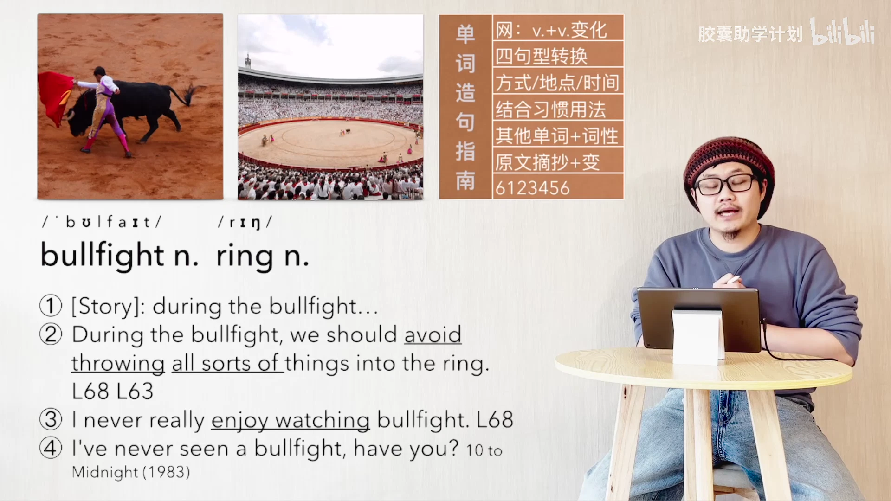

文字识别：单 / 网：v.+v.变化 / 胶囊助学计划 / 词 / 四句型转换 / 造 / 方式/地点/时间 / 句 / 结合习惯用法 / 其他单词+词性 / 指 / 原文摘抄+变 / 南 / 6123456 / / ' bu l fait / / /rin/ / bullfight n. ring n. / ① [Story]: during the bullfight... / During the bullfight, we should avoid / throwing all sorts of things into the ring. / L68 L63 / I never really enjoy watching bullfight. L68 / I've never seen a bullfight, have you? 10 to / Midnight(1983)

### 画面 00:03:50

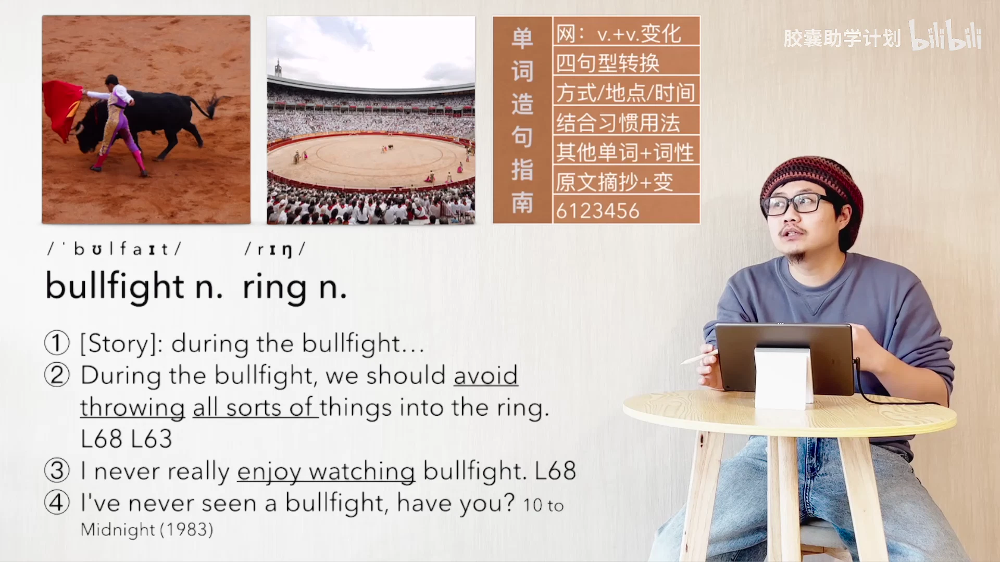

文字识别：单 / 网：v.+v.变化 / 胶囊助学计划 / bilbili / 词 / 四句型转换 / 造 / 方式/地点/时间 / 结合习惯用法 / 句 / 其他单词+词性 / 指 / 原文摘抄+变 / 南 / 6123456 / / bu l fait / / /rin/ / bullfight n. ring n. / 1 / [Story]: during the bullfight... / During the bullfight, we should avoid / throwing all sorts of things into the ring. / L68 L63 / I never really enjoy watching bullfight. L68 / I've never seen a bullfight, have you? 10 to / Midnight(1983)

### 画面 00:03:53

文字识别：单 / 网：v.+v.变化 / 胶囊助学计划 / bibii / 词造 / 四句型转换 / 方式/地点/时间 / 句 / 结合习惯用法 / 其他单词+词性 / 指 / 原文摘抄+变 / 南 / 6123456 / /  bu l fait / / /rin/ / bullfight n. ring n. / ① / [Story]: during the bullfight... / During the bullfight, we should avoid / throwing all sorts of things into the ring. / L68 L63 / I never really enjoy watching bullfight. L68 / I've never seen a bullfight, have you? 10 to / Midnight(1983)

### 画面 00:03:55

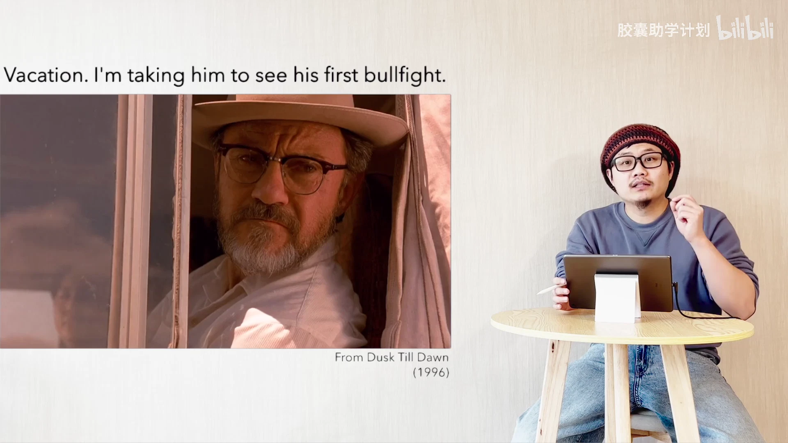

文字识别：bilbili / 胶囊助学计划 / Vacation. I'm taking him to see his first bullfight. / From Dusk Till Dawn / (1996)

## 00:04:00–00:04:30

注意力集中. Vacation. I'm taking him to see his first bullfight. Okay.下一个单词，看着这个单词，你可能非常的眼熟，因为你好像会另一个单词叫 drink。那 drink 它的过去式、过去分词是 drank 和 drunk，就是这个单词，对吧？Drunk. Very good.那 drunk 在这里它是一个名词，哎，是酒酒酒鬼

### 画面 00:04:02

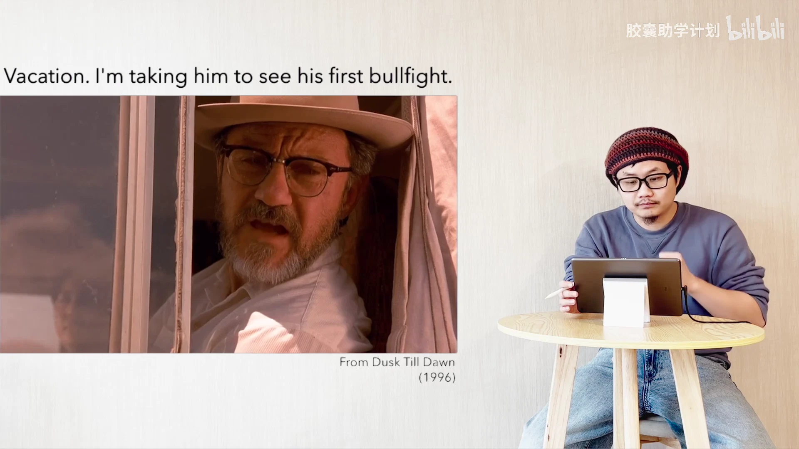

文字识别：biibili / 胶囊助学计划 / Vacation. 'm taking him to see his first bullfight. / From Dusk Till Dawn / (1996)

### 画面 00:04:04

文字识别：biibili / 胶囊助学计划 / Vacation. I'm taking him to see his first bullfight. / From Dusk Till Dawn / (1996)

### 画面 00:04:06

文字识别：bilibili / 胶囊助学计划 / Vacation. I'm taking him to see his first bullfight. / From Dusk Till Dawn / (1996)

### 画面 00:04:08

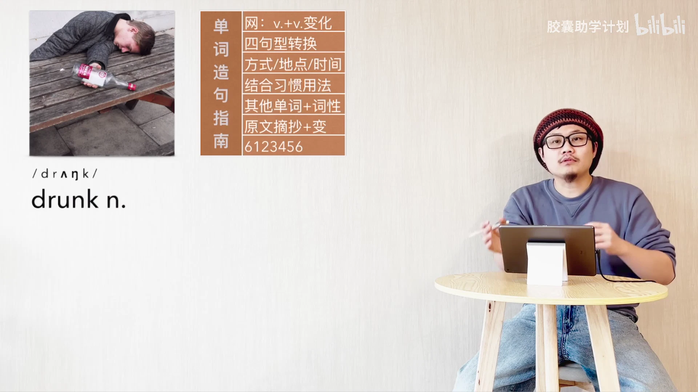

文字识别：单词造句指南 / 网：v.+v.变化 / 胶囊助学计划 / bibili / 四句型转换 / 方式/地点/时间 / 结合习惯用法 / 其他单词+词性 / 原文摘抄+变 / 6123456 / /drΛnk/ / drunk n.

### 画面 00:04:11

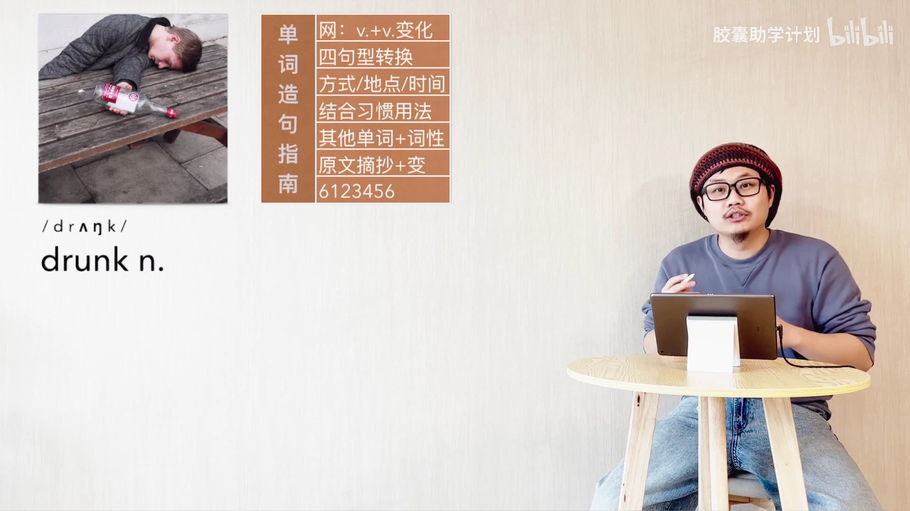

文字识别：单词造句指南 / 网：v.+v.变化 / 胶囊助学计划 / bilbili / 四句型转换 / 方式/地点/时间 / 结合习惯用法 / 其他单词+词性 / 原文摘抄+变 / 6123456 / /drΛnk/ / drunk n.

### 画面 00:04:18

文字识别：单词造句指南 / 网：v.+v.变化 / 胶囊助学计划 / bilbili / 四句型转换 / 方式/地点/时间 / 结合习惯用法 / 其他单词+词性 / 原文摘抄+变 / 6123456 / /drΛnk/ / drunk n.

### 画面 00:04:22

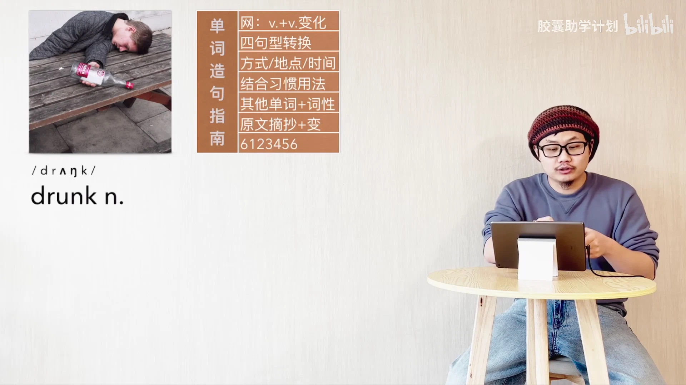

文字识别：单词造句指南 / 网：v.+v.变化 / 胶囊助学计划 / bilbili / 四句型转换 / 方式/地点/时间 / 结合习惯用法 / 其他单词+词性 / 原文摘抄+变 / 6123456 / /drΛnk/ / drunk n.

## 00:04:30–00:05:00

啊，这个醉汉的意思。OK，那它既然是一个人，是一个名词，我想拿它去造句的时候，只要保证六一二三四五六这个东西不变，其实我能做的事情非常的多。比如说说sir，这个sir很多的时候是你对警察可以去用的，对吧？哎，在西方，比如说你报警了啊，你对这个警察，你不是说police啊，你说就是sir，madam，对吧？哎，先生女士，你说sir，that drunk insists

### 画面 00:04:33

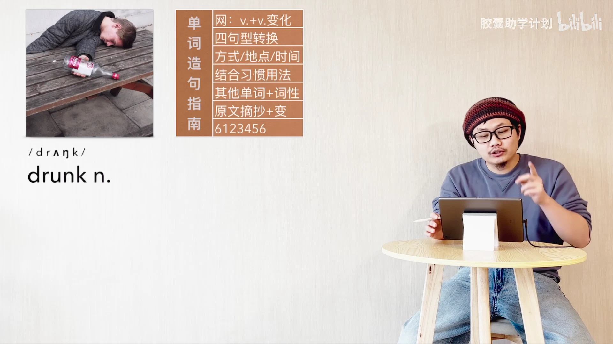

文字识别：单词造句指南 / 网：v.+v.变化 / 胶囊助学计划 / bilbili / 四句型转换 / 方式/地点/时间 / 结合习惯用法 / 其他单词+词性 / 原文摘抄+变 / 6123456 / /drΛnk/ / drunk n.

### 画面 00:04:42

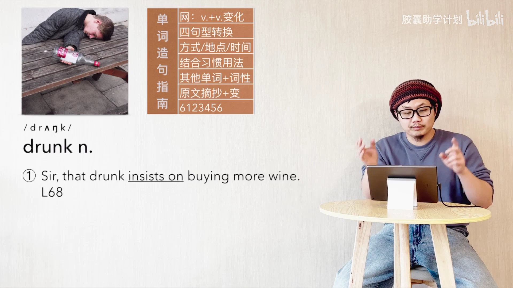

文字识别：单词造句指南 / 网：v.+v.变化 / 胶囊助学计划 / bibili / 四句型转换 / 方式/地点/时间 / 结合习惯用法 / 其他单词+词性 / 原文摘抄+变 / 6123456 / /drank/ / drunk n. / ① Sir, that drunk insists on buying more wine. / L68

### 画面 00:04:59

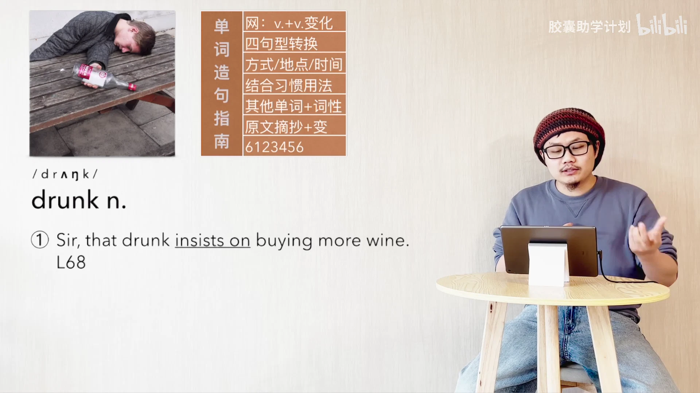

文字识别：单词造句指南 / 网：v.+v.变化 / 胶囊助学计划 / bilbili / 四句型转换 / 方式/地点/时间 / 结合习惯用法 / 其他单词+词性 / 原文摘抄+变 / 6123456 / /drΛnk/ / drunk n. / ① Sir, that drunk insists on buying more wine. / L68

## 00:05:00–00:05:30

on buying more wine.说这个醉汉坚持要买更多的酒。你注意，这是可能西方很多他的一个酒，这个这个卖酒的一个政策。如果他意识，他可以拒绝卖给你酒。如果他觉得你已经醉了，他可以拒绝的，是吧？很多饭店也是这个样子啊。OK，所以他拒绝卖给他更啊，这个这个不是拒绝啊。说这个醉汉呢，坚持要买更多的酒，我不卖给他，你瞅他就把这给砸了，对吧？OK, continue.

### 画面 00:05:29

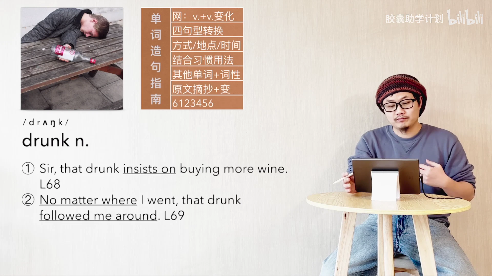

文字识别：单词造句指南 / 网：v.+v.变化 / 胶囊助学计划 / Bilbili / 四句型转换 / 方式/地点/时间 / 结合习惯用法 / 其他单词+词性 / 原文摘抄+变 / 6123456 / /drank/ / drunk n. / ① Sir, that drunk insists on buying more wine. / L68 / No matter where I went, that drunk / followed me around. L69

## 00:05:30–00:06:00

六十九课咱们刚刚学过的，不久的叫做 No matter where I went，无论我去什么地方，that drunk followed me around，总是他四处跟着我。Okay, next one，说 I was wondering，哎，我之前还挺好奇，我还很想知道，说 Maybe we should help that drunk，说也许我们应该帮一帮那个醉汉，是吧？叫做 Should do。六十五课咱们学的，那 I was wondering 是六十九课咱们学的啊。

### 画面 00:05:32

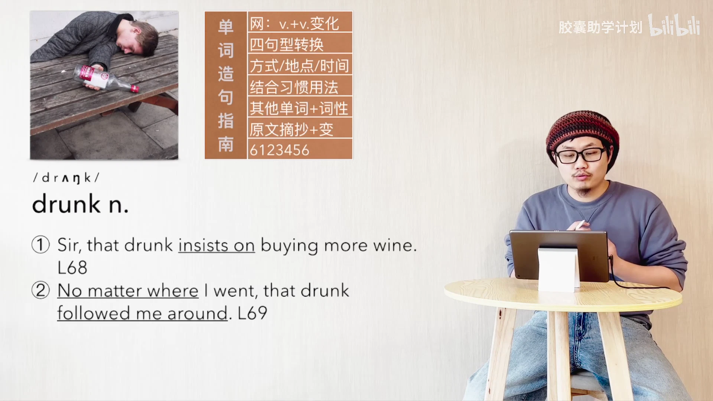

文字识别：单词造句指南 / 网：v.+v.变化 / 胶囊助学计划 / bibii / 四句型转换 / 方式/地点/时间 / 结合习惯用法 / 其他单词+词性 / 原文摘抄+变 / 6123456 / /drank/ / drunk n. / ① Sir, that drunk insists on buying more wine. / L68 / No matter where I went, that drunk / followed me around. L69

### 画面 00:05:41

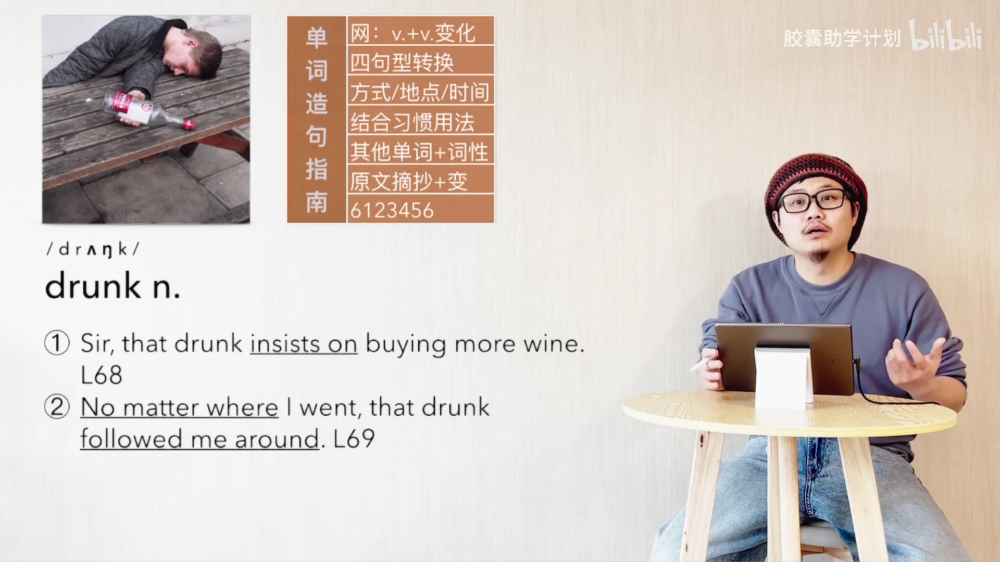

文字识别：单词造句指南 / 网：v.+v.变化 / 胶囊助学计划 / bilibii / 四句型转换 / 方式/地点/时间 / 结合习惯用法 / 其他单词+词性 / 原文摘抄+变 / 6123456 / /drank/ / drunk n. / ① Sir, that drunk insists on buying more wine. / L68 / No matter where I went, that drunk / followed me around. L69

### 画面 00:05:43

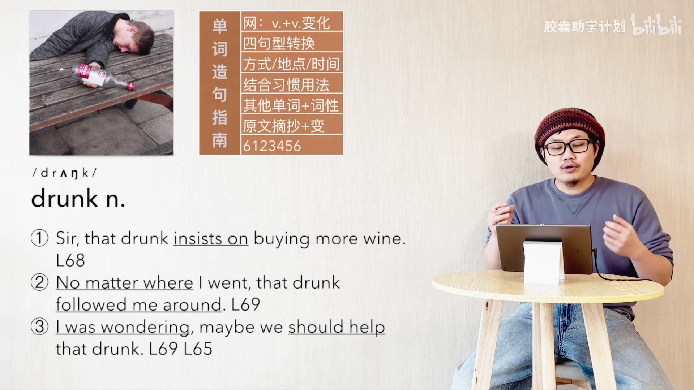

文字识别：单词造句指南 / 网：v.+v.变化 / 胶囊助学计划 / bilbl / 四句型转换 / 方式/地点/时间 / 结合习惯用法 / 其他单词+词性 / 原文摘抄+变 / 6123456 / /drank/ / drunk n. / ① Sir, that drunk insists on buying more wine. / L68 / No matter where I went, that drunk / followed me around. L69 / L was wondering, maybe we should help / that drunk. L69 L65

### 画面 00:05:46

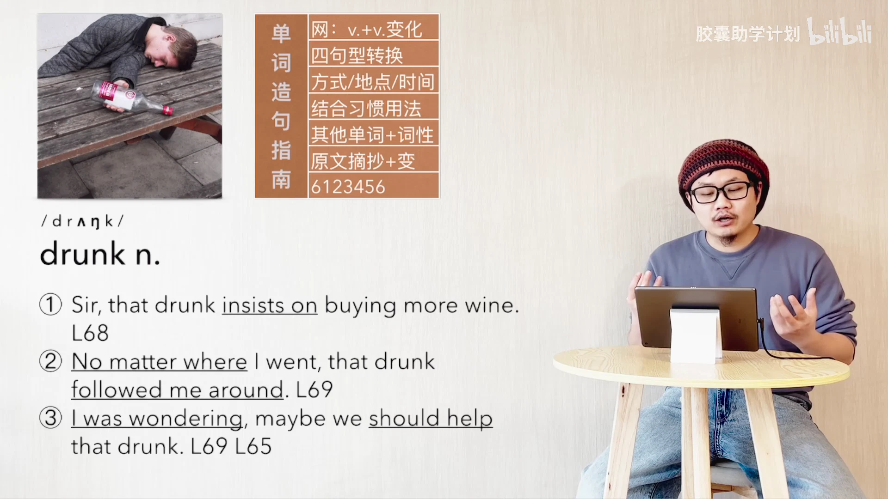

文字识别：单词造句指南 / 网：v.+v.变化 / 胶囊助学计划 / biibili / 四句型转换 / 方式/地点/时间 / 结合习惯用法 / 其他单词+词性 / 原文摘抄+变 / 6123456 / /drank/ / drunk n. / ① Sir, that drunk insists on buying more wine. / L68 / No matter where I went, that drunk / followed me around. L69 / Lwas wondering, maybe we should help / that drunk. L69 L65

### 画面 00:05:50

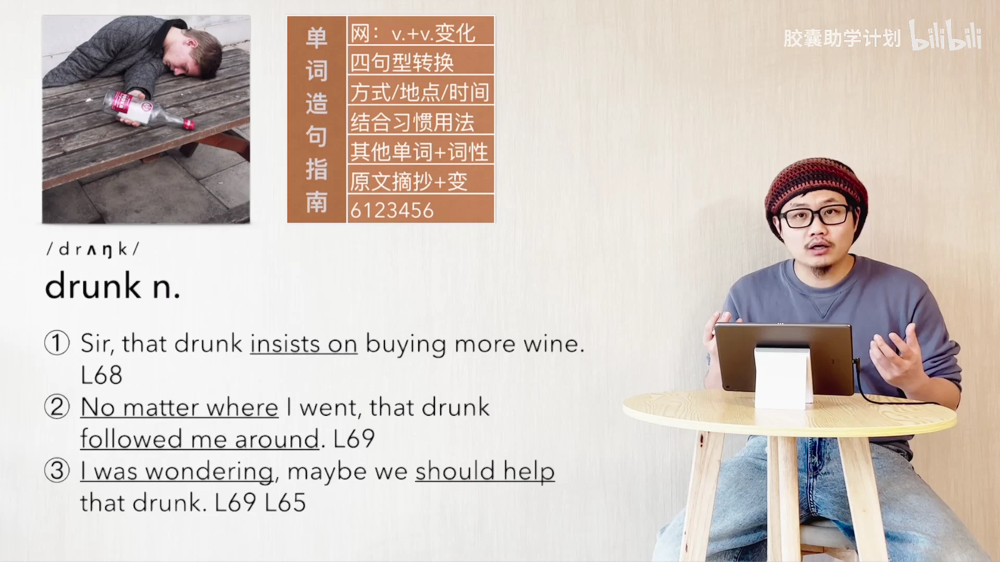

文字识别：单词造句指南 / 网：v.+v.变化 / 胶囊助学计划 / bilibili / 四句型转换 / 方式/地点/时间 / 结合习惯用法 / 其他单词+词性 / 原文摘抄+变 / 6123456 / /drank/ / drunk n. / ① Sir, that drunk insists on buying more wine. / L68 / No matter where I went, that drunk / followed me around. L69 / L was wondering, maybe we should help / that drunk. L69 L65

### 画面 00:05:55

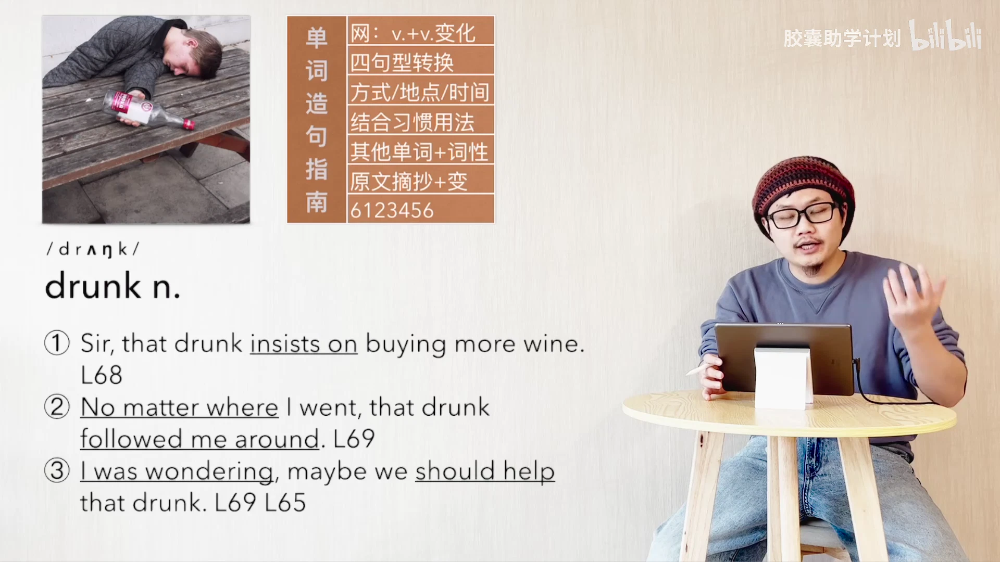

文字识别：单词造句指南 / 网：v.+v.变化 / 胶囊助学计划 / bibii / 四句型转换 / 方式/地点/时间 / 结合习惯用法 / 其他单词+词性 / 原文摘抄+变 / 6123456 / /drank/ / drunk n. / ① Sir, that drunk insists on buying more wine. / L68 / No matter where I went, that drunk / followed me around. L69 / Lwas wondering, maybe we should help / that drunk. L69 L65

## 00:06:00–00:06:30

next one,下一个单词啊，这个单词可以有两个发音，都是对的，也都很常见。一个是像咱们新概念当中这样去读的，叫做wonder。另外一个就是wonder，啊啊的音都可以，没有问题。而且实际上放到句子当中去的时候，呃，也不是那么容易能听出来它俩的区别。Wonder, wonder,是吧？也不是很容易能听出来。那它呢？注意它的词性是一个动词。动词就意味着我们拿它去造句

### 画面 00:06:00

文字识别：单词造句指南 / 网：v.+v.变化 / 胶囊助学计划 / bilbii / 四句型转换 / 方式/地点/时间 / 结合习惯用法 / 其他单词+词性 / 原文摘抄+变 / 6123456 / /'wpn d a/ / wander V.

### 画面 00:06:03

文字识别：单词造句指南 / 网：v.+v.变化 / 胶囊助学计划 / bibili / 四句型转换 / 方式/地点/时间 / 结合习惯用法 / 其他单词+词性 / 原文摘抄+变 / 6123456 / /'wpnda/ / wander v.

### 画面 00:06:10

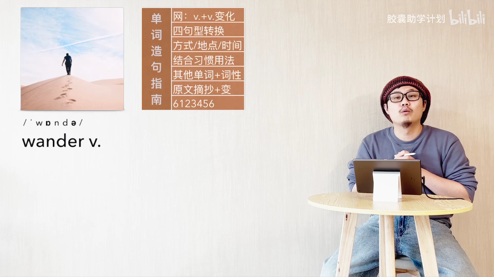

文字识别：单词造句指南 / 网：v.+v.变化 / 胶囊助学计划 / bilbili / 四句型转换 / 方式/地点/时间 / 结合习惯用法 / 其他单词+词性 / 原文摘抄+变 / 6123456 / /'wpnda/ / wander v.

## 00:06:30–00:07:00

的时候，六一二三四五六，它在二的这个位置上。那它的意思呢，就是呃闲逛啊，乱溜的啊。拿我们北方话说，就是瞎溜的，哎，就是闲着没事儿出去瞎溜达一圈儿，叫做 wander，对吧？哎啊，OK。那你比如说，我造这样一句话，说，I ought to have wandered alone。哎，说你，我本应该自己一个人瞎溜达溜达，四处闲逛逛。哎，你非要跟着我，我本来就不想带你，你还非要跟着我。

### 画面 00:06:40

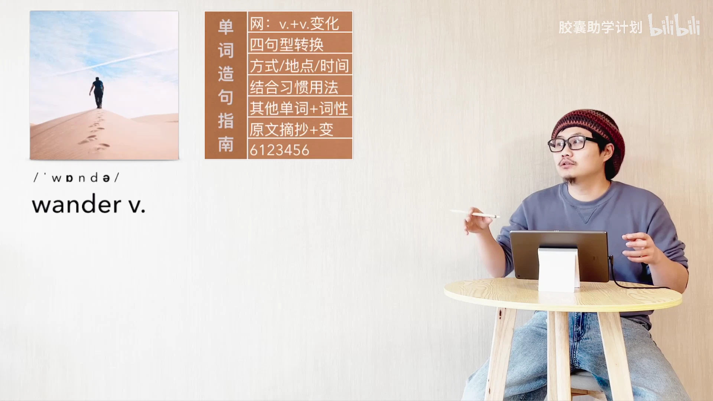

文字识别：单词造句指南 / 网：v.+v.变化 / 胶囊助学计划 / bilbili / 四句型转换 / 方式/地点/时间 / 结合习惯用法 / 其他单词+词性 / 原文摘抄+变 / 6123456 / /'wpnda/ / wander v.

### 画面 00:06:45

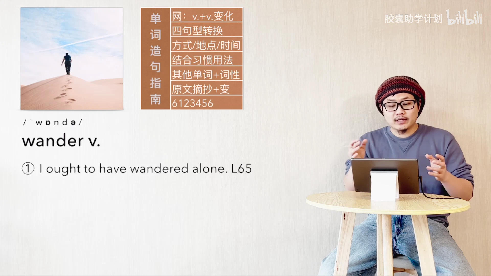

文字识别：单词造句指南 / 网：v.+v.变化 / 胶囊助学计划 / bilbili / 四句型转换 / 方式/地点/时间 / 结合习惯用法 / 其他单词+词性 / 原文摘抄+变 / 6123456 / / 'w pn d a/ / wander V. / ① Iought to have wandered alone. L65

### 画面 00:06:52

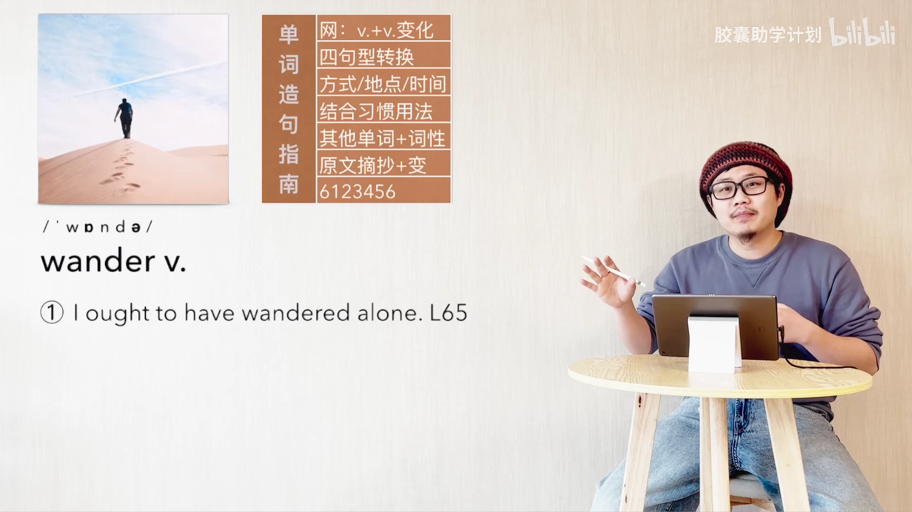

文字识别：单词造句指南 / 网：v.+v.变化 / 胶囊助学计划 / bibil / 四句型转换 / 方式/地点/时间 / 结合习惯用法 / 其他单词+词性 / 原文摘抄+变 / 6123456 / / 'wpnd a/ / wander v. / ① Iought to have wandered alone. L65

### 画面 00:06:58

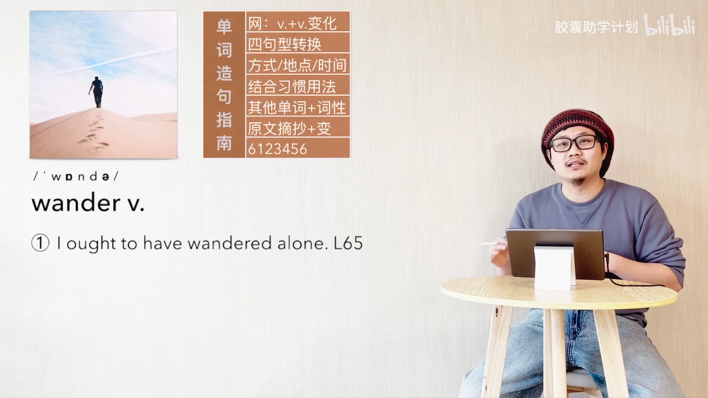

文字识别：单词造句指南 / 网：v.+v.变化 / 胶囊助学计划 / bibili / 四句型转换 / 方式/地点/时间 / 结合习惯用法 / 其他单词+词性 / 原文摘抄+变 / 6123456 / / 'wpnda/ / wander v. / ① Iought to have wandered alone. L65

## 00:07:00–00:07:30

Ought to have done, ah, should have done.六十五课咱们学的，希望各位还记得。接下来，说If you were here, I wouldn't have to wander alone.说如果你在这儿，我就没有必要说一个人四处瞎溜达了。这里是咱们四十课学过的虚拟语气。Next one, you mustn't wander alone here at night.哎，你比如说，哎，你比如像Chicago这样的城市，对吧？尤其是你比如说芝加哥这样的城市，尤其是某一些特

### 画面 00:07:01

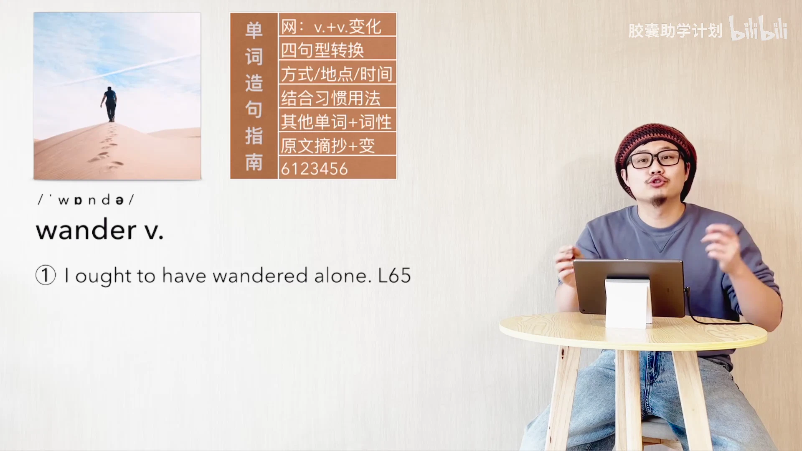

文字识别：单词造句指南 / 网：v.+v.变化 / 胶囊助学计划 / bibili / 四句型转换 / 方式/地点/时间 / 结合习惯用法 / 其他单词+词性 / 原文摘抄+变 / 6123456 / / 'wpnd a/ / wander v. / ① Iought to have wandered alone. L65

### 画面 00:07:03

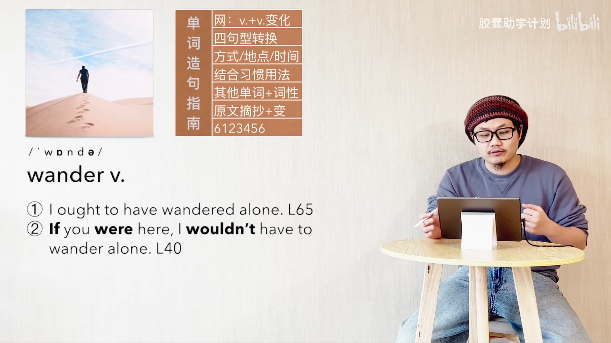

文字识别：单词造句指南 / 网：v.+v.变化 / 胶囊助学计划 / bibili / 四句型转换 / 方式/地点/时间 / 结合习惯用法 / 其他单词+词性 / 原文摘抄+变 / 6123456 / /'wpnda/ / Wander V. / ① Iought to have wandered alone. L65 / If you were here, I wouldn't have to / Wander alone. L40

### 画面 00:07:06

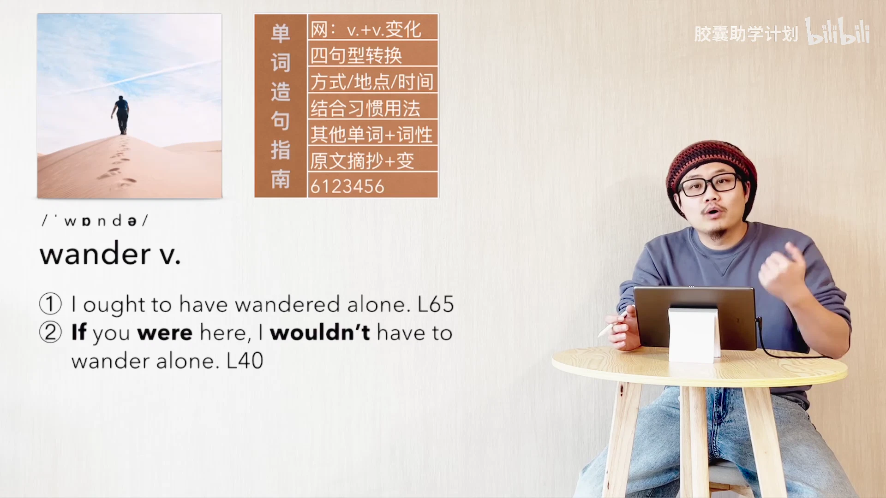

文字识别：单词造句指南 / 网：v.+v.变化 / 胶囊助学计划 / bibili / 四句型转换 / 方式/地点/时间 / 结合习惯用法 / 其他单词+词性 / 原文摘抄+变 / 6123456 / / 'wpnda / / wander V. / ① Iought to have wandered alone. L65 / If you were here, I wouldn't have to / wander alone. L40

### 画面 00:07:09

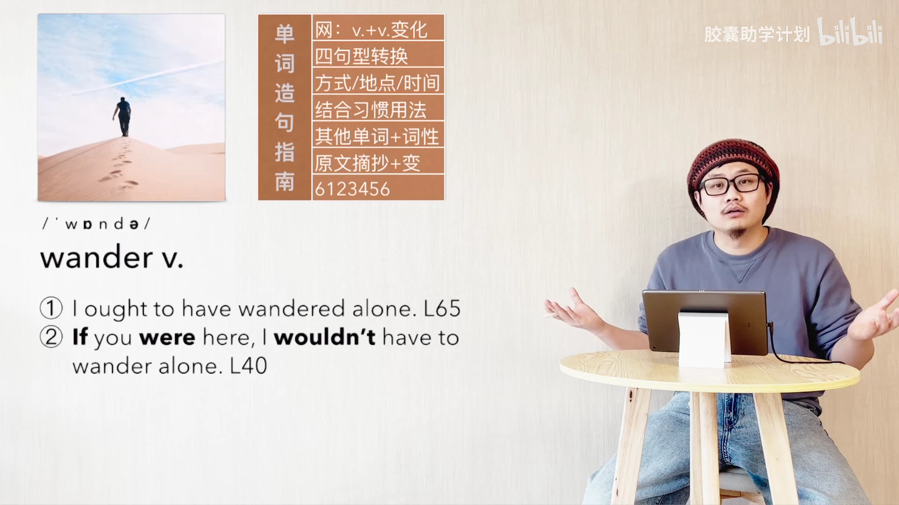

文字识别：单词造句指南 / 网：v.+v.变化 / 胶囊助学计划 / bibii / 四句型转换 / 方式/地点/时间 / 结合习惯用法 / 其他单词+词性 / 原文摘抄+变 / 6123456 / /'wpnda/ / Wander V. / ① Iought to have wandered alone. L65 / If you were here, I wouldn't have to / wander alone. L40

### 画面 00:07:19

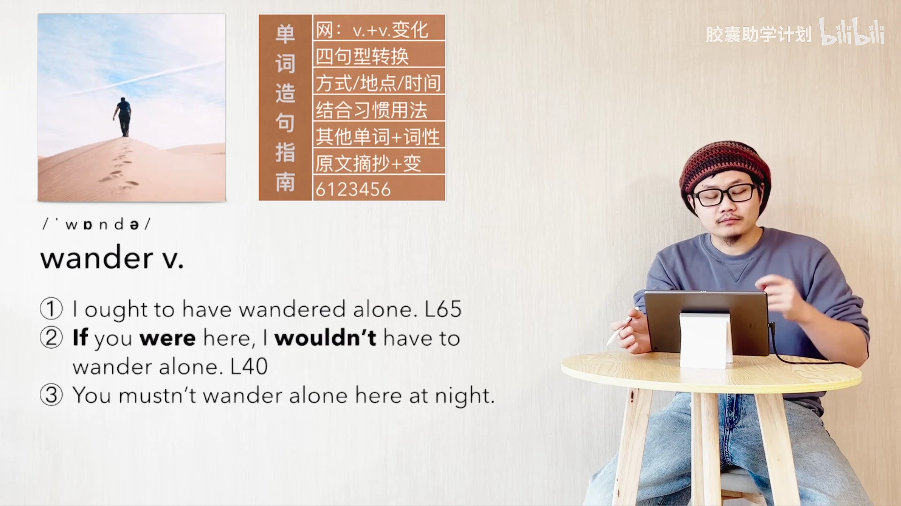

文字识别：单词造句指南 / 网：v.+v.变化 / 胶囊助学计划 / Bilbli / 四句型转换 / 方式/地点/时间 / 结合习惯用法 / 其他单词+词性 / 原文摘抄+变 / 6123456 / /'wpnda/ / wander V. / ①I ought to have wandered alone. L65 / If you were here, I wouldn't have to / wander alone. L40 /  You mustn't wander alone here at night.

### 画面 00:07:24

文字识别：单词造句指南 / 网：v.+v.变化 / 胶囊助学计划 / bilbl / 四句型转换 / 方式/地点/时间 / 结合习惯用法 / 其他单词+词性 / 原文摘抄+变 / 6123456 / /'wDnda/ / wander V. / ① I ought to have wandered alone. L65 / If you were here, I wouldn't have to / wander alone. L40 / You mustn't wander alone here at night.

## 00:07:30–00:08:00

殊的街区，这个咱们具体就不说了。说他说的叫做你禁止晚上一个人在这儿瞎溜达，对吧？各种什么被抢啊，什么然后等等等等，是吧？这个犯罪犯罪之都嘛，是吧？啊，Chicago. Okay,所以他说 you mustn't wander alone here at night.在这儿啊，晚上你可千万，你相信我，你你千万别一个人瞎溜达。虽然没有宵禁，但很危险。Okay,那再读一遍这个单词wander. Where you go? Next one叫做anywhere

### 画面 00:07:47

文字识别：单词造句指南 / 网：v.+v.变化 / 胶囊助学计划 / Bilbili / 四句型转换 / 方式/地点/时间 / 结合习惯用法 / 其他单词+词性 / 原文摘抄+变 / 6123456 / /'wpnda/ / wander V. / ① I ought to have wandered alone. L65 / If you were here, I wouldn't have to / Wander alone. L40 /  You mustn't wander alone here at night.

### 画面 00:07:57

文字识别：单词造句指南 / 网：v.+v.变化 / 胶囊助学计划 / bilbili / 四句型转换 / 方式/地点/时间 / 结合习惯用法 / 其他单词+词性 / 原文摘抄+变 / 6123456 / /Λna'wea/ / e adj. / unaware

## 00:08:00–00:08:30

啊，unaware. Okay, unaware这个单词是什么意思呢？你注意，你看它前面有一个un，于是我们首先从原文能拆出来一个很棒的习惯用法，叫be unaware of. 然后我们好像知道，比如说happy and happy，对吧？哦，un表示的是一个否定的前缀，那aware是不是就是它的反义词？那如果unaware叫做不了解、不清楚、不知

### 画面 00:08:00

文字识别：单词造句指南 / 网：v.+v.变化 / 胶囊助学计划 / bilbili / 四句型转换 / 方式/地点/时间 / 结合习惯用法 / 其他单词+词性 / 原文摘抄+变 / 6123456 / /Λna'wea/ / e adj. / unaware

### 画面 00:08:04

文字识别：单词造句指南 / 网：v.+v.变化 / 胶囊助学计划 / bilbili / 四句型转换 / 方式/地点/时间 / 结合习惯用法 / 其他单词+词性 / 原文摘抄+变 / 6123456 / /Λna'wea/ / e adj. / unaware

### 画面 00:08:08

文字识别：单词造句指南 / 网：v.+v.变化 / 胶囊助学计划 / bilbili / 四句型转换 / 方式/地点/时间 / 结合习惯用法 / 其他单词+词性 / 原文摘抄+变 / 6123456 / /Λna'weal / unaware adj. / ① be unaware of ... be aware of .

### 画面 00:08:10

文字识别：单词造句指南 / 网：v.+v.变化 / 胶囊助学计划 / bilbili / 四句型转换 / 方式/地点/时间 / 结合习惯用法 / 其他单词+词性 / 原文摘抄+变 / 6123456 / /Λna'wea/ / e adj. / unaware / 1 / be unaware / of / .. be aware of .

### 画面 00:08:13

文字识别：单词造句指南 / 网：v.+v.变化 / 胶囊助学计划 / bilbili / 四句型转换 / 方式/地点/时间 / 结合习惯用法 / 其他单词+词性 / 原文摘抄+变 / 6123456 / /Λna'wea/ / adj. / unaware / .. be aware of . / be / unaware / of

### 画面 00:08:16

文字识别：单词造句指南 / 网：v.+v.变化 / 胶囊助学计划 / bilbili / 四句型转换 / 方式/地点/时间 / 结合习惯用法 / 其他单词+词性 / 原文摘抄+变 / 6123456 / /Λna'wea/ / e adj. / unaware / . be aware of / be / e unaware / of

### 画面 00:08:23

文字识别：单词造句指南 / 网：v.+v.变化 / 胶囊助学计划 / bilbili / 四句型转换 / 方式/地点/时间 / 结合习惯用法 / 其他单词+词性 / 原文摘抄+变 / 6123456 / /Λna'wea/ / adj. / unaware / .. be aware of / be / unaware / of

## 00:08:30–00:09:00

道。那 aware 就是清楚。那 be unaware of 就是不了解啊。比如，往往它的主语是某人，就某人不了解某事儿。那 be aware of 就是某人了解某事儿，就这么简单啊。OK，那我们造句子，比如说，Is there something I'm unaware of？这是一句电影台词啊，好像我印象当中还是获奥斯卡金像奖了的一个电影，是吧？然后呢，呃，

### 画面 00:08:40

文字识别：单词造句指南 / 网：v.+v.变化 / 胶囊助学计划 / bilbili / 四句型转换 / 方式/地点/时间 / 结合习惯用法 / 其他单词+词性 / 原文摘抄+变 / 6123456 / /Λna'wea/ / adj. / unaware / be / unaware / of / . be aware of

### 画面 00:08:45

文字识别：单词造句指南 / 网：v.+v.变化 / 胶囊助学计划 / bibili / 四句型转换 / 方式/地点/时间 / 结合习惯用法 / 其他单词+词性 / 原文摘抄+变 / 6123456 / /Λna'wea/ / unaware adj. / 1 / be unaware / of / . be aware of / Ts there something I'm unaware of? Phantom / Thread (2017)

### 画面 00:08:49

文字识别：单词造句指南 / 网：v.+v.变化 / 胶囊助学计划 / bibili / 四句型转换 / 方式/地点/时间 / 结合习惯用法 / 其他单词+词性 / 原文摘抄+变 / 6123456 / /Λna'wea/ / unaware adj. / 1 / be unaware / of / .. be aware of / Ts there something I'm unaware of? Phantom / Thread (2017)

### 画面 00:08:53

文字识别：单词造句指南 / 网：v.+v.变化 / 胶囊助学计划 / Bibii / 四句型转换 / 方式/地点/时间 / 结合习惯用法 / 其他单词+词性 / 原文摘抄+变 / 6123456 / /Λna'wea/ / unaware adj. / 1 / be unaware / of / .. be aware of / Ts there something I'm unaware of? Phantom / Thread (2017)

## 00:09:00–00:09:30

他这个电影台词当中说的是，是不是有一些事儿我不清楚啊？I'm unaware of,没有觉察到啊，没有意识到啊，或者类似于I don't know，对吧？Next one,那我们自己造一句话叫做Unaware of that, she just wandered into the tunnel by herself. Okay,你注意这个地方叫做Unaware of that, she just wandered into the tunnel by herself.那我想问一个问题叫做Unaware of,

### 画面 00:09:11

文字识别：单词造句指南 / 网：v.+v.变化 / 胶囊助学计划 / bilibili / 四句型转换 / 方式/地点/时间 / 结合习惯用法 / 其他单词+词性 / 原文摘抄+变 / 6123456 / /Λna'wea/ / unaware adj. / 1 / be unaware of / .. be aware of / Ts there something I'm unaware of? Phantom / Thread (2017) / Unaware of that, she just wandered into the / tunnel by herself. L49

### 画面 00:09:14

文字识别：单词造句指南 / 网：v.+v.变化 / 胶囊助学计划 / bilbili / 四句型转换 / 方式/地点/时间 / 结合习惯用法 / 其他单词+词性 / 原文摘抄+变 / 6123456 / /Λna'wea / / unaware adj. / 1 / be unaware of / .. be aware of / Ts there something I'm unaware of? Phantom / Thread (2017) / Unaware of that, she just wandered into the / tunnel by herself. L49

## 00:09:30–00:10:00

unaware of 前面的 be 怎么没有了？它的主语怎么没有了？如果六十九课您认真学了，四十九课您也认真学了，那这个问题我相信很快就能解决了。其实就是什么呢？就是呃，类似于分词做状语，对吧？哎，它就是这个 being 这个单词直接被省略掉了，对吧？类似于应该是 being unaware of that，标包括它的主语一定是这个 she，对吧？六十

### 画面 00:09:44

文字识别：单词造句指南 / 网：v.+v.变化 / 胶囊助学计划 / bilbli / 四句型转换 / 方式/地点/时间 / 结合习惯用法 / 其他单词+词性 / 原文摘抄+变 / 6123456 / /Λna'wea/ / unaware adj. / 1 / be unaware of / .. be aware of .. / Ts there something I'm unaware of? Phantom / Thread (2017) / Unaware of that, she just wandered into the / tunnel by herself. L49

### 画面 00:09:58

文字识别：单词造句指南 / 网：v.+v.变化 / 胶囊助学计划 / bibii / 四句型转换 / 方式/地点/时间 / 结合习惯用法 / 其他单词+词性 / 原文摘抄+变 / 6123456 / /Λna'wea/ / unaware adj. / 1 / be unaware / of / .. be aware of / Ts there someth / I'm unaware of? Phantom / Thread (2017) / Unaware of that, she just wandered into the / tunnel by herself. L49

## 00:10:00–00:10:30

九课我们刚刚学过，四十九课我们认真的讲过，对吧？六十九课其实是复习了一下，我们在这儿立刻拿单词造句再复习一下。Next one, although I was unaware of this at the time, teaching really made me happy. 哎，这个实际上是我可能在大学的时候的一个事儿，是吧？说尽管呢，说我呀当时并不清楚，并没有觉察到这件事情。At the time, 进入文章我们

### 画面 00:10:01

文字识别：单词造句指南 / 网：v.+v.变化 / 胶囊助学计划 / blibili / 四句型转换 / 方式/地点/时间 / 结合习惯用法 / 其他单词+词性 / 原文摘抄+变 / 6123456 / /Λna'wea/ / unaware adj. / 1 / be unaware / of / .. be aware of / Ts there someth / I'm unaware of? Phantom / Thread (2017) / Unaware of that, she just wandered into the / tunnel by herself. L49

### 画面 00:10:04

文字识别：单词造句指南 / 网：v.+v.变化 / 胶囊助学计划 / blbili / 四句型转换 / 方式/地点/时间 / 结合习惯用法 / 其他单词+词性 / 原文摘抄+变 / 6123456 / /Λna'wea/ / unaware adj. / 1 / be unaware / of / .. be aware of / Ts there someth / I'm unaware of? Phantom / Thread (2017) / Unaware of that, she just wandered into the / tunnel by herself. L49

### 画面 00:10:09

文字识别：单词造句指南 / 网：v.+v.变化 / 胶囊助学计划 / bilbili / 四句型转换 / 方式/地点/时间 / 结合习惯用法 / 其他单词+词性 / 原文摘抄+变 / 6123456 / /Λna'wea/ / e adj. / unaware / 1 / be / eunaware / of / . be aware of / Ts / there somethin / I'm unaware of? Phantom / Thread (2017) / Unaware of that, s / , she just wandered into the / tunnel by herself. L49 / Although I was unaware of this at the time, / teaching really made me happy. L57

### 画面 00:10:12

文字识别：单词造句指南 / 网：v.+v.变化 / 胶囊助学计划 / bibili / 四句型转换 / 方式/地点/时间 / 结合习惯用法 / 其他单词+词性 / 原文摘抄+变 / 6123456 / /Λna'wea/ / unaware adj. / be / e unaware / of / . be aware of / Is / there someth / I'm unaware of? Phantom / Thread (2017) / Unaware of that, she just wandered into the / tunnel by herself. L49 / Although I was unaware of this at the time, / teaching really made me happy. L57

### 画面 00:10:18

文字识别：单词造句指南 / 网：v.+v.变化 / 胶囊助学计划 / bibii / 四句型转换 / 方式/地点/时间 / 结合习惯用法 / 其他单词+词性 / 原文摘抄+变 / 6123456 / /Λna'wea/ / unaware adj. / 1 / be unaware / of / .. be aware of / Is / there someth / I'm unaware of? Phantom / Thread (2017) / Unaware of that, she just wandered into the / tunnel by herself. L49 / Although I was unaware of this at the time, / teaching really made me happy. L57

### 画面 00:10:29

文字识别：单词造句指南 / 网：v.+v.变化 / 胶囊助学计划 / bilbli / 四句型转换 / 方式/地点/时间 / 结合习惯用法 / 其他单词+词性 / 原文摘抄+变 / 6123456 / /Λna'wea/ / e adj. / unaware / 1 / be / e unaware / of / . be aware of / Is / there someth / I'm unaware of? Phantom / Thread (2017) / Unaware of that, she just wandered into the / tunnel by herself. L49 / Although I was unaware of thislat the time, / teaching really made me happy. L57

## 00:10:30–00:11:00

会学到。提前我用了一下，叫做当时在那个特定的时期，表示的是过去啊。进入文章我们还会再见到它。那个时候我会仔仔细细的带着各位去造句。现在知道它的含义就行了啊。哎，这个其实还是二十课咱们学的语法，对吧？动名词。这个教书啊，真的让我非常的开心啊。Make somebody happy，对吧？使我很开心。那再读一遍这个单词，and where? Very good.那接下来呢？注意力集中，我们听一个电影片段。

### 画面 00:10:31

文字识别：单词造句指南 / 网：v.+v.变化 / 胶囊助学计划 / blbii / 四句型转换 / 方式/地点/时间 / 结合习惯用法 / 其他单词+词性 / 原文摘抄+变 / 6123456 / /Λna'wea/ / adj. / unaware / 1 / be / eunaware / of / . be aware of / Is / there someth / I'm / unaware of? Phantom / Thread (2017) / Unaware / of that, S / she just wandered into the / tunnel by herself. L49 / Although I was unaware of this at the time / teaching really made me happy. L57

### 画面 00:10:43

文字识别：单词造句指南 / 网：v.+v.变化 / 胶囊助学计划 / blibili / 四句型转换 / 方式/地点/时间 / 结合习惯用法 / 其他单词+词性 / 原文摘抄+变 / 6123456 / /Λna'wea/ / unaware adj. / 1 / be / e unaware / of / .. be aware of / Is / there somethin / I'm unaware of? Phantom / Thread (2017) / Unaware of that, she just wandered into the / tunnel by herself. L49 / Although I was unaware of this at the time / teaching / really made me happy. L57

### 画面 00:10:56

文字识别：bibili / 胶囊助学计划 / "My mother is unaware of / the reason for my visit today. / The Village / (2004)

## 00:11:00–00:11:30

My mother is unaware of the reason for my visit today. Next one，接下来 bull 不说了，跟刚才的 bull fight 已经学过了，对吧？在这儿呢，这个单词叫做 matador，后边可以加个话音，连起来读 matador，matador，OK，matador 就是这个，是吧？斗牛士 bull 就是这个，OK，好，又是人想去造句也不困难了

### 画面 00:11:03

文字识别：bilbili / 胶囊助学计划 / "My mother is unaware of / the reason for my visit today. / The Village / (2004)

### 画面 00:11:05

文字识别：单词造句指南 / 网：v.+v.变化 / 胶囊助学计划 / bilbili / 四句型转换 / 方式/地点/时间 / 结合习惯用法 / 其他单词+词性 / 原文摘抄+变 / 6123456 / /bul/ / /'mætado:/ / bull n. matador n.

### 画面 00:11:10

文字识别：单词造句指南 / 网：v.+v.变化 / 胶囊助学计划 / bilbili / 四句型转换 / 方式/地点/时间 / 结合习惯用法 / 其他单词+词性 / 原文摘抄+变 / 6123456 / /bul/ / /'mætado:/ / bull n. matador n.

### 画面 00:11:17

文字识别：单词造句指南 / 网：v.+v.变化 / 胶囊助学计划 / bilbii / 四句型转换 / 方式/地点/时间 / 结合习惯用法 / 其他单词+词性 / 原文摘抄+变 / 6123456 / /bul/ / /'mætado:/ / bull n. matador n.

### 画面 00:11:21

文字识别：单词造句指南 / 网：v.+v.变化 / 胶囊助学计划 / bilbili / 四句型转换 / 方式/地点/时间 / 结合习惯用法 / 其他单词+词性 / 原文摘抄+变 / 6123456 / /bul/ / /'mætado:/ / bull n. matador n.

### 画面 00:11:23

文字识别：单词造句指南 / 网：v.+v.变化 / 胶囊助学计划 / bilbili / 四句型转换 / 方式/地点/时间 / 结合习惯用法 / 其他单词+词性 / 原文摘抄+变 / 6123456 / /bul/ / /'mætado:/ / bull n. matador n.

### 画面 00:11:26

文字识别：单词造句指南 / 网：v.+v.变化 / 胶囊助学计划 / bibii / 四句型转换 / 方式/地点/时间 / 结合习惯用法 / 其他单词+词性 / 原文摘抄+变 / 6123456 / /bul/ / /'mætado:/ / bull n. matador n. / ① The matador was eager to eat some food. L57

### 画面 00:11:29

文字识别：单词造句指南 / 网：v.+v.变化 / 胶囊助学计划 / bibii / 四句型转换 / 方式/地点/时间 / 结合习惯用法 / 其他单词+词性 / 原文摘抄+变 / 6123456 / /bul/ / /'mætado:/ / bull n. matador n. / ① The matador was eager to eat some food. L57

## 00:11:30–00:12:00

啊！比如说，the matador was eager to eat some food啊，很渴望吃点食物啊，很简单，be eager to do something。再来，说in his spare time，哎，在他空闲的时间，the matador likes to pay his friend a visit，pay somebody a visit，喜欢去拜访他的朋友，对吧？空闲的时间他喜欢去拜访他的朋友。Next one，the bull，拿它去造个句，smashed everything in the rain to pieces。

### 画面 00:11:31

文字识别：单词造句指南 / 网：v.+v.变化 / 胶囊助学计划 / bibii / 四句型转换 / 方式/地点/时间 / 结合习惯用法 / 其他单词+词性 / 原文摘抄+变 / 6123456 / /bul/ / /'m ætado:/ / bull n. matador n. / ① The matador was eager to eat some food. L57

### 画面 00:11:35

文字识别：单词造句指南 / 网：v.+v.变化 / 胶囊助学计划 / bibii / 四句型转换 / 方式/地点/时间 / 结合习惯用法 / 其他单词+词性 / 原文摘抄+变 / 6123456 / /bul/ / /'mætado:/ / bull n. matador n. / ① The matador was eager to eat some food. L57

### 画面 00:11:37

文字识别：单词造句指南 / 网：v.+v.变化 / 胶囊助学计划 / Bilbili / 四句型转换 / 方式/地点/时间 / 结合习惯用法 / 其他单词+词性 / 原文摘抄+变 / 6123456 / /bul/ / /'metado: / bull n. matador n. / ① The matador was eager to eat some food. L57 / ② In his spare time, the matador likes to pay his / friend a visit. L51 L52

### 画面 00:11:39

文字识别：单词造句指南 / 网：v.+v.变化 / 胶囊助学计划 / bilbili / 四句型转换 / 方式/地点/时间 / 结合习惯用法 / 其他单词+词性 / 原文摘抄+变 / 6123456 / /bul/ / /'mætado:/ / bull n. matador n. / ① The matador was eager to eat some food. L57 / ② In his spare time, the matador likes to pay his / friend a visit. L51 L52

### 画面 00:11:41

文字识别：胶囊助学计划bilii / 单词造句指南 / 网：v.+v.变化 / 四句型转换 / 方式/地点/时间 / 结合习惯用法 / 其他单词+词性 / 原文摘抄+变 / 6123456 / /bul/ / /'metado:/ / bull n. matador n. / ① The matador was eager to eat some food. L57 / ② In his spare time, the matador likes to pay his / friend a visit. L51 L52

### 画面 00:11:45

文字识别：胶囊助学计划bilii / 单词造句指南 / 网：v.+v.变化 / 四句型转换 / 方式/地点/时间 / 结合习惯用法 / 其他单词+词性 / 原文摘抄+变 / 6123456 / /bul/ / /'mætado:/ / bull n. matador n. / ① The matador was eager to eat some food. L57 / ② In his spare time, the matador likes to pay his / friend a visit. L51 L52

### 画面 00:11:49

文字识别：单词造句指南 / 网：v.+v.变化 / 胶囊助学计划 / bilbili / 四句型转换 / 方式/地点/时间 / 结合习惯用法 / 其他单词+词性 / 原文摘抄+变 / 6123456 / /bul/ / /'mætado:/ / bull n. matador n. / ① The matador was eager to eat some food. L57 / ② In his spare time, the matador likes to pay his / friend a visit. L51 L52

### 画面 00:11:51

文字识别：单词造句指南 / 网：v.+v.变化 / 胶囊助学计划 / bibi / 四句型转换 / 方式/地点/时间 / 结合习惯用法 / 其他单词+词性 / 原文摘抄+变 / 6123456 / /bul/ / /'mætado:/ / bull n. matador n. / ① The matador was eager to eat some food. L57 / ② In his spare time, the matador likes to pay his / friend a visit. L51 L52

### 画面 00:11:54

文字识别：胶囊助学计划bilii / 单词造句指南 / 网：v.+v.变化 / 四句型转换 / 方式/地点/时间 / 结合习惯用法 / 其他单词+词性 / 原文摘抄+变 / 6123456 / /bul/ / /'m æetad o:/ / bull n. matador n. / ① The matador was eager to eat some food. L57 / ② In his spare time, the matador likes to pay his / friend a visit. L51 L52 / The bull smashed everything in the ring to pieces. / L49

## 00:12:00–00:12:30

呃，这个公牛啊，非常的强。Smash something to pieces is 49.课咱们学过的叫把某物砸成碎片。那这里叫做把这个环形斗牛场当中的一切都砸成了碎片，对吧？哎，那其实这个砸就是撞嘛，对不对？Next one, say the bull.一个side story. The bull was killed by the matador last night.啊，我们说这个斗牛是一个有一点血腥的啊，或

### 画面 00:12:00

文字识别：胶囊助学计划blii / 单词造句指南 / 网：v.+v.变化 / 四句型转换 / 方式/地点/时间 / 结合习惯用法 / 其他单词+词性 / 原文摘抄+变 / 6123456 / /bul/ / /'mætado:/ / bull n. matador n. / ① The matador was eager to eat some food. L57 / ② In his spare time, the matador likes to pay his / friend a visit. L51 L52 / The bull smashed everything in the ring to pieces. / L49

### 画面 00:12:02

文字识别：胶囊助学计划bilibil / 单词造句指南 / 网：v.+v.变化 / 四句型转换 / 方式/地点/时间 / 结合习惯用法 / 其他单词+词性 / 原文摘抄+变 / 6123456 / /bul/ / /'mætado:/ / bull n. matador n. / ① The matador was eager to eat some food. L57 / ② In his spare time, the matador likes to pay his / friend a visit. L51 L52 / The bull smashed everything in the ring to pieces. / L49

### 画面 00:12:06

文字识别：胶囊助学计划biiil / 单词造句指南 / 网：v.+v.变化 / 四句型转换 / 方式/地点/时间 / 结合习惯用法 / 其他单词+词性 / 原文摘抄+变 / 6123456 / /bul/ / /'mætado:/ / bull n. matador n. / ① The matador was eager to eat some food. L57 / ② In his spare time, the matador likes to pay his / friend a visit. L51 L52 / The bull smashed everything in the ring to pieces. / L49

### 画面 00:12:11

文字识别：胶囊助学计划bilii / 单词造句指南 / 网：v.+v.变化 / 四句型转换 / 方式/地点/时间 / 结合习惯用法 / 其他单词+词性 / 原文摘抄+变 / 6123456 / /bul/ / /'mætado:/ / bull n. matador n. / ① The matador was eager to eat some food. L57 / ② In his spare time, the matador likes to pay his / friend a visit. L51 L52 / The bull smashed everything in the ring to pieces. / L49

### 画面 00:12:16

文字识别：胶囊助学计划bibil / 单词造句指南 / 网：v.+v.变化 / 四句型转换 / 方式/地点/时间 / 结合习惯用法 / 其他单词+词性 / 原文摘抄+变 / 6123456 / /bul/ / /'mætado:/ / bull n. matador n. / ① The matador was eager to eat some food. L57 / ② In his spare time, the matador likes to pay his / friend a visit. L51 L52 / The bull smashed everything in the ring to pieces. / L49

### 画面 00:12:20

文字识别：单词造句指南 / 网：v.+v.变化 / 胶囊助学计划bibil / 四句型转换 / 方式/地点/时间 / 结合习惯用法 / 其他单词+词性 / 原文摘抄+变 / 6123456 / /bul/ / /'mætado:/ / bull n. matador n. / ① The matador was eager to eat some food. L57 / ② In his spare time, the matador likes to pay his / friend a visit. L51 L52 / The bull smashed everything in the ring to pieces. / L49 /  The bull was killed by the matador last night.

### 画面 00:12:25

文字识别：单词造句指南 / 网：v.+v.变化 / 胶囊助学计划blbi / 四句型转换 / 方式/地点/时间 / 结合习惯用法 / 其他单词+词性 / 原文摘抄+变 / 6123456 / /bul/ / /'mætado:/ / bull n. matador n. / ① The matador was eager to eat some food. L57 / ② In his spare time, the matador likes to pay his / friend a visit. L51 L52 / The bull smashed everything in the ring to pieces. / L49 /  The bull was killed by the matador last night.

## 00:12:30–00:13:00

者这个因人而异吧。我会觉得有一点血腥的一个原因，就是实际上，如果各位看过，它真的是活活的把这个公牛给扎死，对吧？说，所以它叫做 the bull was killed，一般过去时的被动。好，by the madador last night。这么标准的一个六一二三四五六，咱们不做个四句型转换吗？对吧？要么您暂停屏幕啊，要么您下课自己去造句，好吧？接下来下一个单词叫

### 画面 00:12:47

文字识别：单词造句指南 / 网：v.+v.变化 / 胶囊助学计划ii / 四句型转换 / 方式/地点/时间 / 结合习惯用法 / 其他单词+词性 / 原文摘抄+变 / 6123456 / /bul/ / /'mætado:/ / bull n. matador n. / ① The matador was eager to eat some food. L57 / ② In his spare time, the matador likes to pay his / friend a visit. L51 L52 / The bull smashed everything in the ring to pieces. / L49 /  The bull was killed by the matador last night.

### 画面 00:12:50

文字识别：单词造句指南 / 网：v.+v.变化 / 胶囊助学计划bibili / 四句型转换 / 方式/地点/时间 / 结合习惯用法 / 其他单词+词性 / 原文摘抄+变 / 6123456 / /bul/ / /'m ætad o:/ / bull n. matador n. / ① The matador was eager to eat some food. L57 / ② In his spare time, the matador likes to pay his / friend a visit. L51 L52 / The bull smashed everything in the ring to pieces. / L49 / The bull was killed by the matador last night. / was/what/who/how/why/when... / 5

### 画面 00:12:53

文字识别：胶囊助学计划lil / 单词造句指南 / 网：v.+v.变化 / 四句型转换 / 方式/地点/时间 / 结合习惯用法 / 其他单词+词性 / 原文摘抄+变 / 6123456 / /bul/ / /'m ætado:/ / bull n. matador n. / ① The matador was eager to eat some food. L57 / ② In his spare time, the matador likes to pay his / friend a visit. L51 L52 / The bull smashed everything in the ring to pieces. / L49 / The bull was killed by the matador last night. / was/what/who/how/why/when... / 5

### 画面 00:12:55

文字识别：胶囊助学计划bliil / 单词造句指南 / 网：v.+v.变化 / 四句型转换 / 方式/地点/时间 / 结合习惯用法 / 其他单词+词性 / 原文摘抄+变 / 6123456 / /bul/ / /'m æetad o:/ / bull n. matador n. / ① The matador was eager to eat some food. L57 / ② In his spare time, the matador likes to pay his / friend a visit. L51 L52 / The bull smashed everything in the ring to pieces. / L49 / The bull was killed by the matador last night. / was/what/who/how/why/when... / 5

### 画面 00:12:57

文字识别：单词造句指南 / 网：v.+v.变化 / 胶囊助学计划 / bilbili / 四句型转换 / 方式/地点/时间 / 结合习惯用法 / 其他单词+词性 / 原文摘抄+变 / 6123456 / /ri'ma:k/ / remark n. V. make that stupid remark

## 00:13:00–00:13:30

remark remark. 本课单词真的很多啊，我们有点耐心，慢慢一个一个来。 Remark remark 是什么意思呢？叫做评论，哎，言论，哎，其实就是你说的那句话啊，类似于汉语的评论和言论。它既可以是名词，又可以是动词。你可以说 remark something，你也可以说常见的一个口语当中的呃短语叫做 make that stupid remark，做出了一个非常愚蠢的

### 画面 00:13:02

文字识别：单词造句指南 / 网：v.+v.变化 / 胶囊助学计划 / bilbili / 四句型转换 / 方式/地点/时间 / 结合习惯用法 / 其他单词+词性 / 原文摘抄+变 / 6123456 / /ri'ma:k/ / remark n. V. make that stupid remark

### 画面 00:13:06

文字识别：单词造句指南 / 网：v.+v.变化 / 胶囊助学计划 / bibili / 四句型转换 / 方式/地点/时间 / 结合习惯用法 / 其他单词+词性 / 原文摘抄+变 / 6123456 / /ri'ma:k/ / remark n. V. make that stupid remark

## 00:13:30–00:14:00

评论，哎，其实就是说你刚才说的那是什么蠢话啊？说愚蠢的话。OK, next one.那我们造句子吧。比如说，You needn't have made that stupid remark.如果您还记得四十一课，对吧？这个男主的媳妇儿啊，这个作者的媳妇儿买了一个特别高的像灯塔一样的帽子，他是不是就做了一个remark？那课咱们学的时候，你有没有印象就出现了这个单词，对吧？就needn't have done.

### 画面 00:13:36

文字识别：单词造句指南 / 网：v.+v.变化 / 胶囊助学计划 / bibili / 四句型转换 / 方式/地点/时间 / 结合习惯用法 / 其他单词+词性 / 原文摘抄+变 / 6123456 / /ri'ma:k/ / remark n. V. make that stupid remark / ① You needn't have made that stupid remark. / L41

### 画面 00:13:45

文字识别：单词造句指南 / 网：v.+v.变化 / 胶囊助学计划 / bibili / 四句型转换 / 方式/地点/时间 / 结合习惯用法 / 其他单词+词性 / 原文摘抄+变 / 6123456 / /ri'ma:k/ / remark n. V. make that stupid remark / ① You needn't have made that stupid remark. / L41

## 00:14:00–00:14:30

Okay,本不必哎，这是一个很重要的结构啊，各位千万不要忘记啊。Next one, I'm not pleased with that stupid remark you just made.你注意，你看这里实际上用到了第一个叫做我并不满意。六十九课咱们学过的be pleased with叫满意，那not pleased with就是不满意。好，continue叫做you just made made的什么呢？made的是stupid

### 画面 00:14:00

文字识别：单词造句指南 / 网：v.+v.变化 / 胶囊助学计划 / bibii / 四句型转换 / 方式/地点/时间 / 结合习惯用法 / 其他单词+词性 / 原文摘抄+变 / 6123456 / /rI'ma:k/ / remark n. V. make that stupid remark / ① You needn't have made that stupid remark. / L41 / I'm not pleased with that stupid remark you / just made. L69 L28

### 画面 00:14:05

文字识别：胶囊助学计划biiil / 单词造句指南 / 网：v.+v.变化 / 四句型转换 / 方式/地点/时间 / 结合习惯用法 / 其他单词+词性 / 原文摘抄+变 / 6123456 / /rI'ma:k/ / remark n. V. make thatstupid remark / ① You needn't have made that stupid remark. / L41 / I'm not pleased with that stupid remark you / just made. L69 L28

### 画面 00:14:10

文字识别：单词造句指南 / 网：v.+v.变化 / 胶囊助学计划 / Bibili / 四句型转换 / 方式/地点/时间 / 结合习惯用法 / 其他单词+词性 / 原文摘抄+变 / 6123456 / /rI'ma:k/ / remark n. V. make thatstupid remark / ① You needn't have made that stupid remark. / L41 /  I'm not pleased with that stupid remark you / just made. L69 L28

## 00:14:30–00:15:00

一个小定从放到后边后置一下，对吧？二十八课咱们学的 next one. It is no use pretending that she hasn't made that stupid remark. 说假装某件事是没有用的，什么事儿呢？说他没有做出那个愚蠢的评论或言论。我们假装他没有说这句话是没有用的。为什么？我假装不了，我已经听见了。 Okay, 好，这里有一个小的习惯用法叫 make

### 画面 00:14:34

文字识别：胶囊助学计划 blil / 单词造句指南 / 网：v.+v.变化 / 四句型转换 / 方式/地点/时间 / 结合习惯用法 / 其他单词+词性 / 原文摘抄+变 / 6123456 / /ri'ma:k/ / remark n. V. make that stupid remark / ① You needn't have made that stupid remark. / L41 / ) I'm not pleased with that stupid remark you / just made. L69 L28 / It is no use pretending that he hasn't made / that stupid remark. L68

### 画面 00:14:55

文字识别：胶囊助学计划bibil / 单词造句指南 / 网：v.+v.变化 / 四句型转换 / 方式/地点/时间 / 结合习惯用法 / 其他单词+词性 / 原文摘抄+变 / 6123456 / /ri'ma:k/ / remark n. V. make that stupid remark / ① You needn't have made that stupid remark. / L41 / ) I'm not pleased with that stupid remark you / just made. L69 L28 / It is no use pretending that he hasn't made / that stupid remark. L68

## 00:15:00–00:15:30

that stupid remark. Okay,再读一遍这个单词 remark. Next one. Oh,还有一句话啊，叫做 I find that remark stupid. 这个就是我想到第四课，其实 find something 形容词嘛，对吧？哎，说我感觉这个不是发现啊，我觉得你这个评论特别的愚蠢。 Okay,那接下来呢，我们呃，这是很有意思一个电影，当年我看过《傲慢与偏见》，是吧？它原著也不错啊，原著也不错。呃，

### 画面 00:15:05

文字识别：胶囊助学计划blibi / 单词造句指南 / 网：v.+v.变化 / 四句型转换 / 方式/地点/时间 / 结合习惯用法 / 其他单词+词性 / 原文摘抄+变 / 6123456 / /ri'ma:k/ / remark n. V. make that stupid remark / ① You needn't have made that stupid remark. / L41 / ) I'm not pleased with that stupid remark you / just made. L69 L28 / It is no use pretending that he hasn't made / that stupid remark. L68 / 4I find that remark stupid. L4

### 画面 00:15:10

文字识别：单词造句指南 / 网：v.+v.变化 / 胶囊助学计划bii / 四句型转换 / 方式/地点/时间 / 结合习惯用法 / 其他单词+词性 / 原文摘抄+变 / 6123456 / /ri'ma:k/ / remark n. V. make that stupid remark / ① You needn't have made that stupid remark. / L41 /  I'm not pleased with that stupid remark you / just made. L69 L28 / It is no use pretending that he hasn't made / that stupid remark. L68 / ④I find that remark stupid. L4

### 画面 00:15:16

文字识别：胶囊助学计划biliil / 单词造句指南 / 网：v.+v.变化 / 四句型转换 / 方式/地点/时间 / 结合习惯用法 / 其他单词+词性 / 原文摘抄+变 / 6123456 / /ri'ma:k/ / remark n. V. make that stupid remark / ① You needn't have made that stupid remark. / L41 /  I'm not pleased with that stupid remark you / just made. L69 L28 / It is no use pretending that he hasn't made / that stupid remark. L68 / 4I find that remark stupid. L4

### 画面 00:15:21

文字识别：胶囊助学计划bilii山 / I talked about the dance, now / you ought to remark on the size of the room / or the number of couples. / Pride & Prejudice / (2005)

### 画面 00:15:23

文字识别：胶囊助学计划bi山 / I talked about the dance, now / you ought to remark on the size of the room / or the number of couples. / Pride & Prejudice / (2005)

### 画面 00:15:25

文字识别：胶囊助学计划blbi / I talked about the dance, now / you ought to remark on the size of the room / or the number of couples. / Pride & Prejudice / (2005)

### 画面 00:15:28

文字识别：胶囊助学计划bii / I talked about the dance, now / you ought to remark on the size of the room / or the number of couples. / Pride & Prejudice / (2005)

## 00:15:30–00:16:00

我们看一下这个非常，这个是女主嘛，是吧？这个是里面的女主，然后她在这儿说的一句话，我们注意力集中看一下。 I talked about the dance. Now you ought to remark on the size of the room or the number of couples. Okay，好，下一个单词看一下音标叫 apparently，连起来读 apparently，apparently，apparently 就是很明显的。那它其实是一个副词，这个副词呢，呃，我之前跟各位说过对

### 画面 00:15:30

文字识别：胶囊助学计划blbil / I talked about the dance, now / you ought to remark on the size of the room / or the number of couples. / Pride & Prejudice / (2005)

### 画面 00:15:33

文字识别：胶囊助学计划bliil / I talked about the dance, now / you ought to remark on the size of the room / or the number of couples. / Pride & Prejudice / (2005)

### 画面 00:15:35

文字识别：胶囊助学计划bii / I talked about the dance, now / you ought to remark on the size of the room / or thenumber of couples. / Pride & Prejudice / (2005)

### 画面 00:15:38

文字识别：胶囊助学计划blbi / I talked about the dance, now / you ought to remark on the size of the room / or the number of couples. / Pride & Prejudice / (2005)

### 画面 00:15:40

文字识别：胶囊助学计划biib出 / I talked about the dance, now / you ought to remark on the size of the room / or the number of couples. / Pride & Prejudice / (2005)

### 画面 00:15:42

文字识别：胶囊助学计划bibil / I talked about the dance, now / you ought to remark on the size of the room / or the number of couples. / Pride & Prejudice / (2005)

### 画面 00:15:44

文字识别：bibii / 胶囊助学计划 / I talked about the dance, now / you ought to remark on the size of the room / or the number of couples. / Pride & Prejudice / (2005)

### 画面 00:15:46

文字识别：单词造句指南 / 网：v.+v.变化 / 胶囊助学计划 / bilbili / 四句型转换 / 方式/地点/时间 / 结合习惯用法 / 其他单词+词性 / 原文摘抄+变 / 6123456 / /a'pærant l i / / apparently adv.

## 00:16:00–00:16:30

吧？有很多的副词，它并不是，就是六一二三四五六，并不是一个金科玉律啊，完全不可以被打破的东西，对吧？没有那么教条，只是我们学习的初期，它作为一个我们的拐棍啊。那 apparently 这个单词很多的时候，就完全可以放在整个句子的句首或整个句子的句尾，当然放中间也可以啊。比如说 apparently，那你想这个其实我们要去造句，那就有点困难了。原因是 apparently 其实后边爱接什么句子接什么句子。你比

### 画面 00:16:01

文字识别：单词造句指南 / 网：v.+v.变化 / 胶囊助学计划 / bilbii / 四句型转换 / 方式/地点/时间 / 结合习惯用法 / 其他单词+词性 / 原文摘抄+变 / 6123456 / /a'pærant l i / / apparently adv.

### 画面 00:16:11

文字识别：单词造句指南 / 网：v.+v.变化 / 胶囊助学计划 / bilbii / 四句型转换 / 方式/地点/时间 / 结合习惯用法 / 其他单词+词性 / 原文摘抄+变 / 6123456 / /a'pærant l i / / apparently adv. / ① Apparently, it's impossible for me to help / you, if you don't want help yourself. L48

### 画面 00:16:16

文字识别：单词造句指南 / 网：v.+v.变化 / 胶囊助学计划 / biibili / 四句型转换 / 方式/地点/时间 / 结合习惯用法 / 其他单词+词性 / 原文摘抄+变 / 6123456 / /a'pærant l i / / apparently adv. / ① Apparently, it's impossible for me to help / you, if you don't want help yourself. L48

## 00:16:30–00:17:00

如说, apparently he loves you, 是吧？很明显他爱你呀。OK，你后边你爱接什么句子，什么句什么句子。你比如说, apparently I'm hungry, 是吧？很明显我现在很饿呀，对吧？你后边其实接什么句子都行。所以我在这儿就复习一下了啊。很明显, apparently it's impossible for me to help you if you don't want to help yourself. 对于我来说，几乎是不可能的去帮你，如果你就不想

### 画面 00:16:31

文字识别：单词造句指南 / 网：v.+v.变化 / 胶囊助学计划 / bibii / 四句型转换 / 方式/地点/时间 / 结合习惯用法 / 其他单词+词性 / 原文摘抄+变 / 6123456 / /a'pærant l i / / apparently adv. / ① Apparently, it's impossible for me to help / you, if you don't want help yourself. L48

### 画面 00:16:34

文字识别：单词造句指南 / 网：v.+v.变化 / 胶囊助学计划 / bilbii / 四句型转换 / 方式/地点/时间 / 结合习惯用法 / 其他单词+词性 / 原文摘抄+变 / 6123456 / /a'pærant li / / apparently adv. / ① Apparently, it's impossible for me to help / you, if you don't want help yourself. L48

## 00:17:00–00:17:30

帮自己的话。Next one, apparently she was instructed to do this.说很明显他是怎么样？他是被别人命令，被别人啊服从别人的命令去做的这件事儿，是别人让指示他、指令他去做的这件事儿，对吧？Next one, apparently we should have insisted on doing this.说很明显的事情是什么？我们本应该坚持做这件事情。Should have done. Okay.好，

### 画面 00:17:01

文字识别：单词造句指南 / 网：v.+v.变化 / 胶囊助学计划 / Bilbili / 四句型转换 / 方式/地点/时间 / 结合习惯用法 / 其他单词+词性 / 原文摘抄+变 / 6123456 / /a'pærant li / / apparently adv. / ① Apparently, it's impossible for me to help / you, if you don't want help yourself. L48 / Apparently, she was instructed to do this. / L69

### 画面 00:17:07

文字识别：单词造句指南 / 网：v.+v.变化 / 胶囊助学计划 / bilibili / 四句型转换 / 方式/地点/时间 / 结合习惯用法 / 其他单词+词性 / 原文摘抄+变 / 6123456 / /a'pærant li / / apparently adv. / ① Apparently, it's impossible for me to help / you, if you don't want help yourself. L48 / Apparently, she was instructed to do this. / L69

### 画面 00:17:10

文字识别：胶囊助学计划 biiil / 单词造句指南 / 网：v.+v.变化 / 四句型转换 / 方式/地点/时间 / 结合习惯用法 / 其他单词+词性 / 原文摘抄+变 / 6123456 / /a'pærant l i / / apparently adv. / ① Apparently, it's impossible for me to help / you, if you don't want help yourself. L48 / Apparently, she was instructed to do this. / L69

### 画面 00:17:17

文字识别：胶囊助学计划ilil / 单词造句指南 / 网：v.+v.变化 / 四句型转换 / 方式/地点/时间 / 结合习惯用法 / 其他单词+词性 / 原文摘抄+变 / 6123456 / /a'pærant li / / apparently adv. / ① Apparently, it's impossible for me to help / you, if you don't want help yourself. L48 / Apparently, she was instructed to do this. / L69 / Apparently, we should have insisted on / doing this. L68 L65

### 画面 00:17:24

文字识别：胶囊助学计划bibii / 单词造 / 网：v.+v.变化 / 四句型转换 / 方式/地点/时间 / 旭句指南 / 结合习惯用法 / 其他单词+词性 / 原文摘抄+变 / 6123456 / /a'pærant li / / apparently adv. / ① Apparently, it's impossible for me to help / you, if you don't want help yourself. L48 / Apparently, she was instructed to do this. / L69 / Apparently, we should have insisted on / doing this. L68 L65

## 00:17:30–00:18:00

然后insist on doing something，坚持做某件事情。再读一遍这个单词，apparently. Next one, sensitive, sensitive，很敏感的啊！你们牙齿，哎呦，最近这个什么呃冷酸灵是吧？就是冷冷吃冷吃热啊，吃酸吃辣，它都特别敏感的。这个敏感叫sensitive，连起来sensitive。sensitive这个单词呢，它既然是个形容词，我是不是就可以跟一个名

### 画面 00:17:34

文字识别：单词造句指南 / 网：v.+v.变化 / 胶囊助学计划 / bibii / 四句型转换 / 方式/地点/时间 / 结合习惯用法 / 其他单词+词性 / 原文摘抄+变 / 6123456 / /a'pærant li / / apparently adv. / ① Apparently, it's impossible for me to help / you, if you don't want help yourself. L48 / Apparently, she was instructed to do this. / L69 / Apparently, we should have insisted on / doing this. L68 L65

### 画面 00:17:37

文字识别：单词造句指南 / 网：v.+v.变化 / 胶囊助学计划 / Bibii / 四句型转换 / 方式/地点/时间 / 结合习惯用法 / 其他单词+词性 / 原文摘抄+变 / 6123456 / /'sensitiv/ / sensitive adj.

### 画面 00:17:40

文字识别：单词造句指南 / 网：v.+v.变化 / 胶囊助学计划 / bilbili / 四句型转换 / 方式/地点/时间 / 结合习惯用法 / 其他单词+词性 / 原文摘抄+变 / 6123456 / /'sensitIv/ / sensitive adj.

### 画面 00:17:53

文字识别：单词造句指南 / 网：v.+v.变化 / 胶囊助学计划 / bibili / 四句型转换 / 方式/地点/时间 / 结合习惯用法 / 其他单词+词性 / 原文摘抄+变 / 6123456 / /'sensitIv/ / sensitive adj.

### 画面 00:17:56

文字识别：单词造句指南 / 网：v.+v.变化 / 胶囊助学计划 / bilbili / 四句型转换 / 方式/地点/时间 / 结合习惯用法 / 其他单词+词性 / 原文摘抄+变 / 6123456 / /'sensitIv/ / sensitive adj. / a sensitive artist/actor...

## 00:18:00–00:18:30

词连起来？我在这个地方跟连的名词呢，后面连了一个 artist 或者 actor。当然，你也可以加别的。这只是我们的一个 stereotype，对吧？刻板印象。如果你是一个艺术家，或者你是一个演员，你可能需要对于情感，对吧？感情、情绪、emotion，特别的 sensitive，很敏感。所以我就写了一个叫 a sensitive artist or a sensitive actor。那所以这地方去

### 画面 00:18:00

文字识别：单词造句指南 / 网：v.+v.变化 / 胶囊助学计划 / bilbili / 四句型转换 / 方式/地点/时间 / 结合习惯用法 / 其他单词+词性 / 原文摘抄+变 / 6123456 / /'sensitIv/ / sensitive adj. / 1 / a sensitive artist/actor...

### 画面 00:18:02

文字识别：单词造句指南 / 网：v.+v.变化 / 胶囊助学计划 / bilbili / 四句型转换 / 方式/地点/时间 / 结合习惯用法 / 其他单词+词性 / 原文摘抄+变 / 6123456 / /'sensitIv / / sensitive adj. / 1 / a sensitive artist/actor...

### 画面 00:18:04

文字识别：单词造句指南 / 网：v.+v.变化 / 胶囊助学计划 / bilbili / 四句型转换 / 方式/地点/时间 / 结合习惯用法 / 其他单词+词性 / 原文摘抄+变 / 6123456 / /'sensitiv/ / sensitive adj. / a sensitive artist/actor...

### 画面 00:18:08

文字识别：单词造句指南 / 网：v.+v.变化 / 胶囊助学计划 / bilbili / 四句型转换 / 方式/地点/时间 / 结合习惯用法 / 其他单词+词性 / 原文摘抄+变 / 6123456 / /'sensitiv/ / sensitive adj. / a sensitive artist/actor...

### 画面 00:18:10

文字识别：单词造句指南 / 网：v.+v.变化 / 胶囊助学计划 / bilbili / 四句型转换 / 方式/地点/时间 / 结合习惯用法 / 其他单词+词性 / 原文摘抄+变 / 6123456 / /'sensitiv/ / sensitive adj. / a sensitive artist/actor...

### 画面 00:18:16

文字识别：单词造句指南 / 网：v.+v.变化 / 胶囊助学计划 / bilbii / 四句型转换 / 方式/地点/时间 / 结合习惯用法 / 其他单词+词性 / 原文摘抄+变 / 6123456 / /'sensitIv/ / sensitive adj. / 1 / a sensitive artist/actor...

### 画面 00:18:23

文字识别：单词造句指南 / 网：v.+v.变化 / 胶囊助学计划 / bilbili / 四句型转换 / 方式/地点/时间 / 结合习惯用法 / 其他单词+词性 / 原文摘抄+变 / 6123456 / /'sensitiv/ / sensitive adj. / 1 / a sensitive artist/actor..

## 00:18:30–00:19:00

造句的时候，其实围绕的是这个名词，而不是这个形容词，对吧？所以比如说，Let's suppose that you live with a sensitive artist.让我们来假设你和一个特别敏感的艺术家住在一起，会发生什么样的事情？Thought experiment,思想实验，是吧？Next one, I know you are sensitive about that.说我知道你对那件事情特别的敏感，对吧？这个地方就有一

### 画面 00:18:30

文字识别：单词造句指南 / 网：v.+v.变化 / 胶囊助学计划 / bilbili / 四句型转换 / 方式/地点/时间 / 结合习惯用法 / 其他单词+词性 / 原文摘抄+变 / 6123456 / /'sensitIv/ / sensitive adj. / a sensitive artist/actor...

### 画面 00:18:32

文字识别：单词造句指南 / 网：v.+v.变化 / 胶囊助学计划 / bilbii / 四句型转换 / 方式/地点/时间 / 结合习惯用法 / 其他单词+词性 / 原文摘抄+变 / 6123456 / /'sensitIv/ / sensitive adj.n. / a sensitive artist/actor...

### 画面 00:18:35

文字识别：单词造句指南 / 网：v.+v.变化 / 胶囊助学计划 / bilbili / 四句型转换 / 方式/地点/时间 / 结合习惯用法 / 其他单词+词性 / 原文摘抄+变 / 6123456 / / 'sensitIv / / sensitive adj. / a sensitive artist/actor... / Let's suppose that you live with a sensitive / artist. L69

### 画面 00:18:37

文字识别：单词造句指南 / 网：v.+v.变化 / 胶囊助学计划 / bibii / 四句型转换 / 方式/地点/时间 / 结合习惯用法 / 其他单词+词性 / 原文摘抄+变 / 6123456 / / 'sen sitIv / / sensitive adj. / 1 / a sensitive artist/actor... / Let's suppose that you live with a sensitive / artist. L69

### 画面 00:18:41

文字识别：单词造句指南 / 网：v.+v.变化 / 胶囊助学计划 / Bibii / 四句型转换 / 方式/地点/时间 / 结合习惯用法 / 其他单词+词性 / 原文摘抄+变 / 6123456 / /'sensItIv/ / sensitive adj. / ①a sensitive artist/actor... / Let's suppose that you live with a sensitive / artist. L69

### 画面 00:18:45

文字识别：单词造句指南 / 网：v.+v.变化 / 胶囊助学计划 / bilbili / 四句型转换 / 方式/地点/时间 / 结合习惯用法 / 其他单词+词性 / 原文摘抄+变 / 6123456 / / 'sensitIv / / sensitive adj. / ① a sensitive artist/actor... / Let's suppose that you live with a sensitive / artist. L69

### 画面 00:18:50

文字识别：单词造句指南 / 网：v.+v.变化 / 胶囊助学计划 / bilbil / 四句型转换 / 方式/地点/时间 / 结合习惯用法 / 其他单词+词性 / 原文摘抄+变 / 6123456 / /'sensitIv/ / sensitive adj. / ① a sensitive artist/actor... / Let's suppose that you live with a sensitive / artist. L69 /  I know you're sensitive about that.

## 00:19:00–00:19:30

个很好的习惯用法，叫 be sensitive about something，叫做对某件事情非常非常的敏感啊。 Okay，哎，来下一个，那 sensitive 既然是形容词，我在这换了一个名词叫 question。比如说，May I ask a very sensitive question？说我可以问一个特别敏感的问题吗？ Okay，好，下一个单词，哎呀，看一下

### 画面 00:19:01

文字识别：单词造句指南 / 网：v.+v.变化 / 胶囊助学计划 / bibii / 四句型转换 / 方式/地点/时间 / 结合习惯用法 / 其他单词+词性 / 原文摘抄+变 / 6123456 / / 'sensitIv / / sensitive adj. / ① a sensitive artist/actor... / Let's suppose that you live with a sensitive / artist. L69 / I know youre sensitive about that.

### 画面 00:19:03

文字识别：单词造句指南 / 网：v.+v.变化 / 胶囊助学计划 / bilbili / 四句型转换 / 方式/地点/时间 / 结合习惯用法 / 其他单词+词性 / 原文摘抄+变 / 6123456 / / 'sensitIv / / sensitive adj. / ① a sensitive artist/actor... / Let's suppose that you live with a sensitive / artist. L69 / I know you're sensitive about that.

### 画面 00:19:06

文字识别：单词造句指南 / 网：v.+v.变化 / 胶囊助学计划 / bibii / 四句型转换 / 方式/地点/时间 / 结合习惯用法 / 其他单词+词性 / 原文摘抄+变 / 6123456 / / 'sensitIv/ / sensitive adj. / ① a sensitive artist/actor... / Let's suppose that you live with a sensitive / artist. L69 /  I know you're sensitive about that.

### 画面 00:19:10

文字识别：胶囊助学计划 biliil / 单词造句指南 / 网：v.+v.变化 / 四句型转换 / 方式/地点/时间 / 结合习惯用法 / 其他单词+词性 / 原文摘抄+变 / 6123456 / /'sensItIv/ / sensitive adj. / ① a sensitive artist/actor... /  Let's suppose that you live with a sensitive / 2 / artist. L69 / I know you're sensitive about that. / ④ May I ask a very sensitive question?

### 画面 00:19:13

文字识别：胶囊助学计划bilbi / 单词造句指南 / 网：v.+v.变化 / 四句型转换 / 方式/地点/时间 / 结合习惯用法 / 其他单词+词性 / 原文摘抄+变 / 6123456 / / 'sensitIv/ / sensitive adj. / ① a sensitive artist/actor... /  Let's suppose that you live with a sensitive / 2 / artist. L69 / I know you're sensitive about that. / ④ May I ask a very sensitive question?

### 画面 00:19:15

文字识别：单词造句指南 / 网：v.+v.变化 / 胶囊助学计划 / bilbili / 四句型转换 / 方式/地点/时间 / 结合习惯用法 / 其他单词+词性 / 原文摘抄+变 / 6123456 / /'sensitIv/ / sensitive adj. / ① a sensitive artist/actor... / Let's suppose that you live with a sensitive / artist. L69 / I know you're sensitive about that. /  May I ask a very sensitive / question

### 画面 00:19:22

文字识别：单词造句指南 / 网：v.+v.变化 / 胶囊助学计划 / bibii / 四句型转换 / 方式/地点/时间 / 结合习惯用法 / 其他单词+词性 / 原文摘抄+变 / 6123456 / /'sensitIv/ / sensitive adj. / ① a sensitive artist/actor... / Let's suppose that you live with a sensitive / artist. L69 / I know you're sensitive about that. / May I ask a verysensitive / question?

### 画面 00:19:26

文字识别：单词造句指南 / 网：v.+v.变化 / 胶囊助学计划 / bilbili / 四句型转换 / 方式/地点/时间 / 结合习惯用法 / 其他单词+词性 / 原文摘抄+变 / 6123456 / /'kritisizam/ / criticism n.

### 画面 00:19:29

文字识别：单词造句指南 / 网：v.+v.变化 / 胶囊助学计划 / bibii / 四句型转换 / 方式/地点/时间 / 结合习惯用法 / 其他单词+词性 / 原文摘抄+变 / 6123456 / /'kritisizam/ / criticism n.

## 00:19:30–00:20:00

音标啊，叫 criticism 啊，音节还不少。你看，一、二、三、四，四个音节 criticism 连起来 criticism criticism criticism 就是批评啊，批评。比如说， he is very sensitive to criticism。这句话我写出来是因为原文有一句 apparently sensitive to criticism。我需要让你明白一件事儿，叫做前面实际上应该整句话是有一

### 画面 00:19:31

文字识别：单词造句指南 / 网：v.+v.变化 / 胶囊助学计划 / bilbili / 四句型转换 / 方式/地点/时间 / 结合习惯用法 / 其他单词+词性 / 原文摘抄+变 / 6123456 / /'kritisizam/ / criticism n.

### 画面 00:19:38

文字识别：单词造句指南 / 网：v.+v.变化 / 胶囊助学计划 / bibili / 四句型转换 / 方式/地点/时间 / 结合习惯用法 / 其他单词+词性 / 原文摘抄+变 / 6123456 / /'kritisizam/ / criticism n.

### 画面 00:19:45

文字识别：单词造句指南 / 网：v.+v.变化 / 胶囊助学计划 / bilbili / 四句型转换 / 方式/地点/时间 / 结合习惯用法 / 其他单词+词性 / 原文摘抄+变 / 6123456 / /'kritisizam/ / criticism n. / ① He is very sensitive to criticism.

### 画面 00:19:51

文字识别：单词造句指南 / 网：v.+v.变化 / 胶囊助学计划 / bilbili / 四句型转换 / 方式/地点/时间 / 结合习惯用法 / 其他单词+词性 / 原文摘抄+变 / 6123456 / /'kritisizam/ / criticism n. / ①He is very sensitive to criticism.

### 画面 00:19:58

文字识别：单词造句指南 / 网：v.+v.变化 / 胶囊助学计划 / bilbili / 四句型转换 / 方式/地点/时间 / 结合习惯用法 / 其他单词+词性 / 原文摘抄+变 / 6123456 / /'kritisizam/ / criticism n. / ① He / ery / sensitive to criticism.

## 00:20:00–00:20:30

个 is 的。进入原文，我们再对照这个地方。现在您知道这句话什么意思就可以了。叫做他对于批评特别的敏感。哎，next one，比如说 it is difficult for everybody to accept criticism，说是非常的困难，对于每一个人来说怎么样呢？叫做接受批评，accept criticism，accept criticism。啊，记住这两个单词要连到一起。Next

### 画面 00:20:01

文字识别：单词造句指南 / 网：v.+v.变化 / 胶囊助学计划 / bilbili / 四句型转换 / 方式/地点/时间 / 结合习惯用法 / 其他单词+词性 / 原文摘抄+变 / 6123456 / /'kritisizam/ / criticism n. / ① He / is/ery / sensitive to criticism.

### 画面 00:20:05

文字识别：单词造句指南 / 网：v.+v.变化 / 胶囊助学计划 / biibili / 四句型转换 / 方式/地点/时间 / 结合习惯用法 / 其他单词+词性 / 原文摘抄+变 / 6123456 / /'kritisIzam/ / criticism n. / 1 /  He is very sensitive to criticism.

### 画面 00:20:11

文字识别：bibili / 单词造句指南 / 网：v.+v.变化 / 胶囊助学计划 / 四句型转换 / 方式/地点/时间 / 结合习惯用法 / 其他单词+词性 / 原文摘抄+变 / 6123456 / /'krItisIzam/ / criticism n. / ① He is very sensitive to criticism. / It is difficult for everybody to accept / criticism.

### 画面 00:20:17

文字识别：单词造句指南 / 网：v.+v.变化 / 胶囊助学计划 / bibili / 四句型转换 / 方式/地点/时间 / 结合习惯用法 / 其他单词+词性 / 原文摘抄+变 / 6123456 / /'kritisIzam/ / criticism n. / ① He is very sensitive to criticism. / It is difficult for everybody to accept / criticism.

### 画面 00:20:22

文字识别：单词造句指南 / 网：v.+v.变化 / 胶囊助学计划 / bibili / 四句型转换 / 方式/地点/时间 / 结合习惯用法 / 其他单词+词性 / 原文摘抄+变 / 6123456 / /'kritisizam/ / criticism n. / ① He is very sensitive to criticism. / It is difficult for everybody to accept / Criticism

### 画面 00:20:27

文字识别：单词造句指南 / 网：v.+v.变化 / 胶囊助学计划 / blbili / 四句型转换 / 方式/地点/时间 / 结合习惯用法 / 其他单词+词性 / 原文摘抄+变 / 6123456 / /'kritisizam/ / criticism n. / ① He is very sensitive to criticism. / It is difficult for everybody to accept / Criticism

### 画面 00:20:29

文字识别：单词造句指南 / 网：v.+v.变化 / 胶囊助学计划 / bibili / 四句型转换 / 方式/地点/时间 / 结合习惯用法 / 其他单词+词性 / 原文摘抄+变 / 6123456 / /'kritisizam/ / criticism n. / ① He is very sensitive to criticism. / It is difficult for everybody to accept / Criticism. / I have to say that you were the only / sensitive actor (who could always accept / my criticism). L28

## 00:20:30–00:21:00

I have to say, 我必须要说 that you were the only sensitive actor. 你看，我们立刻把刚刚学过的 sensitive actor 放到一起了，说你是当时你是唯一的一个特别敏感的演员。什么样的演员呢？后边跟了个定语从句，叫 who could always accept my criticism. 说他总是能接受我的批

### 画面 00:20:32

文字识别：单词造句指南 / 网：v.+v.变化 / 胶囊助学计划 / bilbili / 四句型转换 / 方式/地点/时间 / 结合习惯用法 / 其他单词+词性 / 原文摘抄+变 / 6123456 / /'kritisizam/ / criticism n. / ① He is very sensitive to criticism. / It is difficult for everybody to accept / Criticism. / I have to say that you were the only / sensitive actor (who could always accept / my criticism). L28

### 画面 00:20:52

文字识别：单词造句指南 / 网：v.+v.变化 / 胶囊助学计划 / bilbili / 四句型转换 / 方式/地点/时间 / 结合习惯用法 / 其他单词+词性 / 原文摘抄+变 / 6123456 / /'kritisizam/ / criticism n. / ① He is very sensitive to criticism. / It is difficult for everybody to accept / Criticism. / I have to say that you were the only / sensitive actor (who could always accept / my criticism). L28

## 00:21:00–00:21:30

评，啊，OK，所以 accept criticism 这个小的短语您也需要记一下啊。再读一遍这个单词 criticism。 Next one 下一个单词叫 charge charge charge 这个单词的意思有很多，那我们就学文中示意，就像这个图中一样，叫冲啊。所以文中给了我们一个小的短语叫 charge at somebody。哎，从

### 画面 00:21:03

文字识别：单词造句指南 / 网：v.+v.变化 / 胶囊助学计划 / bilbili / 四句型转换 / 方式/地点/时间 / 结合习惯用法 / 其他单词+词性 / 原文摘抄+变 / 6123456 / /'kritisizam/ / criticism n. / ① He is very sensitive to criticism. / It is difficult for everybody to accept / Criticism. / I have to say that you were the only / sensitive actor (who could alwaysaccept / my criticism) / L28

### 画面 00:21:10

文字识别：单词造句指南 / 网：v.+v.变化 / 胶囊助学计划 / bilbii / 四句型转换 / 方式/地点/时间 / 结合习惯用法 / 其他单词+词性 / 原文摘抄+变 / 6123456 / /t∫a:d3/ / charge V.

### 画面 00:21:12

文字识别：单词造句指南 / 网：v.+v.变化 / 胶囊助学计划 / bilbili / 四句型转换 / 方式/地点/时间 / 结合习惯用法 / 其他单词+词性 / 原文摘抄+变 / 6123456 / /t∫a:d3/ / charge V.

### 画面 00:21:21

文字识别：单词造句指南 / 网：v.+v.变化 / 胶囊助学计划 / bilbil / 四句型转换 / 方式/地点/时间 / 结合习惯用法 / 其他单词+词性 / 原文摘抄+变 / 6123456 / /t∫a:d3/ / charge V.

### 画面 00:21:27

文字识别：单词造句指南 / 网：v.+v.变化 / 胶囊助学计划 / bibili / 四句型转换 / 方式/地点/时间 / 结合习惯用法 / 其他单词+词性 / 原文摘抄+变 / 6123456 / /t∫a:d3/ / charge V. / ① charge at sb. = attack

## 00:21:30–00:22:00

字面意思的理解就是冲向某人。那在文中啊，这个charge at somebody，它不单纯的指的是冲向某人，它有这个attack的意思，就攻击的意思。它往往是一种侵略性很强的。它跟我们原来去学的那个rush，我印象当中，我们应该是十九课，嗯，应该是十九课买票的那一刻，我们就学过一个叫rush

### 画面 00:21:46

文字识别：单词造句指南 / 网：v.+v.变化 / 胶囊助学计划 / bilbii / 四句型转换 / 方式/地点/时间 / 结合习惯用法 / 其他单词+词性 / 原文摘抄+变 / 6123456 / /t∫a:d3/ / charge V. / ① / charge at sb. = attack

### 画面 00:21:48

文字识别：单词造句指南 / 网：v.+v.变化 / 胶囊助学计划 / bilbii / 四句型转换 / 方式/地点/时间 / 结合习惯用法 / 其他单词+词性 / 原文摘抄+变 / 6123456 / /t∫a:d3/ / rweh / charge V. / charge at sb. = attack / 1

### 画面 00:21:50

文字识别：单词造句指南 / 网：v.+v.变化 / 胶囊助学计划 / bilbili / 四句型转换 / 方式/地点/时间 / 结合习惯用法 / 其他单词+词性 / 原文摘抄+变 / 6123456 / /t∫a:d3/ / rweh / charge V. / ① charge at sb. = attack

## 00:22:00–00:22:30

back to，对吧？Rush，冲向啊，冲回，那个是一个很中性的词。但是如果你用 charge at somebody呢，它是有一种侵略性的。换一句话来说，那你怎么判断是不是侵略性呢？呃，比如说他的动作、面目表情等等的，对不对？哎，所以这里的 charge at somebody 是类似于 attack 的含义的。那我们造一个句子，比如说 the bull charged at the drunk。这也是我们文章当中讲的这个故事里面讲的一

### 画面 00:22:06

文字识别：单词造句指南 / 网：v.+v.变化 / 胶囊助学计划 / bilbili / 四句型转换 / 方式/地点/时间 / 结合习惯用法 / 其他单词+词性 / 原文摘抄+变 / 6123456 / /t∫a:d3/ / rweh / charge V. / charge at sb.= attack

### 画面 00:22:08

文字识别：单词造句指南 / 网：v.+v.变化 / 胶囊助学计划 / bilbil / 四句型转换 / 方式/地点/时间 / 结合习惯用法 / 其他单词+词性 / 原文摘抄+变 / 6123456 / /t∫a:d3/ / rweh / charge V. / 1 / charge at sb.= attack

### 画面 00:22:10

文字识别：单词造句指南 / 网：v.+v.变化 / 胶囊助学计划 / bilbili / 四句型转换 / 方式/地点/时间 / 结合习惯用法 / 其他单词+词性 / 原文摘抄+变 / 6123456 / /t∫a:d3/ / charge V. / ① charge at sb. = attack

### 画面 00:22:19

文字识别：单词造句指南 / 网：v.+v.变化 / 胶囊助学计划 / bilbili / 四句型转换 / 方式/地点/时间 / 结合习惯用法 / 其他单词+词性 / 原文摘抄+变 / 6123456 / /t∫a:d3/ / charge V. / ① charge at sb. = attack

## 00:22:30–00:23:00

个事儿啊，就是这个公牛冲向了这个呃这个这个这个醉汉，对吧？但是你要明白，这里的冲是有一个副词含义的，比如说类似于怒气冲冲的冲向了他，对吧？OK啊，就是有攻击含义的冲向了他。Next one,说the men were instructed to charge at the enemy,说这些人们被指令冲锋向他们的敌

### 画面 00:22:31

文字识别：单词造句指南 / 网：v.+v.变化 / 胶囊助学计划 / bilbili / 四句型转换 / 方式/地点/时间 / 结合习惯用法 / 其他单词+词性 / 原文摘抄+变 / 6123456 / /t∫a:d3/ / charge V. / ① charge at sb. = attack / The bull charged at the drunk.

### 画面 00:22:35

文字识别：单词造句指南 / 网：v.+v.变化 / 胶囊助学计划 / bilbili / 四句型转换 / 方式/地点/时间 / 结合习惯用法 / 其他单词+词性 / 原文摘抄+变 / 6123456 / /t∫a:d3/ / charge V. / ① / charge at sb. = attack / The bull charged at the drunk.

### 画面 00:22:40

文字识别：单词造句指南 / 网：v.+v.变化 / 胶囊助学计划 / bilbii / 四句型转换 / 方式/地点/时间 / 结合习惯用法 / 其他单词+词性 / 原文摘抄+变 / 6123456 / /t∫a:d3/ / charge V. / ① charge at sb. = attack / The bull charged at the drunk.

### 画面 00:22:46

文字识别：单词造句指南 / 网：v.+v.变化 / 胶囊助学计划 / biibili / 四句型转换 / 方式/地点/时间 / 结合习惯用法 / 其他单词+词性 / 原文摘抄+变 / 6123456 / /t∫a:d3/ / charge V. / charge at sb. = attack / The bull charged at the drunk. / The men were instructed to charge at the / enemy. L69

### 画面 00:22:50

文字识别：单词造句指南 / 网：v.+v.变化 / 胶囊助学计划 / bibili / 四句型转换 / 方式/地点/时间 / 结合习惯用法 / 其他单词+词性 / 原文摘抄+变 / 6123456 / /t∫a:d3/ / charge v. / charge at sb. = attack / The bull charged at the drunk. / The men were instructed to charge at the / enemy. L69

### 画面 00:22:53

文字识别：Bilbili / 单词造句指南 / 网：v.+v.变化 / 胶囊助学计划 / 四句型转换 / 方式/地点/时间 / 结合习惯用法 / 其他单词+词性 / 原文摘抄+变 / 6123456 / /t∫a:d3/ / charge V. / 1 / charge at sb. = attack / The bull charged at the drunk. / The men were instructed tocharge at the / enemy. L69

### 画面 00:22:56

文字识别：单词造句指南 / 网：v.+v.变化 / 胶囊助学计划 / bilbil / 四句型转换 / 方式/地点/时间 / 结合习惯用法 / 其他单词+词性 / 原文摘抄+变 / 6123456 / /t∫a:d3/ / charge V. / charge at sb. = attack / The bull charged at the drunk. / The men were instructed to charge at the / enemy. L69

### 画面 00:22:58

文字识别：单词造句指南 / 网：v.+v.变化 / 胶囊助学计划 / bilbii / 四句型转换 / 方式/地点/时间 / 结合习惯用法 / 其他单词+词性 / 原文摘抄+变 / 6123456 / /t∫a:d3/ / charge V. / charge at sb. = attack / The bull charged at the drunk. / The men were instructed to charge at the / enemy. L69

## 00:23:00–00:23:30

人，哎，攻击他们的敌人，就像这个图中一样，是吧？冷兵器时代啊，骑着马，挥着剑，冲上去，是吧？骑兵。 Next one, he noticed that the bull charged at him. Okay, 所他注意到六十七课咱们学的，注意到一件事儿，什么事儿呢？说这个公牛冲着他就冲过来了，对吧？Okay, 再再读一遍这个单词，charged. Very good. 那注意力集中，您自己看这句话啊。

### 画面 00:23:02

文字识别：单词造句指南 / 网：v.+v.变化 / 胶囊助学计划 / bilbili / 四句型转换 / 方式/地点/时间 / 结合习惯用法 / 其他单词+词性 / 原文摘抄+变 / 6123456 / /t∫a:d3/ / charge V. / charge at sb. = attack / The bull charged at the drunk. / The men were instructed to charge at the / enemy. L69

### 画面 00:23:04

文字识别：单词造句指南 / 网：v.+v.变化 / 胶囊助学计划 / bilbili / 四句型转换 / 方式/地点/时间 / 结合习惯用法 / 其他单词+词性 / 原文摘抄+变 / 6123456 / /t∫a:d3/ / charge V. / charge at sb. = attack / The bull charged at the drunk. / The men were instructed to charge at the / enemy. L69

### 画面 00:23:21

文字识别：单词造句指南 / 网：v.+v.变化 / 胶囊助学计划 / bibii / 四句型转换 / 方式/地点/时间 / 结合习惯用法 / 其他单词+词性 / 原文摘抄+变 / 6123456 / /t∫a:d3/ / charge V. / 1 / charge at sb.= attack / The bull charged at the drunk. / The men were instructed to charge at the / enemy. L69 / He noticed that the bull charged at him. / L67

### 画面 00:23:24

文字识别：biibili / 胶囊助学计划 / Sister.. when you charge at the enemy, so will I. / Acts of Violence / (2018)

### 画面 00:23:27

文字识别：bilbili / 胶囊助学计划 / Sister.. when you charge at the enemy, so will I. / Acts of Violence / (2018)

## 00:23:30–00:24:00

Sister, when you charge at the enemy, so will I. Okay, very good. 不多说了，下一个单词 clumsily, clumsily. 啊, clumsily, clumsily是什么意思呢？就是很笨拙的，哎，就是这个呃，类似于呃，比如说我这个扶起了这个杯子，然后一转身把那个瓶子又干掉地上了，对吧？就是 clumsily，很笨拙的

### 画面 00:23:30

文字识别：bilbii / 胶囊助学计划 / Sister.. when you charge at the enemy, so will I. / Acts of Violence / (2018)

### 画面 00:23:32

文字识别：bilbili / 胶囊助学计划 / Sister.. when you charge at the enemy, so will I. / Acts of Violence / (2018)

### 画面 00:23:34

文字识别：biibili / 胶囊助学计划 / Sister.. when you charge at the enemy, so wil I. / Acts of Violence / (2018)

### 画面 00:23:37

文字识别：单词造句指南 / 网：v.+v.变化 / 胶囊助学计划 / bibili / 四句型转换 / 方式/地点/时间 / 结合习惯用法 / 其他单词+词性 / 原文摘抄+变 / 6123456 / / 'klamzali/ / clumsily adv.

### 画面 00:23:39

文字识别：单词造句指南 / 网：v.+v.变化 / 胶囊助学计划 / bibili / 四句型转换 / 方式/地点/时间 / 结合习惯用法 / 其他单词+词性 / 原文摘抄+变 / 6123456 / /'klamzali/ / clumsily adv.

### 画面 00:23:41

文字识别：单词造句指南 / 网：v.+v.变化 / 胶囊助学计划 / bibili / 四句型转换 / 方式/地点/时间 / 结合习惯用法 / 其他单词+词性 / 原文摘抄+变 / 6123456 / /'klamzali/ / clumsily adv.

### 画面 00:23:44

文字识别：单词造句指南 / 网：v.+v.变化 / 胶囊助学计划 / biibili / 四句型转换 / 方式/地点/时间 / 结合习惯用法 / 其他单词+词性 / 原文摘抄+变 / 6123456 / /'klamzali/ / clumsily adv.

### 画面 00:23:46

文字识别：单词造句指南 / 网：v.+v.变化 / 胶囊助学计划 / bilbili / 四句型转换 / 方式/地点/时间 / 结合习惯用法 / 其他单词+词性 / 原文摘抄+变 / 6123456 / /'klamzali/ / clumsily adv.

### 画面 00:23:56

文字识别：单词造句指南 / 网：v.+v.变化 / 胶囊助学计划 / bilbili / 四句型转换 / 方式/地点/时间 / 结合习惯用法 / 其他单词+词性 / 原文摘抄+变 / 6123456 / /'klamzali/ / clumsily adv.

## 00:24:00–00:24:30

such a feeling. Ah, good. For example, I made a sentence: No matter how clumsily or slowly you are, I will always love you. Ah, this may often be what parents say to their children. For example, if a child has a certain congenital disease, right? I think this may only be parents who can give their children such love. No matter how slow or clumsy you are, I will always love you. Ah, OK.

### 画面 00:24:01

文字识别：单词造句指南 / 网：v.+v.变化 / 胶囊助学计划 / bilbili / 四句型转换 / 方式/地点/时间 / 结合习惯用法 / 其他单词+词性 / 原文摘抄+变 / 6123456 / /'klamzali/ / clumsily adv. / ① No matter how clumsily or slowly you are, I / willalways love you. L68

### 画面 00:24:05

文字识别：单词造句指南 / 网：v.+v.变化 / 胶囊助学计划 / blibili / 四句型转换 / 方式/地点/时间 / 结合习惯用法 / 其他单词+词性 / 原文摘抄+变 / 6123456 / /'klamzali/ / clumsily adv. / ① No matter how clumsily or slowly you are, I / will always love you. L68

### 画面 00:24:14

文字识别：单词造句指南 / 网：v.+v.变化 / 胶囊助学计划 / bilbli / 四句型转换 / 方式/地点/时间 / 结合习惯用法 / 其他单词+词性 / 原文摘抄+变 / 6123456 / /'klamzali/ / clumsily adv. / ① No matter how clumsily or slowly you are, I / willalways love you. L68

### 画面 00:24:22

文字识别：单词造句指南 / 网：v.+v.变化 / 胶囊助学计划 / biibii / 四句型转换 / 方式/地点/时间 / 结合习惯用法 / 其他单词+词性 / 原文摘抄+变 / 6123456 / /'klamzali/ / clumsily adv. / ① No matter how clumsily or slowly you are, I / willalways love you. L68

### 画面 00:24:29

文字识别：单词造句指南 / 网：v.+v.变化 / 胶囊助学计划 / bilbl / 四句型转换 / 方式/地点/时间 / 结合习惯用法 / 其他单词+词性 / 原文摘抄+变 / 6123456 / /'klamzali/ / clumsily adv. / ① No matter how clumsily or slowly you are, I / willalways love you. L68

## 00:24:30–00:25:00

你的啊。OK, next one. So he noticed that.咱们刚才刚用，现在再用一遍。他注意到 the old man wandered slowly and clumsily along.说这个老人四处闲走，很慢，并且呢很笨拙。比如说这个遇到了一个小坎儿，哎呦，就这样趔趄一下，对吧？哎，就打了一个绊啊。OK, next one.原文给了一句话叫 he clumsily

### 画面 00:24:31

文字识别：胶囊助学计划biliil / 单词造句指南 / 网：v.+v.变化 / 四句型转换 / 方式/地点/时间 / 结合习惯用法 / 其他单词+词性 / 原文摘抄+变 / 6123456 / /'klamzali/ / clumsily adv. / ① No matter how clumsily or slowly you are, I / will always love you. L68 / He noticed that the old man wandered / slowly and clumsily alone. L 67

### 画面 00:24:35

文字识别：单词造句指南 / 网：v.+v.变化 / 胶囊助学计划 / bibili / 四句型转换 / 方式/地点/时间 / 结合习惯用法 / 其他单词+词性 / 原文摘抄+变 / 6123456 / /'klamzali/ / clumsily adv. / ① No matter how clumsily or slowly you are, I / will always love you. L68 / He noticed that the old man wandered / slowly and clumsily alone. L 67

### 画面 00:24:52

文字识别：单词造句指南 / 网：v.+v.变化 / 胶囊助学计划 / Bibii / 四句型转换 / 方式/地点/时间 / 结合习惯用法 / 其他单词+词性 / 原文摘抄+变 / 6123456 / /'klamzali/ / clumsily adv. / ① No matter how clumsily or slowly you are, I / will always love you. L68 / He noticed that the old man wandered / slowly and clumsily alone. L 67

### 画面 00:24:56

文字识别：单词造句指南 / 网：v.+v.变化 / 胶囊助学计划 / Bibli / 四句型转换 / 方式/地点/时间 / 结合习惯用法 / 其他单词+词性 / 原文摘抄+变 / 6123456 / /'klamzali/ / clumsily adv. / ① No matter how clumsily or slowly you are, I / will always love you. L68 / He noticed that the old man wandered / slowly and clumsily alone. L 67 / [Story]: He clumsily stepped aside.

## 00:25:00–00:25:30

step aside. Step aside，在这我们还没有学，但提前可以见一下，因为本文当中习惯用法除了单词多，习惯用法也特别多。我都提前拿过来让各位看一下，省得进入文章压力太大。Step aside什么意思啊？就是后退啊，撤退啊。目前我们先学这个一一个意思就行了。就他很笨拙的往后撤了一下。肯定句给您了，四句型记得转换一下，对吧？好，再读一遍这个单词 clumsily. Very good.

### 画面 00:25:02

文字识别：胶囊助学计划bilbi / 单词造句指南 / 网：v.+v.变化 / 四句型转换 / 方式/地点/时间 / 结合习惯用法 / 其他单词+词性 / 原文摘抄+变 / 6123456 / /'klamzali/ / clumsily adv. / ① No matter how clumsily or slowly you are, I / will always love you. L68 / He noticed that the old man wandered / slowly and clumsily alone. L 67 / [Story]: He clumsily stepped aside.

### 画面 00:25:04

文字识别：单词造句指南 / 网：v.+v.变化 / 胶囊助学计划 / bibili / 四句型转换 / 方式/地点/时间 / 结合习惯用法 / 其他单词+词性 / 原文摘抄+变 / 6123456 / /'klamzali/ / clumsily adv. / ① No matter how clumsily or slowly you are, I / will always love you. L68 / He noticed that the old man wandered / slowly and clumsily alone. L 67 / [Story]: He clumsily stepped aside.

### 画面 00:25:12

文字识别：单词造句指南 / 网：v.+v.变化 / 胶囊助学计划 / Bilbili / 四句型转换 / 方式/地点/时间 / 结合习惯用法 / 其他单词+词性 / 原文摘抄+变 / 6123456 / /'klamzali/ / clumsily adv. / ① No matter how clumsily or slowly you are, I / will always love you. L68 / He noticed that the old man wandered / slowly and clumsily alone. L 67 / [Story]: He clumsily stepped aside.

### 画面 00:25:14

文字识别：单词造句指南 / 网：v.+v.变化 / 胶囊助学计划 / bilibil / 四句型转换 / 方式/地点/时间 / 结合习惯用法 / 其他单词+词性 / 原文摘抄+变 / 6123456 / /'klamzali/ / clumsily adv. / ① No matter how clumsily or slowly you are, I / will always love you. L68 / He noticed that the old man wandered / slowly and clumsily alone. L 67 / [Story]: He clumsily stepped aside.

### 画面 00:25:24

文字识别：胶囊助学计划bilibil / 单词造句指南 / 网：v.+v.变化 / 四句型转换 / 方式/地点/时间 / 结合习惯用法 / 其他单词+词性 / 原文摘抄+变 / 6123456 / /'klamzali/ / clumsily adv. / ① No matter how clumsily or slowly you are, I / will always love you. L68 / He noticed that the old man wandered / slowly and clumsily alone. L 67 / [Story]: He clumsily stepped aside. / did/who/how...

### 画面 00:25:26

文字识别：单词造句指南 / 网：v.+v.变化 / 胶囊助学计划 / bilbili / 四句型转换 / 方式/地点/时间 / 结合习惯用法 / 其他单词+词性 / 原文摘抄+变 / 6123456 / /klamzali/ / clumsily adv. / ① No matter how clumsily or slowly you are, I / will always love you. L68 / He noticed that the old man wandered / slowly and clumsily alone. L 67 / [Story]: He clumsily stepped aside. / did/who/how...

### 画面 00:25:29

文字识别：单词造句指南 / 网：v.+v.变化 / 胶囊助学计划 / bilibili / 四句型转换 / 方式/地点/时间 / 结合习惯用法 / 其他单词+词性 / 原文摘抄+变 / 6123456 / /bau/ / bow v.

## 00:25:30–00:26:00

下一个单词注意叫做 bow, bow,鞠躬就是这个动作叫做 bow, very good.想拿它去造句就比较容易了，因为是个动词。比如说, he insisted on Leo's bowing.这句话什么意思呢？你看六十八课，这实际上涉及到六十八课的两个东西。第一个习惯用法 insisted on doing something。第二个叫为什么是 Leo 而啊是 Leo's

### 画面 00:25:31

文字识别：单词造句指南 / 网：v.+v.变化 / 胶囊助学计划 / bibii / 四句型转换 / 方式/地点/时间 / 结合习惯用法 / 其他单词+词性 / 原文摘抄+变 / 6123456 / /bau/ / bow v.

### 画面 00:25:36

文字识别：单词造句指南 / 网：v.+v.变化 / 胶囊助学计划 / bilibili / 四句型转换 / 方式/地点/时间 / 结合习惯用法 / 其他单词+词性 / 原文摘抄+变 / 6123456 / /bau/ / bow v.

### 画面 00:25:40

文字识别：单词造句指南 / 网：v.+v.变化 / 胶囊助学计划 / bibili / 四句型转换 / 方式/地点/时间 / 结合习惯用法 / 其他单词+词性 / 原文摘抄+变 / 6123456 / /bau/ / bow v. / ① He insisted on Leo's bowing. L68

### 画面 00:25:54

文字识别：单词造句指南 / 网：v.+v.变化 / 胶囊助学计划 / bilbili / 四句型转换 / 方式/地点/时间 / 结合习惯用法 / 其他单词+词性 / 原文摘抄+变 / 6123456 / /bau/ / bow v. /  He insisted on Leo's bowing. L68 / 1

### 画面 00:25:58

文字识别：单词造句指南 / 网：v.+v.变化 / 胶囊助学计划 / bibili / 四句型转换 / 方式/地点/时间 / 结合习惯用法 / 其他单词+词性 / 原文摘抄+变 / 6123456 / /bau/ / bow v. / ) He insisted onLeo's bowing. L68

## 00:26:00–00:26:30

而不是六六可不可以呢？可以，但是 informal 对吧？呃，不是很正式。你考试你肯定尽量别这样做，但是生活当中，比比如说平常写个普通的邮件没有问题啊，变成 Leo 或者口语当中没有问题，对吧？或者甚至 me 啊，而不是 my 对吧？所以这个东西咱们当时六十八课讲过，如果您忘了，一定要回去看一下啊。说他坚持让 Leo 鞠躬，那 Leo 是那样的人吗？所以 but Leo refused to bow，但

### 画面 00:26:00

文字识别：单词造句指南 / 网：v.+v.变化 / 胶囊助学计划 / bilbili / 四句型转换 / 方式/地点/时间 / 结合习惯用法 / 其他单词+词性 / 原文摘抄+变 / 6123456 / /bau/ / bow v. /  He insisted onLeo's bowing. L68

### 画面 00:26:03

文字识别：单词造句指南 / 网：v.+v.变化 / 胶囊助学计划 / bibii / 四句型转换 / 方式/地点/时间 / 结合习惯用法 / 其他单词+词性 / 原文摘抄+变 / 6123456 / /bau/ / bow v. /  He insisted on Leo's bowing. L68

### 画面 00:26:12

文字识别：单词造句指南 / 网：v.+v.变化 / 胶囊助学计划 / bibili / 四句型转换 / 方式/地点/时间 / 结合习惯用法 / 其他单词+词性 / 原文摘抄+变 / 6123456 / /bau/ / bow v. /  He insisted on Leo's bowing. L68 / 1

### 画面 00:26:18

文字识别：单词造句指南 / 网：v.+v.变化 / 胶囊助学计划 / bibili / 四句型转换 / 方式/地点/时间 / 结合习惯用法 / 其他单词+词性 / 原文摘抄+变 / 6123456 / /bau/ / bow v. /  He insisted onLeo's bowing. L68

### 画面 00:26:20

文字识别：单词造句指南 / 网：v.+v.变化 / 胶囊助学计划 / bibili / 四句型转换 / 方式/地点/时间 / 结合习惯用法 / 其他单词+词性 / 原文摘抄+变 / 6123456 / /bau/ / bow v. / )He insisted onLeo's bowing.L68 / 1

### 画面 00:26:22

文字识别：单词造句指南 / 网：v.+v.变化 / 胶囊助学计划 / bilbili / 四句型转换 / 方式/地点/时间 / 结合习惯用法 / 其他单词+词性 / 原文摘抄+变 / 6123456 / /bau/ / bow v. /  He insisted on Leo's bowing. L68 / 1

### 画面 00:26:24

文字识别：单词造句指南 / 网：v.+v.变化 / 胶囊助学计划 / bilbili / 四句型转换 / 方式/地点/时间 / 结合习惯用法 / 其他单词+词性 / 原文摘抄+变 / 6123456 / /bau/ / bow v. / ① He insisted on Leo's bowing. L68

### 画面 00:26:28

文字识别：单词造句指南 / 网：v.+v.变化 / 胶囊助学计划 / bilbili / 四句型转换 / 方式/地点/时间 / 结合习惯用法 / 其他单词+词性 / 原文摘抄+变 / 6123456 / /bau/ / bow v. / ① He insisted on Leo's bowing. L68 / But Leo refused to bow. L9

## 00:26:30–00:27:00

是他拒绝了鞠躬。I refused to do something.但是很不幸的是，后悔了。说I should have bowed.哎，六十五课咱们学的叫本应该怎么怎么样。说我本应该鞠一个躬的。Said Leo in a mournful voice,用一个特别悲伤的嗓音说道，哎，知道似的，我还不如鞠一个躬呢，是吧？你瞅现在这事儿闹的。OK，叫I should have bowed.

### 画面 00:26:31

文字识别：单词造句指南 / 网：v.+v.变化 / 胶囊助学计划 / bilbili / 四句型转换 / 方式/地点/时间 / 结合习惯用法 / 其他单词+词性 / 原文摘抄+变 / 6123456 / /bau/ / bow v. / ① He insisted on Leo's bowing. L68 / But Leo refused to bow. L9

### 画面 00:26:33

文字识别：单词造句指南 / 网：v.+v.变化 / 胶囊助学计划 / bilbili / 四句型转换 / 方式/地点/时间 / 结合习惯用法 / 其他单词+词性 / 原文摘抄+变 / 6123456 / /bau/ / bow v. / ① He insisted on Leo's bowing. L68 / But Leo refused to bow. L9

### 画面 00:26:35

文字识别：单词造句指南 / 网：v.+v.变化 / 胶囊助学计划 / bibii / 四句型转换 / 方式/地点/时间 / 结合习惯用法 / 其他单词+词性 / 原文摘抄+变 / 6123456 / /bau/ / bow v. / ① He insisted on Leo's bowing. L68 / But Leo refused to bow. L9 / "I should have bowed'" said Leo in a / 3 / mournful voice. L69 L65

### 画面 00:26:41

文字识别：单词造句指南 / 网：v.+v.变化 / 胶囊助学计划 / bilbii / 四句型转换 / 方式/地点/时间 / 结合习惯用法 / 其他单词+词性 / 原文摘抄+变 / 6123456 / /bau/ / bow v. / ① He insisted on Leo's bowing. L68 / But Leo refused to bow. L9 / "I should have bowed"said Leo in a / 3 / mournful voice. L69 L65

### 画面 00:26:45

文字识别：单词造句指南 / 网：v.+v.变化 / 胶囊助学计划 / bibii / 四句型转换 / 方式/地点/时间 / 结合习惯用法 / 其他单词+词性 / 原文摘抄+变 / 6123456 / /bau/ / bow v. / ① He insisted on Leo's bowing. L68 / But Leo refused to bow. L9 / "I should have bowed" said Leo in a / 3 / mournful voice. L69 L65

### 画面 00:26:48

文字识别：单词造句指南 / 网：v.+v.变化 / 胶囊助学计划 / blibili / 四句型转换 / 方式/地点/时间 / 结合习惯用法 / 其他单词+词性 / 原文摘抄+变 / 6123456 / /bau/ / bow v. / ① He insisted on Leo's bowing. L68 / But Leo refused to bow. L9 / "I should have bowed" said Leoin a / mournful voice7L69 L65

### 画面 00:26:52

文字识别：单词造句指南 / 网：v.+v.变化 / 胶囊助学计划 / biibii / 四句型转换 / 方式/地点/时间 / 结合习惯用法 / 其他单词+词性 / 原文摘抄+变 / 6123456 / /bau/ / bow v. / ① He insisted on Leo's bowing. L68 / But Leo refused to bow. L9 / "I should have bowed" said Leo / in a / mournful voiceL69 L65

### 画面 00:26:57

文字识别：单词造句指南 / 网：v.+v.变化 / 胶囊助学计划 / bilbili / 四句型转换 / 方式/地点/时间 / 结合习惯用法 / 其他单词+词性 / 原文摘抄+变 / 6123456 / /bau/ / bow v. / ① He insisted on Leo's bowing. L68 / But Leo refused to bow. L9 / "I should have bowed' said Leo in a / 3 / mournful voice. L69 L65

## 00:27:00–00:27:30

said Leo in a mournful voice. Ah,当时我造这三句话的时候，给我自己都乐乐乐了，是吧？这个非常好，用到了我们学过的三个不同的习惯用法啊。当然也有语法，然后就好像弄出来了一个真香的故事，是吧？迅速打脸。好，再读一遍这个单词，希望您记住了，叫做bow。好，next one，下一个单词叫safety。safety safety是一个名词，safe咱们原来学过叫安全，那safety其

### 画面 00:27:01

文字识别：单词造句指南 / 网：v.+v.变化 / 胶囊助学计划 / bilbii / 四句型转换 / 方式/地点/时间 / 结合习惯用法 / 其他单词+词性 / 原文摘抄+变 / 6123456 / /bau/ / bow v. / ① He insisted on Leo's bowing. L68 / But Leo refused to bow. L9 / "I should have bowed'" said Leo in a / 3 / mournful voice. L69 L65

### 画面 00:27:04

文字识别：单词造句指南 / 网：v.+v.变化 / 胶囊助学计划 / bilbli / 四句型转换 / 方式/地点/时间 / 结合习惯用法 / 其他单词+词性 / 原文摘抄+变 / 6123456 / /bau/ / bow v. / He insisted on Leo's bowing. L68 / But Leo refused to bow. L9 / "I should have bowed" said Leo in a / mournful voice. L69 L65

### 画面 00:27:20

文字识别：单词造句指南 / 网：v.+v.变化 / 胶囊助学计划 / bibii / 四句型转换 / 方式/地点/时间 / 结合习惯用法 / 其他单词+词性 / 原文摘抄+变 / 6123456 / /bau/ / bow v. / He insisted on Leo's bowing. L68 / But Leo refused to bow. L9 / "I should have bowed" said Leo in a / 3 / mournful voice. L69 L65

### 画面 00:27:22

文字识别：单词造句指南 / 网：v.+v.变化 / 胶囊助学计划 / bilbili / 四句型转换 / 方式/地点/时间 / 结合习惯用法 / 其他单词+词性 / 原文摘抄+变 / 6123456 / /'seifti/ / safety n.

### 画面 00:27:25

文字识别：单词造句指南 / 网：v.+v.变化 / 胶囊助学计划 / bilbili / 四句型转换 / 方式/地点/时间 / 结合习惯用法 / 其他单词+词性 / 原文摘抄+变 / 6123456 / /'seifti/ / safety n.

## 00:27:30–00:28:00

实也是安全的意思。这里你要记住一个短语叫 for your safety，叫为了您的安全起见。这个怎么翻译成汉语？怎么翻译成英语呢？For your safety, OK. Please remain inside the room.请你待在屋里面，不要出来。For your safety, OK. Next one,说I should have led you to safety.说我本应该怎么样引领着

### 画面 00:27:30

文字识别：单词造句指南 / 网：v.+v.变化 / 胶囊助学计划 / bilbili / 四句型转换 / 方式/地点/时间 / 结合习惯用法 / 其他单词+词性 / 原文摘抄+变 / 6123456 / /'seifti/ / safety n.

### 画面 00:27:33

文字识别：单词造句指南 / 网：v.+v.变化 / 胶囊助学计划 / bibili / 四句型转换 / 方式/地点/时间 / 结合习惯用法 / 其他单词+词性 / 原文摘抄+变 / 6123456 / /'seifti/ / safety n. / ① For your safety, please remain inside the / room.

### 画面 00:27:36

文字识别：单词造句指南 / 网：v.+v.变化 / 胶囊助学计划 / bilbili / 四句型转换 / 方式/地点/时间 / 结合习惯用法 / 其他单词+词性 / 原文摘抄+变 / 6123456 / /'seifti/ / safety n. / ① For your safety, please remain inside the / room.

### 画面 00:27:43

文字识别：单词造句指南 / 网：v.+v.变化 / 胶囊助学计划 / bilbili / 四句型转换 / 方式/地点/时间 / 结合习惯用法 / 其他单词+词性 / 原文摘抄+变 / 6123456 / /'seifti/ / safety n. / ① For your safety, please remain inside the / room.

### 画面 00:27:52

文字识别：单词造句指南 / 网：v.+v.变化 / 胶囊助学计划 / bilbili / 四句型转换 / 方式/地点/时间 / 结合习惯用法 / 其他单词+词性 / 原文摘抄+变 / 6123456 / /'seifti/ / safety n. / ① For your safety, please remain inside the / room. / I should have led you to safety. L65

### 画面 00:27:55

文字识别：单词造句指南 / 网：v.+v.变化 / 胶囊助学计划 / bilbii / 四句型转换 / 方式/地点/时间 / 结合习惯用法 / 其他单词+词性 / 原文摘抄+变 / 6123456 / /'seifti/ / safety n. / ① For your safety, please remain inside the / room. / I should have led you to safety. L65

## 00:28:00–00:28:30

你走向这个安全的地方？但是呢，I didn't，我当时没有做到。六十五课咱们学的should have done啊，原文呢也会出现一个跟这个非常像的用法，只不过就是把这个let换成了另一个单词。Okay， next one说please avoid talking to anyone about this，请避免和任何人聊这件事情。Is for your safety，是为了你的个人安全起见，

### 画面 00:28:00

文字识别：单词造句指南 / 网：v.+v.变化 / 胶囊助学计划 / bilbili / 四句型转换 / 方式/地点/时间 / 结合习惯用法 / 其他单词+词性 / 原文摘抄+变 / 6123456 / /'seifti/ / safety n. / ① For your safety, please remain inside the / room. / )I should haveled you to safety, L65

### 画面 00:28:02

文字识别：单词造句指南 / 网：v.+v.变化 / 胶囊助学计划 / bilbili / 四句型转换 / 方式/地点/时间 / 结合习惯用法 / 其他单词+词性 / 原文摘抄+变 / 6123456 / /'seifti/ / safety n. / ① For your safety, please remain inside the / room. / I should have led you to safety. L65

### 画面 00:28:06

文字识别：单词造句指南 / 网：v.+v.变化 / 胶囊助学计划 / bilibili / 四句型转换 / 方式/地点/时间 / 结合习惯用法 / 其他单词+词性 / 原文摘抄+变 / 6123456 / /'seifti/ / safety n. / ① For your safety, please remain inside the / room. / I should have led you to safety. L65

### 画面 00:28:10

文字识别：单词造句指南 / 网：v.+v.变化 / 胶囊助学计划 / blibili / 四句型转换 / 方式/地点/时间 / 结合习惯用法 / 其他单词+词性 / 原文摘抄+变 / 6123456 / /'seifti/ / safety n. / ① For your safety, please remain inside the / room. / I should haveled you to safety. L65

### 画面 00:28:12

文字识别：单词造句指南 / 网：v.+v.变化 / 胶囊助学计划 / bibili / 四句型转换 / 方式/地点/时间 / 结合习惯用法 / 其他单词+词性 / 原文摘抄+变 / 6123456 / /'seifti/ / safety n. / ① For your safety, please remain inside the / room. / )I should haveled you to safety / L65

### 画面 00:28:14

文字识别：单词造句指南 / 网：v.+v.变化 / 胶囊助学计划 / bibili / 四句型转换 / 方式/地点/时间 / 结合习惯用法 / 其他单词+词性 / 原文摘抄+变 / 6123456 / /'seifti/ / safety n. / ① For your safety, please remain inside the / room. /  I should haveled you to safety. L65

### 画面 00:28:17

文字识别：单词造句指南 / 网：v.+v.变化 / 胶囊助学计划 / bilbili / 四句型转换 / 方式/地点/时间 / 结合习惯用法 / 其他单词+词性 / 原文摘抄+变 / 6123456 / /'seifti/ / safety n. / ① For your safety, please remain inside the / room. / )I should have led / you to safety. L65

### 画面 00:28:19

文字识别：单词造句指南 / 网：v.+v.变化 / 胶囊助学计划 / bilbili / 四句型转换 / 方式/地点/时间 / 结合习惯用法 / 其他单词+词性 / 原文摘抄+变 / 6123456 / /'seifti/ / safety n. / ① For your safety, please remain inside the / room. / I should have led you to safety. L65 / Please avoid talking to anyone about this. / It's for your safety. L68

### 画面 00:28:22

文字识别：单词造句指南 / 网：v.+v.变化 / 胶囊助学计划 / bilibili / 四句型转换 / 方式/地点/时间 / 结合习惯用法 / 其他单词+词性 / 原文摘抄+变 / 6123456 / /'seifti/ / safety n. / ① For your safety, please remain inside the / room. / I should haveledyou to safety. L65 / Please avoid talking to anyone about this. / It's for your safety. L68

### 画面 00:28:24

文字识别：单词造句指南 / 网：v.+v.变化 / 胶囊助学计划 / bilibili / 四句型转换 / 方式/地点/时间 / 结合习惯用法 / 其他单词+词性 / 原文摘抄+变 / 6123456 / /'seifti/ / safety n. / ① For your safety, please remain inside the / room. / I should have led you to safety. L65 / Please avoid talking to anyone about this. / It's for your safety. L68

## 00:28:30–00:29:00

不要轻易跟别人聊这件事儿，好吧？OK，再读一遍这个单词，safety。好，接下来呢，注意力集中，听电影片段。Very good。下一个单词又很长，但你别看它长，它真常见呢。sympathetically连起来，

### 画面 00:28:31

文字识别：单词造句指南 / 网：v.+v.变化 / 胶囊助学计划 / bilibili / 四句型转换 / 方式/地点/时间 / 结合习惯用法 / 其他单词+词性 / 原文摘抄+变 / 6123456 / /'seifti/ / safety n. / ① For your safety, please remain inside the / room. / I should have led you to safety. L65 / Please avoid talking to anyone about this. / It's for your safety. L68

### 画面 00:28:34

文字识别：单词造句指南 / 网：v.+v.变化 / 胶囊助学计划 / ilbii / 四句型转换 / 方式/地点/时间 / 结合习惯用法 / 其他单词+词性 / 原文摘抄+变 / 6123456 / /'seifti/ / safety n. / ① For your safety, please remain inside the / room. /  I should have led you to safety. L65 / Please avoid talking to anyone about this. / It's for your safety. L68

### 画面 00:28:36

文字识别：bilbil / 胶囊助学计划 / He thinks he's leading them to safety. / The Lord of the Rings: The Two Towers / (2002)

### 画面 00:28:40

文字识别：blibili / 胶囊助学计划 / He thinks he's leading them to safety. / The Lord of the Rings: The Two Towers / (2002)

### 画面 00:28:42

文字识别：bilbili / 胶囊助学计划 / He thinks he's leading them to safety. / The Lord of the Rings: The Two Towers / (2002)

### 画面 00:28:44

文字识别：单词造句指南 / 网：v.+v.变化 / 胶囊助学计划 / Bilbili / 四句型转换 / 方式/地点/时间 / 结合习惯用法 / 其他单词+词性 / 原文摘抄+变 / 6123456 / /simpa'θetikali/ / sympathetically adv.

### 画面 00:28:46

文字识别：单词造句指南 / 网：v.+v.变化 / 胶囊助学计划 / bibili / 四句型转换 / 方式/地点/时间 / 结合习惯用法 / 其他单词+词性 / 原文摘抄+变 / 6123456 / /sImpa'θetikali/ / sympathetically adv.

### 画面 00:28:49

文字识别：单词造句指南 / 网：v.+v.变化 / 胶囊助学计划 / bilbili / 四句型转换 / 方式/地点/时间 / 结合习惯用法 / 其他单词+词性 / 原文摘抄+变 / 6123456 / /sImpa'θetikali/ / sympathetically adv.

### 画面 00:28:53

文字识别：单词造句指南 / 网：v.+v.变化 / 胶囊助学计划 / bilbili / 四句型转换 / 方式/地点/时间 / 结合习惯用法 / 其他单词+词性 / 原文摘抄+变 / 6123456 / /sImpa'θetIkali/ / sympathetically adv.

### 画面 00:28:58

文字识别：单词造句指南 / 网：v.+v.变化 / 胶囊助学计划 / bibili / 四句型转换 / 方式/地点/时间 / 结合习惯用法 / 其他单词+词性 / 原文摘抄+变 / 6123456 / mｐa θetlkali/ / sympathetically adv.

## 00:29:00–00:29:30

现在变成三个音节了啊！来再来，sympathetically, sympathetically, sympathetically啊，sympathetically, sympathetically就是富有同情心的，哎，就是感同身受的啊，就是你出了一个事儿啊，我特别能理解，感同身受，sympathetically, OK，好，比如说你给我讲你的悲惨的恋爱故事是吧？我听着听着我都哭了，sympathetically, OK，

### 画面 00:29:11

文字识别：单词造句指南 / 网：v.+v.变化 / 胶囊助学计划 / bibili / 四句型转换 / 方式/地点/时间 / 结合习惯用法 / 其他单词+词性 / 原文摘抄+变 / 6123456 / /sImpa'θetikali/ / sympathetically adv.

### 画面 00:29:16

文字识别：单词造句指南 / 网：v.+v.变化 / 胶囊助学计划 / bilbili / 四句型转换 / 方式/地点/时间 / 结合习惯用法 / 其他单词+词性 / 原文摘抄+变 / 6123456 / /simpa'θetikali/ / sympathetically adv.

### 画面 00:29:20

文字识别：单词造句指南 / 网：v.+v.变化 / 胶囊助学计划 / biibili / 四句型转换 / 方式/地点/时间 / 结合习惯用法 / 其他单词+词性 / 原文摘抄+变 / 6123456 / /simpa'θetikali/ / sympathetically adv.

### 画面 00:29:24

文字识别：单词造句指南 / 网：v.+v.变化 / 胶囊助学计划 / bilbili / 四句型转换 / 方式/地点/时间 / 结合习惯用法 / 其他单词+词性 / 原文摘抄+变 / 6123456 / /sImpa'θetikali/ / sympathetically adv.

## 00:29:30–00:30:00

那这是个副词，那往往可能是跟动词连起来。比如说，说He nodded his head sympathetically.怎么样呢？他通充满同情心的点了点头。哎，这一个非常好的肯定句进行四句型转换。Next one,说They not only listened sympathetically, but they did a bit as well.这地方的语法的框架我已经给你搭出来了，用的是二十五课

### 画面 00:29:31

文字识别：单词造句指南 / 网：v.+v.变化 / 胶囊助学计划 / bilbili / 四句型转换 / 方式/地点/时间 / 结合习惯用法 / 其他单词+词性 / 原文摘抄+变 / 6123456 / /simpa'θetｉkali/ / sympathetically adv. / ① He nodded his head sympathetically.

### 画面 00:29:34

文字识别：单词造句指南 / 网：v.+v.变化 / 胶囊助学计划 / bilbli / 四句型转换 / 方式/地点/时间 / 结合习惯用法 / 其他单词+词性 / 原文摘抄+变 / 6123456 / /simpa'θetikali/ / sympathetically adv. / ① He nodded his head sympathetically.

### 画面 00:29:44

文字识别：单词造句指南 / 网：v.+v.变化 / 胶囊助学计划 / bilbli / 四句型转换 / 方式/地点/时间 / 结合习惯用法 / 其他单词+词性 / 原文摘抄+变 / 6123456 / /simpa'θetikali/ / sympathetically adv. / ① He nodded his head sympathetically. / did/who/how/why.

### 画面 00:29:47

文字识别：单词造句指南 / 网：v.+v.变化 / 胶囊助学计划 / biibii / 四句型转换 / 方式/地点/时间 / 结合习惯用法 / 其他单词+词性 / 原文摘抄+变 / 6123456 / /sImpaθetikali/ / sympathetically adv. / ① He nodded his head sympathetically. / did/who/how/why... / They not only listened sympathetically, but / they ... as well. 25

### 画面 00:29:51

文字识别：单词造句指南 / 网：v.+v.变化 / 胶囊助学计划 / bilbili / 四句型转换 / 方式/地点/时间 / 结合习惯用法 / 其他单词+词性 / 原文摘抄+变 / 6123456 / /sImpa'θetikali/ / sympathetically adv. / ① He nodded his head sympathetically. / did/who/how/why... / They not only listened sympathetically, but / they ... as well. 25

### 画面 00:29:59

文字识别：单词造句指南 / 网：v.+v.变化 / 胶囊助学计划 / bilbii / 四句型转换 / 方式/地点/时间 / 结合习惯用法 / 其他单词+词性 / 原文摘抄+变 / 6123456 / /sImpaθetikali/ / sympathetically adv. / ① He nodded his head sympathetically. / did/who/how/why... / They not only listened sympathetically, but / they ….. as well. 25

## 00:30:00–00:30:30

not only but as well或者but also，对吧？这里呢，前半句我也给您了。我们之前做过很多这样的填空题，点儿点儿点儿是您自己去补充的。但是一定要注意，它是有一个递进关系的。就是他们不仅充满同情心的听了，他们还怎么怎么样了？你这个逻辑关系一定要对，你别给我造个句子叫做他们不仅充满同情心的听了，他们还揍了我一顿。那这个就肯定不对了，对吧？OK，这不是一个递进的关系啊。再

### 画面 00:30:14

文字识别：单词造句指南 / 网：v.+v.变化 / 胶囊助学计划 / bibli / 四句型转换 / 方式/地点/时间 / 结合习惯用法 / 其他单词+词性 / 原文摘抄+变 / 6123456 / /sImpaθetIkali/ / sympathetically adv. / ① He nodded his head sympathetically. / did/who/how/why... / They not only listened sympathetically, but / they ... as well. 25

### 画面 00:30:26

文字识别：单词造句指南 / 网：v.+v.变化 / 胶囊助学计划 / bibii / 四句型转换 / 方式/地点/时间 / 结合习惯用法 / 其他单词+词性 / 原文摘抄+变 / 6123456 / /sImpaθeti kali / / sympathetically adv. / ① He nodded his head sympathetically. / did/who/how/why... / They not only listened sympathetically, but / they ... as well. 25

### 画面 00:30:28

文字识别：单词造句指南 / 网：v.+v.变化 / 胶囊助学计划 / Bilbili / 四句型转换 / 方式/地点/时间 / 结合习惯用法 / 其他单词+词性 / 原文摘抄+变 / 6123456 / /sImpaθetikali/ / sympathetically adv. / ① He nodded his head sympathetically. / did/who/how/why... / 2） / They not only listened sympathetically, but / 3 / they .. as well. L25 / ④ I do try to listen to my student's problems / sympathetically, but I couldn't do that all / the time.

## 00:30:30–00:31:00

来下一句话说，I do try to listen to my students' problems sympathetically, but I couldn't do that all the time. 哎，这是我当老师的时候一个由感而发的句子，说我确实尝试着去听我学生们的问题，充满同情心的去听啊，有什么问题我帮你去解决，对吧？但是我也没有办法一直都这样，有的时候也会起急。OK，好，来再读一遍这个单词，

### 画面 00:30:39

文字识别：胶囊助学计划bilbil / 单词造句指南 / 网：v.+v.变化 / 四句型转换 / 方式/地点/时间 / 结合习惯用法 / 其他单词+词性 / 原文摘抄+变 / 6123456 / /sImpaθetikali/ / sympathetically adv. / ① He nodded his head sympathetically. / did/who/how/why... / 2) / They not only listened sympathetically, but / 3 / they ….. as well. 25 / ④ I do try to listen to my student's problems / sympathetically, but I couldn't do that all / the time.

### 画面 00:30:58

文字识别：胶囊助学计划bilbi / 单词造句指南 / 网：v.+v.变化 / 四句型转换 / 方式/地点/时间 / 结合习惯用法 / 其他单词+词性 / 原文摘抄+变 / 6123456 / /sImpaθetIkali/ / sympathetically adv. / ① He nodded his head sympathetically. / did/who/how/why... / 2） / They not only listened sympathetically, but / 3 / they ….. as well. L25 / ④ I do try to listen to my student's problems / sympathetically, but I couldn't do that all / the time.

## 00:31:00–00:31:30

sympathetically, sympathetically, very good. 本课单词不少啊，各位多花一点时间。哎，这些习惯用法该造句，不要忘了去造造句子，好吧？然后呢，家庭作业，单词造句，反复听电影片段，置顶留言，找重复间隔的学习材料。那以上呢，就是本期视频的全部内容了。如果各位喜欢我们的课程呢，欢迎各位关注、订阅、一键三连，分享给那些需要的朋友，来帮助我们快

### 画面 00:31:01

文字识别：胶囊助学计划bilbi / 单词造句指南 / 网：v.+v.变化 / 四句型转换 / 方式/地点/时间 / 结合习惯用法 / 其他单词+词性 / 原文摘抄+变 / 6123456 / /sImpaθetikali/ / sympathetically adv. / ① He nodded his head sympathetically. / did/who/how/why... / 2） / They not only listened sympathetically, but / 3 / they ….. as well. 25 / ④ I do try to listen to my student's problems / sympathetically, but I couldn't do that all / the time.

### 画面 00:31:03

文字识别：biibii / 胶囊助学计划 / Recap / Words / be / unaware / of / be / aware / of / make / that / stupid / remark / Expression / bes / sensitive / about sth. / accept / criticism / charge at sb. = attack / foryour / safety

### 画面 00:31:05

文字识别：bilibii / 胶囊助学计划 / Recap / Words / be / unaware / of / be / aware / of / make / that / stupid / remark / Expression / be / sensitive / about sth. / accept / criticism / charge at sb. = attack / for your / safety

### 画面 00:31:07

文字识别：bibii / 胶囊助学计划 / Recap / Words / be / unaware / of / be / aware / of / make / that / stupid / remark / Expression / be / sensitive / about sth. / accept / criticism / chargea / atsb.= attack / for your safety

### 画面 00:31:09

文字识别：biibii / 胶囊助学计划 / Recap / Words / be / unaware / of / be / aware / of / make / that / stupid / remark / Expression / be / sensitive / about sth. / accept / criticism / charge at sb. = attack / for yours / safety

### 画面 00:31:11

文字识别：bilibii / 胶囊助学计划 / Recap / Words / be / unaware / of / be / aware / of / make / that / stupid / remark / Expression / be / sensitive / about sth. / accept / criticism / charge at sb. = attack / foryours / safety

### 画面 00:31:13

文字识别：bilbili / 胶囊助学计划 / 单词造句/对话 / 【单词造句指南】 / 每个5句

### 画面 00:31:15

文字识别：bibili / 胶囊助学计划 / 单词造句/对话 / 【单词造句指南】 / 每个5句 / 反复听电影片段，直到能 / 听出关键短语/句子 / 3.重复间隔（置顶留言）

### 画面 00:31:17

文字识别：bilbili / 胶囊助学计划 / 单词造句/对话 / 【单词造句指南】 / 每个5句 / 反复听电影片段，直到能 / 听出关键短语/句子 / 3.重复间隔（置顶留言）

### 画面 00:31:19

文字识别：bibili / 胶囊助学计划

### 画面 00:31:26

文字识别：bilbili / 胶囊助学计划 / 不

### 画面 00:31:28

文字识别：bilbii / 胶囊助学计划

## 00:31:30–00:31:44

速成长. See you next time.

### 画面 00:31:32

文字识别：聖動学計包

### 画面 00:31:34

文字识别：CAPSULEACADEMY / 胶囊助学计划 / 小红书 / Lecturer / □ / Leo

### 画面 00:31:36

文字识别：CAPSULEACADEMY / 胶囊助学计划 / 小红书 / Photographer / Berlin / OE

### 画面 00:31:38

文字识别：CAPSULEACADEMY / 胶囊助学计划 / 小红书 / Editor / Berlin / OE

### 画面 00:31:41

文字识别：CAPSULEACADEMY / 胶囊助学计划 / 小红书

### 画面 00:31:43

文字识别：bilibili / 胶囊助学计划

### 画面 00:31:44

文字识别：bilbili / 胶囊助学计划

