# 070 文章

快速机器解析：语音为单模型转写，未进行独立交叉校对或人工复核；画面每秒采样并按变化选帧，短时文字和标记可能遗漏。截图时间约有 1 秒误差。图片有损压缩；遇到疑点请按时间查看 Google Drive 原视频。

## 00:00:00–00:00:30

Hello everyone, welcome to Capsule Academy. This is Leo. Today we're going to learn New Concept English Book Two Lesson Seventy Story. Hope you guys enjoyed.好，我们先看文章的标题叫 Red for Danger.呃，我们也不用就我们就看一下它字面的意思就可以了。Red，红色，Danger危险。你又

### 画面 00:00:00

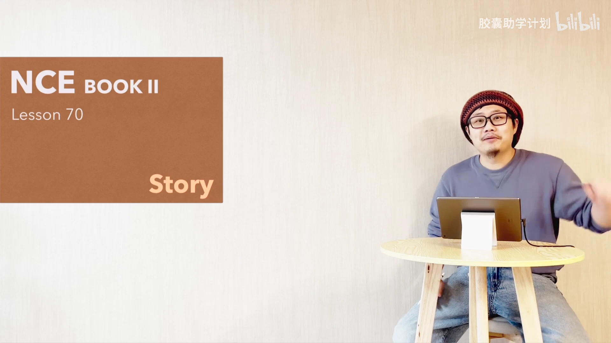

文字识别：bibii / 胶囊助学计划 / NCE / BOOKII / Lesson 70 / Story

### 画面 00:00:02

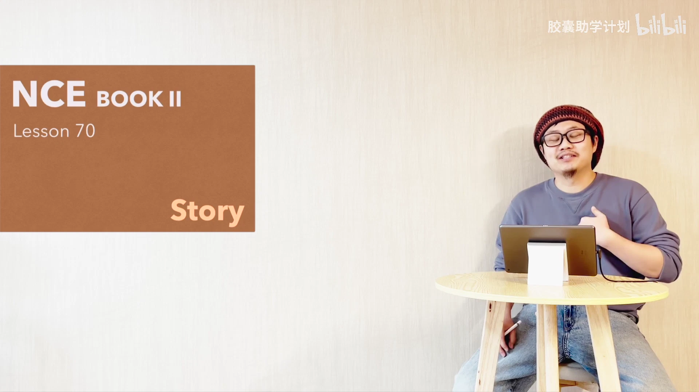

文字识别：bilbili / 胶囊助学计划 / NCE / BOOKII / Lesson 70 / Story

### 画面 00:00:04

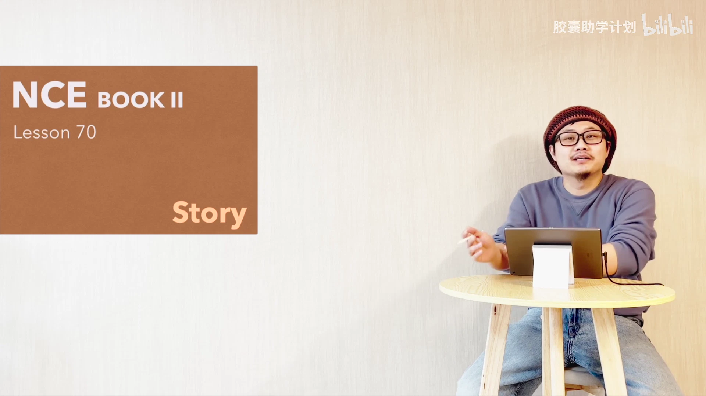

文字识别：bibii / 胶囊助学计划 / NCE / BOOKII / Lesson 70 / Story

### 画面 00:00:06

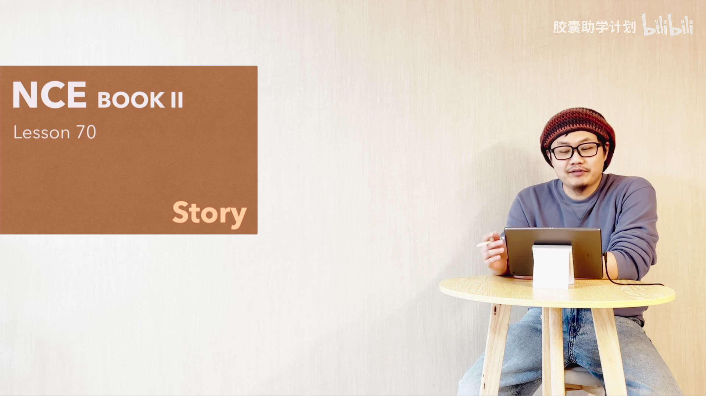

文字识别：biibii / 胶囊助学计划 / NCE / BOOKII / Lesson 70 / Story

### 画面 00:00:08

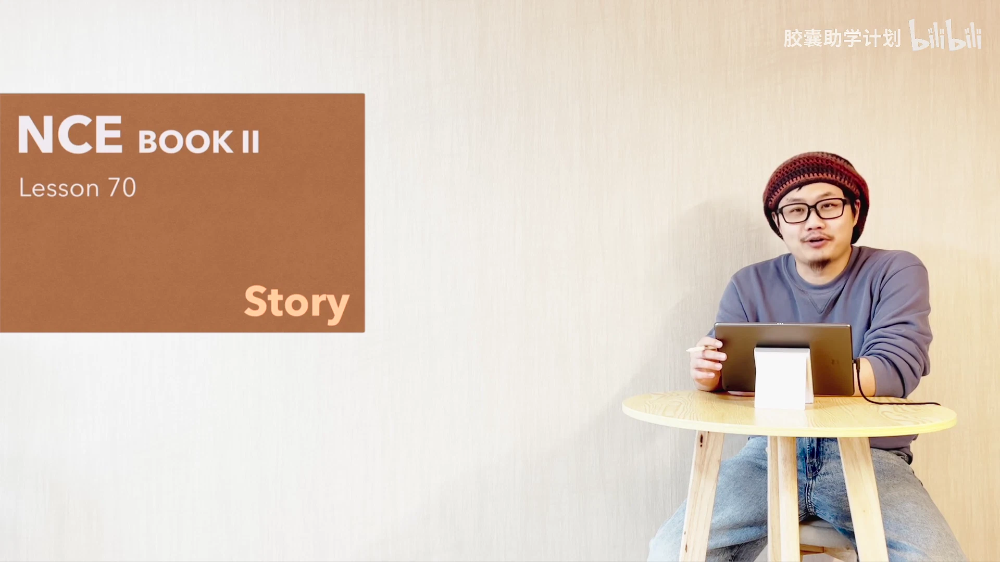

文字识别：biibii / 胶囊助学计划 / NCE / BOOKII / Lesson 70 / Story

### 画面 00:00:10

文字识别：胶囊助学计划 bii

### 画面 00:00:13

### 画面 00:00:15

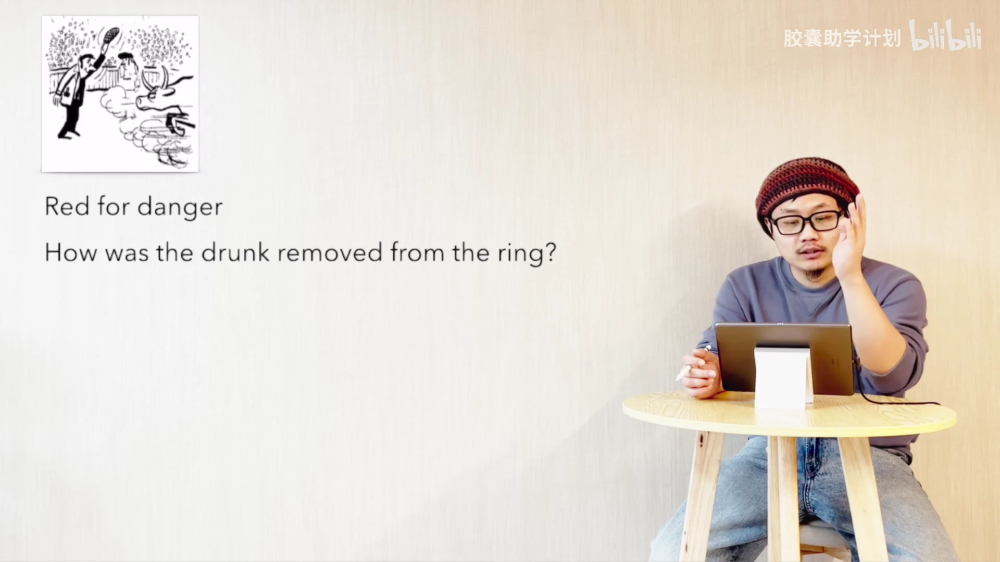

文字识别：biibili / 胶囊助学计划 / Red for danger / How was the drunk removed from the ring?

### 画面 00:00:22

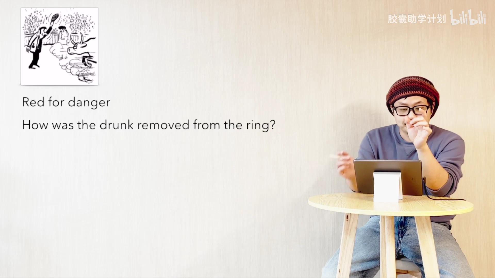

文字识别：bilbii / 胶囊助学计划 / Red for danger / How was the drunk removed from the ring?

## 00:00:30–00:01:00

看这个图，再加上本篇文章讲的那些单词，又是什么斗牛、公牛，什么这个呃这个环形的这个运动场等等，那你就大概知道是什么意思了。就是我们都知道说斗牛的时候，这个呃斗牛的这个人他会拿着一个matador对吧？他会拿着一个红布啊，所以就是红色代表这个危险是吧？那How was the drunk removed from the ring啊？这个问题很有意思，说这个

### 画面 00:00:52

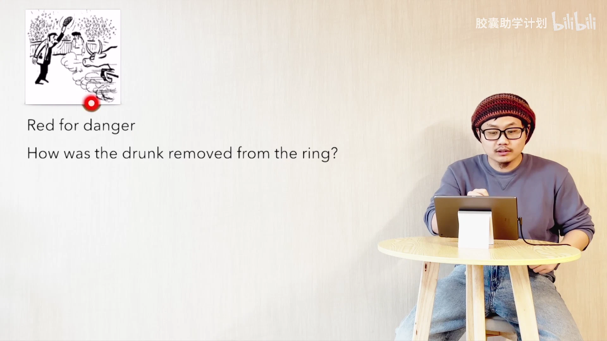

文字识别：bilbili / 胶囊助学计划 / Red for danger / How was the drunk removed from the ring?

## 00:01:00–00:01:30

醉汉是怎么从这个环形运动场里边被 remove 出去的啊？ remove 这个我们在呃 Rex 狗那课第一次见到的这个单词，对吧？就是把那个前门给 remove 了啊，给移除了。那什么叫做这个醉汉从这个环形运动场当中斗牛场当中被移除了呢？其实就是被他怎么他他进来了，然后他怎么出去的，对吧？哎，我们一会儿看一下啊，哎，注意还是被动啊，是被弄出去的。

### 画面 00:01:07

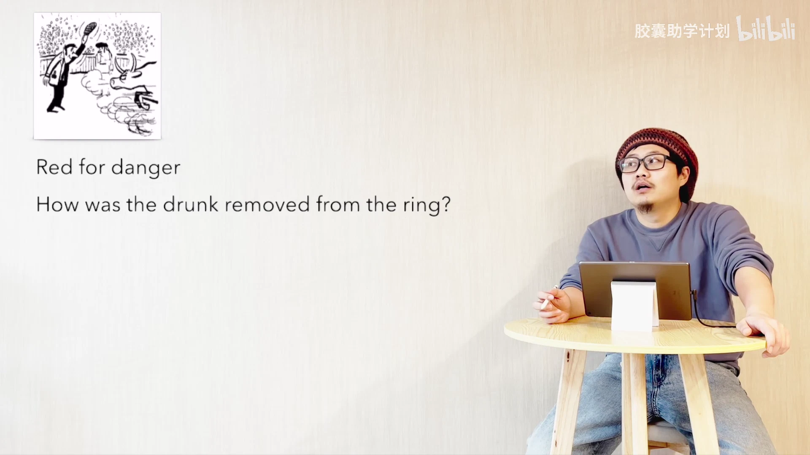

文字识别：bibili / 胶囊助学计划 / Red for danger / How was the drunk removed from the ring?

### 画面 00:01:12

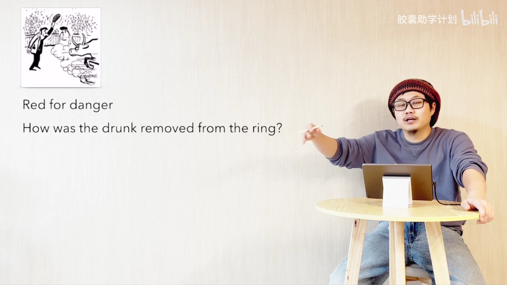

文字识别：biili / 胶囊助学计划 / Red for danger / How was the drunk removed from the ring?

## 00:01:30–00:02:00

文章吧，文章还行。说实话，其实文章的语法结构并不难，但是因为单词跟习惯用法太多了啊，也基本上每一行可能有好几个，是吧？所以我们得慢点啊。During a bullfight, a drunk suddenly wandered into the middle of the ring. 第一句话，这个我们造句造了好几次了，我希望您应该是比较熟了，叫做在一次斗牛期

### 画面 00:01:30

文字识别：胶囊助学计划bilb山 / During a bullfight, a drunk suddenly / wandered into the middle of the ring. The / crowd 'began to shout, but the / drunk was unaware of the danger. The bull / was busy with the matador at the time, but it / suddenly caught sight of the drunk (who / was shouting rude remarks and waving a red / cap).

## 00:02:00–00:02:30

间啊，说有这么一个醉汉，突然间就迷迷糊糊的走进了，哎，闲逛逛进了什么呢？Into the middle of the rain，其实就是 into the rain。那什么叫 the middle of the rain？由后往前翻译就可以了，就是这个环形运动场的中间。他迷迷糊糊的就走到那儿去了，啊，巧了，也没人看着，反正他也不知道怎么就就就走进来了，对吧？这个句子很简单，本身是个简单句，

### 画面 00:02:00

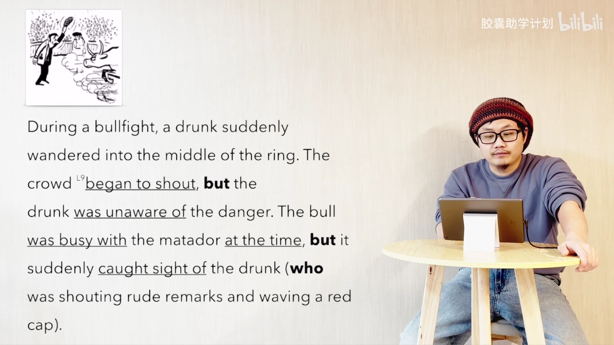

文字识别：胶囊助学计划biiil / During a bulfight, a drunk suddenly / wandered into the middle of the ring. The / crowd 'began to shout, but the / drunk was unaware of the danger. The bull / was busy with the matador at the time, but it / suddenly caught sight of the drunk (who / was shouting rude remarks and waving a red / cap).

## 00:02:30–00:03:00

只不过生词很多啊。你像这个bullfied, drunk, wandered, rain，全是生词。The crowd began to shout, but the drunk was unaware of the danger.那这个人群呢，开始嗷嗷叫，对吧？开始大叫，哎，begin to do something。第九课咱们学过。但是呢，这个醉汉呢，be unaware of，没有察觉到或者没有意识到

### 画面 00:02:30

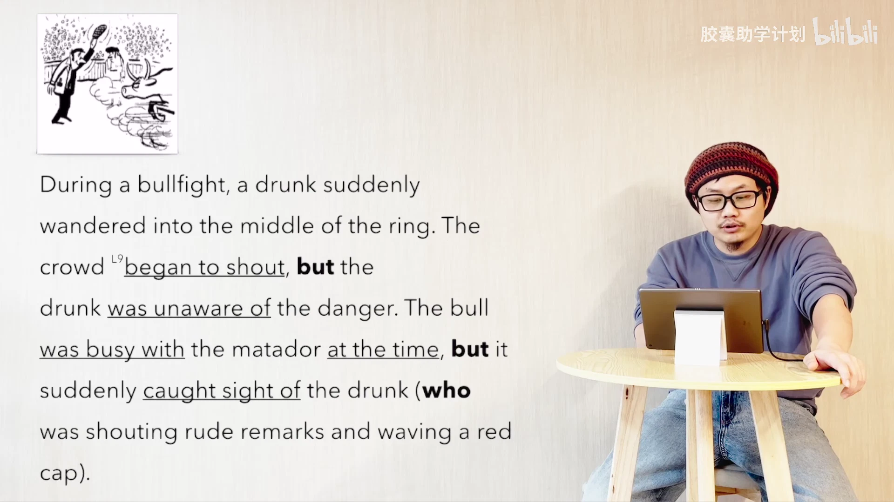

文字识别：胶囊助学计划bi山 / During a bullfight, a drunk suddenly / wandered into the middle of the ring. The / crowd 'began to shout, but the / drunk was unaware of the danger. The bull / was busy with the matador at the time, but it / suddenly caught sight of the drunk (who / was shouting rude remarks and waving a red / cap).

## 00:03:00–00:03:30

这个危险，是吧？那你想，那斗牛场里边有公牛啊，很危险。The bull was busy with the matador at the time, but it suddenly caught sight of the drunk who was shouting rude remarks and waving a red cap. 你看这句话还真是挺长的，从 bull 一直到了 cap，我把几个单词给您哎加重了，

### 画面 00:03:00

文字识别：胶囊助学计划bib山 / During a bullfight, a drunk suddenly / wandered into the middle of the ring. The / crowd 'began to shout, but the / drunk was unaware of the danger. The bull / was busy with the matador at the time, but it / suddenly caught sight of the drunk (who / was shouting rude remarks and waving a red / cap).

### 画面 00:03:28

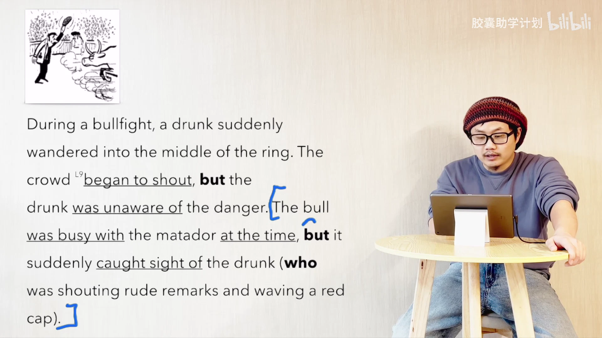

文字识别：胶囊助学计划bib / During a bullfight, a drunk suddenly / wandered into the middle of the ring. The / crowd 'began to shout, but the / drunk was unaware of the danger.The bull / was busy with the matador at the time, but it / suddenly caught sight of the drunk (who / was shouting rude remarks and waving a red / cap).]

## 00:03:30–00:04:00

哎，其实这里也在加个重，但因为这个句子比较短，我就没有加。于是，其实各位能注意到一个非常长的句子被我们用这样几个小的连词拆成了特别短的几个句子。我们挨个先看这个短的句子，说这个公牛 be busy with，我们之前学过 be busy doing something，对吧？哎，就是或那个家庭主妇的呃，这个这个一天是吧？这个那一

### 画面 00:03:30

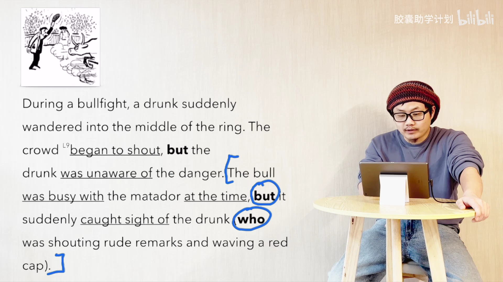

文字识别：胶囊助学计划bi出 / During a bullfight, a drunk suddenly / wandered into the middle of the ring. The / crowd 'began to shout, but the / drunk was unaware of the danger.The bull / was busy with the matador at the time,but / suddenly caught sight of the drunk / who / was shouting rude remarks and waving a red / cap)

### 画面 00:03:33

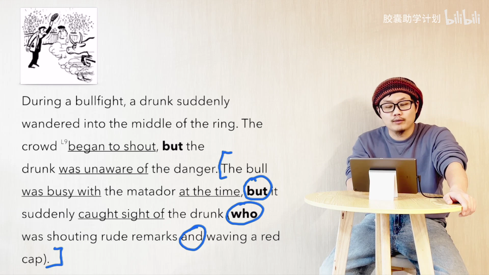

文字识别：胶囊助学计划bii / During a bullfight, a drunk suddenly / wandered into the middle of the ring. The / crowd 'began to shout, but the / drunk was unaware of the danger.The bull / Was busy with the matador at the time, / ebut / suddenly caught sight of the drunk who / was shouting rude remarksand / dwaving a red / cap).]

## 00:04:00–00:04:30

刻啊啊，忙于和那个这个面粉面糊那一刻，咱们学过 be busy doing something，叫忙于做某件事情。那现在的 be busy with something，你很容易能理解叫做忙着做，忙着处理什么事儿，对吧？或者忙在什么事儿上忙啊？后边加个名词，对吧？但你可以是物，可以是人。他说正在忙着干嘛呢？忙着和谁忙着呢？和这个 matador 啊，和这个斗牛士在那儿忙的。At the time，

### 画面 00:04:03

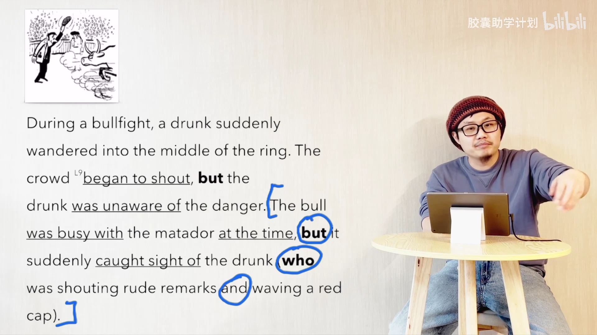

文字识别：胶囊助学计划i / During a bullfight, a drunk suddenly / wandered into the middle of the ring. The / crowd '"began to shout, but the / drunk was unaware of the danger.The bull / was busy with the matador at the time, / but / suddenly caught sight of the drunk / who / was shouting rude remarks and / waving a red / cap).]

## 00:04:30–00:05:00

time,我们单词部分见过一次，也是本课的习惯用法，叫做那时啊，这是过去的事嘛，对吧？讲的是故事嘛。在那时正忙着呢，和他正忙着呢啊，俩人正斗着呢。但是第二句话开始了。It suddenly caught sight of the drunk.说这个牛突然间，哎，又突然间，suddenly出现两次了。哎，caught sight of the drunk。这个catch sight of本课我们会

### 画面 00:04:33

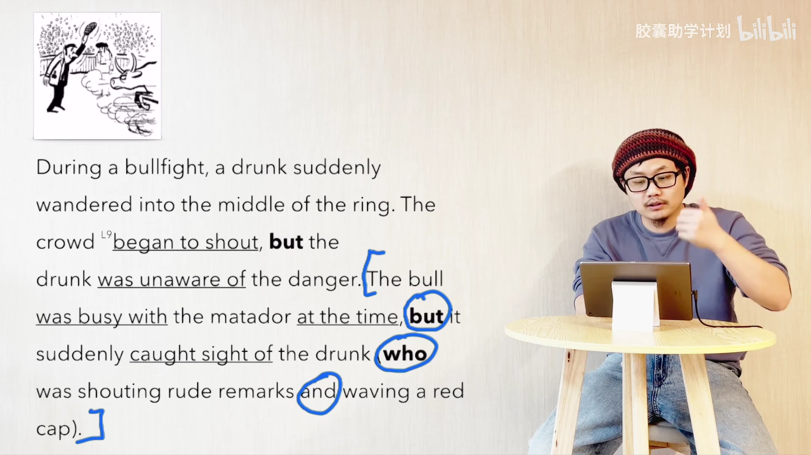

文字识别：胶囊助学计划bilbl / During a bullfight, a drunk suddenly / wandered into the middle of the ring. The / crowd 'began to shout, but the / drunk was unaware of the danger.The bull / was busy with the matador at the time, / but / suddenly caught sight of the drunk who / was shouting rude remarksand / waving a red / cap).

## 00:05:00–00:05:30

当做一个习惯用法单独去给各位解释，在这儿您目前暂时性的给它理解为大概叫做瞧见、瞥见、突然间看见就可以了啊，瞥见看见就可以了。Call side of, uh, the drunk.说这个醉汉后边跟了一个叫做who，这个who呢就是定语从句嘛，对吧？然后后边定语从句一直到结束，这个定语从句里边又连接着两

### 画面 00:05:03

文字识别：胶囊助学计划bii / During a bullfight, a drunk suddenly / wandered into the middle of the ring. The / crowd 'began to shout, but the / drunk was unaware of the danger.The bull / was busy with the matador at the time, / but / suddenly caught sight of the drunk / who / was shouting rude remarks and / dwaving a red / cap).]

## 00:05:30–00:06:00

句话，那我们知道这个 he 其实就是 the drunk 啊，那一看是 he 对吧，男的，我们就把 he 直接给他换成一个 he 对吧？第三句话叫 he was shouting rude remarks，说他当时正在喊这些特别粗鲁的言论评论，那有多粗鲁您自己脑补啊，这个我们这个上课就不提了啊。那我们知道他说的是一些粗鲁的言论和评论啊，

### 画面 00:05:33

文字识别：胶囊助学计划biii / During a bullfight, a drunk suddenly / wandered into the middle of the ring. The / crowd 'began to shout, but the / drunk was unaware of the danger.The bull / was busy with the matador at the time, / but / suddenly caught sight of the drunk who / was shouting rude remarks andwaving a red / cap).

### 画面 00:05:53

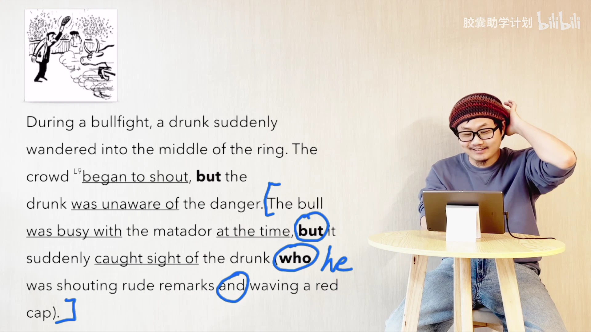

文字识别：胶囊助学计划ilbl / During a bullfight, a drunk suddenly / wandered into the middle of the ring. The / crowd 'began to shout, but the / drunk was unaware of the danger.The bull / was busy with the matador at the time, / but / he / suddenly caught sight of the drunk who / was shouting rude remarks and / dwaving a red / cap).]

## 00:06:00–00:06:30

然后呢？定语从句当中第二句话叫 waving a red cap，这个真的就有点找死了，是吧？干嘛呢？他不仅喊，这公牛是听不懂的，你喊最多是引起了他的注意力。他一看，哟，这儿还有一人呢。但是你还在做一件事，叫 waving a red cap，他戴着一个红色的帽子，他在那儿挥舞，waving 叫挥舞。那我们都知道，我们不知道为什么，但我们知道至少知道是这样

### 画面 00:06:22

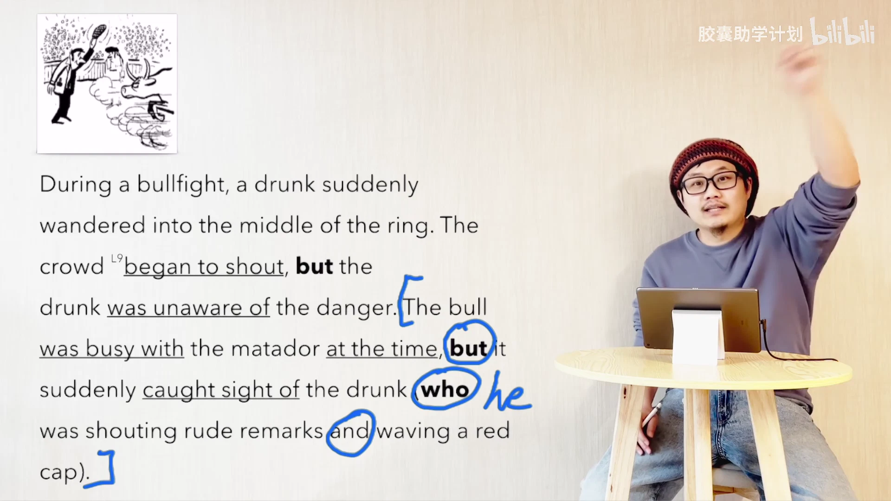

文字识别：胶囊助学计划bilbil / During a bullfight, a drunk suddenly / wandered into the middle of the ring. The / crowd 'began to shout, but the / drunk was unaware of the danger.The bull / was busy with the matador at the time, / but / suddenly caught sight of the drunk who / he / was shouting rude remarksand / waving a red / cap).

### 画面 00:06:26

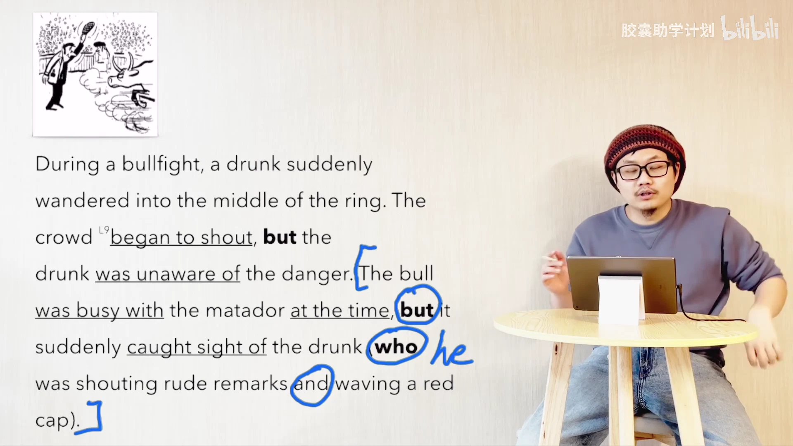

文字识别：胶囊助学计划bil / During a bullfight, a drunk suddenly / wandered into the middle of the ring. The / crowd 'began to shout, but the / drunk was unaware of the danger.The bull / was busy with the matador at the time, / but / he / suddenly caught sight of the drunk who / was shouting rude remarks andwaving a red / cap).I

## 00:06:30–00:07:00

的，就是斗牛场里边的这个公牛看见红色的布，两眼就放红，是吧？这个是我们这个呃，他会被这个东西所激怒，然后他又在挥舞着一个红色的cap，就是帽子啊，那肯定就注意吸引了他的注意力嘛。这公牛就找他来了。那我们再回顾一下这么长的一句话，对于各位来说，包括其实进入三测，我们最主要的任务就是做这样的任务，就是把一个非常

### 画面 00:06:56

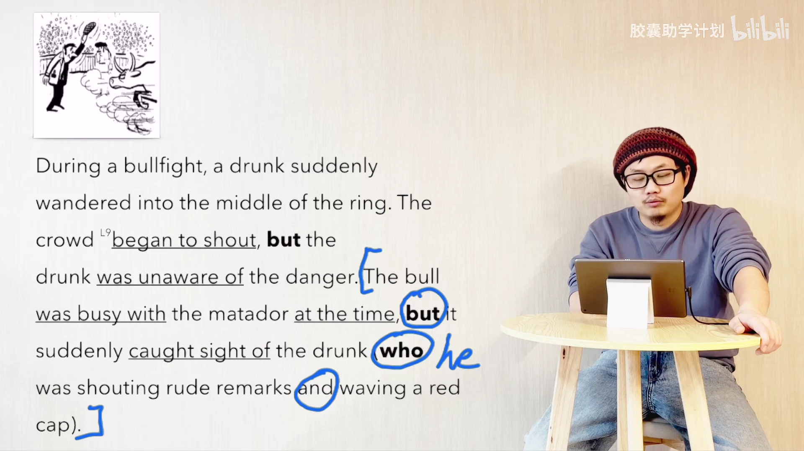

文字识别：胶囊助学计划bilbl / During a bullfight, a drunk suddenly / wandered into the middle of the ring. The / crowd 'began to shout, but the / drunk was unaware of the danger.The bull / was busy with the matador at the time,but / he / suddenly caught sight of the drunk who / was shouting rude remarks andwaving a red / cap).]

## 00:07:00–00:07:30

长的句子给它拆解成简单的几句话，然后尝试把每一句话都理解，再给它组合起来，好吧？Okay，那这个我们就不多说了，接下往下，关键的句子来了，叫做 apparently sensitive to criticism，说很明显的是 sensitive to criticism，叫做对于这个批评非常的敏感。好，说 the bull forgot all about

### 画面 00:07:11

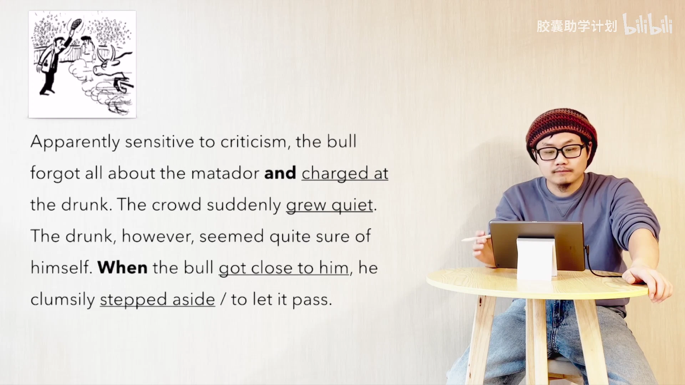

文字识别：胶囊助学计划bib山 / Apparently sensitive to criticism, the bull / forgot all about the matador and charged at / the drunk. The crowd suddenly grew quiet. / The drunk, however, seemed quite sure of / himself. When the bull got close to him, he / clumsily stepped aside / to let it pass.

## 00:07:30–00:08:00

the matador and charged at the drunk.说这个公牛啊忘忘忘记了所有关于这个斗牛士的事儿，是吧？然后呢，开始冲向这个醉汉。注意，这里其实他用了一个那种调侃拟人的一个表达，什么意思呢？这公牛冲向他是因为他骂他吗？啊， rude remarks吗？并不一定是，更主要的可能是因为他那个红色的帽子在那挥舞，对吧？但是呢，

### 画面 00:07:41

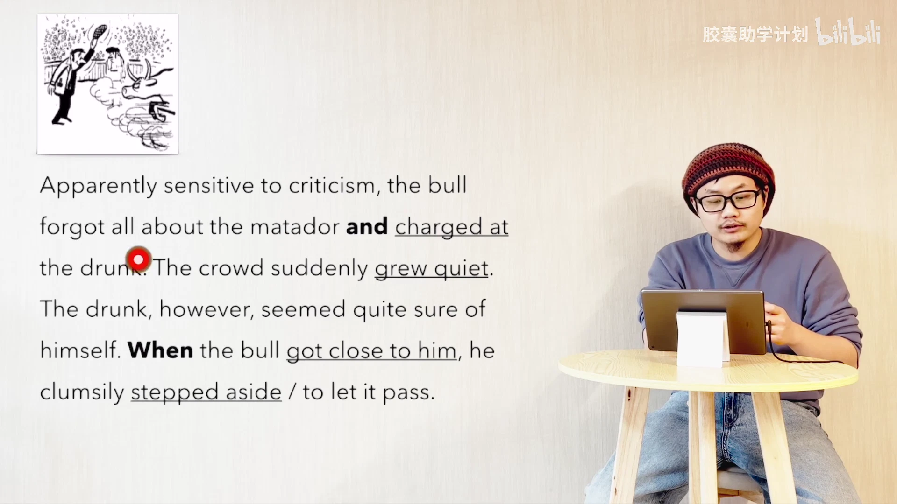

文字识别：胶囊助学计划bi山 / Apparently sensitive to criticism, the bull / forgot all about the matador and charged at / the drune.The crowd suddenly grew quiet. / The drunk, however, seemed quite sure of / himself. When the bull got close to him, he / clumsily stepped aside / to let it pass.

## 00:08:00–00:08:30

他在写的时候把它拟人化了，叫做很明显是对于这些批评特别的敏感。对于哪些批评呢？刚才说的那些话，叫做 rude remarks，那些粗鲁的评论，对吧？所以这里他其实用了一个小的拟人。那这地方就有一个问题，问题是什么呢？叫做 apparently sensitive to criticism 的主语是谁？这句话当中也没有动词，哪怕是 be 动词也没有，

### 画面 00:08:11

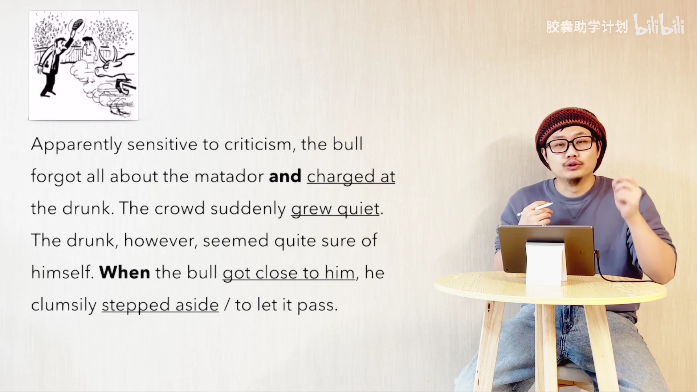

文字识别：胶囊助学计划biib出 / Apparently sensitive to criticism, the bull / forgot all about the matador and charged at / the drunk. The crowd suddenly grew quiet. / The drunk, however, seemed quite sure of / himself. when the bull got close to him, he / clumsily stepped aside / to let it pass.

## 00:08:30–00:09:00

那是怎么回事呢？第一六十九课咱们刚学过，第二这个四十九课咱们也学过，然后第三本课单词我又提醒了你一句，叫He is sensitive to criticism。所以这地方是怎么回事呢？我们给它还原一下，就是The bull啊是前面这句话的主语，它其实还应该有一句话，还应该有一个单词叫做was，就是The bull was apparently sensitive to criticism。

### 画面 00:08:41

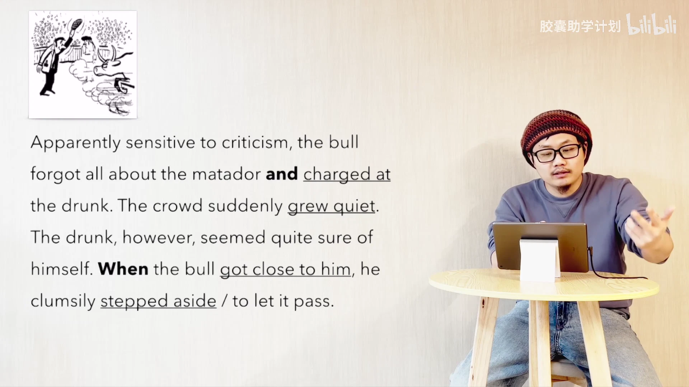

文字识别：胶囊助学计划bii / Apparently sensitive to criticism, the bull / forgot all about the matador and charged at / the drunk. The crowd suddenly greW quiet. / The drunk, however, seemed quite sure of / himself. When the bull got close to him, he / clumsily stepped aside / to let it pass.

## 00:09:00–00:09:30

ah,前面是更更可能更重要的，还应该有一个连词。但因为你的它类似于分词做状语了，这个be也就是was这个单词被省略掉了，或者被换成了being。你回想一下六十九课，我刚刚学过的叫being tired of sleeping on the floor，那个being是可以省略的，对吧？Being sure巴拉巴拉巴拉，那个being是可以被省略的。所以这里的apparently sensitive to criticism的那个being啊

### 画面 00:09:11

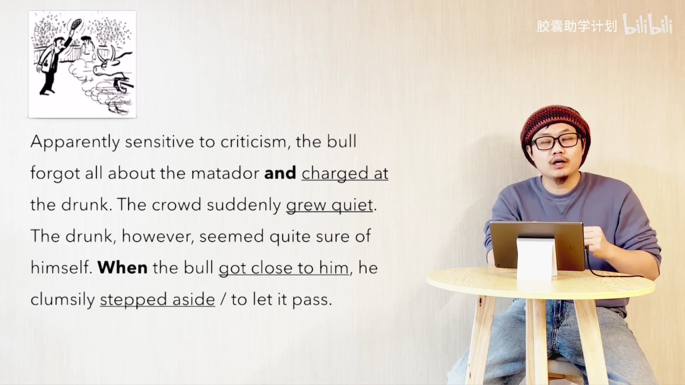

文字识别：胶囊助学计划biibil / Apparently sensitive to criticism, the bull / forgot all about the matador and charged at / the drunk. The crowd suddenly grew quiet. / The drunk, however, seemed quite sure of / himself. When the bull got close to him, he / clumsily stepped aside / to let it pass.

## 00:09:30–00:10:00

就被省略了，就很容易理解了啊。看继续，The crowd suddenly grew quiet.说这个人群突然间，你看又突然间出现三回了。Grew quiet，这是一个小的习惯用法。以后我们会不停的见到，就是grow这个单词，我们呃很习惯的一个呃呃，它的含义叫做生长、成长，它还有一个类似于变

### 画面 00:09:41

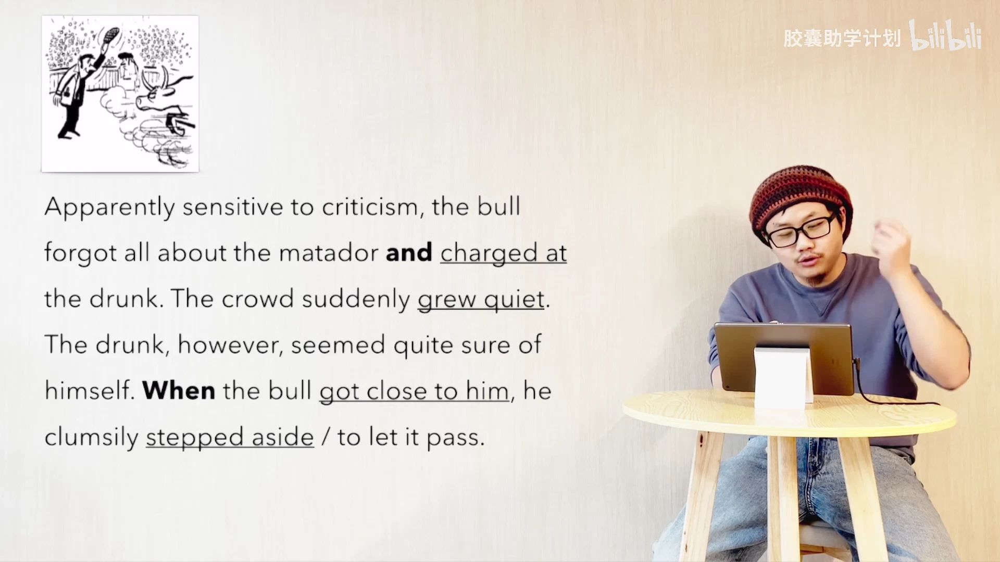

文字识别：胶囊助学计划bilb出 / Apparently sensitive to criticism, the bull / forgot all about the matador and charged at / the drunk. The crowd suddenly grew quiet. / The drunk, however, seemed quite sure of / himself. when the bull got close to him, he / clumsily stepped aside / to let it pass.

## 00:10:00–00:10:30

得的意思，叫变得。突然间，人群变得安静了啊！大家都屏住呼吸，看一下接下来会发生什么。比如说，替这个壮有点担心。The drunk, however, seemed quite sure of himself. 就这个醉汉，然而呢，啊，就是个小插入语。其实有没有他无所谓啊。似乎是相当注意，这个是quiet，这个是quite，quiet是

### 画面 00:10:11

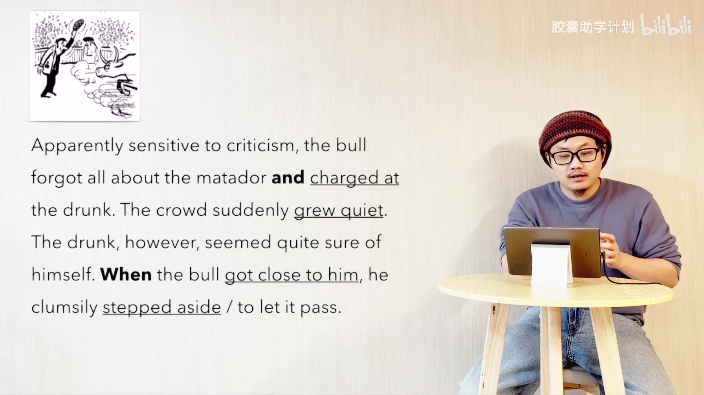

文字识别：胶囊助学计划bib出 / Apparently sensitive to criticism, the bull / forgot all about the matador and charged at / the drunk. The crowd suddenly grew quiet. / The drunk, however, seemed quite sure of / himself. When the bull got close to him, he / clumsily stepped aside / to let it pass.

## 00:10:30–00:11:00

安静. Quite is相当。这俩单词长得无比的像，就是T跟E的位置不太一样。自己注意力看一下啊。那sure of himself叫对他自己怎么样？Sure are you sure?你确信吗？哎，对他自己非常的确信，很有把握啊。我们换一句话来说，When the bull got close to him，这是本课的一个习惯用法，但是字面意思其实很容易猜得到，叫离他很近，对吧？哎，接近

### 画面 00:10:41

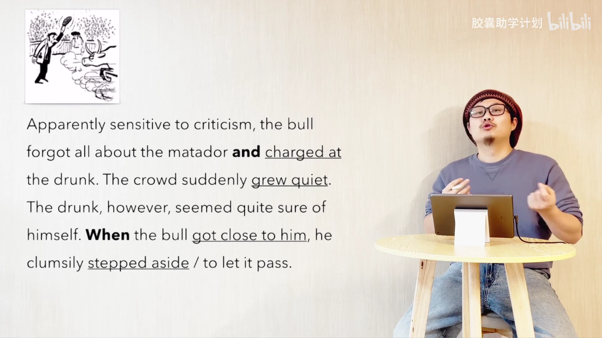

文字识别：胶囊助学计划biii / Apparently sensitive to criticism, the bull / forgot all about the matador and charged at / the drunk. The crowd suddenly grew quiet. / The drunk, however, seemed quite sure of / himself. When the bull got close to him, he / clumsily stepped aside / to let it pass.

## 00:11:00–00:11:30

他。说当这个公牛接近他的时候呢，he clumsily stepped aside to let it pass。这个醉汉怎么样了呢？Clumsily，很笨拙的step aside。你想他喝多了，小脑麻痹了，这个四肢是不太协调的，所以clumsily，对吧？然后step aside，step aside是本课的一个习惯用法，step aside很常见的一个意思就

### 画面 00:11:11

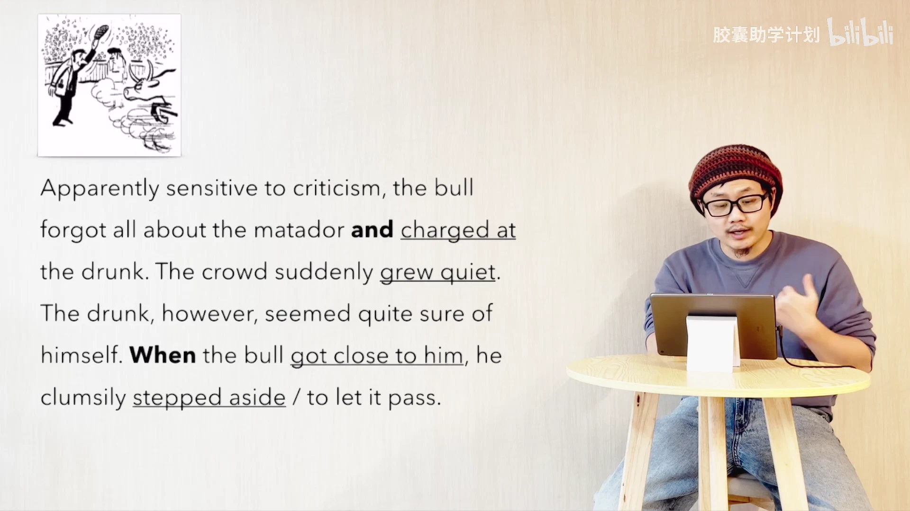

文字识别：胶囊助学计划bi出 / Apparently sensitive to criticism, the bull / forgot all about the matador and charged at / the drunk. The crowd suddenly grew quiet. / The drunk, however, seemed quite sure of / himself. When the bull got close to him, he / clumsily stepped aside / to let it pass.

## 00:11:30–00:12:00

退到一边，哎，公牛冲我来了，我退到了一边啊，目的是什么呢？Let it pass，都是字面意思了，没什么可说的。让公牛过去。如果您看过这个呃这个呃斗牛的视频，那你应该能明白是吧？这个斗牛是不是就是拿这个红布在这晃，然后咵一甩，对吧？让这个公牛冲过去嘛，对吧？Let it pass. Okay, continue. The

### 画面 00:11:41

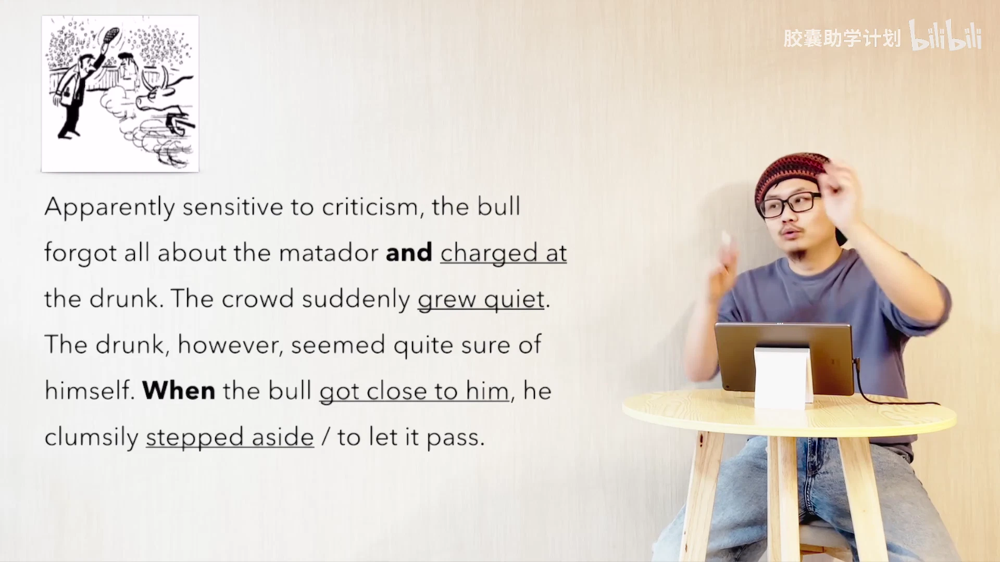

文字识别：胶囊助学计划bii / Apparently sensitive to criticism, the bull / forgot all about the matador and charged at / the drunk. The crowd suddenly grew quiet. / The drunk, however, seemed quite sure of / himself. When the bull got close to him, he / clumsily stepped aside / to let it pass.

### 画面 00:11:48

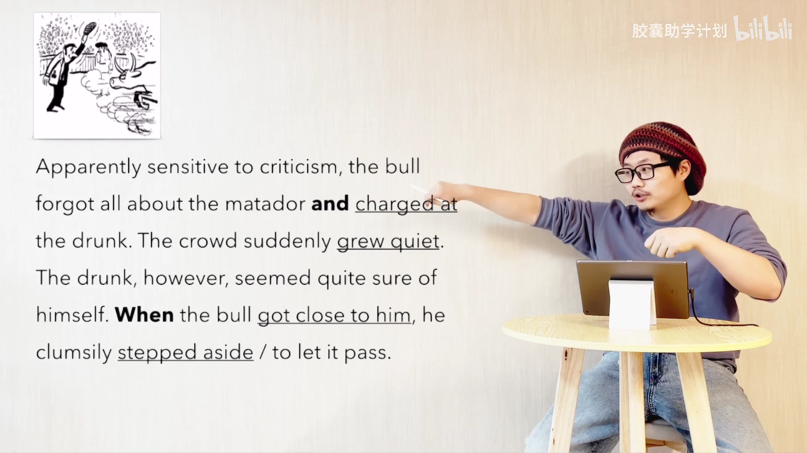

文字识别：胶囊助学计划bib出 / Apparently sensitive to criticism, the bull / forgot all about the matador and charged at / the drunk. The crowd suddenly grew quiet. / The drunk, however, seemed quite sure of / himself. When the bull got close to him, he / clumsily stepped aside / to let it pass.

### 画面 00:11:51

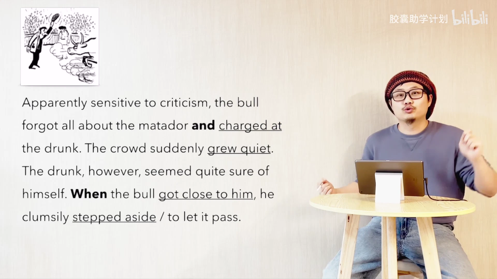

文字识别：胶囊助学计划bi出 / Apparently sensitive to criticism, the bull / forgot all about the matador and charged at / the drunk. The crowd suddenly grew quiet. / The drunk, however, seemed quite sure of / himself. When the bull got close to him, he / clumsily stepped aside / to let it pass.

### 画面 00:11:57

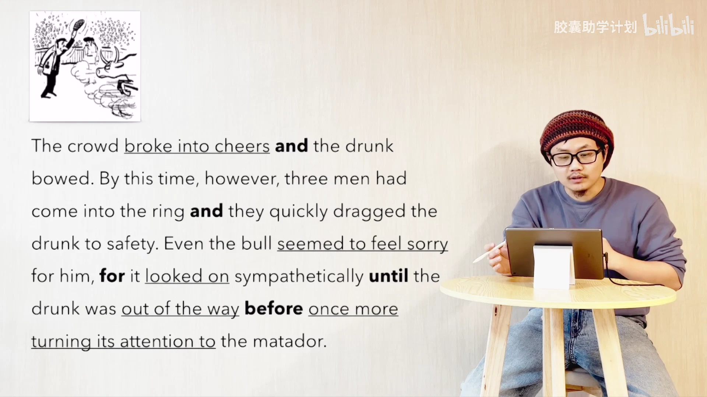

文字识别：胶囊助学计划bib山 / The crowd broke into cheers and the drunk / bowed. By this time, however, three men had / come into the ring and they quickly dragged the / drunk to safety. Even the bull seemed to feel sorry / for him, for it looked on sympathetically until the / drunk was out of the way before once more / turning its attention to the matador.

## 00:12:00–00:12:30

crowd broke into cheers.哎，broke into cheers.字面意思就是大家欢呼起来了，是吧？人群欢呼起来了。And the drunk bowed.然后怎么样了呢？然后这个醉汉就哎给大家鞠了一个躬，哎行了一个礼。By this time,截止到这个时候，However,又出现了。然而呢，Three men had come into the rain, and

### 画面 00:12:18

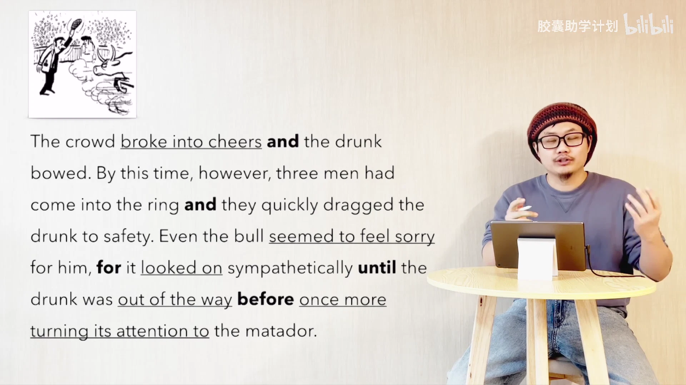

文字识别：胶囊助学计划bilb出 / The crowd broke into cheers and the drunk / bowed. By this time, however, three men had / come into the ring and they quickly dragged the / drunk to safety. Even the bull seemed to feel sorry / for him, for it looked on sympathetically until the / drunk was out of the way before once more / turning its attention to the matador.

## 00:12:30–00:13:00

they quickly dragged the drunk to safety. Three men,迅速的冲进了这个环形的斗牛场。然后下一句话，他们迅速的dragged the drunk to safety.刚才我们在单词之前那个视频当中学的，我给大家用的叫做lead somebody to safety。这里用的是drag the drunk to safety。为什么

### 画面 00:12:48

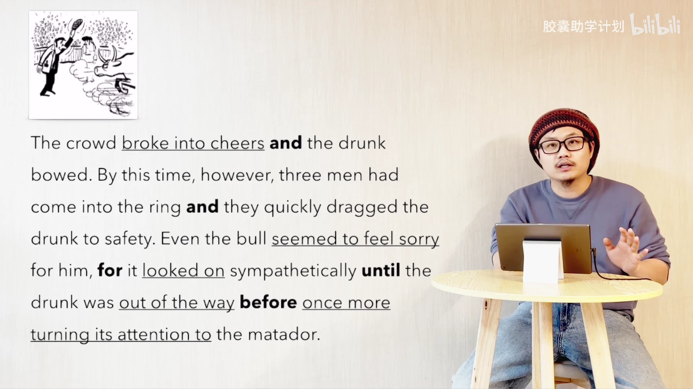

文字识别：胶囊助学计划bib山 / The crowd broke into cheers and the drunk / bowed. By this time, however, three men had / come into the ring and they quickly dragged the / drunk to safety. Even the bull seemed to feel sorry / for him, for it looked on sympathetically until the / drunk was out of the way before once more / turning its attention to the matador.

## 00:13:00–00:13:30

you use lead? Think about the difference between these two words. Drag means pulling, lead means guiding. Do you think the drunk will say, "Oh, three people came in. Say, 'Come on, you go this way.' Guiding, right? Do you think the drunk will say, "Oh, three people came in. Say, 'Come on, you go this way.' Guiding, right? Do you think the drunk will say, "Oh, three people came in. Say, 'Come on, you go this way.' Guiding, right? Do you think the drunk will say, "Oh, three people came in. Say, 'Come on, you go this way.' Guiding, right? Do you think the drunk will say, "Oh, three people came in. Say, 'Come on, you go this way.' Guiding, right?

### 画面 00:13:13

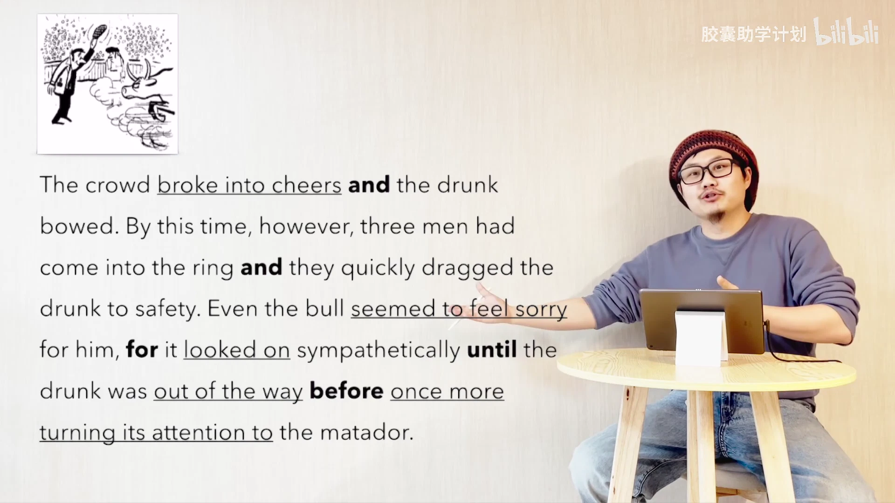

文字识别：胶囊助学计划bi山 / The crowd broke into cheers and the drunk / bowed. By this time, however, three men had / come into the ring and they quickly dragged the / drunk to safety. Even the bull seemed to feel sorry / for him, for it looked on sympathetically until the / drunk was out of the way before once more / turning its attention to the matador.

### 画面 00:13:18

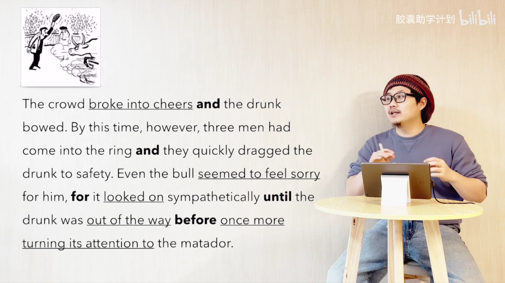

文字识别：胶囊助学计划bii出 / The crowd broke into cheers and the drunk / bowed. By this time, however, three men had / come into the ring and they quickly dragged the / drunk to safety. Even the bull seemed to feel sorry / for him, for it looked on sympathetically until the / drunk was out of the way before once more / turning its attention to the matador.

## 00:13:30–00:14:00

样的，对吧？所以用的是 drag the drunk to safety，啊，拉着他到了安全的地方。Even the bull seemed to feel sorry for him, for it looked unsympathetically until the drunk was out of the way. Before once more turning its attention to the matador,你看这句话，又齁

### 画面 00:13:48

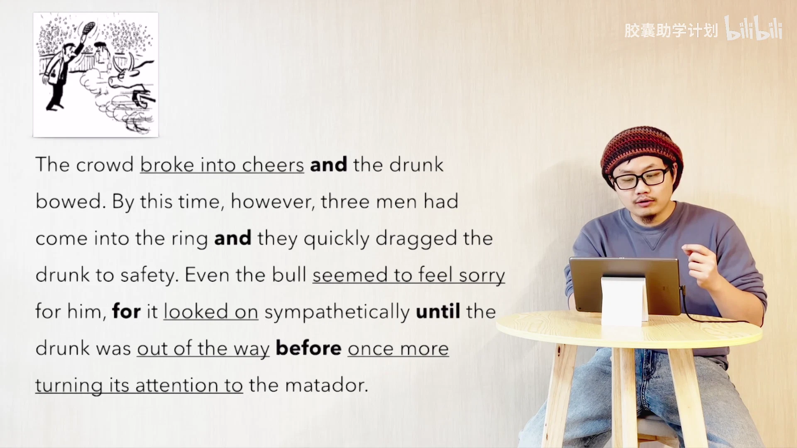

文字识别：胶囊助学计划bil山 / The crowd broke into cheers and the drunk / bowed. By this time, however, three men had / come into the ring and they quickly dragged the / drunk to safety. Even the bull seemed to feel sorry / for him, for it looked on sympathetically until the / drunk was out of the way before once more / turning its attention to the matador.

### 画面 00:13:58

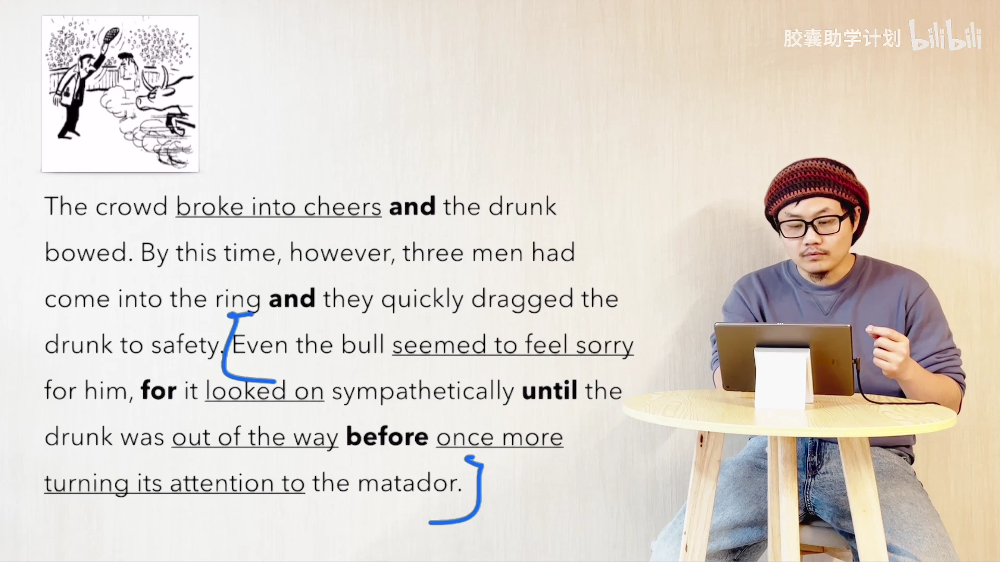

文字识别：胶囊助学计划bib山 / The crowd broke into cheers and the drunk / bowed. By this time, however, three men had / come into the ring and they quickly dragged the / drunk to safety,/Even the bull seemed to feel sorry / for him, for it looked on sympathetically until the / drunk was out of the way before once more / turning its attention to the matador.

## 00:14:00–00:14:30

长，齁长怎么办？你要学的，我们学员要学的是思路。For一个圈儿，Until一个圈儿，Before一个圈儿，很长的一句话被我们拆成了一个又一个的小短句。那读懂短句这个能力，我相信学到新概念二册七十课，对于我们来说应该不是太费劲的事了啊。我们挨个看，说甚至啊，这个公牛seem to feel

### 画面 00:14:06

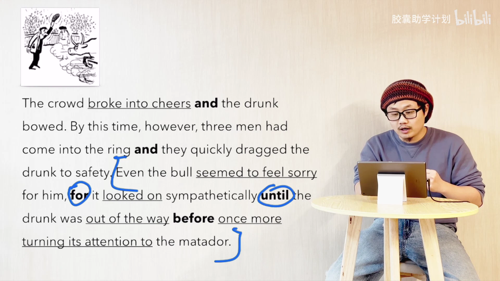

文字识别：胶囊助学计划bi / The crowd broke into cheers and the drunk / bowed. By this time, however, three men had / come into the ring and they quickly dragged the / drunk to safety,Even the bull seemed to feel sorry / for him, / foy / it looked on sympathetically / untilthe / drunk was out of the way before once more / turning its attention to the matador.

### 画面 00:14:08

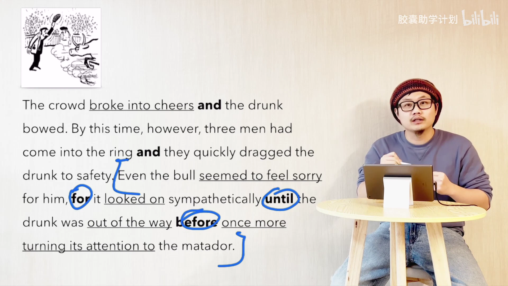

文字识别：胶囊助学计划bibi / The crowd broke into cheers and the drunk / bowed. By this time, however, three men had / come into the ring and they quickly dragged the / drunk to safety,Even the bull seemed to feel sorry / for him, / for / it looked on sympathetically / untilthe / drunk was out of the way / keforeonce more / turning its attention to the matador.

## 00:14:30–00:15:00

sorry for him. Here,有一个核心的习惯用法叫 feel sorry for somebody, 对某人感到很遗憾、很同情，是吧？说甚至说这个公牛似乎是都感觉到，哎，替他有一些惋惜和遗憾。你看，他又用了是一个拟人的这样的一个表达，跟刚才的 apparently sensitive to criticism 有一个类似于前后呼应的感觉，就是文风是一致的啊。但这个对于我们初学者倒是不是很重要。

### 画面 00:14:38

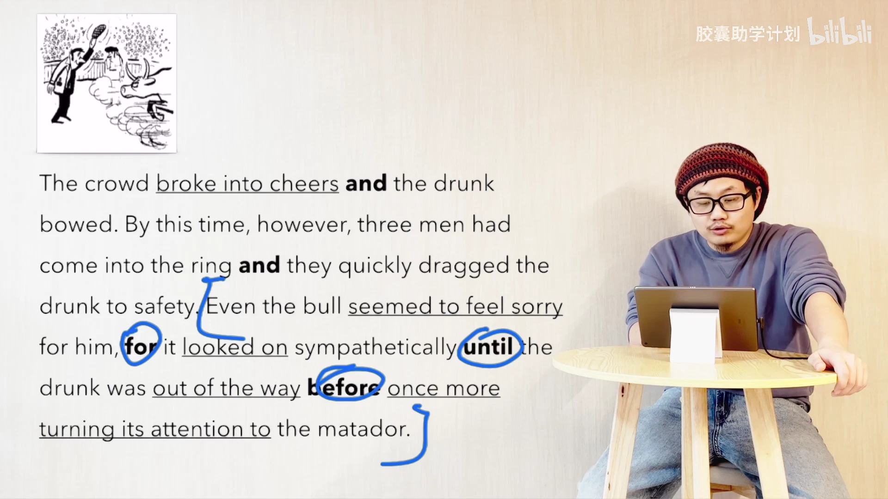

文字识别：胶囊助学计划bilbl / The crowd broke into cheers and the drunk / bowed. By this time, however, three men had / come into the ring and they quickly dragged the / drunk to safety,Even the bull seemed to feel sorry / for him, / foy / it looked on sympathetically / untilthe / drunk was out of the way / keforeonce more / turning its attention to the matador.

## 00:15:00–00:15:30

For因为什么呢？这个公牛啊，look unsympathetically。这个look on指的是一个习惯用法，叫旁观啊。说他呢很充满同情心的在那个地方旁观，也没干嘛。Until直到又连了一句话叫做The drug was out of the way。那out of the way就是字面意思就是不在路上了，在路的外面了，就是不挡道了，不

### 画面 00:15:08

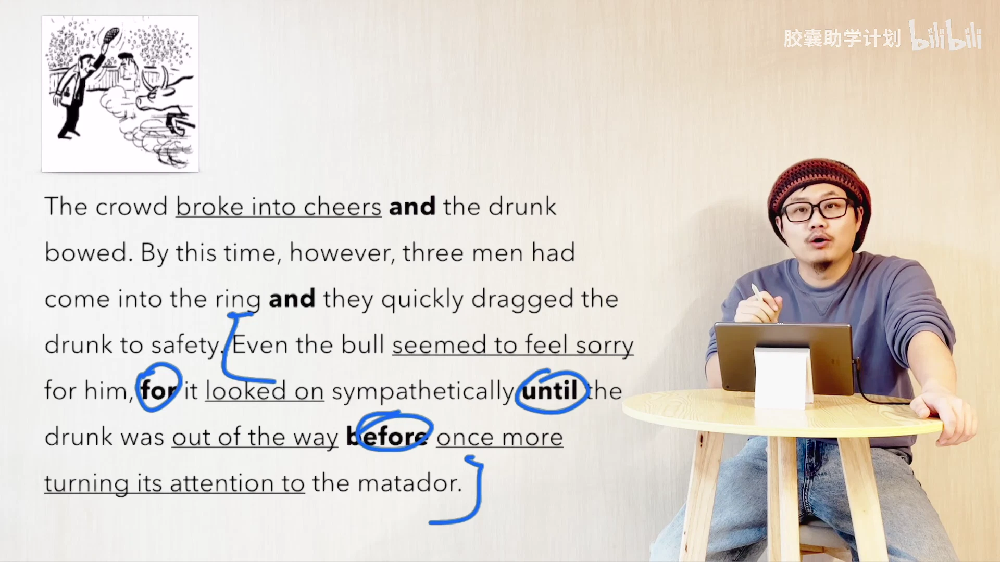

文字识别：胶囊助学计划bilbii / The crowd broke into cheers and the drunk / bowed. By this time, however, three men had / come into the ring and they quickly dragged the / drunk to safetyEven the bull seemed to feel sorry / for him, / foy / it looked on sympathetically / untilthe / drunk was out of the way / keforeonce more / turning its attention to the matador.

## 00:15:30–00:16:00

碍事儿了，对吧？哎，OK，起开，口语当中用这句话，一会儿我们会讲，就北方话，你起开我这儿，你别挡我道啊，好狗不挡道，起开，out of the way。The drunk goes out of the way，说直到这个醉汉怎么样了呢？不在视野当中，哎，不挡道了。从这个环形场，换一句话来说，就是被drag the drunk to safety，对吧？给他拉离了这个环形场之后，直到哎他一

### 画面 00:15:34

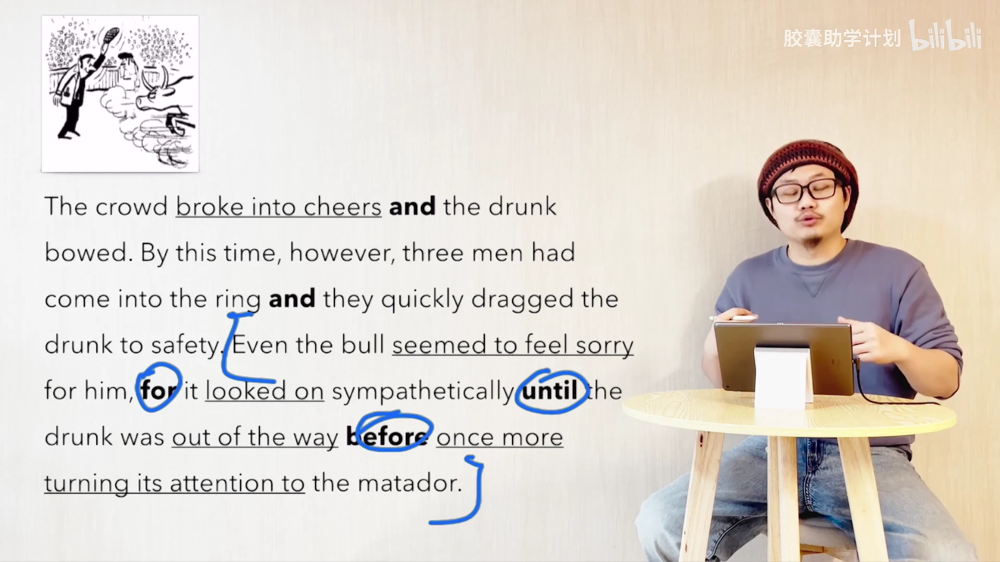

文字识别：胶囊助学计划bilbil / The crowd broke into cheers and the drunk / bowed. By this time, however, three men had / come into the ring and they quickly dragged the / drunk to safety,Even the bull seemed to feel sorry / for him, / for / it looked on sympathetically / untilthe / drunk was out of the way / kefordonce more / turning its attention to the matador.

### 画面 00:15:37

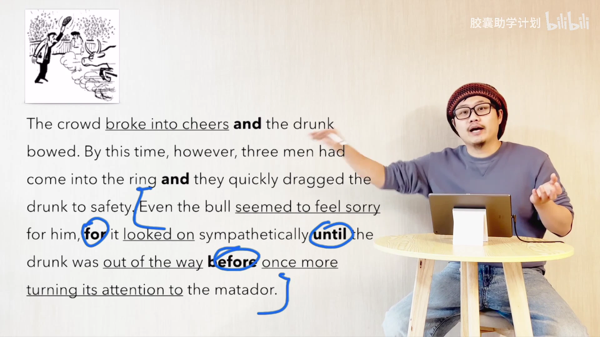

文字识别：胶囊助学计划bi山 / The crowd broke into cheers and the drunk / bowed. By this time, however, three men had / come into the ring and they quickly dragged the / drunk to safety,Even the bull seemed to feel sorry / for him, / foy / it looked on sympathetically / untilthe / drunk was out of the way / keforeonce more / turning its attention to the matador.

### 画面 00:15:43

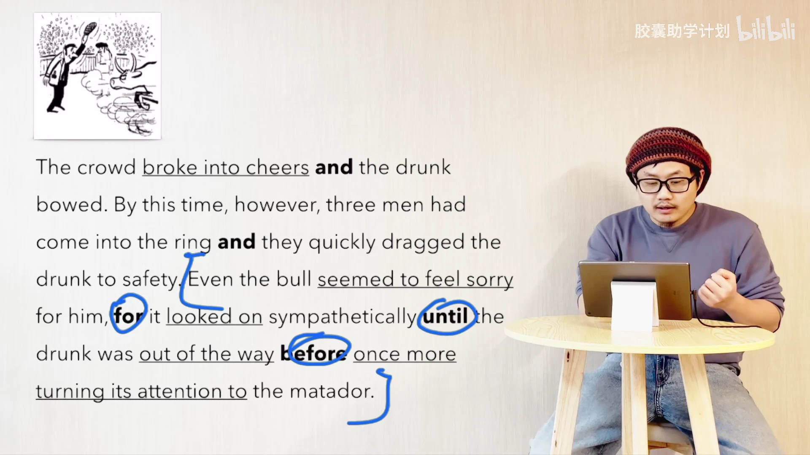

文字识别：胶囊助学计划bibl / The crowd broke into cheers and the drunk / bowed. By this time, however, three men had / come into the ring and they quickly dragged the / drunk to safety,Even the bull seemed to feel sorry / for him, / foy / it looked on sympathetically / untilthe / drunk was out of the way / keforeonce more / turning its attention to the matador.

## 00:16:00–00:16:30

直在哎呃充满同情心的旁观着他，对吧？哎，直到他被拉离这个 rain。 Before 怎么样了呢？然后呢？ Once more，一个小的习惯用法，又是本课的，叫做又一次，再一次。 Turning his attention to the matador，这里方又有一个习惯用法，叫做 turn somebody's attention to something，叫做转移某人的注意力到某件

### 画面 00:16:13

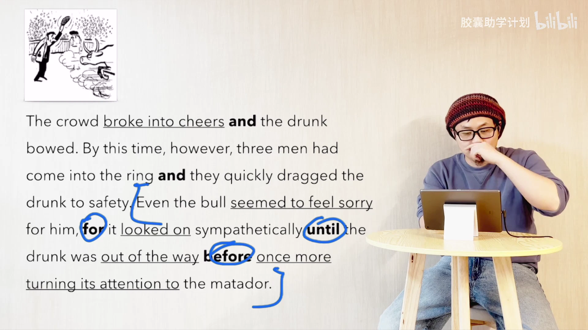

文字识别：胶囊助学计划bilbi / The crowd broke into cheers and the drunk / bowed. By this time, however, three men had / come into the ring and they quickly dragged the / drunk to safety,Even the bull seemed to feel sorry / for him, / for / it looked on sympathetically / untilthe / drunk was out of the way / keforeonce more / turning its attention to the matador.

## 00:16:30–00:17:00

事情或者某个人身上，那这里用的是再一次 turning his attention，就是这个公牛转移他的注意力到了这个斗牛士的身上。OK，好，那本文我们就讲完了。本文啊，它难难在就是说，如果说简单简单在语法上啊，语法我觉得不是很难，它难难在哪儿呢？难难在习惯用法和单词实在是太多了，

### 画面 00:16:43

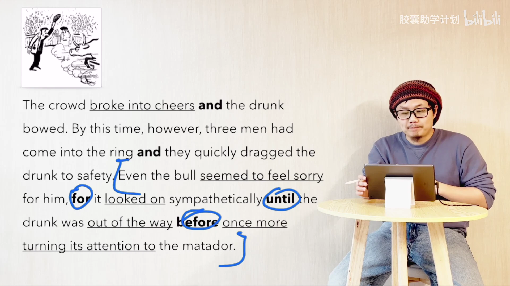

文字识别：胶囊助学计划bii / The crowd broke into cheers and the drunk / bowed. By this time, however, three men had / come into the ring and they quickly dragged the / drunk to safety,Even the bull seemed to feel sorry / for him, / foy / it looked on sympathetically / untilthe / drunk was out of the way / keforeonce more / turning its attention to the matador.

### 画面 00:16:45

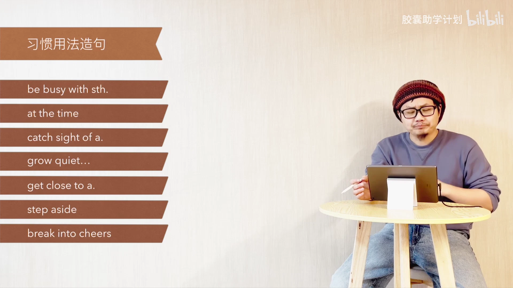

文字识别：bilbili / 胶囊助学计划 / 习惯用法造句 / be busy with sth. / at the / time / catch /  sight of a. / grow quiet... / get close to a. / step aside / break into cheers

### 画面 00:16:47

文字识别：biibili / 胶囊助学计划 / 习惯用法造句 / be busy with sth. / at the / time / catch / sight of a. / growc / quiet... / get close to a. / step aside / break into cheers

### 画面 00:16:49

文字识别：bilibii / 胶囊助学计划 / 习惯用法造句 / be busy with sth. / at the / time / catch / sight of a. / grow quiet... / get close to a. / step aside / break into cheers

### 画面 00:16:51

文字识别：bibii / 胶囊助学计划 / 习惯用法造句 / be busy with sth. / at the / time / catch /  sight of a. / grow quiet... / get close to a. / step aside / break into cheers

### 画面 00:16:53

文字识别：bilibili / 胶囊助学计划 / 习惯用法造句 / be busy with sth. / at the / time / catch /  sight of a. / grow quiet... / get close to a. / step aside / break into cheers

### 画面 00:16:55

文字识别：bibii / 胶囊助学计划 / 习惯用法造句 / be busy with sth. / at the / time / catch / sight of a. / grow / quiet... / get close to a. / step aside / break into cheers

### 画面 00:16:57

文字识别：bibii / 胶囊助学计划 / 习惯用法造句 / be busy with sth. / at the / time / catch / sight of a. / grow / quiet... / get close t / to a. / step aside / break into cheers

### 画面 00:16:59

文字识别：bilbili / 胶囊助学计划 / 习惯用法造句 / be busy with sth. / at the / time / catch / sight of a. / grow quiet... / get close to a. / step aside / break into cheers

## 00:17:00–00:17:30

有一些我们好猜，有一些我们不好猜。所以接下来这两页的习惯用法，您一定要注意力集中，我们挨个看一看，好吧？好，然后最好的是我讲完这些习惯用法，您甚至造完句了，你回去再看一遍文章，你就能理解我说的这个文章简单是什么一个意思了，对吧？就它难难在哪儿，简单简单在哪儿啊？首先 be busy with something 啊，呃，就忙于某事儿。那我们看吧，比如说 I have been so

### 画面 00:17:01

文字识别：biibili / 胶囊助学计划 / 习惯用法造句 / be busy with sth. / at the / time / catch sight of a. / grow quiet... / get close to a. / step aside / break into cheers

### 画面 00:17:03

文字识别：bilibii / 胶囊助学计划 / 习惯用法造句 / feel sorry for sb. / look on / out of the way / turn sb's attention to a. / once more

### 画面 00:17:05

文字识别：bilibii / 胶囊助学计划 / 习惯用法造句 / feel sorry for sb. / look on / out of the way / turn sb's attention to a. / once more

### 画面 00:17:07

文字识别：网：v.+v.变化 / 胶囊助学计划 / bilbili / 习惯用法造句指南 / 四句型转换 / 方式/地点/时间 / 其他习惯用法 / 其他单词+词性 / 原文摘抄+变 / 6123456 / be busy with sth.

### 画面 00:17:09

文字识别：bilibii / 网：v.+v.变化 / 胶囊助学计划 / 习惯用法造句指南 / 四句型转换 / 方式/地点/时间 / 其他习惯用法 / 其他单词+词性 / 原文摘抄+变 / 6123456 / be busy with sth.

### 画面 00:17:11

文字识别：网：v.+v.变化 / 胶囊助学计划 / bibili / 习惯用法造句指南 / 四句型转换 / 方式/地点/时间 / 其他习惯用法 / 其他单词+词性 / 原文摘抄+变 / 6123456 / be busy with sth.

### 画面 00:17:16

文字识别：网：v.+v.变化 / 胶囊助学计划 / bilbili / 习惯用法造句指南 / 四句型转换 / 方式/地点/时间 / 其他习惯用法 / 其他单词+词性 / 原文摘抄+变 / 6123456 / be busy with sth.

### 画面 00:17:20

文字识别：网：v.+v.变化 / 胶囊助学计划 / biibili / 习惯用法造句指南 / 四句型转换 / 方式/地点/时间 / 其他习惯用法 / 其他单词+词性 / 原文摘抄+变 / 6123456 / be busy with sth.

### 画面 00:17:23

文字识别：网：v.+v.变化 / 胶囊助学计划 / bibili / 习惯用法造句指南 / 四句型转换 / 方式/地点/时间 / 其他习惯用法 / 其他单词+词性 / 原文摘抄+变 / 6123456 / be busy with sth.

### 画面 00:17:25

文字识别：网：v.+v.变化 / 胶囊助学计划 / biibii / 习惯用法造句指南 / 四句型转换 / 方式/地点/时间 / 其他习惯用法 / 其他单词+词性 / 原文摘抄+变 / 6123456 / be busy with sth.

## 00:17:30–00:18:00

busy, busy with school. 啊，最近一直在忙学校那些事儿，很简单一句话，但是用的是一个不是很简单的用法哟。现在完成时第二个用法，最近一直过去持续到现在，对吧？接下来下一个说 He was just busy, busy with his own life. 说他就是最近忙于他自己的生活呢，对吧？哎，忙于自己的事情呢。再

### 画面 00:17:31

文字识别：bilbili / 网：v.+v.变化 / 胶囊助学计划 / 习惯用法造句指南 / 四句型转换 / 方式/地点/时间 / 其他习惯用法 / 其他单词+词性 / 原文摘抄+变 / 6123456 / be busy with sth. / I have been so busy with school.

### 画面 00:17:35

文字识别：bibili / 网：v.+v.变化 / 胶囊助学计划 / 习惯用法造句指南 / 四句型转换 / 方式/地点/时间 / 其他习惯用法 / 其他单词+词性 / 原文摘抄+变 / 6123456 / be busy with sth. / I have been so busy with school.

### 画面 00:17:37

文字识别：bilbii / 网：v.+v.变化 / 胶囊助学计划 / 习惯用法造句指南 / 四句型转换 / 方式/地点/时间 / 其他习惯用法 / 其他单词+词性 / 原文摘抄+变 / 6123456 / be busy with sth. / I have been so busy with school.

### 画面 00:17:39

文字识别：bilbili / 网：v.+v.变化 / 胶囊助学计划 / 习惯用法造句指南 / 四句型转换 / 方式/地点/时间 / 其他习惯用法 / 其他单词+词性 / 原文摘抄+变 / 6123456 / be busy with sth. / I have been so busy with school.

### 画面 00:17:41

文字识别：bilbili / 网：v.+v.变化 / 胶囊助学计划 / 习惯用法造句指南 / 四句型转换 / 方式/地点/时间 / 其他习惯用法 / 其他单词+词性 / 原文摘抄+变 / 6123456 / be busy with sth. / I have been so busy with school.

### 画面 00:17:45

文字识别：bilibii / 网：v.+v.变化 / 胶囊助学计划 / 习惯用法造句指南 / 四句型转换 / 方式/地点/时间 / 其他习惯用法 / 其他单词+词性 / 原文摘抄+变 / 6123456 / be busy with sth. / I have been so busy with school.

### 画面 00:17:50

文字识别：网：v.+v.变化 / 胶囊助学计划 / biibii / 习惯用法造句指南 / 四句型转换 / 方式/地点/时间 / 其他习惯用法 / 其他单词+词性 / 原文摘抄+变 / 6123456 / be busy with sth. / I have been so busy with school. /  He was just busy with his own life.

### 画面 00:17:54

文字识别：网：v.+v.变化 / 胶囊助学计划 / bilbili / 习惯用法造句指南 / 四句型转换 / 方式/地点/时间 / 其他习惯用法 / 其他单词+词性 / 原文摘抄+变 / 6123456 / be busy with sth. / I have been so busy with school. /  He was just busy with his own life.

### 画面 00:17:57

文字识别：网：v.+v.变化 / 胶囊助学计划 / bilbili / 习惯用法造句指南 / 四句型转换 / 方式/地点/时间 / 其他习惯用法 / 其他单词+词性 / 原文摘抄+变 / 6123456 / be busy with sth. / I have been so busy with school. /  He was just busy with his own life.

### 画面 00:17:59

文字识别：网：v.+v.变化 / 胶囊助学计划 / blibili / 习惯用法造句指南 / 四句型转换 / 方式/地点/时间 / 其他习惯用法 / 其他单词+词性 / 原文摘抄+变 / 6123456 / be busy with sth. / I have been so busy with school. /  He was just busy with his own life. /  After he found that Leo was busy with his / work, he continued doing his own work. L69

## 00:18:00–00:18:30

来下一句话说，After he found，在他注意到发现了什么呢？Leo was busy with his work. He continued doing his own work.说，在他注意到说Leo正在忙于他自己的工作的时候呢，那他继续去做了他自己的工作，对吧？Leo在忙自己的事儿，那得了，那我先忙自己的事儿吧。OK，好，这里用了一个小的习惯用法，continue doing something. Next one.

### 画面 00:18:11

文字识别：网：v.+v.变化 / 胶囊助学计划 / bilbili / 习惯用法造句指南 / 四句型转换 / 方式/地点/时间 / 其他习惯用法 / 其他单词+词性 / 原文摘抄+变 / 6123456 / be busy with sth. / I have been so busy with school. /  He was just busy with his own life. /  After he found that Leo was busy with his / work, he continued doing his own work. L69

### 画面 00:18:14

文字识别：网：v.+v.变化 / 胶囊助学计划 / bilbili / 习惯用法造句指南 / 四句型转换 / 方式/地点/时间 / 其他习惯用法 / 其他单词+词性 / 原文摘抄+变 / 6123456 / be busy with sth. / I have been so busy with school. /  He was just busy with his own life. /  After he found that Leo was busy with his / work, he continued doing his own work. L69

### 画面 00:18:16

文字识别：网：v.+v.变化 / 胶囊助学计划 / blbli / 习惯用法造句指南 / 四句型转换 / 方式/地点/时间 / 其他习惯用法 / 其他单词+词性 / 原文摘抄+变 / 6123456 / be busy with sth. / I have been so busy with school. /  He was just busy with his own life. /  After he found that Leo was busy with his / work, he continued doing his own work. L69

### 画面 00:18:20

文字识别：网：v.+v.变化 / 胶囊助学计划 / bibili / 习惯用法造句指南 / 四句型转换 / 方式/地点/时间 / 其他习惯用法 / 其他单词+词性 / 原文摘抄+变 / 6123456 / be busy with sth. / I have been so busy with school. /  He was just busy with his own life. /  After he found that Leo was busy with his / work, he continued doing his own work. L69

### 画面 00:18:28

文字识别：biibili / 胶囊助学计划 / What have you been so busy with? / Rumble Fish / (1983)

## 00:18:30–00:19:00

那我们注意力集中听一个小的电影片段，也不是很困难啊。 What have you been so busy with? 哎，最近一直忙啥呢？ At the time, at the time就是指的是在那时，当时，当一定是过去的。 At the time啊，就类似于at that time. Okay, 比如说 he was out of town at the time. 哎，在那

### 画面 00:18:35

文字识别：biibili / 胶囊助学计划 / What have you been so busy with? / Rumble Fish / (1983)

### 画面 00:18:37

文字识别：biibili / 胶囊助学计划 / What have you been so busy with? / Rumble Fish / (1983)

### 画面 00:18:40

文字识别：网：v.+v.变化 / 胶囊助学计划 / bilibili / 习惯用法造句指南 / 四句型转换 / 方式/地点/时间 / 其他习惯用法 / 其他单词+词性 / 原文摘抄+变 / 6123456 / at the time

### 画面 00:18:44

文字识别：网：v.+v.变化 / 胶囊助学计划 / bibili / 习惯用法造句指南 / 四句型转换 / 方式/地点/时间 / 其他习惯用法 / 其他单词+词性 / 原文摘抄+变 / 6123456 / at the time

### 画面 00:18:46

文字识别：biltbili / 网：v.+v.变化 / 胶囊助学计划 / 习惯用法造句指南 / 四句型转换 / 方式/地点/时间 / 其他习惯用法 / 其他单词+词性 / 原文摘抄+变 / 6123456 / at the time

### 画面 00:18:49

文字识别：网：v.+v.变化 / 胶囊助学计划 / biibili / 习惯用法造句指南 / 四句型转换 / 方式/地点/时间 / 其他习惯用法 / 其他单词+词性 / 原文摘抄+变 / 6123456 / at the time

### 画面 00:18:57

文字识别：biibii / 网：v.+v.变化 / 胶囊助学计划 / 习惯用法造句指南 / 四句型转换 / 方式/地点/时间 / 其他习惯用法 / 其他单词+词性 / 原文摘抄+变 / 6123456 / atthe time /  He was out of town at the time.

## 00:19:00–00:19:30

个时候呢，在当时呢，他正好没有在镇上，他出去了。Next one, I tried to write you a letter at the time.说，我当时尝试着给你写了一封信。Okay,再来说at the time时间最前最后对吧？哎，六一二三四五六最前最后。I didn't know why I needed to see Leo so badly.说，在那个时候，其实我并不知道为什么我

### 画面 00:19:00

文字识别：bibili / 网：v.+v.变化 / 胶囊助学计划 / 习惯用法造句指南 / 四句型转换 / 方式/地点/时间 / 其他习惯用法 / 其他单词+词性 / 原文摘抄+变 / 6123456 / at the time /  He was out of town at the time.

### 画面 00:19:05

文字识别：bilbili / 网：v.+v.变化 / 胶囊助学计划 / 习惯用法造句指南 / 四句型转换 / 方式/地点/时间 / 其他习惯用法 / 其他单词+词性 / 原文摘抄+变 / 6123456 / at the time /  He was out of town at the time. /  I tried to write you a letter at the time.

### 画面 00:19:10

文字识别：bibii / 网：v.+v.变化 / 胶囊助学计划 / 习惯用法造句指南 / 四句型转换 / 方式/地点/时间 / 其他习惯用法 / 其他单词+词性 / 原文摘抄+变 / 6123456 / at the time /  He was out of town at the time. /  I tried to write you a letter at the time.

### 画面 00:19:15

文字识别：网：v.+v.变化 / 胶囊助学计划 / bilbii / 习惯用法造句指南 / 四句型转换 / 方式/地点/时间 / 其他习惯用法 / 其他单词+词性 / 原文摘抄+变 / 6123456 / atthe time /  He was out of town at the time. /  I tried to write you a letter at the time. /  At the time, I didn't know why I needed to / see Leo so badly. L39

### 画面 00:19:18

文字识别：网：v.+v.变化 / 胶囊助学计划 / bilbii / 习惯用法造句指南 / 四句型转换 / 方式/地点/时间 / 其他习惯用法 / 其他单词+词性 / 原文摘抄+变 / 6123456 / atthe time /  He was out of town at the time. /  I tried to write you a letter at the time. /  At the time, I didn't know why I needed to / see Leo so badly. L39

### 画面 00:19:20

文字识别：网：v.+v.变化 / 胶囊助学计划 / blbili / 习惯用法造句指南 / 四句型转换 / 方式/地点/时间 / 其他习惯用法 / 其他单词+词性 / 原文摘抄+变 / 6123456 / at the time /  He was out of town at the time. /  I tried to write you a letter at the time. /  At the time, I didn't know why I needed to / see Leo so badly. L39

### 画面 00:19:24

文字识别：网：v.+v.变化 / 胶囊助学计划 / bilibili / 习惯用法造句指南 / 四句型转换 / 方式/地点/时间 / 其他习惯用法 / 其他单词+词性 / 原文摘抄+变 / 6123456 / at the time /  He was out of town at the time. /  I tried to write you a letter at the time. /  At the time, I didn't know why I needed to / see Leo so badly. L39

## 00:19:30–00:20:00

特别想见 Leo，但后来我知道，对吧？OK. Next one, 下一个叫做 catch sight of a, 我 catch sight of something, somebody 都可以。那什么意思呢？其实两个都行。第一个叫做突然间注意到，第二个叫做 glimpse for a moment，还有叫做哎瞥了一下，瞥了一下，对吧？就是这样一个意思。比如我们造一句话，I have been here for hours，

### 画面 00:19:34

文字识别：网：v.+v.变化 / glimpse for a moment; / 胶囊助学计划 / bibili / 习惯用法造句指南 / 四句型转换 / suddenly notice. / 方式/地点/时间 / 其他习惯用法 / 其他单词+词性 / 原文摘抄+变 / 6123456 / catch sight of a.

### 画面 00:19:40

文字识别：bilbili / 网：v.+v.变化 / glimpse for a moment; / 胶囊助学计划 / 习惯用法造句指南 / 四句型转换 / suddenly notice. / 方式/地点/时间 / 其他习惯用法 / 其他单词+词性 / 原文摘抄+变 / 6123456 / catch sight of a.

### 画面 00:19:44

文字识别：biibii / 网：v.+v.变化 / glimpse for a moment; / 胶囊助学计划 / 习惯用法造句指南 / 四句型转换 / suddenly notice. / 方式/地点/时间 / 其他习惯用法 / 其他单词+词性 / 原文摘抄+变 / 6123456 / catch sight of a.

### 画面 00:19:46

文字识别：bibili / 网：v.+v.变化 / glimpse for a moment; / 胶囊助学计划 / 习惯用法造句指南 / 四句型转换 / suddenly notice. / 方式/地点/时间 / 其他习惯用法 / 其他单词+词性 / 原文摘抄+变 / 6123456 / catch sight of a.

### 画面 00:19:53

文字识别：bibili / 网：v.+v.变化 / glimpse for a moment; / 胶囊助学计划 / 习惯用法造句指南 / 四句型转换 / suddenly notice. / 方式/地点/时间 / 其他习惯用法 / 其他单词+词性 / 原文摘抄+变 / 6123456 / catch sight of a.

### 画面 00:19:57

文字识别：网：v.+v.变化 / glimpse for a moment; / 胶囊助学计划 / bibili / 习惯用法造句指南 / 四句型转换 / suddenly notice. / 方式/地点/时间 / 其他习惯用法 / 其他单词+词性 / 原文摘抄+变 / 6123456 / catch sight of a. / I have been here for hours so that I can / catch sight of her. L59

## 00:20:00–00:20:30

我已经在这儿待了几个小时了。目的就是为了能看她一眼呢。Catch, catch sight of her,对吧？哎，就是为了能瞥她一眼。那When she caught sight of him, she smiled.说当她注意到他的时候，当他瞥到他的时候，她笑了。这名女士啊，再来说I caught sight of her in the crowd last night.哎，

### 画面 00:20:01

文字识别：网：v.+v.变化 / glimpse for a moment; / 胶囊助学计划 / blibili / 习惯用法造句指南 / 四句型转换 / suddenly notice. / 方式/地点/时间 / 其他习惯用法 / 其他单词+词性 / 原文摘抄+变 / 6123456 / catch sight of a. / I have been here for hours so that I can / catch sight of her. L59

### 画面 00:20:03

文字识别：网：v.+v.变化 / glimpse for a moment; / 胶囊助学计划 / blibili / 习惯用法造句指南 / 四句型转换 / suddenly notice. / 方式/地点/时间 / 其他习惯用法 / 其他单词+词性 / 原文摘抄+变 / 6123456 / catch sight of a. / I have been here for hours so that I can / catch sight of her. L59

### 画面 00:20:05

文字识别：网：v.+v.变化 / glimpse for a moment; / 胶囊助学计划 / bilbili / 习惯用法造句指南 / 四句型转换 / suddenly notice. / 方式/地点/时间 / 其他习惯用法 / 其他单词+词性 / 原文摘抄+变 / 6123456 / catch sight of a. / I have been here for hours so that I can / catch sight of her. L59

### 画面 00:20:11

文字识别：网：v.+v.变化 / glimpse for a moment; / 胶囊助学计划 / bibili / 习惯用法造句指南 / 四句型转换 / suddenly notice. / 方式/地点/时间 / 其他习惯用法 / 其他单词+词性 / 原文摘抄+变 / 6123456 / catch sight of a. / I have been here for hours so that I can / catch sight of her. L59 /  When she caught sight of him, she smiled.

### 画面 00:20:15

文字识别：网：v.+v.变化 / glimpse for a moment; / 胶囊助学计划 / bilbii / 习惯用法造句指南 / 四句型转换 / suddenly notice. / 方式/地点/时间 / 其他习惯用法 / 其他单词+词性 / 原文摘抄+变 / 6123456 / catch sight of a. / I have been here for hours so that I can / catch sight of her. L59 /  When she caught sight of him, she smiled.

### 画面 00:20:23

文字识别：网：v.+v.变化 / glimpse for a moment; / 胶囊助学计划 / bilbli / 习惯用法造句指南 / 四句型转换 / suddenly notice. / 方式/地点/时间 / 其他习惯用法 / 其他单词+词性 / 原文摘抄+变 / 6123456 / catch sight of a. / I have been here for hours so that I can / catch sight of her. L59 /  When she caught sight of him, she smiled. / I caught sight of her in the crowd last / night. did/who/where/when...

### 画面 00:20:25

文字识别：网：v.+v.变化 / glimpse for a moment; / 胶囊助学计划 / bibili / 习惯用法造句指南 / 四句型转换 / suddenly notice. / 方式/地点/时间 / 其他习惯用法 / 其他单词+词性 / 原文摘抄+变 / 6123456 / catch sight of a. / I have been here for hours so that I can / catch sight of her. L59 /  When she caught sight of him, she smiled. / I caught sight of her in the crowd last / night. did/who/where/when...

### 画面 00:20:28

文字识别：网：v.+v.变化 / glimpse for a moment; / 胶囊助学计划 / bibili / 习惯用法造句指南 / 四句型转换 / suddenly notice. / 方式/地点/时间 / 其他习惯用法 / 其他单词+词性 / 原文摘抄+变 / 6123456 / catch sight of a. / I have been here for hours so that I can / catch sight of her. L59 /  When she caught sight of him, she smiled. / I caught sight of her in the crowd last / night. did/who/where/when...

## 00:20:30–00:21:00

昨天我在人群当中突然就注意到他在哪里了。哎，再来四句型转换。哎，catch, catch sight of something somebody.那注意力集中吧，咱们听听这句话。I was on my way home, but then I caught sight of you outside the concert hall.哎，我在回家的路上突然间就注意到你了，对吧？Okay. Next one. Grow quiet.注

### 画面 00:20:31

文字识别：网：v.+v.变化 / glimpse for a moment; / 胶囊助学计划 / bibli / 习惯用法造句指南 / 四句型转换 / suddenly notice. / 方式/地点/时间 / 其他习惯用法 / 其他单词+词性 / 原文摘抄+变 / 6123456 / catch sight of a. / I have been here for hours so that I can / catch sight of her. L59 /  When she caught sight of him, she smiled. /  I caught sight of her in the crowd last / night. did/who/where/when...

### 画面 00:20:34

文字识别：网：v.+v.变化 / glimpse for a moment; / 胶囊助学计划 / bilibili / 习惯 / 四句型转换 / suddenly notice. / 用 / 方式/地点/时间 / 法 / 么造句指南 / 其他习惯用法 / 其他单词+词性 / 原文摘抄+变 / 6123456 / catch sight of a. / I have been here for hours so that I can / catch sight of her. L59 /  When she caught sight of him, she smiled. / I caught sight of her in the crowd last / night. did/who/where/when..

### 画面 00:20:36

文字识别：网：v.+v.变化 / glimpse for a moment; / 胶囊助学计划 / bilbili / 习惯 / 四句型转换 / suddenly notice. / 用法 / 方式/地点/时间 / 么造句指南 / 其他习惯用法 / 其他单词+词性 / 原文摘抄+变 / 6123456 / catch sight of a. / I have been here for hours so that I can / catch sight of her. L59 /  When she caught sight of him, she smiled. / I caught sight of her in the crowd last / night. did/who/where/when...

### 画面 00:20:41

文字识别：bilbili / 胶囊助学计划 / I was on my way home, but then / I caught sight of you outside the concert hall. / Intrigo: Death of an Author / (2018)

### 画面 00:20:47

文字识别：bilbili / 胶囊助学计划 / I was on my way home, but then / I caught sight of you outside the concert hall. / Intrigo: Death of an Author / (2018)

### 画面 00:20:55

文字识别：网：v.+v.变化 / /grau/ /grui/ /graun/ / 胶囊助学计划 / bilbii / 习惯用法造句指南 / grow grew grown / 四句型转换 / 方式/地点/时间 / 其他习惯用法 / 其他单词+词性 / 原文摘抄+变 / 6123456 / grow quiet/...

### 画面 00:20:58

文字识别：网：v.+v.变化 / /grau/ /gru:/ /graun/ / 胶囊助学计划 / bilibii / 习惯用法造句指南 / grow grew grown / 四句型转换 / 方式/地点/时间 / 其他习惯用法 / 其他单词+词性 / 原文摘抄+变 / 6123456 / grow quiet/...

## 00:21:00–00:21:30

意它的这个读音啊，这个读音说实话，其实有的时候我自己有的时候要是拿不准或者没仔细想，都会卡一下子壳。 Grow, grow, growing, 对吧？ Grow, grow, growing. OK. 好，那 grow quiet. 其实它后边主要加的就是一些形容词啊，就是一些形容词啊。这个写的不太好，再写一遍。主要就是加的一些形容词，比如说

### 画面 00:21:00

文字识别：网：v.+v.变化 / /grau/ /grui/ /graun/ / 胶囊助学计划 / bilibii / 习惯用法造句指南 / grow grew grown / 四句型转换 / 方式/地点/时间 / 其他习惯用法 / 其他单词+词性 / 原文摘抄+变 / 6123456 / grow quiet/...

### 画面 00:21:02

文字识别：网：v.+v.变化 / /grau/ /grui/ /graun/ / 胶囊助学计划 / biibii / 习惯用法造句指南 / grow grew grown / 四句型转换 / 方式/地点/时间 / 其他习惯用法 / 其他单词+词性 / 原文摘抄+变 / 6123456 / grow quiet/...

### 画面 00:21:06

文字识别：网：v.+v.变化 / /grau/ /grui/ /graun/ / 胶囊助学计划 / biibii / 习惯用法造句指南 / grow grew grown / 四句型转换 / 方式/地点/时间 / 其他习惯用法 / 其他单词+词性 / 原文摘抄+变 / 6123456 / grow quiet/...

### 画面 00:21:09

文字识别：网：v.+v.变化 / /grau/ /grui/ /graun/ / 胶囊助学计划 / bibii / 习惯用法造句指南 / grow grew grown / 四句型转换 / 方式/地点/时间 / 其他习惯用法 / 其他单词+词性 / 原文摘抄+变 / 6123456 / grow quiet/...

### 画面 00:21:11

文字识别：网：v.+v.变化 / /grau/ / /grui/ / /graun/ / 胶囊助学计划 / bibili / 习惯用法造句指南 / grow9 / grew / grown / 四句型转换 / 方式/地点/时间 / 其他习惯用法 / 其他单词+词性 / 原文摘抄+变 / 6123456 / grow quiet/...

### 画面 00:21:15

文字识别：网：v.+v.变化 / /graul / /grui/ / /ｇraun/ / 胶囊助学计划 / biibii / 习惯用法造句指南 / grow / grew / grown / 四句型转换 / 方式/地点/时间 / 其他习惯用法 / 其他单词+词性 / 原文摘抄+变 / 6123456 / grow quiet/...

### 画面 00:21:20

文字识别：网：v.+v.变化 / /graul / /gru:/ / /ｇraun/ / 胶囊助学计划 / bilbii / 习惯用法造句指南 / grow / grew / grown / 四句型转换 / 方式/地点/时间 / 其他习惯用法 / 其他单词+词性 / 原文摘抄+变 / 6123456 / grow quiet/..

### 画面 00:21:24

文字识别：网：v.+v.变化 / /grau/ / /grui/ / /graunl / 胶囊助学计划 / biibii / 习惯用法造句指南 / grow / grew / grown / 四句型转换 / 方式/地点/时间 / 其他习惯用法 / 其他单词+词性 / 原文摘抄+变 / 6123456 / grow quiet/...

### 画面 00:21:26

文字识别：网：v.+v.变化 / /graul / /gru:/ / /graun/ / 胶囊助学计划 / biibii / 习惯用法造句指南 / grow / grew / grown / 四句型转换 / 方式/地点/时间 / 其他习惯用法 / 其他单词+词性 / 原文摘抄+变 / 6123456 / grow quiet/...

### 画面 00:21:28

文字识别：网：v.+v.变化 / /graul / /gru:/ / /ｇｒaun/ / 胶囊助学计划 / bilibili / 习惯用法造句指南 / grow / grew / grown / 四句型转换 / 方式/地点/时间 / 其他习惯用法 / 其他单词+词性 / 原文摘抄+变 / 6123456 / grow / quiet/..

## 00:21:30–00:22:00

grow quiet 就是变得安静了。那我可以说变得安静了，我就可以说变得紧张了。比如说 they grew nervous for 因为什么什么样的原因，您把这个记得补全，好吧？好，再来说 it began to grow dark，开始变黑了。那这个 it 指的是什么？一般指的就是天，是吧？说 as it grew dark they set up the

### 画面 00:21:30

文字识别：网：v.+v.变化 / /graul / /gru:/ / graun/ / 胶囊助学计划 / biibii / 习惯用法造句指南 / grow / grew / grown / 四句型转换 / 方式/地点/时间 / 其他习惯用法 / 其他单词+词性 / 原文摘抄+变 / 6123456 / grow / quiet/..

### 画面 00:21:35

文字识别：网：v.+v.变化 / /graul / /grui/ / graun/ / 胶囊助学计划 / biibii / 习惯用法造句指南 / grow / grew / grown / 四句型转换 / 方式/地点/时间 / 其他习惯用法 / 其他单词+词性 / 原文摘抄+变 / 6123456 / grow / quiet/.. / They / grew nervous, for ...

### 画面 00:21:40

文字识别：网：v.+v.变化 / /graul / /grui/ / graun/ / 胶囊助学计划 / biibii / 习惯用法造句指南 / grow / grew / grown / 四句型转换 / 方式/地点/时间 / 其他习惯用法 / 其他单词+词性 / 原文摘抄+变 / 6123456 / grow / quiet/.. / ■They / grew nervous, for ...

### 画面 00:21:43

文字识别：网：v.+v.变化 / /graul / /gru:/ / graun/ / 胶囊助学计划 / biibii / 习惯用法造句指南 / grow / grew / grown / 四句型转换 / 方式/地点/时间 / 其他习惯用法 / 其他单词+词性 / 原文摘抄+变 / 6123456 / grow / quiet/.. / ■They / grew nervous, for

### 画面 00:21:45

文字识别：网：v.+v.变化 / /graul / /gru:/ / graun/ / 胶囊助学计划 / bilbili / 习惯用法造句指南 / grow / grew / grown / 四句型转换 / 方式/地点/时间 / 其他习惯用法 / 其他单词+词性 / 原文摘抄+变 / 6123456 / grow / quiet/.. / ■They / grew nervous, for / It began to grow dark.

### 画面 00:21:50

文字识别：网：v.+v.变化 / /graul / /gru:/ / lgraunl / 胶囊助学计划 / bibili / 习惯用法造句指南 / grow / grew / grown / 四句型转换 / 方式/地点/时间 / 其他习惯用法 / 其他单词+词性 / 原文摘抄+变 / 6123456 / grow / quiet/.. / ■They / grew nervous, for / It began to grow dark.

### 画面 00:21:52

文字识别：网：v.+v.变化 / /graul / /gru:l / lgraun/ / 胶囊助学计划 / bilbili / 习惯用法造句指南 / grow / grew / grown / 四句型转换 / 方式/地点/时间 / 其他习惯用法 / 其他单词+词性 / 原文摘抄+变 / 6123456 / grow quiet/.. / ■They / grew nervous, for / It began to grow dark. /  As it grew dark, they set up the camp. L67

### 画面 00:21:54

文字识别：网：v.+v.变化 / /graul / /gru:/ / lgraunl / 胶囊助学计划 / bibili / 习惯用法造句指南 / grow / grew / grown / 四句型转换 / 方式/地点/时间 / 其他习惯用法 / 其他单词+词性 / 原文摘抄+变 / 6123456 / a / grow / quiet/.. / ■They / grew nervous, for /  It began to g / grow dark. / As it grew /  dark, they set up the camp. L67

### 画面 00:21:56

文字识别：网：v.+v.变化 / /graul / /gru:/ / /graun/ / 胶囊助学计划 / bibili / 习惯用法造句指南 / grow / grew / grown / 四句型转换 / 方式/地点/时间 / 其他习惯用法 / 其他单词+词性 / 原文摘抄+变 / 6123456 / grow quiet/.. / ■They / grew nervous, for / It began to grow dark. /  As it grew dark, they set up the camp. L67

### 画面 00:21:58

文字识别：网：v.+v.变化 / /graul / /gru:/ / lｇraun/ / 胶囊助学计划 / bilbili / 习惯用法造句指南 / grow / grew / grown / 四句型转换 / 方式/地点/时间 / 其他习惯用法 / 其他单词+词性 / 原文摘抄+变 / 6123456 / grow quiet/.. / ■They / grew nervous, for / It began to grow dark. /  As it grew dark, they set up the camp. L67

## 00:22:00–00:22:30

camp. Ah, here used a previous learned habit usage, right? Build up their camp, right? Say, with the sky darkening, they build up their camp. Very good. I want to grow old with him. I love him. Hey, I want to grow old with him. I want to grow old with him. I want to grow old with him. I want to grow old with him. I want to grow old with him. I want to grow old with him. I want to grow old with him.

### 画面 00:22:01

文字识别：网：v.+v.变化 / /grau/ / /gru:/ / lｇraun/ / 胶囊助学计划 / biibii / 习惯用法造句指南 / grow / grew / grown / 四句型转换 / 方式/地点/时间 / 其他习惯用法 / 其他单词+词性 / 原文摘抄+变 / 6123456 / grow quiet/.. / ■They / grew nervous, for / It began to grow dark. /  As it grew dark, they set up the camp. L67

### 画面 00:22:05

文字识别：网：v.+v.变化 / /graul / /gru:/ / graun/ / 胶囊助学计划 / bibili / 习惯用法造句指南 / grow / grew / grown / 四句型转换 / 方式/地点/时间 / 其他习惯用法 / 其他单词+词性 / 原文摘抄+变 / 6123456 / a / grow quiet/.. / ■They / grew nervous, for /  It began'to / grow dark. / ■As it grew  /  dark, they set up the camp. L67

### 画面 00:22:10

文字识别：网：v.+v.变化 / /graul / /gru:/ / /graun/ / 胶囊助学计划 / bilibii / 习惯用法造句指南 / grow / grew / grown / 四句型转换 / 方式/地点/时间 / 其他习惯用法 / 其他单词+词性 / 原文摘抄+变 / 6123456 / grow quiet/.. / ■They / grew nervous, for /  It began'to / grow dark. /  As it grew dark, they set up the camp. L67

### 画面 00:22:17

文字识别：网：v.+v.变化 / /graul / /gru:l / lgraun/ / 胶囊助学计划 / bilbili / 习惯用法造句指南 / grow / grew / grown / 四句型转换 / 方式/地点/时间 / 其他习惯用法 / 其他单词+词性 / 原文摘抄+变 / 6123456 / a / grow quiet/.. / ■They / grew nervous, for /  It began'to g / grow dark. /  As it grew  /  dark, they set up the camp. L67 / I want to grow old / with / him.Ilove him.

### 画面 00:22:20

文字识别：网：v.+v.变化 / /grau/ / /gru:/ / lgraun/ / 胶囊助学计划 / bilbili / 习惯用法造句指南 / grow / grew / grown / 四句型转换 / 方式/地点/时间 / 其他习惯用法 / 其他单词+词性 / 原文摘抄+变 / 6123456 / grow quiet/.. / ■They / grew nervous, for / It began'to grow dark. / As it grew  / dark, they s / 'set up the camp. L67 / I want to grow old / with / him.llove / e him.

### 画面 00:22:24

文字识别：网：v.+v.变化 / /grau/ / /gru:/ / lgraun/ / 胶囊助学计划 / bilbili / 习惯用法造句指南 / grow / grew / grown / 四句型转换 / 方式/地点/时间 / 其他习惯用法 / 其他单词+词性 / 原文摘抄+变 / 6123456 / a / grow / quiet/.. / ■They / grew nervous, for / It began'to g / grow dark. / ■As it grew  / dark, they set up the camp. L67 / I want to grow old / with / him.Ilove him.

### 画面 00:22:26

文字识别：网：v.+v.变化 / /graul / /gru:/ / /graun/ / 胶囊助学计划 / bilbili / 习惯用法造句指南 / grow / grew / grown / 四句型转换 / 方式/地点/时间 / 其他习惯用法 / 其他单词+词性 / 原文摘抄+变 / 6123456 / quiet.f / ad / grow / ■They / grew nervous, for /  It began'to  / grow dark. / ■ As it grew / dark, theys / set up the camp. L67 / I want to grow old / with / him.Ilove him.

### 画面 00:22:28

文字识别：习惯用法造句指南 / 网：v.+v.变化 / /graul / /grui/ / /graun/ / 胶囊助学计划 / bibili / grow / grew / grown / 四句型转换 / 方式/地点/时间 / 其他习惯用法 / 其他单词+词性 / 原文摘抄+变 / 6123456 / quiet.f / a / grow / ■They / grew nervous, for /  It began'to g / grow dark. / ■As it grew / dark, they s / 'set up the camp. L67 / I want to grow old / with / him.Ilove him.

## 00:22:30–00:23:00

啊？那这是一个电影台词啊。那接下来呢，我们听一个小的电影片段，注意力集中听一下。You will never grow old and he will never die. Very good. Next one, get close to A，接近A，靠近A。比如说，It's not a good idea to get close to me。你现在接近我可不是一个好主意哦，啊，可不是一个好的想法哟。Next one，

### 画面 00:22:30

文字识别：网：v.+v.变化 / /grau/ / /gru:/ / /graunl / 胶囊助学计划 / bibili / 习惯用法造句指南 / grow / grew / grown / 四句型转换 / 方式/地点/时间 / 其他习惯用法 / 其他单词+词性 / 原文摘抄+变 / 6123456 / quiet.f / a / grow / ■They / grew nervous, for /  It began'to / grow dark. / As it grew / dark, they set up the camp. L67 / I want to / grow old / with / him.llove / him. / The Two Worlds of Jennie Logan (1979)

### 画面 00:22:32

文字识别：bilbili / 胶囊助学计划 / He will never grow old...and he will never die. / Prometheus / (2012)

### 画面 00:22:39

文字识别：bilbili / 胶囊助学计划 / He will never grow old.and he will never die. / Prometheus / (2012)

### 画面 00:22:43

文字识别：网：v.+v.变化 / 胶囊助学计划 / bilibii / 习惯用法造句指南 / 四句型转换 / 方式/地点/时间 / 其他习惯用法 / 其他单词+词性 / 原文摘抄+变 / 6123456 / get close to a.

### 画面 00:22:45

文字识别：网：v.+v.变化 / 胶囊助学计划 / bibii / 习惯用法造句指南 / 四句型转换 / 方式/地点/时间 / 其他习惯用法 / 其他单词+词性 / 原文摘抄+变 / 6123456 / get close to a.

### 画面 00:22:50

文字识别：bibii / 网：v.+v.变化 / 胶囊助学计划 / 习惯用法造句指南 / 四句型转换 / 方式/地点/时间 / 其他习惯用法 / 其他单词+词性 / 原文摘抄+变 / 6123456 / get close to a. /  It's not a good idea to get close to me.

### 画面 00:22:56

文字识别：bilbili / 网：v.+v.变化 / 胶囊助学计划 / 习惯用法造句指南 / 四句型转换 / 方式/地点/时间 / 其他习惯用法 / 其他单词+词性 / 原文摘抄+变 / 6123456 / get close to a. /  It's not a good idea to get close to me.

## 00:23:00–00:23:30

so you really shouldn't get so close to me. 哎，你真不应该离我这么近。 Okay, next one. So if you had known what would happen to you when you get too close to me, you wouldn't have done that. 说如果你当时知道，如果你离我太近会发生什么，当你离我太近的时候，你会发生什么的时候，你不会当时这么做的，对吧？啊，我一个擒拿手，啊，一个巴西柔术，我就给你干地上，啊，大概是这样一种感觉。啊， get

### 画面 00:23:00

文字识别：网：v.+v.变化 / 胶囊助学计划 / bibili / 习惯用法造句指南 / 四句型转换 / 方式/地点/时间 / 其他习惯用法 / 其他单词+词性 / 原文摘抄+变 / 6123456 / get close to a. /  It's not a good idea to get close to me. / You really shouldn't get so close to me. / L65

### 画面 00:23:05

文字识别：网：v.+v.变化 / 胶囊助学计划 / bilbili / 习惯用法造句指南 / 四句型转换 / 方式/地点/时间 / 其他习惯用法 / 其他单词+词性 / 原文摘抄+变 / 6123456 / get close to a. /  It's not a good idea to get close to me. / You really shouldn't get so close to me. / L65 /  If you had known what would happen to / you, when you get too close to me, you / wouldn't have done that. L64

### 画面 00:23:08

文字识别：网：v.+v.变化 / 胶囊助学计划 / bilibili / 习惯用法造句指南 / 四句型转换 / 方式/地点/时间 / 其他习惯用法 / 其他单词+词性 / 原文摘抄+变 / 6123456 / get close to a. /  It's not a good idea to get close to me. / You really shouldn't get so close to me. / L65 /  If you had known what would happen to / you, when you get too close to me, you / wouldn't have done that. L64

### 画面 00:23:10

文字识别：网：v.+v.变化 / 胶囊助学计划 / biltbili / 习惯用法造句指南 / 四句型转换 / 方式/地点/时间 / 其他习惯用法 / 其他单词+词性 / 原文摘抄+变 / 6123456 / get close to a. /  It's not a good idea to get close to me. / You really shouldn't get so close to me. / L65 /  If you had known what would happen to / you, when you get too close to me, you / wouldn't have done that. L64

### 画面 00:23:20

文字识别：网：v.+v.变化 / 胶囊助学计划 / bibii / 习惯用法造句指南 / 四句型转换 / 方式/地点/时间 / 其他习惯用法 / 其他单词+词性 / 原文摘抄+变 / 6123456 / get close to a. /  It's not a good idea to get close to me. / You really shouldn't get so close to me. / L65 /  If you had known what would happen to / you, when you get too close to me, you / wouldn't have done that. L64

### 画面 00:23:25

文字识别：网：v.+v.变化 / 胶囊助学计划 / biibii / 习惯用法造句指南 / 四句型转换 / 方式/地点/时间 / 其他习惯用法 / 其他单词+词性 / 原文摘抄+变 / 6123456 / get close to a. /  It's not a good idea to get close to me. / You really shouldn't get so close to me. / L65 /  If you had known what would happen to / you, when you get too close to me, you / wouldn't have done that. L64

### 画面 00:23:28

文字识别：网：v.+v.变化 / 胶囊助学计划 / bilbli / 习惯用法造句指南 / 四句型转换 / 方式/地点/时间 / 其他习惯用法 / 其他单词+词性 / 原文摘抄+变 / 6123456 / get close to a. /  It's not a good idea to get close to me. / You really shouldn't get so close to me. / L65 /  If you had known what would happen to / you, when you get too close to me, you / wouldn't have done that. L64

## 00:23:30–00:24:00

close to somebody. Okay, next one, step aside. Step aside. Here, I必须要补充一点，因为它太常用了。我们原文给的含义叫withdraw，其实就是就是啊withdraw直直译理解为撤退、撤出，是吧？其实它你在这个地方原文的意思就是站到一一边，站到一旁，对吧？别挡道，step aside，对吧？Step

### 画面 00:23:31

文字识别：biibii / 网：v.+v.变化 / withdraw or resign / 胶囊助学计划 / 习惯用法造句指南 / 四句型转换 / from an important / position or office. / 方式/地点/时间 / 其他习惯用法 / 其他单词+词性 / 原文摘抄+变 / 6123456 / step aside

### 画面 00:23:34

文字识别：网：v.+v.变化 / withdraw or resign / 胶囊助学计划 / bilbili / 习惯用法造句指南 / 四句型转换 / from an important / position or office. / 方式/地点/时间 / 其他习惯用法 / 其他单词+词性 / 原文摘抄+变 / 6123456 / step aside

### 画面 00:23:36

文字识别：网：v.+v.变化 / withdraw or resign / 胶囊助学计划 / bibili / 习惯用法造句指南 / 四句型转换 / from an important / position or office. / 方式/地点/时间 / 其他习惯用法 / 其他单词+词性 / 原文摘抄+变 / 6123456 / step aside

### 画面 00:23:40

文字识别：biibii / 网：v.+v.变化 / withdraw or resign / 胶囊助学计划 / 习惯用法造句指南 / 四句型转换 / from an important / position or office. / 方式/地点/时间 / 其他习惯用法 / 其他单词+词性 / 原文摘抄+变 / 6123456 / step aside

### 画面 00:23:45

文字识别：biibii / 网：v.+v.变化 / withdraw or resign / 胶囊助学计划 / 习惯用法造句指南 / 四句型转换 / from an important / position or office. / 方式/地点/时间 / 其他习惯用法 / 其他单词+词性 / 原文摘抄+变 / 6123456 / step aside

### 画面 00:23:55

文字识别：bilbii / 网：v.+v.变化 / withdraw or resign / 胶囊助学计划 / 习惯用法造句指南 / 四句型转换 / from an important / position or office. / 方式/地点/时间 / 其他习惯用法 / 其他单词+词性 / 原文摘抄+变 / 6123456 / step aside

### 画面 00:23:58

文字识别：网：v.+v.变化 / withdraw or resign / 胶囊助学计划 / bibili / 习惯用法造句指南 / 四句型转换 / from an important / position or office. / 方式/地点/时间 / 其他习惯用法 / 其他单词+词性 / 原文摘抄+变 / 6123456 / step aside

## 00:24:00–00:24:30

aside,站到旁边去，往后退一步，别挡道。但是它还有一个很常用的另一个意思，叫做resign from an important position or office，就是从一个特别重要的职位上辞职，或者是怎么样的，或者是从一个特别重要的办公室职位上，其实就是职位啊，辞职重要的位置上下来。好，比如说我们看这句话叫You should

### 画面 00:24:00

文字识别：bibii / 网：v.+v.变化 / withdraw or resign / 胶囊助学计划 / 习惯用法造句指南 / 四句型转换 / from an important / position or office. / 方式/地点/时间 / 其他习惯用法 / 其他单词+词性 / 原文摘抄+变 / 6123456 / step aside

### 画面 00:24:07

文字识别：bilbii / 网：v.+v.变化 / withdraw or resign / 胶囊助学计划 / 习惯用法造句指南 / 四句型转换 / from an important / position or office. / 方式/地点/时间 / 其他习惯用法 / 其他单词+词性 / 原文摘抄+变 / 6123456 / step aside

### 画面 00:24:09

文字识别：网：v.+v.变化 / withdraw or resign / 胶囊助学计划 / bibii / 习惯用法造句指南 / 四句型转换 / from an important / position or office. / 方式/地点/时间 / 其他习惯用法 / 其他单词+词性 / 原文摘抄+变 / 6123456 / step aside

### 画面 00:24:11

文字识别：网：v.+v.变化 / withdraw or resign / 胶囊助学计划 / bibili / 习惯用法造句指南 / 四句型转换 / from an important / position or office. / 方式/地点/时间 / 其他习惯用法 / 其他单词+词性 / 原文摘抄+变 / 6123456 / step aside

### 画面 00:24:17

文字识别：网：v.+v.变化 / withdraw or resign / 胶囊助学计划 / bilbili / 习惯用法造句指南 / 四句型转换 / from an important / position or office. / 方式/地点/时间 / 其他习惯用法 / 其他单词+词性 / 原文摘抄+变 / 6123456 / step aside

### 画面 00:24:21

文字识别：网：v.+v.变化 / withdraw or resign / 胶囊助学计划 / bibili / 习惯用法造句指南 / 四句型转换 / from an important / position or office. / 方式/地点/时间 / 其他习惯用法 / 其他单词+词性 / 原文摘抄+变 / 6123456 / step aside

### 画面 00:24:24

文字识别：网：v.+v.变化 / withdraw or resign / 胶囊助学计划 / bibii / 习惯用法造句指南 / 四句型转换 / from an important / position or office. / 方式/地点/时间 / 其他习惯用法 / 其他单词+词性 / 原文摘抄+变 / 6123456 / step aside

### 画面 00:24:27

文字识别：biibili / 网：v.+v.变化 / withdraw or resign / 胶囊助学计划 / 习惯用法造句指南 / 四句型转换 / from an important / position or office. / 方式/地点/时间 / 其他习惯用法 / 其他单词+词性 / 原文摘抄+变 / 6123456 / step aside /  You should have stepped aside. L65

## 00:24:30–00:25:00

have stepped aside. 那其实你要结合上下文语境才能知道它具体指的是哪个含义。可以有两个含义，叫做我刚才让你从我面前消失、撤退，你不撤退，你把我惹急了，所以我说我给你，比如说揍了一顿。那你刚才就应该站到一边去的，对吧？你没有。另一个的意思是什么呢？比如说办公室政治斗争，是吧？你本应该就赶紧辞职就完了。你看现在这事儿闹的，

### 画面 00:24:30

文字识别：bilbili / 网：v.+v.变化 / withdraw or resign / 胶囊助学计划 / 习惯用法造句指南 / 四句型转换 / from an important / position or office. / 方式/地点/时间 / 其他习惯用法 / 其他单词+词性 / 原文摘抄+变 / 6123456 / step aside /  You should have stepped aside. L65

### 画面 00:24:36

文字识别：bibili / 网：v.+v.变化 / withdraw or resign / 胶囊助学计划 / 习惯用法造句指南 / 四句型转换 / from an important / position or office. / 方式/地点/时间 / 其他习惯用法 / 其他单词+词性 / 原文摘抄+变 / 6123456 / step aside /  You should have stepped aside. L65

### 画面 00:24:39

文字识别：bibili / 网：v.+v.变化 / withdraw or resign / 胶囊助学计划 / 习惯用法造句指南 / 四句型转换 / from an important / position or office. / 方式/地点/时间 / 其他习惯用法 / 其他单词+词性 / 原文摘抄+变 / 6123456 / step aside /  You should have stepped aside. L65

### 画面 00:24:41

文字识别：bibili / 网：v.+v.变化 / withdraw or resign / 胶囊助学计划 / 习惯用法造句指南 / 四句型转换 / from an important / position or office. / 方式/地点/时间 / 其他习惯用法 / 其他单词+词性 / 原文摘抄+变 / 6123456 / step aside /  You should have stepped aside. L65

### 画面 00:24:46

文字识别：bilbili / 网：v.+v.变化 / withdraw or resign / 胶囊助学计划 / 习惯用法造句指南 / 四句型转换 / from an important / position or office. / 方式/地点/时间 / 其他习惯用法 / 其他单词+词性 / 原文摘抄+变 / 6123456 / step aside /  You should have stepped aside. L65

### 画面 00:24:51

文字识别：网：v.+v.变化 / withdraw or resign / 胶囊助学计划 / bilbili / 习惯用法造句指南 / 四句型转换 / from an important / position or office. / 方式/地点/时间 / 其他习惯用法 / 其他单词+词性 / 原文摘抄+变 / 6123456 / step aside /  You should have stepped aside. L65

### 画面 00:24:55

文字识别：bilbili / 网：v.+v.变化 / withdraw or resign / 胶囊助学计划 / 习惯用法造句指南 / 四句型转换 / from an important / position or office. / 方式/地点/时间 / 其他习惯用法 / 其他单词+词性 / 原文摘抄+变 / 6123456 / step aside /  You should have stepped aside. L65

## 00:25:00–00:25:30

对吧？所以它可以有两个含义。另一个，Why do you want me to step aside？说你为啥想让我站到一边去？所以还是刚才那句话，结合上下文场景，我就掰个说了啊。来，下一句话叫You need to when you need to know when to step aside。说你需要知道何时要站到一边，何时要退下来，对吧？哎，让年轻人上，哎，step aside。好，那注意力集中吧。你看

### 画面 00:25:01

文字识别：网：v.+v.变化 / withdraw or resign / 胶囊助学计划 / bilbii / 习惯用法造句指南 / 四句型转换 / from an important / position or office. / 方式/地点/时间 / 其他习惯用法 / 其他单词+词性 / 原文摘抄+变 / 6123456 / step aside /  You should have stepped aside. L65 /  Why do you want me to step aside?

### 画面 00:25:05

文字识别：网：v.+v.变化 / withdraw or resign / 胶囊助学计划 / bibili / 习惯用法造句指南 / 四句型转换 / from an important / position or office. / 方式/地点/时间 / 其他习惯用法 / 其他单词+词性 / 原文摘抄+变 / 6123456 / step aside /  You should have stepped aside. L65 /  Why do you want me to step aside?

### 画面 00:25:10

文字识别：网：v.+v.变化 / withdraw or resign / 胶囊助学计划 / bilbili / 习惯用法造句指南 / 四句型转换 / from an important / position or office. / 方式/地点/时间 / 其他习惯用法 / 其他单词+词性 / 原文摘抄+变 / 6123456 / step aside /  You should have stepped aside. L65 /  Why do you want me to step aside?

### 画面 00:25:12

文字识别：网：v.+v.变化 / withdraw or resign / 胶囊助学计划 / blibli / 习惯用法造句指南 / 四句型转换 / from an important / position or office. / 方式/地点/时间 / 其他习惯用法 / 其他单词+词性 / 原文摘抄+变 / 6123456 / step aside /  You should have stepped aside. L65 /  Why do you want me to step aside? /  You need to know when to step aside. L50

### 画面 00:25:15

文字识别：网：v.+v.变化 / withdraw or resign / 胶囊助学计划 / blibili / 习惯用法造句指南 / 四句型转换 / from an important / position or office. / 方式/地点/时间 / 其他习惯用法 / 其他单词+词性 / 原文摘抄+变 / 6123456 / step aside /  You should have stepped aside. L65 /  Why do you want me to step aside? /  You need to know when to step aside. L50

### 画面 00:25:24

文字识别：网：v.+v.变化 / withdraw or resign / 胶囊助学计划 / blibii / 习惯用法造句指南 / 四句型转换 / from an important / position or office. / 方式/地点/时间 / 其他习惯用法 / 其他单词+词性 / 原文摘抄+变 / 6123456 / step aside /  You should have stepped aside. L65 /  Why do you want me to step aside? /  You need to know when to step aside. L50

### 画面 00:25:26

文字识别：网：v.+v.变化 / withdraw or resign / 胶囊助学计划 / blibii / 习惯用法造句指南 / 四句型转换 / from an important / position or office. / 方式/地点/时间 / 其他习惯用法 / 其他单词+词性 / 原文摘抄+变 / 6123456 / step aside /  You should have stepped aside. L65 /  Why do you want me to step aside? /  You need to know when to step aside. L50

### 画面 00:25:28

文字识别：bibili / 胶囊助学计划 / Step aside. Let me show you / how to kill the demon. / 3 from Hell / (2019)

## 00:25:30–00:26:00

这地方的，你尤其是看一下我们这个图中啊，这个手势，你就很容易理解这里的 step aside 到底指的是让他辞职还是让他站一边去了。那这里明显就是拨了你，我站一边去， step aside，对吧？好，那这里包括还有一个，其实五十课咱们学过的 how to do something，对吧？哎，注意力集中，我们听一下啊。 Step aside. Let me show you how to kill the demon.

### 画面 00:25:30

文字识别：biibili / 胶囊助学计划 / Step aside. Let me show you / how to killthe demon. / 3 from Hell / (2019)

### 画面 00:25:43

文字识别：biibili / 胶囊助学计划 / Step aside. Let me show you / how to killthe demon. / 3 from Hell / (2019)

### 画面 00:25:47

文字识别：biibili / 胶囊助学计划 / Step aside. Let me show you / how to kill the demon. / 3 from Hell / (2019)

### 画面 00:25:52

文字识别：biibili / 胶囊助学计划 / Step aside. Let me show you / how to killthe demon. / 3 from Hell / (2019)

### 画面 00:25:55

文字识别：bilbili / 胶囊助学计划 / Step aside. Let me show you / how to kill the demon. / 3 from Hell / (2019)

### 画面 00:25:57

文字识别：bilbii / 胶囊助学计划 / Step aside. Let me show you / how to kill the demon. / 3 from Hell / (2019)

### 画面 00:25:59

文字识别：bibili / 胶囊助学计划 / Step aside. Let me show you / how to kill the demon. / 3 from Hell / (2019)

## 00:26:00–00:26:30

one. Break into cheers. 很容易理解，就是欢呼啊。Having been told the news, they broke into cheers. 那你看这里的重点是这儿。四十九课我们打下了基础，六十九课在基础之上做了一个延伸。Having been done，是吧？啊，被告知了这个消息之后，他们欢呼起来。Next one, they should have broken into cheers. 他们本应该欢呼

### 画面 00:26:01

文字识别：网：v.+v.变化 / 胶囊助学计划 / bibili / 习惯用法造句指南 / 四句型转换 / 方式/地点/时间 / 其他习惯用法 / 其他单词+词性 / 原文摘抄+变 / 6123456 / break into cheers

### 画面 00:26:04

文字识别：bibili / 网：v.+v.变化 / 胶囊助学计划 / 习惯用法造句指南 / 四句型转换 / 方式/地点/时间 / 其他习惯用法 / 其他单词+词性 / 原文摘抄+变 / 6123456 / break into cheers /  Having been told the news, they broke / into cheers. L49 L69

### 画面 00:26:07

文字识别：bilbili / 网：v.+v.变化 / 胶囊助学计划 / 习惯用法造句指南 / 四句型转换 / 方式/地点/时间 / 其他习惯用法 / 其他单词+词性 / 原文摘抄+变 / 6123456 / break into cheers /  Having been told the news, they broke / into cheers. L49 L69

### 画面 00:26:09

文字识别：网：v.+v.变化 / 胶囊助学计划 / biltbili / 习惯用法造句指南 / 四句型转换 / 方式/地点/时间 / 其他习惯用法 / 其他单词+词性 / 原文摘抄+变 / 6123456 / break into cheers /  Having been told the news, they broke / into cheers. L49 L69

### 画面 00:26:13

文字识别：网：v.+v.变化 / 胶囊助学计划 / biltbili / 习惯用法造句指南 / 四句型转换 / 方式/地点/时间 / 其他习惯用法 / 其他单词+词性 / 原文摘抄+变 / 6123456 / break into cheers / Having been told the news, they broke / into cheers. L49 L69

### 画面 00:26:17

文字识别：网：v.+v.变化 / 胶囊助学计划 / bilbili / 习惯用法造句指南 / 四句型转换 / 方式/地点/时间 / 其他习惯用法 / 其他单词+词性 / 原文摘抄+变 / 6123456 / break into cheers /  Having been told the news, they broke / into cheers. L49 L69

### 画面 00:26:19

文字识别：网：v.+v.变化 / 胶囊助学计划 / biltbili / 习惯用法造句指南 / 四句型转换 / 方式/地点/时间 / 其他习惯用法 / 其他单词+词性 / 原文摘抄+变 / 6123456 / break into cheers /  Having been told the news, they broke / into cheers. L49 L69

### 画面 00:26:24

文字识别：网：v.+v.变化 / 胶囊助学计划 / bilbili / 习惯用法造句指南 / 四句型转换 / 方式/地点/时间 / 其他习惯用法 / 其他单词+词性 / 原文摘抄+变 / 6123456 / break into cheers /  Having been told the news, they broke / into cheers. L49 L69

### 画面 00:26:26

文字识别：网：v.+v.变化 / 胶囊助学计划 / bibili / 习惯用法造句指南 / 四句型转换 / 方式/地点/时间 / 其他习惯用法 / 其他单词+词性 / 原文摘抄+变 / 6123456 / break into cheers /  Having been told the news, they broke / into cheers. L49 L69 /  They should have broken into cheers. L65

## 00:26:30–00:27:00

cheered, but they didn't. Everybody broke into cheers when they knew that it was under control. 大家全部欢呼起来，当他们知道说这件事儿已经在可控范围之内了。 Break into cheers. Next one. Feel sorry for somebody. Feel sorry for somebody就是字面意思。我们先看一下，先不管右边叫做感到抱歉、对不

### 画面 00:26:30

文字识别：网：v.+v.变化 / 胶囊助学计划 / bilbili / 习惯用法造句指南 / 四句型转换 / 方式/地点/时间 / 其他习惯用法 / 其他单词+词性 / 原文摘抄+变 / 6123456 / break into cheers /  Having been told the news, they broke / into cheers. L49 L69 /  They should have broken into cheers. L65 /  Everybody broke into cheers when they / knew that it was under control. L62

### 画面 00:26:34

文字识别：网：v.+v.变化 / 胶囊助学计划 / bitbii / 习惯用法造句指南 / 四句型转换 / 方式/地点/时间 / 其他习惯用法 / 其他单词+词性 / 原文摘抄+变 / 6123456 / break into cheers /  Having been told the news, they broke / into cheers. L49 L69 /  They should have broken into cheers. L65 /  Everybody broke into cheers when they / knew that it was under control. L62

### 画面 00:26:40

文字识别：网：v.+v.变化 / 胶囊助学计划 / bibli / 习惯用法造句指南 / 四句型转换 / 方式/地点/时间 / 其他习惯用法 / 其他单词+词性 / 原文摘抄+变 / 6123456 / break into cheers /  Having been told the news, they broke / into cheers. L49 L69 /  They should have broken into cheers. L65 /  Everybody broke into cheers when they / knew that it was under control. L62

### 画面 00:26:42

文字识别：网：v.+v.变化 / 胶囊助学计划 / bilbili / 习惯用法造句指南 / 四句型转换 / 方式/地点/时间 / 其他习惯用法 / 其他单词+词性 / 原文摘抄+变 / 6123456 / break into cheers /  Having been told the news, they broke / into cheers. L49 L69 /  They should have broken into cheers. L65 /  Everybody broke into cheers when they / knew that it was under control. L62

### 画面 00:26:44

文字识别：网：v.+v.变化 / 胶囊助学计划 / bibili / 习惯用法造句指南 / 四句型转换 / 方式/地点/时间 / 其他习惯用法 / 其他单词+词性 / 原文摘抄+变 / 6123456 / break into cheers /  Having been told the news, they broke / into cheers. L49 L69 /  They should have broken into cheers. L65 /  Everybody broke into cheers when they / knew that it was under control. L62

### 画面 00:26:49

文字识别：网：v.+v.变化 / 胶囊助学计划 / bibli / 习惯用法造句指南 / 四句型转换 / 方式/地点/时间 / 其他习惯用法 / 其他单词+词性 / 原文摘抄+变 / 6123456 / break into cheers /  Having been told the news, they broke / into cheers. L49 L69 /  They should have broken into cheers. L65 /  Everybody broke into cheers when they / knew that it was under control. L62

### 画面 00:26:51

文字识别：网：v.+v.变化 / to feel sympathy for someone / 胶囊助学计划 / bibili / 习惯用法造句指南 / because they are in a difficult / 四句型转换 / or unpleasant situation. / 方式/地点/时间 / 觉得某人挺可怜、值得同情、可 / 其他习惯用法 / 悲 / 其他单词+词性 / 原文摘抄+变 / 6123456 / feel sorry for sb.

### 画面 00:26:54

文字识别：网：v.+v.变化 / to feel sympathy for someone / 胶囊助学计划 / biibili / 习惯用法造句指南 / because they are in a difficult / 四句型转换 / or unpleasant situation. / 方式/地点/时间 / 觉得某人挺可怜、值得同情、可 / 其他习惯用法 / 悲 / 其他单词+词性 / 原文摘抄+变 / 6123456 / feel sorry for sb.

### 画面 00:26:57

文字识别：网：v.+v.变化 / to feel sympathy for someone / 胶囊助学计划 / bilbili / 习惯用法造句指南 / because they are in a difficult / 四句型转换 / or unpleasant situation. / 方式/地点/时间 / 觉得某人挺可怜、值得同情、可 / 其他习惯用法 / 悲 / 其他单词+词性 / 原文摘抄+变 / 6123456 / feel sorry for sb.

## 00:27:00–00:27:30

起，对于某人来说，对吧？他不一定是说我对你做什么事儿了。所以，我们看一下它什么意思，叫 feel sympathy for someone because they're in a difficult or unpleasant situation。对某人表达一个同情心，为什么呢？因为他们在一个特别困难或者不是很愉悦的场景当中。所以，当你觉得某人很可怜，值得同情，有点可悲的时候，你就可以说 I feel sorry for you。比如说， he was fired last night. I feel

### 画面 00:27:02

文字识别：网：v.+v.变化 / to feel sympathy for someone / 胶囊助学计划 / bitbili / 习惯用法造句指南 / because they are in a difficult / 四句型转换 / or unpleasant situation. / 方式/地点/时间 / 觉得某人挺可怜、值得同情、可 / 其他习惯用法 / 悲 / 其他单词+词性 / 原文摘抄+变 / 6123456 / feel sorryfor sb.

### 画面 00:27:15

文字识别：网：v.+v.变化 / to feel sympathy for someone / 胶囊助学计划 / biibii / 习惯用法造句指南 / because they are in a difficult / 四句型转换 / or unpleasant situation. / 方式/地点/时间 / 觉得某人挺可怜、值得同情、可 / 其他习惯用法 / 悲 / 其他单词+词性 / 原文摘抄+变 / 6123456 / feel sorry for sb.

### 画面 00:27:23

文字识别：网：v.+v.变化 / to feel sympathy for someone / 胶囊助学计划 / bilbili / 习惯用法造句指南 / because they are in a difficult / 四句型转换 / or unpleasant situation. / 方式/地点/时间 / 觉得某人挺可怜、值得同情、可 / 其他习惯用法 / 悲 / 其他单词+词性 / 原文摘抄+变 / 6123456 / feel sorryfor sb.

### 画面 00:27:26

文字识别：网：v.+v.变化 / to feel sympathy for someone / 胶囊助学计划 / bilbili / 习惯用法造句指南 / because they are in a difficult / 四句型转换 / or unpleasant situation. / 方式/地点/时间 / 觉得某人挺可怜、值得同情、可 / 其他习惯用法 / 悲 / 其他单词+词性 / 原文摘抄+变 / 6123456 / feel sorry for sb. /  He was fired last night. I feel sorry for him.

### 画面 00:27:29

文字识别：网：v.+v.变化 / to feel sympathy for someone / 胶囊助学计划 / bilbili / 习惯用法造句指南 / because they are in a difficult / 四句型转换 / or unpleasant situation. / 方式/地点/时间 / 觉得某人挺可怜、值得同情、可 / 其他习惯用法 / 悲 / 其他单词+词性 / 原文摘抄+变 / 6123456 / feel sorry for sb. /  He was fired last night. I feel sorry for him.

## 00:27:30–00:28:00

sorry for him. 我听说昨天晚上他被开除了，被炒鱿鱼了。哎呀，哎，我还挺同情他的。哎，再一个说， he insisted on going abroad alone, and I feel sorry for his girlfriend, for his girlfriend. 说这个男的坚持要一个人出国，我呀，我挺同情他女朋友的。啊，我觉得他女朋友很值得同情。 Next one,

### 画面 00:27:34

文字识别：网：v.+v.变化 / tofeel sympathy for someone / 胶囊助学计划 / bilbili / 习惯用法造句指南 / because they are in a difficult / 四句型转换 / or unpleasant situation. / 方式/地点/时间 / 觉得某人挺可怜、值得同情、可 / 其他习惯用法 / 悲 / 其他单词+词性 / 原文摘抄+变 / 6123456 / feel sorry for sb. /  He was fired last night. I feel sorry for him.

### 画面 00:27:36

文字识别：网：v.+v.变化 / to feel sympathy for someone / 胶囊助学计划 / bilbili / 习惯用法造句指南 / because they are in a difficult / 四句型转换 / or unpleasant situation. / 方式/地点/时间 / 觉得某人挺可怜、值得同情、可 / 其他习惯用法 / 悲 / 其他单词+词性 / 原文摘抄+变 / 6123456 / feel sorry for sb. /  He was fired last night. I feel sorry for him.

### 画面 00:27:39

文字识别：网：v.+v.变化 / to feel sympathy for someone / 胶囊助学计划 / blbii / 习惯用法造句指南 / because they are in a difficult / 四句型转换 / or unpleasant situation. / 方式/地点/时间 / 觉得某人挺可怜、值得同情、可 / 其他习惯用法 / 悲 / 其他单词+词性 / 原文摘抄+变 / 6123456 / feel sorry for sb. /  He was fired last night. I feel sorry for him. /  He insisted on going abroad alone, and I / feel sorry for his girlfriend. L68

### 画面 00:27:49

文字识别：网：v.+v.变化 / to feel sympathy for someone / 胶囊助学计划 / blibii / 习惯用法造句指南 / because they are in a difficult / 四句型转换 / or unpleasant situation. / 方式/地点/时间 / 觉得某人挺可怜、值得同情、可 / 其他习惯用法 / 悲 / 其他单词+词性 / 原文摘抄+变 / 6123456 / feel sorry for sb. /  He was fired last night. I feel sorry for him. /  He insisted on going abroad alone, and I / feel sorry for his girlfriend. L68

### 画面 00:27:54

文字识别：网：v.+v.变化 / to feel sympathy for someone / 胶囊助学计划 / bilbili / 习惯用法造句指南 / because they are in a difficult / 四句型转换 / or unpleasant situation. / 方式/地点/时间 / 觉得某人挺可怜、值得同情、可 / 其他习惯用法 / 悲 / 其他单词+词性 / 原文摘抄+变 / 6123456 / feel sorry for sb. /  He was fired last night. I feel sorry for him. /  He insisted on going abroad alone, and I / feel sorry for his girlfriend. L68

### 画面 00:27:58

文字识别：网：v.+v.变化 / to feel sympathy for someone / 胶囊助学计划 / bilbili / 习惯用法造句指南 / because they are in a difficult / 四句型转换 / or unpleasant situation. / 方式/地点/时间 / 觉得某人挺可怜、值得同情、可 / 其他习惯用法 / 悲 / 其他单词+词性 / 原文摘抄+变 / 6123456 / feel sorry for sb. /  He was fired last night. I feel sorry for him. /  He insisted on going abroad alone, and I / feel sorry for his girlfriend. L68

## 00:28:00–00:28:30

they never really enjoy learning new knowledge, and I feel sorry for them.说他们从来就没有真的很享受过学习新的知识，他们没有享受过学习新知识所带来的快乐。我同情他们，能理解了吧？所以 I feel sorry for somebody 就是当你几乎听到任何一件坏消息发生在你朋友身上的

### 画面 00:28:00

文字识别：网：v.+v.变化 / tofeel sympathy for someone / 胶囊助学计划 / bilbili / 习惯 / because they are in a difficult / 四句型转换 / 用 / or unpleasant situation. / 方式/地点/时间 / 法 / 觉得某人挺可怜、值得同情、可 / 其他习惯用法 / 造 / 悲 / 旭句指南 / 其他单词+词性 / 原文摘抄+变 / 6123456 / feel sorry for sb. /  He was fired last night. I feel sorry for him. /  He insisted on going abroad alone, and I / feel sorry for his girlfriend. L68 /  They never really enjoy learning new / knowledge, and Ifeel sorry for them. L68

### 画面 00:28:09

文字识别：网：v.+v.变化 / to feel sympathy for someone / 胶囊助学计划 / bitbili / 习惯 / because they are in a difficult / 四句型转换 / 用 / or unpleasant situation. / 方式/地点/时间 / 法 / 觉得某人挺可怜、值得同情、可 / 其他习惯用法 / 造 / 悲 / 旭句指南 / 其他单词+词性 / 原文摘抄+变 / 6123456 / feel sorry for sb. /  He was fired last night. I feel sorry for him. /  He insisted on going abroad alone, and I / feel sorry for his girlfriend. L68 /  They never really enjoy learning new / knowledge, and Ifeel sorry for them. L68

### 画面 00:28:11

文字识别：网：v.+v.变化 / to feel sympathy for someone / 胶囊助学计划 / bilbii / 习惯 / because they are in a difficult / 四句型转换 / 用 / or unpleasant situation. / 方式/地点/时间 / 法 / 觉得某人挺可怜、值得同情、可 / 造 / 其他习惯用法 / 悲 / 旭句指南 / 其他单词+词性 / 原文摘抄+变 / 6123456 / feel sorry for sb. /  He was fired last night. I feel sorry for him. /  He insisted on going abroad alone, and I / feel sorry for his girlfriend. L68 /  They never really enjoy learning new / knowledge, and I feel sorry for them. L68

### 画面 00:28:14

文字识别：网：v.+v.变化 / to feel sympathy for someone / 胶囊助学计划 / bibili / 习惯 / because they are in a difficult / 四句型转换 / 用 / or unpleasant situation. / 方式/地点/时间 / 法 / 觉得某人挺可怜、值得同情、可 / 其他习惯用法 / 造 / 悲 / 句指南 / 其他单词+词性 / 原文摘抄+变 / 6123456 / feel sorry for sb. /  He was fired last night. I feel sorry for him. / ■ He insisted on going abroad alone, and I / feel sorry for his girlfriend. L68 /  They never really enjoy learning new / knowledge, and I feel sorry for them. L68

### 画面 00:28:19

文字识别：网：v.+v.变化 / to feel sympathy for someone / 胶囊助学计划 / biibili / 习惯 / because they are in a difficult / 四句型转换 / 用 / or unpleasant situation. / 方式/地点/时间 / 法 / 觉得某人挺可怜、值得同情、可 / 其他习惯用法 / 造 / 悲 / 旭句指南 / 其他单词+词性 / 原文摘抄+变 / 6123456 / feel sorry for sb. /  He was fired last night. I feel sorry for him. / ■Hei /  insisted on going abroad alone, and I / feel sorry for his girlfriend. L68 /  They never really enjoy learning new / knowledge, and I feel sorry for them. L68

### 画面 00:28:23

文字识别：网：v.+v.变化 / to feel sympathy for someone / 胶囊助学计划 / bibli / 习惯 / because they are in a difficult / 四句型转换 / 用 / or unpleasant situation. / 方式/地点/时间 / 法 / 觉得某人挺可怜、值得同情、可 / 其他习惯用法 / 造 / 悲 / 旭句指南 / 其他单词+词性 / 原文摘抄+变 / 6123456 / feel sorry for sb. /  He was fired last night. I feel sorry for him. /  He insisted on going abroad alone, and I / feel sorry for his girlfriend. L68 /  They never really enjoy learning new / knowledge, and I feel sorry for them. L68

### 画面 00:28:25

文字识别：网：v.+v.变化 / tofeel sympathy for someone / 胶囊助学计划 / bilbili / 习 / 惯 / because they are in a difficult / 四句型转换 / 用 / or unpleasant situation. / 方式/地点/时间 / 法 / 觉得某人挺可怜、值得同情、可 / 其他习惯用法 / 造 / 悲 / 句指南 / 其他单词+词性 / 原文摘抄+变 / 6123456 / feel sorry for sb. /  He was fired last night. I feel sorry for him. /  He insisted on going abroad alone, and I / feel sorry for his girlfriend. L68 /  They never really enjoy learning new / knowledge, and I feel sorry for them. L68

### 画面 00:28:29

文字识别：网：v.+v.变化 / to feel sympathy for someone / 胶囊助学计划 / blibili / 习 / 惯 / because they are in a difficult / 四句型转换 / 用 / or unpleasant situation. / 方式/地点/时间 / 法 / 觉得某人挺可怜、值得同情、可 / 其他习惯用法 / 造 / 悲 / 旭句指南 / 其他单词+词性 / 原文摘抄+变 / 6123456 / feel sorry for sb. /  He was fired last night. I feel sorry for him. / ■ He i /  insisted on going abroad alone, and I / feel sorry for his girlfriend. L68 /  They never really enjoy learning new / knowledge, and I feel sorry for them. L68

## 00:28:30–00:29:00

时候，你都可以说 I feel sorry for you. Okay, good. Look on, 盯着，这就很容易造句了。比如说 A large crowd looked on as the band played. 啊，这个乐队演奏的时候，很一个大一大群人在那儿旁观。 Next one, they just looked on and did nothing. 他们就是在旁观而什么都没有做，没有帮助这个人，对吧？ Next one, you should have looked on and let it pass.

### 画面 00:28:31

文字识别：网：v.+v.变化 / to feel sympathy for someone / 胶囊助学计划 / bilbili / 习 / because they are in a difficult / 惯 / 四句型转换 / 用 / or unpleasant situation. / 方式/地点/时间 / 法 / 觉得某人挺可怜、值得同情、可 / 其他习惯用法 / 造 / 悲 / 旭句指南 / 其他单词+词性 / 原文摘抄+变 / 6123456 / feel sorry for sb. /  He was fired last night. I feel sorry for him. /  He insisted on going abroad alone, and I / feel sorry for his girlfriend. L68 /  They never really enjoy learning new / knowledge, and I feel sorry for them. L68

### 画面 00:28:33

文字识别：网：v.+v.变化 / 胶囊助学计划 / biibili / 习惯用法造句指南 / 四句型转换 / 方式/地点/时间 / 其他习惯用法 / 其他单词+词性 / 原文摘抄+变 / 6123456 / look on

### 画面 00:28:36

文字识别：bilbili / 网：v.+v.变化 / 胶囊助学计划 / 习惯用法造句指南 / 四句型转换 / 方式/地点/时间 / 其他习惯用法 / 其他单词+词性 / 原文摘抄+变 / 6123456 / look on .. /  A large crowd looked on as the band played.

### 画面 00:28:43

文字识别：bibili / 网：v.+v.变化 / 胶囊助学计划 / 习惯用法造句指南 / 四句型转换 / 方式/地点/时间 / 其他习惯用法 / 其他单词+词性 / 原文摘抄+变 / 6123456 / look on .. /  A large crowd looked on as the band played.

### 画面 00:28:47

文字识别：网：v.+v.变化 / 胶囊助学计划 / blibili / 习惯用法造句指南 / 四句型转换 / 方式/地点/时间 / 其他习惯用法 / 其他单词+词性 / 原文摘抄+变 / 6123456 / look on .. /  A large crowd looked on as the band played. /  They just looked on and did nothing.

### 画面 00:28:49

文字识别：网：v.+v.变化 / 胶囊助学计划 / bibili / 习惯用法造句指南 / 四句型转换 / 方式/地点/时间 / 其他习惯用法 / 其他单词+词性 / 原文摘抄+变 / 6123456 / look on .. / A large crowd looked on as the band played. /  They just looked on and did nothing.

### 画面 00:28:55

文字识别：网：v.+v.变化 / 胶囊助学计划 / bilibili / 习惯用法造句指南 / 四句型转换 / 方式/地点/时间 / 其他习惯用法 / 其他单词+词性 / 原文摘抄+变 / 6123456 / look on .. / A large crowd looked on as the band played. /  They just looked on and did nothing. /  You should have looked on and let it pass. / L65

## 00:29:00–00:29:30

说你本应该就在那儿站着旁观，然后让这件事儿就过去了。你不得，你非得管。你看，现在出了这么一个事儿，对吧？本来这个事儿小，大事化小，小事化了啊，或者不好听点儿，就和稀泥就完事儿了。你非得眼里揉不住沙子。You should have looked on. Okay,好. Next one, out of the way. Out of the way在原文当中给的一个含

### 画面 00:29:00

文字识别：网：v.+v.变化 / 胶囊助学计划 / biibili / 习惯用法造句指南 / 四句型转换 / 方式/地点/时间 / 其他习惯用法 / 其他单词+词性 / 原文摘抄+变 / 6123456 / look on .. /  A large crowd looked on as the band played. /  They just looked on and did nothing. /  You should have looked on and let it pass. / L65

### 画面 00:29:03

文字识别：网：v.+v.变化 / 胶囊助学计划 / bibili / 习惯用法造句指南 / 四句型转换 / 方式/地点/时间 / 其他习惯用法 / 其他单词+词性 / 原文摘抄+变 / 6123456 / look on .. /  A large crowd looked on as the band played. /  They just looked on and did nothing. /  You should have looked on and let it pass. / L65

### 画面 00:29:05

文字识别：网：v.+v.变化 / 胶囊助学计划 / bilbli / 习惯用法造句指南 / 四句型转换 / 方式/地点/时间 / 其他习惯用法 / 其他单词+词性 / 原文摘抄+变 / 6123456 / look on .. /  A large crowd looked on as the band played. /  They just looked on and did nothing. /  You should have looked on and let it pass. / L65

### 画面 00:29:08

文字识别：网：v.+v.变化 / 胶囊助学计划 / bibili / 习惯用法造句指南 / 四句型转换 / 方式/地点/时间 / 其他习惯用法 / 其他单词+词性 / 原文摘抄+变 / 6123456 / look on .. /  A large crowd looked on as the band played. /  They just looked on and did nothing. /  You should have looked on and let it pass. / L65

### 画面 00:29:10

文字识别：网：v.+v.变化 / 胶囊助学计划 / bibii / 习惯用法造句指南 / 四句型转换 / 方式/地点/时间 / 其他习惯用法 / 其他单词+词性 / 原文摘抄+变 / 6123456 / look on . / A large crowd looked on as the band played. /  They just looked on and did nothing. /  You should have looked on and let it pass. / L65

### 画面 00:29:14

文字识别：网：v.+v.变化 / 胶囊助学计划 / blibli / 习惯用法造句指南 / 四句型转换 / 方式/地点/时间 / 其他习惯用法 / 其他单词+词性 / 原文摘抄+变 / 6123456 / look on .. /  A large crowd looked on as the band played. /  They just looked on and did nothing. /  You should have looked on and let it pass. / L65

### 画面 00:29:20

文字识别：网：v.+v.变化 / 胶囊助学计划 / bilbili / 习惯用法造句指南 / 四句型转换 / 方式/地点/时间 / 其他习惯用法 / 其他单词+词性 / 原文摘抄+变 / 6123456 / look on .. /  A large crowd looked on as the band played. /  They just looked on and did nothing. /  You should have looked on and let it pass. / L65

### 画面 00:29:24

文字识别：网：v.+v.变化 / 胶囊助学计划 / bibili / 习惯用法造句指南 / 四句型转换 / 方式/地点/时间 / 其他习惯用法 / 其他单词+词性 / 原文摘抄+变 / 6123456 / (get.) out of the way

### 画面 00:29:29

文字识别：网：v.+v.变化 / 胶囊助学计划 / bibili / 习惯用法造句指南 / 四句型转换 / 方式/地点/时间 / 其他习惯用法 / 其他单词+词性 / 原文摘抄+变 / 6123456 / (get..) out of the way

## 00:29:30–00:30:00

义就是这个，呃，这个别碍事儿，不碍事儿，不挡道，对吧？那口语当中其实你看啊，我们给它做一些小的变化，比如说 move the chair out of the way, move something out of the way，什么意思呢？就是你能不能把这个椅子给我挪到一边儿去，别让它在这儿挡道啊，别挡着门口。Next one, I'm not so pleased with you，我对你不是很满意。For 因为 you ask me to get

### 画面 00:29:35

文字识别：网：v.+v.变化 / 胶囊助学计划 / bibili / 习惯用法造句指南 / 四句型转换 / 方式/地点/时间 / 其他习惯用法 / 其他单词+词性 / 原文摘抄+变 / 6123456 / (get..) out of the way

### 画面 00:29:37

文字识别：网：v.+v.变化 / 胶囊助学计划 / blibii / 习惯用法造句指南 / 四句型转换 / 方式/地点/时间 / 其他习惯用法 / 其他单词+词性 / 原文摘抄+变 / 6123456 / (get...) out of the way /  Could you move the chair out of the way.

### 画面 00:29:39

文字识别：网：v.+v.变化 / 胶囊助学计划 / bilbili / 习惯用法造句指南 / 四句型转换 / 方式/地点/时间 / 其他习惯用法 / 其他单词+词性 / 原文摘抄+变 / 6123456 / (get...) out of the way /  Could you move the chair out of the way.

### 画面 00:29:49

文字识别：网：v.+v.变化 / 胶囊助学计划 / bibil / 习惯用法造句指南 / 四句型转换 / 方式/地点/时间 / 其他习惯用法 / 其他单词+词性 / 原文摘抄+变 / 6123456 / (get...) out of the way /  Could you move the chair out of the way.

### 画面 00:29:51

文字识别：网：v.+v.变化 / 胶囊助学计划 / blbii / 习惯用法造句指南 / 四句型转换 / 方式/地点/时间 / 其他习惯用法 / 其他单词+词性 / 原文摘抄+变 / 6123456 / (get...) out of the way /  Could you move the chair out of the way. / ■I'm not so pleased with you, for you asked / me to get out of the way. L69

### 画面 00:29:54

文字识别：网：v.+v.变化 / 胶囊助学计划 / blibili / 习惯用法造句指南 / 四句型转换 / 方式/地点/时间 / 其他习惯用法 / 其他单词+词性 / 原文摘抄+变 / 6123456 / (get...) out of the way /  Could you move the chair out of the way. / ■I'm not so pleased with you, for you asked / me to get out of the way. L69

## 00:30:00–00:30:30

out of the way, because you let me how to get out of the way. Get out of the way.看怎么翻译，由语气决定。如果语气不好，就翻译成一个字儿，滚。听明白了吧？啊，如果语气好一点，或者相对平缓一点，别挡道，别在这儿堵着。Get out of the way.听明白了吧？Okay, ah, next one. I managed to stay

### 画面 00:30:01

文字识别：网：v.+v.变化 / 胶囊助学计划 / blbii / 习惯用法造句指南 / 四句型转换 / 方式/地点/时间 / 其他习惯用法 / 其他单词+词性 / 原文摘抄+变 / 6123456 / (get...) out of the way /  Could you move the chair out of the way. / ■I'm not so pleased with you, for you asked / me to get out of the way. L69

### 画面 00:30:04

文字识别：网：v.+v.变化 / 胶囊助学计划 / blbii / 习惯用法造句指南 / 四句型转换 / 方式/地点/时间 / 其他习惯用法 / 其他单词+词性 / 原文摘抄+变 / 6123456 / (get...) out of the way /  Could you move the chair out of the way. / ■I'm not so pleased with you, for you asked / me to get out of the way. L69

### 画面 00:30:23

文字识别：网：v.+v.变化 / 胶囊助学计划 / bibili / 习惯用法造句指南 / 四句型转换 / 方式/地点/时间 / 其他习惯用法 / 其他单词+词性 / 原文摘抄+变 / 6123456 / (get...) out of the way /  Could you move the chair out of the way. / ■I'm not so pleased with you, for you asked / me to get out of the way. L69

### 画面 00:30:27

文字识别：网：v.+v.变化 / 胶囊助学计划 / bilbili / 习惯用法造句指南 / 四句型转换 / 方式/地点/时间 / 其他习惯用法 / 其他单词+词性 / 原文摘抄+变 / 6123456 / (get...) out of the way /  Could you move the chair out of the way. / ■I'm not so pleased with you, for you asked / me to get out of the way. L69 /  I managed to stay out of their way. L67

### 画面 00:30:29

文字识别：Bilbili / 网：v.+v.变化 / 胶囊助学计划 / 习惯用法造句指南 / 四句型转换 / 方式/地点/时间 / 其他习惯用法 / 其他单词+词性 / 原文摘抄+变 / 6123456 / (get...) out of the way /  Could you move the chair out of the way. / ■I'm not so pleased with you, for you asked / me to get out of the way. L69 /  I managed to stay out of their way. L67

## 00:30:30–00:31:00

out of their way.说，我设法做一件事儿，怎么样呢？还不挡他们的道。Stay就停留在他们的道路之外，就是不挡他们的道。哎，我设法做到了，不挡他们的道。六十七课咱们学的manage to do something啊，成功的做了某件事情。Next one, turn somebody's attention to something. To A A就代表something或

### 画面 00:30:34

文字识别：网：v.+v.变化 / 胶囊助学计划 / bibili / 习惯用法造句指南 / 四句型转换 / 方式/地点/时间 / 其他习惯用法 / 其他单词+词性 / 原文摘抄+变 / 6123456 / (get...) out of the way /  Could you move the chair out of the way. / ■I'm not so pleased with you, for you asked / me to get out of the way. L69 /  I managed to stay out of their way. L67

### 画面 00:30:40

文字识别：网：v.+v.变化 / 胶囊助学计划 / blbili / 习惯用法造句指南 / 四句型转换 / 方式/地点/时间 / 其他习惯用法 / 其他单词+词性 / 原文摘抄+变 / 6123456 / (get...) out of the way /  Could you move the chair out of the way. / ■I'm not so pleased with you, for you asked / me to get out of the way. L69 /  I managed to stay out of their way. L67

### 画面 00:30:44

文字识别：网：v.+v.变化 / 胶囊助学计划 / blbili / 习惯用法造句指南 / 四句型转换 / 方式/地点/时间 / 其他习惯用法 / 其他单词+词性 / 原文摘抄+变 / 6123456 / (get...) out of the way /  Could you move the chair out of the way. / ■I'm not so pleased with you, for you asked / me to get out of the way. L69 / I managed to stay out of their way. L67

### 画面 00:30:53

文字识别：bilbili / 网：v.+v.变化 / 胶囊助学计划 / 习惯用法造句指南 / 四句型转换 / 方式/地点/时间 / 其他习惯用法 / 其他单词+词性 / 原文摘抄+变 / 6123456 / turn sb's attention to a.

### 画面 00:30:59

文字识别：biibii / 网：v.+v.变化 / 胶囊助学计划 / 习惯用法造句指南 / 四句型转换 / 方式/地点/时间 / 其他习惯用法 / 其他单词+词性 / 原文摘抄+变 / 6123456 / turn sb's attention to a.

## 00:31:00–00:31:30

somebody啊，就转移某人的注意力到某件事上。比如说，Leo ordered me to turn my attention to him，说Leo要求我转移我的注意力到他的身上，命令我对吧？别玩手机了，上课听话啊，听课对吧？哎，别玩手机了，哎。Next one，说He needn't have turned his attention to the new computer，说他本不必把他的注意力转移到这个新的电脑上去的，但是他这么做了，对吧？But

### 画面 00:31:01

文字识别：bilbili / 网：v.+v.变化 / 胶囊助学计划 / 习惯用法造句指南 / 四句型转换 / 方式/地点/时间 / 其他习惯用法 / 其他单词+词性 / 原文摘抄+变 / 6123456 / turn sb's attention to a.

### 画面 00:31:03

文字识别：bilbili / 网：v.+v.变化 / 胶囊助学计划 / 习惯用法造句指南 / 四句型转换 / 方式/地点/时间 / 其他习惯用法 / 其他单词+词性 / 原文摘抄+变 / 6123456 / turn sb's attention to a. /  Leo ordered me to turn my attention to / him. L43

### 画面 00:31:09

文字识别：网：v.+v.变化 / 胶囊助学计划 / bibili / 习惯用法造句指南 / 四句型转换 / 方式/地点/时间 / 其他习惯用法 / 其他单词+词性 / 原文摘抄+变 / 6123456 / turn sb's attention to a. /  Leo ordered me to turn my attention to / him. L43

### 画面 00:31:12

文字识别：bilbii / 网：v.+v.变化 / 胶囊助学计划 / 习惯用法造句指南 / 四句型转换 / 方式/地点/时间 / 其他习惯用法 / 其他单词+词性 / 原文摘抄+变 / 6123456 / turn sb's attention to a. /  Leo ordered me to turn my attention to / him. L43

### 画面 00:31:14

文字识别：网：v.+v.变化 / 胶囊助学计划 / bilbili / 习惯用法造句指南 / 四句型转换 / 方式/地点/时间 / 其他习惯用法 / 其他单词+词性 / 原文摘抄+变 / 6123456 / turn sb's attention to a. /  Leo ordered me to turn my attention to / him. L43

### 画面 00:31:18

文字识别：网：v.+v.变化 / 胶囊助学计划 / blibli / 习惯用法造句指南 / 四句型转换 / 方式/地点/时间 / 其他习惯用法 / 其他单词+词性 / 原文摘抄+变 / 6123456 / turn sb's attention to a. /  Leo ordered me to turn my attention to / him. L43 /  He needn't have turned his attention to / the new computer. L41

### 画面 00:31:20

文字识别：网：v.+v.变化 / 胶囊助学计划 / bilbii / 习惯用法造句指南 / 四句型转换 / 方式/地点/时间 / 其他习惯用法 / 其他单词+词性 / 原文摘抄+变 / 6123456 / turn sb's attention to a. /  Leo ordered me to turn my attention to / him. L43 /  He needn't have turned his attention to / the new computer. L41

### 画面 00:31:28

文字识别：网：v.+v.变化 / 胶囊助学计划 / blbii / 习惯用法造句指南 / 四句型转换 / 方式/地点/时间 / 其他习惯用法 / 其他单词+词性 / 原文摘抄+变 / 6123456 / turn sb's attention to a. /  Leo ordered me to turn my attention to / him. L43 /  He needn't have turned his attention to / the new computer. L41

## 00:31:30–00:32:00

did. Next one. If you turn your attention to me right now, I'll give you. 说如果你把你的注意力转移到我现在转移到我这儿来，我会给你什么什么东西。自己去填空，用的语法是十六课学的语法。啊，OK。那注意力集中，我们看一下这个电影片段。 Please turn your attention to the screen as we say goodbye to old friends.

### 画面 00:31:31

文字识别：网：v.+v.变化 / 胶囊助学计划 / bibii / 习惯用法造句指南 / 四句型转换 / 方式/地点/时间 / 其他习惯用法 / 其他单词+词性 / 原文摘抄+变 / 6123456 / turn sb's attention to a. /  Leo ordered me to turn my attention to / him. L43 /  He needn't have turned his attention to / the new computer. L41 /  If you turn your attention to me right now, / I'll give you ... L16

### 画面 00:31:34

文字识别：网：v.+v.变化 / 胶囊助学计划 / bilbili / 习惯用法造句指南 / 四句型转换 / 方式/地点/时间 / 其他习惯用法 / 其他单词+词性 / 原文摘抄+变 / 6123456 / turn sb's attention to a. /  Leo ordered me to turn my attention to / him. L43 /  He needn't have turned his attention to / the new computer. L41 /  If you turn your attention to me right now, / I'll give you ….. L16

### 画面 00:31:44

文字识别：网：v.+v.变化 / 胶囊助学计划 / bilibili / 习惯用法造句指南 / 四句型转换 / 方式/地点/时间 / 其他习惯用法 / 其他单词+词性 / 原文摘抄+变 / 6123456 / turn sb's attention to a. /  Leo ordered me to turn my attention to / him. L43 /  He needn't have turned his attention to / the new computer. L41 /  If you turn your attention to me right now, / I'll give you ... L16

### 画面 00:31:48

文字识别：胶囊助学计划bii出 / Please turn your attention to the screen. / as we say goodbye to old friends. / Veronica Mars / (2014)

### 画面 00:31:53

文字识别：biibili / 胶囊助学计划 / Please turn your attention to the screen.. / as we say goodbye to old friends. / Veronica Mars / (2014)

### 画面 00:31:55

文字识别：胶囊助学计划bii出 / Please turn your attention to the screen.. / as we say goodbye to old friends. / Veronica Mars / (2014)

### 画面 00:31:57

文字识别：胶囊助学计划bi出 / Please turn your attention to the screen.. / as we say goodbye to old friends. / Veronica Mars / (2014)

### 画面 00:31:59

文字识别：网：v.+v.变化 / 胶囊助学计划 / bilibii / 习惯用法造句指南 / 四句型转换 / 方式/地点/时间 / 其他习惯用法 / 其他单词+词性 / 原文摘抄+变 / 6123456 / once more

## 00:32:00–00:32:30

好, next one once more叫再一次又一次,那很容易造句子了,比如说 I'd like to visit the colleges once more before we leave. Before we leave,我想再参观拜访一下这个大学,是吧?呃再来一次,在我们离开之前. Next one, so do I have to remind you of that once more? Remind somebody of something叫提醒某人某件事情,说我还必我还需要再提醒你一次这件事吗?

### 画面 00:32:01

文字识别：网：v.+v.变化 / 胶囊助学计划 / bilibii / 习惯用法造句指南 / 四句型转换 / 方式/地点/时间 / 其他习惯用法 / 其他单词+词性 / 原文摘抄+变 / 6123456 / once more

### 画面 00:32:04

文字识别：bilbili / 网：v.+v.变化 / 胶囊助学计划 / 习惯用法造句指南 / 四句型转换 / 方式/地点/时间 / 其他习惯用法 / 其他单词+词性 / 原文摘抄+变 / 6123456 / once more / I'd like to visit the colleges once / more before we leave.

### 画面 00:32:06

文字识别：bilibii / 网：v.+v.变化 / 胶囊助学计划 / 习惯用法造句指南 / 四句型转换 / 方式/地点/时间 / 其他习惯用法 / 其他单词+词性 / 原文摘抄+变 / 6123456 / once more / I'd like to visit the colleges once / more before we leave.

### 画面 00:32:12

文字识别：网：v.+v.变化 / 胶囊助学计划 / bilbili / 习惯用法造句指南 / 四句型转换 / 方式/地点/时间 / 其他习惯用法 / 其他单词+词性 / 原文摘抄+变 / 6123456 / once more / I'd like to visit the colleges once / more before we leave.

### 画面 00:32:14

文字识别：bibii / 网：v.+v.变化 / 胶囊助学计划 / 习惯用法造句指南 / 四句型转换 / 方式/地点/时间 / 其他习惯用法 / 其他单词+词性 / 原文摘抄+变 / 6123456 / oncemore / I'd like to visit the colleges once / more before we leave.

### 画面 00:32:17

文字识别：网：v.+v.变化 / 胶囊助学计划 / bilbili / 习惯用法造句指南 / 四句型转换 / 方式/地点/时间 / 其他习惯用法 / 其他单词+词性 / 原文摘抄+变 / 6123456 / once more / I'd like to visit the colleges once / more before we leave. /  Do I have to remind you of that once / more? L16

### 画面 00:32:24

文字识别：网：v.+v.变化 / 胶囊助学计划 / blibii / 习惯用法造句指南 / 四句型转换 / 方式/地点/时间 / 其他习惯用法 / 其他单词+词性 / 原文摘抄+变 / 6123456 / once more / I'd like to visit the colleges once / more before we leave. /  Do I have to remind you of that once / more? L16

## 00:32:30–00:33:00

Could you repeat that once more? 你能再重复一下这件事吗？哎，其实就是 pardon 一个单词可以搞定啊。新概念一册，梦回新概念一册第一课是吧？那注意力集中吧，咱听一下这电影片段。Listen. Um, let's try it once more. Okay, recap. 所有这些对于您来说真的相当相当多啊，全需要去造句

### 画面 00:32:30

文字识别：网：v.+v.变化 / 胶囊助学计划 / bibii / 习惯用法造句指南 / 四句型转换 / 方式/地点/时间 / 其他习惯用法 / 其他单词+词性 / 原文摘抄+变 / 6123456 / once more / I'd like to visit the colleges once / more before we leave. /  Do I have to remind you of that once / more? L16 / Could you repeat that once more?

### 画面 00:32:33

文字识别：网：v.+v.变化 / 胶囊助学计划 / bibii / 习惯用法造句指南 / 四句型转换 / 方式/地点/时间 / 其他习惯用法 / 其他单词+词性 / 原文摘抄+变 / 6123456 / once more / I'd like to visit the colleges once / more before we leave. /  Do I have to remind you of that once / more? L16 /  Could you repeat that once more?

### 画面 00:32:35

文字识别：网：v.+v.变化 / 胶囊助学计划 / bilbii / 习惯用法造句指南 / 四句型转换 / 方式/地点/时间 / 其他习惯用法 / 其他单词+词性 / 原文摘抄+变 / 6123456 / once more / I'd like to visit the colleges once / more before we leave. /  Do I have to remind you of that once / more? L16 /  Could you repeat that once more?

### 画面 00:32:39

文字识别：网：v.+v.变化 / 胶囊助学计划 / bibii / 习惯用法造句指南 / 四句型转换 / 方式/地点/时间 / 其他习惯用法 / 其他单词+词性 / 原文摘抄+变 / 6123456 / once more / I'd like to visit the colleges once / more before we leave. /  Do I have to remind you of that once / more? L16 / Could you repeat that once more?

### 画面 00:32:42

文字识别：biibli / 胶囊助学计划 / Listen, let's try it once more. / The Lost Boys / (1987)

### 画面 00:32:47

文字识别：biibili / 胶囊助学计划 / Listen, let's try it once more. / The Lost Boys / (1987)

### 画面 00:32:49

文字识别：bibili / 胶囊助学计划 / Listen, let's try it once more. / The Lost Boys / (1987)

### 画面 00:32:51

文字识别：bitbili / 胶囊助学计划 / Recap / be / busy with sth. / at the / time / catch / sight / ofa. / get / close / toa / a. / step / aside / grow / quiet/. / Expression / break into / cheers / feel / sorry for sb. / look / on / out / of the / way / turn / sb's / attention to a. / once / more

### 画面 00:32:53

文字识别：biibii / 胶囊助学计划 / Recap / be / busy with sth. / at the / time / catch / sightc / ofa. / get / close / toa / a. / step / aside / grow / quiet/. / Expression / break into / cheers / feel / sorry for sb. / look / on / out / of the / way / turn / sb's / attention to a. / once / more

### 画面 00:32:55

文字识别：bilbili / 胶囊助学计划 / Recap / be / busyv / with sth. / at the / time / catch / sight / ofa. / get / close / toa / a. / step / aside / grow / quiet/. / Expression / break / into / cheers / feel / sorry for sb. / look / on / out / ofthe / way / turn / sb's / attention to a. / once / more

### 画面 00:32:57

文字识别：bilbili / 胶囊助学计划 / Recap / be / busy / with sth. / at the / time / catch / sight / ofa. / get / close / to / a. / step / aside / grow / quiet/. / Expression / break / into / cheers / feel / sorry for s / sb. / look / on / out / ofthe / way / turn / sb's / attention to a. / once / more

### 画面 00:32:59

文字识别：biibii / 胶囊助学计划 / Recap / be / busyv / with sth. / at the / time / catch / sight / ofa. / get / close / toa / a. / step / aside / grow / quiet/. / Expression / break into / cheers / feel / sorry for s / sb. / look / on / out / ofthe / way / turn / sb's / attention to a. / once / more

## 00:33:00–00:33:30

啊，呃，不过以后他们都会出现的啊。习惯用法造句，文章跟读、熟读、至熟读成诵。我再说一句，熟读成诵是熟的，已经快能背下来了，但不需要您背下来啊。然后置顶留言就可以找到重复间隔的学习材料了。以上呢就是本期视频的全部内容了。如果各位喜欢我们的课程呢，欢迎各位关注、订阅、一键三连，分享给那些需要的朋友，来帮助我们快速成长。

### 画面 00:33:01

文字识别：bibil / 胶囊助学计划 / 1. / 习惯用法造句/对话 / 【习惯用法造句指南】 / 每个5句

### 画面 00:33:03

文字识别：bilbili / 胶囊助学计划 / 1. / 习惯用法造句/对话 / 【习惯用法造句指南】 / 每个5句

### 画面 00:33:05

文字识别：bilbili / 胶囊助学计划 / 1. / 习惯用法造句/对话 / 【习惯用法造句指南】 / 每个5句 / 文章跟读至熟读成诵 / 内化单词+语法+习惯用法 / 听力+口语+写作练习 / 3. / 重复间隔（置顶留言）

### 画面 00:33:07

文字识别：bilbili / 胶囊助学计划 / 1. / 习惯用法造句/对话 / 【习惯用法造句指南】 / 每个5句 / 文章跟读至熟读成诵 / 内化单词+语法+习惯用法 / 听力+口语+写作练习 / 3. / 重复间隔（置顶留言）

### 画面 00:33:09

文字识别：bibii / 胶囊助学计划 / 1. / 习惯用法造句/对话 / 【习惯用法造句指南】 / 每个5句 / 文章跟读至熟读成诵 / 内化单词+语法+习惯用法 / 听力+口语+写作练习 / 3. / 重复间隔（置顶留言）

### 画面 00:33:11

文字识别：bilbii / 胶囊助学计划 / 1. / 习惯用法造句/对话 / 【习惯用法造句指南】 / 每个5句 / 文章跟读至熟读成诵 / 内化单词+语法+习惯用法 / 听力+口语+写作练习 / 3. / 重复间隔（置顶留言）

### 画面 00:33:13

文字识别：bilbili / 胶囊助学计划 / 1. / 习惯用法造句/对话 / 【习惯用法造句指南】 / 每个5句 / 文章跟读至熟读成诵 / 内化单词+语法+习惯用法 / 听力+口语+写作练习 / 3. / 重复间隔（置顶留言）

### 画面 00:33:15

文字识别：bibili / 胶囊助学计划 / 习惯用法造句/对话 / 【习惯用法造句指南】 / 每个5句 / 文章跟读至熟读成诵 / 内化单词+语法+习惯用法 / 听力+口语+写作练习 / 3. / 重复间隔（置顶留言）

### 画面 00:33:17

文字识别：胶囊助学计划bilbl

### 画面 00:33:19

文字识别：刘Bibi / 胶囊助学计划 / 不

## 00:33:30–00:33:44

See you next time.

### 画面 00:33:31

文字识别：胶囊助学计划

### 画面 00:33:33

文字识别：CAPSULEACADEMY / 胶囊助学计划 / 『 / 小红书 / Lecturer / Leo / OE

### 画面 00:33:36

文字识别：CAPSULEACADEMY / 胶囊助学计划 / 小红书 / 证 / OE

### 画面 00:33:39

文字识别：CAPSULEACADEMY / 胶囊助学计划 / 『 / 小红书 / Creator / 回 / Leo & Berlin / OE

### 画面 00:33:41

文字识别：bibili / 胶囊助学计划 / CAPSULEACADEMY / 胶囊助学计划 / 小红书 / OE

### 画面 00:33:43

文字识别：bilibili / 胶囊助学计划

