# 070 练习

快速机器解析：语音为单模型转写，未进行独立交叉校对或人工复核；画面每秒采样并按变化选帧，短时文字和标记可能遗漏。截图时间约有 1 秒误差。图片有损压缩；遇到疑点请按时间查看 Google Drive 原视频。

## 00:00:00–00:00:30

Hello everyone, welcome to Capsule Academy. This is Leo. Today we are going to learn New Concept English Book Two Lesson Seventy Practices.那注意，进行如下练习唯一的前提就是文章跟读至熟读成诵，否则请勿开始。Hope you gonna enjoy.第一题 comprehension. 哎，我问您答啊，我们练口语听力练习。第一题，Was there a crowd watching a

### 画面 00:00:00

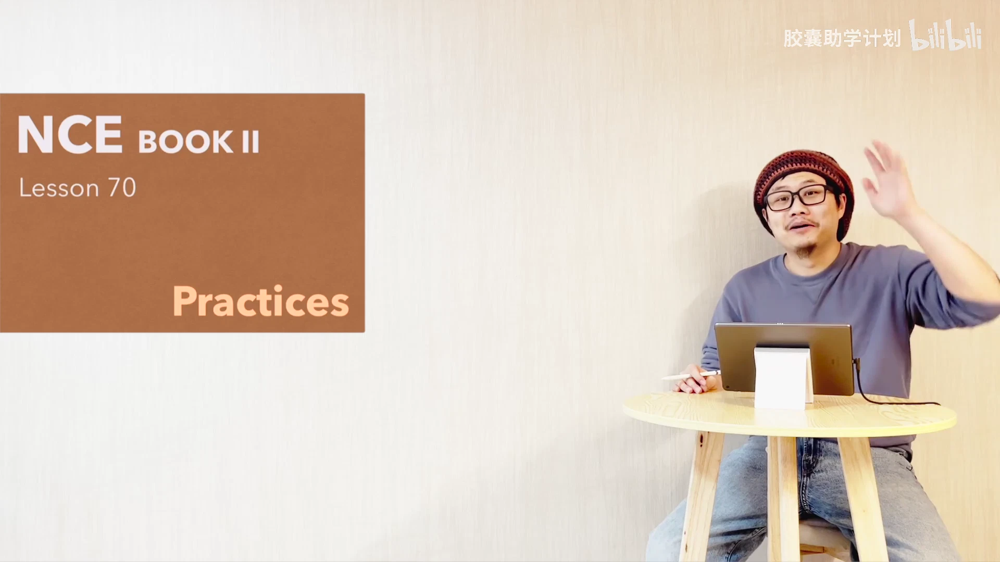

文字识别：bibili / 胶囊助学计划 / NCE / BOOK II / Lesson 70 / Practices

### 画面 00:00:02

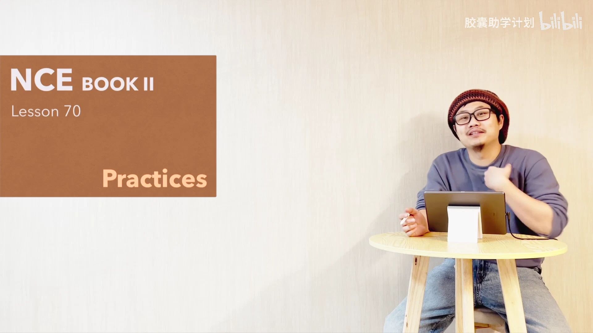

文字识别：bibili / 胶囊助学计划 / NCE / BOOK"I / Lesson 70 / Practices

### 画面 00:00:04

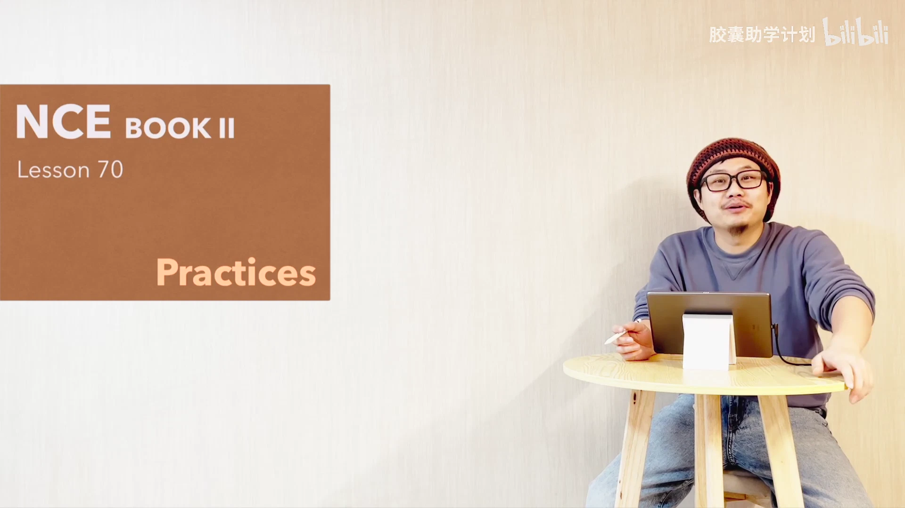

文字识别：bilbili / 胶囊助学计划 / NCE / BOOKI"I / Lesson 70 / Practices

### 画面 00:00:06

文字识别：biibili / 胶囊助学计划 / NCE / BOOK I"I / Lesson 70 / Practices

### 画面 00:00:08

文字识别：bilbili / 胶囊助学计划 / 进行如下练习唯一前提 / 文章跟读至熟读成诵 / 否则请勿开始

### 画面 00:00:10

文字识别：Biibili / 胶囊助学计划 / 进行如下练习唯一前提 / 文章跟读至熟读成诵 / 否则请勿开始

### 画面 00:00:15

文字识别：bilbili / 胶囊助学计划 / 进行如下练习唯一前提 / 文章跟读至熟读成诵 / 否则请勿开始

### 画面 00:00:17

文字识别：胶囊助学计划i山

### 画面 00:00:20

文字识别：虞助字计划一州 / 胶囊助学计划

### 画面 00:00:22

文字识别：bilbili / 胶囊助学计划 / Comprehension / 训练目标： / 听懂一般疑问句＆特殊疑问句

### 画面 00:00:24

文字识别：biibili / 胶囊助学计划 / Comprehension / 训练目标： / 听懂一般疑问句＆特殊疑问句

### 画面 00:00:26

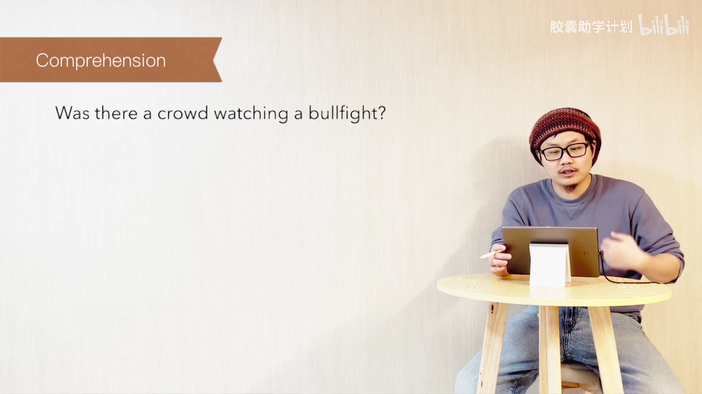

文字识别：bilibili / 胶囊助学计划 / Comprehension / Was there a crowd watching a bullfight?

### 画面 00:00:28

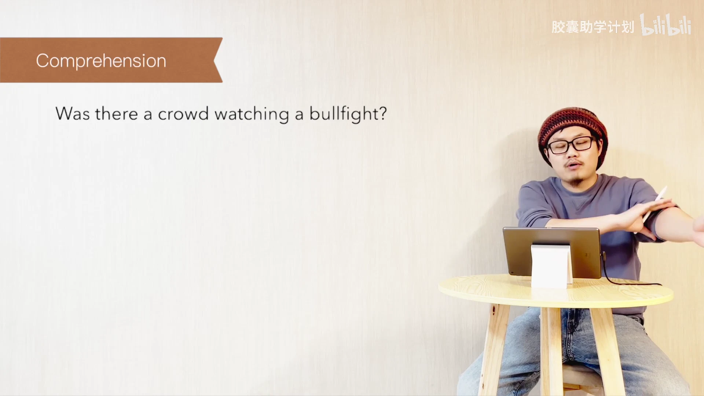

文字识别：bilbili / 胶囊助学计划 / Comprehension / Was there a crowd watching a bullfight?

## 00:00:30–00:01:00

bullfight. Yes, there was. Next one, who suddenly wandered into the middle of the rain. A drunk. What did the crowd begin to do? To shout. Next one, was the drunk aware of the danger? No, he wasn't. Why didn't the bull notice the drunk

### 画面 00:00:30

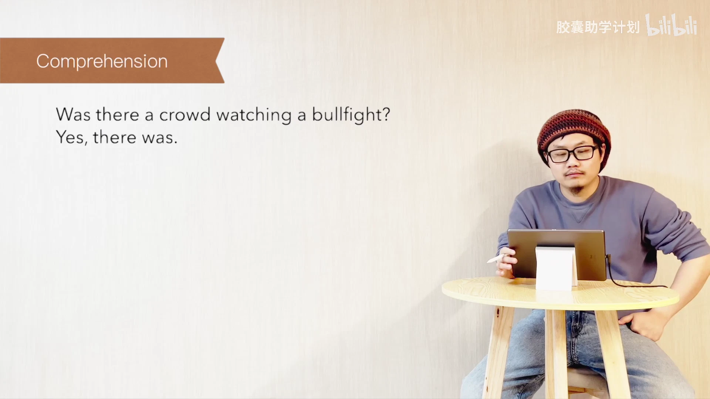

文字识别：bilibii / 胶囊助学计划 / Comprehension / Was / s there a crowd / watching a bullfight? / Yes, there was.

### 画面 00:00:33

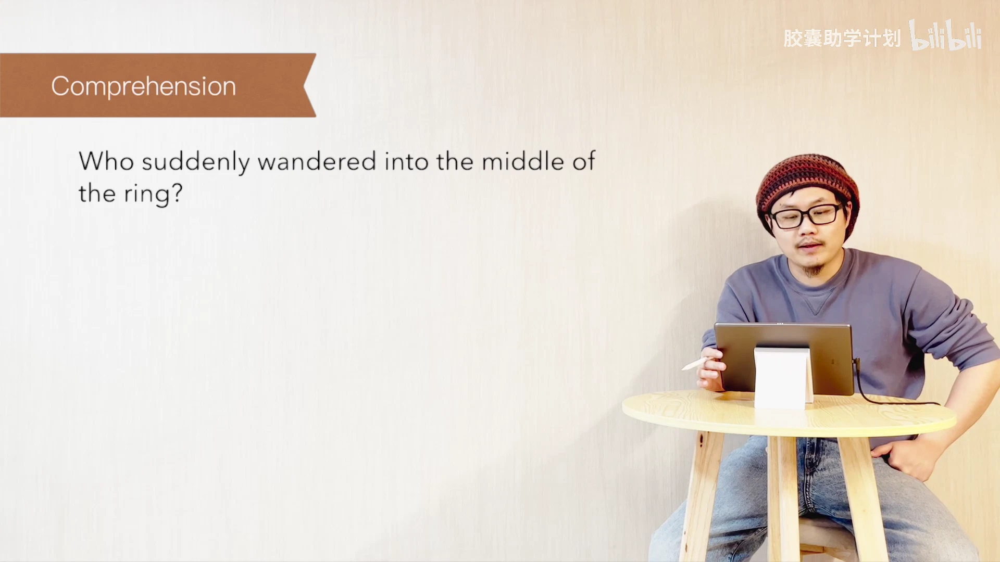

文字识别：bilbili / 胶囊助学计划 / Comprehension / Who suddenly wandered into the middle of / the ring?

### 画面 00:00:35

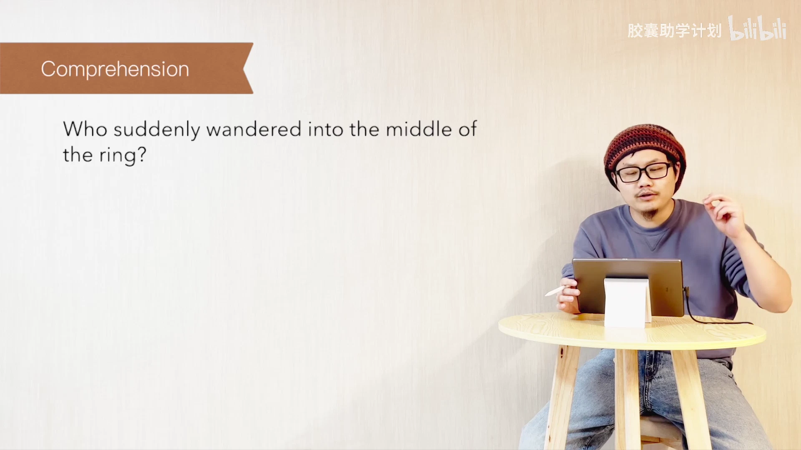

文字识别：bibii / 胶囊助学计划 / Comprehension / Who suddenly wandered into the middle of / the ring?

### 画面 00:00:40

文字识别：bilbili / 胶囊助学计划 / Comprehension

### 画面 00:00:42

文字识别：bilibili / 胶囊助学计划 / Comprehension / What did the crowd begin to do?

### 画面 00:00:45

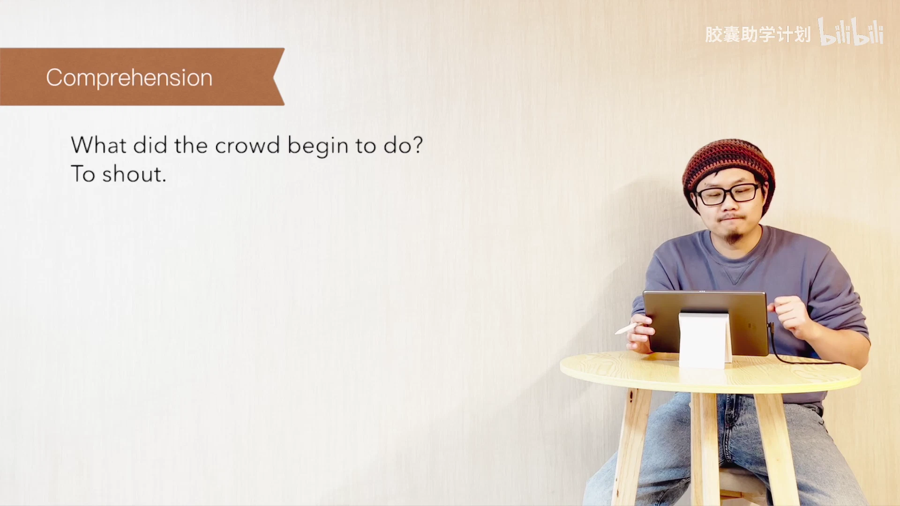

文字识别：bilbil / 胶囊助学计划 / Comprehension / What did the crowd begin to do? / To shout.

### 画面 00:00:48

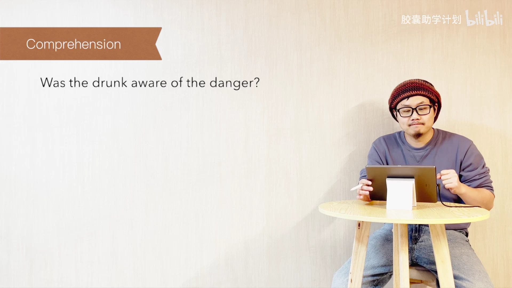

文字识别：bilbili / 胶囊助学计划 / Comprehension / Was the drunk aware of the danger?

### 画面 00:00:50

文字识别：blibli / 胶囊助学计划 / Comprehension / Was the drunk aware of the danger?

### 画面 00:00:53

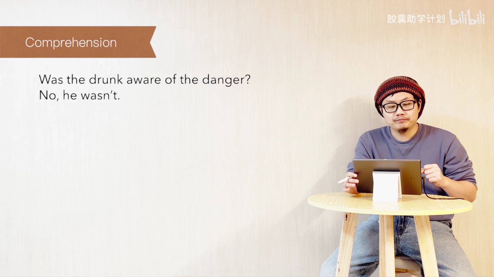

文字识别：biibili / 胶囊助学计划 / Comprehension / Was the drunk aware of the danger? / No, he wasn't.

### 画面 00:00:55

文字识别：bilibili / 胶囊助学计划 / Comprehension / Was the drunk aware of the danger? / No, he wasn't.

### 画面 00:00:58

文字识别：bilbii / 胶囊助学计划 / Comprehension / Why didn't the bull notice the drunk at first?

## 00:01:00–00:01:30

at first. It was busy with the matador. Next one, did it suddenly catch sight of him? Yes, it did. What was the drunk shouting? Rude remarks. Was he waving a red cap or a blue one? A red cap.

### 画面 00:01:00

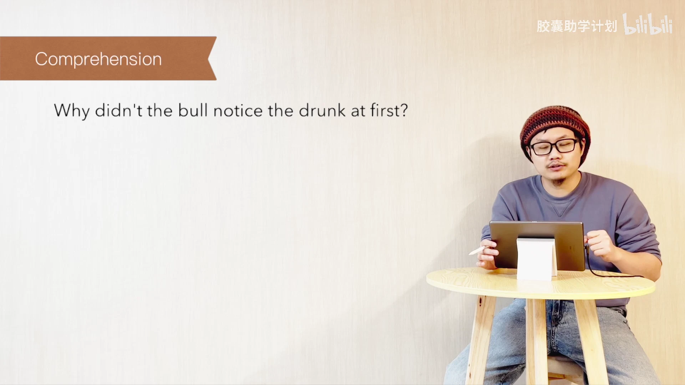

文字识别：bilbii / 胶囊助学计划 / Comprehension / Why didn't the bull notice the drunk at first?

### 画面 00:01:02

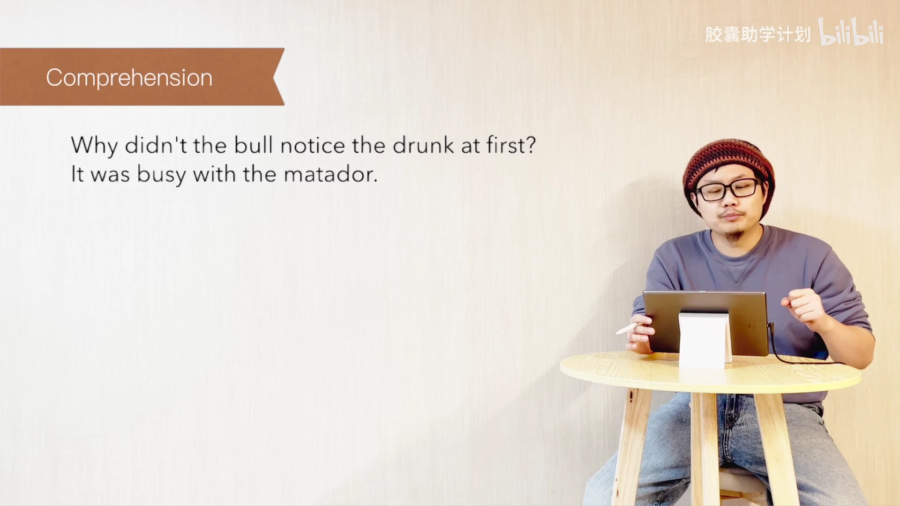

文字识别：bilibli / 胶囊助学计划 / Comprehension / Why didn't the bull notice the drunk at first? / It was busy with the matador.

### 画面 00:01:05

文字识别：bilbili / 胶囊助学计划 / Comprehension

### 画面 00:01:07

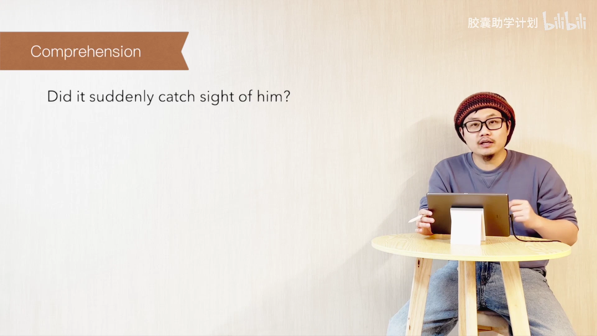

文字识别：bilibili / 胶囊助学计划 / Comprehension / Did it suddenly catch sight of him?

### 画面 00:01:10

文字识别：bilibili / 胶囊助学计划 / Comprehension / Did it suddenly catch sight of him?

### 画面 00:01:12

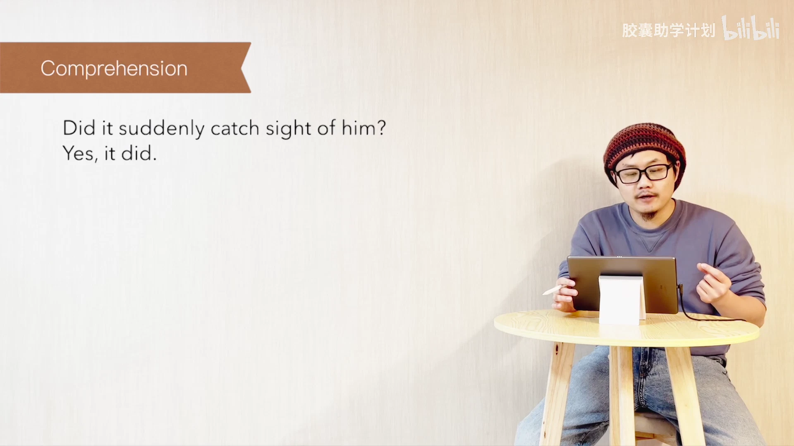

文字识别：bilbili / 胶囊助学计划 / Comprehension / Did it suddenly catch sight of him? / Yes, it did.

### 画面 00:01:14

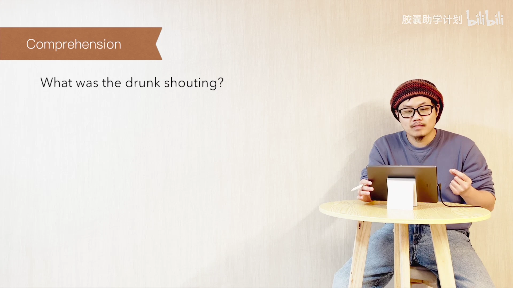

文字识别：bilbili / 胶囊助学计划 / Comprehension / What was the drunk shouting?

### 画面 00:01:16

文字识别：bilbili / 胶囊助学计划 / Comprehension / What was the drunk shouting?

### 画面 00:01:18

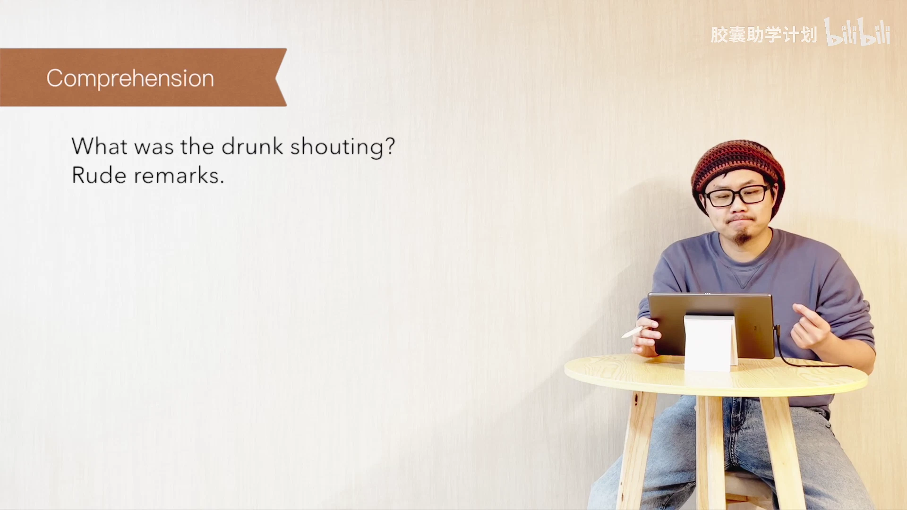

文字识别：bilbii / 胶囊助学计划 / Comprehension / What was the drunk shouting? / Rude remarks.

### 画面 00:01:20

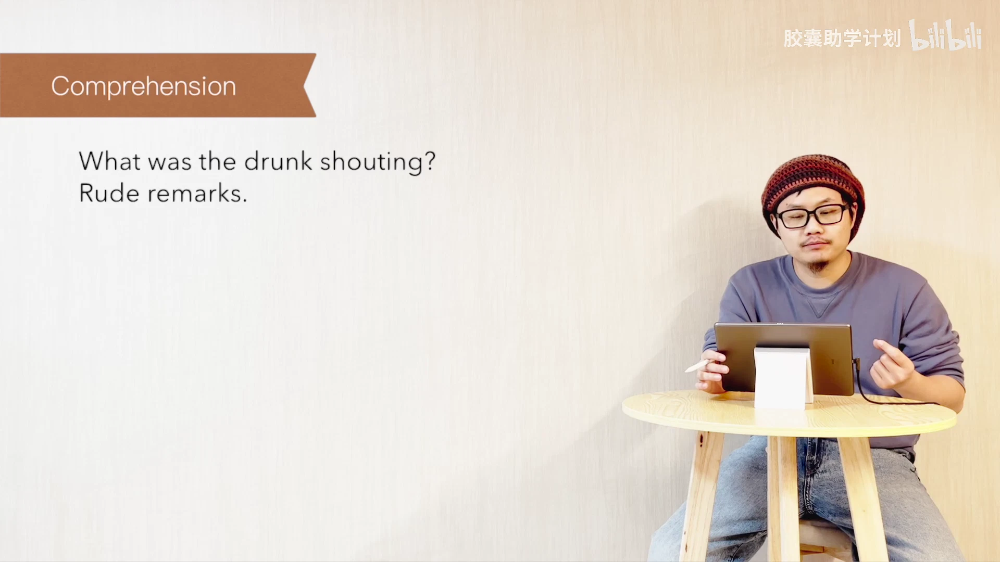

文字识别：bilbili / 胶囊助学计划 / Comprehension / What was the drunk shouting? / Rude remarks.

### 画面 00:01:23

文字识别：bilbii / 胶囊助学计划 / Comprehension / Was he waving a red cap or a blue one?

### 画面 00:01:25

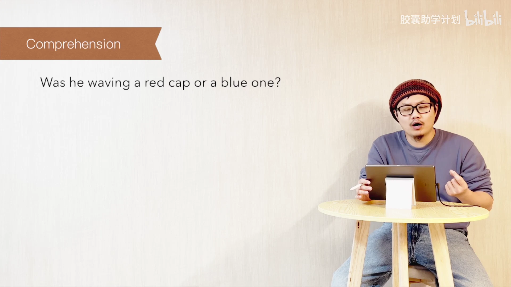

文字识别：bilbili / 胶囊助学计划 / Comprehension / Was he waving a red cap or a blue one?

### 画面 00:01:28

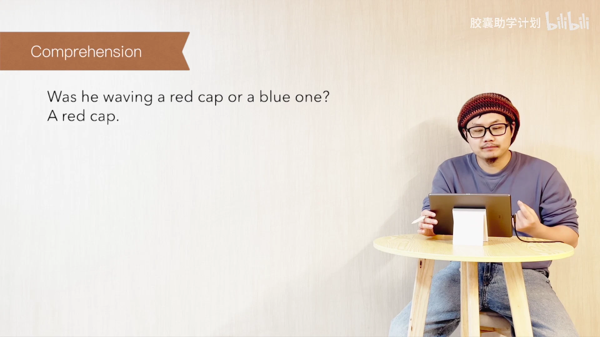

文字识别：bilibili / 胶囊助学计划 / Comprehension / Was he waving a red cap or a blue one? / A red cap.

## 00:01:30–00:02:00

Why did the bull forget all about the matador? Because it caught sight of the drunk. It charged at the drunk, didn't it? Yes, it did. What did the crowd do? The crowd suddenly grew quiet. Did the drunk seem afraid?

### 画面 00:01:30

文字识别：bilibii / 胶囊助学计划 / Comprehension / Why did the bullforget all about the / matador?

### 画面 00:01:32

文字识别：bilibili / 胶囊助学计划 / Comprehension / Why did the bullforget all about the / matador?

### 画面 00:01:35

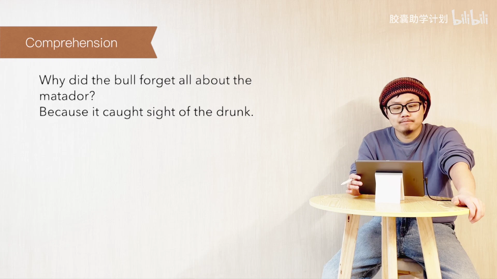

文字识别：bilbii / 胶囊助学计划 / Comprehension / Why did the bull forget all about the / matador? / Because it caught sight of the drunk.

### 画面 00:01:40

文字识别：bilbili / 胶囊助学计划 / Comprehension

### 画面 00:01:45

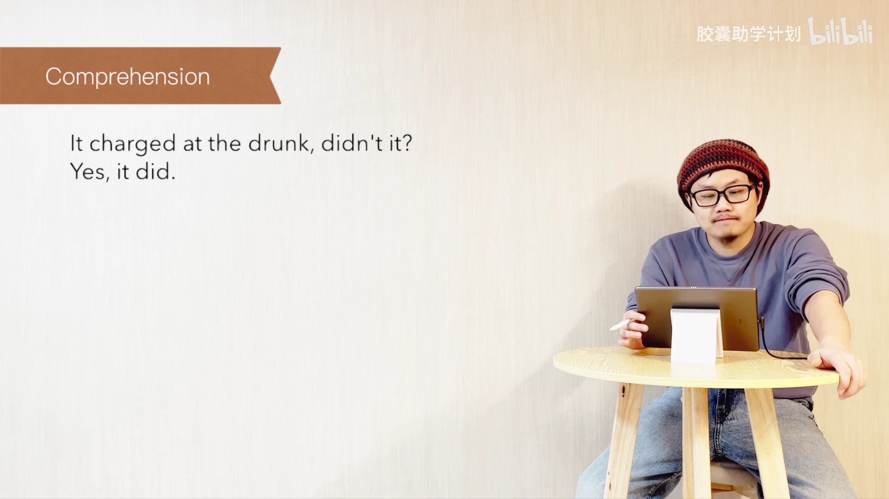

文字识别：bilbili / 胶囊助学计划 / Comprehension / It charged at the drunk, didn't it? / Yes, it did.

### 画面 00:01:48

文字识别：bilbili / 胶囊助学计划 / Comprehension / What did the crowd do?

### 画面 00:01:50

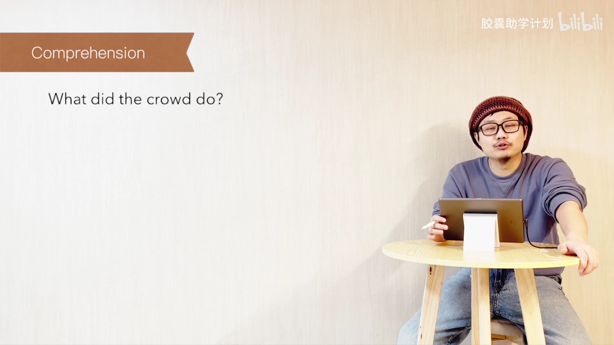

文字识别：bilbii / 胶囊助学计划 / Comprehension / What did the crowd do?

### 画面 00:01:52

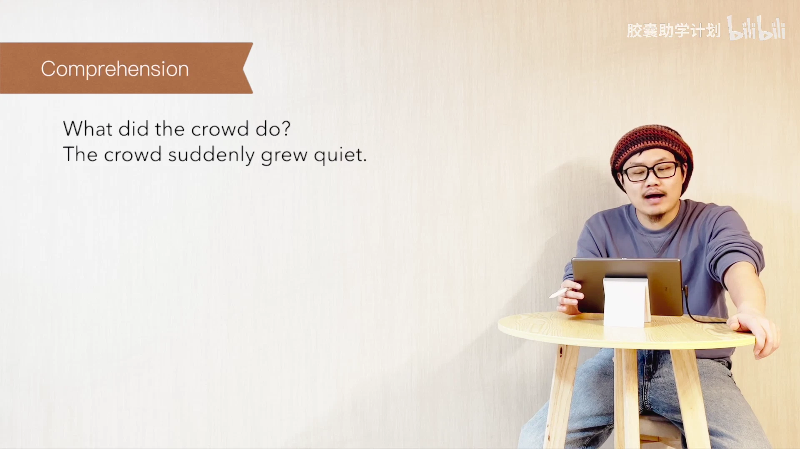

文字识别：bilbii / 胶囊助学计划 / Comprehension / What did the crowd do? / The crowd suddenly grew quiet.

### 画面 00:01:55

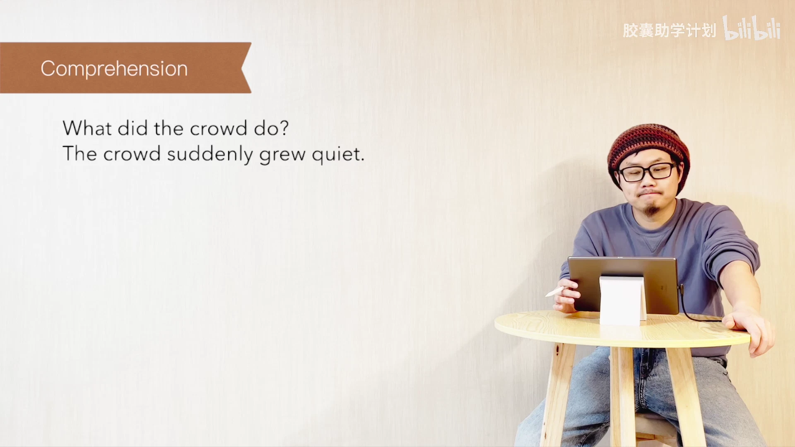

文字识别：bilbili / 胶囊助学计划 / Comprehension / What did the crowd do? / The crowd suddenly grew quiet.

## 00:02:00–00:02:30

No, he didn't. Ah, this afraid类似于nervous，类似啊，不完全像。Who seemed quite sure of himself? The drunk asking questions.简单来说，词形转换啊。我们看第一个说，ask me if a drunk was at a bullfight.很简单，was提前，who那直接对主语提问，直接替代，不变一般疑问句啊。第二题，He suddenly wandered into

### 画面 00:02:00

文字识别：bilibili / 胶囊助学计划 / Comprehension / Did the drunk seem afraid? / No, he didn't.

### 画面 00:02:05

文字识别：bilbili / 胶囊助学计划 / Comprehension

### 画面 00:02:10

文字识别：bilbili / 胶囊助学计划 / Comprehension / Who seemed / quite sure of himself? / The drunk did.

### 画面 00:02:12

文字识别：bibili / 胶囊助学计划 / Asking questions / 训练目标： / 会说一般疑问句＆特殊疑问句 / Accuracy / Fluency

### 画面 00:02:14

文字识别：bilbili / 胶囊助学计划 / Asking questions / 训练目标： / 会说一般疑问句＆特殊疑问句 / Accuracy / Fluency

### 画面 00:02:16

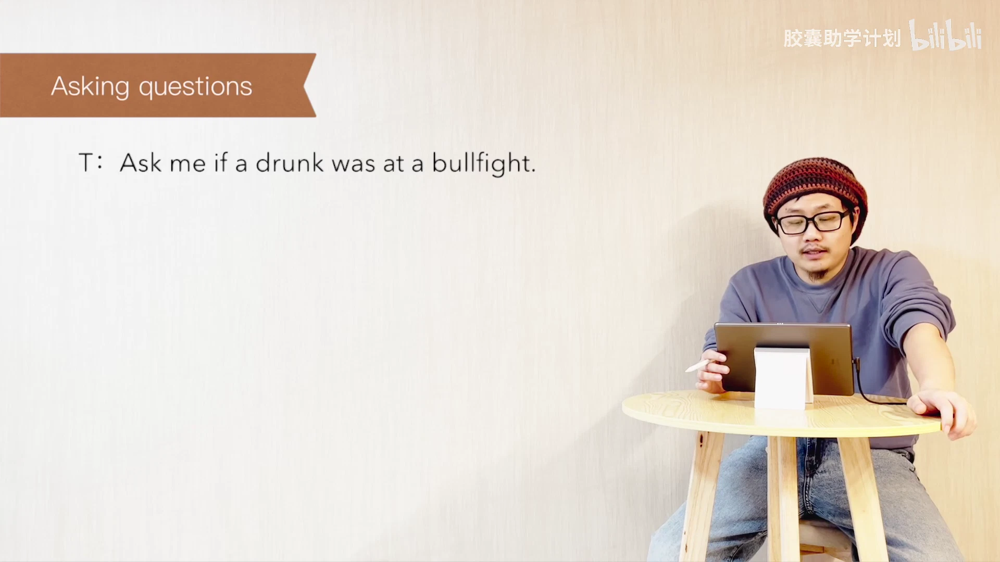

文字识别：bilbili / 胶囊助学计划 / Asking questions / T: Ask me if a drunk was at a bullfight.

### 画面 00:02:20

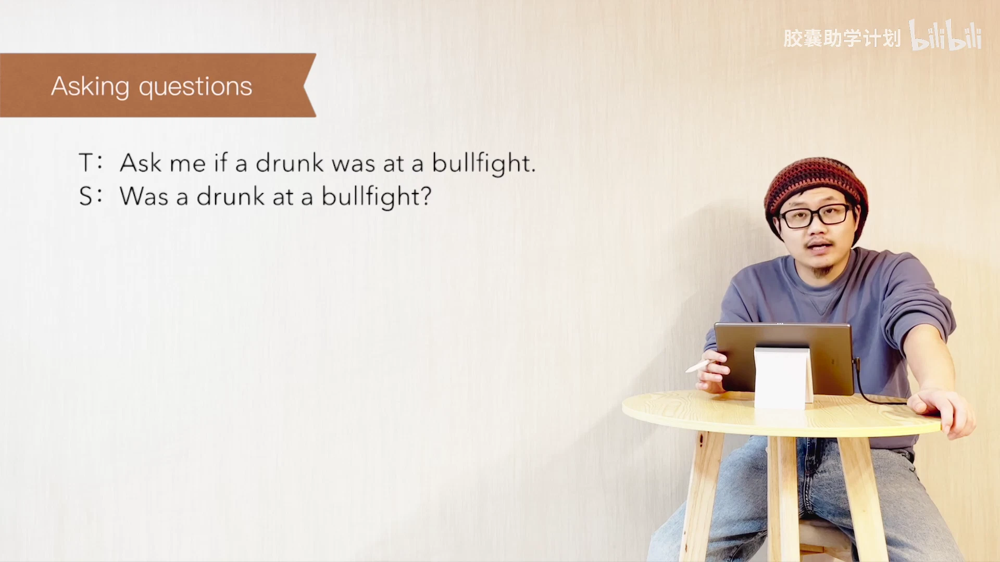

文字识别：bilbili / 胶囊助学计划 / Asking questions / T: Ask me if a drunk was at a bullfight. / S: Was a drunk at a bullfight?

### 画面 00:02:23

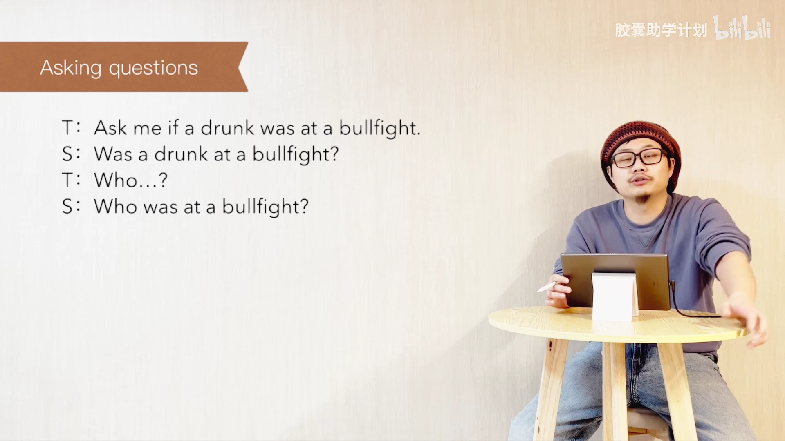

文字识别：bilbili / 胶囊助学计划 / Asking questions / T: Ask me if a drunk was at a bullfight. / S: Was a drunk at a bullfight? / T: Who...? / S: Who was at a bullfight?

### 画面 00:02:25

文字识别：bilbili / 胶囊助学计划 / Asking / questions

### 画面 00:02:27

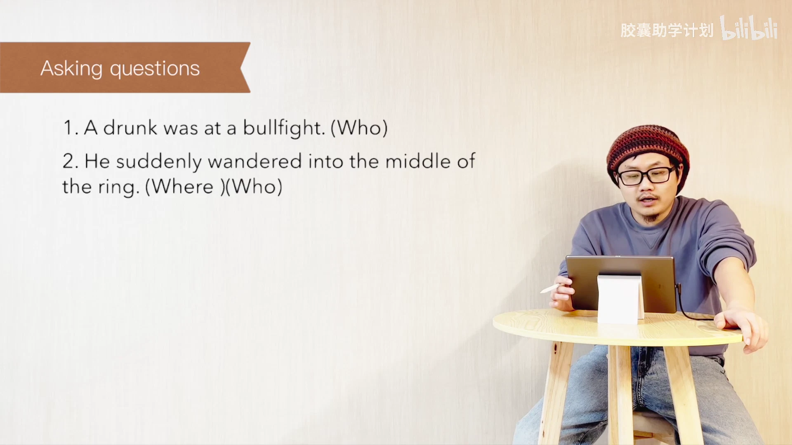

文字识别：bilbili / 胶囊助学计划 / Asking questions / 1.A drunk was at a bullfight. (Who) / 2. He suddenly wandered into the middle of / the ring.(Where )(Who)

### 画面 00:02:29

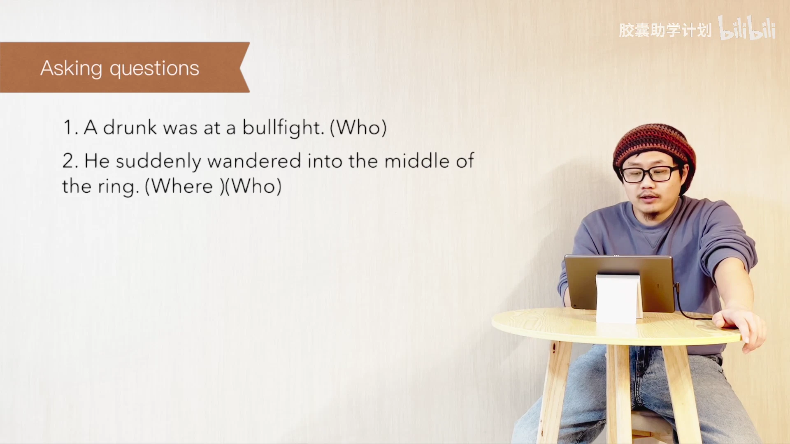

文字识别：bibili / 胶囊助学计划 / Asking questions / 1.A drunk was at a bullfight. (Who) / 2. He suddenly wandered into the middle of / the ring.(Where / e )(Who)

## 00:02:30–00:03:00

the middle of the rain. Did提前，where对into the middle of the rain提问，who对主语提问，不变一般疑问句。The crowd began to shout. Did提前，who对the crowd提问，对吧？不变一般疑问句。The drunk was unaware of the danger. Was提前，然后what对the danger提问，why对整句话提问，who对主语提问，不变一般疑问句。The bull was busy with the matador. Was提前，who

### 画面 00:02:32

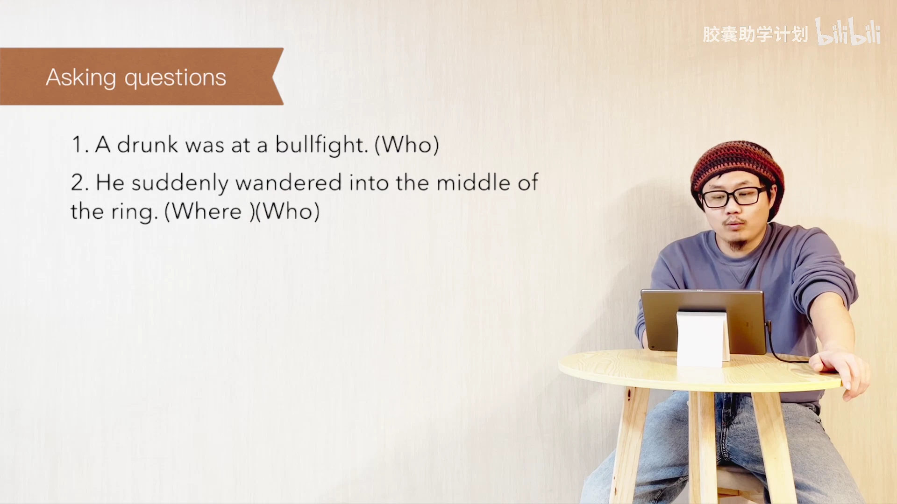

文字识别：bilbili / 胶囊助学计划 / Asking questions / 1.A drunk was at a bullfight. (Who) / 2. He suddenly wandered into the middle of / the ring.(Where / e )(Who)

### 画面 00:02:35

文字识别：bilbili / 胶囊助学计划 / Asking questions / 1.A drunk was at a bullfight. (Who) / 2. He suddenly wandered into the middle of / the ring.(Where )(Who)

### 画面 00:02:37

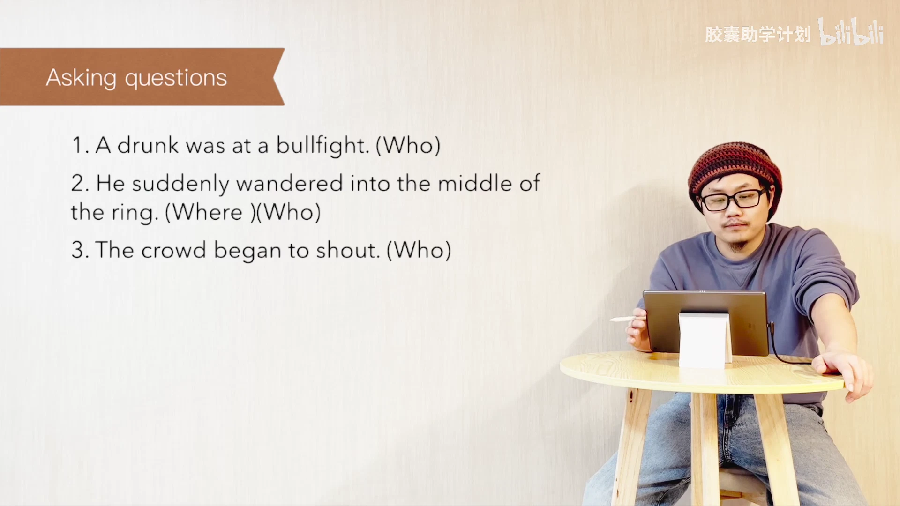

文字识别：bilbili / 胶囊助学计划 / Asking questions / 1.A drunk was at a bullfight. (Who) / 2. He suddenly wandered into the middle of / the ring. (Where )(Who) / 3. The crowd began to shout. (Who)

### 画面 00:02:39

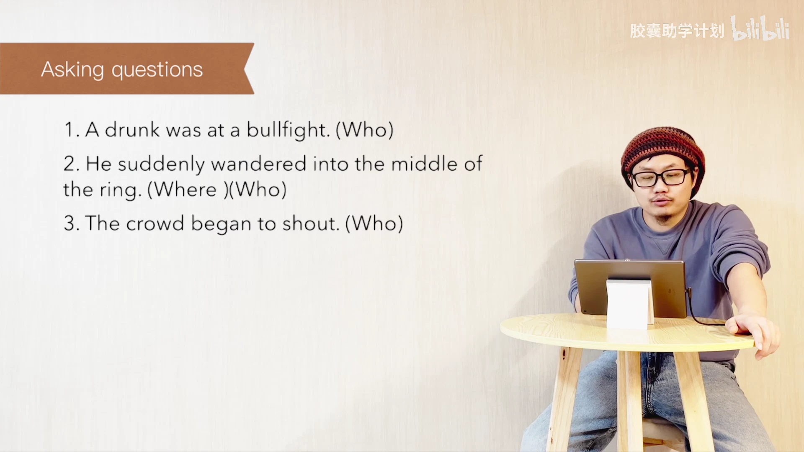

文字识别：bilbili / 胶囊助学计划 / Asking questions / 1.A drunk was at a bullfight. (Who) / 2. He suddenly wandered into the middle of / the ring. (Where )(Who) / 3.The crowd began to shout. (Who)

### 画面 00:02:41

文字识别：biibili / 胶囊助学计划 / Asking questions / 1.A drunk was at a bullfight. (Who) / 2. He suddenly wandered into the middle of / the ring. (Where )(Who) / 3. The crowd began to shout. (Who)

### 画面 00:02:43

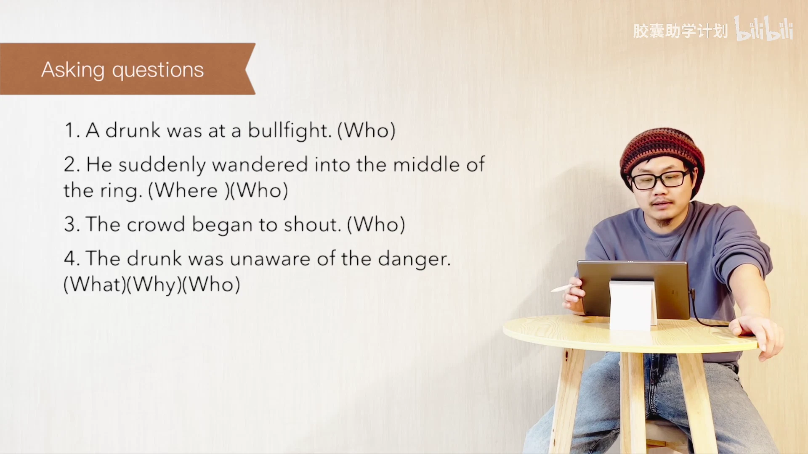

文字识别：胶囊助学计划bl山 / Asking questions / 1.A drunk was at a bullfight. (Who) / 2. He suddenly wandered into the middle of / the ring. (Where )(Who) / 3. The crowd began to shout.(Who) / 4. The drunk was unaware of the danger. / (What)(Why)(Who)

### 画面 00:02:45

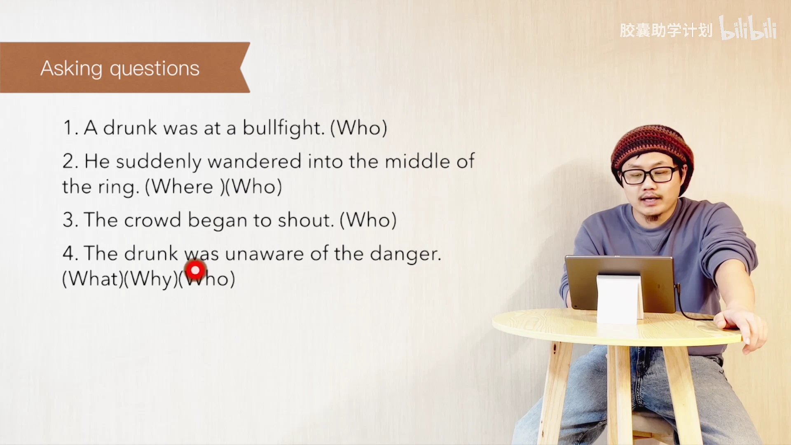

文字识别：biibili / 胶囊助学计划 / Asking questions / 1.A drunk was at a bulfight. (Who) / 2. He suddenly wandered into the middle of / the ring. (Where )(Who) / 3. The crowd began to shout. (Who) / 4. The drunk was unaware of the danger. / (What)(Why)(Rho)

### 画面 00:02:50

文字识别：biibili / 胶囊助学计划 / Asking questions / 1.A drunk was at a bullfight. (Who) / 2. He suddenly wandered into the middle of / the ring. (Where )(Who) / 3. The crowd began to shout. (Who) / 4. The drunk was unaware of the danger. / (What)(Why)(Who)

### 画面 00:02:54

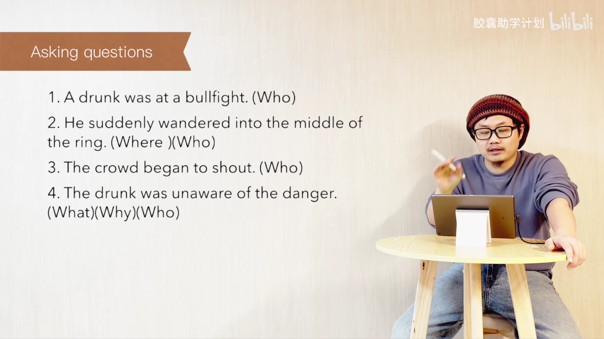

文字识别：Bilbil / 胶囊助学计划 / Asking questions / 1.A drunk was at a bullfight. (Who) / 2. He suddenly wandered into the middle of / the ring. (Where )(Who) / 3. The crowd began to shout. (Who) / 4. The drunk was unaware of the danger. / (What)(Why)(Who)

### 画面 00:02:56

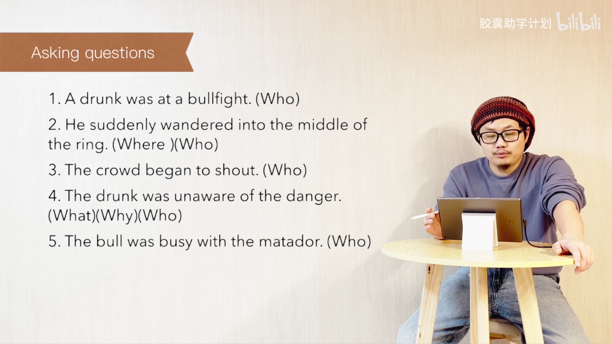

文字识别：胶囊助学计划bib出 / Asking questions / 1.A drunk was at a bullfight. (Who) / 2. He suddenly wandered into the middle of / the ring. (Where )(Who) / 3. The crowd began to shout. (Who) / 4. The drunk was unaware of the danger. / (What)(Why)(Who) / 5. The bull was busy with the matador. (Who)

### 画面 00:02:58

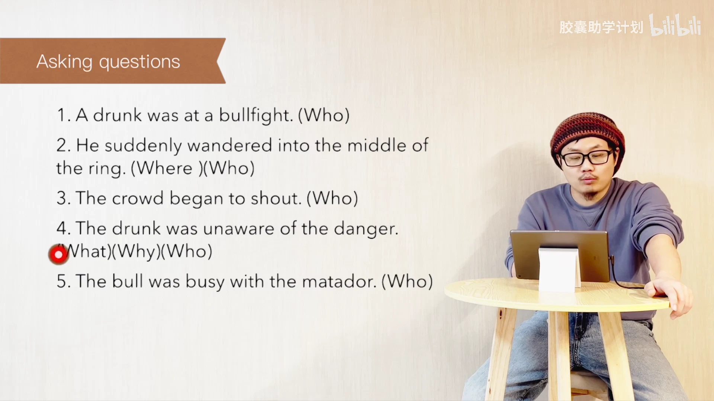

文字识别：bilbili / 胶囊助学计划 / Asking questions / 1.A drunk was at a bulfight. (Who) / 2. He suddenly wandered into the middle of / the ring. (Where )(Who) / 3. The crowd began to shout. (Who) / 4. The drunk was unaware of the danger. / Vhat)(Why)(Who) / 5. The bull was busy with the matador. (Who)

## 00:03:00–00:03:30

对肯定是Madame D'Or嘛。第六个The drunk shouted rude remarks. Did提前. What对rude remarks提问，对吧？He waved a red cap. Did提前，动词还原形。What对a red cap提问。Who对主语提问，不变一般疑问句。The bull suddenly caught sight of him. Did提前。Who对him提问。When对整句话，

### 画面 00:03:00

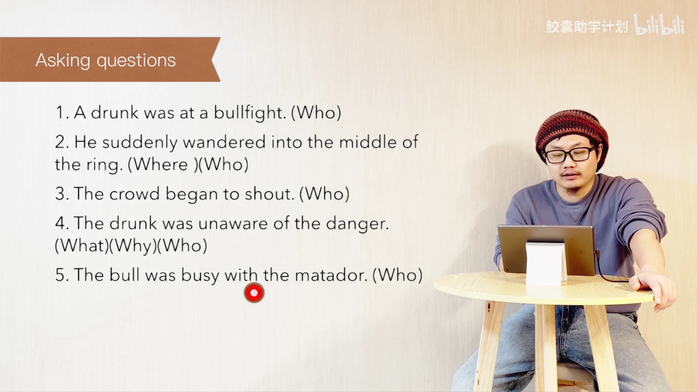

文字识别：胶囊助学计划biibi出 / Asking questions / 1.A drunk was at a bullfight. (Who) / 2. He suddenly wandered into the middle of / the ring. (Where )(Who) / 3. The crowd began to shout. (Who) / 4. The drunk was unaware of the danger. / (What)(Why)(Who) / 5. The bull was busy with the matador. (Who)

### 画面 00:03:02

文字识别：bilbili / 胶囊助学计划 / Asking / questions

### 画面 00:03:04

文字识别：bilbili / 胶囊助学计划 / Asking questions / 6. The drunk shouted rude remarks. (What)

### 画面 00:03:06

文字识别：bilbili / 胶囊助学计划 / Asking questions / 6. The drunk shouted rude remarks. (What)

### 画面 00:03:13

文字识别：bilbili / 胶囊助学计划 / Asking questions / 6. The drunk shouted rude remarks. (What) / 7. He waved a red cap. (What)(Who)

### 画面 00:03:15

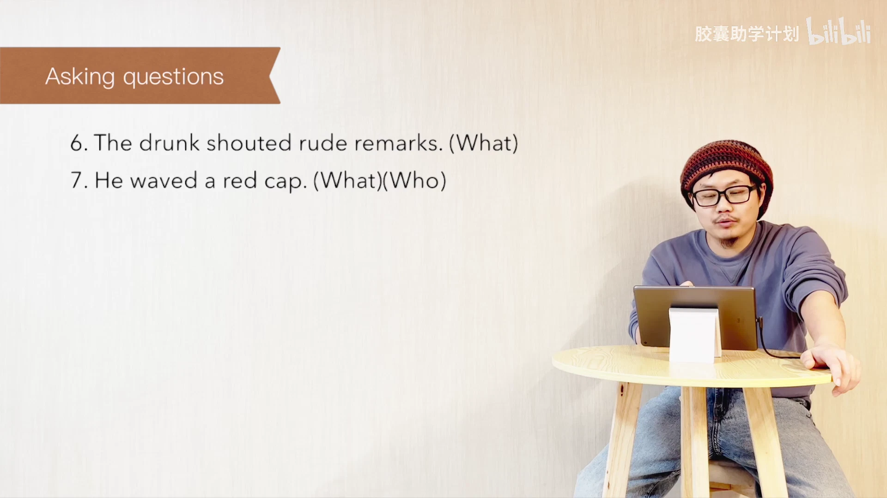

文字识别：bilbili / 胶囊助学计划 / Asking questions / 6. The drunk shouted rude remarks. (What) / 7. He waved a red cap. (What)(Who)

### 画面 00:03:20

文字识别：biibili / 胶囊助学计划 / Asking questions / 6. The drunk shouted rude remarks. (What) / 7. He waved a red cap. (What)(Who) / 8. The bull suddenly caught sight of him. / (Who)(When)

### 画面 00:03:25

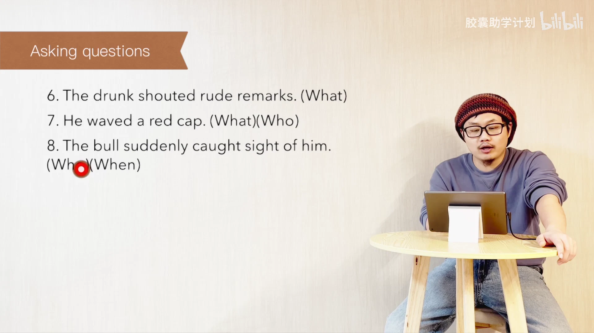

文字识别：bilbili / 胶囊助学计划 / Asking questions / 6. The drunk shouted rude remarks. (What) / 7. He waved a red cap. (What)(Who) / 8. The bull suddenly caught sight of him. / (Who(When)

### 画面 00:03:28

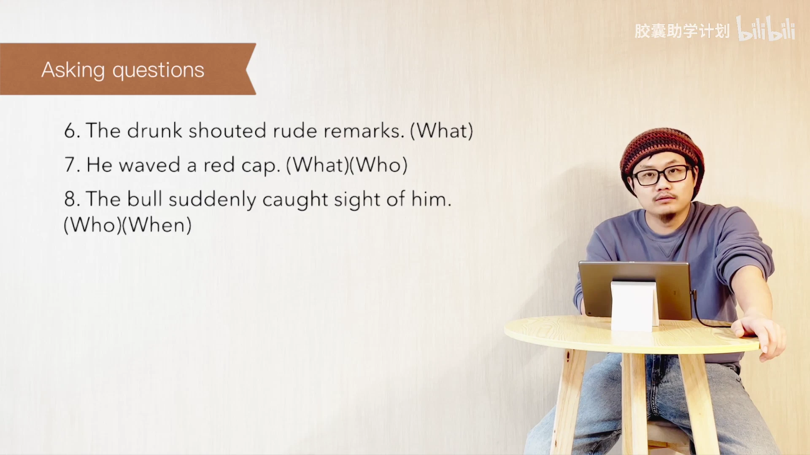

文字识别：bilibili / 胶囊助学计划 / Asking questions / 6. The drunk shouted rude remarks. (What) / 7. He waved a red cap. (What)(Who) / 8. The bull suddenly caught sight of him. / (Who)(When)

## 00:03:30–00:04:00

哎，对吧？或者你呃，我觉得这里呃，甚至可以对三那里提问，对吧？It seemed to be sensitive to criticism. Did提前What点点点do是吧？这里我觉得你可以换成这个样子，叫What did it seem to do啊？It forgot about the mad door. Did提前Who对mad door提问？Tell the story不多说了，口语复述第一个单元做了所有的示范啊，在这地方

### 画面 00:03:30

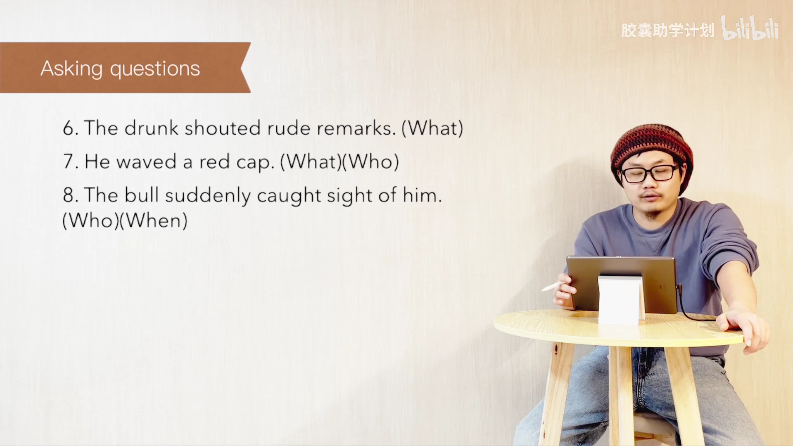

文字识别：biibili / 胶囊助学计划 / Asking questions / 6. The drunk shouted rude remarks. (What) / 7. He waved a red cap. (What)(Who) / 8. The bull suddenly caught sight of him. / (Who)(When)

### 画面 00:03:33

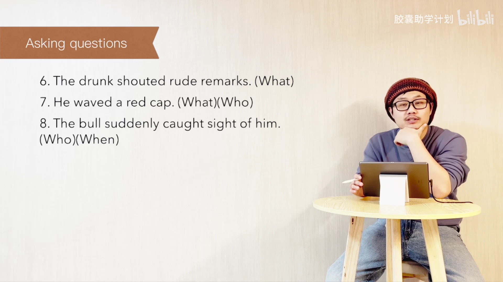

文字识别：bilbili / 胶囊助学计划 / Asking questions / 6. The drunk shouted rude remarks. (What) / 7. He waved a red cap. (What)(Who) / 8. The bull suddenly caught sight of him. / (Who)(When)

### 画面 00:03:35

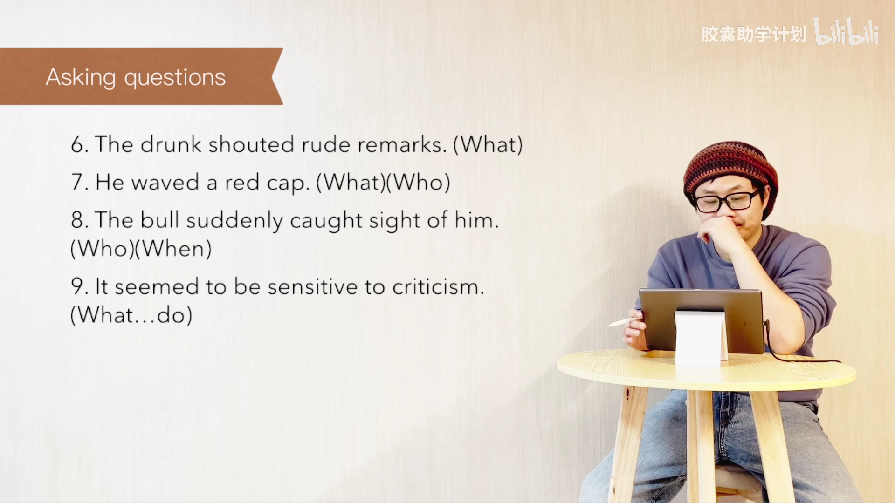

文字识别：bilibii / 胶囊助学计划 / Asking questions / 6. The drunk shouted rude remarks. (What) / 7. He waved a red cap. (What)(Who) / 8. The bull suddenly caught sight of him. / (Who)(When) / 9. It seemed to be sensitive to criticism. / (What...do)

### 画面 00:03:37

文字识别：bibili / 胶囊助学计划 / Asking questions / 6. The drunk shouted rude remarks. (What) / 7. He waved a red cap. (What)(Who) / 8. The bull suddenly caught sight of him. / (Who)(When) / 9. It seemed to be sensitive to criticism. / (What...do)

### 画面 00:03:40

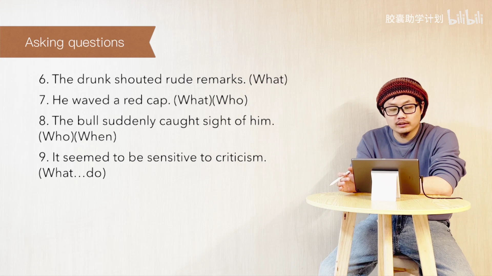

文字识别：bilbii / 胶囊助学计划 / Asking questions / 6. The drunk shouted rude remarks. (What) / 7. He waved a red cap. (What)(Who) / 8. The bull suddenly caught sight of him. / (Who)(When) / 9. It seemed to be sensitive to criticism. / (What...do)

### 画面 00:03:45

文字识别：bilbili / 胶囊助学计划 / Asking questions / 6. The drunk shouted rude remarks. (What) / 7. He waved a red cap. (What)(Who) / 8. The bull suddenly caught sight of him. / (Who)(When) / 9. It seemed to be sensitive to criticism. / (What...do)

### 画面 00:03:48

文字识别：胶囊助学计划bi出 / Asking questions / 6. The drunk shouted rude remarks. (What) / 7. He waved a red cap. (What)(Who) / 8. The bull suddenly caught sight of him. / (Who)(When) / 9. It seemed to be sensitive to criticism. / (What...do) / 10. It forgot about the matador. (Who)

### 画面 00:03:50

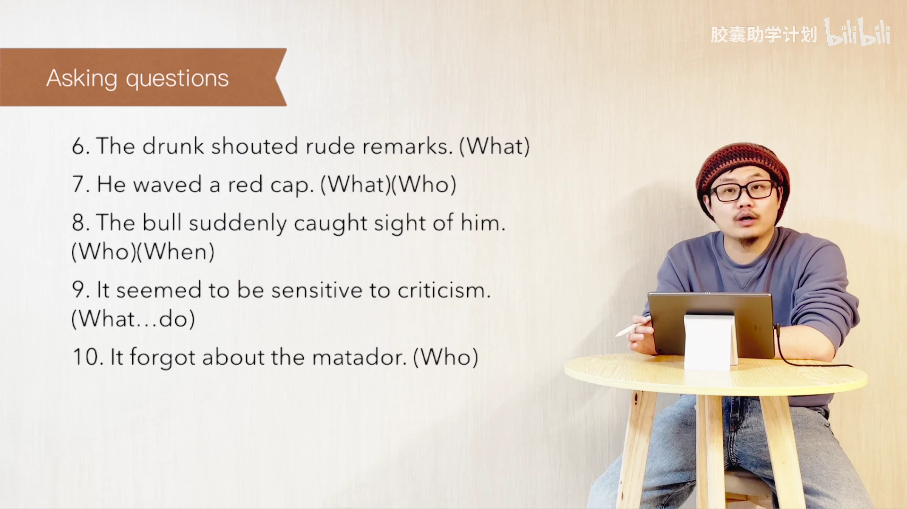

文字识别：胶囊助学计划bil出 / Asking questions / 6. The drunk shouted rude remarks. (What) / 7. He waved a red cap. (What)(Who) / 8. The bull suddenly caught sight of him. / (Who)(When) / 9. It seemed to be sensitive to criticism. / (What...do) / 10. It forgot about the matador. (Who)

### 画面 00:03:53

文字识别：bibili / 胶囊助学计划 / Tell the story / 训练目标： / 口语复述能力 / Accuracy / Fluency

### 画面 00:03:55

文字识别：bitbili / 胶囊助学计划 / Tell the story / 训练目标： / 口语复述能力 / Accuracy / Fluency

### 画面 00:03:59

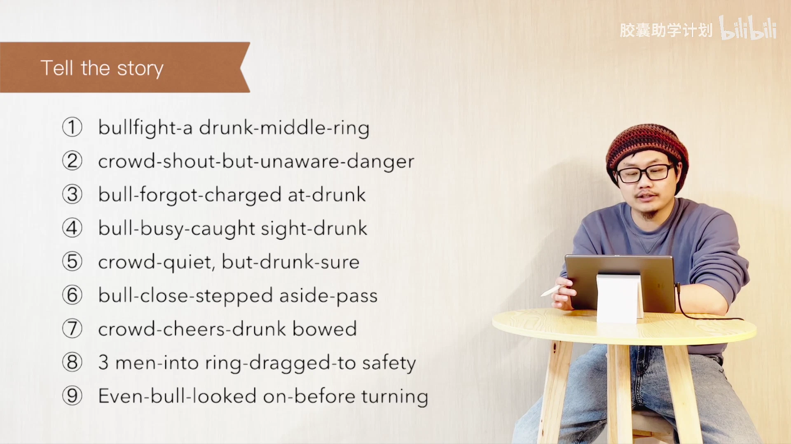

文字识别：胶囊助学计划bib / Tell the story /  bullfight-a drunk-middle-ring / 1 / crowd-shout-but-unaware-danger / bull-forgot-charged at-drunk / 3 / bull-busy-caught sight-drunk / crowd-quiet, but-drunk-sure / 5 / bull-close-stepped aside-pass / crowd-cheers-drunk bowed / 3 men-into ring-dragged-to safety / 8 / Even-bull-looked on-before turning

## 00:04:00–00:04:30

您自己复述一下就可以了。Next one, style写作练习的是我们写作复述能力，对于您工作和考试当中非常的重要啊。呃，写完了来对答案就可以了。然后 topic for discussion，老习惯我们只说题目啊。说 some people think that bullfighting and other blood sports such as cockfighting, hunting, etc. are cruel. How would you define them? Criticize

### 画面 00:04:01

文字识别：bilbili / 胶囊助学计划 / Summary writing: Key / 训练目标： / 写作复述能力

### 画面 00:04:03

文字识别：bibili / 胶囊助学计划 / Summary writing: Key / 训练目标： / 写作复述能力

### 画面 00:04:05

文字识别：bibili / 胶囊助学计划 / Summary writing: Key / 训练目标： / 写作复述能力

### 画面 00:04:10

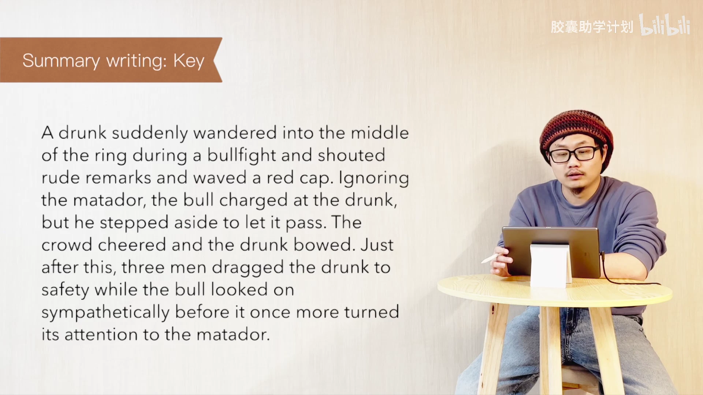

文字识别：胶囊助学计划bilbi / Summary writing: Key / A drunk suddenly wandered into the middle / of the ring during a bullfight and shouted / rude remarks and waved a red cap. Ignoring / the matador, the bull charged at the drunk, / but he stepped aside to let it pass. The / crowd cheered and the drunk bowed. Just / after this, three men dragged the drunk to / safety while the bull looked on / sympathetically before it once more turned / its attention to the matador.

### 画面 00:04:13

文字识别：bibili / 胶囊助学计划 / Topics for discussion / 训练目标： / 完全自由的对话 / Accuracy / Fluency

### 画面 00:04:15

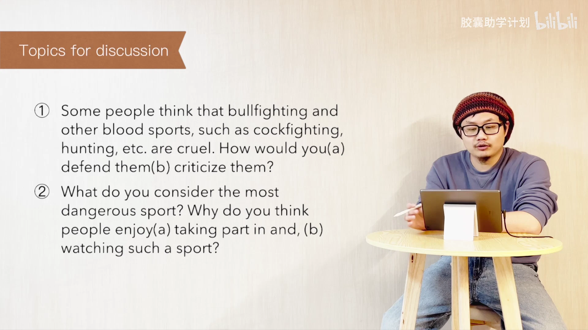

文字识别：bilbili / 胶囊助学计划 / Topics for discussion / Some people think that bullfighting and / other blood sports, such as cockfighting, / hunting, etc. are cruel. How would you(a) / defend them(b) criticize them? / What do you consider the most / dangerous sport? Why do you think / people enjoy(a) taking part in and, (b) / watching such a sport?

### 画面 00:04:17

文字识别：bilbili / 胶囊助学计划 / Topics for discussion / Some people think that bullfighting and / other blood sports, such as cockfighting, / hunting, etc. are cruel. How would you(a) / defend them(b) criticize them? / What do you consider the most / dangerous sport? Why do you think / people enjoy(a) taking part in and, (b) / watching such a sport?

### 画面 00:04:20

文字识别：biibili / 胶囊助学计划 / Topics for discussion / Some people think that bullfighting and / other blood sports, such as cockfighting, / hunting, etc. are cruel. How would you(a) / defend them(b) criticize them? / What do you consider the most / dangerous sport? Why do you think / people enjoy(a) taking part in and, (b) / watching such a sport?

### 画面 00:04:26

文字识别：bilibli / 胶囊助学计划 / Topics for discussion / Some people think that bullfighting and / other blood sports, such as cockfighting, / hunting, etc. are cruel. How would you(a) / defend them(b) criticize them? / What do you consider the most / dangerous sport? Why do you think / people enjoy(a) taking part in and, (b) / watching such a sport?

## 00:04:30–00:05:00

them?说有一些人认为啊，说这个斗牛啊，以及其他的一些血腥的运动，比如说斗鸡呀，或者说这个狩猎呀、打猎呀，是非常残忍的。你怎么去？你怎么认为？对吧？你你你是愿意去批评他们呢，还是愿意去维护他们呢？怎么想的？第二题，What do you consider the most dangerous sport? Why do you think people enjoy

### 画面 00:04:33

文字识别：bilbili / 胶囊助学计划 / Topics for discussion / Some people think that bullfighting and / other blood sports, such as cockfighting, / hunting, etc. are cruel. How would you(a) / defend them(b) criticize them? / What do you consider the most / dangerous sport? Why do you think / people enjoy(a) taking part in and, (b) / watching such a sport?

### 画面 00:04:36

文字识别：bilibili / 胶囊助学计划 / Topics for discussion / Some people think that bullfighting and / other blood sports, such as cockfighting, / hunting, etc. are cruel. How would you(a) / defend them(b) criticize them? / What do you consider the most / dangerous sport? Why do you think / people enjoy(a) taking part in and, (b) / watching such a sport?

### 画面 00:04:40

文字识别：biibili / 胶囊助学计划 / Topics for discussion / Some people think that bullfighting and / other blood sports, such as cockfighting, / hunting, etc. are cruel. How would you(a) / defend them(b) criticize them? / What do you consider the most / dangerous sport? Why do you think / people enjoy(a) taking part in and, (b) / watching such a sport?

### 画面 00:04:46

文字识别：bilibili / 胶囊助学计划 / Topics for discussion / Some people think that bullfighting and / other blood sports, such as cockfighting, / hunting, etc. are cruel. How would you(a) / defend them(b) criticize them? / What do you consider the most / dangerous sport? Why do you think / people enjoy(a) taking part in and, (b) / watching such a sport?

### 画面 00:04:49

文字识别：bilbili / 胶囊助学计划 / Topics for discussion / Some people think that bullfighting and / other blood sports, such as cockfighting, / hunting, etc. are cruel. How would you(a) / defend them(b) criticize them? / What do you consider the most / dangerous sport? Why do you think / people enjoy(a) taking part in and, (b) / watching such a sport?

### 画面 00:04:51

文字识别：bilbili / 胶囊助学计划 / Topics for discussion / Some people think that bullfighting and / other blood sports, such as cockfighting, / hunting, etc. are cruel. How would you(a) / defend them(b) criticize them? / What do you consider the most / dangerous sport? Why do you think / people enjoy(a) taking part in and, (b) / watching such a sport?

### 画面 00:04:55

文字识别：bilbili / 胶囊助学计划 / Topics for discussion / Some people think that bullfighting and / other blood sports, such as cockfighting, / hunting, etc. are cruel. How would you(a) / defend them(b) criticize them? / What do you consider the most / dangerous sport? Why do you think / people enjey(a) taking part in and, (b) / watching such a sport?

## 00:05:00–00:05:30

taking part in and watching such a sport?说你认为啊，说最危险的运动是啥？说为啥你认为人们说他很享受参与？然后呢，或者说观看这类的运动，哎，比如说这就让我想起来冬奥会的时候，看我们中国的两名小将去参加的那个活动都很危险，是吧？就是那个滑板的活动。那但是非常爱看啊，为什么呢？您自己回答回答一下这个问题，

### 画面 00:05:03

文字识别：bilbii / 胶囊助学计划 / Topics for discussion / Some people think that bullfighting and / other blood sports, such as cockfighting, / hunting, etc. are cruel. How would you(a) / defend them(b) criticize them? / What do you consider the most / dangerous sport? Why do you think / people enjoy(a) taking part in and, (b) / watching such a sport?

### 画面 00:05:05

文字识别：Bilbii / 胶囊助学计划 / Topics for discussion / Some people think that bullfighting and / other blood sports, such as cockfighting, / hunting, etc. are cruel. How would you(a) / defend them(b) criticize them? / What do you consider the most / dangerous sport? Why do you think / people enjoy(a) taking part in and, (b) / watching such a sport?

### 画面 00:05:12

文字识别：bilbii / 胶囊助学计划 / Topics for discussion / Some people think that bullfighting and / other blood sports, such as cockfighting, / hunting, etc. are cruel. How would you(a) / defend them(b) criticize them? / What do you consider the most / dangerous sport? Why do you think / people enjoy(a) taking part in and, (b) / watching such a sport?

### 画面 00:05:18

文字识别：bilbii / 胶囊助学计划 / Topics for discussion / Some people think that bullfighting and / other blood sports, such as cockfighting, / hunting, etc. are cruel. How would you(a) / defend them(b) criticize them? / What do you consider the most / dangerous sport? Why do you think / people enjoy(a) taking part in and, (b) / watching such a sport?

### 画面 00:05:21

文字识别：bilbili / 胶囊助学计划 / Topics for discussion / Some people think that bullfighting and / other blood sports, such as cockfighting, / hunting, etc. are cruel. How would you(a) / defend them(b) criticize them? / What do you consider the most / dangerous sport? Why do you think / people enjoy(a) taking part in and, (b) / watching such a sport?

### 画面 00:05:25

文字识别：bilibii / 胶囊助学计划 / Topics for discussion / Some people think that bullfighting and / other blood sports, such as cockfighting, / hunting, etc. are cruel. How would you(a) / defend them(b) criticize them? / What do you consider the most / dangerous sport? Why do you think / people enjoy(a) taking part in and, (b) / watching such a sport?

### 画面 00:05:29

文字识别：bibii / 胶囊助学计划 / Topics for discussion / Some people think that bullfighting and / other blood sports, such as cockfighting, / hunting, etc. are cruel. How would you(a) / defend them(b) criticize them? / What do you consider the most / dangerous sport? Why do you think / people enjoy(a) taking part in and, (b) / watching such a sport?

## 00:05:30–00:06:00

不多说了啊。家庭作业：Ask me if写完朗读，只要写作写完对答案，Tell the story口语复述，重复间隔看重复间隔的这个学习材料，看置顶留言。那以上呢就是本期视频的全部内容了。如果各位喜欢我们的课程呢，欢迎各位关注、订阅、一键三连，分享给那些需要的朋友来帮助我们快速成长。See you next time.

### 画面 00:05:31

文字识别：bilbili / 胶囊助学计划 / 1.Ask me if写&朗读

### 画面 00:05:33

文字识别：bilibili / 胶囊助学计划 / 1.Ask me if写&朗读 / 摘要写作写&答案 / 2.

### 画面 00:05:35

文字识别：bilibili / 胶囊助学计划 / 1.Askme if写&朗读 / 摘要写作写&答案 / 3.Tell the story 口语复述

### 画面 00:05:37

文字识别：bilbili / 胶囊助学计划 / 1.Ask me if写&朗读 / 摘要写作写&答案 / 3.Tell the story 口语复述 / 重复间隔（置顶留言） / 4.

### 画面 00:05:39

文字识别：bilbili / 胶囊助学计划 / 1.Ask me if写&朗读 / 摘要写作写&答案 / 3.Tell the story 口语复述 / 重复间隔（置顶留言） / 4.

### 画面 00:05:41

文字识别：bilibili / 胶囊助学计划 / 1.Ask me if写&朗读 / 摘要写作写&答案 / 3.Tell the story 口语复述 / .重复间隔（置顶留言） / 4.

### 画面 00:05:43

文字识别：bilbii / 胶囊助学计划 / 不

### 画面 00:05:52

文字识别：胶囊助学计划bilibil

### 画面 00:05:55

文字识别：助学计划一佩

### 画面 00:05:57

文字识别：運動字計切 / CAPSULEACADEMY / 胶囊助学计划 / 小红书 / Lecturer / Leo / OE

## 00:06:00–00:06:07

### 画面 00:06:00

文字识别：CAPSULEACADEMY / 胶囊助学计划 / 小红书 / Fdi- / OE

### 画面 00:06:03

文字识别：CAPSULEACADEMY / 胶囊助学计划 / 小红书 / Creator / Leo & Berlin / OE

### 画面 00:06:05

文字识别：bilbili / 胶囊助学计划 / CAPSULEACADEMY / 胶囊助学计划 / 小红书 / OE

### 画面 00:06:07

文字识别：bilbili / 胶囊助学计划

