# 071 单词

快速机器解析：语音为单模型转写，未进行独立交叉校对或人工复核；画面每秒采样并按变化选帧，短时文字和标记可能遗漏。截图时间约有 1 秒误差。图片有损压缩；遇到疑点请按时间查看 Google Drive 原视频。

## 00:00:00–00:00:30

Hello everyone, welcome to Capsule Academy. This is Leo. Today we're going to learn New Concept English Book Two Lesson Seventy One Words. 那老习惯进入正式课程之前呢，咱们先看一个问题啊，如何表达使某件事情正式化？ OK，那带着这个问题， we're gonna enjoy. 那七十一课呢，就来到了我们第三单元的最后两课。在第一单元二十三课、二十

### 画面 00:00:00

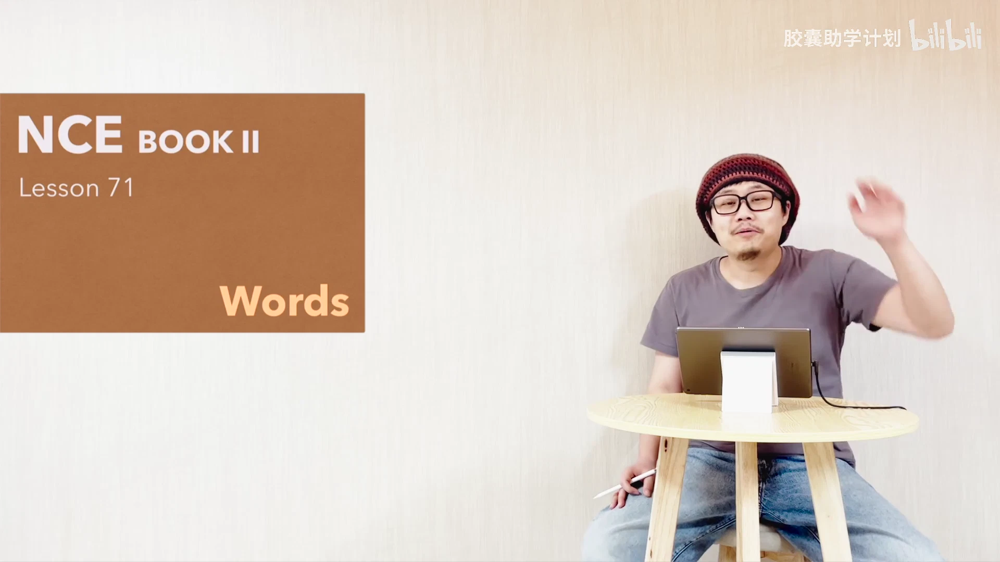

文字识别：bibii / 胶囊助学计划 / NCE / BOOKII / Lesson 71 / Words

### 画面 00:00:02

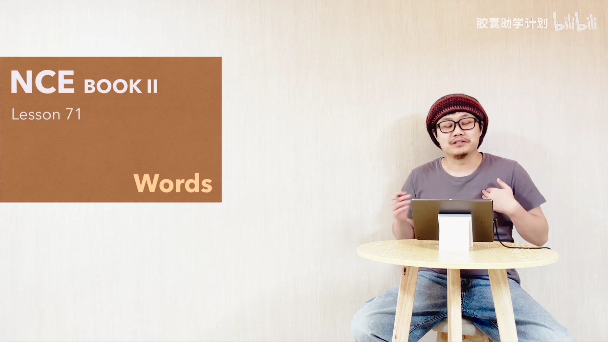

文字识别：blibii / 胶囊助学计划 / NCE / BOOKII / Lesson 71 / Words

### 画面 00:00:04

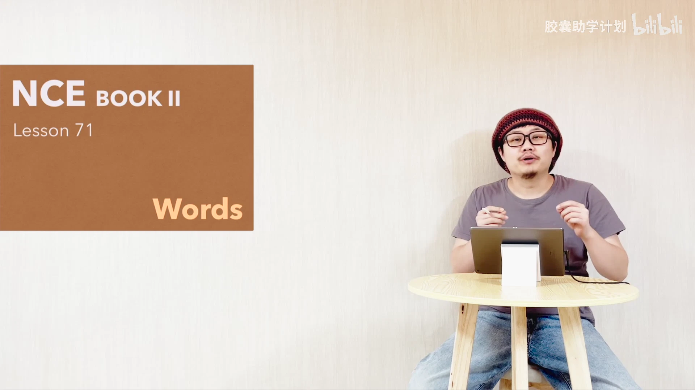

文字识别：bilbil / 胶囊助学计划 / NCE / BOOKII / Lesson 71 / Words

### 画面 00:00:07

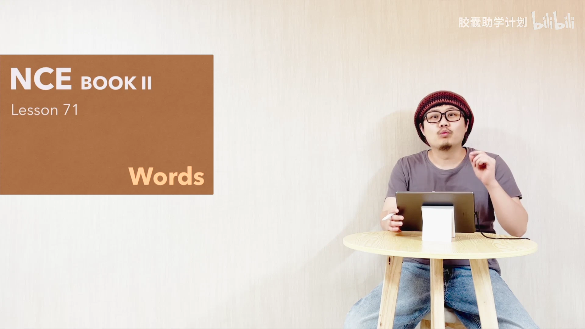

文字识别：bibii / 胶囊助学计划 / NCE / BOOKII / Lesson 71 / Words

### 画面 00:00:11

文字识别：bibii / 胶囊助学计划 / 使其正式化”?

### 画面 00:00:13

文字识别：biibili / 胶囊助学计划 / ① 如何表达“使其正式化”?

### 画面 00:00:15

文字识别：bilbili / 胶囊助学计划 / ① 如何表达“使其正式化”？

### 画面 00:00:18

文字识别： bibii / 胶囊助学计划

### 画面 00:00:22

文字识别：胶囊助学计划 / 胶囊助学计划

### 画面 00:00:24

文字识别：单词造句指南 / 网：v.+v.变化 / 胶囊助学计划 / bilbili / 四句型转换 / 方式/地点/时间 / 结合习惯用法 / 其他单词+词性 / 原文摘抄+变 / 6123456 / /'pa:lamant/ / parliament n.

### 画面 00:00:26

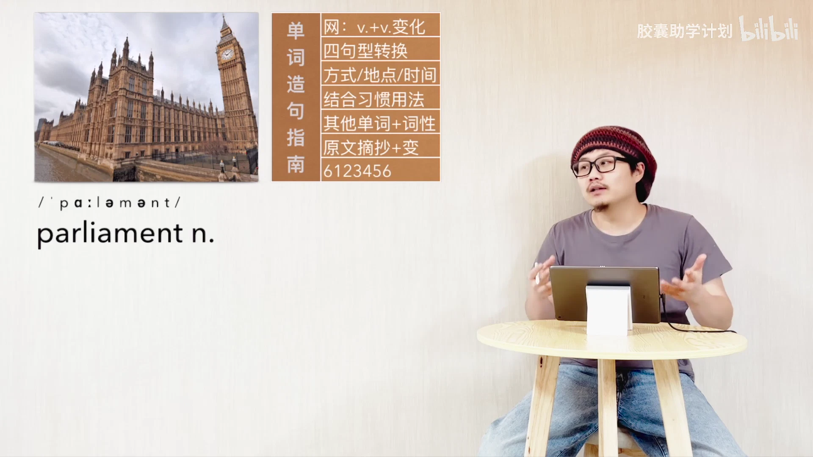

文字识别：单词造句指南 / 网：v.+v.变化 / 胶囊助学计划 / bilbili / 四句型转换 / 方式/地点/时间 / 结合习惯用法 / 其他单词+词性 / 原文摘抄+变 / 6123456 / /'pa:lamant/ / parliament n.

## 00:00:30–00:01:00

四课的时候，我们实际上就提过，对吧？就是我们这个新概念二册的教材呢，一共分四个单元，每个单元都是二十四课，每个单元的第二十三课和二十四课，那在第三单元当中就是第七十一课和第七十二课，就是复习类的课程，对吧？所以这一课呢，我们没有太多的语法上的压力要去学习，更多的可能就是去复习一下之前学过的

### 画面 00:00:30

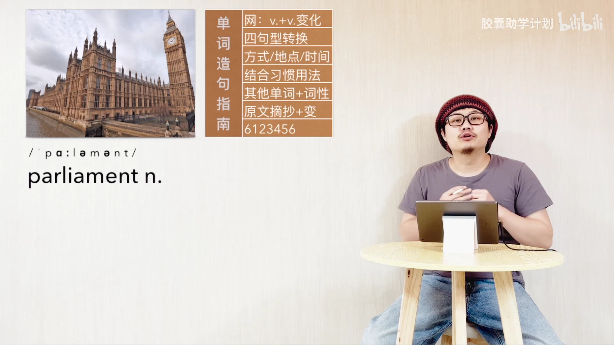

文字识别：单词造句指南 / 网：v.+v.变化 / 胶囊助学计划 / bilbili / 四句型转换 / 方式/地点/时间 / 结合习惯用法 / 其他单词+词性 / 原文摘抄+变 / 6123456 / /'pa:lamant/ / parliament n.

### 画面 00:00:34

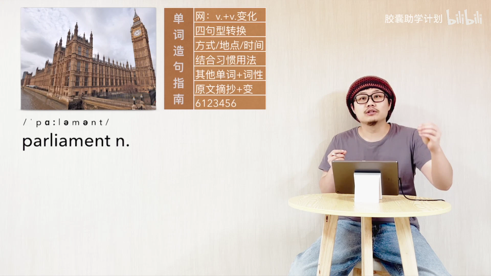

文字识别：单词造句指南 / 网：v.+v.变化 / 胶囊助学计划 / ilbii / 四句型转换 / 方式/地点/时间 / 结合习惯用法 / 其他单词+词性 / 原文摘抄+变 / 6123456 / /'pa:lamant/ / parliament n.

### 画面 00:00:37

文字识别：单词造句指南 / 网：v.+v.变化 / 胶囊助学计划 / bibil / 四句型转换 / 方式/地点/时间 / 结合习惯用法 / 其他单词+词性 / 原文摘抄+变 / 6123456 / /'pa:lamant/ / parliament n.

### 画面 00:00:40

文字识别：单词造句指南 / 网：v.+v.变化 / 胶囊助学计划 / bibii / 四句型转换 / 方式/地点/时间 / 结合习惯用法 / 其他单词+词性 / 原文摘抄+变 / 6123456 / /'pa:lamant/ / parliament n.

### 画面 00:00:46

文字识别：单词造句指南 / 网：v.+v.变化 / 胶囊助学计划 / bibili / 四句型转换 / 方式/地点/时间 / 结合习惯用法 / 其他单词+词性 / 原文摘抄+变 / 6123456 / /'pa:lamant/ / parliament n.

### 画面 00:00:49

文字识别：单词造句指南 / 网：v.+v.变化 / 胶囊助学计划 / bibili / 四句型转换 / 方式/地点/时间 / 结合习惯用法 / 其他单词+词性 / 原文摘抄+变 / 6123456 / /'pa:lamant/ / parliament n.

### 画面 00:00:51

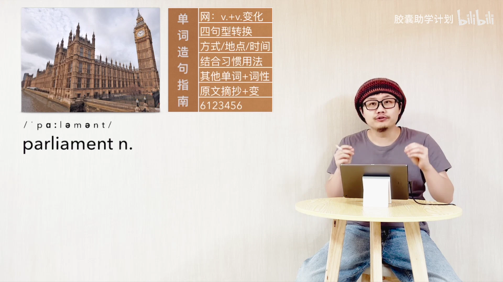

文字识别：单词造句指南 / 网：v.+v.变化 / 胶囊助学计划 / bilbili / 四句型转换 / 方式/地点/时间 / 结合习惯用法 / 其他单词+词性 / 原文摘抄+变 / 6123456 / /pa:lamant/ / parliament n.

### 画面 00:00:55

文字识别：单词造句指南 / 网：v.+v.变化 / 胶囊助学计划 / bilbil / 四句型转换 / 方式/地点/时间 / 结合习惯用法 / 其他单词+词性 / 原文摘抄+变 / 6123456 / /'pa:lamant/ / parliament n.

## 00:01:00–00:01:30

东西，在文章当中出现了，哎，我们就见一下就可以了。所以本课其实是一个，呃，我们在线下上课的时候是一个这个叫做呃简单学一下啊略学的一个课程。OK，那我们还是直接看单词啊。首先第一个单词我们不用去造句了，这个句子各位一时半会儿可能见不着第二次了啊。但是呢，呃，我们还是看一下它的音标，叫做parliament，parliament，parliament是议

### 画面 00:01:00

文字识别：单词造句指南 / 网：v.+v.变化 / 胶囊助学计划 / bilbili / 四句型转换 / 方式/地点/时间 / 结合习惯用法 / 其他单词+词性 / 原文摘抄+变 / 6123456 / /'pa:lamant/ / parliament n.

### 画面 00:01:03

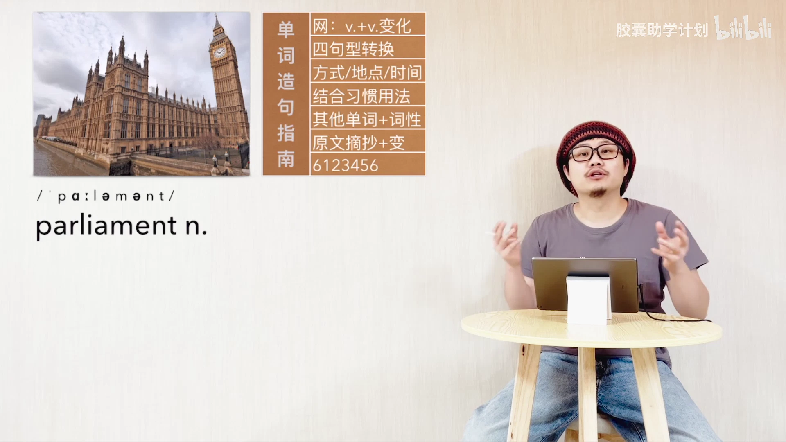

文字识别：单词造句指南 / 网：v.+v.变化 / 胶囊助学计划 / bilbili / 四句型转换 / 方式/地点/时间 / 结合习惯用法 / 其他单词+词性 / 原文摘抄+变 / 6123456 / /'pa:lamant/ / parliament n.

### 画面 00:01:06

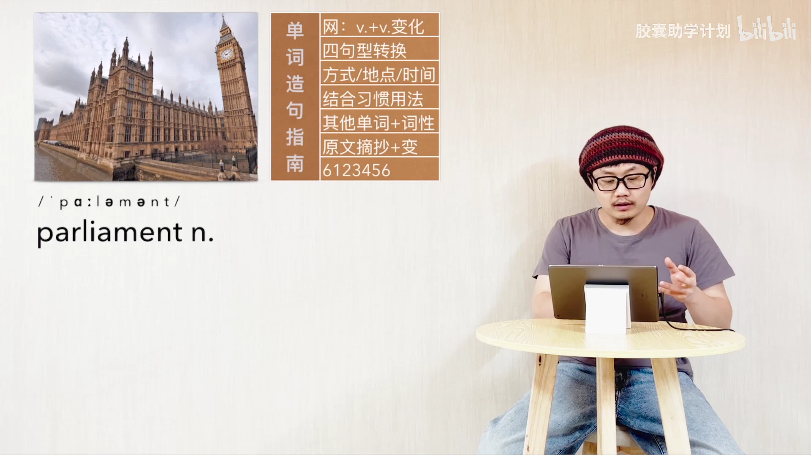

文字识别：单词造句指南 / 网：v.+v.变化 / 胶囊助学计划 / bilbili / 四句型转换 / 方式/地点/时间 / 结合习惯用法 / 其他单词+词性 / 原文摘抄+变 / 6123456 / /'pa:lamant/ / parliament n.

### 画面 00:01:09

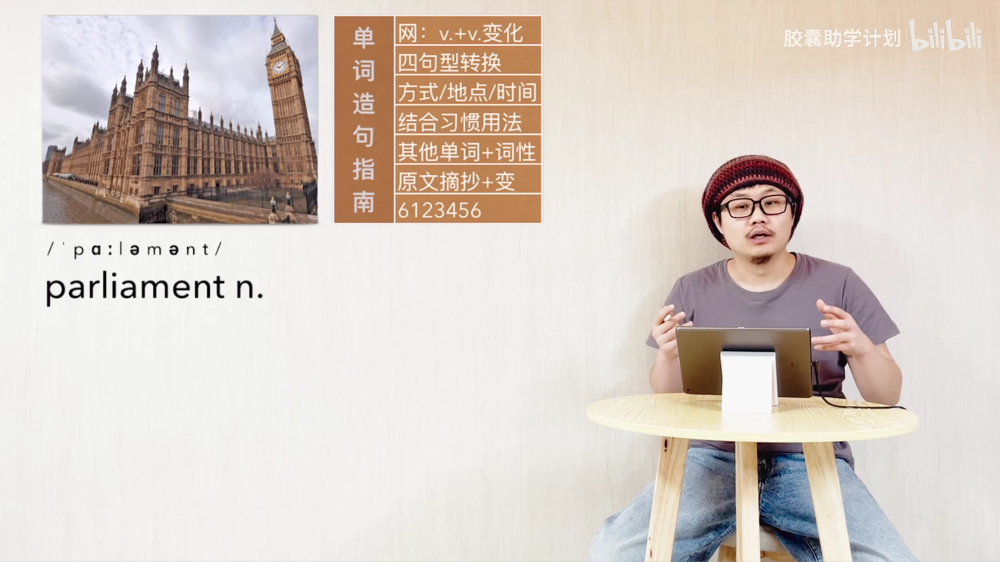

文字识别：单词造句指南 / 网：v.+v.变化 / 胶囊助学计划 / bilbili / 四句型转换 / 方式/地点/时间 / 结合习惯用法 / 其他单词+词性 / 原文摘抄+变 / 6123456 / /'pa:lamant/ / parliament n.

### 画面 00:01:11

文字识别：单词造句指南 / 网：v.+v.变化 / 胶囊助学计划 / bibili / 四句型转换 / 方式/地点/时间 / 结合习惯用法 / 其他单词+词性 / 原文摘抄+变 / 6123456 / /'pa:lamant/ / parliament n.

### 画面 00:01:13

文字识别：单词造句指南 / 网：v.+v.变化 / 胶囊助学计划 / bilbili / 四句型转换 / 方式/地点/时间 / 结合习惯用法 / 其他单词+词性 / 原文摘抄+变 / 6123456 / /'pa:lamant/ / parliament n.

### 画面 00:01:15

文字识别：单词造句指南 / 网：v.+v.变化 / 胶囊助学计划 / bilbili / 四句型转换 / 方式/地点/时间 / 结合习惯用法 / 其他单词+词性 / 原文摘抄+变 / 6123456 / /'pa:lamant/ / parliament n.

### 画面 00:01:20

文字识别：单词造句指南 / 网：v.+v.变化 / 胶囊助学计划 / bibili / 四句型转换 / 方式/地点/时间 / 结合习惯用法 / 其他单词+词性 / 原文摘抄+变 / 6123456 / /'pa:lamant/ / parliament n.

### 画面 00:01:27

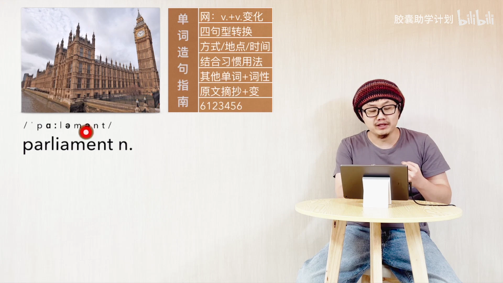

文字识别：单词造句指南 / 网：v.+v.变化 / 胶囊助学计划 / bibili / 四句型转换 / 方式/地点/时间 / 结合习惯用法 / 其他单词+词性 / 原文摘抄+变 / 6123456 / /pa:lam / nt/ / parliament n.

## 00:01:30–00:02:00

会的意思啊。比如说，英国就分上议会和下议会，对吧？Parliament。那在文章当中出了一个短语叫Houses of the Parliament。Houses of the Parliament是英国的这个国会大厦啊。英国的国会大厦呢，并最开始的国会大厦并不是各位现在在图中看到这个非常著名的这个建筑物。这个建筑物啊，我们管它叫做这个维斯敏特斯，是吧？啊，维斯敏斯特啊，维斯

### 画面 00:01:30

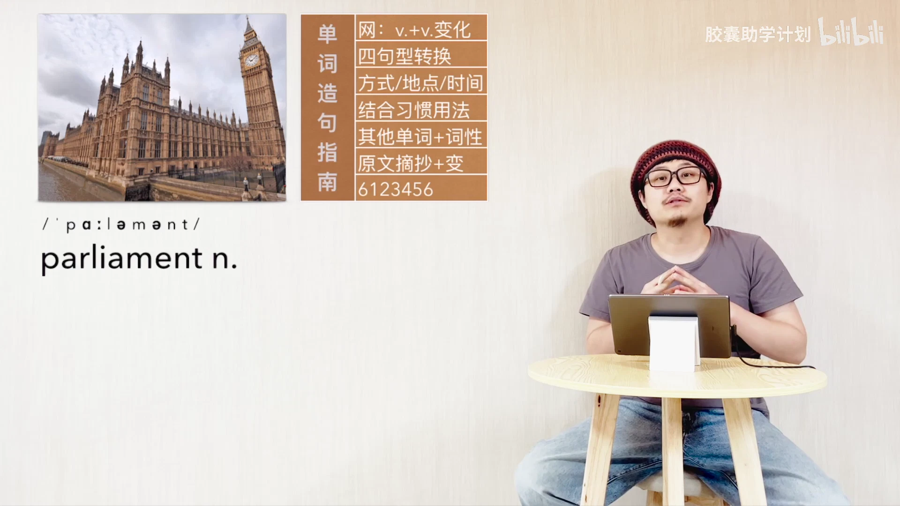

文字识别：单词造句指南 / 网：v.+v.变化 / 胶囊助学计划 / bilbili / 四句型转换 / 方式/地点/时间 / 结合习惯用法 / 其他单词+词性 / 原文摘抄+变 / 6123456 / /'pa:lamant/ / parliament n.

### 画面 00:01:33

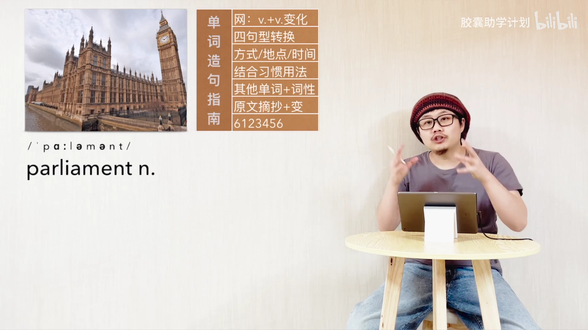

文字识别：单词造句指南 / 网：v.+v.变化 / 胶囊助学计划 / bilbili / 四句型转换 / 方式/地点/时间 / 结合习惯用法 / 其他单词+词性 / 原文摘抄+变 / 6123456 / /'pa:lamant/ / parliament n.

### 画面 00:01:35

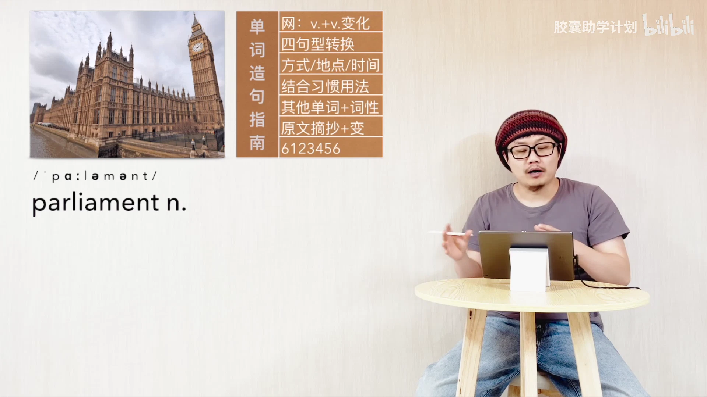

文字识别：单词造句指南 / 网：v.+v.变化 / 胶囊助学计划 / bilbili / 四句型转换 / 方式/地点/时间 / 结合习惯用法 / 其他单词+词性 / 原文摘抄+变 / 6123456 / /'pa:lamant/ / parliament n.

### 画面 00:01:38

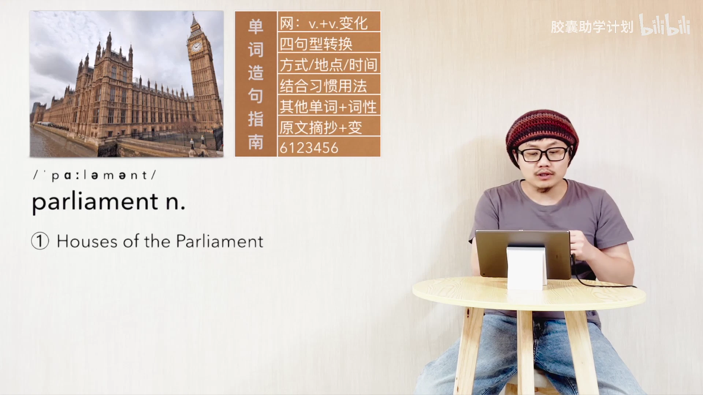

文字识别：单词造句指南 / 网：v.+v.变化 / 胶囊助学计划 / bilbili / 四句型转换 / 方式/地点/时间 / 结合习惯用法 / 其他单词+词性 / 原文摘抄+变 / 6123456 / /'pa:lamant / / parliament n. /  Houses of the Parliament / 1

### 画面 00:01:40

文字识别：单词造句指南 / 网：v.+v.变化 / 胶囊助学计划 / bibili / 四句型转换 / 方式/地点/时间 / 结合习惯用法 / 其他单词+词性 / 原文摘抄+变 / 6123456 / /'pa:lamant/ / parliament n. /  Houses of the Parliament

### 画面 00:01:44

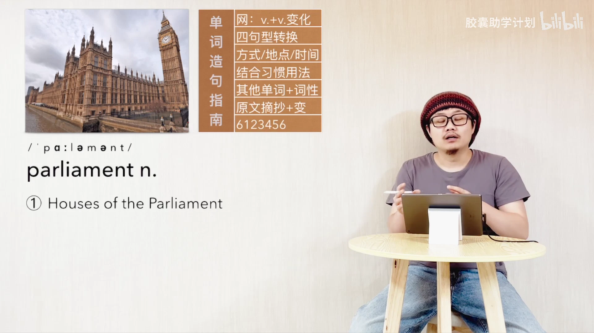

文字识别：单词造句指南 / 网：v.+v.变化 / 胶囊助学计划 / bilbili / 四句型转换 / 方式/地点/时间 / 结合习惯用法 / 其他单词+词性 / 原文摘抄+变 / 6123456 / /'pa:lamant/ / parliament n. / ① Houses of the Parliament

### 画面 00:01:46

文字识别：单词造句指南 / 网：v.+v.变化 / 胶囊助学计划 / biibili / 四句型转换 / 方式/地点/时间 / 结合习惯用法 / 其他单词+词性 / 原文摘抄+变 / 6123456 / /'pa:lamant/ / parliament n. / ① Houses of the Parliament

### 画面 00:01:48

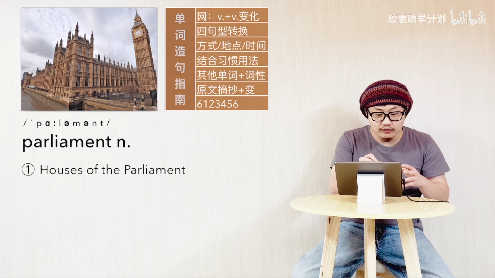

文字识别：单词造句指南 / 网：v.+v.变化 / 胶囊助学计划 / bibii / 四句型转换 / 方式/地点/时间 / 结合习惯用法 / 其他单词+词性 / 原文摘抄+变 / 6123456 / /'pa:lamant/ / parliament n. / ① Houses of the Parliament

### 画面 00:01:50

文字识别：单词造句指南 / 网：v.+v.变化 / 胶囊助学计划 / bibili / 四句型转换 / 方式/地点/时间 / 结合习惯用法 / 其他单词+词性 / 原文摘抄+变 / 6123456 / /'pa:lamant / / parliament n. /  Houses of the Parliament / 1

### 画面 00:01:52

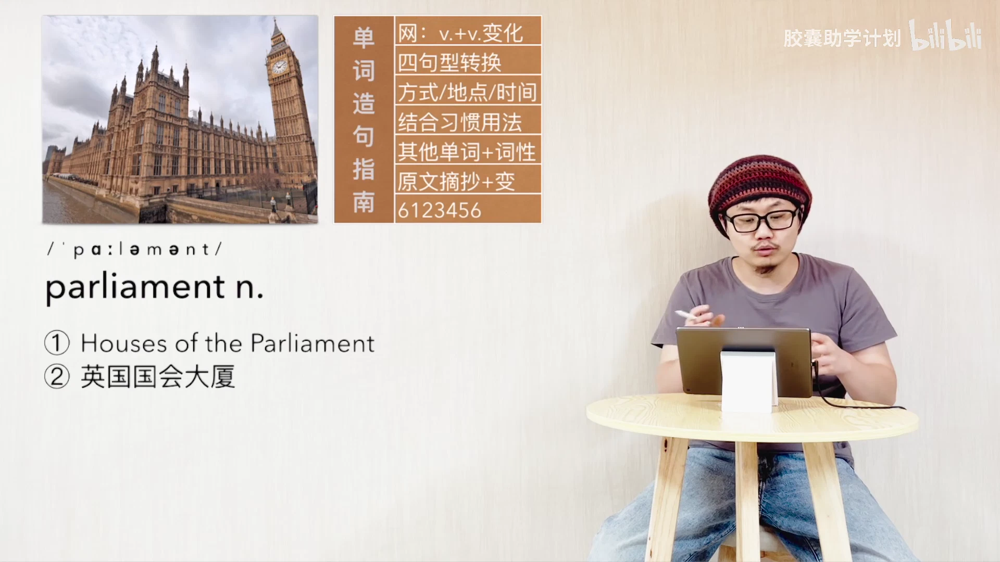

文字识别：单词造句指南 / 网：v.+v.变化 / 胶囊助学计划 / bilbili / 四句型转换 / 方式/地点/时间 / 结合习惯用法 / 其他单词+词性 / 原文摘抄+变 / 6123456 / /'pa:lamant/ / parliament n. / ) Houses of the Parliament / 英国国会大厦

### 画面 00:01:55

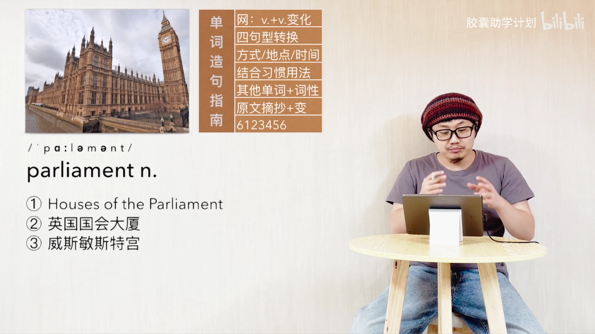

文字识别：单词造句指南 / 网：v.+v.变化 / 胶囊助学计划 / bilbili / 四句型转换 / 方式/地点/时间 / 结合习惯用法 / 其他单词+词性 / 原文摘抄+变 / 6123456 / /'pa:lamant / / parliament n. / Houses of the Parliament / 英国国会大厦 / 威斯敏斯特宮

### 画面 00:01:58

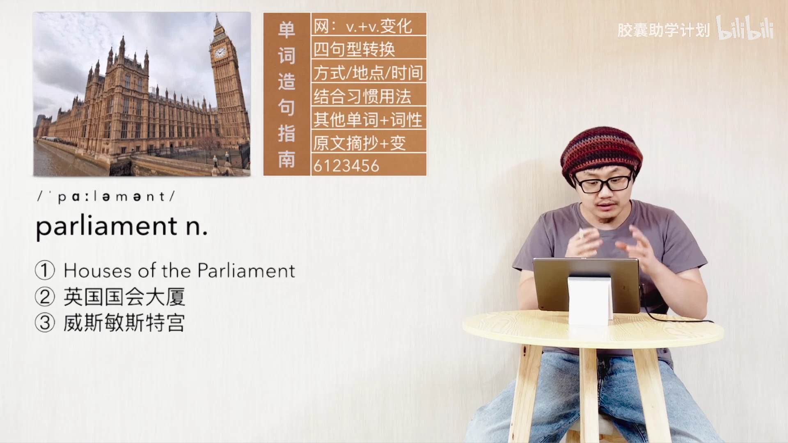

文字识别：单词造句指南 / 网：v.+v.变化 / 胶囊助学计划 / bilbii / 四句型转换 / 方式/地点/时间 / 结合习惯用法 / 其他单词+词性 / 原文摘抄+变 / 6123456 / /'pa:lamant / / parliament n. / Houses of the Parliament / 英国国会大厦 / 威斯敏斯特宮

## 00:02:00–00:02:30

敏斯特宫是吧？这个其实我自己也不太知道它的含义是这个啊，但是这个建筑物我相信大家都认得，尤其是它右边的这个，在图中右边出现的这个Big Ben是吧？这个大本钟，可能对呃很多中国人来说，它都是一个地标性的建筑物啊。那我们现在看到的这个维斯敏斯特宫啊，它实际上是一八四零年后来又重建的啊。我们本文其实也提到了啊，应该是一八三四年原来的英国的国会大厦烧了是吧？

### 画面 00:02:00

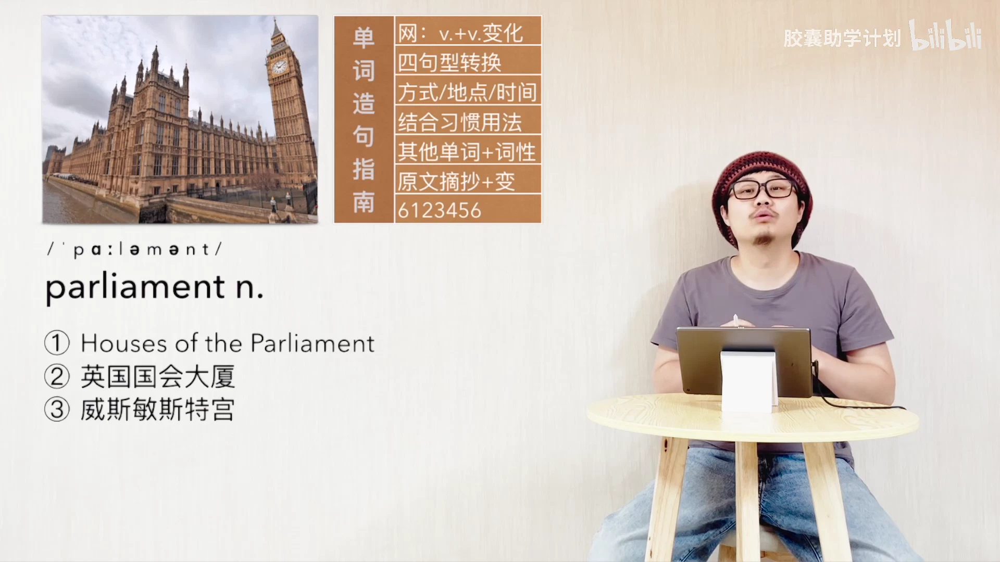

文字识别：单词造句指南 / 网：v.+v.变化 / 胶囊助学计划 / bilbii / 四句型转换 / 方式/地点/时间 / 结合习惯用法 / 其他单词+词性 / 原文摘抄+变 / 6123456 / /'pa:lamant / / parliament n. / Houses of the Parliament / 1 / 英国国会大厦 / 威斯敏斯特宮

### 画面 00:02:02

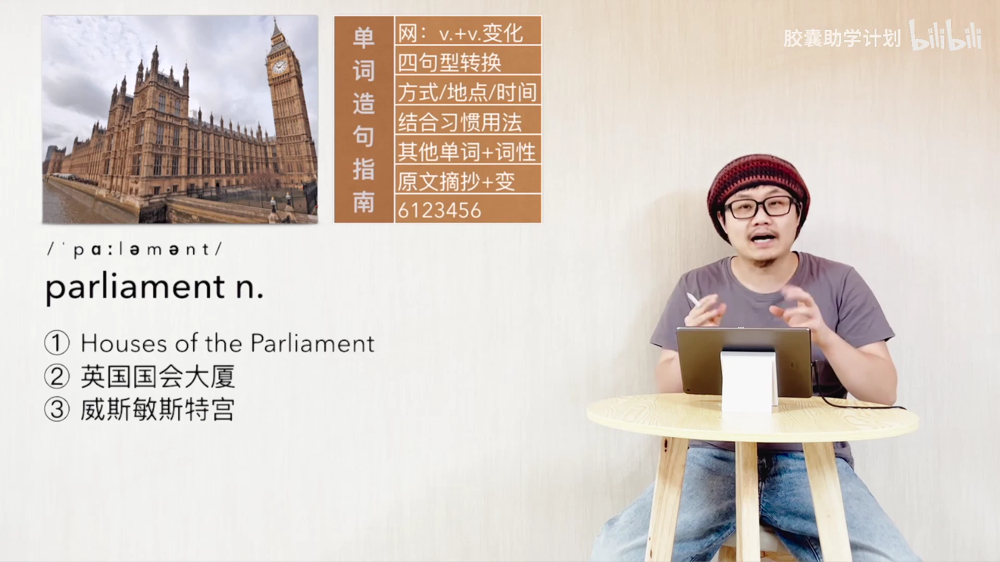

文字识别：单词造句指南 / 网：v.+v.变化 / 胶囊助学计划 / bibili / 四句型转换 / 方式/地点/时间 / 结合习惯用法 / 其他单词+词性 / 原文摘抄+变 / 6123456 / /'pa:lamant / / parliament n. / Houses of the Parliament / 英国国会大厦 / 威斯敏斯特宮

### 画面 00:02:05

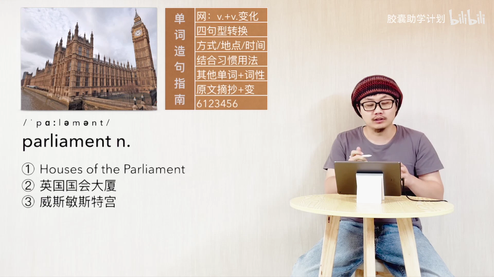

文字识别：单词造句指南 / 网：v.+v.变化 / 胶囊助学计划 / bibi / 四句型转换 / 方式/地点/时间 / 结合习惯用法 / 其他单词+词性 / 原文摘抄+变 / 6123456 / /'pa:lamant / / parliament n. / Houses of the Parliament / 英国国会大厦 / 威斯敏斯特宮

### 画面 00:02:07

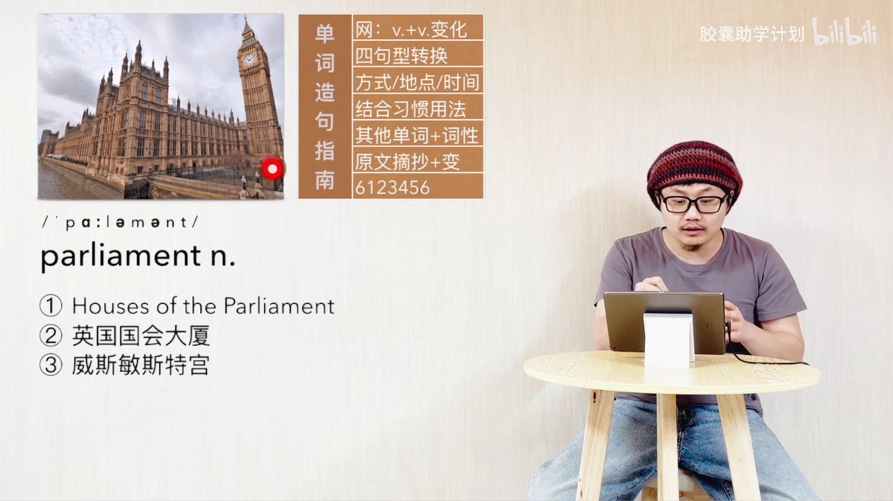

文字识别：单词造句指南 / 网：v.+v.变化 / 胶囊助学计划 / bibii / 四句型转换 / 方式/地点/时间 / 结合习惯用法 / 其他单词+词性 / 原文摘抄+变 / 6123456 / /'pa:lamant / / parliament n. / Houses of the Parliament / 英国国会大厦 / 威斯敏斯特宮

### 画面 00:02:09

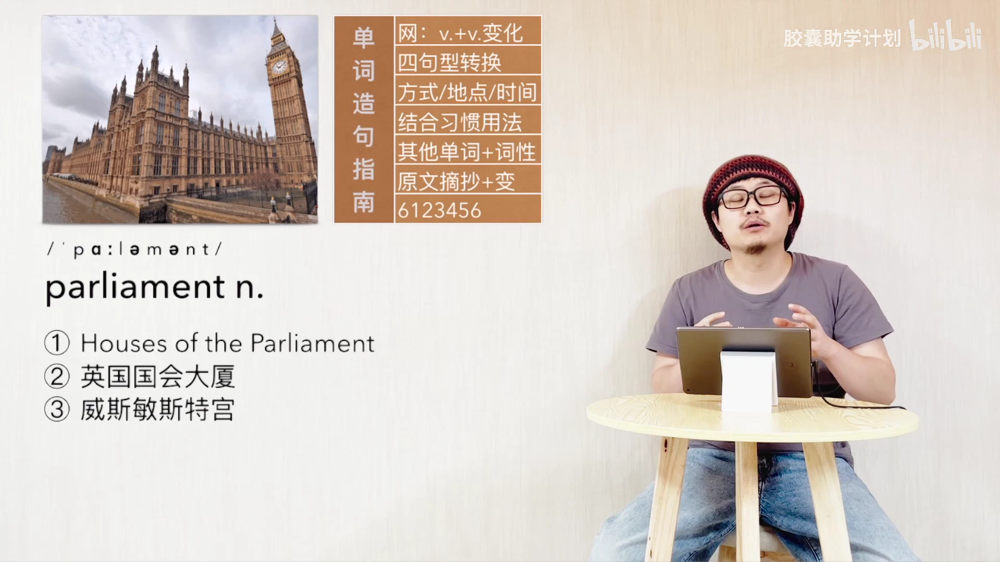

文字识别：单词造句指南 / 网：v.+v.变化 / 胶囊助学计划 / bilbii / 四句型转换 / 方式/地点/时间 / 结合习惯用法 / 其他单词+词性 / 原文摘抄+变 / 6123456 / /'pa:lamant / / parliament n. / Houses of the Parliament / 英国国会大厦 / 威斯敏斯特宮

### 画面 00:02:11

文字识别：单词造句指南 / 网：v.+v.变化 / 胶囊助学计划 / bibili / 四句型转换 / 方式/地点/时间 / 结合习惯用法 / 其他单词+词性 / 原文摘抄+变 / 6123456 / /'pa:lamant / / parliament n. / Houses of the Parliament / 英国国会大厦 / 威斯敏斯特宮

### 画面 00:02:16

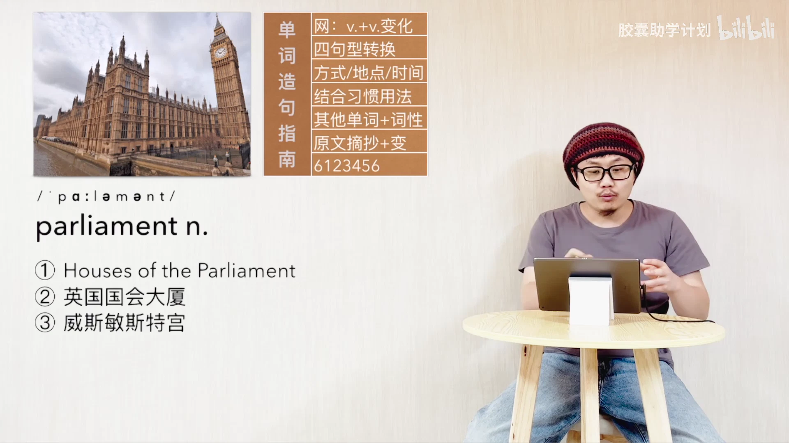

文字识别：单词造句指南 / 网：v.+v.变化 / 胶囊助学计划 / bibili / 四句型转换 / 方式/地点/时间 / 结合习惯用法 / 其他单词+词性 / 原文摘抄+变 / 6123456 / /'pa:lamant / / parliament n. / Houses of the Parliament / 英国国会大厦 / 威斯敏斯特宮

### 画面 00:02:20

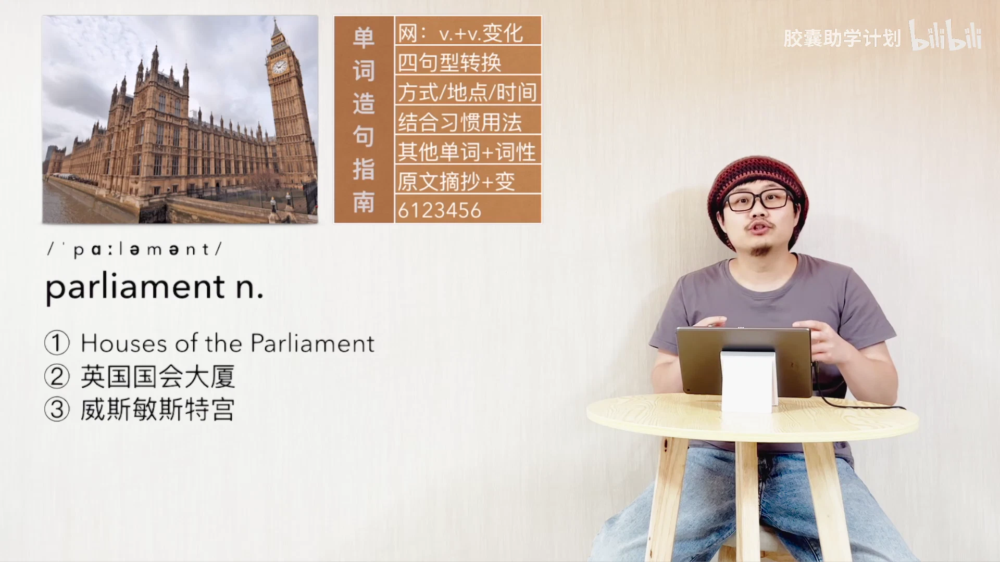

文字识别：单词造句指南 / 网：v.+v.变化 / 胶囊助学计划 / bilbili / 四句型转换 / 方式/地点/时间 / 结合习惯用法 / 其他单词+词性 / 原文摘抄+变 / 6123456 / /'pa:lamant / / parliament n. / Houses of the Parliament / 英国国会大厦 / 威斯敏斯特宮

### 画面 00:02:23

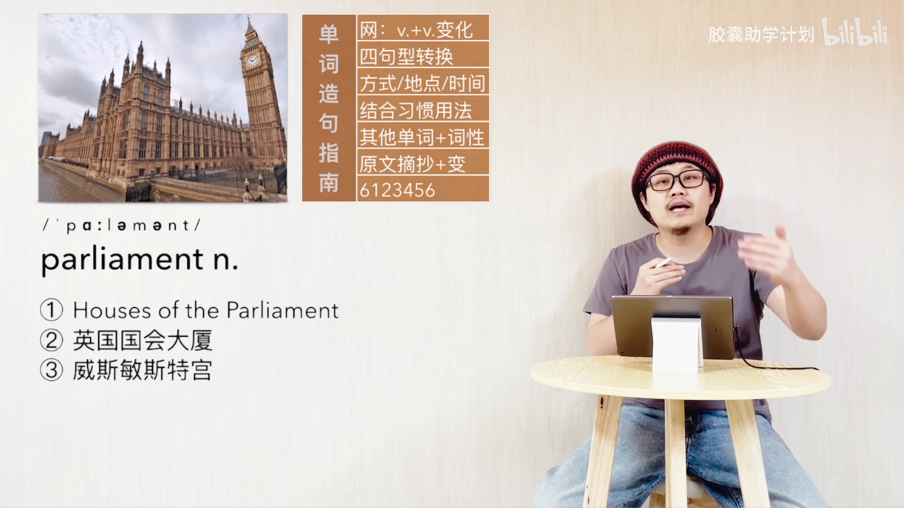

文字识别：单词造句指南 / 网：v.+v.变化 / 胶囊助学计划 / bilbili / 四句型转换 / 方式/地点/时间 / 结合习惯用法 / 其他单词+词性 / 原文摘抄+变 / 6123456 / /'pa:lamant / / parliament n. / Houses of the Parliament / 1 / 英国国会大厦 / 威斯敏斯特宮

### 画面 00:02:25

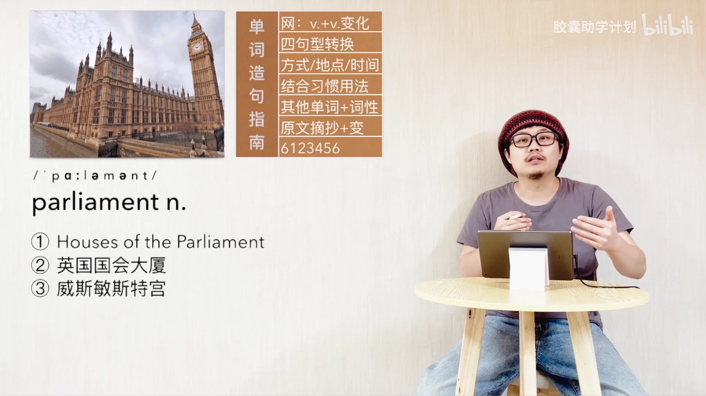

文字识别：单词造句指南 / 网：v.+v.变化 / 胶囊助学计划 / bilbili / 四句型转换 / 方式/地点/时间 / 结合习惯用法 / 其他单词+词性 / 原文摘抄+变 / 6123456 / /'pa:lamant / / parliament n. / Houses of the Parliament / 英国国会大厦 / 威斯敏斯特宮

### 画面 00:02:27

文字识别：单词造句指南 / 网：v.+v.变化 / 胶囊助学计划 / bilbili / 四句型转换 / 方式/地点/时间 / 结合习惯用法 / 其他单词+词性 / 原文摘抄+变 / 6123456 / /'pa:lamant / / parliament n. / Houses of the Parliament / 1 / 英国国会大厦 / 威斯敏斯特宮

### 画面 00:02:29

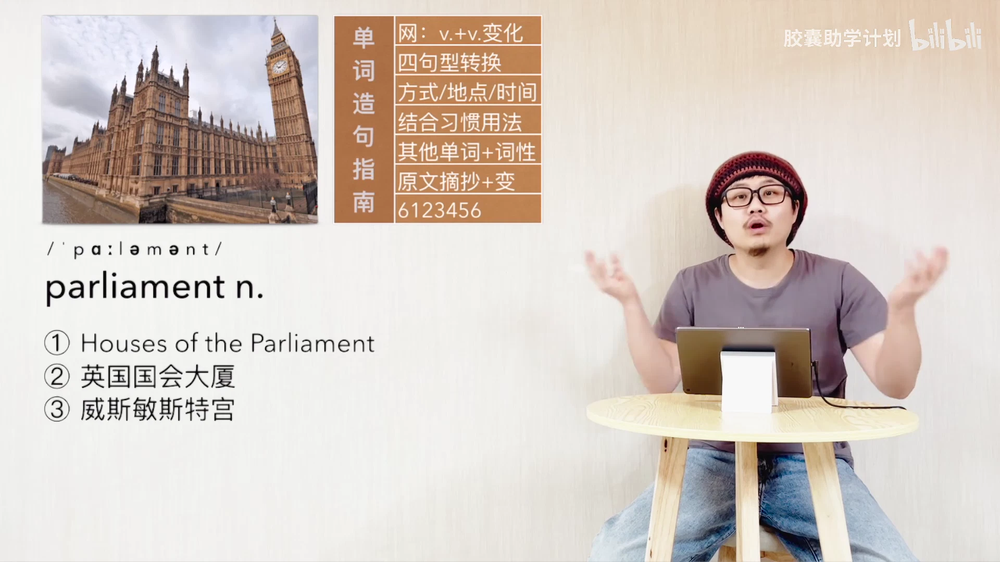

文字识别：单词造句指南 / 网：v.+v.变化 / 胶囊助学计划 / bilbili / 四句型转换 / 方式/地点/时间 / 结合习惯用法 / 其他单词+词性 / 原文摘抄+变 / 6123456 / /'pa:lamant / / parliament n. / Houses of the Parliament / 英国国会大厦 / 威斯敏斯特宮

## 00:02:30–00:03:00

焚毁了，然后后来又建了这个新的这个维斯敏斯特宫啊，呃，所以我们文章当中出现了一个叫 Houses of the Parliament，它叫做英国国会大厦啊，就是说上议院、下议院都在那个地方是吧？叫 Houses of the Parliament。 Okay, next one，下一个单词，这个就是我们要重点学习的一些最常用的单词，无论在哪儿您都可能用得到的单词啊。这个单词我们一起看一下，叫做 erect， erect，啊，就是

### 画面 00:02:31

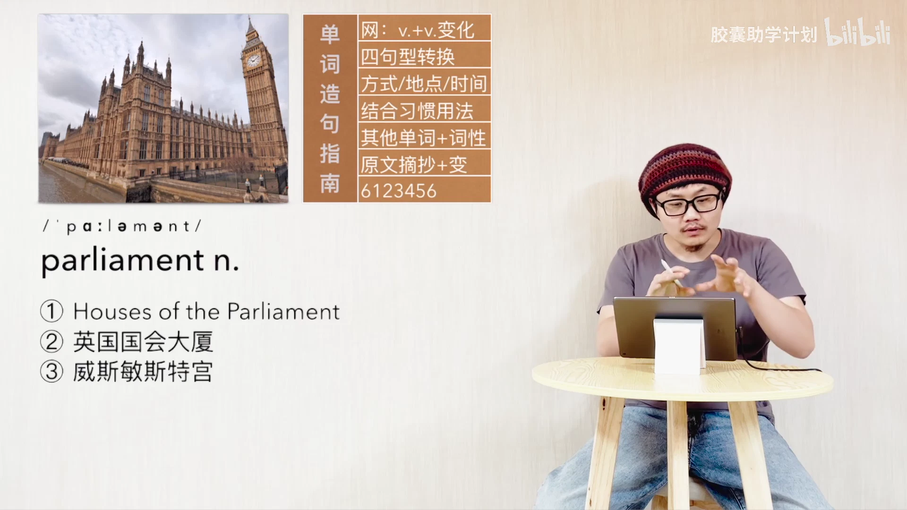

文字识别：单词造句指南 / 网：v.+v.变化 / 胶囊助学计划 / bilbii / 四句型转换 / 方式/地点/时间 / 结合习惯用法 / 其他单词+词性 / 原文摘抄+变 / 6123456 / /'pa:lamant / / parliament n. / Houses of the Parliament / 英国国会大厦 / 威斯敏斯特宮

### 画面 00:02:34

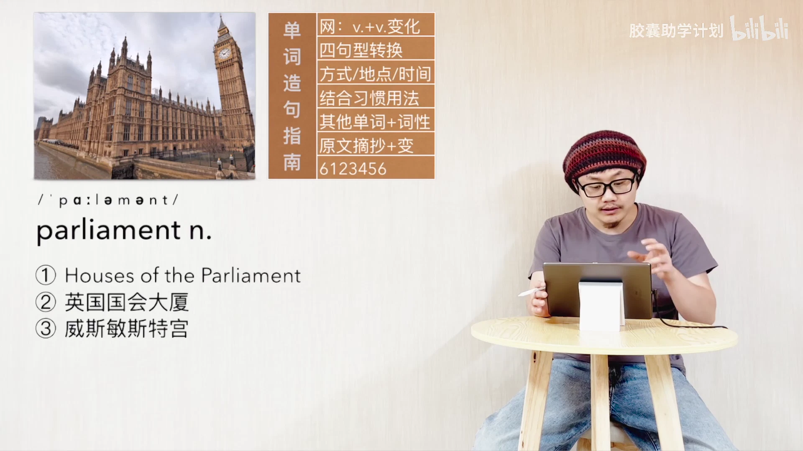

文字识别：单词造句指南 / 网：v.+v.变化 / 胶囊助学计划 / bibili / 四句型转换 / 方式/地点/时间 / 结合习惯用法 / 其他单词+词性 / 原文摘抄+变 / 6123456 / /'pa:lamant / / parliament n. / Houses of the Parliament / 英国国会大厦 / 威斯敏斯特宮

### 画面 00:02:36

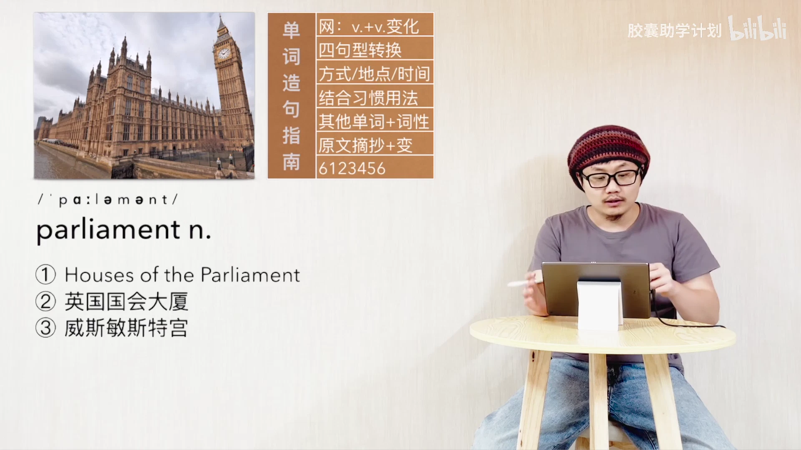

文字识别：单词造句指南 / 网：v.+v.变化 / 胶囊助学计划 / Bilbii / 四句型转换 / 方式/地点/时间 / 结合习惯用法 / 其他单词+词性 / 原文摘抄+变 / 6123456 / /'pa:lamant / / parliament n. / Houses of the Parliament / 英国国会大厦 / 威斯敏斯特宮

### 画面 00:02:38

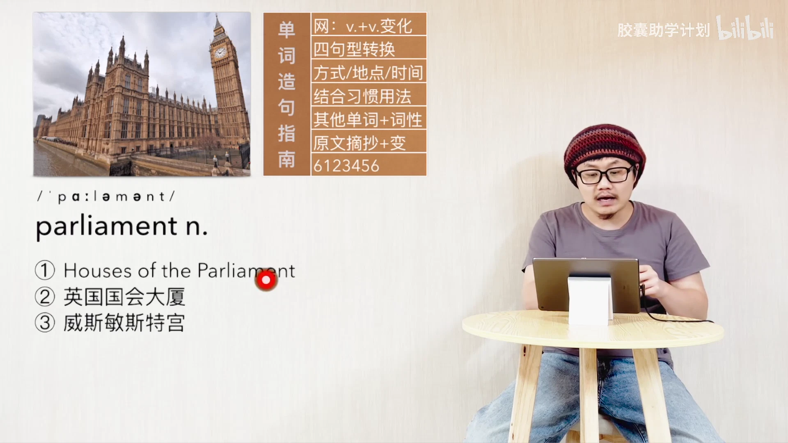

文字识别：单词造句指南 / 网：v.+v.变化 / 胶囊助学计划 / bibili / 四句型转换 / 方式/地点/时间 / 结合习惯用法 / 其他单词+词性 / 原文摘抄+变 / 6123456 / /'pa:lamant/ / parliament n. / Houses of the Parliam. / nt / 英国国会大厦 / 威斯敏斯特宮

### 画面 00:02:40

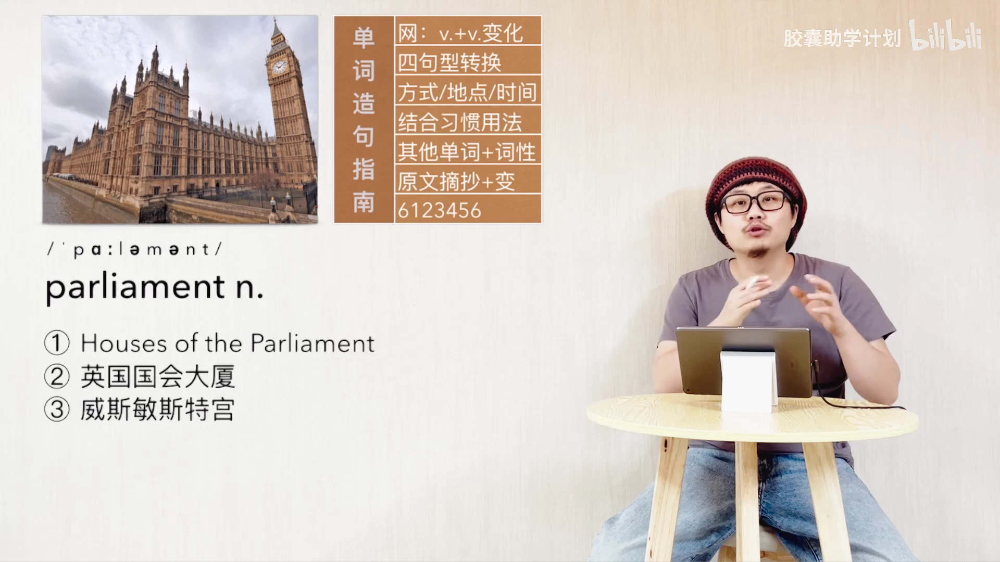

文字识别：单词造句指南 / 网：v.+v.变化 / 胶囊助学计划 / bilbili / 四句型转换 / 方式/地点/时间 / 结合习惯用法 / 其他单词+词性 / 原文摘抄+变 / 6123456 / /'pa:lamant / / parliament n. / Houses of the Parliament / 1 / 英国国会大厦 / 威斯敏斯特宮

### 画面 00:02:42

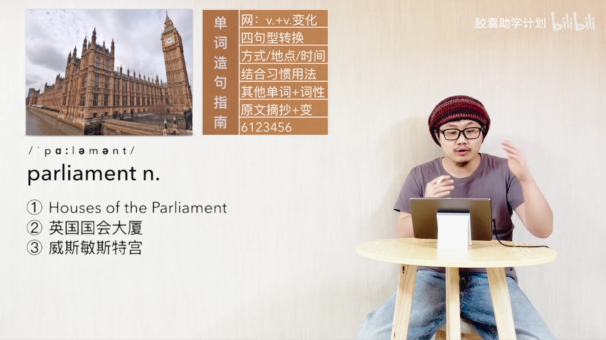

文字识别：单词造句指南 / 网：v.+v.变化 / 胶囊助学计划 / bibili / 四句型转换 / 方式/地点/时间 / 结合习惯用法 / 其他单词+词性 / 原文摘抄+变 / 6123456 / /'pa:lamant / / parliament n. / Houses of the Parliament / 1 / 英国国会大厦 / 威斯敏斯特宮

### 画面 00:02:44

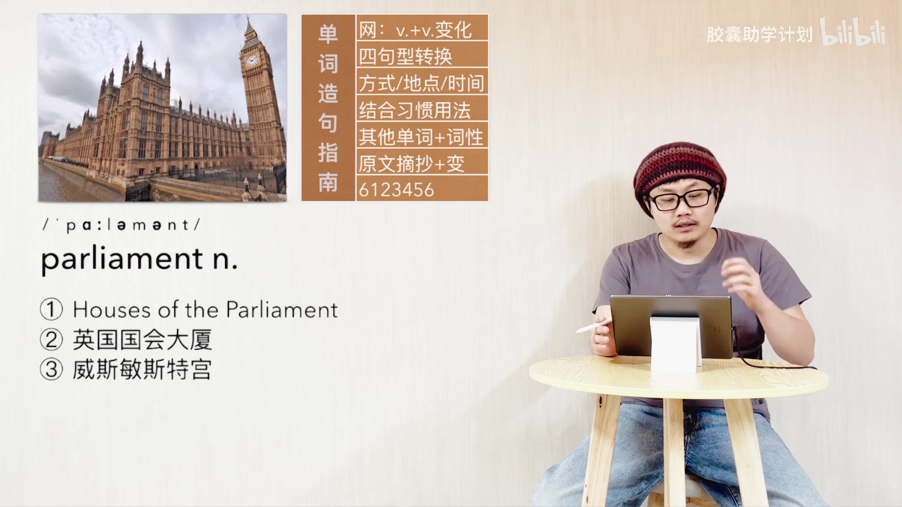

文字识别：单词造句指南 / 网：v.+v.变化 / 胶囊助学计划 / bilbili / 四句型转换 / 方式/地点/时间 / 结合习惯用法 / 其他单词+词性 / 原文摘抄+变 / 6123456 / /'pa:lamant / / parliament n. / Houses of the Parliament / 1 / 英国国会大厦 / 威斯敏斯特宮

### 画面 00:02:46

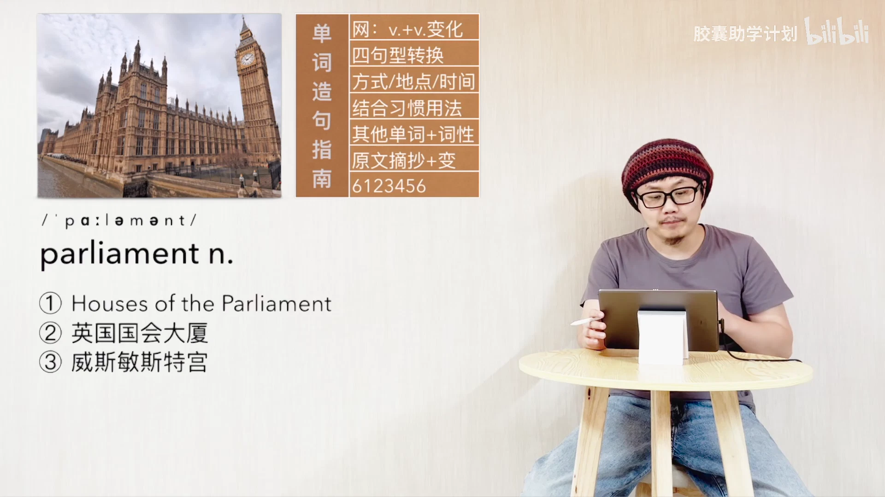

文字识别：单词造句指南 / 网：v.+v.变化 / 胶囊助学计划 / bibii / 四句型转换 / 方式/地点/时间 / 结合习惯用法 / 其他单词+词性 / 原文摘抄+变 / 6123456 / /'pa:lamant / / parliament n. / Houses of the Parliament / 英国国会大厦 / 威斯敏斯特宮

### 画面 00:02:48

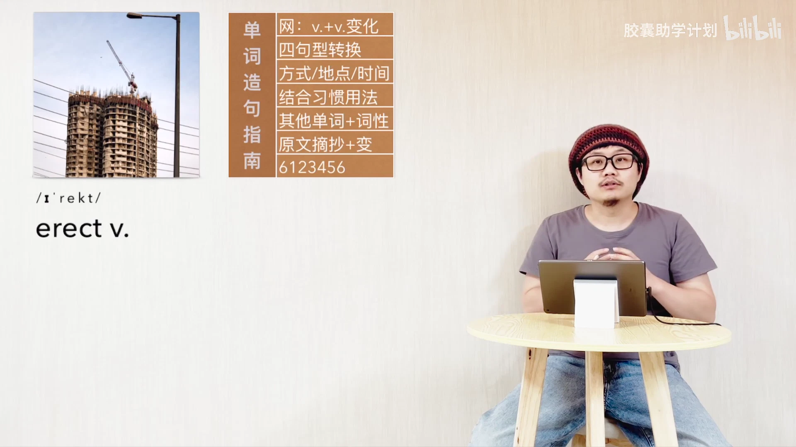

文字识别：单词造句指南 / 网：v.+v.变化 / 胶囊助学计划 / bibii / 四句型转换 / 方式/地点/时间 / 结合习惯用法 / 其他单词+词性 / 原文摘抄+变 / 6123456 / /I'rekt/ / erect v.

### 画面 00:02:50

文字识别：单词造句指南 / 网：v.+v.变化 / 胶囊助学计划 / bibii / 四句型转换 / 方式/地点/时间 / 结合习惯用法 / 其他单词+词性 / 原文摘抄+变 / 6123456 / /I'rekt/ / erect v.

### 画面 00:02:52

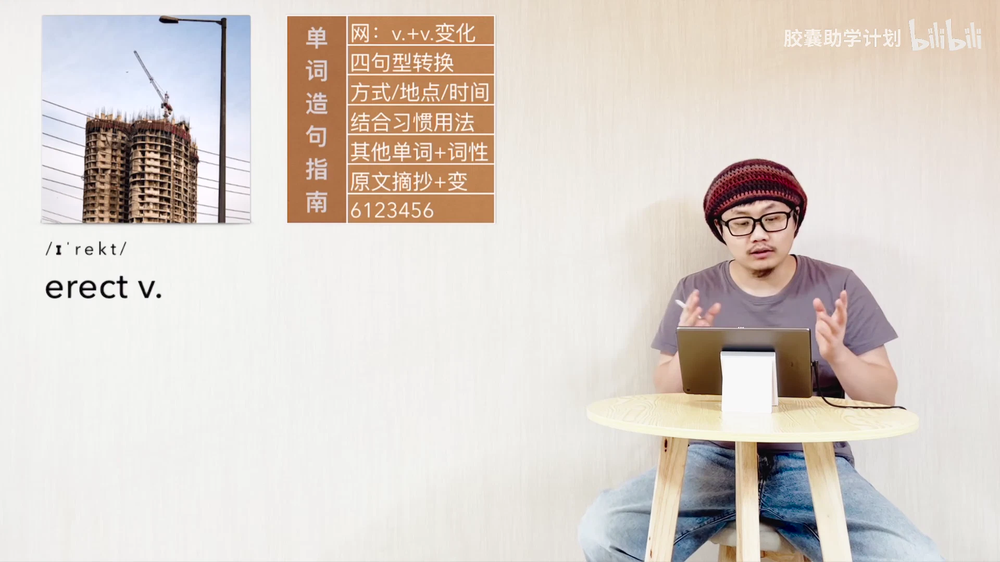

文字识别：单词造句指南 / 网：v.+v.变化 / 胶囊助学计划 / bibii / 四句型转换 / 方式/地点/时间 / 结合习惯用法 / 其他单词+词性 / 原文摘抄+变 / 6123456 / /I'rekt/ / erect v.

### 画面 00:02:55

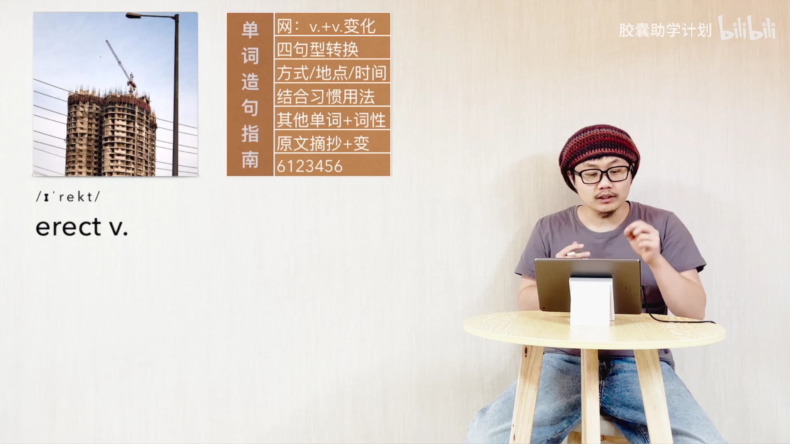

文字识别：单词造句指南 / 网：v.+v.变化 / 胶囊助学计划 / biibii / 四句型转换 / 方式/地点/时间 / 结合习惯用法 / 其他单词+词性 / 原文摘抄+变 / 6123456 / /I'rekt/ / erect v.

### 画面 00:02:57

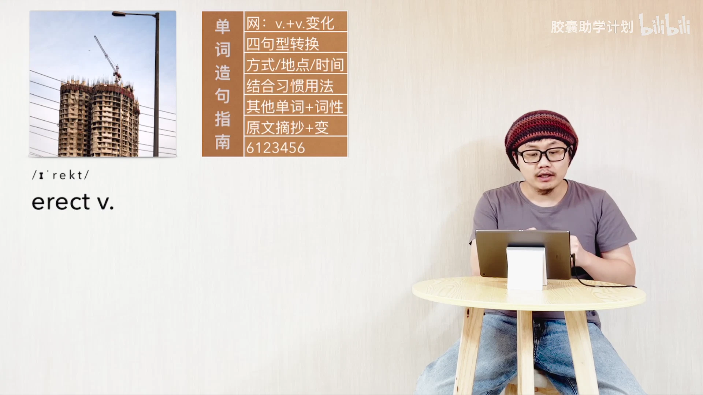

文字识别：单词造句指南 / 网：v.+v.变化 / 胶囊助学计划 / bilbil / 四句型转换 / 方式/地点/时间 / 结合习惯用法 / 其他单词+词性 / 原文摘抄+变 / 6123456 / /I'rekt/ / erect v.

## 00:03:00–00:03:30

建立、树立，erect这样的一个动词。你比如说，我们看一句话叫做，It took a couple of hours to do something.好，这是五十课学的，花了多长时间去做某件事情？去干什么呢？Erect the tent.啊，什么建立、树立这个帐篷？其实我们翻译成汉语就一个字儿搭就可以了，搭帐篷，对吧？OK. Next one,说She insisted on erecting the wall between her yard and mine.坚持要把这个墙

### 画面 00:03:00

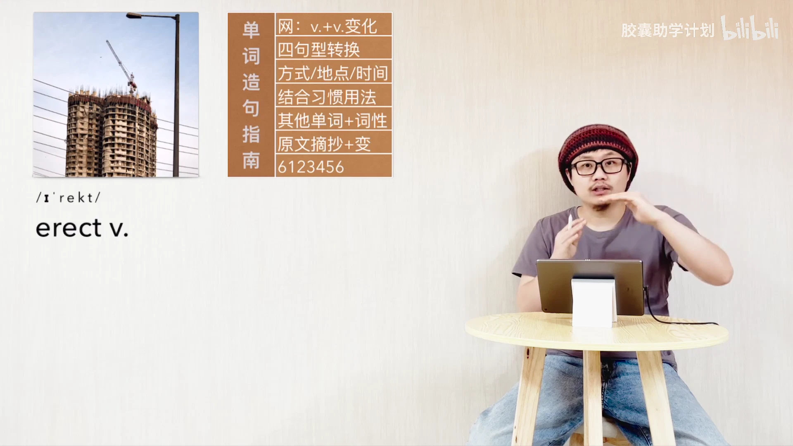

文字识别：单词造句指南 / 网：v.+v.变化 / 胶囊助学计划 / bibii / 四句型转换 / 方式/地点/时间 / 结合习惯用法 / 其他单词+词性 / 原文摘抄+变 / 6123456 / /I'rekt/ / erect v.

### 画面 00:03:02

文字识别：单词造句指南 / 网：v.+v.变化 / 胶囊助学计划 / bibili / 四句型转换 / 方式/地点/时间 / 结合习惯用法 / 其他单词+词性 / 原文摘抄+变 / 6123456 / /I'rekt/ / erect v.

### 画面 00:03:05

文字识别：单词造句指南 / 网：v.+v.变化 / 胶囊助学计划 / bibii / 四句型转换 / 方式/地点/时间 / 结合习惯用法 / 其他单词+词性 / 原文摘抄+变 / 6123456 / /I'rekt/ / erect v. / It took a couple of hours to erect the tent. L50

### 画面 00:03:10

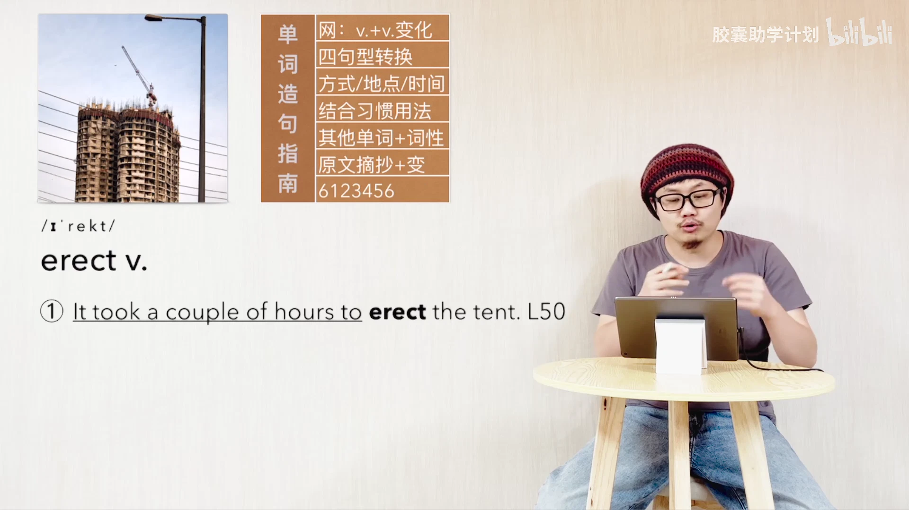

文字识别：单词造句指南 / 网：v.+v.变化 / 胶囊助学计划 / bilbii / 四句型转换 / 方式/地点/时间 / 结合习惯用法 / 其他单词+词性 / 原文摘抄+变 / 6123456 / /I'rekt/ / erect v. / It took a couple of hours to erect the tent. L50

### 画面 00:03:12

文字识别：单词造句指南 / 网：v.+v.变化 / 胶囊助学计划 / bibili / 四句型转换 / 方式/地点/时间 / 结合习惯用法 / 其他单词+词性 / 原文摘抄+变 / 6123456 / /I'rekt/ / erect v. / It took a couple of hours to erect the tent. L50

### 画面 00:03:15

文字识别：单词造句指南 / 网：v.+v.变化 / 胶囊助学计划 / bilbili / 四句型转换 / 方式/地点/时间 / 结合习惯用法 / 其他单词+词性 / 原文摘抄+变 / 6123456 / /I'rekt/ / erect v. / It took a couple of hours to erect the tent. L50

### 画面 00:03:18

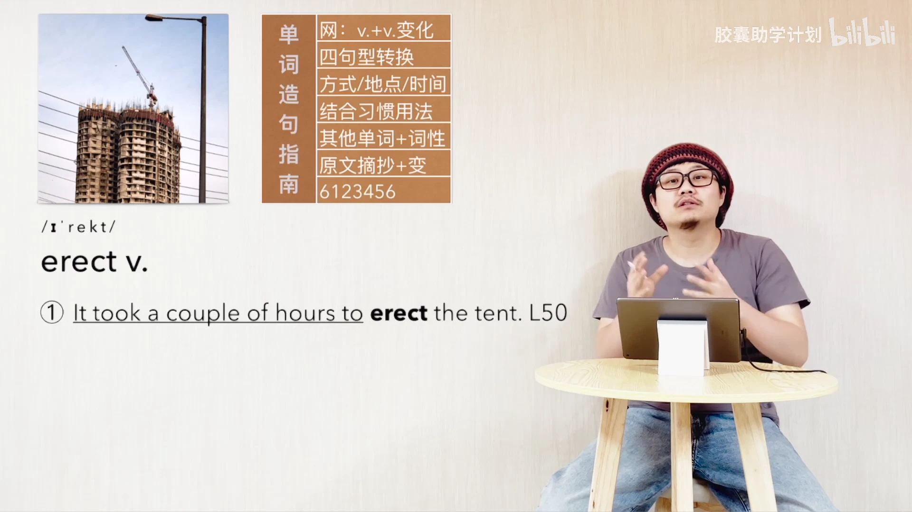

文字识别：单词造句指南 / 网：v.+v.变化 / 胶囊助学计划 / bibili / 四句型转换 / 方式/地点/时间 / 结合习惯用法 / 其他单词+词性 / 原文摘抄+变 / 6123456 / /I'rekt/ / erect v. / It took a couple of hours to erect the tent. L50

### 画面 00:03:20

文字识别：单词造句指南 / 网：v.+v.变化 / 胶囊助学计划 / bilbili / 四句型转换 / 方式/地点/时间 / 结合习惯用法 / 其他单词+词性 / 原文摘抄+变 / 6123456 / /I'rekt/ / erect v. / It took a couple of hours to erect the tent. L50

### 画面 00:03:22

文字识别：单词造句指南 / 网：v.+v.变化 / 胶囊助学计划 / bibili / 四句型转换 / 方式/地点/时间 / 结合习惯用法 / 其他单词+词性 / 原文摘抄+变 / 6123456 / /I'rekt/ / erect v. /  It took a couple of hours to erect the tent. L50 / 1 / She insisted on erecting the wall between her / yard and mine. L68

### 画面 00:03:25

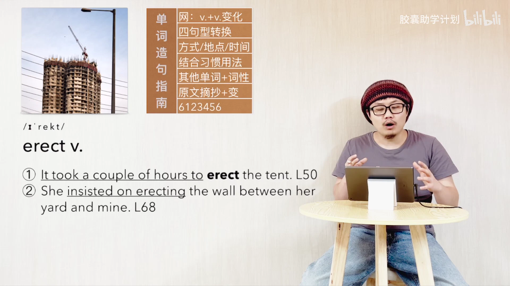

文字识别：单词造句指南 / 网：v.+v.变化 / 胶囊助学计划 / blibili / 四句型转换 / 方式/地点/时间 / 结合习惯用法 / 其他单词+词性 / 原文摘抄+变 / 6123456 / /I'rekt/ / erect v. /  It took a couple of hours to erect the tent. L50 / She insisted on erecting the wall between her / yard and mine. L68

### 画面 00:03:28

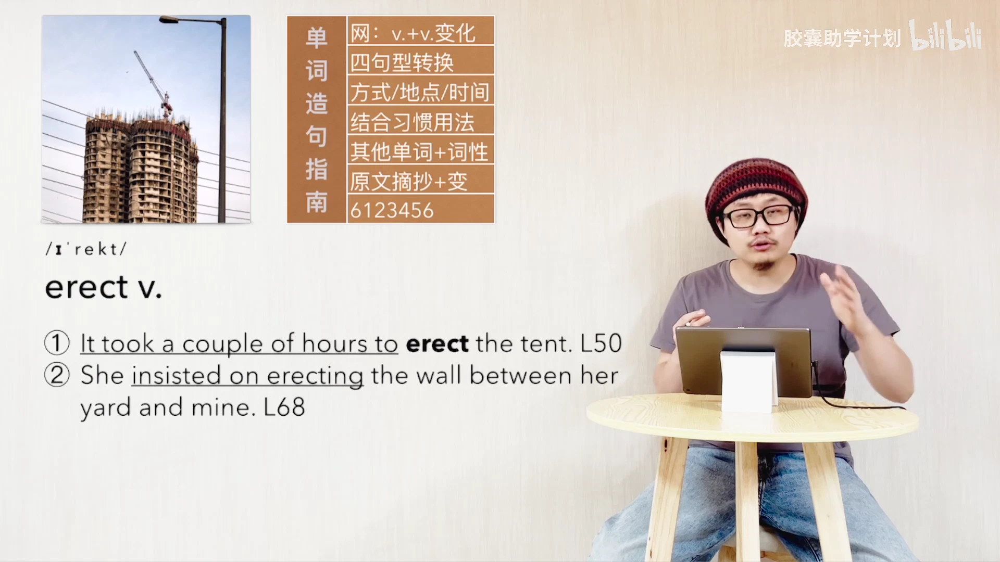

文字识别：单词造句指南 / 网：v.+v.变化 / 胶囊助学计划 / bibii / 四句型转换 / 方式/地点/时间 / 结合习惯用法 / 其他单词+词性 / 原文摘抄+变 / 6123456 / /I'rekt/ / erect v. / It took a couple of hours to erect the tent. L50 / She insisted on erecting the wall between her / yard and mine. L68

## 00:03:30–00:04:00

竖起来，在什么之间呢？在他的这个呃院子和我的院子中间要竖一道墙，那那没办法是吧？Erecting the wall, OK,树立起来一道墙，建立起来一道墙。Next one说，I have tried everything to prevent him from erecting a wall. 好，这个地方我们其实用到了几个点。第一个语法，现在完成时，对吧？哎，我已经尝试了一切。第二个呢，prevent something from doing something, ah, prevent somebody from doing something，叫做阻止

### 画面 00:03:30

文字识别：单词造句指南 / 网：v.+v.变化 / 胶囊助学计划 / biibii / 四句型转换 / 方式/地点/时间 / 结合习惯用法 / 其他单词+词性 / 原文摘抄+变 / 6123456 / /I'rekt/ / erect v. / It took a couple of hours to erect the tent. L50 / 1 / She insisted on erecting the wall between her / yard and mine. L68

### 画面 00:03:32

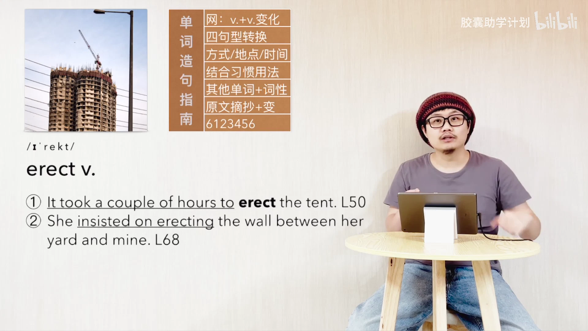

文字识别：单词造句指南 / 网：v.+v.变化 / 胶囊助学计划 / bibii / 四句型转换 / 方式/地点/时间 / 结合习惯用法 / 其他单词+词性 / 原文摘抄+变 / 6123456 / /I'rekt/ / erect v. / It took a couple of hours to erect the tent. L50 / 1 / She insisted on erecting the wall between her / yard and mine. L68

### 画面 00:03:35

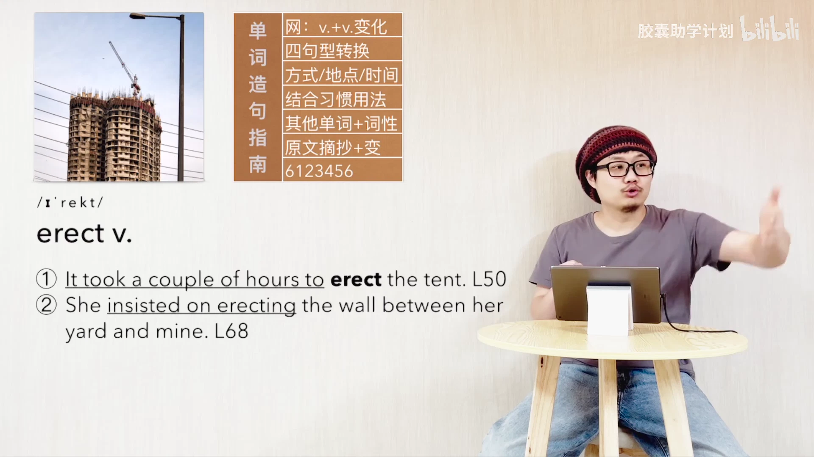

文字识别：单词造句指南 / 网：v.+v.变化 / 胶囊助学计划 / bilibii / 四句型转换 / 方式/地点/时间 / 结合习惯用法 / 其他单词+词性 / 原文摘抄+变 / 6123456 / /I'rekt/ / erect v. / It took a couple of hours to erect the tent. L50 / She insisted on erecting the wall between her / yard and mine. L68

### 画面 00:03:37

文字识别：bilbii / 单词造句指南 / 网：v.+v.变化 / 胶囊助学计划 / 四句型转换 / 方式/地点/时间 / 结合习惯用法 / 其他单词+词性 / 原文摘抄+变 / 6123456 / /I'rekt/ / erect v. / It took a couple of hours to erect the tent. L50 / 1 / She insisted on erecting the wall between her / yard and mine. L68

### 画面 00:03:39

文字识别：胶囊助学计划bibi / 单词造句指南 / 网：v.+v.变化 / 四句型转换 / 方式/地点/时间 / 结合习惯用法 / 其他单词+词性 / 原文摘抄+变 / 6123456 / /I'rekt/ / erect v. / ① It took a couple of hours to erect the tent. L50 / 2 /  She insisted on erecting the wall between her / yard and mine. L68 / I have tried everything to prevent him from / erecting a wall. L68

### 画面 00:03:41

文字识别：单词造句指南 / 网：v.+v.变化 / 胶囊助学计划 / Biltbili / 四句型转换 / 方式/地点/时间 / 结合习惯用法 / 其他单词+词性 / 原文摘抄+变 / 6123456 / /I'rekt/ / erect v. / ① It took a couple of hours to erect the tent. L50 / ② She insisted on erecting the wall between her / yard and mine. L68 / I have tried everything to prevent him from / erecting a wall. L68

### 画面 00:03:45

文字识别：胶囊助学计划bibi / 单词造句指南 / 网：v.+v.变化 / 四句型转换 / 方式/地点/时间 / 结合习惯用法 / 其他单词+词性 / 原文摘抄+变 / 6123456 / /I'rekt/ / erect v. / ① It took a couple of hours to erect the tent. L50 / 2 /  She insisted on erecting the wall between her / yard and mine. L68 / I have tried everything to prevent him from / erecting a wall. L68

### 画面 00:03:48

文字识别：胶囊助学计划bilbil / 单词造句指南 / 网：v.+v.变化 / 四句型转换 / 方式/地点/时间 / 结合习惯用法 / 其他单词+词性 / 原文摘抄+变 / 6123456 / /I'rekt/ / erect v. / ① It took a couple of hours to erect the tent. L50 / 2 /  She insisted on erecting the wall between her / yard and mine. L68 / I have tried everything to prevent him from / erecting a wall. L68

### 画面 00:03:51

文字识别：单词造句指南 / 网：v.+v.变化 / 胶囊助学计划 / bilbli / 四句型转换 / 方式/地点/时间 / 结合习惯用法 / 其他单词+词性 / 原文摘抄+变 / 6123456 / /I'rekt/ / erect v. / ① It took a couple of hours to erect the tent. L50 / 2 /  She insisted on erecting the wall between her / yard and mine. L68 / I have tried everything to prevent him from / erecting a wall. L68

### 画面 00:03:56

文字识别：胶囊助学计划bii / 单词造句指南 / 网：v.+v.变化 / 四句型转换 / 方式/地点/时间 / 结合习惯用法 / 其他单词+词性 / 原文摘抄+变 / 6123456 / /I'rekt/ / erect v. / ① It took a couple of hours to erect the tent. L50 / 2 /  She insisted on erecting the wall between her / yard and mine. L68 / I have tried everything to prevent him from / erecting a wall. L68

## 00:04:00–00:04:30

某人去做某件事情。Okay,那再读一遍这个单词。Erect. Okay, next one.下一个单词的意思呢，就是准确、精确啊。就像你的打靶，你你打的很准啊。就是这个形容词叫做accurate. Accurate. Very good.那accurate这个单词造了一个句子，比如说I caught sight of the reports and I have to say is very accurate.说哎，我这个不小心瞥见了一下这个报告，然后看到了它的数据啊，我不

### 画面 00:04:00

文字识别：胶囊助学计划bilbil / 单词造句指南 / 网：v.+v.变化 / 四句型转换 / 方式/地点/时间 / 结合习惯用法 / 其他单词+词性 / 原文摘抄+变 / 6123456 / /I'rekt/ / erect v. / ① It took a couple of hours to erect the tent. L50 / 2 /  She insisted on erecting the wall between her / yard and mine. L68 / I have tried everything to prevent him from / erecting a wall. L68

### 画面 00:04:02

文字识别：胶囊助学计划bilbil / 单词造句指南 / 网：v.+v.变化 / 四句型转换 / 方式/地点/时间 / 结合习惯用法 / 其他单词+词性 / 原文摘抄+变 / 6123456 / /I'rekt/ / erect v. / ① It took a couple of hours to erect the tent. L50 / ② She insisted on erecting the wall between her / yard and mine. L68 / I have tried everything to prevent him from / erecting a wall. L68

### 画面 00:04:05

文字识别：单词造句指南 / 网：v.+v.变化 / 胶囊助学计划 / bibii / 四句型转换 / 方式/地点/时间 / 8 / 结合习惯用法 / 其他单词+词性 / 原文摘抄+变 / 6123456 / /'ækjurat/ / accurate adj.

### 画面 00:04:07

文字识别：单词造句指南 / 网：v.+v.变化 / 胶囊助学计划 / bilbii / 四句型转换 / 方式/地点/时间 / 8 / 结合习惯用法 / 其他单词+词性 / 原文摘抄+变 / 6123456 / /'ækjurat/ / accurate adj.

### 画面 00:04:09

文字识别：单词造句指南 / 网：v.+v.变化 / 胶囊助学计划 / bilbii / 四句型转换 / 方式/地点/时间 / 8 / 结合习惯用法 / 其他单词+词性 / 原文摘抄+变 / 6123456 / /'ækjurat/ / accurate adj.

### 画面 00:04:11

文字识别：单词造句指南 / 网：v.+v.变化 / 胶囊助学计划 / bilbii / 四句型转换 / 方式/地点/时间 / 8 / 结合习惯用法 / 其他单词+词性 / 原文摘抄+变 / 6123456 / /'ækjurat/ / accurate adj.

### 画面 00:04:13

文字识别：单词造句指南 / 网：v.+v.变化 / 胶囊助学计划 / bibii / 四句型转换 / 方式/地点/时间 / 8 / 结合习惯用法 / 其他单词+词性 / 原文摘抄+变 / 6123456 / /'ækjurat/ / accurate adj.

### 画面 00:04:15

文字识别：单词造句指南 / 网：v.+v.变化 / 胶囊助学计划 / bibii / 四句型转换 / 方式/地点/时间 / 8 / 结合习惯用法 / 其他单词+词性 / 原文摘抄+变 / 6123456 / /'ækjurat/ / accurate adj.

### 画面 00:04:17

文字识别：单词造句指南 / 网：v.+v.变化 / 胶囊助学计划 / bibli / 四句型转换 / 方式/地点/时间 / 8 / 结合习惯用法 / 其他单词+词性 / 原文摘抄+变 / 6123456 / / 'ækjurat / / accurate adj. / ① I caught sight of the the reports, and I have / to say it's very accurate. L70

### 画面 00:04:20

文字识别：单词造句指南 / 网：v.+v.变化 / 胶囊助学计划 / bilbili / 四句型转换 / 方式/地点/时间 / 8 / 结合习惯用法 / 其他单词+词性 / 原文摘抄+变 / 6123456 / /'ækjurat / / accurate adj. / ① I caught sight of the the reports, and I have / to say it's very accurate. L70

### 画面 00:04:25

文字识别：单词造句指南 / 网：v.+v.变化 / 胶囊助学计划 / bibii / 四句型转换 / 方式/地点/时间 / 8 / 结合习惯用法 / 其他单词+词性 / 原文摘抄+变 / 6123456 / / 'ækjurat / / accurate adj. / ① I caught sight of the the reports, and I have / to say it's very accurate. L70

### 画面 00:04:28

文字识别：单词造句指南 / 网：v.+v.变化 / 胶囊助学计划 / bilbili / 四句型转换 / 方式/地点/时间 / 8 / 结合习惯用法 / 其他单词+词性 / 原文摘抄+变 / 6123456 / / 'ækjurat / / accurate adj. / ① I caught sight of the the reports, and I have / to say it's very accurate. L70

## 00:04:30–00:05:00

得不说非常的准确啊，这和我们其实一手掌握的数据是几乎是保持一致的。It's very accurate,非常的准确啊。Next one，再造一个句子叫He was able to或者是manage to do六十七课咱们学和四十三课咱们分别学过的成功设法的完成了某件事情，找到了什么呢？Find the accurate number。各位在这儿你就能看到，我们还是要明白啊。首先，我虽然借助了之前的语法，但是这个句子我是怎么

### 画面 00:04:30

文字识别：单词造句指南 / 网：v.+v.变化 / 胶囊助学计划 / bibili / 四句型转换 / 方式/地点/时间 / 8 / 结合习惯用法 / 其他单词+词性 / 原文摘抄+变 / 6123456 / /'ækjurat / / accurate adj. / ① I caught sight of the the reports, and I have / to say it's very accurate. L70

### 画面 00:04:33

文字识别：单词造句指南 / 网：v.+v.变化 / 胶囊助学计划 / bibil / 四句型转换 / 方式/地点/时间 / 8 / 结合习惯用法 / 其他单词+词性 / 原文摘抄+变 / 6123456 / / 'ækjurat / / accurate adj. / ① I caught sight of the the reports, and I have / to say it's very accurate. L70

### 画面 00:04:35

文字识别：单词造句指南 / 网：v.+v.变化 / 胶囊助学计划 / bilbii / 四句型转换 / 方式/地点/时间 / 8 / 结合习惯用法 / 其他单词+词性 / 原文摘抄+变 / 6123456 / /'æekjurat / / accurate adj. / ① I caught sight of the the reports, and I have / to say it's very accurate. L70

### 画面 00:04:40

文字识别：单词造句指南 / 网：v.+v.变化 / 胶囊助学计划 / bilibii / 四句型转换 / 方式/地点/时间 / 8 / 结合习惯用法 / 其他单词+词性 / 原文摘抄+变 / 6123456 / /'ækjurat / / accurate adj. / ① I caught sight of the the reports, and I have / to say it's very accurate. L70 / He was able to / managed to find the / accurate number. L43 L67

### 画面 00:04:42

文字识别：单词造句指南 / 网：v.+v.变化 / 胶囊助学计划 / bibii / 四句型转换 / 方式/地点/时间 / 8 / 结合习惯用法 / 其他单词+词性 / 原文摘抄+变 / 6123456 / /'ækjurat / / accurate adj. / ① I caught sight of the the reports, and I have / to say it's very accurate. L70 / He was able to / managed to find the / accurate number. L43 L67

### 画面 00:04:45

文字识别：单词造句指南 / 网：v.+v.变化 / 胶囊助学计划 / biibii / 四句型转换 / 方式/地点/时间 / 8 / 结合习惯用法 / 其他单词+词性 / 原文摘抄+变 / 6123456 / /'ækjurat / / accurate adj. / ① I caught sight of the the reports, and I have / to say it's very accurate. L70 / He was able to / managed to find the / accurate number. L43 L67

### 画面 00:04:50

文字识别：单词造句指南 / 网：v.+v.变化 / 胶囊助学计划 / biibii / 四句型转换 / 方式/地点/时间 / 8 / 结合习惯用法 / 其他单词+词性 / 原文摘抄+变 / 6123456 / /'ækjurat / / accurate adj. / ① I caught sight of the the reports, and I have / to say it's very accurate. L70 / He was able to / managed to find the / accurate number. L43 L67

### 画面 00:04:52

文字识别：胶囊助学计划bib出 / 单词造句指南 / 网：v.+v.变化 / 四句型转换 / 方式/地点/时间 / 8 / 结合习惯用法 / 其他单词+词性 / 原文摘抄+变 / 6123456 / /'ækjurat/ / accurate adj. / ① I caught sight of the the reports, and I have / to say it's very accurate. L70 / He was able to / managed to find the / accurate number. L43 L67

### 画面 00:04:55

文字识别：单词造句指南 / 网：v.+v.变化 / 胶囊助学计划 / bilibii / 四句型转换 / 方式/地点/时间 / 8 / 结合习惯用法 / 其他单词+词性 / 原文摘抄+变 / 6123456 / /'ækjurat / / accurate adj. / ① I caught sight of the the reports, and I have / to say it's very accurate. L70 / He was able to / managed to find the / accurate number. L43 L67

### 画面 00:04:57

文字识别：bibii / 单词造句指南 / 网：v.+v.变化 / 胶囊助学计划 / 四句型转换 / 方式/地点/时间 / 8 / 结合习惯用法 / 其他单词+词性 / 原文摘抄+变 / 6123456 / /'ækjurat / / accurate adj. / ① I caught sight of the the reports, and I have / to say it's very accurate. L70 / He was able to / managed to find the / accurate number. L43 L67

## 00:05:00–00:05:30

造造出来的呢？其实是这个样子的。这个思路你要明白，叫做 accurate，它是个形容词。那它肯定是跟呃最形容词最常见就是跟名词连到一起嘛。那它跟 number 连到一起不为过，对吧？来，我们去看一下这个语料库，来发现确实 accurate 跟 number 经常放到一起。那你现在有了这个 number 这个名词，那我们找一个动词叫 find accurate number 就很容易造了这个句子啊。 Next one, so it

### 画面 00:05:00

文字识别：单词造句指南 / 网：v.+v.变化 / 胶囊助学计划 / bibii / 四句型转换 / 方式/地点/时间 / 8 / 结合习惯用法 / 其他单词+词性 / 原文摘抄+变 / 6123456 / / 'ækjurat / / accurate adj. / ① I caught sight of the the reports, and I have / to say it's very accurate. L70 / He was able to / managed to find the / accurate number. L43 L67

### 画面 00:05:02

文字识别：单词造句指南 / 网：v.+v.变化 / 胶囊助学计划 / biibii / 四句型转换 / 方式/地点/时间 / 8 / 结合习惯用法 / 其他单词+词性 / 原文摘抄+变 / 6123456 / /'ækjurat / / accurate adj. / ① I caught sight of the the reports, and I have / to say it's very accurate. L70 / He was able to / managed to find the / accurate number. L43 L67

### 画面 00:05:05

文字识别：单词造句指南 / 网：v.+v.变化 / 胶囊助学计划 / bibili / 四句型转换 / 方式/地点/时间 / 8 / 结合习惯用法 / 其他单词+词性 / 原文摘抄+变 / 6123456 / /'ækjurat / / accurate adj. / ① I caught sight of the the reports, and I have / to say it's very accurate. L70 / He was able to / managed to find the / accurate number. L43 L67

### 画面 00:05:10

文字识别：单词造句指南 / 网：v.+v.变化 / 胶囊助学计划 / blbii / 四句型转换 / 方式/地点/时间 / 8 / 结合习惯用法 / 其他单词+词性 / 原文摘抄+变 / 6123456 / / 'ækjurat / / accurate adj. / ① I caught sight of the the reports, and I have / to say it's very accurate. L70 / He was able to / managed to find the / accurate number. L43 L67

### 画面 00:05:13

文字识别：单词造句指南 / 网：v.+v.变化 / 胶囊助学计划 / bibii / 四句型转换 / 方式/地点/时间 / 8 / 结合习惯用法 / 其他单词+词性 / 原文摘抄+变 / 6123456 / /'ækjurat / / accurate adj. / ① I caught sight of the the reports, and I have / to say it's very accurate. L70 / He was able to / managed to find the / accurate number. L43 L67

### 画面 00:05:15

文字识别：单词造句指南 / 网：v.+v.变化 / 胶囊助学计划 / bibili / 四句型转换 / 方式/地点/时间 / 8 / 结合习惯用法 / 其他单词+词性 / 原文摘抄+变 / 6123456 / / 'ækjurat / / accurate adj. / ① I caught sight of the the reports, and I have / to say it's very accurate. L70 / He was able to / managed to find the / accurate number. L43 L67

### 画面 00:05:20

文字识别：单词造句指南 / 网：v.+v.变化 / 胶囊助学计划 / bibili / 四句型转换 / 方式/地点/时间 / 8 / 结合习惯用法 / 其他单词+词性 / 原文摘抄+变 / 6123456 / /'ækjurat/ / accurate adj. / ① I caught sight of the the reports, and I have / to say it's very accurate. L70 / He was able to / managed to find the / accurate number. L43 L67

### 画面 00:05:25

文字识别：单词造句指南 / 网：v.+v.变化 / 胶囊助学计划 / bilbii / 四句型转换 / 方式/地点/时间 / 8 / 结合习惯用法 / 其他单词+词性 / 原文摘抄+变 / 6123456 / / 'ækjurat / / accurate adj. / ① I caught sight of the the reports, and I have / to say it's very accurate. L70 / He was able to / managed to find the / accurate number. L43 L67

### 画面 00:05:28

文字识别：胶囊助学计划biliil / 单词造句指南 / 网：v.+v.变化 / 四句型转换 / 方式/地点/时间 / 8 / 结合习惯用法 / 其他单词+词性 / 原文摘抄+变 / 6123456 / / 'ækjurat / / accurate adj. / ① I caught sight of the the reports, and I have / to say it's very accurate. L70 / He was able to / managed to find the / accurate number. L43 L67 / It was you who were trying to be accurate, / not him. L58

## 00:05:30–00:06:00

was you who were trying to be accurate, not him. 他说是你啊，这个是我们用了一个强调句，对吧？哎，尝试着要非常的准确，而不是他。所以这个事儿你不要把责任推给他，对吧？哎，强调一下是你。再读一遍这个单词，accurate, very good. Next one, 下一个单词叫 official, official, official. 这个单词之前我们是学过的，我们形容它，我们之前学它的是形容词的含义，正式的。那 official 它做名

### 画面 00:05:30

文字识别：单词造句指南 / 网：v.+v.变化 / 胶囊助学计划 / bilbili / 四句型转换 / 方式/地点/时间 / 8 / 结合习惯用法 / 其他单词+词性 / 原文摘抄+变 / 6123456 / / 'ækjurat / / accurate adj. / ① I caught sight of the the reports, and I have / to say it's very accurate. L70 / He was able to / managed to find the / accurate number. L43 L67 / It was you who were trying to be accurate, / not him. L58

### 画面 00:05:35

文字识别：单词造句指南 / 网：v.+v.变化 / 胶囊助学计划 / bibii / 四句型转换 / 方式/地点/时间 / 8 / 结合习惯用法 / 其他单词+词性 / 原文摘抄+变 / 6123456 / / 'ækjurat / / accurate adj. / ① I caught sight of the the reports, and I have / to say it's very accurate. L70 / He was able to / managed to find the / accurate number. L43 L67 / It was you who were trying to be accurate, / not him. L58

### 画面 00:05:37

文字识别：单词造句指南 / 网：v.+v.变化 / 胶囊助学计划 / bilbii / 四句型转换 / 方式/地点/时间 / 8 / 结合习惯用法 / 其他单词+词性 / 原文摘抄+变 / 6123456 / /'ækjurat / / accurate adj. / ① I caught sight of the the reports, and I have / to say it's very accurate. L70 / He was able to / managed to find the / accurate number. L43 L67 / It was you who were trying to be accurate, / not him. L58

### 画面 00:05:39

文字识别：单词造句指南 / 网：v.+v.变化 / 胶囊助学计划 / bibli / 四句型转换 / 方式/地点/时间 / 8 / 结合习惯用法 / 其他单词+词性 / 原文摘抄+变 / 6123456 / /'ækjurat / / accurate adj. / ① I caught sight of the the reports, and I have / to say it's very accurate. L70 / He was able to / managed to find the / accurate number. L43 L67 / It was you who were trying to be accurate, / not him. L58

### 画面 00:05:41

文字识别：单词造句指南 / 网：v.+v.变化 / 胶囊助学计划 / Bilbili / 四句型转换 / 方式/地点/时间 / 8 / 结合习惯用法 / 其他单词+词性 / 原文摘抄+变 / 6123456 / / 'ækjurat / / accurate adj. / ① I caught sight of the the reports, and I have / to say it's very accurate. L70 / He was able to / managed to find the / accurate number. L43 L67 / It was you who were trying to be accurate, / not him.L58

### 画面 00:05:44

文字识别：单词造句指南 / 网：v.+v.变化 / 胶囊助学计划bibl / 四句型转换 / 方式/地点/时间 / 8 / 结合习惯用法 / 其他单词+词性 / 原文摘抄+变 / 6123456 / /'ækjurat/ / accurate adj. / ① I caught sight of the the reports, and I have / to say it's very accurate. L70 / He was able to / managed to find the / accurate number. L43 L67 / It was you who were trying to be accurate, / not him. L58

### 画面 00:05:46

文字识别：单词造句指南 / 网：v.+v.变化 / 胶囊助学计划 / bilbii / 四句型转换 / 方式/地点/时间 / 8 / 结合习惯用法 / 其他单词+词性 / 原文摘抄+变 / 6123456 / /'ækjurat / / accurate adj. / ① I caught sight of the the reports, and I have / to say it's very accurate. L70 / He was able to / managed to find the / accurate number. L43 L67 / It was you who were trying to be accurate, / not him. L58

### 画面 00:05:48

文字识别：单词造句指南 / 网：v.+v.变化 / 胶囊助学计划 / bibili / 四句型转换 / 方式/地点/时间 / 结合习惯用法 / 其他单词+词性 / 原文摘抄+变 / 6123456 / /a^fi∫al/ / official n. adj.

### 画面 00:05:50

文字识别：单词造句指南 / 网：v.+v.变化 / 胶囊助学计划 / Lilbii / 四句型转换 / 方式/地点/时间 / 结合习惯用法 / 其他单词+词性 / 原文摘抄+变 / 6123456 / /a^fi∫al/ / official n. adj.

### 画面 00:05:55

文字识别：单词造句指南 / 网：v.+v.变化 / 胶囊助学计划 / bibili / 四句型转换 / 方式/地点/时间 / 结合习惯用法 / 其他单词+词性 / 原文摘抄+变 / 6123456 / /a^fifal/ / official n. adj.

### 画面 00:05:58

文字识别：单词造句指南 / 网：v.+v.变化 / 胶囊助学计划 / bilbili / 四句型转换 / 方式/地点/时间 / 结合习惯用法 / 其他单词+词性 / 原文摘抄+变 / 6123456 / /a'fifal/ / official n. adj.

## 00:06:00–00:06:30

词这个角度去指指的是什么？一些行政的官员啊，政府当中，比如说这个行政的官员，比如说 I have trouble with the officials. 哎，我和这些行政官员有一些麻烦事儿。 Next one, 说 the officials 这些行政官员 were so nervous that they ran away during the night. 说他们如此的害怕、恐惧，对吧？担心以至于他们连夜就逃跑

### 画面 00:06:00

文字识别：单词造句指南 / 网：v.+v.变化 / 胶囊助学计划 / bilbili / 四句型转换 / 方式/地点/时间 / 结合习惯用法 / 其他单词+词性 / 原文摘抄+变 / 6123456 / /a^fi∫al/ / official n. adj.

### 画面 00:06:03

文字识别：单词造句指南 / 网：v.+v.变化 / 胶囊助学计划 / bibili / 四句型转换 / 方式/地点/时间 / 结合习惯用法 / 其他单词+词性 / 原文摘抄+变 / 6123456 / /a^fi∫al/ / official n. adj.

### 画面 00:06:05

文字识别：单词造句指南 / 网：v.+v.变化 / 胶囊助学计划 / bilbili / 四句型转换 / 方式/地点/时间 / 结合习惯用法 / 其他单词+词性 / 原文摘抄+变 / 6123456 / /a'fi ∫al/ / official n. adj.

### 画面 00:06:07

文字识别：单词造句指南 / 网：v.+v.变化 / 胶囊助学计划 / bibii / 四句型转换 / 方式/地点/时间 / 结合习惯用法 / 其他单词+词性 / 原文摘抄+变 / 6123456 / /a'fi∫al/ / official n. adj. / ① I have trouble with the officials. L28

### 画面 00:06:09

文字识别：单词造句指南 / 网：v.+v.变化 / 胶囊助学计划 / bibil / 四句型转换 / 方式/地点/时间 / 结合习惯用法 / 其他单词+词性 / 原文摘抄+变 / 6123456 / /a'fr ∫al/ / official n. adj. / ① I have trouble with the officials. L28

### 画面 00:06:11

文字识别：单词造句指南 / 网：v.+v.变化 / 胶囊助学计划 / bibii / 四句型转换 / 方式/地点/时间 / 结合习惯用法 / 其他单词+词性 / 原文摘抄+变 / 6123456 / /a^fi∫al/ / official n. adj. / ① I have trouble with the officials. L28

### 画面 00:06:13

文字识别：单词造句指南 / 网：v.+v.变化 / 胶囊助学计划 / bibii / 四句型转换 / 方式/地点/时间 / 结合习惯用法 / 其他单词+词性 / 原文摘抄+变 / 6123456 / /a^fifal/ / official n. adj. / ① I have trouble with the officials. L28 / The officials were so nervous that they ran / away during the night. L35

### 画面 00:06:15

文字识别：单词造句指南 / 网：v.+v.变化 / 胶囊助学计划 / bilibii / 四句型转换 / 方式/地点/时间 / 结合习惯用法 / 其他单词+词性 / 原文摘抄+变 / 6123456 / /a^fi∫al/ / official n. adj. / ①I have trouble with the officials. L28 / The officials were so nervous that they ran / away during the night. L35

### 画面 00:06:20

文字识别：单词造句指南 / 网：v.+v.变化 / 胶囊助学计划 / bilibii / 四句型转换 / 方式/地点/时间 / 结合习惯用法 / 其他单词+词性 / 原文摘抄+变 / 6123456 / /a'fifal/ / official n. adj. / ① I have trouble with the officials. L28 / The officials were so nervous that they ran / away during the night. L35

### 画面 00:06:22

文字识别：单词造句指南 / 网：v.+v.变化 / 胶囊助学计划 / bilibii / 四句型转换 / 方式/地点/时间 / 结合习惯用法 / 其他单词+词性 / 原文摘抄+变 / 6123456 / /a'fifal/ / official n. adj. / ① I have trouble with the officials. L28 / The officials were so nervous that they ran / away during the night. L35

### 画面 00:06:25

文字识别：单词造句指南 / 网：v.+v.变化 / 胶囊助学计划 / biibii / 四句型转换 / 方式/地点/时间 / 结合习惯用法 / 其他单词+词性 / 原文摘抄+变 / 6123456 / /a'fi∫al/ / official n. adj. / ① I have trouble with the officials. L28 / The officials were so nervous that they ran / away during the night. L35

## 00:06:30–00:07:00

了。Okay, next one. Say I want to make it official. I,哎，这个是我们本课要学的一个非常关键的短语，叫make it official，叫做使这件事情变什么呢？变得正式了，对吧？比如说，那比如说两个人的恋爱关系啊，最终比如说两个人说准备要结婚，那怎么叫正式了呢？就是你领了结婚证，他不就正式了吗？对吧？就这么简单啊。叫做I want to make it official so

### 画面 00:06:30

文字识别：单词造句指南 / 网：v.+v.变化 / 胶囊助学计划 / bilbii / 四句型转换 / 方式/地点/时间 / 结合习惯用法 / 其他单词+词性 / 原文摘抄+变 / 6123456 / /a'fi∫al/ / official n. adj. / ① I have trouble with the officials. L28 / The officials were so nervous that they ran / away during the night. L35

### 画面 00:06:33

文字识别：单词造句指南 / 网：v.+v.变化 / 胶囊助学计划 / Bilbl / 四句型转换 / 方式/地点/时间 / 结合习惯用法 / 其他单词+词性 / 原文摘抄+变 / 6123456 / /a'fi∫al/ / official n. adj. / ① I have trouble with the officials. L28 / The officials were so nervous that they ran / away during the night. L35 / I want to make it official so that I hired you. / L59

### 画面 00:06:35

文字识别：胶囊助学计划biiil / 单词造句指南 / 网：v.+v.变化 / 四句型转换 / 方式/地点/时间 / 结合习惯用法 / 其他单词+词性 / 原文摘抄+变 / 6123456 / /a'fifal/ / official n. adj. / ① I have trouble with the officials. L28 / The officials were so nervous that they ran / away during the night. L35 / I want to make it official so that I hired you. / L59

### 画面 00:06:39

文字识别：单词造句指南 / 网：v.+v.变化 / 胶囊助学计划 / bilibii / 四句型转换 / 方式/地点/时间 / 结合习惯用法 / 其他单词+词性 / 原文摘抄+变 / 6123456 / /a'fi∫al/ / official n. adj. / ① I have trouble with the officials. L28 / The officials were so nervous that they ran / away during the night. L35 / I want to make it official so that I hired you. / L59

### 画面 00:06:41

文字识别：胶囊助学计划bilii / 单词造句指南 / 网：v.+v.变化 / 四句型转换 / 方式/地点/时间 / 结合习惯用法 / 其他单词+词性 / 原文摘抄+变 / 6123456 / /a'fi∫al/ / official n. adj. / ① I have trouble with the officials. L28 / The officials were so nervous that they ran / away during the night. L35 / I want to make it official so that I hired you. / L59

### 画面 00:06:45

文字识别：单词造句指南 / 网：v.+v.变化 / 胶囊助学计划 / bilbii / 四句型转换 / 方式/地点/时间 / 结合习惯用法 / 其他单词+词性 / 原文摘抄+变 / 6123456 / /a'fifal/ / official n. adj. / ① I have trouble with the officials. L28 / The officials were so nervous that they ran / away during the night. L35 / I want to make it official so that I hired you. / L59

### 画面 00:06:48

文字识别：胶囊助学计划bibi / 单词造句指南 / 网：v.+v.变化 / 四句型转换 / 方式/地点/时间 / 结合习惯用法 / 其他单词+词性 / 原文摘抄+变 / 6123456 / /a'fi∫al/ / official n. adj. / ① I have trouble with the officials. L28 / The officials were so nervous that they ran / away during the night. L35 / I want to make it official so that I hired you. / L59

### 画面 00:06:50

文字识别：单词造句指南 / 网：v.+v.变化 / 胶囊助学计划 / bilbi / 四句型转换 / 方式/地点/时间 / 结合习惯用法 / 其他单词+词性 / 原文摘抄+变 / 6123456 / /a^fi∫al/ / official n. adj. / ① I have trouble with the officials. L28 / The officials were so nervous that they ran / away during the night. L35 / I want to make it official so that I hired you. / L59

### 画面 00:06:52

文字识别：单词造句指南 / 网：v.+v.变化 / 胶囊助学计划 / bilbii / 四句型转换 / 方式/地点/时间 / 结合习惯用法 / 其他单词+词性 / 原文摘抄+变 / 6123456 / /a'fi∫al/ / official n. adj. / ① I have trouble with the officials. L28 / The officials were so nervous that they ran / away during the night. L35 / I want to make it official so that I hired you. / L59

### 画面 00:06:55

文字识别：单词造句指南 / 网：v.+v.变化 / 胶囊助学计划 / bilibii / 四句型转换 / 方式/地点/时间 / 结合习惯用法 / 其他单词+词性 / 原文摘抄+变 / 6123456 / /a^fi∫al/ / official n. adj. / ①I have trouble with the officials. L28 / The officials were so nervous that they ran / away during the night. L35 / I want to make it official so that I hired you. / L59

## 00:07:00–00:07:30

learned in the lesson. Looking forward to doing something. Thirty-seven, we

### 画面 00:07:00

文字识别：单词造句指南 / 网：v.+v.变化 / 胶囊助学计划 / 四句型转换 / 方式/地点/时间 / 结合习惯用法 / 其他单词+词性 / 原文摘抄+变 / 6123456 / /a'fifal/ / official n. adj. / ① I have trouble with the officials. L28 / The officials were so nervous that they ran / away during the night. L35 / I want to make it official so that I hired you. / L59

### 画面 00:07:02

文字识别：胶囊助学计划bibi / 单词造句指南 / 网：v.+v.变化 / 四句型转换 / 方式/地点/时间 / 结合习惯用法 / 其他单词+词性 / 原文摘抄+变 / 6123456 / /a'fi∫al/ / official n. adj. / ① I have trouble with the officials. L28 / The officials were so nervous that they ran / away during the night. L35 /  I want to make it official so that I hired you. / L59 / ④ We look forward to making it official. L37

### 画面 00:07:05

文字识别：胶囊助学计划bibi / 单词造句指南 / 网：v.+v.变化 / 四句型转换 / 方式/地点/时间 / 结合习惯用法 / 其他单词+词性 / 原文摘抄+变 / 6123456 / /a^fi∫al/ / official n. adj. / ① I have trouble with the officials. L28 / The officials were so nervous that they ran / away during the night. L35 /  I want to make it official so that I hired you. / L59 / ④ We look forward to making it official. L37

### 画面 00:07:10

文字识别：胶囊助学计划bli / 单词造句指南 / 网：v.+v.变化 / 四句型转换 / 方式/地点/时间 / 结合习惯用法 / 其他单词+词性 / 原文摘抄+变 / 6123456 / /a^fi∫al/ / official n. adj. / ① I have trouble with the officials. L28 / The officials were so nervous that they ran / away during the night. L35 /  I want to make it official so that I hired you. / L59 / ④ We look forward to making it official. L37

### 画面 00:07:15

文字识别：胶囊助学计划bili / 单词造句指南 / 网：v.+v.变化 / 四句型转换 / 方式/地点/时间 / 结合习惯用法 / 其他单词+词性 / 原文摘抄+变 / 6123456 / /a'fifal/ / official n. adj. / ① I have trouble with the officials. L28 / The officials were so nervous that they ran / away during the night. L35 /  I want to make it official so that I hired you. / L59 / ④ We look forward to making it official. L37

### 画面 00:07:20

文字识别：胶囊助学计划bilii / 单词造句指南 / 网：v.+v.变化 / 四句型转换 / 方式/地点/时间 / 结合习惯用法 / 其他单词+词性 / 原文摘抄+变 / 6123456 / /a'fi∫al/ / official n. adj. / ① I have trouble with the officials. L28 / The officials were so nervous that they ran / away during the night. L35 /  I want to make it official so that I hired you. / L59 / ④ We look forward to making it official. L37

### 画面 00:07:22

文字识别：胶囊助学计划bii / 单词造句指南 / 网：v.+v.变化 / 四句型转换 / 方式/地点/时间 / 结合习惯用法 / 其他单词+词性 / 原文摘抄+变 / 6123456 / /a'fifal/ / official n. adj. / ① I have trouble with the officials. L28 / The officials were so nervous that they ran / away during the night. L35 /  I want to make it official so that I hired you. / L59 / ④ We look forward to making it official. L37

### 画面 00:07:25

文字识别：胶囊助学计划bilii / 单词造句指南 / 网：v.+v.变化 / 四句型转换 / 方式/地点/时间 / 结合习惯用法 / 其他单词+词性 / 原文摘抄+变 / 6123456 / /a^fi ∫al/ / official n. adj. / ① I have trouble with the officials. L28 / The officials were so nervous that they ran / away during the night. L35 /  I want to make it official so that I hired you. / L59 / ④ We look forward to making it official. L37

### 画面 00:07:28

文字识别：胶囊助学计划bli / 单词造句指南 / 网：v.+v.变化 / 四句型转换 / 方式/地点/时间 / 结合习惯用法 / 其他单词+词性 / 原文摘抄+变 / 6123456 / /a^fi∫al/ / official n. adj. / ① I have trouble with the officials. L28 / The officials were so nervous that they ran / away during the night. L35 /  I want to make it official so that I hired you. / 3 / L59 / ④ We look forward to making it official. L37

## 00:07:30–00:08:00

构，它在这儿的 to 是一个介词。那你说我如何去判断呢？很抱歉，轻易你几乎没有办法判断，所以你只能当做习惯用法去给它硬生生的记下来，好吧？ Okay，那再读一遍那个单词 official， very good。那接下来注意力集中，您听一下电影片段啊。 Do you mind if I say it out loud just to make it official? Okay. Okay. Next one. 下一个单词呢？你看它像好像 green

### 画面 00:07:30

文字识别：胶囊助学计划bilbil / 单词造句指南 / 网：v.+v.变化 / 四句型转换 / 方式/地点/时间 / 结合习惯用法 / 其他单词+词性 / 原文摘抄+变 / 6123456 / /a'fi∫al/ / official n. adj. / ① I have trouble with the officials. L28 / The officials were so nervous that they ran / away during the night. L35 /  I want to make it official so that I hired you. / L59 / ④ We look forward to making it official. L37

### 画面 00:07:33

文字识别：胶囊助学计划bibi / 单词造句指南 / 网：v.+v.变化 / 四句型转换 / 方式/地点/时间 / 结合习惯用法 / 其他单词+词性 / 原文摘抄+变 / 6123456 / /a^fi∫al/ / official n. adj. / ① I have trouble with the officials. L28 / The officials were so nervous that they ran / away during the night. L35 /  I want to make it official so that I hired you. / L59 / ④ We look forward to making it official. L37

### 画面 00:07:35

文字识别：单词造句指南 / 网：v.+v.变化 / 胶囊助学计划biibl / 四句型转换 / 方式/地点/时间 / 结合习惯用法 / 其他单词+词性 / 原文摘抄+变 / 6123456 / /a'fi∫al/ / official n. adj. / ① I have trouble with the officials. L28 / The officials were so nervous that they ran / away during the night. L35 /  I want to make it official so that I hired you. / L59 / ④ We look forward to making it official. L37

### 画面 00:07:38

文字识别：单词造句指南 / 网：v.+v.变化 / 胶囊助学计划 / bibi / 四句型转换 / 方式/地点/时间 / 结合习惯用法 / 其他单词+词性 / 原文摘抄+变 / 6123456 / /a'fifal/ / official n. adj. / ① I have trouble with the officials. L28 / The officials were so nervous that they ran / away during the night. L35 /  I want to make it official so that I hired you. / L59 / ④ We look for ard to making it official. L37

### 画面 00:07:40

文字识别：胶囊助学计划bibi / 单词造句指南 / 网：v.+v.变化 / 四句型转换 / 方式/地点/时间 / 结合习惯用法 / 其他单词+词性 / 原文摘抄+变 / 6123456 / /a'fi∫al/ / official n. adj. / ① I have trouble with the officials. L28 / The officials were so nervous that they ran / away during the night. L35 /  I want to make it official so that I hired you. / L59 / ④ We look forward to making it official. L37

### 画面 00:07:42

文字识别：胶囊助学计划bilil / 单词造句指南 / 网：v.+v.变化 / 四句型转换 / 方式/地点/时间 / 结合习惯用法 / 其他单词+词性 / 原文摘抄+变 / 6123456 / /a'fi∫al/ / official n. adj. / ①I have trouble with the officials. L28 / The officials were so nervous that they ran / away during the night. L35 /  I want to make it official so that I hired you. / L59 / ④ We look forward to making it official. L37

### 画面 00:07:44

文字识别：bilbili / 胶囊助学计划 / Do you mind if I say it out loud, /  just to make it official? Okay. / Palabra por palabra / (2008)

### 画面 00:07:46

文字识别：bibl / 胶囊助学计划 / Do you mind if I say it out loud, / just to make it official? Okay. / Palabra por palabra / (2008)

### 画面 00:07:51

文字识别：biibili / 胶囊助学计划 / Do you mind if I say it out loud, /  just to make it official? Okay. / Palabra por palabra / (2008)

### 画面 00:07:53

文字识别：bilbili / 胶囊助学计划 / Do you mind if I say it out loud, /  just to make it official? Okay. / Palabra por palabra / (2008)

### 画面 00:07:55

文字识别：单词造句指南 / 网：v.+v.变化 / 胶囊助学计划 / bibii / 四句型转换 / 方式/地点/时间 / 结合习惯用法 / 其他单词+词性 / 原文摘抄+变 / 6123456 / Greenwich n.

### 画面 00:07:57

文字识别：单词造句指南 / 网：v.+v.变化 / 胶囊助学计划 / biibili / 四句型转换 / 方式/地点/时间 / 结合习惯用法 / 其他单词+词性 / 原文摘抄+变 / 6123456 / Greenwich n.

### 画面 00:07:59

文字识别：单词造句指南 / 网：v.+v.变化 / 胶囊助学计划 / bibii / 四句型转换 / 方式/地点/时间 / 结合习惯用法 / 其他单词+词性 / 原文摘抄+变 / 6123456 / Greenwich n.

## 00:08:00–00:08:30

加了个 which 是吧？但是它这个发音呢是 Greenwich 这个嗯这个字母是跟后边了啊 Greenwich Greenwich 是一个地名叫做格林尼治啊。说实话这个名字刚一翻译过来的时候，我会觉得哎呀好熟好熟。然后我具体去查了一下，我发现了一个事儿叫做 Greenwich 啊 Greenwich 这个地方是世界计算时间和地理精度的一个起点，瞬间让我

### 画面 00:08:01

文字识别：单词造句指南 / 网：v.+v.变化 / 胶囊助学计划 / bibii / 四句型转换 / 方式/地点/时间 / 结合习惯用法 / 其他单词+词性 / 原文摘抄+变 / 6123456 / Greenwich n.

### 画面 00:08:04

文字识别：单词造句指南 / 网：v.+v.变化 / 胶囊助学计划 / bilibili / 四句型转换 / 方式/地点/时间 / 结合习惯用法 / 其他单词+词性 / 原文摘抄+变 / 6123456 / Greeny / ich n.

### 画面 00:08:09

文字识别：单词造句指南 / 网：v.+v.变化 / 胶囊助学计划 / biibii / 四句型转换 / 方式/地点/时间 / 结合习惯用法 / 其他单词+词性 / 原文摘抄+变 / 6123456 / Greenwich n.

### 画面 00:08:11

文字识别：单词造句指南 / 网：v.+v.变化 / 胶囊助学计划 / bibii / 四句型转换 / 方式/地点/时间 / 结合习惯用法 / 其他单词+词性 / 原文摘抄+变 / 6123456 / Greenwich n. / 格林尼治

### 画面 00:08:14

文字识别：单词造句指南 / 网：v.+v.变化 / 胶囊助学计划 / bibili / 四句型转换 / 方式/地点/时间 / 结合习惯用法 / 其他单词+词性 / 原文摘抄+变 / 6123456 / Greenwich n. / 格林尼治

### 画面 00:08:19

文字识别：单词造句指南 / 网：v.+v.变化 / 胶囊助学计划 / bilbii / 四句型转换 / 方式/地点/时间 / 结合习惯用法 / 其他单词+词性 / 原文摘抄+变 / 6123456 / Greenwich n. / 格林尼治 / 世界计算时间和地理经度的起点

### 画面 00:08:21

文字识别：单词造句指南 / 网：v.+v.变化 / 胶囊助学计划 / bibili / 四句型转换 / 方式/地点/时间 / 结合习惯用法 / 其他单词+词性 / 原文摘抄+变 / 6123456 / Greenwich n. / 格林尼治 / 世界计算时间和地理经度的起点

### 画面 00:08:24

文字识别：单词造句指南 / 网：v.+v.变化 / 胶囊助学计划 / bilbili / 四句型转换 / 方式/地点/时间 / 结合习惯用法 / 其他单词+词性 / 原文摘抄+变 / 6123456 / Greenwich n. / 格林尼治 / 世界计算时间和地理经度的起点

### 画面 00:08:28

文字识别：单词造句指南 / 网：v.+v.变化 / 胶囊助学计划 / bibili / 四句型转换 / 方式/地点/时间 / 结合习惯用法 / 其他单词+词性 / 原文摘抄+变 / 6123456 / Greenwich n. / 格林尼治 / 世界计算时间和地理经度的起点

## 00:08:30–00:09:00

我想起来初中我我至少应该是学过这个地理知识，当时就提过格林尼治这个地方，只不过当时也许翻译的和这个稍微有点不太一样，但是跟你说说英国是我们世界时间计算的，就我们不是有不同的时区嘛？计算的起点，我没记错的话，应该就是我们初中学过的这个知识叫做格林尼治这个单词，你也不需要去记，它类似于像一个小的知识和一个地名，对吧？就像 New York、

### 画面 00:08:33

文字识别：单词造句指南 / 网：v.+v.变化 / 胶囊助学计划 / bilbii / 四句型转换 / 方式/地点/时间 / 结合习惯用法 / 其他单词+词性 / 原文摘抄+变 / 6123456 / Greenwich n. / 格林尼治 / 世界计算时间和地理经度的起点

### 画面 00:08:35

文字识别：单词造句指南 / 网：v.+v.变化 / 胶囊助学计划 / bilbili / 四句型转换 / 方式/地点/时间 / 结合习惯用法 / 其他单词+词性 / 原文摘抄+变 / 6123456 / Greenwich n. / 格林尼治 / 世界计算时间和地理经度的起点

### 画面 00:08:39

文字识别：单词造句指南 / 网：v.+v.变化 / 胶囊助学计划 / bilbili / 四句型转换 / 方式/地点/时间 / 结合习惯用法 / 其他单词+词性 / 原文摘抄+变 / 6123456 / Greenwich n. / 格林尼治 / 世界计算时间和地理经度的起点

### 画面 00:08:41

文字识别：单词造句指南 / 网：v.+v.变化 / 胶囊助学计划 / bilbili / 四句型转换 / 方式/地点/时间 / 结合习惯用法 / 其他单词+词性 / 原文摘抄+变 / 6123456 / Greenwich n. / 格林尼治 / 世界计算时间和地理经度的起点

### 画面 00:08:43

文字识别：单词造句指南 / 网：v.+v.变化 / 胶囊助学计划 / bibili / 四句型转换 / 方式/地点/时间 / 结合习惯用法 / 其他单词+词性 / 原文摘抄+变 / 6123456 / Greenwich n. / 格林尼治 / 世界计算时间和地理经度的起点

### 画面 00:08:45

文字识别：单词造句指南 / 网：v.+v.变化 / 胶囊助学计划 / bilbili / 四句型转换 / 方式/地点/时间 / 结合习惯用法 / 其他单词+词性 / 原文摘抄+变 / 6123456 / Greenwich n. / 格林尼治 / 世界计算时间和地理经度的起点

### 画面 00:08:49

文字识别：单词造句指南 / 网：v.+v.变化 / 胶囊助学计划 / bibili / 四句型转换 / 方式/地点/时间 / 结合习惯用法 / 其他单词+词性 / 原文摘抄+变 / 6123456 / Greenwich n. / 格林尼治 / 世界计算时间和地理经度的起点

### 画面 00:08:53

文字识别：单词造句指南 / 网：v.+v.变化 / 胶囊助学计划 / bibili / 四句型转换 / 方式/地点/时间 / 结合习惯用法 / 其他单词+词性 / 原文摘抄+变 / 6123456 / Greenwich n. / 格林尼治 / 世界计算时间和地理经度的起点

### 画面 00:08:55

文字识别：单词造句指南 / 网：v.+v.变化 / 胶囊助学计划 / bibili / 四句型转换 / 方式/地点/时间 / 结合习惯用法 / 其他单词+词性 / 原文摘抄+变 / 6123456 / Greenwich n. / 格林尼治 / 世界计算时间和地理经度的起点

### 画面 00:08:59

文字识别：单词造句指南 / 网：v.+v.变化 / 胶囊助学计划 / bibili / 四句型转换 / 方式/地点/时间 / 结合习惯用法 / 其他单词+词性 / 原文摘抄+变 / 6123456 / Greenwich n. / 格林尼治 / 世界计算时间和地理经度的起点

## 00:09:00–00:09:30

York、Paris 是一样的，是吧？这个您不需要专门去背它啊。下一个单词咱们需要去记了啊，它这个 Greenwich 和这个 Observatory 是一起出现的，叫格林尼治的这个呃天文台非常有名，对吧？那 Observatory 就是天文台的意思。首先呢，它是一个名词。你看啊，我如果说天文台，你立刻去想六一二三四五六，它最容易出现的地方无非就是一三五，可以做主语，可以做宾语，可以充当一个地点，对

### 画面 00:09:04

文字识别：单词造句指南 / 网：v.+v.变化 / 胶囊助学计划 / bilbili / 四句型转换 / 方式/地点/时间 / 结合习惯用法 / 其他单词+词性 / 原文摘抄+变 / 6123456 / /ab'z3:vatari/ / observatory n.

### 画面 00:09:06

文字识别：单词造句指南 / 网：v.+v.变化 / 胶囊助学计划 / bilbii / 四句型转换 / 方式/地点/时间 / 结合习惯用法 / 其他单词+词性 / 原文摘抄+变 / 6123456 / /ab'z3:vatari/ / observatory n.

### 画面 00:09:09

文字识别：单词造句指南 / 网：v.+v.变化 / 胶囊助学计划 / bilbili / 四句型转换 / 方式/地点/时间 / 结合习惯用法 / 其他单词+词性 / 原文摘抄+变 / 6123456 / /ab'z3:vatari/ / observatory n.

### 画面 00:09:12

文字识别：单词造句指南 / 网：v.+v.变化 / 胶囊助学计划 / bilbili / 四句型转换 / 方式/地点/时间 / 结合习惯用法 / 其他单词+词性 / 原文摘抄+变 / 6123456 / /ab'z3:vatari/ / observatory n.

### 画面 00:09:14

文字识别：单词造句指南 / 网：v.+v.变化 / 胶囊助学计划 / bilbili / 四句型转换 / 方式/地点/时间 / 结合习惯用法 / 其他单词+词性 / 原文摘抄+变 / 6123456 / /ab'z3:vatari/ / observatory n.

### 画面 00:09:17

文字识别：单词造句指南 / 网：v.+v.变化 / 胶囊助学计划 / bilbil / 四句型转换 / 方式/地点/时间 / 结合习惯用法 / 其他单词+词性 / 原文摘抄+变 / 6123456 / /ab'z3:vatari/ / observatory n.

### 画面 00:09:19

文字识别：单词造句指南 / 网：v.+v.变化 / 胶囊助学计划 / bibili / 四句型转换 / 方式/地点/时间 / 结合习惯用法 / 其他单词+词性 / 原文摘抄+变 / 6123456 / /ab'z3:vatari/ / observatory n.

### 画面 00:09:24

文字识别：单词造句指南 / 网：v.+v.变化 / 胶囊助学计划 / bibii / 四句型转换 / 方式/地点/时间 / 结合习惯用法 / 其他单词+词性 / 原文摘抄+变 / 6123456 / /ab'z3ivatari/ / observatory n.

### 画面 00:09:29

文字识别：单词造句指南 / 网：v.+v.变化 / 胶囊助学计划 / bilbili / 四句型转换 / 方式/地点/时间 / 结合习惯用法 / 其他单词+词性 / 原文摘抄+变 / 6123456 / /ab'z3:vatari/ / observatory n.

## 00:09:30–00:10:00

吧？那我们拿它去造句。啊，He had no sooner gone back home than they asked him to go back to the observatory. 好，这里我们其实一个小短语叫 go to the observatory，跟 go to school 什么类似，是吧？只不过这儿用的是 go back to。好，其次呢，我用到了一个我们之前学过的语法，叫做 no sooner than。在这儿瞬间复习一下，三十八课叫做 had than，哎，no sooner，哎，然后后边加上

### 画面 00:09:31

文字识别：单词造句指南 / 网：v.+v.变化 / 胶囊助学计划 / bibii / 四句型转换 / 方式/地点/时间 / 结合习惯用法 / 其他单词+词性 / 原文摘抄+变 / 6123456 / /ab'z3ivatari/ / observatory n. / ① He had no sooner gone back home than / they asked him to go back to the / observatory. L38

### 画面 00:09:34

文字识别：单词造句指南 / 网：v.+v.变化 / 胶囊助学计划 / Bilbili / 四句型转换 / 方式/地点/时间 / 结合习惯用法 / 其他单词+词性 / 原文摘抄+变 / 6123456 / /ab'z3ivatari/ / observatory n. / ① He had no sooner gone back home than / they asked him to go back to the / observatory. L38

### 画面 00:09:39

文字识别：单词造句指南 / 网：v.+v.变化 / 胶囊助学计划 / bibi / 四句型转换 / 方式/地点/时间 / 结合习惯用法 / 其他单词+词性 / 原文摘抄+变 / 6123456 / /ab'z3ivatari/ / observatory n. / ① He had no sooner gone back home than / they asked him to go back to the / observatory. L38

### 画面 00:09:44

文字识别：单词造句指南 / 网：v.+v.变化 / 胶囊助学计划 / bilibii / 四句型转换 / 方式/地点/时间 / 结合习惯用法 / 其他单词+词性 / 原文摘抄+变 / 6123456 / /ab'z3ivatari/ / observatory n. / ① He had no sooner gone back home than / they asked him to go back to the / observatory. L38

### 画面 00:09:49

文字识别：单词造句指南 / 网：v.+v.变化 / 胶囊助学计划 / bibli / 四句型转换 / 方式/地点/时间 / 结合习惯用法 / 其他单词+词性 / 原文摘抄+变 / 6123456 / /ab'z3ivatari/ / observatory n. / ① He had no sooner gone back home than / they asked him to go back to the / observatory. L38

### 画面 00:09:52

文字识别：单词造句指南 / 网：v.+v.变化 / 胶囊助学计划 / bibii / 四句型转换 / 方式/地点/时间 / 结合习惯用法 / 其他单词+词性 / 原文摘抄+变 / 6123456 / /ab'z3ivatari/ / observatory n. / ① He had no sooner gone back home than / they asked him to go back to the / observatory. L38

### 画面 00:09:54

文字识别：单词造句指南 / 网：v.+v.变化 / 胶囊助学计划 / bilbii / 四句型转换 / 方式/地点/时间 / 结合习惯用法 / 其他单词+词性 / 原文摘抄+变 / 6123456 / /ab'z3ivatari/ / observatory n. / ① He had no sooner gone back home than / they asked him to go back to the / observatory. L38

### 画面 00:09:57

文字识别：单词造句指南 / 网：v.+v.变化 / 胶囊助学计划 / bibii / 四句型转换 / 方式/地点/时间 / 结合习惯用法 / 其他单词+词性 / 原文摘抄+变 / 6123456 / /ab'z3ivatari/ / observatory n. / ① He had no sooner gone back home than / they asked him to go back to the / observatory. L38

### 画面 00:09:59

文字识别：单词造句指南 / 网：v.+v.变化 / 胶囊助学计划 / bilibii / 四句型转换 / 方式/地点/时间 / 结合习惯用法 / 其他单词+词性 / 原文摘抄+变 / 6123456 / /ab'z3ivatari/ / observatory n. / ① He had no sooner gone back home / an / they asked him to go back to the / observatory. L38

## 00:10:00–00:10:30

一个than，再加一句完整的话，它几乎是啊，它一怎么怎么样就怎么怎么样，有点像我们之前学过的那个as soon as，对吧？Okay，接下来第二句话说，He is planning to visit the observatory tonight.说他计划，哎，干嘛呢？要去拜访，要去参观啊，这个什么呢？天文台，今天晚上。Okay，next one，最后一句话叫做

### 画面 00:10:03

文字识别：单词造句指南 / 网：v.+v.变化 / 胶囊助学计划 / 四句型转换 / 方式/地点/时间 / 结合习惯用法 / 其他单词+词性 / 原文摘抄+变 / 6123456 / /ab'z3ivatari/ / observatory n. / ① He had no sooner gone back home than / they asked him to go back to the / observatory. L38

### 画面 00:10:05

文字识别：单词造句指南 / 网：v.+v.变化 / 胶囊助学计划 / bilibii / 四句型转换 / 方式/地点/时间 / 结合习惯用法 / 其他单词+词性 / 原文摘抄+变 / 6123456 / /ab'z3ivatari/ / observatory n. / ① He had no sooner gone back home than / they asked him to go back to the / observatory. L38

### 画面 00:10:07

文字识别：单词造句指南 / 网：v.+v.变化 / 胶囊助学计划 / bilbii / 四句型转换 / 方式/地点/时间 / 结合习惯用法 / 其他单词+词性 / 原文摘抄+变 / 6123456 / /ab'z3ivatari/ / observatory n. / ① He had no sooner gone back home than / they asked him to go back to the / observatory. L38

### 画面 00:10:09

文字识别：单词造句指南 / 网：v.+v.变化 / 胶囊助学计划 / bilili / 四句型转换 / 方式/地点/时间 / 结合习惯用法 / 其他单词+词性 / 原文摘抄+变 / 6123456 / /ab'z3ivatari/ / observatory n. / ① He had no sooner gone back home than / they asked him to go back to the / observatory. L38

### 画面 00:10:11

文字识别：单词造句指南 / 网：v.+v.变化 / 胶囊助学计划 / ilbii / 四句型转换 / 方式/地点/时间 / 结合习惯用法 / 其他单词+词性 / 原文摘抄+变 / 6123456 / /ab'z3:vatari/ / observatory n. / ① He had no sooner gone back home than / they asked him to go back to the / observatory. L38 / He is planning to visit the observatory / tonight. L38 L2

### 画面 00:10:14

文字识别：胶囊助学计划bilii / 单词造句指南 / 网：v.+v.变化 / 四句型转换 / 方式/地点/时间 / 结合习惯用法 / 其他单词+词性 / 原文摘抄+变 / 6123456 / /ab'z3ivatari/ / observatory n. / ① He had no sooner gone back home than / they asked him to go back to the / observatory. L38 / He is planning to visit the observatory / tonight. L38 L2

### 画面 00:10:16

文字识别：单词造句指南 / 网：v.+v.变化 / 胶囊助学计划 / 四句型转换 / 方式/地点/时间 / 结合习惯用法 / 其他单词+词性 / 原文摘抄+变 / 6123456 / /ab'z3:vatari / / observatory n. / ① He had no sooner gone back home than / they asked him to go back to the / observatory. L38 / He is planning to visit the observatory / tonight. L38 L2

### 画面 00:10:19

文字识别：单词造句指南 / 网：v.+v.变化 / 胶囊助学计划 / bilbl / 四句型转换 / 方式/地点/时间 / 结合习惯用法 / 其他单词+词性 / 原文摘抄+变 / 6123456 / /ab'z3:vatari / / observatory n. / ① He had no sooner gone back home than / they asked him to go back to the / observatory. L38 / He is planning to visit the observatory / tonight. L38 L2

### 画面 00:10:23

文字识别：单词造句指南 / 网：v.+v.变化 / 胶囊助学计划 / bilbili / 四句型转换 / 方式/地点/时间 / 结合习惯用法 / 其他单词+词性 / 原文摘抄+变 / 6123456 / /ab'z3ivatari/ / observatory n. / ① He had no sooner gone back home than / they asked him to go back to the / observatory. L38 / He is planning to visit the observatory / tonight. L38 L2

### 画面 00:10:25

文字识别：单词造句指南 / 网：v.+v.变化 / 胶囊助学计划 / bibii / 四句型转换 / 方式/地点/时间 / 结合习惯用法 / 其他单词+词性 / 原文摘抄+变 / 6123456 / /ab'z3ivatari/ / observatory n. / ① He had no sooner gone back home than / they asked him to go back to the / observatory. L38 / He is planning to visit the observatory / tonight. L38 L2

### 画面 00:10:27

文字识别：胶囊助学计划bibil / 单词造句指南 / 网：v.+v.变化 / 四句型转换 / 方式/地点/时间 / 结合习惯用法 / 其他单词+词性 / 原文摘抄+变 / 6123456 / /ab'z3:vatari / / observatory n. / ① He had no sooner gone back home than / they asked him to go back to the / observatory. L38 / He is planning to visit the observatory / tonight. L38 L2 / If you were at the observatory right now, / you would understand me. L40

### 画面 00:10:29

文字识别：单词造句指南 / 网：v.+v.变化 / 胶囊助学计划 / bilbi / 四句型转换 / 方式/地点/时间 / 结合习惯用法 / 其他单词+词性 / 原文摘抄+变 / 6123456 / /ab'z3:vatari / / observatory n. / ① He had no sooner gone back home than / they asked him to go back to the / observatory. L38 / He is planning to visit the observatory / tonight. L38 L2 / If you were at the observatory right now, / you would understand me. L40

## 00:10:30–00:11:00

If you were at the observatory right now, you would understand me. 好，这我造这句话的时候，我想到的是，那我就复习一下之前学过的某一个啊语法。其次呢，我们再给它来一个地点，叫 at the observatory，对吧？好，说如果你现在在天文台，那你会懂我在说什么。但可惜的是，你现在并不在，所以你可能我现在说啥你也不懂，对吧？ Okay, continue. Next one, 叫 check, check.

### 画面 00:10:31

文字识别：单词造句指南 / 网：v.+v.变化 / 胶囊助学计划 / bibii / 四句型转换 / 方式/地点/时间 / 结合习惯用法 / 其他单词+词性 / 原文摘抄+变 / 6123456 / /ab'z3:vatari/ / observatory n. / ① He had no sooner gone back home than / they asked him to go back to the / observatory. L38 / He is planning to visit the observatory / tonight. L38 L2 / If you were at the observatory right now, / you would understand me. L40

### 画面 00:10:34

文字识别：单词造句指南 / 网：v.+v.变化 / 胶囊助学计划 / bilbili / 四句型转换 / 方式/地点/时间 / 结合习惯用法 / 其他单词+词性 / 原文摘抄+变 / 6123456 / /ab'z3:vatari/ / observatory n. / ① He had no sooner gone back home than / they asked him to go back to the / observatory. L38 / He is planning to visit the observatory / tonight. L38 L2 / If you were at the observatory right now, / you would understand me. L40

### 画面 00:10:39

文字识别：单词造句指南 / 网：v.+v.变化 / 胶囊助学计划 / bilbi / 四句型转换 / 方式/地点/时间 / 结合习惯用法 / 其他单词+词性 / 原文摘抄+变 / 6123456 / /ab'z3:vatari / / observatory n. / ① He had no sooner gone back home than / they asked him to go back to the / observatory. L38 / He is planning to visit the observatory / tonight. L38 L2 / If you were at the observatory right now, / you would understand me. L40

### 画面 00:10:44

文字识别：单词造句指南 / 网：v.+v.变化 / 胶囊助学计划 / bilbl / 四句型转换 / 方式/地点/时间 / 结合习惯用法 / 其他单词+词性 / 原文摘抄+变 / 6123456 / /ab'z3:vatari/ / observatory n. / ① He had no sooner gone back home than / they asked him to go back to the / observatory. L38 / He is planning to visit the observatory / tonight. L38 L2 / If you were at the observatory right now, / you would understalR me. L40

### 画面 00:10:46

文字识别：单词造句指南 / 网：v.+v.变化 / 胶囊助学计划 / bilbli / 四句型转换 / 方式/地点/时间 / 结合习惯用法 / 其他单词+词性 / 原文摘抄+变 / 6123456 / /ab'z3:vatari/ / observatory n. / ① He had no sooner gone back home than / they asked him to go back to the / observatory. L38 / He is planning to visit the observatory / tonight. L38 L2 / If you were at the observatory right now, / you would understand me. L40

### 画面 00:10:49

文字识别：胶囊助学计划bii / 单词造句指南 / 网：v.+v.变化 / 四句型转换 / 方式/地点/时间 / 结合习惯用法 / 其他单词+词性 / 原文摘抄+变 / 6123456 / /ab'z3:vatari / / observatory n. / ① He had no sooner gone back home than / they asked him to go back to the / observatory. L38 / He is planning to visit the observatory / tonight. L38 L2 / If you were at the observatory right now, / you would understand me. L40

### 画面 00:10:54

文字识别：胶囊助学计划ilbi / 单词造句指南 / 网：v.+v.变化 / 四句型转换 / 方式/地点/时间 / 结合习惯用法 / 其他单词+词性 / 原文摘抄+变 / 6123456 / /ab'z3:vatari / / observatory n. / ① He had no sooner gone back home than / they asked him to go back to the / observatory. L38 / He is planning to visit the observatory / tonight. L38 L2 / If you were at the observatory right now, / you would understand me. L40

### 画面 00:10:57

文字识别：单词造句指南 / 网：v.+v.变化 / 胶囊助学计划 / bilbii / 四句型转换 / 方式/地点/时间 / 结合习惯用法 / 其他单词+词性 / 原文摘抄+变 / 6123456 / /t∫ek/ / check v. n.

### 画面 00:10:59

文字识别：单词造句指南 / 网：v.+v.变化 / 胶囊助学计划 / bibili / 四句型转换 / 方式/地点/时间 / 结合习惯用法 / 其他单词+词性 / 原文摘抄+变 / 6123456 / /t ∫ek/ / check v. n.

## 00:11:00–00:11:30

最基本的一个动作就是，比如说各位写了一个list，写了一个list，就是我们所谓的就是今今日要做的事情，对吧？哎，你写了这样一个呃单子，列了个清单，这个事儿你做完了，你打个对勾，check这个动作啊叫check啊，检查了啊，对吧？就给他画了个对勾了，check检查。好，那比如说我们看这句话叫They had the clock checked last night.这是不是咱们六十六课Lancaster bom啊啊Lancaster

### 画面 00:11:04

文字识别：单词造句指南 / 网：v.+v.变化 / 胶囊助学计划 / bibii / 四句型转换 / 方式/地点/时间 / 结合习惯用法 / 其他单词+词性 / 原文摘抄+变 / 6123456 / /t ∫ek/ / check v. n.

### 画面 00:11:10

文字识别：单词造句指南 / 网：v.+v.变化 / 胶囊助学计划 / bilbili / 四句型转换 / 方式/地点/时间 / 结合习惯用法 / 其他单词+词性 / 原文摘抄+变 / 6123456 / /t ∫ek/ / check V. n.

### 画面 00:11:12

文字识别：单词造句指南 / 网：v.+v.变化 / 胶囊助学计划 / bilbii / 四句型转换 / 方式/地点/时间 / 结合习惯用法 / 其他单词+词性 / 原文摘抄+变 / 6123456 / /t∫ek/ / check v. n.

### 画面 00:11:14

文字识别：单词造句指南 / 网：v.+v.变化 / 胶囊助学计划 / bibii / 四句型转换 / 方式/地点/时间 / 结合习惯用法 / 其他单词+词性 / 原文摘抄+变 / 6123456 / /t∫ek/ / check v. n.

### 画面 00:11:19

文字识别：单词造句指南 / 网：v.+v.变化 / 胶囊助学计划 / bilbil / 四句型转换 / 方式/地点/时间 / 结合习惯用法 / 其他单词+词性 / 原文摘抄+变 / 6123456 / /t∫ek/ / check v. n.

### 画面 00:11:22

文字识别：单词造句指南 / 网：v.+v.变化 / 胶囊助学计划 / bibii / 四句型转换 / 方式/地点/时间 / 结合习惯用法 / 其他单词+词性 / 原文摘抄+变 / 6123456 / /t ∫ek / / check v. n. / ① They had the clock checked last night. L66

### 画面 00:11:24

文字识别：单词造句指南 / 网：v.+v.变化 / 胶囊助学计划 / bilibii / 四句型转换 / 方式/地点/时间 / 结合习惯用法 / 其他单词+词性 / 原文摘抄+变 / 6123456 / /t ∫ek/ / check V. n. / ① They had the clock checked last night. L66

### 画面 00:11:28

文字识别：单词造句指南 / 网：v.+v.变化 / 胶囊助学计划 / bibii / 四句型转换 / 方式/地点/时间 / 结合习惯用法 / 其他单词+词性 / 原文摘抄+变 / 6123456 / /t ∫ek/ / check v. n. / ① They had the clock checked last night. L66

## 00:11:30–00:12:00

### 画面 00:11:30

文字识别：单词造句指南 / 网：v.+v.变化 / 胶囊助学计划 / bibii / 四句型转换 / 方式/地点/时间 / 结合习惯用法 / 其他单词+词性 / 原文摘抄+变 / 6123456 / /t ∫ek / / check v. n. / ① They had the clock checked last night. L66

### 画面 00:11:32

文字识别：单词造句指南 / 网：v.+v.变化 / 胶囊助学计划 / biibili / 四句型转换 / 方式/地点/时间 / 结合习惯用法 / 其他单词+词性 / 原文摘抄+变 / 6123456 / /t ∫ek/ / check V. n. / ① They had the clock checked last night. L66

### 画面 00:11:34

文字识别：单词造句指南 / 网：v.+v.变化 / 胶囊助学计划 / biibili / 四句型转换 / 方式/地点/时间 / 结合习惯用法 / 其他单词+词性 / 原文摘抄+变 / 6123456 / /t ∫ek/ / check v. n. / ① They had the clock checked last night. L66

### 画面 00:11:39

文字识别：单词造句指南 / 网：v.+v.变化 / 胶囊助学计划 / biibili / 四句型转换 / 方式/地点/时间 / 结合习惯用法 / 其他单词+词性 / 原文摘抄+变 / 6123456 / / t ∫ek / / check v. n. / ① They had the clock checked last night. L66

### 画面 00:11:44

文字识别：单词造句指南 / 网：v.+v.变化 / 胶囊助学计划 / bibii / 四句型转换 / 方式/地点/时间 / 结合习惯用法 / 其他单词+词性 / 原文摘抄+变 / 6123456 / /t ∫ek/ / check v. n. / ① They had the clock checked last night. L66

### 画面 00:11:47

文字识别：单词造句指南 / 网：v.+v.变化 / 胶囊助学计划 / bilbili / 四句型转换 / 方式/地点/时间 / 结合习惯用法 / 其他单词+词性 / 原文摘抄+变 / 6123456 / /t∫ek/ / check v. n. / ① They had the clock checked last night. L66

### 画面 00:11:49

文字识别：单词造句指南 / 网：v.+v.变化 / 胶囊助学计划 / bibii / 四句型转换 / 方式/地点/时间 / 结合习惯用法 / 其他单词+词性 / 原文摘抄+变 / 6123456 / /t∫ek/ / check v. n. / ① They had the clock checked last night. L66

### 画面 00:11:51

文字识别：单词造句指南 / 网：v.+v.变化 / 胶囊助学计划 / bibii / 四句型转换 / 方式/地点/时间 / 结合习惯用法 / 其他单词+词性 / 原文摘抄+变 / 6123456 / /t ∫ek/ / check v. n. / ① They had the clock checked last night. L66 / ② I'll double check that.

### 画面 00:11:54

文字识别：单词造句指南 / 网：v.+v.变化 / 胶囊助学计划 / bilbl / 四句型转换 / 方式/地点/时间 / 结合习惯用法 / 其他单词+词性 / 原文摘抄+变 / 6123456 / /t ∫ek / / check v. n. / ① They had the clock checked last night. L66 / ② I'll double check that.

### 画面 00:11:57

文字识别：单词造句指南 / 网：v.+v.变化 / 胶囊助学计划 / bilbl / 四句型转换 / 方式/地点/时间 / 结合习惯用法 / 其他单词+词性 / 原文摘抄+变 / 6123456 / /t ∫ek / / check v. n. / ① They had the clock checked last night. L66 / ② I'll double check that.

### 画面 00:11:59

文字识别：单词造句指南 / 网：v.+v.变化 / 胶囊助学计划 / bibii / 四句型转换 / 方式/地点/时间 / 结合习惯用法 / 其他单词+词性 / 原文摘抄+变 / 6123456 / /t∫ek/ / check v. n. / ① They had the clock checked last night. L66 / ② I'll double check that.

## 00:12:00–00:12:30

双重检查一下，double不就是两次嘛，对吧？我做完一次，我再查一次，复查。I double check that. 口语当中很常用，这不是我造的句子了啊。就是呃呃，我我能想到口语当中很常用啊。完，然后拿电影又去确认了一下，没问题啊。接下来下一个句子叫做 I've checked all the window. Don't worry. 哎，我已经，比如说下雨了。这个我小的时候经常父母跟我说这件事儿，说如果家里下雨了，大人

### 画面 00:12:03

文字识别：单词造句指南 / 网：v.+v.变化 / 胶囊助学计划 / bibii / 四句型转换 / 方式/地点/时间 / 结合习惯用法 / 其他单词+词性 / 原文摘抄+变 / 6123456 / /t ∫ek / / check v. n. / ① They had the clock checked last night. L66 / ② I'll double check that.

### 画面 00:12:05

文字识别：单词造句指南 / 网：v.+v.变化 / 胶囊助学计划 / bilbl / 四句型转换 / 方式/地点/时间 / 结合习惯用法 / 其他单词+词性 / 原文摘抄+变 / 6123456 / / t ∫ek / / check V. n. / ① They had the clock checked last night. L66 / ② I'll double check that.

### 画面 00:12:07

文字识别：单词造句指南 / 网：v.+v.变化 / 胶囊助学计划 / bibii / 四句型转换 / 方式/地点/时间 / 结合习惯用法 / 其他单词+词性 / 原文摘抄+变 / 6123456 / /t ∫ek/ / check v. n. / ① They had the clock checked last night. L66 / ② I'll double check that.

### 画面 00:12:10

文字识别：胶囊助学计划bii出 / 单词造句指南 / 网：v.+v.变化 / 四句型转换 / 方式/地点/时间 / 结合习惯用法 / 其他单词+词性 / 原文摘抄+变 / 6123456 / / t ∫ek / / check v. n. / ① They had the clock checked last night. L66 / ② I'll double check that. / ③ I've checked allthe windows. Don't worry. / 3

### 画面 00:12:13

文字识别：胶囊助学计划biil / 单词造句指南 / 网：v.+v.变化 / 四句型转换 / 方式/地点/时间 / 结合习惯用法 / 其他单词+词性 / 原文摘抄+变 / 6123456 / / t ∫ek / / check v. n. / ① They had the clock checked last night. L66 / ② I'll double check that. / ③ I've checked allthe windows. Don't worry. / 3)

### 画面 00:12:15

文字识别：胶囊助学计划biil / 单词造句指南 / 网：v.+v.变化 / 四句型转换 / 方式/地点/时间 / 结合习惯用法 / 其他单词+词性 / 原文摘抄+变 / 6123456 / /t ∫ek / / check v. n. / ① They had the clock checked last night. L66 / ② I'll double check that. / ③ I've checked allthe windows. Don't worry. / 3)

### 画面 00:12:19

文字识别：单词造句指南 / 网：v.+v.变化 / 胶囊助学计划 / 四句型转换 / 方式/地点/时间 / 结合习惯用法 / 其他单词+词性 / 原文摘抄+变 / 6123456 / /t ∫ek / / check v. n. / ① They had the clock checked last night. L66 / ② I'll double check that. / ③ I've checked allthe windows. Don't worry. / 3)

### 画面 00:12:23

文字识别：胶囊助学计划bilii / 单词造句指南 / 网：v.+v.变化 / 四句型转换 / 方式/地点/时间 / 结合习惯用法 / 其他单词+词性 / 原文摘抄+变 / 6123456 / /t ∫ek / / check V. n. / ① They had the clock checked last night. L66 / ② I'll double check that. / ③ I've checked allthe windows. Don't worry. / 3

### 画面 00:12:25

文字识别：胶囊助学计划biibil / 单词造句指南 / 网：v.+v.变化 / 四句型转换 / 方式/地点/时间 / 结合习惯用法 / 其他单词+词性 / 原文摘抄+变 / 6123456 / /t ∫ek / / check v. n. / ① They had the clock checked last night. L66 / ② I'll double check that. / ③ 've checked all the windows. Don't worry. / 3）

### 画面 00:12:27

文字识别：胶囊助学计划bli / 单词造句指南 / 网：v.+v.变化 / 四句型转换 / 方式/地点/时间 / 结合习惯用法 / 其他单词+词性 / 原文摘抄+变 / 6123456 / /t ∫ek / / check V. n. / ① They had the clock checked last night. L66 / ② I'll double check that. / ③ I've checked allthe windows. Don't worry. / 3）

### 画面 00:12:29

文字识别：胶囊助学计划bibi / 单词造句指南 / 网：v.+v.变化 / 四句型转换 / 方式/地点/时间 / 结合习惯用法 / 其他单词+词性 / 原文摘抄+变 / 6123456 / /t ∫ek / / check v. n. / ① They had the clock checked last night. L66 / ② I'll double check that. / ③ I've checked allthe windows. Don't worry. / 3）

## 00:12:30–00:13:00

在外边上班，你一定要记得把那个呃这个窗户记得关一下，别潲雨啊。我们北方管这个叫潲雨，是吧？其实就是雨漏进来啊。如果南方同学听不懂这个北方方言潲雨的话啊，就是别让这个雨漏进来。所以我妈经常跟我说的一句话，我很小的时候就记得检查窗户啊，叫 I've checked all the windows, don't worry。这个就是小时候的我跟我妈妈在电话里说的话。她上班呢打电话过来说下暴雨了，

### 画面 00:12:32

文字识别：胶囊助学计划bibi / 单词造句指南 / 网：v.+v.变化 / 四句型转换 / 方式/地点/时间 / 结合习惯用法 / 其他单词+词性 / 原文摘抄+变 / 6123456 / /t ∫ek / / check v. n. / ① They had the clock checked last night. L66 / ② I'll double check that. / ③ I've checked allthe windows. Don't worry. / 3）

### 画面 00:12:34

文字识别：单词造句指南 / 网：v.+v.变化 / 胶囊助学计划 / bibii / 四句型转换 / 方式/地点/时间 / 结合习惯用法 / 其他单词+词性 / 原文摘抄+变 / 6123456 / /t ∫ek / / check v. n. / ① They had the clock checked last night. L66 / ② I'll double check that. / ③ I've checked allthe windows. Don't worry. / 3

### 画面 00:12:39

文字识别：单词造句指南 / 网：v.+v.变化 / 胶囊助学计划biib出 / 四句型转换 / 方式/地点/时间 / 结合习惯用法 / 其他单词+词性 / 原文摘抄+变 / 6123456 / /t ∫ek / / check v. n. / ① They had the clock checked last night. L66 / ② I'll double check that. / ③ I've checked all the windows. Don't worry.

### 画面 00:12:43

文字识别：单词造句指南 / 网：v.+v.变化 / 胶囊助学计划 / bibi / 四句型转换 / 方式/地点/时间 / 结合习惯用法 / 其他单词+词性 / 原文摘抄+变 / 6123456 / /t ∫ek / / check v. n. / ① They had the clock checked last night. L66 / ② I'll double check that. / ③ 've checked all the windows. Don't worry. / 3）

### 画面 00:12:45

文字识别：胶囊助学计划bilii / 单词造句指南 / 网：v.+v.变化 / 四句型转换 / 方式/地点/时间 / 结合习惯用法 / 其他单词+词性 / 原文摘抄+变 / 6123456 / / t ∫ek / / check v. n. / ① They had the clock checked last night. L66 / ② I'll double check that. / ③ I've checked allthe windows. Don't worry. / 3）

### 画面 00:12:48

文字识别：单词造句指南 / 网：v.+v.变化 / 胶囊助学计划 / bilbili / 四句型转换 / 方式/地点/时间 / 结合习惯用法 / 其他单词+词性 / 原文摘抄+变 / 6123456 / /t ∫ek / / check v. n. / ① They had the clock checked last night. L66 / ② I'll double check that. / ③ 've checked all the windows. Don't worry. / 3）

### 画面 00:12:51

文字识别：单词造句指南 / 网：v.+v.变化 / 胶囊助学计划 / bilbil / 四句型转换 / 方式/地点/时间 / 结合习惯用法 / 其他单词+词性 / 原文摘抄+变 / 6123456 / /t ∫ek / / check v. n. / ① They had the clock checked last night. L66 / ② I'll double check that. / ③ I've checked allthe windows. Don't worry. / 3)

### 画面 00:12:54

文字识别：胶囊助学计划biibil / 单词造句指南 / 网：v.+v.变化 / 四句型转换 / 方式/地点/时间 / 结合习惯用法 / 其他单词+词性 / 原文摘抄+变 / 6123456 / /t ∫ek / / check v. n. / ① They had the clock checked last night. L66 / ② I'll double checkthat. / ③ I've checked allthe windows. Don't worry. / 3）

### 画面 00:12:57

文字识别：胶囊助学计划bibil / 单词造句指南 / 网：v.+v.变化 / 四句型转换 / 方式/地点/时间 / 结合习惯用法 / 其他单词+词性 / 原文摘抄+变 / 6123456 / /t ∫ek / / check v. n. / ① They had the clock checked last night. L66 / ② I'll double check that. / ③ I've checked allthe windows. Don't worry. / 3

### 画面 00:12:59

文字识别：单词造句指南 / 网：v.+v.变化 / 胶囊助学计划 / bilbi / 四句型转换 / 方式/地点/时间 / 结合习惯用法 / 其他单词+词性 / 原文摘抄+变 / 6123456 / /t ∫ek/ / check v. n. / ① They had the clock checked last night. L66 / ② I'll double check that. / ③ I've checked allthe windows. Don't worry. / 3）

## 00:13:00–00:13:30

赶紧看一下。我说 I've checked all the windows. Don't worry. Okay,好。那接下来呢，咱注意力集中听一个小电影片段。Did you check in your bathroom? I checked everywhere. Okay,下一个单词麦克风是吧？麦克风你都能想明白了，是microphone的音译对吧？哎，我们这不是我们汉字啊，这是我们从呃英文这个单词里面硬给它翻译过来的

### 画面 00:13:02

文字识别：单词造句指南 / 网：v.+v.变化 / 胶囊助学计划 / 四句型转换 / 方式/地点/时间 / 结合习惯用法 / 其他单词+词性 / 原文摘抄+变 / 6123456 / /t ∫ek / / check V. n. / ① They had the clock checked last night. L66 / ② I'll double check that. / ③ I've checked all the windows. Don't worry. / 3

### 画面 00:13:04

文字识别：胶囊助学计划bibil / 单词造句指南 / 网：v.+v.变化 / 四句型转换 / 方式/地点/时间 / 结合习惯用法 / 其他单词+词性 / 原文摘抄+变 / 6123456 / /t ∫ek / / check v. n. / ① They had the clock checked last night. L66 / ② I'll double check that. / ③ I've checked allthe windows. Don't worry. / 3）

### 画面 00:13:06

文字识别：biibili / 胶囊助学计划 / Did you check in your bathroom? / I checked e / everywhere. / Heat / (1995)

### 画面 00:13:12

文字识别：biibili / 胶囊助学计划 / Did you check in your bathroom? / I checked everywhere. / Heat / (1995)

### 画面 00:13:14

文字识别：biibili / 胶囊助学计划 / Did you check in your bathroom? / I checked everywhere. / Heat / (1995)

### 画面 00:13:16

文字识别：单词造句指南 / 网：v.+v.变化 / 胶囊助学计划 / bibil / 四句型转换 / 方式/地点/时间 / 结合习惯用法 / 其他单词+词性 / 原文摘抄+变 / 6123456 / /'maikrafaun/ / microphone n.

### 画面 00:13:18

文字识别：单词造句指南 / 网：v.+v.变化 / 胶囊助学计划 / bilbili / 四句型转换 / 方式/地点/时间 / 结合习惯用法 / 其他单词+词性 / 原文摘抄+变 / 6123456 / /'maikrafaun/ / microphone n.

### 画面 00:13:20

文字识别：单词造句指南 / 网：v.+v.变化 / 胶囊助学计划 / bilbili / 四句型转换 / 方式/地点/时间 / 结合习惯用法 / 其他单词+词性 / 原文摘抄+变 / 6123456 / /'maikrafaun/ / microphone n.

### 画面 00:13:24

文字识别：单词造句指南 / 网：v.+v.变化 / 胶囊助学计划 / Bilbii / 四句型转换 / 方式/地点/时间 / 结合习惯用法 / 其他单词+词性 / 原文摘抄+变 / 6123456 / /'maikrafaun/ / microphone n.

### 画面 00:13:26

文字识别：单词造句指南 / 网：v.+v.变化 / 胶囊助学计划 / bilbil / 四句型转换 / 方式/地点/时间 / 结合习惯用法 / 其他单词+词性 / 原文摘抄+变 / 6123456 / /'maikrafaun/ / microphone n.

### 画面 00:13:29

文字识别：单词造句指南 / 网：v.+v.变化 / 胶囊助学计划 / bilbili / 四句型转换 / 方式/地点/时间 / 结合习惯用法 / 其他单词+词性 / 原文摘抄+变 / 6123456 / /'maikrafaun/ / microphone n.

## 00:13:30–00:14:00

一个字儿一个字儿音译过来的 microphone 是吧？这是个小的名词。那其实呢，它造句就很容易了。She is busy with the new microphone, 是吧？她正在忙于处理她这个新的麦克风。好，Next one说，You were instructed to buy a new microphone，说你被给了这样一个指令去买一个新的麦克风。但你怎么给我拿了一个旧的呢？Okay, Next one说，No one can prevent me from buying a new microphone. 好，prevent somebody from doing something，

### 画面 00:13:32

文字识别：单词造句指南 / 网：v.+v.变化 / 胶囊助学计划 / bilbili / 四句型转换 / 方式/地点/时间 / 结合习惯用法 / 其他单词+词性 / 原文摘抄+变 / 6123456 / /'maikrafaun/ / microphone n.

### 画面 00:13:34

文字识别：单词造句指南 / 网：v.+v.变化 / 胶囊助学计划 / bilbili / 四句型转换 / 方式/地点/时间 / 结合习惯用法 / 其他单词+词性 / 原文摘抄+变 / 6123456 / /'maikrafaun / / microphone n. / ① She is busy with the new microphone. L70

### 画面 00:13:39

文字识别：单词造句指南 / 网：v.+v.变化 / 胶囊助学计划 / biibili / 四句型转换 / 方式/地点/时间 / 结合习惯用法 / 其他单词+词性 / 原文摘抄+变 / 6123456 / /'maikrafaun / / microphone n. / ① She is busy with the new microphone. L70

### 画面 00:13:42

文字识别：单词造句指南 / 网：v.+v.变化 / 胶囊助学计划 / bibii / 四句型转换 / 方式/地点/时间 / 结合习惯用法 / 其他单词+词性 / 原文摘抄+变 / 6123456 / / 'mai krafaun / / microphone n. / ① She is busy with the new microphone. L70 /  You were instructed to buy a new / microphone. L69

### 画面 00:13:44

文字识别：单词造句指南 / 网：v.+v.变化 / 胶囊助学计划 / bilibili / 四句型转换 / 方式/地点/时间 / 结合习惯用法 / 其他单词+词性 / 原文摘抄+变 / 6123456 / / 'mai kr afaun / / microphone n. / ① She is busy with the new microphone. L70 / ) You were instructed to buy a new / microphone. L69

### 画面 00:13:49

文字识别：单词造句指南 / 网：v.+v.变化 / 胶囊助学计划 / bilibii / 四句型转换 / 方式/地点/时间 / 结合习惯用法 / 其他单词+词性 / 原文摘抄+变 / 6123456 / / 'mai kr afaun / / microphone n. / ① She is busy with the new microphone. L70 /  You were instructed to buy a new / 2 / microphone. L69

### 画面 00:13:51

文字识别：单词造句指南 / 网：v.+v.变化 / 胶囊助学计划 / bilibii / 四句型转换 / 方式/地点/时间 / 结合习惯用法 / 其他单词+词性 / 原文摘抄+变 / 6123456 / /'mai kr afaun / / microphone n. / ① She is busy with the new microphone. L70 / ) You were instructed to buy a new / 2 / microphone. L69

### 画面 00:13:53

文字识别：单词造句指南 / 网：v.+v.变化 / 胶囊助学计划 / bibii / 四句型转换 / 方式/地点/时间 / 结合习惯用法 / 其他单词+词性 / 原文摘抄+变 / 6123456 / / 'm ai kr a f aun / / microphone n. / ① She is busy with the new microphone. L70 / ② You were instructed to buy a new / microphone.L69 / No one can prevent me from buying a new / microphone.L 68

### 画面 00:13:55

文字识别：胶囊助学计划ilbi / 单词造句指南 / 网：v.+v.变化 / 四句型转换 / 方式/地点/时间 / 结合习惯用法 / 其他单词+词性 / 原文摘抄+变 / 6123456 / /'maikr af aun / / microphone n. / ① She is busy with the new microphone. L70 / ② You were instructed to buy a new / microphone.L69 / No one can prevent me from buying a new / microphone.L 68

### 画面 00:13:58

文字识别：胶囊助学计划bii / 单词造句指南 / 网：v.+v.变化 / 四句型转换 / 方式/地点/时间 / 结合习惯用法 / 其他单词+词性 / 原文摘抄+变 / 6123456 / / 'm ai kr a f aun / / microphone n. / ① She is busy with the new microphone. L70 / ② You were instructed to buy a new / microphone.L69 / No one can prevent me from buying a new / microphone.L 68

## 00:14:00–00:14:30

We review again. Stop someone from doing something. Okay, read again this word. Microphone. There you go. Next one. Next word.

### 画面 00:14:00

文字识别：胶囊助学计划blbi / 单词造句指南 / 网：v.+v.变化 / 四句型转换 / 方式/地点/时间 / 结合习惯用法 / 其他单词+词性 / 原文摘抄+变 / 6123456 / / 'mai kr afa un / / microphone n. / ① She is busy with the new microphone. L70 / ② You were instructed to buy a new / microphone.L69 / No one can prevent me from buying a new / microphone.L 68

### 画面 00:14:04

文字识别：单词造句指南 / 网：v.+v.变化 / 胶囊助学计划 / bibii / 四句型转换 / 方式/地点/时间 / 结合习惯用法 / 其他单词+词性 / 原文摘抄+变 / 6123456 / / 'm aikr af aun / / microphone n. / ① She is busy with the new microphone. L70 / ② You were instructed to buy a new / microphone. L69 / No one can prevent me from buying a new / microphone.L 68

### 画面 00:14:07

文字识别：单词造句指南 / 网：v.+v.变化 / 胶囊助学计划 / bilbii / 四句型转换 / 方式/地点/时间 / 结合习惯用法 / 其他单词+词性 / 原文摘抄+变 / 6123456 / /taua/ / tower n.

### 画面 00:14:09

文字识别：单词造句指南 / 网：v.+v.变化 / 胶囊助学计划 / Biibili / 四句型转换 / 方式/地点/时间 / 结合习惯用法 / 其他单词+词性 / 原文摘抄+变 / 6123456 / /taua/ / tower n.

### 画面 00:14:14

文字识别：单词造句指南 / 网：v.+v.变化 / 胶囊助学计划 / bilbii / 四句型转换 / 方式/地点/时间 / 结合习惯用法 / 其他单词+词性 / 原文摘抄+变 / 6123456 / /taua/ / tower n. / ① You can see the whole Paris at the top the / Eiffel Tower.

### 画面 00:14:17

文字识别：单词造句指南 / 网：v.+v.变化 / 胶囊助学计划 / bilbil / 四句型转换 / 方式/地点/时间 / 结合习惯用法 / 其他单词+词性 / 原文摘抄+变 / 6123456 / /taua/ / tower n. / ① You can see the whole Paris at the top the / Eiffel Tower.

### 画面 00:14:19

文字识别：单词造句指南 / 网：v.+v.变化 / 胶囊助学计划 / bibili / 四句型转换 / 方式/地点/时间 / 结合习惯用法 / 其他单词+词性 / 原文摘抄+变 / 6123456 / /taua/ / tower n. / ① You can see the whole Paris at the top the / Eiffel Tower.

### 画面 00:14:21

文字识别：单词造句指南 / 网：v.+v.变化 / 胶囊助学计划 / bilbili / 四句型转换 / 方式/地点/时间 / 结合习惯用法 / 其他单词+词性 / 原文摘抄+变 / 6123456 / /taua/ / tower n. / ① You can see the whole Paris at the top the / Eiffel Tower.

### 画面 00:14:24

文字识别：单词造句指南 / 网：v.+v.变化 / 胶囊助学计划 / bilbili / 四句型转换 / 方式/地点/时间 / 结合习惯用法 / 其他单词+词性 / 原文摘抄+变 / 6123456 / /taua/ / tower n. / ① You can see the whole Paris at the top the / Eiffel Tower.

### 画面 00:14:26

文字识别：单词造句指南 / 网：v.+v.变化 / 胶囊助学计划 / bibili / 四句型转换 / 方式/地点/时间 / 结合习惯用法 / 其他单词+词性 / 原文摘抄+变 / 6123456 / /taua/ / tower n. / ① You can see the whole Paris at the top the / Eiffel Tower.

### 画面 00:14:29

文字识别：单词造句指南 / 网：v.+v.变化 / 胶囊助学计划 / biibili / 四句型转换 / 方式/地点/时间 / 结合习惯用法 / 其他单词+词性 / 原文摘抄+变 / 6123456 / /taua/ / tower n. / ① You can see the whole Paris at the top the / Eiffel Tower.

## 00:14:30–00:15:00

我印象当中我并没有上到最上面，是吧？我只是在底下，大概是这个视角啊，这个和我当年拍的那张图是无比的像。我就在这个视角旁边的一个广场上看了一下它，所以那我们可以造这样一句话，这是我猜想的，叫 You can see the whole Paris at the top of the Eiffel Tower，是吧？OK，说你能看到整个巴黎在哪儿呢？在这个埃菲尔铁塔的上面，就类似于你在北京的香山上，如果

### 画面 00:14:34

文字识别：单词造句指南 / 网：v.+v.变化 / 胶囊助学计划 / biibii / 四句型转换 / 方式/地点/时间 / 结合习惯用法 / 其他单词+词性 / 原文摘抄+变 / 6123456 / /taua/ / tower n. / ① You can see the whole Paris at the top the / Eiffel Tower.

### 画面 00:14:37

文字识别：单词造句指南 / 网：v.+v.变化 / 胶囊助学计划 / bibi / 四句型转换 / 方式/地点/时间 / 结合习惯用法 / 其他单词+词性 / 原文摘抄+变 / 6123456 / /taua/ / tower n. / ① You can see the whole Paris at the top the / Eiffel Tower.

### 画面 00:14:39

文字识别：单词造句指南 / 网：v.+v.变化 / 胶囊助学计划 / bibili / 四句型转换 / 方式/地点/时间 / 结合习惯用法 / 其他单词+词性 / 原文摘抄+变 / 6123456 / /taua/ / tower n. / ① You can see the whole Paris at the top the / Eiffel Tower.

### 画面 00:14:44

文字识别：单词造句指南 / 网：v.+v.变化 / 胶囊助学计划 / bilbili / 四句型转换 / 方式/地点/时间 / 结合习惯用法 / 其他单词+词性 / 原文摘抄+变 / 6123456 / /taua/ / tower n. / ① You can see the whole Paris at the top the / Eiffel Tower.

### 画面 00:14:49

文字识别：单词造句指南 / 网：v.+v.变化 / 胶囊助学计划 / bibili / 四句型转换 / 方式/地点/时间 / 结合习惯用法 / 其他单词+词性 / 原文摘抄+变 / 6123456 / /taua/ / tower n. / ① You can see the whole Paris at the top the / Eiffel Tower.

### 画面 00:14:52

文字识别：单词造句指南 / 网：v.+v.变化 / 胶囊助学计划 / bibili / 四句型转换 / 方式/地点/时间 / 结合习惯用法 / 其他单词+词性 / 原文摘抄+变 / 6123456 / /taua/ / tower n. / ① You can see the whole Paris at the top the / Eiffel Tower.

### 画面 00:14:54

文字识别：单词造句指南 / 网：v.+v.变化 / 胶囊助学计划 / bilbii / 四句型转换 / 方式/地点/时间 / 结合习惯用法 / 其他单词+词性 / 原文摘抄+变 / 6123456 / /taua/ / tower n. / ① You can see the whole Paris at the top the / Eiffel Tower.

### 画面 00:14:58

文字识别：单词造句指南 / 网：v.+v.变化 / 胶囊助学计划 / bilbil / 四句型转换 / 方式/地点/时间 / 结合习惯用法 / 其他单词+词性 / 原文摘抄+变 / 6123456 / /taua/ / tower n. / ① You can see the whole Paris at the top the / Eiffel Tower.

## 00:15:00–00:15:30

呃这个能见度特别高，没有雾霾的话，哎呃，然后你也能看到很远，你甚至能看到国贸是一点问题没有的，包括你在天坛这样的地方，是吧？好，tower. Next one说 the the tower will be closed this evening. 这是我们实际上刚刚复习过的，叫做 will be done，对吧？哎呃，虽然是二十一课学过，但我们刚刚复习过，叫将被怎么怎么样。说这个塔将被关闭今天晚上。Okay, next

### 画面 00:15:00

文字识别：单词造句指南 / 网：v.+v.变化 / 胶囊助学计划 / bibili / 四句型转换 / 方式/地点/时间 / 结合习惯用法 / 其他单词+词性 / 原文摘抄+变 / 6123456 / /taua/ / tower n. / ① You can see the whole Paris at the top the / Eiffel Tower.

### 画面 00:15:02

文字识别：单词造句指南 / 网：v.+v.变化 / 胶囊助学计划 / biibii / 四句型转换 / 方式/地点/时间 / 结合习惯用法 / 其他单词+词性 / 原文摘抄+变 / 6123456 / /taua/ / tower n. / ① You can see the whole Paris at the top the / Eiffel Tower.

### 画面 00:15:04

文字识别：单词造句指南 / 网：v.+v.变化 / 胶囊助学计划 / biibii / 四句型转换 / 方式/地点/时间 / 结合习惯用法 / 其他单词+词性 / 原文摘抄+变 / 6123456 / /taua/ / tower n. / ① You can see the whole Paris at the top the / Eiffel Tower.

### 画面 00:15:07

文字识别：单词造句指南 / 网：v.+v.变化 / 胶囊助学计划 / bilbili / 四句型转换 / 方式/地点/时间 / 结合习惯用法 / 其他单词+词性 / 原文摘抄+变 / 6123456 / /taua/ / tower n. / ① You can see the whole Paris at the top the / Eiffel Tower.

### 画面 00:15:09

文字识别：单词造句指南 / 网：v.+v.变化 / 胶囊助学计划 / bilbili / 四句型转换 / 方式/地点/时间 / 结合习惯用法 / 其他单词+词性 / 原文摘抄+变 / 6123456 / /taua/ / tower n. / ① You can see the whole Paris at the top the / Eiffel Tower.

### 画面 00:15:12

文字识别：单词造句指南 / 网：v.+v.变化 / 胶囊助学计划 / bilbii / 四句型转换 / 方式/地点/时间 / 结合习惯用法 / 其他单词+词性 / 原文摘抄+变 / 6123456 / /taua/ / tower n. / ① You can see the whole Paris at the top the / Eiffel Tower. / The tower will be closed this evening. L21

### 画面 00:15:14

文字识别：单词造句指南 / 网：v.+v.变化 / 胶囊助学计划 / biibili / 四句型转换 / 方式/地点/时间 / 结合习惯用法 / 其他单词+词性 / 原文摘抄+变 / 6123456 / /taua/ / tower n. / ① You can see the whole Paris at the top the / Eiffel Tower. / The tower will be closed this evening. L21

### 画面 00:15:19

文字识别：单词造句指南 / 网：v.+v.变化 / 胶囊助学计划 / bilibii / 四句型转换 / 方式/地点/时间 / 结合习惯用法 / 其他单词+词性 / 原文摘抄+变 / 6123456 / /taua/ / tower n. / ① You can see the whole Paris at the top the / Eiffel Tower. / The tower will be closed this evening. L21

### 画面 00:15:24

文字识别：单词造句指南 / 网：v.+v.变化 / 胶囊助学计划 / bibil / 四句型转换 / 方式/地点/时间 / 结合习惯用法 / 其他单词+词性 / 原文摘抄+变 / 6123456 / /taua/ / tower n. / ① You can see the whole Paris at the top the / Eiffel Tower. / The tower will be closed this evening. L21

### 画面 00:15:28

文字识别：单词造句指南 / 网：v.+v.变化 / 胶囊助学计划 / blbii / 四句型转换 / 方式/地点/时间 / 结合习惯用法 / 其他单词+词性 / 原文摘抄+变 / 6123456 / /taual / tower n. / ① You can see the whole Paris at the top the / Eiffel Tower. / The tower will be closed this evening. L21

## 00:15:30–00:16:00

one说, authorities had the clock closed.说当局啊,这个authorities这个单词也出现很多次了,对吧?六十六课我印象当中出现过,然后之前五十二课,呃不是五十二课,呃森林大火那一课咱们也出现过authorities,对吧?那had the tower closed就是找让让别人把这个塔给关闭了, OK.呃,那recap本课除了单词以外,这

### 画面 00:15:30

文字识别：单词造句指南 / 网：v.+v.变化 / 胶囊助学计划 / 四句型转换 / 方式/地点/时间 / 结合习惯用法 / 其他单词+词性 / 原文摘抄+变 / 6123456 / /taua/ / tower n. / ① You can see the whole Paris at the top the / Eiffel Tower. / The tower will be closed this evening. L21 / The authorities had the tower closed. L66

### 画面 00:15:34

文字识别：单词造句指南 / 网：v.+v.变化 / 胶囊助学计划 / bilbi / 四句型转换 / 方式/地点/时间 / 结合习惯用法 / 其他单词+词性 / 原文摘抄+变 / 6123456 / /taua/ / tower n. / ① You can see the whole Paris at the top the / Eiffel Tower. / The tower will be closed this evening. L21 / The authorities had the tower closed. L66

### 画面 00:15:39

文字识别：单词造句指南 / 网：v.+v.变化 / 胶囊助学计划 / biibili / 四句型转换 / 方式/地点/时间 / 结合习惯用法 / 其他单词+词性 / 原文摘抄+变 / 6123456 / /taua/ / tower n. / ① You can see the whole Paris at the top the / Eiffel Tower. / The tower will be closed this evening. L21 / The authorities had the tower closed. L66

### 画面 00:15:43

文字识别：单词造句指南 / 网：v.+v.变化 / 胶囊助学计划 / bilbili / 四句型转换 / 方式/地点/时间 / 结合习惯用法 / 其他单词+词性 / 原文摘抄+变 / 6123456 / /taua/ / tower n. / ① You can see the whole Paris at the top the / Eiffel Tower. / The tower will be closed this evening. L21 / The authorities had the tower closed. L66

### 画面 00:15:45

文字识别：单词造句指南 / 网：v.+v.变化 / 胶囊助学计划 / biibili / 四句型转换 / 方式/地点/时间 / 结合习惯用法 / 其他单词+词性 / 原文摘抄+变 / 6123456 / /taua/ / tower n. / ① You can see the whole Paris at the top the / Eiffel Tower. / The tower will be closed this evening. L21 / The authorities had the tower closed. L66 / 3

### 画面 00:15:48

文字识别：单词造句指南 / 网：v.+v.变化 / 胶囊助学计划 / biibii / 四句型转换 / 方式/地点/时间 / 结合习惯用法 / 其他单词+词性 / 原文摘抄+变 / 6123456 / /taua/ / tower n. / ① You can see the whole Paris at the top the / Eiffel Tower. / The tower will be closed this evening. L21 / The authorities had the tower closed. L66

### 画面 00:15:50

文字识别：单词造句指南 / 网：v.+v.变化 / 胶囊助学计划 / biibii / 四句型转换 / 方式/地点/时间 / 结合习惯用法 / 其他单词+词性 / 原文摘抄+变 / 6123456 / /taual / tower n. / ① You can see the whole Paris at the top the / Eiffel Tower. / The tower will be closed this evening. L21 / The authorities had the tower closed. L66

### 画面 00:15:52

文字识别：单词造句指南 / 网：v.+v.变化 / 胶囊助学计划 / 四句型转换 / 方式/地点/时间 / 结合习惯用法 / 其他单词+词性 / 原文摘抄+变 / 6123456 / /taua/ / tower n. / ① You can see the whole Paris at the top the / Eiffel Tower. / The tower will be closed this evening. L21 / The authorities had the tower closed. L66

### 画面 00:15:54

文字识别：单词造句指南 / 网：v.+v.变化 / 胶囊助学计划 / bilbi / 四句型转换 / 方式/地点/时间 / 结合习惯用法 / 其他单词+词性 / 原文摘抄+变 / 6123456 / /taua/ / tower n. / ① You can see the whole Paris at the top the / Eiffel Tower. / The tower will be closed this evening. L21 / The authorities had the tower closed. L66

### 画面 00:15:56

文字识别：bibii / 胶囊助学计划 / Recap / Words / make it official / Expression / double check

### 画面 00:15:58

文字识别：biibii / 胶囊助学计划 / Recap / Words / make it official / Expression / double check

## 00:16:00–00:16:30

两个习惯用法，哎，听说读写考试实际应用，您都是用得到的。我新二几乎教的所有啊这些习惯用法，在刚才我说的这六个听说读写实际应用外加考试，您都是用得到的啊！一定要去造句，对吧？哎，积少成多嘛。呃，第一个单词造句，第二个反复听电影片段，然后看置顶留言，可以找到重复间隔的学习材料。那以上呢就是本期

### 画面 00:16:00

文字识别：blibii / 胶囊助学计划 / Recap / Words / make it official / Expression / double check

### 画面 00:16:02

文字识别：bilbil / 胶囊助学计划 / Recap / Words / make it official / Expression / double check

### 画面 00:16:04

文字识别：bibii / 胶囊助学计划 / Recap / Words / make it official / Expression / double check

### 画面 00:16:06

文字识别：bilbili / 胶囊助学计划 / Recap / Words / make it official / Expression / double check

### 画面 00:16:08

文字识别：bilbili / 胶囊助学计划 / Recap / Words / make it official / Expression / double check

### 画面 00:16:10

文字识别：bilibii / 胶囊助学计划 / Recap / Words / make it official / Expression / double check

### 画面 00:16:12

文字识别：bilbili / 胶囊助学计划 / Recap / Words / make it official / Expression / double check

### 画面 00:16:14

文字识别：bilbili / 胶囊助学计划 / Recap / Words / make it official / Expression / double check

### 画面 00:16:16

文字识别：bilbili / 胶囊助学计划 / Recap / Words / make it official / Expression / double check

### 画面 00:16:18

文字识别：到bibi / 胶囊助学计划

### 画面 00:16:20

文字识别：bibii / 胶囊助学计划 / 单词造句/对话 / 1. / 【单词造句指南】 / 每个5句

### 画面 00:16:22

文字识别：bilbli / 胶囊助学计划 / 单词造句/对话 / 【单词造句指南】 / 每个5句 / 反复听电影片段，直到能 / 听出关键短语/句子

### 画面 00:16:24

文字识别：blibii / 胶囊助学计划 / 单词造句/对话 / 【单词造句指南】 / 每个5句 / 反复听电影片段，直到能 / 听出关键短语/句子 / 3.重复间隔（置顶留言）

### 画面 00:16:26

文字识别：biibii / 胶囊助学计划 / 单词造句/对话 / 【单词造句指南】 / 每个5句 / 反复听电影片段，直到能 / 听出关键短语/句子 / 3.重复间隔（置顶留言）

### 画面 00:16:28

文字识别：胶囊助学计划bi出

## 00:16:30–00:16:53

视频的全部内容了。如果各位喜欢我们的课程呢，欢迎各位关注、订阅、一键三连、分享给那些需要的朋友，来帮助我们快速成长。See you next time.

### 画面 00:16:32

文字识别：Bilbii / 胶囊助学计划

### 画面 00:16:41

### 画面 00:16:43

文字识别：星勤字計切 / CAPSULEACADEMY / 胶囊助学计划 / 小红书 / Lecturer / Leo / OE

### 画面 00:16:46

文字识别：運動字計切 / CAPSULEACADEMY / 胶囊助学计划 / 小红书 / □ / 口 / Editor / OE

### 画面 00:16:49

文字识别：CAPSULEACADEMY / 胶囊助学计划 / 『 / 小红书 / Creator / Leo & Berlin

### 画面 00:16:51

文字识别：Bilibili / 胶囊助学计划 / 胶囊助学计划 / 小红书 / OE

### 画面 00:16:53

文字识别：bilbili / 胶囊助学计划

