# 071 文章

快速机器解析：语音为单模型转写，未进行独立交叉校对或人工复核；画面每秒采样并按变化选帧，短时文字和标记可能遗漏。截图时间约有 1 秒误差。图片有损压缩；遇到疑点请按时间查看 Google Drive 原视频。

## 00:00:00–00:00:30

Hello everyone, welcome to Capsule Academy. This is Leo. Today we're going to learn New Concept English Book Two Lesson Seventy One Story. How do you feel? Enjoy. We, we,

### 画面 00:00:00

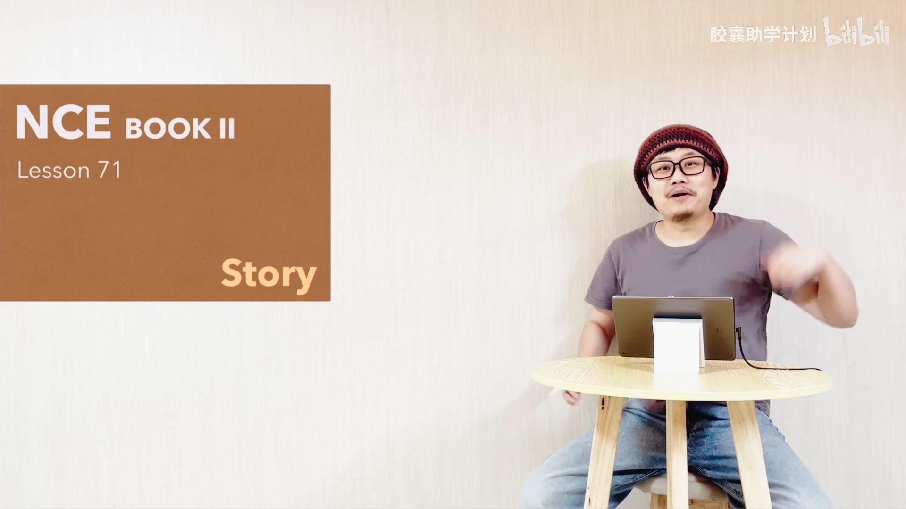

文字识别：blibili / 胶囊助学计划 / NCE / BOOK II / Lesson 71 / Story

### 画面 00:00:02

文字识别：blibii / 胶囊助学计划 / NCE / BOOKII / Lesson 71 / Story

### 画面 00:00:04

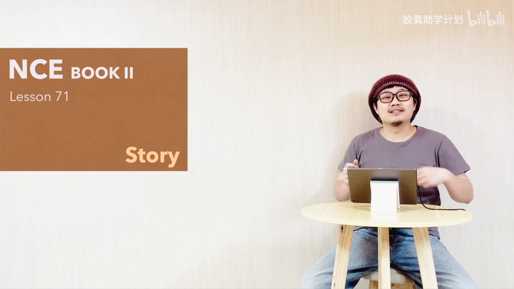

文字识别：bilbii / 胶囊助学计划 / NCE / BOOKII / Lesson 71 / Story

### 画面 00:00:06

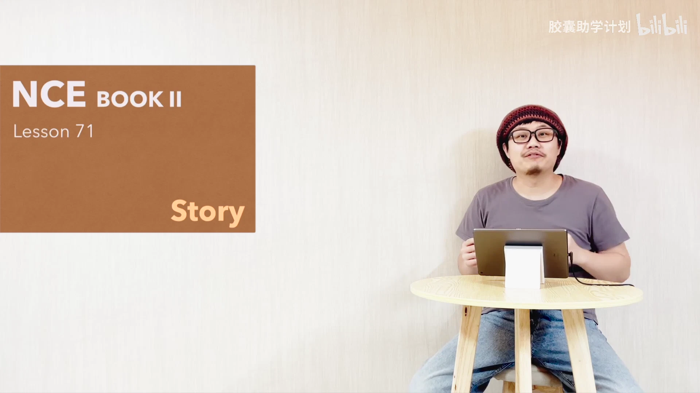

文字识别：bilbili / 胶囊助学计划 / NCE / BOOKII / Lesson 71 / Story

### 画面 00:00:08

文字识别：bilbili / 胶囊助学计划 / NCE / BOOKII / Lesson 71 / Story

### 画面 00:00:10

文字识别：胶囊助学计划 bil

### 画面 00:00:13

文字识别：胶囊助学计划 / 胶囊助学计划

### 画面 00:00:15

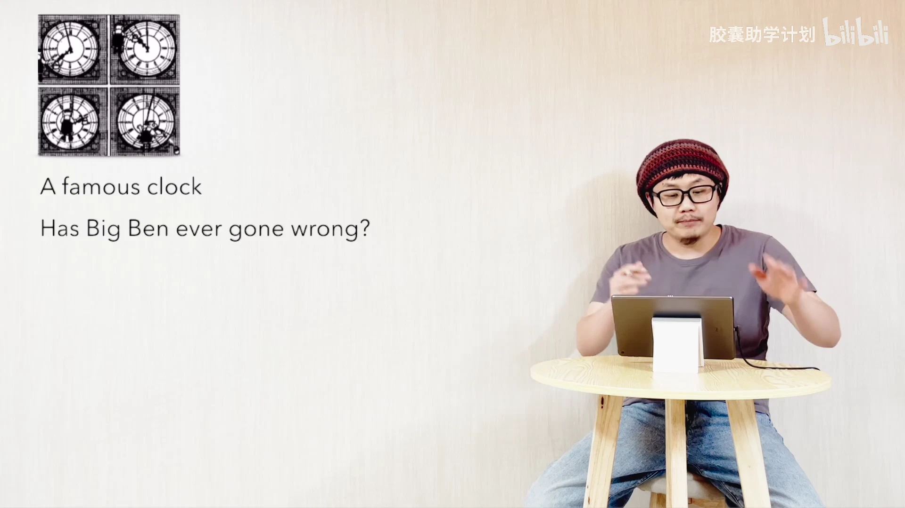

文字识别：biibili / 胶囊助学计划 / A famous clock / Has Big Ben ever gone wrong?

### 画面 00:00:26

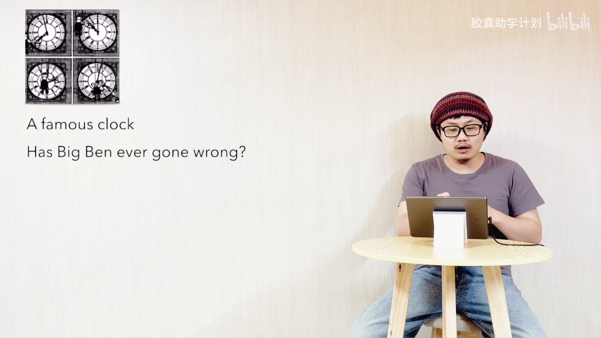

文字识别：biibili / 胶囊助学计划 / A famous clock / Has Big Ben ever gone wrong?

## 00:00:30–00:01:00

出问题出岔子了。他说的是这个大本钟出过岔子吗？啊，肯定出过啊。那我们就看一下他怎么出的就完了。上来先看文章。When you visit London, one of the first things you will see is Big Ben, the famous clock, which can be heard all over the world on the BBC. 哇，好长的一句话，怎么办？没事儿，咱给它拆啊。我上节课就跟各位说了，七

### 画面 00:00:32

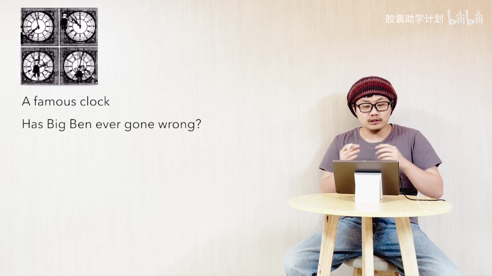

文字识别：biibili / 胶囊助学计划 / A famous clock / Has Big Ben ever gone wrong?

### 画面 00:00:35

文字识别：bilbii / 胶囊助学计划 / A famous clock / Has Big Ben ever gone wrong?

### 画面 00:00:37

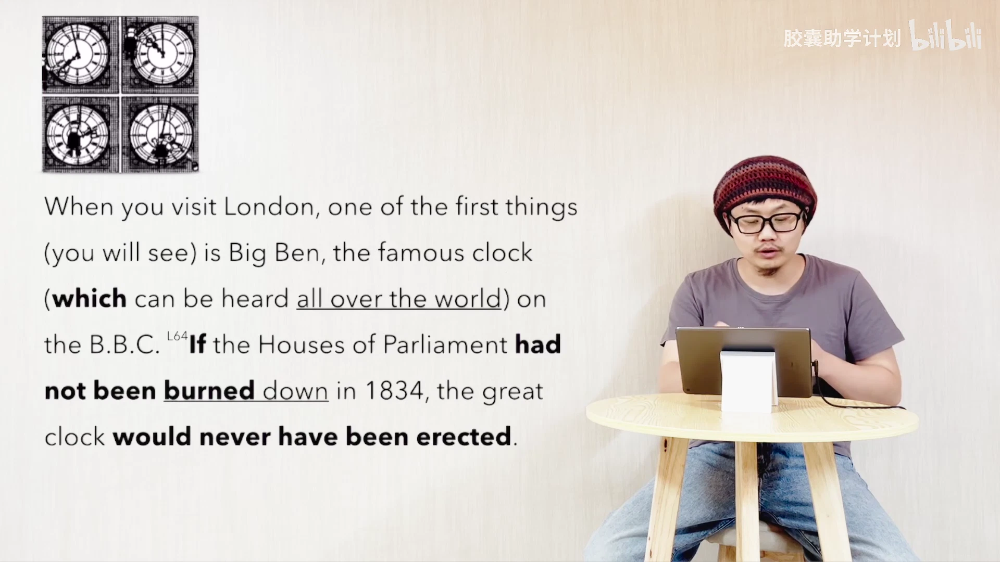

文字识别：胶囊助学计划bibi / When you visit London, one of the first things / (you will see) is Big Ben, the famous clock / (which can be heard allover the world) on / the B.B.C. L64If the Houses of Parliament had / not been burned down in 1834, the great / clock would never have been erected.

### 画面 00:00:39

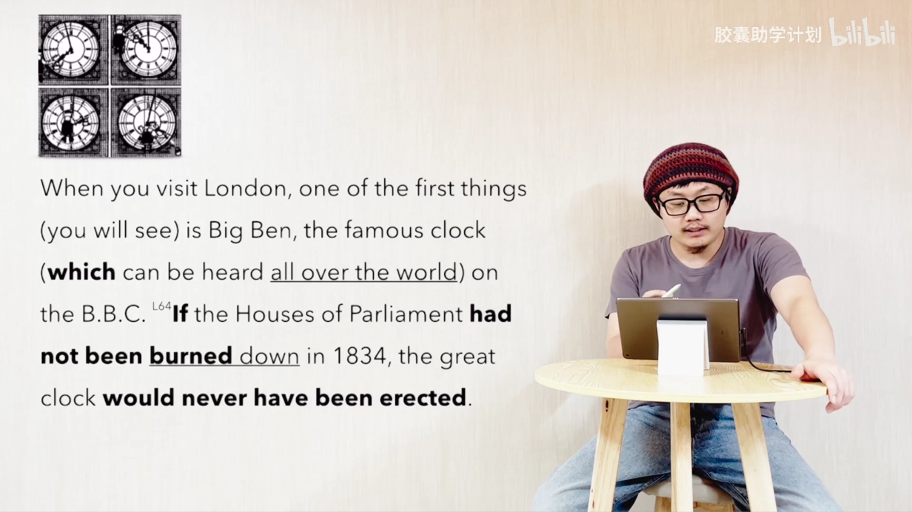

文字识别：胶囊助学计划bibil / When you visit London, one of the first things / (you will see) is Big Ben, the famous clock / (which can be heard allover the world) on / the B.B.C. L64If the Houses of Parliament had / not been burned down in 1834, the great / clock would never have been erected.

## 00:01:00–00:01:30

十课就说了，从基本上七十课开始，一直到整个新三，我们要不停的学习一个新的能力，叫做拆解阅读上的长难句啊。这个几乎是你去考什么四六级啊、考研、托福、雅思，包括出国留学、阅读、工作当中的书籍和邮件必备的一个能力啊。这个能力，而且没办法一蹴即成，必须的，真的就是真枪这个真刀的一个一个句子的去解决才行。那咱们就还好，

### 画面 00:01:09

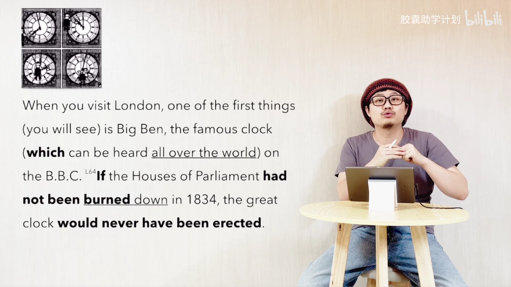

文字识别：胶囊助学计划bib出 / When you visit London, one of the first things / (you will see) is Big Ben, the famous clock / (which can be heard allover the world) on / the B.B.C. L64If the Houses of Parliament had / not been burned down in 1834, the great / clock would never have been erected.

## 00:01:30–00:02:00

好，哎，有点耐心，一课一课的学啊。首先，逗号其实就提醒了您，英语、汉语逗号其实作用都是类似的，就是我这儿断一下，你喘口气儿，读到这儿喘口气儿啊，不管你是阅读还是朗读，喘口气儿，对吧？哎，我第一个小的意思结束了，叫 When you visit London，呃，当你去哎哎伦敦参观拜访啊，或者去那儿游玩的时候，怎么样呢？One of the

### 画面 00:01:39

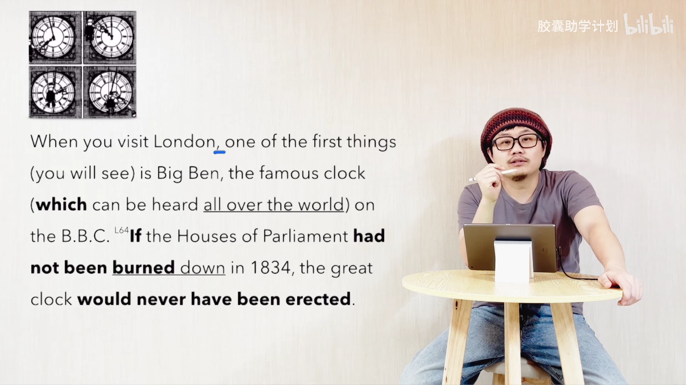

文字识别：胶囊助学计划bi山 / When you visit London_one of the first things / (you will see) is Big Ben, the famous clock / (which can be heard allover the world) on / the B.B.C. L64If the Houses of Parliament had / not been burned down in 1834, the great / clock would never have been erected.

### 画面 00:01:49

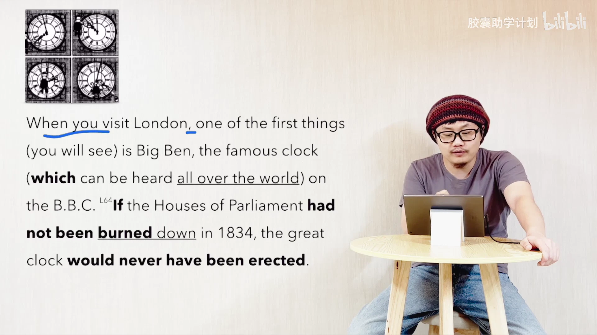

文字识别：胶囊助学计划bib山 / When you visit London_one of the first things / (you will see) is Big Ben, the famous clock / (which can be heard allover the world) on / the B.B.C. L64If the Houses of Parliament had / not been burned down in 1834, the great / clock would never have been erected.

### 画面 00:01:52

文字识别：胶囊助学计划bi山 / When you visit London_one of the first things / (you will see) is Big Ben, the famous clock / (which can be heard allover the world) on / the B.B.C. L64If the Houses of Parliament had / not been burned down in 1834, the great / clock would never have been erected.

## 00:02:00–00:02:30

first things you will see is Big Bang.这句话其实我们完全就把它当做一句话就行，因为我觉得其实我们甚至不会定从这句话，我都觉得很多中国人能读懂。为什么呢？我们看一下，one of the first things叫做第一个，很多就很多东西当中的第一个当中其中之一啊，就是第一个东西其中之一，怎么样呢？You will see就你会看到的，只不过汉语是这个语序，叫你会看到的很多东

### 画面 00:02:00

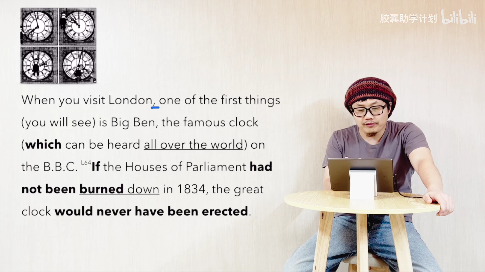

文字识别：胶囊助学计划bib山 / When you visit London_one of the first things / (you will see) is Big Ben, the famous clock / (which can be heard allover the world) on / the B.B.C. L64If the Houses of Parliament had / not been burned down in 1834, the great / clock would never have been erected.

### 画面 00:02:08

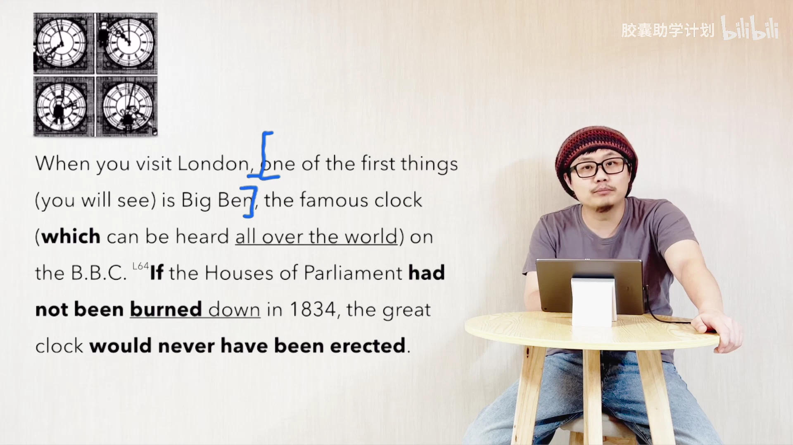

文字识别：胶囊助学计划bib出 / When you visit London,_Lne of the first things / (you will see) is Big Be7 / the famous clock / (which can be heard all over the world) on / the B.B.C. L64If the Houses of Parliament had / not been burned down in 1834, the great / clock would never have been erected.

## 00:02:30–00:03:00

西当中的其中之一，第一个东西对吧？哎，是 Big Bang，英文放到了后边。二十八课定语从句新概念一册一百二十一百二十三，你学的好，这你瞬间就反应过来，它其实就省略了个 that，叫做 that you will see，对吧？哎，呃，你做你会看到的是 Big Bang 大本钟，然后后边又来了个逗号，看见了吗？又来了个逗号。其实从这个地方，就是因为有的人不

### 画面 00:02:30

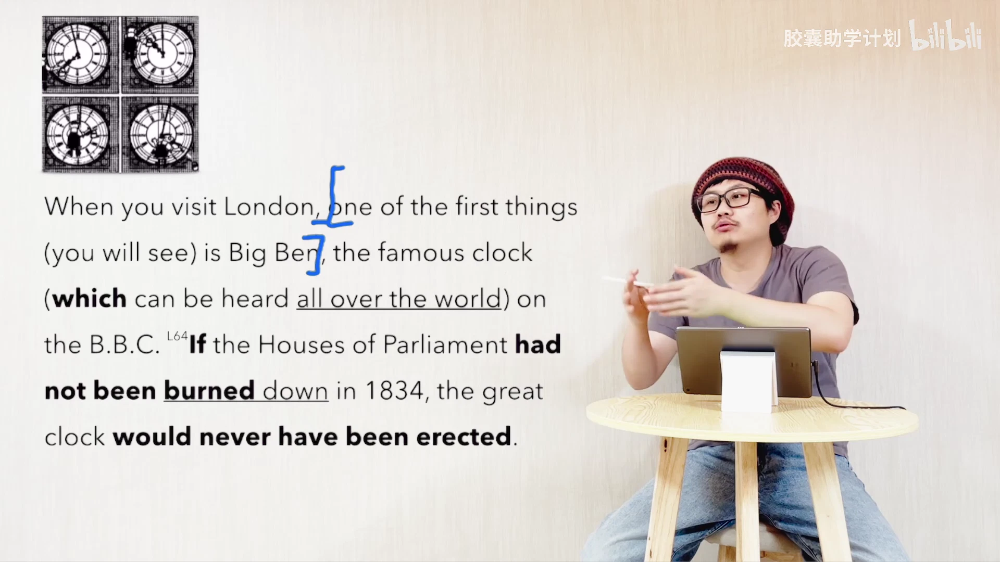

文字识别：胶囊助学计划bi山 / When you visit London, Lne of the first things / (you will see) is Big Be7 / the famous clock / (which can be heard all over the world) on / the B.B.C. L64If the Houses of Parliament had / not been burned down in 1834, the great / clock would never have been erected.

### 画面 00:02:37

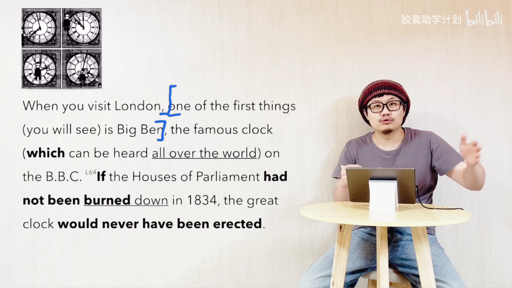

文字识别：胶囊助学计划bii出 / When you visit London,_ne of the first things / (you will see) is Big Be7 / the famous clock / (which can be heard all over the world) on / the B.B.C. L64If the Houses of Parliament had / not been burned down in 1834, the great / clock would never have been erected.

### 画面 00:02:52

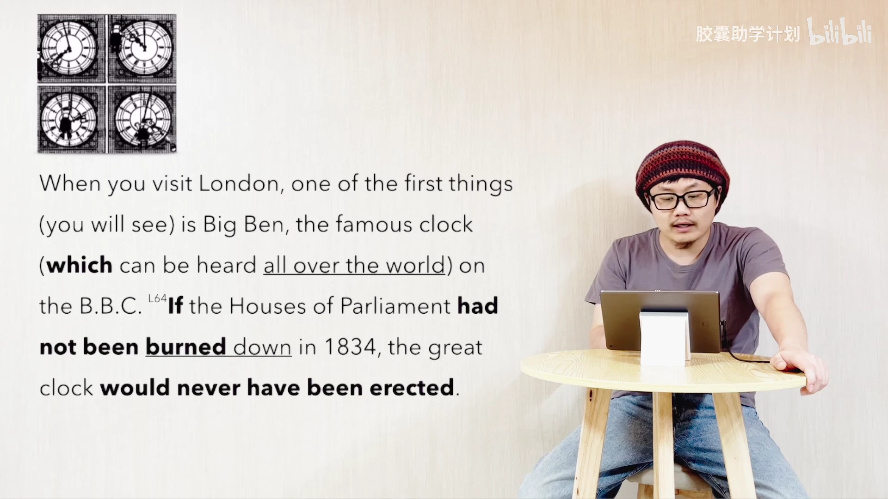

文字识别：胶囊助学计划bibi出 / When you visit London, one of the first things / (you will see) is Big Ben, the famous clock / (which can be heard all over the world) on / the B.B.C. L64If the Houses of Parliament had / not been burned down in 1834, the great / clock would never have been erected.

## 00:03:00–00:03:30

知道什么是 Big Bang，那我要给你解释一下什么是 Big Bang。后边这些东西全是在给你解释 Big Bang 到底是个啥玩意儿，类似于同位语，你可以这样去理解啊。然后的同位语是什么呢？我们看一下它这个句子啊。所以逗号其实就提醒你啊，这是一句话，这是一句话，对吧？这是第一句，这是两个杠之间，这是第二句，然后后边你可以当做是第三句。第三句是什么呢？The famous clock，一个非常有名的大表大钟。然后这个表

### 画面 00:03:00

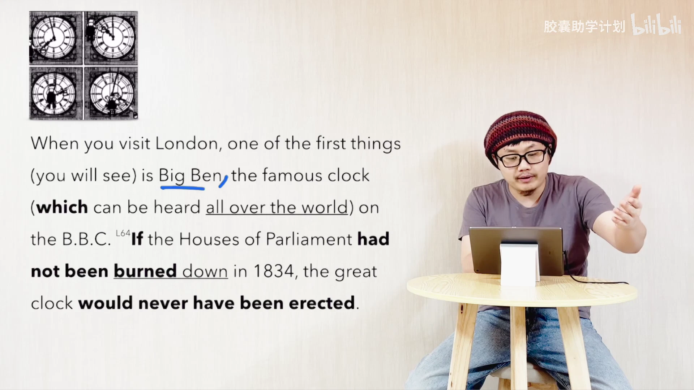

文字识别：胶囊助学计划biii / When you visit London, one of the first things / (you will see) is Big Benythe famous clock / (which can be heard all over the world) on / the B.B.C. L64If the Houses of Parliament had / not been burned down in 1834, the great / clock would never have been erected.

### 画面 00:03:05

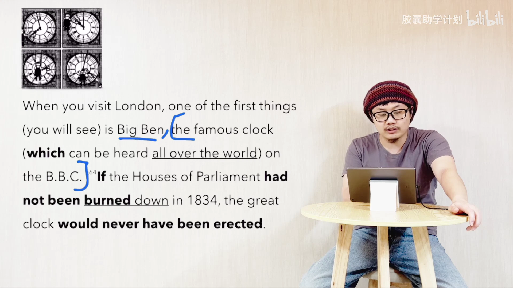

文字识别：胶囊助学计划bib出 / When you visit London, one of the first things / (you will see) is Big Benthe famous clock / (which can be heard all over the world) on / 4If the Houses of Parliament had / the B.B.C. / not been burned down in 1834, the great / clock would never have been erected.

### 画面 00:03:13

文字识别：胶囊助学计划blb出 / When you visit London, one of the first things / (you will see) is Big Beny the famous clock / (which can be heard all over the world) on / the B.B.C. L64If the Houses of Parliament had / not been burned down in 1834, the great / clock would never have been erected.

### 画面 00:03:17

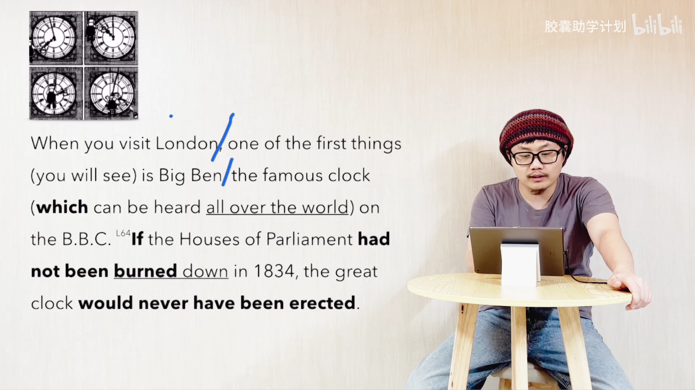

文字识别：胶囊助学计划bi出 / When you visit London/one of the first things / (you will see) is Big Ben/the famous clock / (which can be heard all over the world) on / the B.B.C. L64If the Houses of Parliament had / not been burned down in 1834, the great / clock would never have been erected.

### 画面 00:03:19

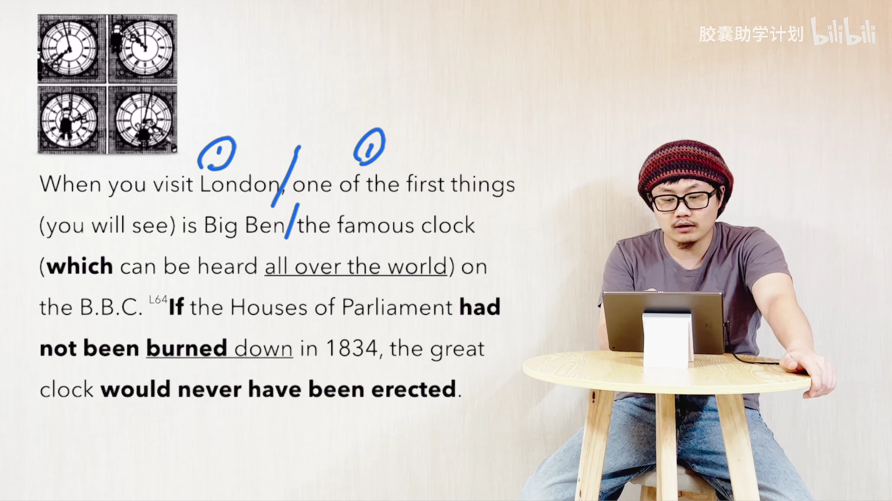

文字识别：胶囊助学计划bib出 / When you visit London/one of the first things / (you will see) is Big Ben/the famous clock / (which can be heard all over the world) on / the B.B.C. L64If the Houses of Parliament had / not been burned down in 1834, the great / clock would never have been erected.

### 画面 00:03:26

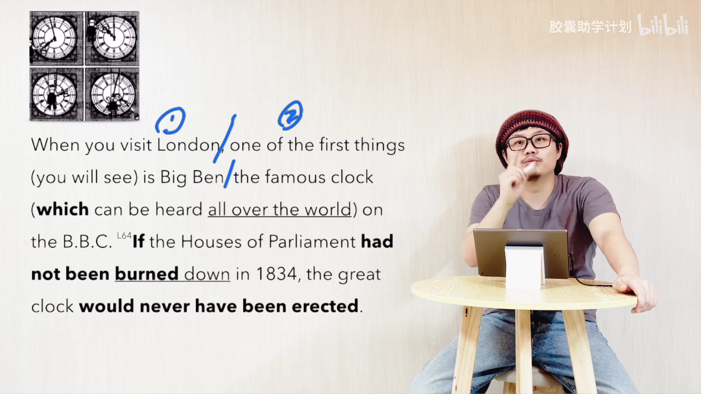

文字识别：胶囊助学计划ib出 / When you visit London/one of the first things / (you will see) is Big Ben/the famous clock / (which can be heard all over the world) on / the B.B.C. L64If the Houses of Parliament had / not been burned down in 1834, the great / clock would never have been erected.

## 00:03:30–00:04:00

和钟后边还跟了一个定语从句，什么样的定语从句呢？啊，那其实这个地方啊不应该在这儿结束，应该在这儿结束会更舒服一点啊。就这儿我们不管它了，在这儿结束更舒服一点。叫做这个表和这个钟啊，或这个钟啊，can be heard。二十一课咱学的对吧？叫能被听到。本课的一个习惯用法 all over the world 啊，连起来读叫 all over the world。这个地方这个 l 和这个 o 它有一个

### 画面 00:03:33

文字识别：胶囊助学计划bib山 / When you visit London/one of the first things / (you will see) is Big Ben/the famous clock / which can be heard all over the world) on / the B.B.C. L64If the Houses of Parliament had / not been burned down in 1834, the great / clock would never have been erected.

### 画面 00:03:38

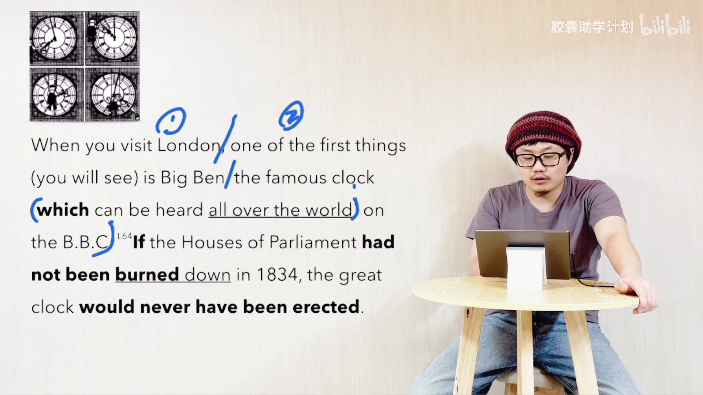

文字识别：胶囊助学计划bi山 / When you visit London/one of the first things / (you will see) is Big Ben/the famous clock / which can be heard all over the world) / )on / L64If the Houses of Parliament had / the B.B.C / not been burned down in 1834, the great / clock would never have been erected.

### 画面 00:03:47

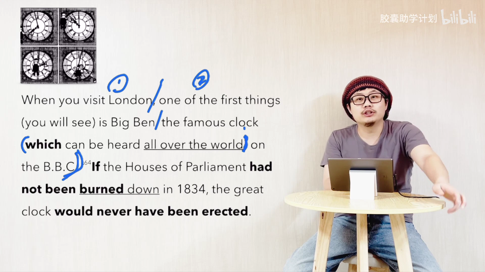

文字识别：胶囊助学计划bi出 / When you visit London/one of the first things / (you will see) is Big Ben/the famous clock / which can be heard all over the world / on / the B.B.C) / )641f the Houses of Parliament had / not been burned down in 1834, the great / clock would never have been erected.

### 画面 00:03:58

文字识别：胶囊助学计划bii出 / When you visit London/one of the first things / (you will see) is Big Ben/the famous clock / which can be heard all over the world / on / the B.B.C / )641f the Houses of Parliament had / not been burned down in 1834, the great / clock would never have been erected.

## 00:04:00–00:04:30

小的连读，all over，听见了吧？all over啊，不是all over啊，all over the world，好叫做全世界都可以被听到，在哪儿呢？On the BBC，这个BBC就不用我说了。如果您还不知道BBC是什么的，这也不是我们英语知识啊，包括VOA啊这种，包括他后来拍了很多特别著名的纪录片嘛，那美丽星球这样的纪录片，对吧？您如果不知道这个，就自己去上网搜一下就好。在这我就不多说了啊，就是一个广播电

### 画面 00:04:10

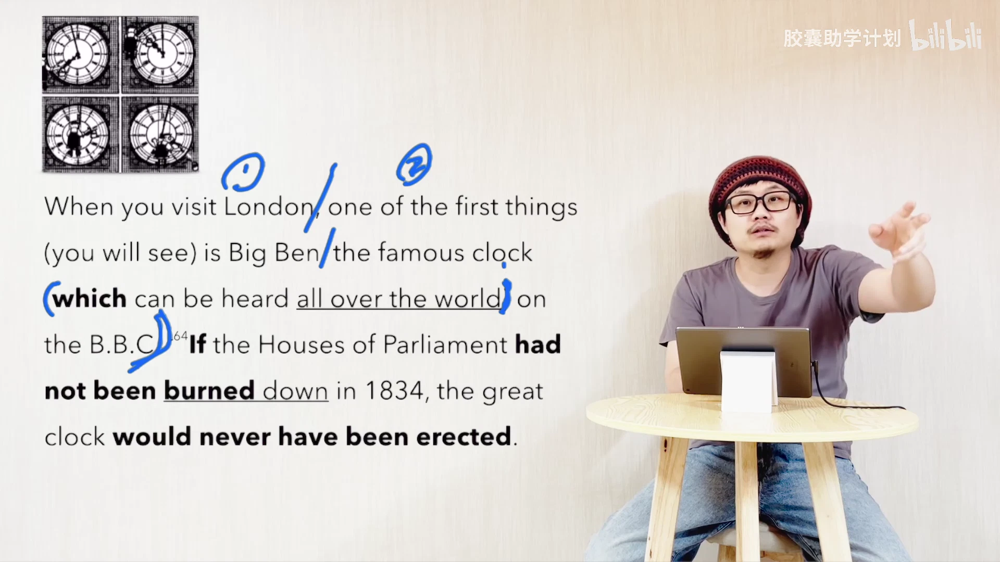

文字识别：胶囊助学计划bibi出 / When you visit London/one of the first things / (you will see) is Big Ben/the famous clock / which can be heard all over the world / on / the B.B.CD / 64If the Houses of Parliament had / not been burned down in 1834, the great / clock would never have been erected.

### 画面 00:04:13

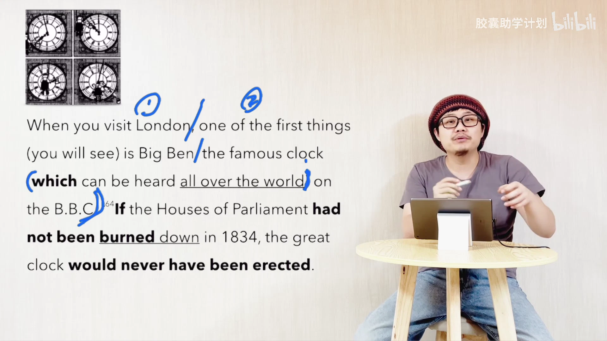

文字识别：胶囊助学计划biii出 / When you visit London/one of the first things / (you will see) is Big Ben/the famous clock / which can be heard all over the world / on / the B.B.C / )64If the Houses of Parliament had / not been burned down in 1834, the great / clock would never have been erected.

### 画面 00:04:15

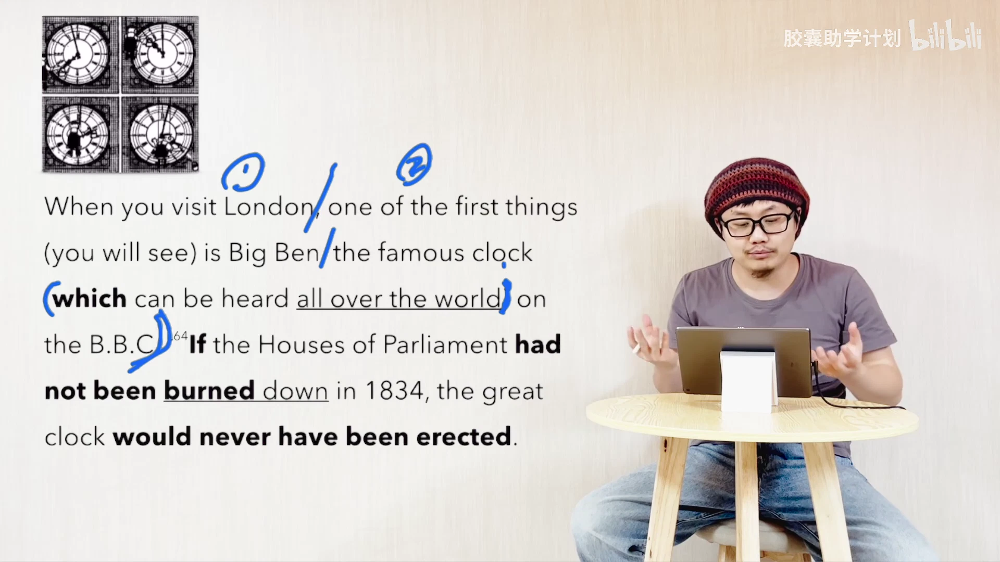

文字识别：胶囊助学计划bl山 / When you visit London/one of the first things / (you will see) is Big Ben/the famous clock / which can be heard all over the world / on / the B.B.CD / )64If the Houses of Parliament had / not been burned down in 1834, the great / clock would never have been erected.

### 画面 00:04:18

文字识别：胶囊助学计划bibl / When you visit London/one of the first things / (you will see) is Big Ben/the famous clock / which can be heard all over the world / on / the B.B.CD / )641f the Houses of Parliament had / not been burned down in 1834, the great / clock would never have been erected.

### 画面 00:04:23

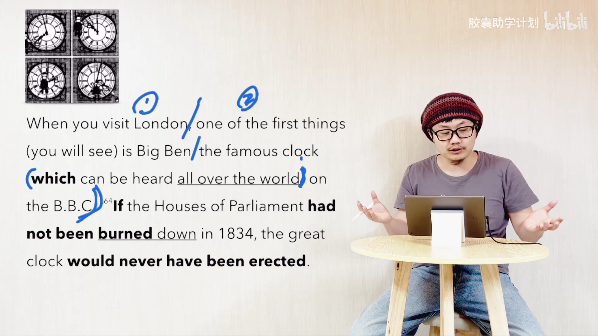

文字识别：胶囊助学计划bii出 / When you visit London/one of the first things / (you will see) is Big Ben/the famous clock / which can be heard all over the world / on / the B.B.CD / D641f the Houses of Parliament had / not been burned down in 1834, the great / clock would never have been erected.

## 00:04:30–00:05:00

台，你可以理解为啊，说这个这个非常著名的这个钟啊，可以被全世界听到，通过BBC频道，对吧？OK， continue啊，这句话其实就被我们拆成了好几块了嘛，对吧？我们看下一句话，If the houses of Parliament had not been burned down in 1834, the Great Clock would never have been erected。他说什么呢？说If，

### 画面 00:04:45

文字识别：胶囊助学计划bibil / When you visit London/one of the first things / (you will see) is Big Ben/the famous clock / (which can be heard all over the world) on / the B.B.C. L64If the Houses of Parliament had / not been burned down in 1834, the great / clock would never have been erected.

### 画面 00:04:47

文字识别：胶囊助学计划bilb出 / When you visit London/one of the first things / (you will see) is Big Ben/the famous clock / (which can be heard all over the world) on / the B.B.C. L64If the Houses of Parliament had / not been burned down in 1834, the great / clock would never have been erected.

## 00:05:00–00:05:30

然后我这儿又给你了一个 had done，然后 would have done。哎，呃，瞬间提醒你六十四课咱们学了对过去的虚拟，对吧？与过去事实相反。那我们先看一下，说如果 the houses of parliament，国会大厦，英国的国会大厦，如果说英国的国会大厦 had not been burned down，说当时没有被焚毁，burned down，也是本课要学的一个非常重要的习惯用法，叫被焚毁。在什么呢？在 eighteen thirty，呃，four，一

### 画面 00:05:17

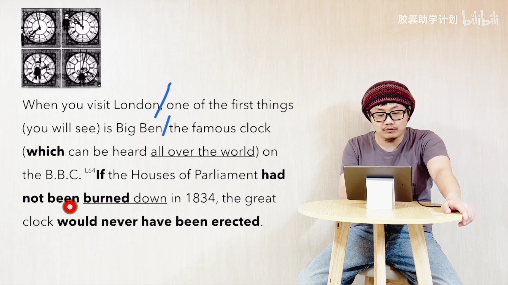

文字识别：胶囊助学计划bibi出 / When you visit London/one of the first things / (you will see) is Big Ben/the famous clock / (which can be heard all over the world) on / the B.B.C. L64If the Houses of Parliament had / not been burned down in 1834, the great / clock would never have been erected.

## 00:05:30–00:06:00

1834年，说如果当时没有被焚毁，那The Great Clock说这个大本钟啊，would never have been erected，说就绝对不会啊，永远都不会被树立起来。好，那这句话是什么意思呢？我给你捋一下啊，省得你听起来有点懵。按照这句话给我们提供的信息，说的是因为在1834年，我们现在其实有两个Houses of Parliament，英国，一个

### 画面 00:05:47

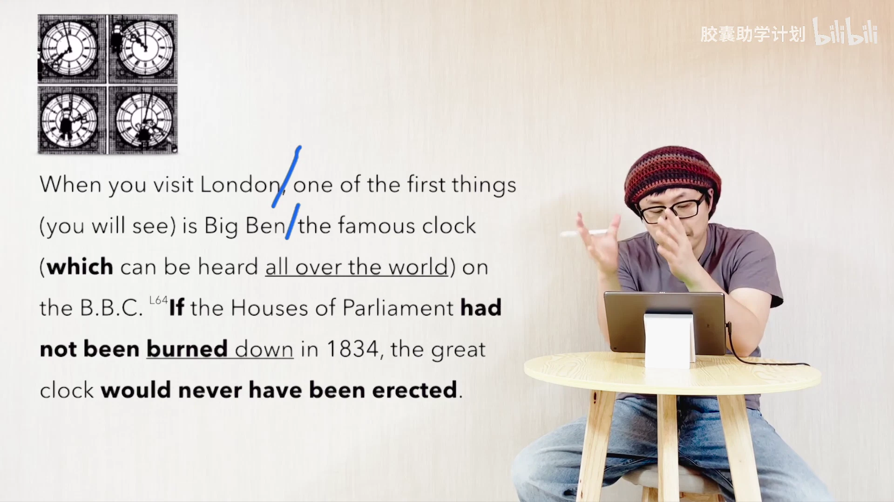

文字识别：胶囊助学计划bibi / When you visit London/one of the first things / (you will see) is Big Ben/the famous clock / (which can be heard all over the world) on / the B.B.C. L64If the Houses of Parliament had / not been burned down in 1834, the great / clock would never have been erected.

## 00:06:00–00:06:30

是旧的，一个是新的啊。韦斯，呃，就刚才我说那个什么韦斯特，呃呃韦韦韦斯敏斯特宫，对吧？韦斯敏斯特宫呢是现在新的，一八四零年，我没有记错的话啊，它是新的 Houses of Parliament。然后在它旁边树立了一个 Big Ben，也就是我们刚才图中看到的那个。老的 Houses of Parliament 呢，在一八三四年就 burned down了。所以这句话告诉你的

### 画面 00:06:06

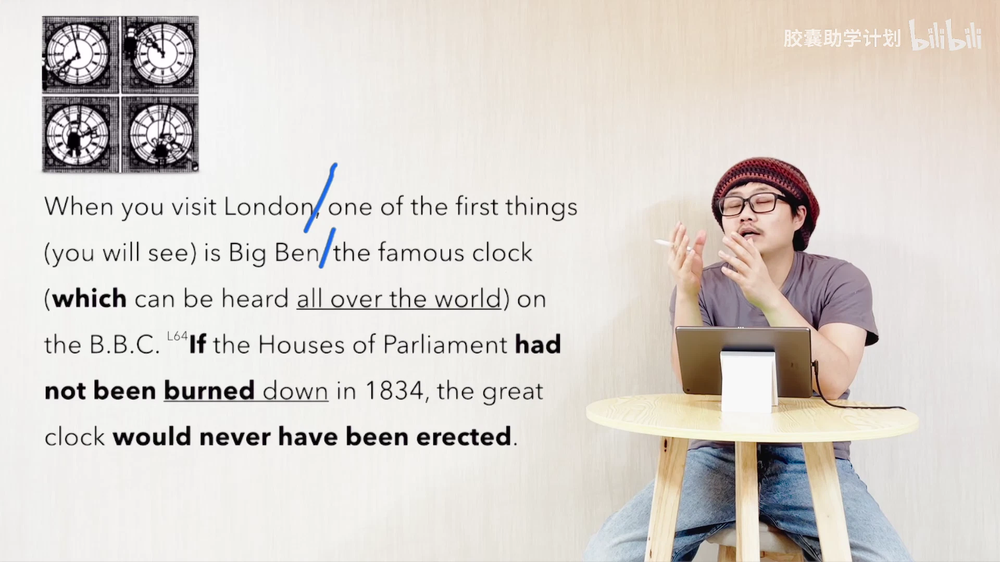

文字识别：胶囊助学计划bi山 / When you visit London/one of the first things / (you will see) is Big Ben/the famous clock / (which can be heard all over the world) on / the B.B.C. L64If the Houses of Parliament had / not been burned down in 1834, the great / clock would never have been erected.

### 画面 00:06:14

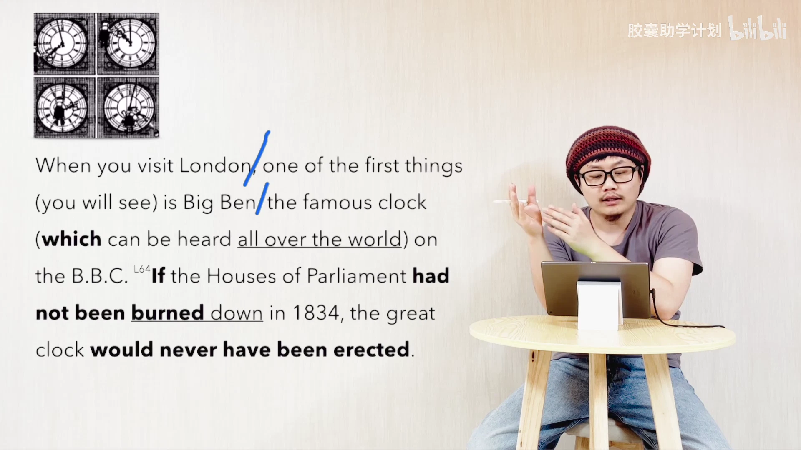

文字识别：胶囊助学计划bib山 / When you visit London/one of the first things / (you will see) is Big Ben/the famous clock / (which can be heard all over the world) on / the B.B.C. L64If the Houses of Parliament had / not been burned down in 1834, the great / clock would never have been erected.

## 00:06:30–00:07:00

信息叫做，在一八三四年，the Houses of Parliament burned down，焚毁了，所以后来才建了新的啊，威斯敏斯特宫以及 Big Ben，啊，明白这意思了吧？所以他说，如果当时它没有被焚毁，那这个 Big Ben，啊，这个啊不是啊，这个对 Big Ben，这个大本钟就永远不会被树立起来，对吧？所以他的意思就是，正因为被焚毁了，所以才树立起来了后边的新的威斯敏

### 画面 00:06:44

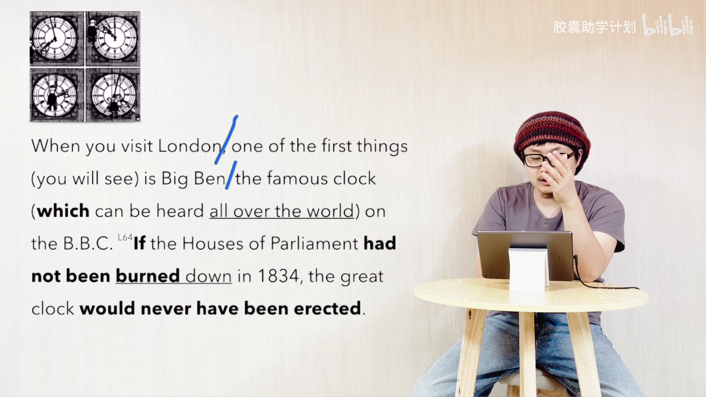

文字识别：胶囊助学计划bib山 / When you visit London/one of the first things / (you will see) is Big Ben/the famous clock / (which can be heard all over the world) on / the B.B.C. L64If the Houses of Parliament had / not been burned down in 1834, the great / clock would never have been erected.

### 画面 00:06:56

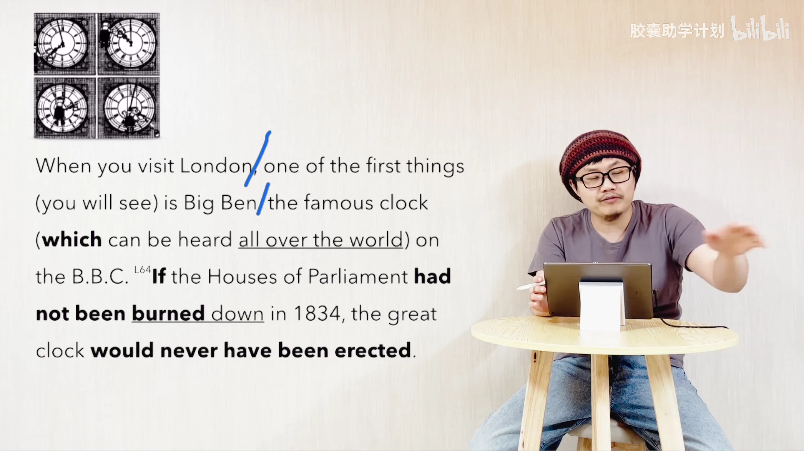

文字识别：胶囊助学计划bi山 / When you visit London/one of the first things / (you will see) is Big Ben/the famous clock / (which can be heard all over the world) on / the B.B.C. L64If the Houses of Parliament had / not been burned down in 1834, the great / clock would never have been erected.

## 00:07:00–00:07:30

斯特宫以及这个 Big Bang 啊，希望你能明白这句话，听上去有点绕，是吧？我反复又提了好几遍。Next one, Big Bang takes takes its name from Sir Benjamin Hall, who was responsible for the making of the clock when the new Houses of Parliament were being built.还是那句话，是吧？我这么一聊，我这个句子一读，对于你来说又是很长。我每次呢，就

### 画面 00:07:07

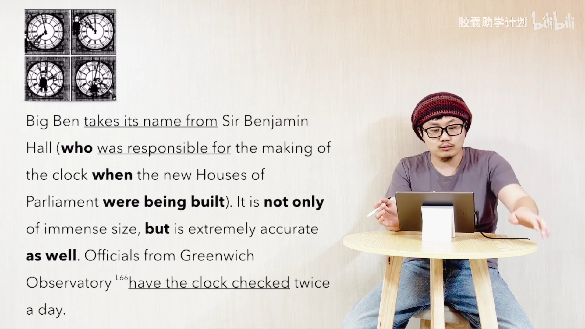

文字识别：胶囊助学计划bi山 / Big Ben takes its name from Sir Benjamin / Hall (who was responsible for the making of / the clock when the new Houses of / Parliament were being built). It is not only / of immense size, but is extremely accurate / as well. Officials from Greenwich / Observatory / 'have the clock checked twice / a day.

### 画面 00:07:10

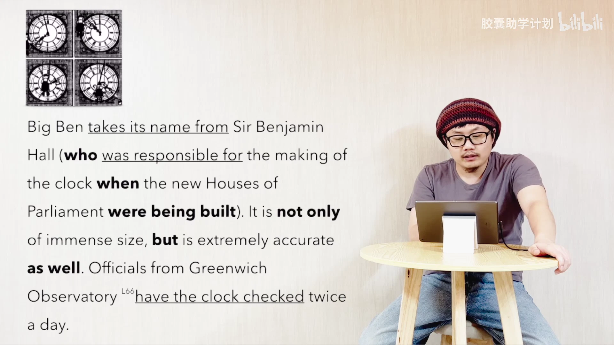

文字识别：胶囊助学计划biii出 / Big Ben takes its name from Sir Benjamin / Hall (who was responsible for the making of / the clock when the new Houses of / Parliament were being built). It is not only / of immense size, but is extremely accurate / as well. Officials from Greenwich /  L6have the clock checked twice / Observatory / a day.

### 画面 00:07:25

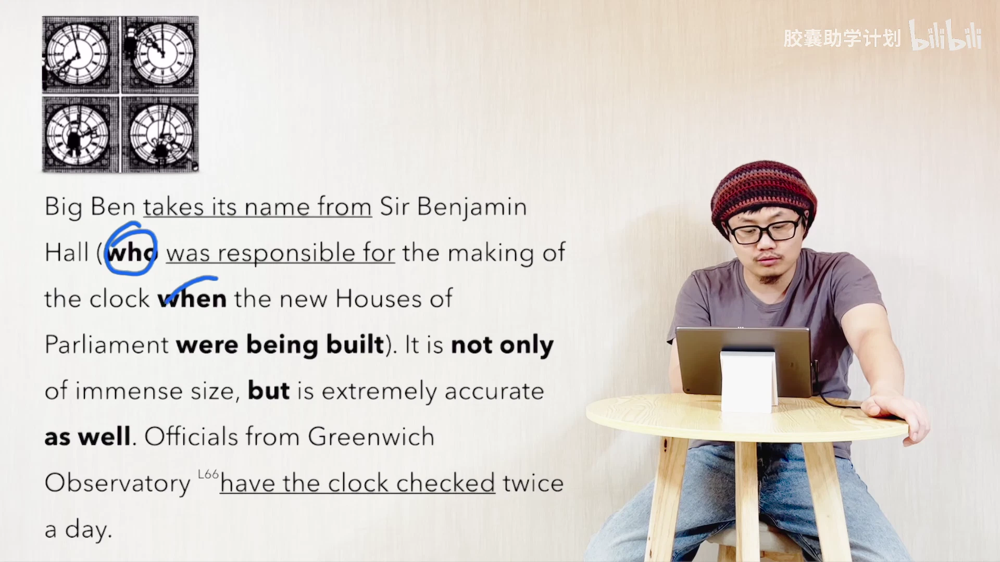

文字识别：胶囊助学计划bii出 / Big Ben takes its name from Sir Benjamin / Hall( / whg / was responsible for the making of / the clock when the new Houses of / Parliament were being built). It is not only / of immense size, but is extremely accurate / as well. Officials from Greenwich / Observatory / 'have the clock checked twice / a day.

### 画面 00:07:27

文字识别：胶囊助学计划bib出 / Big Ben takes its name from Sir Benjamin / Hall( / Whg / was responsible for the making of / the clock / Wnen / the new Houses of / Parliament were being built). It is not only / of immense size, but is extremely accurate / as well. Officials from Greenwich / Observatory / 'have the clock checked twice / a day.

## 00:07:30–00:08:00

我们争取都是先从头到尾他读一遍，然后在那些明显要断句的地方，我就给你读成 who 啊 when 啊，就是这个样子。然后呢，我再给你圈出来，然后圈出来之后，我再告诉你为啥。比如说，我们先看第一句话，叫 Big Ben takes his name from Sir Benjamin Hall，说 Big Ben 啊，说这个这个名字呀，takes his name from，叫取名于，这是一个习惯用法。本课我们待会儿会造句啊，取名于 Sir Benjamin Hall 就是一个人的名字。

### 画面 00:07:57

文字识别：胶囊助学计划bibi / Big Ben takes its name from Sir Benjamin / Hall( / Whd / was responsible for the making of / the clock / When / the new Houses of / Parliament were being built). It is not only / of immense size, but is extremely accurate / as well. Officials from Greenwich / Observatory / L66 / 'have the clock checked twice / a day.

## 00:08:00–00:08:30

然后这个人是个什么样的人呢？后边跟了个定语从句，who嘛，对吧？就是他呗啊，对吧？我们原来说过，说这个who其实就是替代了他前面的这个Sir Benjamin Hall啊，就是他，He应该是男的，Sir吗？Was responsible for the making of the clock.一看问，好，这句话又结束了。说他be responsible for本科的习惯用法，负责啊，各位现在能懂就可以了。一会儿我们造句啊，说他负责的是什么呢？The making

### 画面 00:08:27

文字识别：胶囊助学计划bib出 / Big Ben takes its name from Sir Benjamin / Hall( / Whg / was responsible for the making of / the clock / when / the new Houses of / Parliament were being built). It is not only / of immense size, but is extremely accurate / as well. Officials from Greenwich / Observatory / L66 / 'have the clock checked twice / a day.

## 00:08:30–00:09:00

of the clock叫做这个大钟的制作，它负责的是这件事儿，所以这个名字取自于它，对吧？好，When当当什么呢？当the new houses of Parliament were being built，说当这个新的国会大厦啊，这个议会大厦怎么样呢？Were being built正在被建造的时候，所以这句话还是我们要想明白一件事儿啊，他想给你提供的是如下几个信息。第一个，Big

### 画面 00:08:36

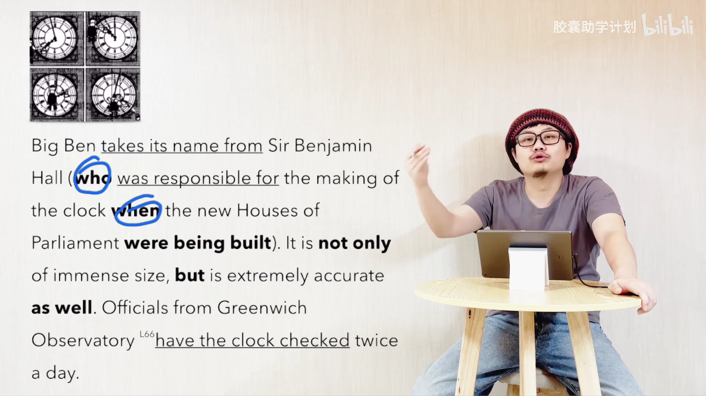

文字识别：胶囊助学计划bib出 / Big Ben takes its name from Sir Benjamin / Hall( / whd / was responsible for the making of / the clock / When / the new Houses of / Parliament were being built). It is not only / of immense size, but is extremely accurate / as well. Officials from Greenwich / Observatory / L66 / 'have the clock checked twice / a day.

### 画面 00:08:43

文字识别：胶囊助学计划bi出 / Big Ben takes its name from Sir Benjamin / Hall( / Whg / was responsible for the making of / the clock / when / the new Houses of / Parliament were being built). It is not only / of immense size, but is extremely accurate / as well. Officials from Greenwich / Observatory / 'have the clock checked twice / a day.

### 画面 00:08:58

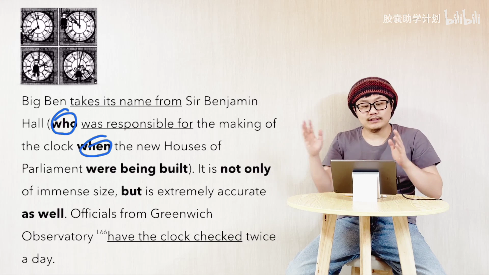

文字识别：胶囊助学计划bibi / Big Ben takes its name from Sir Benjamin / Hall( / whd / was responsible for the making of / the clock / When / the new Houses of / Parliament were being built). It is not only / of immense size, but is extremely accurate / as well. Officials from Greenwich / Observatory / L66 / 'have the clock checked twice / a day.

## 00:09:00–00:09:30

Ben 取名于 Sir Benjamin Hall；第二，Sir Benjamin Hall 他负责的是大本钟的建立，对吧？制作啊。第三，什么时候呢？就是换一句话来说，什么时候他在负责这件事呢？同时在发生的一件事情就是这个新的 Westminster 工正在被建立的时候，哎，前面那件事他正在负责制作这个大本钟，对吧？所以脑海当中我们再

### 画面 00:09:28

文字识别：胶囊助学计划biii / Big Ben takes its name from Sir Benjamin / Hall( / Whg / was responsible for the making of / the clock / When / the new Houses of / Parliament were being built). It is not only / of immense size, but is extremely accurate / as well. Officials from Greenwich / Observatory / 'have the clock checked twice / a day.

## 00:09:30–00:10:00

把这个信息给它串到一起。一八三四年之前叫做 Old Houses of Parliament，原来的那个美啊英国的这个国会大厦怎么样了呢？在一八三四年焚毁了。然后在一八四零年的时候，那你得重新建一个地儿啊！哎，重新建了一个地儿。这个地儿呢，至少是我们这样简单去说，分了两个部分。第一个部分是美斯敏斯的宫啊，叫做 New Houses of Parliament，对吧？哎，New

### 画面 00:09:58

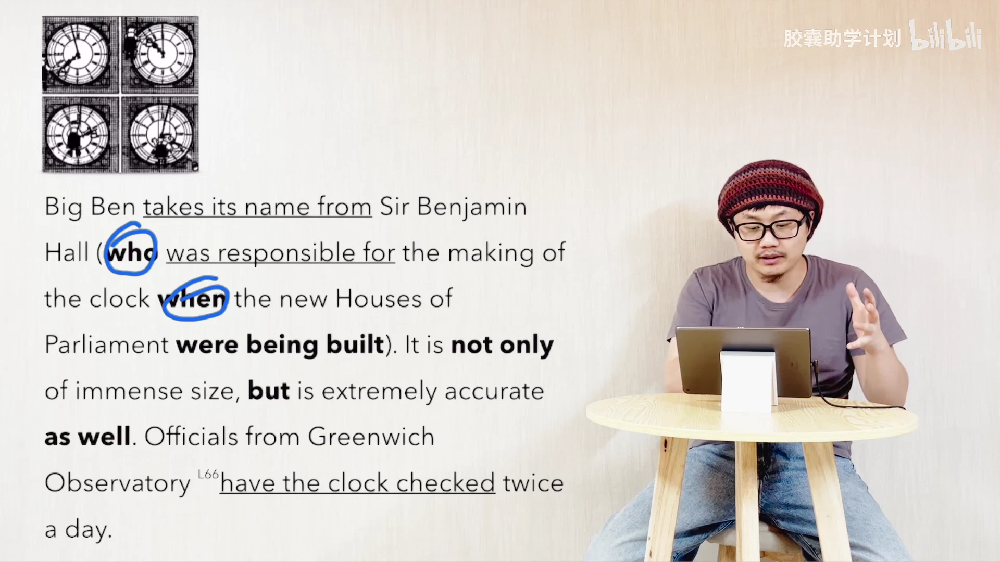

文字识别：胶囊助学计划bi出 / Big Ben takes its name from Sir Benjamin / Hall( / Whg / was responsible for the making of / the clock / Wnen / the new Houses of / Parliament were being built). It is not only / of immense size, but is extremely accurate / as well. Officials from Greenwich / Observatory / 'have the clock checked twice / a day.

## 00:10:00–00:10:30

Houses of Parliament.然后第二个地方是什么呢？是刚才我说的Big Bang,对吧？所以它目前嘞，这两句话给我们提供的是如下的信息啊。Next one, it is not only of immense size, but is extremely accurate as well.好，我们先看，他说，首先来啊，这个粗字的这个啊加粗的这个东西，我一标出来，你应该迅速能想到二十五课我们学过这个非常重要的语法，对吧？

### 画面 00:10:14

文字识别：胶囊助学计划bib出 / Big Ben takes its name from Sir Benjamin / Hall( / whg / was responsible for the making of / the clock / When / the new Houses of / Parliament were being built). It is not only / of immense size, but is extremely accurate / as well. Officials from Greenwich / Observatory / L66 / 'have the clock checked twice / a day.

## 00:10:30–00:11:00

各种连词，其中最麻烦的一个就是not only but as well或者not only but also复习嘛，它不仅仅怎么样呢？Of immense size，immense让我想起奥林匹克运动会那课，咱们不是学过吗？Of immense size，对吧？哎，就是非常的大，巨大。它不仅非常的巨大，它呃更怎么样呢？这个but不是但是啊，更更甚的是什么呢？Is extremely accurate，还极度的准确。它不仅大，

### 画面 00:10:30

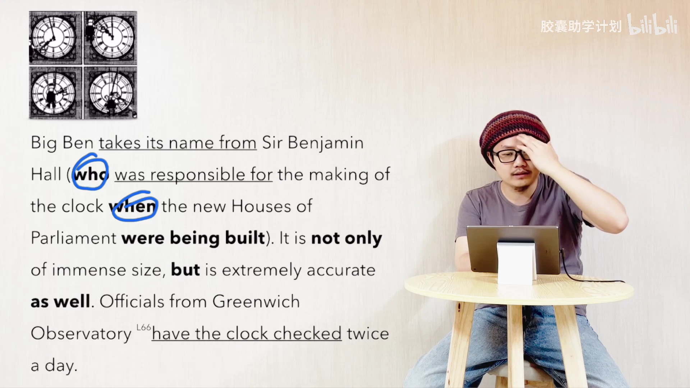

文字识别：胶囊助学计划bib山 / Big Ben takes its name from Sir Benjamin / Hall( / Whg / was responsible for the making of / the clock / When / the new Houses of / Parliament were being built). It is not only / of immense size, but is extremely accurate / as well. Officials from Greenwich / Observatory / 'have the clock checked twice / a day.

### 画面 00:10:49

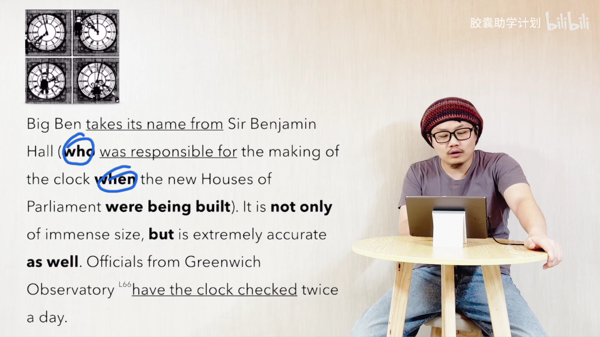

文字识别：胶囊助学计划bilb出 / Big Ben takes its name from Sir Benjamin / Hall( / whg / was responsible for the making of / the clock / When / the new Houses of / Parliament were being built). It is not only / of immense size, but is extremely accurate / as well. Officials from Greenwich / Observatory / L66 / 'have the clock checked twice / a day.

## 00:11:00–00:11:30

一般小来说，比如瑞士造的表小，它可能准确。哎，就它不仅特别的大，它还特别的准确，是吧？就是一般来说，越小容易越准确，越大容易越糙。但是呢，它不仅大，更准确，是吧？这个就很神奇。Continue说，Officials from Greenwich Observatory have the clock checked twice a day. Officials，咱们之前在讲单词部分说了，它

### 画面 00:11:02

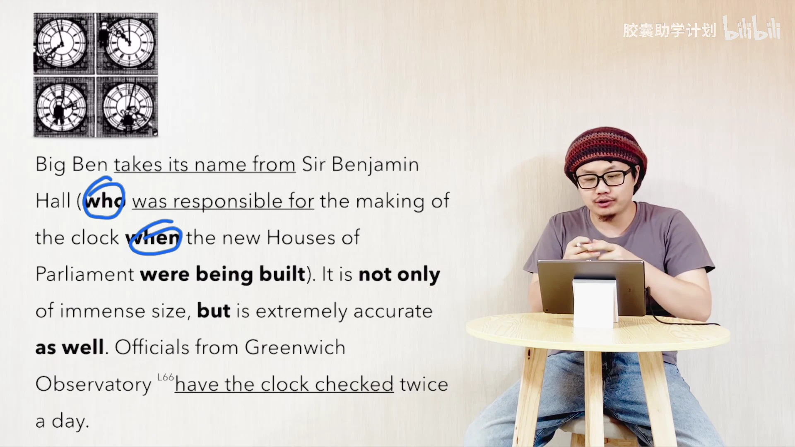

文字识别：胶囊助学计划bil / Big Ben takes its name from Sir Benjamin / Hall( / Whg / was responsible for the making of / the clock / when / the new Houses of / Parliament were being built). It is not only / of immense size, but is extremely accurate / as well. Officials from Greenwich / Observatory / L66 / have the clock checked twice / a day.

### 画面 00:11:05

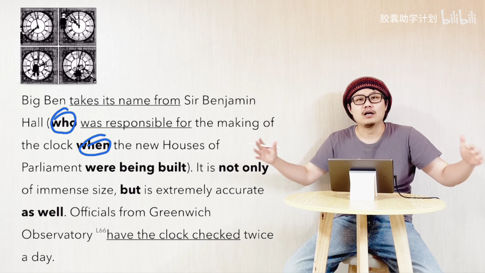

文字识别：胶囊助学计划bib出 / Big Ben takes its name from Sir Benjamin / Hall( / Whg / was responsible for the making of / the clock / when / the new Houses of / Parliament were being built). It is not only / of immense size, but is extremely accurate / as well. Officials from Greenwich / Observatory / L66 / 'have the clock checked twice / a day.

### 画面 00:11:09

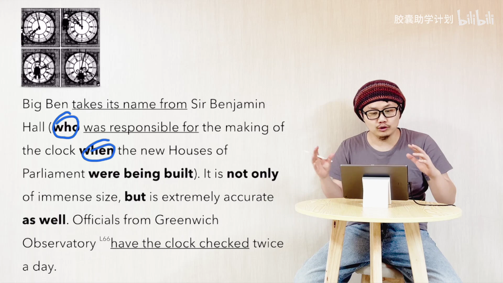

文字识别：胶囊助学计划bilbi / Big Ben takes its name from Sir Benjamin / Hall( / Whg / was responsible for the making of / the clock / When / the new Houses of / Parliament were being built). It is not only / of immense size, but is extremely accurate / as well. Officials from Greenwich / Observatory / L66 / 'have the clock checked twice / a day.

## 00:11:30–00:12:00

有两个词性，名词跟形容词。名词一加s，那b是名词了。行政官员从哪儿的行政官员呢？来自于Greenwich Observatory，来自于格林尼治的这个天文台的哎，这个行政人员。我们说了嘛，时间是从那儿开始算的。我们的这个不是时间从那儿开始算啊，是这个这个我们的这个时差这个分区是从那个地方开始算的，对吧？然后Have the clock checked，

### 画面 00:11:39

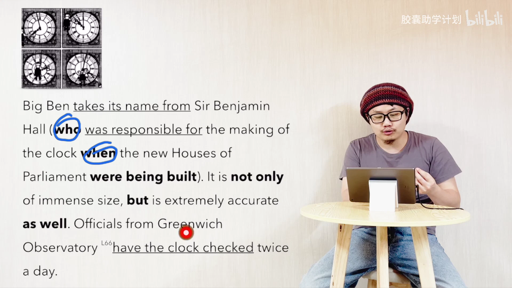

文字识别：bibii / 胶囊助学计划 / Big Ben takes its name from Sir Benjamin / Hall( / Whg / was responsible for the making of / the clock / When / the new Houses of / Parliament were being built). It is not only / of immense size, but is extremely accurate / as well. Officials from Greenwich / Observatory / L66 / 'have the clock checked twice / a day.

### 画面 00:11:49

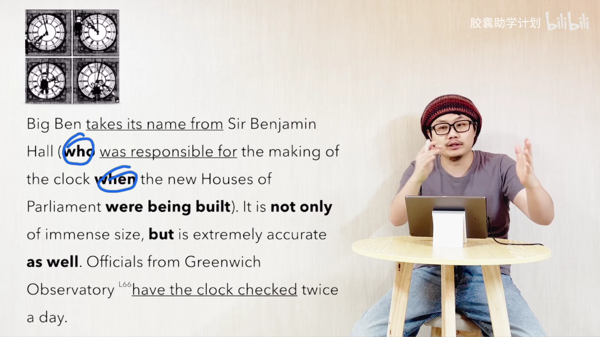

文字识别：胶囊助学计划bibi / Big Ben takes its name from Sir Benjamin / Hall( / Whg / was responsible for the making of / the clock / When / the new Houses of / Parliament were being built). It is not only / of immense size, but is extremely accurate / as well. Officials from Greenwich / Observatory / L66 / 'have the clock checked twice / a day.

## 00:12:00–00:12:30

六十六课咱们学过的，哎，说他们这个 official 行政官员，他不是技术人员，对吧？他们会找技术人员，安排技术人员，说让这个大钟被检查 twice a day 一天两次啊。这句话并不难，我们不多提了。 Continue on the BBC 在 BBC 这个广播电视广播电台上， you can hear the clock 你能听到，哎，我们先把这句话读完啊。 When it is actually striking

### 画面 00:12:02

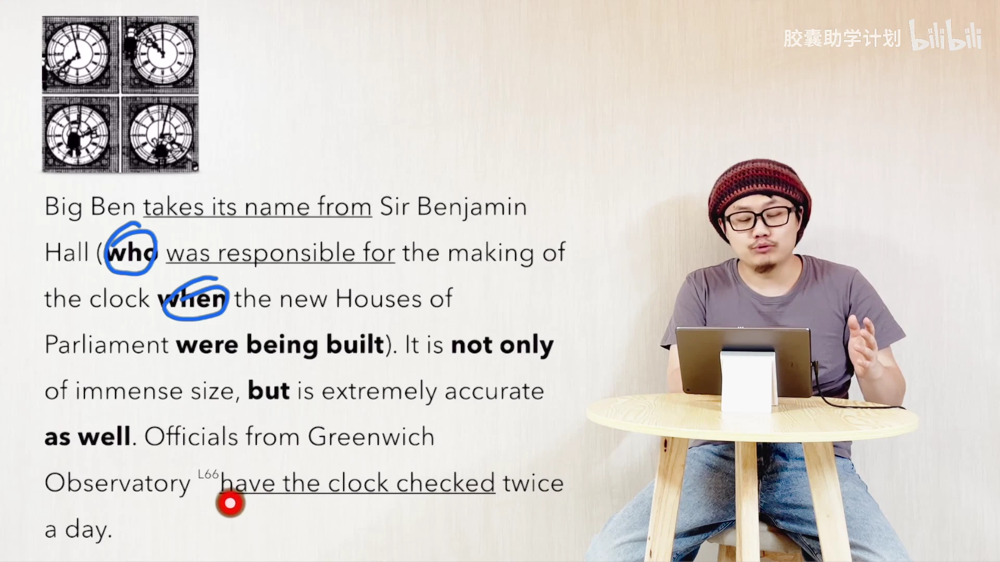

文字识别：胶囊助学计划bi出 / Big Ben takes its name from Sir Benjamin / Hall( / Whg / was responsible for the making of / the clock / When / the new Houses of / Parliament were being built). It is not only / of immense size, but is extremely accurate / as well. Officials from Greenwich / Observatory / L66 / have the clock checked twice / a day.

### 画面 00:12:07

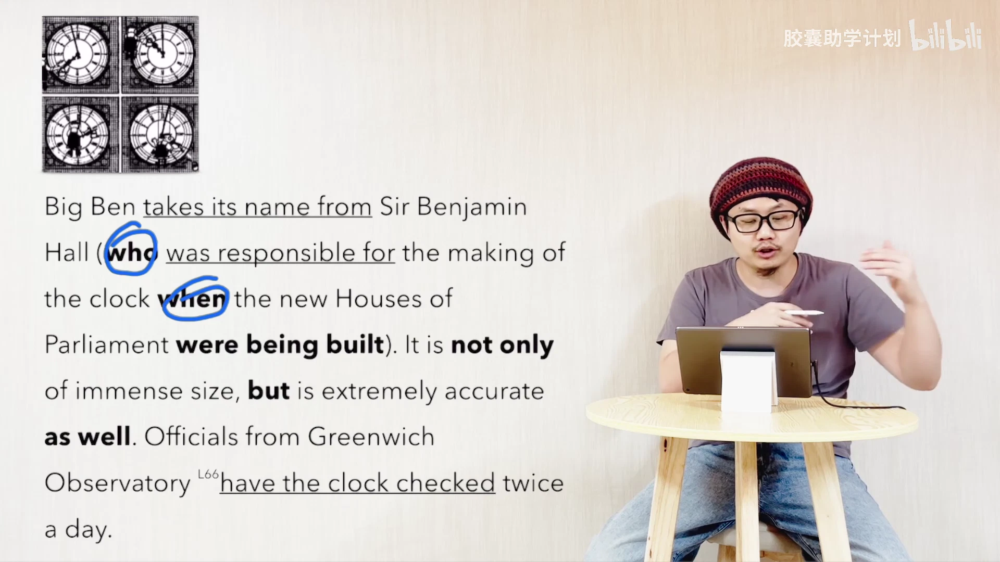

文字识别：胶囊助学计划bi山 / Big Ben takes its name from Sir Benjamin / Hall( / Whg / was responsible for the making of / the clock / wen / the new Houses of / Parliament were being built). It is not only / of immense size, but is extremely accurate / as well. Officials from Greenwich / Observatory / L66 / have the clock checked twice / a day.

### 画面 00:12:16

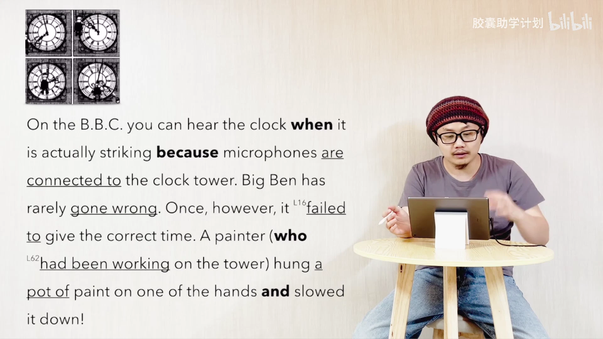

文字识别：胶囊助学计划bi出 / On the B.B.C. you can hear the clock when it / is actually striking because microphones are / connected to the clock tower. Big Ben has / rarely gone wrong. Once, however, it "'failed / to give the correct time. A painter (who / L6²had been working on the tower) hung a / pot of paint on one of the hands and slowed / it down!

### 画面 00:12:21

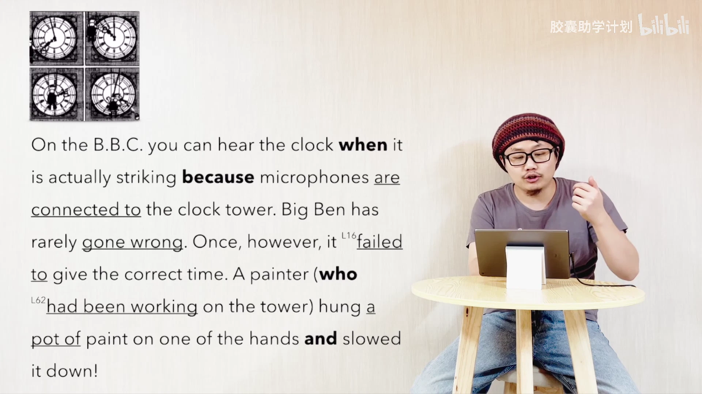

文字识别：胶囊助学计划bibi / On the B.B.C. you can hear the clock when it / is actually striking because microphones are / Connected to the clock tower. Big Ben has / rarely gone wrong. Once, however, it 16failed / to give the correct time. A painter (who / L6²had been working on the tower) hung a / pot of paint on one of the hands and slowed / it down!

## 00:12:30–00:13:00

because microphones are connected to the clock tower. When一个because一个这种连词，你必须要越学越熟，看到它就知道要断句了。我们最终其实要完成的目的就是从on一直看到tower，这句话的意思就懂了，我们的英语水平就提升很多了。我们现在既然做不到，我们就给它拆开，对吧？拆开。看第一句话，在BBC广播电台上，你可以听

### 画面 00:12:51

文字识别：胶囊助学计划il出 / On the B.B.C. you can hear the clock when it / is actually striking because microphones are / Connected to the clock tower. Big Ben has / rarely gone wrong. Once, however, it "'failed / to give the correct time. A painter (who / L6²had been working on the tower) hung a / pot of paint on one of the hands and slowed / it down!

### 画面 00:12:54

文字识别：胶囊助学计划bi出 / On the B.B.C. you can hear the clock henit / is actually striking because microphones are / Connected to the clock tower. Big Ben has / rarely gone wrong. Once, however, it "'failed / to give the correct time. A painter (who / L6²had been working on the tower) hung a / pot of paint on one of the hands and slowed / it down!

### 画面 00:12:56

文字识别：胶囊助学计划bib出 / On the B.B.C. you can hear the clock henit / is actually striking because microphones are / Connected to the clock tower. Big Ben has / rarely gone wrong. Once, however, it 16failed / to give the correct time. A painter (who / L6²had been working on the tower) hung a / pot of paint on one of the hands and slowed / it down!

## 00:13:00–00:13:30

到这个表，这个钟声。当 it is actually striking, striking这个单词在第一个单元我们就见过，钢琴课那课见过。然后大家在 town hall clock底下聚会那课我们也见过，就是敲打的时候，就是敲钟的时候。当它真正在敲打的时候，你是可以通过BBC去听到它的声音的，因为 microphones are connected to the clock tower。说这个麦克风 be connected to，

### 画面 00:13:14

文字识别：胶囊助学计划bi出 / On the B.B.C. you can hear the clock Vhenit / is actually striking because microphones are / Connected to the clock tower. Big Ben has / rarely gone wrong. Once, however, it 16failed / to give the correct time. A painter (who / L6²had been working on the tower) hung a / pot of paint on one of the hands and slowed / it down!

### 画面 00:13:16

文字识别：胶囊助学计划bi出 / On the B.B.C. you can hear the clock Vhenit / is actually striking because microphones are / Connected to the clock tower. Big Ben has / rarely gone wrong. Once, however, it 16failed / to give the correct time. A painter (who / L6²had been working on the tower) hung a / pot of paint on one of the hands and slowed / it down!

### 画面 00:13:18

文字识别：胶囊助学计划bib出 / On the B.B.C. you can hear the clock henit / is actually striking because microphones are / Connected to the clock tower. Big Ben has / rarely gone wrong. Once, however, it 16failed / to give the correct time. A painter (who / L6²had been working on the tower) hung a / pot of paint on one of the hands and slowed / it down!

## 00:13:30–00:14:00

这是本课的习惯用法，叫 A 连接着 B 啊。说麦克风连接着这个 clock tower，这个钟，这个这个这个这个这个钟塔，对吧？哎，是连接着这个钟塔，其实就这个 Big Bang 啊。 Continue, Big Bang has rarely gone wrong. 啊，这个很容易嘛。说 Big Bang 几很少会出现问题。既然你用了 rarely，如果你用的是 never，那就是一次都没出现过问题。但你只要用了 rarely，就出现过问题，

### 画面 00:13:48

文字识别：胶囊助学计划bi山 / On the B.B.C. you can hear the clock henit / is actually striking because microphones are / Connected to the clock tower. Big Ben has / rarely gone wrong. Once, however, it 16failed / to give the correct time. A painter (who / L6²had been working on the tower) hung a / pot of paint on one of the hands and slowed / it down!

## 00:14:00–00:14:30

哪怕只有一次啊。Rarely叫几乎不，但是出现过，对吧？这个事儿得明白。Once啊，这个go wrong是本课的习惯用法，出问题啊。一会儿我们造句，有这么一次，曾经。However, it failed to give the correct time.这个fail to，最后十六课咱们学过，对吧？哎，出去旅游停车啊，fail to obey the rules，对吧？哎，没有这个给出正确的时间

### 画面 00:14:09

文字识别：胶囊助学计划ib出 / On the B.B.C. you can hear the clock henit / is actually striking because microphones are / Connected to the clock tower. Big Ben has / rarely gone wrong. Once, however, it "6failed / to give the correct time. A painter (who / L6²had been working on the tower) hung a / pot of paint on one of the hands and slowed / it down!

## 00:14:30–00:15:00

啊，其实也有本身也有失败的意思，对吧？A painter who had been working on the tower hung a pot of paint on one of the hands and slowly down。这句话又被拆成好几句了吧？好，第一看到who，我知道定从开始了。定从在哪儿结束呢？这个判断其实特别的简单，就是定从当中必然

### 画面 00:14:39

文字识别：胶囊助学计划Lib山 / On the B.B.C. you can hear the clock Vhenit / is actually striking because microphones are / Connected to the clock tower. Big Ben has / rarely gone wrong. Once, however, it 1'6failed / to give the correct time. A painter (who / L6²had been working on the tower) hug a / pot of paint on one of the hands and slowed / it down!

### 画面 00:14:51

文字识别：胶囊助学计划il出 / On the B.B.C. you can hear the clock Vhenlt / is actually striking because microphones are / Connected to the clock tower. Big Ben has / rarely gone wrong. Once, however, it 16failed / to give the correct time. A painter / who / L6²had been working on the tower) hung a / pot of paint on one of the hands and slowed / it down!

## 00:15:00–00:15:30

会有一个动词做谓语，然后当你见到第二个动词的时候，这个动词很可能是主句当中的动词，而不是你定从当中的动词，所以很可能在这里定从就结束了，对吧？好，那我们看一下定从，呃，首先 who 指的是前面的 a painter，就是这个油漆工，油漆工怎么样了呢？Had been working on the tower，说他一直都在这个塔上，

### 画面 00:15:00

文字识别：胶囊助学计划bi出 / On the B.B.C. you can hear the clock Vhenlt / is actually striking because microphones are / Connected to the clock tower. Big Ben has / rarely gone wrong. Once, however, it "'6failed / to give the correct time. A painter / who / L62had been Vorking on the tower) hung a / pot of paint on one of the hands and slowed / it down!

### 画面 00:15:05

文字识别：胶囊助学计划bii / On the B.B.C. you can hear the clock hent / is actually striking because microphones are / Connected to the clock tower. Big Ben has / rarely gone wrong. Once, however, it 16failed / to give the correct time. A painter / who / L62had been vorkino / on the tower)hung / a / pot of paint on one of the hands and slowed / it down!

## 00:15:30–00:16:00

这个塔上工作啊，哎，had been doing六十二课咱们学的，对吧？森林大火那课吧，应该是，呃，这个一直都在这个塔上工作。然后呢，这个a painter就是这个油漆工呢，hang a pot of paint，hang悬挂悬挂了什么呢？a pot of这个很简单，就是一桶一罐啊，一桶一罐这个漆在什么上呢？On one of the hands，在手上不是这个hand之前我们在第一

### 画面 00:15:35

文字识别：胶囊助学计划bi / On the B.B.C. you can hear the clock hent / is actually striking because microphones are / Connected to the clock tower. Big Ben has / rarely gone wrong. Once, however, it "6failed / to give the correct time. A painter / who / L62had been vorkino / on the tower) / )nung / a / pot of paint on one of the hands and slowed / it down!

## 00:16:00–00:16:30

单元就学过了，它表示的是那个钟的那个表针，对吧？分针，呃，这个小时针啊，它把这个一桶漆挂到了这个这个指针上，然后又是一个断句，slow it down，把它慢了下来。OK，好，那整个文章就结束了啊。我觉得还行，不是特别的难，因为它毕竟是一个复习课程，也没有什么新的语法，有这些习惯用法，我们老习惯耐下心来

### 画面 00:16:05

文字识别：胶囊助学计划b / On the B.B.C. you can hear the clock hent / is actually striking because microphones are / Connected to the clock tower. Big Ben has / rarely gone wrong. Once, however, it "6failed / to give the correct time. A painter / who / L62had been vorkino / on the tower)nung / a / pot of paint on one of the hands and slowed / it down!

### 画面 00:16:08

文字识别：胶囊助学计划bilbl / On the B.B.C. you can hear the clock Vhenit / is actually striking because microphones are / Connected to the clock tower. Big Ben has / rarely gone wrong. Once, however, it 16failed / to give the correct time. A painter / who / L62had been vorkino / on the tower)hung / a / pot of paint on one of the hands and slowed / it down!

### 画面 00:16:17

文字识别：胶囊助学计划biibi出 / On the B.B.C. you can hear the clock Vhenit / is actually striking because microphones are / Connected to the clock tower. Big Ben has / rarely gone wrong. Once, however, it 16failed / to give the correct time. A painter / who / L62had been vorkino / on the tower)nunga / pot of paint on one of the hands and slowed / it down!

### 画面 00:16:19

文字识别：bilbii / 胶囊助学计划 / 习惯用法造句 / all over the world / burn down / take its name from / be responsible for / be connected to / go wrong

### 画面 00:16:21

文字识别：bilbili / 胶囊助学计划 / 习惯用法造句 / all over the world / burn down / take its name from / be responsible for / be connected to / go wrong

### 画面 00:16:23

文字识别：bilbili / 胶囊助学计划 / 习惯用法造句 / all over the world / burn down / take its name from / be responsible for / be connected to / go wrong

### 画面 00:16:25

文字识别：bilbii / 胶囊助学计划 / 习惯用法造句 / all over the world / burn down / take its name from / be responsible for / be connected to / go wrong

### 画面 00:16:27

文字识别：bibii / 胶囊助学计划 / 习惯用法造句 / all over the world / burn down / take its name from / be responsible for / be connected to / go wrong

### 画面 00:16:29

文字识别：网：v.+v.变化 / 胶囊助学计划 / bibii / 习惯用法造句指南 / 四句型转换 / 方式/地点/时间 / 其他习惯用法 / 其他单词+词性 / 原文摘抄+变 / 6123456 / all over the world

## 00:16:30–00:17:00

拿它挨个去造句，造完了我们就对它的了解更多了一点点啊。首先，all over the world，all over the world，全世界。说，hundreds of men were coming every week from all over the world，数以百计的人来到这里，每一周来从全世界各地。哎，很简单的句子。说，there are people，首先there be句型，接下来跟了个定语从句，who like fishing all over the

### 画面 00:16:31

文字识别：网：v.+v.变化 / 胶囊助学计划 / bibii / 习惯用法造句指南 / 四句型转换 / 方式/地点/时间 / 其他习惯用法 / 其他单词+词性 / 原文摘抄+变 / 6123456 / all over the world

### 画面 00:16:33

文字识别：网：v.+v.变化 / 胶囊助学计划 / bibii / 习惯用法造句指南 / 四句型转换 / 方式/地点/时间 / 其他习惯用法 / 其他单词+词性 / 原文摘抄+变 / 6123456 / all over the world

### 画面 00:16:35

文字识别：网：v.+v.变化 / 胶囊助学计划 / blbii / 习惯用法造句指南 / 四句型转换 / 方式/地点/时间 / 其他习惯用法 / 其他单词+词性 / 原文摘抄+变 / 6123456 / all over the world /  Hundreds of men were coming every / week from all over the world.

### 画面 00:16:37

文字识别：网：v.+v.变化 / 胶囊助学计划 / biibii / 习惯用法造句指南 / 四句型转换 / 方式/地点/时间 / 其他习惯用法 / 其他单词+词性 / 原文摘抄+变 / 6123456 / all over the world /  Hundreds of men were coming every / week from all over the world.

### 画面 00:16:39

文字识别：网：v.+v.变化 / 胶囊助学计划 / bilibii / 习惯用法造句指南 / 四句型转换 / 方式/地点/时间 / 其他习惯用法 / 其他单词+词性 / 原文摘抄+变 / 6123456 / all over the world /  Hundreds of men were coming every / week from all over the world.

### 画面 00:16:43

文字识别：网：v.+v.变化 / 胶囊助学计划 / bilibili / 习惯用法造句指南 / 四句型转换 / 方式/地点/时间 / 其他习惯用法 / 其他单词+词性 / 原文摘抄+变 / 6123456 / all over the world /  Hundreds of men were coming every / week from all over the world.

### 画面 00:16:45

文字识别：网：v.+v.变化 / 胶囊助学计划 / blibii / 习惯用法造句指南 / 四句型转换 / 方式/地点/时间 / 其他习惯用法 / 其他单词+词性 / 原文摘抄+变 / 6123456 / all over the world /  Hundreds of men were coming every / week from all over the world.

### 画面 00:16:47

文字识别：网：v.+v.变化 / 胶囊助学计划 / blibii / 习惯用法造句指南 / 四句型转换 / 方式/地点/时间 / 其他习惯用法 / 其他单词+词性 / 原文摘抄+变 / 6123456 / all over the world /  Hundreds of men were coming every / week from all over the world.

### 画面 00:16:49

文字识别：网：v.+v.变化 / 胶囊助学计划 / Bibii / 习惯用法造句指南 / 四句型转换 / 方式/地点/时间 / 其他习惯用法 / 其他单词+词性 / 原文摘抄+变 / 6123456 / all over the world /  Hundreds of men were coming every / week from all over the world.

### 画面 00:16:51

文字识别：网：v.+v.变化 / 胶囊助学计划 / bilbii / 习惯用法造句指南 / 四句型转换 / 方式/地点/时间 / 其他习惯用法 / 其他单词+词性 / 原文摘抄+变 / 6123456 / all over the world /  Hundreds of men were coming every / week from all over the world.

### 画面 00:16:53

文字识别：网：v.+v.变化 / 胶囊助学计划 / bilbii / 习惯用法造句指南 / 四句型转换 / 方式/地点/时间 / 其他习惯用法 / 其他单词+词性 / 原文摘抄+变 / 6123456 / all over the world /  Hundreds of men were coming every / week from all over the world. /  There are people who like fishing all over / the world. L28

### 画面 00:16:55

文字识别：网：v.+v.变化 / 胶囊助学计划 / biibli / 习惯用法造句指南 / 四句型转换 / 方式/地点/时间 / 其他习惯用法 / 其他单词+词性 / 原文摘抄+变 / 6123456 / all over the world /  Hundreds of men were coming every / week from all over the world. / There are people who like fishing all over / the world. L28

### 画面 00:16:57

文字识别：网：v.+v.变化 / 胶囊助学计划 / bilbii / 习惯用法造句指南 / 四句型转换 / 方式/地点/时间 / 其他习惯用法 / 其他单词+词性 / 原文摘抄+变 / 6123456 / all over the world /  Hundreds of men were coming every / week from all over the world. /  Therere people who like fishing all over / the world. L28

### 画面 00:16:59

文字识别：网：v.+v.变化 / 胶囊助学计划 / biii / 习惯用法造句指南 / 四句型转换 / 方式/地点/时间 / 其他习惯用法 / 其他单词+词性 / 原文摘抄+变 / 6123456 / all over the world /  Hundreds of men were coming every / week from all over the world. /  There are people who like fishing all over / the world. L28

## 00:17:00–00:17:30

world?喜欢钓鱼，哎，来自于全世界的人，很多人都喜欢钓鱼。Next one,说people all over the world.你注意，你看这里类似于一个做了后置定语，叫做来自于全世界各地的人，看见了吧？Saw that UFO last night.那UFO我加了个引号，对吧？我对于这件事是持怀疑论证，是吧？就我直到确证，那确确信信的能知道之后，我才说。那所以我在这加了个引号啊。所以

### 画面 00:17:01

文字识别：网：v.+v.变化 / 胶囊助学计划 / biibii / 习惯用法造句指南 / 四句型转换 / 方式/地点/时间 / 其他习惯用法 / 其他单词+词性 / 原文摘抄+变 / 6123456 / all over the world /  Hundreds of men were coming every / week from all over the world. /  There are people who like fishing all over / the world. L28

### 画面 00:17:03

文字识别：网：v.+v.变化 / 胶囊助学计划 / biibii / 习惯用法造句指南 / 四句型转换 / 方式/地点/时间 / 其他习惯用法 / 其他单词+词性 / 原文摘抄+变 / 6123456 / allover the world /  Hundreds of men were coming every / week from all over the world. /  There are people who like fishing all over / the world. L28

### 画面 00:17:05

文字识别：网：v.+v.变化 / 胶囊助学计划 / biibii / 习惯用法造句指南 / 四句型转换 / 方式/地点/时间 / 其他习惯用法 / 其他单词+词性 / 原文摘抄+变 / 6123456 / all over the world /  Hundreds of men were coming every / week from all over the world. /  There are people who like fishing all over / the world. L28 /  People all over the world saw that "UFO" / last night. did/who/what/when...

### 画面 00:17:09

文字识别：网：v.+v.变化 / 胶囊助学计划 / bilbii / 习惯用法造句指南 / 四句型转换 / 方式/地点/时间 / 其他习惯用法 / 其他单词+词性 / 原文摘抄+变 / 6123456 / all over the world /  Hundreds of men were coming every / week from all over the world. /  There are people who like fishing all over / the world. L28 / People all over the worid saw that "UFO" / last night. did/who/what/when...

### 画面 00:17:14

文字识别：网：v.+v.变化 / 胶囊助学计划 / Bilbili / 习惯用法造句指南 / 四句型转换 / 方式/地点/时间 / 其他习惯用法 / 其他单词+词性 / 原文摘抄+变 / 6123456 / all over the world /  Hundreds of men were coming every / week from all over the world. /  There are people who like fishing all over / the world. L28 /  People all over the world saw that"UFO" / last night. did/who/what/when...

### 画面 00:17:18

文字识别：网：v.+v.变化 / 胶囊助学计划 / bilibii / 习惯用法造句指南 / 四句型转换 / 方式/地点/时间 / 其他习惯用法 / 其他单词+词性 / 原文摘抄+变 / 6123456 / all over the world /  Hundreds of men were coming every / week from all over the world. /  There are people who like fishing all over / the world. L28 / People all over the world saw that"UFO" / last night. did/who/what/when...

### 画面 00:17:20

文字识别：网：v.+v.变化 / 胶囊助学计划 / biibii / 习惯用法造句指南 / 四句型转换 / 方式/地点/时间 / 其他习惯用法 / 其他单词+词性 / 原文摘抄+变 / 6123456 / all over the world /  Hundreds of men were coming every / week from all over the world. / There are people who like fishing all over / the world. L28 /  People all over the world saw that "UFO" / last night. did/who/what/when...

### 画面 00:17:23

文字识别：网：v.+v.变化 / 胶囊助学计划 / bilibii / 习惯用法造句指南 / 四句型转换 / 方式/地点/时间 / 其他习惯用法 / 其他单词+词性 / 原文摘抄+变 / 6123456 / all over the world /  Hundreds of men were coming every / week from all over the world. /  There are people who like fishing all over / the world. L28 /  People all over the world saw that "UFO" / last night. did/who/what/when...

### 画面 00:17:25

文字识别：胶囊助学计划blii / 网：v.+v.变化 / 习惯用法造句指南 / 四句型转换 / 方式/地点/时间 / 其他习惯用法 / 其他单词+词性 / 原文摘抄+变 / 6123456 / all over the world /  Hundreds of men were coming every / week from all over the world. / There are people who like fishing all over / the world. L28 /  People all over the world saw that "UFO" / last night. did/who/what/when...

### 画面 00:17:27

文字识别：网：v.+v.变化 / 胶囊助学计划 / biibili / 习惯用法造句指南 / 四句型转换 / 方式/地点/时间 / 其他习惯用法 / 其他单词+词性 / 原文摘抄+变 / 6123456 / all over the world /  Hundreds of men were coming every / week from all over the world. /  There are people who like fishing all over / the world. L28 /  People all over the world saw that "UFO" / last night. did/who/what/when...

### 画面 00:17:29

文字识别：网：v.+v.变化 / 胶囊助学计划 / 习惯用法造句指南 / 四句型转换 / 方式/地点/时间 / 其他习惯用法 / 其他单词+词性 / 原文摘抄+变 / 6123456 / all over the world /  Hundreds of men were coming every / week from all over the world. / There are people who like fishing all over / the world. L28 /  People all over the world saw that "UFO" / last night. did/who/what/when...

## 00:17:30–00:18:00

哎，来自于全世界各地的人，他们都说他们看到了昨天晚上看到那个UFO啊，到后来发现可能是流星，是吧？然后四句型转换啊，不多说了。下一个，burn down，烧毁啊，焚毁。说if we don't stop him, he will burn down the house。说咱们要是不阻止他，我跟你说，他能把这房子给你烧了。哎，burn down。OK，burn，其实就是比如说你你这个就是比如说你的手啊，突然被烧到

### 画面 00:17:33

文字识别：Bilbili / 网：v.+v.变化 / 胶囊助学计划 / 习惯用法造句指南 / 四句型转换 / 方式/地点/时间 / 其他习惯用法 / 其他单词+词性 / 原文摘抄+变 / 6123456 / all over the world /  Hundreds of men were coming every / week from all over the world. / There are people who like fishing all over / the world. L28 /  People all over the world saw that "UFO" / last night. did/who/what/when...

### 画面 00:17:35

文字识别：网：v.+v.变化 / 胶囊助学计划 / bilbi / 习惯用法造句指南 / 四句型转换 / 方式/地点/时间 / 其他习惯用法 / 其他单词+词性 / 原文摘抄+变 / 6123456 / all over the world /  Hundreds of men were coming every / week from all over the world. /  There are people who like fishing all over / the world. L28 /  People all over the world saw that "UFO" / last night. did/who/what/when...

### 画面 00:17:38

文字识别：网：v.+v.变化 / 胶囊助学计划 / bibii / 习惯用法造句指南 / 四句型转换 / 方式/地点/时间 / 其他习惯用法 / 其他单词+词性 / 原文摘抄+变 / 6123456 / all over the world /  Hundreds of men were coming every / week from all over the world. /  There are people who like fishing all over / the world. L28 / People all over the world saw that "UFO" / last night. did/who/what/when...

### 画面 00:17:40

文字识别：网：v.+v.变化 / 胶囊助学计划 / bibii / 习惯用法造句指南 / 四句型转换 / 方式/地点/时间 / 其他习惯用法 / 其他单词+词性 / 原文摘抄+变 / 6123456 / burn down

### 画面 00:17:42

文字识别：网：v.+v.变化 / 胶囊助学计划 / bibii / 习惯用法造句指南 / 四句型转换 / 方式/地点/时间 / 其他习惯用法 / 其他单词+词性 / 原文摘抄+变 / 6123456 / burn down

### 画面 00:17:44

文字识别：网：v.+v.变化 / 胶囊助学计划 / bilbili / 习惯用法造句指南 / 四句型转换 / 方式/地点/时间 / 其他习惯用法 / 其他单词+词性 / 原文摘抄+变 / 6123456 / burn down /  If we don't stop him, he'll burn down the / house! L16

### 画面 00:17:49

文字识别：blbii / 网：v.+v.变化 / 胶囊助学计划 / 习惯用法造句指南 / 四句型转换 / 方式/地点/时间 / 其他习惯用法 / 其他单词+词性 / 原文摘抄+变 / 6123456 / burn down /  If we don't stop him, he'll burn down the / house! L16

### 画面 00:17:51

文字识别：bibili / 网：v.+v.变化 / 胶囊助学计划 / 习惯用法造句指南 / 四句型转换 / 方式/地点/时间 / 其他习惯用法 / 其他单词+词性 / 原文摘抄+变 / 6123456 / burn down /  If we don't stop him, he'll burn down the / house! L16

### 画面 00:17:53

文字识别：bibii / 网：v.+v.变化 / 胶囊助学计划 / 习惯用法造句指南 / 四句型转换 / 方式/地点/时间 / 其他习惯用法 / 其他单词+词性 / 原文摘抄+变 / 6123456 / burn down /  If we don't stop him, he'll burn down the / house! L16

### 画面 00:17:55

文字识别：bilbl / 网：v.+v.变化 / 胶囊助学计划 / 习惯用法造句指南 / 四句型转换 / 方式/地点/时间 / 其他习惯用法 / 其他单词+词性 / 原文摘抄+变 / 6123456 / burn down /  If we don't stop him, he'll burn down the / house! L16

### 画面 00:17:57

文字识别：网：v.+v.变化 / 胶囊助学计划 / bibil / 习惯用法造句指南 / 四句型转换 / 方式/地点/时间 / 其他习惯用法 / 其他单词+词性 / 原文摘抄+变 / 6123456 / burn down /  If we don't stop him, he'll burn down the / house! L16

### 画面 00:17:59

文字识别：bilbl / 网：v.+v.变化 / 胶囊助学计划 / 习惯用法造句指南 / 四句型转换 / 方式/地点/时间 / 其他习惯用法 / 其他单词+词性 / 原文摘抄+变 / 6123456 / burn down /  If we don't stop him, he'll burn down the / house! L16

## 00:18:00–00:18:30

了。这个动作就是 burn。那 burn down 就是烧塌了嘛，焚毁了嘛。说 they were ordered to burn down the church。说这帮人被命令，这帮军人吧，假设是吧，他们被命令去焚毁这个教堂啊。 Next one。说 I learned this morning that 我今天早上知道这么个事儿。说 his house was burned down last night。他好，他的房子昨天晚上被焚毁了。你注意这里，

### 画面 00:18:04

文字识别：网：v.+v.变化 / 胶囊助学计划 / biibii / 习惯用法造句指南 / 四句型转换 / 方式/地点/时间 / 其他习惯用法 / 其他单词+词性 / 原文摘抄+变 / 6123456 / burn down /  If we don't stop him, he'll burn down the / house! L16 / They were ordered to burn down / the church. L43

### 画面 00:18:06

文字识别：网：v.+v.变化 / 胶囊助学计划 / biibii / 习惯用法造句指南 / 四句型转换 / 方式/地点/时间 / 其他习惯用法 / 其他单词+词性 / 原文摘抄+变 / 6123456 / burn down /  If we don't stop him, he'll burn down the / house! L16 / They were ordered to burn down / the church. L43

### 画面 00:18:09

文字识别：网：v.+v.变化 / 胶囊助学计划 / bibii / 习惯用法造句指南 / 四句型转换 / 方式/地点/时间 / 其他习惯用法 / 其他单词+词性 / 原文摘抄+变 / 6123456 / burn down /  If we don't stop him, he'll burn down the / house! L16 / They were ordered to burn down / the church. L43

### 画面 00:18:13

文字识别：网：v.+v.变化 / 胶囊助学计划 / bilbii / 习惯用法造句指南 / 四句型转换 / 方式/地点/时间 / 其他习惯用法 / 其他单词+词性 / 原文摘抄+变 / 6123456 / burn down /  If we don't stop him, he'll burn down the / house! L16 / They were ordered to burn down / the church. L43

### 画面 00:18:15

文字识别：网：v.+v.变化 / 胶囊助学计划 / bilibili / 习惯用法造句指南 / 四句型转换 / 方式/地点/时间 / 其他习惯用法 / 其他单词+词性 / 原文摘抄+变 / 6123456 / burn down /  If we don't stop him, he'll burn down the / house! L16 / They were ordered to burn down / the church. L43

### 画面 00:18:17

文字识别：网：v.+v.变化 / 胶囊助学计划 / bilibii / 习惯用法造句指南 / 四句型转换 / 方式/地点/时间 / 其他习惯用法 / 其他单词+词性 / 原文摘抄+变 / 6123456 / burn down /  If we don't stop him, he'll burn down the / house! L16 / They were ordered to burn down / the church. L43 /  I learnt this morning that his house was / burnt down last night. L45

### 画面 00:18:19

文字识别：网：v.+v.变化 / 胶囊助学计划 / bilbii / 习惯用法造句指南 / 四句型转换 / 方式/地点/时间 / 其他习惯用法 / 其他单词+词性 / 原文摘抄+变 / 6123456 / burn down /  If we don't stop him, he'll burn down the / house! L16 / They were ordered to burn down / the church. L43 /  L learnt this morning that his house was / burnt down last night. L45

### 画面 00:18:21

文字识别：网：v.+v.变化 / 胶囊助学计划 / bilibii / 习惯用法造句指南 / 四句型转换 / 方式/地点/时间 / 其他习惯用法 / 其他单词+词性 / 原文摘抄+变 / 6123456 / burn down /  If we don't stop him, he'll burn down the / house! L16 / They were ordered to burn down / the church. L43 /  L learnt this morning that his house was / burnt down last night. L45

### 画面 00:18:23

文字识别：网：v.+v.变化 / 胶囊助学计划 / bibili / 习惯用法造句指南 / 四句型转换 / 方式/地点/时间 / 其他习惯用法 / 其他单词+词性 / 原文摘抄+变 / 6123456 / burn down /  If we don't stop him, he'll burn down the / house! L16 / They were ordered to burn down / the church. L43 /  learnt this morning that his house was / burnt down last night. L45

### 画面 00:18:25

文字识别：网：v.+v.变化 / 胶囊助学计划 / bibii / 习惯用法造句指南 / 四句型转换 / 方式/地点/时间 / 其他习惯用法 / 其他单词+词性 / 原文摘抄+变 / 6123456 / burn down /  If we don't stop him, he'll burn down the / house! L16 / They were ordered to burn down / the church. L43 /  learnt this morning that his house was / burnt down last night. L45

### 画面 00:18:29

文字识别：网：v.+v.变化 / 胶囊助学计划 / bilbii / 习惯用法造句指南 / 四句型转换 / 方式/地点/时间 / 其他习惯用法 / 其他单词+词性 / 原文摘抄+变 / 6123456 / burn down /  If we don't stop him, he'll burn down the / house! L16 / They were ordered to burn down / the church. L43 /  learnt this morning that his house was / burnt down last night. L45

## 00:18:30–00:19:00

take

### 画面 00:18:31

文字识别：网：v.+v.变化 / 胶囊助学计划 / bibii / 习惯用法造句指南 / 四句型转换 / 方式/地点/时间 / 其他习惯用法 / 其他单词+词性 / 原文摘抄+变 / 6123456 / burn down /  If we don't stop him, he'll burn down the / house! L16 / They were ordered to burn down / the church. L43 /  L learnt this morning that his house was / burnt / own Iast night. L45

### 画面 00:18:33

文字识别：bilbili / 胶囊助学计划 / Don't you burn down my k / kitchen again, Dad. / Three Blind Mice / (2008)

### 画面 00:18:35

文字识别：bilbili / 胶囊助学计划 / Don't you burn down my kitchen again, Dad. / Three Blind Mice / (2008)

### 画面 00:18:39

文字识别：bilbili / 胶囊助学计划 / Don't you burn down my kitchen again, Dad. / Three Blind Mice / (2008)

### 画面 00:18:41

文字识别：biibili / 胶囊助学计划 / Don't you burn down my kitchen again, Dad. / Three Blind Mice / (2008)

### 画面 00:18:47

文字识别：bilbili / 网：v.+v.变化 / 胶囊助学计划 / 习惯用法造句指南 / 四句型转换 / 方式/地点/时间 / 其他习惯用法 / 其他单词+词性 / 原文摘抄+变 / 6123456 / take its name from

### 画面 00:18:49

文字识别：bibili / 网：v.+v.变化 / 胶囊助学计划 / 习惯用法造句指南 / 四句型转换 / 方式/地点/时间 / 其他习惯用法 / 其他单词+词性 / 原文摘抄+变 / 6123456 / take its name from

### 画面 00:18:52

文字识别：网：v.+v.变化 / 胶囊助学计划 / biibli / 习惯用法造句指南 / 四句型转换 / 方式/地点/时间 / 其他习惯用法 / 其他单词+词性 / 原文摘抄+变 / 6123456 / take its name from /  The machine takes its name from its / inventor. does/what/why...

### 画面 00:18:54

文字识别：网：v.+v.变化 / 胶囊助学计划 / bibii / 习惯用法造句指南 / 四句型转换 / 方式/地点/时间 / 其他习惯用法 / 其他单词+词性 / 原文摘抄+变 / 6123456 / take its name from /  The machine takes its name from its / inventor. does/what/why...

### 画面 00:18:56

文字识别：网：v.+v.变化 / 胶囊助学计划 / biibili / 习惯用法造句指南 / 四句型转换 / 方式/地点/时间 / 其他习惯用法 / 其他单词+词性 / 原文摘抄+变 / 6123456 / take its name from /  The machine takes its name from its / inventor. does/what/why...

### 画面 00:18:58

文字识别：网：v.+v.变化 / 胶囊助学计划 / bibii / 习惯用法造句指南 / 四句型转换 / 方式/地点/时间 / 其他习惯用法 / 其他单词+词性 / 原文摘抄+变 / 6123456 / take its name from /  The machine takes its name from its / inventor. does/what/why...

## 00:19:00–00:19:30

啊，这个取名于它的发明者，对吧？Okay，四型转换啊。然后 the street takes its name from a captain，啊，什么张自忠路，对吧？哎，这条街取自于一个船长。那当然，我说张自忠他不是个船长，但是你很容易理解，他取取自于一个人名字嘛，对吧？好，next one说 the house takes its name from a great man，啊，说这个房子取名于一个伟大的人，是吧？那你这个 house，你把这个 house 换成 the big man

### 画面 00:19:00

文字识别：网：v.+v.变化 / 胶囊助学计划 / bilbil / 习惯用法造句指南 / 四句型转换 / 方式/地点/时间 / 其他习惯用法 / 其他单词+词性 / 原文摘抄+变 / 6123456 / take its name from /  The machine takes its name from its / inventor. does/what/why...

### 画面 00:19:04

文字识别：网：v.+v.变化 / 胶囊助学计划 / biibii / 习惯用法造句指南 / 四句型转换 / 方式/地点/时间 / 其他习惯用法 / 其他单词+词性 / 原文摘抄+变 / 6123456 / take its name from /  The machine takes its name from its / inventor. does/what/why... /  The street takes its name from a captain.

### 画面 00:19:06

文字识别：网：v.+v.变化 / 胶囊助学计划 / blibii / 习惯用法造句指南 / 四句型转换 / 方式/地点/时间 / 其他习惯用法 / 其他单词+词性 / 原文摘抄+变 / 6123456 / take its name from /  The machine takes its name from its / inventor. does/what/why... /  The street takes its name from a captain.

### 画面 00:19:09

文字识别：网：v.+v.变化 / 胶囊助学计划 / bilbii / 习惯用法造句指南 / 四句型转换 / 方式/地点/时间 / 其他习惯用法 / 其他单词+词性 / 原文摘抄+变 / 6123456 / take its name from /  The machine takes its name from its / inventor. does/what/why... /  The street takes its name from a captain.

### 画面 00:19:14

文字识别：网：v.+v.变化 / 胶囊助学计划 / bibii / 习惯用法造句指南 / 四句型转换 / 方式/地点/时间 / 其他习惯用法 / 其他单词+词性 / 原文摘抄+变 / 6123456 / take its name from /  The machine takes its name from its / inventor. does/what/why... /  The street takes its name from a captain.

### 画面 00:19:19

文字识别：网：v.+v.变化 / 胶囊助学计划 / bibii / 习惯用法造句指南 / 四句型转换 / 方式/地点/时间 / 其他习惯用法 / 其他单词+词性 / 原文摘抄+变 / 6123456 / take its name from /  The machine takes its name from its / inventor. does/what/why... /  The street takes its name from a captain.

### 画面 00:19:21

文字识别：胶囊助学计划bibi / 网：v.+v.变化 / 习惯用法造句指南 / 四句型转换 / 方式/地点/时间 / 其他习惯用法 / 其他单词+词性 / 原文摘抄+变 / 6123456 / take its name from /  The machine takes its name from its / inventor. does/what/why... / The street takes its name from a captain. /  The house takes its name from a great / man.

### 画面 00:19:24

文字识别：网：v.+v.变化 / 胶囊助学计划 / bilbii / 习惯用法造句指南 / 四句型转换 / 方式/地点/时间 / 其他习惯用法 / 其他单词+词性 / 原文摘抄+变 / 6123456 / take its name from /  The machine takes its name from its / inventor. does/what/why... /  The street takes its name from a captain. /  The house takes its name from a great / man.

### 画面 00:19:29

文字识别：胶囊助学计划biii / 网：v.+v.变化 / 习惯用法造句指南 / 四句型转换 / 方式/地点/时间 / 其他习惯用法 / 其他单词+词性 / 原文摘抄+变 / 6123456 / take its name from /  The machine takes its name from its / inventor. does/what/why... /  The street takes its name from a captain. /  The house takes its name from a great / man.

## 00:19:30–00:20:00

takes its name from a great man, sir, ah, Benjamin, ah, Benjamin,啊，不就可以了，Hall，对吧？不就可以了嘛？啊，取名于啊。下一个习惯用法be responsible for啊，就是对什么什么要负责。比如说，it occurred to me，四十六课咱们学的，就我突然间想到，意识到。You were the guy who was responsible for all of this.说你是这个人呐，哪个人呢？后边跟了个定

### 画面 00:19:32

文字识别：网：v.+v.变化 / 胶囊助学计划 / Bilibli / 习惯用法造句指南 / 四句型转换 / 方式/地点/时间 / 其他习惯用法 / 其他单词+词性 / 原文摘抄+变 / 6123456 / take its name from /  The machine takes its name from its / inventor. does/what/why... /  The street takes its name from a captain. /  The house takes its name from a great / man.

### 画面 00:19:34

文字识别：胶囊助学计划ilbi / 网：v.+v.变化 / 习惯用法造句指南 / 四句型转换 / 方式/地点/时间 / 其他习惯用法 / 其他单词+词性 / 原文摘抄+变 / 6123456 / take its name from /  The machine takes its name from its / inventor. does/what/why... / The street takes its name from a captain. /  The house takes its name from a great / man.

### 画面 00:19:37

文字识别：网：v.+v.变化 / 胶囊助学计划 / bilibii / 习惯用法造句指南 / 四句型转换 / 方式/地点/时间 / 其他习惯用法 / 其他单词+词性 / 原文摘抄+变 / 6123456 / take its name from /  The machine takes its name from its / inventor. does/what/why... /  The street takes its name from a captain. /  The house takes its name from a great / man.

### 画面 00:19:39

文字识别：bibil / 网：v.+v.变化 / 胶囊助学计划 / 习惯用法造句指南 / 四句型转换 / 方式/地点/时间 / 其他习惯用法 / 其他单词+词性 / 原文摘抄+变 / 6123456 / be responsible for

### 画面 00:19:41

文字识别：bilbii / 网：v.+v.变化 / 胶囊助学计划 / 习惯用法造句指南 / 四句型转换 / 方式/地点/时间 / 其他习惯用法 / 其他单词+词性 / 原文摘抄+变 / 6123456 / be responsible for

### 画面 00:19:44

文字识别：bibili / 网：v.+v.变化 / 胶囊助学计划 / 习惯用法造句指南 / 四句型转换 / 方式/地点/时间 / 其他习惯用法 / 其他单词+词性 / 原文摘抄+变 / 6123456 / be responsible for

### 画面 00:19:46

文字识别：网：v.+v.变化 / 胶囊助学计划 / bibili / 习惯用法造句指南 / 四句型转换 / 方式/地点/时间 / 其他习惯用法 / 其他单词+词性 / 原文摘抄+变 / 6123456 / be responsible for /  I t occurred to me that you were the guy / who was responsible for all this. L46

### 画面 00:19:48

文字识别：网：v.+v.变化 / 胶囊助学计划 / bibili / 习惯用法造句指南 / 四句型转换 / 方式/地点/时间 / 其他习惯用法 / 其他单词+词性 / 原文摘抄+变 / 6123456 / be responsible for /  I t occurred to me that you were the guy / who was responsible for all this. L46

### 画面 00:19:50

文字识别：网：v.+v.变化 / 胶囊助学计划 / bilbili / 习惯用法造句指南 / 四句型转换 / 方式/地点/时间 / 其他习惯用法 / 其他单词+词性 / 原文摘抄+变 / 6123456 / be responsible for /  I t occurred to me that you were the guy / who was responsible for all this. L46

### 画面 00:19:52

文字识别：网：v.+v.变化 / 胶囊助学计划 / blibili / 习惯用法造句指南 / 四句型转换 / 方式/地点/时间 / 其他习惯用法 / 其他单词+词性 / 原文摘抄+变 / 6123456 / be responsible for /  It occurred to me that you were the guy / who was responsible for all this. L46

### 画面 00:19:54

文字识别：网：v.+v.变化 / 胶囊助学计划 / bilbl / 习惯用法造句指南 / 四句型转换 / 方式/地点/时间 / 其他习惯用法 / 其他单词+词性 / 原文摘抄+变 / 6123456 / be responsible for /  I t occurred to me that you were the guy / who was responsible for all this. L46

### 画面 00:19:59

文字识别：网：v.+v.变化 / 胶囊助学计划 / bibili / 习惯用法造句指南 / 四句型转换 / 方式/地点/时间 / 其他习惯用法 / 其他单词+词性 / 原文摘抄+变 / 6123456 / be responsible for /  It occurred to me that you were the guy / who was responsible for all this. L46

## 00:20:00–00:20:30

语从句，叫做“应该对这件事、对所有这些事情负责任的人”，他不是我呀！你怎么跟我鸡尾上了呢？鸡闹了，对吧？哎，不是我，我突然间意识到是你应该负责呀。OK，Next one. No matter what happens to this animal, you will be responsible for it. 好，这个是我们可能很多家长孩子愿意养小动物，对吧？但是孩子呢，他不像家长、这大人这样比较有责任心，孩

### 画面 00:20:02

文字识别：网：v.+v.变化 / 胶囊助学计划 / bibili / 习惯用法造句指南 / 四句型转换 / 方式/地点/时间 / 其他习惯用法 / 其他单词+词性 / 原文摘抄+变 / 6123456 / be responsible for /  I t occurred to me that you were the guy / who was responsible for all this. L46

### 画面 00:20:04

文字识别：网：v.+v.变化 / 胶囊助学计划 / blibii / 习惯用法造句指南 / 四句型转换 / 方式/地点/时间 / 其他习惯用法 / 其他单词+词性 / 原文摘抄+变 / 6123456 / be responsible for /  I t occurred to me that you were the guy / who was responsible for all this. L46

### 画面 00:20:08

文字识别：网：v.+v.变化 / 胶囊助学计划 / bibili / 习惯用法造句指南 / 四句型转换 / 方式/地点/时间 / 其他习惯用法 / 其他单词+词性 / 原文摘抄+变 / 6123456 / be responsible for /  It occurred to me that you were the guy / who was responsible for all this. L46

### 画面 00:20:10

文字识别：网：v.+v.变化 / 胶囊助学计划 / bilbili / 习惯用法造句指南 / 四句型转换 / 方式/地点/时间 / 其他习惯用法 / 其他单词+词性 / 原文摘抄+变 / 6123456 / be responsible for /  It occurred to me that you were the guy / who was responsible for all this. L46

### 画面 00:20:13

文字识别：网：v.+v.变化 / 胶囊助学计划 / bibii / 习惯用法造句指南 / 四句型转换 / 方式/地点/时间 / 其他习惯用法 / 其他单词+词性 / 原文摘抄+变 / 6123456 / be responsible for /  It occurred to me that you were the guy / who was responsible for all this. L46 /  No matter what happens to this animal, / you will be responsible for it. L68

### 画面 00:20:15

文字识别：网：v.+v.变化 / 胶囊助学计划 / bilbii / 习惯用法造句指南 / 四句型转换 / 方式/地点/时间 / 其他习惯用法 / 其他单词+词性 / 原文摘抄+变 / 6123456 / be responsible for /  It occurred to me that you were the guy / who was responsible for all this. L46 /  No matter what happens to this animal, / you will be responsible for it. L68

### 画面 00:20:18

文字识别：网：v.+v.变化 / 胶囊助学计划 / bilibii / 习惯用法造句指南 / 四句型转换 / 方式/地点/时间 / 其他习惯用法 / 其他单词+词性 / 原文摘抄+变 / 6123456 / be responsible for /  It occurred to me that you were the guy / who was responsible for all this. L46 /  No matter what happens to this animal, / you will be responsible for it. L68

### 画面 00:20:20

文字识别：网：v.+v.变化 / 胶囊助学计划 / bibii / 习惯用法造句指南 / 四句型转换 / 方式/地点/时间 / 其他习惯用法 / 其他单词+词性 / 原文摘抄+变 / 6123456 / be responsible for /  It occurred to me that you were the guy / who was responsible for all this. L46 /  No matter what happens to this animal, / you will be responsible for it. L68

### 画面 00:20:22

文字识别：网：v.+v.变化 / 胶囊助学计划 / bilibii / 习惯用法造句指南 / 四句型转换 / 方式/地点/时间 / 其他习惯用法 / 其他单词+词性 / 原文摘抄+变 / 6123456 / be responsible for /  It occurred to me that you were the guy / who was responsible for all this. L46 /  No matter what happens to this animal, / you will be responsible for it. L68

### 画面 00:20:24

文字识别：习惯用法造句指南 / 网：v.+v.变化 / 胶囊助学计划 / bibii / 四句型转换 / 方式/地点/时间 / 其他习惯用法 / 其他单词+词性 / 原文摘抄+变 / 6123456 / be responsible for /  It occurred to me that you were the guy / who was responsible for all this. L46 /  No matter what happens to this animal, / you will be responsible for it. L68

### 画面 00:20:29

文字识别：网：v.+v.变化 / 胶囊助学计划 / bibli / 习惯用法造句指南 / 四句型转换 / 方式/地点/时间 / 其他习惯用法 / 其他单词+词性 / 原文摘抄+变 / 6123456 / be responsible for /  It occurred to me that you were the guy / who was responsible for all this. L46 /  No matter what happens to this animal, / you will be responsible for it. L68

## 00:20:30–00:21:00

子可能这今儿玩的高兴就多玩玩，但是不管这个铲铲屎对吧？不管喂粮，不管喂水，不管换水啊，动物没两天死了对吧？然后动物不好看了就不想要了，所以这个可能很多家长在给孩子买宠物的时候都会说这么一句话：说 No matter what happens to this animal, you will be responsible for it. 哪怕最后养死了你也得亲手给它埋了，对吧？你也不能让我去挖坑给它埋了。哎，要培养孩子的责任心啊！I'm responsible for the

### 画面 00:20:34

文字识别：网：v.+v.变化 / 胶囊助学计划 / bilbii / 习惯用法造句指南 / 四句型转换 / 方式/地点/时间 / 其他习惯用法 / 其他单词+词性 / 原文摘抄+变 / 6123456 / be responsible for /  It occurred to me that you were the guy / who was responsible for all this. L46 /  No matter what happens to this animal, / you will be responsible for it. L68

### 画面 00:20:37

文字识别：网：v.+v.变化 / 胶囊助学计划 / bibili / 习惯用法造句指南 / 四句型转换 / 方式/地点/时间 / 其他习惯用法 / 其他单词+词性 / 原文摘抄+变 / 6123456 / be responsible for /  It occurred to me that you were the guy / who was responsible for all this. L46 /  No matter what happens to this animal, / you will be responsible for it. L68

### 画面 00:20:39

文字识别：网：v.+v.变化 / 胶囊助学计划 / bibii / 习惯用法造句指南 / 四句型转换 / 方式/地点/时间 / 其他习惯用法 / 其他单词+词性 / 原文摘抄+变 / 6123456 / be responsible for /  It occurred to me that you were the guy / who was responsible for all this. L46 /  No matter what happens to this animal, / you will be responsible for it. L68

### 画面 00:20:41

文字识别：网：v.+v.变化 / 胶囊助学计划 / bibii / 习惯用法造句指南 / 四句型转换 / 方式/地点/时间 / 其他习惯用法 / 其他单词+词性 / 原文摘抄+变 / 6123456 / be responsible for /  It occurred to me that you were the guy / who was responsible for all this. L46 /  No matter what happens to this animal, / you will be responsible for it. L68

### 画面 00:20:43

文字识别：网：v.+v.变化 / 胶囊助学计划 / biibii / 习惯用法造句指南 / 四句型转换 / 方式/地点/时间 / 其他习惯用法 / 其他单词+词性 / 原文摘抄+变 / 6123456 / be responsible for /  It occurred to me that you were the guy / who was responsible for all this. L46 / No matter what happens to this animal, / you will be responsible for it. L68

### 画面 00:20:45

文字识别：网：v.+v.变化 / 胶囊助学计划 / bilbi / 习惯用法造句指南 / 四句型转换 / 方式/地点/时间 / 其他习惯用法 / 其他单词+词性 / 原文摘抄+变 / 6123456 / be responsible for /  It occurred to me that you were the guy / who was responsible for all this. L46 /  No matter what happens to this animal, / you will be responsible for it. L68

### 画面 00:20:47

文字识别：网：v.+v.变化 / 胶囊助学计划 / biibii / 习惯用法造句指南 / 四句型转换 / 方式/地点/时间 / 其他习惯用法 / 其他单词+词性 / 原文摘抄+变 / 6123456 / be responsible for /  It occurred to me that you were the guy / who was responsible for all this. L46 / No matter what happens to this aninol / you will be responsible for it. L68

### 画面 00:20:49

文字识别：网：v.+v.变化 / 胶囊助学计划 / bilbili / 习惯用法造句指南 / 四句型转换 / 方式/地点/时间 / 其他习惯用法 / 其他单词+词性 / 原文摘抄+变 / 6123456 / be responsible for /  It occurred to me that you were the guy / who was responsible for all this. L46 /  No matter what happens to this animal, / you will be responsible for it. L68

### 画面 00:20:52

文字识别：网：v.+v.变化 / 胶囊助学计划 / bibli / 习惯用法造句指南 / 四句型转换 / 方式/地点/时间 / 其他习惯用法 / 其他单词+词性 / 原文摘抄+变 / 6123456 / be responsible for /  It occurred to me that you were the guy / who was responsible for all this. L46 /  No matter what happens to this animal, / you will be responsible for it. L68

### 画面 00:20:54

文字识别：网：v.+v.变化 / 胶囊助学计划 / bibii / 习惯用法造句指南 / 四句型转换 / 方式/地点/时间 / 其他习惯用法 / 其他单词+词性 / 原文摘抄+变 / 6123456 / be responsible for /  It occurred to me that you were the guy / who was responsible for all this. L46 / No matter what happens to this animal, / you will be responsible for it. L68

### 画面 00:20:58

文字识别：网：v.+v.变化 / 胶囊助学计划 / bilbil / 习惯用法造句指南 / 四句型转换 / 方式/地点/时间 / 其他习惯用法 / 其他单词+词性 / 原文摘抄+变 / 6123456 / be responsible for /  It occurred to me that you were the guy / who was responsible for all this. L46 /  No matter what happens to this animal, / you will be responsible for it. L68 / I'm responsible for the safety of all my / men.

## 00:21:00–00:21:30

safety of all of my men.说我是有责任的，对什么呢？The safety of all my men就是我带来的这些人的安全，我是有责任的，对吧？我带着他们来的这个地方，那我肯定有责任嘛，对于他们的生命安全，对吧？那注意力集中啊，咱看一下这电影片段。电影片段当中还有个定语从句。We are not responsible for the drugs that we give you. Okay, next

### 画面 00:21:00

文字识别：网：v.+v.变化 / 胶囊助学计划 / bibl / 习惯用法造句指南 / 四句型转换 / 方式/地点/时间 / 其他习惯用法 / 其他单词+词性 / 原文摘抄+变 / 6123456 / be responsible for /  It occurred to me that you were the guy / who was responsible for all this. L46 /  No matter what happens to this animal, / you will be responsible for it. L68 / I'm responsible for the safety of all my / men.

### 画面 00:21:03

文字识别：网：v.+v.变化 / 胶囊助学计划 / bilbil / 习惯用法造句指南 / 四句型转换 / 方式/地点/时间 / 其他习惯用法 / 其他单词+词性 / 原文摘抄+变 / 6123456 / be responsible for /  It occurred to me that you were the guy / who was responsible for all this. L46 /  No matter what happens to this animal, / you will be responsible for it. L68 / I'm responsible for the safety of all my / men.

### 画面 00:21:05

文字识别：网：v.+v.变化 / 胶囊助学计划 / biibii / 习惯用法造句指南 / 四句型转换 / 方式/地点/时间 / 其他习惯用法 / 其他单词+词性 / 原文摘抄+变 / 6123456 / be responsible for /  It occurred to me that you were the guy / who was responsible for all this. L46 / No matter what happens to this animal, / you will be responsible for it. L68 / I'm responsible for the safety of all my / men.

### 画面 00:21:07

文字识别：网：v.+v.变化 / 胶囊助学计划 / biibii / 习惯用法造句指南 / 四句型转换 / 方式/地点/时间 / 其他习惯用法 / 其他单词+词性 / 原文摘抄+变 / 6123456 / be responsible for /  It occurred to me that you were the guy / who was responsible for all this. L46 /  No matter what happens to this animal, / you will be responsible for it. L68 / 'I'm responsible for the safety of all my / men.

### 画面 00:21:09

文字识别：网：v.+v.变化 / 胶囊助学计划 / bibii / 习惯用法造句指南 / 四句型转换 / 方式/地点/时间 / 其他习惯用法 / 其他单词+词性 / 原文摘抄+变 / 6123456 / be responsible for /  It occurred to me that you were the guy / who was responsible for all this. L46 /  No matter what happens to this animal, / you will be responsible for it. L68 / 'I'm responsible for the safety of all my / men.

### 画面 00:21:13

文字识别：胶囊助学计划blbi出 / 网：v.+v.变化 / 习惯用法造句指南 / 四句型转换 / 方式/地点/时间 / 其他习惯用法 / 其他单词+词性 / 原文摘抄+变 / 6123456 / be responsible for /  It occurred to me that you were the guy / who was responsible for all this. L46 / No matter what happens to this animal, / you will be responsible for it. L68 / 'I'm responsible for the safety of all my / men.

### 画面 00:21:15

文字识别：网：v.+v.变化 / 胶囊助学计划 / Biltbili / 习惯用法造句指南 / 四句型转换 / 方式/地点/时间 / 其他习惯用法 / 其他单词+词性 / 原文摘抄+变 / 6123456 / be responsible for /  It occurred to me that you were the guy / who was responsible for all this. L46 /  No matter what happens to this animal, / you will be responsible for it. L68 / I'm responsible for the safety of all my / men.

### 画面 00:21:17

文字识别：网：v.+v.变化 / 胶囊助学计划 / bilbii / 习惯用法造句指南 / 四句型转换 / 方式/地点/时间 / 其他习惯用法 / 其他单词+词性 / 原文摘抄+变 / 6123456 / be responsible for /  It occurred to me that you were the guy / who was responsible for all this. L46 / No matter what happens to this animal, / you will be responsible for it. L68 / 'I'm responsible for the safety of all my / men.

### 画面 00:21:19

文字识别：biibili / 胶囊助学计划 / We are not responsible for / the drugs (that we give you). / Dallas Buyers Club / (2013)

### 画面 00:21:24

文字识别：biibili / 胶囊助学计划 / We are not responsible for / the drugs (that we give you). / Dallas Buyers Club / (2013)

### 画面 00:21:26

文字识别：bilibili / 胶囊助学计划 / We are not responsible for / the drugs (that we give you). / Dallas Buyers Club / (2013)

### 画面 00:21:28

文字识别：biibili / 网：v.+v.变化 / 胶囊助学计划 / 习惯用法造句指南 / 四句型转换 / 方式/地点/时间 / 其他习惯用法 / 其他单词+词性 / 原文摘抄+变 / 6123456 / be connected to

## 00:21:30–00:22:00

one,下一个习惯用法be connected to啊a连接着b对吧？那你想说什么连接着什么就可以，比如这条线啊，这条线连接着我的电脑，电脑连接的这个平板对吧？Okay,那说my computer is connected to the microphone对吧？那我肯定my computer connected to the microphone对吧？才能给大家录课嘛。词性转换，再然后说if the computer is connected to this, then we will

### 画面 00:21:30

文字识别：bilbii / 网：v.+v.变化 / 胶囊助学计划 / 习惯用法造句指南 / 四句型转换 / 方式/地点/时间 / 其他习惯用法 / 其他单词+词性 / 原文摘抄+变 / 6123456 / be connected to

### 画面 00:21:32

文字识别：网：v.+v.变化 / 胶囊助学计划 / bilbili / 习惯用法造句指南 / 四句型转换 / 方式/地点/时间 / 其他习惯用法 / 其他单词+词性 / 原文摘抄+变 / 6123456 / be connected to

### 画面 00:21:34

文字识别：bibili / 网：v.+v.变化 / 胶囊助学计划 / 习惯用法造句指南 / 四句型转换 / 方式/地点/时间 / 其他习惯用法 / 其他单词+词性 / 原文摘抄+变 / 6123456 / be connected to

### 画面 00:21:36

文字识别：网：v.+v.变化 / 胶囊助学计划 / bibii / 习惯用法造句指南 / 四句型转换 / 方式/地点/时间 / 其他习惯用法 / 其他单词+词性 / 原文摘抄+变 / 6123456 / be connected to /  My computer is connected to the / microphone.is/what/why/how...

### 画面 00:21:38

文字识别：网：v.+v.变化 / 胶囊助学计划 / bibl / 习惯用法造句指南 / 四句型转换 / 方式/地点/时间 / 其他习惯用法 / 其他单词+词性 / 原文摘抄+变 / 6123456 / be connected to /  My computer is connected to the / microphone.is/what/why/how...

### 画面 00:21:40

文字识别：网：v.+v.变化 / 胶囊助学计划 / bilbii / 习惯用法造句指南 / 四句型转换 / 方式/地点/时间 / 其他习惯用法 / 其他单词+词性 / 原文摘抄+变 / 6123456 / be connected to /  My computer is connected to the / microphone.is/what/why/how...

### 画面 00:21:44

文字识别：网：v.+v.变化 / 胶囊助学计划 / bilbii / 习惯用法造句指南 / 四句型转换 / 方式/地点/时间 / 其他习惯用法 / 其他单词+词性 / 原文摘抄+变 / 6123456 / be connected to /  My computer is connected to the / microphone.is/what/why/how...

### 画面 00:21:46

文字识别：网：v.+v.变化 / 胶囊助学计划 / Bilbili / 习惯用法造句指南 / 四句型转换 / 方式/地点/时间 / 其他习惯用法 / 其他单词+词性 / 原文摘抄+变 / 6123456 / be connected to /  My computer is connected to the / microphone.is/what/why/how...

### 画面 00:21:48

文字识别：网：v.+v.变化 / 胶囊助学计划 / bilbili / 习惯用法造句指南 / 四句型转换 / 方式/地点/时间 / 其他习惯用法 / 其他单词+词性 / 原文摘抄+变 / 6123456 / be connected to /  My computer is connected to the / microphone.is/what/why/how...

### 画面 00:21:50

文字识别：网：v.+v.变化 / 胶囊助学计划 / bilbli / 习惯用法造句指南 / 四句型转换 / 方式/地点/时间 / 其他习惯用法 / 其他单词+词性 / 原文摘抄+变 / 6123456 / be connected to /  My computer is connected to the / microphone.is/what/why/how...

### 画面 00:21:52

文字识别：网：v.+v.变化 / 胶囊助学计划 / bibli / 习惯用法造句指南 / 四句型转换 / 方式/地点/时间 / 其他习惯用法 / 其他单词+词性 / 原文摘抄+变 / 6123456 / be connected to /  My computer is connected to the / microphone.is/what/why/how... /  If the computer is connected to this, then / we will all avoid touching that. L68

### 画面 00:21:54

文字识别：网：v.+v.变化 / 胶囊助学计划 / bilbli / 习惯用法造句指南 / 四句型转换 / 方式/地点/时间 / 其他习惯用法 / 其他单词+词性 / 原文摘抄+变 / 6123456 / be connected to /  My computer is connected to the / microphone.is/what/why/how... /  If the computer is connected to this, then / we will all avoid touching that. L68

### 画面 00:21:59

文字识别：网：v.+v.变化 / 胶囊助学计划 / bilbii / 习惯用法造句指南 / 四句型转换 / 方式/地点/时间 / 其他习惯用法 / 其他单词+词性 / 原文摘抄+变 / 6123456 / be connected to /  My computer is connected to the / microphone.is/what/why/how... /  If the computer is connected to this, then / we will all avoid touching that. L68

## 00:22:00–00:22:30

will all avoid touching that.说如果电脑连着这个东西，那我们都避免碰它吧。你别把这个我乱碰，碰完了我没法录课了，对吧？Next one,说I'm connected to all of them.注意这里的be connected to就不是物理意义上的链接了，是那种心理意义上的链接。这个我相信你很容易理解。Be connected to我们从文章当中，还是我前两个造句当中，或者对于各位来说最容易理解的部分，就是物

### 画面 00:22:03

文字识别：网：v.+v.变化 / 胶囊助学计划 / bibli / 习惯用法造句指南 / 四句型转换 / 方式/地点/时间 / 其他习惯用法 / 其他单词+词性 / 原文摘抄+变 / 6123456 / be connected to /  My computer is connected to the / microphone.is/what/why/how... /  If the computer is connected to this, then / we will all avoid touching that. L68

### 画面 00:22:05

文字识别：网：v.+v.变化 / 胶囊助学计划 / bilbii / 习惯用法造句指南 / 四句型转换 / 方式/地点/时间 / 其他习惯用法 / 其他单词+词性 / 原文摘抄+变 / 6123456 / be connected to /  My computer is connected to the / microphone.is/what/why/how... /  If the computer is connected to this, then / we will all avoid touching that. L68

### 画面 00:22:08

文字识别：网：v.+v.变化 / 胶囊助学计划 / biibili / 习惯用法造句指南 / 四句型转换 / 方式/地点/时间 / 其他习惯用法 / 其他单词+词性 / 原文摘抄+变 / 6123456 / be connected to /  My computer is connected to the / microphone.is/what/why/how... /  If the computer is connected to this, then / we will all avoid touching that. L68

### 画面 00:22:10

文字识别：网：v.+v.变化 / 胶囊助学计划 / biibii / 习惯用法造句指南 / 四句型转换 / 方式/地点/时间 / 其他习惯用法 / 其他单词+词性 / 原文摘抄+变 / 6123456 / be connected to /  My computer is connected to the / microphone.is/what/why/how... /  If the computer is connected to this, then / we will all avoid touching that. L68 / l'm connected to all of them.

### 画面 00:22:12

文字识别：网：v.+v.变化 / 胶囊助学计划 / biibii / 习惯用法造句指南 / 四句型转换 / 方式/地点/时间 / 其他习惯用法 / 其他单词+词性 / 原文摘抄+变 / 6123456 / be connected to /  My computer is connected to the / microphone.is/what/why/how... /  If the computer is connected to this, then / we will all avoid touching that. L68 / l'm connected to all of them.

### 画面 00:22:14

文字识别：网：v.+v.变化 / 胶囊助学计划 / bibii / 习惯用法造句指南 / 四句型转换 / 方式/地点/时间 / 其他习惯用法 / 其他单词+词性 / 原文摘抄+变 / 6123456 / be connected to /  My computer is connected to the / microphone.is/what/why/how... /  If the computer is connected to this, then / we will all avoid touching that. L68 / l'm connected to all of them.

### 画面 00:22:16

文字识别：网：v.+v.变化 / 胶囊助学计划 / biibii / 习惯用法造句指南 / 四句型转换 / 方式/地点/时间 / 其他习惯用法 / 其他单词+词性 / 原文摘抄+变 / 6123456 / be connected to /  My computer is connected to the / microphone.is/what/why/how... /  If the computer is connected to this, then / we will all avoid touching that. L68 / l'm connected to all of them.

### 画面 00:22:19

文字识别：网：v.+v.变化 / 胶囊助学计划 / bilibii / 习惯用法造句指南 / 四句型转换 / 方式/地点/时间 / 其他习惯用法 / 其他单词+词性 / 原文摘抄+变 / 6123456 / be connected to /  My computer is connected to the / microphone.is/what/why/how... /  If the computer is connected to this, then / we will all avoid touching that. L68 / l'm connected to all of them.

### 画面 00:22:23

文字识别：网：v.+v.变化 / 胶囊助学计划 / biibii / 习惯用法造句指南 / 四句型转换 / 方式/地点/时间 / 其他习惯用法 / 其他单词+词性 / 原文摘抄+变 / 6123456 / be connected to /  My computer is connected to the / microphone.is/what/why/how... /  If the computer is connected to this, then / we will all avoid touching that. L68 / l'm connected to all of them.

### 画面 00:22:25

文字识别：网：v.+v.变化 / 胶囊助学计划 / biibii / 习惯用法造句指南 / 四句型转换 / 方式/地点/时间 / 其他习惯用法 / 其他单词+词性 / 原文摘抄+变 / 6123456 / be connected to /  My computer is connected to the / microphone.is/what/why/how... /  If the computer is connected to this, then / we will all avoid touching that. L68 / l'm connected to all of them.

### 画面 00:22:27

文字识别：网：v.+v.变化 / 胶囊助学计划 / bibili / 习惯用法造句指南 / 四句型转换 / 方式/地点/时间 / 其他习惯用法 / 其他单词+词性 / 原文摘抄+变 / 6123456 / be connected to /  My computer is connected to the / microphone.is/what/why/how... /  If the computer is connected to this, then / we will all avoid touching that. L68 / l'm connected to all of them.

### 画面 00:22:29

文字识别：网：v.+v.变化 / 胶囊助学计划 / bibili / 习惯用法造句指南 / 四句型转换 / 方式/地点/时间 / 其他习惯用法 / 其他单词+词性 / 原文摘抄+变 / 6123456 / be connected to /  My computer is connected to the / microphone.is/what/why/how... /  If the computer is connected to this, then / we will all avoid touching that. L68 / l'm connected to all of them.

## 00:22:30–00:23:00

理意义上 a 连接着 b 对吧？那这里其实指的是心理上的链接，也是 connected to 啊。那咱们听一个电影片段， satellite 指的是天上的卫星啊。 But I can't do anything until I'm connected to the satellite. Okay. 下一个单词 go wrong 出问题。 If things go wrong，如果事情出了问题， don't feel sorry for me，不要替我感到什么

### 画面 00:22:31

文字识别：网：v.+v.变化 / 胶囊助学计划 / bibili / 习惯用法造句指南 / 四句型转换 / 方式/地点/时间 / 其他习惯用法 / 其他单词+词性 / 原文摘抄+变 / 6123456 / be connected to /  My computer is connected to the / microphone.is/what/why/how... /  If the computer is connected to this, then / we will all avoid touching that. L68 / l'm connected to all of them.

### 画面 00:22:34

文字识别：网：v.+v.变化 / 胶囊助学计划 / biibili / 习惯用法造句指南 / 四句型转换 / 方式/地点/时间 / 其他习惯用法 / 其他单词+词性 / 原文摘抄+变 / 6123456 / be connected to /  My computer is connected to the / microphone.is/what/why/how... /  If the computer is connected to this, then / we will all avoid touching that. L68 / l'm connected to all of them.

### 画面 00:22:38

文字识别：bilbili / 胶囊助学计划 / But I can't do anything / until I'm connected to the satellite. / Mission: Impossible - Rogue Nation / (2015)

### 画面 00:22:45

文字识别：biibili / 胶囊助学计划 / But I can't do anything / until I'm connected to the satellite. / Mission: Impossible - Rogue Nation / (2015)

### 画面 00:22:47

文字识别：bilbil / 胶囊助学计划 / But I can't do anything / until I'm connected to the satellite. / Mission: Impossible - Rogue Nation / (2015)

### 画面 00:22:49

文字识别：网：v.+v.变化 / 胶囊助学计划 / bilbili / 习惯用法造句指南 / 四句型转换 / 方式/地点/时间 / 其他习惯用法 / 其他单词+词性 / 原文摘抄+变 / 6123456 / go wrong

### 画面 00:22:51

文字识别：网：v.+v.变化 / 胶囊助学计划 / bilbili / 习惯用法造句指南 / 四句型转换 / 方式/地点/时间 / 其他习惯用法 / 其他单词+词性 / 原文摘抄+变 / 6123456 / go wrong

### 画面 00:22:53

文字识别：bilbili / 网：v.+v.变化 / 胶囊助学计划 / 习惯用法造句指南 / 四句型转换 / 方式/地点/时间 / 其他习惯用法 / 其他单词+词性 / 原文摘抄+变 / 6123456 / go wrong /  If things go wrong, don't feel sorry for me. / L70

### 画面 00:22:55

文字识别：biibii / 网：v.+v.变化 / 胶囊助学计划 / 习惯用法造句指南 / 四句型转换 / 方式/地点/时间 / 其他习惯用法 / 其他单词+词性 / 原文摘抄+变 / 6123456 / go wrong /  If things go wrong, don't feel sorry for me. / L70

### 画面 00:22:59

文字识别：biibii / 网：v.+v.变化 / 胶囊助学计划 / 习惯用法造句指南 / 四句型转换 / 方式/地点/时间 / 其他习惯用法 / 其他单词+词性 / 原文摘抄+变 / 6123456 / go wrong /  If things go wrong, don't feel sorry for me. / L70

## 00:23:00–00:23:30

伤心遗憾啊！不要同情我。Did something go wrong? 口语当中很常用。哎，是不是有什么事儿出问题了？是不是出什么问题了？Next one. If you had helped me, nothing would have gone wrong. 你看这个就是典型的，我赖你，对吧？如果你当时帮我了，当时啥问题都不会有了。那你为啥当时不帮我呢？对吧？Okay, go wrong啊，出问题。呃，注意力集中，咱听听这个电影片段。

### 画面 00:23:01

文字识别：biibii / 网：v.+v.变化 / 胶囊助学计划 / 习惯用法造句指南 / 四句型转换 / 方式/地点/时间 / 其他习惯用法 / 其他单词+词性 / 原文摘抄+变 / 6123456 / go wrong /  If things go wrong, don't feel sorry for me. / L70

### 画面 00:23:03

文字识别：bibili / 网：v.+v.变化 / 胶囊助学计划 / 习惯用法造句指南 / 四句型转换 / 方式/地点/时间 / 其他习惯用法 / 其他单词+词性 / 原文摘抄+变 / 6123456 / go wrong /  If things go wrong, don't feel sorry for me. / L70 /  Did something go wrong?

### 画面 00:23:05

文字识别：网：v.+v.变化 / 胶囊助学计划 / bibili / 习惯用法造句指南 / 四句型转换 / 方式/地点/时间 / 其他习惯用法 / 其他单词+词性 / 原文摘抄+变 / 6123456 / go wrong /  If things go wrong, don't feel sorry for me. / L70 /  Did something go wrong?

### 画面 00:23:07

文字识别：网：v.+v.变化 / 胶囊助学计划 / bilbili / 习惯用法造句指南 / 四句型转换 / 方式/地点/时间 / 其他习惯用法 / 其他单词+词性 / 原文摘抄+变 / 6123456 / go wrong /  If things go wrong, don't feel sorry for me. / L70 /  Did something go wrong?

### 画面 00:23:09

文字识别：网：v.+v.变化 / 胶囊助学计划 / bilbili / 习惯用法造句指南 / 四句型转换 / 方式/地点/时间 / 其他习惯用法 / 其他单词+词性 / 原文摘抄+变 / 6123456 / go wrong /  If things go wrong, don't feel sorry for me. / L70 /  Did something go wrong?

### 画面 00:23:11

文字识别：网：v.+v.变化 / 胶囊助学计划 / bibii / 习惯用法造句指南 / 四句型转换 / 方式/地点/时间 / 其他习惯用法 / 其他单词+词性 / 原文摘抄+变 / 6123456 / go wrong /  If things go wrong, don't feel sorry for me. / L70 /  Did something go wrong? /  If you had helped / me, nothing would / have gone wrong. L64

### 画面 00:23:14

文字识别：网：v.+v.变化 / 胶囊助学计划 / bilbil / 习惯用法造句指南 / 四句型转换 / 方式/地点/时间 / 其他习惯用法 / 其他单词+词性 / 原文摘抄+变 / 6123456 / go wrong /  If things go wrong, don't feel sorry for me. / L70 /  Did something go wrong? /  If you had helped / I me, nothing would / have gone wrong. L64

### 画面 00:23:16

文字识别：网：v.+v.变化 / 胶囊助学计划 / bilbii / 习惯用法造句指南 / 四句型转换 / 方式/地点/时间 / 其他习惯用法 / 其他单词+词性 / 原文摘抄+变 / 6123456 / go wrong /  If things go wrong, don't feel sorry for me. / L70 /  Did something go wrong? /  If you had helped / I me, nothing would / have gone wrong. L64

### 画面 00:23:18

文字识别：网：v.+v.变化 / 胶囊助学计划 / bilbili / 习惯用法造句指南 / 四句型转换 / 方式/地点/时间 / 其他习惯用法 / 其他单词+词性 / 原文摘抄+变 / 6123456 / go wrong /  If things go wrong, don't feel sorry for me. / L70 /  Did something go wrong? /  If you had helped / I me, nothing would / have gone wrong. L64

### 画面 00:23:20

文字识别：网：v.+v.变化 / 胶囊助学计划 / bilbili / 习惯用法造句指南 / 四句型转换 / 方式/地点/时间 / 其他习惯用法 / 其他单词+词性 / 原文摘抄+变 / 6123456 / go wrong /  If things go wrong, don't feel sorry for me. / L70 /  Did something go wrong? /  If you had helped / I me, nothing would / have gone wrong. L64

### 画面 00:23:24

文字识别：网：v.+v.变化 / 胶囊助学计划 / bilbli / 习惯用法造句指南 / 四句型转换 / 方式/地点/时间 / 其他习惯用法 / 其他单词+词性 / 原文摘抄+变 / 6123456 / go wrong /  If things go wrong, don't feel sorry for me. / L70 /  Did something go wrong? /  If you had helped / me, nothing would / have gone wrong. L64

### 画面 00:23:26

文字识别：biibii / 胶囊助学计划 / That's right, but in this business, there's always a / chance that something could go wrong. / RIT / L.A. Superheroes / (2013)

## 00:23:30–00:24:00

right, but in this business, is always a chance that something could go wrong. Okay,啊，哎，这行业当中总有机会，事情会出问题的。Recap，本课除了文章习惯用法，您一定要牢牢记住，因为它对于接下来各位的听说读写全有帮助，对于您的考试的这个实际应用全有帮助啊。那我们看一下，第一习惯用法造句对话，对吧？然

### 画面 00:23:30

文字识别：biibili / 胶囊助学计划 / That's right, but in this business, there's always a / chance that something could go wrong. / RIT / L.A. Superheroes / (2013)

### 画面 00:23:32

文字识别：biibili / 胶囊助学计划 / That's right, but in this business, there's always a / chance that something could go wrong. / L.A. Superheroes / (2013)

### 画面 00:23:34

文字识别：bilbili / 胶囊助学计划 / That's right, but in this business, there's always a / chance that something could go wrong. / RIT / sETFO / L.A. Superheroes / (2013)

### 画面 00:23:36

文字识别：bilbili / 胶囊助学计划 / That's right, but in this business, there's always a / chance that something could go wrong. / L.A. Superheroes / (2013)

### 画面 00:23:40

文字识别：biibili / 胶囊助学计划 / That's right, but in this business, there's always a / chance that something could go wrong. / L.A. Superheroes / (2013)

### 画面 00:23:42

文字识别：bilbl / 胶囊助学计划 / Recap / all over the world / burn / down / take / its name / from / Expression / be / connected / to / go / wrong / be / responsible for

### 画面 00:23:44

文字识别：bilbii / 胶囊助学计划 / Recap / all over the world / burn / down / take / its / name / from / Expression / be / connected / to / go / wrong / be / responsible for

### 画面 00:23:46

文字识别：bilbii / 胶囊助学计划 / Recap / all over the world / burn / down / take / its name / from / Expression / be / connected / to / go / wrong / be / responsible for

### 画面 00:23:48

文字识别：Bilbii / 胶囊助学计划 / Recap / all over the world / burn / down / take / its / s name / from / Expression / be / connected / to / go / wrong / be / responsible for

### 画面 00:23:50

文字识别：bilbii / 胶囊助学计划 / Recap / all over the world / burn / down / take / its name / from / Expression / be / connected / to / go / wrong / be / responsible for

### 画面 00:23:53

文字识别：bibii / 胶囊助学计划 / Recap / all over the world / burn / down / take / its name / from / Expression / be / connected / to / go / wrong / be / responsible for

### 画面 00:23:55

文字识别：bibili / 胶囊助学计划 / 1. / 习惯用法造句/对话 / 【习惯用法造句指南】 / 每个5句

### 画面 00:23:57

文字识别：bibili / 胶囊助学计划 / 1. / 习惯用法造句/对话 / 【习惯用法造句指南】 / 每个5句

### 画面 00:23:59

文字识别：blibili / 胶囊助学计划 / 1. / 习惯用法造句/对话 / 【习惯用法造句指南】 / 每个5句 / 文章跟读至熟读成诵 / 内化单词+语法+习惯用法 / 听力+口语+写作练习

## 00:24:00–00:24:29

后呢，文章跟读至熟读成诵。哎，置顶留言找重复间隔的学习材料。那以上呢，就是本期视频的全部内容了。如果各位喜欢我们的课程呢，欢迎各位关注、订阅、一键三连、分享给那些需要的朋友，来帮助我们快速成长。See you next time.

### 画面 00:24:01

文字识别：bilibili / 胶囊助学计划 / 习惯用法造句/对话 / 【习惯用法造句指南】 / 每个5句 / 文章跟读至熟读成诵 / 内化单词+语法+习惯用法 / 听力+口语+写作练习

### 画面 00:24:03

文字识别：blibii / 胶囊助学计划 / 习惯用法造句/对话 / 【习惯用法造句指南】 / 每个5句 / 文章跟读至熟读成诵 / 内化单词+语法+习惯用法 / 听力+口语+写作练习 / 重复间隔（置顶留言）

### 画面 00:24:05

文字识别：胶囊助学计划bil

### 画面 00:24:07

文字识别：Bilbii / 胶囊助学计划

### 画面 00:24:16

文字识别：胶囊助学计划bi出

### 画面 00:24:18

文字识别：珈字計切 / CAPSULEACADEMY / 胶囊助学计划 / 小红书 / Lecturer / Leo / OE

### 画面 00:24:21

文字识别：CAPSULEACADEMY / 胶囊助学计划 / 『 / 小红书 / grapher / Berlin

### 画面 00:24:24

文字识别：CAPSULEACADEMY / 胶囊助学计划 / 小红书 / Creator / Leo & Berlin / OE

### 画面 00:24:27

文字识别：bilibili / 胶囊助学计划

### 画面 00:24:28

文字识别：bilibili / 胶囊助学计划

