# 071 练习

快速机器解析：语音为单模型转写，未进行独立交叉校对或人工复核；画面每秒采样并按变化选帧，短时文字和标记可能遗漏。截图时间约有 1 秒误差。图片有损压缩；遇到疑点请按时间查看 Google Drive 原视频。

## 00:00:00–00:00:30

Hello everyone, welcome to Capsule Academy. This is Leo. Today we're going to learn in Concept English Book Two, Lesson Seventy One Practices. That注意进行如下练习，唯一的前提就是文章熟读成诵，否则请勿开始。Hope you can enjoy.呃，第一个练习 comprehension，咱们听懂一般疑问句和特殊疑问句啊。我问您答啊，练听力跟

### 画面 00:00:00

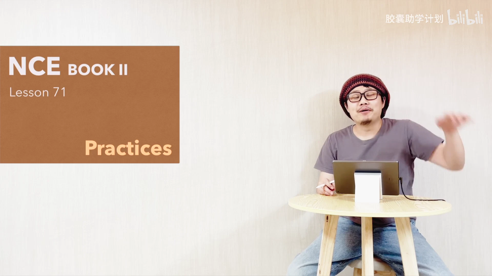

文字识别：biibii / 胶囊助学计划 / NCE / BOOKII / Lesson 71 / Practices

### 画面 00:00:02

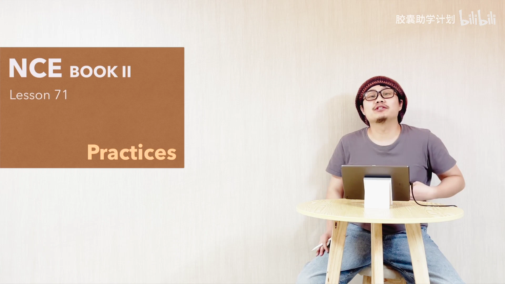

文字识别：bibii / 胶囊助学计划 / NCE / BOOKII / Lesson 71 / Practices

### 画面 00:00:05

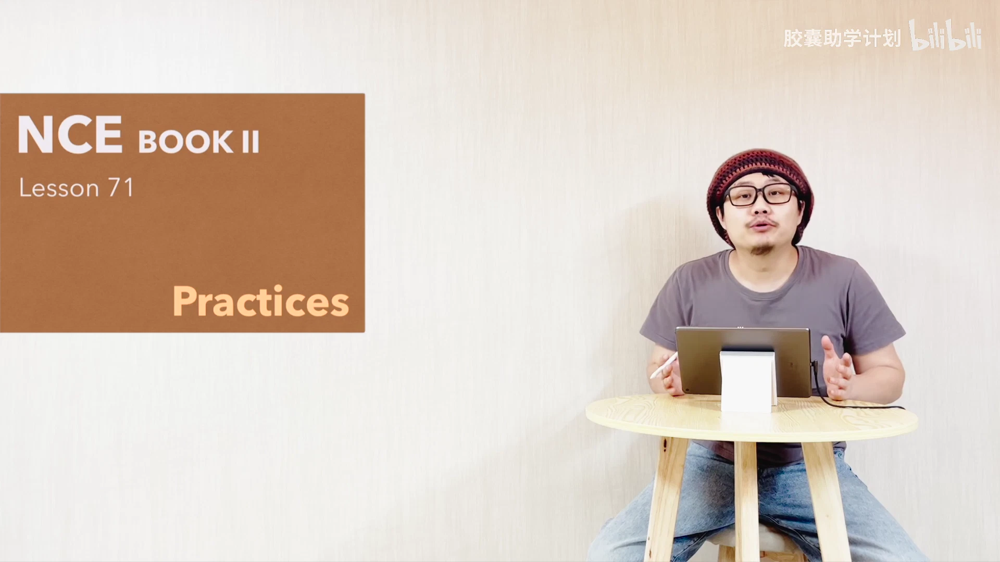

文字识别：bibii / 胶囊助学计划 / NCE / BOOKII / Lesson 71 / Practices

### 画面 00:00:09

文字识别：bilbil / 胶囊助学计划 / 进行如下练习唯一前提 / 文章跟读至熟读成诵 / 否则请勿开始

### 画面 00:00:11

文字识别：bilbili / 胶囊助学计划 / 进行如下练习唯一前提 / 文章跟读至熟读成诵 / 否则请勿开始

### 画面 00:00:14

文字识别：bilbili / 胶囊助学计划 / 进行如下练习唯一前提 / 文章跟读至熟读成诵 / 否则请勿开始

### 画面 00:00:16

文字识别：J bitbli / 胶囊助学计划 / •

### 画面 00:00:20

### 画面 00:00:22

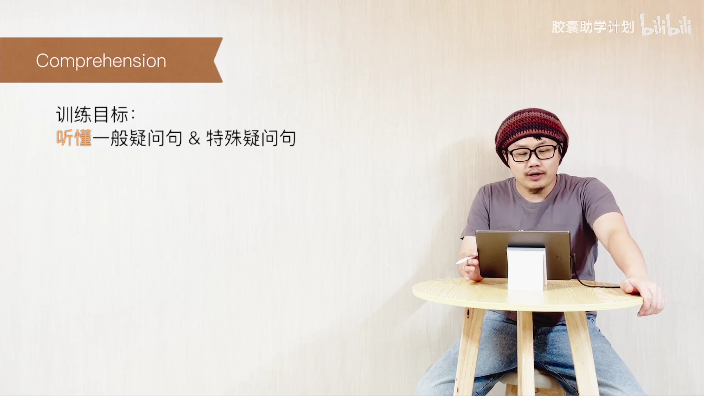

文字识别：biibili / 胶囊助学计划 / Comprehension / 训练目标： / 听懂一般疑问句＆特殊疑问句

### 画面 00:00:28

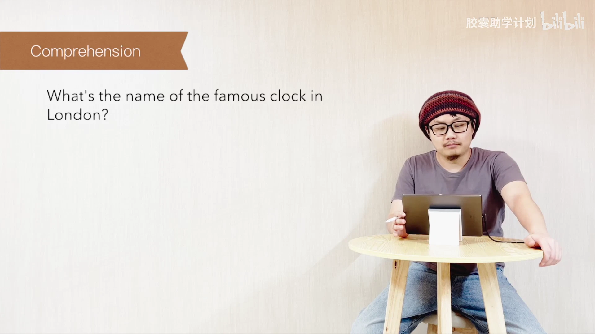

文字识别：bilbili / 胶囊助学计划 / Comprehension / What's the name of the famous clock in / London?

## 00:00:30–00:01:00

口语。So what's the name of the famous clock in London? Ah,整篇文章就讲的这个Big Ben. Is it one of the first things you will see when you visit London? Yes, it is. It can be heard all over the world, can't it? Yes, it can. Which radio station can be can it be heard

### 画面 00:00:31

文字识别：bilbil / 胶囊助学计划 / Comprehension / What's the name of the famous clock in / London?

### 画面 00:00:34

文字识别：bibili / 胶囊助学计划 / Comprehension / What's the name of the famous clock in / London?

### 画面 00:00:39

文字识别：bilbii / 胶囊助学计划 / Comprehension / Is it one of the first things you'll see when / you visit London?

### 画面 00:00:48

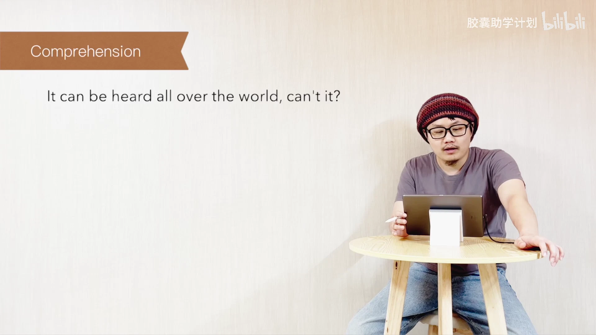

文字识别：bilbii / 胶囊助学计划 / Comprehension / It can be heard all over the world, can't it?

## 00:01:00–00:01:30

on, on the BBC? What is the BBC? Uh, British Broadcasting Corporation. This you don't need to remember. Uh, what happened to the Houses of Parliament in 1834? They were burned down. Was Big Ben burned in the fire too? No, it wasn't. Ah, this is not. It was built

### 画面 00:01:01

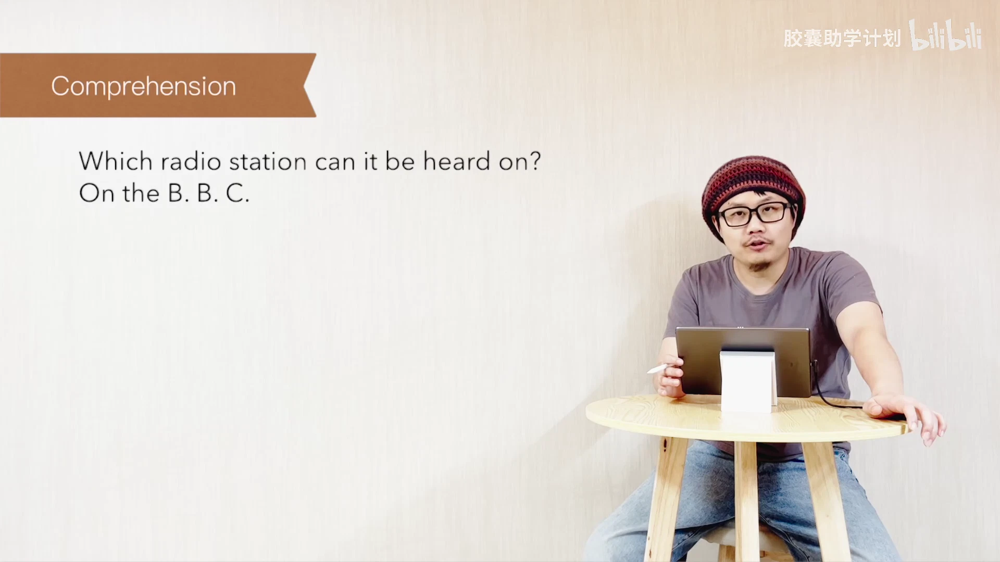

文字识别：bilibili / 胶囊助学计划 / Comprehension / Which radio station can it be heard on? / On the B. B.C.

### 画面 00:01:05

文字识别：bilbili / 胶囊助学计划 / Comprehension / What is the B. B.C.? / The British Broadcasting Corporation.

### 画面 00:01:11

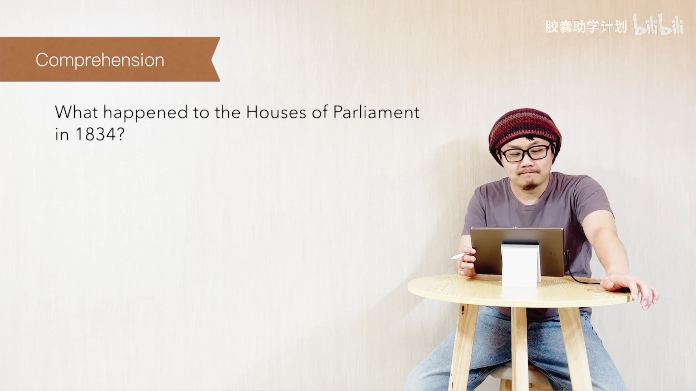

文字识别：bilbili / 胶囊助学计划 / Comprehension / What happened to the Houses of Parliament / in 1834?

### 画面 00:01:17

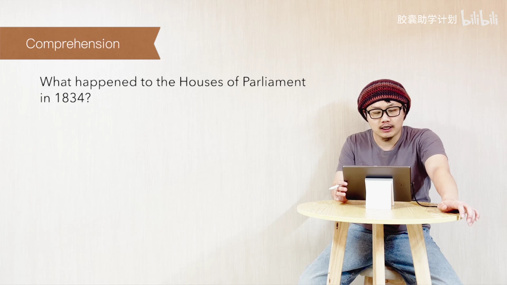

文字识别：bilbili / 胶囊助学计划 / Comprehension / What happened to the Houses of Parliament / in 1834?

## 00:01:30–00:02:00

是后来建的吗？对吧？一八四零年不才开始建的吗？Who was responsible for making Big Ben? Sir Benjamin Hall. Big Ben is called after him, isn't it? 那这个 called after 其实就是刚才我们说 take its name from 啊。 Yes, it is. How big is the clock? Immense.

### 画面 00:01:30

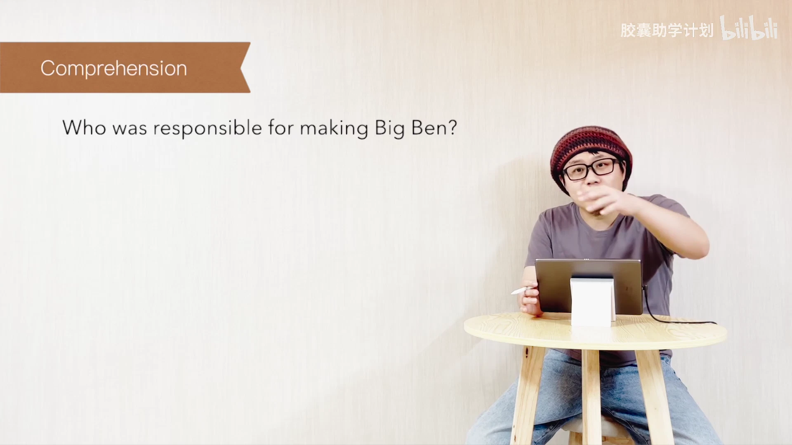

文字识别：bilbili / 胶囊助学计划 / Comprehension / Who was responsible for making Big Ben?

### 画面 00:01:33

文字识别：bilibili / 胶囊助学计划 / Comprehension / Who was responsible for making Big Ben?

### 画面 00:01:44

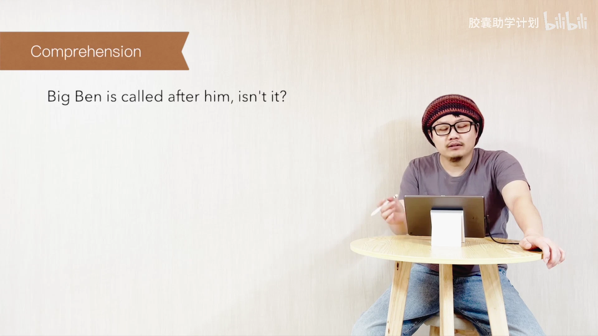

文字识别：bilibii / 胶囊助学计划 / Comprehension / Big Ben is called after him, isn't it?

### 画面 00:01:52

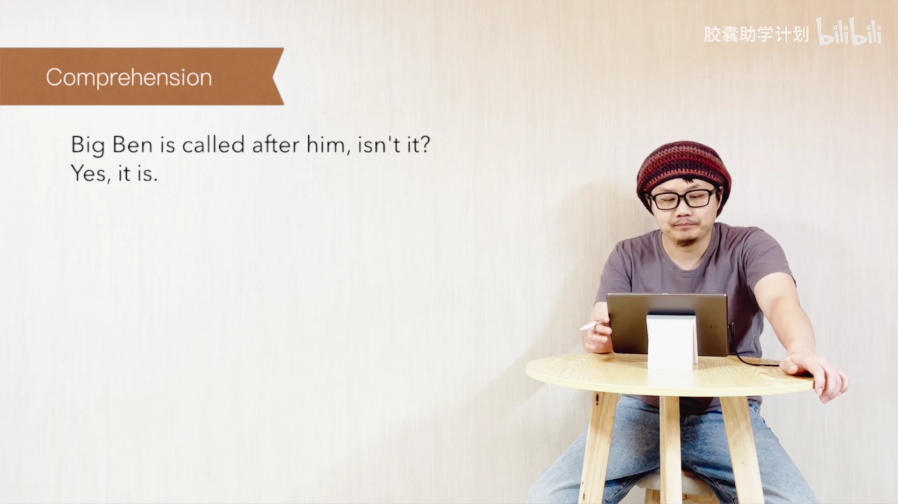

文字识别：bilbili / 胶囊助学计划 / Comprehension / Big Ben is called after him, isn't it? / Yes, it is.

## 00:02:00–00:02:30

How accurate it is? Extremely accurate. How often is it checked? Twice a day. Asking questions, 四句型啊，第一个. Trust me if Big Ben is a famous clock. Is提前，What对famous clock, a famous clock提问，对吧？Big Ben是啥？呃，第一题不说了。第二个，Is in London. 客观事实，把is

### 画面 00:02:12

文字识别：bibili / 胶囊助学计划 / Asking questions / 训练目标： / 会说一般疑问句＆特殊疑问句 / Accuracy / Fluency

### 画面 00:02:16

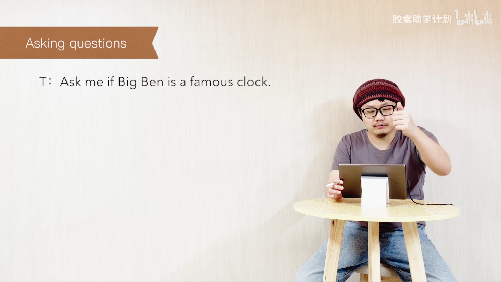

文字识别：bilbili / 胶囊助学计划 / Asking questions / T: Ask me if Big Ben is a famous clock.

### 画面 00:02:18

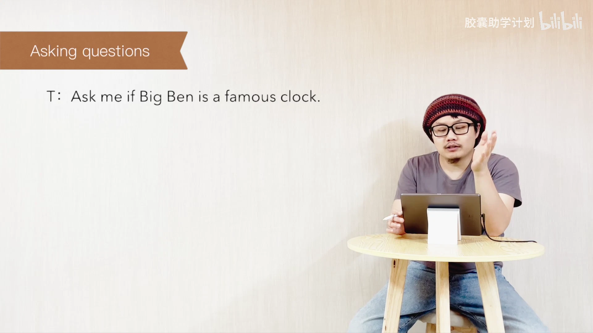

文字识别：bilbili / 胶囊助学计划 / Asking questions / T: Ask me if Big Ben is a famous clock.

### 画面 00:02:21

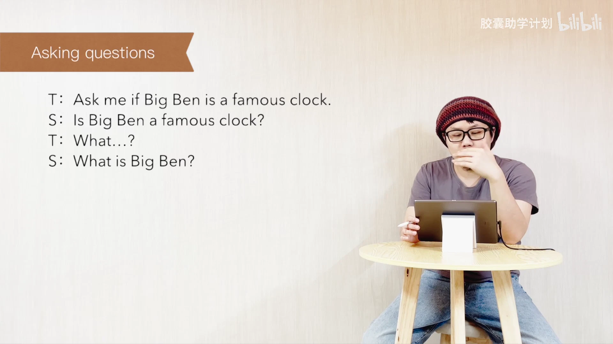

文字识别：bilbili / 胶囊助学计划 / Asking questions / T: Ask me if Big Ben is a famous clock. / S: Is Big Ben a famous clock? / T: What...? / S: What is Big Ben?

### 画面 00:02:25

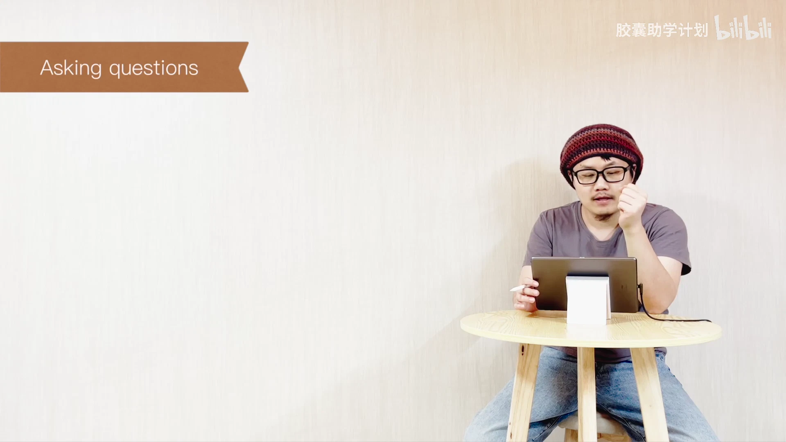

文字识别：bilbili / 胶囊助学计划 / Asking / questions

### 画面 00:02:27

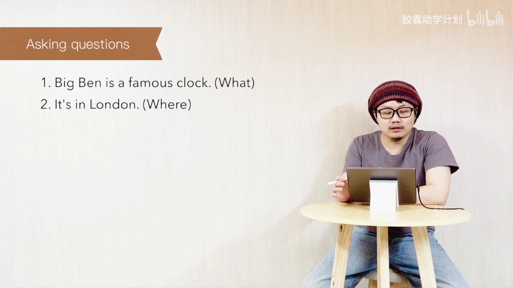

文字识别：bilbili / 胶囊助学计划 / Asking questions / 1. Big Ben is a famous clock. (What) / 2. It's in London. (Where)

## 00:02:30–00:03:00

往前一提就行了。Where对In London提问，is one of the first things a visitor says。你把is提前，对吧？呃，What你可以对one of the first things，对吧？呃，What is it就完了，是吧？It can be heard all over the world，can提前。Where对all over the world提问，Why加整句话，What对主语提问，不用变一般疑问句。Why加整句话是整句一般疑问句啊，不是整句肯定句啊。

### 画面 00:02:44

文字识别：Biltbii / 胶囊助学计划 / Asking questions / 1. Big Ben is a famous clock. (What) / 2. It's in London.(Where) / 3. It's one of the first things a visitor sees. / (What) / 4. It can be heard all over the world. (Where) / (Why)(What)

### 画面 00:02:57

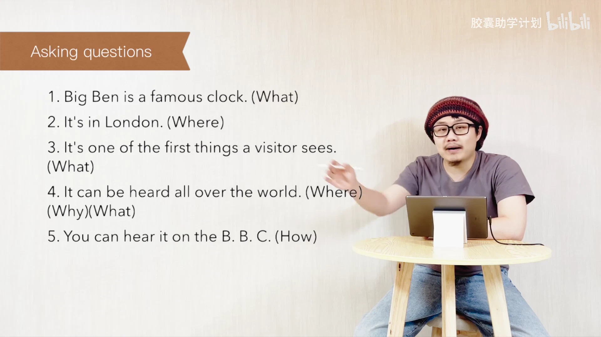

文字识别：胶囊助学计划bi山 / Asking questions / 1. Big Ben is a famous clock. (What) / 2. It's in London.(Where) / 3. It's one of the first things a visitor sees. / (What) / 4. It can be heard all over the world. (Where) / (Why)(What) / 5. You can hear it on the B. B. C.(How)

## 00:03:00–00:03:30

说 you can hear it on the BBC, can 提前 how 对 how can you hear it 啊对 on on the BBC 提问 is called after Sir Benjamin Hall 哎这个被叫做什么什么对吧？那你把这个 is 提前就可以了。然后 who 呢？你可以对这个 Sir Benjamin Hall 啊 he was responsible for making the clock 你把 was 提前就可以了。然后 what 对呃 making

### 画面 00:03:00

文字识别：胶囊助学计划bii出 / Asking questions / 1. Big Ben is a famous clock. (What) / 2. It's in London.(Where) / 3. It's one of the first things a visitor sees. / (What) / 4. It can be heard all over the world. (Where) / (Why)(What) / 5. You can hear it on the B. B. C.(How)

### 画面 00:03:09

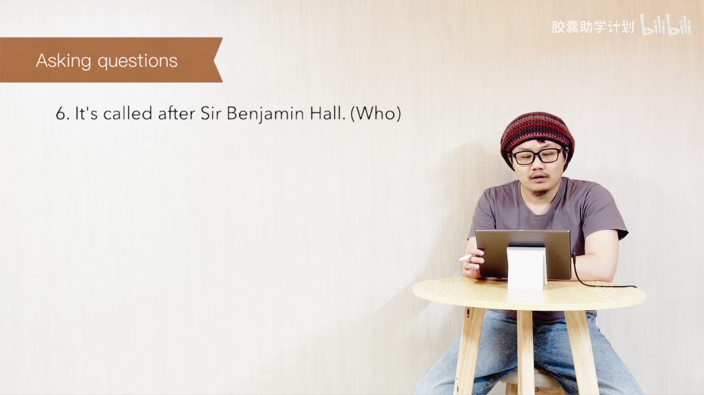

文字识别：bilbii / 胶囊助学计划 / Asking questions / 6. It's called after Sir Benjamin Hall. (Who)

## 00:03:30–00:04:00

the clock提问，互对主语提问。The houses of Parliament were burned down in 1834.呃were提前吧，对吧？被动啊，一般过去是被动。那what你对主语提问，the houses of Parliament。When肯定是对in 1834. The clock was made when the new houses of Parliament were being built.这地方我要提一句，就是各位注意，这地方听上看上去好像有两个谓语动词啊呃，那我应该

### 画面 00:03:32

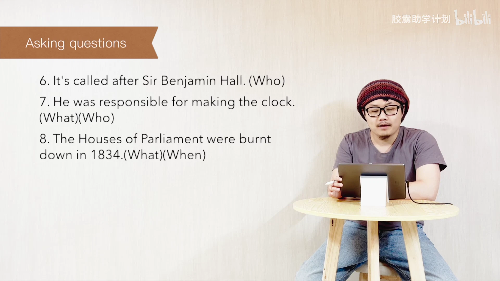

文字识别：bilibii / 胶囊助学计划 / Asking questions / 6. It's called after Sir Benjamin Hall. (Who) / 7. He was responsible for making the clock. / (What)(Who) / 8. The Houses of Parliament were burnt / down in 1834.(What)(When)

### 画面 00:03:47

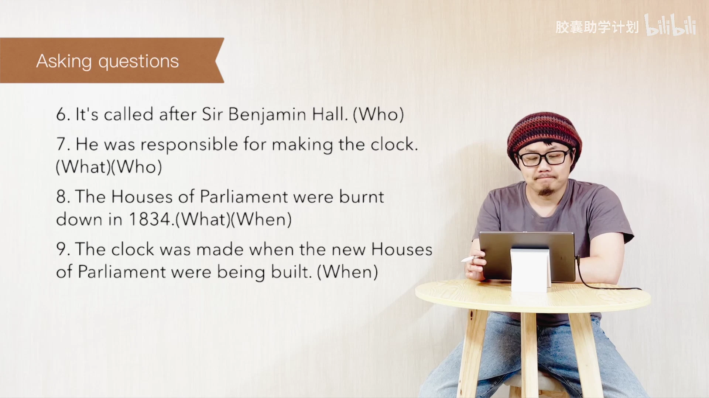

文字识别：胶囊助学计划bi山 / Asking questions / 6. It's called after Sir Benjamin Hall.(Who) / 7. He was responsible for making the clock. / (What)(Who) / 8. The Houses of Parliament were burnt / down in 1834.(What)(When) / 9. The clock was made when the new Houses / of Parliament were being built. (When)

### 画面 00:03:51

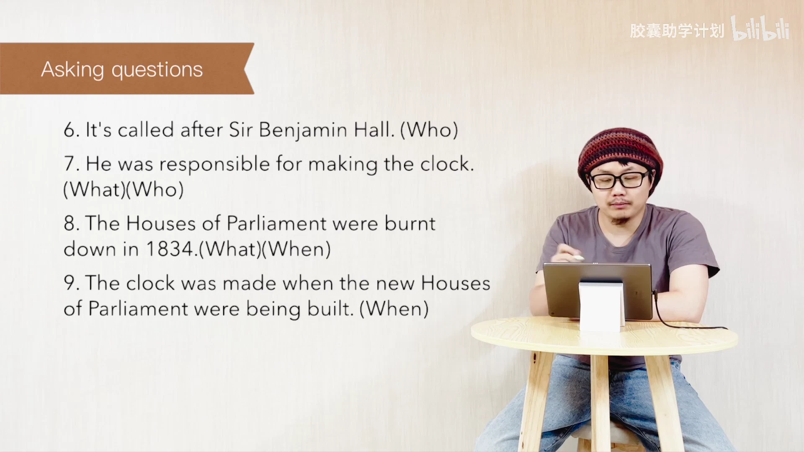

文字识别：胶囊助学计划bil出 / Asking questions / 6. It's called after Sir Benjamin Hall.(Who) / 7. He was responsible for making the clock. / (What)(Who) / 8. The Houses of Parliament were burnt / down in 1834.(What)(When) / 9. The clock was made when the new Houses / of Parliament were being built. (When)

### 画面 00:03:54

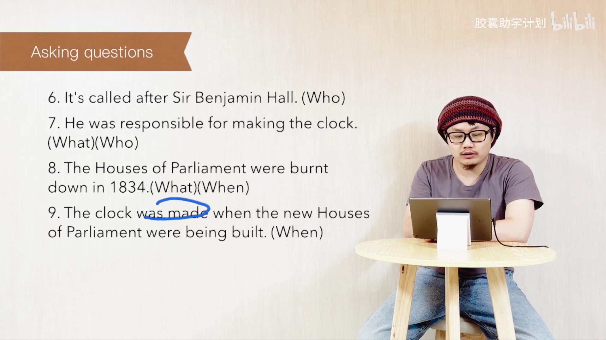

文字识别：bilbili / 胶囊助学计划 / Asking questions / 6. It's called after Sir Benjamin Hall. (Who) / 7. He was responsible for making the clock. / (What)(Who) / 8. The Houses of Parliament were burnt / down in 1834.(What)(When) / 9. The clock was made when the new Houses / of Parliament were being built. (When)

### 画面 00:03:56

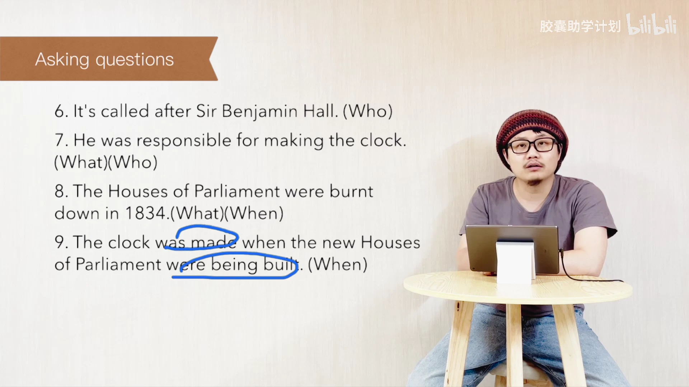

文字识别：bilbii / 胶囊助学计划 / Asking questions / 6. It's called after Sir Benjamin Hall. (Who) / 7. He was responsible for making the clock. / (What)(Who) / 8. The Houses of Parliament were burnt / down in 1834.(What)(When) / 9. The clock was made when the new Houses / of Parliament were being buit. (When)

### 画面 00:03:59

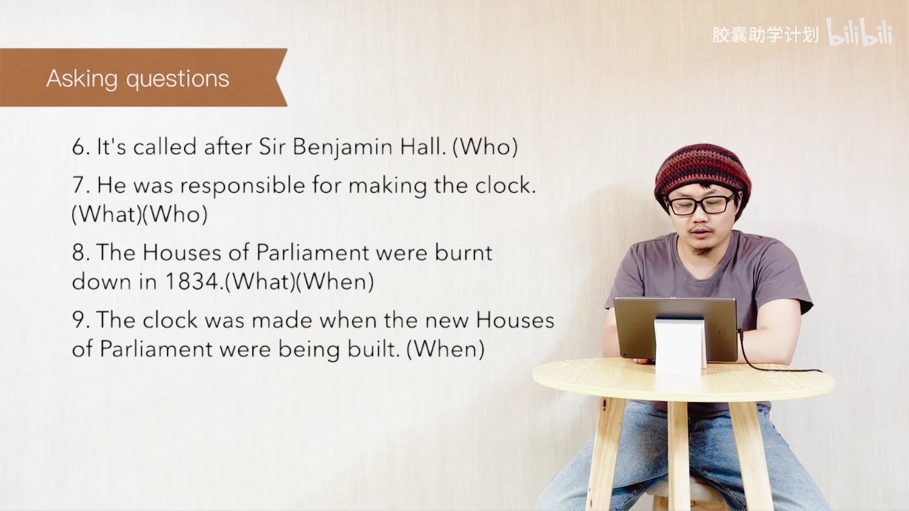

文字识别：胶囊助学计划bib出 / Asking questions / 6. It's called after Sir Benjamin Hall. (Who) / 7. He was responsible for making the clock. / (What)(Who) / 8. The Houses of Parliament were burnt / down in 1834.(What)(When) / 9. The clock was made when the new Houses / of Parliament were being built. (When)

## 00:04:00–00:04:30

提 was 还是提 were？你要看谁是主句。When 引导的时间状语从句肯定是不看的，还是把 was 提前，对吧？那 when 呢，就是对整个时间状语从句提问，叫 When was the clock made？它什么时候被做出来的，对吧？呃， tell the story 不多说了啊，还是只是提一句。注意，它练的是我们的熟练程度。这个在我们所有从小到大考试的这个，哎，练的是我们的流利性，而不是准确性啊。在我们从小到

### 画面 00:04:02

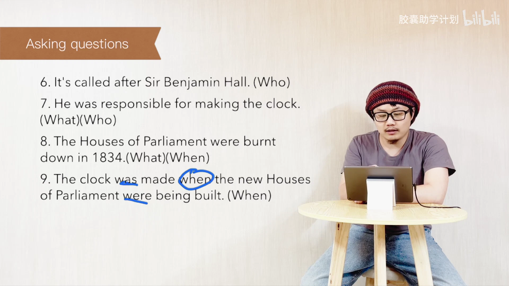

文字识别：bilibili / 胶囊助学计划 / Asking questions / 6. It's called after Sir Benjamin Hall. (Who) / 7. He was responsible for making the clock. / (What)(Who) / 8. The Houses of Parliament were burnt / down in 1834.(What)(When) / 9. The clock was made Whepthe new Houses / of Parliament were being built. (When)

### 画面 00:04:06

文字识别：bibili / 胶囊助学计划 / Asking questions / 6. It's called after Sir Benjamin Hall. (Who) / 7. He was responsible for making the clock. / (What)(Who) / 8. The Houses of Parliament were burnt / down in 1834.(What)(When) / Whepthe new Houses / 9.The clock was made / of Parliament were being built / (When)

### 画面 00:04:08

文字识别：bitbii / 胶囊助学计划 / Asking questions / 6. It's called after Sir Benjamin Hall. (Who) / 7. He was responsible for making the clock. / (What)(Who) / 8. The Houses of Parliament were burnt / dowr in 1834 (What)(When) / Whepthe new Houses / 9.The clock was made / of Parliament were being built / (When)

### 画面 00:04:11

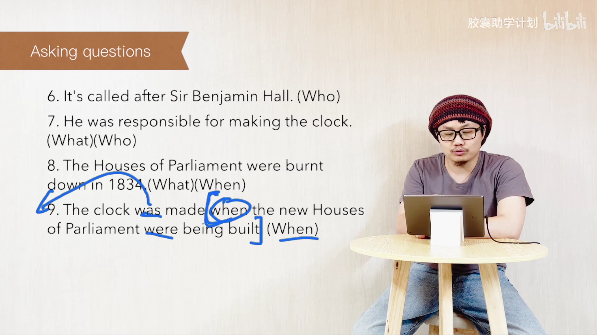

文字识别：biibii / 胶囊助学计划 / Asking questions / 6. It's called after Sir Benjamin Hall. (Who) / 7. He was responsible for making the clock. / (What)(Who) / 8. The Houses of Parliament were burnt / dowr in 1834(What)(When) / Whepthe new Houses / 9.The clock was made / of Parliament were being built / (When)

### 画面 00:04:13

文字识别：bibili / 胶囊助学计划 / Asking questions / 6. It's called after Sir Benjamin Hall. (Who) / 7. He was responsible for making the clock. / (What)(Who) / 8. The Houses of Parliament were burnt / dowr in 1834(What)(When) / hepthe new Houses / 9.The clock was made / of Parliament were being built / (When)

### 画面 00:04:17

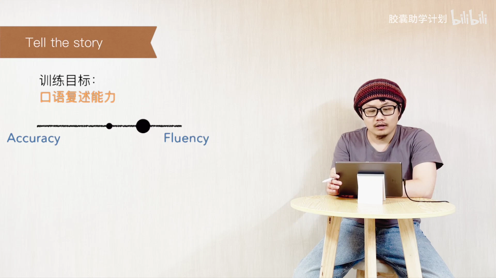

文字识别：bibili / 胶囊助学计划 / Tell the story / 训练目标： / 口语复述能力 / Accuracy / Fluency

### 画面 00:04:19

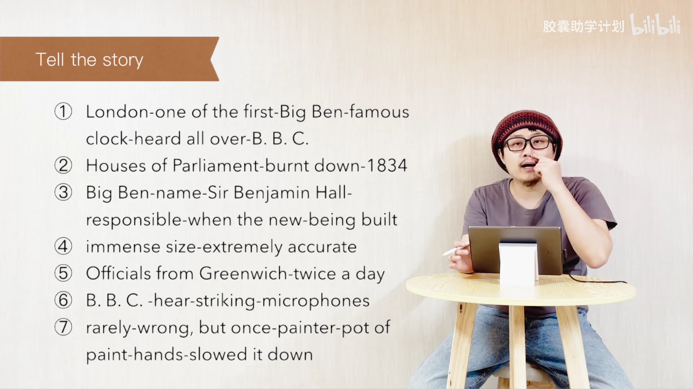

文字识别：胶囊助学计划bii / Tell the story /  London-one of the first-Big Ben-famous / 1 / clock-heard all over-B. B. C. / Houses of Parliament-burnt down-1834 / Big Ben-name-Sir Benjamin Hall- / responsible-when the new-being built / immense size-extremely accurate / Officials from Greenwich-twice a day / ⑥ B.B. C.-hear-striking-microphones / rarely-wrong, but once-painter-pot of / paint-hands-slowed it down

### 画面 00:04:27

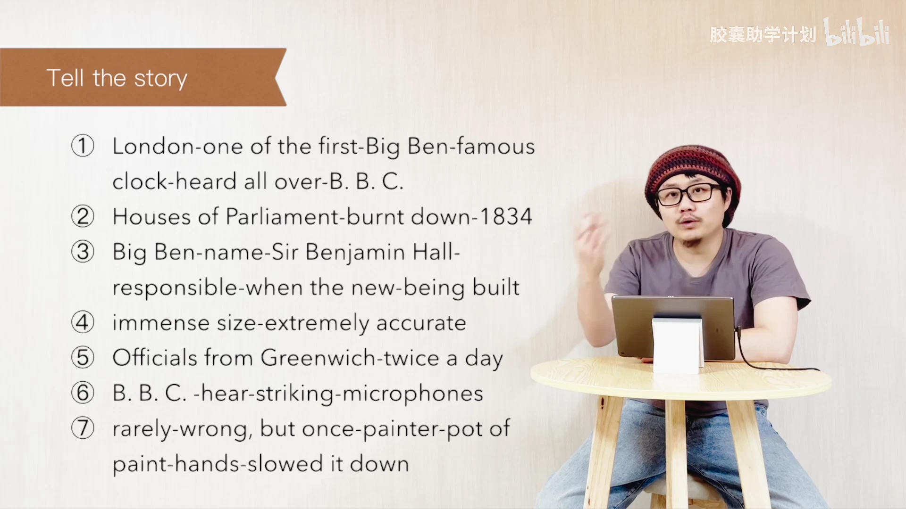

文字识别：胶囊助学计划bl山 / Tell the story / ) London-one of the first-Big Ben-famous / 1 / clock-heard all over-B. B. C. / Houses of Parliament-burnt down-1834 / Big Ben-name-Sir Benjamin Hall- / responsible-when the new-being built / immense size-extremely accurate / Officials from Greenwich-twice a day / ⑥ B.B. C.-hear-striking-microphones / rarely-wrong, but once-painter-pot of / paint-hands-slowed it down

## 00:04:30–00:05:00

到大所有的考试和课堂练习当中，基本没有做过这件事儿。我们汉语做过，但英文没做过。但你一定要练啊！呃，summary writing写完来这对答案就可以了。Topic for discussion老习惯，我说一下题目：Describe a famous building you have visited and tell what you know of its history。给我们讲一个有名的历史建筑物，然后聊一聊你知道它关于它历史的什么东西，对吧？你想一下，这不就是小学、初中我们

### 画面 00:04:37

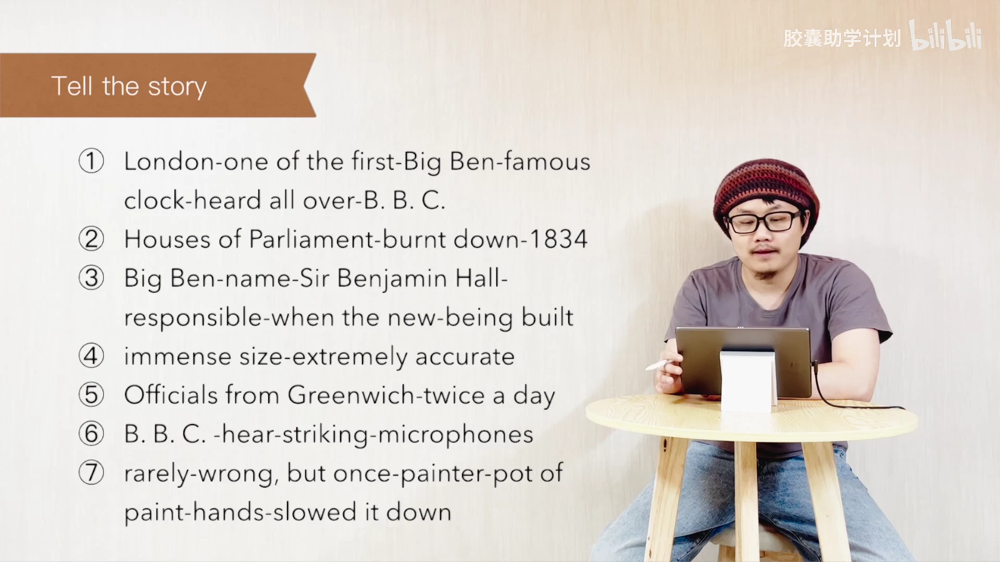

文字识别：胶囊助学计划bilil / Tell the story / ) London-one of the first-Big Ben-famous / 1 / clock-heard all over-B. B. C. / Houses of Parliament-burnt down-1834 / Big Ben-name-Sir Benjamin Hall- / responsible-when the new-being built / immense size-extremely accurate / Officials from Greenwich-twice a day / ⑥ B. B. C.-hear-striking-microphones / rarely-wrong, but once-painter-pot of / paint-hands-slowed it down

### 画面 00:04:39

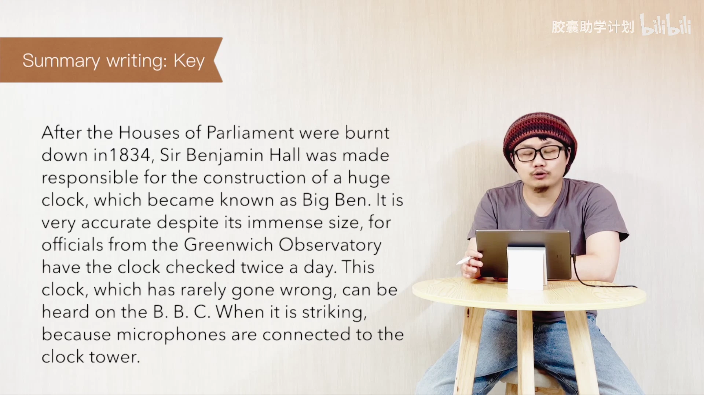

文字识别：胶囊助学计划biiil / Summary writing: Key / After the Houses of Parliament were burnt / down in1834, Sir Benjamin Hall was made / responsible for the construction of a huge / clock, which became known as Big Ben. It is / very accurate despite its immense size, for / officials from the Greenwich Observatory / have the clock checked twice a day. This / clock, which has rarely gone wrong, can be / heard on the B. B. C. When it is striking, / because microphones are connected to the / clock tower.

### 画面 00:04:41

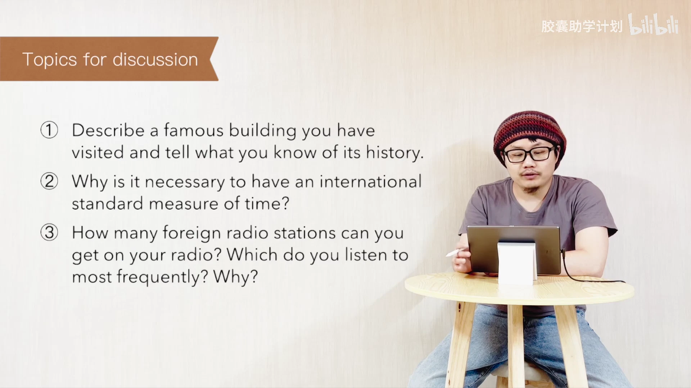

文字识别：Jbibi / 胶囊助学计划 / Topics for discussion / Describe a famous building you have / visited and tell what you know of its history. / Why is it necessary to have an international / standard measure of time? / How many foreign radio stations can you / get on your radio? Which do you listen to / most frequently? Why?

### 画面 00:04:43

文字识别：Bilbili / 胶囊助学计划 / Topics for discussion / Describe a famous building you have / visited and tell what you know of its history. / Why is it necessary to have an international / standard measure of time? / How many foreign radio stations can you / get on your radio? Which do you listen to / most frequently? Why?

### 画面 00:04:56

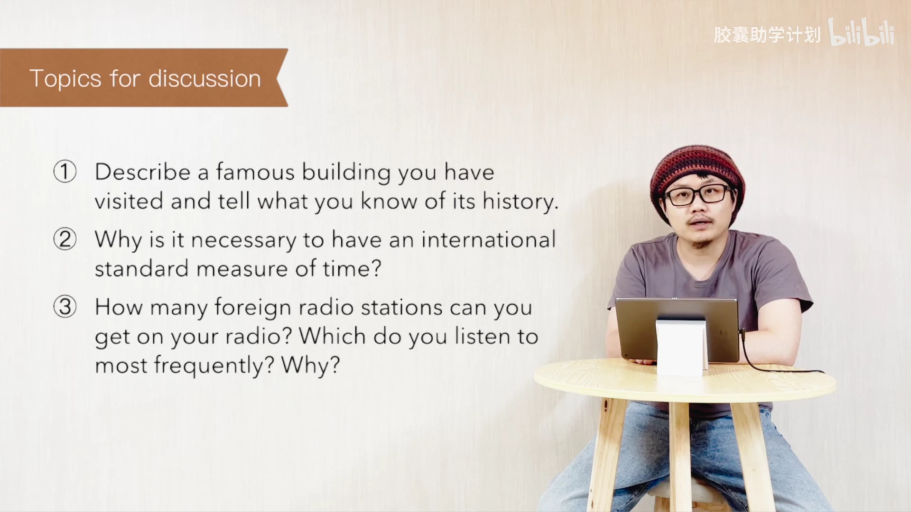

文字识别：bilbili / 胶囊助学计划 / Topics for discussion / Describe a famous building you have / visited and tell what you know of its history. / Why is it necessary to have an international / standard measure of time? / How many foreign radio stations can you / get on your radio? Which do you listen to / most frequently? Why?

## 00:05:00–00:05:30

那时候写周记，类似于什么游记，类似于写的事情嘛。那不一定要先阅读嘛，对吧？So why is it necessary to have an international standard measure of time?为什么很有必要要有一个国际统一的时间？How many foreigner radio stations can you get on your radio? Which do you listen to most frequently? Why?这个题有点老了，是吧？我们现在都在网上听了，也不拿radio，也不拿这个录音机听了啊。我们就不多提了。

### 画面 00:05:08

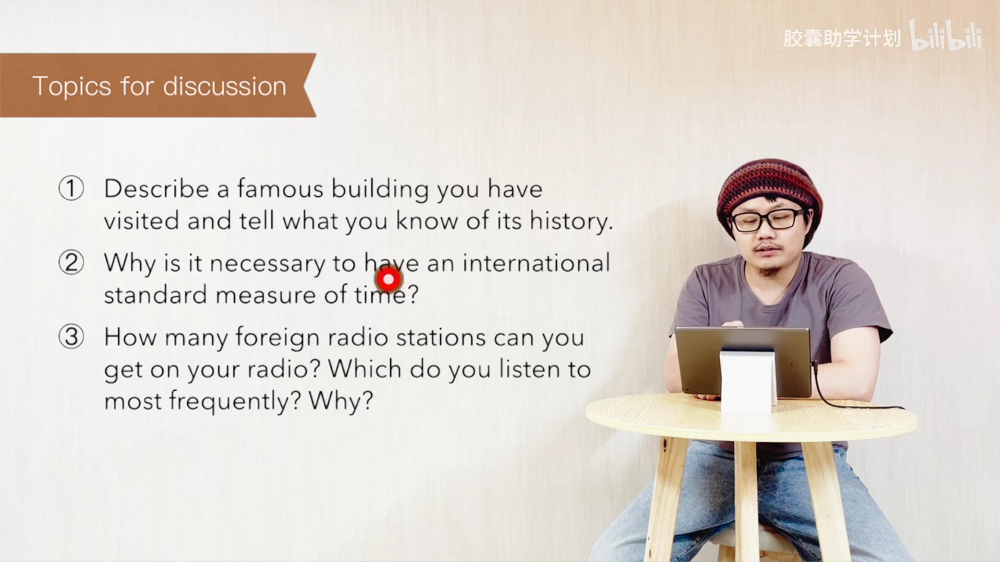

文字识别：biibili / 胶囊助学计划 / Topics for discussion / Describe a famous building you have / visited and tell what you know of its history. / Why is it necessary to have an international / standard measure of time? / How many foreign radio stations can you / get on your radio? Which do you listen to / most frequently? Why?

### 画面 00:05:29

文字识别：bibii / 胶囊助学计划 / Topics for discussion / Describe a famous building you have / visited and tell what you know of its history. / Why is it necessary to have an international / standard measure of time? / How many foreign radio stations can you / get on your radio? Which do you listen to / most frequently? Why?

## 00:05:30–00:06:00

OK，家庭作业，Ask Miff先写再朗读，这要写作写完对答案，Tell the story口语复述，哎，置顶留言重复间隔。OK，那以上就是本期视频的全部内容了。如果各位喜欢我们的课程呢，欢迎各位关注订阅，一键三连，分享给那些需要的朋友，来帮助我们快速成长。See you next time.

### 画面 00:05:31

文字识别：biibii / 胶囊助学计划 / 1.Ask me if写&朗读

### 画面 00:05:33

文字识别：biibii / 胶囊助学计划 / 1.Ask me if写&朗读 / 摘要写作写&答案

### 画面 00:05:35

文字识别：biibili / 胶囊助学计划 / 1.Ask me if写&朗读 / 摘要写作写&答案 / 3.Tell the story 口语复述

### 画面 00:05:37

文字识别：blibii / 胶囊助学计划 / 1.Ask me if写&朗读 / 摘要写作写&答案 / 3.Tell the story 口语复述 / 重复间隔（置顶留言）

### 画面 00:05:40

文字识别：胶囊助学计划bilbil

### 画面 00:05:42

文字识别：胶囊助学计划bilbil / 不

### 画面 00:05:44

文字识别：胶囊助学计划bibl

### 画面 00:05:52

### 画面 00:05:54

文字识别：CAPSULEACADEMY / 胶囊助学计划 / 小红书 / Lecturer / □ / Leo / OE

### 画面 00:05:57

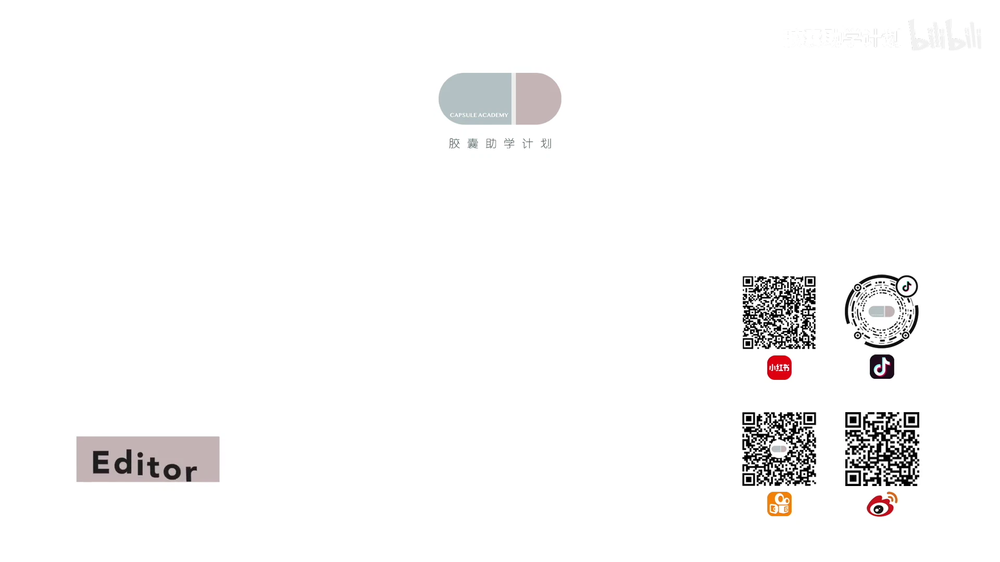

文字识别：CAPSULEACADEMY / 胶囊助学计划 / 『 / 小红书 / □ / Editor / OE

## 00:06:00–00:06:04

### 画面 00:06:00

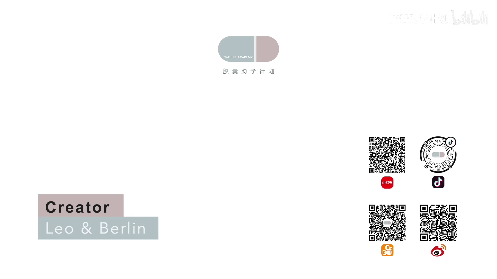

文字识别：聖酬学針物 / CAPSULEACADEMY / 胶囊助学计划 / 小红书 / Creator / 只口 / Leo & Berlin / OE

### 画面 00:06:02

文字识别：bilibili / 胶囊助学计划 / 胶囊助学计划 / 小红书 / 只接识 / 2

### 画面 00:06:04

文字识别：bilibili / 胶囊助学计划

