# 072 单词

快速机器解析：语音为单模型转写，未进行独立交叉校对或人工复核；画面每秒采样并按变化选帧，短时文字和标记可能遗漏。截图时间约有 1 秒误差。图片有损压缩；遇到疑点请按时间查看 Google Drive 原视频。

## 00:00:00–00:00:30

Hello everyone, welcome to Capsule Academy. This is Leo. Today we're going to learn new concept in English book two, lesson seventy two words. 那老习惯进入正式课程之前，咱们先看两个小的问题。第一，如何表达一个人突然间大哭了出来啊？接下来如何表达追随某人的脚步，或者我们所谓的叫继承某人的衣钵？OK，那带着这两个问题， hope you gonna enjoy.

### 画面 00:00:00

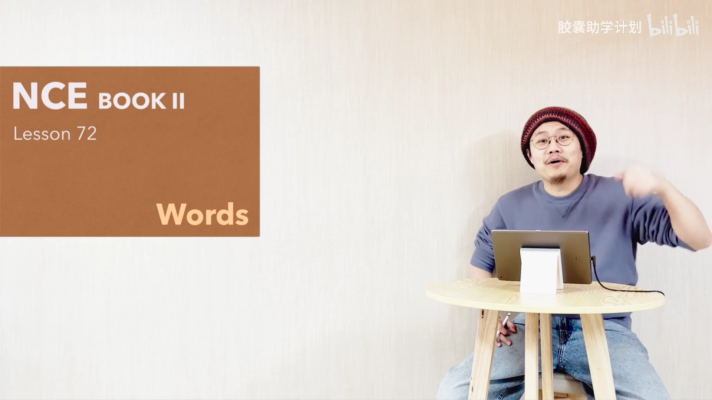

文字识别：bilbil / 胶囊助学计划 / NCE / BOOKII / Lesson 72 / Words

### 画面 00:00:03

文字识别：bilbili / 胶囊助学计划 / NCE / BOOKII / Lesson 72 / Words

### 画面 00:00:05

文字识别：bilbili / 胶囊助学计划 / NCE / BOOKII / Lesson 72 / Words

### 画面 00:00:07

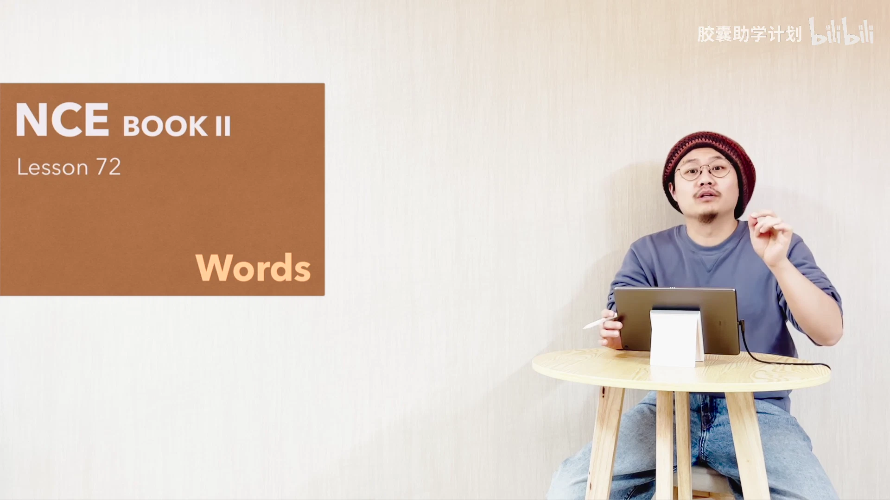

文字识别：bilbii / 胶囊助学计划 / NCE / BOOKII / Lesson 72 / Words

### 画面 00:00:10

文字识别：胶囊助学计划bi

### 画面 00:00:12

文字识别：biibili / 胶囊助学计划 / ①如何表达“突然大哭”？

### 画面 00:00:15

文字识别：bibii / 胶囊助学计划 / ①如何表达“突然大哭”? / 的脚步”？

### 画面 00:00:17

文字识别：bilbii / 胶囊助学计划 / ①如何表达“突然大哭”? / 如何表达“追随某人的脚步”?

### 画面 00:00:20

文字识别：biibili / 胶囊助学计划 / ①如何表达“突然大哭”? / 如何表达“追随某人的脚步”?

### 画面 00:00:23

文字识别：biibili / 胶囊助学计划 / ①如何表达“突然大哭”? / 如何表达“追随某人的脚步”?

### 画面 00:00:25

文字识别：胶囊助学计划 bii

### 画面 00:00:29

## 00:00:30–00:01:00

那首先祝贺各位啊，本课是咱们第三单元的最后一课了啊。我们新概念二册其实最核心的是前三个单元，第四个单元整个其实也是在复习，对吧？那可以理解为您学到今天这一课，整体上可以长出一口气了。我们还是老习惯，先看单词，看一下音标，racing，连起来读，racing，racing，race这个单词，r a c e，之前咱们学过比赛

### 画面 00:00:31

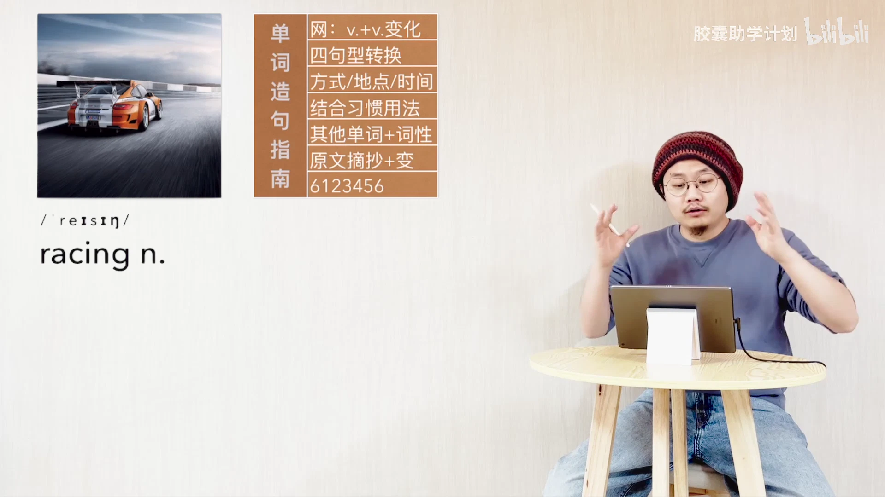

文字识别：单词造句指南 / 网：v.+v.变化 / 胶囊助学计划 / bilbil / 四句型转换 / 方式/地点/时间 / 结合习惯用法 / 其他单词+词性 / 原文摘抄+变 / 6123456 / /'reisin/ / racing / n.

### 画面 00:00:34

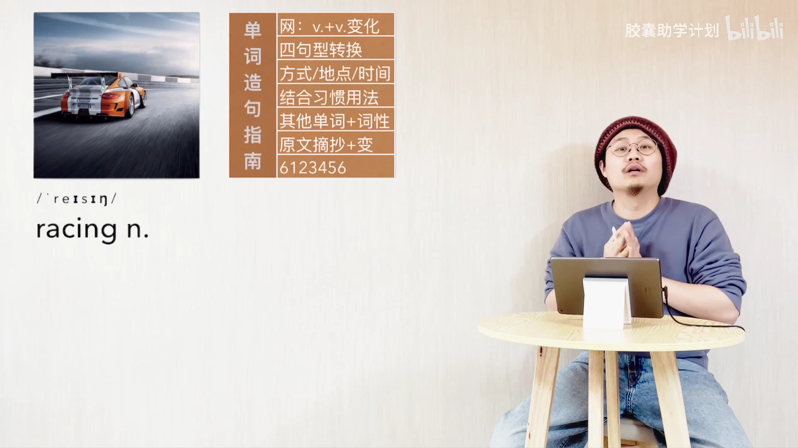

文字识别：单词造句指南 / 网：v.+v.变化 / 胶囊助学计划 / bilbili / 四句型转换 / 方式/地点/时间 / 结合习惯用法 / 其他单词+词性 / 原文摘抄+变 / 6123456 / /'reisin/ / racing / n.

### 画面 00:00:36

文字识别：单词造句指南 / 网：v.+v.变化 / 胶囊助学计划 / bilbili / 四句型转换 / 方式/地点/时间 / 结合习惯用法 / 其他单词+词性 / 原文摘抄+变 / 6123456 / /'reisin/ / racing / y n.

### 画面 00:00:38

文字识别：单词造句指南 / 网：v.+v.变化 / 胶囊助学计划 / bilbili / 四句型转换 / 方式/地点/时间 / 结合习惯用法 / 其他单词+词性 / 原文摘抄+变 / 6123456 / /'reisin/ / racing / y n.

### 画面 00:00:40

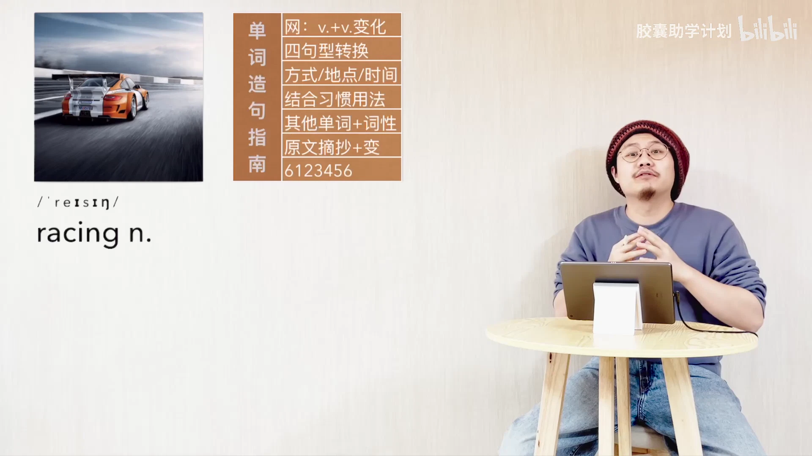

文字识别：单词造句指南 / 网：v.+v.变化 / 胶囊助学计划 / bilbii / 四句型转换 / 方式/地点/时间 / 结合习惯用法 / 其他单词+词性 / 原文摘抄+变 / 6123456 / /'reisin/ / racing n.

### 画面 00:00:44

文字识别：单词造句指南 / 网：v.+v.变化 / 胶囊助学计划 / bilbili / 四句型转换 / 方式/地点/时间 / 结合习惯用法 / 其他单词+词性 / 原文摘抄+变 / 6123456 / /'reisin/ / racing / y n.

### 画面 00:00:46

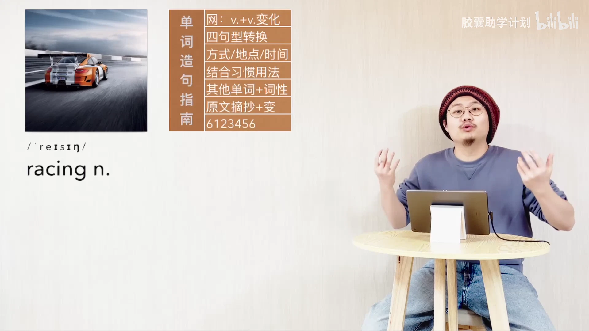

文字识别：单词造句指南 / 网：v.+v.变化 / 胶囊助学计划 / biibii / 四句型转换 / 方式/地点/时间 / 结合习惯用法 / 其他单词+词性 / 原文摘抄+变 / 6123456 / /'reisin/ / racing / n.

### 画面 00:00:49

文字识别：单词造句指南 / 网：v.+v.变化 / 胶囊助学计划 / biibii / 四句型转换 / 方式/地点/时间 / 结合习惯用法 / 其他单词+词性 / 原文摘抄+变 / 6123456 / /'reisin/ / racing / n.

### 画面 00:00:51

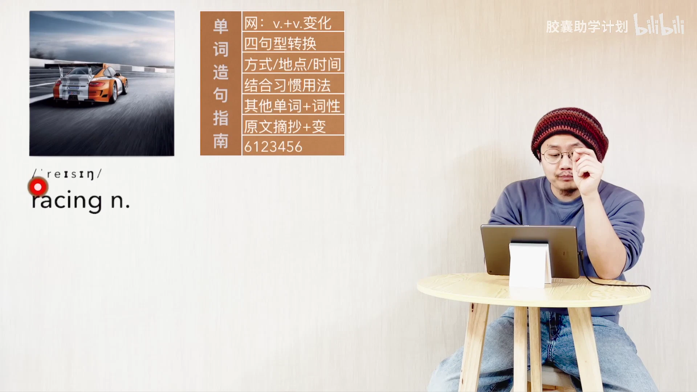

文字识别：单词造句指南 / 网：v.+v.变化 / 胶囊助学计划 / bilbii / 四句型转换 / 方式/地点/时间 / 结合习惯用法 / 其他单词+词性 / 原文摘抄+变 / 6123456 / relsin/ / racing / n.

### 画面 00:00:54

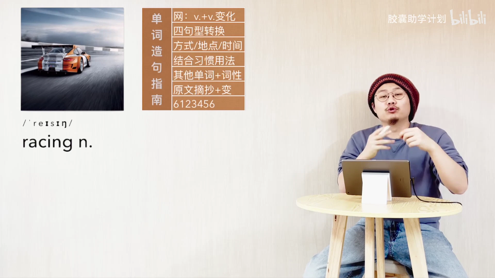

文字识别：单词造句指南 / 网：v.+v.变化 / 胶囊助学计划 / bibii / 四句型转换 / 方式/地点/时间 / 结合习惯用法 / 其他单词+词性 / 原文摘抄+变 / 6123456 / /'reisin/ / racing / y n.

### 画面 00:00:56

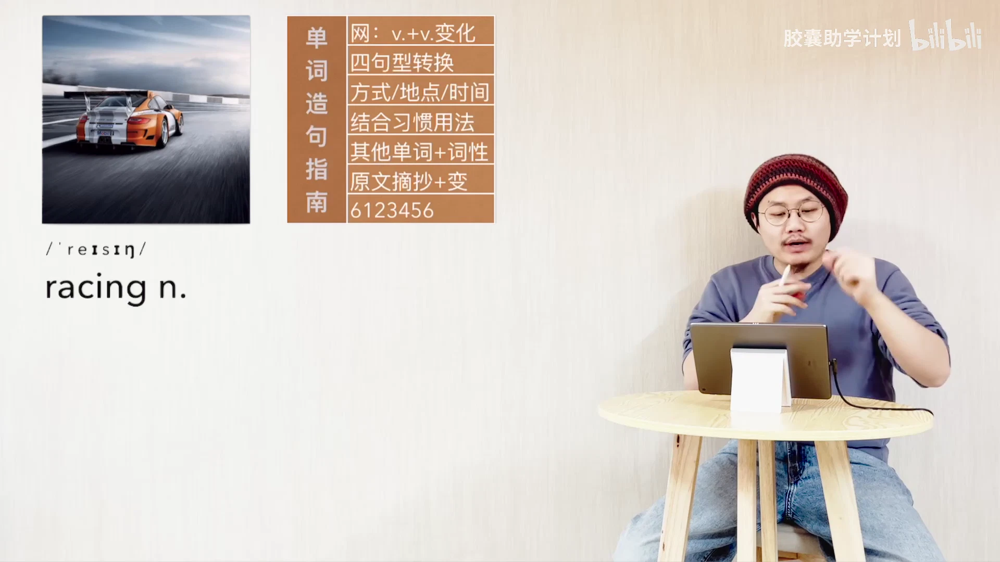

文字识别：单词造句指南 / 网：v.+v.变化 / 胶囊助学计划 / bilbili / 四句型转换 / 方式/地点/时间 / 结合习惯用法 / 其他单词+词性 / 原文摘抄+变 / 6123456 / /'reisin/ / racing / y n.

### 画面 00:00:58

文字识别：单词造句指南 / 网：v.+v.变化 / 胶囊助学计划 / bilbili / 四句型转换 / 方式/地点/时间 / 结合习惯用法 / 其他单词+词性 / 原文摘抄+变 / 6123456 / /'reisin/ / racing n.

## 00:01:00–00:01:30

竞赛racing还是比赛竞赛的意思啊，比如说很常见的racing driver哎，赛车手racing car赛车对吧？那你看，其实我们一旦把racing跟driver或者car连到一起，他们全是名词，要么人要么物。你在这时候要再去造句，你其实就是找哪些动词能跟driver或者car连起来，对吧？往前翻吧。那我们造了一句话叫做No one

### 画面 00:01:00

文字识别：单词造句指南 / 网：v.+v.变化 / 胶囊助学计划 / bibili / 四句型转换 / 方式/地点/时间 / 结合习惯用法 / 其他单词+词性 / 原文摘抄+变 / 6123456 / /'reisin/ / racing / n.

### 画面 00:01:02

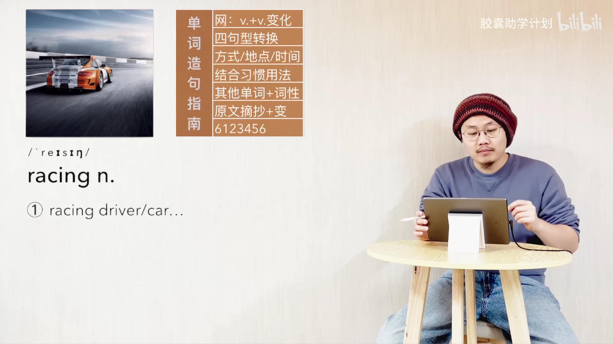

文字识别：单词造句指南 / 网：v.+v.变化 / 胶囊助学计划 / bilbili / 四句型转换 / 方式/地点/时间 / 结合习惯用法 / 其他单词+词性 / 原文摘抄+变 / 6123456 / /'reisin/ / racing / n. / racing driver/car..

### 画面 00:01:05

文字识别：单词造句指南 / 网：v.+v.变化 / 胶囊助学计划 / bilbili / 四句型转换 / 方式/地点/时间 / 结合习惯用法 / 其他单词+词性 / 原文摘抄+变 / 6123456 / /'reisin/ / racing / n. / racing / driver/car...

### 画面 00:01:10

文字识别：单词造句指南 / 网：v.+v.变化 / 胶囊助学计划 / bibili / 四句型转换 / 方式/地点/时间 / 结合习惯用法 / 其他单词+词性 / 原文摘抄+变 / 6123456 / /'reisin/ / racing / n. / racing / driver/car...

### 画面 00:01:12

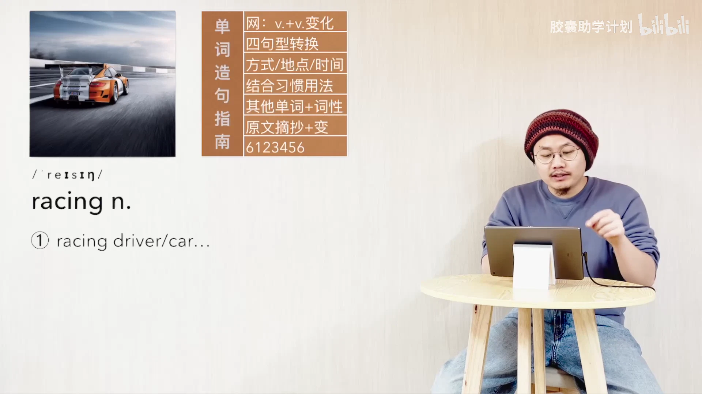

文字识别：单词造句指南 / 网：v.+v.变化 / 胶囊助学计划 / bibili / 四句型转换 / 方式/地点/时间 / 结合习惯用法 / 其他单词+词性 / 原文摘抄+变 / 6123456 / /'reisin/ / racing / n. / racing / driver/car...

### 画面 00:01:14

文字识别：单词造句指南 / 网：v.+v.变化 / 胶囊助学计划 / bibili / 四句型转换 / 方式/地点/时间 / 结合习惯用法 / 其他单词+词性 / 原文摘抄+变 / 6123456 / /'reisin/ / racing / n. / racing / driver/car...

### 画面 00:01:16

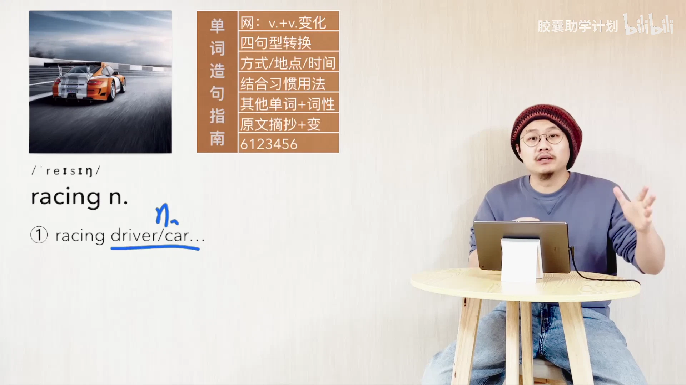

文字识别：单词造句指南 / 网：v.+v.变化 / 胶囊助学计划 / bilbili / 四句型转换 / 方式/地点/时间 / 结合习惯用法 / 其他单词+词性 / 原文摘抄+变 / 6123456 / /'reisin/ / racing / n. / racing / driver/car..

### 画面 00:01:20

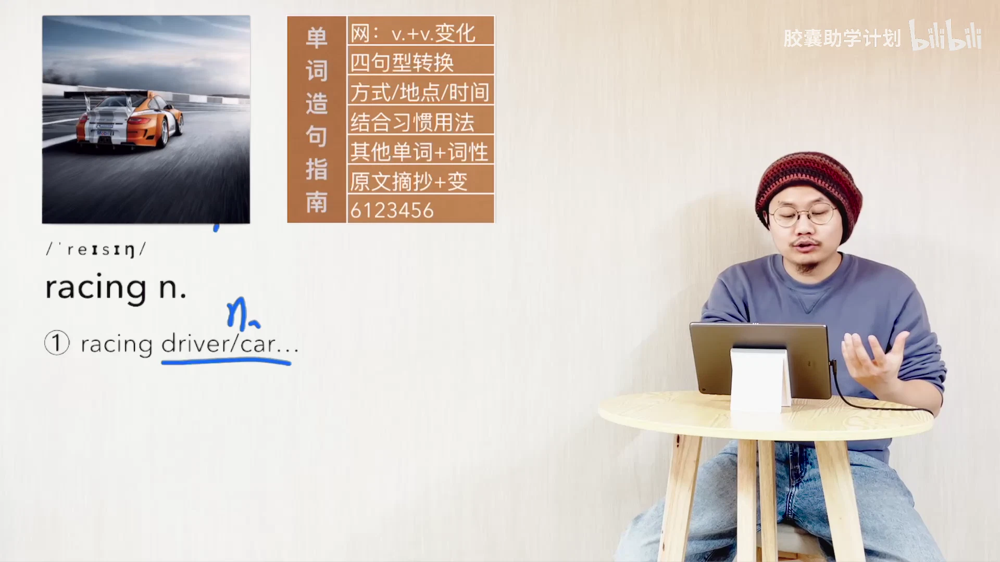

文字识别：单词造句指南 / 网：v.+v.变化 / 胶囊助学计划 / bilbili / 四句型转换 / 方式/地点/时间 / 结合习惯用法 / 其他单词+词性 / 原文摘抄+变 / 6123456 / /'reisin/ / racing / n. / racing / driver/car..

### 画面 00:01:22

文字识别：单词造句指南 / 网：v.+v.变化 / 胶囊助学计划 / bilbili / 四句型转换 / 方式/地点/时间 / 结合习惯用法 / 其他单词+词性 / 原文摘抄+变 / 6123456 / /'reisin/ / racing / n. / n / racing / driver/car..

### 画面 00:01:24

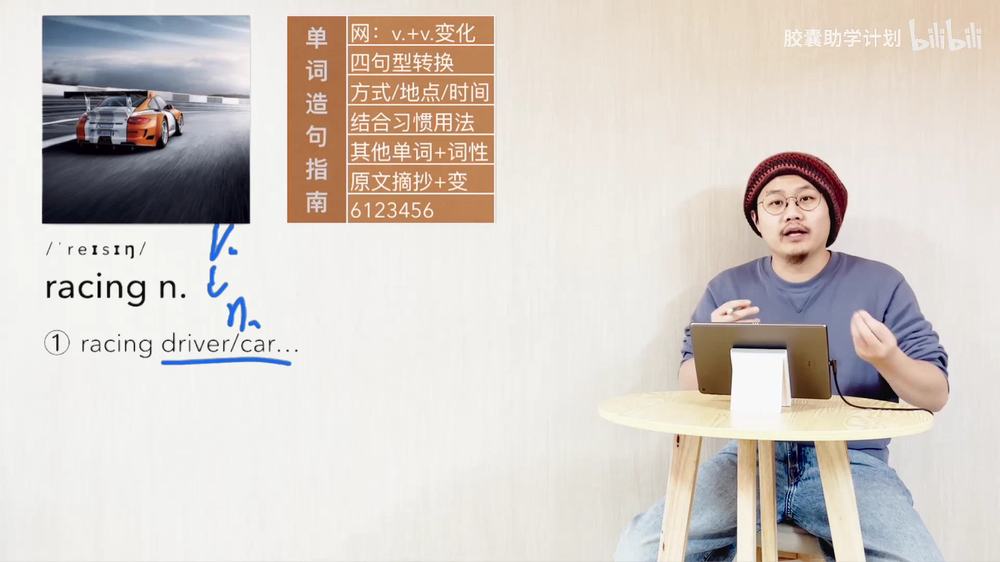

文字识别：单词造句指南 / 网：v.+v.变化 / 胶囊助学计划 / bilbili / 四句型转换 / 方式/地点/时间 / 结合习惯用法 / 其他单词+词性 / 原文摘抄+变 / 6123456 / /'reisin/ / racing / n. / n. / racing / driver/car..

### 画面 00:01:26

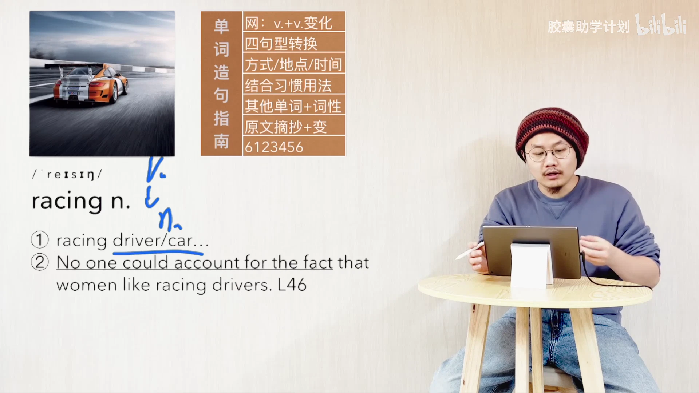

文字识别：单词造句指南 / 网：v.+v.变化 / 胶囊助学计划 / bilbili / 四句型转换 / 方式/地点/时间 / 结合习惯用法 / 其他单词+词性 / 原文摘抄+变 / 6123456 / /'reisin/ / racing / n. / racing / driver/car... / No one could account for the fact that / women like racing drivers. L46

### 画面 00:01:28

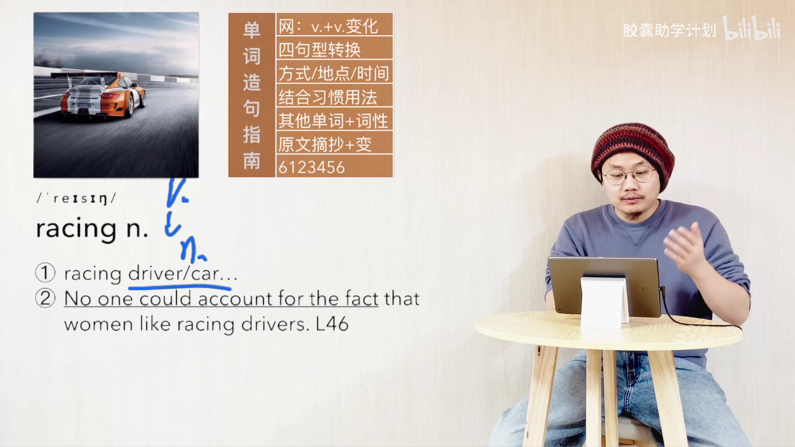

文字识别：单词造句指南 / 网：v.+v.变化 / 胶囊助学计划 / bilbili / 四句型转换 / 方式/地点/时间 / 结合习惯用法 / 其他单词+词性 / 原文摘抄+变 / 6123456 / /'reisin/ / racing / n. / Y / racing / driver/car... / No one could account for the fact that / women like racing drivers. L46

## 00:01:30–00:02:00

could account for the fact that women like racing drivers." 说没有人能解释清楚这样一个事实，叫做说，哎，很多的女性特别喜欢赛车手，觉得他们特别的酷，对吧？ Next one, "说This car takes its name from a great racing driver." 说这辆车取名于一个伟大的赛车手啊，比如说舒马赫，对吧？ Next one, "说For your safety,为了您安

### 画面 00:01:30

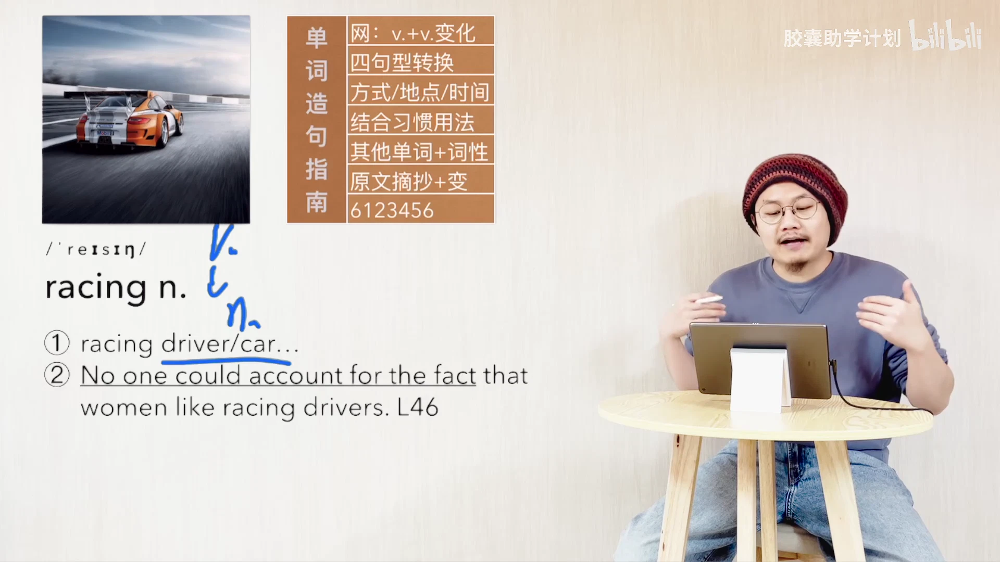

文字识别：单词造句指南 / 网：v.+v.变化 / 胶囊助学计划 / bilbii / 四句型转换 / 方式/地点/时间 / 结合习惯用法 / 其他单词+词性 / 原文摘抄+变 / 6123456 / /'reisin/ / racing / n. / racing driver/car... / 1 / No one could account for the fact that / women like racing drivers. L46

### 画面 00:01:34

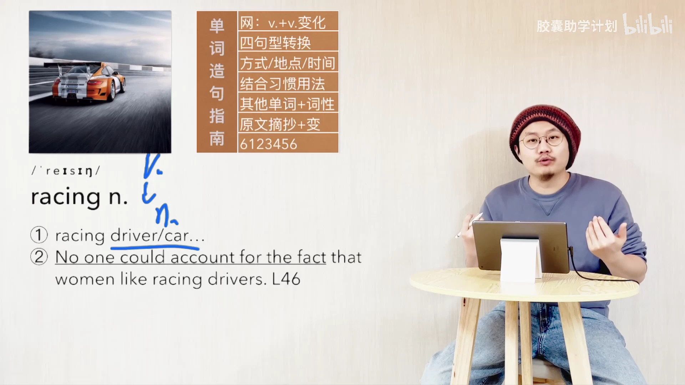

文字识别：单词造句指南 / 网：v.+v.变化 / 胶囊助学计划 / bilbil / 四句型转换 / 方式/地点/时间 / 结合习惯用法 / 其他单词+词性 / 原文摘抄+变 / 6123456 / /'reisin/ / racing / n. / racing / driver/car... / No one could account for the fact that / women like racing drivers. L46

### 画面 00:01:36

文字识别：单词造句指南 / 网：v.+v.变化 / 胶囊助学计划 / bilbl / 四句型转换 / 方式/地点/时间 / 结合习惯用法 / 其他单词+词性 / 原文摘抄+变 / 6123456 / /'reisin/ / racing / n. / racing / driver/car... / No one could account for the fact that / women like racing drivers. L46

### 画面 00:01:38

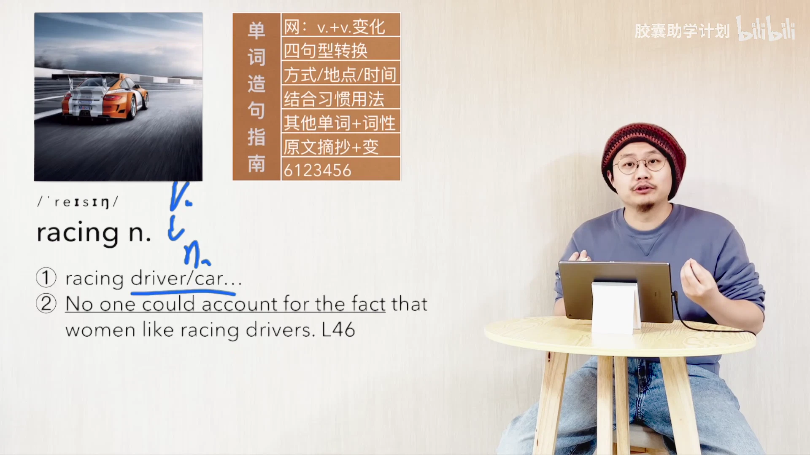

文字识别：单词造句指南 / 网：v.+v.变化 / 胶囊助学计划 / bilbil / 四句型转换 / 方式/地点/时间 / 结合习惯用法 / 其他单词+词性 / 原文摘抄+变 / 6123456 / /'reisin/ / racing / n. / racing / driver/car... / No one could account for the fact that / women like racing drivers. L46

### 画面 00:01:40

文字识别：单词造句指南 / 网：v.+v.变化 / 胶囊助学计划 / bilbl / 四句型转换 / 方式/地点/时间 / 结合习惯用法 / 其他单词+词性 / 原文摘抄+变 / 6123456 / /'reisin/ / racing / n. / racing / driver/car... / No one could account for the fact that / women like racing drivers. L46

### 画面 00:01:43

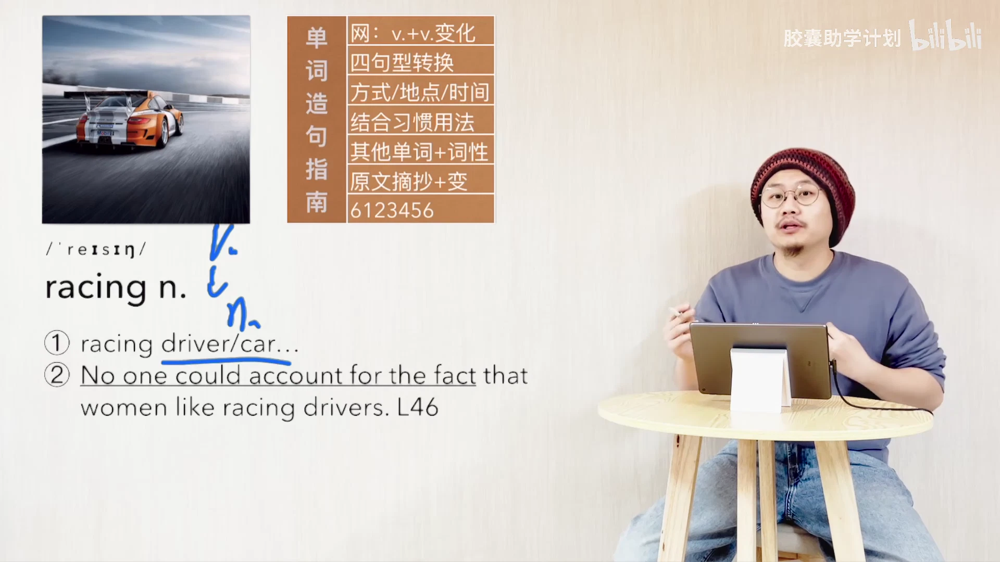

文字识别：单词造句指南 / 网：v.+v.变化 / 胶囊助学计划 / bilbili / 四句型转换 / 方式/地点/时间 / 结合习惯用法 / 其他单词+词性 / 原文摘抄+变 / 6123456 / /'reisin/ / racing / n. / racing / driver/car... / No one could account for the fact that / women like racing drivers. L46

### 画面 00:01:45

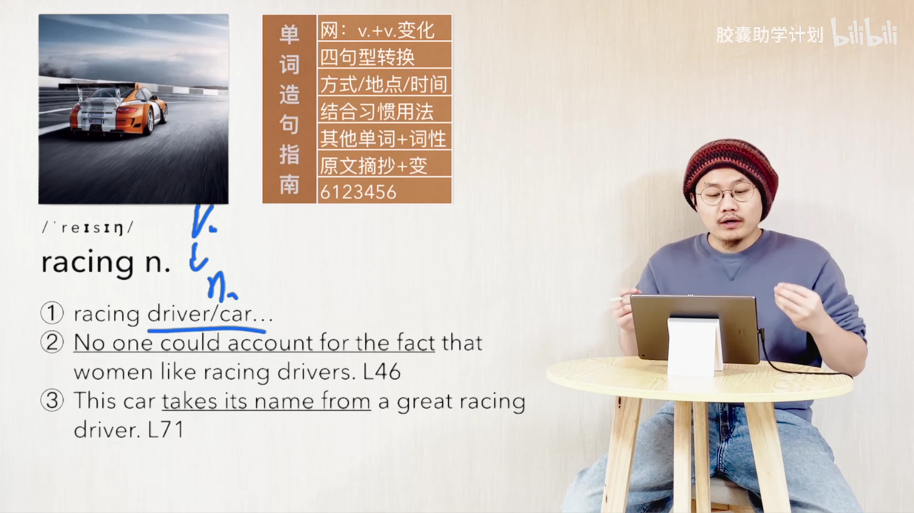

文字识别：单词造句指南 / 网：v.+v.变化 / 胶囊助学计划 / bibl / 四句型转换 / 方式/地点/时间 / 结合习惯用法 / 其他单词+词性 / 原文摘抄+变 / 6123456 / /'reisin/ / racing n. / ①racing driver/car... / No one could account for the fact that / women like racing drivers. L46 / This car takes its name from a great racing / driver. L71

### 画面 00:01:50

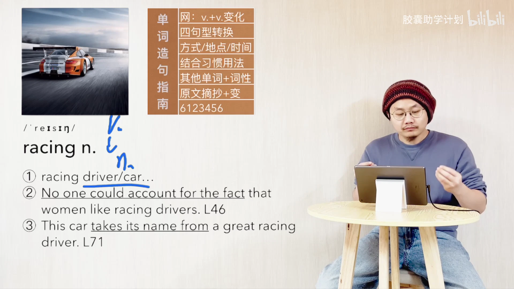

文字识别：单词造句指南 / 网：v.+v.变化 / 胶囊助学计划 / bilbl / 四句型转换 / 方式/地点/时间 / 结合习惯用法 / 其他单词+词性 / 原文摘抄+变 / 6123456 / /'reisin/ / racing n. / ① racing driver/car... / No one could account for the fact that / women like racing drivers. L46 / This car takes its name from a great racing / driver. L71

### 画面 00:01:53

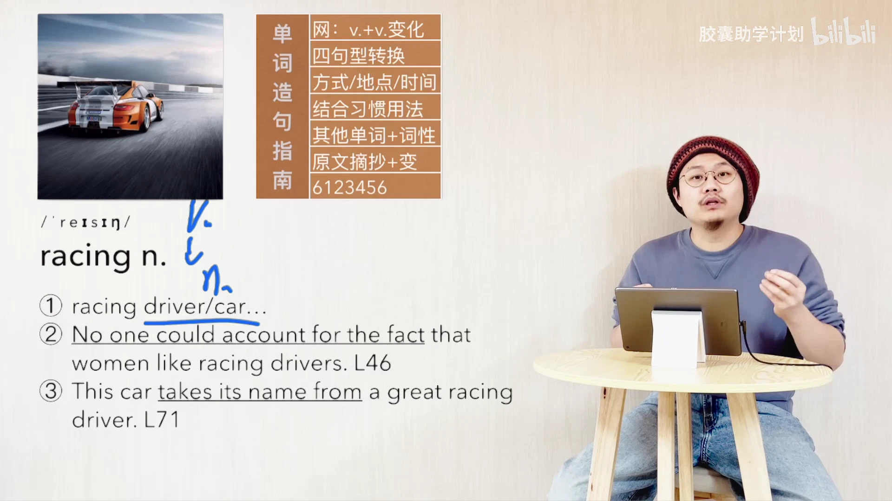

文字识别：单词造句指南 / 网：v.+v.变化 / 胶囊助学计划 / bilbi / 四句型转换 / 方式/地点/时间 / 结合习惯用法 / 其他单词+词性 / 原文摘抄+变 / 6123456 / /'reisin/ / racing n. / racing driver/car... / No one could account for the fact that / women like racing drivers. L46 / This car takes its name from a great racing / driver. L71

### 画面 00:01:55

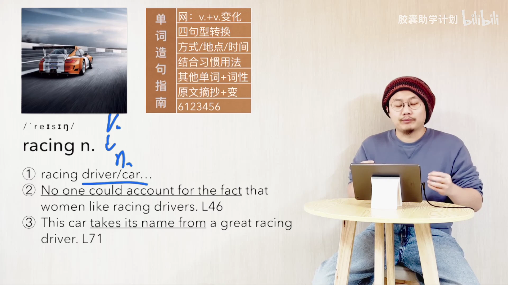

文字识别：单词造句指南 / 网：v.+v.变化 / 胶囊助学计划 / bilbii / 四句型转换 / 方式/地点/时间 / 结合习惯用法 / 其他单词+词性 / 原文摘抄+变 / 6123456 / /'reisin/ / racing n. / racing driver/car... / No one could account for the fact that / women like racing drivers. L46 / This car takes its name from a great racing / driver. L71

### 画面 00:01:57

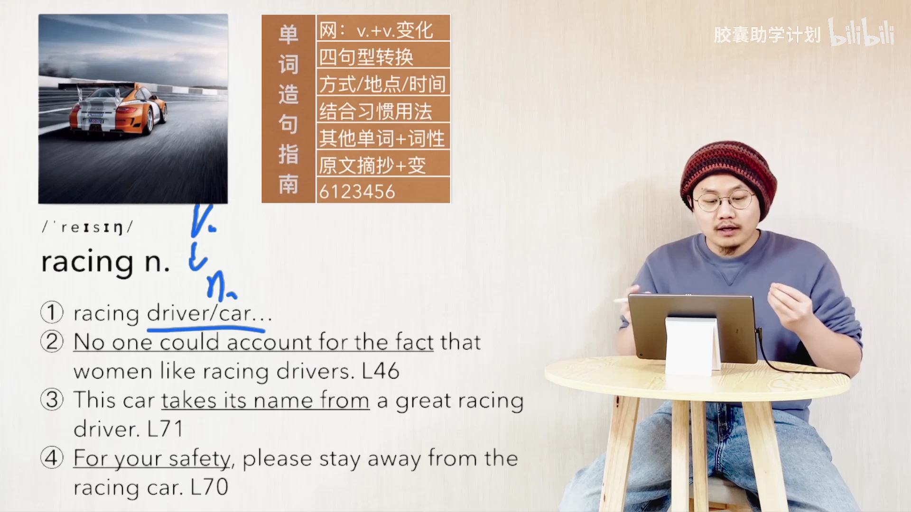

文字识别：单词造句指南 / 网：v.+v.变化 / 胶囊助学计划 / Bilbili / 四句型转换 / 方式/地点/时间 / 结合习惯用法 / 其他单词+词性 / 原文摘抄+变 / 6123456 / /'reisin/ / racing n. / ① racing driver/car... / No one could account for the fact that / women like racing drivers. L46 / This car takes its name from a great racing / driver. L71 / For your safety, please stay away from the / racing car. L70

### 画面 00:01:59

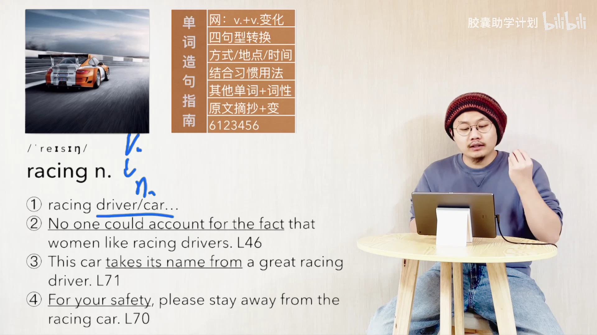

文字识别：胶囊助学计划bili / 单词造句指南 / 网：v.+v.变化 / 四句型转换 / 方式/地点/时间 / 结合习惯用法 / 其他单词+词性 / 原文摘抄+变 / 6123456 / /'reisin/ / racing n. / ① racing driver/car... / No one could account for the fact that / women like racing drivers. L46 / This car takes its name from a great racing / driver. L71 / For your safety, please stay away from the / racing car. L70

## 00:02:00–00:02:30

全起见，七十课咱们刚学的。Please stay away from the racing car.请您远离这个赛车。OK，再读一遍这个单词racing。OK，下一个单词per，per，per其实就是我们说每分钟、每秒钟、每周的那个每，对吧？每晚per night，对吧？好，那每分钟per minute，我们造几个小的句子。其实这个单词对于各位来说，您

### 画面 00:02:02

文字识别：胶囊助学计划bli / 单词造句指南 / 网：v.+v.变化 / 四句型转换 / 方式/地点/时间 / 结合习惯用法 / 其他单词+词性 / 原文摘抄+变 / 6123456 / /'reisin/ / racing n. / ① racing driver/car... / No one could account for the fact that / women like racing drivers. L46 / This car takes its name from a great racing / driver. L71 / For your safety, please stay away from the / racing car. L70

### 画面 00:02:06

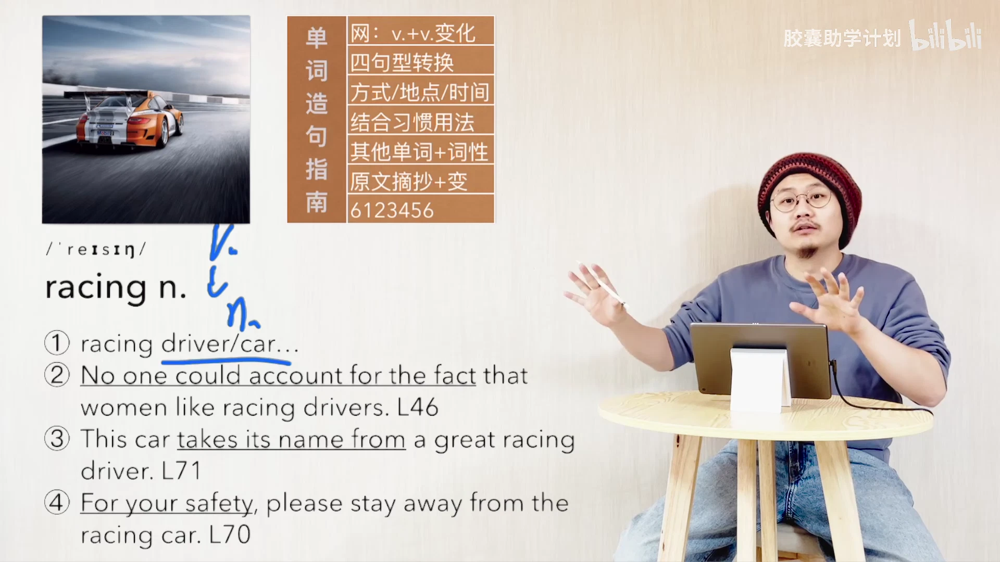

文字识别：胶囊助学计划blii / 单词造句指南 / 网：v.+v.变化 / 四句型转换 / 方式/地点/时间 / 结合习惯用法 / 其他单词+词性 / 原文摘抄+变 / 6123456 / /'reisin/ / racing n. / ① racing driver/car... / No one could account for the fact that / women like racing drivers. L46 / This car takes its name from a great racing / driver. L71 / For your safety, please stay away from the / racing car. L70

### 画面 00:02:08

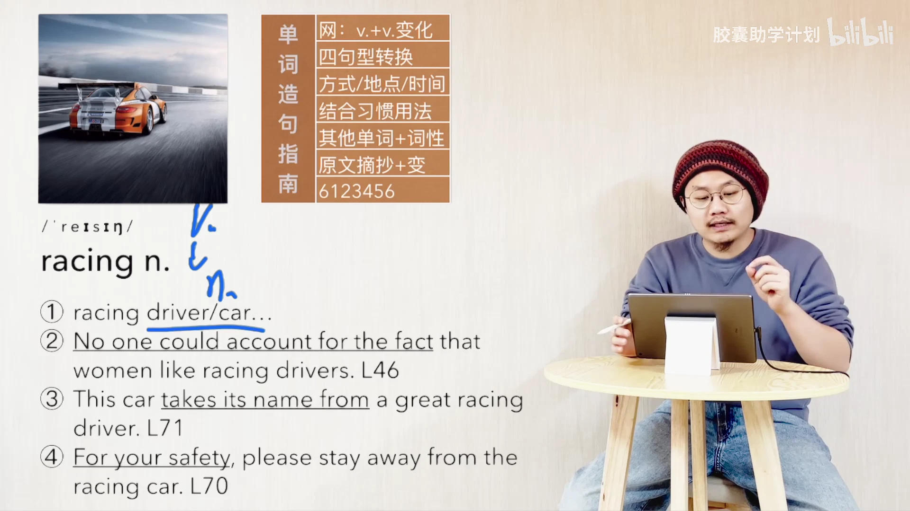

文字识别：单词造句指南 / 网：v.+v.变化 / 胶囊助学计划 / Bilbi / 四句型转换 / 方式/地点/时间 / 结合习惯用法 / 其他单词+词性 / 原文摘抄+变 / 6123456 / /'reisin/ / racing n. / n / ① racing driver/car... / No one could account for the fact that / women like racing drivers. L46 / This car takes its name from a great racing / driver. L71 / For your safety, please stay away from the / racing car. L70

### 画面 00:02:10

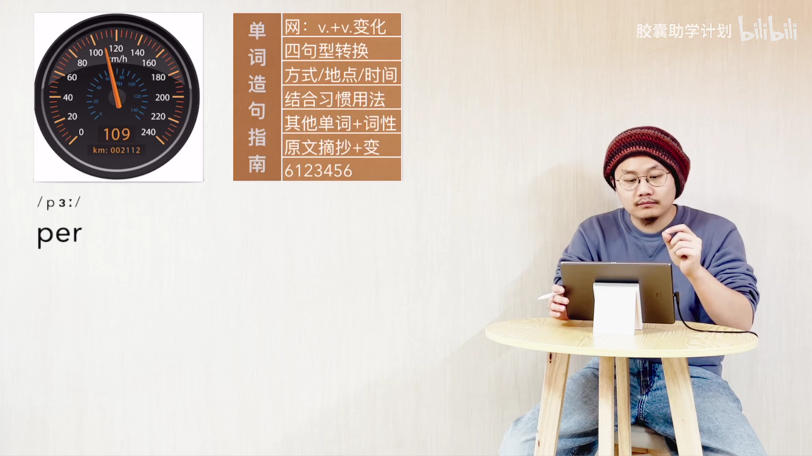

文字识别：单词造句指南 / 网：v.+v.变化 / 胶囊助学计划 / bilbili / 100 / 120 / 140 / 四句型转换 / m/h / 80 / 160 / 方式/地点/时间 / 60 / 180 / H / 40 / 200 / 结合习惯用法 / 20 / 220 / 其他单词+词性 / 0 / 109 / 240 / 原文摘抄+变 / km:002112 / 6123456 / /p3:/ / per

### 画面 00:02:12

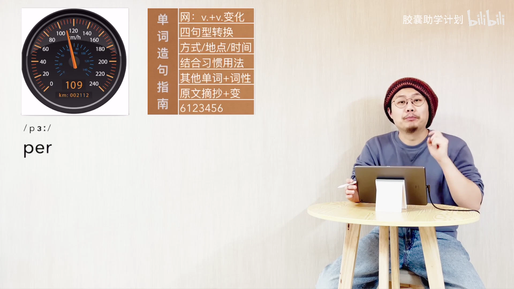

文字识别：单词造句指南 / 网：v.+v.变化 / 胶囊助学计划 / bilbili / 100 / 120 / 140 / 四句型转换 / m/h / 80 / 160 / 方式/地点/时间 / 60 / 180 / H / 40 / 200 / 结合习惯用法 / 20 / 220 / 其他单词+词性 / 0 / 109 / 240 / 原文摘抄+变 / km:002112 / 6123456 / /p3:/ / per

### 画面 00:02:15

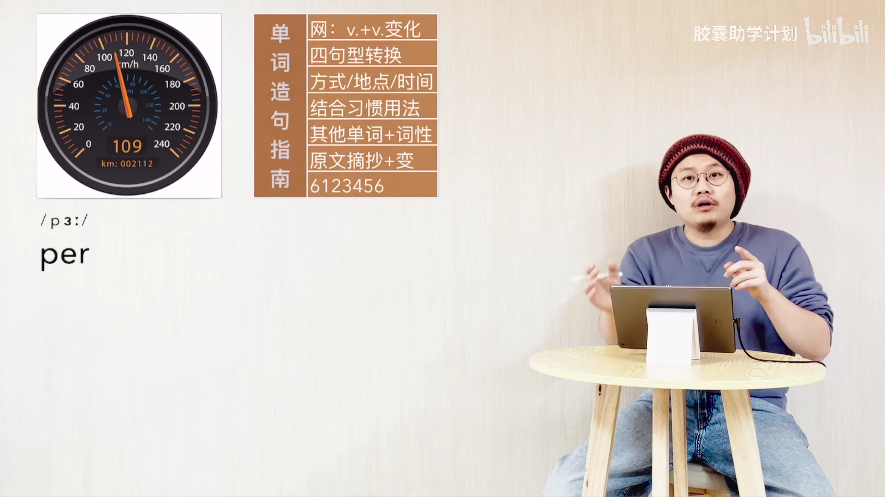

文字识别：单词造句指南 / 网：v.+v.变化 / 胶囊助学计划 / bilbili / 100 / 120 / 140 / 三 / 四句型转换 / m/h / 80 / 160 / 方式/地点/时间 / 60 / 180 / H / 40 / 200 / 结合习惯用法 / 20 / 220 / 其他单词+词性 / 0 / 109 / 240 / 原文摘抄+变 / km:002112 / 6123456 / /p3:/ / per

### 画面 00:02:17

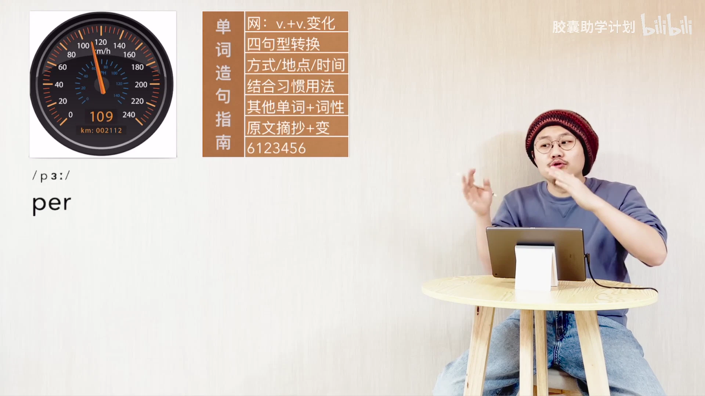

文字识别：单词造句指南 / 网：v.+v.变化 / 胶囊助学计划 / bilibili / 100 / 120 / 140 / 四句型转换 / m/h / 80 / 160 / 方式/地点/时间 / 60 / 180 / 40 / 200 / 结合习惯用法 / 20 / 220 / 其他单词+词性 / 0 / 109 / 240 / 原文摘抄+变 / km:002112 / 6123456 / /p3:/ / per

### 画面 00:02:20

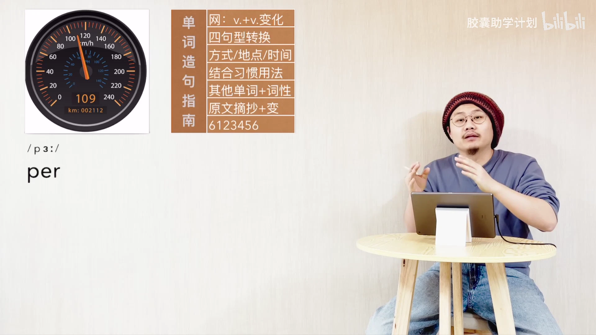

文字识别：单词造句指南 / 网：v.+v.变化 / 胶囊助学计划 / bilibili / 100 / 120 / 140 / 四句型转换 / m/h / 80 / 160 / 方式/地点/时间 / 60 / 180 / H / 40 / 200 / 结合习惯用法 / 20 / 220 / 其他单词+词性 / 0 / 109 / 240 / 原文摘抄+变 / km:002112 / 6123456 / /p3:/ / per

### 画面 00:02:24

文字识别：单词造句指南 / 网：v.+v.变化 / 胶囊助学计划 / bibii / 100 / 120 / 140 / 四句型转换 / m/h / 80 / 160 / 方式/地点/时间 / 60 / 180 / H / 100 / 40 / 200 / 结合习惯用法 / 20 / 220 / 其他单词+词性 / 0 / 109 / 240 / 原文摘抄+变 / km:002112 / 6123456 / /p3:/ / per

### 画面 00:02:26

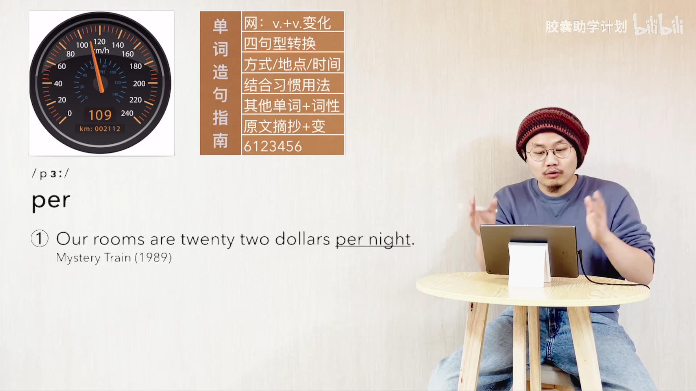

文字识别：单词造句指南 / 网：v.+v.变化 / 胶囊助学计划 / biltbii / 100 / 120 / 140 / 四句型转换 / m/h / 80 / 160 / 方式/地点/时间 / 60 / 180 / 2H / 100 / 40 / 200 / 结合习惯用法 / 20 / 220 / 其他单词+词性 / 0 / 109 / 240 / 原文摘抄+变 / km:002112 / 6123456 / /p3:/ / per / 1 / Our rooms are / : twenty two dollars per night. / Mystery Train (1989)

## 00:02:30–00:03:00

可以不用非要去造句，呃，重要的其实就是见到它能懂就行了哈。比如说，我们看几个小的电影台词，说 Our rooms are twenty two dollars per night. 你看这句话，如果你刚才懂了我刚才说的 per night 叫每晚的话，这句话的意思瞬间就通了。那我们的房间每晚二十二刀，对吧？ Next one, say I can pay you per hour. 我可以论小时去支付你的钱，对吧？就我你一小时多少钱？哎，我给您

### 画面 00:02:30

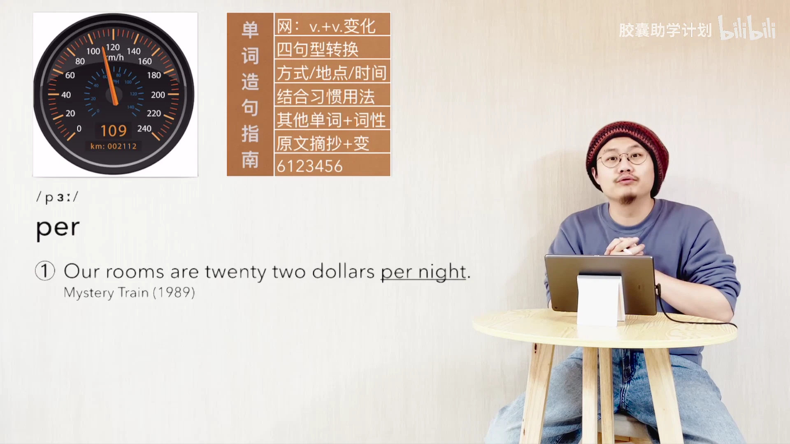

文字识别：单词造句指南 / 网：v.+v.变化 / 胶囊助学计划 / bilbili / 100 / 120 / 140 / 三 / 四句型转换 / m/h / 80 / 160 / 方式/地点/时间 / 60 / 180 / H / 40 / 200 / 结合习惯用法 / 20 / 220 / 其他单词+词性 / 0 / 109 / 240 / 原文摘抄+变 / km:002112 / 6123456 / /p3:/ / per / 1 / Our rooms are / e twenty two dollars per night. / Mystery Train (1989)

### 画面 00:02:35

文字识别：单词造句指南 / 网：v.+v.变化 / 胶囊助学计划 / bilbili / 100 / 120 / 140 / 四句型转换 / m/h / 80 / 160 / 方式/地点/时间 / 60 / 180 / H / 40 / 200 / 结合习惯用法 / 20 / 220 / 其他单词+词性 / 0 / 109 / 240 / 原文摘抄+变 / km:002112 / 6123456 / /p3:/ / per / 1 / Our rooms are / e twenty two dollars per night. / Mystery Train (1989)

### 画面 00:02:39

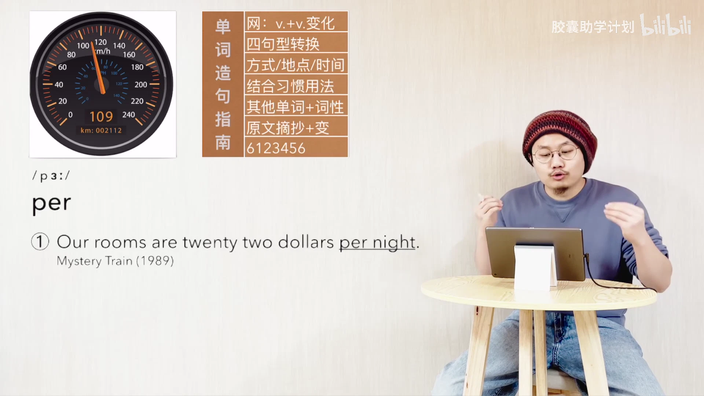

文字识别：单词造句指南 / 网：v.+v.变化 / 胶囊助学计划 / bilbii / 100 / 120 / 140 / 三 / 四句型转换 / m/h / 80 / 160 / 方式/地点/时间 / 60 / 180 / H / 40 / 200 / 结合习惯用法 / 20 / 220 / 其他单词+词性 / 0 / 109 / 240 / 原文摘抄+变 / km:002112 / 6123456 / /p3:1 / per / 1 / Our rooms are twenty two dollars per night. / Mystery Train (1989)

### 画面 00:02:41

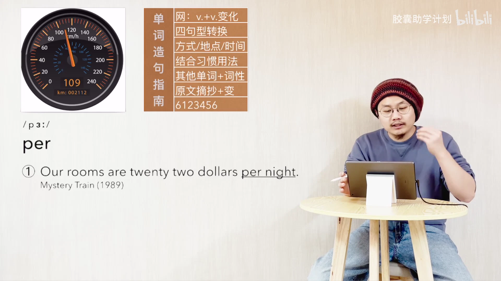

文字识别：单词造句指南 / 网：v.+v.变化 / 胶囊助学计划 / bibili / 100 / 120 / 140 / 三 / 四句型转换 / m/h / 80 / 160 / 方式/地点/时间 / 60 / 180 / H / 40 / 200 / 结合习惯用法 / 20 / 220 / 其他单词+词性 / 0 / 109 / 240 / 原文摘抄+变 / km:002112 / 6123456 / /p3:/ / per / 1 / Our rooms are twenty two dollars per night. / Mystery Train (1989)

### 画面 00:02:43

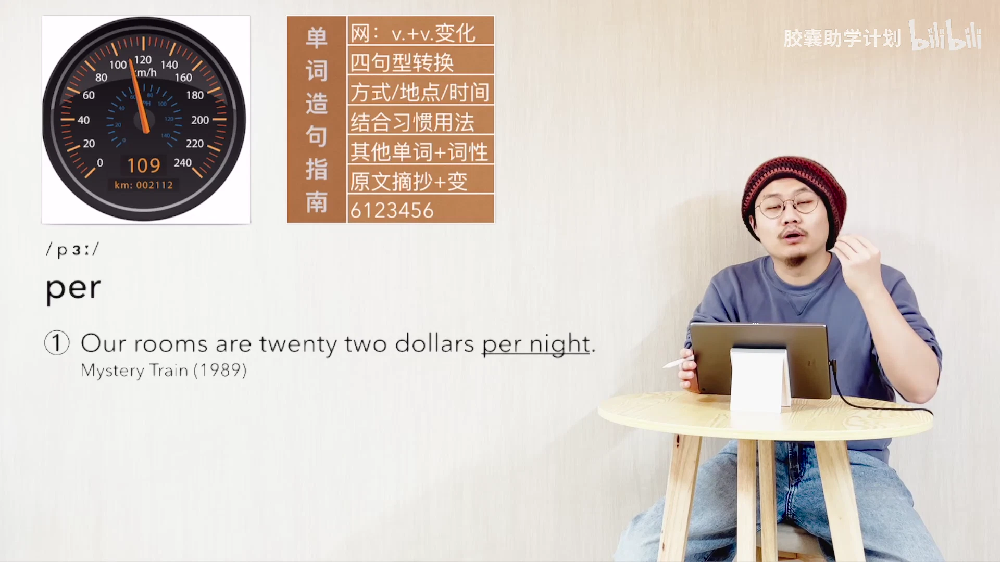

文字识别：单词造句指南 / 网：v.+v.变化 / 胶囊助学计划 / biltbili / 100 / 120 / 140 / 四句型转换 / m/h / 80 / 160 / 方式/地点/时间 / 60 / 180 / H / 40 / 200 / 结合习惯用法 / 20 / 220 / 其他单词+词性 / 0 / 109 / 240 / 原文摘抄+变 / km:002112 / 6123456 / /p3:1 / per / 1 / Our rooms are twenty two dollars per night. / Mystery Train (1989)

### 画面 00:02:45

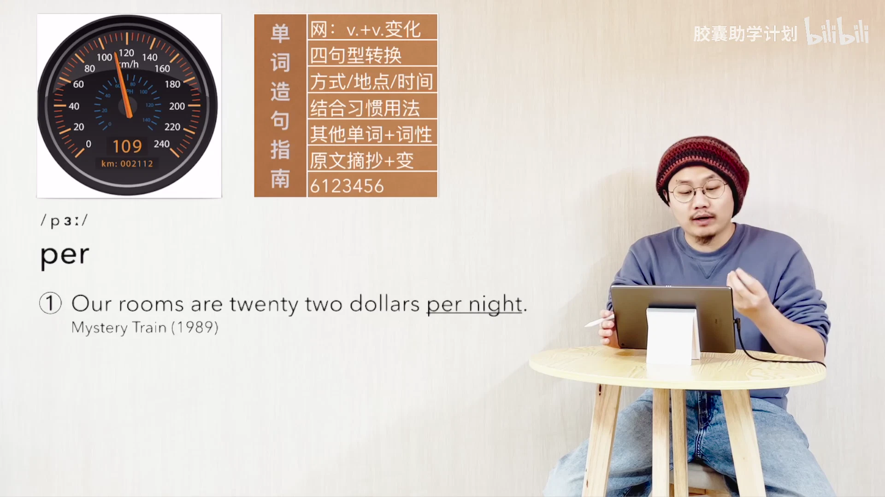

文字识别：单词造句指南 / 网：v.+v.变化 / 胶囊助学计划 / bibli / 100 / 120 / 140 / 三 / 四句型转换 / m/h / 80 / 160 / 方式/地点/时间 / 60 / 180 / H / 40 / 200 / 结合习惯用法 / 20 / 220 / 其他单词+词性 / 0 / 109 / 240 / 原文摘抄+变 / km:002112 / 6123456 / /p3:/ / per / 1 / Our rooms are twenty two dollars per night. / Mystery Train (1989)

### 画面 00:02:48

文字识别：单词造句指南 / 网：v.+v.变化 / 胶囊助学计划 / bibili / 100 / 120 / 140 / 三 / 四句型转换 / m/h / 80 / 160 / 方式/地点/时间 / 60 / 180 / H / 40 / 200 / 结合习惯用法 / 20 / 220 / 其他单词+词性 / 0 / 109 / 240 / 原文摘抄+变 / km:002112 / 6123456 / /p3:1 / per / 1 / Our rooms are twenty two dollars per night. / Mystery Train (1989)

### 画面 00:02:50

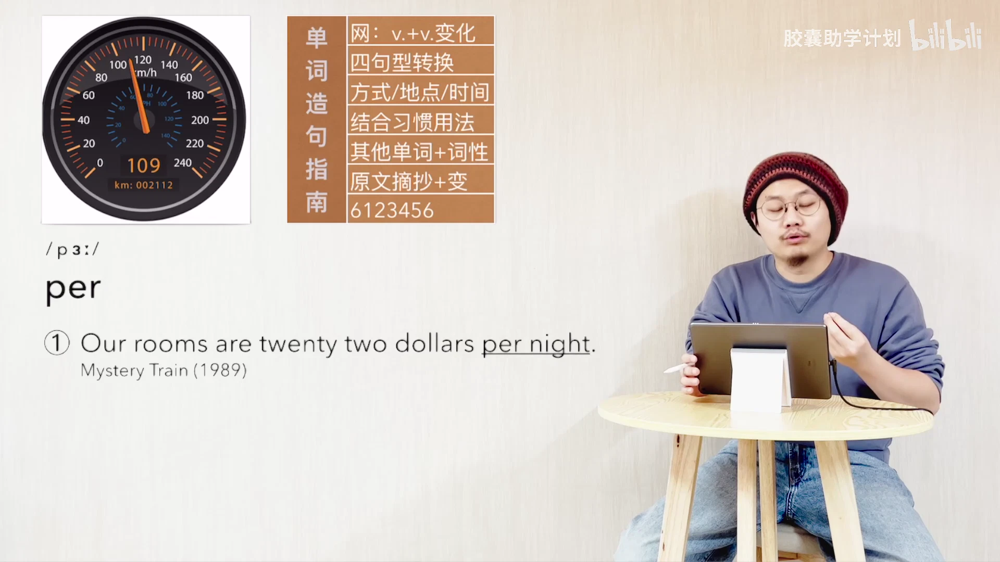

文字识别：单词造句指南 / 网：v.+v.变化 / 胶囊助学计划 / bibili / 100 / 120 / 140 / 四句型转换 / m/h / 80 / 160 / 方式/地点/时间 / 60 / 180 / PH / 40 / 200 / 结合习惯用法 / 20 / 220 / 其他单词+词性 / 0 / 109 / 240 / 原文摘抄+变 / km:002112 / 6123456 / /p3:/ / per / 1 / Our rooms are / e twenty two dollars per night. / Mystery Train (1989)

### 画面 00:02:52

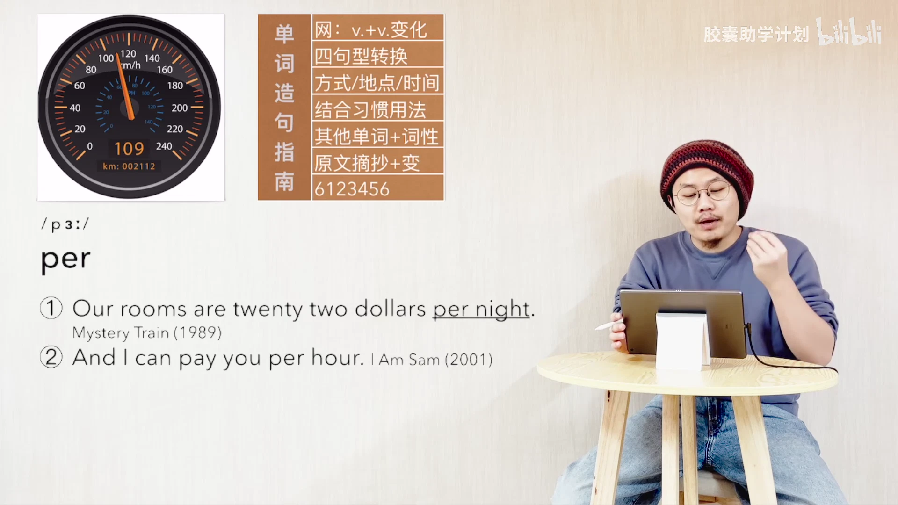

文字识别：单词造句指南 / 网：v.+v.变化 / 胶囊助学计划 / bilbili / 100 / 120 / 140 / 四句型转换 / m/h / 80 / 160 / 方式/地点/时间 / 60 / 180 / H / 100 / 40 / 200 / 结合习惯用法 / 20 / 220 / 其他单词+词性 / 0 / 109 / 240 / 原文摘抄+变 / km:002112 / 6123456 / /p3:1 / per / ① Our rooms are twenty two dollars per night. / Mystery Train (1989) / And I can pay you per hour. IAm Sam (2001)

### 画面 00:02:55

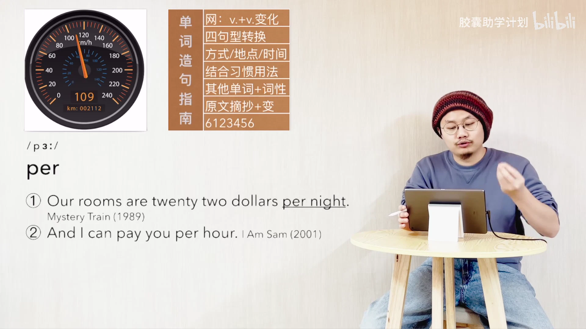

文字识别：单词造句指南 / 网：v.+v.变化 / 胶囊助学计划 / bilbili / 100 / 120 / 140 / 三 / 四句型转换 / m/h / 80 / 160 / 方式/地点/时间 / 60 / 180 / 2H / 40 / 200 / 结合习惯用法 / 20 / 220 / 其他单词+词性 / 109 / 240 / 原文摘抄+变 / km:002112 / 6123456 / /p3:/ / per / 1 /  Our rooms are twenty two dollars per night. / Mystery Train (1989) / And I can pay you per hour. IAm Sam (2001)

### 画面 00:02:59

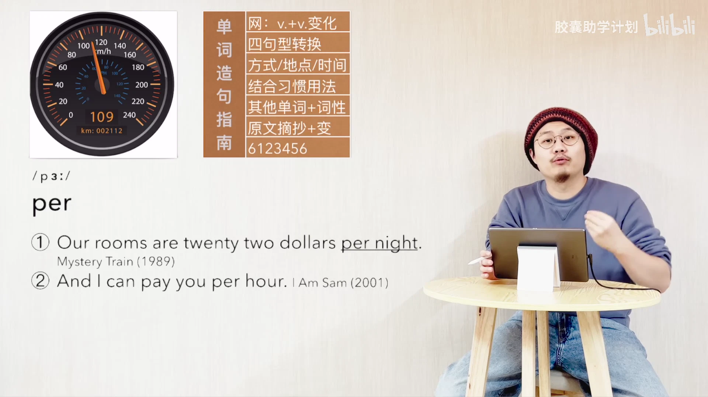

文字识别：单词造句指南 / 网：v.+v.变化 / 胶囊助学计划 / bibili / 100 / 120 / 140 / 四句型转换 / m/h / 80 / 160 / 方式/地点/时间 / 60 / 180 / PH / 40 / 200 / 结合习惯用法 / 20 / 220 / 其他单词+词性 / 109 / 240 / 原文摘抄+变 / km:002112 / 6123456 / /p3:1 / per / 1 /  Our rooms are twenty two dollars per night. / Mystery Train (1989) / And I can pay you per hour. IAm Sam (2001)

## 00:03:00–00:03:30

这个钱。Continue. Say it's only twenty dollars per person. Per person就是每个人啊，twenty to啊，twenty dollars就每个人二十刀，对吧？所以这个小单词您可以不用去造句了。基本上我这么一说，你可能瞬间我觉得差不多这节课就记下来它了。以后见到它能懂就可以了。OK，好。呃，那咱们注意力集中听一个小电影片段啊。I'll give you thirty dollars cash per night. OK.

### 画面 00:03:01

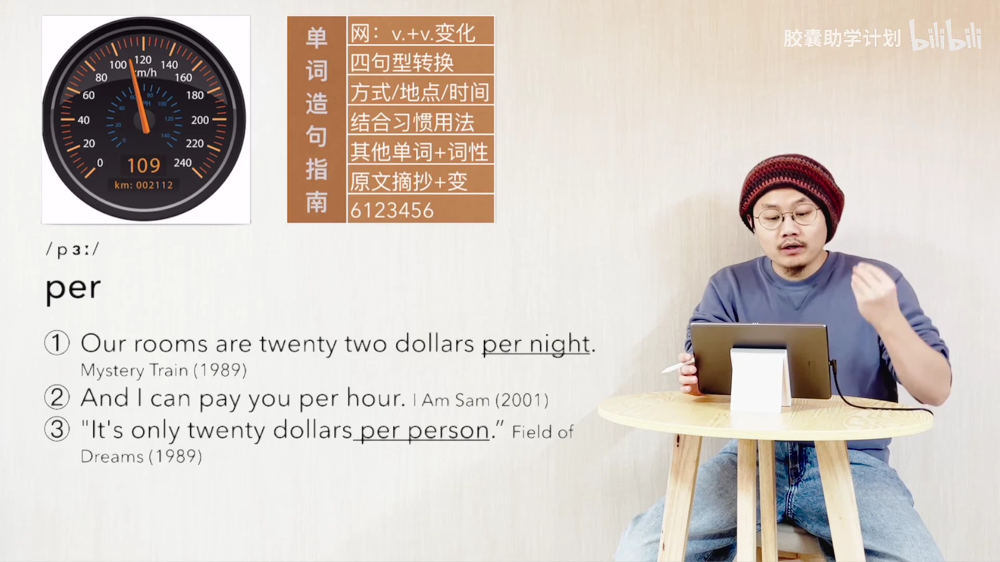

文字识别：单词造句指南 / 网：v.+v.变化 / 胶囊助学计划 / bilbili / 100 / 120 / 140 / 四句型转换 / m/h / 80 / 160 / 方式/地点/时间 / 60 / 180 / H / 100 / 40 / 200 / 结合习惯用法 / 20 / 220 / 其他单词+词性 / 0 / 109 / 240 / 原文摘抄+变 / km:002112 / 6123456 / /p3:/ / per / ① Our rooms are twenty two dollars per night. / Mystery Train (1989) / And I can pay you per hour. IAm Sam (2001) / "It's only twenty dollars per person." Field of / 3 / Dreams(1989)

### 画面 00:03:05

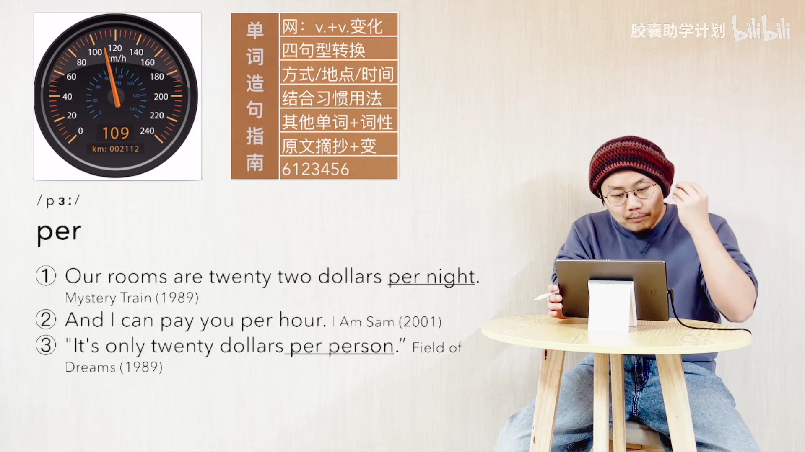

文字识别：单词造句指南 / 网：v.+v.变化 / 胶囊助学计划 / bilbili / 100 / 120 / 140 / 三 / 四句型转换 / m/h / 80 / 160 / 方式/地点/时间 / 60 / 180 / H / 100 / 40 / 200 / 结合习惯用法 / 20 / 220 / 其他单词+词性 / 0 / 109 / 240 / 原文摘抄+变 / km:002112 / 6123456 / /p3:1 / per / ① Our rooms are twenty two dollars per night. / Mystery Train (1989) / And I can pay you per hour. I Am Sam (2001) / 3 / "It's only twenty dollars per person." Field of / Dreams(1989)

### 画面 00:03:09

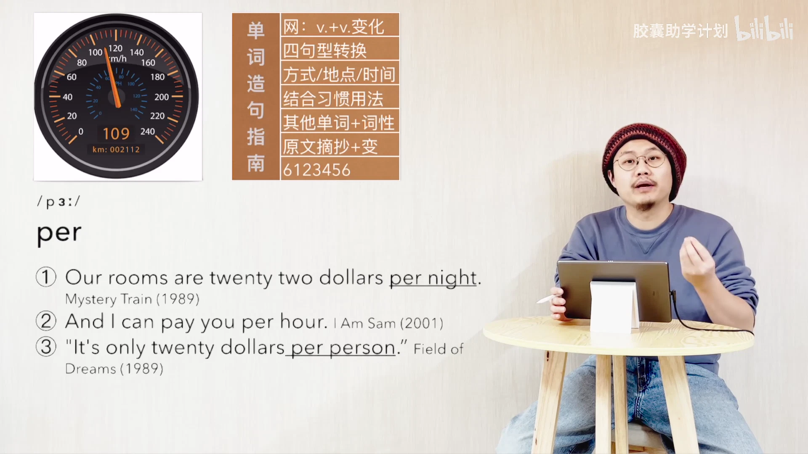

文字识别：单词造句指南 / 网：v.+v.变化 / 胶囊助学计划 / bilbili / 100 / 120 / 140 / 四句型转换 / m/h / 80 / 160 / 方式/地点/时间 / 60 / 180 / PH / 100 / 40 / 200 / 结合习惯用法 / 20 / 220 / 其他单词+词性 / 109 / 240 / 原文摘抄+变 / km:002112 / 6123456 / /p3:1 / per / ① Our rooms are twenty two dollars per night. / Mystery Train (1989) / And I can pay you per hour. I Am Sam (2001) / 3 / "It's only twenty dollars per person." Field of / Dreams(1989)

### 画面 00:03:11

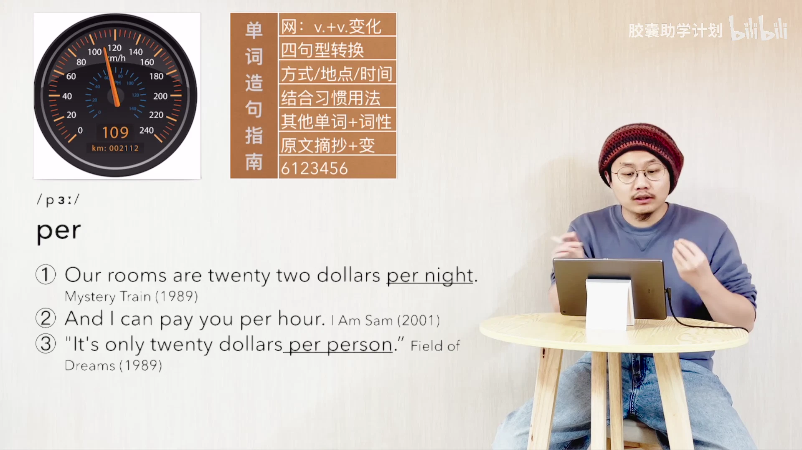

文字识别：单词造句指南 / 网：v.+v.变化 / 胶囊助学计划 / bibili / 100 / 120 / 140 / 三 / 四句型转换 / m/h / 80 / 160 / 方式/地点/时间 / 60 / 180 / H / 100 / 40 / 200 / 结合习惯用法 / 20 / 220 / 其他单词+词性 / 0 / 109 / 240 / 原文摘抄+变 / km:002112 / 6123456 / /p3:1 / per / ① Our rooms are twenty two dollars per night. / Mystery Train (1989) / And I can pay you per hour. I Am Sam (2001) / 3 / "It's only twenty dollars per person."' Field of / Dreams(1989)

### 画面 00:03:13

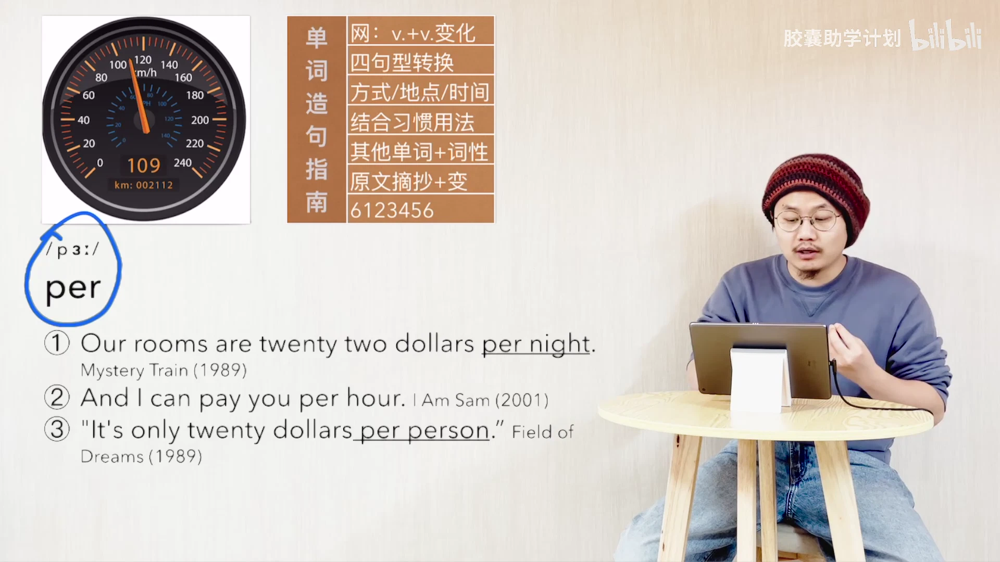

文字识别：单词造句指南 / 网：v.+v.变化 / 胶囊助学计划 / bibili / 100 / 120 / 140 / 三 / 四句型转换 / m/h / 80 / 160 / 方式/地点/时间 / 60 / 180 / 2H / 40 / 200 / 结合习惯用法 / 20 / 220 / 其他单词+词性 / 0 / 109 / 240 / 原文摘抄+变 / km:002112 / 6123456 / /p3:/ / per / ① Our rooms are twenty two dollars per night. / Mystery Train (1989) / And I can pay you per hour. I Am Sam (2001) / "It's only twenty dollars per person."' Field of / 3 / Dreams(1989)

### 画面 00:03:15

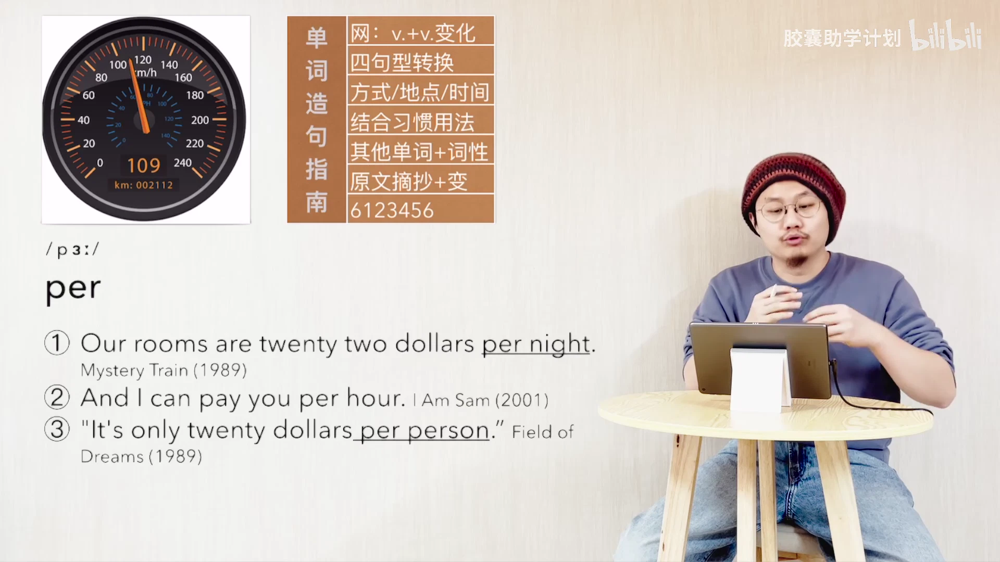

文字识别：单词造句指南 / 网：v.+v.变化 / 胶囊助学计划 / biibii / 100 / 120 / 140 / 四句型转换 / m/h / 80 / 160 / 方式/地点/时间 / 60 / 180 / H / 100 / 40 / 200 / 结合习惯用法 / 20 / 220 / 其他单词+词性 / 0 / 109 / 240 / 原文摘抄+变 / km:002112 / 6123456 / /p3:1 / per / ① Our rooms are twenty two dollars per night. / Mystery Train (1989) / And I can pay you per hour. IAm Sam (2001) / "Ilt's only twenty dollars per person." Field of / 3 / Dreams(1989)

### 画面 00:03:18

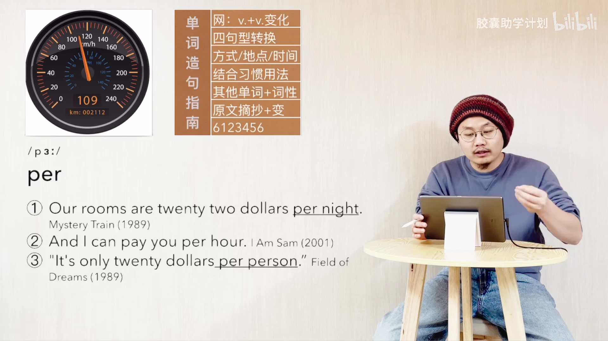

文字识别：单词造句指南 / 网：v.+v.变化 / 胶囊助学计划 / bibil / 100 / 120 / 140 / 四句型转换 / m/h / 80 / 160 / 方式/地点/时间 / 60 / 80 / 180 / PH / 100 / 40 / 200 / 结合习惯用法 / 20 / 220 / 其他单词+词性 / 0 / 109 / 240 / 原文摘抄+变 / km:002112 / 6123456 / /p3:1 / per / ① Our rooms are twenty two dollars per night. / Mystery Train (1989) / And I can pay you per hour. IAm Sam (2001) / 3 / "Ilt's only twenty dollars per person." Field of / Dreams(1989)

### 画面 00:03:20

文字识别：单词造句指南 / 网：v.+v.变化 / 胶囊助学计划 / bilbili / 100 / 120 / 140 / 三 / 四句型转换 / m/h / 80 / 160 / 方式/地点/时间 / 60 / 180 / PH / 100 / 40 / 200 / 结合习惯用法 / 20 / 220 / 其他单词+词性 / 0 / 109 / 240 / 原文摘抄+变 / km:002112 / 6123456 / /p3:/ / per / ① Our rooms are twenty two dollars per night. / Mystery Train (1989) / And I can pay you per hour.I Am Sam (2001) / "It's only twenty dollars per person." Field of / 3 / Dreams(1989)

### 画面 00:03:22

文字识别：biibii / 胶囊助学计划 / I'll give you thirty dollars cash per night. / Okay. Okay / Nightcrawler / (2014)

### 画面 00:03:27

文字识别：biibili / 胶囊助学计划 / I'll give you thirty dollars cash per night. / Okay. Okay / Nightcrawler / (2014)

### 画面 00:03:29

文字识别：biibili / 胶囊助学计划 / I'll give you thirty dollars cash per night. / Okay. Okay / Nightcrawler / (2014)

## 00:03:30–00:04:00

okay, okay. Next one,下一个单词犹他啊，Utah是吧？就是美国的一个州的名字啊。你说中国有一个省叫河南省，对吧？哎，美国有一个州叫做犹他省啊，犹他州，对吧？Utah啊，这个您知道就知道，不知道也无所谓啊。就像很多美国人学汉语，他也可能并不是把中国的所有省份的名称都非常清楚，对吧？我相信可能可能很多中国人也不一定非得特别特特别清楚，是吧？也可能

### 画面 00:03:32

文字识别：单词造句指南 / 网：v.+v.变化 / 胶囊助学计划 / bilbili / 四句型转换 / 方式/地点/时间 / 结合习惯用法 / 其他单词+词性 / 原文摘抄+变 / 6123456 / /'ju:ta:/ / Utah n.

### 画面 00:03:34

文字识别：单词造句指南 / 网：v.+v.变化 / 胶囊助学计划 / bilbili / 四句型转换 / 方式/地点/时间 / 结合习惯用法 / 其他单词+词性 / 原文摘抄+变 / 6123456 / /'ju:ta:/ / Utah n.

### 画面 00:03:36

文字识别：单词造句指南 / 网：v.+v.变化 / 胶囊助学计划 / bilbili / 四句型转换 / 方式/地点/时间 / 结合习惯用法 / 其他单词+词性 / 原文摘抄+变 / 6123456 / /'ju:ta:/ / Utah n.

### 画面 00:03:38

文字识别：单词造句指南 / 网：v.+v.变化 / 胶囊助学计划 / bibii / 四句型转换 / 方式/地点/时间 / 结合习惯用法 / 其他单词+词性 / 原文摘抄+变 / 6123456 / /'ju:ta:/ / Utah n.

### 画面 00:03:44

文字识别：单词造句指南 / 网：v.+v.变化 / 胶囊助学计划 / bilibili / 四句型转换 / 方式/地点/时间 / 结合习惯用法 / 其他单词+词性 / 原文摘抄+变 / 6123456 / /'ju:ta:/ / Utah n.

### 画面 00:03:46

文字识别：单词造句指南 / 网：v.+v.变化 / 胶囊助学计划 / bilibii / 四句型转换 / 方式/地点/时间 / 结合习惯用法 / 其他单词+词性 / 原文摘抄+变 / 6123456 / /'ju:ta:/ / Utah n.

### 画面 00:03:50

文字识别：单词造句指南 / 网：v.+v.变化 / 胶囊助学计划 / bilbili / 四句型转换 / 方式/地点/时间 / 结合习惯用法 / 其他单词+词性 / 原文摘抄+变 / 6123456 / /'ju:ta:/ / Utah n.

### 画面 00:03:54

文字识别：单词造句指南 / 网：v.+v.变化 / 胶囊助学计划 / bilbili / 四句型转换 / 方式/地点/时间 / 结合习惯用法 / 其他单词+词性 / 原文摘抄+变 / 6123456 / /'ju:ta:/ / Utah n.

### 画面 00:03:56

文字识别：单词造句指南 / 网：v.+v.变化 / 胶囊助学计划 / bilbili / 四句型转换 / 方式/地点/时间 / 结合习惯用法 / 其他单词+词性 / 原文摘抄+变 / 6123456 / /'ju:ta:/ / Utah n.

### 画面 00:03:59

文字识别：单词造句指南 / 网：v.+v.变化 / 胶囊助学计划 / bilbili / 四句型转换 / 方式/地点/时间 / 结合习惯用法 / 其他单词+词性 / 原文摘抄+变 / 6123456 / /'ju:ta:/ / Utah n.

## 00:04:00–00:04:30

分不清某些地方。好，呃，那就再读一遍这个单词就行了，咱们不用专门记啊，叫做 Utah 啊。不过如果你看篮球的话，因为我看 NBA 还是将近可能十五六年前的事儿了，当时我记得还有一个犹他队叫犹他爵士队是吧？我没有记错的话，因为这个时间太长了，后来很久就不怎么看 NBA 了。如果您看的话，这些州的名字可能对于您来说，我一提你就能清楚啊，犹他州对吧？啊， Utah， OK，不都说了，

### 画面 00:04:01

文字识别：单词造句指南 / 网：v.+v.变化 / 胶囊助学计划 / bilbili / 四句型转换 / 方式/地点/时间 / 结合习惯用法 / 其他单词+词性 / 原文摘抄+变 / 6123456 / /'ju:ta:/ / Utah n.

### 画面 00:04:04

文字识别：单词造句指南 / 网：v.+v.变化 / 胶囊助学计划 / bilbili / 四句型转换 / 方式/地点/时间 / 结合习惯用法 / 其他单词+词性 / 原文摘抄+变 / 6123456 / /'ju:ta:/ / Utah n.

### 画面 00:04:06

文字识别：单词造句指南 / 网：v.+v.变化 / 胶囊助学计划 / bilbili / 四句型转换 / 方式/地点/时间 / 结合习惯用法 / 其他单词+词性 / 原文摘抄+变 / 6123456 / /'ju:ta:/ / Utah n.

### 画面 00:04:09

文字识别：单词造句指南 / 网：v.+v.变化 / 胶囊助学计划 / bilbili / 四句型转换 / 方式/地点/时间 / 结合习惯用法 / 其他单词+词性 / 原文摘抄+变 / 6123456 / /'ju:ta:/ / Utah n.

### 画面 00:04:17

文字识别：单词造句指南 / 网：v.+v.变化 / 胶囊助学计划 / bilbili / 四句型转换 / 方式/地点/时间 / 结合习惯用法 / 其他单词+词性 / 原文摘抄+变 / 6123456 / /'ju:ta:/ / Utah n.

### 画面 00:04:20

文字识别：单词造句指南 / 网：v.+v.变化 / 胶囊助学计划 / bilbili / 四句型转换 / 方式/地点/时间 / 结合习惯用法 / 其他单词+词性 / 原文摘抄+变 / 6123456 / /'ju:ta:/ / Utah n.

### 画面 00:04:22

文字识别：单词造句指南 / 网：v.+v.变化 / 胶囊助学计划 / bilbili / 四句型转换 / 方式/地点/时间 / 结合习惯用法 / 其他单词+词性 / 原文摘抄+变 / 6123456 / /'ju:ta:/ / Utah n.

### 画面 00:04:24

文字识别：单词造句指南 / 网：v.+v.变化 / 胶囊助学计划 / bilbili / 四句型转换 / 方式/地点/时间 / 结合习惯用法 / 其他单词+词性 / 原文摘抄+变 / 6123456 / /'ju:ta:/ / Utah n.

### 画面 00:04:26

文字识别：单词造句指南 / 网：v.+v.变化 / 胶囊助学计划 / bilbii / 四句型转换 / 方式/地点/时间 / 结合习惯用法 / 其他单词+词性 / 原文摘抄+变 / 6123456 / /'ju:ta:/ / Utah n.

### 画面 00:04:29

文字识别：单词造句指南 / 网：v.+v.变化 / 胶囊助学计划 / bilbili / 四句型转换 / 方式/地点/时间 / 结合习惯用法 / 其他单词+词性 / 原文摘抄+变 / 6123456 / /ho:spaua/ / horsepower n.

## 00:04:30–00:05:00

咱们看下一个单词叫做 horsepower。这个单词首先很有意思，它其实是两个单词组成的，一个叫 horse，一个叫 power。 horse 马，power 力量，对吧？哎，horsepower 翻译成汉语就是两个字叫做马力啊，马力。好，你比如说，你看啊，说 I didn't know anything about horsepower。我相信很多人可能就是这样，就是你以为马力指的是一匹马的力量，其实它不是，是吧？它只是最开

### 画面 00:04:31

文字识别：单词造句指南 / 网：v.+v.变化 / 胶囊助学计划 / bibili / 四句型转换 / 方式/地点/时间 / 结合习惯用法 / 其他单词+词性 / 原文摘抄+变 / 6123456 / /ho:spaua/ / horsepower n.

### 画面 00:04:35

文字识别：单词造句指南 / 网：v.+v.变化 / 胶囊助学计划 / bibili / 四句型转换 / 方式/地点/时间 / 结合习惯用法 / 其他单词+词性 / 原文摘抄+变 / 6123456 / /hoispaua/ / horsepower n.

### 画面 00:04:40

文字识别：单词造句指南 / 网：v.+v.变化 / 胶囊助学计划 / bibili / 四句型转换 / 方式/地点/时间 / 结合习惯用法 / 其他单词+词性 / 原文摘抄+变 / 6123456 / /hoispaua/ / horsepower n.

### 画面 00:04:45

文字识别：单词造句指南 / 网：v.+v.变化 / 胶囊助学计划 / bilbili / 四句型转换 / 方式/地点/时间 / 结合习惯用法 / 其他单词+词性 / 原文摘抄+变 / 6123456 / /ho:spaua/ / horsepower n.

### 画面 00:04:47

文字识别：单词造句指南 / 网：v.+v.变化 / 胶囊助学计划 / bilbili / 四句型转换 / 方式/地点/时间 / 结合习惯用法 / 其他单词+词性 / 原文摘抄+变 / 6123456 / /ho:spaua/ / horsepower n.

### 画面 00:04:50

文字识别：单词造句指南 / 网：v.+v.变化 / 胶囊助学计划 / bibli / 四句型转换 / 方式/地点/时间 / 结合习惯用法 / 其他单词+词性 / 原文摘抄+变 / 6123456 / /ho:spaua/ / horsepower n. / ① I didn't know anything about horsepower.

### 画面 00:04:53

文字识别：单词造句指南 / 网：v.+v.变化 / 胶囊助学计划 / bilbii / 四句型转换 / 方式/地点/时间 / 结合习惯用法 / 其他单词+词性 / 原文摘抄+变 / 6123456 / /hoispaua/ / horsepower n. / ① I didn't know anything about horsepower.

### 画面 00:04:55

文字识别：单词造句指南 / 网：v.+v.变化 / 胶囊助学计划 / blbi / 四句型转换 / 方式/地点/时间 / 结合习惯用法 / 其他单词+词性 / 原文摘抄+变 / 6123456 / /hoispaua/ / horsepower n. / ① I didn't know anything about horsepower.

### 画面 00:04:59

文字识别：单词造句指南 / 网：v.+v.变化 / 胶囊助学计划 / blibii / 四句型转换 / 方式/地点/时间 / 结合习惯用法 / 其他单词+词性 / 原文摘抄+变 / 6123456 / /ho:spaua/ / horsepower n. / ① I didn't know anything about horsepower.

## 00:05:00–00:05:30

始是这么叫的啊，八匹马的力量。后来我没有记错的话，是吧？然后我上网查了一下，我就造出来这样一个句子，叫做 After searching the internet, I learned a little bit about horsepower. 我去搜了这个网络之后呢，哎，我了解到了哎一些关于马力到底是什么，horsepower到底是什么的一个呃这个这个关于它的知识啊。如果您想

### 画面 00:05:02

文字识别：单词造句指南 / 网：v.+v.变化 / 胶囊助学计划 / bilbii / 四句型转换 / 方式/地点/时间 / 结合习惯用法 / 其他单词+词性 / 原文摘抄+变 / 6123456 / /hoispaua/ / horsepower n. / ① I didn't know anything about horsepower.

### 画面 00:05:05

文字识别：单词造句指南 / 网：v.+v.变化 / 胶囊助学计划 / 四句型转换 / 方式/地点/时间 / 结合习惯用法 / 其他单词+词性 / 原文摘抄+变 / 6123456 / /ho:spaua/ / horsepower n. / ① I didn't know anything about horsepower. / After searching the internet, I learnt a little / bit about horsepower. L49

### 画面 00:05:10

文字识别：单词造句指南 / 网：v.+v.变化 / 胶囊助学计划 / Bilbili / 四句型转换 / 方式/地点/时间 / 结合习惯用法 / 其他单词+词性 / 原文摘抄+变 / 6123456 / /ho:spaua/ / horsepower n. / ① I didn't know anything about horsepower. / After searching the internet, I learnt a little / bit about horsepower. L49

### 画面 00:05:16

文字识别：单词造句指南 / 网：v.+v.变化 / 胶囊助学计划 / bilbili / 四句型转换 / 方式/地点/时间 / 结合习惯用法 / 其他单词+词性 / 原文摘抄+变 / 6123456 / /hoispaua/ / horsepower n. / ① I didn't know anything about horsepower. / After searching the internet, I learnt a little / bit about horsepower. L49

### 画面 00:05:20

文字识别：单词造句指南 / 网：v.+v.变化 / 胶囊助学计划 / biibii / 四句型转换 / 方式/地点/时间 / 结合习惯用法 / 其他单词+词性 / 原文摘抄+变 / 6123456 / /hoispaua/ / horsepower n. / ① I didn't know anything about horsepower. / After searching the internet, I learnt a little / bit about horsepower. L49

### 画面 00:05:25

文字识别：胶囊助学计划blii / 单词造句指南 / 网：v.+v.变化 / 四句型转换 / 方式/地点/时间 / 结合习惯用法 / 其他单词+词性 / 原文摘抄+变 / 6123456 / /hoispaua/ / horsepower n. / ① I didn't know anything about horsepower. / After searching the internet, I learnt a little / bit about horsepower. L49

## 00:05:30–00:06:00

了解，您也可以自己去查一下。这其实是一个类似于名词名词解释的题，对吧？呃，瓦特发明的这个单词应该是OK. Continue next one. 说It had这是我们原文。说It had a two thousand five hundred horsepower engine. 说这辆车啊有一个两千五百马力的引擎。OK. Next one, 你做一下四句型的转换。OK. 下一个单词

### 画面 00:05:30

文字识别：单词造句指南 / 网：v.+v.变化 / 胶囊助学计划 / bilbii / 四句型转换 / 方式/地点/时间 / 结合习惯用法 / 其他单词+词性 / 原文摘抄+变 / 6123456 / /ho:spaua/ / horsepower n. / ① I didn't know anything about horsepower. / After searching the internet, I learnt a little / bit about horsepower. L49

### 画面 00:05:32

文字识别：胶囊助学计划bli / 单词造句指南 / 网：v.+v.变化 / 四句型转换 / 方式/地点/时间 / 结合习惯用法 / 其他单词+词性 / 原文摘抄+变 / 6123456 / /ho:spaua / / horsepower n. / ① I didn't know anything about horsepower. / After searching the internet, I learnt a little / bit about horsepower. L49

### 画面 00:05:34

文字识别：单词造句指南 / 网：v.+v.变化 / 胶囊助学计划 / bibii / 四句型转换 / 方式/地点/时间 / 结合习惯用法 / 其他单词+词性 / 原文摘抄+变 / 6123456 / /hoispaua/ / horsepower n. / ① I didn't know anything about horsepower. / After searching the internet, I learnt a little / bit about horsepower. L49

### 画面 00:05:37

文字识别：单词造句指南 / 网：v.+v.变化 / 胶囊助学计划 / Bilbili / 四句型转换 / 方式/地点/时间 / 结合习惯用法 / 其他单词+词性 / 原文摘抄+变 / 6123456 / /hoispaua/ / horsepower n. / ① I didn't know anything about horsepower. / After searching the internet, I learnt a little / bit about horsepower. L49

### 画面 00:05:39

文字识别：胶囊助学计划bili / 单词造句指南 / 网：v.+v.变化 / 四句型转换 / 方式/地点/时间 / 结合习惯用法 / 其他单词+词性 / 原文摘抄+变 / 6123456 / /hoispaua/ / horsepower n. / ① I didn't know anything about horsepower. / After searching the internet, I learnt a little / bit about horsepower. L49 / [Story]: It had a 2,500-horsepower engine.

### 画面 00:05:41

文字识别：胶囊助学计划bili / 单词造句指南 / 网：v.+v.变化 / 四句型转换 / 方式/地点/时间 / 结合习惯用法 / 其他单词+词性 / 原文摘抄+变 / 6123456 / /hoispaua/ / horsepower n. / ① I didn't know anything about horsepower. / ) After searching the internet, Ilearnt a little / 2 / bit about horsepower. L49 / [Story]: It had a 2,500-horsepower engine.

### 画面 00:05:48

文字识别：单词造句指南 / 网：v.+v.变化 / 胶囊助学计划 / bilbl / 四句型转换 / 方式/地点/时间 / 结合习惯用法 / 其他单词+词性 / 原文摘抄+变 / 6123456 / / ho：spaua / / horsepower n. / ① I didn't know anything about horsepower. / ) After searching the internet, I learnt a little / 2 / bit about horsepower. L49 / [Story]: It had a 2,500-horsepower engine.

### 画面 00:05:50

文字识别：胶囊助学计划bilil / 单词造句指南 / 网：v.+v.变化 / 四句型转换 / 方式/地点/时间 / 结合习惯用法 / 其他单词+词性 / 原文摘抄+变 / 6123456 / /ho:spaua/ / horsepower n. / ① I didn't know anything about horsepower. / ) After searching the internet, I learnt a little / 2 / bit about horsepower. L49 / [Story]: It had a 2,500-horsepower engine.

### 画面 00:05:52

文字识别：胶囊助学计划bili / 单词造句指南 / 网：v.+v.变化 / 四句型转换 / 方式/地点/时间 / 结合习惯用法 / 其他单词+词性 / 原文摘抄+变 / 6123456 / /ho:spaua/ / horsepower n. / ① I didn't know anything about horsepower. / ) After searching the internet, Ilearnt a little / 2 / bit about horsepower. L49 / [Story]: It had a 2, 500-horsepower engine.

### 画面 00:05:55

文字识别：单词造句指南 / 网：v.+v.变化 / 胶囊助学计划biil / 四句型转换 / 方式/地点/时间 / 结合习惯用法 / 其他单词+词性 / 原文摘抄+变 / 6123456 / / ho:spaua/ / horsepower n. / ① I didn't know anything about horsepower. / ) After searching the internet, I learnt a little / 2 / bit about horsepower. L49 / [Story]: It had a 2,500-horsepower engine. /  did/what...

### 画面 00:05:58

文字识别：单词造句指南 / 网：v.+v.变化 / 胶囊助学计划 / bibii / 四句型转换 / 方式/地点/时间 / 结合习惯用法 / 其他单词+词性 / 原文摘抄+变 / 6123456 / /b3:st/ / burst v.

## 00:06:00–00:06:30

burst。那 burst 这个单词就是突然间爆裂或突然间炸裂，对吧？就砰一下啊！比如说你那个气球一摁，砰，爆了，就 burst，对吧？那我们胎爆了，往往也是 burst。 Okay，好，比如说原文给了这样一句话叫 a tire burst during the first run。在第一次试跑当中，这个轮胎爆炸了。 Okay，那我们可以做一个迅速的四句型转换，这个是做我们最保造句的时候最保险的一个方式。

### 画面 00:06:00

文字识别：单词造句指南 / 网：v.+v.变化 / 胶囊助学计划 / bibili / 四句型转换 / 方式/地点/时间 / 结合习惯用法 / 其他单词+词性 / 原文摘抄+变 / 6123456 / /b3:st/ / burst v.

### 画面 00:06:03

文字识别：单词造句指南 / 网：v.+v.变化 / 胶囊助学计划 / bilbili / 四句型转换 / 方式/地点/时间 / 结合习惯用法 / 其他单词+词性 / 原文摘抄+变 / 6123456 / /b3:st/ / burst v.

### 画面 00:06:05

文字识别：单词造句指南 / 网：v.+v.变化 / 胶囊助学计划 / bilbili / 四句型转换 / 方式/地点/时间 / 结合习惯用法 / 其他单词+词性 / 原文摘抄+变 / 6123456 / /b3:st/ / burst v.

### 画面 00:06:08

文字识别：单词造句指南 / 网：v.+v.变化 / 胶囊助学计划 / bilbili / 四句型转换 / 方式/地点/时间 / 结合习惯用法 / 其他单词+词性 / 原文摘抄+变 / 6123456 / /b3:st/ / burst v.

### 画面 00:06:10

文字识别：单词造句指南 / 网：v.+v.变化 / 胶囊助学计划 / bilbili / 四句型转换 / 方式/地点/时间 / 结合习惯用法 / 其他单词+词性 / 原文摘抄+变 / 6123456 / /b3:st/ / burst v.

### 画面 00:06:13

文字识别：单词造句指南 / 网：v.+v.变化 / 胶囊助学计划 / bilbii / 四句型转换 / 方式/地点/时间 / 结合习惯用法 / 其他单词+词性 / 原文摘抄+变 / 6123456 / /b3:st/ / burst v. / ① [Story]: A tyre burst during the first run.

### 画面 00:06:15

文字识别：单词造句指南 / 网：v.+v.变化 / 胶囊助学计划 / bilbii / 四句型转换 / 方式/地点/时间 / 结合习惯用法 / 其他单词+词性 / 原文摘抄+变 / 6123456 / /b3:st/ / burst v. / ① [Story]: A tyre burst during the first run.

### 画面 00:06:20

文字识别：单词造句指南 / 网：v.+v.变化 / 胶囊助学计划 / biibili / 四句型转换 / 方式/地点/时间 / 结合习惯用法 / 其他单词+词性 / 原文摘抄+变 / 6123456 / /b3:st/ / burst v. / ① [Story]: A tyre burst during the first run.

### 画面 00:06:25

文字识别：单词造句指南 / 网：v.+v.变化 / 胶囊助学计划 / bibli / 四句型转换 / 方式/地点/时间 / 结合习惯用法 / 其他单词+词性 / 原文摘抄+变 / 6123456 / /b3:st/ / burst v. / ① [Story]: A tyre burst during the first run. / did/how/what/when...

### 画面 00:06:27

文字识别：单词造句指南 / 网：v.+v.变化 / 胶囊助学计划 / bibili / 四句型转换 / 方式/地点/时间 / 结合习惯用法 / 其他单词+词性 / 原文摘抄+变 / 6123456 / /b3:st/ / burst v. / ① [Story]: A tyre burst during the first run. / did/how/what/when...

## 00:06:30–00:07:00

永远要记住啊！我拿不准的时候，我就一定要原文摘抄再加四句型转换，对吧？这个是最保险的。OK，我们造一句话叫做：If you had checked the tire before leaving home, it wouldn't have burst。说如果你检查了这个轮胎在离开家之前，说它就不会突然间哎爆破了，呃爆这个这个这个这个炸了，对吧？这个或者

### 画面 00:06:30

文字识别：单词造句指南 / 网：v.+v.变化 / 胶囊助学计划 / bibi / 四句型转换 / 方式/地点/时间 / 结合习惯用法 / 其他单词+词性 / 原文摘抄+变 / 6123456 / /b3:st/ / burst v. / ① [Story]: A tyre burst during the first run. / did/how/what/when...

### 画面 00:06:32

文字识别：单词造句指南 / 网：v.+v.变化 / 胶囊助学计划 / bibi / 四句型转换 / 方式/地点/时间 / 结合习惯用法 / 其他单词+词性 / 原文摘抄+变 / 6123456 / /b3:st/ / burst v. / ① [Story]: A tyre burst during the first run. / did/how/what/when...

### 画面 00:06:35

文字识别：单词造句指南 / 网：v.+v.变化 / 胶囊助学计划 / bibii / 四句型转换 / 方式/地点/时间 / 结合习惯用法 / 其他单词+词性 / 原文摘抄+变 / 6123456 / /b3:st/ / burst v. / ① [Story]: A tyre burst during the first run. / did/how/what/when...

### 画面 00:06:37

文字识别：单词造句指南 / 网：v.+v.变化 / 胶囊助学计划 / bibi / 四句型转换 / 方式/地点/时间 / 结合习惯用法 / 其他单词+词性 / 原文摘抄+变 / 6123456 / /b3:st/ / burst v. / ① [Story]: A tyre burst during the first run. / did/how/what/when...

### 画面 00:06:39

文字识别：胶囊助学计划bil出 / 单词造句指南 / 网：v.+v.变化 / 四句型转换 / 方式/地点/时间 / 结合习惯用法 / 其他单词+词性 / 原文摘抄+变 / 6123456 / /b3:st/ / burst v. / ① [Story]: A tyre burst during the first run. / did/how/what/when... / If you had checked the tyre before leaving / home, it wouldn't have burst. L64 L49

### 画面 00:06:41

文字识别：单词造句指南 / 网：v.+v.变化 / 胶囊助学计划 / 四句型转换 / 方式/地点/时间 / 结合习惯用法 / 其他单词+词性 / 原文摘抄+变 / 6123456 / /b3:st/ / burst v. / ① [Story]: A tyre burst during the first run. / did/how/what/when... / If you had checked the tyre before leaving / home, it wouldn't have burst. L64 L49

### 画面 00:06:44

文字识别：单词造句指南 / 网：v.+v.变化 / 胶囊助学计划 / 四句型转换 / 方式/地点/时间 / 结合习惯用法 / 其他单词+词性 / 原文摘抄+变 / 6123456 / /b3:st/ / burst v. / ① [Story]: A tyre burst during the first run. / did/how/what/when... / If you had checked the tyre before leaving / home, it wouldn't have burst. L64 L49

### 画面 00:06:46

文字识别：单词造句指南 / 网：v.+v.变化 / 胶囊助学计划 / blbi / 四句型转换 / 方式/地点/时间 / 结合习惯用法 / 其他单词+词性 / 原文摘抄+变 / 6123456 / /b3:st/ / burst v. / ① [Story]: A tyre burst during the first run. / did/how/what/when... / If you had checked the tyre before leaving / home, it wouldn't have burst. L64 L49

### 画面 00:06:52

文字识别：胶囊助学计划bii出 / 单词造句指南 / 网：v.+v.变化 / 四句型转换 / 方式/地点/时间 / 结合习惯用法 / 其他单词+词性 / 原文摘抄+变 / 6123456 / /b3:st/ / burst v. / ① [Story]: A tyre burst during the first run. / did/how/what/when... / If you had checked the tyre before leaving / home, it wouldn't have burst. L64 L49

### 画面 00:06:55

文字识别：胶囊助学计划blbi出 / 单词造句指南 / 网：v.+v.变化 / 四句型转换 / 方式/地点/时间 / 结合习惯用法 / 其他单词+词性 / 原文摘抄+变 / 6123456 / /b3:st/ / burst v. / ① [Story]: A tyre burst during the first run. / did/how/what/when... / If you had checked the tyre before leaving / home, it wouldn't have burst. L64 L49

### 画面 00:06:58

文字识别：单词造句指南 / 网：v.+v.变化 / 胶囊助学计划 / bilbli / 四句型转换 / 方式/地点/时间 / 结合习惯用法 / 其他单词+词性 / 原文摘抄+变 / 6123456 / /b3:st/ / burst v. / ① [Story]: A tyre burst during the first run. / did/how/what/when... / If you had checked the tyre before leaving / home, it wouldn't have burst. L64 L49

## 00:07:00–00:07:30

说这个胎突然间爆了，OK。好，那注意，你看这里我们把几个小的语法点给它揉到一起了啊。第一个是 if had done 后边是 would have done，这是咱们六十四课学过的，对过去事实的虚拟。如果你当时查了，它当昨天它就不会炸了，对吧？好，第二个是咱们四十九课学过的叫 before leaving home，对吧？它的那 leaving 的主语是谁？不就是 you 吗？对不对？OK，我们把它变得更

### 画面 00:07:01

文字识别：单词造句指南 / 网：v.+v.变化 / 胶囊助学计划 / bibii / 四句型转换 / 方式/地点/时间 / 结合习惯用法 / 其他单词+词性 / 原文摘抄+变 / 6123456 / /b3:st/ / burst V. / ① [Story]: A tyre burst during the first run. / did/how/what/when... / If you had checked the tyre before leaving / home, it wouldn't have burst. L64 L49

### 画面 00:07:03

文字识别：单词造句指南 / 网：v.+v.变化 / 胶囊助学计划 / bilibii / 四句型转换 / 方式/地点/时间 / 结合习惯用法 / 其他单词+词性 / 原文摘抄+变 / 6123456 / /b3:st/ / burst v. / ① [Story]: A tyre burst during the first run. / did/how/what/when... / If you had checked the tyre before leaving / home, it wouldn't have burst. L64 L49

### 画面 00:07:05

文字识别：胶囊助学计划bii / 单词造句指南 / 网：v.+v.变化 / 四句型转换 / 方式/地点/时间 / 结合习惯用法 / 其他单词+词性 / 原文摘抄+变 / 6123456 / /b3:st/ / burst v. / ① [Story]: A tyre burst during the first run. / did/how/what/when... / If you had checked the tyre before leaving / home, it wouldn't have burst. L64 L49

### 画面 00:07:08

文字识别：胶囊助学计划bi出 / 单词造句指南 / 网：v.+v.变化 / 四句型转换 / 方式/地点/时间 / 结合习惯用法 / 其他单词+词性 / 原文摘抄+变 / 6123456 / /b3:st/ / burst v. / ① [Story]: A tyre burst during the first run. / did/how/what/when... / If you had checked the tyre before leaving / home, it wouldn't have burst. L64 L49

### 画面 00:07:10

文字识别：单词造句指南 / 网：v.+v.变化 / 胶囊助学计划 / bibii / 四句型转换 / 方式/地点/时间 / 结合习惯用法 / 其他单词+词性 / 原文摘抄+变 / 6123456 / /b3:st/ / burst v. / ① [Story]: A tyre burst during the first run. / did/how/what/when... / If you had checked the tyre before leaving / home, it wouldn't have burst. L64 L49

### 画面 00:07:12

文字识别：单词造句指南 / 网：v.+v.变化 / 胶囊助学计划 / bilbii / 四句型转换 / 方式/地点/时间 / 结合习惯用法 / 其他单词+词性 / 原文摘抄+变 / 6123456 / /b3:st/ / burst v. / ① [Story]: A tyre burst during the first run. / did/how/what/when... / If you had checked the tyre before leaving / home, it wouldn't have burst. L64 L49

### 画面 00:07:14

文字识别：单词造句指南 / 网：v.+v.变化 / 胶囊助学计划 / bilibii / 四句型转换 / 方式/地点/时间 / 结合习惯用法 / 其他单词+词性 / 原文摘抄+变 / 6123456 / /b3:st/ / burst v. / ① [Story]: A tyre burst during the first run. / did/how/what/when... / If you had checked the tyre before leaving / home, it wouldn't have burst. L64 L49

### 画面 00:07:16

文字识别：单词造句指南 / 网：v.+v.变化 / 胶囊助学计划 / biibili / 四句型转换 / 方式/地点/时间 / 结合习惯用法 / 其他单词+词性 / 原文摘抄+变 / 6123456 / /b3:st/ / burst v. / ① [Story]: A tyre burst during the first run. / did/how/what/when... / If you had checked the tyre before leaving / home, it wouldn't have burst. L64 L49

### 画面 00:07:19

文字识别：单词造句指南 / 网：v.+v.变化 / 胶囊助学计划 / bibili / 四句型转换 / 方式/地点/时间 / 结合习惯用法 / 其他单词+词性 / 原文摘抄+变 / 6123456 / /b3:st/ / burst v. / ① [Story]: A tyre burst during the first run. / did/how/what/when... / If you had checked the tyre before leaving / home, it wouldn't have burst. L64 L49

### 画面 00:07:21

文字识别：单词造句指南 / 网：v.+v.变化 / 胶囊助学计划 / bibili / 四句型转换 / 方式/地点/时间 / 结合习惯用法 / 其他单词+词性 / 原文摘抄+变 / 6123456 / /b3:st/ / burst v. / ① [Story]: A tyre burst during the first run. / did/how/what/when... / If you had checked the tyre before leaving / home, it wouldn't have burst. L64 L49

### 画面 00:07:24

文字识别：单词造句指南 / 网：v.+v.变化 / 胶囊助学计划 / blbili / 四句型转换 / 方式/地点/时间 / 结合习惯用法 / 其他单词+词性 / 原文摘抄+变 / 6123456 / /b3:st/ / burst v. / ① [Story]: A tyre burst during the first run. / did/how/what/when... / If you had checked the tyre before leaving / home / it wouldn't have burst. L64 L49

### 画面 00:07:26

文字识别：单词造句指南 / 网：v.+v.变化 / 胶囊助学计划 / bilbii / 四句型转换 / 方式/地点/时间 / 结合习惯用法 / 其他单词+词性 / 原文摘抄+变 / 6123456 / /b3:st/ / burst v. / [Story]: A tyre burst during the first run. / 1 / did/how/what/when... / If you had checked the tyrebefore leaving / home / it wouldn't have burst. L64 L49

### 画面 00:07:28

文字识别：单词造句指南 / 网：v.+v.变化 / 胶囊助学计划 / biibili / 四句型转换 / 方式/地点/时间 / 结合习惯用法 / 其他单词+词性 / 原文摘抄+变 / 6123456 / /b3:st/ / burst v. / [Story]: A tyre burst during the first run. / 1 / did/how/what/when... / If you had checked the tyrebefore leaving / home / it wouldn't have burst. L64 L49

## 00:07:30–00:08:00

复杂了一点点。接下来呢，有一个小的短语叫做 burst into tears，啊，爆炸出了眼泪啊，就是突然间开始大哭啊啊，泪丝啊，这个这个这个泪啊，突然间就涌出来了，叫 burst into tears。那拿它去造句，这是我们补的一个小习惯用法啊，很常用。比如说，I used to burst into tears for no reason at all。说我过去常常突然间就哭出来，万

### 画面 00:07:30

文字识别：单词造句指南 / 网：v.+v.变化 / 胶囊助学计划 / bilbil / 四句型转换 / 方式/地点/时间 / 结合习惯用法 / 其他单词+词性 / 原文摘抄+变 / 6123456 / /b3:st/ / burst v. / [Story]: A tyre burst during the first run. / 1 / did/how/what/when... / If you had checked the tyre before leaving / home / it wouldn't have burst. L64 L49 / burstinto / tears...

### 画面 00:07:32

文字识别：单词造句指南 / 网：v.+v.变化 / 胶囊助学计划 / bilbii / 四句型转换 / 方式/地点/时间 / 结合习惯用法 / 其他单词+词性 / 原文摘抄+变 / 6123456 / /b3:st/ / burst v. / ① [Story]: A tyre burst during the first run. / did/how/what/when... / If you had checked the tyre before leaving / home / it wouldn't have burst. L64 L49 / burstinto tears...

### 画面 00:07:34

文字识别：胶囊助学计划bibi / 单词造句指南 / 网：v.+v.变化 / 四句型转换 / 方式/地点/时间 / 结合习惯用法 / 其他单词+词性 / 原文摘抄+变 / 6123456 / /b3:st/ / burst v. / ① [Story]: A tyre burst during the first run. / did/how/what/when... / If you had checked the tyre before leaving / 3 / home, it wouldn't have burst. L64 L49 /  burst into tears...

### 画面 00:07:36

文字识别：胶囊助学计划bilii / 单词造句指南 / 网：v.+v.变化 / 四句型转换 / 方式/地点/时间 / 结合习惯用法 / 其他单词+词性 / 原文摘抄+变 / 6123456 / /b3:st/ / burst v. / ① [Story]: A tyre burst during the first run. / did/how/what/when... / If you had checked the tyre before leaving / 3 / home, it wouldn't have burst. L64 L49 / burst into tears...

### 画面 00:07:40

文字识别：单词造句指南 / 网：v.+v.变化 / 胶囊助学计划 / bilbili / 四句型转换 / 方式/地点/时间 / 结合习惯用法 / 其他单词+词性 / 原文摘抄+变 / 6123456 / /b3:st/ / burst v. / ① [Story]: A tyre burst during the first run. / did/how/what/when... / If you had checked the tyre before leaving / 3 / home, it wouldn't have burst. L64 L49 / ) burst into tears...

### 画面 00:07:42

文字识别：胶囊助学计划bili / 单词造句指南 / 网：v.+v.变化 / 四句型转换 / 方式/地点/时间 / 结合习惯用法 / 其他单词+词性 / 原文摘抄+变 / 6123456 / /b3:st/ / burst v. / ① [Story]: A tyre burst during the first run. / did/how/what/when... / If you had checked the tyre before leaving / home, it wouldn't have burst. L64 L49 / ) burst into tears...

### 画面 00:07:44

文字识别：胶囊助学计划bilil / 单词造句指南 / 网：v.+v.变化 / 四句型转换 / 方式/地点/时间 / 结合习惯用法 / 其他单词+词性 / 原文摘抄+变 / 6123456 / /b3:st/ / burst v. / ① [Story]: A tyre burst during the first run. / did/how/what/when... / If you had checked the tyre before leaving / 3 / home, it wouldn't have burst. L64 L49 / burst into tears...

### 画面 00:07:46

文字识别：胶囊助学计划bilii / 单词造句指南 / 网：v.+v.变化 / 四句型转换 / 方式/地点/时间 / 结合习惯用法 / 其他单词+词性 / 原文摘抄+变 / 6123456 / /b3:st/ / burst v. / ① [Story]: A tyre burst during the first run. / did/how/what/when... / If you had checked the tyre before leaving / home, it wouldn't have burst. L64 L49 /  burst into tears...

### 画面 00:07:49

文字识别：单词造句指南 / 网：v.+v.变化 / 胶囊助学计划bili / 四句型转换 / 方式/地点/时间 / 结合习惯用法 / 其他单词+词性 / 原文摘抄+变 / 6123456 / /b3:st/ / burst v. / ① [Story]: A tyre burst during the first run. / 2 / did/how/what/when... / If you had checked the tyre before leaving / 3 / home, it wouldn't have burst. L64 L49 / ④ burst into tears... / ⑤ I used to burst into tears for no reason at all. / Fried Green Tomatoes (1991) L31

### 画面 00:07:51

文字识别：胶囊助学计划bilii / 单词造句指南 / 网：v.+v.变化 / 四句型转换 / 方式/地点/时间 / 结合习惯用法 / 其他单词+词性 / 原文摘抄+变 / 6123456 / /b3:st/ / burst v. / ① [Story]: A tyre burst during the first run. / ② did/how/what/when... / If you had checked the tyre before leaving / 3 / home, it wouldn't have burst. L64 L49 / ④ burst into tears... / ⑤ I used to burst into tears for no reason at all. / Fried Green Tomatoes (1991) L31

### 画面 00:07:53

文字识别：胶囊助学计划bli / 单词造句指南 / 网：v.+v.变化 / 四句型转换 / 方式/地点/时间 / 结合习惯用法 / 其他单词+词性 / 原文摘抄+变 / 6123456 / /b3:st/ / burst v. / ① [Story]: A tyre burst during the first run. / did/how/what/when... / 2） / If you had checked the tyre before leaving / 3 / home, it wouldn't have burst. L64 L49 / D burst into tears... / 4） / ⑤ I used to burst into tears for no reason at all. / Fried Green Tomatoes (1991) L31

### 画面 00:07:56

文字识别：胶囊助学计划bili / 单词造句指南 / 网：v.+v.变化 / 四句型转换 / 方式/地点/时间 / 结合习惯用法 / 其他单词+词性 / 原文摘抄+变 / 6123456 / /b3:st/ / burst v. / ① [Story]: A tyre burst during the first run. / did/how/what/when... / 2） / If you had checked the tyre before leaving / 3 / home, it wouldn't have burst. L64 L49 /  burst into tears... / 4） / ⑤ I used to burst into tears for no reason at all. / Fried Green Tomatoes (1991) L31

## 00:08:00–00:08:30

毫无理由，对吧？For no reason at all. Okay,毫无理由的就痛哭出来。那used to do，三十一课咱们学的，对吧？Okay,啊，好，呃，不多说了，再跟我读一遍这个单词，叫做burst, burst啊，爆破啊，爆裂。Okay,那我们注意力集中，咱听一下这个电影片段。I wish there was something I could say that would make you burst into tears and run away with me.

### 画面 00:08:00

文字识别：胶囊助学计划blii / 单词造句指南 / 网：v.+v.变化 / 四句型转换 / 方式/地点/时间 / 结合习惯用法 / 其他单词+词性 / 原文摘抄+变 / 6123456 / /b3:st/ / burst v. / ① [Story]: A tyre burst during the first run. / did/how/what/when... / 2） / If you had checked the tyre before leaving / 3 / home, it wouldn't have burst. L64 L49 / ④ burst into tears... / ⑤ I used to burst into tears for no reason at all. / Fried Green Tomatoes (1991) L31

### 画面 00:08:02

文字识别：胶囊助学计划bil / 单词造句指南 / 网：v.+v.变化 / 四句型转换 / 方式/地点/时间 / 结合习惯用法 / 其他单词+词性 / 原文摘抄+变 / 6123456 / /b3:st/ / burst v. / ① [Story]: A tyre burst during the first run. / did/how/what/when... / 2) / If you had checked the tyre before leaving / 3 / home, it wouldn't have burst. L64 L49 / ④ burst into tears... / ⑤ I used to burst into tears for no reason at all. / Fried Green Tomatoes (1991) L31

### 画面 00:08:05

文字识别：单词造句指南 / 网：v.+v.变化 / 胶囊助学计划bi出 / 四句型转换 / 方式/地点/时间 / 结合习惯用法 / 其他单词+词性 / 原文摘抄+变 / 6123456 / /b3:st/ / burst v. / ① [Story]: A tyre burst during the first run. / 2( / did/how/what/when... / If you had checked the tyre before leaving / 3 / home, it wouldn't have burst. L64 L49 / ④ burst into tears... / ⑤ I used to burst into tears for no reason at all. / Fried Green Tomatoes (1991) L31

### 画面 00:08:07

文字识别：胶囊助学计划bilii / 单词造句指南 / 网：v.+v.变化 / 四句型转换 / 方式/地点/时间 / 结合习惯用法 / 其他单词+词性 / 原文摘抄+变 / 6123456 / /b3:st/ / burst v. / ① [Story]: A tyre burst during the first run. / did/how/what/when... / 2） / If you had checked the tyre before leaving / 3 / home, it wouldn't have burst. L64 L49 /  burst into tears... / ⑤ I used to burst into tears for no reason at all. / Fried Green Tomatoes (1991) L31

### 画面 00:08:09

文字识别：胶囊助学计划bilii / 单词造句指南 / 网：v.+v.变化 / 四句型转换 / 方式/地点/时间 / 结合习惯用法 / 其他单词+词性 / 原文摘抄+变 / 6123456 / /b3:st/ / burst v. / ① [Story]: A tyre burst during the first run. / did/how/what/when... / 2） / If you had checked the tyre before leaving / 3 / home, it wouldn't have burst. L64 L49 / ) burst into tears... / 4 / ⑤ I used to burst into tears for no reason at all. / Fried Green Tomatoes (1991) L31

### 画面 00:08:11

文字识别：胶囊助学计划bili / 单词造句指南 / 网：v.+v.变化 / 四句型转换 / 方式/地点/时间 / 结合习惯用法 / 其他单词+词性 / 原文摘抄+变 / 6123456 / /b3:st/ / burst v. / ① [Story]: A tyre burst during the first run. / 2 / did/how/what/when... / If you had checked the tyre before leaving / 3 / home, it wouldn't have burst. L64 L49 / ④ burst into tears... / ⑤ I used to burst into tears for no reason at all. / Fried Green Tomatoes (1991) L31

### 画面 00:08:13

文字识别：单词造句指南 / 网：v.+v.变化 / 胶囊助学计划bili / 四句型转换 / 方式/地点/时间 / 结合习惯用法 / 其他单词+词性 / 原文摘抄+变 / 6123456 / /b3:st/ / burst v. / ① [Story]: A tyre burst during the first run. / did/how/what/when... / 2) / If you had checked the tyre before leaving / 3 / home, it wouldn't have burst. L64 L49 / ④ burst into tears... / ⑤ I used to burst into tears for no reason at all. / Fried Green Tomatoes (1991) L31

### 画面 00:08:15

文字识别：单词造句指南 / 网：v.+v.变化 / 胶囊助学计划bili / 四句型转换 / 方式/地点/时间 / 结合习惯用法 / 其他单词+词性 / 原文摘抄+变 / 6123456 / /b3:st/ / burst v. / ① [Story]: A tyre burst during the first run. / 2 / did/how/what/when... / If you had checked the tyre before leaving / 3 / home, it wouldn't have burst. L64 L49 / ④ burst into tears... / ⑤ I used to burst into tears for no reason at all. / Fried Green Tomatoes (1991) L31

### 画面 00:08:19

文字识别：I wish there were something I could say that / biiili / 胶囊助学计划 / would make you.. / burst into tears and run away with me. / Same Time, Next Year / (1978)

### 画面 00:08:24

文字识别：I wish there were something I could say that / biibili / 胶囊助学计划 / would make you.. / burst into tears and run away with me. / Same Time, Next Year / (1978)

### 画面 00:08:26

文字识别：I wish there were something I could say that / bilbi / 胶囊助学计划 / would make you... / burst into tears and run away with me. / Same Time, Next Year / (1978)

### 画面 00:08:28

文字识别：I wish there were something I could say that / bilbii / 胶囊助学计划 / would make you.. / burst into tears and run away with me. / Same Time, Next Year / (1978)

## 00:08:30–00:09:00

下一个单词 average 来连起来读 average, average, average 的意思，它是平均的啊，呃，咱们所谓那个平均啊，平均 average，包括它也可以理解为是中庸的，就不好不坏，对吧？比如说 the average salary，说平均的工资是什么呢？Is thirty nine thousand a year? 三十九千，哎，就是三

### 画面 00:08:30

文字识别：单词造句指南 / 网：v.+v.变化 / 胶囊助学计划 / bilbili / 四句型转换 / 方式/地点/时间 / 结合习惯用法 / 其他单词+词性 / 原文摘抄+变 / 6123456 / /'ævarid3/ / average adj.

### 画面 00:08:32

文字识别：单词造句指南 / 网：v.+v.变化 / 胶囊助学计划 / bibili / 四句型转换 / 方式/地点/时间 / 结合习惯用法 / 其他单词+词性 / 原文摘抄+变 / 6123456 / /'ævarid3/ / average adj.

### 画面 00:08:34

文字识别：单词造句指南 / 网：v.+v.变化 / 胶囊助学计划 / bilbili / 四句型转换 / 方式/地点/时间 / 结合习惯用法 / 其他单词+词性 / 原文摘抄+变 / 6123456 / /'ævarid3/ / average adj.

### 画面 00:08:36

文字识别：单词造句指南 / 网：v.+v.变化 / 胶囊助学计划 / bilbili / 四句型转换 / 方式/地点/时间 / 结合习惯用法 / 其他单词+词性 / 原文摘抄+变 / 6123456 / /'ævarid3/ / average adj.

### 画面 00:08:39

文字识别：单词造句指南 / 网：v.+v.变化 / 胶囊助学计划 / bilbili / 四句型转换 / 方式/地点/时间 / 结合习惯用法 / 其他单词+词性 / 原文摘抄+变 / 6123456 / /'ævarid3/ / average adj.

### 画面 00:08:41

文字识别：单词造句指南 / 网：v.+v.变化 / 胶囊助学计划 / bilbili / 四句型转换 / 方式/地点/时间 / 结合习惯用法 / 其他单词+词性 / 原文摘抄+变 / 6123456 / /'ævarid3/ / average adj.

### 画面 00:08:43

文字识别：单词造句指南 / 网：v.+v.变化 / 胶囊助学计划 / bilbili / 四句型转换 / 方式/地点/时间 / 结合习惯用法 / 其他单词+词性 / 原文摘抄+变 / 6123456 / /'ævarid3/ / average adj.

### 画面 00:08:45

文字识别：单词造句指南 / 网：v.+v.变化 / 胶囊助学计划 / bilbili / 四句型转换 / 方式/地点/时间 / 结合习惯用法 / 其他单词+词性 / 原文摘抄+变 / 6123456 / /'ævarid3/ / average adj.

### 画面 00:08:48

文字识别：单词造句指南 / 网：v.+v.变化 / 胶囊助学计划 / bibil / 四句型转换 / 方式/地点/时间 / 结合习惯用法 / 其他单词+词性 / 原文摘抄+变 / 6123456 / / ævarīd3/ / average adj. /  The average salary is $39,000 a year. / 1

### 画面 00:08:50

文字识别：单词造句指南 / 网：v.+v.变化 / 胶囊助学计划 / bibi / 四句型转换 / 方式/地点/时间 / 结合习惯用法 / 其他单词+词性 / 原文摘抄+变 / 6123456 / /'ævarīd3/ / average adj. /  The average salary is $39,000 a year. / 1

### 画面 00:08:52

文字识别：单词造句指南 / 网：v.+v.变化 / 胶囊助学计划 / bilbl / 四句型转换 / 方式/地点/时间 / 结合习惯用法 / 其他单词+词性 / 原文摘抄+变 / 6123456 / /'ævarid3/ / average adj. /  The average salary is $39,000 a year.

### 画面 00:08:55

文字识别：单词造句指南 / 网：v.+v.变化 / 胶囊助学计划 / bilbil / 四句型转换 / 方式/地点/时间 / 结合习惯用法 / 其他单词+词性 / 原文摘抄+变 / 6123456 / /'ævarid3/ / average adj. /  The average salary is $39,000 a year.

## 00:09:00–00:09:30

万九美元啊，dollars a year，一年，对吧？再来下一个句子叫做 Peter was a very average racing driver. 那我们看一下这句话什么意思？说他是一个很平均的赛车手，就是成绩不好也不坏，其实就有点类似于中庸啊，呃，差不离啊，大概是这样一种感觉，就不好不坏啊。比如说 I've got two very clever students, but the rest are average. 说我有两个这个班上

### 画面 00:09:01

文字识别：单词造句指南 / 网：v.+v.变化 / 胶囊助学计划 / bilbili / 四句型转换 / 方式/地点/时间 / 结合习惯用法 / 其他单词+词性 / 原文摘抄+变 / 6123456 / /ævarid3/ / average adj. /  The average salary is $39,000 a year.

### 画面 00:09:04

文字识别：单词造句指南 / 网：v.+v.变化 / 胶囊助学计划 / biibili / 四句型转换 / 方式/地点/时间 / 结合习惯用法 / 其他单词+词性 / 原文摘抄+变 / 6123456 / /'ævarid3/ / average adj. /  The average salary is $39,000 a year. / 1 / Peter was a very average racing driver.

### 画面 00:09:06

文字识别：单词造句指南 / 网：v.+v.变化 / 胶囊助学计划 / bilbli / 四句型转换 / 方式/地点/时间 / 结合习惯用法 / 其他单词+词性 / 原文摘抄+变 / 6123456 / /'ævarid3/ / average adj. /  The average salary is $39,000 a year. / 1 / Peter was a very average racing driver.

### 画面 00:09:09

文字识别：单词造句指南 / 网：v.+v.变化 / 胶囊助学计划 / blibii / 四句型转换 / 方式/地点/时间 / 结合习惯用法 / 其他单词+词性 / 原文摘抄+变 / 6123456 / /'ævarid3/ / average adj. /  The average salary is $39,000 a year. / 1 / Peter was a very average racing driver.

### 画面 00:09:11

文字识别：单词造句指南 / 网：v.+v.变化 / 胶囊助学计划 / bibl / 四句型转换 / 方式/地点/时间 / 结合习惯用法 / 其他单词+词性 / 原文摘抄+变 / 6123456 / /'ævarīd3/ / average adj. /  The average salary is $39,000 a year. / 1 / Peter was a very average racing driver.

### 画面 00:09:13

文字识别：单词造句指南 / 网：v.+v.变化 / 胶囊助学计划 / bilbl / 四句型转换 / 方式/地点/时间 / 结合习惯用法 / 其他单词+词性 / 原文摘抄+变 / 6123456 / /'ævarId3/ / average adj. / The average salary is $39,000 a year. / 1 / Peter was a very average racing driver

### 画面 00:09:15

文字识别：单词造句指南 / 网：v.+v.变化 / 胶囊助学计划 / biibii / 四句型转换 / 方式/地点/时间 / 结合习惯用法 / 其他单词+词性 / 原文摘抄+变 / 6123456 / / 'ævarid3/ / average adj. / The average salary is $39,000 a year. / 1 / Peter was a very average racing driver

### 画面 00:09:18

文字识别：单词造句指南 / 网：v.+v.变化 / 胶囊助学计划 / bilbil / 四句型转换 / 方式/地点/时间 / 结合习惯用法 / 其他单词+词性 / 原文摘抄+变 / 6123456 / /'ævarid3/ / average adj. / The average salary is $39,000 a year. / 1 / Peter was a very average racing driver

### 画面 00:09:20

文字识别：单词造句指南 / 网：v.+v.变化 / 胶囊助学计划 / bibli / 四句型转换 / 方式/地点/时间 / 结合习惯用法 / 其他单词+词性 / 原文摘抄+变 / 6123456 / /ævarīd3/ / average adj. / The average salary is $39,000 a year. / 1 / Peter was a very averageracing driver / 3 / I've got two very clever students, but the / rest are average.

### 画面 00:09:22

文字识别：单词造句指南 / 网：v.+v.变化 / 胶囊助学计划 / bilbili / 四句型转换 / 方式/地点/时间 / 结合习惯用法 / 其他单词+词性 / 原文摘抄+变 / 6123456 / /ævarid3/ / average adj. / The average salary is $39,000 a year. / 1 / Peter was a very average racing driver / 3 / I've got two very clever students, but the / rest are average.

### 画面 00:09:24

文字识别：单词造句指南 / 网：v.+v.变化 / 胶囊助学计划 / bilbl / 四句型转换 / 方式/地点/时间 / 结合习惯用法 / 其他单词+词性 / 原文摘抄+变 / 6123456 / /'ævarId3/ / average adj. / The average salary is $39,000 a year. / 1 / Peter was a very average racing driver / 3 / I've got two very clever students, but the / rest are average.

### 画面 00:09:26

文字识别：单词造句指南 / 网：v.+v.变化 / 胶囊助学计划 / blbii / 四句型转换 / 方式/地点/时间 / 结合习惯用法 / 其他单词+词性 / 原文摘抄+变 / 6123456 / /'ævarīd3/ / average adj. / The average salary is $39,000 a year. / 1 / Peter was a very average racing driver / I've got two very clever students, but the / 3 / rest are average.

### 画面 00:09:29

文字识别：单词造句指南 / 网：v.+v.变化 / 胶囊助学计划 / biibli / 四句型转换 / 方式/地点/时间 / 结合习惯用法 / 其他单词+词性 / 原文摘抄+变 / 6123456 / /'ævarid3/ / average adj. / The average salary is $39,000 a year. / 1 / Peter was a very averageracing driver / 3 / I've got two very clever students, but the / rest are average.

## 00:09:30–00:10:00

有两个特别聪明的学生，剩下的呢就是不好不坏，就很普通，很很平均，对吧？啊，再读一遍这个单词 average. Okay, very good. 下一个单词很有意思，很生动，叫 footstep. Footstep 叫脚印啊。这个在文章当中出现，它并不是以脚印的意思，它是一个短语出现的，叫 follow in somebody's footstep. 啊，叫做这个子传父业

### 画面 00:09:32

文字识别：单词造句指南 / 网：v.+v.变化 / 胶囊助学计划 / biibii / 四句型转换 / 方式/地点/时间 / 结合习惯用法 / 其他单词+词性 / 原文摘抄+变 / 6123456 / /ævarId3/ / average adj. / The average salary is $39,000 a year. / 1 / Peter was a very average racing driver / 3 / I've got two very clever students, but the / rest are average.

### 画面 00:09:35

文字识别：单词造句指南 / 网：v.+v.变化 / 胶囊助学计划 / bilbl / 四句型转换 / 方式/地点/时间 / 结合习惯用法 / 其他单词+词性 / 原文摘抄+变 / 6123456 / /'ævarīd3/ / average adj. / The average salary is $39,000 a year. / 1 / Peter was a very averageracing driver? / 3 / I've got two very clever students, but the / rest are average.

### 画面 00:09:37

文字识别：单词造句指南 / 网：v.+v.变化 / 胶囊助学计划 / bibili / 四句型转换 / 方式/地点/时间 / 结合习惯用法 / 其他单词+词性 / 原文摘抄+变 / 6123456 / /'ævarId3/ / average adj. / The average salary is $39,000 a year. / 1 / Peter was a very averageracing driver? / 3 / I've got two very clever students, but the / rest are average.

### 画面 00:09:39

文字识别：单词造句指南 / 网：v.+v.变化 / 胶囊助学计划 / bilbili / 四句型转换 / 方式/地点/时间 / 结合习惯用法 / 其他单词+词性 / 原文摘抄+变 / 6123456 / / futstep / / footstep n. follow in sb' footsteps….

### 画面 00:09:41

文字识别：单词造句指南 / 网：v.+v.变化 / 胶囊助学计划 / bilbili / 四句型转换 / 方式/地点/时间 / 结合习惯用法 / 其他单词+词性 / 原文摘抄+变 / 6123456 / / futstep/ / footstep n. follow in sb' footsteps….

### 画面 00:09:44

文字识别：单词造句指南 / 网：v.+v.变化 / 胶囊助学计划 / bibii / 四句型转换 / 方式/地点/时间 / 结合习惯用法 / 其他单词+词性 / 原文摘抄+变 / 6123456 / / futstep / / footstep n. follow in sbs footsteps….

### 画面 00:09:46

文字识别：单词造句指南 / 网：v.+v.变化 / 胶囊助学计划 / bilbili / 四句型转换 / 方式/地点/时间 / 结合习惯用法 / 其他单词+词性 / 原文摘抄+变 / 6123456 / / ' futstep / / footstep n. follow in sbs footsteps…

### 画面 00:09:51

文字识别：单词造句指南 / 网：v.+v.变化 / 胶囊助学计划 / bilbili / 四句型转换 / 方式/地点/时间 / 结合习惯用法 / 其他单词+词性 / 原文摘抄+变 / 6123456 / / .futstep / / footstep n. follow in sbs footsteps….

### 画面 00:09:53

文字识别：单词造句指南 / 网：v.+v.变化 / 胶囊助学计划 / bilbi / 四句型转换 / 方式/地点/时间 / 结合习惯用法 / 其他单词+词性 / 原文摘抄+变 / 6123456 / / .futstep/ / footstep n. follow in sb's fotsteps…

### 画面 00:09:55

文字识别：单词造句指南 / 网：v.+v.变化 / 胶囊助学计划 / bilbili / 四句型转换 / 方式/地点/时间 / 结合习惯用法 / 其他单词+词性 / 原文摘抄+变 / 6123456 / / 'futstep/ / footstep n. follow in sb's fotsteps..

### 画面 00:09:58

文字识别：单词造句指南 / 网：v.+v.变化 / 胶囊助学计划 / bilbili / 四句型转换 / 方式/地点/时间 / 结合习惯用法 / 其他单词+词性 / 原文摘抄+变 / 6123456 / / futstep / / footstep n. follow in sbs fotsteps.

## 00:10:00–00:10:30

是吧？追随某人的脚步，继承某人的衣钵，对吧？都叫 follow in somebody's footsteps，跟随某人的脚步。I'm following in my father's footsteps. 我要追随我父亲的脚步，对吧？我正在追随我父亲的脚步啊。比如说，如果我我父亲是一个大学教授，那我现在当了一名英语老师。I'm following in my father's footsteps. OK, very good. 接下来下一句话说，Why

### 画面 00:10:01

文字识别：单词造句指南 / 网：v.+v.变化 / 胶囊助学计划 / bibi / 四句型转换 / 方式/地点/时间 / 结合习惯用法 / 其他单词+词性 / 原文摘抄+变 / 6123456 / / futstep / / footstep n. follow in sbs fotsteps.

### 画面 00:10:05

文字识别：单词造句指南 / 网：v.+v.变化 / 胶囊助学计划 / bilbili / 四句型转换 / 方式/地点/时间 / 结合习惯用法 / 其他单词+词性 / 原文摘抄+变 / 6123456 / / . futstep / / footstep n. follow in sbs fotsteps.

### 画面 00:10:10

文字识别：单词造句指南 / 网：v.+v.变化 / 胶囊助学计划 / bibili / 四句型转换 / 方式/地点/时间 / 结合习惯用法 / 其他单词+词性 / 原文摘抄+变 / 6123456 / / 'futstep / / footstep n. follow in sb's fotsteps. / ① I'm following in my father's footsteps.

### 画面 00:10:15

文字识别：单词造句指南 / 网：v.+v.变化 / 胶囊助学计划 / Bibili / 四句型转换 / 方式/地点/时间 / 结合习惯用法 / 其他单词+词性 / 原文摘抄+变 / 6123456 / / .futstep/ / footstep n. follow in sb's fotsteos. / ① I'm following in my father's footsteps.

### 画面 00:10:18

文字识别：单词造句指南 / 网：v.+v.变化 / 胶囊助学计划 / biibili / 四句型转换 / 方式/地点/时间 / 结合习惯用法 / 其他单词+词性 / 原文摘抄+变 / 6123456 / / 'futstep/ / footstep n. follow in sb's fotsteos. / ① I'm following in my father's footsteps.

### 画面 00:10:20

文字识别：单词造句指南 / 网：v.+v.变化 / 胶囊助学计划 / bilbii / 四句型转换 / 方式/地点/时间 / 结合习惯用法 / 其他单词+词性 / 原文摘抄+变 / 6123456 / / futstep / / footstep n. follow in sb's fotstes. / ① I'm following in my father's footsteps.

### 画面 00:10:23

文字识别：单词造句指南 / 网：v.+v.变化 / 胶囊助学计划 / bibii / 四句型转换 / 方式/地点/时间 / 结合习惯用法 / 其他单词+词性 / 原文摘抄+变 / 6123456 / / 'futstep/ / footstep n. follow in b's fotsteps… / ① I'm following in my father's footsteps.

### 画面 00:10:25

文字识别：单词造句指南 / 网：v.+v.变化 / 胶囊助学计划 / bilbili / 四句型转换 / 方式/地点/时间 / 结合习惯用法 / 其他单词+词性 / 原文摘抄+变 / 6123456 / / futstep / / footstep n. follow in sb's fotsteos. / ① I'm following in my father's footsteps.

### 画面 00:10:27

文字识别：胶囊助学计划biii / 单词造句指南 / 网：v.+v.变化 / 四句型转换 / 方式/地点/时间 / 结合习惯用法 / 其他单词+词性 / 原文摘抄+变 / 6123456 / / futstep / / footstep n. follow in sb'sfootsteos. / ① I'm following in my father's footsteps. / ② Why didn't you follow in your father's / footsteps and keep the restaurant open? / Gourmet Detective: Roux the Day (2020)

### 画面 00:10:29

文字识别：单词造句指南 / 网：v.+v.变化 / 胶囊助学计划 / bibi / 四句型转换 / 方式/地点/时间 / 结合习惯用法 / 其他单词+词性 / 原文摘抄+变 / 6123456 / / futstep/ / footstep n. follow in sbs foostes. / ① I'm following in my father's footsteps. / ② Why didn't you follow in your father's / footsteps and keep the restaurant open? / Gourmet Detective: Roux the Day (2020)

## 00:10:30–00:11:00

didn't you follow in your father's footsteps and keep the restaurant open?说为啥你不跟随你父亲的脚步，然后让这个餐厅继续保持开放呢？继续开这个餐厅呢？好，你看这是一个电影当中的片段，但其实里边的每一个单词，每一个语法啊，包括你像Why didn't，对吧？我们在新二都学过很多次。接下来，I was unaware of the footsteps in the garden.

### 画面 00:10:32

文字识别：胶囊助学计划bli / 单词造句指南 / 网：v.+v.变化 / 四句型转换 / 方式/地点/时间 / 结合习惯用法 / 其他单词+词性 / 原文摘抄+变 / 6123456 / / fut step/ / footstep n. follow in sb' footsteos. / ① I'm following in my father's footsteps. / ② Why didn't you follow in your father's / footsteps and keep the restaurant open? / Gourmet Detective: Roux the Day (2020)

### 画面 00:10:36

文字识别：胶囊助学计划i / 单词造句指南 / 网：v.+v.变化 / 四句型转换 / 方式/地点/时间 / 结合习惯用法 / 其他单词+词性 / 原文摘抄+变 / 6123456 / / fut step / / footstep n. follow in b's fotsteos. / ① I'm following in my father's footsteps. / ② Why didn't you follow in your father's / footsteps and keep the restaurant open? / Gourmet Detective: Roux the Day (2020)

### 画面 00:10:41

文字识别：胶囊助学计划bili / 单词造句指南 / 网：v.+v.变化 / 四句型转换 / 方式/地点/时间 / 结合习惯用法 / 其他单词+词性 / 原文摘抄+变 / 6123456 / / fut step/ / footstep n. follow in sb's fotstes... / ① I'm following in my father's footsteps. / ② Why didn't you follow in your father's / footsteps and keep the restaurant open? / Gourmet Detective: Roux the Day (2020)

### 画面 00:10:45

文字识别：胶囊助学计划bilii / 单词造句指南 / 网：v.+v.变化 / 四句型转换 / 方式/地点/时间 / 结合习惯用法 / 其他单词+词性 / 原文摘抄+变 / 6123456 / / fut step / / footstep n. follow in sb'sfootsteos. / ① I'm following in my father's footsteps. / ② Why didn't you follow in your father's / footsteps and keep the restaurant open? / Gourmet Detective: Roux the Day (2020)

### 画面 00:10:48

文字识别：胶囊助学计划bilii / 单词造句指南 / 网：v.+v.变化 / 四句型转换 / 方式/地点/时间 / 结合习惯用法 / 其他单词+词性 / 原文摘抄+变 / 6123456 / / ' futstep / / footstep n. follow in b's fotsteos.. / ① I'm following in my father's footsteps. / ② Why didn't you follow in your father's / footsteps and keep the restaurant open? / Gourmet Detective: Roux the Day (2020)

### 画面 00:10:50

文字识别：胶囊助学计划bili / 单词造句指南 / 网：v.+v.变化 / 四句型转换 / 方式/地点/时间 / 结合习惯用法 / 其他单词+词性 / 原文摘抄+变 / 6123456 / / . fut step / / footstep n. fllow in b's fotstes.. / ① I'm following in my father's footsteps. / ②Why didn't you follow in your father's / footsteps and keep the restaurant open? / Gourmet Detective: Roux the Day (2020)

### 画面 00:10:52

文字识别：胶囊助学计划bibi / 单词造句指南 / 网：v.+v.变化 / 四句型转换 / 方式/地点/时间 / 结合习惯用法 / 其他单词+词性 / 原文摘抄+变 / 6123456 / / . futstep / / footstep n. follow in b's fotsteos.. / ① I'm following in my father's footsteps. / Why didp t you follow in your father's / footsteps and keep the restaurant open? / Gourmet Detective: Roux the Day (2020)

### 画面 00:10:54

文字识别：单词造句指南 / 网：v.+v.变化 / 胶囊助学计划 / Bilbi / 四句型转换 / 方式/地点/时间 / 结合习惯用法 / 其他单词+词性 / 原文摘抄+变 / 6123456 / / . futstep / / footstep n. follow in sb's fotsteos. / ① I'm following in my father's footsteps. / Why didpt you follow in your father's / footsteps and keep the restaurant open? / Gourmet Detective: Roux the Day (2020)

### 画面 00:10:56

文字识别：胶囊助学计划bili / 单词造句指南 / 网：v.+v.变化 / 四句型转换 / 方式/地点/时间 / 结合习惯用法 / 其他单词+词性 / 原文摘抄+变 / 6123456 / / futstep/ / footstep n. follow in sb' footsteos / ① I'm following in my father's footsteps. / Why didpt you follow in your father's / 2 / footsteps and keep the restaurant open? / Gourmet Detective: Roux the Day (2020) / I was unaware of the footsteps in the / garden. L70

## 00:11:00–00:11:30

注意这里的 footsteps 就不是这个习惯用法了，它真的就是它的字面意思了，就是我不太知道这个花园里边的这个脚印，对吧？哎，不太清楚这件事。Next one, I should have followed those footsteps. 注意它不是 follow in somebody's footsteps，这就是它的字面意思，叫做我们我本应该跟随着这些脚步的。完了，你看现在没跟随，迷路了吧？Okay, I should have followed those footsteps. 六十五

### 画面 00:11:00

文字识别：胶囊助学计划bilii / 单词造句指南 / 网：v.+v.变化 / 四句型转换 / 方式/地点/时间 / 结合习惯用法 / 其他单词+词性 / 原文摘抄+变 / 6123456 / / futstep/ / footstepn. follow in sb' footsteos. / ① I'm following in my father's footsteps. / Why didp t you follow in your father's / 2 / footsteps and keep the restaurant open? / Gourmet Detective: Roux the Day (2020) / I was unaware of the footsteps in the / garden. L70

### 画面 00:11:02

文字识别：胶囊助学计划bli / 单词造句指南 / 网：v.+v.变化 / 四句型转换 / 方式/地点/时间 / 结合习惯用法 / 其他单词+词性 / 原文摘抄+变 / 6123456 / / futstep/ / footstep n. / follow in sb's footsteps. / ① I'm following in my father's footsteps. / Why didpt you follow in your father's / 2 / footsteps and keep the restaurant open? / Gourmet Detective: Roux the Day (2020) / I was unaware of the footsteps in the / garden. L70

### 画面 00:11:04

文字识别：胶囊助学计划bili / 单词造句指南 / 网：v.+v.变化 / 四句型转换 / 方式/地点/时间 / 结合习惯用法 / 其他单词+词性 / 原文摘抄+变 / 6123456 / / futstep/ / footstep n. / follow in sb's footsteps. / ① I'm following in my father's footsteps. / Why didpt you follow in your father's / 2 / footsteps and keep the restaurant open? / Gourmet Detective: Roux the Day (2020) / I was unaware of the footsteps in the / garden. L70

### 画面 00:11:06

文字识别：胶囊助学计划bilii / 单词造句指南 / 网：v.+v.变化 / 四句型转换 / 方式/地点/时间 / 结合习惯用法 / 其他单词+词性 / 原文摘抄+变 / 6123456 / / fut step / / footstep n. / follow in sb's footsteps. / ① I'm following in my father's footsteps. / Why didpt you follow in your father's / 2 / footsteps and keep the restaurant open? / Gourmet Detective: Roux the Day (2020) / I was unaware of the footsteps in the / garden. L70

### 画面 00:11:08

文字识别：胶囊助学计划blii / 单词造句指南 / 网：v.+v.变化 / 四句型转换 / 方式/地点/时间 / 结合习惯用法 / 其他单词+词性 / 原文摘抄+变 / 6123456 / / fut step / / footstep n. / follow in sb's footsteps. / ① I'm following in my father's footsteps. / Why didpt you follow in your father's / 2 / footsteps and keep the restaurant open? / Gourmet Detective: Roux the Day (2020) / I was unaware of the footsteps in the / garden. L70

### 画面 00:11:10

文字识别：胶囊助学计划bibil / 单词造句指南 / 网：v.+v.变化 / 四句型转换 / 方式/地点/时间 / 结合习惯用法 / 其他单词+词性 / 原文摘抄+变 / 6123456 / / futstep / / footstep n. / follow in sb's footsteps. / ① I'm following in my father's footsteps. / Why didpt you follow in your father's / 2 / footsteps and keep the restaurant open? / Gourmet Detective: Roux the Day (2020) / I was unaware of the footsteps in the / 3 / garden. L70 / ④ I should have followed those footsteps. L65

### 画面 00:11:12

文字识别：单词造句指南 / 网：v.+v.变化 / 胶囊助学计划 / 四句型转换 / 方式/地点/时间 / 结合习惯用法 / 其他单词+词性 / 原文摘抄+变 / 6123456 / / futstep / / footstep n. / follow in sb's footsteps. / ① I'm following in my father's footsteps. / Why didpt you follow in your father's / 2 / footsteps and keep the restaurant open? / Gourmet Detective: Roux the Day (2020) / I was unaware of the footsteps in the / garden. L70 / ④I should have followed those footsteps. L65

### 画面 00:11:15

文字识别：胶囊助学计划il出 / 单词造句指南 / 网：v.+v.变化 / 四句型转换 / 方式/地点/时间 / 结合习惯用法 / 其他单词+词性 / 原文摘抄+变 / 6123456 / /' futstep/ / footstep n. / follow in sb's footsteps. / ① I'm following in my father's footsteps. / Why didp t you follow in your father's / 2 / footsteps and keep the restaurant open? / Gourmet Detective: Roux the Day (2020) / I was unaware of the footsteps in the / garden. L70 / ④ I should have followed those footsteps. L65

### 画面 00:11:17

文字识别：单词造句指南 / 网：v.+v.变化 / 胶囊助学计划 / bilbil / 四句型转换 / 方式/地点/时间 / 结合习惯用法 / 其他单词+词性 / 原文摘抄+变 / 6123456 / / futstep/ / footstep n. / follow in sb's footsteps. / ① I'm following in my father's footsteps. / Why didp t you follow in your father's / 2 / footsteps and keep the restaurant open? / Gourmet Detective: Roux the Day (2020) / I was unaware of the footsteps in the / garden. L70 / ④I should have followed those footsteps. L65

### 画面 00:11:19

文字识别：单词造句指南 / 网：v.+v.变化 / 胶囊助学计划 / bilbili / 四句型转换 / 方式/地点/时间 / 结合习惯用法 / 其他单词+词性 / 原文摘抄+变 / 6123456 / / futstep / / footstep n. / follow in sb's footsteps. / ① I'm following in my father's footsteps. / Why didpt you follow in your father's / 2 / footsteps and keep the restaurant open? / Gourmet Detective: Roux the Day (2020) / I was unaware of the footsteps in the / garden. L70 / ④ I should have followed those footsteps. L65

### 画面 00:11:21

文字识别：胶囊助学计划bil / 单词造句指南 / 网：v.+v.变化 / 四句型转换 / 方式/地点/时间 / 结合习惯用法 / 其他单词+词性 / 原文摘抄+变 / 6123456 / / fut step / / footstep n. / follow in sb's footsteps. / ① I'm following in my father's footsteps. / Why didpt you follow in your father's / 2 / footsteps and keep the restaurant open? / Gourmet Detective: Roux the Day (2020) / I was unaware of the footsteps in the / 3 / garden. L70 / ④ I should have followed those footsteps. L65

### 画面 00:11:23

文字识别：单词造句指南 / 网：v.+v.变化 / 胶囊助学计划 / biibii / 四句型转换 / 方式/地点/时间 / 结合习惯用法 / 其他单词+词性 / 原文摘抄+变 / 6123456 / / . futstep / / footstep n. / follow in sb's footsteps. / ① I'm following in my father's footsteps. / Why didpt you follow in your father's / 2 / footsteps and keep the restaurant open? / Gourmet Detective: Roux the Day (2020) / I was unaware of the footsteps in the / garden. L70 / ④ I should have followed those footsteps. L65

### 画面 00:11:26

文字识别：胶囊助学计划bii / 单词造句指南 / 网：v.+v.变化 / 四句型转换 / 方式/地点/时间 / 结合习惯用法 / 其他单词+词性 / 原文摘抄+变 / 6123456 / / ' futstep/ / footstep n. / follow in sb's footsteps. / ① I'm following in my father's footsteps. / Why didpt you follow in your father's / footsteps and keep the restaurant open? / Gourmet Detective: Roux the Day (2020) / I was unaware of the footsteps in the / garden. L70 / ④ I should havefollowed those footsteps. L65

### 画面 00:11:28

文字识别：单词造句指南 / 网：v.+v.变化 / 胶囊助学计划 / 四句型转换 / 方式/地点/时间 / 结合习惯用法 / 其他单词+词性 / 原文摘抄+变 / 6123456 / / fut st ep / / footstep n. / follow in sb's footsteps. / ① I'm following in my father's footsteps. / Why didp t you follow in your father's / 2 / footsteps and keep the restaurant open? / Gourmet Detective: Roux the Day (2020) / I was unaware of the footsteps in the / garden. L70 / ④ I should havefollowed those footsteps. L65

## 00:11:30–00:12:00

Should have done.本应该, but I didn't.但是我当时没有这么去做。再读一遍这个单词, footstep. Okay.那注意力集中，咱们听一个电影片段。He wanted his son to follow in his footsteps, but he became a musician or something. Recap.本课除了单词，那当然就是习惯用法了。本课的生词不是很多啊。这个呃也没有新的语法。那文章呢，在我看来也不是特别的困难，更多的是复习的嘛，对吧？那我们

### 画面 00:11:30

文字识别：单词造句指南 / 网：v.+v.变化 / 胶囊助学计划 / Bilbli / 四句型转换 / 方式/地点/时间 / 结合习惯用法 / 其他单词+词性 / 原文摘抄+变 / 6123456 / / ' futstep / / footstep n. / follow in sb's footsteps. / ① I'm following in my father's footsteps. / Why didpt you follow in your father's / 2 / footsteps and keep the restaurant open? / Gourmet Detective: Roux the Day (2020) / I was unaware of the footsteps in the / garden. L70 / ④ I should have followed those footsteps. L65

### 画面 00:11:36

文字识别：单词造句指南 / 网：v.+v.变化 / 胶囊助学计划 / 四句型转换 / 方式/地点/时间 / 结合习惯用法 / 其他单词+词性 / 原文摘抄+变 / 6123456 / / futstep / / footstep n. / follow in sb's footsteps. / ① I'm following in my father's footsteps. / Why didp t you follow in your father's / 2 / footsteps and keep the restaurant open? / Gourmet Detective: Roux the Day (2020) / I was unaware of the footsteps in the / garden. L70 / ④ I should havefollowed those footsteps. L65

### 画面 00:11:38

文字识别：胶囊助学计划bi出 / He wanted his son to follow in his footsteps, / but he became a musician or something. / My Cousin Vinny / (1992)

### 画面 00:11:42

文字识别：胶囊助学计划bi出 / He wanted his son to follow in his footsteps, / but he became a musician or something. / My Cousin Vinny / (1992)

### 画面 00:11:44

文字识别：胶囊助学计划bi出 / He wanted his son to follow in his footsteps, / but he became a musician or something. / My Cousin Vinny / (1992)

### 画面 00:11:46

文字识别：Bilbili / 胶囊助学计划 / He wanted his son to follow in his footsteps, / but he became a musician or something. / My Cousin Vinny / (1992)

### 画面 00:11:48

文字识别：bibii / 胶囊助学计划 / Recap / Words / burst into tears / Expression / follow in sb's footsteps

### 画面 00:11:50

文字识别：bilbili / 胶囊助学计划 / Recap / Words / burst into tears / Expression / follow in sb's footsteps

### 画面 00:11:52

文字识别：胶囊助学计划billl

### 画面 00:11:54

文字识别：胶囊助学计划bibi

### 画面 00:11:56

文字识别：胶囊助学计划bilb

## 00:12:00–00:12:30

就放轻松啊，呃，也算是给自己休息一下。好，但是家庭作业该写咱还是得写啊，这就是老师是吧？让你放松，但是家庭作业还得让你写。单词造句啊，听电影片段，然后呢，置顶留言找重复间隔的学习材料。以上呢就是本期视频的全部内容了。如果各位喜欢我们的课程呢，欢迎各位关注、订阅、一键三连，分享给那些需要的朋友，来帮助我们快速成长。See you next time.

### 画面 00:12:00

文字识别：胶囊助学计划biil

### 画面 00:12:03

文字识别：胶囊助学计划bil

### 画面 00:12:05

文字识别：bibli / 胶囊助学计划 / 单词造句/对话 / 【单词造句指南】 / 每个5句

### 画面 00:12:09

文字识别：bilbl / 胶囊助学计划 / 单词造句/对话 / 【单词造句指南】 / 每个5句

### 画面 00:12:11

文字识别：blibii / 胶囊助学计划 / 单词造句/对话 / 【单词造句指南】 / 每个5句 / 反复听电影片段，直到能 / 听出关键短语/句子

### 画面 00:12:13

文字识别：bibli / 胶囊助学计划 / 单词造句/对话 / 【单词造句指南】 / 每个5句 / 2.反复听电影片段，直到能 / 听出关键短语/句子 / 3.重复间隔（置顶留言）

### 画面 00:12:15

文字识别：胶囊助学计划blbi

### 画面 00:12:27

文字识别：bilbi / 胶囊助学计划

### 画面 00:12:29

文字识别：CAPSULEACADEMY / 胶囊助学计划 / 小红书 / Lecturer / Leo / OE

## 00:12:30–00:12:40

### 画面 00:12:31

文字识别：CAPSULEACADEMY / 胶囊助学计划 / 小红书 / Photographer / □ / Berlin / OE

### 画面 00:12:33

文字识别：臺動字計划 / CAPSULEACADEMY / 胶囊助学计划 / 小红书 / Editor / □ / Berlin / OE

### 画面 00:12:36

文字识别：CAPSULEACADEMY / 胶囊助学计划 / 小红书 / Creator / □ / Leo & Berlin / OE

### 画面 00:12:38

文字识别：bilbili / 胶囊助学计划

### 画面 00:12:39

文字识别：bilbili / 胶囊助学计划

