# 072 文章

快速机器解析：语音为单模型转写，未进行独立交叉校对或人工复核；画面每秒采样并按变化选帧，短时文字和标记可能遗漏。截图时间约有 1 秒误差。图片有损压缩；遇到疑点请按时间查看 Google Drive 原视频。

## 00:00:00–00:00:30

Hello everyone, welcome to Capsule Academy. This is Leo. Today we're going to learn new concept English Book Two Lesson Seventy Two Story. Hope you gonna enjoy it.我们上来先看文章的标题和问的问题啊，叫做 A Car Called Bluebird。一辆车 Called Bluebird，这个早在二八二九三十咱们就学过了，对吧？被叫做蓝鸟的一辆车啊。

### 画面 00:00:00

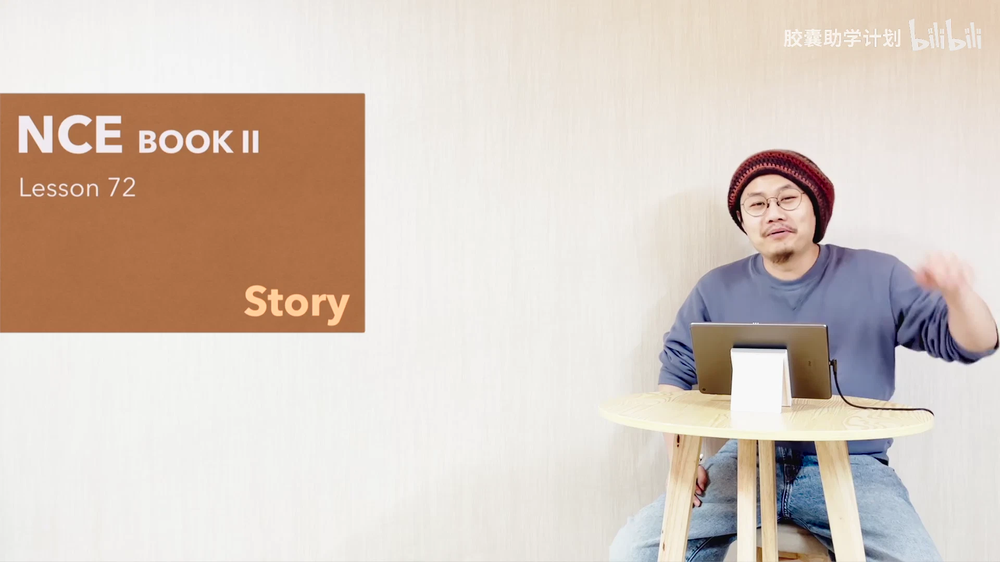

文字识别：blbii / 胶囊助学计划 / NCE / BOOK"I / Lesson 72 / Story

### 画面 00:00:02

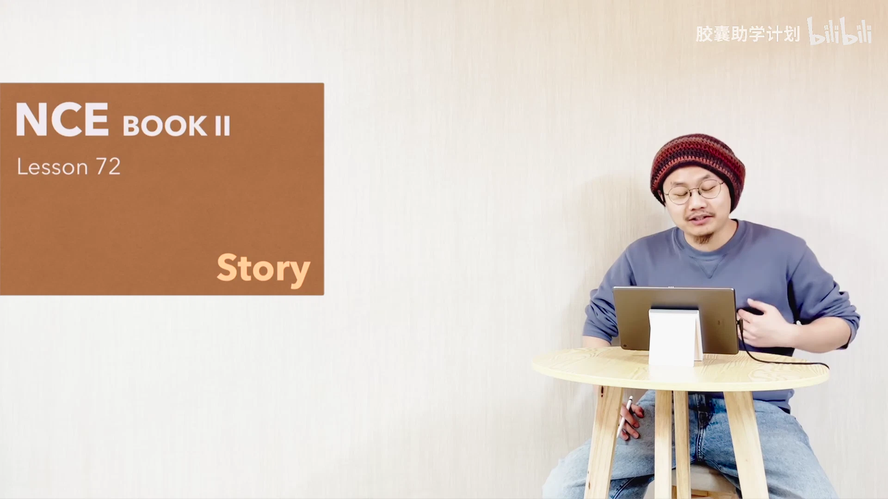

文字识别：bibii / 胶囊助学计划 / NCE / BOOKI"I / Lesson 72 / Story

### 画面 00:00:05

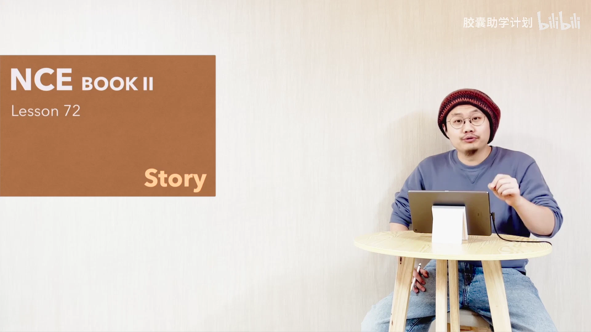

文字识别：bilbil / 胶囊助学计划 / NCE / BOOKII / Lesson 72 / Story

### 画面 00:00:08

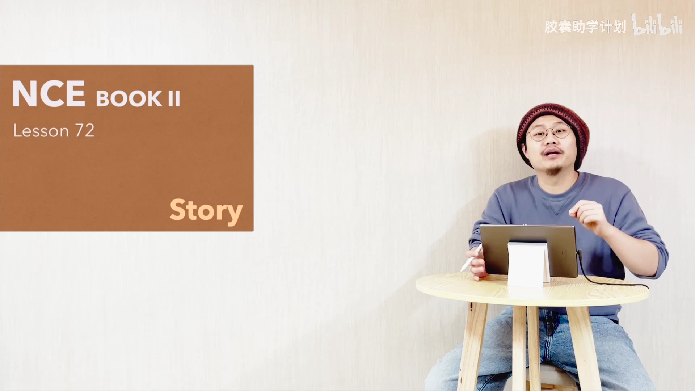

文字识别：bilbil / 胶囊助学计划 / NCE / BOOKII / Lesson 72 / Story

### 画面 00:00:10

文字识别：胶囊助学计划 bil

### 画面 00:00:13

文字识别：胶囊助学计划 / 胶囊助学计划

### 画面 00:00:15

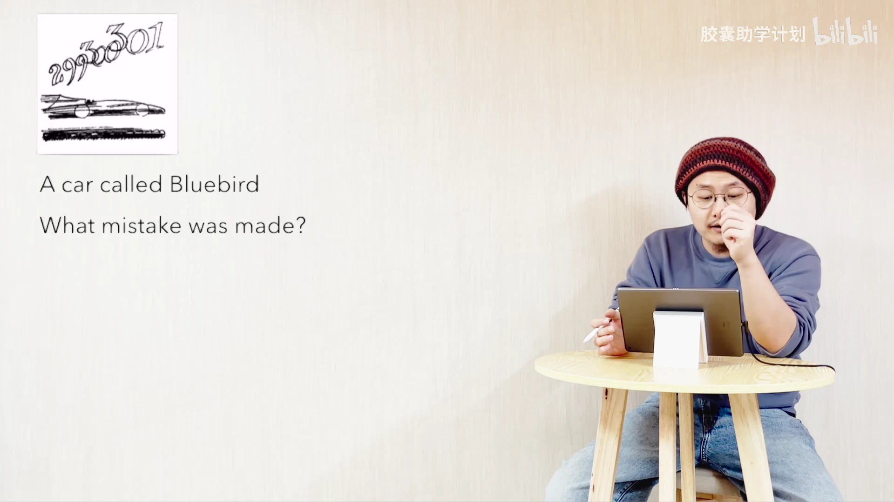

文字识别：biibii / 胶囊助学计划 / A car called Bluebird / What mistake was made?

### 画面 00:00:18

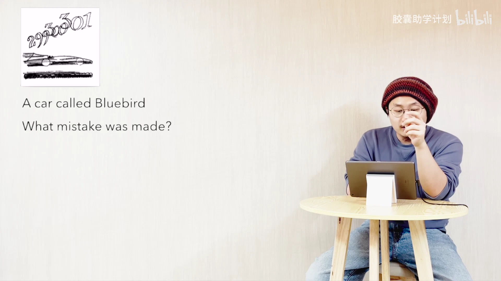

文字识别：Bilbili / 胶囊助学计划 / 2990301 / A car called Bluebird / What mistake was made?

### 画面 00:00:25

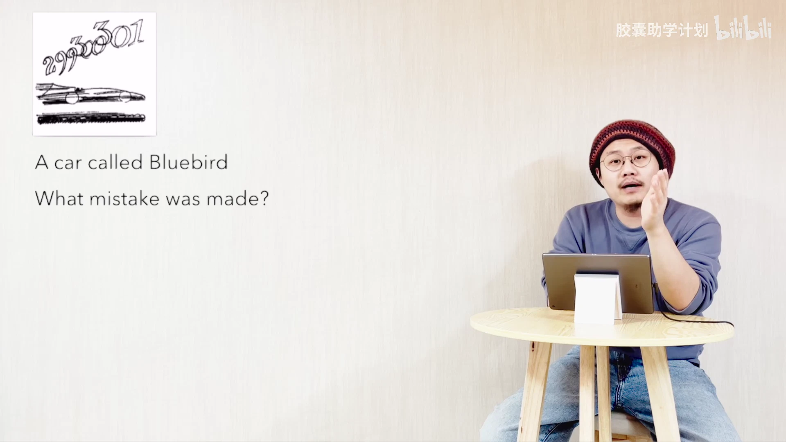

文字识别：胶囊助学计划bil / A car called Bluebird / What mistake was made?

## 00:00:30–00:01:00

然后呃问的问题是 what mistake was made 啊，做出了犯了什么错，对吧？其实就是 make a mistake 是吧？啊，他犯了什么错？我们直接看文章就好了。呃，注意啊，还是本文是我们复习课程，那我们就看看它这里面出现了多少我们之前学过的东西啊。其实各位可以这么去理解，每一课都是复习课程，因为它不用说非等到七十三再去复习。那我六十

### 画面 00:00:39

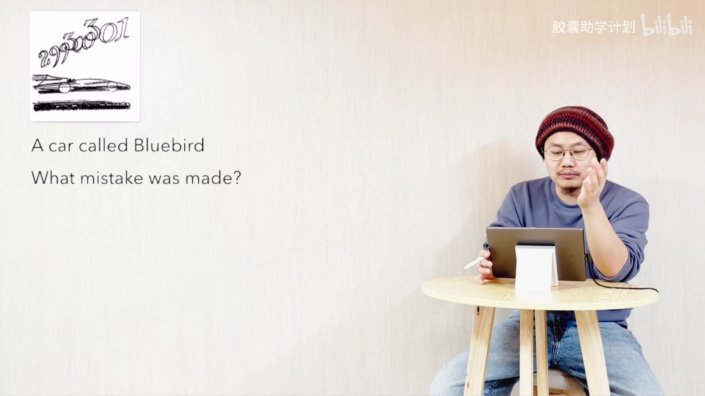

文字识别：bilbi / 胶囊助学计划 / A car called Bluebird / What mistake was made?

### 画面 00:00:41

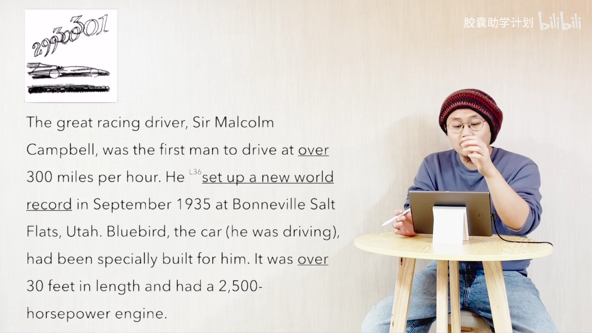

文字识别：胶囊助学计划bibl / The great racing driver, Sir Malcolm / Campbell, was the first man to drive at over / 300 miles per hour. He / L36 / 'set up a new world / record in September 1935 at Bonneville Salt / Flats, Utah. Bluebird, the car (he was driving), / had been specially built for him. It was over / 30 feet in length and had a 2,500- / horsepower engine.

### 画面 00:00:43

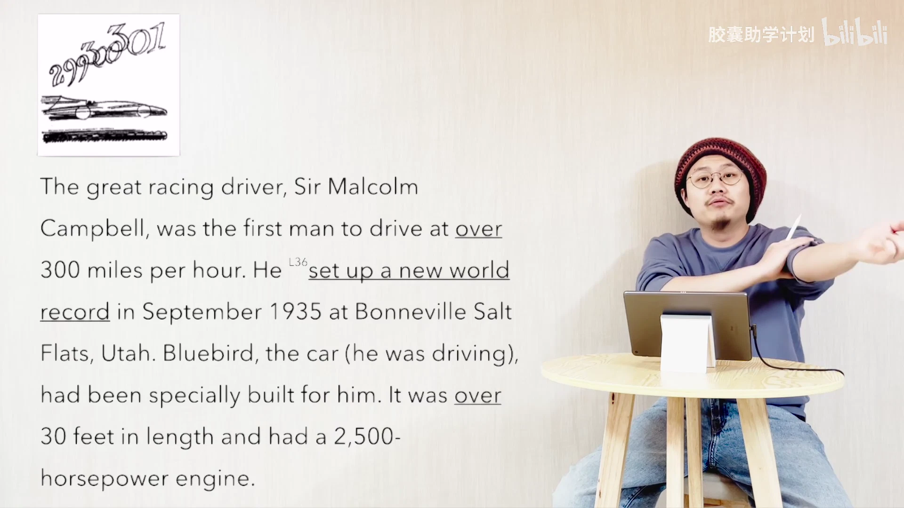

文字识别：胶囊助学计划bili / 200 / The great racing driver, Sir Malcolm / Campbell, was the first man to drive at over / 300 miles per hour. He / L36 / 'set up a new world / record in September 1935 at Bonneville Salt / Flats, Utah. Bluebird, the car (he was driving), / had been specially built for him. It was over / 30 feet in length and had a 2,500- / horsepower engine.

## 00:01:00–00:01:30

四出现了五十二课学过的知识点，那不就是在复习吗？对吧？哎，只不过那课可能本身有新的语法点，那本课呢没有新的语法点，对吧？所以它就是纯复习课啊。那我们一起看一下，说The great racing driver Sir Michael Campbell was the first man to drive at over three hundred miles per hour。这个句子乍一看还是挺长的，是不是长难句

### 画面 00:01:03

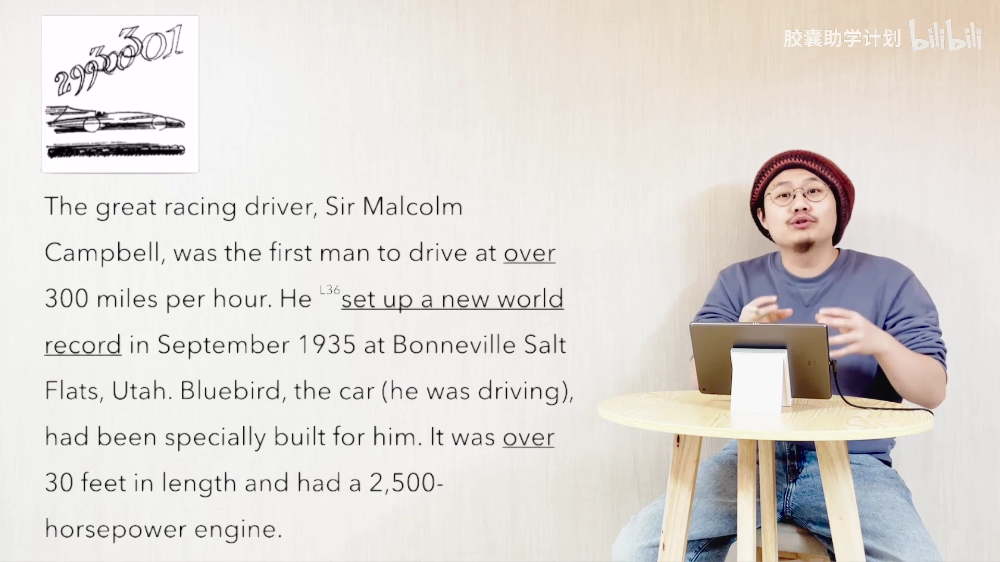

文字识别：胶囊助学计划bili / The great racing driver, Sir Malcolm / Campbell, was the first man to drive at over / 300 miles per hour. He / L36 / 'set up a new world / record in September 1935 at Bonneville Salt / Flats, Utah. Bluebird, the car (he was driving), / had been specially built for him. It was over / 30 feet in length and had a 2,500- / horsepower engine.

### 画面 00:01:09

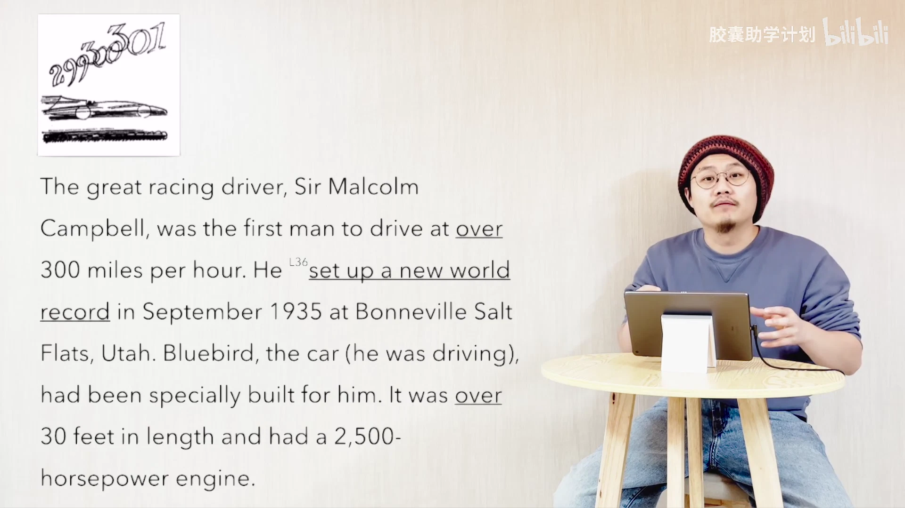

文字识别：胶囊助学计划bli / The great racing driver, Sir Malcolm / Campbell, was the first man to drive at over / 300 miles per hour. He / L36 / 'set up a new world / record in September 1935 at Bonneville Salt / Flats, Utah. Bluebird, the car (he was driving), / had been specially built for him. It was over / 30 feet in length and had a 2,500- / horsepower engine.

## 00:01:30–00:02:00

呢？呃，其实并不是，是吧？并不是啊，它没有那么多的连词啊，倒是有一个非谓语，但是咱不用管它。我们直接看一下，它显得长，就是因为它有个同位语啊，同位语这名称特别长。说一个伟大的赛车手，你不知道是谁，同位语，Sir Malcolm Kendall，这个人啊，就对于你来说，你知道就知道，不知道就不知道，对吧？哎，

### 画面 00:01:31

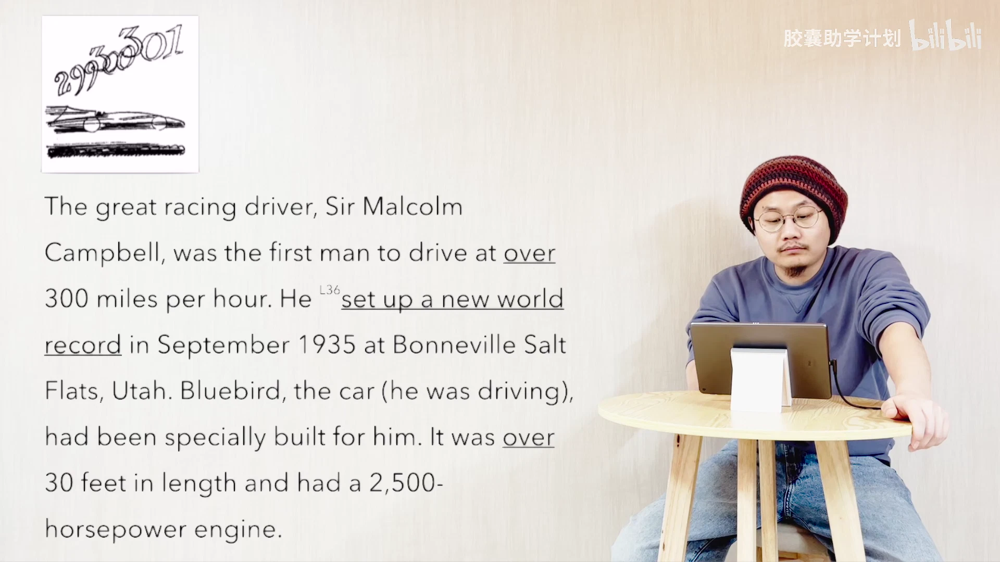

文字识别：胶囊助学计划bili / The great racing driver, Sir Malcolm / Campbell, was the first man to drive at over / 300 miles per hour. He / L36 / 'set up a new world / record in September 1935 at Bonneville Salt / Flats, Utah. Bluebird, the car (he was driving), / had been specially built for him. It was over / 30 feet in length and had a 2,500- / horsepower engine.

## 00:02:00–00:02:30

告诉你有这么个人，是第一个人开。开到多少呢？Over three hundred miles per hour.好了，per hour per night.我希望你还有印象，per 就每小时，那 three hundred miles 就是三百英里每小时，对吧？哎，然后这个 over 我们之前见过很多遍了，超过，超过。He set up a new world record in

### 画面 00:02:01

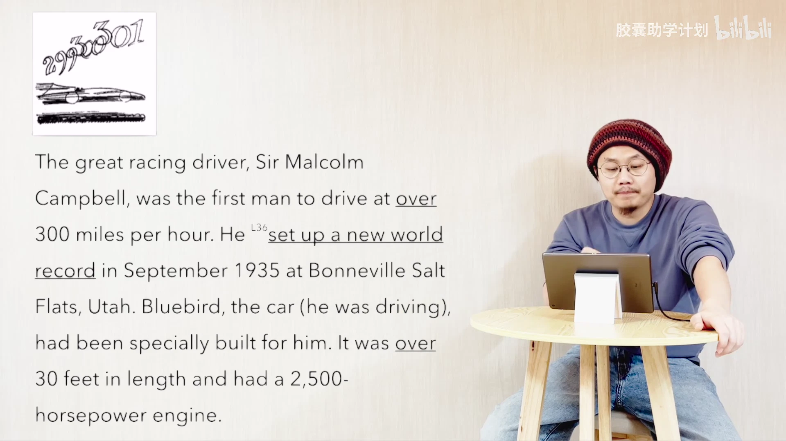

文字识别：胶囊助学计划bilbl / The great racing driver, Sir Malcolm / Campbell, was the first man to drive at over / 300 miles per hour. He / L36 / 'set up a new world / record in September 1935 at Bonneville Salt / Flats, Utah. Bluebird, the car (he was driving), / had been specially built for him. It was over / 30 feet in length and had a 2,500- / horsepower engine.

## 00:02:30–00:03:00

September 1935 at Bonneville Salt Flies, Utah.这是一个很简单的句子了，就是主谓宾、时间、地点等等的，对吧？哎，说他建立了一个新的世界纪录。这早在三十六课咱就学过了。哎，在一九三五年几月份？然后在这样的一个地方，对吧？哎，干了这么一个事儿。只不过这个句子有一个点可以简单提一句，这也从另一个角度印证了我在第一课在

### 画面 00:02:31

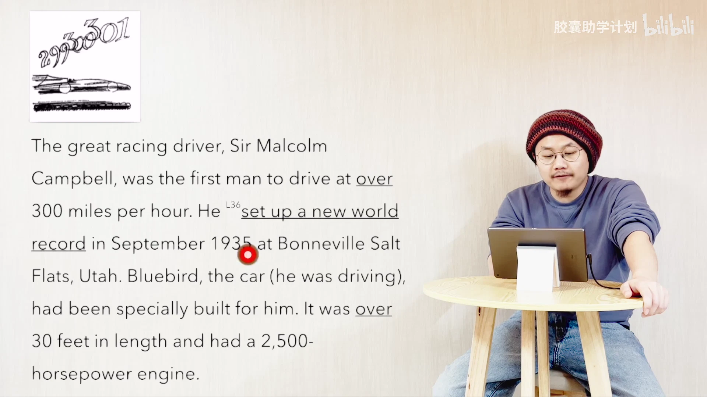

文字识别：胶囊助学计划bii / The great racing driver, Sir Malcolm / Campbell, was the first man to drive at over / 300 miles per hour. He / L36 / 'set up a new world / record in September 1935 at Bonneville Salt / Flats, Utah. Bluebird, the car (he was driving), / had been specially built for him. It was over / 30 feet in length and had a 2,500- / horsepower engine.

### 画面 00:02:56

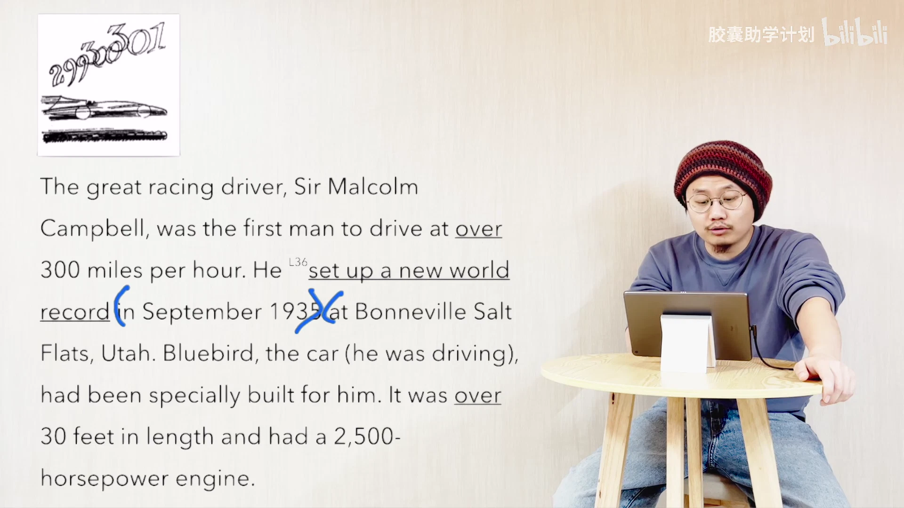

文字识别：胶囊助学计划bibi / The great racing driver, Sir Malcolm / Campbell, was the first man to drive at over / 300 miles per hour. He / L36 / 'set up a new world / in September 193>At Bonneville Salt / record / Flats, Utah. Bluebird, the car (he was driving), / had been specially built for him. It was over / 30 feet in length and had a 2,500- / horsepower engine.

## 00:03:00–00:03:30

讲六一二三四五六的时候就跟各位说过的一句话，叫六一二三四五六从来都不是金科玉律，对吧？亚历山大换一句话来说，如果他是金科玉律，那亚历山大在这一刻不就自己打自己脸了吗？啊，这并非这破坏了六一二三四五六。先用了时间，再用了地点嘛，对吧？他是先说了时间，再说了地点嘛。Bluebird啊，蓝鸟。The car he was driving其实还是同位语，你看这儿一个逗号，这儿一个逗号，还是一个

### 画面 00:03:00

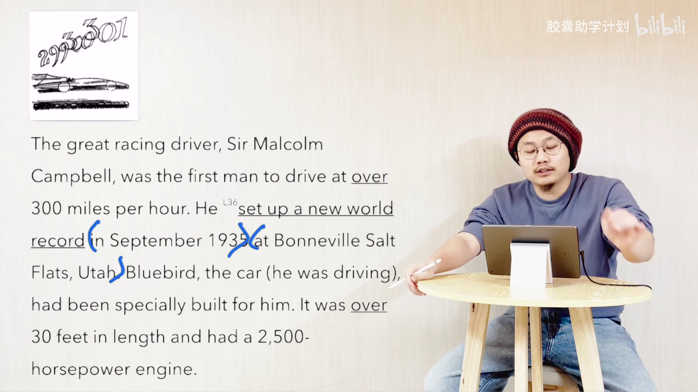

文字识别：胶囊助学计划bibl / 20 / The great racing driver, Sir Malcolm / Campbell, was the first man to drive at over / 300 miles per hour. He / L36 / 'set up a new world / n September 193At Bonnevill Salt / record / Flats, Utab)Bluebird, the car (he was driving), / had been specially built for him. It was over / 30 feet in length and had a 2,500- / horsepower engine.

### 画面 00:03:03

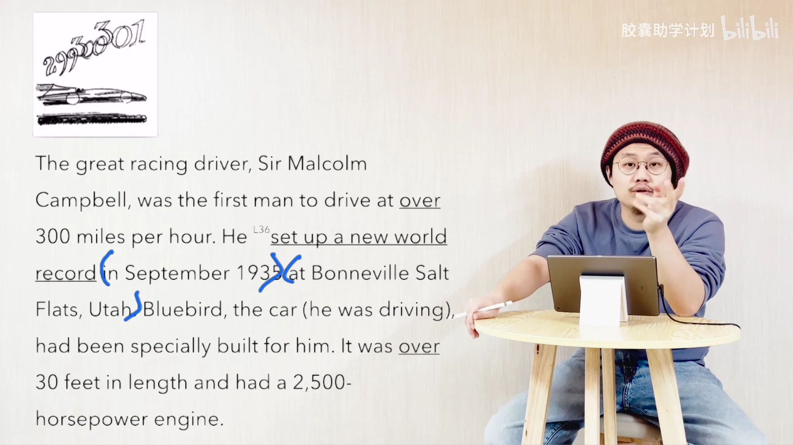

文字识别：胶囊助学计划bii / 299030 / The great racing driver, Sir Malcolm / Campbell, was the first man to drive at over / 300 miles per hour. He / L36 / 'set up a new world / n September 193At Bonnevile salt / record / Flats, Utab)Bluebird, the car (he was driving), / had been specially built for him. It was over / 30 feet in length and had a 2,500- / horsepower engine.

### 画面 00:03:10

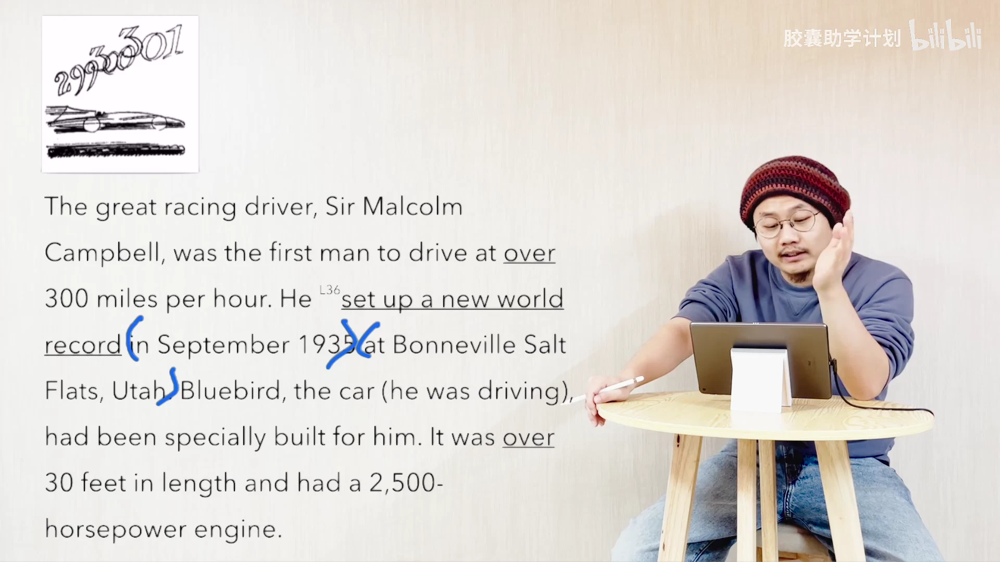

文字识别：胶囊助学计划bil / The great racing driver, Sir Malcolm / Campbell, was the first man to drive at over / 300 miles per hour. He / L36 / 'set up a new world / n September 193>At Bonnevile salt / record / Flats, UtabBluebird, the car (he was driving), / had been specially built for him. It was over / 30 feet in length and had a 2,500- / horsepower engine.

### 画面 00:03:23

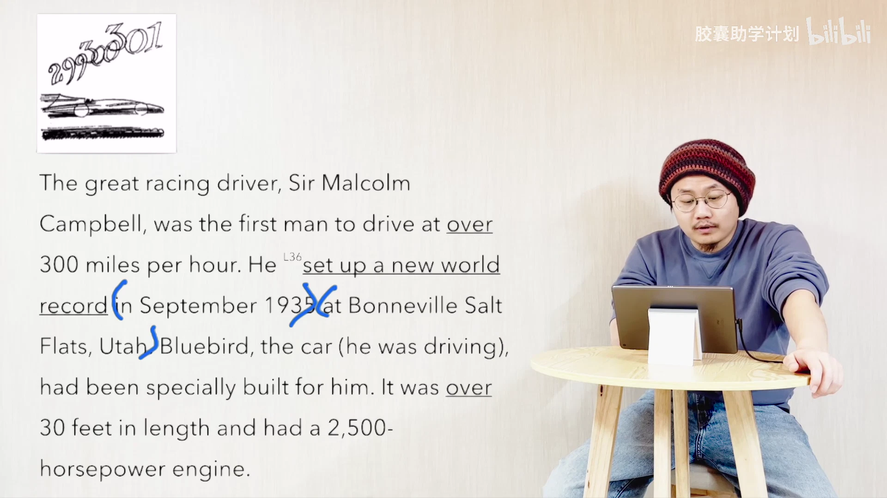

文字识别：胶囊助学计划bilbl / The great racing driver, Sir Malcolm / Campbell, was the first man to drive at over / 300 miles per hour. He / L36 / 'set up a new world / n September 193>Gt Bonneville Salt / record / Flats, UtabBluebird, the car (he was driving), / had been specially built for him. It was over / 30 feet in length and had a 2,500- / horsepower engine.

## 00:03:30–00:04:00

同位语？只不过这个同位语当中神了，又加了个定语从句，对吧？就是他正在开的那辆车，就告诉你 Bluebird 是个啥玩意儿？就你得明白它是火箭，是车，是自行车啊，还是马车啊？告诉你是 the car，是什么 car 呢？是 he was driving the car，对吧？他是在正在他开的那辆车，就是 Bluebird， Bluebird 就是他正在开的那辆车，明白了吧？同位语啊，had been

### 画面 00:03:53

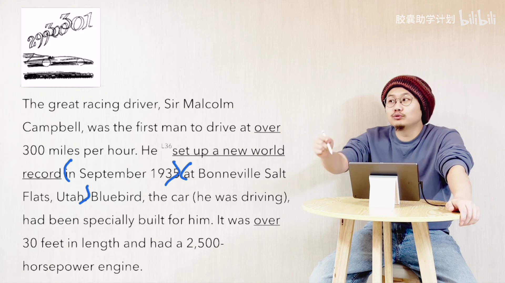

文字识别：胶囊助学计划bilbl / The great racing driver, Sir Malcolm / Campbell, was the first man to drive at over / 300 miles per hour. He / L36 / 'set up a new world / n September 193>At Bonnevill salt / record / Flats, UtabBluebird,the car (he was driving), / had been specially built for him. It was over / 30 feet in length and had a 2,500- / horsepower engine.

## 00:04:00–00:04:30

specially built for him. 注意这里的 had been built 过去完成时的被动，对吧？那 specially 就是特别专门的，专门为他所建造的、制造的一个车啊，就是他专门为了破世界纪录制造了这么一个 Bluebird 这个这辆车。 It was over. 本课出现了好多次 over 超过啊，超过了 thirty feet in length and had a two

### 画面 00:04:23

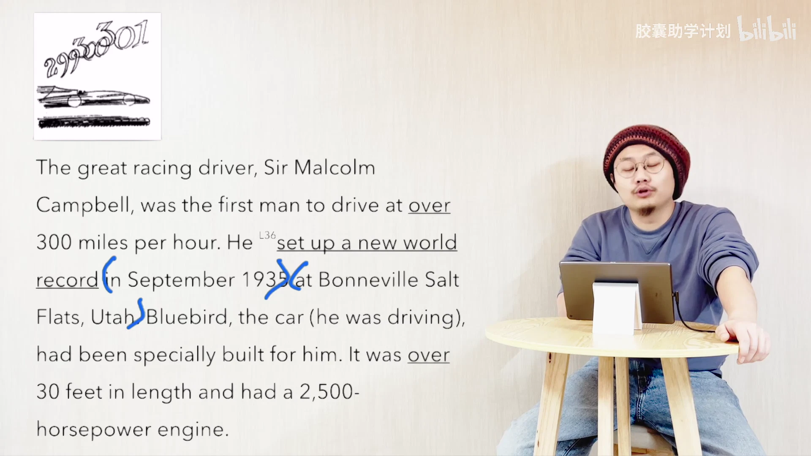

文字识别：胶囊助学计划biib出 / The great racing driver, Sir Malcolm / Campbell, was the first man to drive at over / 300 miles per hour. He / L36 / 'set up a new world / n September 193>At Bonnevill salt / record / Flats, Utab)Bluebird, the car (he was driving), / had been specially built for him. Ilt was over / 30 feet in length and had a 2,500- / horsepower engine.

## 00:04:30–00:05:00

thousand five hundred horsepower engine. So this car is actually over thirty feet in length,就是在长度上超过三十英尺。其实这地方的and我们最好再给它加上一个加重符号或一个圈儿，提醒你在这儿要断句了。但因为这句话，你说它是长难句吗？它确实是两个句子简单句并列到一起了，对吧？但是它也不是，嗯，我觉得我们也很难给它定义成长难句，因为太简单了，是吧？就一个连词and，

### 画面 00:04:42

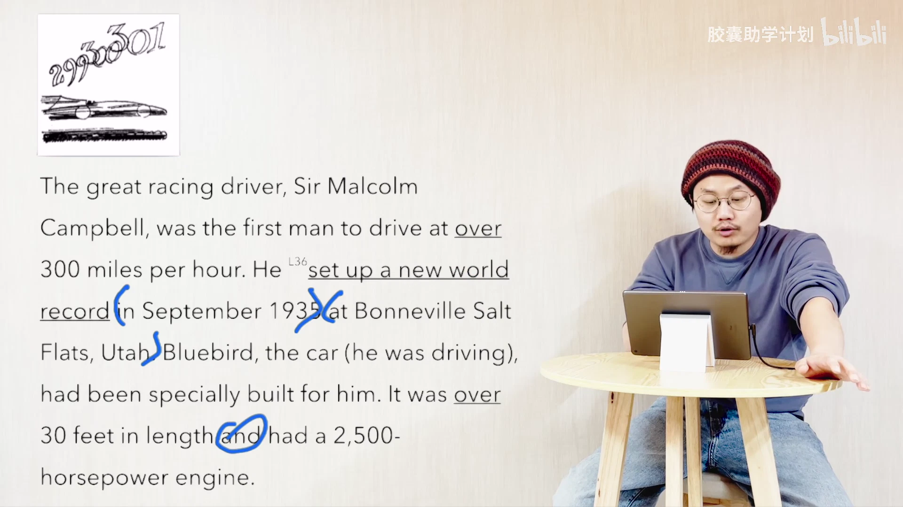

文字识别：胶囊助学计划bibi / 29030 / The great racing driver, Sir Malcolm / Campbell, was the first man to drive at over / 300 miles per hour. He / L36 / 'set up a new world / n September 193>At Bonnevill salt / record / Flats, Utab)Bluebird, the car (he was driving), / had been specially built for him. It was over / 30 feet in lengthdhad a 2,500- / horsepower engine.

### 画面 00:04:46

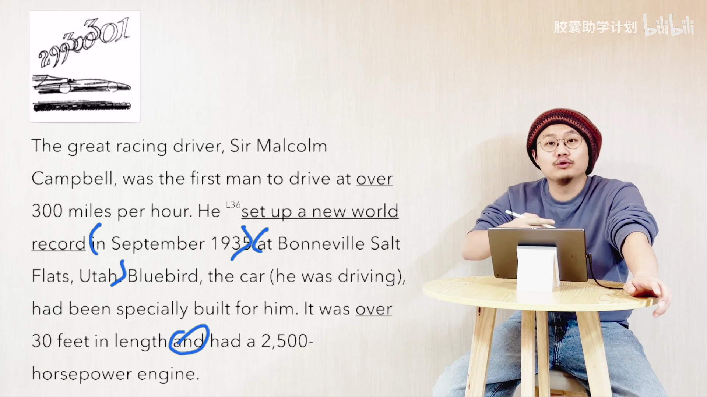

文字识别：胶囊助学计划bilbl / The great racing driver, Sir Malcolm / Campbell, was the first man to drive at over / 300 miles per hour. He / L36 / 'set up a new world / n September 193>At Bonnevill Salt / record / Flats, UtabBluebird,the car (he was driving), / had been specially built for him. Ilt was over / 30 feet in lengthndhad a 2,500- / horsepower engine.

### 画面 00:04:55

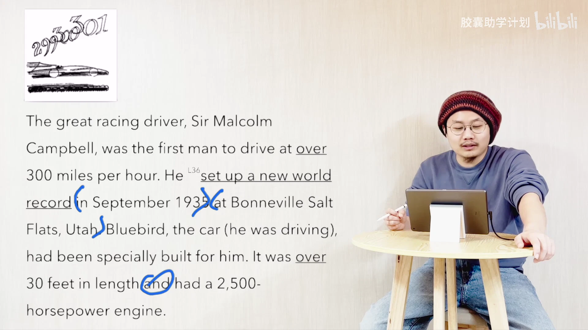

文字识别：胶囊助学计划bilbl / The great racing driver, Sir Malcolm / Campbell, was the first man to drive at over / 300 miles per hour. He / L36 / 'set up a new world / n September 193>At Bonnevill salt / record / Flats, UtabBluebird, the car (he was driving), / had been specially built for him. It was over / 30 feet in lengthnDhad a 2,500- / horsepower engine.

## 00:05:00–00:05:30

然后有一个两千五百马力的引擎。 Continue. Although Campbell reached a speed of over three three hundred and four miles per hour, he had great difficulty in controlling the car because a tire burst during the first run. 你像这句话，我乍一看到我就会觉得，嗯，虽然它没有那么难，但是也可以算

### 画面 00:05:07

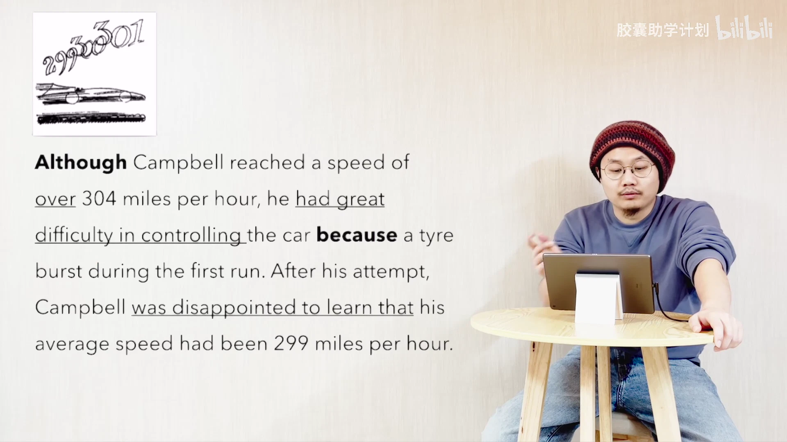

文字识别：胶囊助学计划bl山 / Although Campbell reached a speed of / over 304 miles per hour, he had great / difficulty in controlling the car because a tyre / burst during the first run. After his attempt, / Campbell was disappointed to learn that his / average speed had been 299 miles per hour.

## 00:05:30–00:06:00

作长难句了。为什么？你看啊，一个连词，一个逗号，又一个连词，这就是好几句话连到一起了。那我们看第一句话叫做，尽管 Campbell 达到了一个速度超过了三百零四，对吧？哎，叫超过了三百零四英里每小时的这样的一个速度啊。尽管第一句话结束了，然后呢， he had great difficulty in controlling the

### 画面 00:05:32

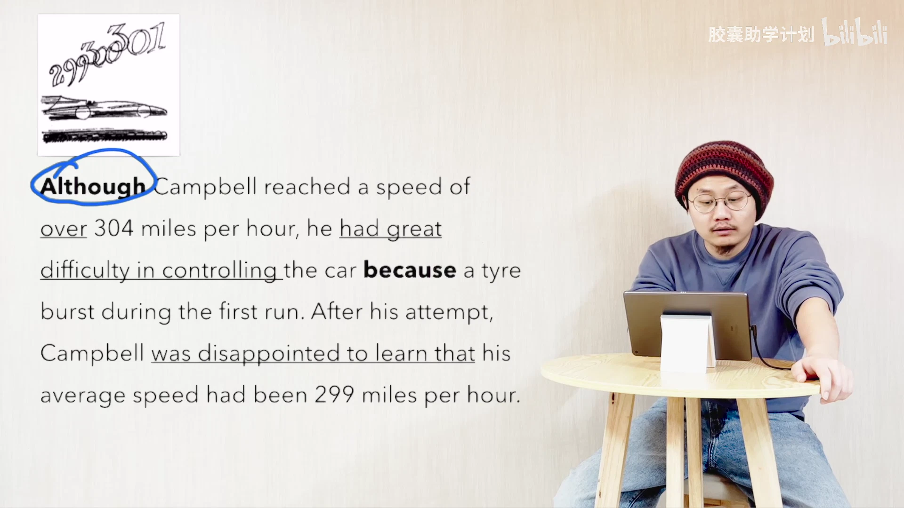

文字识别：胶囊助学计划ii / 29900 / Although Campbell reached a speed of / over 304 miles per hour, he had great / difficulty in controlling the car because a tyre / burst during the first run. After his attempt, / Campbell was disappointed to learn that his / average speed had been 299 miles per hour.

### 画面 00:05:35

文字识别：胶囊助学计划bib出 / Although Campbell reached a speed of / over 304 miles per hourhe had great / difficulty in controlling the car becausea tyre / burst during the first run. After his attempt, / Campbell was disappointed to learn that his / average speed had been 299 miles per hour.

## 00:06:00–00:06:30

这个地方其实二十八课我们见过类似的，但并不完全一样，所以我们本课给它单独拉出来。习惯用法叫 have great啊 have difficulty in doing something，叫在做某件事情上有困难。他在做什么事情上有巨大的困难呢？在 controlling the car 这件事情上，在控制车这件事情上有巨大的困难。Because因为 a tire burst during the first run，说轮胎

### 画面 00:06:05

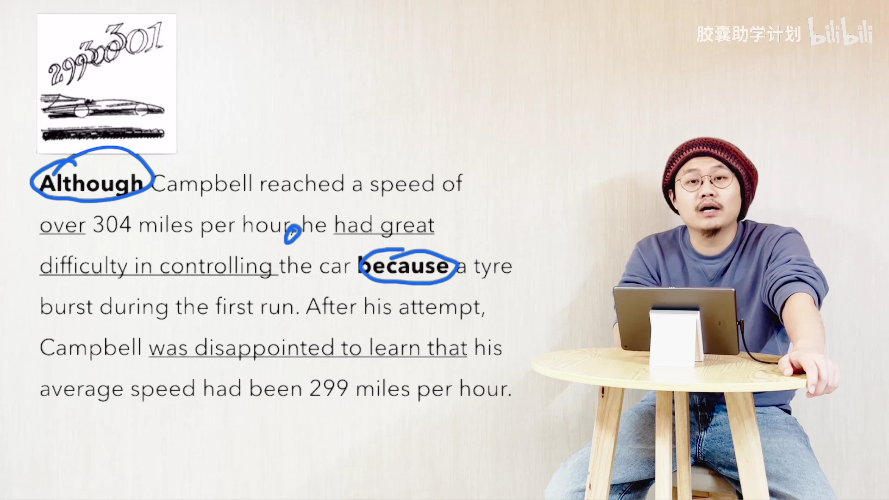

文字识别：胶囊助学计划bilb出 / AlthoughCampbell reached a speed of / over 304 miles per houhe had great / difficulty in controlling the car I / r becausea tyre / burst during the first run. After his attempt, / Campbell was disappointed to learn that his / average speed had been 299 miles per hour.

## 00:06:30–00:07:00

exploded, right? The tire blew. In the first this run, ah, the first this test run, ah, the tire blew. So you see, we split it into N sentences, right? This is the first sentence. This is the second sentence. This is the third sentence. Ah, there are two conjunctions and a comma. We split it into three sentences. Okay, continue. After his attempt, Campbell was disappointed to learn that his average speed had been

### 画面 00:06:35

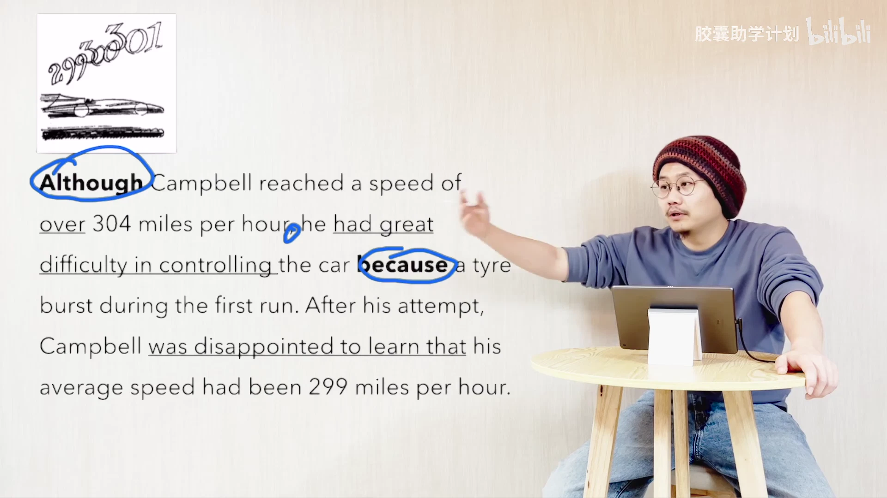

文字识别：胶囊助学计划biiil / Although Campbell reached a speed of / over 304 miles per houhe had great / difficulty in controlling the car becausea tyre / burst during the first run. After his attempt, / Campbell was disappointed to learn that his / average speed had been 299 miles per hour.

### 画面 00:06:38

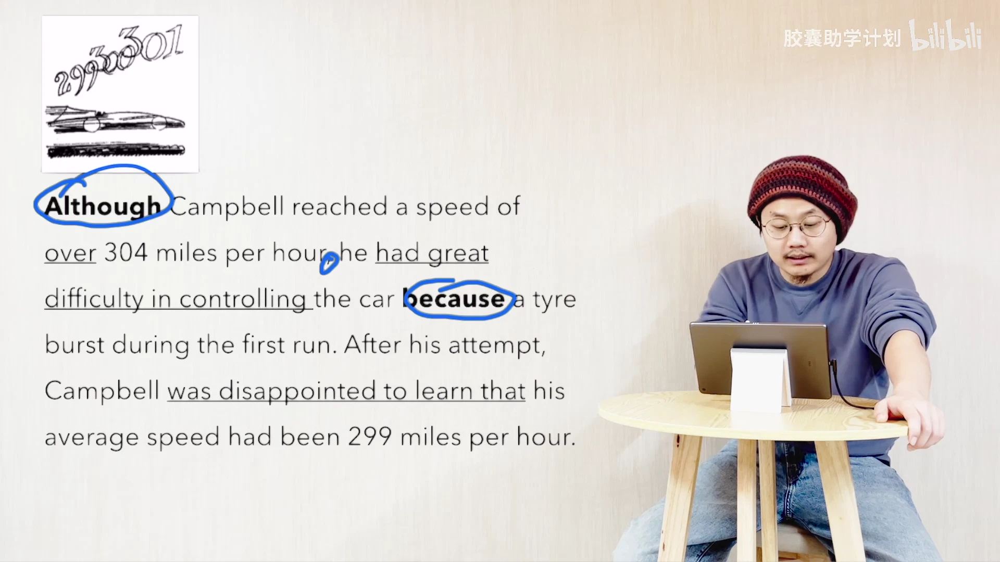

文字识别：胶囊助学计划bl / Although Campbell reached a speed of / over 304 miles per hourhe had great / difficulty in controlling the car becausea tyre / burst during the first run. After his attempt, / Campbell was disappointed to learn that his / average speed had been 299 miles per hour.

### 画面 00:06:42

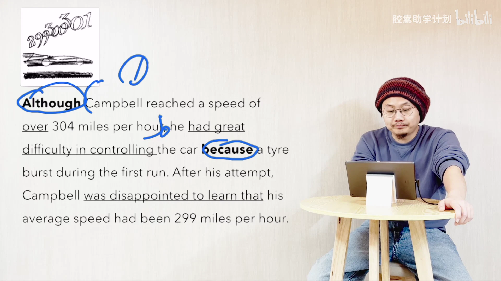

文字识别：胶囊助学计划bi出 / Although Campbell reached a speed of / over 304 miles per houbhe had great / difficulty in controlling the car becausea tyre / burst during the first run. After his attempt, / Campbell was disappointed to learn that his / average speed had been 299 miles per hour.

### 画面 00:06:44

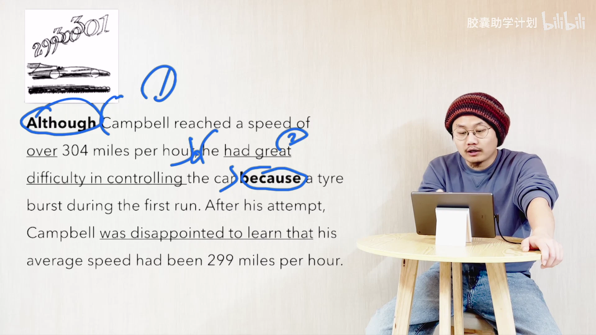

文字识别：胶囊助学计划bi出 / Although Campbell reached a speed of / over 304 miles per houb he had great / difficlty in contrlling the cab becausea tyre / burst during the first run. After his attempt, / Campbell was disappointed to learn that his / average speed had been 299 miles per hour.

### 画面 00:06:46

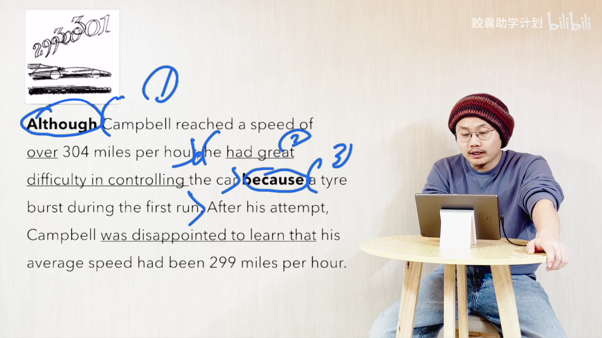

文字识别：胶囊助学计划bilbl / Although Campbell reached a speed of / over 304 miles per hou he had great / 3 / difficulty in controlling the ca because / tyre / a / burst during the first runyAfter his attempt, / Campbell was disappointed to learn that his / average speed had been 299 miles per hour.

### 画面 00:06:49

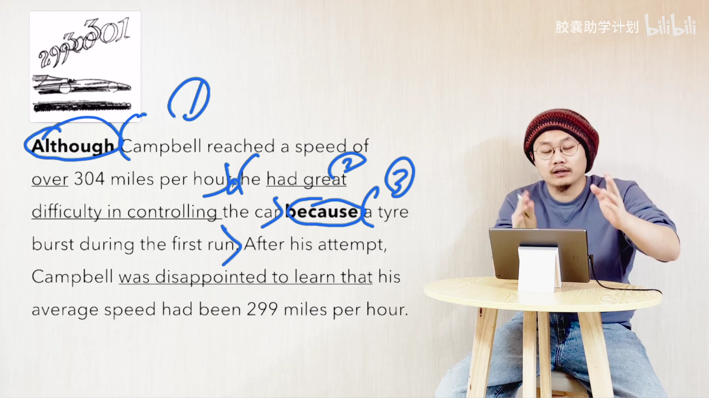

文字识别：胶囊助学计划bi出 / Although Campbell reached a speed of / over 304 miles per hou he had great / difficulty in controlling the ca because / tyre / burst during the first runyAfter his attempt, / Campbell was disappointed to learn that his / average speed had been 299 miles per hour.

## 00:07:00–00:07:30

two hundred ninety-nine miles per hour. So in his attempt, Campbell.接下来是一个习惯用法，叫 be disappointed to learn that，叫做很失望的呃了解到啊呃呃得到了某方面的一个消息。That后边加一句话，对吧？好，什么样一句话呢？叫做他平均的速度仅仅啊，这只达到了二百九十九英里每小时，就没有超过这

### 画面 00:07:14

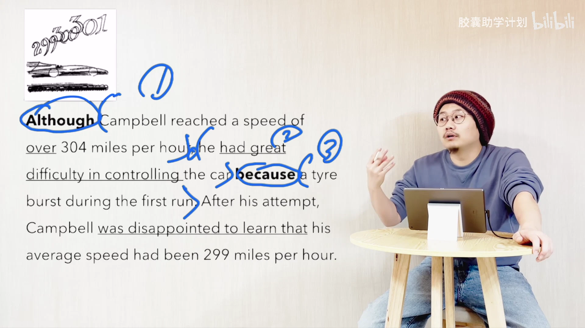

文字识别：胶囊助学计划bilb山 / Although Campbell reached a speed of / over 304 miles per houb he had great / difficulty in controlling thecabecause / tyre / burst during the first runyAfter his attempt, / Campbell was disappointed to learn that his / average speed had been 299 miles per hour.

### 画面 00:07:23

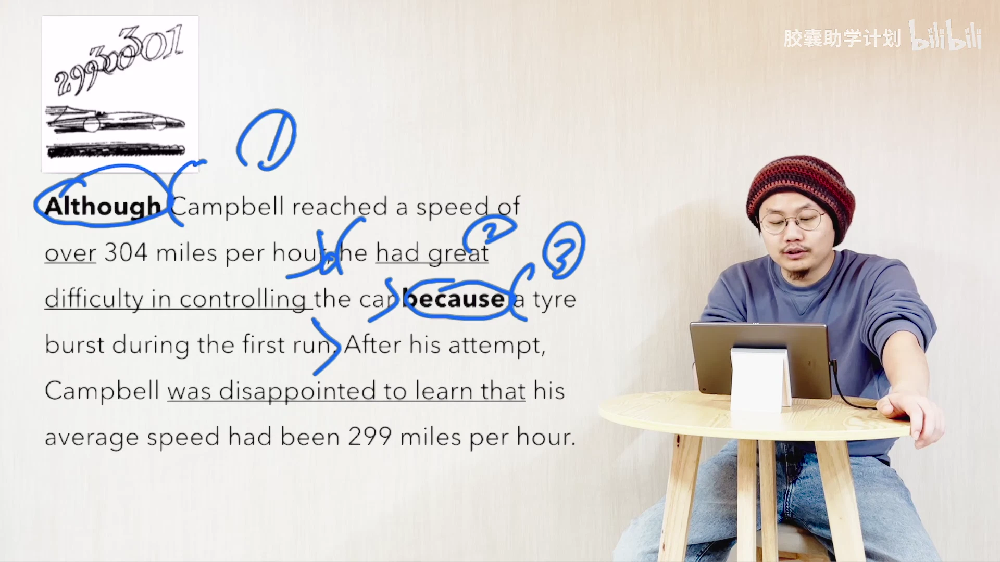

文字识别：胶囊助学计划bi出 / Although Campbell reached a speed of / over 304 miles per houb he had great / difficulty in controlling the ca because / tyre / burst during the first runyAfter his attempt, / Campbell was disappointed to learn that his / average speed had been 299 miles per hour.

### 画面 00:07:28

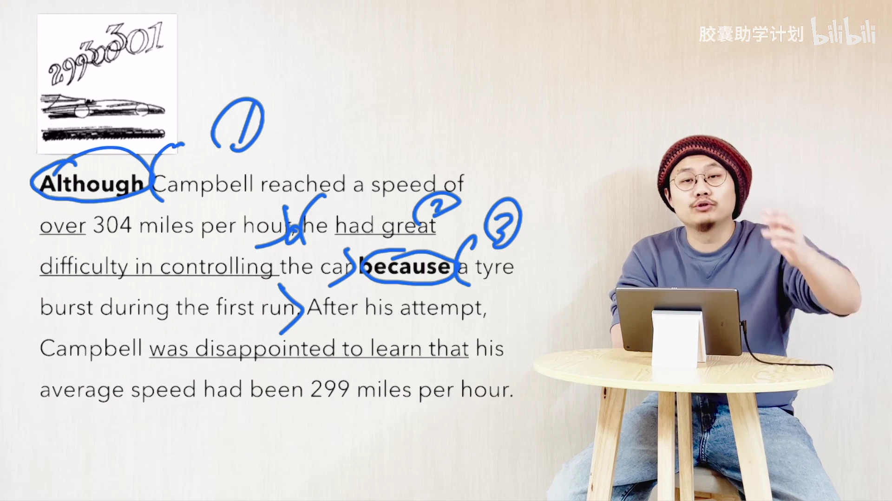

文字识别：胶囊助学计划bii / Although Campbell reached a speed of / over 304 miles per houb he had great / difficulty in controlling the ca because / tyre / burst during the first runyAfter his attempt, / Campbell was disappointed to learn that his / average speed had been 299 miles per hour.

## 00:07:30–00:08:00

个三百英里每小时，对吧？哎，OK，没有超过平均上的三百英里每小时啊，它是平均上二百九十九英里每小时。OK，那这里的习惯用法一会儿我们会造句啊。很遗憾的得知，However，然而呢，A few days later，几天之后，注意它不是个连词啊。说几天之后，He was told，注意，that a mistake had been made。

### 画面 00:07:41

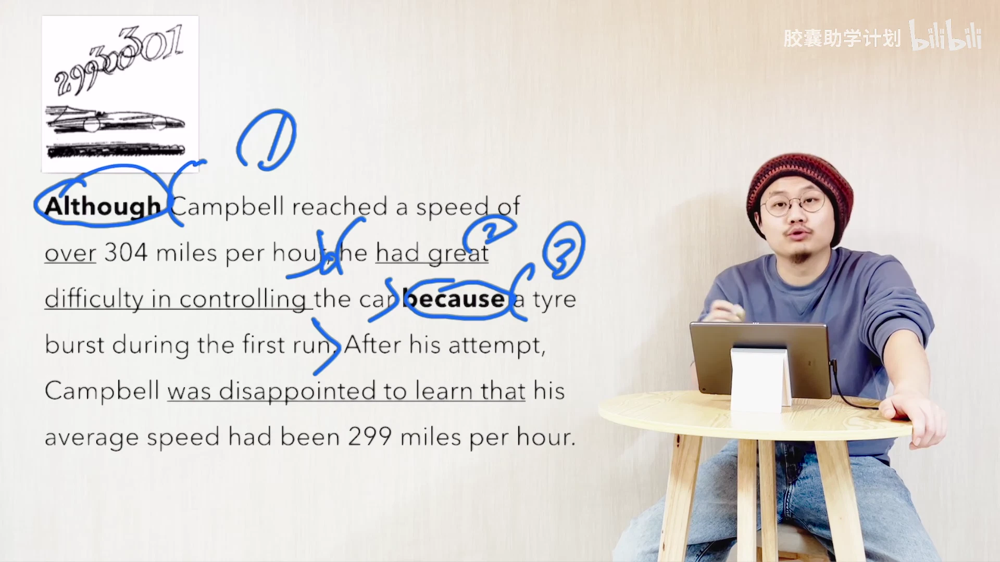

文字识别：胶囊助学计划i出 / Although Campbell reached a speed of / over 304 miles per houb he had great / difficulty in controlling the ca because / tyre / burst during the first runyAfter his attempt, / Campbell was disappointed to learn that his / average speed had been 299 miles per hour.

### 画面 00:07:43

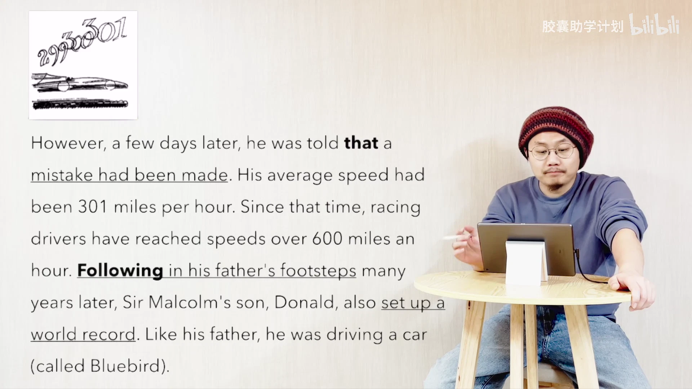

文字识别：胶囊助学计划bilb山 / However, a few days later, he was told that a / mistake had been made. His average speed had / been 301 miles per hour. Since that time, racing / drivers have reached speeds over 600 miles an / hour. Following in his father's footsteps many / years later, Sir Malcolm's son, Donald, also set up a / world record. Like his father, he was driving a car / (called Bluebird).

## 00:08:00–00:08:30

被动，was told，他被告知被告知了一件事情，后边跟了一个哎，宾语从句，对吧？其实你不知道它是宾语从句，我认为是没有问题的，你只要能读懂这句话就可以了，听明白吧？还是我之前的那个言论啊，我们来学习，最终是要成为一名语言的使用者，而不是一名语言的研究者。语言的研究者必须要知道的是什么是定语从句、宾语从句啊。对于您来说，你只要这句话保证我读的是对的就可以了啊。像宾语从句

### 画面 00:08:01

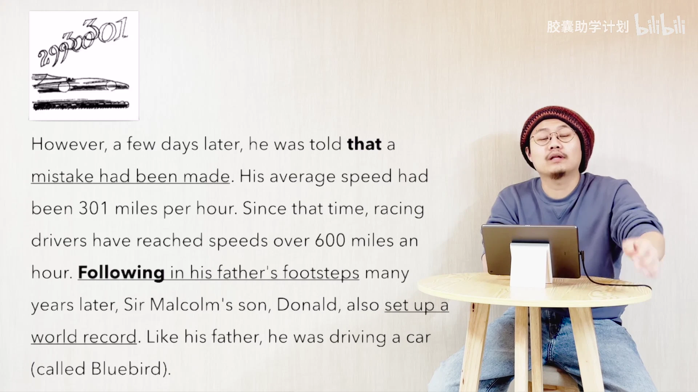

文字识别：胶囊助学计划bl出 / However, a few days later, he was told that a / mistake had been made. His average speed had / been 301 miles per hour. Since that time, racing / drivers have reached speeds over 600 miles an / hour. Following in his father's footsteps many / years later, Sir Malcolm's son, Donald, also set up a / world record. Like his father, he was driving a car / (called Bluebird).

### 画面 00:08:09

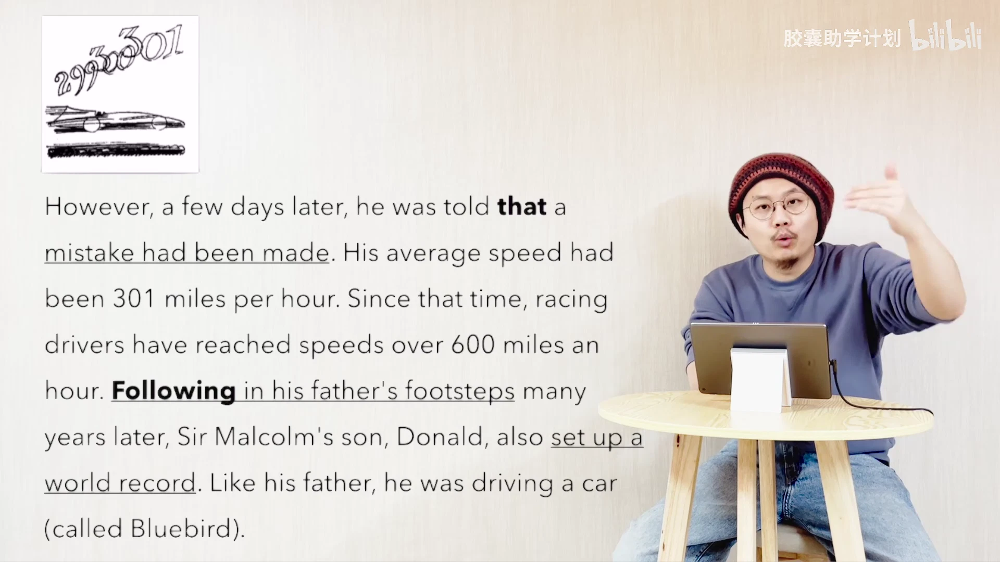

文字识别：胶囊助学计划bib山 / 20 / However, a few days later, he was told that a / mistake had been made. His average speed had / been 301 miles per hour. Since that time, racing / drivers have reached speeds over 600 miles an / hour. Following in his father's footsteps many / years later, Sir Malcolm's son, Donald, also set up a / world record. Like his father, he was driving a car / (called Bluebird).

## 00:08:30–00:09:00

又跟汉语的语序几乎啊，就至少在这一句这种句子上几乎是保持一致的，对吧？所以你不用分析它，没有问题啊，直接一个字一个字翻译，叫他被告知。你知道这个 that 可以不翻译，这是英语上的语法点，叫做一个错误已经被做出来了，对吧？哎，叫 make a mistake，这个咱们之前学过，只不过他给他这个地方变成了被动，所以变成了叫 a mistake had been made。啊，看到它别懵就可以了。OK，

### 画面 00:08:39

文字识别：胶囊助学计划bi出 / 20 / However, a few days later, he was told that a / mistake had been made. His average speed had / been 301 miles per hour. Since that time, racing / drivers have reached speeds over 600 miles an / hour. Following in his father's footsteps many / years later, Sir Malcolm's son, Donald, also set up a / world record. Like his father, he was driving a car / (called Bluebird).

## 00:09:00–00:09:30

continue. His average speed had been three hundred and one miles per hour.说他的平均速度实际上是达到了多少呢？三百零一英里每小时。啊，这个还是很细节的东西，不太重要. Since that time,从那个时候开始, racing drivers have reached speeds over six hundred miles an hour.说从那时开始, racing

### 画面 00:09:09

文字识别：胶囊助学计划bil山 / However, a few days later, he was told that a / mistake had been made. His average speed had / been 301 miles per hour. Since that time, racing / drivers have reached speeds over 600 miles an / hour. Following in his father's footsteps many / years later, Sir Malcolm's son, Donald, also set up a / world record. Like his father, he was driving a car / (called Bluebird).

## 00:09:30–00:10:00

我们在单词部分就讲过了。赛车手说已经达到了速度是超过六百英里每小时的啊！你看这句话还是中规中矩，没什么太多可讲的。但下一句话啊，下两句话我们都可以重点去讲一下。我们先读，Following in his father's footsteps, many years later, Sir Malcolm's son Donal also set up a

### 画面 00:09:32

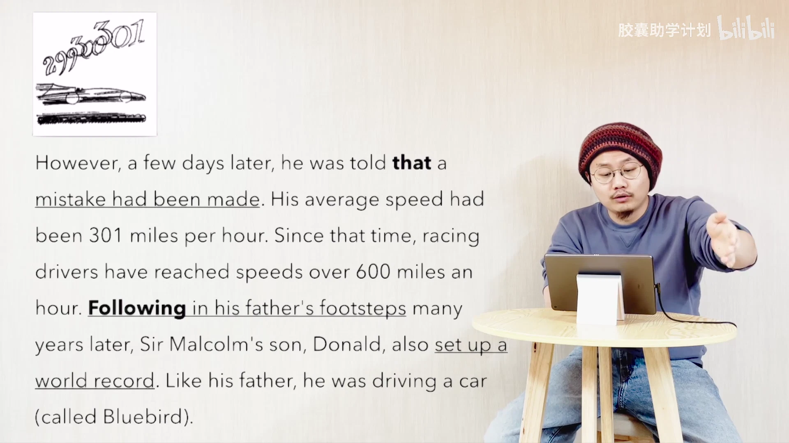

文字识别：胶囊助学计划bil山 / 20 / However, a few days later, he was told that a / mistake had been made. His average speed had / been 301 miles per hour. Since that time, racing / drivers have reached speeds over 600 miles an / hour. Following in his father's footsteps many / years later, Sir Malcolm's son, Donald, also set up a / world record. Like his father, he was driving a car / (called Bluebird).

### 画面 00:09:41

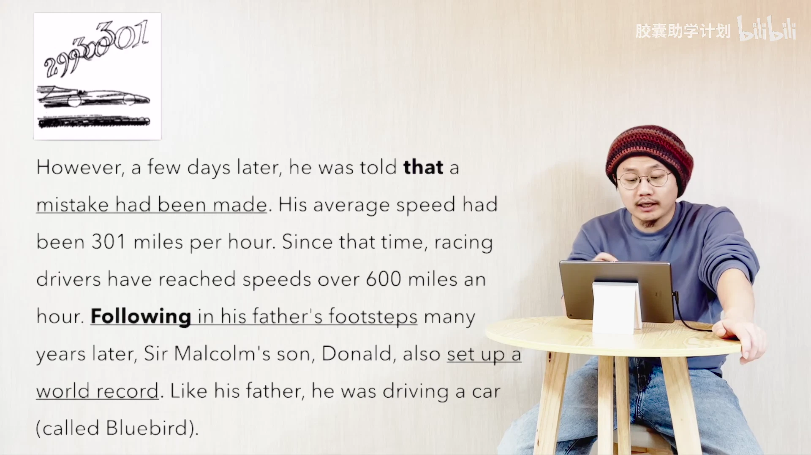

文字识别：胶囊助学计划bib山 / However, a few days later, he was told that a / mistake had been made. His average speed had / been 301 miles per hour. Since that time, racing / drivers have reached speeds over 600 miles an / hour. Following in his father's footsteps many / years later, Sir Malcolm's son, Donald, also set up a / world record. Like his father, he was driving a car / (called Bluebird).

## 00:10:00–00:10:30

world record.好，我们先看这句话。到这儿句号提醒你结束了。那我们先一个单词一个单词翻译。首先，follow in somebody's footsteps，咱们之前说过了，继承了衣钵，追随某人的脚步，对吧？追随着他父亲的脚步。许多年之后，Malcolm's的儿子Donna的这个人也创建了一个世界纪录。首先，这句话从头第一个单词读到最

### 画面 00:10:10

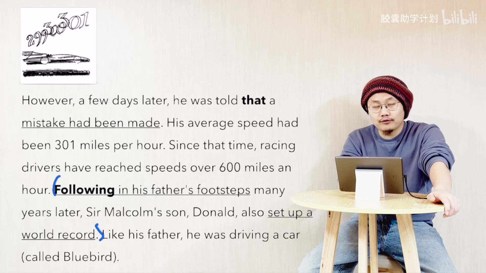

文字识别：胶囊助学计划blb山 / However, a few days later, he was told that a / mistake had been made. His average speed had / been 301 miles per hour. Since that time, racing / drivers have reached speeds over 600 miles an / hour. Following in his father's footsteps many / years later, Sir Malcolm's son, Donald, also set up a / world record. Like his father, he was driving a car / (called Bluebird).

### 画面 00:10:21

文字识别：胶囊助学计划bilb出 / 20 / However, a few days later, he was told that a / mistake had been made. His average speed had / been 301 miles per hour. Since that time, racing / drivers have reached speeds over 600 miles an / hour. Following in his father's footsteps many / years later, Sir Malcolm's son, Donald, also set up a / world record.Like his father, he was driving a car / (called Bluebird).

### 画面 00:10:28

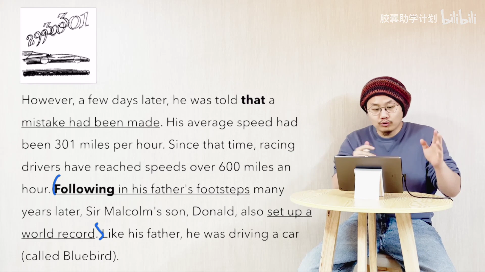

文字识别：胶囊助学计划bl山 / However, a few days later, he was told that a / mistake had been made. His average speed had / been 301 miles per hour. Since that time, racing / drivers have reached speeds over 600 miles an / hour. Following in his father's footsteps many / years later, Sir Malcolm's son, Donald, also set up a / world record. Like his father, he was driving a car / (called Bluebird).

## 00:10:30–00:11:00

后一个单词，我们几乎是一个单词一个单词对应去翻译过来，好像就很舒服了，对吧？所以之前这其实是四十九课咱们学过的那个语法，对吧？讲四十九课的时候我就提过，我说这个语法在我看来，对于大多数中国人，其实也许甚至不用专门去学，如果只为了处理阅读。但如果我们还要处理我们的，比如说写作啊，至少我们还是要学一下的。那学的方式

### 画面 00:10:30

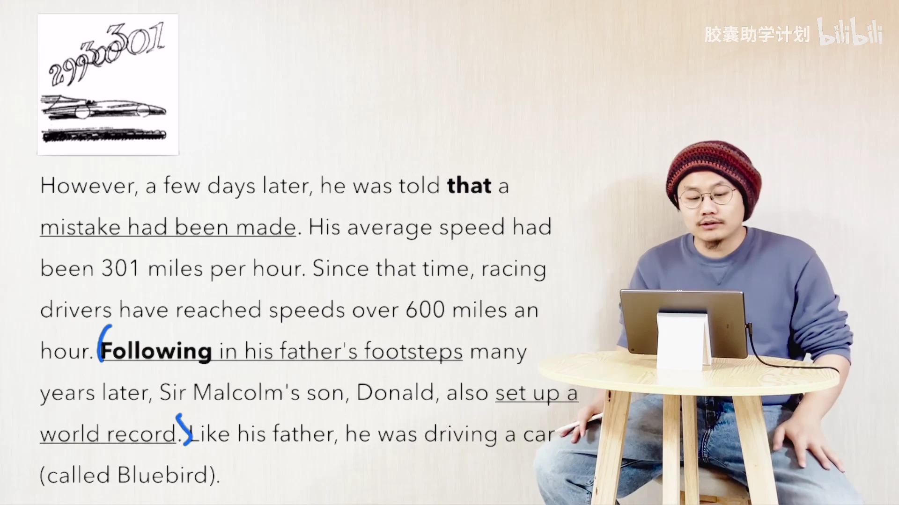

文字识别：胶囊助学计划blb出 / 29900 / However, a few days later, he was told that a / mistake had been made. His average speed had / been 301 miles per hour. Since that time, racing / drivers have reached speeds over 600 miles an / hour. Following in his father's footsteps many / years later, Sir Malcolm's son, Donald, also set up a / world record.Like his father, he was driving a car / (called Bluebird).

### 画面 00:10:32

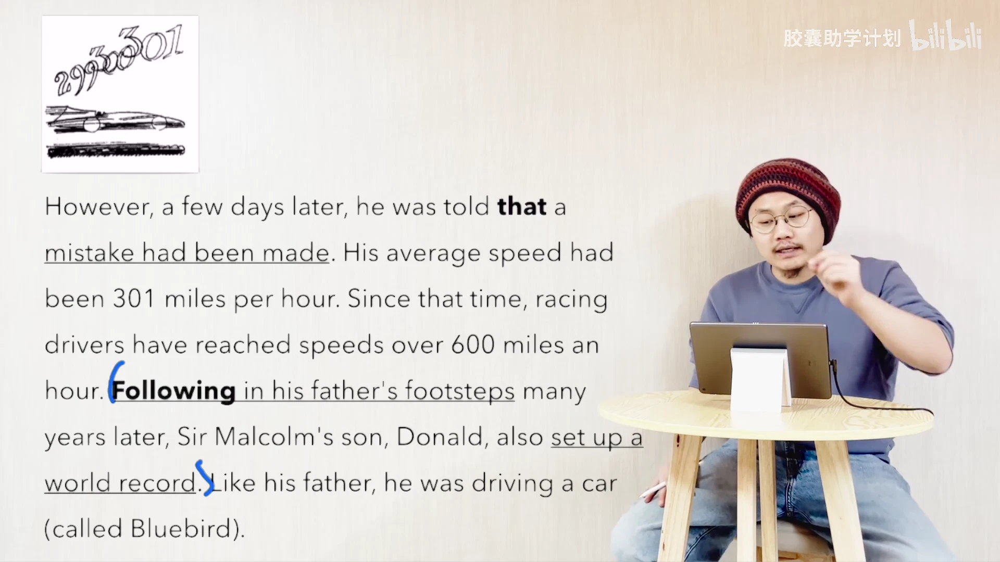

文字识别：胶囊助学计划bilb山 / 29900 / However, a few days later, he was told that a / mistake had been made. His average speed had / been 301 miles per hour. Since that time, racing / drivers have reached speeds over 600 miles an / hour. Following in his father's footsteps many / years later, Sir Malcolm's son, Donald, also set up a / world record.YLike his father, he was driving a car / (called Bluebird).

### 画面 00:10:35

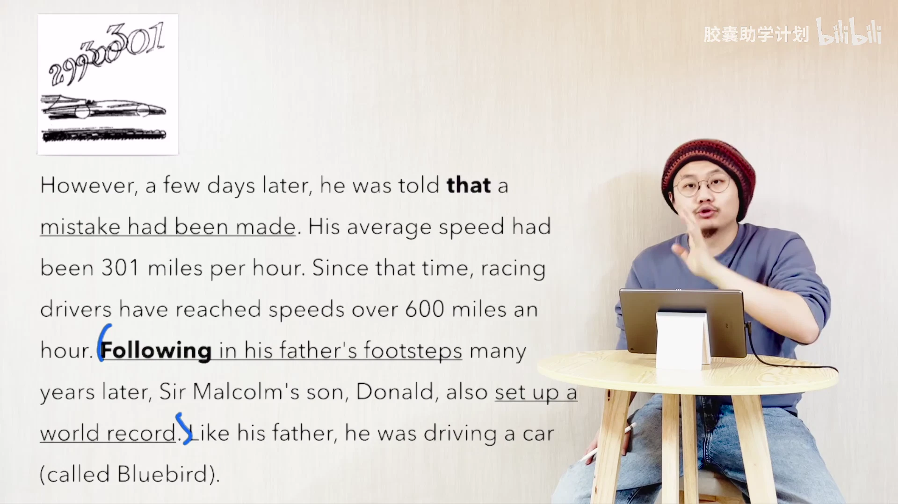

文字识别：胶囊助学计划bilb山 / However, a few days later, he was told that a / mistake had been made. His average speed had / been 301 miles per hour. Since that time, racing / drivers have reached speeds over 600 miles an / hour. Following in his father's footsteps many / years later, Sir Malcolm's son, Donald, also set up a / world record.Yike his father, he was driving a car / (called Bluebird).

### 画面 00:10:40

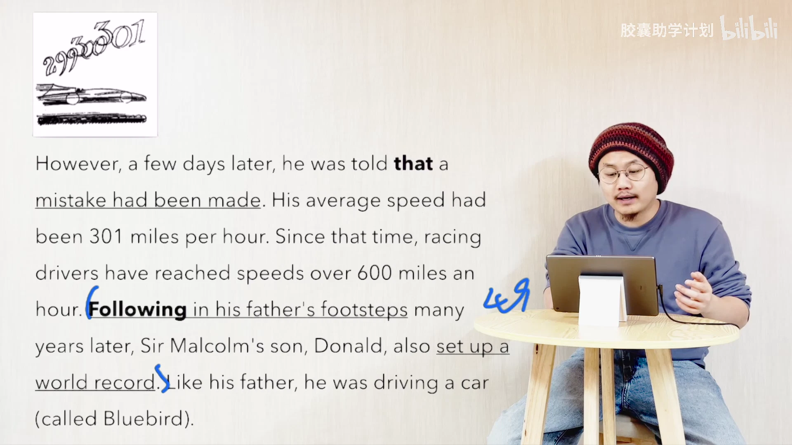

文字识别：胶囊助学计划bibl / However, a few days later, he was told that a / mistake had been made. His average speed had / been 301 miles per hour. Since that time, racing / drivers have reached speeds over 600 miles an / hour.Following in his father's footsteps many / years later, Sir Malcolm's son, Donald, also set up a / world record.Like his father, he was driving a car / (called Bluebird).

### 画面 00:10:42

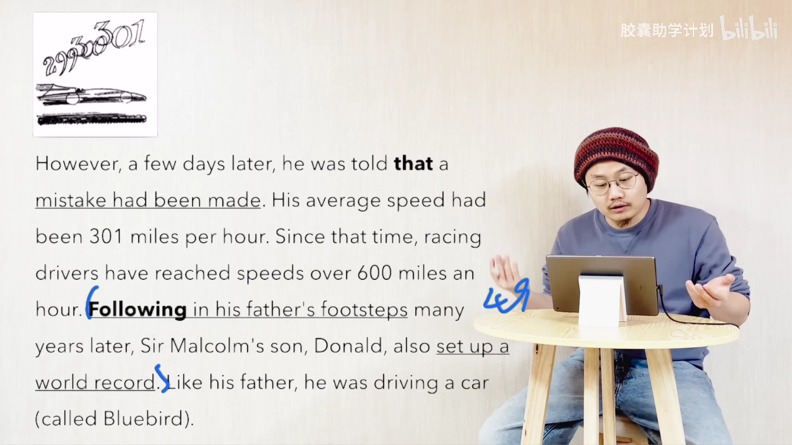

文字识别：胶囊助学计划bilbi / However, a few days later, he was told that a / mistake had been made. His average speed had / been 301 miles per hour. Since that time, racing / drivers have reached speeds over 600 miles an / hour. Following in his father's footsteps many / years later, Sir Malcolm's son, Donald, also set up a / world record.YLike his father, he was driving a car / (called Bluebird).

## 00:11:00–00:11:30

呢？四十九课和六十九课我们都提过了，对吧？好，尤其是四十九课，那在这儿最关键的点就是 following 的主语是谁？就是这个玩意儿，对吧？哎， Malcolm 的儿子 Donald 这个人追随着他父亲的脚步，明白了？能理解吧？主动被动呢？主动，他自己主动的追寻着他父亲的脚步，对吧？所以四十九课咱们学过的分词做状语，

### 画面 00:11:07

文字识别：胶囊助学计划bi出 / However, a few days later, he was told that a / mistake had been made. His average speed had / been 301 miles per hour. Since that time, racing / drivers have reached speeds over 600 miles an / hourFollowingin his father's footsteps many / years later, Sir Malcolm's son, Donald, also set up a / world record.Like his father, he was driving a car / (called Bluebird).

### 画面 00:11:09

文字识别：胶囊助学计划bi出 / However, a few days later, he was told that a / mistake had been made. His average speed had / been 301 miles per hour. Since that time, racing / drivers have reached speeds over 600 miles an / hourFollowing in his father's footsteps many / years later Sir Malcolm's son, Donald, also set up a / world record.YLike his father, he was driving a car / (called Bluebird).

### 画面 00:11:11

文字识别：胶囊助学计划bilbii / However, a few days later, he was told that a / mistake had been made. His average speed had / been 301 miles per hour. Since that time, racing / drivers have reached speeds over 600 miles an / hourFollowingin his father's footsteps many / years laterSir Malcolm's son, Donald also set up a / world record.YLike his father, he was driving a car / (called Bluebird).

### 画面 00:11:14

文字识别：胶囊助学计划blil / However, a few days later, he was told that a / mistake had been made. His average speed had / been 301 miles per hour. Since that time, racing / drivers have reached speeds over 600 miles an / 49 / hourFollowinoin / is father's footsteps many / years later Sir Malcolm's son, Donald also set up a / world record.YLike his father, he was driving a car / (called Bluebird).

### 画面 00:11:24

文字识别：胶囊助学计划bilbi / 29903011 / However, a few days later, he was told that a / mistake had been made. His average speed had / been 301 miles per hour. Since that time, racing / drivers have reached speeds over 600 miles an / 49 / hourFollowino inHi / is father's footsteps many / years later Sir Malcolm's son, Donald also set up a / world record.YLike his father, he was driving a car / (called Bluebird).

## 00:11:30–00:12:00

搞定了。好，这句话结束。Like his father，像他父亲一样，he was driving a car called Bluebird。二八、二九、三十这三课永远连着说，因为跟定语关系非常大。这三课在我看来，几乎是把定语最核心的东西给各位讲完了，对吧？好，呃，就像他父亲一样，他正在开着一辆车，这辆车被叫做 Bluebird，对吧？哎，你看我们呃，这个当

### 画面 00:11:53

文字识别：胶囊助学计划bilbi / However, a few days later, he was told that a / mistake had been made. His average speed had / been 301 miles per hour. Since that time, racing / drivers have reached speeds over 600 miles an / hourFollowino inH / is father's footsteps many / years later Sir Malcolm's son, Donald also set up a / world record.YLike his father, he was driving a car / (called Bluebird).

## 00:12:00–00:12:30

时二八二九三十学的是 called Pilatus Porter，嘛，对吧？那个 taxi called Pilatus Porter，其实是一个直升飞机。我希望您还记得那一刻啊啊！在在这里 called 是 Bluebird，对吧？文章结束，习惯用法有两个，我们挨个去造一下句啊。第一个叫 have difficulty in doing something，叫做某件事情有困难啊，有呃这个麻烦。比如说，I had a great difficulty in persuading

### 画面 00:12:00

文字识别：胶囊助学计划bilbil / 290301 / However, a few days later, he was told that a / mistake had been made. His average speed had / been 301 miles per hour. Since that time, racing / drivers have reached speeds over 600 miles an / hourFollowinoinHi / is father's footsteps many / years later Sir Malcolm's son, Donald also set up a / world record.YLike his father, he was driving a car / (called Bluebird).

### 画面 00:12:06

文字识别：胶囊助学计划bilbii / However, a few days later, he was told that a / mistake had been made. His average speed had / been 301 miles per hour. Since that time, racing / drivers have reached speeds over 600 miles an / 49 / hourFollowinoin Hi / is father's footsteps many / years later Sir Malcolm's son, Donald also set up a / world record.Like his father, he was driving a car / (called Bluebird).

### 画面 00:12:09

文字识别：胶囊助学计划bibi / However, a few days later, he was told that a / mistake had been made. His average speed had / been 301 miles per hour. Since that time, racing / drivers have reached speeds over 600 miles an / hourFollowing in Hi / is father's footsteps many / years laterSir Malcolm's son, Donald also set up a / world record.Like his father, he was driving a car / (called Bluebird).

### 画面 00:12:12

文字识别：胶囊助学计划bilbi / 29903011 / However, a few days later, he was told that a / mistake had been made. His average speed had / been 301 miles per hour. Since that time, racing / drivers have reached speeds over 600 miles an / 4 / hourFollowinoin Hi / is father's footsteps many / years later Sir Malcolm's son, Donald also set up a / world record.YLike his father, he was driving a car / (called Bluebird).

### 画面 00:12:14

文字识别：bibii / 胶囊助学计划 / 习惯用法造句 / have / difficulty in doing sth. / be disappointed to learn that

### 画面 00:12:16

文字识别：biibii / 胶囊助学计划 / 习惯用法造句 / have / difficulty in doing sth. / be disappointed to learn that

### 画面 00:12:18

文字识别：网：v.+v.变化 / 胶囊助学计划 / bibili / 习惯用法造句指南 / 四句型转换 / 方式/地点/时间 / 其他习惯用法 / 其他单词+词性 / 原文摘抄+变 / 6123456 / have difficulty in doing sth.

### 画面 00:12:20

文字识别：biibii / 网：v.+v.变化 / 胶囊助学计划 / 习惯用法造句指南 / 四句型转换 / 方式/地点/时间 / 其他习惯用法 / 其他单词+词性 / 原文摘抄+变 / 6123456 / have difficulty in doing sth.

### 画面 00:12:23

文字识别：习惯用法造句指南 / 网：v.+v.变化 / 胶囊助学计划 / bilbili / 四句型转换 / 方式/地点/时间 / 其他习惯用法 / 其他单词+词性 / 原文摘抄+变 / 6123456 / have difficulty in doing sth.

### 画面 00:12:25

文字识别：网：v.+v.变化 / 胶囊助学计划 / blbii / 习惯用法造句指南 / 四句型转换 / 方式/地点/时间 / 其他习惯用法 / 其他单词+词性 / 原文摘抄+变 / 6123456 / have difficulty in doing sth. / I had a great difficulty in persuading him to / go with me. L54

## 00:12:30–00:13:00

him to go with me.说我呀，在劝他和我一起走这件事情上，那费了老大劲了，对吧？太困难了。哎，have difficulty in doing something，对吧？我们这其实是结合了两个习惯用法。那再来，比如说我晚上入睡困难，怎么说呢？I have difficulty in sleeping at night.我在晚上睡觉入睡这个事儿很困难。再来说，even if I have

### 画面 00:12:30

文字识别：网：v.+v.变化 / 胶囊助学计划 / bilbil / 习惯用法造句指南 / 四句型转换 / 方式/地点/时间 / 其他习惯用法 / 其他单词+词性 / 原文摘抄+变 / 6123456 / have difficulty in doing sth. / I had a great difficulty in persuading him to / go with me. L54

### 画面 00:12:36

文字识别：网：v.+v.变化 / 胶囊助学计划 / bilbil / 习惯用法造句指南 / 四句型转换 / 方式/地点/时间 / 其他习惯用法 / 其他单词+词性 / 原文摘抄+变 / 6123456 / have difficulty in doing sth. / I had a great difficulty in persuading him to / go with me. L54

### 画面 00:12:40

文字识别：网：v.+v.变化 / 胶囊助学计划 / bilbil / 习惯用法造句指南 / 四句型转换 / 方式/地点/时间 / 其他习惯用法 / 其他单词+词性 / 原文摘抄+变 / 6123456 / have difficulty in doing sth. / I had a great difficulty in persuading him to / go with me. L54

### 画面 00:12:42

文字识别：bilbili / 网：v.+v.变化 / 胶囊助学计划 / 习惯用法造句指南 / 四句型转换 / 方式/地点/时间 / 其他习惯用法 / 其他单词+词性 / 原文摘抄+变 / 6123456 / have difficulty in doing sth. / I had a great difficulty in persuading him to / go with me. L54

### 画面 00:12:44

文字识别：网：v.+v.变化 / 胶囊助学计划 / bilbili / 习惯用法造句指南 / 四句型转换 / 方式/地点/时间 / 其他习惯用法 / 其他单词+词性 / 原文摘抄+变 / 6123456 / have difficulty in doing sth. / I had a great difficulty in persuading him to / go with me. L54

### 画面 00:12:46

文字识别：网：v.+v.变化 / 胶囊助学计划 / blbii / 习惯用法造句指南 / 四句型转换 / 方式/地点/时间 / 其他习惯用法 / 其他单词+词性 / 原文摘抄+变 / 6123456 / have difficulty in doing sth. / I had a great difficulty in persuading him to / go with me. L54 / I have difficulty in sleeping at night.

### 画面 00:12:49

文字识别：网：v.+v.变化 / 胶囊助学计划 / bilbil / 习惯用法造句指南 / 四句型转换 / 方式/地点/时间 / 其他习惯用法 / 其他单词+词性 / 原文摘抄+变 / 6123456 / have difficulty in doing sth. / I had a great difficulty in persuading him to / go with me. L54 / I have difficulty in sleeping at night.

### 画面 00:12:51

文字识别：网：v.+v.变化 / 胶囊助学计划 / bilibli / 习惯用法造句指南 / 四句型转换 / 方式/地点/时间 / 其他习惯用法 / 其他单词+词性 / 原文摘抄+变 / 6123456 / have difficulty in doing sth. / I had a great difficulty in persuading him to / go with me. L54 / I have difficulty in sleeping at night.

### 画面 00:12:53

文字识别：网：v.+v.变化 / 胶囊助学计划 / bilbl / 习惯用法造句指南 / 四句型转换 / 方式/地点/时间 / 其他习惯用法 / 其他单词+词性 / 原文摘抄+变 / 6123456 / have difficulty in doing sth. / I had a great difficulty in persuading him to / go with me. L54 / I have difficulty in sleeping at night.

### 画面 00:12:55

文字识别：网：v.+v.变化 / 胶囊助学计划 / blibii / 习惯用法造句指南 / 四句型转换 / 方式/地点/时间 / 其他习惯用法 / 其他单词+词性 / 原文摘抄+变 / 6123456 / have difficulty in doing sth. / I had a great difficulty in persuading him to / go with me. L54 / I have difficulty in sleeping at night.

### 画面 00:12:57

文字识别：网：v.+v.变化 / 胶囊助学计划 / bibli / 习惯用法造句指南 / 四句型转换 / 方式/地点/时间 / 其他习惯用法 / 其他单词+词性 / 原文摘抄+变 / 6123456 / have difficulty in doing sth. / I had a great difficulty in persuading him to / go with me. L54 / I have difficulty in sleeping at night. /  Even if I have difficulty in sleeping at / night, I still work very hard during the day.

### 画面 00:12:59

文字识别：网：v.+v.变化 / 胶囊助学计划 / bibil / 习惯 / 四句型转换 / 伙用法造句指南 / 方式/地点/时间 / 其他习惯用法 / 其他单词+词性 / 原文摘抄+变 / 6123456 / have difficulty in doing sth. / I had a great difficulty in persuading him to / go with me. L54 / I have difficulty in sleeping at night. /  Even if I have difficulty in sleeping at / night, I still work very hard during the day.

## 00:13:00–00:13:30

difficulty in sleeping at night, I still work very hard during the day. Hey, even if原文咱们出现了although，随便互换啊。Even if呃，尽管即使说我晚上睡觉困难，刚才上面那句话咱说了，我依旧白天很努力的工作，对吧？Okay, 那叫have difficulty in doing something. 接下来呢，注意力集中，咱听听电影片段。My name's Shaw. I've just arrived and I'm having

### 画面 00:13:01

文字识别：习惯用法造句指南 / 网：v.+v.变化 / 胶囊助学计划 / bilibili / 四句型转换 / 方式/地点/时间 / 其他习惯用法 / 其他单词+词性 / 原文摘抄+变 / 6123456 / have difficulty in doing sth. / I had a great difficulty in persuading him to / go with me. L54 / I have difficulty in sleeping at night. /  Even if I have difficulty in sleeping at / night, I still work very hard during the day.

### 画面 00:13:05

文字识别：网：v.+v.变化 / 胶囊助学计划 / bibii / 习惯 / 四句型转换 / 用法造句指南 / 方式/地点/时间 / 其他习惯用法 / 其他单词+词性 / 原文摘抄+变 / 6123456 / have difficulty in doing sth. / I had a great difficulty in persuading him to / go with me. L54 / I have difficulty in sleeping at night. /  Even if I have difficulty in sleeping at / night, I still work very hard during the day.

### 画面 00:13:07

文字识别：习惯用法造句指南 / 网：v.+v.变化 / 胶囊助学计划 / biibii / 四句型转换 / 方式/地点/时间 / 其他习惯用法 / 其他单词+词性 / 原文摘抄+变 / 6123456 / have difficulty in doing sth. / I had a great difficulty in persuading him to / go with me. L54 / I have difficulty in sleeping at night. /  Even if I have difficulty in sleeping at / night, I still work very hard during the day.

### 画面 00:13:10

文字识别：习惯用法造句指南 / 网：v.+v.变化 / 胶囊助学计划 / bitbli / 四句型转换 / 方式/地点/时间 / 其他习惯用法 / 其他单词+词性 / 原文摘抄+变 / 6123456 / have difficulty in doing sth. / I had a great difficulty in persuading him to / go with me. L54 / I have difficulty in sleeping at night. /  Even if I have difficulty in sleeping at / night, I still work very hard during the day.

### 画面 00:13:15

文字识别：网：v.+v.变化 / 胶囊助学计划 / bibii / 习惯 / 四句型转换 / 用法造 / 方式/地点/时间 / 其他习惯用法 / 旭句指南 / 其他单词+词性 / 原文摘抄+变 / 6123456 / have difficulty in doing sth. / I had a great difficulty in persuading him to / go with me. L54 / I have difficulty in sleeping at night. /  Even if I have difficulty in sleeping at / night, I still work very hard during the day.

### 画面 00:13:18

文字识别：网：v.+v.变化 / 胶囊助学计划 / bibii / 习惯用法造句指南 / 四句型转换 / 方式/地点/时间 / 其他习惯用法 / 其他单词+词性 / 原文摘抄+变 / 6123456 / have difficulty in doing sth. / I had a great difficulty in persuading him to / go with me. L54 / I have difficulty in sleeping at night. /  Even if I have difficulty in sleeping at / night, I still work very hard during the day.

### 画面 00:13:20

文字识别：网：v.+v.变化 / 胶囊助学计划 / bibii / 习惯 / 四句型转换 / 用 / 方式/地点/时间 / 法 / 造 / 其他习惯用法 / 旭句指南 / 其他单词+词性 / 原文摘抄+变 / 6123456 / have difficulty in doing sth. / I had a great difficulty in persuading him to / go with me. L54 / I have difficulty in sleeping at night. /  Even if I have difficulty in sleeping at / night, I still work very hard during the day.

### 画面 00:13:23

文字识别：胶囊助学计划bib出 / My name is Shaw. I've just arrived and I'm / having difficulty in finding somewhere to sleep. / Doomwatch / (1972)

### 画面 00:13:27

文字识别：胶囊助学计划bi出 / My name is Shaw.. I've just arrived and I'm / having difficulty in finding somewhere to sleep. / Doomwatch / (1972)

### 画面 00:13:29

文字识别：胶囊助学计划bi出 / My name is Shaw. I've just arrived and I'm / having dificulty in finding somewhere to sleep. / Doomwatch / (1972)

## 00:13:30–00:14:00

difficulty finding somewhere to sleep.接下来下一个习惯用法叫 be disappointed to learn that，叫做呃很遗憾很失望的得知了某件事情啊。比如说我们看这句话叫做 He was disappointed to learn I was there，说他很遗憾很失望的得知了说我在哪里。Next one，啊这是一个习惯用啊这是一个电影当中的片段啊。接下来比如说 We were all disappointed to

### 画面 00:13:31

文字识别：bilbil / 胶囊助学计划 / My name is Shaw. I've just arrived and I'm / having difficulty in finding somewhere to sleep. / Doomwatch / (1972)

### 画面 00:13:33

文字识别：习惯用法造句指南 / 网：v.+v.变化 / 胶囊助学计划 / bibili / 四句型转换 / 方式/地点/时间 / 其他习惯用法 / 其他单词+词性 / 原文摘抄+变 / 6123456 / be disappointed to learn that

### 画面 00:13:35

文字识别：bilbi / 网：v.+v.变化 / 胶囊助学计划 / 习惯用法造句指南 / 四句型转换 / 方式/地点/时间 / 其他习惯用法 / 其他单词+词性 / 原文摘抄+变 / 6123456 / be disappointed to learn that

### 画面 00:13:37

文字识别：bilbili / 网：v.+v.变化 / 胶囊助学计划 / 习惯用法造句指南 / 四句型转换 / 方式/地点/时间 / 其他习惯用法 / 其他单词+词性 / 原文摘抄+变 / 6123456 / be disappointed to learn that

### 画面 00:13:40

文字识别：网：v.+v.变化 / 胶囊助学计划 / bilbili / 习惯用法造句指南 / 四句型转换 / 方式/地点/时间 / 其他习惯用法 / 其他单词+词性 / 原文摘抄+变 / 6123456 / be disappointed to learn that

### 画面 00:13:42

文字识别：bibii / 网：v.+v.变化 / 胶囊助学计划 / 习惯用法造句指南 / 四句型转换 / 方式/地点/时间 / 其他习惯用法 / 其他单词+词性 / 原文摘抄+变 / 6123456 / be disappointed to learn that /  He was disappointed to learn I was there.

### 画面 00:13:44

文字识别：网：v.+v.变化 / 胶囊助学计划 / bibii / 习惯用法造句指南 / 四句型转换 / 方式/地点/时间 / 其他习惯用法 / 其他单词+词性 / 原文摘抄+变 / 6123456 / be disappointed to learn that /  He was disappointed to learn I was there.

### 画面 00:13:46

文字识别：网：v.+v.变化 / 胶囊助学计划 / bilbil / 习惯用法造句指南 / 四句型转换 / 方式/地点/时间 / 其他习惯用法 / 其他单词+词性 / 原文摘抄+变 / 6123456 / be disappointed to learn that /  He was disappointed to learn I was there.

### 画面 00:13:48

文字识别：bilbil / 网：v.+v.变化 / 胶囊助学计划 / 习惯用法造句指南 / 四句型转换 / 方式/地点/时间 / 其他习惯用法 / 其他单词+词性 / 原文摘抄+变 / 6123456 / be disappointed to learn that /  He was disappointed to learn I was there.

### 画面 00:13:50

文字识别：bilbii / 网：v.+v.变化 / 胶囊助学计划 / 习惯用法造句指南 / 四句型转换 / 方式/地点/时间 / 其他习惯用法 / 其他单词+词性 / 原文摘抄+变 / 6123456 / be disappointed to learn that /  He was disappointed to learn I was there.

### 画面 00:13:52

文字识别：biibii / 网：v.+v.变化 / 胶囊助学计划 / 习惯用法造句指南 / 四句型转换 / 方式/地点/时间 / 其他习惯用法 / 其他单词+词性 / 原文摘抄+变 / 6123456 / be disappointed to learn that /  He was disappointed to learn I was there.

### 画面 00:13:54

文字识别：网：v.+v.变化 / 胶囊助学计划 / 习惯用法造句指南 / 四句型转换 / 方式/地点/时间 / 其他习惯用法 / 其他单词+词性 / 原文摘抄+变 / 6123456 / be disappointed to learn that /  He was disappointed to learn I was there. / Married Life (2007) /  We were all disappointed to learn that the / picnic had been cancelled.

### 画面 00:13:56

文字识别：网：v.+v.变化 / 胶囊助学计划 / biibii / 习惯用法造句指南 / 四句型转换 / 方式/地点/时间 / 其他习惯用法 / 其他单词+词性 / 原文摘抄+变 / 6123456 / be disappointed to learn that /  He was disappointed to learn I was there. / Married Life (2007) /  We were all disappointed to learn that the / picnic had been cancelled.

## 00:14:00–00:14:30

learn that the picnic had been cancelled.说我们很遗憾的得知说这个呃呃这个这个picnic就是野餐是吧？野炊已经被取消了。哎，很遗憾的得知。再来，说I was disappointed to learn that he had returned the computer to learn return something to Leo. Ah, return something to somebody.哎，退还某物给某人。OK，好。呃，那继续吧，咱们听一下电影片段啊，注意力集中。

### 画面 00:14:00

文字识别：网：v.+v.变化 / 胶囊助学计划 / 习惯用法造句指南 / 四句型转换 / 方式/地点/时间 / 其他习惯用法 / 其他单词+词性 / 原文摘抄+变 / 6123456 / be disappointed to learn that /  He was disappointed to learn I was there. / Married Life (2007) /  We were all disappointed to learn that the / picnic had been cancelled.

### 画面 00:14:05

文字识别：网：v.+v.变化 / 胶囊助学计划 / bilbil / 习惯用法造句指南 / 四句型转换 / 方式/地点/时间 / 其他习惯用法 / 其他单词+词性 / 原文摘抄+变 / 6123456 / be disappointed to learn that /  He was disappointed to learn I was there. / Married Life (2007) /  We were all disappointed to learn that the / picnic had been cancelled.

### 画面 00:14:10

文字识别：网：v.+v.变化 / 胶囊助学计划 / biibii / 习惯用法造句指南 / 四句型转换 / 方式/地点/时间 / 其他习惯用法 / 其他单词+词性 / 原文摘抄+变 / 6123456 / be disappointed to learn that /  He was disappointed to learn I was there. / Married Life (2007) /  We were all disappointed to learn that the / picnic had been cancelled.

### 画面 00:14:13

文字识别：胶囊助学计划bibi / 网：v.+v.变化 / 习惯用法造句指南 / 四句型转换 / 方式/地点/时间 / 其他习惯用法 / 其他单词+词性 / 原文摘抄+变 / 6123456 / be disappointed to learn that /  He was disappointed to learn I was there. / Married Life (2007) /  We were all disappointed to learn that the / picnic had been cancelled. / I was disappointed to learn that he had / returned the computer to Leo. L45

### 画面 00:14:15

文字识别：胶囊助学计划ili / 网：v.+v.变化 / 习惯用法造句指南 / 四句型转换 / 方式/地点/时间 / 其他习惯用法 / 其他单词+词性 / 原文摘抄+变 / 6123456 / be disappointed to learn that /  He was disappointed to learn I was there. / Married Life (2007) /  We were all disappointed to learn that the / picnic had been cancelled. / I was disappointed to learn that he had / returned the computer to Leo. L45

### 画面 00:14:21

文字识别：胶囊助学计划ii / 网：v.+v.变化 / 习惯用法造句指南 / 四句型转换 / 方式/地点/时间 / 其他习惯用法 / 其他单词+词性 / 原文摘抄+变 / 6123456 / be disappointed to learn that /  He was disappointed to learn I was there. / Married Life (2007) /  We were all disappointed to learn that the / picnic had been cancelled. / I was disappointed to learn that he had / returned the computer to Leo. L45

### 画面 00:14:25

文字识别：Excuse me? as a finley's store employee, / bibili / 胶囊助学计划 / I was disappointed to learn / that you had canceled the Christmas party. / Miracle in Manhattan / (2010)

### 画面 00:14:28

文字识别：Excuse me? as a finley's store employee, / biibili / 胶囊助学计划 / I was disappointed to learn / that you had canceled the Christmas party. / Miracle in Manhattan / (2010)

## 00:14:30–00:15:00

Excuse me, as a Finley Store employee, I was disappointed to learn that you had canceled the Christmas party. OK，好。Recap两个习惯用法啊，咱们不多说了。习惯用法您肯定要造句，文章跟读至熟读成诵。再提一句，熟读成诵是不需要您背下来的，你读到特别的流利就可以了。OK，那然后置顶留言可以找到重复间隔的学习材料。以上呢

### 画面 00:14:30

文字识别：Excuse me? as a finley's store employee, / bilbil / 胶囊助学计划 / I was disappointed to learn / that you had canceled the Christmas party. / Miracle in Manhattan / (2010)

### 画面 00:14:32

文字识别：Excuse me? as a finley's store employee, / biibili / 胶囊助学计划 / I was disappointed to learn / that you had canceled the Christmas party. / Miracle in Manhattan / (2010)

### 画面 00:14:34

文字识别：Excuse me? as a finley's store employee, / biibii / 胶囊助学计划 / I was disappointed to learn / that you had canceled the Christmas party. / Miracle in Manhattan / (2010)

### 画面 00:14:36

文字识别：Excuse me? as a finley's store employee, / biibili / 胶囊助学计划 / I was disappointed to learn / that you had canceled the Christmas party. / Miracle in Manhattan / (2010)

### 画面 00:14:38

文字识别：bibii / 胶囊助学计划 / Recap / have / difficulty in doing sth. / Expression / be / disappointed to learn t / that

### 画面 00:14:40

文字识别：bilbii / 胶囊助学计划 / Recap / difficulty in doing sth. / have / Expression / be / disappointed to learn t / that

### 画面 00:14:42

文字识别：Bilbili / 胶囊助学计划

### 画面 00:14:44

文字识别：bilibili / 胶囊助学计划 / 1. / 习惯用法造句/对话 / 【习惯用法造句指南】 / 每个5句 / 文章跟读至熟读成诵 / 内化单词+语法+习惯用法 / 听力+口语+写作练习

### 画面 00:14:46

文字识别：bilbl / 胶囊助学计划 / 习惯用法造句/对话 / 【习惯用法造句指南】 / 每个5句 / 文章跟读至熟读成诵 / 内化单词+语法+习惯用法 / 听力+口语+写作练习

### 画面 00:14:49

文字识别：bilibli / 胶囊助学计划 / 习惯用法造句/对话 / 【习惯用法造句指南】 / 每个5句 / 文章跟读至熟读成诵 / 内化单词+语法+习惯用法 / 听力+口语+写作练习

### 画面 00:14:51

文字识别：bilibili / 胶囊助学计划 / 习惯用法造句/对话 / 【习惯用法造句指南】 / 每个5句 / 文章跟读至熟读成诵 / 内化单词+语法+习惯用法 / 听力+口语+写作练习

### 画面 00:14:54

文字识别：bilibili / 胶囊助学计划 / 1. / 习惯用法造句/对话 / 【习惯用法造句指南】 / 每个5句 / 文章跟读至熟读成诵 / 内化单词+语法+习惯用法 / 听力+口语+写作练习

### 画面 00:14:56

文字识别：bibii / 胶囊助学计划 / 习惯用法造句/对话 / 【习惯用法造句指南】 / 每个5句 / 文章跟读至熟读成诵 / 内化单词+语法+习惯用法 / 听力+口语+写作练习 / 3. / 重复间隔（置顶留言）

### 画面 00:14:58

文字识别：胶囊助学计划bi出

## 00:15:00–00:15:24

就是本期视频的全部内容了。如果各位喜欢我们的课程呢，欢迎各位关注、订阅、一键三连、分享给那些需要的朋友，来帮助我们快速成长。See you next time.

### 画面 00:15:00

文字识别：胶囊助学计划bi出 / 不

### 画面 00:15:03

文字识别：胶囊助学计划bil / 不

### 画面 00:15:06

文字识别：bibii / 胶囊助学计划

### 画面 00:15:11

### 画面 00:15:13

文字识别：CAPSULEACADEMY / 胶囊助学计划 / 『 / 小红书 / Lecturer / □ / Leo / OE

### 画面 00:15:16

文字识别：CAPSULEACADEMY / 胶囊助学计划 / 小红书

### 画面 00:15:19

文字识别：珈学針物 / CAPSULEACADEMY / 胶囊助学计划 / 小红书 / Creator / Leo & Berlin

### 画面 00:15:21

文字识别：bilbili / 胶囊助学计划 / CAPSULEACADEMY / 胶囊助学计划 / 小红书 / OE

### 画面 00:15:23

文字识别：bilibili / 胶囊助学计划

