# 072 练习

快速机器解析：语音为单模型转写，未进行独立交叉校对或人工复核；画面每秒采样并按变化选帧，短时文字和标记可能遗漏。截图时间约有 1 秒误差。图片有损压缩；遇到疑点请按时间查看 Google Drive 原视频。

## 00:00:00–00:00:30

Hello everyone, welcome to Capsule Academy. This is Leo. Today we're going to learn new concept English Book Two Lesson Seventy Two Practices. That注意进行如下练习，唯一的前提就是文章跟读至熟读成诵，否则请勿开始。Hope you gonna enjoy. 第一题 comprehension. 您听啊，这个听完了之后口语回答我，我们练习口语听力。我先问了啊，Was

### 画面 00:00:00

文字识别：bilbili / 胶囊助学计划 / NCE / BOOK I"I / Lesson 72 / Practices

### 画面 00:00:02

文字识别：bilbil / 胶囊助学计划 / NCE / BOOKII / Lesson 72 / Practices

### 画面 00:00:05

文字识别：biibii / 胶囊助学计划 / NCE / BOOKII / Lesson 72 / Practices

### 画面 00:00:07

文字识别：biibii / 胶囊助学计划 / NCE / BOOKII / Lesson 72 / Practices

### 画面 00:00:09

文字识别：bilbil / 胶囊助学计划 / 进行如下练习唯一前提 / 文章跟读至熟读成诵 / 否则请勿开始

### 画面 00:00:13

文字识别：bibii / 胶囊助学计划 / 进行如下练习唯一前提 / 文章跟读至熟读成诵 / 否则请勿开始

### 画面 00:00:16

文字识别：胶囊助学计划 bii / •

### 画面 00:00:20

文字识别：動字計划園 / 囊助学计划

### 画面 00:00:22

文字识别：bibili / 胶囊助学计划 / Comprehension / 训练目标： / 听懂一般疑问句＆特殊疑问句

### 画面 00:00:28

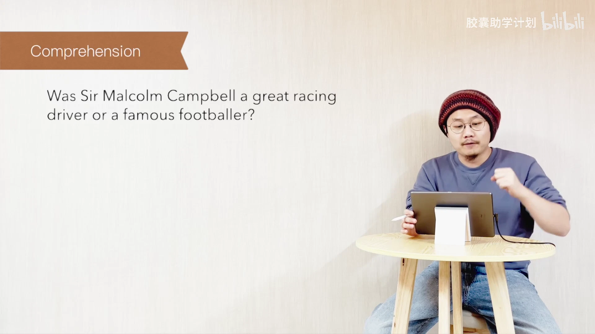

文字识别：bibli / 胶囊助学计划 / Comprehension / Was Sir Malcolm Campbell a great racing / driver or a famous footballer?

## 00:00:30–00:01:00

Sir Malcolm Campbell a great racing driver or a famous footballer? 那肯定就是 a great racing driver了. Next one, what was he the first man to do? To drive at over 300 miles per hour. When did he set up a new world record? In 1935. Where did he do it?

### 画面 00:00:30

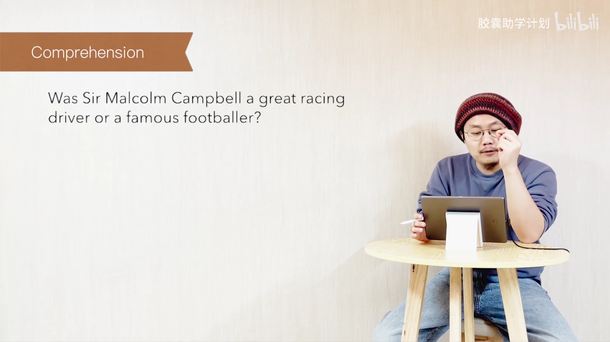

文字识别：bibli / 胶囊助学计划 / Comprehension / Was Sir Malcolm Campbell a great racing / driver or a famous footballer?

### 画面 00:00:35

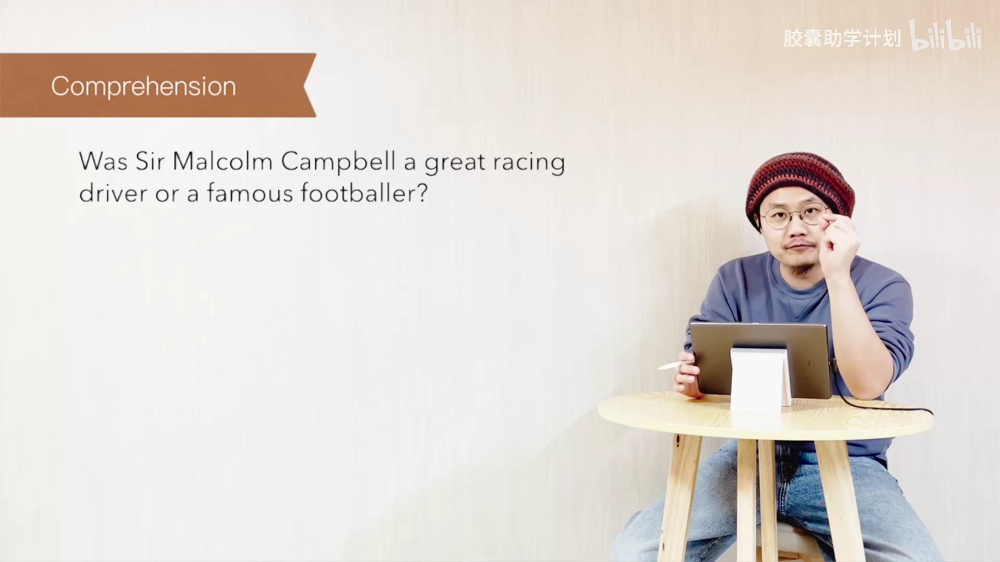

文字识别：bilbili / 胶囊助学计划 / Comprehension / Was Sir Malcolm Campbell a great racing / driver or a famous footballer?

### 画面 00:00:38

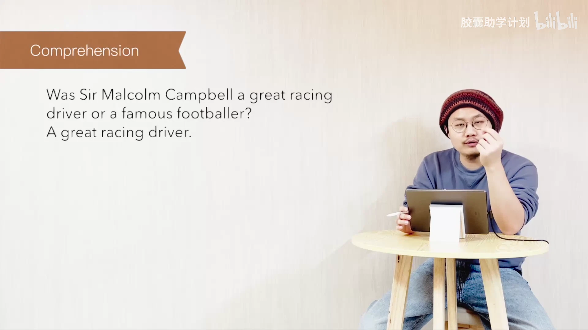

文字识别：bilbili / 胶囊助学计划 / Comprehension / Was Sir Malcolm Campbell a great racing / driver or a famous footballer? / A great racing driver.

### 画面 00:00:40

文字识别：bilbili / 胶囊助学计划 / Comprehension / What was he the first man to do?

## 00:01:00–00:01:30

Ah, Utah,其实就是对吧。What was the name of the car he was driving? Bluebird. Had it been specially built for him? Yes, it had.或者Yes, of course. How long was it? Over thirty feet in length,对吧How powerful was its engine?

### 画面 00:01:08

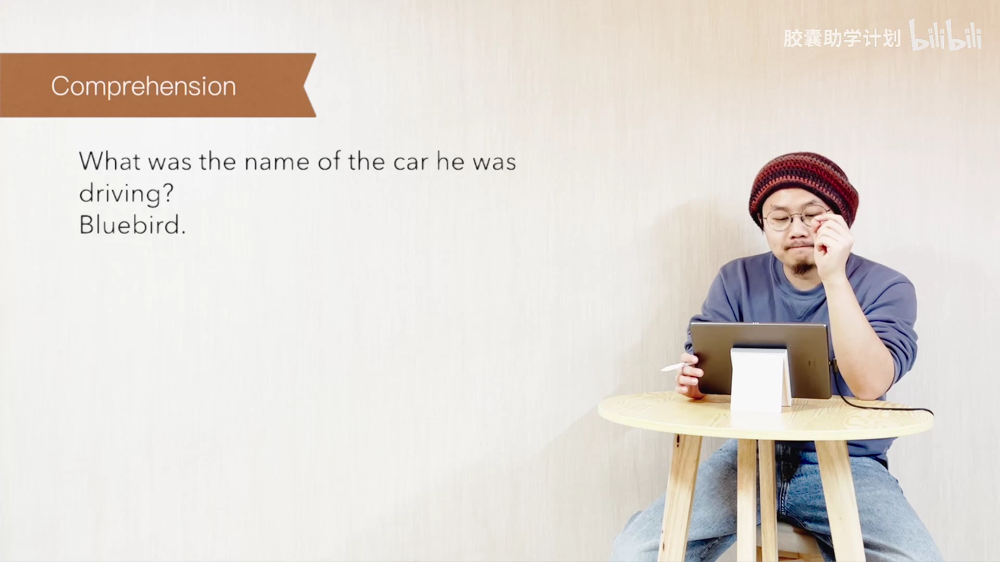

文字识别：bibli / 胶囊助学计划 / Comprehension / What was the name of the car he was / driving? / Bluebird.

### 画面 00:01:29

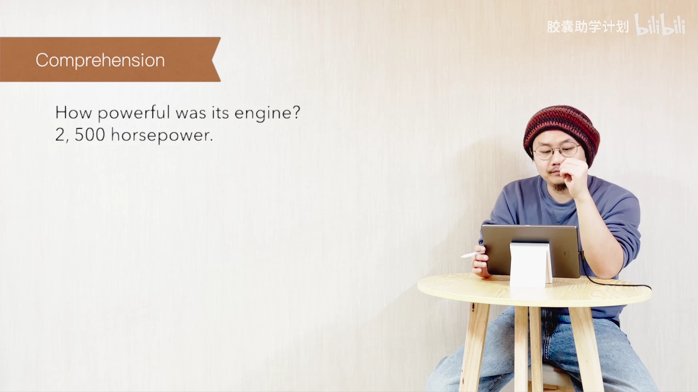

文字识别：bilbl / 胶囊助学计划 / Comprehension / How powerful was its engine? / 2, 500 horsepower.

## 00:01:30–00:02:00

two thousand five hundred horsepower. What speed did Campbell reach? Over three hundred and four miles per hour. Why did he have great difficulty in controlling his car? Because a tire burst. Why was he disappointed at first? Because his average

### 画面 00:01:50

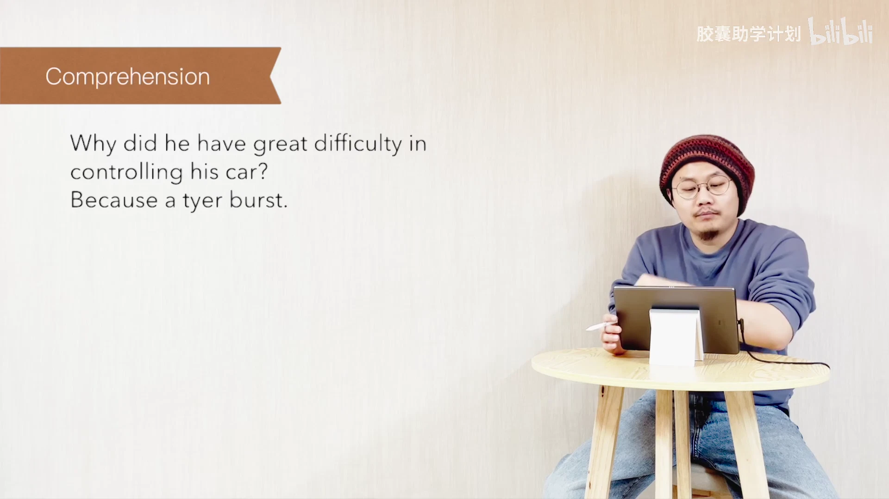

文字识别：bilibili / 胶囊助学计划 / Comprehension / Why did he have great difficulty in / controlling his car? / Because a tyer burst.

### 画面 00:01:52

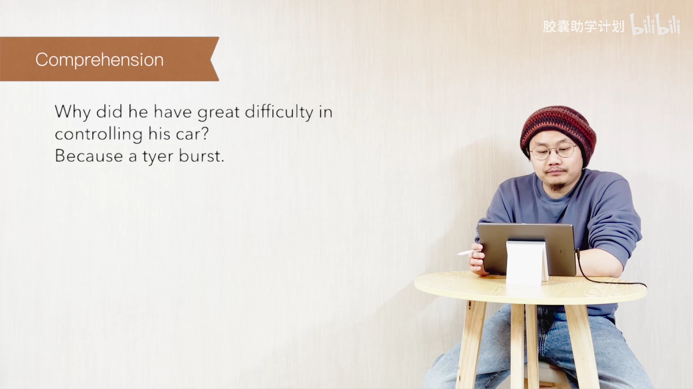

文字识别：bilibili / 胶囊助学计划 / Comprehension / Why did he have great difficulty in / controlling his car? / Because a tyer burst.

### 画面 00:01:54

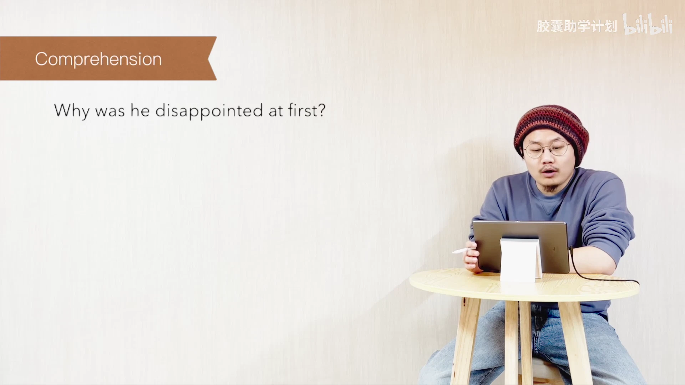

文字识别：blibili / 胶囊助学计划 / Comprehension / Why was he disappointed at first?

## 00:02:00–00:02:30

speed was said to be two hundred ninety nine miles per hour, had someone made a mistake? Yes, they had. What was his average speed? Three hundred and one miles per hour. Okay, asking questions,老习惯，四句型转换啊。第一个, ask me if Sir Malcolm Campbell was the first man to drive at over three hundred

### 画面 00:02:18

文字识别：bibii / 胶囊助学计划 / Asking questions / 训练目标： / 会说一般疑问句＆特殊疑问句 / Accuracy / Fluency

### 画面 00:02:21

文字识别：bibii / 胶囊助学计划 / Asking questions

### 画面 00:02:23

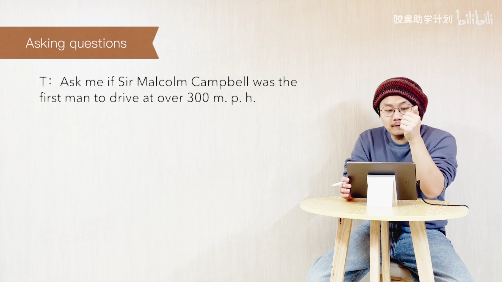

文字识别：bilbil / 胶囊助学计划 / Asking questions / T: Ask me if Sir Malcolm Campbell was the / first man to drive at over 300 m. p. h.

## 00:02:30–00:03:00

mph,对吧？Okay, at miles per hour,啊，那 mph 就是 miles per hour。这个一般疑问句 was 提前就可以了。Who？你直接对主语提问啊？Okay，那第一个不说，第二个 he set up a new world record in September 1935. Did 提前？When 对时间提问？Who 对主语提问？对吧？对 he 主语提问，不变一般疑问句了。但你对时间提问是变一般疑问句的啊。

### 画面 00:02:31

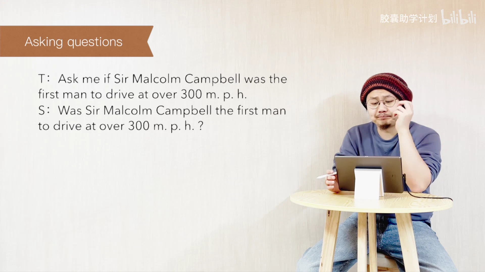

文字识别：bilbil / 胶囊助学计划 / Asking questions / T: Ask me if Sir Malcolm Campbell was the / first man to drive at over 300 m. p. h. / S:Was Sir Malcolm Campbell the first man / to drive at over 300 m. p. h.?

### 画面 00:02:33

文字识别：biibii / 胶囊助学计划 / Asking questions / T: Ask me if Sir Malcolm Campbell was the / first man to drive at over 300 m. p. h. / S: Was Sir Malcolm Campbell the first man / to drive at over 300 m. p. h.?

### 画面 00:02:35

文字识别：bilbili / 胶囊助学计划 / Asking questions / T: Ask me if Sir Malcolm Campbell was the / first man to drive at over 300 m. p. h. / S: Was Sir Malcolm Campbell the first man / to drive at over 300 m. p. h.?

### 画面 00:02:41

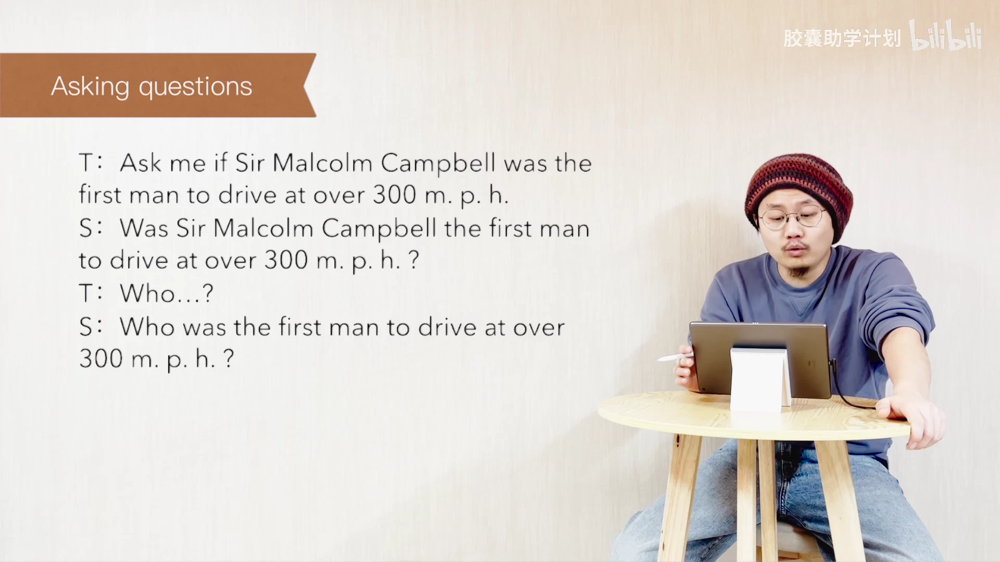

文字识别：blbi / 胶囊助学计划 / Asking questions / T: Ask me if Sir Malcolm Campbell was the / first man to drive at over 300 m. p. h. / S: Was Sir Malcolm Campbell the first man / to drive at over 300 m. p. h. ? / T: Who...? / S: Who was the first man to drive at over / 300m. p.h.?

### 画面 00:02:44

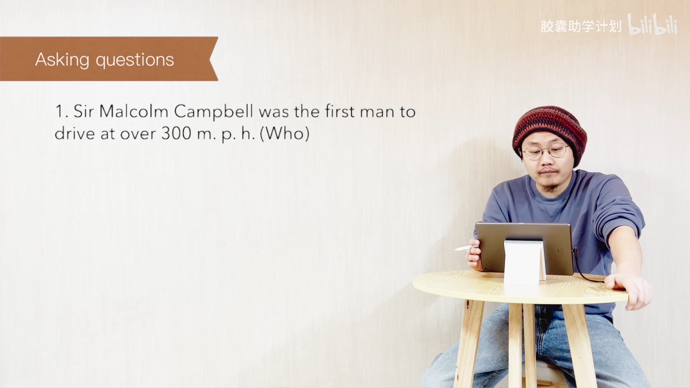

文字识别：bilbil / 胶囊助学计划 / Asking questions / 1. Sir Malcolm Campbell was the first man to / drive at over 300 m. p. h.(Who)

### 画面 00:02:58

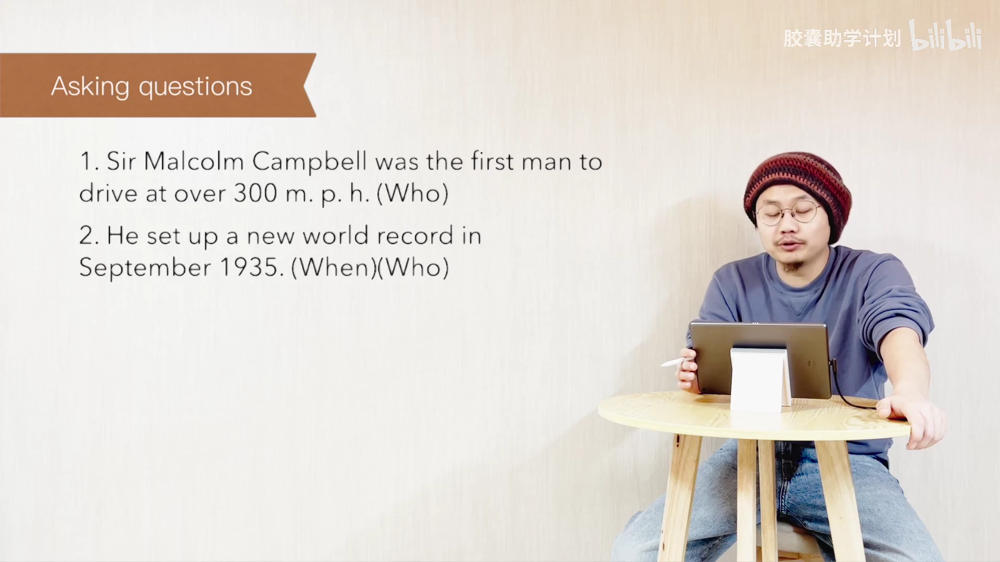

文字识别：biibili / 胶囊助学计划 / Asking questions / 1. Sir Malcolm Campbell was the first man to / drive at over 300 m. p. h. (Who) / 2. He set up a new world record in / September 1935.(When)(Who)

## 00:03:00–00:03:30

He was racing.呃，was提前嘛？呃，where对地点提问对吧？哎，然后when直接加整句话。然后his car was called Bluebird.那你was提前嘛？对吧？然后what对呃Bluebird提问，whose你可以对his提问对吧？就whose car was called Bluebird.第五个，it has been specially built for him.你把had提前，who对him提问对吧？It was over thirty feet long.

### 画面 00:03:01

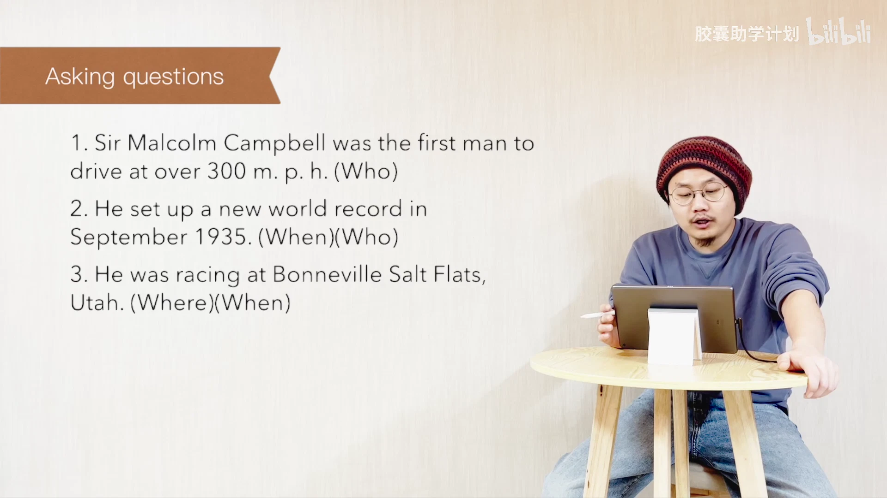

文字识别：bilibii / 胶囊助学计划 / Asking questions / 1. Sir Malcolm Campbell was the first man to / drive at over 300 m. p. h. (Who) / 2. He set up a new world record in / September 1935.(When)(Who) / 3. He was racing at Bonneville Salt Flats, / Utah. (Where)(When)

### 画面 00:03:04

文字识别：bibii / 胶囊助学计划 / Asking questions / 1. Sir Malcolm Campbell was the first man to / drive at over 300 m. p. h. (Who) / 2. He set up a new world record in / September 1935.(When)(Who) / 3. He was racing at Bonneville Salt Flats, / Utah. (Where)(When)

### 画面 00:03:06

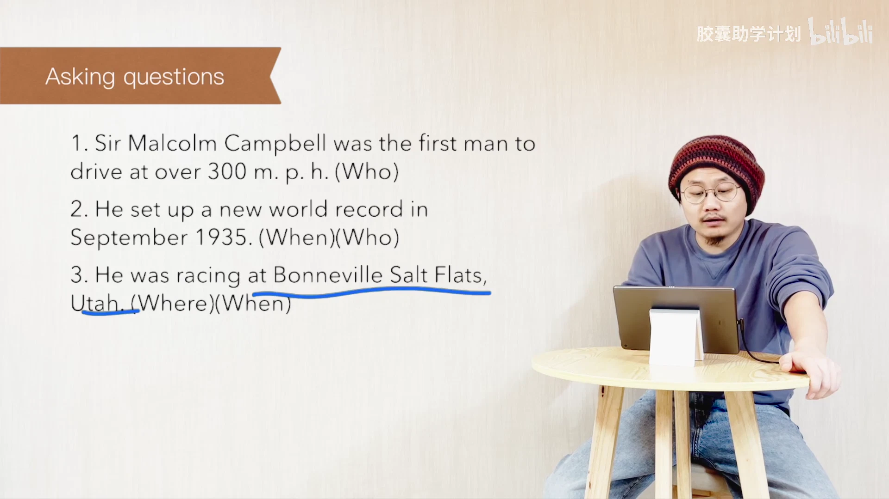

文字识别：Bilbili / 胶囊助学计划 / Asking questions / 1. Sir Malcolm Campbell was the first man to / drive at over 300 m. p. h. (Who) / 2. He set up a new world record in / September 1935.(When)(Who) / 3. He was racing at Bonneville Salt Flats, / Utah.(Where)(When)

### 画面 00:03:08

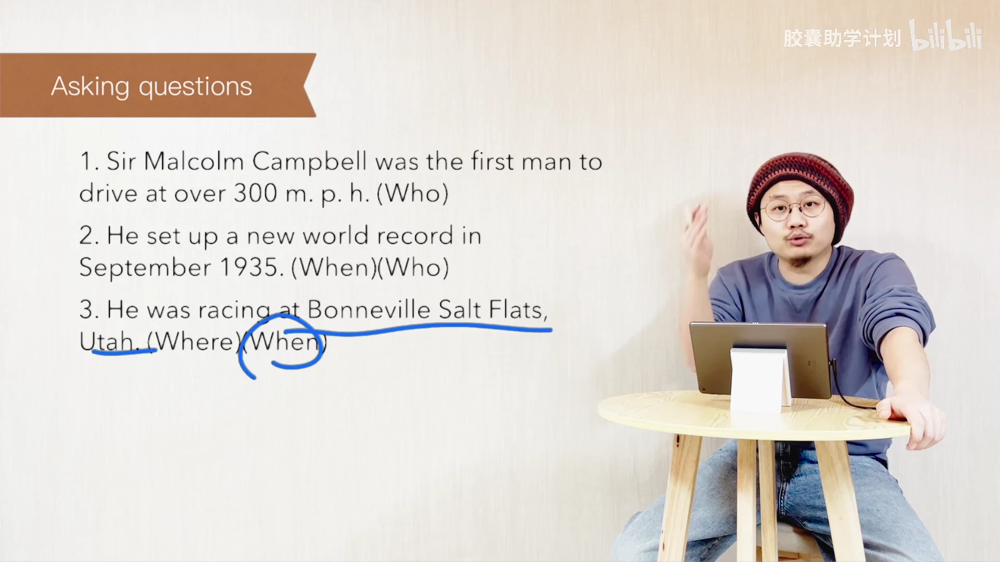

文字识别：biibii / 胶囊助学计划 / Asking questions / 1. Sir Malcolm Campbell was the first man to / drive at over 300 m. p. h. (Who) / 2. He set up a new world record in / September 1935.(When)(Who) / 3. He was racing at Bonneville Salt Flats, / Utah.(Where)When

### 画面 00:03:10

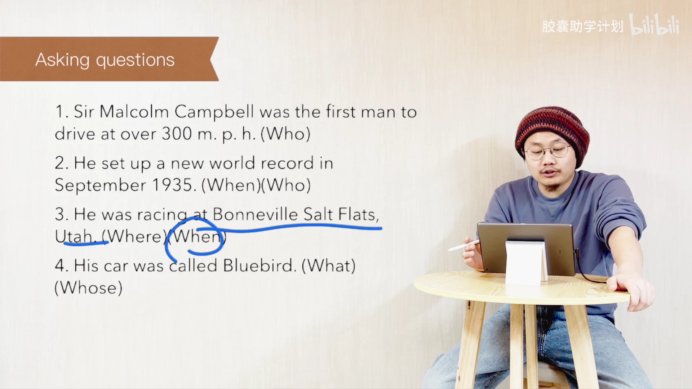

文字识别：bilbii / 胶囊助学计划 / Asking questions / 1. Sir Malcolm Campbell was the first man to / drive at over 300 m. p. h. (Who) / 2. He set up a new world record in / September 1935.(When)(Who) / 3. He was racing at Bonneville Salt Flats, / Utah.(Where)When / 4. His car was Called Bluebird. (What) / (Whose)

### 画面 00:03:12

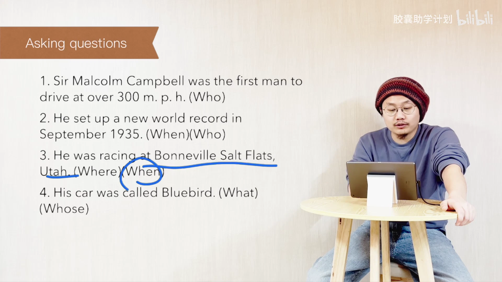

文字识别：biibili / 胶囊助学计划 / Asking questions / 1. Sir Malcolm Campbell was the first man to / drive at over 300 m. p. h. (Who) / 2. He set up a new world record in / September 1935.(When)(Who) / 3. He was racing at Bonneville Salt Flats, / Utah.(Where)When / 4. His car Was Called Bluebird. (What) / (Whose)

### 画面 00:03:14

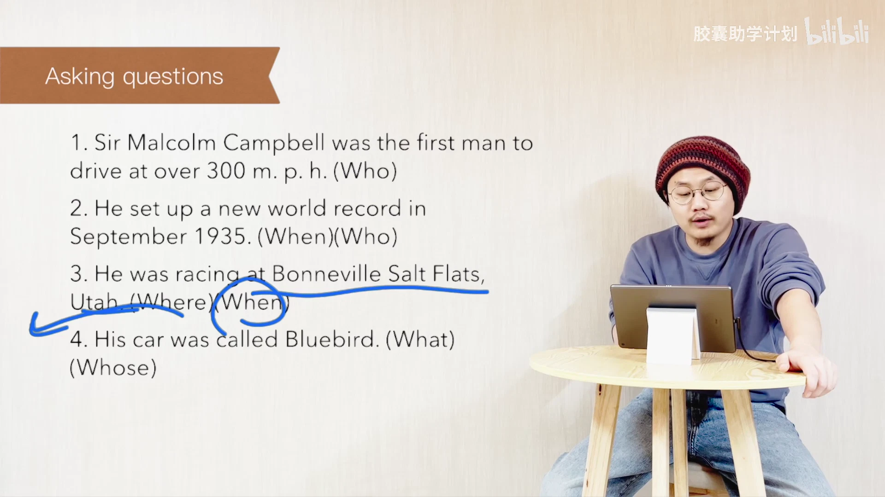

文字识别：biibili / 胶囊助学计划 / Asking questions / 1. Sir Malcolm Campbell was the first man to / drive at over 300 m. p. h. (Who) / 2. He set up a new world record in / September 1935.(When)(Who) / 3. He was racing at Bonneville Salt Flats, / Utab (Where)When / 4. His car was Called Bluebird. (What) / (Whose)

### 画面 00:03:16

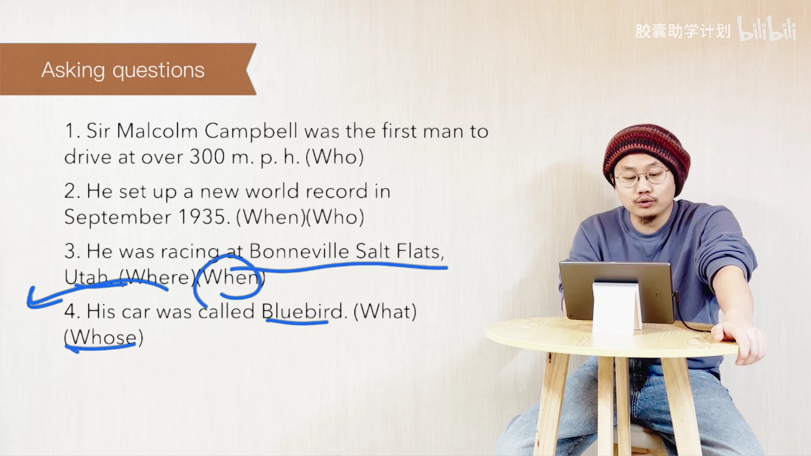

文字识别：bilbili / 胶囊助学计划 / Asking questions / 1. Sir Malcolm Campbell was the first man to / drive at over 300 m. p. h. (Who) / 2. He set up a new world record in / September 1935.(When)(Who) / 3. He was racing at Bonneville Salt Flats, / Utah (Where)When / 4. His car was Called Bluebird. (What) / (Whose)

### 画面 00:03:18

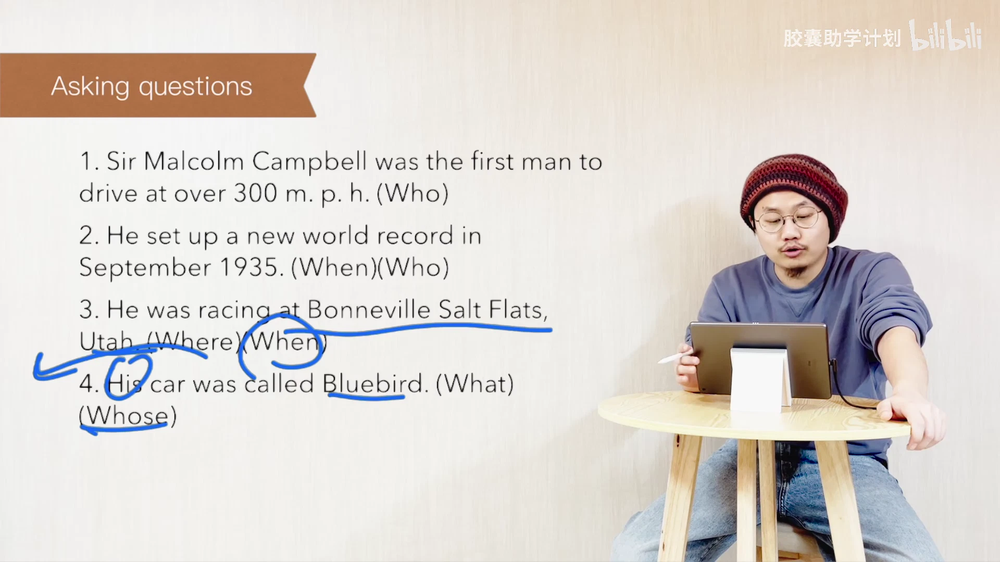

文字识别：bilibii / 胶囊助学计划 / Asking questions / 1. Sir Malcolm Campbell was the first man to / drive at over 300 m. p. h. (Who) / 2. He set up a new world record in / September 1935.(When)(Who) / 3. He was racing at Bonneville Salt Flats, / Utah Where)When / car was Called Bluebird. (What) / (Whose)

### 画面 00:03:20

文字识别：bibli / 胶囊助学计划 / Asking questions

### 画面 00:03:24

文字识别：bilibli / 胶囊助学计划 / Asking questions / 5. It had been specially built for him. (Who)

### 画面 00:03:26

文字识别：bilbili / 胶囊助学计划 / Asking / questions / 5.It had been speciall built forhim (Who)

### 画面 00:03:28

文字识别：bibii / 胶囊助学计划 / Asking / questions / 5. It had been specially k / built forhim (Who) / 6. It was over 30 feet long. (How long)

## 00:03:30–00:04:00

Ah, was提前How long?对Over thirty feet long提问，对吧？How long was it?非常简单。It had a two thousand five hundred horsepower engine. Did提前Did it have?巴拉巴拉巴拉，对吧？那What kind of?其实就是What kind of engine did it have?注意，我把答案已经说出来了啊。说Campbell's top speed was three hundred and four miles per hour.哎，是，对吧？那你把was提前吧。

### 画面 00:03:30

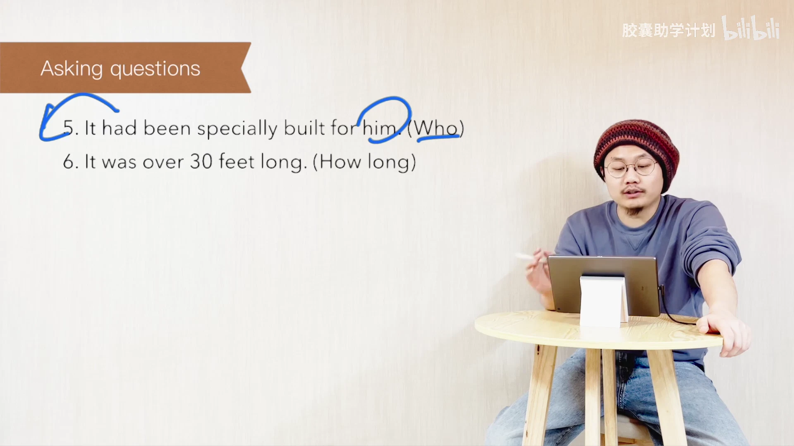

文字识别：bibili / 胶囊助学计划 / Asking / questions / 5.It had been specially built forhim (Who) / 6. It was over 30 feet long. (How long)

### 画面 00:03:33

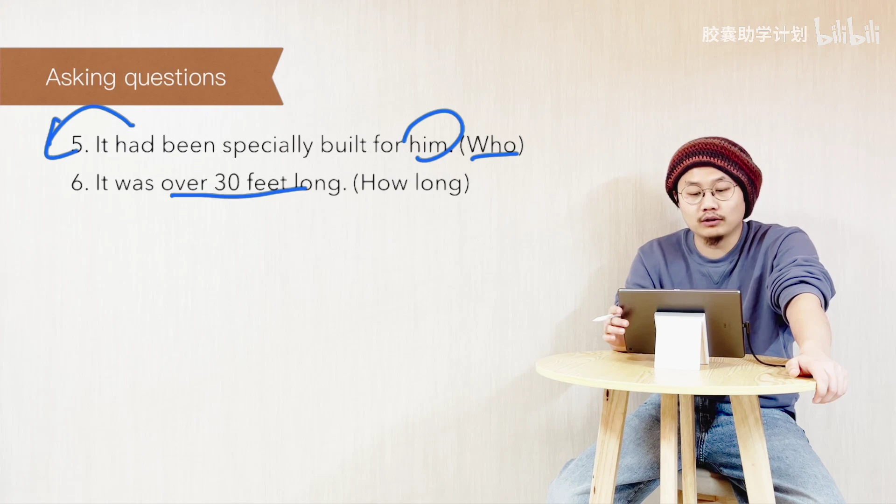

文字识别：bibii / 胶囊助学计划 / Asking / questions / 5. It had been specially / built for him (Who) / 6. It was over 30 feet long. (How long)

### 画面 00:03:44

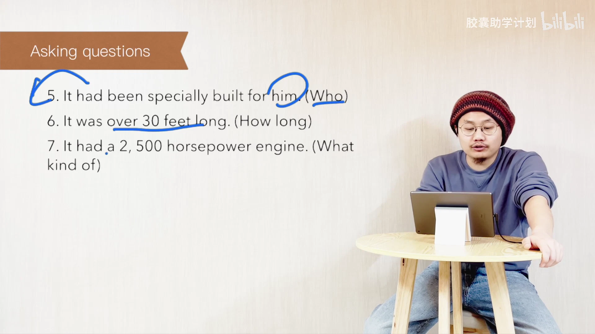

文字识别：bilibii / 胶囊助学计划 / Asking questions / 5.It had been specially built forhim (Who) / 6. It was over 30 feet long. (How long) / 7. It had a 2, 500 horsepower engine. (What / kind of)

### 画面 00:03:46

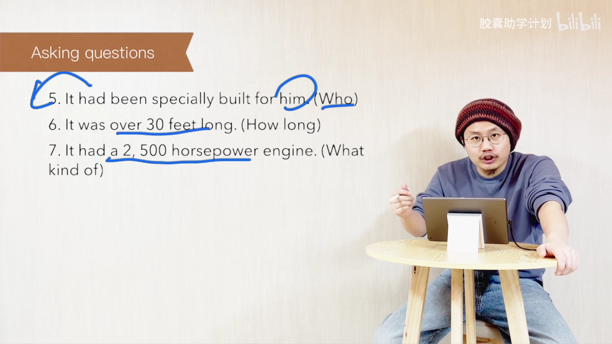

文字识别：bilibii / 胶囊助学计划 / Asking / questions / 5.It had been specially built forhim (Who) / 6. It was over 30 feet long. (How long) / 7. It had a 2, 500 horsepower engine. (What / kind of)

### 画面 00:03:50

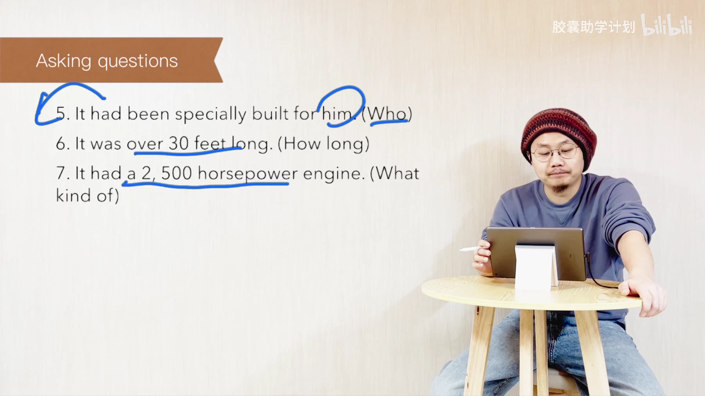

文字识别：bilbii / 胶囊助学计划 / Asking / questions / 5.It had been speciall built forhim (Who) / 6. It was over 30 feet long. (How long) / 7. It had a 2, 500 horsepower engine. (What / kind of)

### 画面 00:03:58

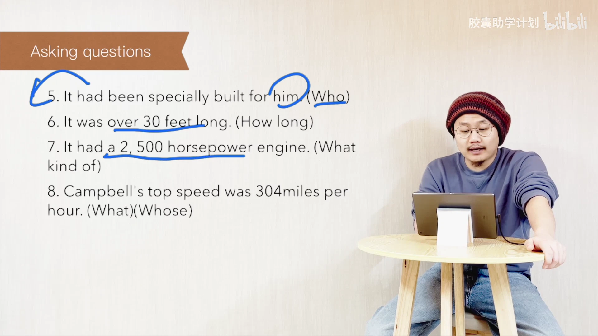

文字识别：biibili / 胶囊助学计划 / Asking questions / 5.It had been specially built forhim (Who) / 6. It was over 30 feet long. (How long) / 7. It had a 2, 500 horsepower engine.(What / kind of) / 8. Campbell's top speed was 304miles per / hour.(What)(Whose)

## 00:04:00–00:04:30

What？啊，那这个地方是呃，What？呃，Was Campbell's top speed？啊，他最快速度打打到了多少？那 whose 你肯定是对 Campbell's P.S. 提问，对吧？就是 whose top speed was three hundred and four miles per hour？A tire burst on the first run. 你肯定是把 did 提前问对 on the first run 提问，对吧？When did the tire burst？ Tell the story. 口语

### 画面 00:04:00

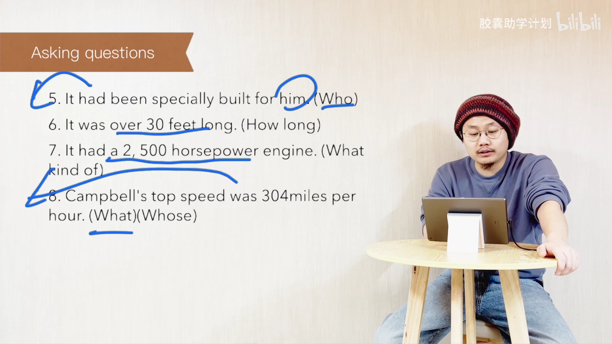

文字识别：biibii / 胶囊助学计划 / Asking questions / 5. It had been pecially built forhim(ho) / 6. It was over 30 feet long. (How long) / 7. Ilt had a 2, 500 horsepower engine.(What / kind of) / 8.Campbell's top speed was 304miles per / hour. (What)(Whose)

### 画面 00:04:06

文字识别：bilbii / 胶囊助学计划 / Asking / questions / 5.It had been specially built forhim (Who) / 6. It was over 30 feet long. (How long) / 7. It had a 2, 500 horsepower engine.(What / kind of) / 3.Campbel's top speed was 304miles per / hour. (What)(Whose)

### 画面 00:04:09

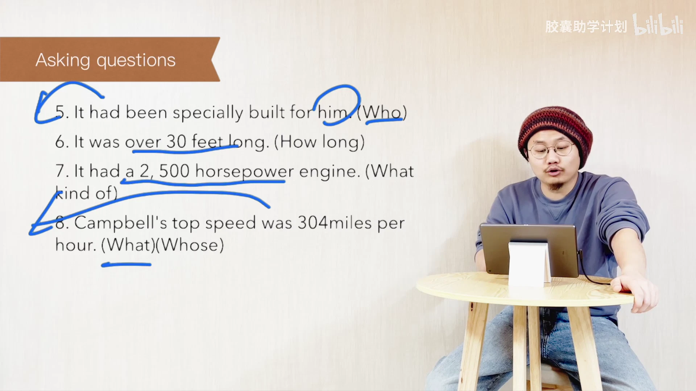

文字识别：bilbili / 胶囊助学计划 / Asking questions / 5.It had been specially built forhim (Who) / 6. It was over 30 feet long. (How long) / 7. Ilt had a 2, 500 horsepower engine.(What / kind of) / 8. Campbel's top speed was 304miles per / hour. (What)(Whose)

### 画面 00:04:11

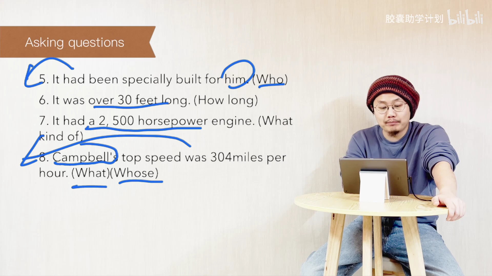

文字识别：bilbili / 胶囊助学计划 / Asking questions / 5.It had been specilly buit forhim (Who) / 6. It was over 30 feet long. (How long) / 7. It had a 2, 500 horsepower engine.(What / kind of) / Campbell' / top speed was 304miles per / hour.(What)(Whose)

### 画面 00:04:16

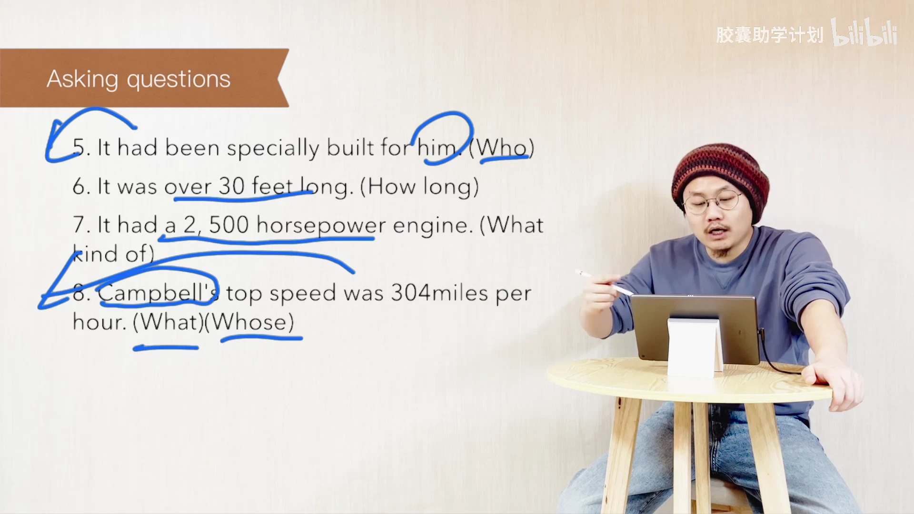

文字识别：bilbili / 胶囊助学计划 / Asking / questions / 5. It had been specially built forhim (who) / 6. It was over 30 feet long. (How long) / 7. It had a 2, 500 horsepower engine.(What / kind of) / Campbell / top speed was 304miles per / hour.(What)(Whose)

### 画面 00:04:21

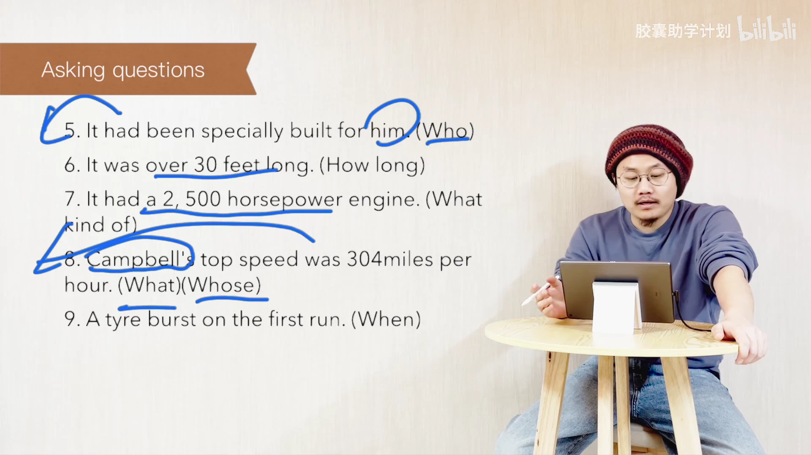

文字识别：bilbili / 胶囊助学计划 / Asking / questions / 5. It had been specially built forhim (Who) / 6. It was over 30 feet long. (How long) / 7. It had a 2, 500 horsepower engine.(What / kind of) / Campbell' / top speed was 304miles per / hour.(What)(Whose) / 9.A tyre burst on the first run. (When)

### 画面 00:04:23

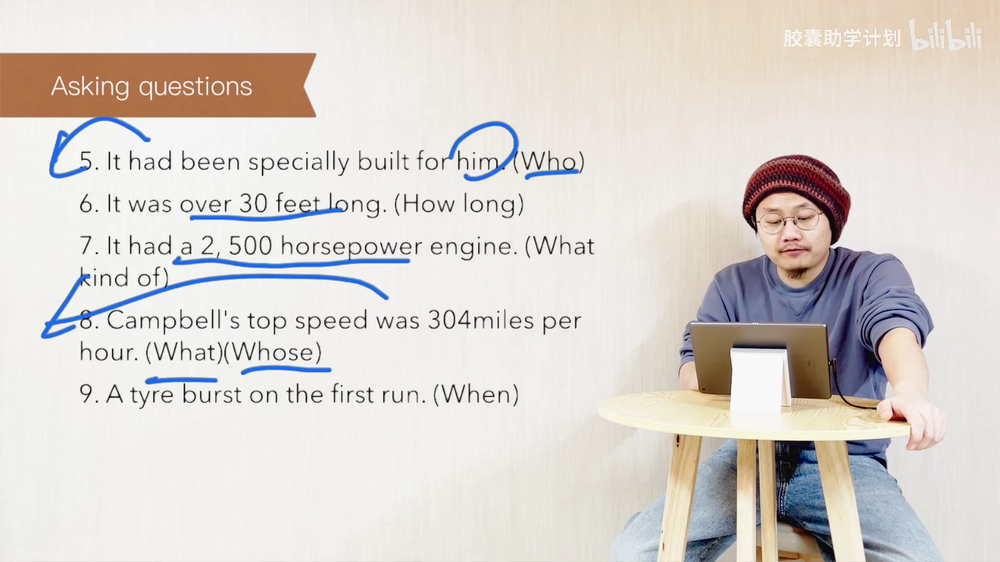

文字识别：biibili / 胶囊助学计划 / Asking questions / 5.It had been pecially built forhim(who) / 6. It was over 30 feet long. (How long) / 7. It had a 2, 500 horsepower engine.(What / kind of) / 8. Campbell's top speed was 304miles per / hour. (What)(Whose) / 9.A tyre burst on the first run. (When)

### 画面 00:04:25

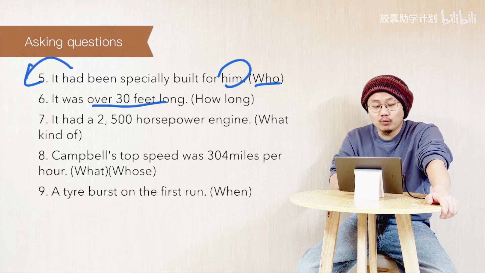

文字识别：胶囊助学计划bi出 / Asking questions / 5.It had been specially built forhim (who) / 6. It was over 30 feet long. (How long) / 7. It had a 2, 500 horsepower engine. (What / kind of) / 8. Campbell's top speed was 304miles per / hour.(What)(Whose) / 9.A tyre burst on the first run. (When)

### 画面 00:04:27

文字识别：bilbil / 胶囊助学计划 / Tell the story / 训练目标： / 口语复述能力 / Accuracy / Fluency

## 00:04:30–00:05:00

复述能力不多说了，看着这些自己去复述啊。然后 summary writing，摘要写作，写完来这儿对答案就可以了。最后一个 topic for discussion，老习惯，我们只给各位翻译一下这些提问的是什么。第一个，Do you enjoy traveling at great speed? Why or why not? 你喜欢高速哎旅行吗？对吧？高速运行吗？哎，为啥？哎，喜欢喜欢为啥喜欢？不喜欢为啥不喜欢？对吧？Well, no one can use a car like Bluebird on

### 画面 00:04:30

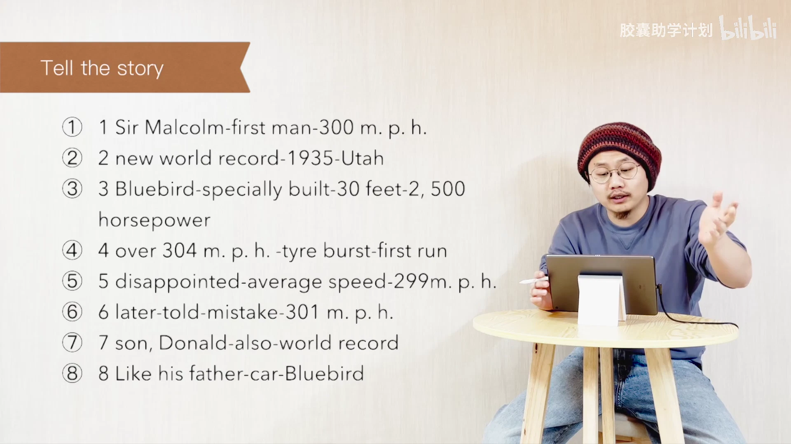

文字识别：胶囊助学计划bil出 / Tell the story / ① 1 Sir Malcolm-first man-300 m. p. h. / ② 2 new world record-1935-Utah / ③ 3 Bluebird-specially built-30 feet-2, 500 / horsepower / 4 over 304 m. p.h.-tyre burst-first run /  5 disappointed-average speed-299m. p. h. / ⑥ 6 later-told-mistake-301 m. p. h. / ⑦ 7 son, Donald-also-world record / ⑧ 8 Like his father-Car-Bluebird

### 画面 00:04:33

文字识别：bilbl / 胶囊助学计划 / Summary writing: Key / 训练目标： / 写作复述能力

### 画面 00:04:35

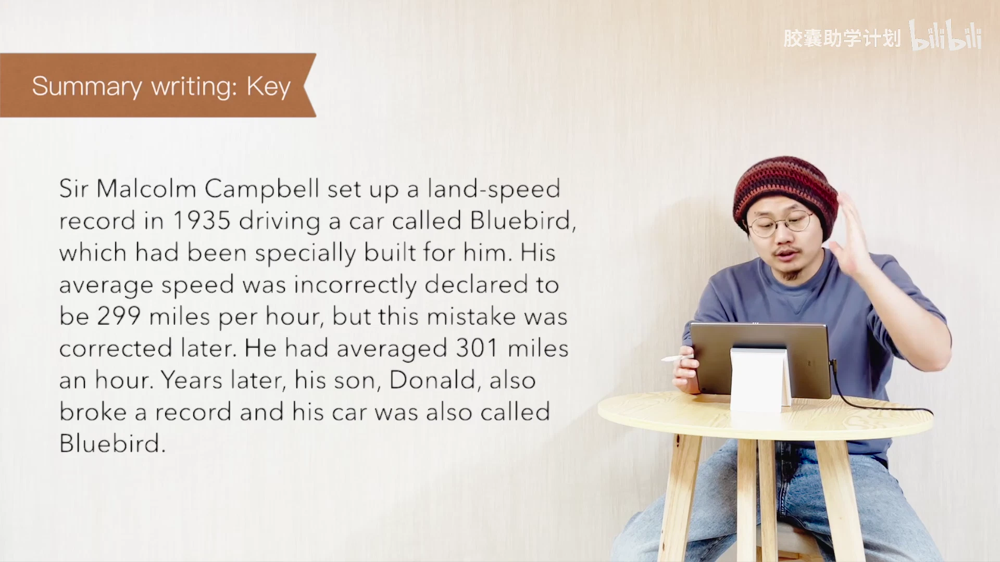

文字识别：胶囊助学计划bi出 / Summary writing: Key / Sir Malcolm Campbell set up a land-speed / record in 1935 driving a car called Bluebird, / which had been specially built for him. His / average speed was incorrectly declared to / be 299 miles per hour, but this mistake was / Corrected later. He had averaged 301 miles / an hour. Years later, his son, Donald, also / broke a record and his car was also called / Bluebird.

### 画面 00:04:37

文字识别：blbii / 胶囊助学计划 / Topics for discussion / 训练目标： / 完全自由的对话 / Accuracy / Fluency

### 画面 00:04:39

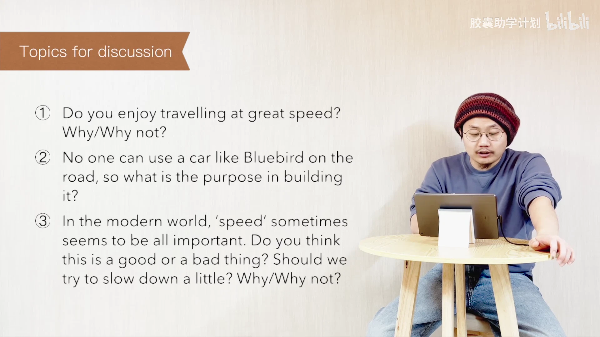

文字识别：胶囊助学计划bilbil / Topics for discussion / Do you enjoy travelling at great speed? / Why/Why not? / No one can use a car like Bluebird on the / 2 / road, so what is the purpose in building / it? / In the modern world,'speed' sometimes / 3 / seems to be all important. Do you think / this is a good or a bad thing? Should we / try to slow down a little? Why/Why not?

## 00:05:00–00:05:30

road. So what is the purpose in building it?是没有人用又能在马路上用一个速度这么快的车。那建造它的意义到底在哪儿呢？比如说突破人类极限，是吧？第三个说，In the modern world, speed sometimes seems to be all important. Do you think this is a good or bad thing? Should we try to slow down a little while? Why not?说在现代世界当中，速度有的时候好像是最重all important的，对吧？就是

### 画面 00:05:03

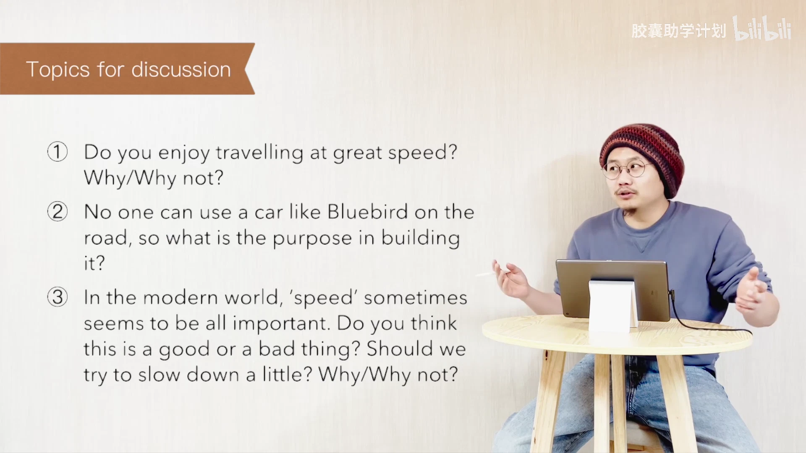

文字识别：胶囊助学计划bi出 / Topics for discussion / Do you enjoy travelling at great speed? / Why/Why not? / No one Can use a car like Bluebird on the / 2 / road, so what is the purpose in building / it? / In the modern world,'speed' sometimes / 3 / seems to be all important. Do you think / this is a good or a bad thing? Should we / try to slow down a little? Why/Why not?

### 画面 00:05:06

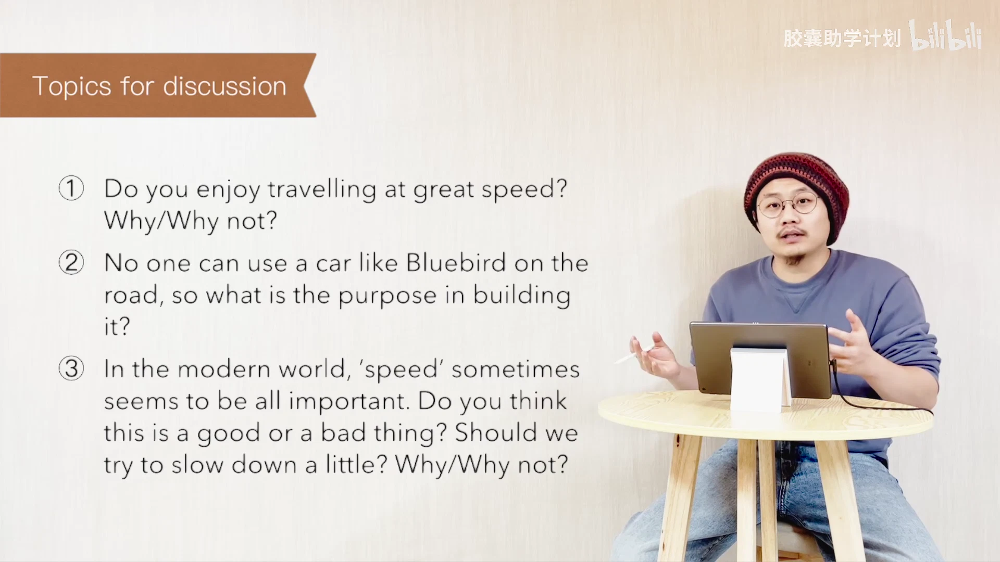

文字识别：胶囊助学计划bilil / Topics for discussion / Do you enjoy travelling at great speed? / Why/Why not? / No one can use a car like Bluebird on the / 2 / road, so what is the purpose in building / it? / In the modern world,'speed' sometimes / 3 / seems to be all important. Do you think / this is a good or a bad thing? Should we / try to slow down a little? Why/Why not?

### 画面 00:05:12

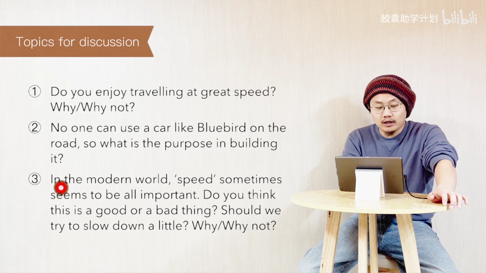

文字识别：胶囊助学计划bili / Topics for discussion / Do you enjoy travelling at great speed? / Why/Why not? / No one can use a car like Bluebird on the / 2 / road, so what is the purpose in building / it? / 3 / In the modern world,'speed' sometimes / seems to be all important. Do you think / this is a good or a bad thing? Should we / try to slow down a little? Why/Why not?

### 画面 00:05:23

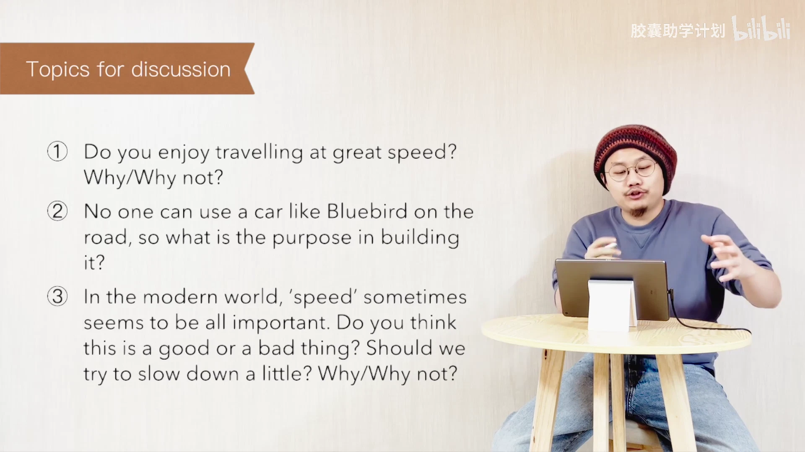

文字识别：胶囊助学计划bili / Topics for discussion / Do you enjoy travelling at great speed? / Why/Why not? / No one can use a car like Bluebird on the / 2 / road, so what is the purpose in building / it? / In the modern world,'speed' sometimes / 3 / seems to be all important. Do you think / this is a good or a bad thing? Should we / try to slow down a little? Why/Why not?

### 画面 00:05:26

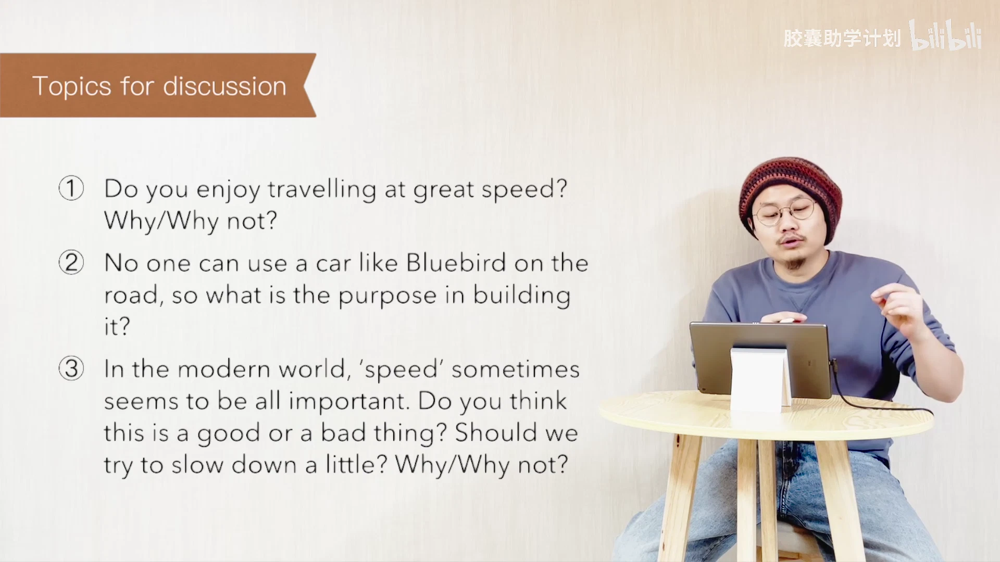

文字识别：胶囊助学计划bilbi / Topics for discussion / Do you enjoy travelling at great speed? / Why/Why not? / No one can use a car like Bluebird on the / 2 / road, so what is the purpose in building / it? / In the modern world,'speed' sometimes / 3 / seems to be all important. Do you think / this is a good or a bad thing? Should we / try to slow down a little? Why/Why not?

## 00:05:30–00:06:00

最重要的，就所有东西当中最重要的那个东西，对吧？说你认为这是一个好事还是坏事？说我们是不是应该放慢我们的生活脚步呢？哎哎，支持为什么支持？不支持为什么不支持？对吧？OK，不多说了，答案作业，Ask Smith先写再朗读，摘要写作写完对答案，Tell the story口语复述，然后哎置顶留言可以找到重复间隔的学习材料。那以上呢就是本期视频的全部内容了。如果

### 画面 00:05:30

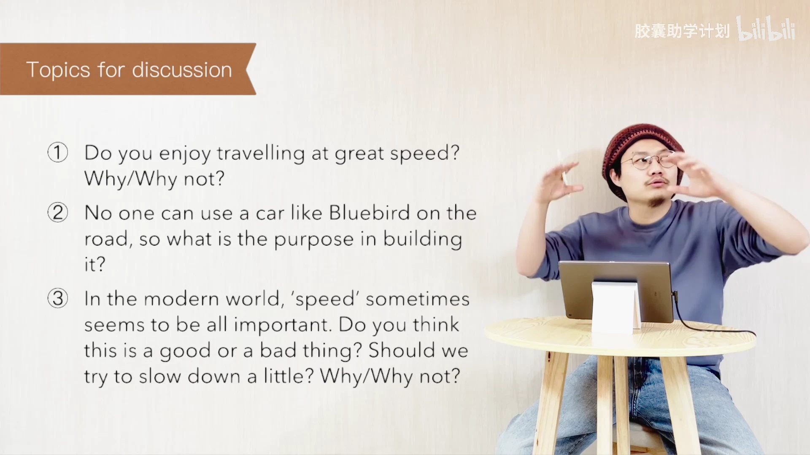

文字识别：胶囊助学计划bib出 / Topics for discussion / Do you enjoy travelling at great speed? / Why/Why not? / No one can use a car like Bluebird on the / road, so what is the purpose in building / it? / In the modern world,'speed' sometimes / 3 / seems to be all important. Do you think / this is a good or a bad thing? Should we / try to slow down a little? Why/Why not?

### 画面 00:05:32

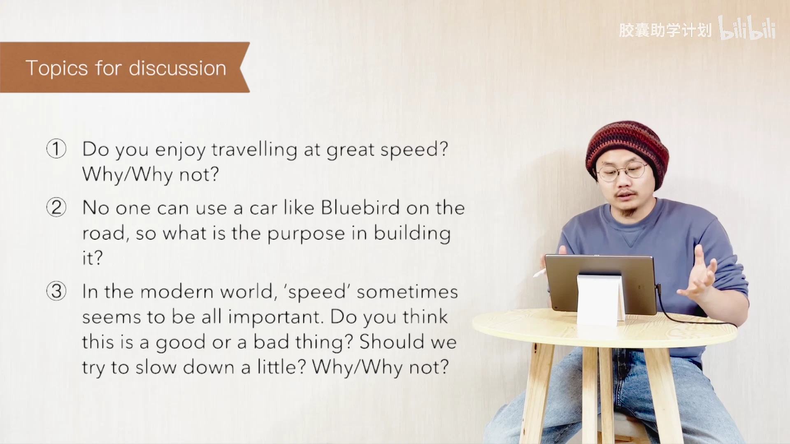

文字识别：胶囊助学计划bilbi / Topics for discussion / Do you enjoy travelling at great speed? / Why/Why not? / No one can use a car like Bluebird on the / 2 / road, so what is the purpose in building / it? / In the modern world, 'speed' sometimes / 3 / seems to be all important. Do you think / this is a good or a bad thing? Should we / try to slow down a little? Why/Why not?

### 画面 00:05:44

文字识别：胶囊助学计划biiil

### 画面 00:05:46

文字识别：biibii / 胶囊助学计划 / 1.Ask me if写&朗读 / 摘要写作写&答案

### 画面 00:05:48

文字识别：blibii / 胶囊助学计划 / 1.Ask me if写&朗读 / 摘要写作写&答案 / 3.Tell the story 口语复述

### 画面 00:05:50

文字识别：blibili / 胶囊助学计划 / 1.Ask me if写&朗读 / 摘要写作写&答案 / 3.Tell the story 口语复述

### 画面 00:05:52

文字识别：bilbii / 胶囊助学计划 / 1.Ask me if写&朗读 / 摘要写作写&答案 / 3.Tell the story 口语复述 / 4. / 4.重复间隔（置顶留言）

### 画面 00:05:55

文字识别：bibii / 胶囊助学计划 / Ask me if写&朗读 / 1. / 摘要写作写&答案 / 3.Tell the story 口语复述 / .重复间隔（置顶留言） / 4.

### 画面 00:05:57

文字识别：胶囊助学计划bi出 / 不

## 00:06:00–00:06:21

各位喜欢我们的课程呢，欢迎各位关注、订阅、一键三连，分享给那些需要的朋友，来帮助我们快速成长。See you next time.

### 画面 00:06:07

文字识别：胶囊助学计划bilbil

### 画面 00:06:09

### 画面 00:06:11

文字识别：運動字計切 / CAPSULEACADEMY / 胶囊助学计划 / 小红书 / Lecturer / □ / 口 / Leo / OE

### 画面 00:06:13

文字识别：動字計 / CAPSULEACADEMY / 胶囊助学计划 / 『 / 小红书 / Photographer / Berlin / OE

### 画面 00:06:15

文字识别：CAPSULEACADEMY / 胶囊助学计划 / 『 / 小红书 / Editor / □ / Berlin / OE

### 画面 00:06:18

文字识别：CAPSULEACADEMY / 胶囊助学计划 / 小红书

### 画面 00:06:20

文字识别：bilbili / 胶囊助学计划

