# 073 单词

快速机器解析：语音为单模型转写，未进行独立交叉校对或人工复核；画面每秒采样并按变化选帧，短时文字和标记可能遗漏。截图时间约有 1 秒误差。图片有损压缩；遇到疑点请按时间查看 Google Drive 原视频。

## 00:00:00–00:00:30

Hello everyone, welcome to Capsule Academy. This is Leo. Today we're going to learn new concept in English book two, lesson seventy three words. 那老习惯进入正式课程之前呢，咱们看几个小的问题啊。那第一个，如何表达逃学？第二个，如何表达惭愧啊？或者说相形见绌，是吧？ Next one，最后一个叫做如何表达搭便车去某地？那带着这三个问题， hope you gonna enjoy.

### 画面 00:00:00

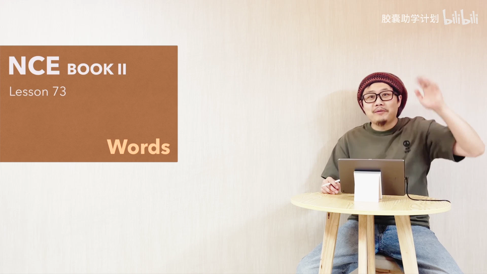

文字识别：bibil / 胶囊助学计划 / NCE / BOOKII / Lesson 73 / Words

### 画面 00:00:06

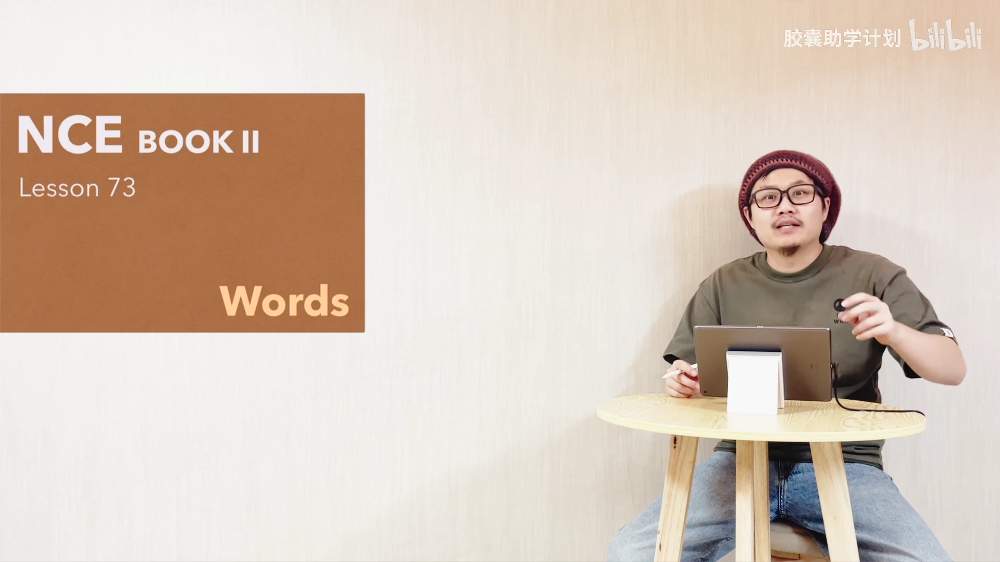

文字识别：bibili / 胶囊助学计划 / NCE / BOOKI"I / Lesson 73 / Words

### 画面 00:00:10

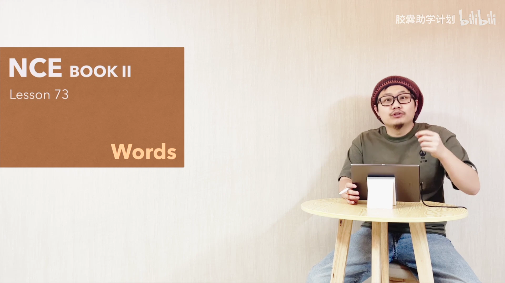

文字识别：bilibii / 胶囊助学计划 / NCE / BOOKII / Lesson 73 / Words / NO / WIR

### 画面 00:00:13

文字识别：bilbili / 胶囊助学计划 / 可表达“逃学”？

### 画面 00:00:15

文字识别：bibii / 胶囊助学计划 / ①如何表达“逃学”?

### 画面 00:00:17

文字识别：biibii / 胶囊助学计划 / ①如何表达“逃学”？ / 如何表达“惭愧/相形见绌”？

### 画面 00:00:20

文字识别：bilbil / 胶囊助学计划 / ①如何表达“逃学”？ / 如何表达“惭愧/相形见绌” / 达“搭便车去某地”？

### 画面 00:00:22

文字识别：bibii / 胶囊助学计划 / ①如何表达“逃学”？ / 如何表达“惭愧/相形见绌” / 如何表达“搭便车去某地”? / NO

### 画面 00:00:26

文字识别：bilbii / 胶囊助学计划 / ①如何表达“逃学”? / 如何表达“惭愧/相形见绌”? / 如何表达“搭便车去某地”?

### 画面 00:00:29

文字识别：胶囊助学计划bi / •

## 00:00:30–00:01:00

呃，那在本课开始之前，我们首先恭喜一下各位，是吧？呃，各位新二最困难的部分，在我看来已经过去了。呃，整个新二一共四个单元，我们之前说过很多次，前三个单元相对来说是比较困难的，因为几乎每一课都有一个特别关键的语法，而整个第四单元其实就是在复习前面学过的很多的语法啊，只

### 画面 00:00:32

文字识别：胶囊助学计划册 / 胶囊助学计划

### 画面 00:00:34

文字识别：单词造句指南 / 网：v.+v.变化 / 胶囊助学计划 / bilbil / 四句型转换 / 方式/地点/时间 / 结合习惯用法 / 其他单词+词性 / 原文摘抄+变 / 6123456 / /'reko:d/ /'haulda/ / record-holder

### 画面 00:00:36

文字识别：单词造句指南 / 网：v.+v.变化 / 胶囊助学计划 / bilibili / 四句型转换 / 方式/地点/时间 / 结合习惯用法 / 其他单词+词性 / 原文摘抄+变 / 6123456 / /'reko:d/ /'haulda/ / record-holder

### 画面 00:00:38

文字识别：单词造句指南 / 网：v.+v.变化 / 胶囊助学计划 / bilbili / 四句型转换 / 方式/地点/时间 / 结合习惯用法 / 其他单词+词性 / 原文摘抄+变 / 6123456 / /'reko:d/ /'haulda/ / record-holder

### 画面 00:00:40

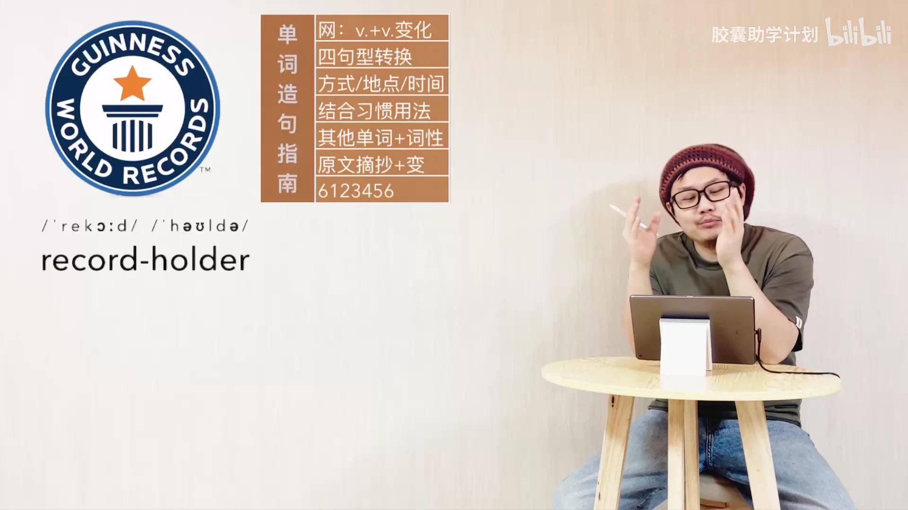

文字识别：单词造句指南 / 网：v.+v.变化 / 胶囊助学计划 / bilibili / 四句型转换 / 方式/地点/时间 / 结合习惯用法 / 其他单词+词性 / 原文摘抄+变 / M / 6123456 / /'reko:d/ /'haulda/ / record-holder

### 画面 00:00:45

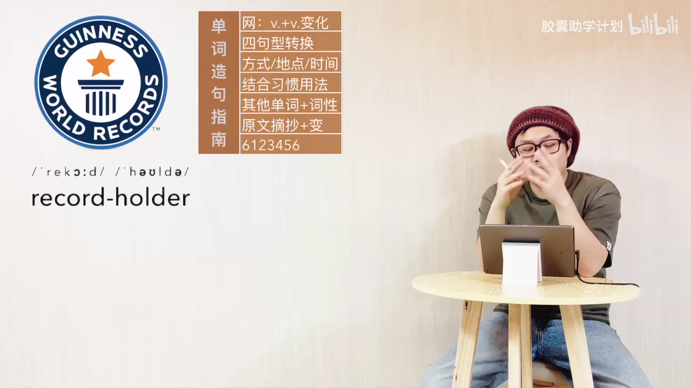

文字识别：单词造句指南 / 网：v.+v.变化 / 胶囊助学计划 / bilibili / 四句型转换 / 方式/地点/时间 / 结合习惯用法 / 其他单词+词性 / 原文摘抄+变 / 6123456 / /'reko:d/ /'haulda/ / record-holder

### 画面 00:00:58

文字识别：单词造句指南 / 网：v.+v.变化 / 胶囊助学计划 / biibili / 四句型转换 / 方式/地点/时间 / 结合习惯用法 / 其他单词+词性 / 原文摘抄+变 / M / 6123456 / /'reko:d/ /'haulda/ / record-holder

## 00:01:00–00:01:30

有极少数个别的，像比如说非限定性定语从句啊，比如说 which 引导的，as 引导的这样的一些非常零零散散的小语法点。但基本整体上第四单元是没有语法的，它都是在复习我们前三单元学的语法。所以这个单元呢，我们也可以理解为是这样一些课程。如果您前三个单元扎扎实实的学了，根据我当年线下对吧实际的经验啊，教学

### 画面 00:01:23

文字识别：单词造句指南 / 网：v.+v.变化 / 胶囊助学计划 / bilibili / 四句型转换 / 方式/地点/时间 / 结合习惯用法 / 其他单词+词性 / 原文摘抄+变 / 6123456 / /'reko:d/ /'haulda/ / record-holder

### 画面 00:01:26

文字识别：单词造句指南 / 网：v.+v.变化 / 胶囊助学计划 / bilibili / 四句型转换 / 方式/地点/时间 / 结合习惯用法 / 其他单词+词性 / 原文摘抄+变 / 6123456 / /'reko:d/ /'haulda/ / record-holder

### 画面 00:01:28

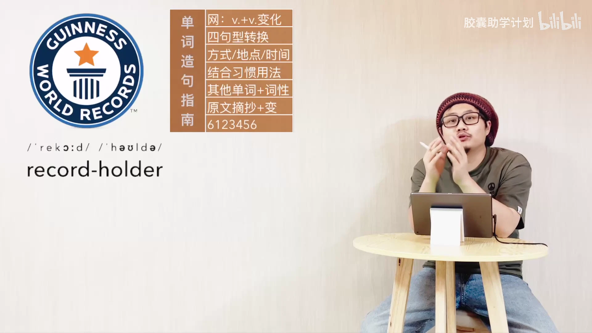

文字识别：单词造句指南 / 网：v.+v.变化 / 胶囊助学计划 / bilibili / 四句型转换 / 方式/地点/时间 / 结合习惯用法 / 其他单词+词性 / 原文摘抄+变 / 6123456 / /'reko:d/ /'haulda/ / record-holder

## 00:01:30–00:02:00

经验，呃，我基本能得出这样一个结论，就是如果前三个单元学的无比的好，那第四个单元你会发现更简单了。原因是你原来你除了要学习语法以啊，除了要学习单词跟习惯用法以外，还要学习语法。但是第四单元你不用学语法了，对吧？但如果你前三个单元学的不好，那第四个单元就是噩梦般的存在了，对吧？啊，基本上就是一个验证，说前三单元我到底学没学好这样一个单元，对

### 画面 00:01:30

文字识别：单词造句指南 / 网：v.+v.变化 / 胶囊助学计划 / bilibili / 四句型转换 / 方式/地点/时间 / 结合习惯用法 / 其他单词+词性 / 原文摘抄+变 / 6123456 / /'reko:d/ /'haulda/ / record-holder

### 画面 00:01:33

文字识别：单词造句指南 / 网：v.+v.变化 / 胶囊助学计划 / bilibili / 四句型转换 / 方式/地点/时间 / 结合习惯用法 / 其他单词+词性 / 原文摘抄+变 / 6123456 / /'reko:d/ /haulda/ / record-holder

### 画面 00:01:35

文字识别：单词造句指南 / 网：v.+v.变化 / 胶囊助学计划 / bilbili / 四句型转换 / 方式/地点/时间 / 结合习惯用法 / 其他单词+词性 / 原文摘抄+变 / 6123456 / /'reko:d/ /'haulda/ / record-holder

### 画面 00:01:37

文字识别：单词造句指南 / 网：v.+v.变化 / 胶囊助学计划 / bilibili / 四句型转换 / 方式/地点/时间 / 结合习惯用法 / 其他单词+词性 / 原文摘抄+变 / 6123456 / /'reko:d/ /'haulda/ / record-holder

### 画面 00:01:40

文字识别：单词造句指南 / 网：v.+v.变化 / 胶囊助学计划 / bilbili / 四句型转换 / 方式/地点/时间 / 结合习惯用法 / 其他单词+词性 / 原文摘抄+变 / 6123456 / /'reko:d/ /'haulda/ / record-holder

### 画面 00:01:42

文字识别：单词造句指南 / 网：v.+v.变化 / 胶囊助学计划 / bilibili / 四句型转换 / 方式/地点/时间 / 结合习惯用法 / 其他单词+词性 / 原文摘抄+变 / 6123456 / /'reko:d/ /'haulda/ / record-holder

### 画面 00:01:45

文字识别：单词造句指南 / 网：v.+v.变化 / 胶囊助学计划 / bilibili / 四句型转换 / 方式/地点/时间 / 结合习惯用法 / 其他单词+词性 / 原文摘抄+变 / 6123456 / /'reko:d/ /'haulda/ / record-holder

### 画面 00:01:50

文字识别：单词造句指南 / 网：v.+v.变化 / 胶囊助学计划 / biibili / 四句型转换 / 方式/地点/时间 / 结合习惯用法 / 其他单词+词性 / 原文摘抄+变 / 6123456 / /'reko:d/ /'haulda/ / record-holder

### 画面 00:01:53

文字识别：单词造句指南 / 网：v.+v.变化 / 胶囊助学计划 / bilibili / 四句型转换 / 方式/地点/时间 / 结合习惯用法 / 其他单词+词性 / 原文摘抄+变 / 6123456 / /'reko:d/ /'haulda/ / record-holder

### 画面 00:01:55

文字识别：单词造句指南 / 网：v.+v.变化 / 胶囊助学计划 / bibili / 四句型转换 / 方式/地点/时间 / 结合习惯用法 / 其他单词+词性 / 原文摘抄+变 / 6123456 / /'reko:d/ /'haulda/ / record-holder

## 00:02:00–00:02:30

吧？OK，好啊，那咱们不多说了。呃，我带着各位一起看一下本课的单词啊，中规中矩。大多数的课程就是还是啊，跟前三个单元没区别啊。Record holder, record。首先，这个单词它有名词 record，对吧？记录啊，然后有动词啊，也是记录，对吧？叫做 record。啊，重音的位置有点特别，不太一样，读音也稍有不同。然后这个 holder 呢，就

### 画面 00:02:00

文字识别：单词造句指南 / 网：v.+v.变化 / 胶囊助学计划 / biibili / 四句型转换 / 方式/地点/时间 / 结合习惯用法 / 其他单词+词性 / 原文摘抄+变 / 6123456 / /'reko:d/ /'haulda/ / record-holder

### 画面 00:02:04

文字识别：单词造句指南 / 网：v.+v.变化 / 胶囊助学计划 / bilibili / 四句型转换 / 方式/地点/时间 / 结合习惯用法 / 其他单词+词性 / 原文摘抄+变 / 6123456 / /'reko:d/ / aulda/ / record-holder

### 画面 00:02:08

文字识别：单词造句指南 / 网：v.+v.变化 / 胶囊助学计划 / biibili / 四句型转换 / 方式/地点/时间 / 结合习惯用法 / 其他单词+词性 / 原文摘抄+变 / 6123456 / /'reko:d/ /'haulda/ / record-holder

### 画面 00:02:13

文字识别：单词造句指南 / 网：v.+v.变化 / 胶囊助学计划 / biibili / 四句型转换 / 方式/地点/时间 / 结合习惯用法 / 其他单词+词性 / 原文摘抄+变 / V / 6123456 / /'reko:d/ /'haulda/ / record-holder

### 画面 00:02:16

文字识别：单词造句指南 / 网：v.+v.变化 / 胶囊助学计划 / bibili / 四句型转换 / 方式/地点/时间 / 结合习惯用法 / 其他单词+词性 / 原文摘抄+变 / 6123456 / /'reko:d/ /'haulda/ / record-holder

## 00:02:30–00:03:00

是持有人啊，记录持有人。那你像这个 set up a new world record，之前咱们见过好多次了这个单词是吧？呃，记录持有人是个人嘛？那咱们就随便给他造几个句子，比如说啊，往脸上贴金啊，说 Leo the world record holder managed to put out the fire。来了一个同位语从句，对吧？Leo 是谁？哎，世界记录保持者。贴金，我造的句子，我想怎么造怎么造啊！你也可以造你自己，对吧？然后

### 画面 00:02:37

文字识别：COINES / 单词造句指南 / 网：v.+v.变化 / 胶囊助学计划 / biibili / 四句型转换 / 方式/地点/时间 / 结合习惯用法 / 其他单词+词性 / 原文摘抄+变 / 6123456 / /'reko:d/ /'haulda/ / record-holder / ① Leo, the world record-holder, managed to / put out the fire. L27 L67

### 画面 00:02:40

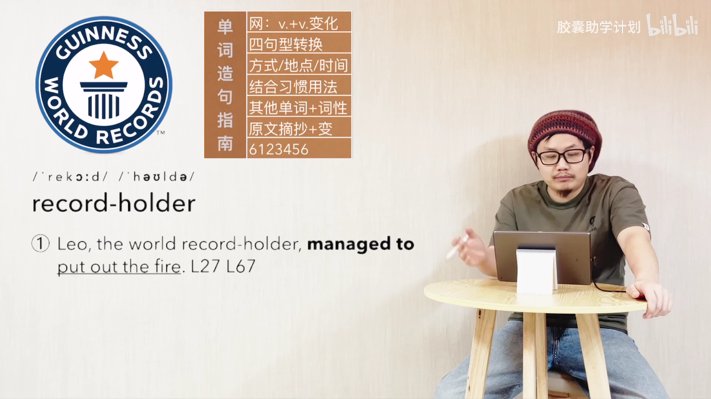

文字识别：单词造句指南 / 网：v.+v.变化 / 胶囊助学计划 / bilbili / 四句型转换 / 方式/地点/时间 / 结合习惯用法 / 其他单词+词性 / 原文摘抄+变 / 6123456 / /'reko:d/ /'haulda/ / record-holder / ① Leo, the world record-holder, managed to / put out the fire. L27 L67

### 画面 00:02:44

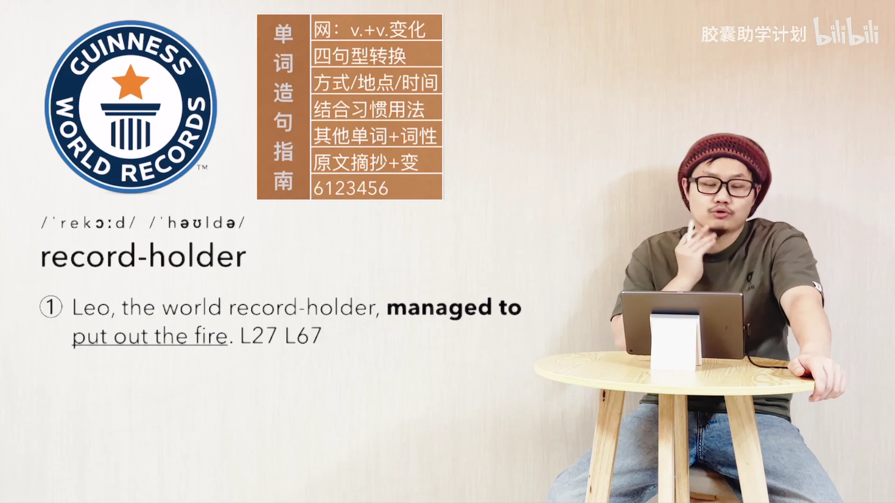

文字识别：单词造句指南 / 网：v.+v.变化 / 胶囊助学计划 / bilbili / 四句型转换 / 方式/地点/时间 / 结合习惯用法 / 其他单词+词性 / 原文摘抄+变 / 6123456 / /'reko:d/ /'haulda/ / record-holder / ① Leo, the world record-holder, managed to / put out the fire. L27 L67

### 画面 00:02:46

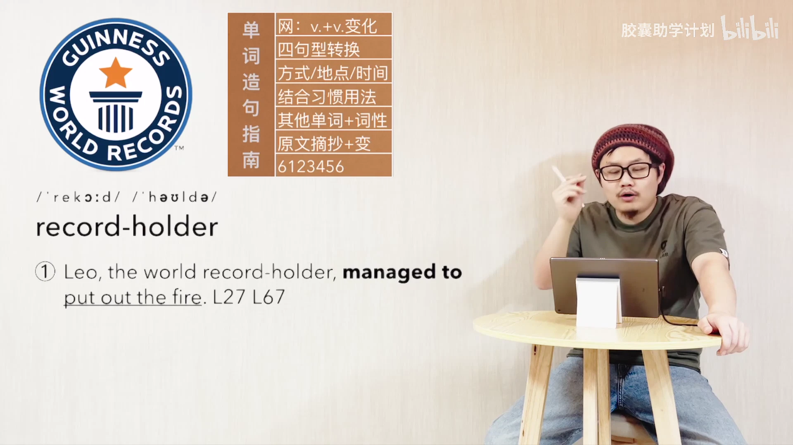

文字识别：单词造句指南 / 网：v.+v.变化 / 胶囊助学计划 / biibili / 四句型转换 / 方式/地点/时间 / 结合习惯用法 / 其他单词+词性 / 原文摘抄+变 / 6123456 / /'reko:d/ /'haulda/ / record-holder / ① Leo, the world record-holder, managed to / put out the fire. L27 L67

### 画面 00:02:56

文字识别：单词造句指南 / 网：v.+v.变化 / 胶囊助学计划 / biibili / 四句型转换 / 方式/地点/时间 / 结合习惯用法 / 其他单词+词性 / 原文摘抄+变 / 6123456 / /'reko:d/ /'haulda/ / record-holder / ① Leo, the world record-holder, managed to / put out the fire. L27 L67

## 00:03:00–00:03:30

呢，这个做了一个大好事儿，对吧？成功的扑灭了这场大火，对吧？Put out the fire. OK. Continue. 说When she knew that，咱先不管这个单词。When she knew that she became the new record holder, she became she burst into tears. 说当她知道啊，她成为了一个新的记录保持者的时候，哎，她痛哭流泪，对吧？痛哭流涕。然后这个地方的

### 画面 00:03:01

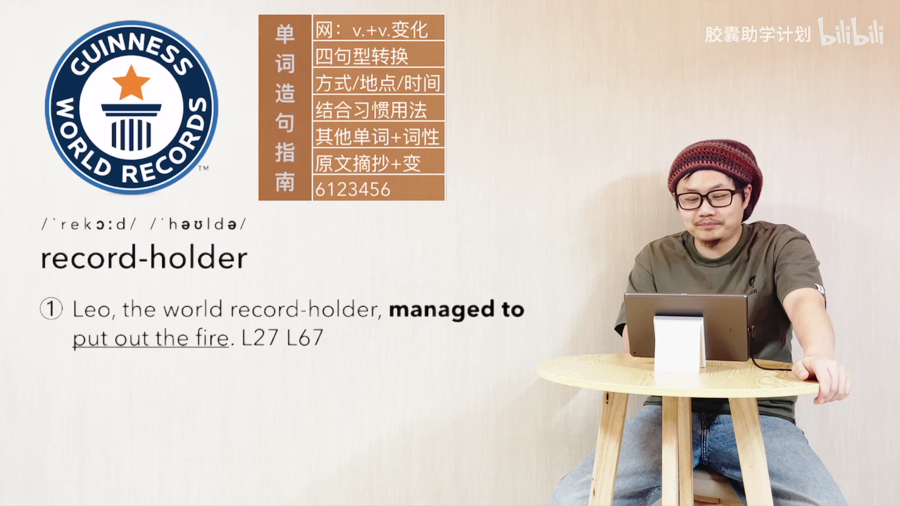

文字识别：单词造句指南 / 网：v.+v.变化 / 胶囊助学计划 / bilibil / 四句型转换 / 方式/地点/时间 / 结合习惯用法 / 其他单词+词性 / 原文摘抄+变 / 6123456 / /'reko:d/ /'haulda/ / record-holder / ① Leo, the world record-holder, managed to / put out the fire. L27 L67

### 画面 00:03:07

文字识别：单词造句指南 / 网：v.+v.变化 / 胶囊助学计划 / bibili / 四句型转换 / 方式/地点/时间 / 结合习惯用法 / 其他单词+词性 / 原文摘抄+变 / 6123456 / /'reko:d/ /'haulda/ / record-holder / ① Leo, the world record-holder, managed to / put out the fire. L27 L67

### 画面 00:03:09

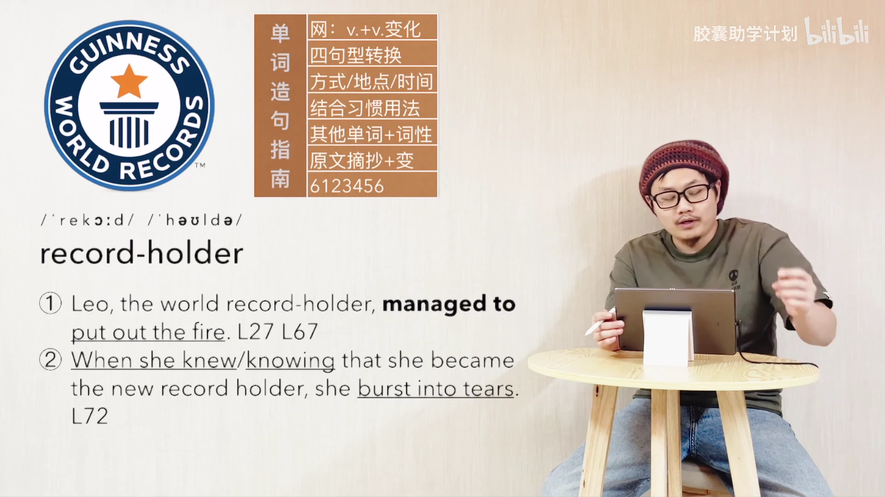

文字识别：单词造句指南 / 网：v.+v.变化 / 胶囊助学计划 / bilbli / 四句型转换 / 方式/地点/时间 / 结合习惯用法 / 其他单词+词性 / 原文摘抄+变 / 6123456 / /'reko:d/ /'haulda/ / record-holder / ① Leo, the world record-holder, managed to / put out the fire. L27 L67 / When she knew/knowing that she became / the new record holder, she burst into tears. / L72

### 画面 00:03:12

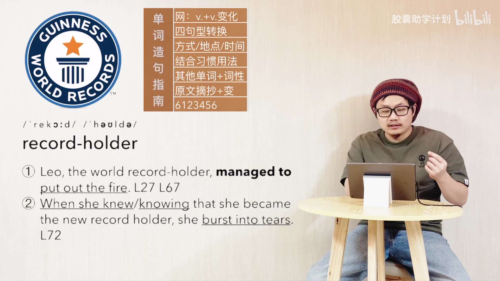

文字识别：单词造句指南 / 网：v.+v.变化 / 胶囊助学计划 / bilbili / 四句型转换 / 方式/地点/时间 / 结合习惯用法 / 其他单词+词性 / 原文摘抄+变 / 6123456 / /'reko:d/ /'haulda/ / record-holder / ① Leo, the world record-holder, managed to / put out the fire. L27 L67 / When she knew/knowing that she became / the new record holder, she burst into tears. / L72

### 画面 00:03:14

文字识别：单词造句指南 / 网：v.+v.变化 / 胶囊助学计划 / bilbili / 四句型转换 / 方式/地点/时间 / 结合习惯用法 / 其他单词+词性 / 原文摘抄+变 / 6123456 / /'reko:d/ /'haulda/ / record-holder / ① Leo, the world record-holder, managed to / WR / NO / put out the fire. L27 L67 / When she knew/keg that she became / the new record holder, she burst into tears. / L72

### 画面 00:03:16

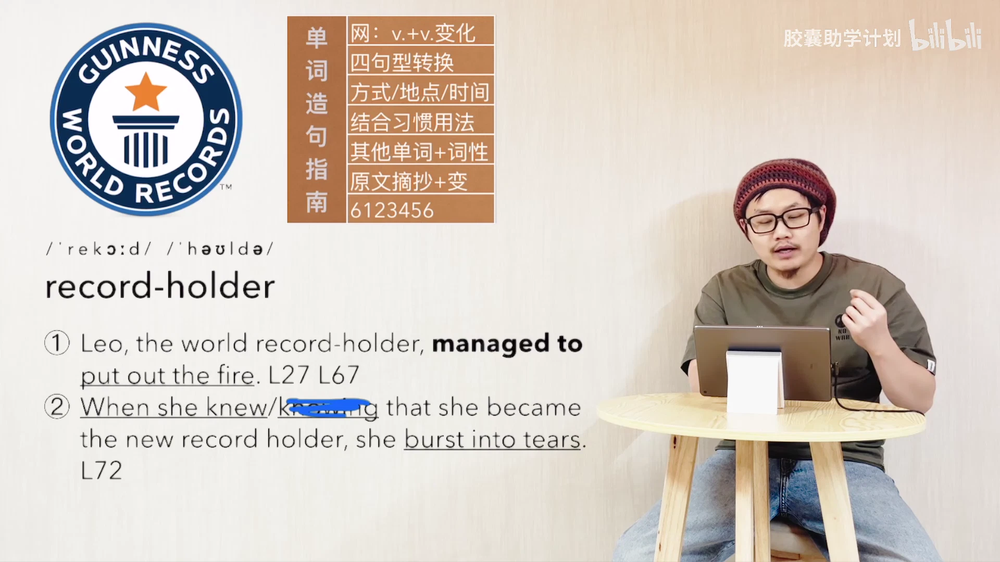

文字识别：单词造句指南 / 网：v.+v.变化 / 胶囊助学计划 / bilbili / 四句型转换 / 方式/地点/时间 / 结合习惯用法 / 其他单词+词性 / 原文摘抄+变 / 6123456 / /'reko:d/ /'haulda/ / record-holder / ① Leo, the world record-holder, managed to / WHH / NO / put out the fire. L27 L67 / When she knew/keg that she became / the new record holder, she burst into tears. / L72

### 画面 00:03:20

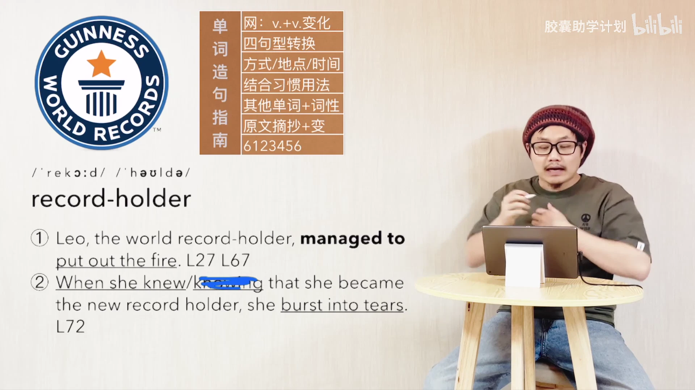

文字识别：单词造句指南 / 网：v.+v.变化 / 胶囊助学计划 / biibii / 四句型转换 / 方式/地点/时间 / 结合习惯用法 / 其他单词+词性 / 原文摘抄+变 / 6123456 / /'reko:d/ /'haulda/ / record-holder / ① Leo, the world record-holder, managed to / put out the fire. L27 L67 / When she knew/keg that she became / the new record holder, she burst into tears. / L72

### 画面 00:03:25

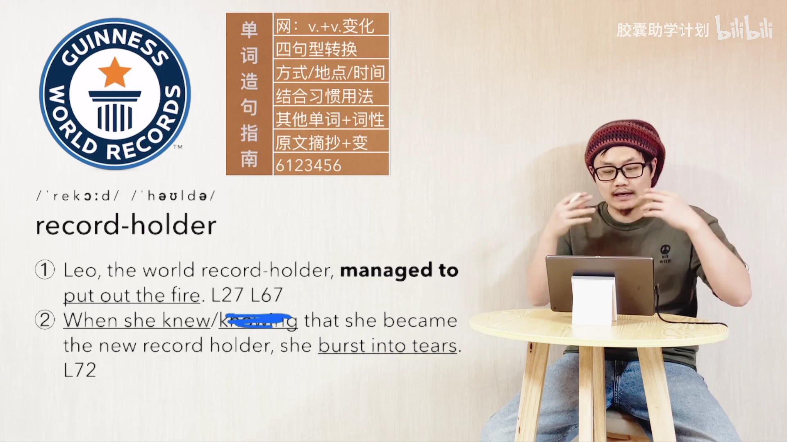

文字识别：单词造句指南 / 网：v.+v.变化 / 胶囊助学计划 / bibili / 四句型转换 / 方式/地点/时间 / 结合习惯用法 / 其他单词+词性 / 原文摘抄+变 / 6123456 / /'reko:d/ /'haulda/ / record-holder / ① Leo, the world record-holder, managed to / WIR / NUI / put out the fire. L27 L67 / When she knew/keg that she became / the new record holder, she burst into tears. / L72

### 画面 00:03:29

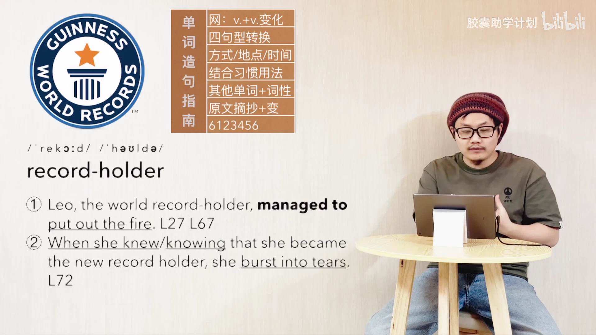

文字识别：单词造句指南 / 网：v.+v.变化 / 胶囊助学计划 / bibii / 四句型转换 / 方式/地点/时间 / 结合习惯用法 / 其他单词+词性 / 原文摘抄+变 / 6123456 / /'reko:d/ /'haulda/ / record-holder / ① Leo, the world record-holder, managed to / NO / WHH / put out the fire. L27 L67 / When she knew/knowing that she became / the new record holder, she burst into tears. / L72

## 00:03:30–00:04:00

when she knew 可以完全换成 knowing，哎，为什么可以换？四十九课咱学的，所以我说噩梦般的存在也可以是就是特别美梦般的存在，对吧？第四单元完全就是一个呃种因种瓜得瓜种果得果的一个单元，对吧？就是你前三个单元学的特别好，第四单元你会越学越有信心，哎，顺理成章就进入三册了。前三个单元学的不好，第四单元就是噩梦般的存在，越

### 画面 00:03:31

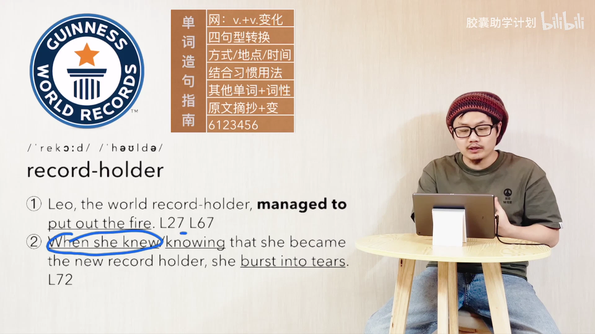

文字识别：单词造句指南 / 网：v.+v.变化 / 胶囊助学计划 / bibili / 四句型转换 / 方式/地点/时间 / 结合习惯用法 / 其他单词+词性 / 原文摘抄+变 / 6123456 / /'reko:d/ /'haulda/ / record-holder / ① Leo, the world record-holder, managed to / NO / WNR / put out the fire. L27 L67 / When she knew knowing that she became / the new record holder, she burst into tears. / L72

### 画面 00:03:33

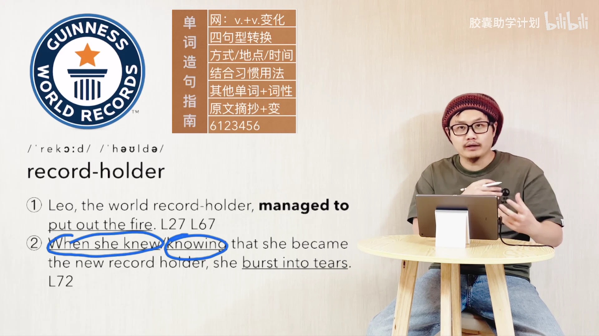

文字识别：单词造句指南 / 网：v.+v.变化 / 胶囊助学计划 / bibili / 四句型转换 / 方式/地点/时间 / 结合习惯用法 / 其他单词+词性 / 原文摘抄+变 / 6123456 / /'reko:d/ /'haulda/ / record-holder / ① Leo, the world record-holder, managed to / put out the fire. L27 L67 / When she knew'knowino / that she became / the new record hoider, she burst into tears. / L72

### 画面 00:03:35

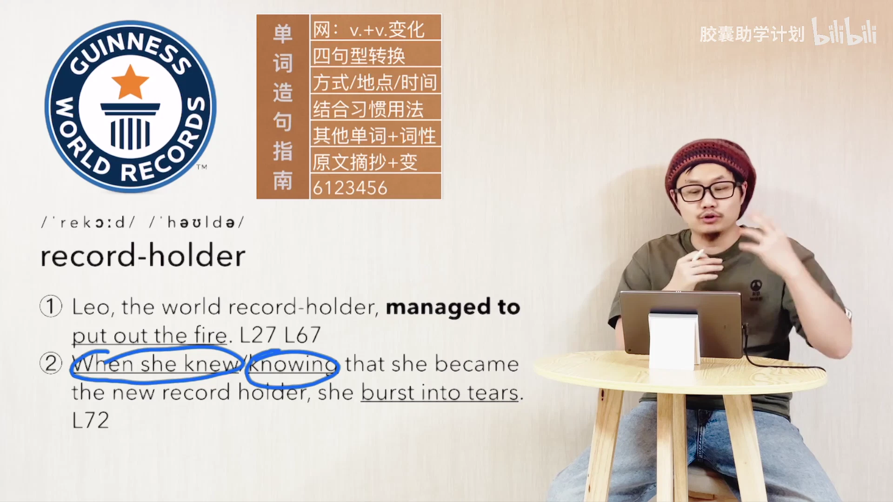

文字识别：单词造句指南 / 网：v.+v.变化 / 胶囊助学计划 / bibii / 四句型转换 / 方式/地点/时间 / 结合习惯用法 / 其他单词+词性 / 原文摘抄+变 / 6123456 / /'reko:d/ /'haulda/ / record-holder / ① Leo, the world record-holder, managed to / put out the fire. L27 L67 / When she knewknowino / that she became / the new record hoider, she burst into tears. / L72

### 画面 00:03:43

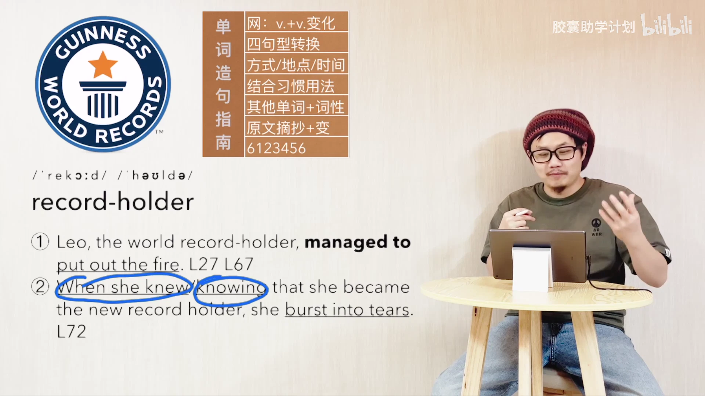

文字识别：单词造句指南 / 网：v.+v.变化 / 胶囊助学计划 / bilibili / 四句型转换 / 方式/地点/时间 / 结合习惯用法 / 其他单词+词性 / 原文摘抄+变 / 6123456 / /'reko:d/ /'haulda/ / record-holder / ① Leo, the world record-holder, managed to / WHR / ND / put out the fire. L27 L67 / When she knew'knowing / that she became / the new record hoider, she burst into tears. / L72

### 画面 00:03:46

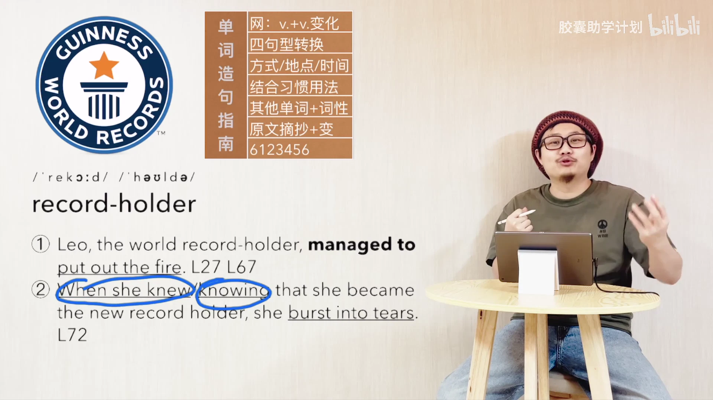

文字识别：单词造句指南 / 网：v.+v.变化 / 胶囊助学计划 / bibil / 四句型转换 / 方式/地点/时间 / 结合习惯用法 / 其他单词+词性 / 原文摘抄+变 / 6123456 / /'reko:d/ /'haulda/ / record-holder / ① Leo, the world record-holder, managed to / WAR / put out the fire. L27 L67 / When she knew'knowing / that she became / the new record hoider, she burst into tears. / L72

### 画面 00:03:51

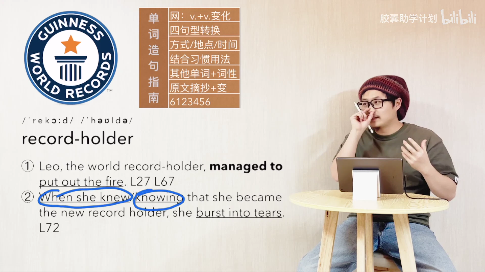

文字识别：单词造句指南 / 网：v.+v.变化 / 胶囊助学计划 / biibili / 四句型转换 / 方式/地点/时间 / 结合习惯用法 / 其他单词+词性 / 原文摘抄+变 / 6123456 / /'reko:d/ /'haulda/ / record-holder / ① Leo, the world record-holder, managed to / put out the fire. L27 L67 / When she knew'knowino / that she became / the new record hoider, she burst into tears. / L72

## 00:04:00–00:04:30

学越没信心。好，你又回去重新回炉一遍，对吧？Okay, next one. The town did so well.哎，一个人哎做的如此的好，that she became the new record holder for this time.啊，for this game.说她做的如此的好，那这个做你看跟后边的，因为是这个game，我们就可以说要么是她哎，其实就是用做，因为这个game可以有很多，对吧？比如football game啊，哎，

### 画面 00:04:00

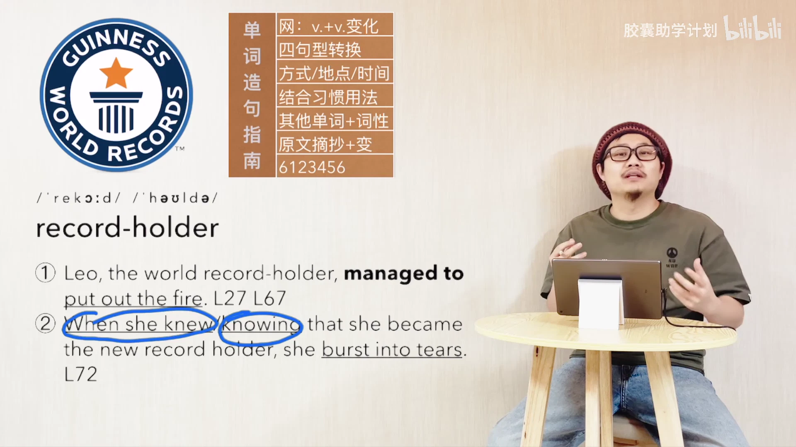

文字识别：单词造句指南 / 网：v.+v.变化 / 胶囊助学计划 / bibil / 四句型转换 / 方式/地点/时间 / 结合习惯用法 / 其他单词+词性 / 原文摘抄+变 / 6123456 / /'reko:d/ /'haulda/ / record-holder / ① Leo, the world record-holder, managed to / NU / put out the fire. L27 L67 / When she knewknowino / that she became / the new record hoider, she /  burst into tears. / L72

### 画面 00:04:05

文字识别：单词造句指南 / 网：v.+v.变化 / 胶囊助学计划 / bilbili / 四句型转换 / 方式/地点/时间 / 结合习惯用法 / 其他单词+词性 / 原文摘抄+变 / 6123456 / /'reko:d/ /'haulda/ / record-holder / ND / ① Leo, the world record-holder, managed to / put out the fire. L27 L67 / When she knewknowino / that she became / the new record hoider, she burst into tears. / L72 / Tang did so well that she became the new / 3 / record holder for this game. L35

### 画面 00:04:08

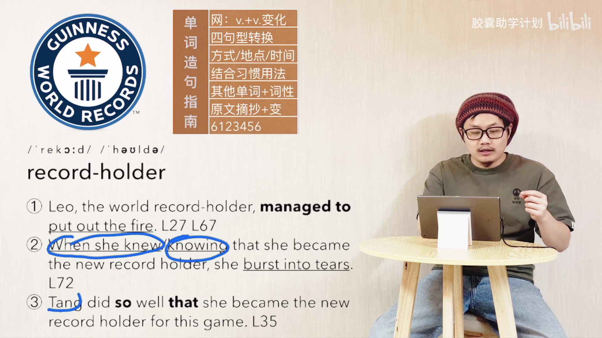

文字识别：单词造句指南 / 网：v.+v.变化 / 胶囊助学计划 / bibii / 四句型转换 / 方式/地点/时间 / 结合习惯用法 / 其他单词+词性 / 原文摘抄+变 / 6123456 / /'reko:d/ /'haulda/ / record-holder / ① Leo, the world record-holder, managed to / NO / WnD / put out the fire. L27 L67 / When she knew'knowino / that she became / the new record hoider, she burst into tears. / L72 / Tand / did so well that she became the new / 3 / record holder for this game. L35

### 画面 00:04:10

文字识别：单词造句指南 / 网：v.+v.变化 / 胶囊助学计划 / bilbili / 四句型转换 / 方式/地点/时间 / 结合习惯用法 / 其他单词+词性 / 原文摘抄+变 / 6123456 / /'reko:d/ /'haulda/ / record-holder / ① Leo, the world record-holder, managed to / wnn / put out the fire. L27 L67 / When she knewknowing / that she became / the new record hoider, she burst into tears. / Tand / did so well that she became the new / 3 / record holder for this game. L35

### 画面 00:04:22

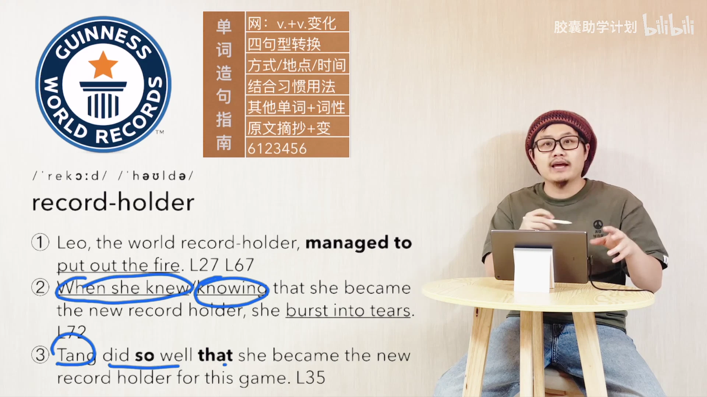

文字识别：单词造句指南 / 网：v.+v.变化 / 胶囊助学计划 / bilbili / 四句型转换 / 方式/地点/时间 / 结合习惯用法 / 其他单词+词性 / 原文摘抄+变 / 6123456 / /'reko:d/ /'haulda/ / record-holder / ① Leo, the world record-holder, managed to / put out the fire. L27 L67 / When she knew'knowing / that she became / the new record hoider, she burst into tears. / Tand / did so well that she became the new / 3 / record holder for this game. L35

## 00:04:30–00:05:00

然后你也可以指的是video啊，computer video game，对吧？OK，呃，呃，他做的如此的好，以至于他成了这个游戏啊或者这个比赛的新的记录保持者。OK，啊，如此以至于。三十五课咱们学的，对，你看在这儿就不停的复习。Next one，下一个单词truant，truant，truant这个单词就逃学嘛？那原文就给了一个习惯用法，咱直接就用叫play truant from school。后边

### 画面 00:04:30

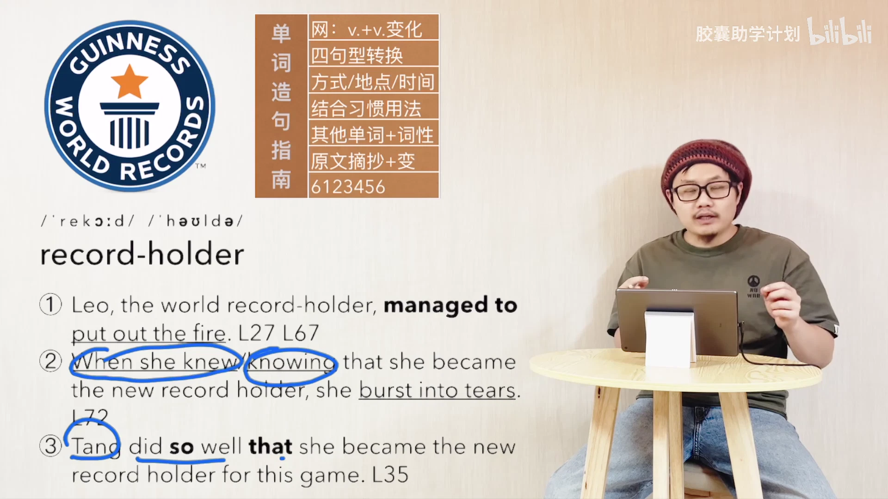

文字识别：单词造句指南 / 网：v.+v.变化 / 胶囊助学计划 / biibii / 四句型转换 / 方式/地点/时间 / 结合习惯用法 / 其他单词+词性 / 原文摘抄+变 / 6123456 / /'reko:d/ /'haulda/ / record-holder / ① Leo, the world record-holder, managed to / put out the fire. L27 L67 / When she knew'knowing / that she became / the new record hoider, she burst into tears. / 3 / Tand / did so well that she became the new / record holder for this game. L35

### 画面 00:04:36

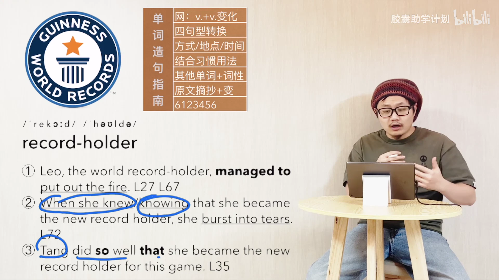

文字识别：单词造句指南 / 网：v.+v.变化 / 胶囊助学计划 / bilibili / 四句型转换 / 方式/地点/时间 / 结合习惯用法 / 其他单词+词性 / 原文摘抄+变 / 6123456 / /'reko:d/ /'haulda/ / record-holder / ① Leo, the world record-holder, managed to / put out the fire. L27 L67 / When she knew'knowing / that she became / the new record hoider, she burst into tears. / Tand / did so well that she became the new / 3 / record holder for this game. L35

### 画面 00:04:43

文字识别：单词造句指南 / 网：v.+v.变化 / 胶囊助学计划 / bibil / 四句型转换 / 方式/地点/时间 / 结合习惯用法 / 其他单词+词性 / 原文摘抄+变 / 6123456 / /'reko:d/ /'haulda/ / record-holder / ① Leo, the world record-holder, managed to / put out the fire. L27 L67 / When she knew'knowing / that she became / the new record hoider, she burst into tears. / Tano / did so well that she became the new / 3 / record holder for this game. L35

### 画面 00:04:46

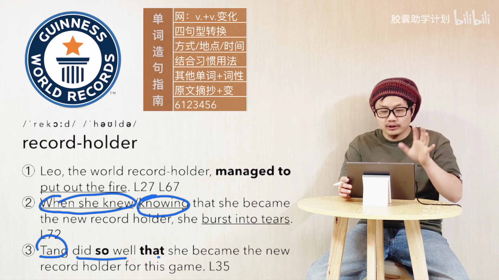

文字识别：单词造句指南 / 网：v.+v.变化 / 胶囊助学计划 / bibili / 四句型转换 / 方式/地点/时间 / 结合习惯用法 / 其他单词+词性 / 原文摘抄+变 / 6123456 / /'reko:d/ /'haulda/ / record-holder / ① Leo, the world record-holder, managed to / put out the fire. L27 L67 / When she knew'knowing / that she became / the new record hoider, she burst into tears. / 3 / Tand / did so well that she became the new / record holder for this game. L35

### 画面 00:04:48

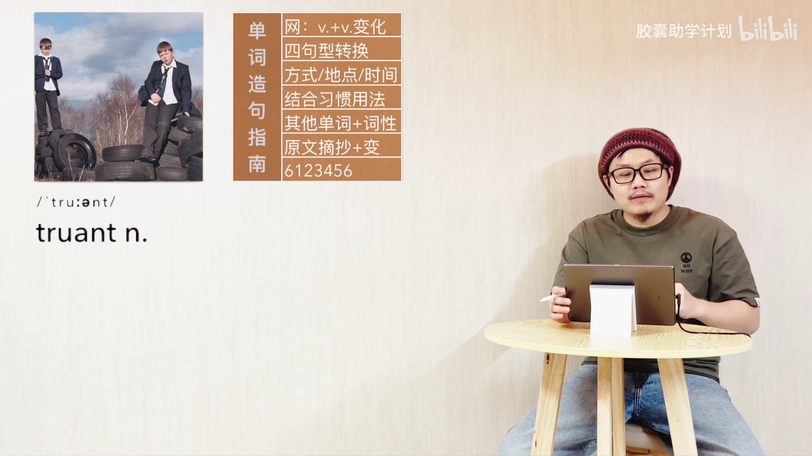

文字识别：单词造句指南 / 网：v.+v.变化 / 胶囊助学计划 / bibili / 四句型转换 / 方式/地点/时间 / 结合习惯用法 / 其他单词+词性 / 原文摘抄+变 / 6123456 / /'tru:ant/ / truant n. / NO

### 画面 00:04:50

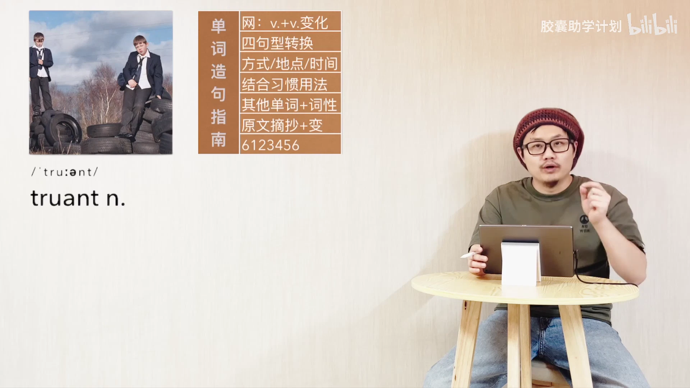

文字识别：单词造句指南 / 网：v.+v.变化 / 胶囊助学计划 / bilbili / 四句型转换 / 方式/地点/时间 / 结合习惯用法 / 其他单词+词性 / 原文摘抄+变 / 6123456 / /'tru:ant/ / truant n. / N

### 画面 00:04:55

文字识别：单词造句指南 / 网：v.+v.变化 / 胶囊助学计划 / bilbili / 四句型转换 / 方式/地点/时间 / 结合习惯用法 / 其他单词+词性 / 原文摘抄+变 / 6123456 / /'tru:ant/ / truant n. / ① play truant from school ..

## 00:05:00–00:05:30

这个 from school 有没有其实无所谓啊。呃，play truant 就是逃学的意思，一个动词短语给你了。然后呢，它自己本身又是个名词，那我想造句就很容易了。我先不用动词短语啊，我们先比如说造个句叫 I saw a truant throwing stones into the river。我看见某人正在做某事儿。三十五课咱学的复习。When I was young，I dreamed of playing truant from school all the time。好了，复习 dream of

### 画面 00:05:00

文字识别：单词造句指南 / 网：v.+v.变化 / 胶囊助学计划 / bibili / 四句型转换 / 方式/地点/时间 / 结合习惯用法 / 其他单词+词性 / 原文摘抄+变 / 6123456 / /'tru:ant/ / truant n. / ) play truant from school .. / 1

### 画面 00:05:03

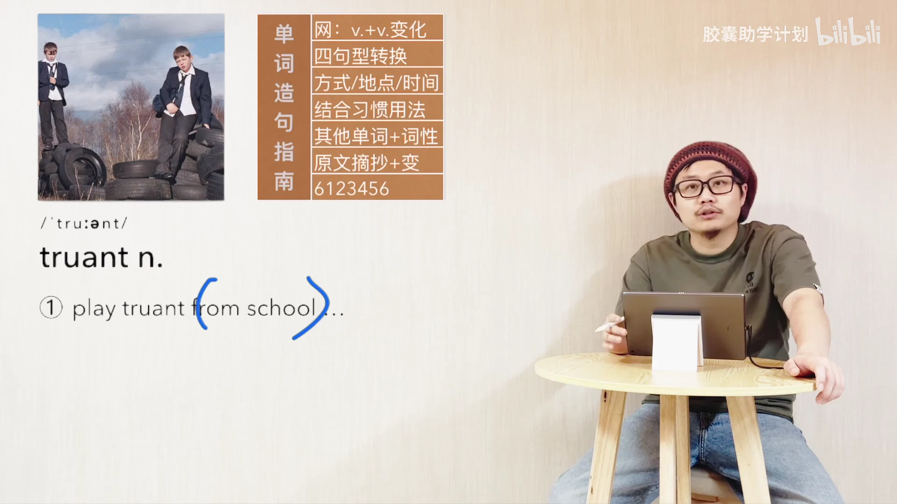

文字识别：单词造句指南 / 网：v.+v.变化 / 胶囊助学计划 / bibil / 四句型转换 / 方式/地点/时间 / 结合习惯用法 / 其他单词+词性 / 原文摘抄+变 / 6123456 / /'tru:ant/ / truant n. / ① play truant / from school

### 画面 00:05:05

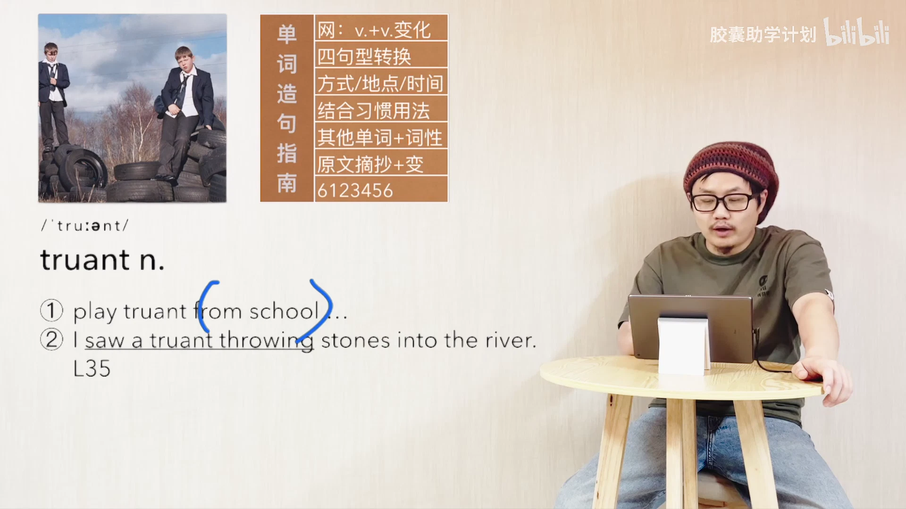

文字识别：单词造句指南 / 网：v.+v.变化 / 胶囊助学计划 / bilbili / 四句型转换 / 方式/地点/时间 / 结合习惯用法 / 其他单词+词性 / 原文摘抄+变 / 6123456 / /'tru:ant/ / truant n. / ① play truant from school / I saw a truant throwing stones into the river. / L35

### 画面 00:05:08

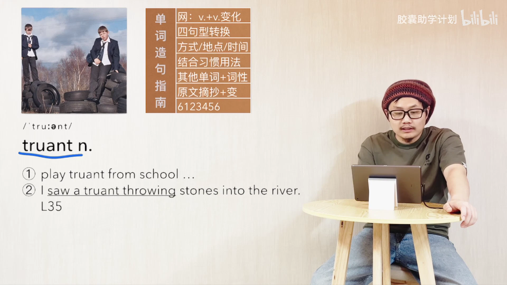

文字识别：单词造句指南 / 网：v.+v.变化 / 胶囊助学计划 / bibili / 四句型转换 / 方式/地点/时间 / 结合习惯用法 / 其他单词+词性 / 原文摘抄+变 / 6123456 / /'tru:ant/ / truant n. / 1 / play truant from school . / I saw a truant throwing stones into the river. / L35

### 画面 00:05:20

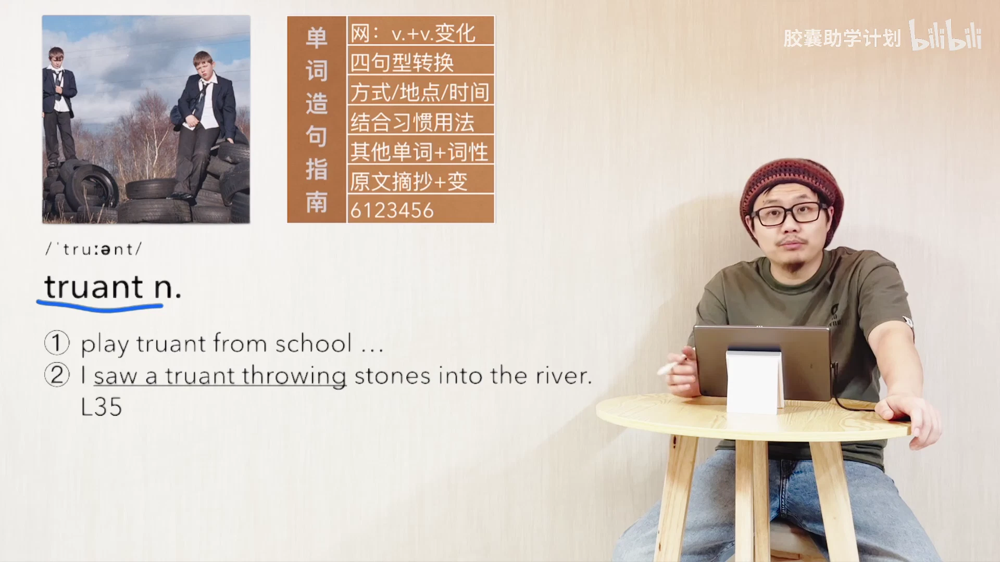

文字识别：单词造句指南 / 网：v.+v.变化 / 胶囊助学计划 / biibii / 四句型转换 / 方式/地点/时间 / 结合习惯用法 / 其他单词+词性 / 原文摘抄+变 / 6123456 / /'tru:ant/ / truant n. / 1 / play truant from school .. / I saw a truant throwing stones into the river. / L35

### 画面 00:05:22

文字识别：单词造句指南 / 网：v.+v.变化 / 胶囊助学计划 / biibii / 四句型转换 / 方式/地点/时间 / 结合习惯用法 / 其他单词+词性 / 原文摘抄+变 / 6123456 / /'tru:ant/ / truant n. / ① play truant from school ... / 2 / ) I saw a truant throwing stones into the river. / L35 / When I was young, I dreamed of playing / truant from school all the time. L38

## 00:05:30–00:06:00

doing something.原文也出现了这个习惯用法，对吧？当我还很年轻的时候，我基本上一直都梦想着想要逃学，对吧？总想逃学。Next one, I used to play truant a lot.说，我过去啊常常逃学，a lot，哎，就是很多，对吧？Great deal啊。那 play truant，我刚才说了，可以不加 from school，没有任何问题。那 I used to play truant，就是我过去常常逃学。OK，哎，truant，各位还是

### 画面 00:05:30

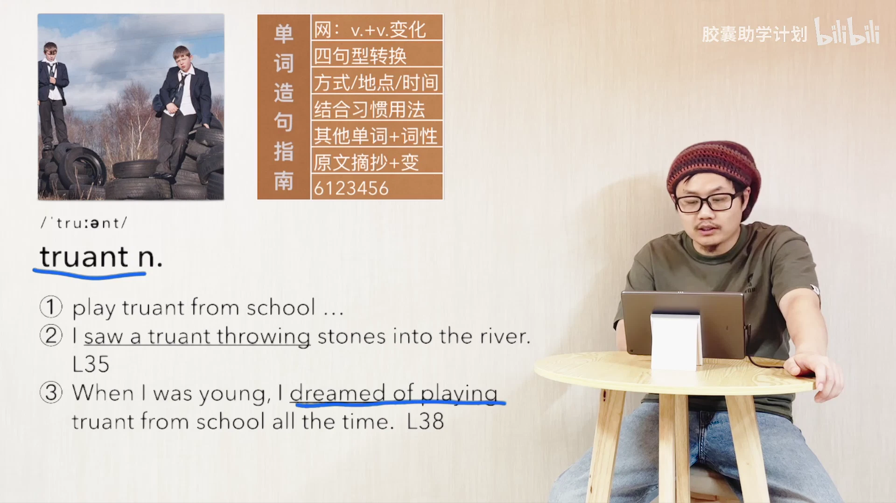

文字识别：单词造句指南 / 网：v.+v.变化 / 胶囊助学计划 / bilbii / 四句型转换 / 方式/地点/时间 / 结合习惯用法 / 其他单词+词性 / 原文摘抄+变 / 6123456 / /'tru:ant/ / truant n. / ① play truant from school ... / 2) /  I saw a truant throwing stones into the river. / L35 / When I was young, I dreamed ofplayina / truant from school all the time. L38

### 画面 00:05:38

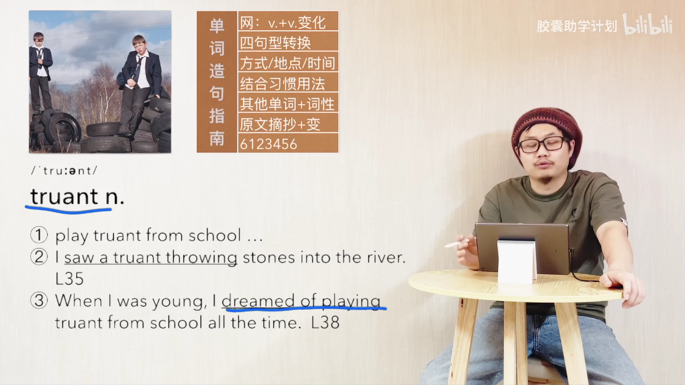

文字识别：单词造句指南 / 网：v.+v.变化 / 胶囊助学计划 / bibii / 四句型转换 / 方式/地点/时间 / 结合习惯用法 / 其他单词+词性 / 原文摘抄+变 / 6123456 / /'tru:ant/ / truant n. / ① play truant from school ... / 2) /  I saw a truant throwing stones into the river. / L35 / When I was young, I dreamed ofplavina / truant from school all the time. L38

### 画面 00:05:41

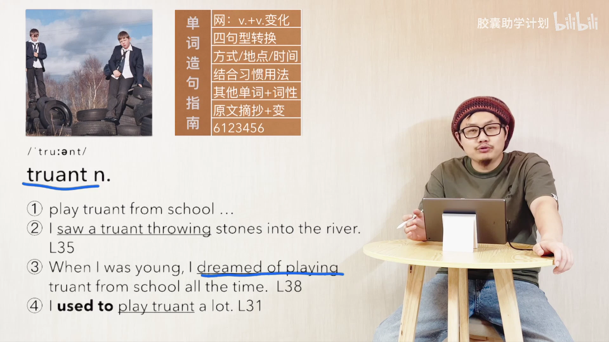

文字识别：单词造句指南 / 网：v.+v.变化 / 胶囊助学计划 / bilibili / 四句型转换 / 方式/地点/时间 / 结合习惯用法 / 其他单词+词性 / 原文摘抄+变 / 6123456 / /'tru:ant/ / truant n. / ① play truant from school ... / ② I saw a truant throwing stones into the river. / L35 / When I was young, I dreamed of playina / truant from school all the time. L38 / 4I used to play truant a lot. L31

### 画面 00:05:50

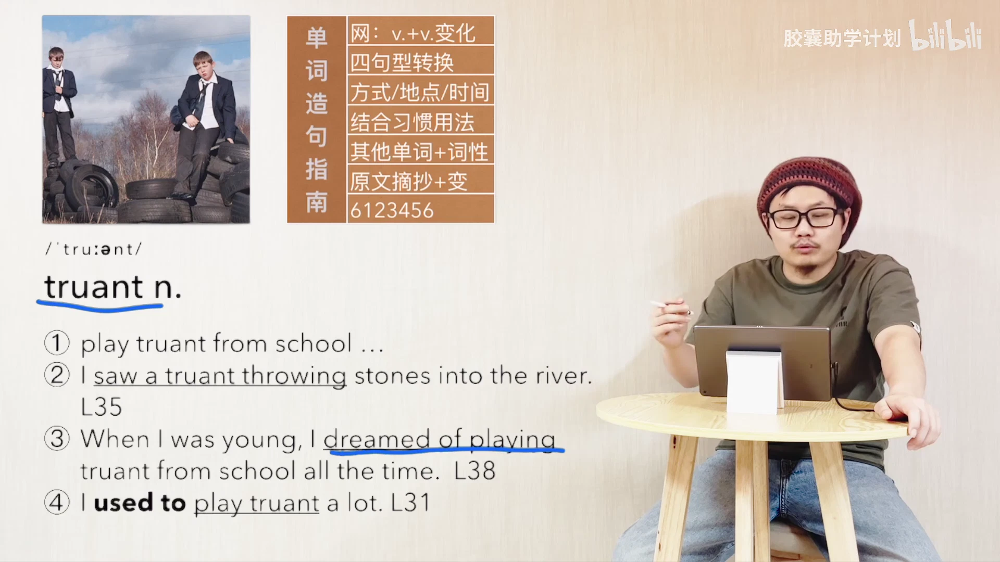

文字识别：单词造句指南 / 网：v.+v.变化 / 胶囊助学计划 / bilbili / 四句型转换 / 方式/地点/时间 / 结合习惯用法 / 其他单词+词性 / 原文摘抄+变 / 6123456 / /'tru:ant/ / truant n. / ① play truant from school .. / ② I saw a truant throwing stones into the river. / L35 / When I was young, I dreamed of playing / truant from school all the time. L38 / 4I used to play truant a lot. L31

## 00:06:00–00:06:30

那句话，在这儿 used to do 三十一课咱们学的啊，整个第四单元整体的风格都是这个样子，不停的结合着之前学过的所有单词、语法、习惯用法啊，然后去造句。所以如果还是那句话，你学的无比的困难，学不下去了，不要赖别人，就是前三个单元您没有扎扎实实的听课，更重要的是写作业，对吧？如果你现在听起来，哎呀，这好容易啊，祝贺你前三单元学的不

### 画面 00:06:01

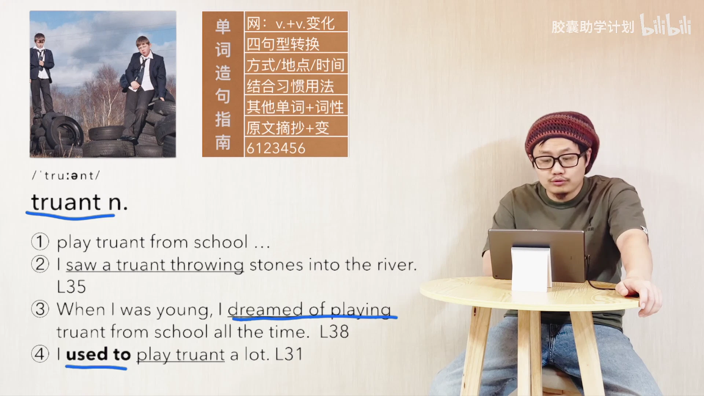

文字识别：单词造句指南 / 网：v.+v.变化 / 胶囊助学计划 / Bilbili / 四句型转换 / 方式/地点/时间 / 结合习惯用法 / 其他单词+词性 / 原文摘抄+变 / 6123456 / /'tru:ant/ / truant n. / ① play truant from school ... / ② I saw a truant throwing stones into the river. / L35 / When I was young, I dreamed of playing / truant from school all the time. L38 / I used to play truant a lot. L31

### 画面 00:06:06

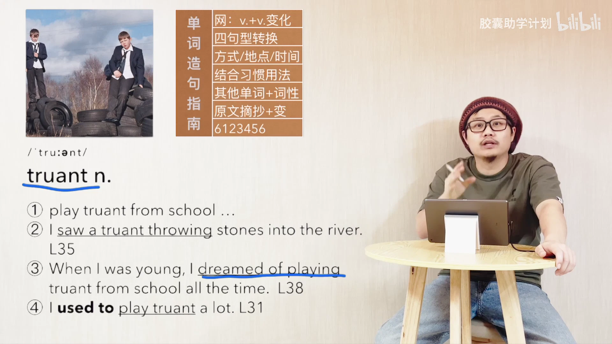

文字识别：单词造句指南 / 网：v.+v.变化 / 胶囊助学计划 / bilbli / 四句型转换 / 方式/地点/时间 / 结合习惯用法 / 其他单词+词性 / 原文摘抄+变 / 6123456 / /'tru:ant/ / truant n. / ① play truant from school .. / ② I saw a truant throwing stones into the river. / L35 / When I was young, I dreamed of playing / truant from school all the time. L38 / 4I used to play truant a lot. L31

### 画面 00:06:12

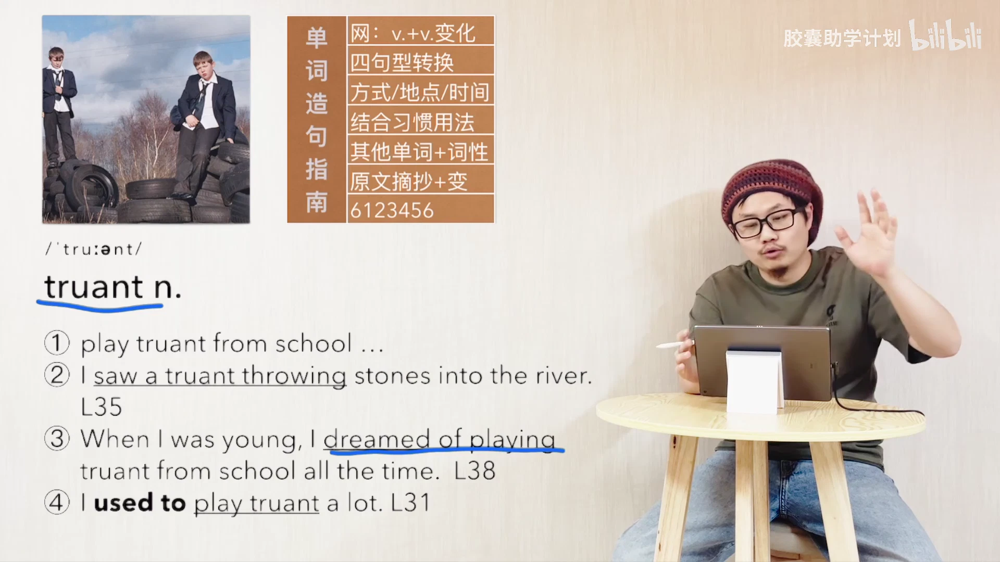

文字识别：单词造句指南 / 网：v.+v.变化 / 胶囊助学计划 / Bilbili / 四句型转换 / 方式/地点/时间 / 结合习惯用法 / 其他单词+词性 / 原文摘抄+变 / 6123456 / /'tru:ant/ / truant n. / ① play truant from school ... / ② I saw a truant throwing stones into the river. / L35 / When I was young, I dreamed of playina / truant from school all the time. L38 / 4I used to play truant a lot. L31

### 画面 00:06:16

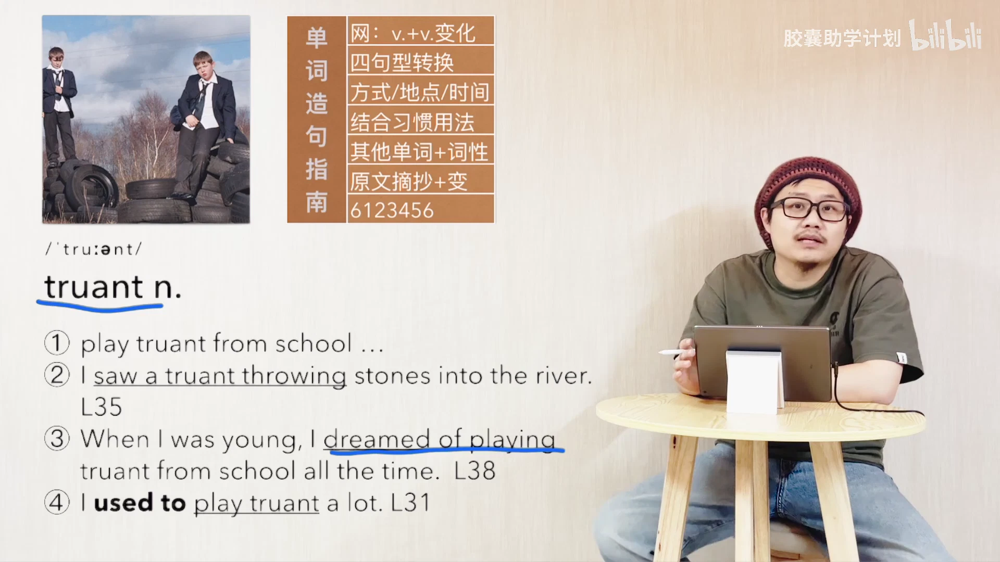

文字识别：单词造句指南 / 网：v.+v.变化 / 胶囊助学计划 / bibii / 四句型转换 / 方式/地点/时间 / 结合习惯用法 / 其他单词+词性 / 原文摘抄+变 / 6123456 / /'tru:ant/ / truant n. / ① play truant from school ... / ② I saw a truant throwing stones into the river. / L35 / When I was young, I dreamed of playing / truant from school all the time. L38 / 4I used to play truant a lot. L31

### 画面 00:06:19

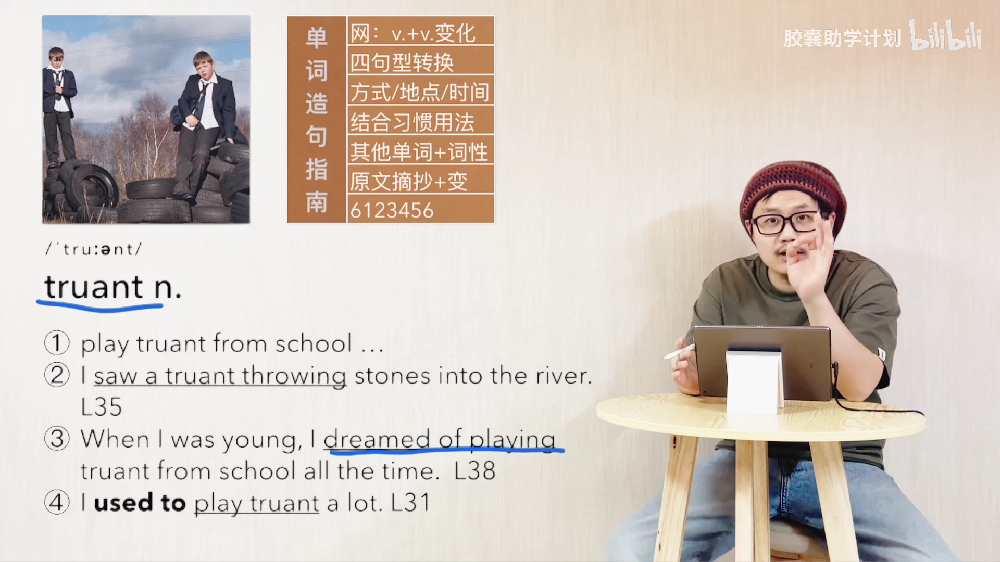

文字识别：单词造句指南 / 网：v.+v.变化 / 胶囊助学计划 / bilbili / 四句型转换 / 方式/地点/时间 / 结合习惯用法 / 其他单词+词性 / 原文摘抄+变 / 6123456 / /'tru:ant/ / truant n. / ① play truant from school ... / 2 /  I saw a truant throwing stones into the river. / L35 / When I was young, I dreamed of playing / truant from school all the time. L38 / 4I used to play truant a lot. L31

### 画面 00:06:21

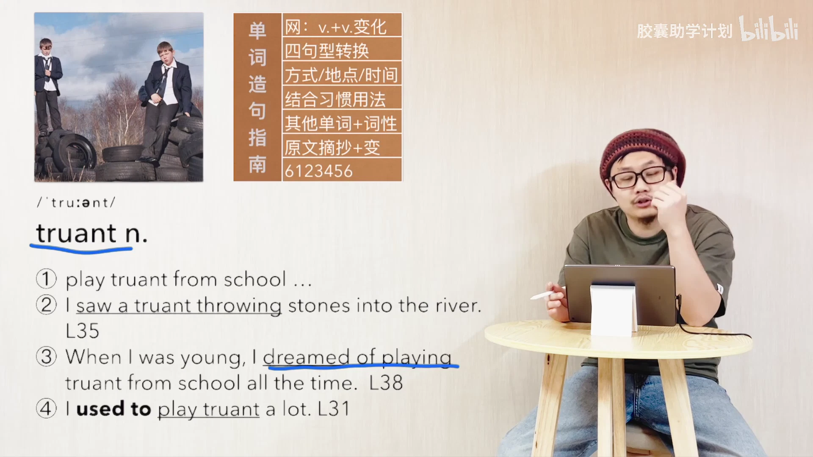

文字识别：单词造句指南 / 网：v.+v.变化 / 胶囊助学计划 / biibili / 四句型转换 / 方式/地点/时间 / 结合习惯用法 / 其他单词+词性 / 原文摘抄+变 / 6123456 / /'tru:ant/ / truant n. / ① play truant from school ... / ② I saw a truant throwing stones into the river. / L35 / When I was young, I dreamed of playina / truant from school all the time. L38 / 4I used to play truant a lot. L31

### 画面 00:06:23

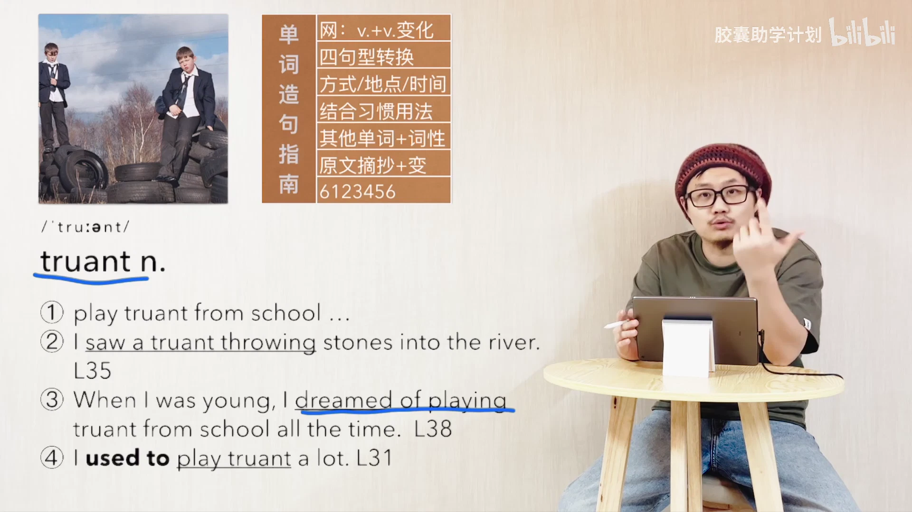

文字识别：单词造句指南 / 网：v.+v.变化 / 胶囊助学计划 / bilibii / 四句型转换 / 方式/地点/时间 / 结合习惯用法 / 其他单词+词性 / 原文摘抄+变 / 6123456 / /'tru:ant/ / truant n. / ① play truant from school .. / ② I saw a truant throwing stones into the river. / L35 / When I was young, I dreamed of playina / truant from school all the time. L38 / 4I used to play truant a lot. L31

### 画面 00:06:25

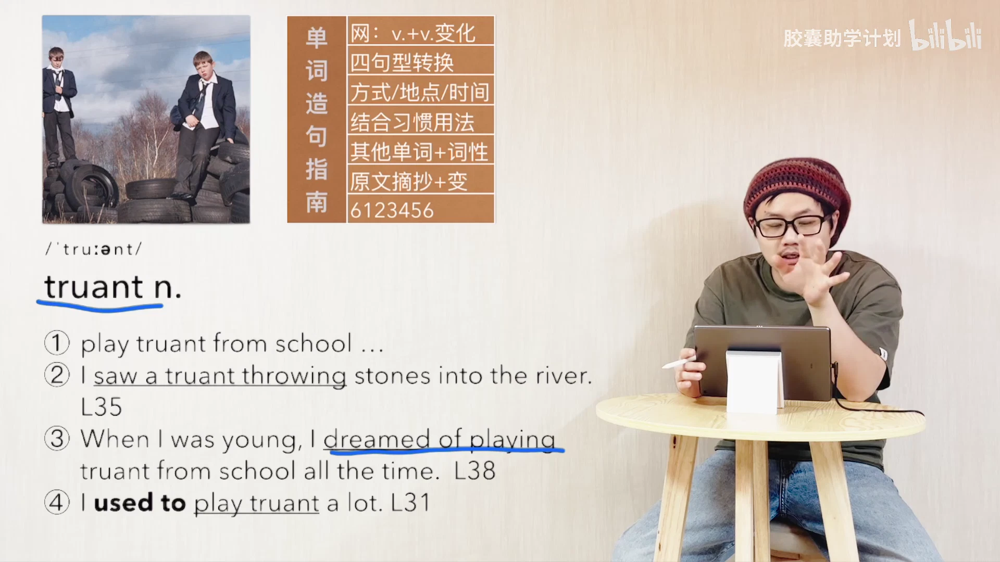

文字识别：单词造句指南 / 网：v.+v.变化 / 胶囊助学计划 / bilbili / 四句型转换 / 方式/地点/时间 / 结合习惯用法 / 其他单词+词性 / 原文摘抄+变 / 6123456 / /'tru:ant/ / truant n. / ① play truant from school .. / ② I saw a truant throwing stones into the river. / L35 / When I was young, I dreamed of playina / truant from school all the time. L38 / 4I used to play truant a lot. L31

## 00:06:30–00:07:00

错啊！Next one，那注意力集中，咱听个电影片段。I'm fifteen. I don't want to be a train. Okay, continue下一个单词，看着音标直接读，叫做an imaginative, an imaginative. Okay，叫做没有想象力的。那这个单词一定要跟接下来这两个单词放到一起，一个叫imagine. Oh, okay，那imagine啊，假想一下，设想一下。那imaginative就是这个动词，对吧？然

### 画面 00:06:31

文字识别：bilbii / 胶囊助学计划 / I'm fifteen, I don't want to be a truant. / I Like Me / (2018)

### 画面 00:06:36

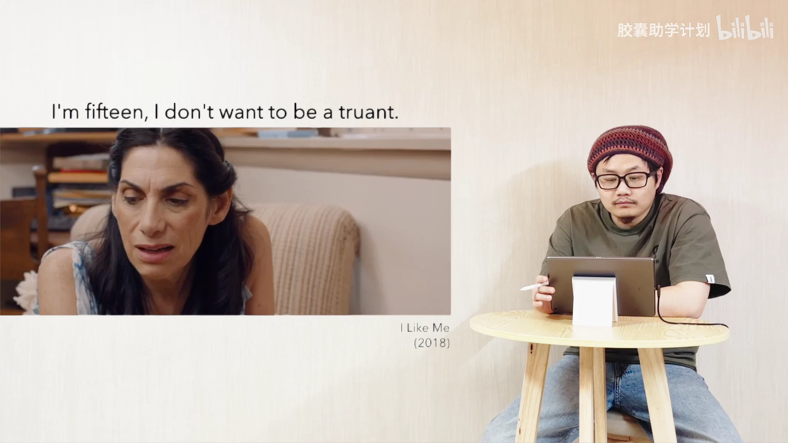

文字识别：biibli / 胶囊助学计划 / I'm fifteen, I don't want to be a truant. / I Like Me / (2018)

### 画面 00:06:38

文字识别：单词造句指南 / 网：v.+v.变化 / 胶囊助学计划 / bibili / 四句型转换 / 方式/地点/时间 / 结合习惯用法 / 其他单词+词性 / 原文摘抄+变 / 6123456 / /ΛnI'mæd3inativ/ / unimaginative adj.

### 画面 00:06:40

文字识别：单词造句指南 / 网：v.+v.变化 / 胶囊助学计划 / bibili / 四句型转换 / 方式/地点/时间 / 结合习惯用法 / 其他单词+词性 / 原文摘抄+变 / 6123456 / /anI'mæd3inatIv/ / unimaginative adj.

### 画面 00:06:51

文字识别：单词造句指南 / 网：v.+v.变化 / 胶囊助学计划 / bilbil / 四句型转换 / 方式/地点/时间 / 结合习惯用法 / 其他单词+词性 / 原文摘抄+变 / 6123456 / /ΛnI'mæd3inativ/ / unimaginative adj. / D imagine v. imaginative adj.

### 画面 00:06:56

文字识别：单词造句指南 / 网：v.+v.变化 / 胶囊助学计划 / bibili / 四句型转换 / 方式/地点/时间 / 结合习惯用法 / 其他单词+词性 / 原文摘抄+变 / 6123456 / /anI'mæd3inativ/ / unimaginative adj. / ① imagine v. imaginative adj.

## 00:07:00–00:07:30

后这个呃，这个动词的形容词是吧？其实是名词的形容词啊，但是就是无所谓了，他们都是一个单词啊，基本都是一个单词变过来，都是由imagine这个单词变过来的。imaginative形容词就是有想象力的，unimaginative u n放前面表前缀表否定，这咱们见过很多次了，有想象力，无想象力的，对吧？那我造了一个句子，三十五课说，he is such an unimaginative young man that

### 画面 00:07:04

文字识别：单词造句指南 / 网：v.+v.变化 / 胶囊助学计划 / bibili / 四句型转换 / 方式/地点/时间 / 结合习惯用法 / 其他单词+词性 / 原文摘抄+变 / 6123456 / /anI'mæd3inativ/ / unimaginative adj. / ) imagine v. imaginative adj.

### 画面 00:07:14

文字识别：单词造句指南 / 网：v.+v.变化 / 胶囊助学计划 / bibil / 四句型转换 / 方式/地点/时间 / 结合习惯用法 / 其他单词+词性 / 原文摘抄+变 / 6123456 / /anI'mæd3inativ/ / unimaginative adj. / D imagine v. imaginative adj.

### 画面 00:07:18

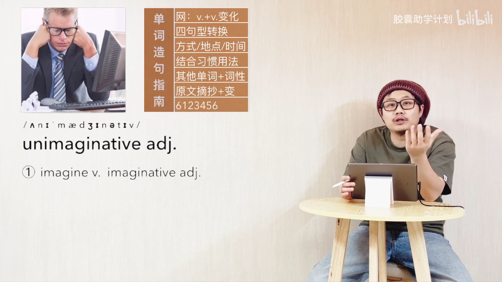

文字识别：单词造句指南 / 网：v.+v.变化 / 胶囊助学计划 / bibili / 四句型转换 / 方式/地点/时间 / 结合习惯用法 / 其他单词+词性 / 原文摘抄+变 / 6123456 / /anI'mæd3inativ/ / unimaginative adj. / ① imagine v. imaginative adj.

### 画面 00:07:20

文字识别：单词造句指南 / 网：v.+v.变化 / 胶囊助学计划 / bibili / 四句型转换 / 方式/地点/时间 / 结合习惯用法 / 其他单词+词性 / 原文摘抄+变 / 6123456 / /anI'mæd3inativ/ / unimaginative adj. / )imagine v. imaginative adj.

### 画面 00:07:25

文字识别：单词造句指南 / 网：v.+v.变化 / 胶囊助学计划 / bilbil / 四句型转换 / 方式/地点/时间 / 结合习惯用法 / 其他单词+词性 / 原文摘抄+变 / 6123456 / /ΛnI'mæd3inatIv/ / unimaginative adj. / ① imagine v. imaginative adj. / He is such an unimaginative young man / that ... L35

## 00:07:30–00:08:00

说他是一个如此没有想象力的年轻人，以至于后边句子自己补啊。在这儿，我在这儿重点就是带你复习一下这个语法。看吉尼说，He used to be such an unimaginative young man.说他曾经是如此怎么样的？哎，没有想象力的一个年轻人。这咱三十一课学的，过去如此，现在不这样了，对吧？Next one, so don't follow in your father's footsteps

### 画面 00:07:37

文字识别：单词造句指南 / 网：v.+v.变化 / 胶囊助学计划 / bibli / 四句型转换 / 方式/地点/时间 / 结合习惯用法 / 其他单词+词性 / 原文摘抄+变 / 6123456 / /Λni'mæed3inatIv/ / unimaginative adj. / ① imagine v. imaginative adj. / He is such an unimaginative young man / that ... L35 / He used to be such an unimaginative / young man. L31

### 画面 00:07:42

文字识别：单词造句指南 / 网：v.+v.变化 / 胶囊助学计划 / bilbii / 四句型转换 / 方式/地点/时间 / 结合习惯用法 / 其他单词+词性 / 原文摘抄+变 / 6123456 / /Λni'mæed3inatIv/ / unimaginative adj. / ① imagine v. imaginative adj. / He is such an unimaginative young man / that ... L35 / He used to be such an unimaginative / young man. L31

### 画面 00:07:55

文字识别：单词造句指南 / 网：v.+v.变化 / 胶囊助学计划 / bilibili / 四句型转换 / 方式/地点/时间 / 结合习惯用法 / 其他单词+词性 / 原文摘抄+变 / 6123456 / /Λni'mæd3inatIv/ / unimaginative adj. / ① imagine v. imaginative adj. / He is such an unimaginative young man / that ... L35 / He used to be such an unimaginative / young man. L31 / Don't follow in your father's footsteps, and / become an unimaginative man. L72

### 画面 00:07:59

文字识别：单词造句指南 / 网：v.+v.变化 / 胶囊助学计划 / biibii / 四句型转换 / 方式/地点/时间 / 结合习惯用法 / 其他单词+词性 / 原文摘抄+变 / 6123456 / /Λni'mæd3inativ/ / unimaginative adj. / ① imagine v. imaginative adj. / He is such an unimaginative young man / that ... L35 / He used to be such an unimaginative / young man. L31 / Don't follow in your father's footsteps, and / become an unimaginative man. L72

## 00:08:00–00:08:30

and become an unimaginative young man. 不要步你父亲的后辙，对吧？哎，不要走他走过的老路啊！这咱们学过很多次了，对吧？啊，说过很多次了。啊，给了很多这个啊，传承什么什么的衣钵，对吧？那你要分好词儿还是坏词儿了，对不对？哎，其实二课咱们学的 follow in somebody's footsteps. Okay, 那 next one 下一个单词 shame. Shame

### 画面 00:08:05

文字识别：单词造句指南 / 网：v.+v.变化 / 胶囊助学计划 / bilbii / 四句型转换 / 方式/地点/时间 / 结合习惯用法 / 其他单词+词性 / 原文摘抄+变 / 6123456 / /ΛnI'mæd3inativ/ / unimaginative adj. / ① imagine v. imaginative adj. / He is such an unimaginative young man / that ... L35 / He used to be such an unimaginative / young man. L31 / Don't follow in your father's footsteps, and / become an unimaginative man. L72

### 画面 00:08:12

文字识别：单词造句指南 / 网：v.+v.变化 / 胶囊助学计划 / bibili / 四句型转换 / 方式/地点/时间 / 结合习惯用法 / 其他单词+词性 / 原文摘抄+变 / 6123456 / /ΛnI'mæd3inatIv/ / unimaginative adj. / ① imagine v. imaginative adj. / He is such an unimaginative young man / that ... L35 / He used to be such an unimaginative / young man. L31 / Don't follow in your father's footsteps, and / become an unimaginative man. L72

### 画面 00:08:23

文字识别：单词造句指南 / 网：v.+v.变化 / 胶囊助学计划 / bibili / 四句型转换 / 方式/地点/时间 / 结合习惯用法 / 其他单词+词性 / 原文摘抄+变 / 6123456 / /Λni'mæd3inatIv/ / unimaginative adj. / ① imagine v. imaginative adj. / He is such an unimaginative young man / that ... L35 / He used to be such an unimaginative / young man. L31 / Don't follow in your father's footsteps, and / become an unimaginative man. L72

### 画面 00:08:26

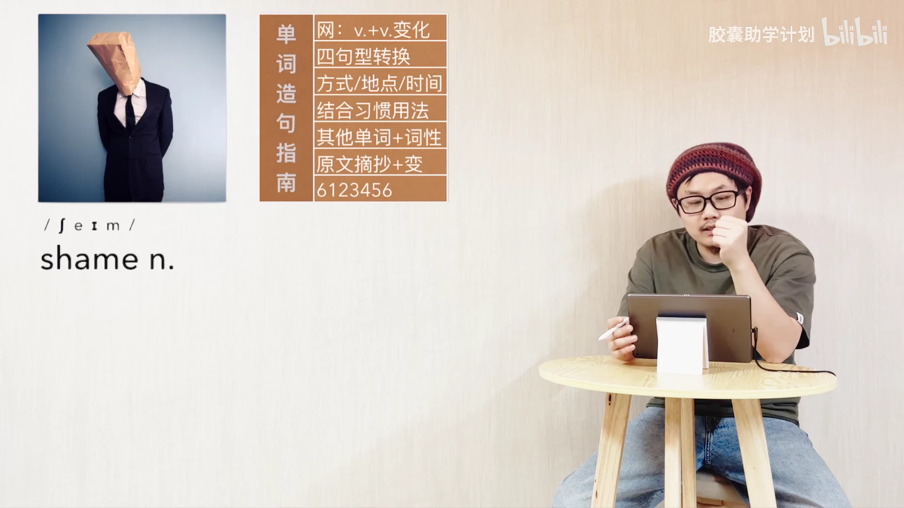

文字识别：单词造句指南 / 网：v.+v.变化 / 胶囊助学计划 / bilbili / 四句型转换 / 方式/地点/时间 / 结合习惯用法 / 其他单词+词性 / 原文摘抄+变 / 6123456 / / ∫eIm/ / shame n.

### 画面 00:08:29

文字识别：单词造句指南 / 网：v.+v.变化 / 胶囊助学计划 / biibii / 四句型转换 / 方式/地点/时间 / 结合习惯用法 / 其他单词+词性 / 原文摘抄+变 / 6123456 / / ∫eIm/ / shame n.

## 00:08:30–00:09:00

This word's basic meaning is shame, shame. Shame.

### 画面 00:08:35

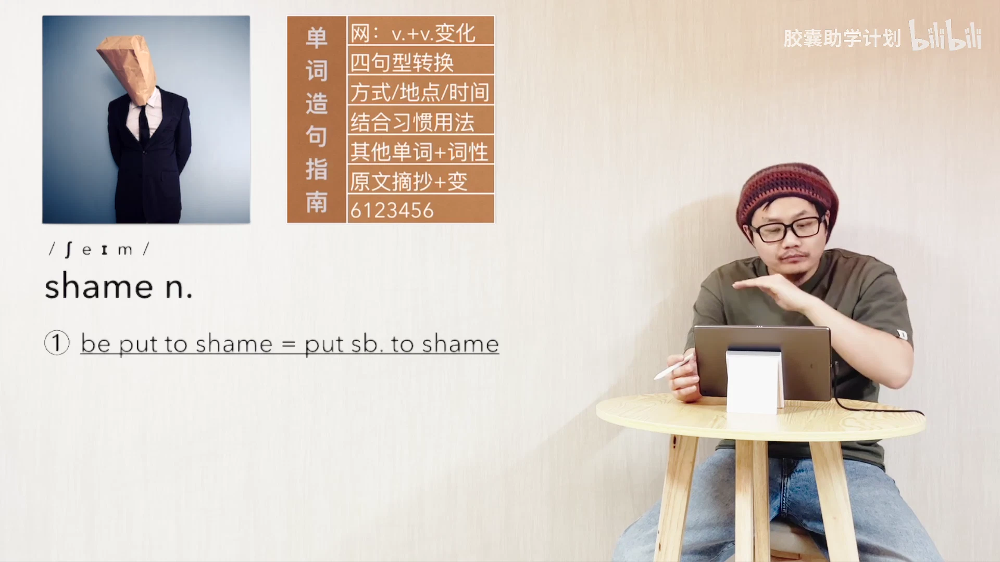

文字识别：单词造句指南 / 网：v.+v.变化 / 胶囊助学计划 / bibili / 四句型转换 / 方式/地点/时间 / 结合习惯用法 / 其他单词+词性 / 原文摘抄+变 / 6123456 / / ∫elm/ / shame n. / ① be put to shame = put sb.to shame

### 画面 00:08:39

文字识别：单词造句指南 / 网：v.+v.变化 / 胶囊助学计划 / bilibili / 四句型转换 / 方式/地点/时间 / 结合习惯用法 / 其他单词+词性 / 原文摘抄+变 / 6123456 / / ∫elm/ / shame n. / ① be put to shame = put sb.to shame

### 画面 00:08:50

文字识别：单词造句指南 / 网：v.+v.变化 / 胶囊助学计划 / bilbili / 四句型转换 / 方式/地点/时间 / 结合习惯用法 / 其他单词+词性 / 原文摘抄+变 / 6123456 / / ∫eIm/ / shame n. / ① be put to shame = put sb.to shame

### 画面 00:08:54

文字识别：单词造句指南 / 网：v.+v.变化 / 胶囊助学计划 / bilbili / 四句型转换 / 方式/地点/时间 / 结合习惯用法 / 其他单词+词性 / 原文摘抄+变 / 6123456 / / ∫elm/ / shame n. / ① be put to shame = put sb.to shame / ② You will be put to shame by this.

### 画面 00:08:58

文字识别：单词造句指南 / 网：v.+v.变化 / 胶囊助学计划 / bilbili / 四句型转换 / 方式/地点/时间 / 结合习惯用法 / 其他单词+词性 / 原文摘抄+变 / 6123456 / / ∫eIm/ / shame n. / ① be put to shame = put sb.to shame / ② You will be put to shame by this.

## 00:09:00–00:09:30

吧？或者再来说，I'm fairly confident that，我很确信，every students were put to shame by this. 哎，每个学生，班上的每一个学生和这件事儿去比一下，都是相形见绌的，对吧？Next one, say your cooking puts me to shame, Lane. Okay, say这是个电影片段，你看他用的是put somebody to shame，对吧？说你的做饭，your cooking，就是你的厨艺啊。我们在这儿给

### 画面 00:09:00

文字识别：单词造句指南 / 网：v.+v.变化 / 胶囊助学计划 / biibii / 四句型转换 / 方式/地点/时间 / 结合习惯用法 / 其他单词+词性 / 原文摘抄+变 / 6123456 / /∫elm/ / shame n. / ① be put to shame = put sb.to shame / ② You will be put to shame by this. /  I'm fairly confident that every students were / 3 / put to shame by this. L55

### 画面 00:09:02

文字识别：单词造句指南 / 网：v.+v.变化 / 胶囊助学计划 / bibii / 四句型转换 / 方式/地点/时间 / 结合习惯用法 / 其他单词+词性 / 原文摘抄+变 / 6123456 / /∫elm/ / shame n. / ① be put to shame = put sb.to shame / ② You will be put to shame by this. /  I'm fairly confident that every students were / 3 / put to shame by this. L55

### 画面 00:09:06

文字识别：单词造句指南 / 网：v.+v.变化 / 胶囊助学计划 / bilbili / 四句型转换 / 方式/地点/时间 / 结合习惯用法 / 其他单词+词性 / 原文摘抄+变 / 6123456 / / ∫eIm / / shame n. / ① be put to shame = put sb.to shame / ② You will be put to shame by this. /  I'm fairly confident that every students were / 3 / put to shame by this. L55

### 画面 00:09:09

文字识别：单词造句指南 / 网：v.+v.变化 / 胶囊助学计划 / Bilbli / 四句型转换 / 方式/地点/时间 / 结合习惯用法 / 其他单词+词性 / 原文摘抄+变 / 6123456 / / ∫eIm/ / shame n. / ① be put to shame = put sb.to shame / ② You will be put to shame by this. /  'm fairly confident that every students were / 3 / put to shame by this. L55

### 画面 00:09:14

文字识别：胶囊助学计划bilbil / 单词造句指南 / 网：v.+v.变化 / 四句型转换 / 方式/地点/时间 / 结合习惯用法 / 其他单词+词性 / 原文摘抄+变 / 6123456 / /∫elm/ / shame n. / ① be put to shame = put sb.to shame / ② You will be put to shame by this. / ③ I'm fairly confident that every students were / 3 / put to shame by this. L55

### 画面 00:09:17

文字识别：胶囊助学计划bilii / 单词造句指南 / 网：v.+v.变化 / 四句型转换 / 方式/地点/时间 / 结合习惯用法 / 其他单词+词性 / 原文摘抄+变 / 6123456 / /∫elm/ / shame n. / ① be put to shame = put sb.to shame / WDE / NB / ② You will be put to shame by this. / ③ I'm fairly confident that every students were / put to shame by this. L55 / D Your cooking puts me to shame, Leah. Loving / 4 / Leah (2009)

### 画面 00:09:26

文字识别：单词造句指南 / 网：v.+v.变化 / 胶囊助学计划bilbi / 四句型转换 / 方式/地点/时间 / 结合习惯用法 / 其他单词+词性 / 原文摘抄+变 / 6123456 / /∫elm/ / shame n. / ① be put to shame = put sb.to shame / ② You will be put to shame by this. / ③ I'm fairly confident that every students were / put to shame by this. L55 / ④ Your cooking puts me to shame, Leah. Loving / Leah (2009)

## 00:09:30–00:10:00

他这个 cooking，咱们不给他翻译成做饭，厨艺。你的厨艺使我相形见绌，就使我感到很惭愧。其实他想表达的意思就是我在夸你，你厨艺比我做饭的水平可高多了。哎，put me to shame. Okay, one more.那口语当中还有一个很常用的短语，shame on you, shame on you，对吧？呃，很常用，它表示的意思就是，哎呀，你这太不要脸了啊，你这

### 画面 00:09:30

文字识别：胶囊助学计划bilbii / 单词造句指南 / 网：v.+v.变化 / 四句型转换 / 方式/地点/时间 / 结合习惯用法 / 其他单词+词性 / 原文摘抄+变 / 6123456 / / ∫eIm / / shame n. / ① be put to shame = put sb.to shame / ② You will be put to shame by this. / ③I'm fairly confident that every students were / 3 / put to shame by this. L55 / D Your cooking puts me to shame, Leah. Loving / 4） / Leah (2009)

### 画面 00:09:34

文字识别：单词造句指南 / 网：v.+v.变化 / 胶囊助学计划bilii / 四句型转换 / 方式/地点/时间 / 结合习惯用法 / 其他单词+词性 / 原文摘抄+变 / 6123456 / / ∫elm/ / shame n. / ① be put to shame = put sb.to shame / ② You will be put to shame by this. / ③ I'm fairly confident that every students were / put to shame by this. L55 / ④ Your cooking puts me to shame, Leah. Loving / Leah (2009)

### 画面 00:09:39

文字识别：单词造句指南 / 网：v.+v.变化 / 胶囊助学计划 / bilibili / 四句型转换 / 方式/地点/时间 / 结合习惯用法 / 其他单词+词性 / 原文摘抄+变 / 6123456 / /∫elm/ / shame n. / ① be put to shame = put sb.to shame / ② You will be put to shame by this. / ③ I'm fairly confident that every students were / put to shame by this. L55 / ④ Your cooking puts me to shame, Leah. Loving / Leah (2009)

### 画面 00:09:44

文字识别：单词造句指南 / 网：v.+v.变化 / 胶囊助学计划 / bilbili / 四句型转换 / 方式/地点/时间 / 结合习惯用法 / 其他单词+词性 / 原文摘抄+变 / 6123456 / / ∫elm/ / shame n. / ① be put to shame = put sb.to shame / ② You will be put to shame by this. / ③ I'm fairly confident that every students were / put to shame by this. L55 / ④ Your cooking puts me to shame, Leah. Loving / Leah (2009)

### 画面 00:09:49

文字识别：单词造句指南 / 网：v.+v.变化 / 胶囊助学计划bilbi / 四句型转换 / 方式/地点/时间 / 结合习惯用法 / 其他单词+词性 / 原文摘抄+变 / 6123456 / /∫elm/ / shame n. / ① be put to shame = put sb.to shame / ② You will be put to shame by this. / ③ I'm fairly confident that every students were / put to shame by this. L55 / ④ Your cooking puts me to shame, Leah. Loving / Leah (2009) / shame on you. / 5

### 画面 00:09:59

文字识别：胶囊助学计划bilbi / 单词造句指南 / 网：v.+v.变化 / 四句型转换 / 方式/地点/时间 / 结合习惯用法 / 其他单词+词性 / 原文摘抄+变 / 6123456 / /∫eIm/ / shame n. / ① be put to shame = put sb.to shame / ② You will be put to shame by this. / ③ I'm fairly confident that every students were / put to shame by this. L55 / ④ Your cooking puts me to shame, Leah. Loving / Leah (2009) / shame on you.

## 00:10:00–00:10:30

太丢人了，shame on you，对吧？OK，那我们注意力集中，听个电影片段啊。OK， next one，下一个单词 hitchhike， hitchhike，这是从西方这个传到啊，中国也有很多人玩了，开始做这件事。年轻人对吧？大多数是年轻人。这最开始的时候，我印象当中是从英国传过来了啊。Lonely Planet吧，那个那个书的呃两个

### 画面 00:10:03

文字识别：bilibili / 胶囊助学计划 / And shame on you / for not giving this to me sooner. / Tinker' / (2018)

### 画面 00:10:07

文字识别：bilbil / 胶囊助学计划 / And shame on you / for not giving this to me sooner. / Tinker' / (2018)

### 画面 00:10:09

文字识别：biibili / 胶囊助学计划 / And shame on you / for not giving this to me sooner. / Tinker' / (2018)

### 画面 00:10:11

文字识别：单词造句指南 / 网：v.+v.变化 / 胶囊助学计划 / bilibili / 四句型转换 / 方式/地点/时间 / 结合习惯用法 / 其他单词+词性 / 原文摘抄+变 / 6123456 / /'hit∫haik/ / hitchhike v.

### 画面 00:10:13

文字识别：单词造句指南 / 网：v.+v.变化 / 胶囊助学计划 / bilibili / 四句型转换 / 方式/地点/时间 / 结合习惯用法 / 其他单词+词性 / 原文摘抄+变 / 6123456 / /'hit∫haik/ / hitchhike v.

### 画面 00:10:17

文字识别：单词造句指南 / 网：v.+v.变化 / 胶囊助学计划 / bilbili / 四句型转换 / 方式/地点/时间 / 结合习惯用法 / 其他单词+词性 / 原文摘抄+变 / 6123456 / /'hit∫haik/ / hitchhike v.

### 画面 00:10:19

文字识别：单词造句指南 / 网：v.+v.变化 / 胶囊助学计划 / bilbili / 四句型转换 / 方式/地点/时间 / 结合习惯用法 / 其他单词+词性 / 原文摘抄+变 / 6123456 / /'hit∫haik/ / hitchhike V. / NL

### 画面 00:10:22

文字识别：单词造句指南 / 网：v.+v.变化 / 胶囊助学计划 / bilbili / 四句型转换 / 方式/地点/时间 / 结合习惯用法 / 其他单词+词性 / 原文摘抄+变 / 6123456 / /'hit∫haik/ / hitchhike v.

### 画面 00:10:24

文字识别：单词造句指南 / 网：v.+v.变化 / 胶囊助学计划 / bibili / 四句型转换 / 方式/地点/时间 / 结合习惯用法 / 其他单词+词性 / 原文摘抄+变 / 6123456 / /'hit∫haik/ / hitchhike v.

## 00:10:30–00:11:00

主编啊，就是创办这个杂志社的那个一男一女那那对大学生是吧？叫 hitchhike， hitchhike 它是一个动词啊， hitchhike 什么意思？就是搭便车啊，就像这个人一样，你背一个大包，你在路边，也许你拿一个牌子，对吧？也许你拿着手大拇指，哎，指一下。这个在比如说我去新西兰和西方一些国家的时候还挺常见的啊，很多年轻人他没钱嘛，搭个便车，对吧？跟你说我去哪儿，你开车送我吧。OK，叫 hitchhike，很

### 画面 00:10:33

文字识别：单词造句指南 / 网：v.+v.变化 / 胶囊助学计划 / bibili / 四句型转换 / 方式/地点/时间 / 结合习惯用法 / 其他单词+词性 / 原文摘抄+变 / 6123456 / /'hit∫haik/ / hitchhike v.

### 画面 00:10:36

文字识别：单词造句指南 / 网：v.+v.变化 / 胶囊助学计划 / bilbili / 四句型转换 / 方式/地点/时间 / 结合习惯用法 / 其他单词+词性 / 原文摘抄+变 / 6123456 / /'hit∫haik/ / hitchhike v.

### 画面 00:10:40

文字识别：单词造句指南 / 网：v.+v.变化 / 胶囊助学计划 / biibili / 四句型转换 / 方式/地点/时间 / 结合习惯用法 / 其他单词+词性 / 原文摘抄+变 / 6123456 / /'hit∫haik/ / hitchhike v.

### 画面 00:10:44

文字识别：单词造句指南 / 网：v.+v.变化 / 胶囊助学计划 / biibili / 四句型转换 / 方式/地点/时间 / 结合习惯用法 / 其他单词+词性 / 原文摘抄+变 / 6123456 / /'hit∫haik/ / hitchhike v. / WAR

### 画面 00:10:54

文字识别：单词造句指南 / 网：v.+v.变化 / 胶囊助学计划 / bilbili / 四句型转换 / 方式/地点/时间 / 结合习惯用法 / 其他单词+词性 / 原文摘抄+变 / 6123456 / /'hit∫haik/ / hitchhike v. / NO / WHR

## 00:11:00–00:11:30

常用的短语 hitchhike to somewhere，搭便车去某地。那我们造句子说六十七个，He managed to hitchhike to school every day when he was still a student. 厉害了，每天搭便车去上学，是吧？想办法搭便车去上学，哎，特别厉害。Next one，说 he insisted on hitchhiking to his hometown，说他坚持要搭便车回他的故乡。哎，好，沿路欣赏风景。Okay， next one，就是 insist on doing something。六十

### 画面 00:11:00

文字识别：单词造句指南 / 网：v.+v.变化 / 胶囊助学计划 / biibili / 四句型转换 / 方式/地点/时间 / 结合习惯用法 / 其他单词+词性 / 原文摘抄+变 / 6123456 / /'hit∫haik/ / hitchhike v. / hitchhike to sw. / WOR / NU

### 画面 00:11:03

文字识别：单词造句指南 / 网：v.+v.变化 / 胶囊助学计划 / bibii / 四句型转换 / 方式/地点/时间 / 结合习惯用法 / 其他单词+词性 / 原文摘抄+变 / 6123456 / /'hit∫haik/ / hitchhike v. / NU / ① hitchhike to sw. / WIR / He managed to hitchhike to school every / day when he was still a student. L67

### 画面 00:11:05

文字识别：单词造句指南 / 网：v.+v.变化 / 胶囊助学计划 / blbl / 四句型转换 / 方式/地点/时间 / 结合习惯用法 / 其他单词+词性 / 原文摘抄+变 / 6123456 / /'hit ∫haik/ / hitchhike V. / ① hitchhike to sw. / He managed to hitchhike to school every / day when he was still a student. L67

### 画面 00:11:11

文字识别：单词造句指南 / 网：v.+v.变化 / 胶囊助学计划 / bilbili / 四句型转换 / 方式/地点/时间 / 结合习惯用法 / 其他单词+词性 / 原文摘抄+变 / 6123456 / /'hit∫haik/ / hitchhike v. / ① hitchhike to sw. / He managed to hitchhike to school every / day when he was still a student. L67

### 画面 00:11:14

文字识别：单词造句指南 / 网：v.+v.变化 / 胶囊助学计划 / bilbili / 四句型转换 / 方式/地点/时间 / 结合习惯用法 / 其他单词+词性 / 原文摘抄+变 / 6123456 / /'hit∫haik/ / hitchhike v. / ① hitchhike to sw. / He managed to hitchhike to school every / day when he was still a student. L67

### 画面 00:11:17

文字识别：单词造句指南 / 网：v.+v.变化 / 胶囊助学计划 / biibili / 四句型转换 / 方式/地点/时间 / 结合习惯用法 / 其他单词+词性 / 原文摘抄+变 / 6123456 / /'hIt ∫haik/ / hitchhike v. / ① hitchhike to sw. /  He managed to hitchhike to school every / day when he was still a student. L67 / He insisted on hitchhiking to his hometown. / L68

### 画面 00:11:19

文字识别：单词造句指南 / 网：v.+v.变化 / 胶囊助学计划 / bilbli / 四句型转换 / 方式/地点/时间 / 结合习惯用法 / 其他单词+词性 / 原文摘抄+变 / 6123456 / / 'hit Shaik / / hitchhike V. / ① hitchhike to sw. / WNH / NU / ) He managed to hitchhike to school every / day when he was still a student. L67 / He insisted on hitchhiking to his hometown. / L68

### 画面 00:11:24

文字识别：单词造句指南 / 网：v.+v.变化 / 胶囊助学计划 / bilibili / 四句型转换 / 方式/地点/时间 / 结合习惯用法 / 其他单词+词性 / 原文摘抄+变 / 6123456 / / 'hIt ∫haI k / / hitchhike v. / ① hitchhike to sw. /  He managed to hitchhike to school every / day when he was still a student. L67 / He insisted on hitchhiking to his hometown. / L68

### 画面 00:11:27

文字识别：胶囊助学计划biliil / 单词造句指南 / 网：v.+v.变化 / 四句型转换 / 方式/地点/时间 / 结合习惯用法 / 其他单词+词性 / 原文摘抄+变 / 6123456 / / ' hIt ∫hai k / / hitchhike v. / ① hitchhike to sw. / NII /  He managed to hitchhike to school every / day when he was still a student. L67 / He insisted on hitchhiking to his hometown. / L68 / ④ You should have hitchhiked to this place. / L65

### 画面 00:11:29

文字识别：单词造句指南 / 网：v.+v.变化 / 胶囊助学计划 / bilbli / 四句型转换 / 方式/地点/时间 / 结合习惯用法 / 其他单词+词性 / 原文摘抄+变 / 6123456 / / 'hit ∫h ai k / / hitchhike v. / NU / ① hitchhike to sw. / WnR / ) He managed to hitchhike to school every / day when he was still a student. L67 / He insisted on hitchhiking to his hometown. / L68 / ④ You should have hitchhiked to this place. / L65

## 00:11:30–00:12:00

have

### 画面 00:11:35

文字识别：胶囊助学计划bilii / 单词造句指南 / 网：v.+v.变化 / 四句型转换 / 方式/地点/时间 / 结合习惯用法 / 其他单词+词性 / 原文摘抄+变 / 6123456 / / 'hit ∫h aik / / hitchhike v. / ① hitchhike to sw. / NO / ) He managed to hitchhike to school every / day when he was still a student. L67 / He insisted on hitchhiking to his hometown. / L68 / ④ You should have hitchhiked to this place. / L65

### 画面 00:11:41

文字识别：Whoa, no. Let's go to plan B. We'll hitchhike to / biibili / 胶囊助学计划 / the next town Look, we hitchhike Look, it's over, / okay? We're broke. / NI / WnH / Bottle Rocket / (1996)

### 画面 00:11:51

文字识别：Whoa, no. Let's go to plan B. We'll hitchhike to / bibi / 胶囊助学计划 / the next town Look, we hitchhike Look, it's over, / okay? We're broke. / Bottle Rocket / (1996)

### 画面 00:11:53

文字识别：Whoa, no. Let's go to plan B. We'll hitchhike to / 胶囊助学计划bibi出 / the next town Look, we hitchhike Look, it's over, / okay? We're broke. / Bottle Rocket / (1996)

### 画面 00:11:55

文字识别：Whoa, no. Let's go to plan B. We'll hitchhike to / biibili / 胶囊助学计划 / the next town Look, we hitchhike Look, it's over, / okay? We're broke. / Bottle Rocket / (1996)

### 画面 00:11:57

文字识别：Whoa, no. Let's go to plan B. We'll hitchhike to / biibili / 胶囊助学计划 / the next town Look, we hitchhike Look, it's over, / okay? We're broke. / Bottle Rocket / (1996)

### 画面 00:11:59

文字识别：Whoa, no. Let's go to plan B. We'll hitchhike to / bilibli / 胶囊助学计划 / the next town Look, we hitchhike Look, it's over, / okay? We're broke. / Bottle Rocket / (1996)

## 00:12:00–00:12:30

Okay, next one. Meantime, ah, Meantime这个单词不用单独记，更多的是这个短语叫In the meantime，叫做同时，与此同时，对吧？这个想造句就很容易了，因为你知道它在六一二三四五六当中其实就起了一个六的作用。然后我造一个句子，任意一个句子跟它连起来都可以，对吧？比如说In the meantime, he was busy with his homework. Ah,与此同时，他在忙他的家庭作业。Next one. In the meantime, he was instructed to help live. 与此同

### 画面 00:12:01

文字识别：单词造句指南 / 网：v.+v.变化 / 胶囊助学计划 / bilibili / 四句型转换 / 方式/地点/时间 / 结合习惯用法 / 其他单词+词性 / 原文摘抄+变 / 6123456 / /'mi :ntaIm/ / meantime n.

### 画面 00:12:04

文字识别：单词造句指南 / 网：v.+v.变化 / 胶囊助学计划 / bibili / 四句型转换 / 方式/地点/时间 / 结合习惯用法 / 其他单词+词性 / 原文摘抄+变 / 6123456 / /'mi:ntaIm/ / meantime n. / ①in the meantime...

### 画面 00:12:09

文字识别：单词造句指南 / 网：v.+v.变化 / 胶囊助学计划 / bilbili / 四句型转换 / 方式/地点/时间 / 结合习惯用法 / 其他单词+词性 / 原文摘抄+变 / 6123456 / / 'm i:ntaIm / / meantime n. / ① in the meantime... / ② In the meantime, he was busy with his / homework. L70

### 画面 00:12:12

文字识别：单词造句指南 / 网：v.+v.变化 / 胶囊助学计划 / bibili / 四句型转换 / 方式/地点/时间 / 结合习惯用法 / 其他单词+词性 / 原文摘抄+变 / 6123456 / / 'm i :ntaIm / / meantime n. / ① in the meantime... / 2 /  In the meantime, he was busy with his / homework. L70

### 画面 00:12:16

文字识别：单词造句指南 / 网：v.+v.变化 / 胶囊助学计划 / bilbii / 四句型转换 / 方式/地点/时间 / 结合习惯用法 / 其他单词+词性 / 原文摘抄+变 / 6123456 / / 'm i:ntaIm / / meantime n. / ① in the meantime... / ② In the meantime, he was busy with his / homework. L70

### 画面 00:12:27

文字识别：单词造句指南 / 网：v.+v.变化 / 胶囊助学计划 / Bilbli / 四句型转换 / 方式/地点/时间 / 结合习惯用法 / 其他单词+词性 / 原文摘抄+变 / 6123456 / / 'm i :ntaIm / / meantime n. / ① in the meantime... / ② In the meantime, he was busy with his / homework. L70 / ③ In the meantime, he was instructed to help / Leo.L69

## 00:12:30–00:13:00

时呢，他被指示去帮助 Lyle. 再来. In the meantime, he set up his camp under those trees. 所以与此同时，他在那些树底下搭建起了他们的营地，对吧？ Okay. Ah, set up his camp. Very good. Next one. So in the meantime, I want you boys to do me a favor. 哎，与此同时，我希望你们这些这个这个 you boys，其实就是你们你们这些人是吧？哎哎，帮我一个忙。 Okay. 那

### 画面 00:12:30

文字识别：单词造句指南 / 网：v.+v.变化 / 胶囊助学计划 / bilibili / 四句型转换 / 方式/地点/时间 / 结合习惯用法 / 其他单词+词性 / 原文摘抄+变 / 6123456 / / 'm i :ntaIm / / meantime n. / ① in the meantime... / ② In the meantime, he was busy with his / homework. L70 / ③ In the meantime, he was instructed to help / Leo. L69

### 画面 00:12:32

文字识别：单词造句指南 / 网：v.+v.变化 / 胶囊助学计划 / Bilbili / 四句型转换 / 方式/地点/时间 / 结合习惯用法 / 其他单词+词性 / 原文摘抄+变 / 6123456 / / 'mi:ntaIm / / meantime n. / ① in the meantime... / ② In the meantime, he was busy with his / homework. L70 / ③ In the meantime, he was instructed to help / Leo.L69 / ④ In the meantime, he set up his camp under / those trees. L67

### 画面 00:12:34

文字识别：单词造句指南 / 网：v.+v.变化 / 胶囊助学计划 / Bilbli / 四句型转换 / 方式/地点/时间 / 结合习惯用法 / 其他单词+词性 / 原文摘抄+变 / 6123456 / / 'mi :ntaIm / / meantime n. / ① in the meantime... / ② In the meantime, he was busy with his / homework. L70 / ③ In the meantime, he was instructed to help / Leo.L69 / ④ In the meantime, he set up his camp under / those trees. L67

### 画面 00:12:42

文字识别：单词造句指南 / 网：v.+v.变化 / 胶囊助学计划 / bilbli / 四句型转换 / 方式/地点/时间 / 结合习惯用法 / 其他单词+词性 / 原文摘抄+变 / 6123456 / / 'm i :nt aIm / / meantime n. / ① in the meantime... / ② In the meantime, he was busy with his / homework. L70 / ③ In the meantime, he was instructed to help / Leo. L69 / ④ In the meantime, he set up his camp under / those trees. L67

### 画面 00:12:46

文字识别：biibli / 胶囊助学计划 / In the meantime, / I want you boys to do me a favor. / NUI / Gifted Hands: The Ben Carson Story / (2009)

### 画面 00:12:54

文字识别：blibl / 胶囊助学计划 / In the meantime, / I want you boys to do me a favor. / Gifted Hands: The Ben Carson Story / (2009)

## 00:13:00–00:13:30

注意力集中，再听一下这个电影片段。In the meantime, I want you boys to do me a favor. OK，下一个单词，lorry，卡车啊。所以六月三、四、六当中，你想它最容易做的一、三、五没了，对吧？哎，主，呃，宾，地点，对吧？所以 he was hit by a lorry last night，昨天晚上被一卡车给撞了。一般过去是被动。It's easy for somebody to do something，对吧？对于某

### 画面 00:13:03

文字识别：biibli / 胶囊助学计划 / In the meantime, / I want you boys to do me a favor. / Gifted Hands: The Ben Carson Story / (2009)

### 画面 00:13:05

文字识别：biibli / 胶囊助学计划 / In the meantime, / I want you boys to do me a favor. / Gifted Hands: The Ben Carson Story / (2009)

### 画面 00:13:07

文字识别：胶囊助学计划biibi出 / In the meantime, / I want you boys to do me a favor. / Gifted Hands: The Ben Carson Story / (2009)

### 画面 00:13:09

文字识别：单词造句指南 / 网：v.+v.变化 / 胶囊助学计划 / bilbii / 四句型转换 / 方式/地点/时间 / 结合习惯用法 / 其他单词+词性 / 原文摘抄+变 / 6123456 / /|pri/ / lorry n.

### 画面 00:13:11

文字识别：单词造句指南 / 网：v.+v.变化 / 胶囊助学计划 / biibii / 四句型转换 / 方式/地点/时间 / 结合习惯用法 / 其他单词+词性 / 原文摘抄+变 / 6123456 / /|pri/ / lorry n.

### 画面 00:13:14

文字识别：单词造句指南 / 网：v.+v.变化 / 胶囊助学计划 / bilbili / 四句型转换 / 方式/地点/时间 / 结合习惯用法 / 其他单词+词性 / 原文摘抄+变 / 6123456 / / '|pri/ / lorry n. / ① He was hit by a lorry last night. L10

### 画面 00:13:26

文字识别：单词造句指南 / 网：v.+v.变化 / 胶囊助学计划 / bilbili / 四句型转换 / 方式/地点/时间 / 结合习惯用法 / 其他单词+词性 / 原文摘抄+变 / 6123456 / /'|pri/ / lorry n. / ① He was hit by a lorry last night. L10 / WHR / It's easy for him to recognize his father's / lorry. L32

## 00:13:30–00:14:00

### 画面 00:13:30

文字识别：单词造句指南 / 网：v.+v.变化 / 胶囊助学计划 / bibil / 四句型转换 / 方式/地点/时间 / 结合习惯用法 / 其他单词+词性 / 原文摘抄+变 / 6123456 / / ^lpri/ / lorry n. / ① He was hit by a lorry last night. L10 / wm / It's easy for him to recognize his father's / lorry. L32

### 画面 00:13:42

文字识别：单词造句指南 / 网：v.+v.变化 / 胶囊助学计划 / bilbili / 四句型转换 / 方式/地点/时间 / 结合习惯用法 / 其他单词+词性 / 原文摘抄+变 / 6123456 / /'lpri/ / lorry n. / ① He was hit by a lorry last night. L10 / ② It's easy for him to recognize his father's / lorry. L32 / Although he knows how to drive a lorry, he / doesn't know the way to New York. L25

### 画面 00:13:44

文字识别：单词造句指南 / 网：v.+v.变化 / 胶囊助学计划 / bilibili / 四句型转换 / 方式/地点/时间 / 结合习惯用法 / 其他单词+词性 / 原文摘抄+变 / 6123456 / / 'lpri/ / lorry n. / ① He was hit by a lorry last night. L10 / ② It's easy for him to recognize his father's / lorry. L32 / Although he knows how to drive a lorry, he / doesn't know the Way to New York. L25

### 画面 00:13:49

文字识别：单词造句指南 / 网：v.+v.变化 / 胶囊助学计划 / bilibili / 四句型转换 / 方式/地点/时间 / 结合习惯用法 / 其他单词+词性 / 原文摘抄+变 / 6123456 / /'lpri/ / lorry n. / ① He was hit by a lorry last night. L10 / NO / WAR / ② It's easy for him to recognize his father's / lorry. L32 / Although he knows how to drive a lorry, he / doesn't know the way to New York. L25

### 画面 00:13:59

文字识别：单词造句指南 / 网：v.+v.变化 / 胶囊助学计划 / bilbili / 四句型转换 / 方式/地点/时间 / 结合习惯用法 / 其他单词+词性 / 原文摘抄+变 / 6123456 / /'lpri/ / lorry n. / ① He was hit by a lorry last night. L10 / ② It's easy for him to recognize his father's / lorry. L32 / Although he knows how to drive a lorry, he / doesn't know the way to New York. L25

## 00:14:00–00:14:30

didn't know the way to some place. 这个是咱们二十五课学过的，对吧？ Okay, next one. Say the lorry must have been stolen last night. Must have been done. 二十一课咱们学过的，叫做当时一定是被偷了。 Okay, 好，全是在复习，能看到啊。 Next one, 下一个单词叫做 border. Border 叫做边境啊。 Border 是边境的意思。那我们造一个句子叫做 I have never been

### 画面 00:14:05

文字识别：单词造句指南 / 网：v.+v.变化 / 胶囊助学计划 / Bilbili / 四句型转换 / 方式/地点/时间 / 结合习惯用法 / 其他单词+词性 / 原文摘抄+变 / 6123456 / /'lpri/ / lorry n. / ① He was hit by a lorry last night. L10 / ② It's easy for him to recognize his father's / lorry. L32 / Although he knows how to drive a lorry, he / doesn't know the way to New York. L25

### 画面 00:14:08

文字识别：单词造句指南 / 网：v.+v.变化 / 胶囊助学计划 / bilbili / 四句型转换 / 方式/地点/时间 / 结合习惯用法 / 其他单词+词性 / 原文摘抄+变 / 6123456 / /'Ipri/ / lorry n. / ① He was hit by a lorry last night. L10 / W / NB / ② Ilt's easy for him to recognize his father's / lorry. L32 / Although he knows how to drive a lorry, he / doesn't know the Way to New York. L25 / The lorry must have been stolen last night. / L21

### 画面 00:14:11

文字识别：单词造句指南 / 网：v.+v.变化 / 胶囊助学计划 / bibli / 四句型转换 / 方式/地点/时间 / 结合习惯用法 / 其他单词+词性 / 原文摘抄+变 / 6123456 / /'lpri/ / lorry n. / ① He was hit by a lorry last night. L10 / ② Ilt's easy for him to recognize his father's / lorry. L32 / Although he knows how to drive a lorry, he / doesn't know the way to New York. L25 /  The lorry must have been stolen last night. / L21

### 画面 00:14:15

文字识别：单词造句指南 / 网：v.+v.变化 / 胶囊助学计划 / bilibili / 四句型转换 / 方式/地点/时间 / 结合习惯用法 / 其他单词+词性 / 原文摘抄+变 / 6123456 / /'lpri/ / lorry n. / ① He was hit by a lorry last night. L10 / ② It's easy for him to recognize his father's / lorry. L32 / Although he knows how to drive a lorry, he / doesn't know the way to New York. L25 /  The lorry must have been stolen last night. / L21

### 画面 00:14:18

文字识别：单词造句指南 / 网：v.+v.变化 / 胶囊助学计划 / bibili / 四句型转换 / 方式/地点/时间 / 中国 / 结合习惯用法 / 7 / (1) / 其他单词+词性 / 1986 / 原文摘抄+变 / 6123456 / / 'bo:da/ / border n.

### 画面 00:14:20

文字识别：单词造句指南 / 网：v.+v.变化 / 胶囊助学计划 / bibii / 四句型转换 / 方式/地点/时间 / 中国 / 结合习惯用法 / 7 / (1) / 其他单词+词性 / 1966 / 原文摘抄+变 / 6123456 / / 'bo:da/ / border n.

### 画面 00:14:26

文字识别：单词造句指南 / 网：v.+v.变化 / 胶囊助学计划 / bibili / 四句型转换 / 方式/地点/时间 / 中国 / 结合习惯用法 / 7 / (1) / 其他单词+词性 / 1986 / 原文摘抄+变 / 6123456 / /  bo:da/ / border n. / ① I have never been to the Russian border.

## 00:14:30–00:15:00

to the Russian border. 我从来都没有去过俄罗斯边境. Continue, say they had no sooner reached the border than they saw their father. 说他们几乎是刚，他们一到达这个边境就看到了他们的父亲. No sooner than hardly when. 三十八课咱们学的两个非常关键的语法，这个类似于连词，最主要的是跟过去完成时和一般过去时连用。希望您没，而且还记得对吧？ Next one,

### 画面 00:14:31

文字识别：单词造句指南 / 网：v.+v.变化 / 胶囊助学计划 / bibili / 四句型转换 / 方式/地点/时间 / 中国 / 结合习惯用法 / 7 / (1) / 其他单词+词性 / 原文摘抄+变 / 6123456 / / b o:d a / / border n. / ① I have never been to the Russian border.

### 画面 00:14:34

文字识别：单词造句指南 / 网：v.+v.变化 / 胶囊助学计划 / biibili / 四句型转换 / 方式/地点/时间 / 中国 / 结合习惯用法 / 7 / (1) / 其他单词+词性 / 1986 / 原文摘抄+变 / 6123456 / / bo:da / / border n. / ① I have never been to the Russian border. / They had no sooner reached the border / than they saw their father. L38

### 画面 00:14:40

文字识别：单词造句指南 / 网：v.+v.变化 / 胶囊助学计划 / bilbii / 四句型转换 / 方式/地点/时间 / 中国 / 结合习惯用法 / 7 / (1) / 其他单词+词性 / 4989 / 原文摘抄+变 / 6123456 / / 'bo:da/ / border n. / ① I have never been to the Russian border. / NUI / They had no sooner reached the border / than they saw their father. L38

### 画面 00:14:45

文字识别：单词造句指南 / 网：v.+v.变化 / 胶囊助学计划 / bibii / 四句型转换 / 方式/地点/时间 / 中国 / 结合习惯用法 / 7 / (1) / 其他单词+词性 / 1909 / 原文摘抄+变 / 6123456 / / bo:da / / border n. / ① I have never been to the Russian border. / They had no sooner reached the border / than they saw their father. L38

## 00:15:00–00:15:30

the border last night.

### 画面 00:15:00

文字识别：单词造句指南 / 网：v.+v.变化 / 胶囊助学计划 / bibili / 四句型转换 / 方式/地点/时间 / 中国 / 结合习惯用法 / 7 / (1) / 其他单词+词性 / 1988 / 原文摘抄+变 / 6123456 / / ' bo:da/ / border n. / ① I have never been to the Russian border. / NU / They had no sooner reached the border / than they saw their father. L38 / They succeed in crossing the border last / night. L36

### 画面 00:15:05

文字识别：单词造句指南 / 网：v.+v.变化 / 胶囊助学计划 / bilibili / 四句型转换 / 方式/地点/时间 / 中国 / 结合习惯用法 / 7 / (1) / 其他单词+词性 / 原文摘抄+变 / 6123456 / / 'bo:da/ / border n. / ① I have never been to the Russian border. / They had no sooner reached the border / than they saw their father. L38 / They succeed in crossing the border last / night. L36

### 画面 00:15:12

文字识别：单词造句指南 / 网：v.+v.变化 / 胶囊助学计划 / bibii / 四句型转换 / 方式/地点/时间 / 中国 / 结合习惯用法 / 7 / (1) / 其他单词+词性 / 1986 / 原文摘抄+变 / 6123456 / / 'bo:da/ / border n. / ① I have never been to the Russian border. / NO / WHH / They had no sooner reached the border / than they saw their father. L38 / They succeed in crossing the border last / night. L36

### 画面 00:15:14

文字识别：biibili / 胶囊助学计划 / Once we cross that border, we're on our own. / NU / Predator / (1987)

### 画面 00:15:17

文字识别：bilbil / 胶囊助学计划 / Once we cross that border, we're on our own. / Predator / (1987)

### 画面 00:15:19

文字识别：bibli / 胶囊助学计划 / Once we cross that border, we're on our own. / Predator / (1987)

### 画面 00:15:21

文字识别：单词造句指南 / 网：v.+v.变化 / 胶囊助学计划 / biibili / 四句型转换 / 方式/地点/时间 / 结合习惯用法 / 其他单词+词性 / 原文摘抄+变 / 6123456 / /I'veld/ / evade v.

### 画面 00:15:23

文字识别：单词造句指南 / 网：v.+v.变化 / 胶囊助学计划 / bilbili / 四句型转换 / 方式/地点/时间 / 结合习惯用法 / 其他单词+词性 / 原文摘抄+变 / 6123456 / /I'veld/ / evade v. / NO

### 画面 00:15:25

文字识别：单词造句指南 / 网：v.+v.变化 / 胶囊助学计划 / bilbili / 四句型转换 / 方式/地点/时间 / 结合习惯用法 / 其他单词+词性 / 原文摘抄+变 / 6123456 / /I'veid/ / evade v.

## 00:15:30–00:16:00

吧？我突然想起了这样一句话，是吧？啊，叫那里边的那个逃避，是吧？Evade. So he managed to evade the police. 哎，他成功的，他设法的逃避了，逃脱了这个警察，对吧？哎，避开了这个警察。 Okay, next one. Say you are simply trying to evade the problem. Say you are simply trying to evade the problem. 说你只是 simply 就是仅仅，你仅仅是在这儿尝试着去躲避这个问题，你没有尝试去 solve

### 画面 00:15:30

文字识别：单词造句指南 / 网：v.+v.变化 / 胶囊助学计划 / bibili / 四句型转换 / 方式/地点/时间 / 结合习惯用法 / 其他单词+词性 / 原文摘抄+变 / 6123456 / /I'veid/ / evade v. / 1 /  He managed to evade the police. L67

### 画面 00:15:32

文字识别：单词造句指南 / 网：v.+v.变化 / 胶囊助学计划 / bibili / 四句型转换 / 方式/地点/时间 / 结合习惯用法 / 其他单词+词性 / 原文摘抄+变 / 6123456 / /I'veid/ / evade v. / ① He managed to evade the police. L67

### 画面 00:15:35

文字识别：单词造句指南 / 网：v.+v.变化 / 胶囊助学计划 / bibili / 四句型转换 / 方式/地点/时间 / 结合习惯用法 / 其他单词+词性 / 原文摘抄+变 / 6123456 / /I'veid/ / evade v. /  He managed to evade the police. L67

### 画面 00:15:37

文字识别：单词造句指南 / 网：v.+v.变化 / 胶囊助学计划 / bibili / 四句型转换 / 方式/地点/时间 / 结合习惯用法 / 其他单词+词性 / 原文摘抄+变 / 6123456 / /I'veid/ / evade v. /  He managed to evade the police. L67

### 画面 00:15:40

文字识别：单词造句指南 / 网：v.+v.变化 / 胶囊助学计划 / bilbili / 四句型转换 / 方式/地点/时间 / 结合习惯用法 / 其他单词+词性 / 原文摘抄+变 / 6123456 / /I'veid/ / evade v. / ① He managed to evade the police. L67

### 画面 00:15:44

文字识别：单词造句指南 / 网：v.+v.变化 / 胶囊助学计划 / bilbili / 四句型转换 / 方式/地点/时间 / 结合习惯用法 / 其他单词+词性 / 原文摘抄+变 / 6123456 / /I'veid/ / evade v. / 1 /  He managed to evade the police. L67

### 画面 00:15:46

文字识别：单词造句指南 / 网：v.+v.变化 / 胶囊助学计划 / bilbili / 四句型转换 / 方式/地点/时间 / 结合习惯用法 / 其他单词+词性 / 原文摘抄+变 / 6123456 / /I'veld/ / evade v. / ① He managed to evade the police. L67 / NUI / WHH /  You're simply trying to evade the problem.

### 画面 00:15:49

文字识别：单词造句指南 / 网：v.+v.变化 / 胶囊助学计划 / blibii / 四句型转换 / 方式/地点/时间 / 结合习惯用法 / 其他单词+词性 / 原文摘抄+变 / 6123456 / /I'veld/ / evade v. / ① He managed to evade the police. L67 / ND / ② You're simply trying to evade the problem.

### 画面 00:15:52

文字识别：单词造句指南 / 网：v.+v.变化 / 胶囊助学计划 / bilbii / 四句型转换 / 方式/地点/时间 / 结合习惯用法 / 其他单词+词性 / 原文摘抄+变 / 6123456 / /I'veld/ / evade v. / ① He managed to evade the police. L67 / ② You're simply trying to evade the problem.

### 画面 00:15:55

文字识别：单词造句指南 / 网：v.+v.变化 / 胶囊助学计划 / bilibli / 四句型转换 / 方式/地点/时间 / 结合习惯用法 / 其他单词+词性 / 原文摘抄+变 / 6123456 / /I'veld/ / evade v. / ① He managed to evade the police. L67 / ② You're simply trying to evade the problem.

### 画面 00:15:58

文字识别：单词造句指南 / 网：v.+v.变化 / 胶囊助学计划 / bibii / 四句型转换 / 方式/地点/时间 / 结合习惯用法 / 其他单词+词性 / 原文摘抄+变 / 6123456 / /I'veld/ / evade v. / ① He managed to evade the police. L67 / ② You're simply trying to evade the problem.

## 00:16:00–00:16:30

the problem解决这个问题啊。Next one说you needn't have evaded the question说你本不必去逃避这个注意这个question是我问的问题problem是你存在的问题啊question okay那你本不必这样的你正面回答就完了呗。Okay叫做evade very good。那recap除了单词以外这几个习惯用法您记一记原文还会出现我们提前造

### 画面 00:16:01

文字识别：单词造句指南 / 网：v.+v.变化 / 胶囊助学计划 / biibili / 四句型转换 / 方式/地点/时间 / 结合习惯用法 / 其他单词+词性 / 原文摘抄+变 / 6123456 / /I'veld/ / evade v. / ① He managed to evade the police. L67 / ② You're simply trying to evade the problem.

### 画面 00:16:04

文字识别：单词造句指南 / 网：v.+v.变化 / 胶囊助学计划 / bilibii / 四句型转换 / 方式/地点/时间 / 结合习惯用法 / 其他单词+词性 / 原文摘抄+变 / 6123456 / /I'veId / / evade v. / ① He managed to evade the police. L67 / ND / ② You're simply trying to evade the problem. /  You needn't have evaded the question. / 3 / L41

### 画面 00:16:10

文字识别：单词造句指南 / 网：v.+v.变化 / 胶囊助学计划 / bilibii / 四句型转换 / 方式/地点/时间 / 结合习惯用法 / 其他单词+词性 / 原文摘抄+变 / 6123456 / /I'veid/ / evade v. / ① He managed to evade the police. L67 / ② You're simply trying to evade the problem. /  You needn't have evaded the question. / 3 / L41

### 画面 00:16:18

文字识别：单词造句指南 / 网：v.+v.变化 / 胶囊助学计划 / bilbii / 四句型转换 / 方式/地点/时间 / 结合习惯用法 / 其他单词+词性 / 原文摘抄+变 / 6123456 / /I'veid/ / evade v. / ① He managed to evade the police. L67 / NU / WII / ② You're simply trying to evade the problem. /  You needn't have evaded the question. / 3 / L41

### 画面 00:16:21

文字识别：单词造句指南 / 网：v.+v.变化 / 胶囊助学计划 / bilibili / 四句型转换 / 方式/地点/时间 / 结合习惯用法 / 其他单词+词性 / 原文摘抄+变 / 6123456 / /I'veid/ / evade v. / ① He managed to evade the police. L67 / NU / ② You're simply trying to evade the problem. /  You needn't have evaded the question. / 3 / L41

### 画面 00:16:23

文字识别：bilbili / 胶囊助学计划 / Recap / Words / play truant from school / be / put to / shame / = / puts / sb.to / shame / Expression / shame / on you / hitchhike to sw. / in the / meantime

### 画面 00:16:25

文字识别：bilibili / 胶囊助学计划 / Recap / Words / play truant from school / be / put to / shame / = / put: / sb.to / shame / Expression / shame / on you / hitchhike t / to sw. / in the / meantime

### 画面 00:16:27

文字识别：biibii / 胶囊助学计划 / Recap / Words / play truant from school / be / put to / shame / = / Expression / put: / sb.to / shame / shame / on you / hitchhike / to / sW. / in / the / meantime

### 画面 00:16:29

文字识别：bilibii / 胶囊助学计划 / Recap / Words / play truant from school / be / put to / shame / = / put sb.to / shame / WUr / Expression / shame / on you / hitchhike to sw. / in the / meantime

## 00:16:30–00:17:00

造句，文章就会简单很多啊。那以上啊，就是我们这些单词的习惯用法，您都记得得去造句嘛，对不对？然后电影片段，咱们老习惯反复听，置顶留言可以找到重复间隔的学习材料。那这个以上就是本期视频的全部内容了。如果各位喜欢我们的课程呢，欢迎各位关注、订阅、一键三连，分享给那些需要的朋友，来帮助我们快速成长。See you next time.

### 画面 00:16:31

文字识别：biibili / 胶囊助学计划 / Recap / Words / play truant from school / be / put to / shame / = / put sb.to / shame / NU / Expression / shame / on you / hitchhike to sw. / in the / meantime

### 画面 00:16:33

文字识别：bilbil / 胶囊助学计划 / 单词造句/对话 / 【单词造句指南】 / 每个5句 / NU

### 画面 00:16:35

文字识别：bibili / 胶囊助学计划 / 单词造句/对话 / 【单词造句指南】 / 每个5句 / WAR

### 画面 00:16:38

文字识别：bilbili / 胶囊助学计划 / 单词造句/对话 / 【单词造句指南】 / 每个5句 / 反复听电影片段，直到能 / 听出关键短语/句子

### 画面 00:16:40

文字识别：bibili / 胶囊助学计划 / 单词造句/对话 / 【单词造句指南】 / 每个5句 / 2. / 反复听电影片段，直到能 / 听出关键短语/句子 / ND / WAR

### 画面 00:16:42

文字识别：bibili / 胶囊助学计划 / 单词造句/对话 / 【单词造句指南】 / 每个5句 / 反复听电影片段，直到能 / 听出关键短语/句子 / 3.重复间隔（置顶留言）

### 画面 00:16:44

文字识别：bibli / 胶囊助学计划 / ND

### 画面 00:16:47

文字识别：biibli / 胶囊助学计划 / 不 / ND

### 画面 00:16:59

## 00:17:00–00:17:11

### 画面 00:17:01

文字识别：臺聖珈学計划 / CAPSULEACADEMY / 胶囊助学计划 / 小红书 / Lecturer / 口 / Leo / OE

### 画面 00:17:04

文字识别：CAPSULEACADEMY / 胶囊助学计划 / 小红书 / □ / Editor / OE

### 画面 00:17:07

文字识别：臺聖珈字計切 / CAPSULEACADEMY / 胶囊助学计划 / 小红书 / Creator / Leo & Berlin / OE

### 画面 00:17:09

文字识别：bilibili / 胶囊助学计划 / 助学计划 / 足品 / 小红书

### 画面 00:17:11

文字识别：bilbili / 胶囊助学计划

