# 073 语法

快速机器解析：语音为单模型转写，未进行独立交叉校对或人工复核；画面每秒采样并按变化选帧，短时文字和标记可能遗漏。截图时间约有 1 秒误差。图片有损压缩；遇到疑点请按时间查看 Google Drive 原视频。

## 00:00:00–00:00:30

Hello everyone, welcome to Capsule Academy. This is Leo. Today we're going to learn new concept English Book Two, Lesson Seventy Three, Grammar. 那老习惯进入正式课程之前，咱们看一下本课到底要学哪些语法啊？本课不学新的语法。你看，一共四个单元，本课是第四单元的第一课。那第一课是第一单元第一课，第二十五课是第二单元第一课，第四十九课是第三单元的第一课。所以，我们结

### 画面 00:00:00

文字识别：bilbili / 胶囊助学计划 / NCE / BOOKII / Lesson 73 / Grammar

### 画面 00:00:02

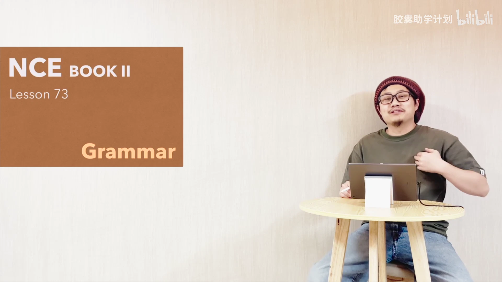

文字识别：bilbili / 胶囊助学计划 / NCE / BOOKII / Lesson 73 / Grammar

### 画面 00:00:05

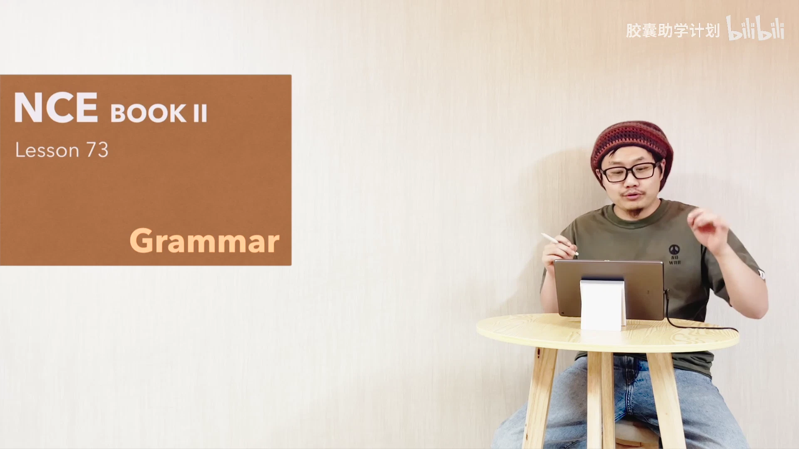

文字识别：biibii / 胶囊助学计划 / NCE / BOOKII / Lesson 73 / Grammar / NO

### 画面 00:00:10

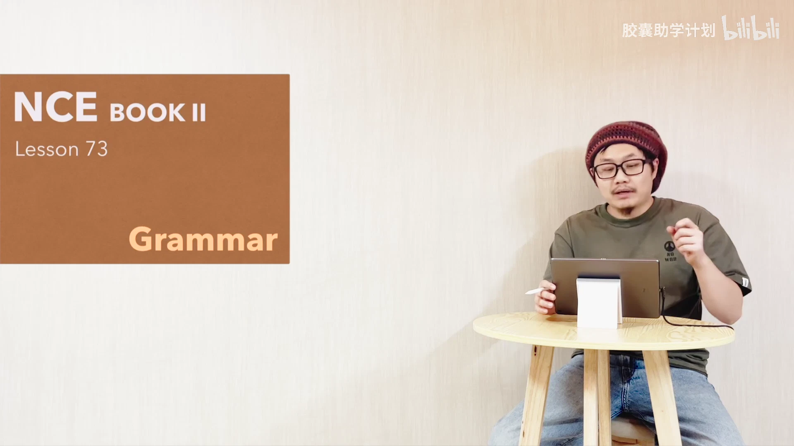

文字识别：bibili / 胶囊助学计划 / NCE / BOOKII / Lesson 73 / Grammar / ND / wnn

### 画面 00:00:12

文字识别：blibli / 胶囊助学计划 / &L49? / NO / WnR

### 画面 00:00:14

文字识别：bilbii / 胶囊助学计划 / ①复习L1&L25＆L49? / NO

### 画面 00:00:16

文字识别：bilbili / 胶囊助学计划 / ①复习L1&L25＆L49?

### 画面 00:00:22

文字识别：bilbili / 胶囊助学计划 / ①复习L1&L25 ＆L49？ / W / NU

## 00:00:30–00:01:00

识接下来要做的事情就是复习每个单元的第一课。那每个单元第一课到底是在做什么呢？一会儿进入正文咱们再说啊。Hope you guys enjoy。那每个单元第一课在干啥呢？就在做一件事儿，尝试给你去啊，让各位明白六一二三四五六这个东西。只不过第一单元的第一课，也就是第一课，我们在做

### 画面 00:00:39

文字识别：J bitbili / 胶囊助学计划 / •

### 画面 00:00:43

文字识别：胶囊助学计划 / 胶囊助学计划

### 画面 00:00:45

文字识别：bilbii / 胶囊助学计划 / 6123456

### 画面 00:00:49

文字识别：bilbili / 胶囊助学计划 / 6123456

### 画面 00:00:51

文字识别：Bilbili / 胶囊助学计划 / 6123456

### 画面 00:00:54

文字识别：Bibii / 胶囊助学计划 / 6123456

## 00:01:00–00:01:30

六一二三四五六。第二单元第一课，二十五课，再告诉你说，哎，我们有很多并列连词，可以让你把六一二三四五六和另一个六一二三四五六给它连起来。然后呢，在第二单元，包括第三单元，我们又学了什么分词做状语，分词做定语，然后还有别的一些主从连词，对吧？一到四十八课复习那个视频里，我还给各位罗列过很多，对吧？然后有很多，包括定语从句、宾语从句啊，各种各样

### 画面 00:01:24

文字识别：bilbili / 胶囊助学计划 / 6123456

## 00:01:30–00:02:00

的状语从句。好，这些从句到最后其实起到的一个作用是什么？包括二十五课咱们学的连词啊，四十九课学的分词做状语，它们其实到最后起到的一个作用是把六一二三四五六这个句子变得更加的复杂。那本课其实是既然是一个复习课程呢，我们文章当中有一个啊，我们这个教材当中有一道非常好的题，就是这道题在咱们的这个教材当中可以找得到。

### 画面 00:01:30

文字识别：Bilbili / 胶囊助学计划 / 6123456

### 画面 00:01:33

文字识别：bilbili / 胶囊助学计划 / 6123456

### 画面 00:01:35

文字识别：bilbili / 胶囊助学计划 / 6123456

### 画面 00:01:49

文字识别：Bilbili / 胶囊助学计划 / 6123456

### 画面 00:01:51

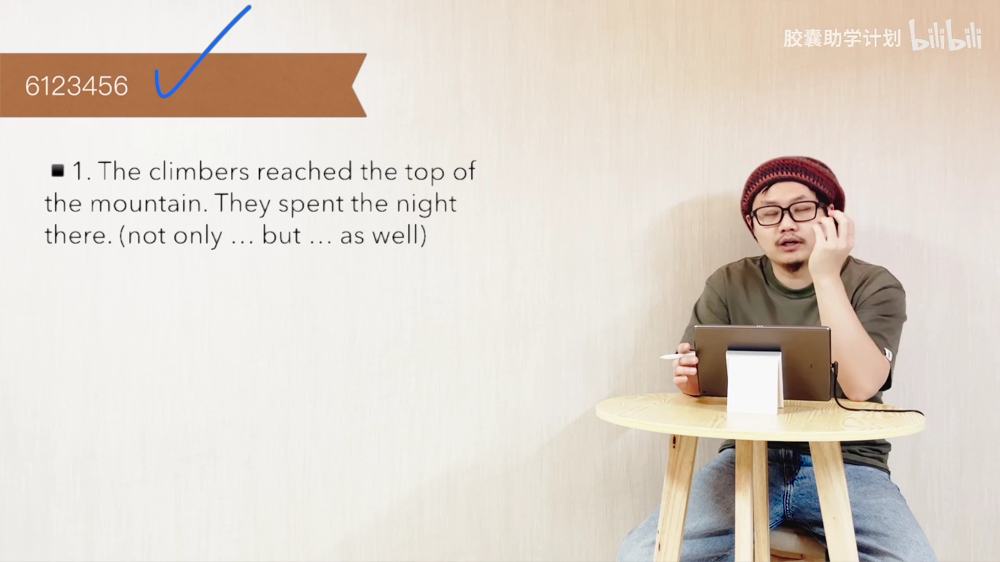

文字识别：bilbili / 胶囊助学计划 / 6123456 /  1. The climbers reached the top of / the mountain. They spent the night / there.(not only ... but ... as well)

### 画面 00:01:54

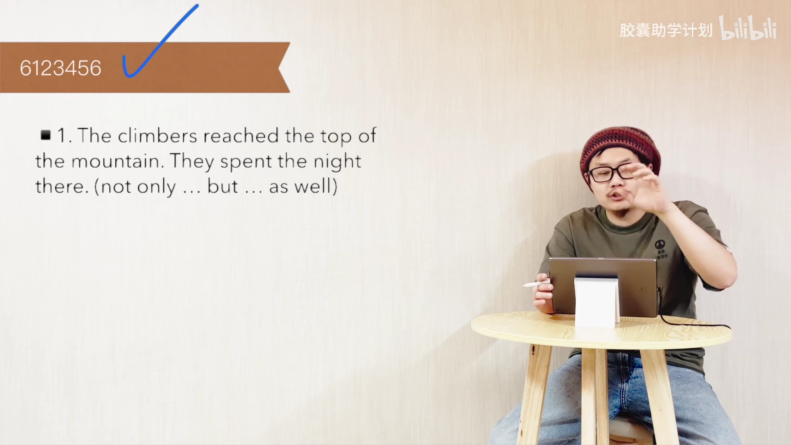

文字识别：bilbili / 胶囊助学计划 / 6123456 /  1. The climbers reached the top of / the mountain. They spent the night / there. (not only ... but ... as well) / NO / wnI

### 画面 00:01:57

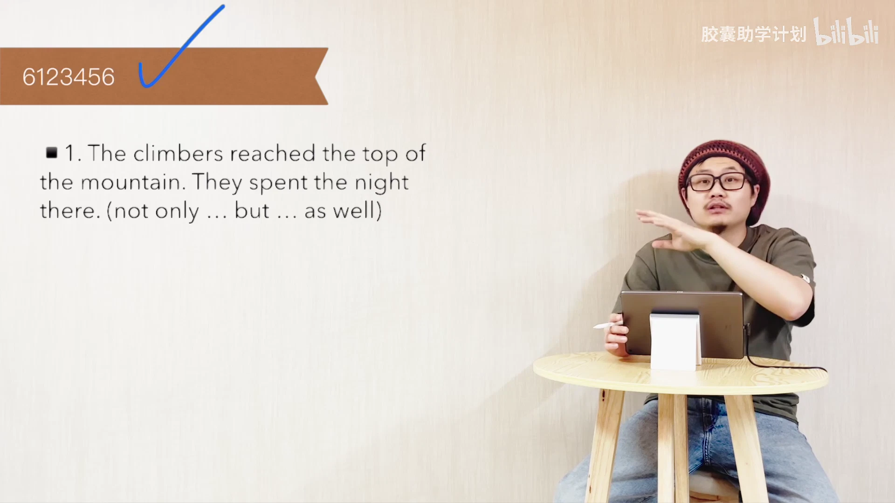

文字识别：bilbii / 胶囊助学计划 / 6123456 /  1. The climbers reached the top of / the mountain. They spent the night / there. (not only ... but ... as well)

## 00:02:00–00:02:30

所以我要带各位做的事情就是，我们随机的去复习整个第四单元都是在复习这些东西啊。那我们先看，呃，这句话实际上是给了两句话啊，给了两句话，然后让你用这个二十五课学的 not only but there there as well 去给它连起来啊。这个全是我们之前学的，在这儿我就是一带而过。如果您不会，一定要回过去再看一下啊。我们就把答案给各位，叫做 the climbers not

### 画面 00:02:09

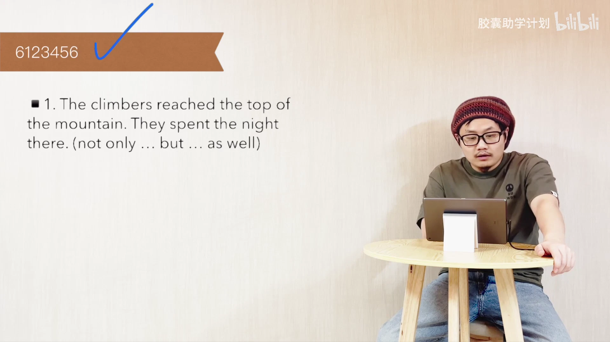

文字识别：bilbili / 胶囊助学计划 / 6123456 /  1. The climbers reached the top of / the mountain. They spent the night / there.(not only ... but ... as well) / NU / WB

### 画面 00:02:22

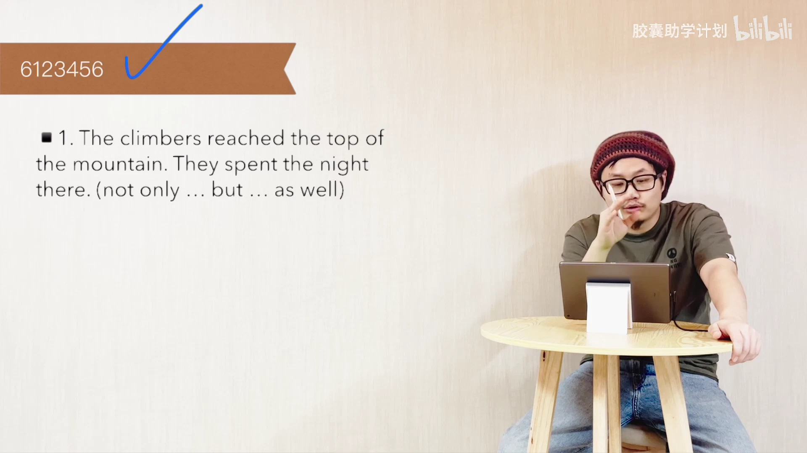

文字识别：bilibli / 胶囊助学计划 / 6123456 /  1. The climbers reached the top of / the mountain. They spent the night / there.(not only ... but ... as well)

### 画面 00:02:27

文字识别：胶囊助学计划bili / 6123456 /  1. The climbers reached the top of / the mountain. They spent the night / there.(not only ... but ... as well) /  The climbers not only reached / the top of the mountain, but (they) / spent the night there as well.

## 00:02:30–00:03:00

only reached the top of the mountains, but这个they可以省略, spend the night there as well.所以就是我们第一单元其实学的是这样的句子，看见了吧？是这种句子啊，是这儿到这儿这样的句子啊，是左右括弧里这样的短句。第二单元、第三单元做的事情就是把这样的短句给它连到一起，然后越变越长，越变越长，就变成了新

### 画面 00:02:39

文字识别：bilibii / 胶囊助学计划 / 6123456 /  1. The climbers reached the top of / the mountain. They spent the night / there.(not only ... but ... as well) / The climbers not only reached / the top of the mountain, but (they) / spent the night there as well. / NU

### 画面 00:02:45

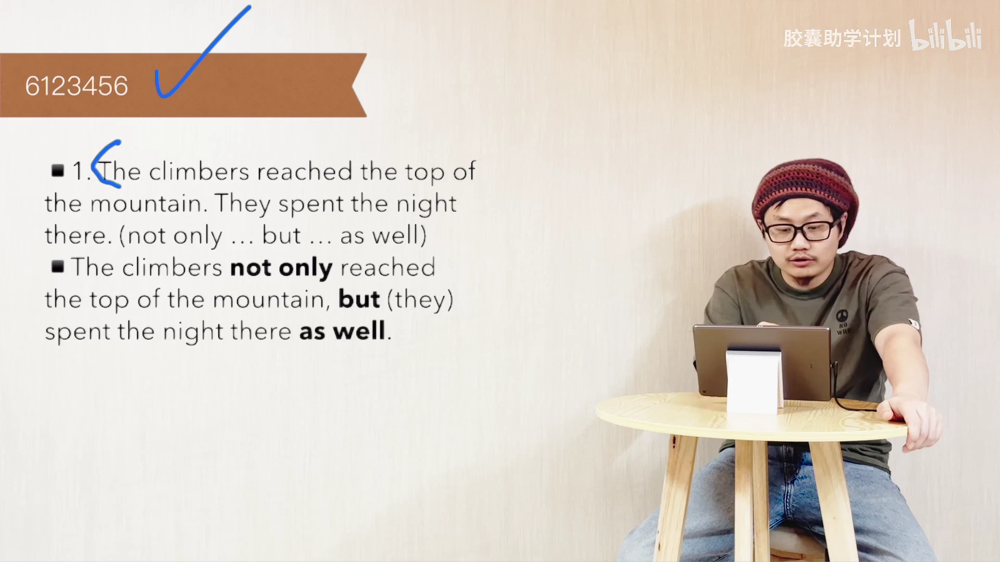

文字识别：biibili / 胶囊助学计划 / 6123456 /  1.Che climbers reached the top of / the mountain. They spent the night / there.(not only ... but ... as well) / The climbers not only reached / the top of the mountain, but (they) / ® / spent the night there as well.

### 画面 00:02:48

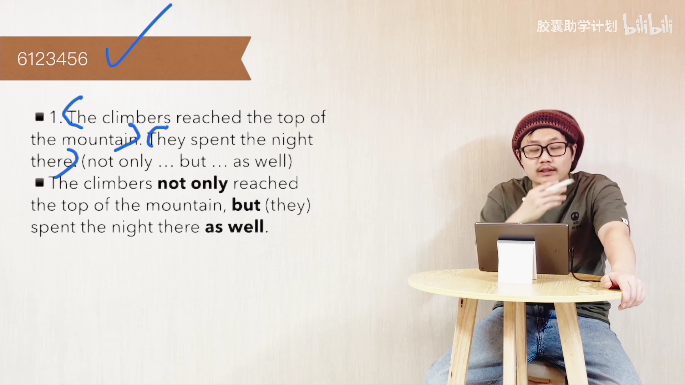

文字识别：biibli / 胶囊助学计划 / 6123456 /  1.Che climbers reached the top of / the mountail. fhey spent the night / there (not only . but .. as well) /  The climbers not only reached / the top of the mountain, but (they) / spent the night there as well.

### 画面 00:02:54

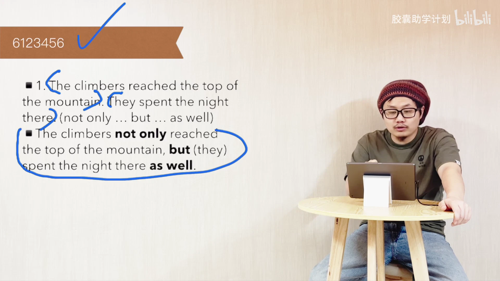

文字识别：bilbili / 胶囊助学计划 / 6123456 / ■1.Ghe / : climbers reached the top of / the mountai. fhey spent the night / there (not only .. but ….. as well) / The climbers not only reached / the top of the mountain, but (they) / spent the night there as well. / NU

### 画面 00:02:56

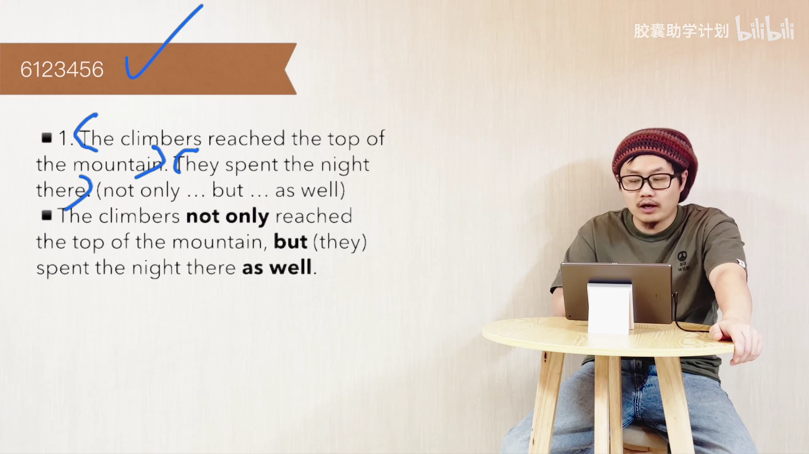

文字识别：biibili / 胶囊助学计划 / 6123456 /  1.The climbers reached the top of / the mountaid. fhey spent the night / there (not only . but ... as well) / The climbers not only reached / the top of the mountain, but (they) / spent the night there as well.

### 画面 00:02:58

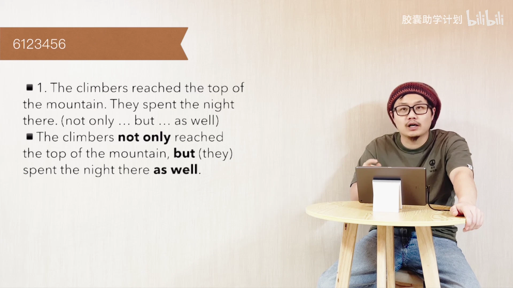

文字识别：Bilbili / 胶囊助学计划 / 6123456 /  1. The climbers reached the top of / the mountain. They spent the night / there.(not only ... but ... as well) /  The climbers not only reached / the top of the mountain, but (they) / spent the night there as well.

## 00:03:00–00:03:30

概念二册的第四单元和整个新三，包括将来的新四啊。下一题，那我们直接连，直接看答案啊，直接看答案，叫做 When a fire broke out in a cinema, several hundred people tried to leave the building, and a number of them were injured. 你看这个，实际上对于各位来说，仔细去想第七课我们的语法能力，甚至我们新一的语法能力就足以处理这

### 画面 00:03:02

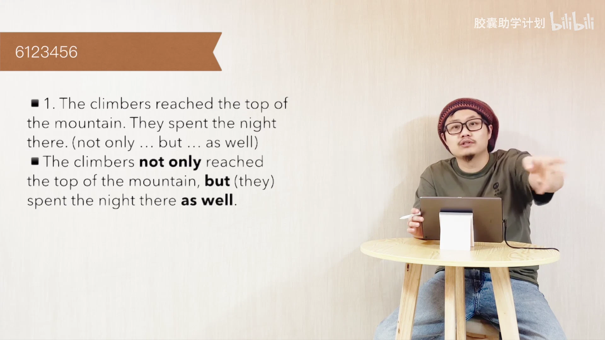

文字识别：胶囊助学计划bibi / 6123456 /  1. The climbers reached the top of / the mountain. They spent the night / there.(not only ... but ... as well) / The climbers not only reached / the top of the mountain, but (they) / spent the night there as well.

### 画面 00:03:05

文字识别：bibli / 胶囊助学计划 / 6123456

### 画面 00:03:08

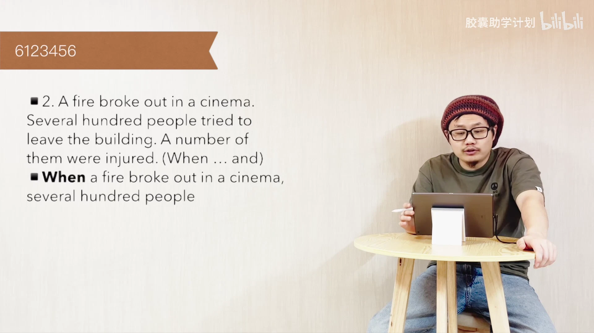

文字识别：bibii / 胶囊助学计划 / 6123456 /  2. A fire broke out in a cinema. / Several hundred people tried to / leave the building. A number of / them were injured. (When ... and) / When a fire broke out in a cinema, / several hundred people / NI

### 画面 00:03:12

文字识别：biibili / 胶囊助学计划 / 6123456 /  2. A fire broke out in a cinema. / Several hundred people tried to / leave the building. A number of / them were injured. (When ... and) / When a fire broke out in a cinema, / several hunared people / NUI / W / tried to leave the building and a / number of them were injured.

## 00:03:30–00:04:00

句话了，对吧？那只不过在这儿其实是让你用两个连词把这句话给连起来啊。那我们不看那儿，我们这看这儿啊。说 James Hols book on the Antarctic was published recently. 你注意，你看这里的 whose。再说一遍，五十五课咱们学过的定语从句，在这儿是复习，对吧？啊，我不细讲啊，在这儿都不细讲，只是公布一下答案，告诉各位这道题它到底是在做什

### 画面 00:03:36

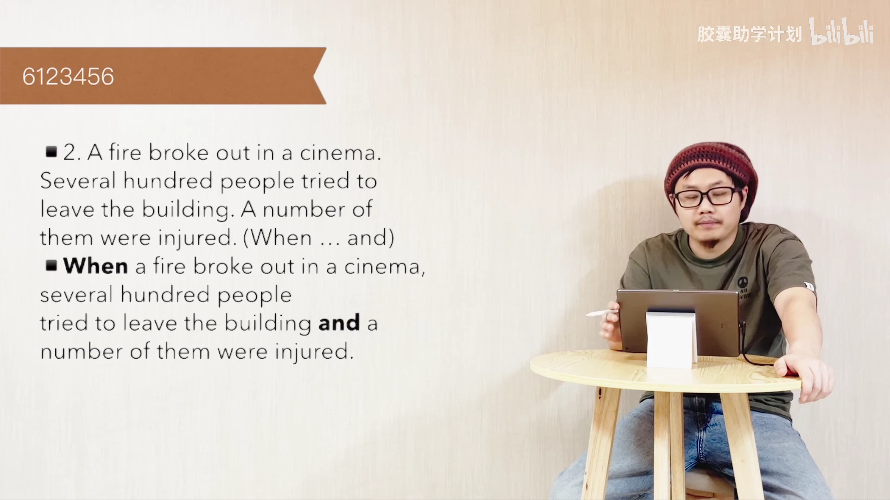

文字识别：biibili / 胶囊助学计划 / 6123456 /  2. A fire broke out in a cinema. / Several hundred people tried to / leave the building. A number of / them were injured. (When ... and) / When a fire broke out in a cinema, / several hundred people / ND / tried to leave the building and a / number of them were injured.

### 画面 00:03:38

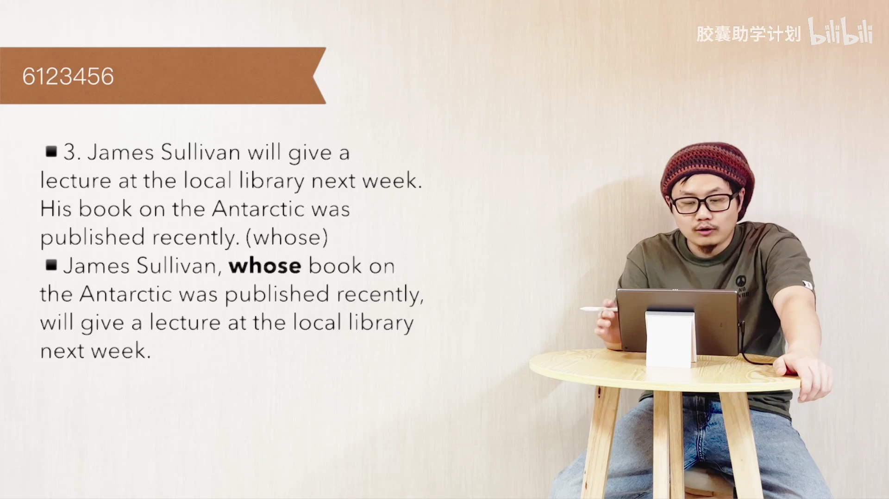

文字识别：胶囊助学计划bibi / 6123456 /  3. James Sullivan will give a / lecture at the local library next week. / His book on the Antarctic was / published recently. (whose) /  James Sullivan, whose book on / the Antarctic was published recently, / will give a lecture at the local library / next week.

### 画面 00:03:40

文字识别：胶囊助学计划bibi / 6123456 /  3. James Sullivan will give a / lecture at the local library next week. / His book on the Antarctic was / published recently. (whose) / ■ James Sullivan, whose book on / the Antarctic was published recently, / will give a lecture at the local library / next week.

### 画面 00:03:57

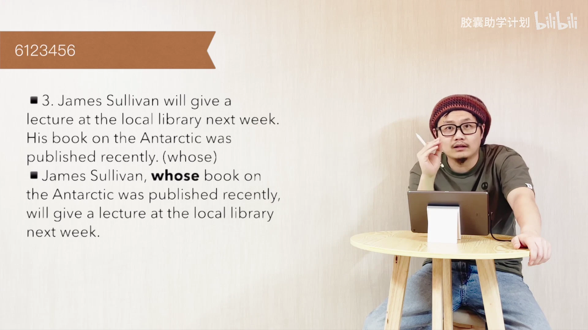

文字识别：胶囊助学计划bilbi / 6123456 /  3. James Sullivan will give a / lecture at the local library next week. / His book on the Antarctic was / published recently. (whose) /  James Sullivan, whose book on / the Antarctic was published recently, / will give a lecture at the local library / next week.

## 00:04:00–00:04:30

么，同时简单的复习一下。下一个答案说，Although尽管the police searched everywhere, neither A nor B could be found.是吧？二十五课咱学的说，Neither the missing boy nor his dog could be found.说这个这个这个丢的这个小孩和他的狗都没有被找到啊，都没有被找到。OK。第五

### 画面 00:04:01

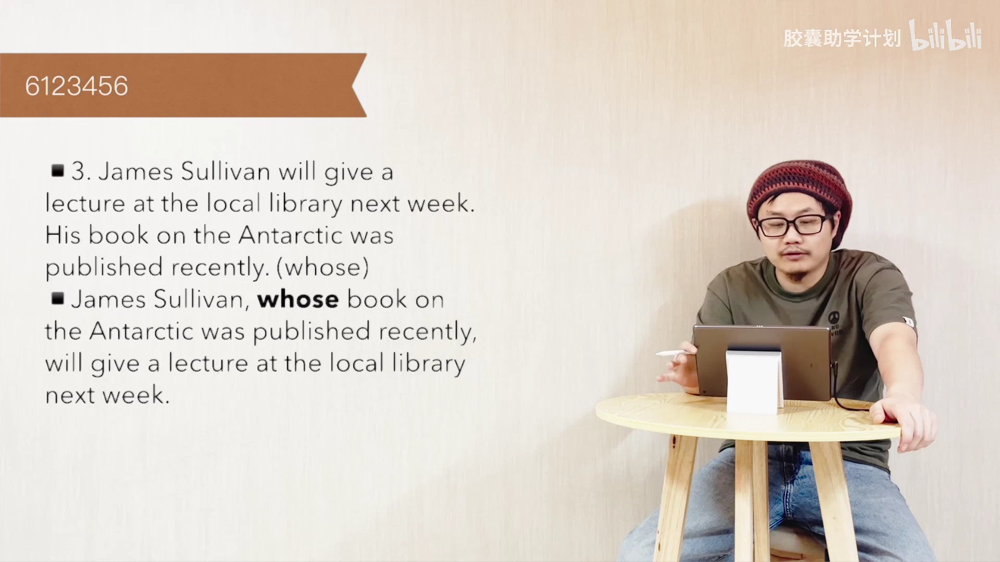

文字识别：胶囊助学计划bilbi / 6123456 /  3. James Sullivan will give a / lecture at the local library next week. / His book on the Antarctic was / published recently. (whose) /  James Sullivan, whose book on / the Antarctic Was published recently, / will give a lecture at the local library / next week.

### 画面 00:04:03

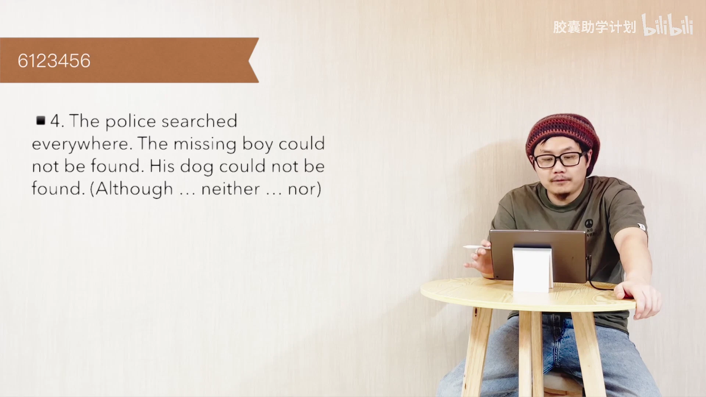

文字识别：bilbili / 胶囊助学计划 / 6123456 /  4. The police searched / everywhere. The missing boy could / not be found. His dog could not be / found. (Although ... neither .. nor) / NI

### 画面 00:04:05

文字识别：Bilbii / 胶囊助学计划 / 6123456 /  4. The police searched / everywhere. The missing boy could / not be found. His dog could not be / found. (Although ... neither ... nor) /  Although the police searched / everywhere, neither the / NU / missing boy nor his dog could be / found.

### 画面 00:04:20

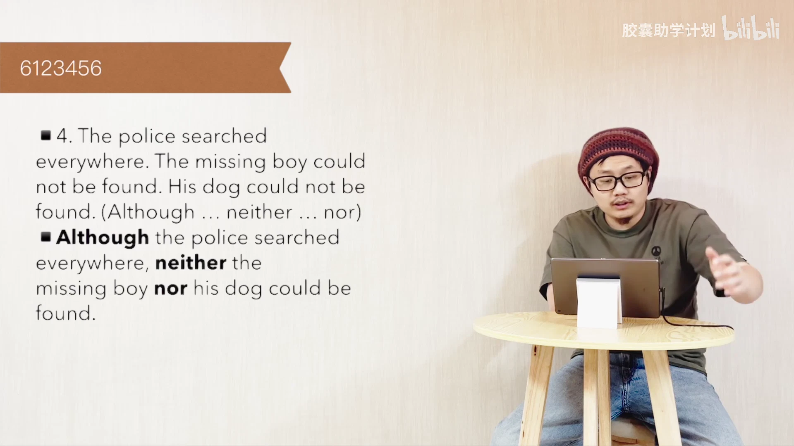

文字识别：biibili / 胶囊助学计划 / 6123456 /  4. The police searched / everywhere. The missing boy could / not be found. His dog could not be / found. (Although ... neither ... nor) /  Although the police searched / everywhere, neither the / missing boy nor his dog could be / found.

### 画面 00:04:25

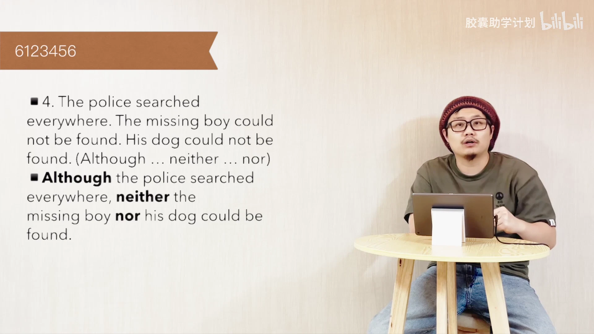

文字识别：biibili / 胶囊助学计划 / 6123456 /  4. The police searched / everywhere. The missing boy could / not be found. His dog could not be / found.(Although ... neither ... nor) /  Although the police searched / everywhere, neither the / NB / missing boy nor his dog could be / found.

### 画面 00:04:27

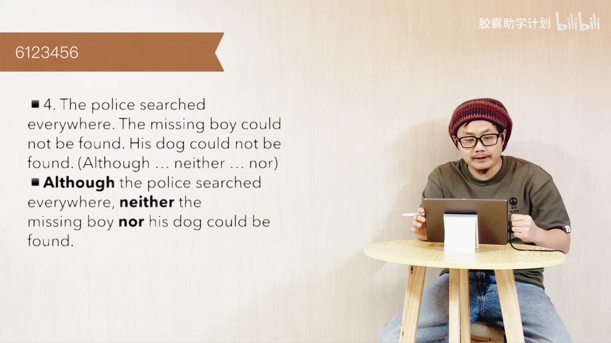

文字识别：biibili / 胶囊助学计划 / 6123456 /  4. The police searched / everywhere. The missing boy could / not be found. His dog could not be / found. (Although ... neither ... nor) /  Although the police searched / everywhere, neither the / NO / WnH / missing boy nor his dog could be / found.

### 画面 00:04:29

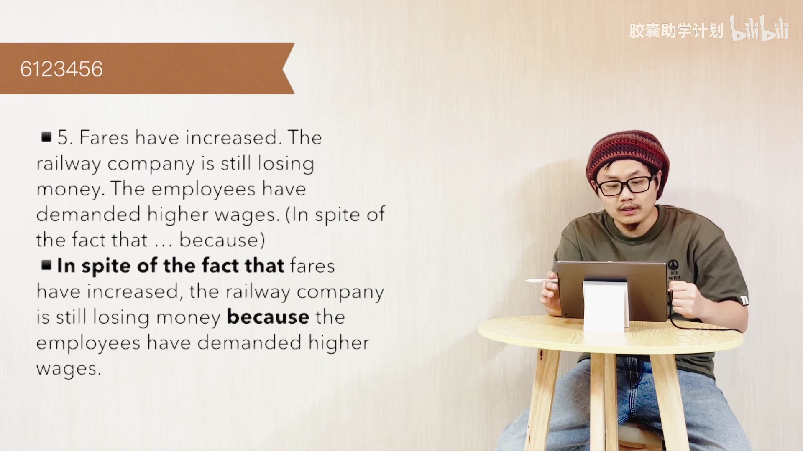

文字识别：biibili / 胶囊助学计划 / 6123456 /  5. Fares have increased. The / railway company is still losing / money. / The employees have / demanded higher wages. (In spite of / the fact that ... because) /  In spite of the fact that fares / NU / have increased, the railway company / is still losing money because the / employees have demanded higher / wages.

## 00:04:30–00:05:00

个，这稍微有一点超纲。In spite of the fact that, 哎，尽管这样一个事实，什么事实呢？说 fares have increased，车票价上升了。The railway company is still losing money，哎，他们还在就亏损。Because the employees have demanded higher wages，这个 wages 跟 salaries 一样啊，就是薪水。呃，因为，所以你看这句话又被我们拆

### 画面 00:04:31

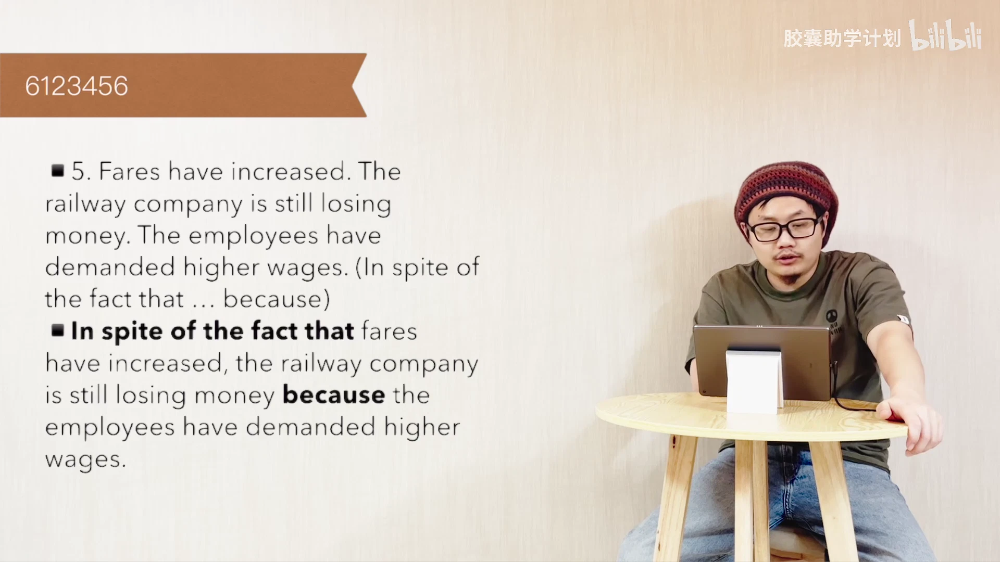

文字识别：bibili / 胶囊助学计划 / 6123456 /  5. Fares have increased. The / railway company is still losing / money. / The employees have / demanded higher wages. (In spite of / the fact that ... because) /  In spite of the fact that fares / have increased, the railway company / is still losing money because the / employees have demanded higher / wages.

### 画面 00:04:55

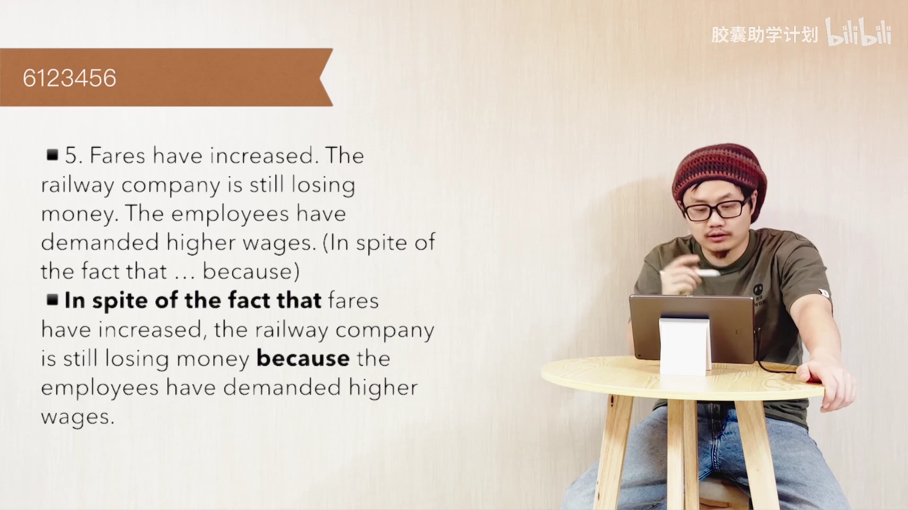

文字识别：bilibii / 胶囊助学计划 / 6123456 /  5. Fares have increased. The / railway company is still losing / money. /  The employees have / demanded higher wages. (In spite of / the fact that ... because) /  In spite of the fact that fares / have increased, the railway company / is still losing money because the / employees have demanded higher / wages.

## 00:05:00–00:05:30

成了三句话嘛，这是第一句话，对吧？然后这是第二句话，然后这是第三句话，对吧？所以长难句的本质是什么？换一句话来说，我们有很多同学问说，哎呀，我考研也好，考雅思托福也好，就学到新概念几册，对吧？包括高考这样的考试，四六级啊，基本上都是新三，至少学到前二十课。它的一个最核心的原因就是，我们基本上要学到新三，才能

### 画面 00:05:01

文字识别：biibili / 胶囊助学计划 / 6123456 /  5. Fares have increased. The / railway company is still losing / money. / The employees have / demanded higher wages. (In spite of / the fact that ... because) /  In spite of the fact that fares / W / have increased,t / 'the railway company / is still losing money k / because the / employees have demanded higher / wages.

### 画面 00:05:04

文字识别：bilbili / 胶囊助学计划 / 6123456 /  5. Fares have increased. The / railway company is still losing / money. / The employees have / demanded higher wages. (In spite of / thefact that ... because) / In spite of the fact that fares / e increased, Che railway company / havei / is still losing moneybecause / the / employees have demanded higher / wages.

### 画面 00:05:06

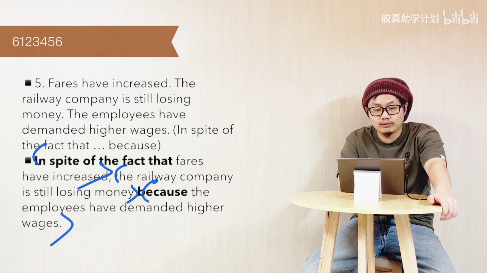

文字识别：bibii / 胶囊助学计划 / 6123456 /  5. Fares have increased. The / railway company is still losing / money. / The employees have / demanded higher wages. (In spite of / thefact that ... because) / In spite of the fact that fares / havei / e increased, (he railway company / is still losing moneykecause / the / employees /  have demanded higher / wages.

### 画面 00:05:08

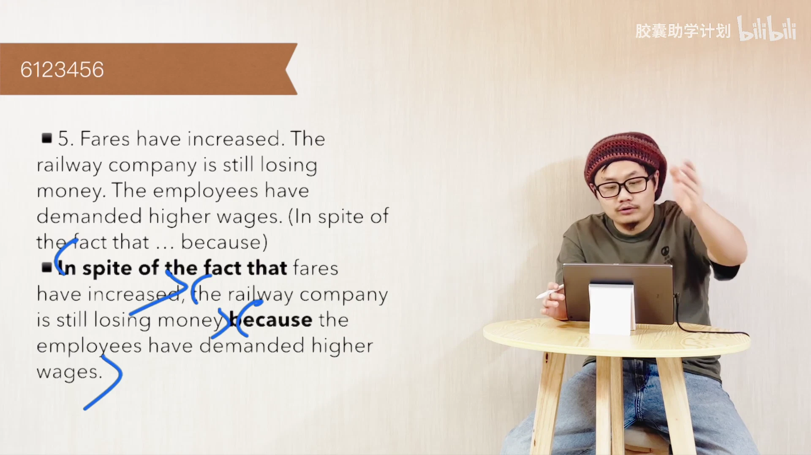

文字识别：Bilbili / 胶囊助学计划 / 6123456 /  5. Fares have increased. The / railway company is still losing / money. / The employees have / demanded higher wages. (In spite of / thefact that ... because) / In spite of the fact that fares / have increased, (he railway company / is still losing moneykecause / the / employees / s have demanded higher / wages.

### 画面 00:05:10

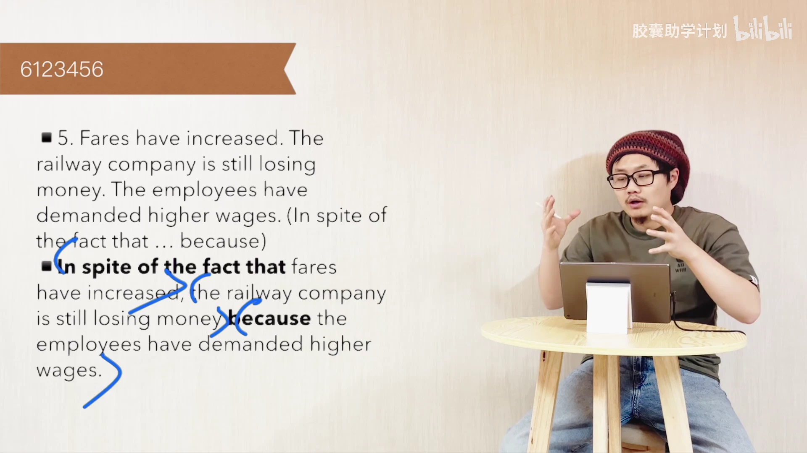

文字识别：biibili / 胶囊助学计划 / 6123456 /  5. Fares have increased. The / railway company is still losing / money. / The employees have / demanded higher wages. (In spite of / thefact that .. because) / In spite of the fact that fares / NI / have /  increased, (he railway  / company / is still losing / moneykecause / the /  demanded higher / employees / have / wages.

### 画面 00:05:12

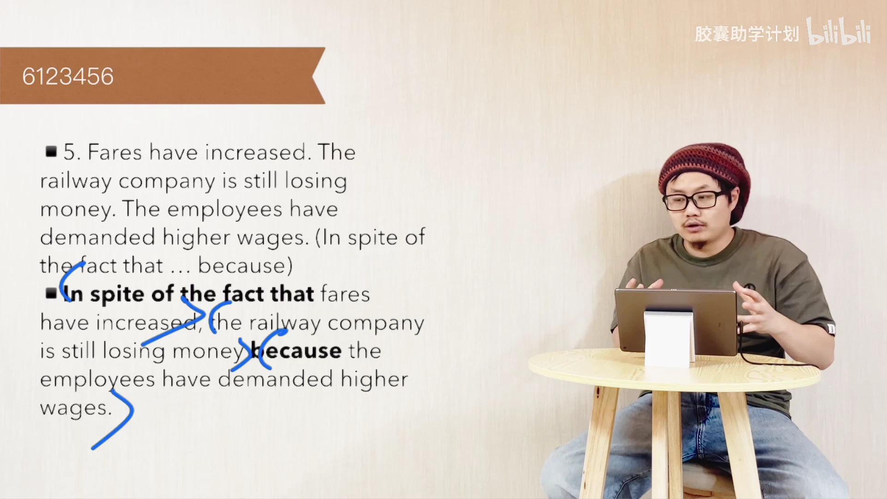

文字识别：biibili / 胶囊助学计划 / 6123456 /  5. Fares have increased. The / railway company is still losing / money. / The employees have / demanded higher wages. (In spite of / thefact that ... because) / In spite of the fact that fares / have / : increased, (he railway  / company / is still losing / moneyhecause / the / demanded higher / employees / have / wages.

### 画面 00:05:17

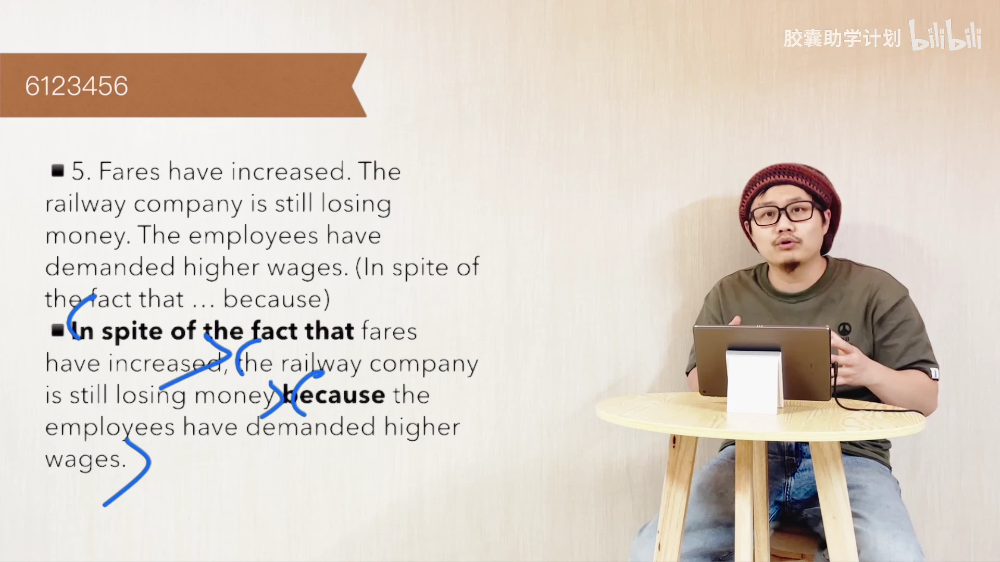

文字识别：bilibili / 胶囊助学计划 / 6123456 /  5. Fares have increased. The / railway company is still losing / money. / The employees have / demanded higher wages. (In spite of / thefact that ... because) / In spite of the fact that fares / e increased, (he railway company / have i / is still losing moneykecause / the / employees /  have demanded higher / wages.

### 画面 00:05:23

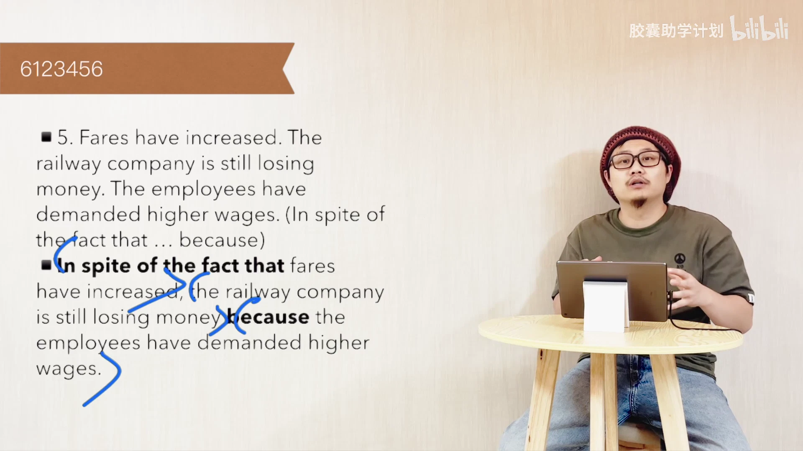

文字识别：bilbili / 胶囊助学计划 / 6123456 /  5. Fares have increased. The / railway company is still losing / money. / The employees have / demanded higher wages. (In spite of / thefact that ... because) / In spite of the fact that fares / havei / e increased, (he railway  / company / is still losing / moneykecause / the / employees /  have demanded higher / wages.

## 00:05:30–00:06:00

把长难句这个东西呃学会去进行拆，但长难句的基础是什么？就是新一和新二的前三个单元，对吧？OK，下一个，哎，这不三十五课咱学的吗？他吓了我一大跳，以至于我把这个茶壶都弄翻了，对吧？Such a fright that三十五课咱学的，下一个说After making sure that the alarm clock worked, I

### 画面 00:05:32

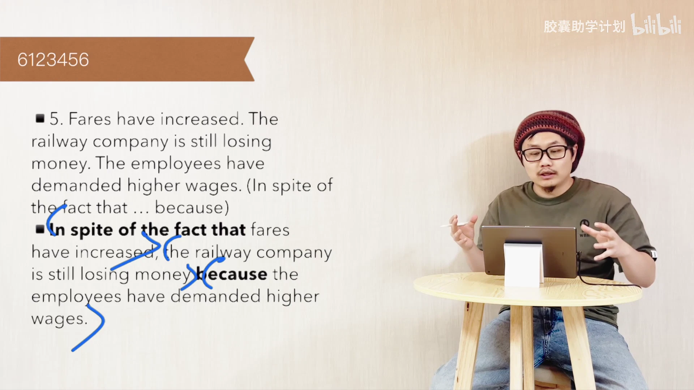

文字识别：biibili / 胶囊助学计划 / 6123456 /  5. Fares have increased. The / railway company is still losing / money. / The employees have / demanded higher wages. (In spite of / thefact that ... because) / In spite of the fact that fares / e increased, (he railway company / have i / is still losing moneykecause / the / employees /  have demanded higher / wages.

### 画面 00:05:42

文字识别：biibili / 胶囊助学计划 / 6123456 /  5. Fares have increased. The / railway company is still losing / money. / The employees have / demanded higher wages. (In spite of / thefact that .. because) / In spite of the fact that fares / have increased, (he railway company / is still losing moneykecause / the / employees / s have demanded higher / wages.

### 画面 00:05:44

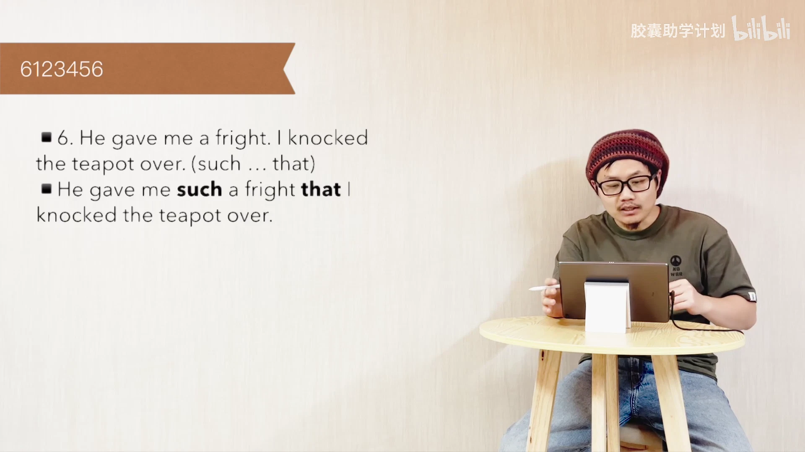

文字识别：bilbili / 胶囊助学计划 / 6123456 /  6. He gave me a fright. I knocked / the teapot over. (such ...that) / He gave me such a fright that I / knocked the teapot over. / ND / WIR

### 画面 00:05:46

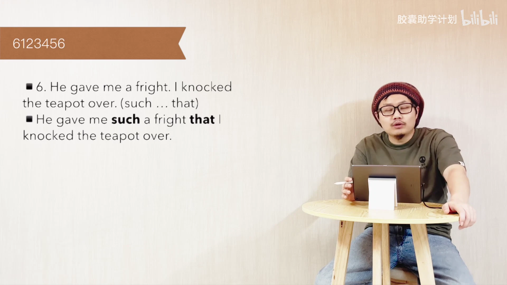

文字识别：bilibili / 胶囊助学计划 / 6123456 /  6. He gave me a fright. I knocked / the teapot over. (such .that) / He gave me such a fright that I / knocked the teapot over.

### 画面 00:05:48

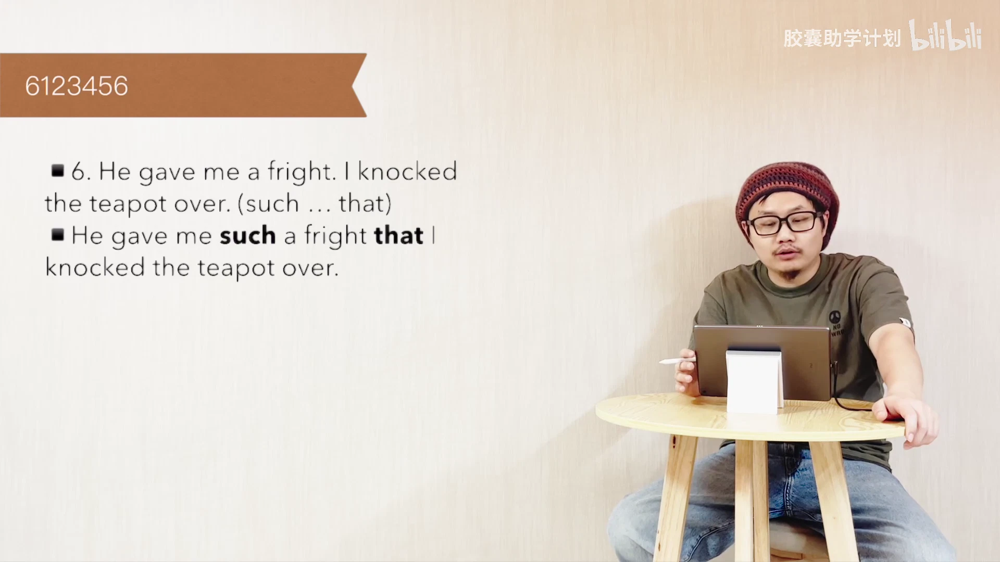

文字识别：bilbili / 胶囊助学计划 / 6123456 /  6. He gave me a fright. I knocked / the teapot over. (such ...that) / He gave me such a fright that I / knocked the teapot over. / NO

### 画面 00:05:50

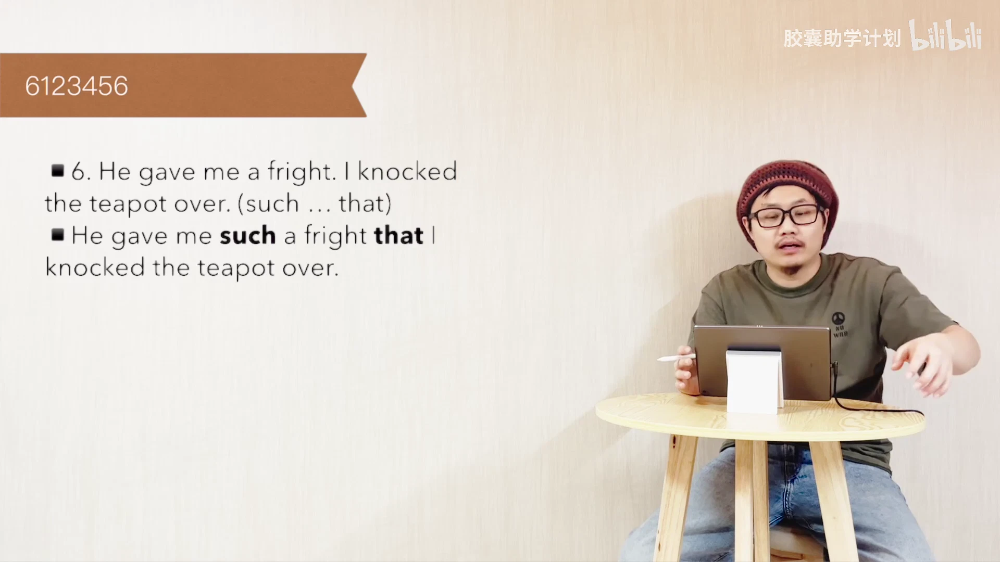

文字识别：bilibili / 胶囊助学计划 / 6123456 /  6. He gave me a fright. I knocked / the teapot over. (such ..that) / He gave me such a fright that I / knocked the teapot over. / NU

### 画面 00:05:53

文字识别：bilbili / 胶囊助学计划 / 6123456

### 画面 00:05:55

文字识别：bilibili / 胶囊助学计划 / 6123456 /  7.I made sure. The alarm clock / worked.I set it. It would ring at six / o'clock.(After making... that ... so / that) /  After making sure that the alarm / clock worked, I set it so / NU / WOR

### 画面 00:05:57

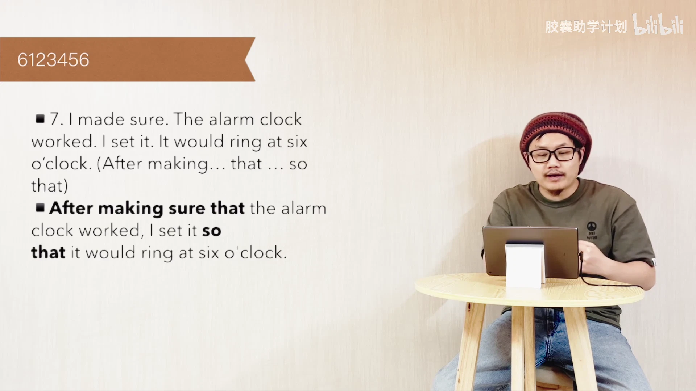

文字识别：bibii / 胶囊助学计划 / 6123456 /  7.I made sure. The alarm clock / worked.I set it. It would ring at six / o'clock.(After making... that ... so / that) /  After making sure that the alarm / clock worked, I set it so / NUI / that it would ring at six o'clock.

## 00:06:00–00:06:30

set it so that it would ring at six o'clock.你看这里边，我们提醒几个小点，就告诉你这都是咱们是哪什么时候学的。第一个，so that表目的啊，五十九课应该是。然后，after making sure that这个地方是四十九课，妥妥的，对吧？哎，那前后主语是一致的。哎，我确信了，对吧？啊，这个确定了，说这个钟，哎，这个表钟是工作的，闹钟是工作的。然后我上了个

### 画面 00:06:02

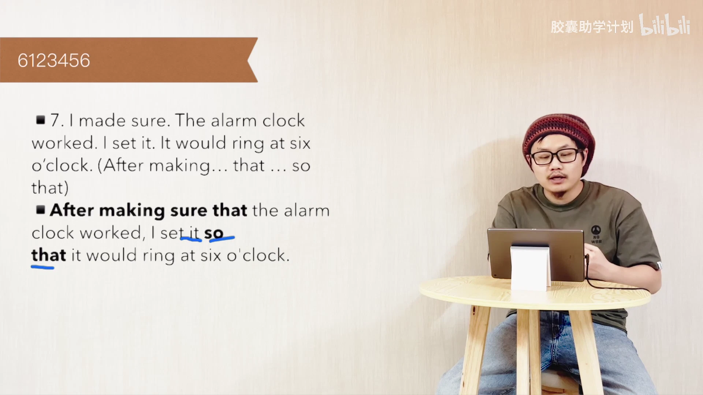

文字识别：bibii / 胶囊助学计划 / 6123456 /  7.I made sure. The alarm clock / worked.I set it. It would ring at six / o'clock. (After making...that ... so / that) /  After making sure that the alarm / clock worked, I setit so / NO / WnR / that it would ring at six o'clock.

### 画面 00:06:11

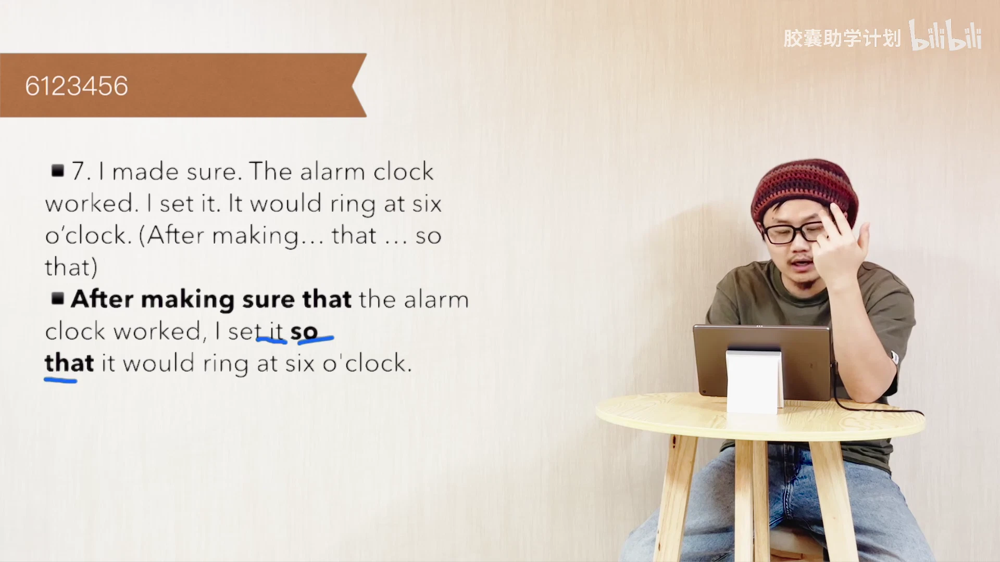

文字识别：bilibili / 胶囊助学计划 / 6123456 /  7.I made sure. The alarm clock / worked. I set it. It would ring at six / o'clock.(After making...that ... so / that) /  After making sure that the alarm / clock worked, I setit so / that it would ring at six o'clock.

### 画面 00:06:26

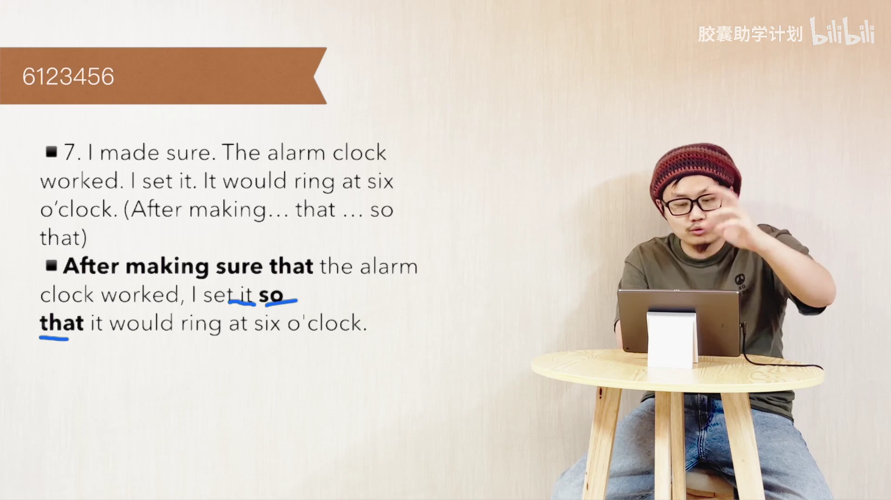

文字识别：Bilbili / 胶囊助学计划 / 6123456 /  7.I made sure. The alarm clock / worked.I set it. It would ring at six / o'clock. (After making..that ... so / that) /  After making sure that the alarm / clock worked, I setit so / that it would ring at six o'clock.

## 00:06:30–00:07:00

闹表，对不对？好，这是第八个。哎，这是这是第八个啊。说 I hid the Christmas presents under the desk quickly so that目的对吧？目的是什么呢？My daughter would not see them.目的是她看不到他。当 she entered the room，当她进入这个房间的时候，还是那句话，学长难句最基本的前提就是你一定要把那些连词像 so that such that that

### 画面 00:06:31

文字识别：bilbili / 胶囊助学计划 / 6123456

### 画面 00:06:33

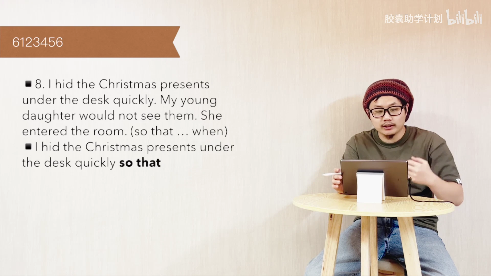

文字识别：bilibili / 胶囊助学计划 / 6123456 /  8. I hid the Christmas presents / under the desk quickly. My young / daughter would not see them. She / entered the room. (so that ... when) / I hid the Christmas presents under / the desk quickly so that

### 画面 00:06:35

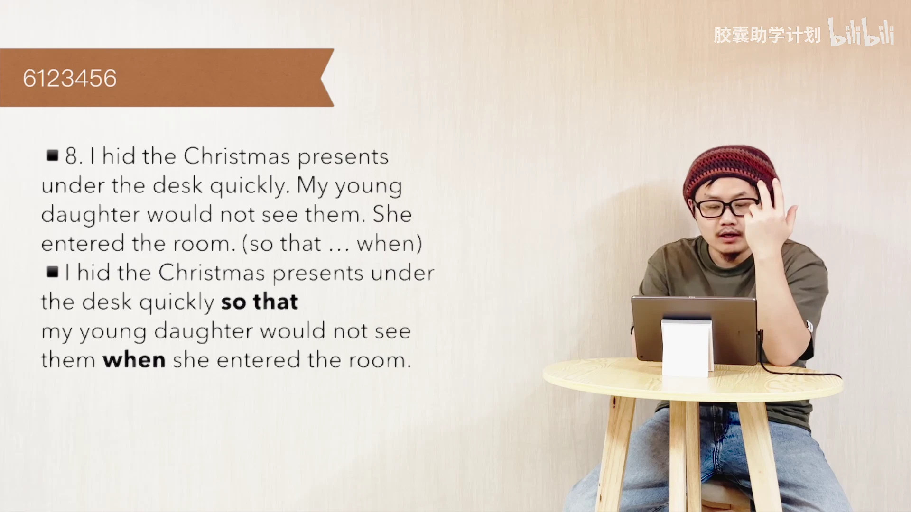

文字识别：bibili / 胶囊助学计划 / 6123456 /  8. I hid the Christmas presents / under the desk quickly. My young / daughter would not see them. She / entered the room.(so that .. when) /  I hid the Christmas presents under / the desk quickly so that / my young daughter would not see / them when she entered the room.

### 画面 00:06:39

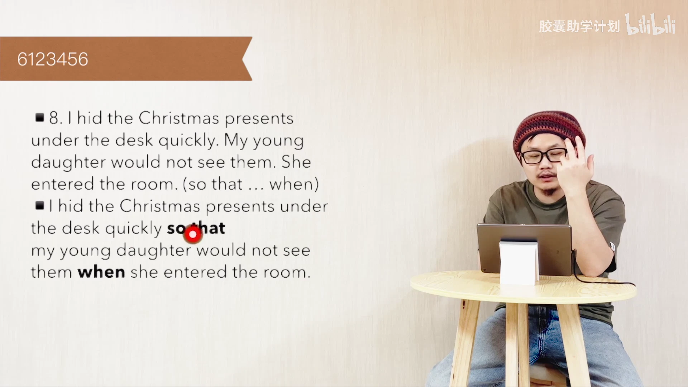

文字识别：bilbili / 胶囊助学计划 / 6123456 /  8. I hid the Christmas presents / under the desk quickly. My young / daughter would not see them. She / entered the room.(so that ... when) /  I hid the Christmas presents under / the desk quickly soohat / my young daughter would not see / them when she entered the room.

### 画面 00:06:49

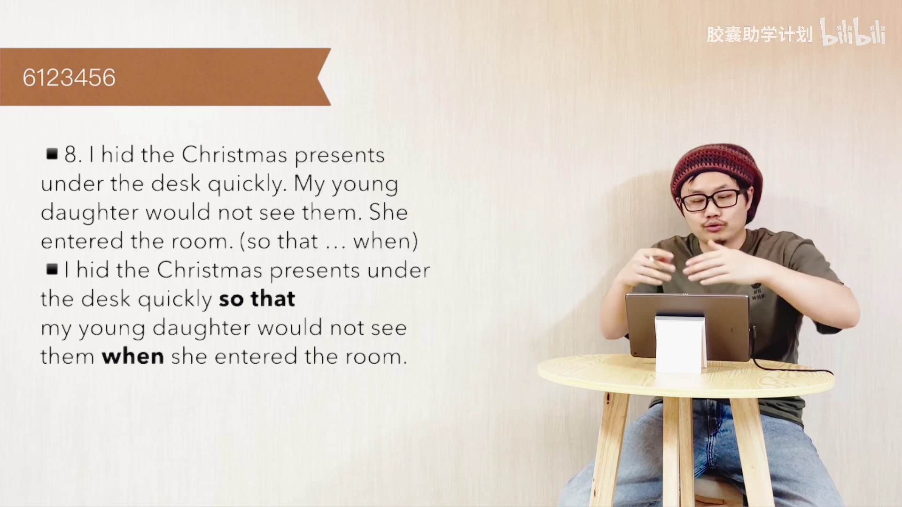

文字识别：胶囊助学计划bii / 6123456 /  8. I hid the Christmas presents / under the desk quickly. My young / daughter would not see them. She / entered the room.(so that ... when) /  I hid the Christmas presents under / the desk quickly so that / WIM / my young daughter would not see / them when she entered the room.

### 画面 00:06:52

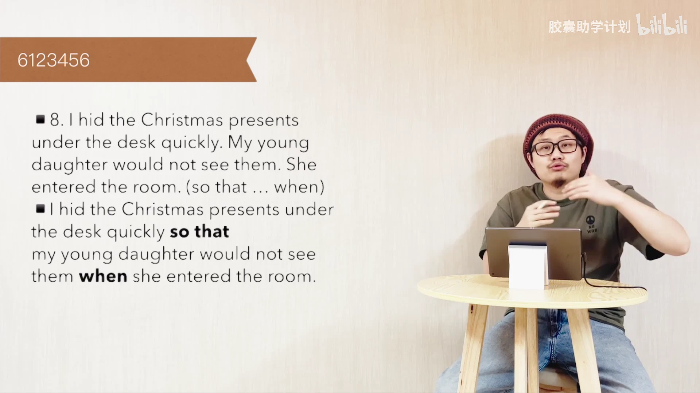

文字识别：胶囊助学计划biibi出 / 6123456 /  8. I hid the Christmas presents / under the desk quickly. My young / daughter would not see them. She / entered the room.(so that ... when) / I hid the Christmas presents under / the desk quickly so that / my young daughter would not see / them when she entered the room.

## 00:07:00–00:07:30

so there there that when which why how，所有这些连词 that as 对吧？最常见的，你先在句子当中一眼能给它定位出来。而这个活儿是咱们新二前三个单元学的，所以有很多同学问我说，我基础语法不太好，但是我要做刚才那些考试，对吧？我需要学长难句，那我直接学新三前二十个单元行不行啊？本质上这个问题就跟一口吃个胖子行不行是一样的，对吧？既然吃第十个糖饼我才饱，

### 画面 00:07:16

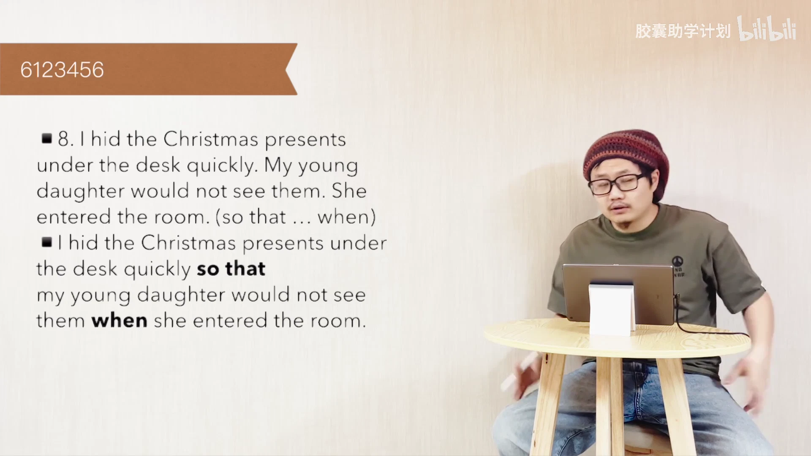

文字识别：biibili / 胶囊助学计划 / 6123456 /  8. I hid the Christmas presents / under the desk quickly. My young / daughter would not see them. She / entered the room.(so that ... when) / I hid the Christmas presents under / the desk quickly so that / Nn / my young daughter would not see / them when she entered the room.

### 画面 00:07:20

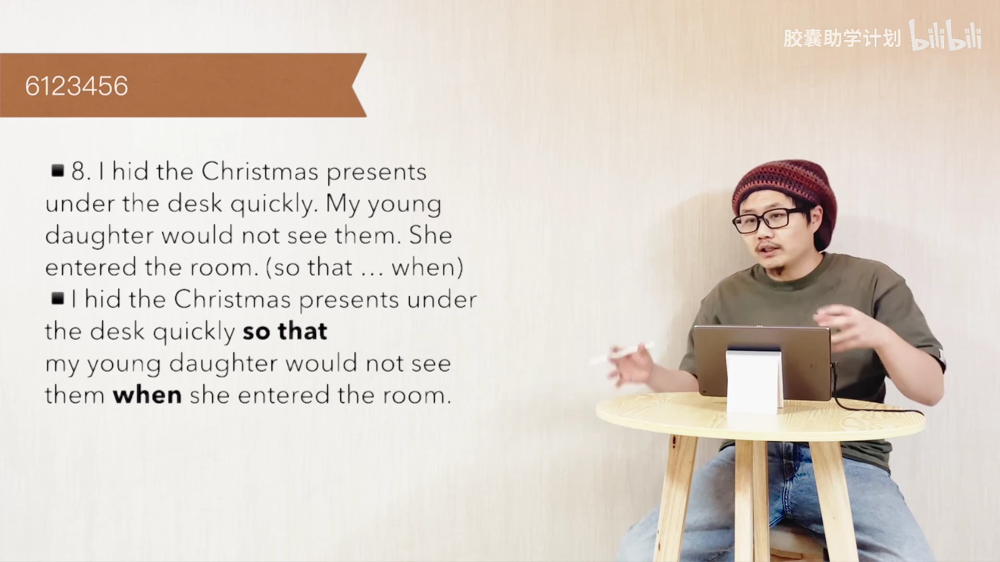

文字识别：bilbili / 胶囊助学计划 / 6123456 /  8. I hid the Christmas presents / under the desk quickly. My young / daughter would not see them. She / entered the room.(so that ... when) / I hid the Christmas presents under / the desk quickly so that / my young daughter would not see / them when she entered the room.

### 画面 00:07:25

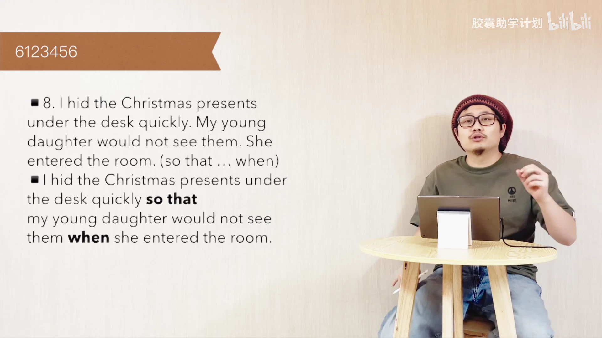

文字识别：biibii / 胶囊助学计划 / 6123456 /  8. I hid the Christmas presents / under the desk quickly. My young / daughter would not see them. She / entered the room.(so that ... when) /  I hid the Christmas presents under / the desk quickly so that / WI / NUI / my young daughter would not see / them when she entered the room.

### 画面 00:07:27

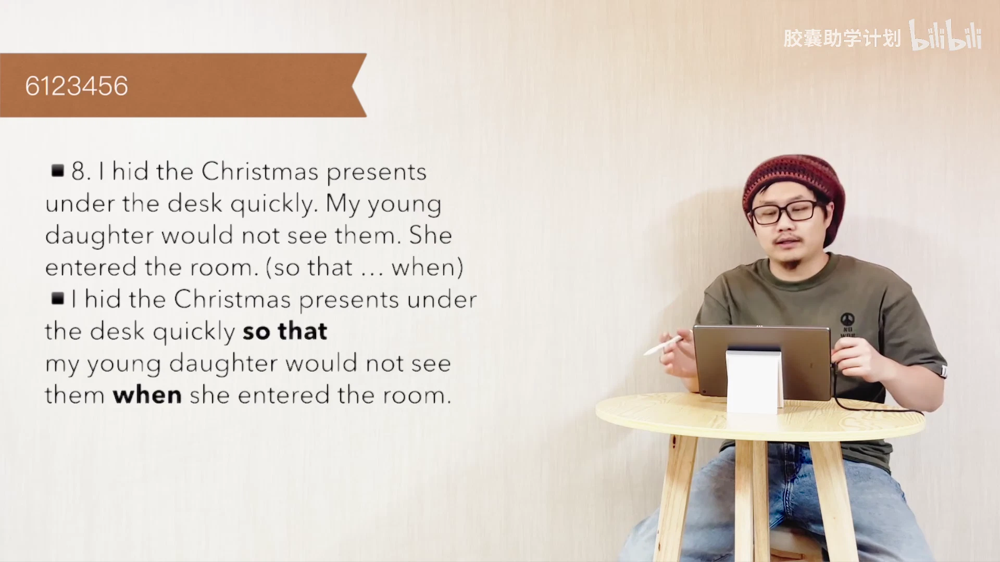

文字识别：bilbii / 胶囊助学计划 / 6123456 /  8. I hid the Christmas presents / under the desk quickly. My young / daughter would not see them. She / entered the room.(so that ... when) /  I hid the Christmas presents under / the desk quickly so that / my young daughter would not see / them when she entered the room.

## 00:07:30–00:08:00

为啥还要吃前九个，对吧？既然我学新三前二十个就可以搞定，或者新三整本书就能搞定长难句，为啥还学新一和新二的前三个单元，对吧？一口你吃不了胖子。你看他其实拆完了之后，都是我们之前学的零散的知识，对吧？第九个，refusing the offer, I explained that I had already been offered a job at by another company. 你注意这个 refusing the offer，典型四十九课咱学

### 画面 00:07:33

文字识别：biibili / 胶囊助学计划 / 6123456 /  8. hid the Christmas presents / under the desk quickly. My young / daughter would not see them. She / entered the room.(so that ... when) /  I hid the Christmas presents under / the desk quickly so that / WIIR / NU / my young daughter would not see / them when she entered the room.

### 画面 00:07:43

文字识别：胶囊助学计划bilbi / 6123456 /  8. I hid the Christmas presents / under the desk quickly. My young / daughter would not see them. She / entered the room.(so that ... when) / I hid the Christmas presents under / the desk quickly so that / NI / wnn / my young daughter would not see / them when she entered the room.

### 画面 00:07:46

文字识别：胶囊助学计划blbi / 6123456 /  8. I hid the Christmas presents / under the desk quickly. My young / daughter would not see them. She / entered the room.(so that ... when) /  I hid the Christmas presents under / the desk quickly so that / NU / my young daughter would not see / them when she entered the room.

### 画面 00:07:48

文字识别：biibili / 胶囊助学计划 / 6123456 /  9.I refused the offer.I explained.I / had already been offered a job by / another company.(Refusing / that...) /  Refusing the offer, I explained / that I had already been / ND / WHR

### 画面 00:07:50

文字识别：bibili / 胶囊助学计划 / 6123456 /  9.I refused the offer.I explained.I / had already been offered a job by / another company.(Refusing / that...) /  Refusing the offer, I explained / that I had already been / NU / WHR / offered a job by another company.

### 画面 00:07:53

文字识别：biibii / 胶囊助学计划 / 6123456 /  9.I refused the offer.I explained.I / had already been offered a job by / another company.(Refusing / that...) /  Refusing the offer, I explained / that I had already been / offeed a job by another company.

## 00:08:00–00:08:30

的，忘了一定要回去。主语就是I，对吧？不多提啊，只是提醒你，他是如何把这样的几句话给它变成一句话的。而这在考试当中是我们拿高分的关键。任何考试，包括雅思、托福，包括四六级啊，这个高考、考研，对吧？这是我们最常见的一些考试吧。He fought the wolves off for three hours. Help arrived,是吧？说在这个帮助到达之前，

### 画面 00:08:03

文字识别：胶囊助学计划bii / 6123456 /  9. I refused the offer.I explained.I / had already been offered a job by / another company.(Refusing / that...) /  Refusing the offer, I explained / that I had already been / WHR / NU / offered a job by another company.

### 画面 00:08:05

文字识别：Bilbil / 胶囊助学计划 / 6123456 /  9.I refused the offer.I explained.I / had already been offered a job by / another company.(Refusing / that...) /  Refusing the offer, I explained / that I had already been / NU / WDR / offered a job by another company.

### 画面 00:08:13

文字识别：biibili / 胶囊助学计划 / 6123456 /  9. I refused the offer.I explained.I / had already been offered a job by / another company. (Refusing / that...) /  Refusing the offer, I explained / that I had already been / offered a job by another company.

### 画面 00:08:17

文字识别：biibii / 胶囊助学计划 / 6123456 /  9. I refused the offer.I explained.I / had already been offered a job by / another company.(Refusing / that...) /  Refusing the offer, I explained / that I had already been / NU / offered a job by another company.

### 画面 00:08:20

文字识别：biltbii / 胶囊助学计划 / 6123456

### 画面 00:08:25

文字识别：bilbili / 胶囊助学计划 / 6123456 /  10. He fought the wolves off for / three hours. Help arrived. (before) / He fought the wolves off for three / hours before help arrived. / ND

### 画面 00:08:27

文字识别：bilbii / 胶囊助学计划 / 6123456 /  10. He fought the wolves off for / three hours. Help arrived. (before) / He fought the wolves off for three / hours before help arrived.

## 00:08:30–00:09:00

他已经和这些狼狼群们打了三个小时，对吧？这没有什么可说的，简单的一个before，十四课咱们就学过，对吧？所以呢，这个表格各位能看到它的重要性。第一节课我就在讲，第二课都恨不得该结束了，我还在讲，对吧？哎，不多说了。那pattern drill，pattern drill呢，就是有哪些例子，咱们就举哪些例子。它这个现在出现的第四单元就比较杂了啊，就比较

### 画面 00:08:32

文字识别：bilbili / 胶囊助学计划 / 6123456 /  10. He fought the wolves off for / three hours. Help arrived. (before) /  He fought the wolves off for three / hours before help arrived. / NO

### 画面 00:08:35

文字识别：biibili / 胶囊助学计划 / 6123456 /  10. He fought the wolves off for / three hours. Help arrived. (before) /  He fought the wolves off for three / hours before help arrived.

### 画面 00:08:38

文字识别：bilibii / 胶囊助学计划 / 6123456 / 6时间 / 1主 / 2谓 / 3宾 / 4方式 / 5地点 / 6时间 / When? / Who? / action / Who? / How? / Where? / When? / Which? / (v.+v.变化) / Which? / What? / What?

### 画面 00:08:50

文字识别：bibili / 胶囊助学计划 / Pattern drill / 训练目标： / 写作口语 / 练习句子 / Accuracy / Fluency / NI

### 画面 00:08:52

文字识别：胶囊助学计划ilb出 / Pattern drill / 1T: found him-somewhere to sleep / S1: What was he doing when you found him? / S2: He was looking for somewhere to sleep. / met him----someone to talk to/go out with / met them--something to read/buy/do / saw her------somewhere to hide/put the money / found him--someone to help him/play with

### 画面 00:08:56

文字识别：biibli / 胶囊助学计划 / Pattern drill / 1T: found him-somewhere to sleep / S1: What was he doing when you found him? / S2: He was looking for somewhere to sleep. / met him-----someone to talk to/go out with / met them---something to read/buy/do / saw her---somewhere to hide/put the money / found him----someone to help him/play with

## 00:09:00–00:09:30

砸了。那我们看第一个，说 What was he doing when he found him? 他正在干嘛呢？当 When you found him，当你发现他，当你找到的时候，他正在干嘛呢？ He was looking for somewhere to sleep。说他正在找个地方去睡觉。哎，往里面去带。这是第一个。第二个说 Oh dear， you've burnt your arm。 Yes， I burnt it when I was erring。说是的，这不第七课的语法吗？对吧？哎，说哎呦，

### 画面 00:09:19

文字识别：bilbili / 胶囊助学计划 / Pattern drill / 2T: burnt your arm-ironing / S1: Oh dear! You've burnt your arm! / S2: Yes, I burnt it when I was ironing. / broken thecup/ase----dusting theshelf / lost a glove/shoe--- / ----chasing a thief / NU / W / torn your coat/trousers-----climbing a tree / hurt your leg/foot--- / playing football

### 画面 00:09:27

文字识别：bilibili / 胶囊助学计划 / Pattern drill / 2T:burnt your arm-ironing / S1: Oh dear! You've burnt your arm! / S2: Yes, I burnt it when I was ironing. / broken the cup/vase------dusting t /  the shelf / lost a glove/shoe-- / ----chasing a thief / torn your coat/trousers------climbing a tree / hurt your leg/foot-- / playing football

## 00:09:30–00:10:00

你把你胳膊烫伤了。是的，我这个电熨东西的，熨东西的时候啊，拿电熨斗熨东西的时候，把自己给烫伤了。这是第三个。She hasn't worn that dress before。她以前没穿过那裙子。Yes, she has。她穿过呀。Is the dress she wore for the picnic last month？就是这条裙子，哪条裙子呢？她上个月穿着去野

### 画面 00:09:32

文字识别：biibili / 胶囊助学计划 / Pattern drill / 2T: burnt your arm-ironing / S1: Oh dear! You've burnt your arm! / S2: Yes, I burnt it when I was ironing. / broken thecup/vase----dusting the shelf / lost a glove/shoe-- / --chasing a thief / torn your coat/trousers-----climbing a tree / hurt your leg/foot- / -playing football

### 画面 00:09:39

文字识别：biibili / 胶囊助学计划 / Pattern drill / 3T:worn that dress---for the picnic / S1: She hasn't worn that dress before. / S2: Yes, she has. It's the dress she wore for / the picnic last month. / read this book/magazine----inhospital / spoken to that boy/girl- / -----On the / telephone / seen that film/play/show-------in London / heard that song/joke/story----on the radio

### 画面 00:09:54

文字识别：bibii / 胶囊助学计划 / Pattern drill / 3T: worn that dress----for the picnic / S1: She hasn't worn that dress before. / S2: Yes, she has. It's the dress she wore for / the picnic last month. / read this book/magazine---in hospital / NU / spoken to that boy/girl- / ------on the / telephone / seen that film/play/show------in London / heard that song/joke/story---on the radio

## 00:10:00–00:10:30

餐的那条裙子，你看这是定语从句，对吧？这就出现的比较杂，二十八课定语从句啊，往里面去带，记得。第四个说，How did you get to Paris? I got there in lorry。你看这句话就很简单，你如何到达的巴黎啊？我坐卡车到的啊，坐卡车去。I got there in lorry。呃，Recap这个地方，我为什么把它写成了六一二三四五六加六一二三四五六加括号六一二三四五六呢？第一

### 画面 00:10:01

文字识别：biibili / 胶囊助学计划 / Pattern drill / 3T: worn that dress---for the picnic / S1: She hasn't worn that dress before. / S2: Yes, she has. It's the dress she wore for / the picnic last month. / read thisbook/magazine---in hospital / spoken to that boy/girl--- / -----on the / telephone / seen that film/play/show----in London / heard that song/joke/story--on theradio

### 画面 00:10:04

文字识别：biibii / 胶囊助学计划 / Pattern drill / 3T:worn that dress----for the picnic / S1: She hasn't worn that dress / fore. / S2: Yes, she has. It's the dress she wore for / the picnic last month. / read this book/magazine---in hospital / spoken to that boy/girl- / ----onthe / NB / WI / telephone / seen that film/play/show--in London / heard that song/joke/story---on theradio

### 画面 00:10:07

文字识别：biibli / 胶囊助学计划 / Pattern drill / 3T:worn that dress---for the picnic / S1: She hasn't worn that dress before. / S2: Yes, she has. It's the dress she wore for / the picnic last month. / read this book/magazine-----in hospital / spoken to that boy/girl- / -----On the / W / NO / telephone / seen that film/play/show-------in London / heard that song/joke/story----on the radio

### 画面 00:10:09

文字识别：biibli / 胶囊助学计划 / Pattern drill / 4T: Paris-in a lorry / S1: How did you get to Paris? / S2: I got there in a lorry. / the house---- / ---in a taxi/on foot/by bus / Canada- / -by plane/by air/in a jumbo jet / --- / the island--- / -ina boat/by swimming / the village---byhelicopter/by rain

### 画面 00:10:11

文字识别：biibii / 胶囊助学计划 / Pattern drill / 4T: Paris-in a lorry / S1: How did you get to Paris? / S2: I got there in a lorry. / the house---- / -in a taxi/on foot/by bus / Canada--- / -by plane/by air/in a jumbo jet / NO / the island-- / -inaboat/by swimming / wn! / the village----byhelicopter/byrain

### 画面 00:10:19

文字识别：bibii / 胶囊助学计划 / Pattern drill / 4T: Paris-in a lorry / S1: How did you get to Paris? / S2: I got there in a lorry. / the house--- / -ina taxi/on foot/by bus / Canada--- / -by plane/by air/in a jumbo jet / the island-- / -inaboat/by swimming / the village-----byhelicopter/by rain

### 画面 00:10:21

文字识别：bilbil / 胶囊助学计划 / Recap / Patterns / & / 6123456+6123456(6123456) / Grammar / ND

### 画面 00:10:23

文字识别：bibili / 胶囊助学计划 / Recap / Patterns / ＆ / 6123456+6123456(6123456) / Grammar / N

### 画面 00:10:25

文字识别：bilbili / 胶囊助学计划 / Recap / Patterns / ＆ / 6123456+6123456(6123456) / Grammar / NO

### 画面 00:10:29

文字识别：bibili / 胶囊助学计划 / Recap / Patterns / ＆ / 6123456+6123456(6123456) / Grammar / NU / WIR

## 00:10:30–00:11:00

单元学的主要叫做六一二三四五六，第二单元学的叫做六一二三四五六加六一二三四五六，第三单元咱们学的叫做六一二三四五六括号六一二三四五六。OK，好，那我们看一下家庭作业。第一个 pattern drill，先写再朗读啊，置顶留言可以找得到四乘四，然后尝试回忆写这个今天的这个核心语法，然后翻阅红皮书，对吧？那以

### 画面 00:10:31

文字识别：biibii / 胶囊助学计划 / Recap / Patterns / ＆ / 6123456 / 6123456(6123456) / Grammar / NII / WIR

### 画面 00:10:33

文字识别：bibii / 胶囊助学计划 / Recap / Patterns / ＆ / 6123456+6123456(6123456) / Grammar / Ni / WAI

### 画面 00:10:35

文字识别：bibili / 胶囊助学计划 / Recap / Patterns / ＆ / 123456+6123456(6123456) / Grammar / ND / WnH

### 画面 00:10:38

文字识别：bibili / 胶囊助学计划 / Recap / Patterns / ＆ / 6123456+6123456(6123456) / Grammar / NO

### 画面 00:10:40

文字识别：biibii / 胶囊助学计划 / Recap / Patterns / 6123456+6123456(6123456) / Grammar / NO / WIU

### 画面 00:10:42

文字识别：bitbili / 胶囊助学计划 / Recap / Patterns / 6123456+6123456(6123456) / Grammar

### 画面 00:10:44

文字识别：biibii / 胶囊助学计划 / NO / WHR

### 画面 00:10:46

文字识别：biibii / 胶囊助学计划 / Pattern Drill 写&朗读 / 1 / 置顶留言 / 4X4

### 画面 00:10:48

文字识别：biibii / 胶囊助学计划 / Pattern Drill 写&朗读 / 1. / 置顶留言 / 4×4 / NU

### 画面 00:10:50

文字识别：bibili / 胶囊助学计划 / Pattern Drill写&朗读 / 1. / 置顶留言 / 4X4

### 画面 00:10:52

文字识别：biibii / 胶囊助学计划 / Pattern Drill写&朗读 / 置顶留言 / 4X4 / 尝试回忆并给自己讲解一 / 遍今天的核心语法 / Study-Test / NLI / Learning Pyramid

### 画面 00:10:54

文字识别：bibili / 胶囊助学计划 / Pattern Drill写&朗读 / 置顶留言 / 4X4 / 尝试回忆并给自己讲解一 / 遍今天的核心语法 / Study-Test / Learning Pyramid

### 画面 00:10:56

文字识别：bibili / 胶囊助学计划 / Pattern Drill写&朗读 / 置顶留言 / 4X4 / 尝试回忆并给自己讲解一 / 遍今天的核心语法 / Study-Test / Learning Pyramid

### 画面 00:10:58

文字识别：bilbili / 胶囊助学计划 / Pattern Drill 写&朗读 / 1. / 置顶留言 / 4×4 / 尝试回忆并给自己讲解一 / 遍今天的核心语法 / Study-Test / ND / Learning Pyramid / 尝试翻阅红皮书（中级） / 通过目录或索引(Index) / 查找到本课语法

## 00:11:00–00:11:25

上呢就是本期视频的全部内容了。如果各位喜欢我们的课程呢，欢迎各位关注、订阅、一键三连，分享给那些需要的朋友，来帮助我们快速成长。See you next time.

### 画面 00:11:00

文字识别：biibli / 胶囊助学计划 / 不

### 画面 00:11:04

文字识别：bilibili / 胶囊助学计划 / 不 / NU / WnR

### 画面 00:11:12

### 画面 00:11:14

文字识别：薩動字計划 / CAPSULEACADEMY / 胶囊助学计划 / 小红书 / Lecturer / □ / Leo / OE

### 画面 00:11:17

文字识别：CAPSULEACADEMY / 胶囊助学计划 / 小红书 / OE

### 画面 00:11:20

文字识别：臺聖珈字計划 / CAPSULEACADEMY / 胶囊助学计划 / 小红书 / Creator / Leo & Berlin / OE

### 画面 00:11:22

文字识别：bilbili / 胶囊助学计划 / CAPSULEACADEMY / 胶囊助学计划 / 小红书 / OE

### 画面 00:11:24

文字识别：bilibili / 胶囊助学计划

