# 073 文章

快速机器解析：语音为单模型转写，未进行独立交叉校对或人工复核；画面每秒采样并按变化选帧，短时文字和标记可能遗漏。截图时间约有 1 秒误差。图片有损压缩；遇到疑点请按时间查看 Google Drive 原视频。

## 00:00:00–00:00:30

Hello, everyone. Welcome to Capsule Academy. This is Leo. Today, we're going to learn new Concept English Book Two Lesson Seventy Three Story. Hope you can enjoy it. We're going to look at the title of the story. The record holder,哎，记录保持者。你也不知道他说的是啥。然后我们看一下，就是 Did the boy go where he wanted to?啊，这孩子去了他想去的地方了吗？咱也不知道他想说啥。那只能看文章了。

### 画面 00:00:00

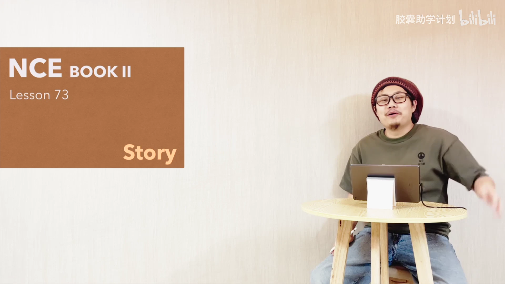

文字识别：bibili / 胶囊助学计划 / NCE / BOOKI"I / Lesson 73 / Story

### 画面 00:00:02

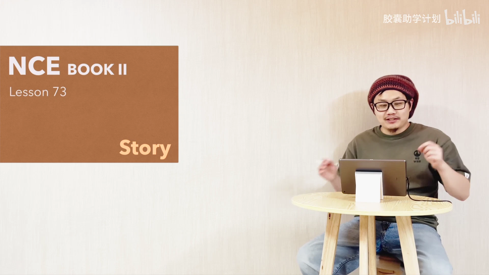

文字识别：bibili / 胶囊助学计划 / NCE / BOOKI"I / Lesson 73 / Story / NB / WBR

### 画面 00:00:04

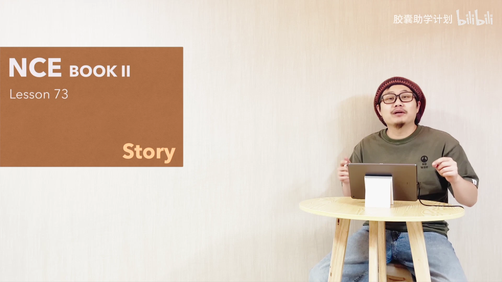

文字识别：biibili / 胶囊助学计划 / NCE / BOOKII / Lesson 73 / Story / NO / WIR

### 画面 00:00:06

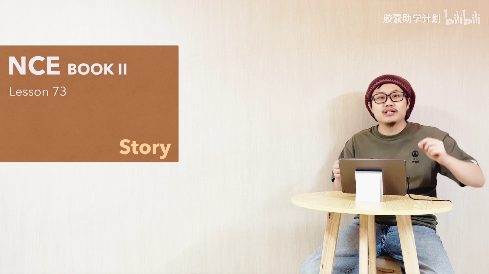

文字识别：bilbili / 胶囊助学计划 / NCE / BOOKII / Lesson 73 / Story / NU / WUR

### 画面 00:00:10

文字识别：胶囊助学计划 bii / • / •

### 画面 00:00:14

### 画面 00:00:16

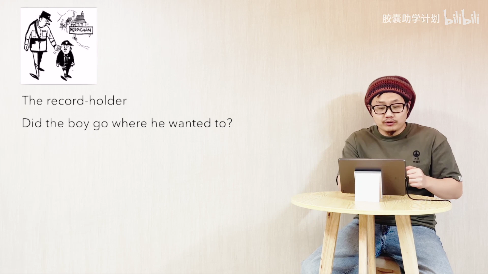

文字识别：biibii / 胶囊助学计划 / PERPICNAN / The record-holder / Did the boy go where he wanted to? / NO / WnR

### 画面 00:00:29

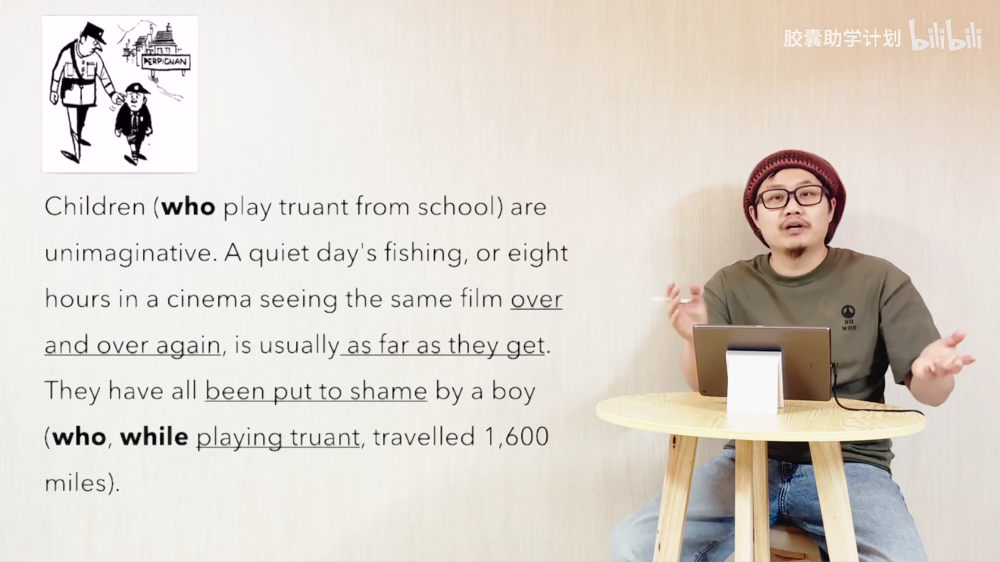

文字识别：胶囊助学计划bii / PERPICNAN / Children (who play truant from school) are / unimaginative. A quiet day's fishing, or eight / hours in a cinema seeing the same film over / WIR / and over again, is usually as far as they get. / They have all been put to shame by a boy / (who, while playing truant, travelled 1,600 / miles).

## 00:00:30–00:01:00

第一句话，Children who play truant from school are unimaginative. 直接 children 后边加了个定语从句，整个这句话其实主干是很简单的，叫做 children are unimaginative，孩子们没有想象力。但他说的不是所有的孩子们，是一个限定住的孩子们。什么样的孩子呢？叫做那些 play truant from school 的孩子们，

### 画面 00:00:31

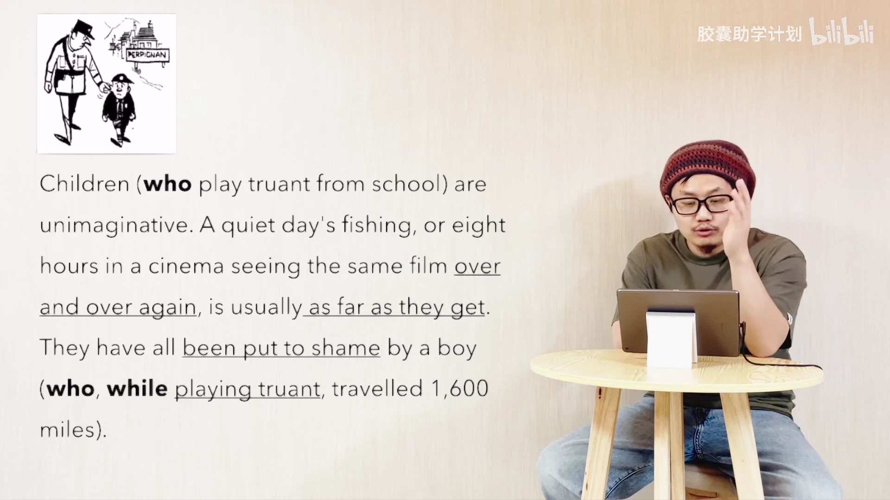

文字识别：胶囊助学计划biibi / PERPICNAN / Children (who play truant from school) are / unimaginative. A quiet day's fishing, or eight / hours in a cinema seeing the same film over / and over again, is usually as far as they get. / They have all been put to shame by a boy / (who, while playing truant, travelled 1,600 / miles).

### 画面 00:00:33

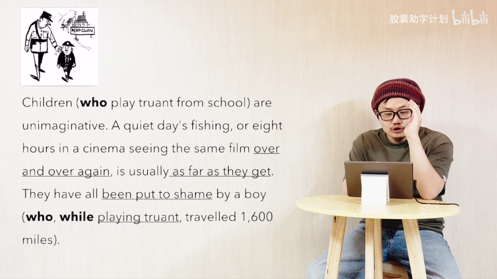

文字识别：胶囊助学计划biibi / PERPICNAN / Children (who play truant from school) are / unimaginative. A quiet day's fishing, or eight / hours in a cinema seeing the same film over / and over again, is usually as far as they get. / They have all been put to shame by a boy / (who, while playing truant, travelled 1,600 / miles).

### 画面 00:00:44

文字识别：胶囊助学计划bii / nn / PERPICNAN / Children (who play truant from school) are / unimaginative. A quiet day's fishing, or eight / hours in a cinema seeing the same film over / and over again, is usually as far as they get. / They have all been put to shame by a boy / (who, while playing truant, travelled 1,600 / miles).

### 画面 00:00:52

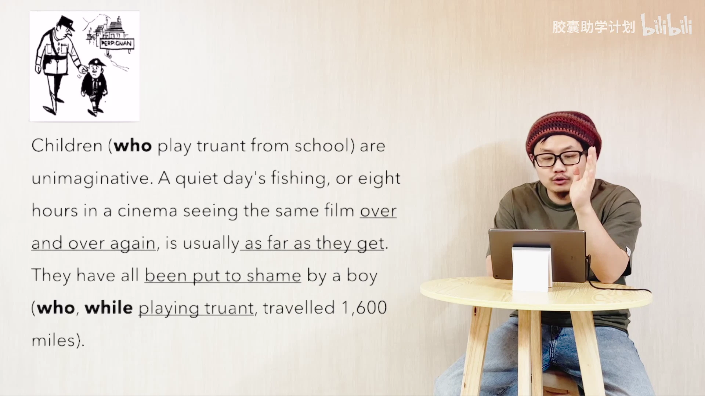

文字识别：胶囊助学计划bibi出 / PERPICNAN / Children (who play truant from school) are / unimaginative. A quiet day's fishing, or eight / hours in a cinema seeing the same film over / and over again, is usually as far as they get. / They have all been put to shame by a boy / (who, while playing truant, travelled 1,600 / miles).

### 画面 00:00:56

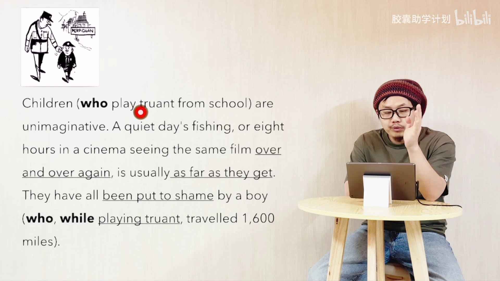

文字识别：胶囊助学计划i出 / n / PERPICNAN / Children (who playtruant from school) are / unimaginative. A quiet day's fishing, or eight / hours in a cinema seeing the same film over / and over again, is usually as far as they get. / They have all been put to shame by a boy / (who, while playing truant, travelled 1,600 / miles).

## 00:01:00–00:01:30

啊，就是那些逃学的孩子们没有想象力。这句话很简单，无非就是在这个地方多了一个小的定从。这句话想看懂，其实各位只要二十八课学好了，这课就一定能看懂了。别的对于各位来说，无非就是查查单词的事儿，对吧？你比如说 an imaginative，是不是？哇，你新一第一课就可以学，你自己查一下单词意思不就知道了吗？对吧？所以它不是这课的核心点啊。

### 画面 00:01:08

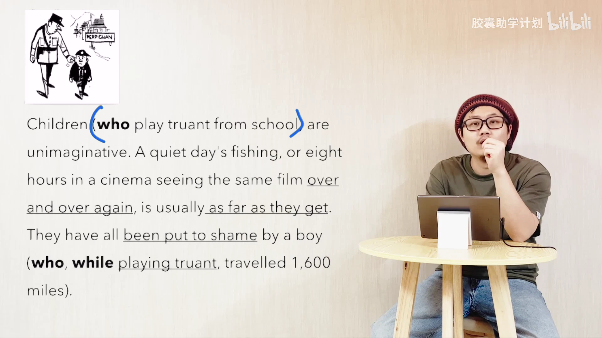

文字识别：胶囊助学计划ib山 / nn / PERPICNAN / Children (who play truant from schoo) / are / unimaginative. A quiet day's fishing, or eight / hours in a cinema seeing the same film over / and over again, is usually as far as they get. / They have all been put to shame by a boy / (who, while playing truant, travelled 1,600 / miles).

### 画面 00:01:12

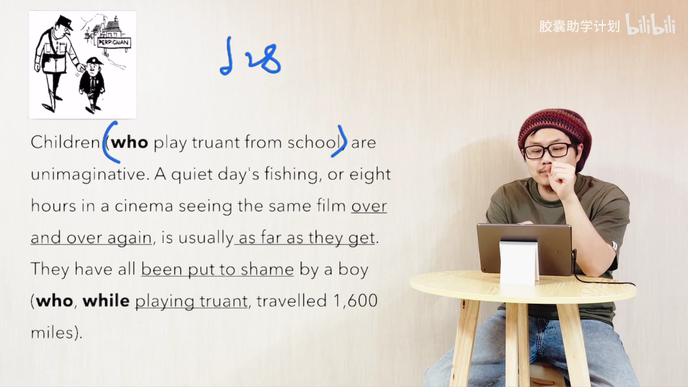

文字识别：胶囊助学计划biii / n / 」8 / PERPICNAN / Children (who play truant from schoo) / are / unimaginative. A quiet day's fishing, or eight / hours in a cinema seeing the same film over / and over again, is usually as far as they get. / They have all been put to shame by a boy / (who, while playing truant, travelled 1,600 / miles).

### 画面 00:01:14

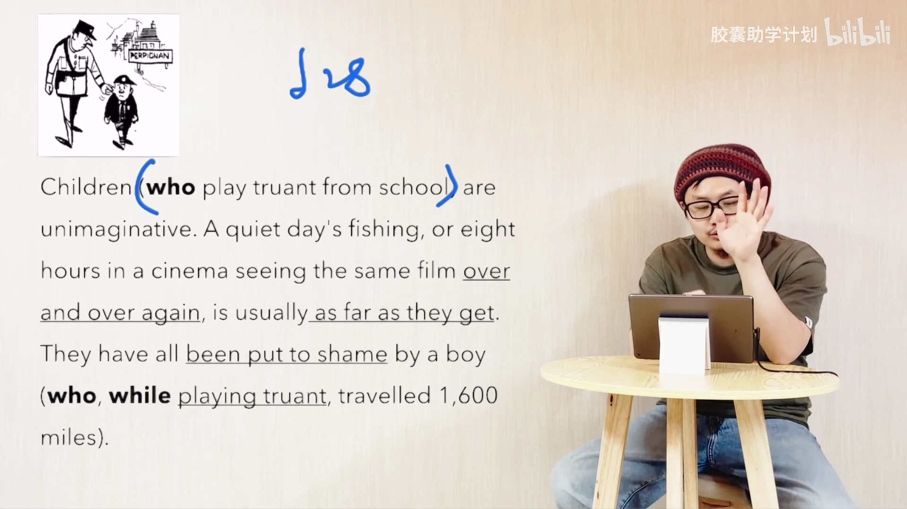

文字识别：胶囊助学计划bib出 / n / 」v8 / PERPICNAN / Children (who play truant from schoo) / are / unimaginative. A quiet day's fishing, or eight / hours in a cinema seeing the same film over / and over again, is usually as far as they get. / They have all been put to shame by a boy / (who, while playing truant, travelled 1,600 / miles).

### 画面 00:01:16

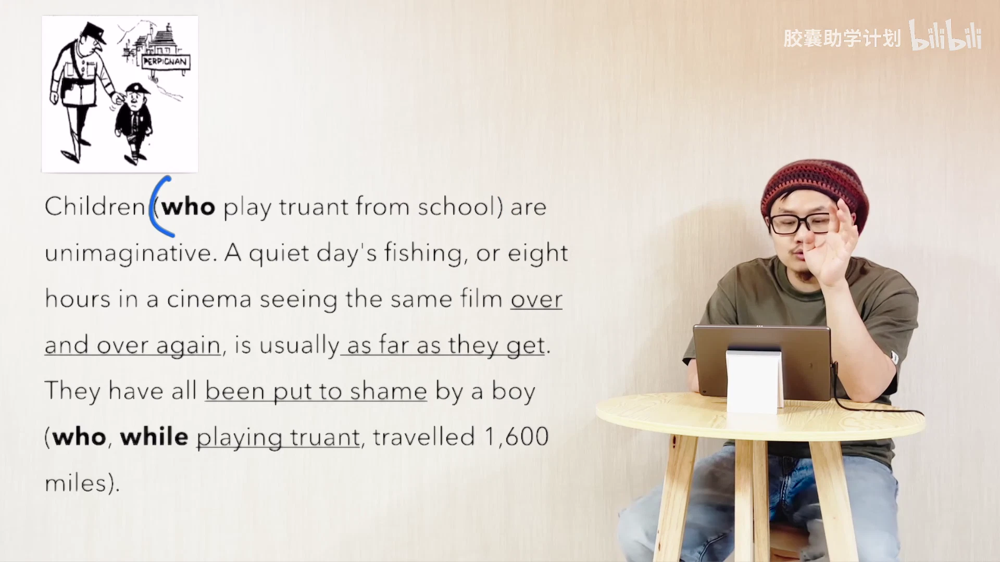

文字识别：胶囊助学计划i山 / PERPICNAN / Children (who play truant from school) are / unimaginative. A quiet day's fishing, or eight / hours in a cinema seeing the same film over / and over again, is usually as far as they get. / They have all been put to shame by a boy / (who, while playing truant, travelled 1,600 / miles).

### 画面 00:01:18

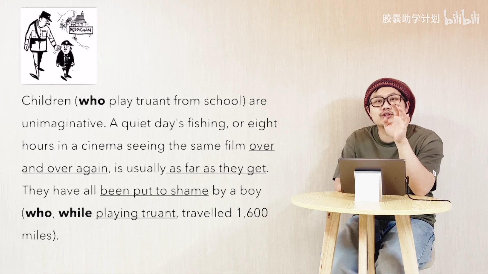

文字识别：胶囊助学计划biii出 / PERPICNAN / Children (who play truant from school) are / unimaginative. A quiet day's fishing, or eight / hours in a cinema seeing the same film over / and over again, is usually as far as they get. / They have all been put to shame by a boy / (who, while playing truant, travelled 1,600 / miles).

### 画面 00:01:20

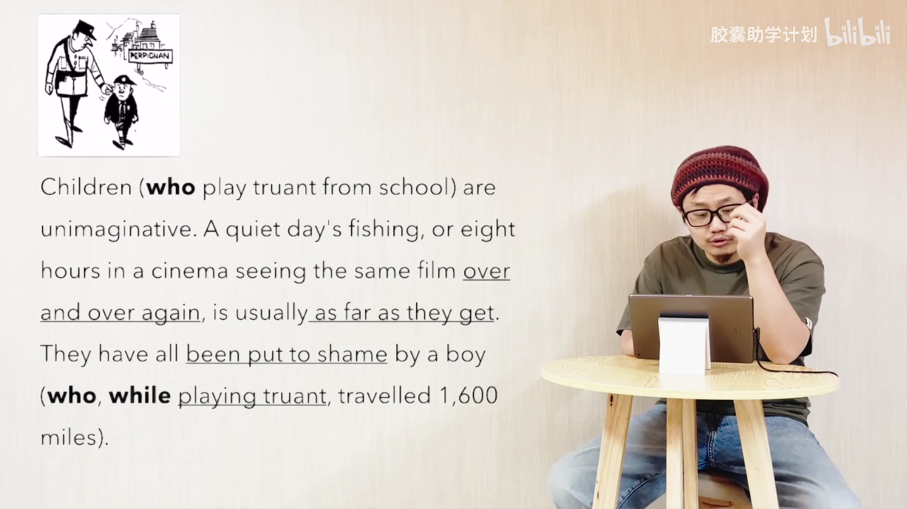

文字识别：胶囊助学计划biibi出 / PERPICNAN / Children (who play truant from school) are / unimaginative. A quiet day's fishing, or eight / hours in a cinema seeing the same film over / and over again, is usually as far as they get. / They have all been put to shame by a boy / (who, while playing truant, travelled 1,600 / miles).

### 画面 00:01:23

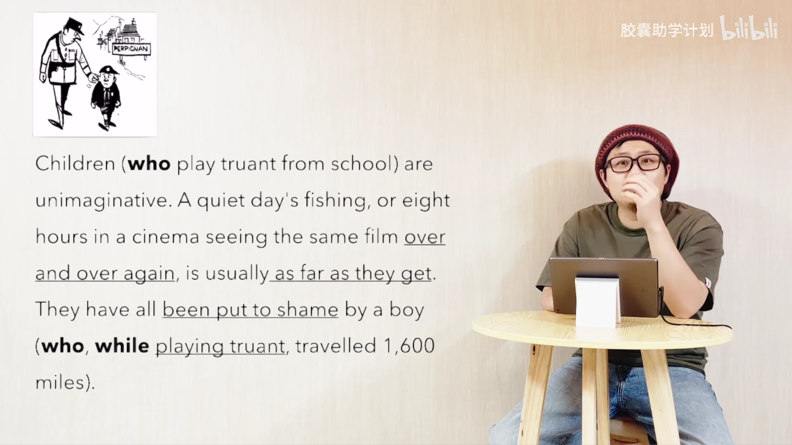

文字识别：胶囊助学计划ib出 / n / PERPICNAN / Children (who play truant from school) are / unimaginative. A quiet day's fishing, or eight / hours in a cinema seeing the same film over / and over again, is usually as far as they get. / They have all been put to shame by a boy / (who, while playing truant, travelled 1,600 / miles).

### 画面 00:01:25

文字识别：胶囊助学计划bibi出 / n / PERPICNAN / Children (who play truant from school) are / unimaginative. A quiet day's fishing, or eight / hours in a cinema seeing the same film over / and over again, is usually as far as they get. / They have all been put to shame by a boy / (who, while playing truant, travelled 1,600 / miles).

### 画面 00:01:28

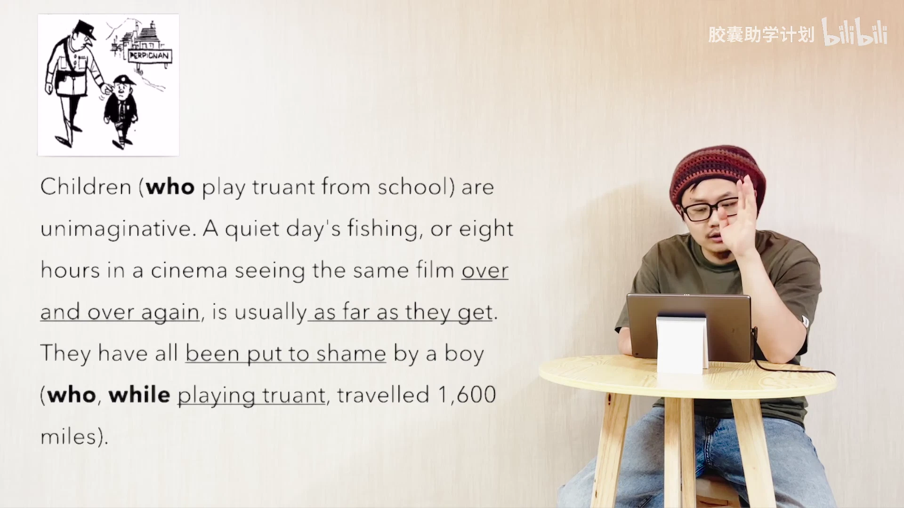

文字识别：胶囊助学计划ib出 / n / PERPICNAN / Children (who play truant from school) are / unimaginative. A quiet day's fishing, or eight / hours in a cinema seeing the same film over / and over again, is usually as far as they get. / They have all been put to shame by a boy / (who, while playing truant, travelled 1,600 / miles).

## 00:01:30–00:02:00

但下面这句话乍一看挺蒙圈的。A quiet day's fishing, or eight hours in the cinemas seeing the same film over and over again, is usually as far as they get. 有很多同学看到这句话，可能就感觉哇塞，长难句来了啊！他们就是大多数同学对于长难句的定义啊。如果您不太了解的话，可能就是句子够长就叫长难句啊，并不

### 画面 00:01:34

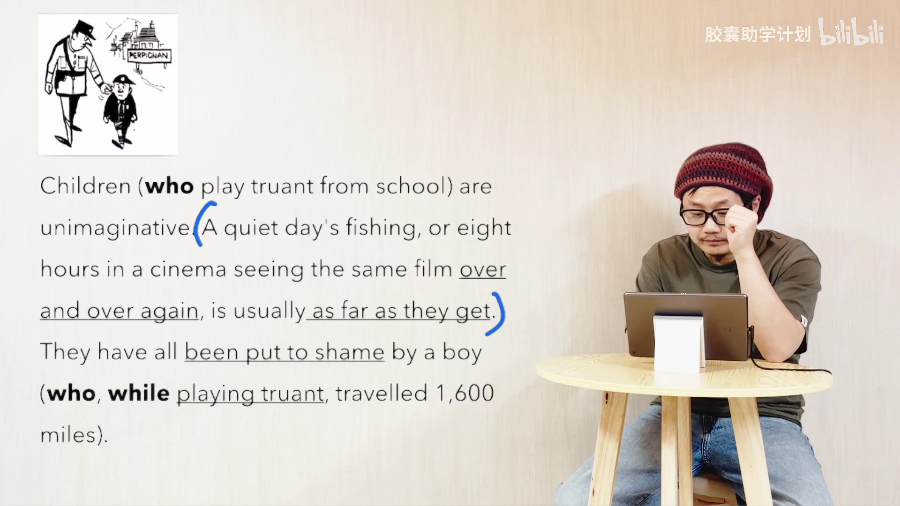

文字识别：胶囊助学计划bibi / n / PERPICNAN / Children (who play truant from school) are / unimaginativeA quiet day's fishing, or eight / hours in a cinema seeing the same film over / and over again, is usually as far as they get. / They have all been put to shame by a boy / (who, while playing truant, travelled 1,600 / miles).

### 画面 00:01:36

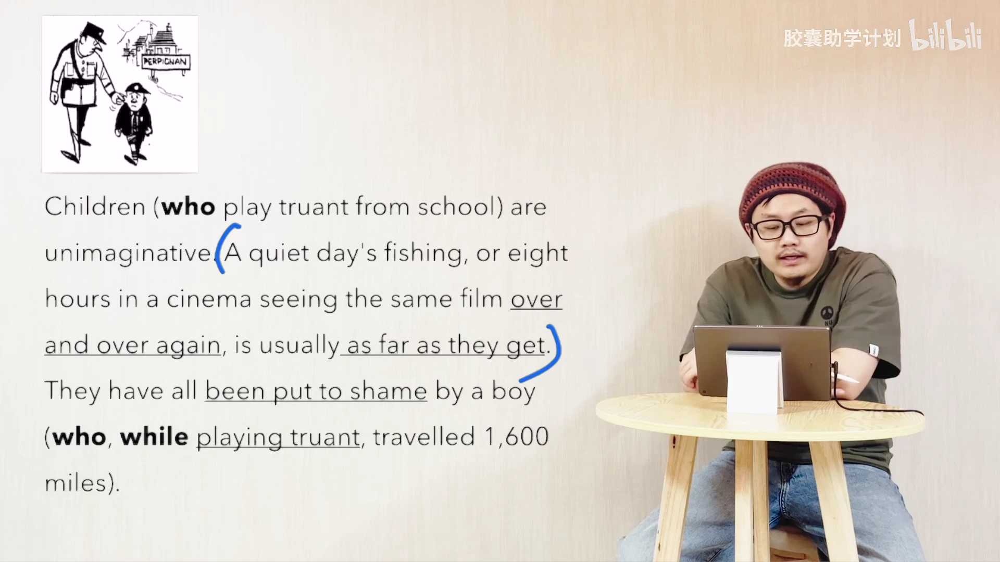

文字识别：胶囊助学计划bibi / PERPICNAN / Children (who play truant from school) are / unimaginativeA quiet day's fishing, or eight / hours in a cinema seeing the same film over / and over again, is usually as far as they get. / They have all been put to shame by a boy / (who, while playing truant, travelled 1,600 / miles).

## 00:02:00–00:02:30

是，所以这还真不是个长难句。那我们看一下这句话，A quiet day's fishing，安静一天的钓鱼，安静钓鱼一天鱼，这是第一个事儿。or或者，那你就能明白他可能接下来要说第二件事儿。第二件事儿是什么呢？叫做Eight hours in a cinema，八个小时在电影院。然后seeing the same film over and over again，那over and over

### 画面 00:02:06

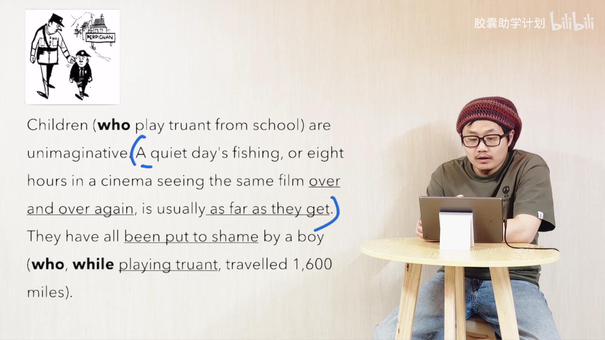

文字识别：胶囊助学计划biii / PERPICNAN / Children (who play truant from school) are / unimaginativeA quiet day's fishing, or eight / hours in a cinema seeing the same film over / and over again, is usually as far as they get. / They have all been put to shame by a boy / (who, while playing truant, travelled 1,600 / miles).

### 画面 00:02:12

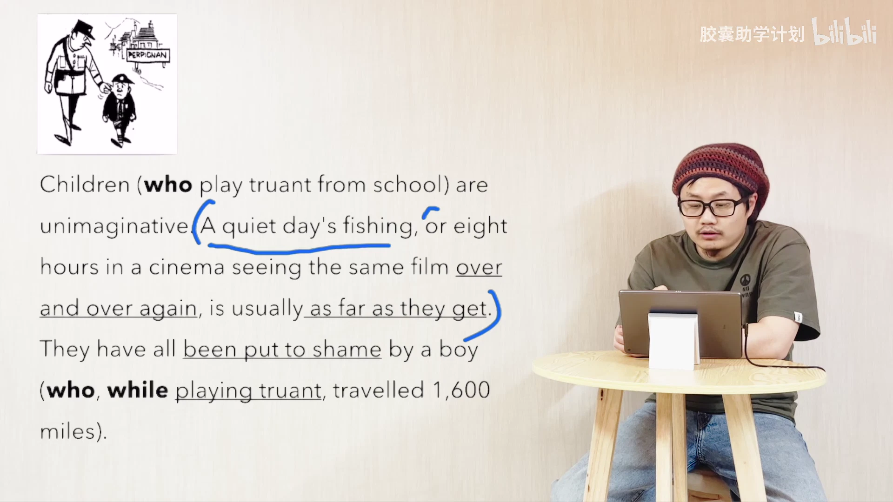

文字识别：bibii / 胶囊助学计划 / PERPICNAN / Children (who play truant from school) are / unimaginativeA quiet day's fishing, Or eight / hours in a cinema seeing the same film over / and over again, is usually as far as they get. / NO / They have all been put to shame by a boy / (who, while playing truant, travelled 1,600 / miles).

### 画面 00:02:19

文字识别：胶囊助学计划bii出 / PERPICNAN / unimaginativeA quiet day's fishing / eight / hours in a cinema seeing the same film over / and over again, is usually as far as they get. / They have all been put to shame by a boy / (who, while playing truant, travelled 1,600 / miles).

### 画面 00:02:25

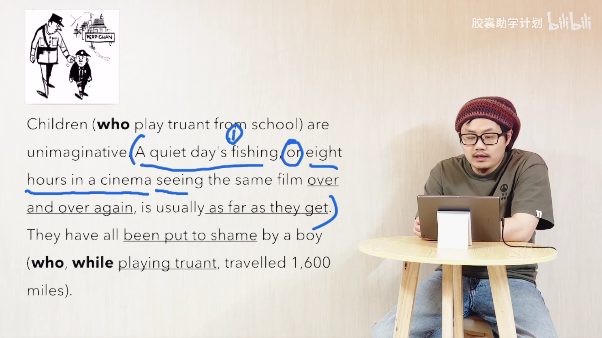

文字识别：biibili / 胶囊助学计划 / PERPICNAN / unimaginative / eA quiet day's fishing / eight / hours in a cinema seeing the same film over / and over again, is usually as far as they get. / They have all been put to shame by a boy / (who, while playing truant, travelled 1,600 / miles).

### 画面 00:02:27

文字识别：bilbili / 胶囊助学计划 / PERPICNAN / unimaginative / A quiet day's fishing, / eight / hours in a cinema seeing the same film over / and over again, is usually as far as they get. / They have all been put to shame by a boy / (who, while playing truant, travelled 1,600 / miles).

## 00:02:30–00:03:00

again is our lesson's a habit. Usage called once and again, right? Then seeing the same film is watching the same movie. We connect the sentences, called eight hours staying in the cinema watching the same movie over and over again. A total of two things. The first is fishing for a day, the second is watching a day movie. We simplify it. These two things, two choice one, is usually as far as they get.

### 画面 00:02:47

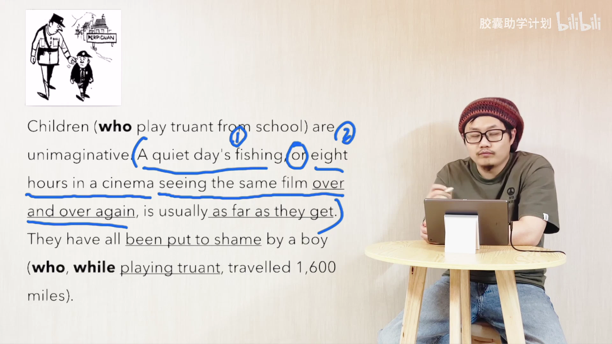

文字识别：bilbili / 胶囊助学计划 / PERPICNAN / unimaginative / A quiet day's fishing, / eight / hours in a cinema seeing the same film over / NO / and over again, is usually as far as they get. / WI / They have all been put to shame by a boy / (who, while playing truant, travelled 1,600 / miles).

### 画面 00:02:49

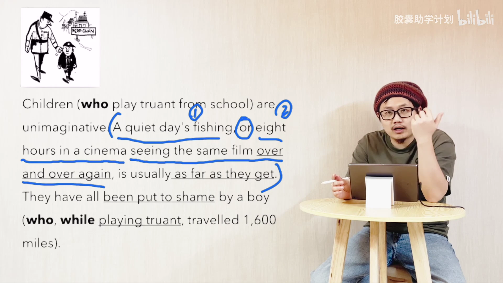

文字识别：bilbii / 胶囊助学计划 / PERPICNAN / unimaginative / A quiet day's fishing, / eight / hours in a cinema seeing the same film over / and over again, is usually as far as they get. / They have all been put to shame by a boy / (who, while playing truant, travelled 1,600 / miles).

### 画面 00:02:56

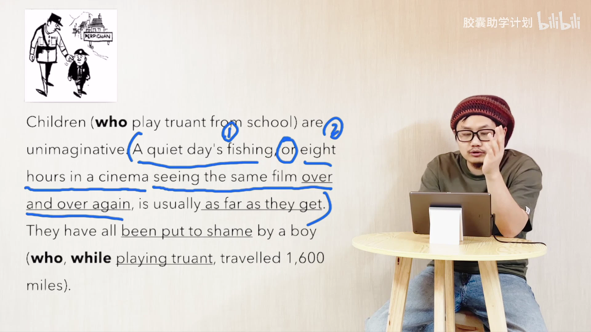

文字识别：biibili / 胶囊助学计划 / nn / PERPICNAN / unimaginative / A quiet day's fishing, / eight / hours in a cinema seeing the same film over / and over again, is usually as far as they get. / They have all been put to shame by a boy / (who, while playing truant, travelled 1,600 / miles).

### 画面 00:02:59

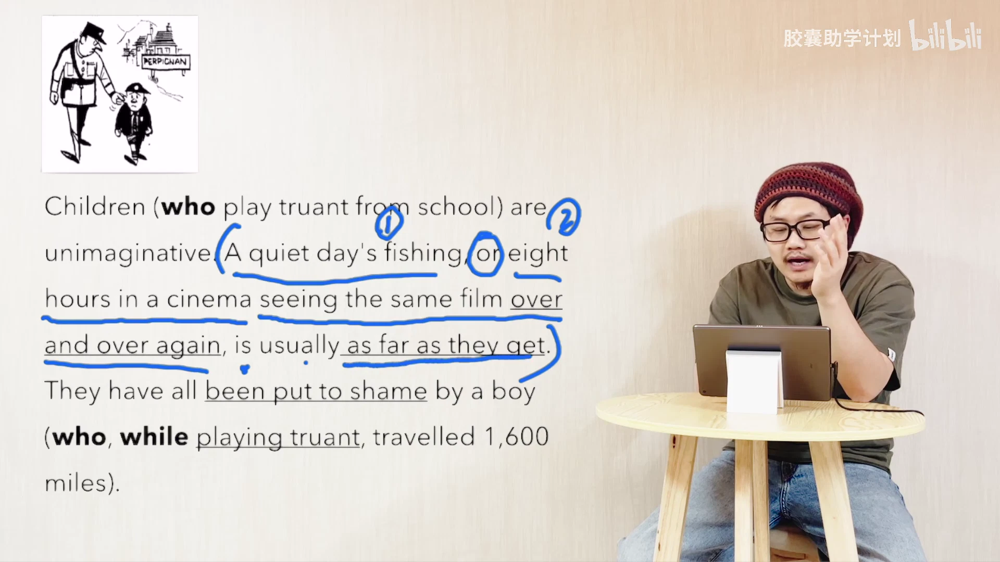

文字识别：bilbii / 胶囊助学计划 / PERPICNAN / p school) are / A quiet day's fishing / eight / unimaginative / hours in a cinema seeing the same film over / and over again, is usually as far as they aet. / They have all been put to shame by a boy / (who, while playing truant, travelled 1,600 / miles).

## 00:03:00–00:03:30

get.好，我们先不看后面了。我们就知道它其实这个句子被拆成的就是A is B，或者是A or C is B. A或者是C是B，对吧？B是as far as they get.一会儿咱们再说。A是八小时钓鱼，C是哎这个这个不是八小时钓鱼，就安静钓一天鱼。A，C是在电影院看一天电影啊，看相同的电影。

### 画面 00:03:04

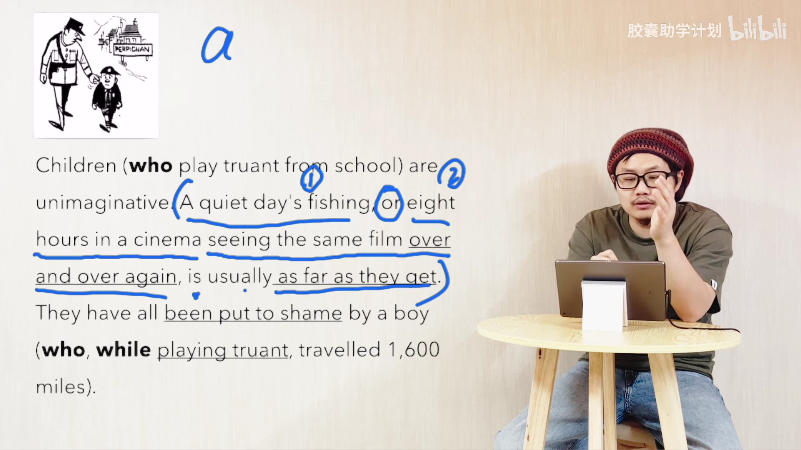

文字识别：Bilbii / 胶囊助学计划 / a / nn / PERPICNAN / p school) are / A quiet day's fishing, / eight / unimaginative / hours in a cinema seeing t /  the same film over / and over again, is usually as far as they aet. / They have all been put to shame by a boy / (who, while playing truant, t / , travelled 1,600 / miles).

### 画面 00:03:07

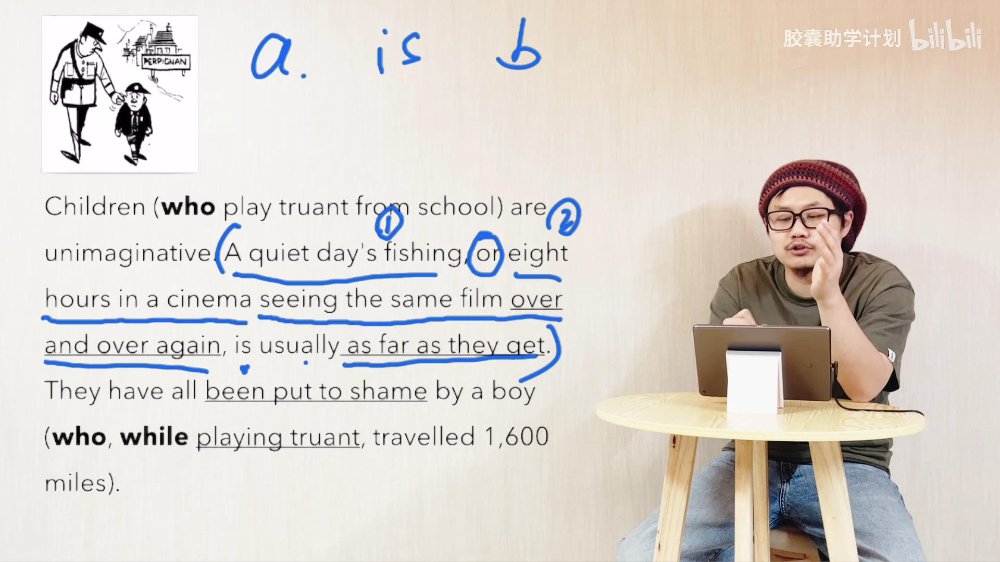

文字识别：biibili / a. / is / 胶囊助学计划 / PERPICNAN / unimaginative / A quiet day's fishing, / eight / hours in a cinema seeing t /  the same film over / and over again, is usually as far as thev aet. / They have all been put to shame by a boy / (who, while playing truant, travelled 1,600 / miles).

### 画面 00:03:10

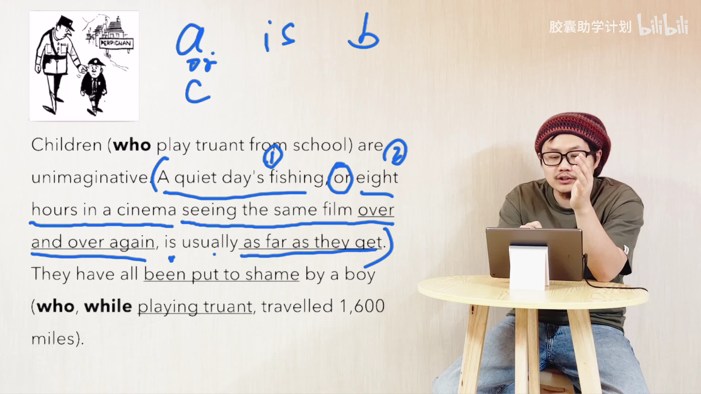

文字识别：bilbii / 胶囊助学计划 / a / is / PERPICNAN / Dr / C /  school) are / unimaginative / A quiet day's fishing, / eight / hours in a cinema seeing t /  the same film over / and over again, is usually as far as they aet. / They have all been put to shame by a boy / (who, while playing truant, travelled 1,600 / miles).

### 画面 00:03:16

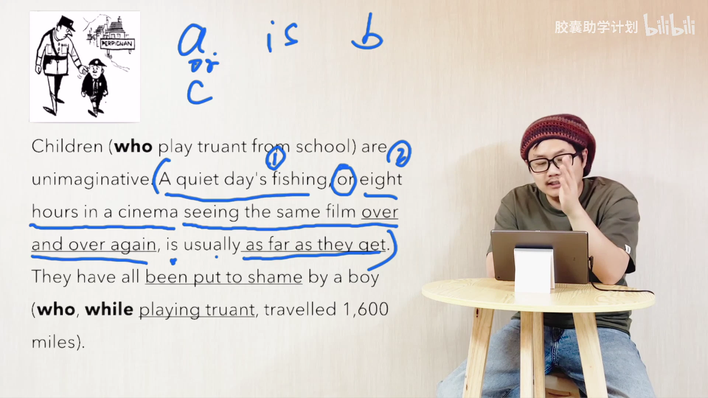

文字识别：biibili / 胶囊助学计划 / a / is / n / PERPICNAN / Dr / C / p school) are / unimaginative / A quiet day's fishing / eight / hours in a cinema seeing / the same film over / and over again, is usually as far as they aet. / They have all been put to shame by a boy / (who, while playing truant, travelled 1,600 / miles).

## 00:03:30–00:04:00

这两件事二选其一是B对吧？那我们先把A和B、A和C先搞懂啊。A是什么？C是什么？那我们看啊，他说安静的钓一天鱼，A quiet days fishing。第二个叫做Eight hours in a cinema，八小时在电影院 seeing the same film over and over again，看相同电影一遍又一遍的看。然后我想问A和C在这里是不是类似于起到了一个主语的作用？然后你再

### 画面 00:03:35

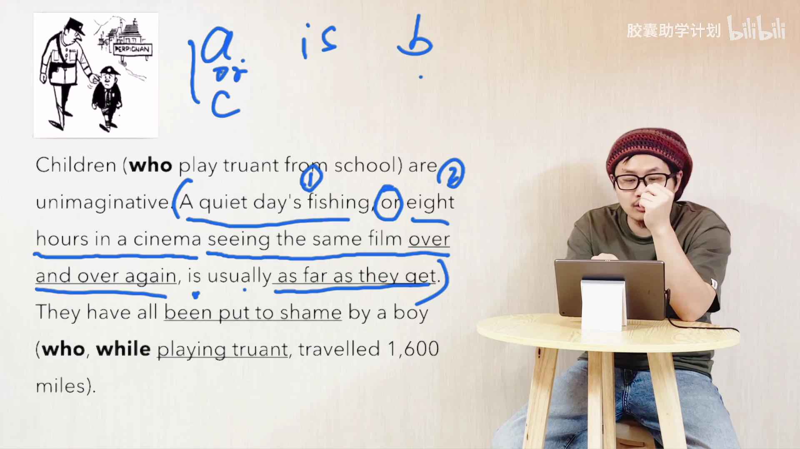

文字识别：biibili / 胶囊助学计划 / is / a / dn / PERPICNAN / p school) are / unimaginative / A quiet day's fishing / eight / hours in a cinema seeing t /  the same film over / and over again, is usually as far as they aet. / They have all been put to shame by a boy / (who, while playing truant, t / , travelled 1,600 / miles).

### 画面 00:03:57

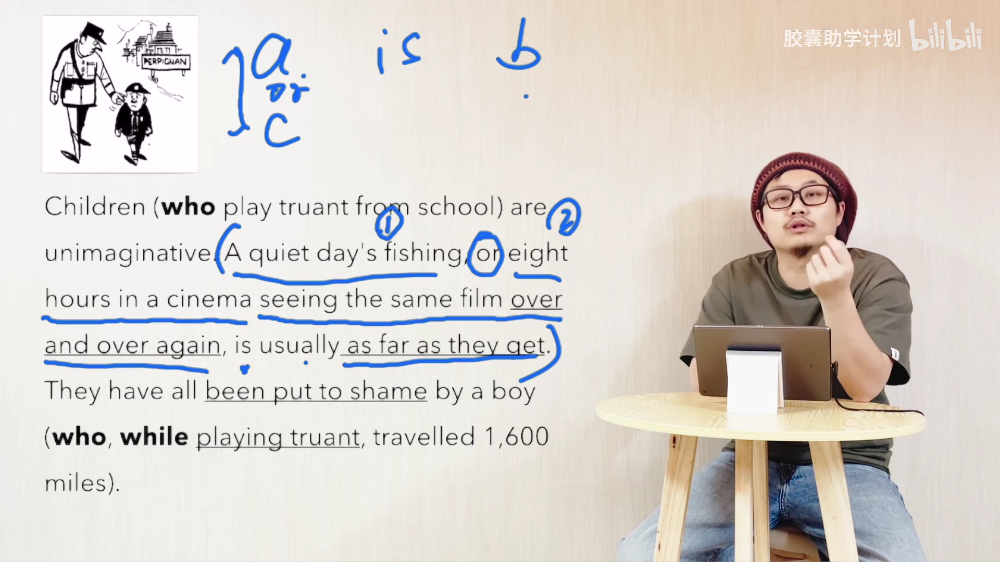

文字识别：bilbii / 胶囊助学计划 / is / ra / PERPICNAN / unimaginative / A quiet day's fishing / eight / hours in a cinema seeing the same film over / and over again, is usually as far as thev aet. / They have all been put to shame by a boy / (who, while playing truant, travelled 1,600 / miles).

## 00:04:00–00:04:30

看到 fishing，再看到 seeing，然后再回顾新概念二册第二十课动名词那一课。你如果能回想到，你可以现在暂停屏幕，立刻翻到那一刻去看一下那课的笔记。你应该迅速就能回想到了，为啥在这地方用的是 seeing 跟 fishing，对吧？只是语序稍微有点跟汉语不太一样。对于中国人来说，可能我把这语序给你调成 seeing the

### 画面 00:04:27

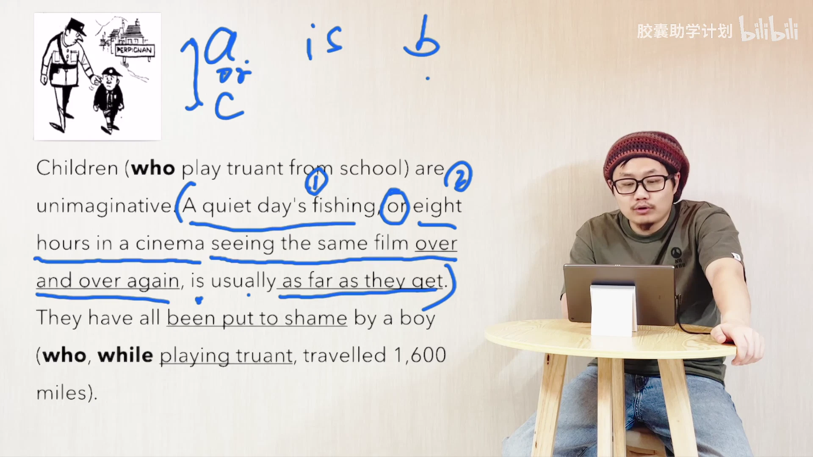

文字识别：Bilbii / is / 胶囊助学计划 / ra / nn / PERPICNAN / p school) are / unimaginative / A quiet day's fishing / eight / hours in a cinema seeing /  the same film over / and over again, is usually as far as thev aet. / N / They have all been put to shame by a boy / (who, while playing truant, t / , travelled 1,600 / miles).

## 00:04:30–00:05:00

same film over and over again eight hours in a cinema 可能对于您来说更舒服一点，或者 seeing the same film eight hours in a cinema over and over again 可能语序上会让你舒服一点，但这并不重要，我们只要知道它分别是什么语法就行了，对吧？所以 is 前面，哎，两件事儿 A 跟 C A 钓鱼 B 看电影，他们都是动名词。呃，is 后面叫做 usually as far as they get，通常状

### 画面 00:04:57

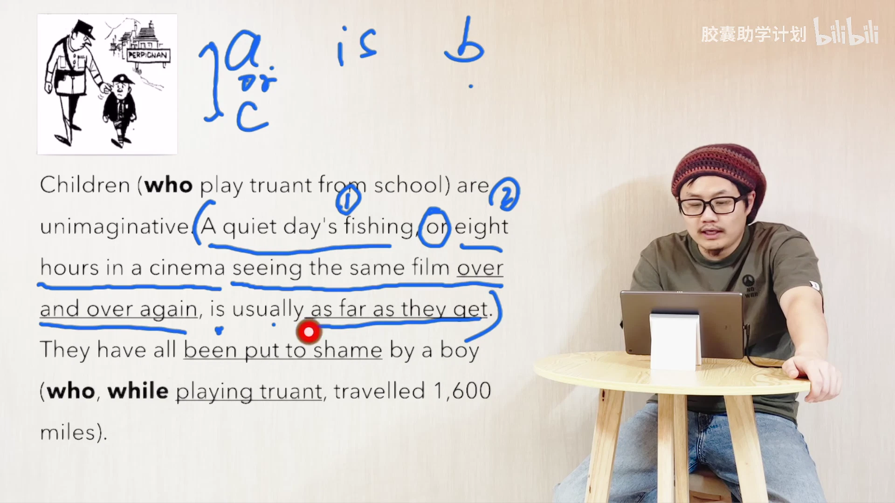

文字识别：Bilbii / 胶囊助学计划 / is / ra / PERPICNAN / p school) are( / A quiet day's fishing / eight / unimaginative / hours in a cinema seeing /  the same film over / and over again, is usually as far as thev aet. / WIH / They have all been put to shame by a boy / (who, while playing truant, travelled 1,600 / miles).

## 00:05:00–00:05:30

态下是他们能到达的最远的程度了。就他们做这件事儿能想到的最就逃学去做什么最远的程度，他们能做的事情无非就是钓钓鱼、看看电影，这是他们能达到最远的程度了，对吧？最大的程度了。They have all been put to shame by a boy who, while playing train, traveled one thousand six hundred miles.这句话虽然不算长难句，就

### 画面 00:05:05

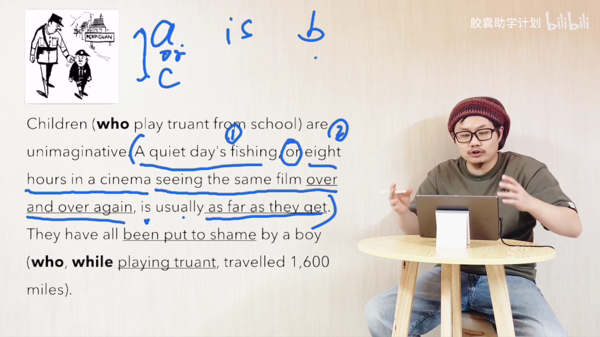

文字识别：biibili / is / 胶囊助学计划 / ra / PERPICNAN / r /  school) are / unimaginative / A quiet day's fishing / eight / hours in a cinema seeing /  the same film over / and over again, is usually as far as they aet. / They have all been put to shame by a boy / (who, while playing truant, travelled 1,600 / miles).

### 画面 00:05:11

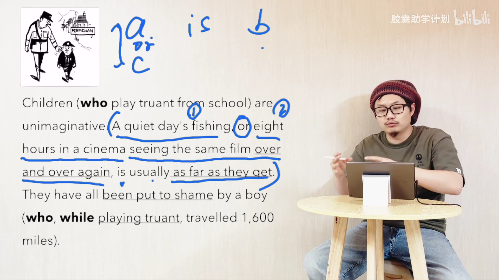

文字识别：bilbii / is / 胶囊助学计划 / ra / PERPICNAN / unimaginative / A quiet day's fishing / eight / hours in a cinema seeing /  the same film over / and over again, is usually as far as they aet. / wnR / NU / They have all been put to shame by a boy / (who, while playing truant, travelled 1,600 / miles).

### 画面 00:05:18

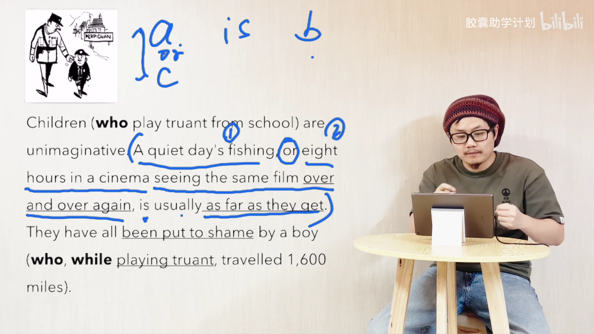

文字识别：Bilbii / 胶囊助学计划 / is / ra / PERPICNAN / 1 school) are / unimaginative / A quiet day's fishing / eight / hours in a cinema seeing /  the same film over / and over again, is usually as far as they aet. / They have all been put to shame by a boy / (who, while playing truant, t / travelled 1,600 / miles).

### 画面 00:05:20

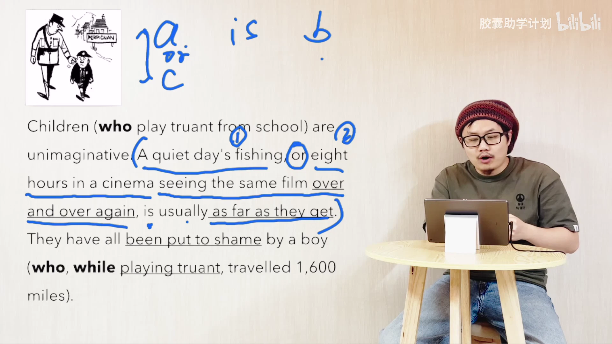

文字识别：biibili / 胶囊助学计划 / is / ra / PERPICNAN / 1 school) are / unimaginative / A quiet day's fishing / eight / hours in a cinema seeing / the same film over / and over again, is usually as far as thev aet. / NU / WIR / They have all been put to shame by a boy / (who, while playing truant, t / travelled 1,600 / miles).

### 画面 00:05:28

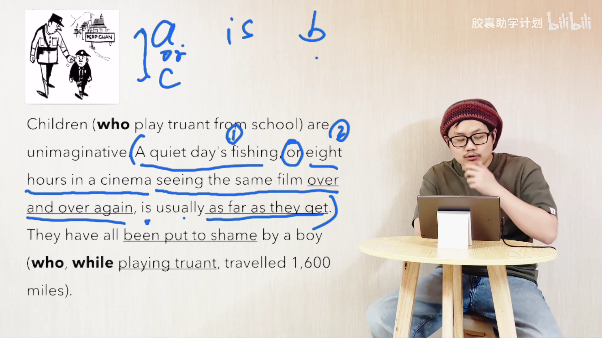

文字识别：biibili / 胶囊助学计划 / is / ra / PERPICNAN / p school) are / unimaginative / A quiet day's fishing / eight / hours in a cinema seeing /  the same film over / and over again, is usually as far as thev aet. / They have all been put to shame by a boy / (who, while playing truant, t / , travelled 1,600 / miles).

## 00:05:30–00:06:00

它语序不太舒服，所以你看起来会别扭啊。说这些孩子们都被怎么样了呢？Been put to shame啊，都相形见绌了，哎，都很惭愧，哎，都被比下去了。被一个小男孩什么样的小男孩呢？后边跟了个定语从句，who。你先不看well playing Trent这两个逗号中间不管它，先先看who traveled one thousand six hundred miles。说这个小男孩航行旅行了一千六百

### 画面 00:05:31

文字识别：bilbili / is / 胶囊助学计划 / ra / PERPICNAN / r / p school) are / unimaginative / A quiet day's fishing / eight / hours in a cinema seeing / the same film over / and over again, is usually as far as they aet. / They have all been put to shame by a boy / (who, while playing truant, t / , travelled 1,600 / miles).

### 画面 00:05:36

文字识别：Bilbii / is / 胶囊助学计划 / ra / PERPICNAN / p school) are( / unimaginative / A quiet day's fishing / eight / hours in a cinema seeing t /  the same film over / and over again, is usually as far as thev aet. / They have all been put to shame by a boy / (who, while playing truant, travelled 1,600 / miles).

## 00:06:00–00:06:30

英里，对吧？哎，就是他走的很远很远啊，在这个逃学期间跑了很远很远，然后中间加了一个小的，类似于你管它叫插入语也行，你管它叫这个时间状从也行，反正就是 while playing truant 叫做当逃学期间，但是这里一定要弄明白一件事儿，叫 while playing truant 的主语是谁，其实就是 the boy，对吧？然后主动被动那就是主动，因为这是 I N G，对吧？所以这句话给他你

### 画面 00:06:06

文字识别：bibii / iç / 胶囊助学计划 / 1a / PERPICNAN / y school) are / unimaginative / A quiet day's fishing / eight / hours in a cinema seeing t /  the same film over / and over again, is usually as far as thev aet. / NU / WI / They have all been put to shame by a boy / (who, while playing truant, travelled 1,600 / miles).

## 00:06:30–00:07:00

可以拆成三句话。第一句话叫做这些逃学的孩子们，哎，跟这个孩子一比，都相形见绌了，哎，就就不太不太行，对吧？哎，都被比下去了，都感到很惭愧。第二句话叫做这个小孩儿啊，逃这个旅行航行了一千六百英里。第三句话叫做他逃学期间，对吧？所以你把这两句话其实可以混到一起，叫逃学期间航行了，旅行了

### 画面 00:06:36

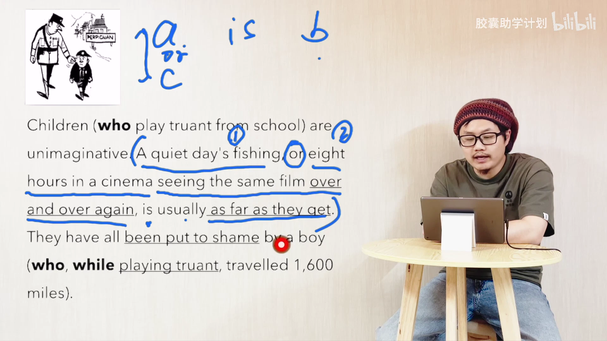

文字识别：bibii / 胶囊助学计划 / is / ra / n / PERPICNAN / p school) are / unimaginative / A quiet day's fishing / eight / hours in a cinema seeing t /  the same film over / and over again, is usually as far as they aet. / They have all been put to shame bo / boy / (who, while playing truant, t / , travelled 1,600 / miles).

## 00:07:00–00:07:30

一千六百英里，对吧？这一页结束。下一句话，He hitchhiked to Dover and towards evening went into a boat to find somewhere to sleep。说他呀，hitchhiked to Dover，哎，就是呃搭便车去了 Dover 这个地方，然后 towards evening，临近晚晚上的时候，went into a boat，跑跑到一个船里面去了，

### 画面 00:07:03

文字识别：胶囊助学计划 / 课堂笔记 / X / 公众号：胶囊助学计划 / 正版教材 / X / 雅思托福课 / ·学员来信 / ·试听课 / ·课程详情

### 画面 00:07:06

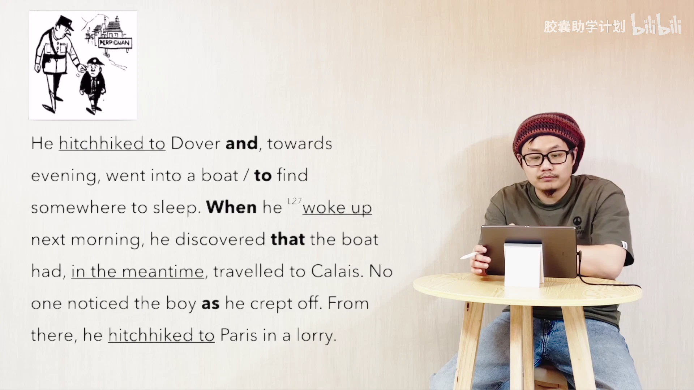

文字识别：胶囊助学计划biii / PERPICNAN / He hitchhiked to Dover and, towards / evening, went into a boat /to find / somewhere to sleep. When he [²woke up / NU / next morning, he discovered that the boat / had, in the meantime, travelled to Calais. No / one noticed the boy as he crept off. From / there, he hitchhiked to Paris in a lorry.

## 00:07:30–00:08:00

目的是 find somewhere to sleep，找一个地方睡觉。When he woke up next morning, he discovered that the boat had, in the meantime, traveled to Calais.这句话乍一看又是很长，不过没问题。第一句话 When he woke up next morning，因为后边有个逗号嘛，提醒我们要结束了。说当他第二天早晨醒来的时候，他

### 画面 00:07:36

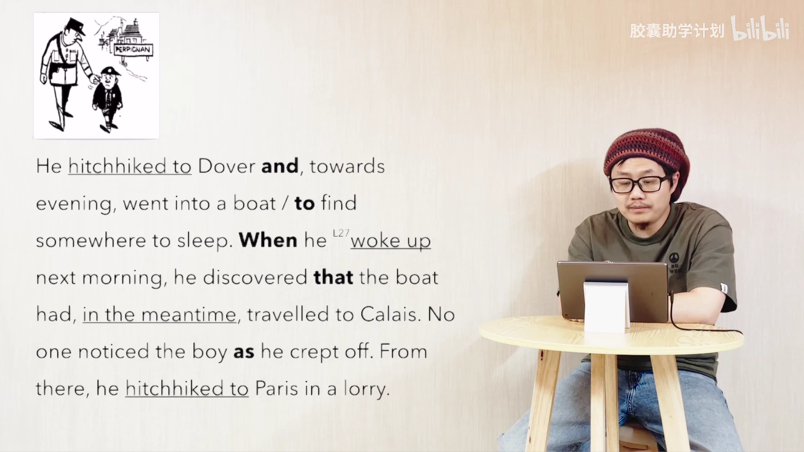

文字识别：胶囊助学计划ii / n / PERPICNAN / He hitchhiked to Dover and, towards / evening, went into a boat /to find / somewhere to sleep. when he ²woke up / next morning, he discovered that the boat / had, in the meantime, travelled to Calais. No / one noticed the boy as he crept off. From / there, he hitchhiked to Paris in a lorry.

### 画面 00:07:49

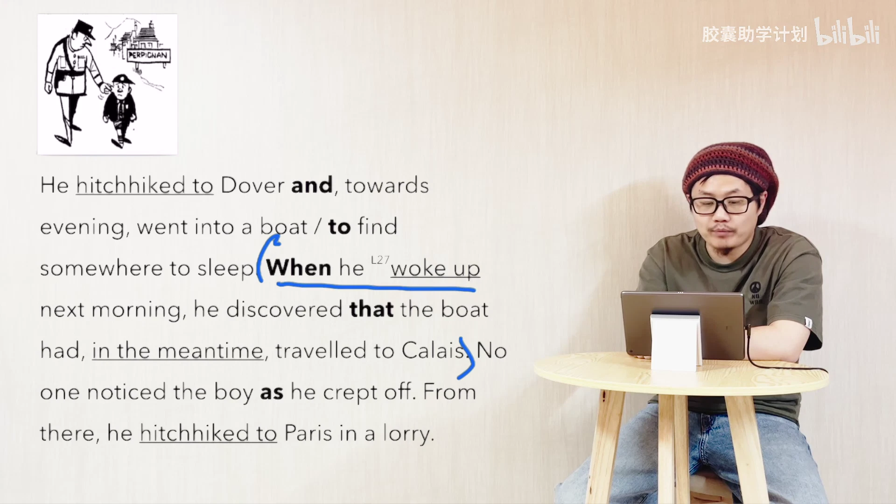

文字识别：胶囊助学计划biibi / PERPICNAN / He hitchhiked to Dover and, towards / evening, went into a boat / to find / somewhere to sleep / When he / L27 / "woke up / next morning, he discovered that the boat / had, in the meantime, travelled to Calais No / one noticed the boy as he crept off. From / there, he hitchhiked to Paris in a lorry.

### 画面 00:07:53

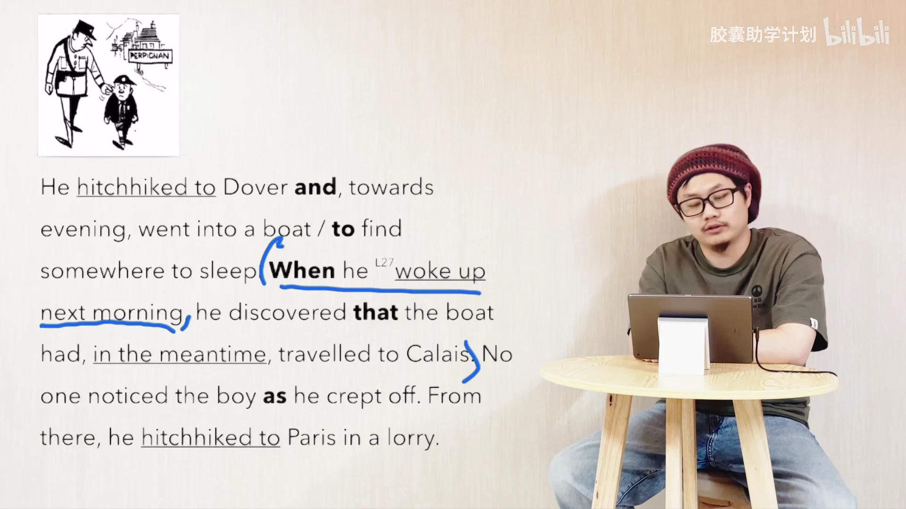

文字识别：胶囊助学计划biibi / PERPICNAN / He hitchhiked to Dover and, towards / evening, went into a boat / to find / somewhere to sleep(when he [2 / "woke up / next morning, he discovered that the boat / NU / had, in the meantime, travelled to Calais No / one noticed the boy as he crept off. From / there, he hitchhiked to Paris in a lorry.

### 画面 00:07:56

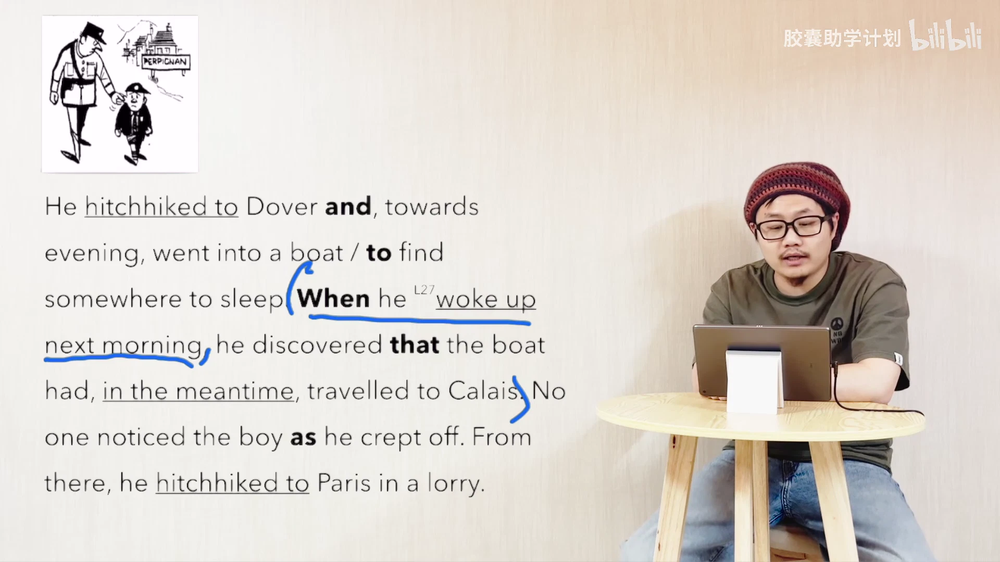

文字识别：胶囊助学计划lb山 / nT / PERPICNAN / He hitchhiked to Dover and, towards / evening, went into a boat /to find / somewhere to sleep(when he [²woke up / next morning he discovered that the boat / NO / had, in the meantime, travelled to Calaisy No / one noticed the boy as he crept off. From / there, he hitchhiked to Paris in a lorry.

## 00:08:00–00:08:30

注意到注意到的是一件事儿，叫做 The boat had traveled to Calais. 说这个船已经航行到 Calais 这个地方了，然后只不过在中间加了一个 In the meantime. 如果我给它放到最后面去，你就会很舒服了。我给它放到最后面去，换一个颜色的笔啊。我把这个 In the meantime 换到这里来，就不会打断你读的这句话了。不过各位一定要记

### 画面 00:08:02

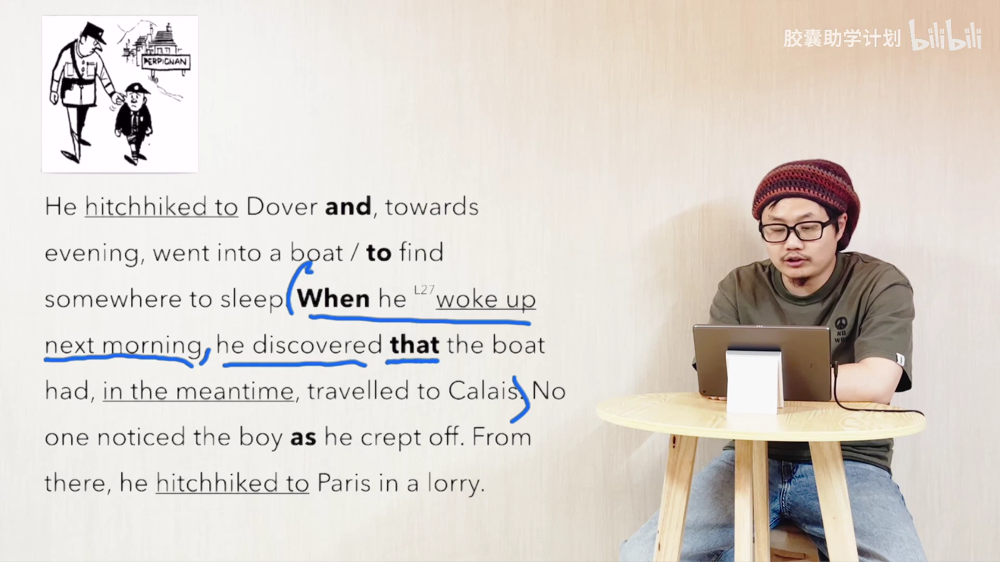

文字识别：bibili / 胶囊助学计划 / n / PERPICNAN / He hitchhiked to Dover and, towards / evening, went into a boat / to find / somewhere to sleep / When he / L27 / "woke up / ® / next morning he discovered that the boat / had, in the meantime, travelled to Calais No / one noticed the boy as he crept off. From / there, he hitchhiked to Paris in a lorry.

### 画面 00:08:05

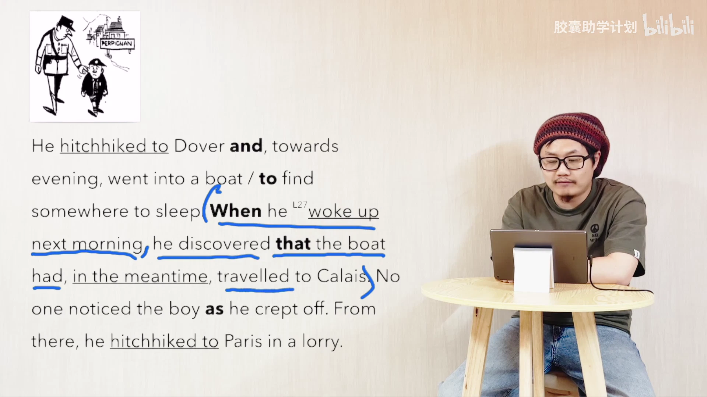

文字识别：胶囊助学计划biii / PERPICNAN / He hitchhiked to Dover and, towards / evening, went into a boat / to find / somewhere to sleep(when he ' / L27 / "woke up / next morning he discovered that the boat / W / NU / had, in the meantime, travelled to Calais No / one noticed the boy as he crept off. From / there, he hitchhiked to Paris in a lorry.

### 画面 00:08:14

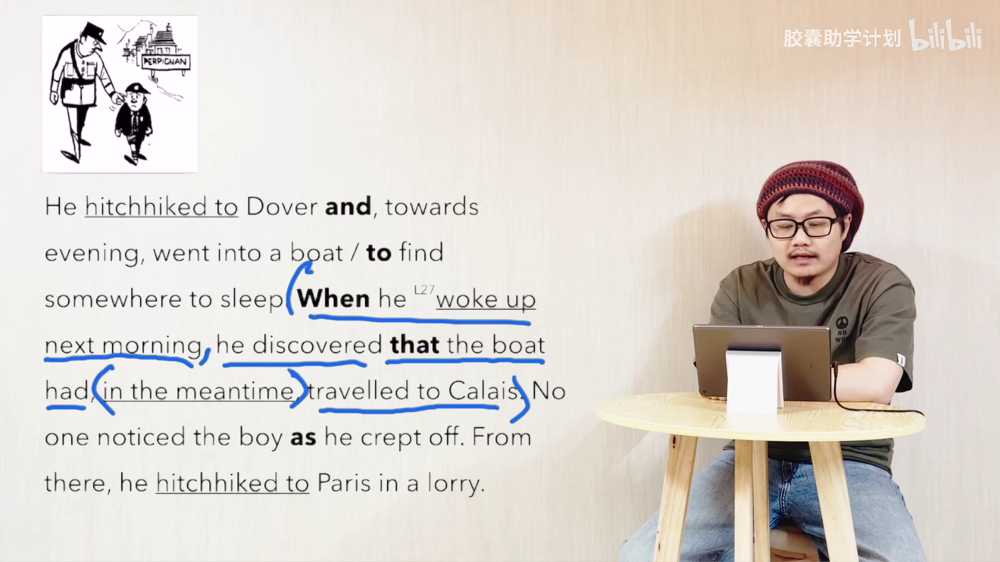

文字识别：bibli / 胶囊助学计划 / n / PERPICNAN / He hitchhiked to Dover and, towards / evening, went into a boat / to find / somewhere to sleep(when he / L27 / "woke up / ® / next morning he discovered that the boat / had in the meantime travelled to Calais No / one noticed the boy as he crept off. From / there, he hitchhiked to Paris in a lorry.

### 画面 00:08:20

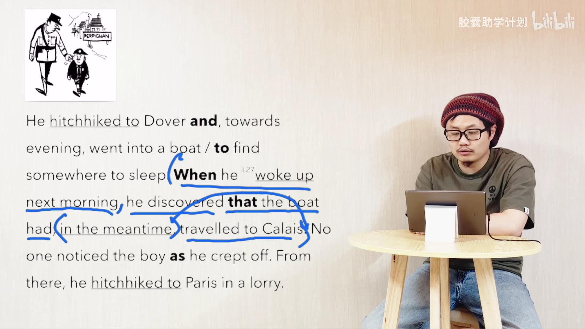

文字识别：Bilbili / 胶囊助学计划 / nπ / PERPICNAN / He hitchhiked to Dover and, towards / evening, went into a boat / to find / somewhere to sleep(when he [2y / "woke up / next morning he discoycred that the boat / had in the meantime travelled to Calais No / one noticed the boy as he crept off. From / there, he hitchhiked to Paris in a lorry.

### 画面 00:08:22

文字识别：Bilbii / 胶囊助学计划 / PERPICNAN / He hitchhiked to Dover and, towards / evening, went into a boat / to find / somewhere to sleep(when he / L27 / "woke up / next morning, he discovered that the boat / had in the meantime travelled to Calais No / one noticed the boy as he crept off. From / there, he hitchhiked to Paris in a lorry.

### 画面 00:08:24

文字识别：bilbili / 胶囊助学计划 / n / PERPICNAN / He hitchhiked to Dover and, towards / evening, went into a boat / to find / somewhere to sleep(when he / L27 / 'woke up / next morning he discoyered that the boat / NO / IW / had in the meantime travelled to Calais No / one noticed the boy as he crept off. From / there, he hitchhiked to Paris in a lorry.

## 00:08:30–00:09:00

住，我们现在还都是在训练。以后进入实战演习的时候啊，实战的状态就是我们真的去读原著书籍的时候，呃，这种情况是很常见的。所以提前见见也不是坏事儿。No one noticed the boy as he crept off.说没有人注意到这小男孩儿。当这个小男孩怎么样呢？Crept off.这个crept实际上是creep爬行那个单词的过去式。这个早在

### 画面 00:08:54

文字识别：Bilbili / 胶囊助学计划 / PERPICNAN / He hitchhiked to Dover and, towards / evening, went into a boat / to find / somewhere to sleep(when he / L27 / 'woke up / next morning he discoyered that the oat / NUL / had in the meantime travelled to Calais No / one noticed the boy as he crept off. From / there, he hitchhiked to Paris in a lorry.

## 00:09:00–00:09:30

我们说一帮小男孩扎帐篷那一刻，咱们就学过，对吧？说当啊，当没有人注意到，当这个小男孩爬下这个船的时候，爬离这个船的时候，From there he hitched to Paris in a lorry.说从那里他搭便车去了巴黎。In a lorry，在一个卡车里面搭便车去的巴黎。The driver gave him a few biscuits and a cup of coffee

### 画面 00:09:24

文字识别：biibii / 胶囊助学计划 / n / PERPICNAN / He hitchhiked to Dover and, towards / evening, went into a boat / to find / somewhere to sleep(when he / L27 / 'woke up / next morning he discoyered that the boat / had in the meantime travelled to Calais No / one noticed the boy as he crept off. From / there, he hitchhiked to Paris in a lorry.

### 画面 00:09:26

文字识别：胶囊助学计划biii / PERPICNAN / The driver gave him a few biscuits and a cup / of coffee and left him just outside the city. / The next car (the boy stopped) did not take / him into the centre of Paris as he hoped it / NU / WI / would, but to Perpignan on the French- / Spanish border.

## 00:09:30–00:10:00

and left him just outside the city.这句话并不难啊。说这个司机呢，给他了一点儿饼干啊，一杯咖啡，然后留他啊，把他留在了哪儿呢？Just outside the city，在这个城市的边缘外面，对吧？就类似于在北京呢，你就给留到三河了，香河了，对吧？哎哎，给留到那个地方了，留到城市的边缘了，外延了啊。The next car the boy

### 画面 00:09:56

文字识别：胶囊助学计划bilb出 / PERPICNAN / The driver gave him a few biscuits and a cup / of coffee and left him just outside the city. / The next car (the boy stopped) did not take / him into the centre of Paris as he hoped it / would, but to Perpignan on the French- / Spanish border.

## 00:10:00–00:10:30

stopped. Did not take him into the center of Paris as he hoped it would, but to Perpignan on the French-Spanish border.你看这句话就可以有一点点资格吧，当长难句了。为啥呀？确实不短，确实不短，啊，确实不短。这句话我们给它拆一下。第一句话，The next car did not take him into the center of Paris.下

### 画面 00:10:15

文字识别：胶囊助学计划biii / PERPICNAN / The driver gave him a few biscuits and a cup / of coffee and left him just outside the city. / The next car (the boy stopped) did not take / him into the centre of Paris ás he hoped it / Would, but to Perpignan on the French- / Spanish border.

### 画面 00:10:17

文字识别：胶囊助学计划biibil / PERPICNAN / The driver gave him a few biscuits and a cup / of coffee and left him just outside the city. / The next car (the boy stopped) did not take / ® / him into the centre of Paris / ashe hoped it / would, / butto Perpignan on the French- / Spanish border.

### 画面 00:10:20

文字识别：胶囊助学计划biibi / PERPICNAN / The driver gave him a few biscuits and a cup / of coffee and left him just outside the city. / The next car (the boy stopped) did not take / him into the centre of Paris / ashe hoped it / would, / butto Perpignan on the French- / Spanish border.7

## 00:10:30–00:11:00

一辆车并没有带他进入巴黎的市中心。这是第一句话。第二句话定从叫做The boy stopped that car，就是这个小男孩儿，哎，拦下了那辆的下一辆车，对吧？所以其实你可以把它变成一句话，叫做小男孩拦的下一辆车并没有带他进入巴黎的市中心。As

### 画面 00:10:50

文字识别：胶囊助学计划biii / PERPICNAN / The driver gave him a few biscuits and a cup / of coffee and left him just outside the city. / The next car (the boy stopped) did not take / him into the centre of Paris / ashe hoped it / would, / butto Perpignan on the French- / Spanish border.7

## 00:11:00–00:11:30

开始第二句话，He hoped it would.这个as最常见的意思我们之前学过，呃，because when在这儿都不是，对吧？呃，在这儿是表示方式，这个之前咱们学过啊。as这个咱们这个表方式，在呃男主去婚礼上给大家表演make a speech那一刻，对吧？然后那个底下观众哈哈大笑，他小女儿以为嘲笑他那

### 画面 00:11:07

文字识别：胶囊助学计划biibi / PERPICNAN / The driver gave him a few biscuits and a cup / of coffee and left him just outside the city. / The next car (the boy stopped) did not take / him into the centre of Paris / ashe hoped it / would, / butto Perpignan on the French- / Spanish border.7

### 画面 00:11:10

文字识别：胶囊助学计划biibi / PERPICNAN / The driver gave him a few biscuits and a cup / of coffee and left him just outside the city. / The next car (the boy stopped) did not take / him into the centre of Paris / ashe hoped it / would, / butto Perpignan on the French- / Spanish border.7

## 00:11:30–00:12:00

一刻，咱们学过 as 的这个用法啊，呃，这个连接的方式状语从句，所以这地方翻译成叫做像啊，像什么呢？ He hoped it would。其实这句话后边省略了东西，我给你补全，叫做 He hoped it would take him into the center of Paris。叫做像他希望的那样，这辆车会带他进入巴黎的市中心。哎，先不管 but 后面啊，我们假设我们现在只看到这儿，

### 画面 00:11:40

文字识别：biibli / 胶囊助学计划 / PERPICNAN / The driver gave him a few biscuits and a cup / of coffee and left him just outside the city. / The next car (the boy stopped) did not take / him into the centre of Paris / ashe hoped it / would, / butto Perpignan on the French- / Spanish border.7

## 00:12:00–00:12:30

所以这两句话分别告诉我们的什么信息呢？第一个，小男孩拦下的下一辆车没有把他带入巴黎的市中心。第二句话叫做像这个男孩希望的那样，也就换一句话来说，是这个男孩希望这辆车把他带到巴黎的市中心，但他拦下的下一辆车并没有把这个男孩带到巴黎的市中心。说清楚了吧？看第三句话，但是给他带到哪儿去了呢？To Perpignan这样一个地方，on the French-Spanish

### 画面 00:12:03

文字识别：胶囊助学计划bilibi / PERPICNAN / The driver gave him a few biscuits and a cup / of coffee and left him just outside the city. / The next car (the boy stopped) did not take / him into the centre of Paris / ashe hoped it / but to Perpignan on the French- / would / Spanish border.

### 画面 00:12:08

文字识别：胶囊助学计划biibi / PERPICNAN / The driver gave him a few biscuits and a cup / of coffee and left him just outside the city. / The next car (the boy stopped) did not take / him into the centre of Paris / ashe hoped it / but to Perpignan on the French- / would / Spanish border.7

### 画面 00:12:25

文字识别：胶囊助学计划bil / nn / PERPICNAN / The driver gave him a few biscuits and a cup / of coffee and left him just outside the city. / The next car (the boy stopped) did not take / him into the centre of Paris / ashe hoped it / but to Perpignan on the French- / would / Spanish border.

## 00:12:30–00:13:00

border，在法西的边境啊，这没什么可说了。下一句话，there啊，这注意不是there be句型哦，这就是在那里哟。 He was picked up by a policeman and sent back to England by the local authorities. 所他被pick up最基本的意思捡起拾起，对吧？那在这儿你肯定是被警察的捉到了，对吧？警察捉到了 by a policeman，被一个警察捉到了。然后

### 画面 00:12:34

文字识别：胶囊助学计划bibi / PERPICNAN / The driver gave him a few biscuits and a cup / of coffee and left him just outside the city. / The next car (the boy stopped) did not take / him into the centre of Paris / ashe hoped it / but to Perpignan on the French- / would / Spanish border.

### 画面 00:12:36

文字识别：胶囊助学计划biibi / PERPICNAN / There he was picked up by a policeman and / sent back to England by the local authorities. / He has surely / L36 / 'set up a record for the / L38dream of / thousands of children (who / evading school).

### 画面 00:12:38

文字识别：胶囊助学计划biibi / PERPICNAN / There he was picked up by a policeman and / sent back to England by the local authorities. / He has surely / L36 / 'set up a record for the / L38dream of / thousands of children (who / evading school).

## 00:13:00–00:13:30

呢？Send back to England，然后给他送回到了英国。By the local authorities，被本地的权威啊，什么叫权威？被本地当局，对吧？被本地的警察局吧，你可以这样理解。He has surely set up a record for the thousands of children who dreamed of evading school。啊，这句话乍一看好像标标画画的东西不少，不过我觉得还好，并不难。只是这个说理啊，确信的无疑

### 画面 00:13:05

文字识别：biibili / 胶囊助学计划 / PERPICNAN / There he was picked up by a policeman and / sent back to England by the local authorities. / He has surely / L36 / 'set up a record for the / thousands of children (who / L38dream of / evading school).

## 00:13:30–00:14:00

的，对吧？Sure，你肯定认的嘛。I'm sure，Are you sure？啊，说理，确信的无疑的。他无疑，他确信的是 set up a record。他建立了一个记录，创造了一个记录，给 thousands of children，给数以千计的孩子们创造了一个记录。什么样的孩子们呢？They dream of evading school。说这些孩子们天天梦想着这个 evading school，跟 playing truant from school

### 画面 00:13:35

文字识别：Bilbili / 胶囊助学计划 / PERPICNAN / There he was picked up by a policeman and / sent back to England by the local authorities. / He has surely / L36 / 'set up a record for the / ® / thousands of children (who / L38 / dream of / evading school).

## 00:14:00–00:14:30

同义词，天天梦想着逃避学上学这件事儿，对吧？哎，给他们创造了一个记录。习惯用法，本课就一个over and over again，一次又一次啊。那咱们简单看一下就可以，并不难。说because you were unaware of it, you did that to me over and over again。说因为你对这件事情毫不知情，所以你对我做这件事儿一次又一次的做。Next one，说please don't do that over

### 画面 00:14:05

文字识别：胶囊助学计划bibi出 / PERPICNAN / There he was picked up by a policeman and / sent back to England by the local authorities. / He has surely / L36 / 'set up a record for the / L38dream of / thousands of children (who / evading school).

### 画面 00:14:07

文字识别：biibii / 胶囊助学计划 / 习惯用法造句 / over and over again... / の / NU / WI

### 画面 00:14:09

文字识别：bilbii / 胶囊助学计划 / 习惯用法造句 / over and over again...

### 画面 00:14:12

文字识别：网：v.+v.变化 / 胶囊助学计划 / bibili / 习惯用法造句指南 / 四句型转换 / 方式/地点/时间 / 其他习惯用法 / 其他单词+词性 / 原文摘抄+变 / 6123456 / over and over again.. / NU / WIV

### 画面 00:14:14

文字识别：网：v.+v.变化 / 胶囊助学计划 / bilbili / 习惯用法造句指南 / 四句型转换 / 方式/地点/时间 / 其他习惯用法 / 其他单词+词性 / 原文摘抄+变 / 6123456 / over and over again... / ® / NU / WI /  Because you were unaware of it, you did / that to me over and over again. L70

### 画面 00:14:16

文字识别：网：v.+v.变化 / 胶囊助学计划 / bilbil / 习惯用法造句指南 / 四句型转换 / 方式/地点/时间 / 其他习惯用法 / 其他单词+词性 / 原文摘抄+变 / 6123456 / over and over again... / NU / WI /  Because you were unaware of it, you did / that to me over and over again. L70

### 画面 00:14:20

文字识别：网：v.+v.变化 / 胶囊助学计划 / bilbili / 习惯用法造句指南 / 四句型转换 / 方式/地点/时间 / 其他习惯用法 / 其他单词+词性 / 原文摘抄+变 / 6123456 / over and over again... / NU / WI /  Because you were unaware of it, you did / that to me over and over again. L70

### 画面 00:14:26

文字识别：网：v.+v.变化 / 胶囊助学计划 / bilbili / 习惯用法造句指南 / 四句型转换 / 方式/地点/时间 / 其他习惯用法 / 其他单词+词性 / 原文摘抄+变 / 6123456 / over and over again... / ® / NU / WI /  Because you were unaware of it, you did / that to me over and over again. L70

### 画面 00:14:28

文字识别：网：v.+v.变化 / 胶囊助学计划 / bilbii / 习惯用法造句指南 / 四句型转换 / 方式/地点/时间 / 其他习惯用法 / 其他单词+词性 / 原文摘抄+变 / 6123456 / over and over again.. /  Because you were unaware of it, you did / that to me over and over again. L70 /  Please don't do that over and over again.

## 00:14:30–00:15:00

and over again. 不要一次又一次做这件事儿. Next one, say this place was connected to that island by a bridge. 说这个地方链接着那个岛，用被什么呢？被一个桥连接着. Do I really need to say that over and over again? 我真的有必要一遍又一遍的说这个事儿吗？就是说这个两个地方用一个桥连着这件事儿吗？ Okay, over and over and again, 一次又一次. 接下

### 画面 00:14:31

文字识别：网：v.+v.变化 / 胶囊助学计划 / blibli / 习惯用法造句指南 / 四句型转换 / 方式/地点/时间 / 其他习惯用法 / 其他单词+词性 / 原文摘抄+变 / 6123456 / over and over again... / NO / WU /  Because you were unaware of it, you did / that to me over and over again. L70 /  Please don't do that over and over again.

### 画面 00:14:33

文字识别：网：v.+v.变化 / 胶囊助学计划 / bilibii / 习惯 / 四句型转换 / 顶用法造句指南 / 方式/地点/时间 / 其他习惯用法 / 其他单词+词性 / 原文摘抄+变 / 6123456 / over and over again... / ® /  Because you were unaware of it, you did / that to me over and over again. L70 /  Please don't do that over and over again. /  This place was connected to that island by / a bridge. Do I really need to say that over / andover again? L71

### 画面 00:14:35

文字识别：bilibili / 网：v.+v.变化 / 胶囊助学计划 / 习惯 / 四句型转换 / 伙用法造句指南 / 方式/地点/时间 / 其他习惯用法 / 其他单词+词性 / 原文摘抄+变 / 6123456 / over and over again... / ® /  Because you were unaware of it, you did / that to me over and over again. L70 /  Please don't do that over and over again. /  This place was connected to that island by / a bridge. Do I really neOd to say that over / and over again? L71

### 画面 00:14:41

文字识别：Bilbl / 网：v.+v.变化 / 胶囊助学计划 / 习惯 / 四句型转换 / 用法造句指南 / 方式/地点/时间 / 其他习惯用法 / 其他单词+词性 / 原文摘抄+变 / 6123456 / over and over again... /  Because you were unaware of it, you did / that to me over and over again. L70 /  Please don't do that over and over again. /  This place was connected to that island by / a bridge. Do I really need to say that over / and over again? L71

### 画面 00:14:44

文字识别：网：v.+v.变化 / 胶囊助学计划 / bibii / 习惯用法造句指南 / 四句型转换 / 方式/地点/时间 / 其他习惯用法 / 其他单词+词性 / 原文摘抄+变 / 6123456 / over and over again.. /  Because you were unaware of it, you did / that to me over and over again. L70 /  Please don't do that over and over again. /  This place was connected to that island by / a bridge. Do I really need to say that over / and over again? L71

### 画面 00:14:46

文字识别：网：v.+v.变化 / 胶囊助学计划 / bibii / 习惯用法造句指南 / 四句型转换 / 方式/地点/时间 / 其他习惯用法 / 其他单词+词性 / 原文摘抄+变 / 6123456 / over and over again... / NUI /  Because you were unaware of it, you did / that to me over and over again. L70 /  Please don't do that over and over again. /  This place was connected to that island by / a bridge. Do I really need to say that over / and over again? L71

### 画面 00:14:50

文字识别：网：v.+v.变化 / 胶囊助学计划 / bibii / 习惯用法造句指南 / 四句型转换 / 方式/地点/时间 / 其他习惯用法 / 其他单词+词性 / 原文摘抄+变 / 6123456 / over and over again... / wnn /  Because you were unaware of it, you did / that to me over and over again. L70 /  Please don't do that over and over again. /  This place was connected to that island by / a bridge. Do I really need to say that over / and over again? L71

### 画面 00:14:55

文字识别：网：v.+v.变化 / 胶囊助学计划 / bilibili / 习惯用法造句指南 / 四句型转换 / 方式/地点/时间 / 其他习惯用法 / 其他单词+词性 / 原文摘抄+变 / 6123456 / over and over again.. /  Because you were unaware of it, you did / that to me over and over again. L70 /  Please don't do that over and over again. /  This place was connected to that island by / a bridge. Do I really need to say that over / and over again? L71

### 画面 00:14:58

文字识别：网：v.+v.变化 / 胶囊助学计划 / biibili / 习惯用法造句指南 / 四句型转换 / 方式/地点/时间 / 其他习惯用法 / 其他单词+词性 / 原文摘抄+变 / 6123456 / over and over again.. /  Because you were unaware of it, you did / that to me over and over again. L70 /  Please don't do that over and over again. /  This place was connected to that island by / a bridge. Do I really need to say that over / and over again? L71

## 00:15:00–00:15:30

来我们听个电影片段啊。哎，这是摩根弗里曼为了表达他这个音乐怎么感觉都是一遍又一遍的放，他说了很多遍over，我故意这样去找的，对吧？所以你能看到这个习惯用法，它在用起来的时候，其实它的这个呃变化程度可以很高。最基本的就是over and over again。那你想说多少

### 画面 00:15:00

文字识别：biibli / 胶囊助学计划 / Like /  they're playing / the / same song / over and / over and / over and / over / again. / WBR / NO / Last Vegas / (2013)

### 画面 00:15:04

文字识别：blibili / 胶囊助学计划 / Like they're playing /  the same song over and / over and / over and over again. / Last Vegas / (2013)

### 画面 00:15:06

文字识别：bilbili / 胶囊助学计划 / Like they're playing the same song over and / over and / over and /  over again. / Last Vegas / (2013)

### 画面 00:15:08

文字识别：biibili / 胶囊助学计划 / Like they're playing the same song over and / over and  / over and over again. / Last Vegas / (2013)

### 画面 00:15:10

文字识别：biibili / 胶囊助学计划 / Like they're playing the same song over and / over and over and over again. / Last Vegas / (2013)

### 画面 00:15:15

文字识别：bibili / 胶囊助学计划 / Like they're playing the same song over and / over and over and over again. / Last Vegas / (2013)

### 画面 00:15:17

文字识别：bibili / 胶囊助学计划 / Like they're playing the same song over and / over and over and over again. / Last Vegas / (2013)

### 画面 00:15:19

文字识别：bilbili / 胶囊助学计划 / Like they're playing the same song over and / over and / over and over again. / Last Vegas / (2013)

## 00:15:30–00:16:00

个 over and over and over and over? 那随你，对吧？ Okay, 呃, recap除了文章就是一遍又一遍了。这个习惯用法，那咱们拿它去造句啊。然后文章熟读成诵。哎，置顶留言可以找到重复间隔的学习材料。那以上呢就是本期视频的全部内容了。如果各位喜欢我们的课程呢，欢迎各位关注、订阅、一键三连，分享给那些需要的朋友啊，来帮助我们快速成长。 See you next

### 画面 00:15:35

文字识别：bibii / 胶囊助学计划 / Recap / Expression / over and over again.. / NI / WnH

### 画面 00:15:37

文字识别：bibii / 胶囊助学计划 / Recap / Expression / over and over again.. / NO / WHR

### 画面 00:15:39

文字识别：bilbili / 胶囊助学计划

### 画面 00:15:41

文字识别：bilbil / 胶囊助学计划 / 1. / 习惯用法造句/对话 / 【习惯用法造句指南】 / 每个5句 / 文章跟读至熟读成诵 / 内化单词+语法+习惯用法 / 听力+口语+写作练习 / NU

### 画面 00:15:43

文字识别：bibili / 胶囊助学计划 / 1. / 习惯用法造句/对话 / 【习惯用法造句指南】 / 每个5句 / 文章跟读至熟读成诵 / 内化单词+语法+习惯用法 / 听力+口语+写作练习 / 3. / 重复间隔（置顶留言）

### 画面 00:15:45

文字识别：bilbil / 胶囊助学计划 / 1 / 习惯用法造句/对话 / 【习惯用法造句指南】 / 每个5句 / 文章跟读至熟读成诵 / 内化单词+语法+习惯用法 / 听力+口语+写作练习 / 3. / 重复间隔（置顶留言）

### 画面 00:15:47

文字识别：biibili / 胶囊助学计划 / 不

### 画面 00:15:59

文字识别：bilbli / 胶囊助学计划 / ND

## 00:16:00–00:16:13

time.

### 画面 00:16:01

文字识别：CAPSULEACADEMY / 胶囊助学计划 / 小红书

### 画面 00:16:03

文字识别：CAPSULEACADEMY / 胶囊助学计划 / 小红书 / OE

### 画面 00:16:06

文字识别：臺動字計划 / CAPSULEACADEMY / 胶囊助学计划 / 小红书 / Editor / Berlin / OE

### 画面 00:16:08

文字识别：CAPSULEACADEMY / 胶囊助学计划 / 小红书 / Creator / Leo & Berlin / OE

### 画面 00:16:10

文字识别：胶囊助学计划 / CAPSULEACADEMY / 胶囊助学计划 / 小红书 / OE

### 画面 00:16:12

文字识别：bilbili / 胶囊助学计划

