# 073 练习

快速机器解析：语音为单模型转写，未进行独立交叉校对或人工复核；画面每秒采样并按变化选帧，短时文字和标记可能遗漏。截图时间约有 1 秒误差。图片有损压缩；遇到疑点请按时间查看 Google Drive 原视频。

## 00:00:00–00:00:30

Hello, everyone. Welcome to Capsule Academy. This is Leo. Today, we're going to learn New Concept English Book Two, Lesson Seventy Three Practices. 注意，进行如下练习唯一的前提就是文章跟读至熟读成诵，否则请勿开始。 Hope you can enjoy it. 第一题，呃，咱听懂一般疑问句和特殊疑问句，对吧？我问您答，就这么简单啊。来了，说 Are children

### 画面 00:00:00

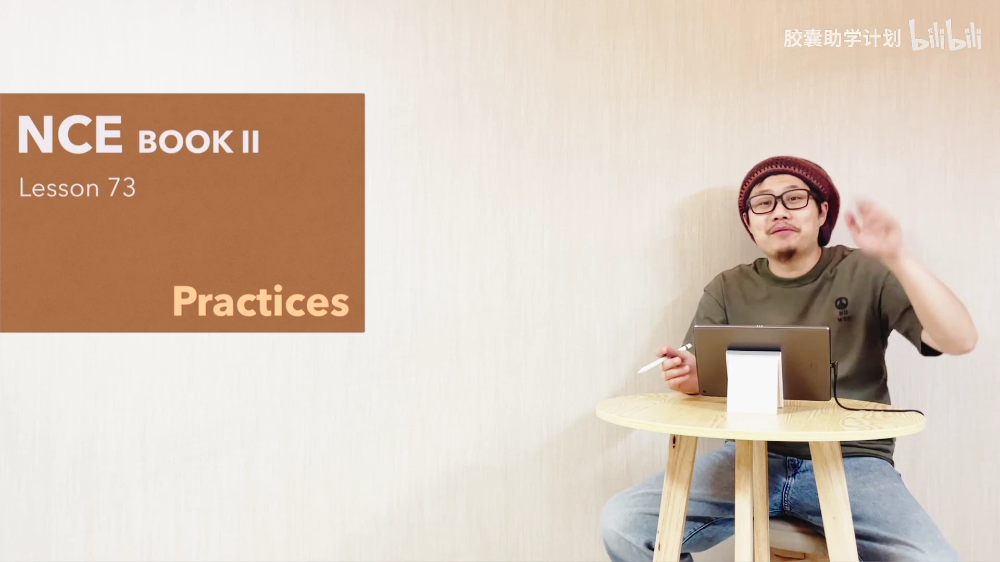

文字识别：bibil / 胶囊助学计划 / NCE / BOOKII / Lesson 73 / Practices

### 画面 00:00:02

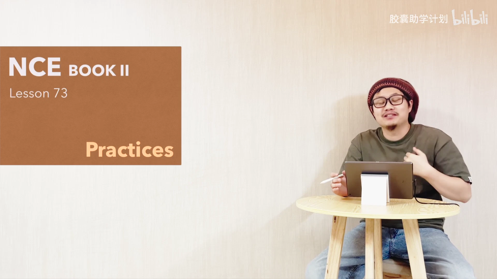

文字识别：biibii / 胶囊助学计划 / NCE / BOOKI"I / Lesson 73 / Practices

### 画面 00:00:04

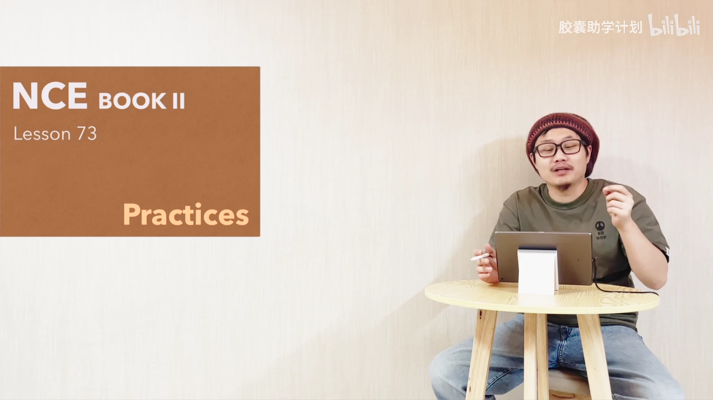

文字识别：biltbili / 胶囊助学计划 / NCE / BOOKII / Lesson 73 / Practices / NO / WnR

### 画面 00:00:06

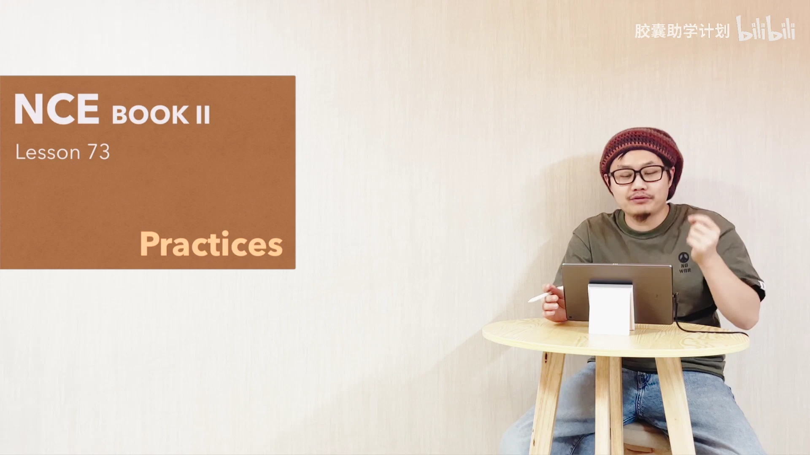

文字识别：bilbili / 胶囊助学计划 / NCE / BOOKII / Lesson 73 / Practices / ND / WnH

### 画面 00:00:08

文字识别：biibii / 胶囊助学计划 / 进行如下练习唯一前提 / 文章跟读至熟读成诵 / 否则请勿开始 / NO

### 画面 00:00:16

文字识别： biibili / 胶囊助学计划 / •

### 画面 00:00:20

文字识别：囊助学计划 / 胶囊助学计划

### 画面 00:00:22

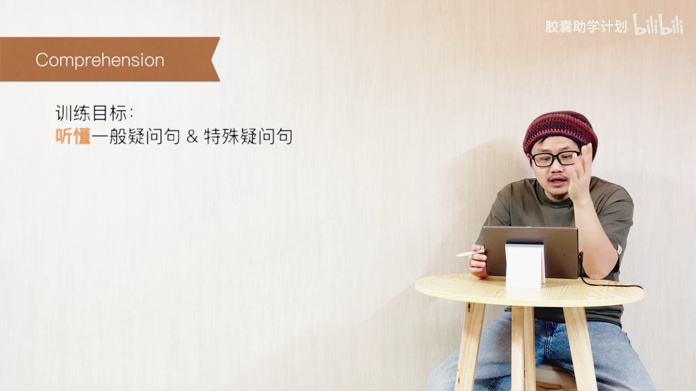

文字识别：bilbil / 胶囊助学计划 / Comprehension / 训练目标： / 听懂一般疑问句＆特殊疑问句

### 画面 00:00:27

文字识别：bilibili / 胶囊助学计划 / Comprehension / Are / children who play truant from school / imaginative?

### 画面 00:00:29

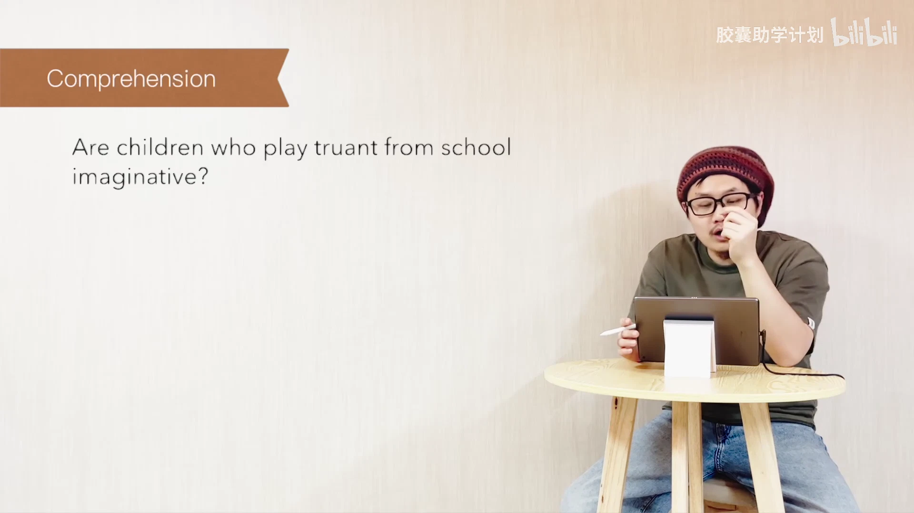

文字识别：bilibili / 胶囊助学计划 / Comprehension / Are / children who play truant from school / imaginative?

## 00:00:30–00:01:00

who play truant from school imaginative? No, they aren't. Next one, how do they usually spend their time? Fishing or seeing a film. So do they usually travel far? No, they don't. They've been put to shame by one boy, haven't they? Yes, they have. How far did he travel while playing truant?

### 画面 00:00:31

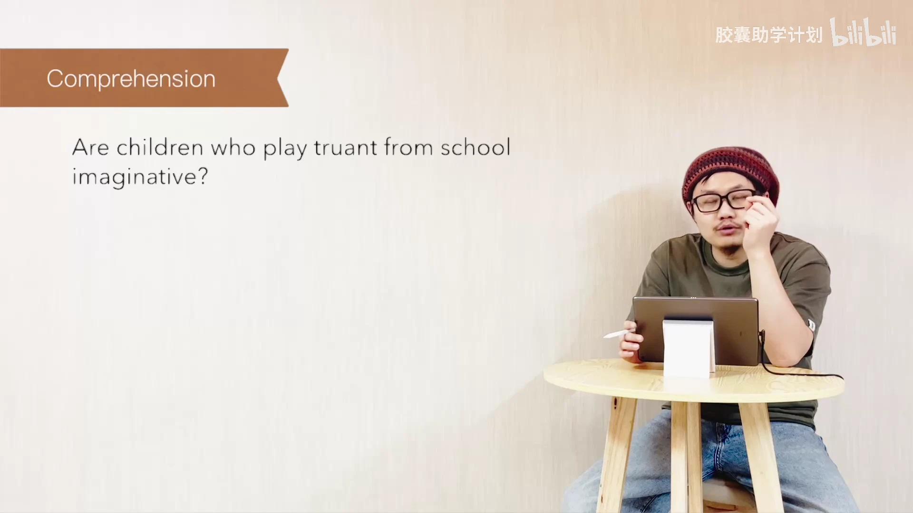

文字识别：biibii / 胶囊助学计划 / Comprehension / Are children who play truant from school / imaginative?

### 画面 00:00:33

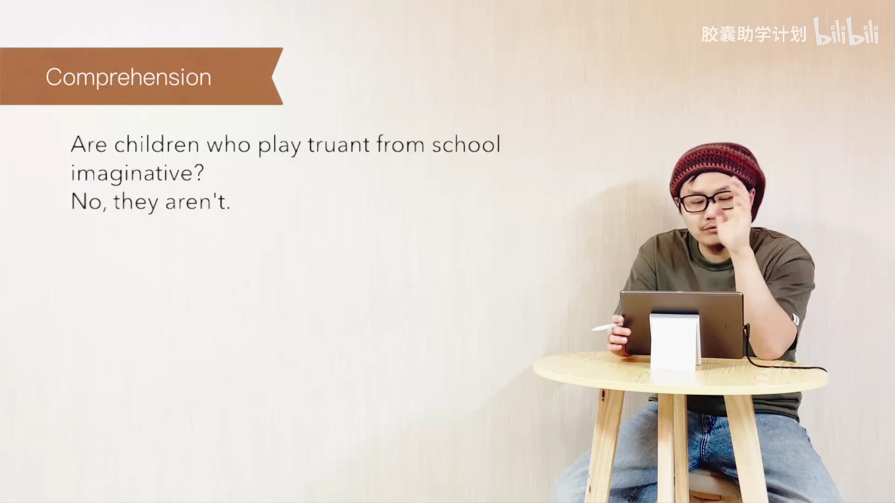

文字识别：bilbii / 胶囊助学计划 / Comprehension / Are children who play truant from school / imaginative? / No, they aren't.

### 画面 00:00:35

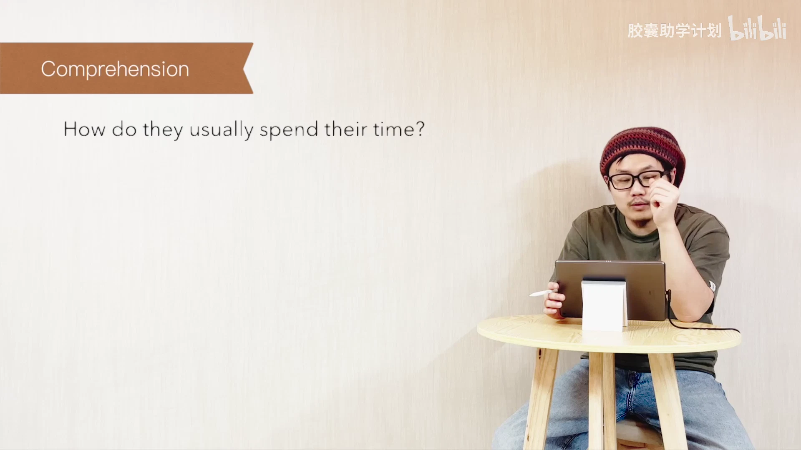

文字识别：bilbili / 胶囊助学计划 / Comprehension / How do they usually spend their time?

### 画面 00:00:59

文字识别：biibili / 胶囊助学计划 / Comprehension / How far did he travel while / e playing / truant? / 1, 600 miles.

## 00:01:00–00:01:30

one thousand six hundred miles. Where did he go first? To Dover. How did he get there? By hitchhiking. Where did he go towards evening? Into a boat. What did he want to do? To find somewhere to sleep. Where

### 画面 00:01:05

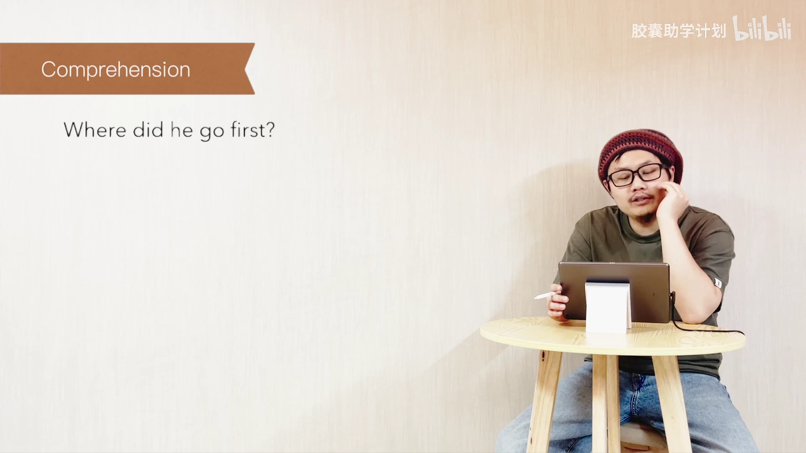

文字识别：bilbili / 胶囊助学计划 / Comprehension / Where did he go first?

### 画面 00:01:08

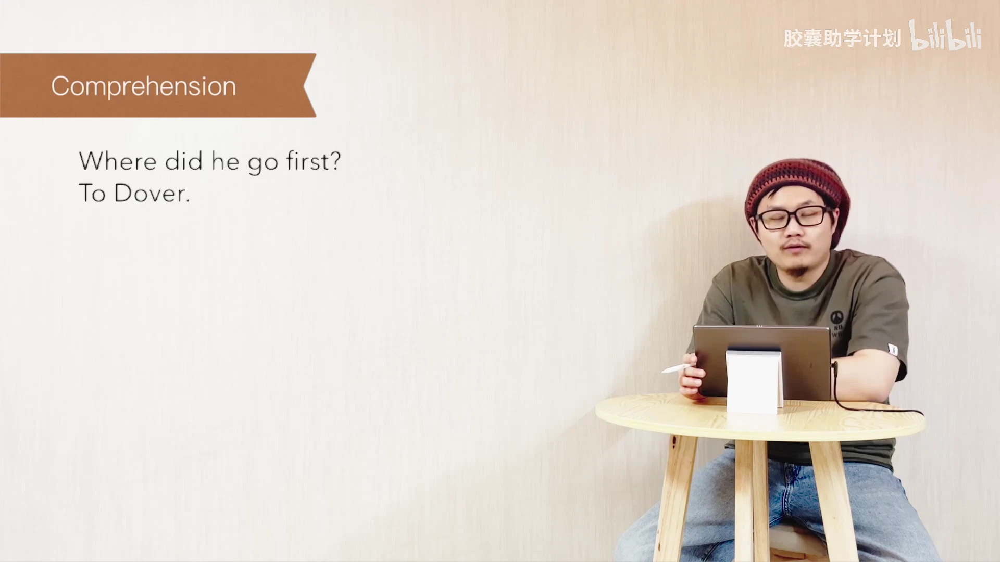

文字识别：Bilbili / 胶囊助学计划 / Comprehension / Where did he go first? / To Dover.

### 画面 00:01:10

文字识别：bibii / 胶囊助学计划 / Comprehension / How did he get there? / NI / wn

## 00:01:30–00:02:00

Where was he when he woke up? In Calais. Did anyone notice him creep off the boat? No, they didn't. How did he get to Paris?哈，依旧 in a lorry by hitchhiking. Asking questions, 四句型转换，第一个，呃，Some children play trained from school. Do提前就行了，那Who对主语提问，

### 画面 00:01:40

文字识别：bilbili / 胶囊助学计划 / Comprehension / Did anyone notice him creep off the boat? / No, they didn't. / ®

### 画面 00:01:49

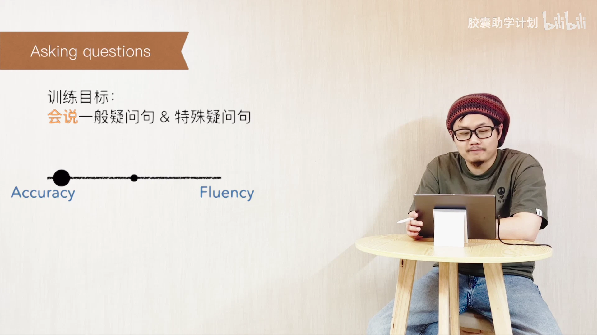

文字识别：bibili / 胶囊助学计划 / Asking questions / 训练目标： / 会说一般疑问句＆特殊疑问句 / Accuracy / Fluency / NO / WI

### 画面 00:01:53

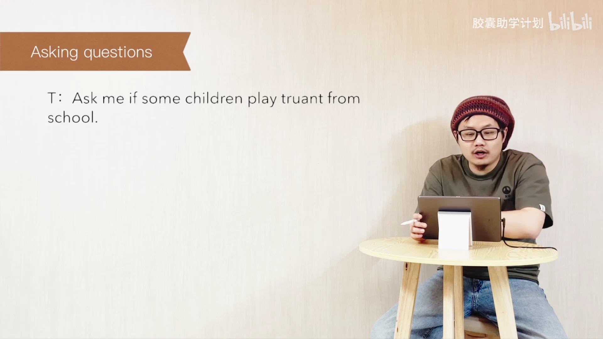

文字识别：bilbii / 胶囊助学计划 / Asking questions / T: Ask me if some children play truant from / school.

### 画面 00:01:58

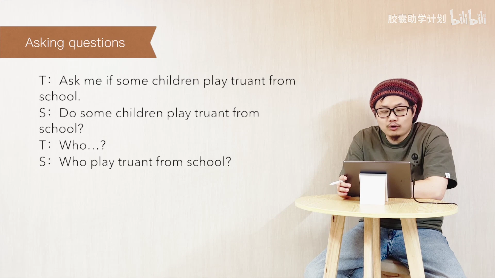

文字识别：bibili / 胶囊助学计划 / Asking questions / T: Ask me if some children play truant from / school. / S: Do some children play truant from / school? / T: Who...? / S: Who play truant from school?

## 00:02:00–00:02:30

直接替代对吧？ Who played trained from school? 那 what 点点 do 啊？ What did the children do？ 这是标准答案啊，就是这个 what 点点 do 给的都是统一的。 What did they do？ 也可以。 Most of them are an imaginative. Are 提前对吧？ How many？ 肯定是 how many of them，对吧？ They spend a day fishing. 啊？ Do they spend a day fishing？ 啊？ How do they spend a day？ 是吧？ So they go to cinemas

### 画面 00:02:03

文字识别：bilbii / 胶囊助学计划 / Asking questions / 1. Some children play truant from school. / (Who)(What...do) / NII / w

### 画面 00:02:11

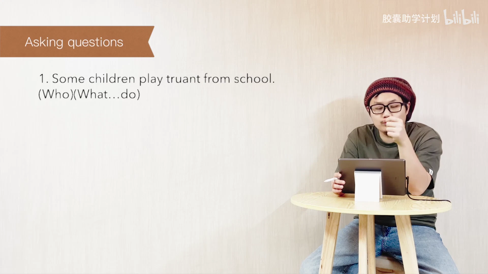

文字识别：bilibili / 胶囊助学计划 / Asking questions / 1. Some children play truant from school. / (Who)(What...do)

### 画面 00:02:15

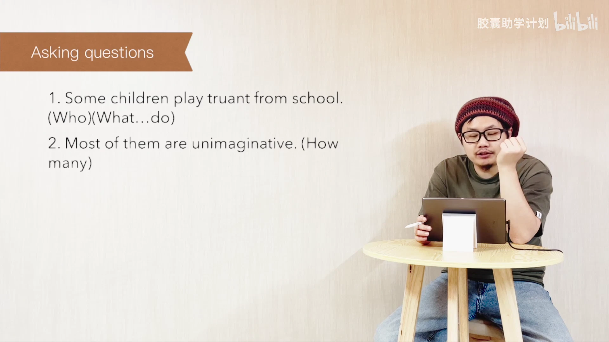

文字识别：biibili / 胶囊助学计划 / Asking questions / 1. Some children play truant from school. / (Who)(What...do) / 2. Most of them are unimaginative.(How / many)

### 画面 00:02:22

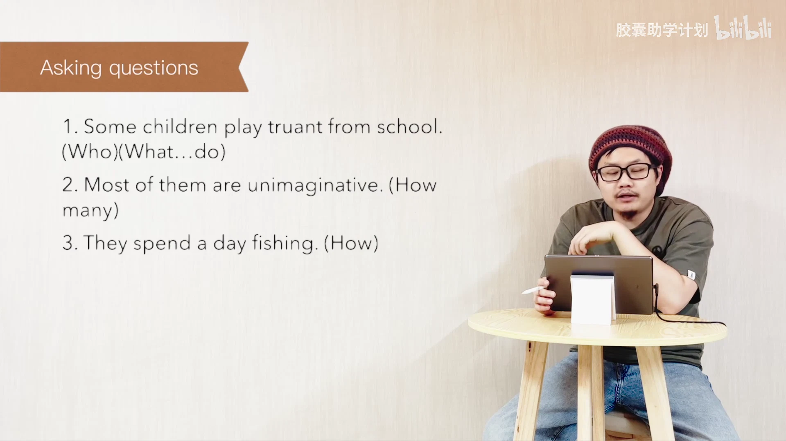

文字识别：bilbii / 胶囊助学计划 / Asking questions / 1. Some children play truant from school. / (Who)(What...do) / 2. Most of them are unimaginative.(How / many) / 3.They spend a day fishing. (How)

## 00:02:30–00:03:00

sometimes. Do they go to the cinema sometimes? Where do they go sometimes? They see the same uh film over and over again. Do they see the same film over and over again? How many times do they see the same film? 对吧？哎，它是对 over and over again 提问的。第六个说 One boy has put them all to shame. 现在完成时，你把 has 提前，或可以对 them 提问，也

### 画面 00:02:36

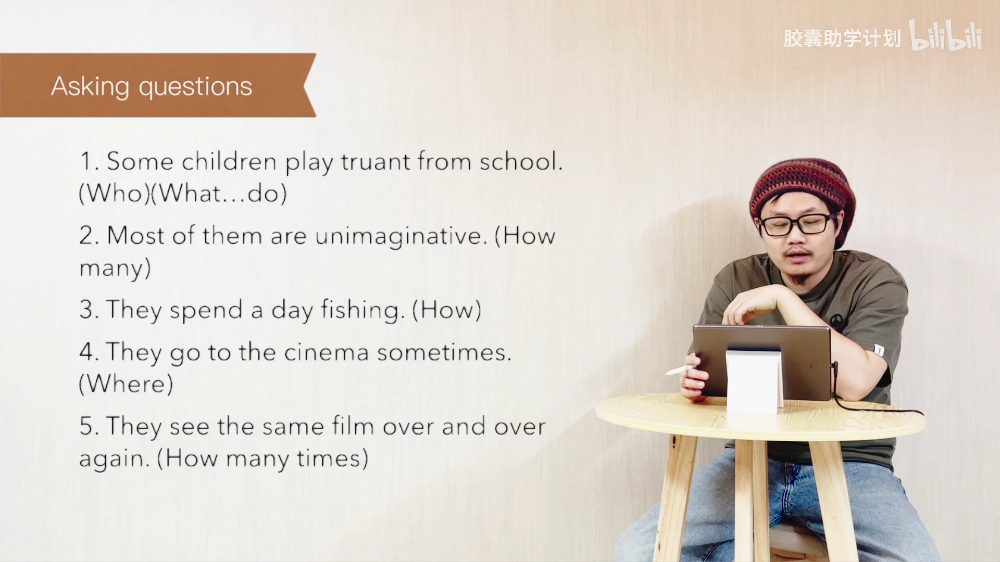

文字识别：Bilbil / 胶囊助学计划 / Asking questions / 1. Some children play truant from school. / (Who)(What...do) / 2. Most of them are unimaginative.(How / many) / 3. They spend a day fishing. (How) / 4. They go to the cinema sometimes. / (Where) / 5. They see the same film over and over / again. (How many times)

### 画面 00:02:49

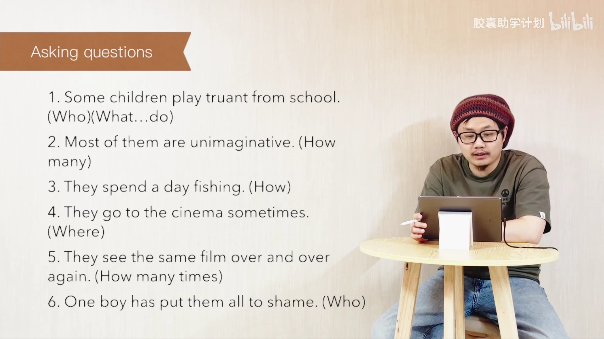

文字识别：胶囊助学计划bilbil / Asking questions / 1. Some children play truant from school. / (Who)(What...do) / 2. Most of them are unimaginative.(How / many) / 3. They spend a day fishing. (How) / 4. They go to the cinema sometimes. / (Where) / 5. They see the same film over and over / again.(How many times) / 6. One boy has put them all to shame. (Who)

## 00:03:00–00:03:30

可以，对这个 one boy 提问都可以啊。第七个，一般过去时 did 提前，动词换回原形。那 how far？肯定是对一千六百英里提问，对吧？然后问对 well playing Trent 啊。 He hitchhiked to Dover. Did 提前吧？那 where 对 to Dover 提问？ He went into a boat towards evening. 这个你 did 提前，然后问对 towards evening， where 对 into a boat， why 对整句啊？

### 画面 00:03:03

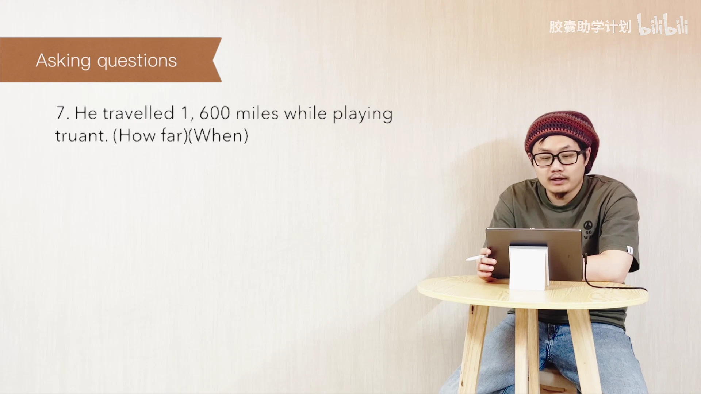

文字识别：bilibili / 胶囊助学计划 / Asking questions / 7. He travelled 1, 600 miles while playing / truant.(How far)(When)

### 画面 00:03:19

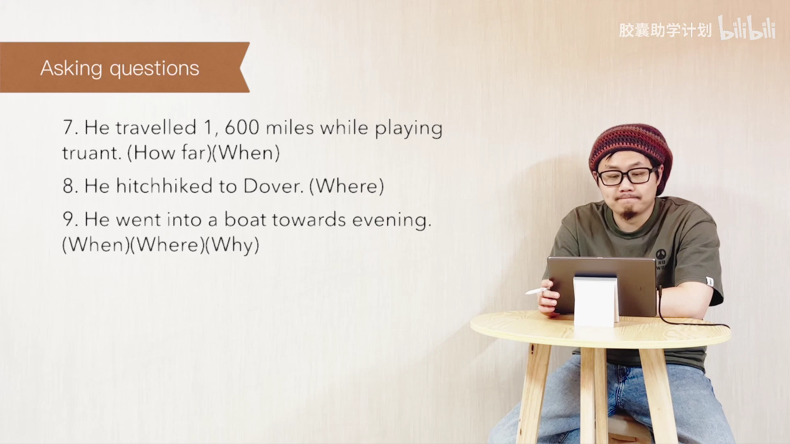

文字识别：Bilbili / 胶囊助学计划 / Asking questions / 7. He travelled 1, 600 miles while playing / truant.(How far)(When) / 8. He hitchhiked to Dover. (Where) / 9. He went into a boat towards evening. / (When)(Where)(Why) / NU / WIV

## 00:03:30–00:04:00

He wanted to sleep.你did提前吧？然后What did he want to do？啊，我觉得这个这样呃，特殊疑问句比较好一点。Tell the story.不多说啊。前三个单元我们做了很多了，各位继续坚持啊。呃，summary writing这个地方我多说一句，各位可以重点去看一下我们教材当中summary writing第四个单元和前三个单元是不太一样的。第四个单元给了两个

### 画面 00:03:41

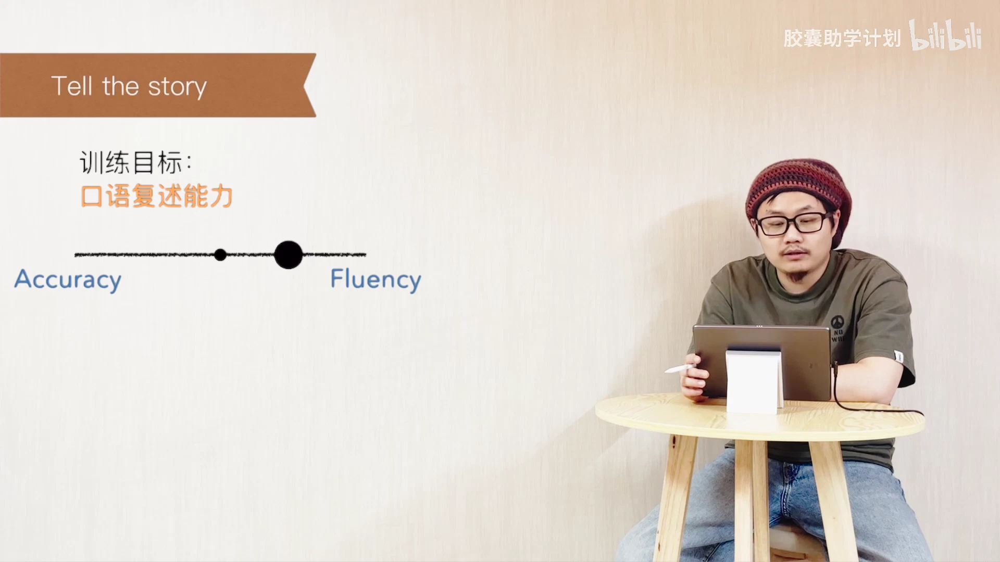

文字识别：biibii / 胶囊助学计划 / Tell the story / 训练目标： / 口语复述能力 / Accuracy / Fluency / NU

### 画面 00:03:43

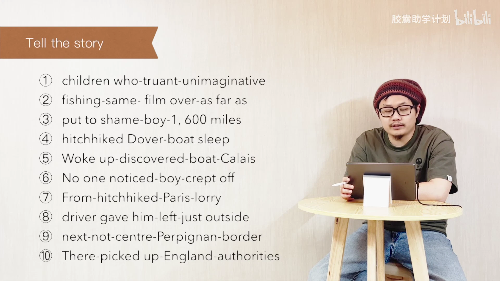

文字识别：Bilbii / 胶囊助学计划 / Tell the story / children who-truant-unimaginative / fishing-same- film over-as far as / put to shame-boy-1, 600 miles / hitchhiked Dover-boat sleep / Woke up-discovered-boat-Calais / NU / WI / No one noticed-boy-crept off / From-hitchhiked-Paris-lorry / driver gave him-left-just outside / next-not-centre-Perpignan-border / 1⑩ There-picked up-England-authorities

### 画面 00:03:46

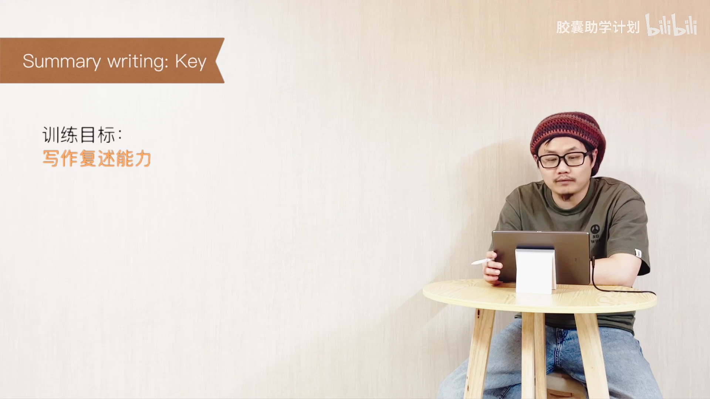

文字识别：biibili / 胶囊助学计划 / Summary writing: Key / 训练目标： / 写作复述能力 / NU / WH

### 画面 00:03:48

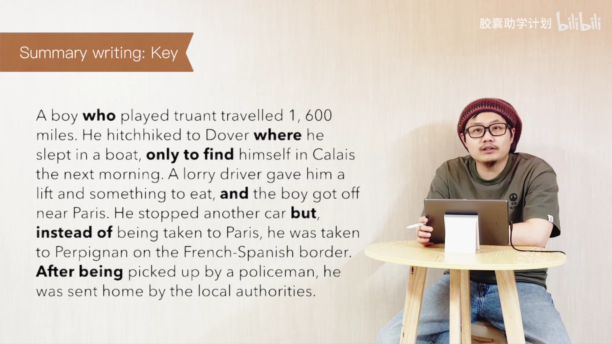

文字识别：胶囊助学计划bilbi / Summary writing: Key / A boy who played truant travelled 1, 600 / miles. He hitchhiked to Dover where he / slept in a boat, only to find himself in Calais / the next morning. A lorry driver gave him a / lift and something to eat, and the boy got off / near Paris. He stopped another car but, / instead of being taken to Paris, he was taken / to Perpignan on the French-Spanish border. / After being picked up by a policeman, he / Was sent home by the local authorities.

## 00:04:00–00:04:30

两左边一列，右边一列不同的连词，让各位变着花的把这些句子给它连起来。也就是说，summary writing是有两个答案的。这页是第一个答案，这页是第二个答案。这两页内容上差别不大，但听好了，选用的连词是有差别的，句子是怎么连到一起的，是有差别的。我觉得这

### 画面 00:04:00

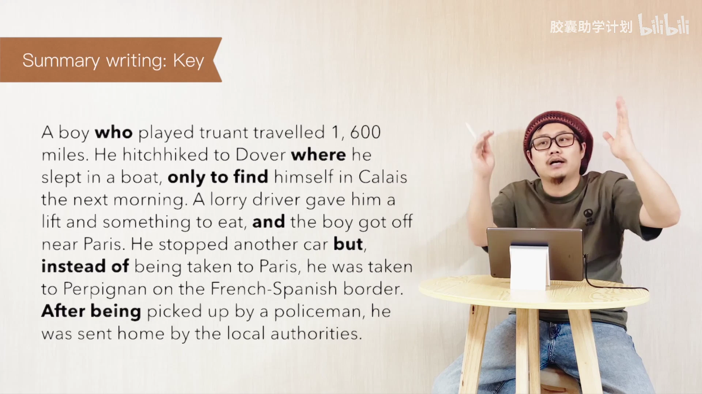

文字识别：胶囊助学计划bilbii / Summary writing: Key / A boy who played truant travelled 1, 600 / miles. He hitchhiked to Dover where he / slept in a boat, only to find himself in Calais / the next morning. A lorry driver gave him a / lift and something to eat, and the boy got off / near Paris. He stopped another car but, / instead of being taken to Paris, he Was taken / to Perpignan on the French-Spanish border. / After being picked up by a policeman, he / was sent home by the local authorities.

### 画面 00:04:04

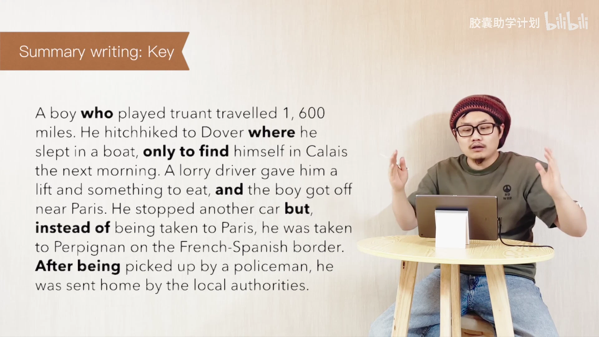

文字识别：胶囊助学计划biii出 / Summary writing: Key / A boy who played truant travelled 1, 600 / miles. He hitchhiked to Dover where he / slept in a boat, only to find himself in Calais / the next morning. A lorry driver gave him a / lift and something to eat, and the boy got off / ND / near Paris. He stopped another car but, / instead of being taken to Paris, he Was taken / to Perpignan on the French-Spanish border. / After being picked up by a policeman, he / was sent home by the local authorities.

### 画面 00:04:13

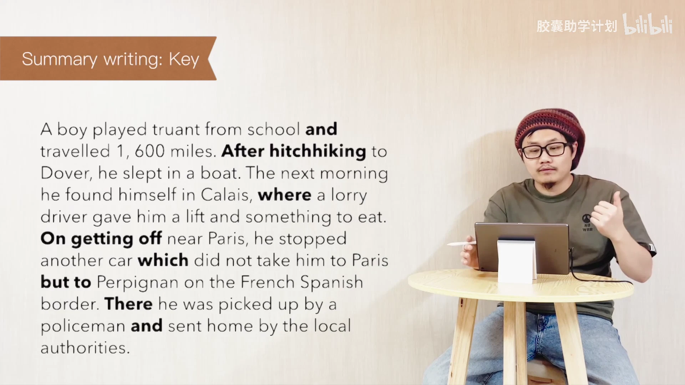

文字识别：胶囊助学计划bilbil / Summary writing: Key / A boy played truant from school and / travelled 1, 600 miles. After hitchhiking to / Dover, he slept in a boat. The next morning / he found himself in Calais, where a lorry / driver gave him a lift and something to eat. / NO / On getting off near Paris, he stopped / WIIR / another car which did not take him to Paris / but to Perpignan on the French Spanish / border.There he was picked up by a / policeman and sent home by the local / authorities.

## 00:04:30–00:05:00

个作业特别特别的好，就很适合各位自己在那个地方认认，哪怕你不写，听明白了吗？哪怕你只是对照这个去看第四单元，你认认真真的去对照着这两份不同的作业去看一下，说哦，这两个句子可以这样连，好像也可以那样连。哎，这个实际上是我们往后去学的时候，逐渐逐渐要慢慢明白的一个事儿，就是很多的简单句连到一起，不是只有一个方式啊，不

### 画面 00:04:30

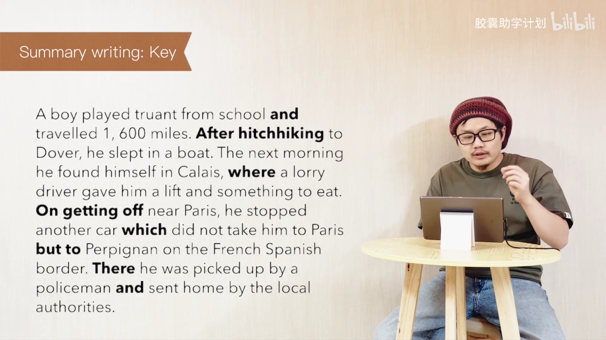

文字识别：胶囊助学计划i山 / Summary writing: Key / A boy played truant from school and / travelled 1, 600 miles. After hitchhiking to / Dover, he slept in a boat. The next morning / he found himself in Calais, where a lorry / driver gave him a lift and something to eat. / On getting off near Paris, he stopped / another car which did not take him to Paris / but to Perpignan on the French Spanish / border.There he was picked up by a / policeman and sent home by the local / authorities.

### 画面 00:04:41

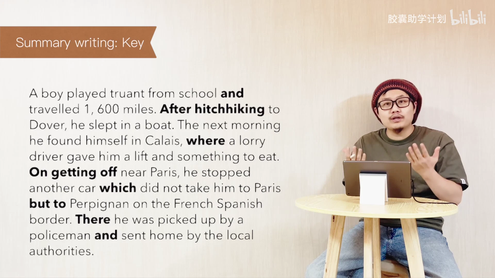

文字识别：胶囊助学计划bibi / Summary writing: Key / A boy played truant from school and / travelled 1, 600 miles. After hitchhiking to / Dover, he slept in a boat. The next morning / he found himself in Calais, where a lorry / driver gave him a lift and something to eat. / On getting off near Paris, he stopped / another car which did not take him to Paris / but to Perpignan on the French Spanish / border. There he was picked up by a / policeman and sent home by the local / authorities.

### 画面 00:04:45

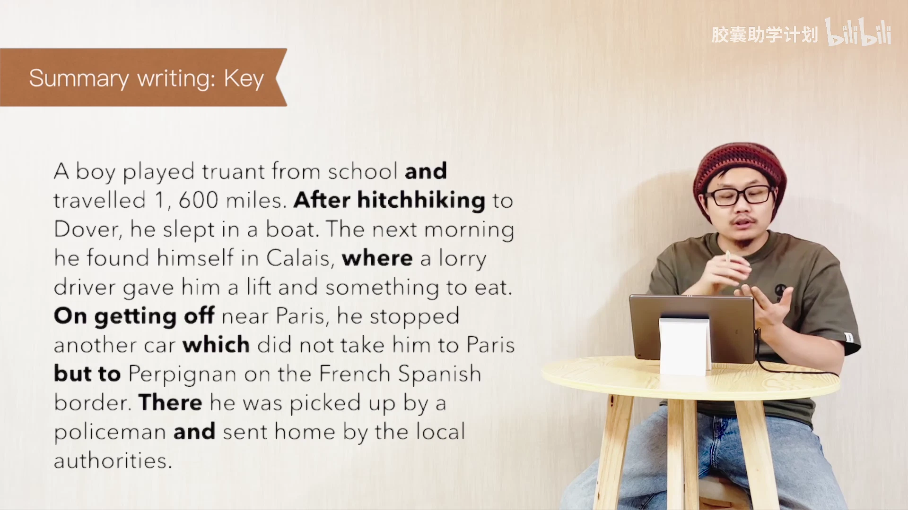

文字识别：胶囊助学计划bilbi / Summary writing: Key / A boy played truant from school and / travelled 1, 600 miles. After hitchhiking to / Dover, he slept in a boat. The next morning / he found himself in Calais, where a lorry / driver gave him a lift and something to eat. / On getting off near Paris, he stopped / another car which did not take him to Paris / but to Perpignan on the French Spanish / border. There he was picked up by a / policeman and sent home by the local / authorities.

### 画面 00:04:48

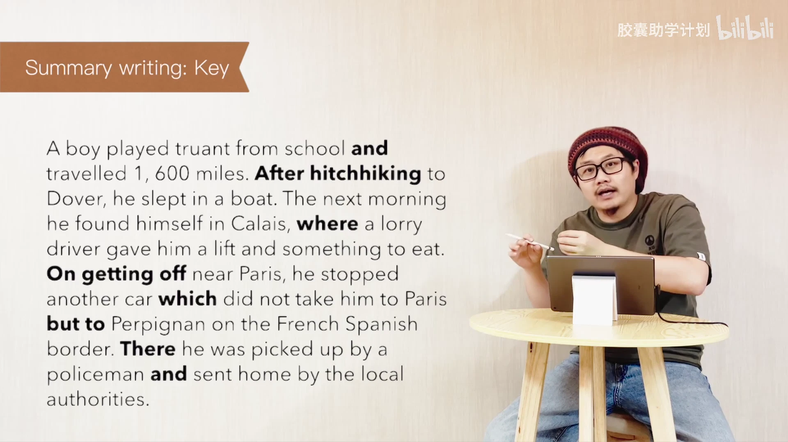

文字识别：胶囊助学计划bilbi / Summary writing: Key / A boy played truant from school and / travelled 1, 600 miles. After hitchhiking to / Dover, he slept in a boat. The next morning / he found himself in Calais, where a lorry / driver gave him a lift and something to eat. / On getting off near Paris, he stopped / another car which did not take him to Paris / but to Perpignan on the French Spanish / border. There he was picked up by a / policeman and sent home by the local / authorities.

### 画面 00:04:51

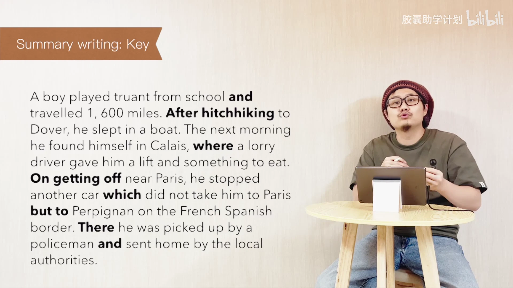

文字识别：胶囊助学计划bibi / Summary writing: Key / A boy played truant from school and / travelled 1, 600 miles. After hitchhiking to / Dover, he slept in a boat. The next morning / he found himself in Calais, where a lorry / driver gave him a lift and something to eat. / On getting off near Paris, he stopped / another car which did not take him to Paris / but to Perpignan on the French Spanish / border. There he was picked up by a / policeman and sent home by the local / authorities.

## 00:05:00–00:05:30

是只有一个正确答案。这是我们第四单元和前三个单元在这个地方不一样的地方。我多提一句啊，希望您有耐心听到了。呃，topic for discussion，我们老习惯，我就是简单翻译一下就完事儿啊。Describe an adventure that you or someone you know has has had while traveling.描述一下你旅行过程当中的一些冒险。What would you do if you played turned from school took a day off work?

### 画面 00:05:00

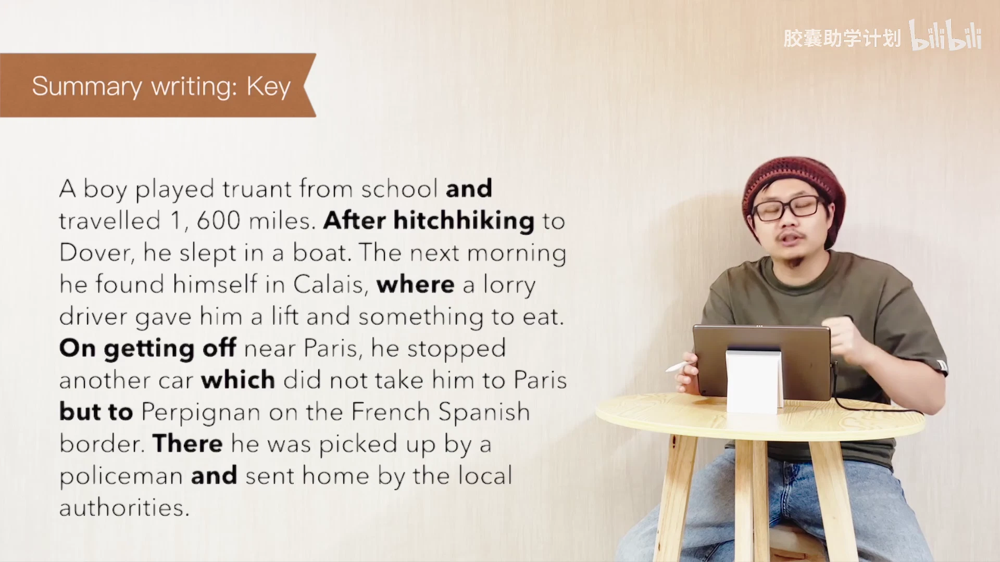

文字识别：胶囊助学计划bii / Summary writing: Key / A boy played truant from school and / travelled 1, 600 miles. After hitchhiking to / Dover, he slept in a boat. The next morning / he found himself in Calais, where a lorry / driver gave him a lift and something to eat. / On getting off near Paris, he stopped / another car which did not take him to Paris / but to Perpignan on the French Spanish / border. There he was picked up by a / policeman and sent home by the local / authorities.

### 画面 00:05:07

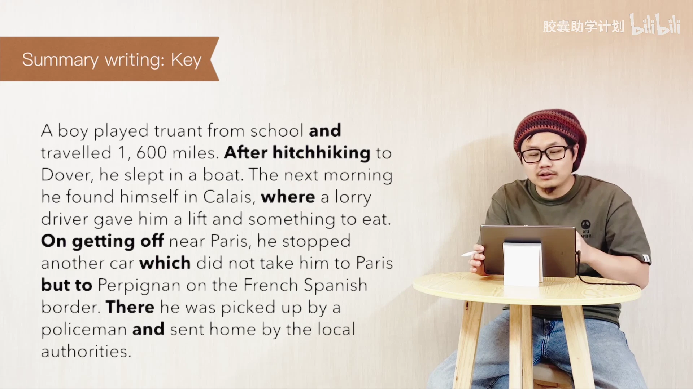

文字识别：胶囊助学计划bilbi / Summary writing: Key / A boy played truant from school and / travelled 1, 600 miles. After hitchhiking to / Dover, he slept in a boat. The next morning / he found himself in Calais, where a lorry / driver gave him a lift and something to eat. / On getting off near Paris, he stopped / wiin / NU / another car which did not take him to Paris / but to Perpignan on the French Spanish / border.There he was picked up by a / policeman and sent home by the local / authorities.

### 画面 00:05:09

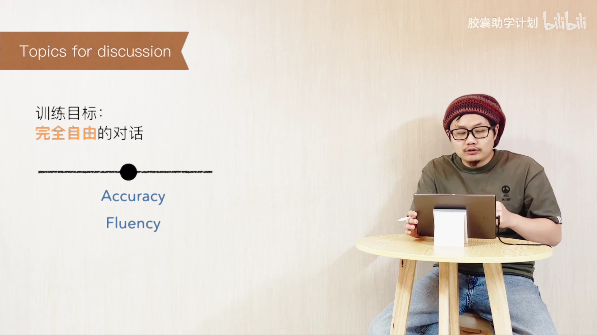

文字识别：biibii / 胶囊助学计划 / Topics for discussion / 训练目标： / 完全自由的对话 / Accuracy / WHH / ND / Fluency

### 画面 00:05:11

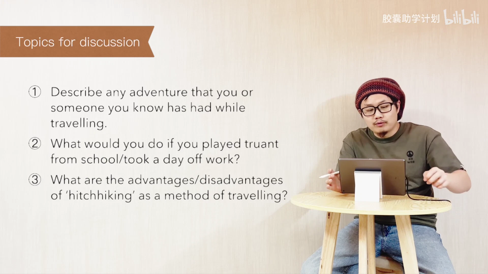

文字识别：Bilbii / 胶囊助学计划 / Topics for discussion / Describe any adventure that you or / someone you know has had while / travelling. / What would you do if you played truant / from school/took a day off work? / NU / WAR / What are the advantages/disadvantages / of 'hitchhiking' as a method of travelling?

### 画面 00:05:14

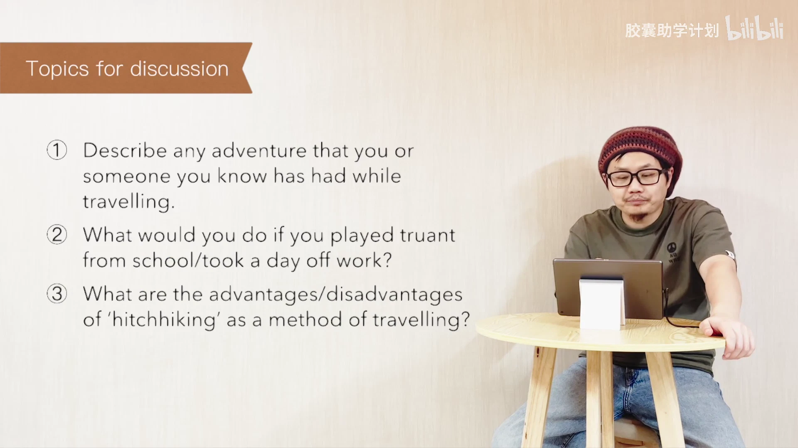

文字识别：胶囊助学计划bib出 / Topics for discussion / Describe any adventure that you or / someone you know has had while / travelling. / What would you do if you played truant / from school/took a day off work? / What are the advantages/disadvantages / of'hitchhiking' as a method of travelling?

## 00:05:30–00:06:00

而如果你今天没上班，或者说你今天逃学了，你要干嘛去？啊，看你有没有 imaginative. What are the advantages or disadvantages of hitchhiking as a method of traveling?是吧？你如果说搭便车去旅行的话，它有哪些优势？有哪些不方便的地方？对吧？哎，那家庭作业 ask me if 写完朗读摘要写作写完对答案多提一句。第四单元开始，所有的摘要写作是两

### 画面 00:05:38

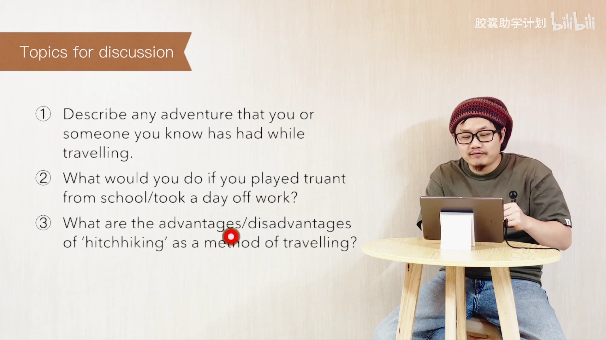

文字识别：bibili / 胶囊助学计划 / Topics for discussion / Describe any adventure that you or / someone you know has had while / travelling. / What would you do if you played truant / from school/took a day off work? / What are the advantages/disadvantages / of'hitchhiking' as a meod of travelling?

### 画面 00:05:40

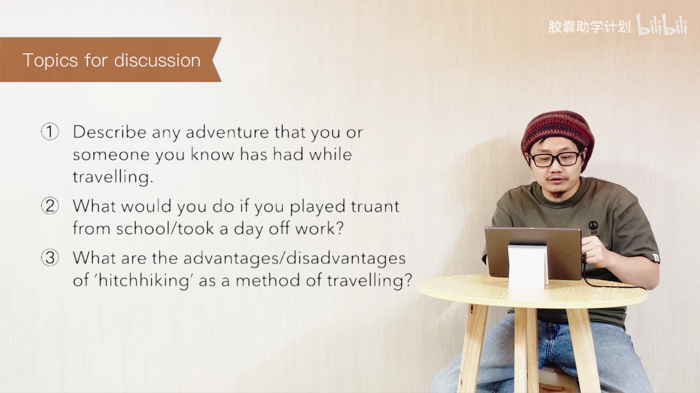

文字识别：bilbii / 胶囊助学计划 / Topics for discussion / Describe any adventure that you or / someone you know has had while / travelling. / What would you do if you played truant / from school/took a day off work? / What are the advantages/disadvantages / of'hitchhiking' as a method of travelling?

### 画面 00:05:44

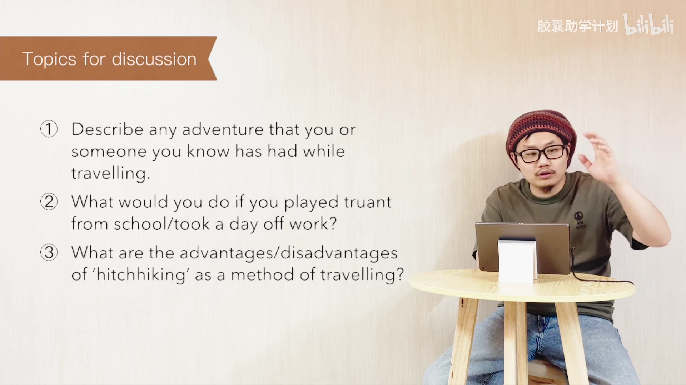

文字识别：胶囊助学计划bibi / Topics for discussion / Describe any adventure that you or / someone you know has had while / travelling. / What would you do if you played truant / from school/took a day off work? / NO / What are the advantages/disadvantages / of'hitchhiking' as a method of travelling?

### 画面 00:05:51

文字识别：bilbili / 胶囊助学计划 / Topics for discussion / Describe any adventure that you or / someone you know has had while / travelling. / What would you do if you played truant / from school/took a day off work? / WI / What are the advantages/disadvantages / of'hitchhiking' as a method of travelling?

### 画面 00:05:53

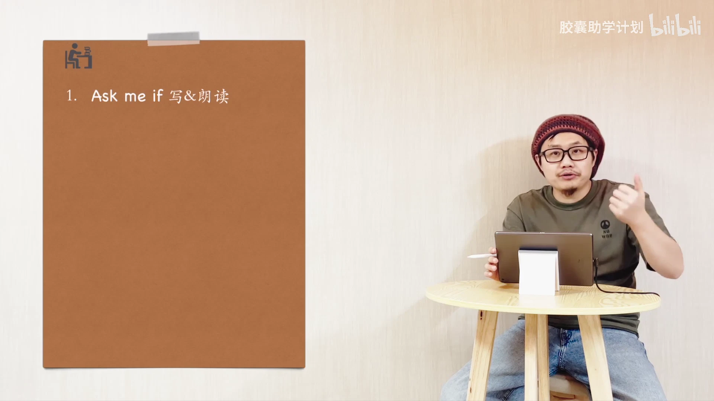

文字识别：Biltbii / 胶囊助学计划 / 1.Ask me if写&朗读 / NII

### 画面 00:05:55

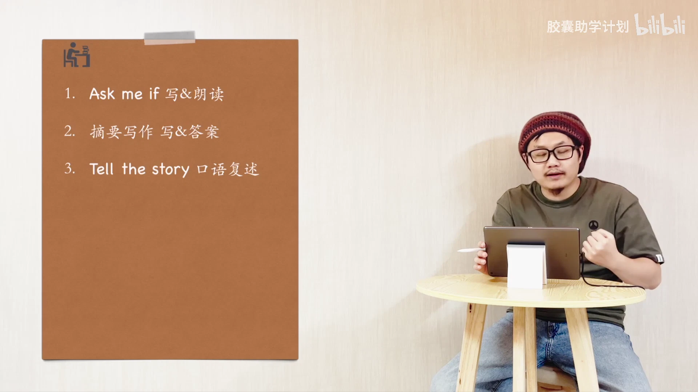

文字识别：bilbil / 胶囊助学计划 / 宁 / 1.Ask me if写&朗读 / 摘要写作写&答案 / 3.Tell the story 口语复述

### 画面 00:05:58

文字识别：bibili / 胶囊助学计划 / 1.Ask me if写&朗读 / 摘要写作写&答案 / 3.Tell the story 口语复述 / NU

## 00:06:00–00:06:30

篇文章啊，tell the story可以复述啊，然后置顶留言可以找到重复间隔的学习材料。那以上呢就是呃本期视频的全部内容了。如果各位喜欢我们的课程呢，欢迎各位关注、订阅、一键三连，分享给需要的朋友来帮助我们快速成长。See you next time.

### 画面 00:06:00

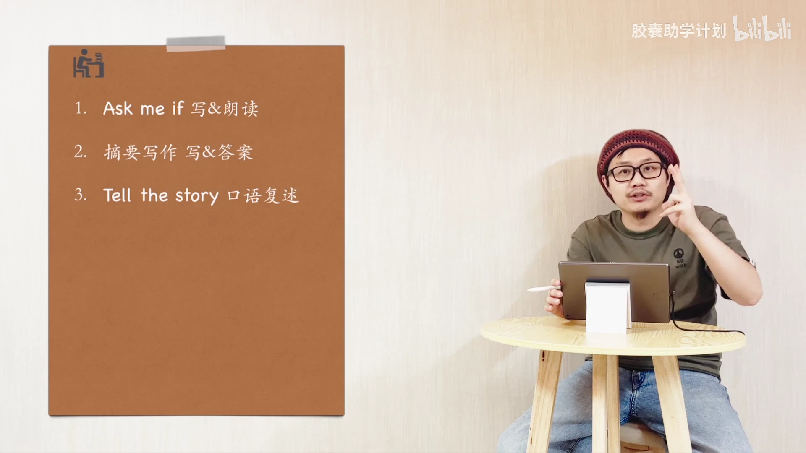

文字识别：bilbili / 胶囊助学计划 / 1.Ask me if写&朗读 / 摘要写作写&答案 / 3.Tell the story 口语复述 / ND

### 画面 00:06:02

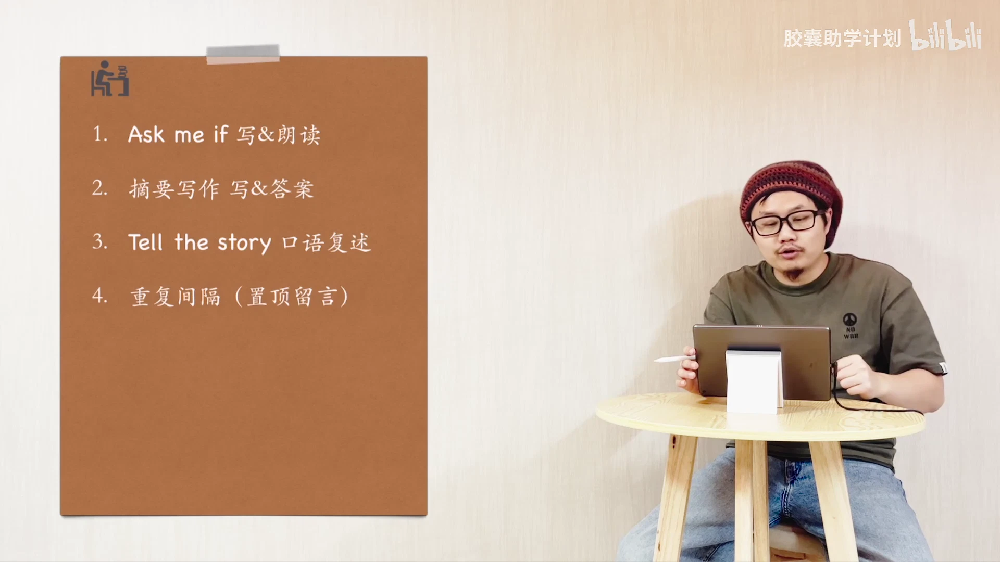

文字识别：bibili / 胶囊助学计划 / 1.1 / Ask me if写&朗读 / 摘要写作写&答案 / 3.Tell the story 口语复述 / ·重复间隔（置顶留言） / 4. / WII / ND

### 画面 00:06:05

文字识别：biibli / 胶囊助学计划

### 画面 00:06:07

文字识别：bibii / 胶囊助学计划 / 不 / NO

### 画面 00:06:12

文字识别：bibli / 胶囊助学计划 / 不

### 画面 00:06:22

### 画面 00:06:24

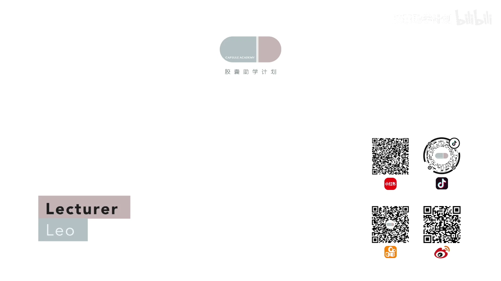

文字识别：勤字計划 / CAPSULEACADEMY / 胶囊助学计划 / 小红书 / Lecturer / Leo / OE

### 画面 00:06:26

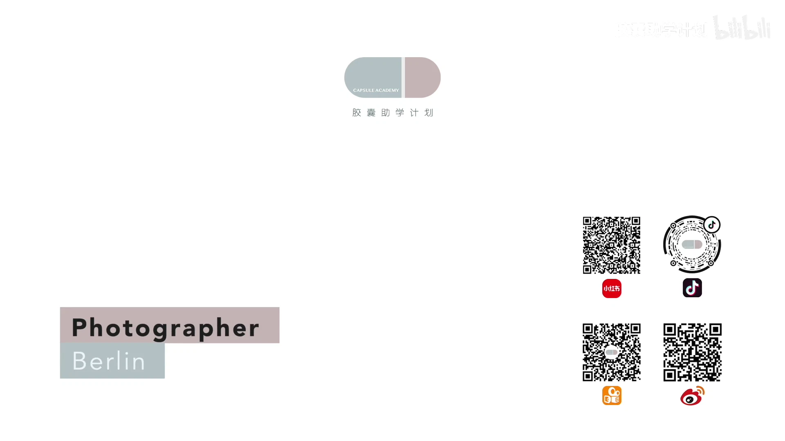

文字识别：CAPSULEACADEMY / 胶囊助学计划 / 『 / 小红书 / Photographer / Berlin / OE

### 画面 00:06:28

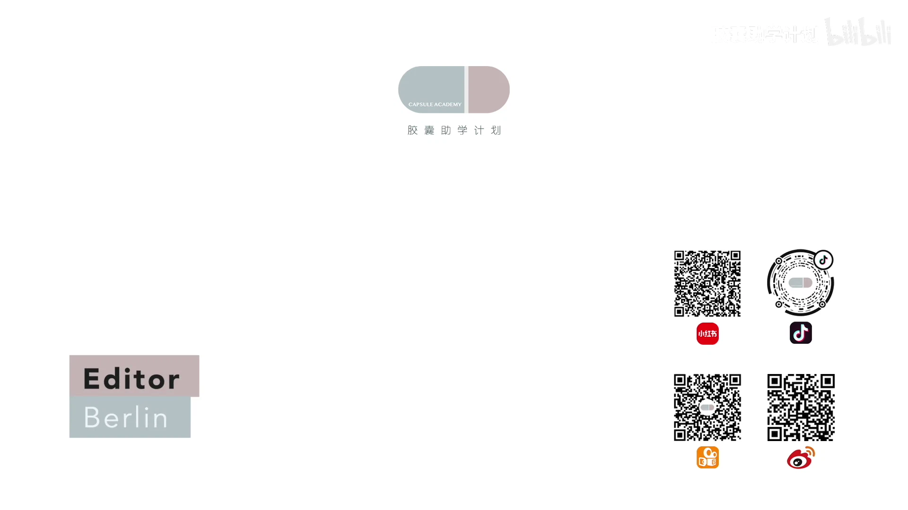

文字识别：運動学計切 / CAPSULEACADEMY / 胶囊助学计划 / 小红书 / Editor / □ / Berlin / OE

## 00:06:30–00:06:34

### 画面 00:06:31

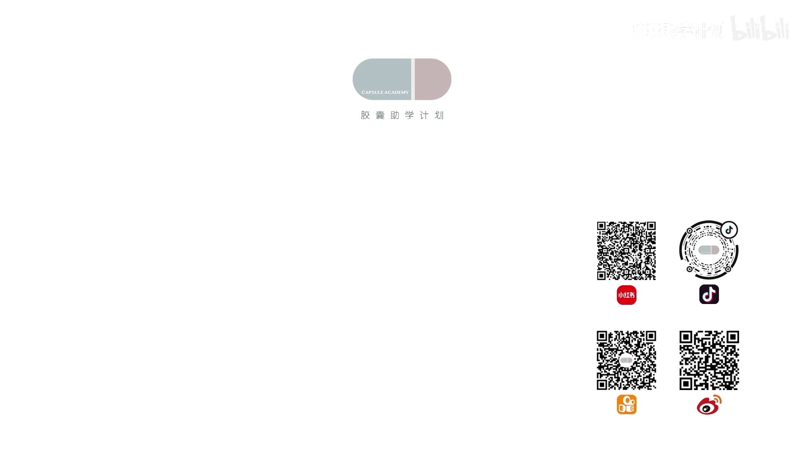

文字识别：亞動字計一中 / CAPSULEACADEMY / 胶囊助学计划 / 小红书

### 画面 00:06:33

文字识别：bilibili / 胶囊助学计划

### 画面 00:06:34

文字识别：bilibili / 胶囊助学计划

