# 074 单词

快速机器解析：语音为单模型转写，未进行独立交叉校对或人工复核；画面每秒采样并按变化选帧，短时文字和标记可能遗漏。截图时间约有 1 秒误差。图片有损压缩；遇到疑点请按时间查看 Google Drive 原视频。

## 00:00:00–00:00:30

Hello, everyone. Welcome to Capsule Academy. This is Leo. Today we're going to look at Set English Book Two, Lesson Seventy Four Words. 那老习惯进入正式课程之前呢，咱们看三个问题啊。那首先，第一个，如何表达采取防范或者一些预防措施？第二个，如何表达啊？我是什么什么的超级粉丝，对吧？这个现在在网络上还是挺常用的啊啊，已经流行可能十年二十年了这样一个表达。第三个，如何表达嘲笑

### 画面 00:00:00

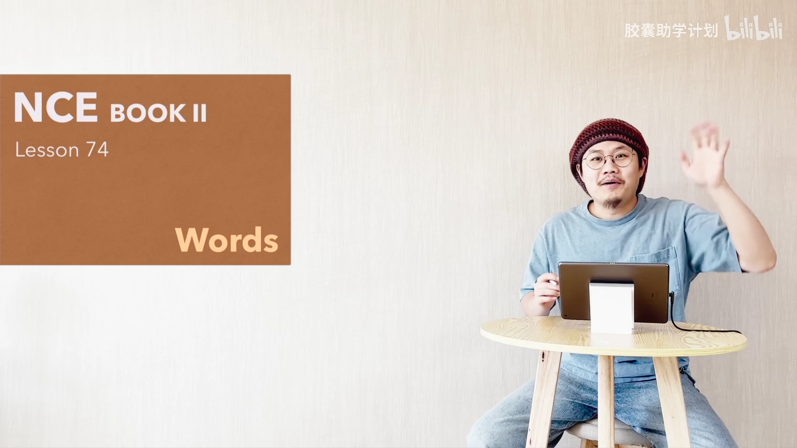

文字识别：bilibili / 胶囊助学计划 / NCE / BOOKII / Lesson 74 / Words

### 画面 00:00:02

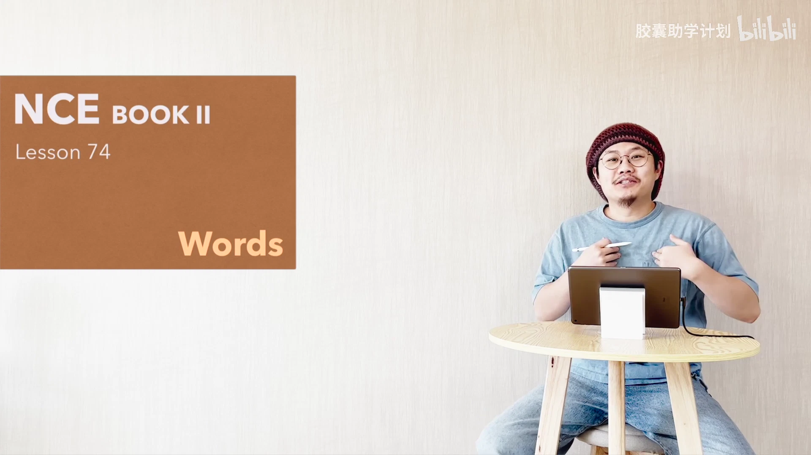

文字识别：bilibili / 胶囊助学计划 / NCE / BOOKII / Lesson 74 / Words

### 画面 00:00:05

文字识别：bilbili / 胶囊助学计划 / NCE / BOOKII / Lesson 74 / Words

### 画面 00:00:10

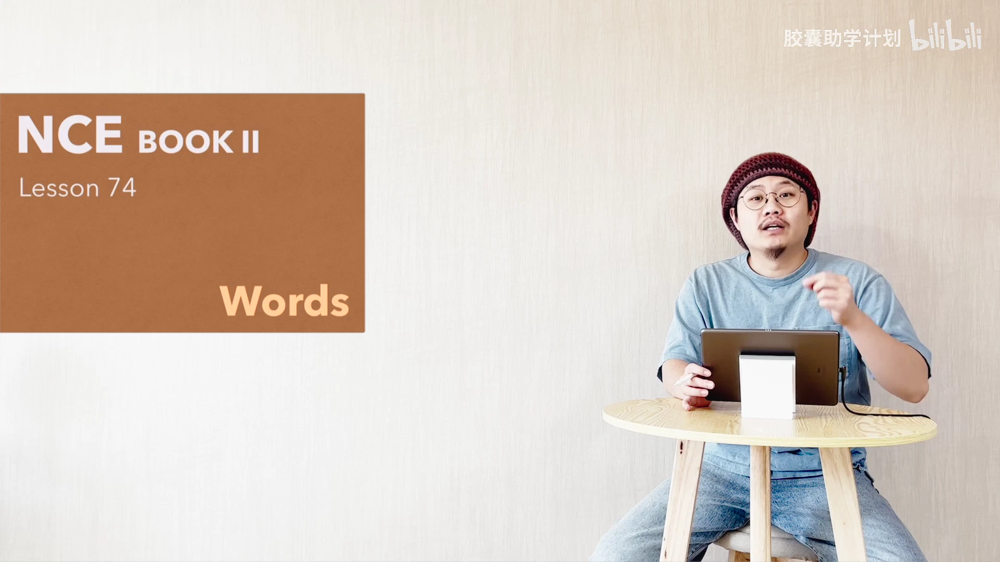

文字识别：bilbili / 胶囊助学计划 / NCE / BOOKII / Lesson 74 / Words

### 画面 00:00:12

文字识别：biibii / 胶囊助学计划 / 达“采取防范”?

### 画面 00:00:14

文字识别：bilbii / 胶囊助学计划 / ①如何表达“采取防范”？

### 画面 00:00:17

文字识别：blibili / 胶囊助学计划 / ①如何表达“采取防范”？ / 级粉丝”?

### 画面 00:00:19

文字识别：bilbili / 胶囊助学计划 / ①如何表达“采取防范”? / 如何表达“超级粉丝”?

### 画面 00:00:22

文字识别：Bilbili / 胶囊助学计划 / ①如何表达“采取防范”? / 如何表达“超级粉丝”？ / /嘲讽某人”？

### 画面 00:00:24

文字识别：bilbili / 胶囊助学计划 / ①如何表达“采取防范”? / 如何表达“超级粉丝” / 如何表达“嘲笑/嘲讽某人”?

### 画面 00:00:26

文字识别：bibili / 胶囊助学计划 / ①如何表达“采取防范”? / 如何表达“超级粉丝” / 如何表达“嘲笑/嘲讽某人”?

## 00:00:30–00:01:00

或者嘲讽某人？带着这三个问题，后边呢？Enjoy。第一个单词啊，舞台聚光灯啊，limelight连起来，limelight这里边一定有一个单词你是认得的，叫l i g h t，对吧？light就灯光的意思。那这个短语呢，咱们要学的是这个短语，叫stay out of the limelight。stay out of the limelight叫做

### 画面 00:00:30

文字识别：bilbili / 胶囊助学计划 / ①如何表达“采取防范”？ / 如何表达“超级粉丝” / 如何表达“嘲笑/嘲讽某人”?

### 画面 00:00:34

文字识别： bibii / 胶囊助学计划 / •

### 画面 00:00:38

文字识别：助字计划園

### 画面 00:00:40

文字识别：单词造句指南 / 网：v.+v.变化 / 胶囊助学计划 / bilbil / 四句型转换 / 方式/地点/时间 / 结合习惯用法 / 其他单词+词性 / 原文摘抄+变 / 6123456 / / |alm lait / / limelight n.

### 画面 00:00:42

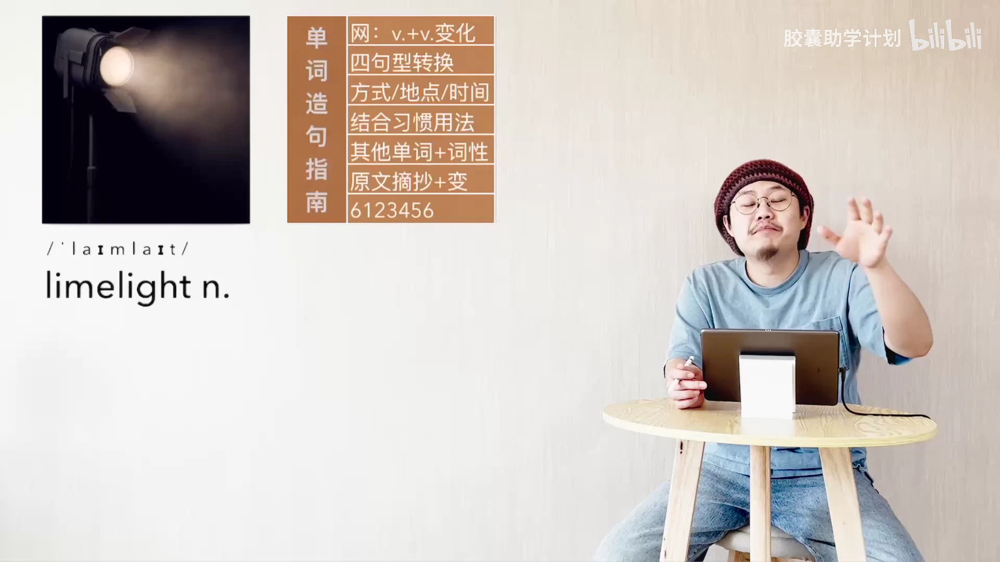

文字识别：单词造句指南 / 网：v.+v.变化 / 胶囊助学计划 / bilbili / 四句型转换 / 方式/地点/时间 / 结合习惯用法 / 其他单词+词性 / 原文摘抄+变 / 6123456 / / |alm laIt/ / limelight n.

### 画面 00:00:44

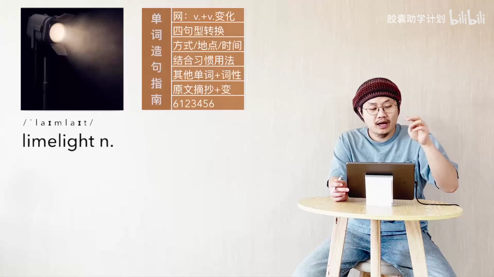

文字识别：单词造句指南 / 网：v.+v.变化 / 胶囊助学计划 / bilbili / 四句型转换 / 方式/地点/时间 / 结合习惯用法 / 其他单词+词性 / 原文摘抄+变 / 6123456 / /' |almlait/ / limelight n.

### 画面 00:00:46

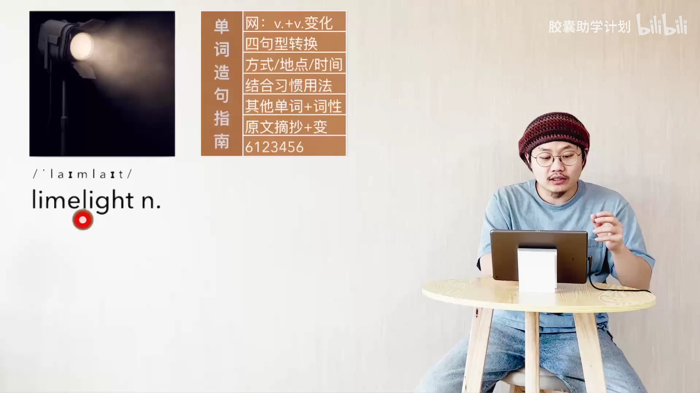

文字识别：单词造句指南 / 网：v.+v.变化 / 胶囊助学计划 / bilbili / 四句型转换 / 方式/地点/时间 / 结合习惯用法 / 其他单词+词性 / 原文摘抄+变 / 6123456 / /'|almlait/ / limelight n.

### 画面 00:00:48

文字识别：单词造句指南 / 网：v.+v.变化 / 胶囊助学计划 / bilbili / 四句型转换 / 方式/地点/时间 / 结合习惯用法 / 其他单词+词性 / 原文摘抄+变 / 6123456 / /' |alm lait / / limelight n.

### 画面 00:00:50

文字识别：单词造句指南 / 网：v.+v.变化 / 胶囊助学计划 / bilbii / 四句型转换 / 方式/地点/时间 / 结合习惯用法 / 其他单词+词性 / 原文摘抄+变 / 6123456 / / laIm laIt / / limelight n. /  The president's wife wanted to stay out of / the limelight.

### 画面 00:00:53

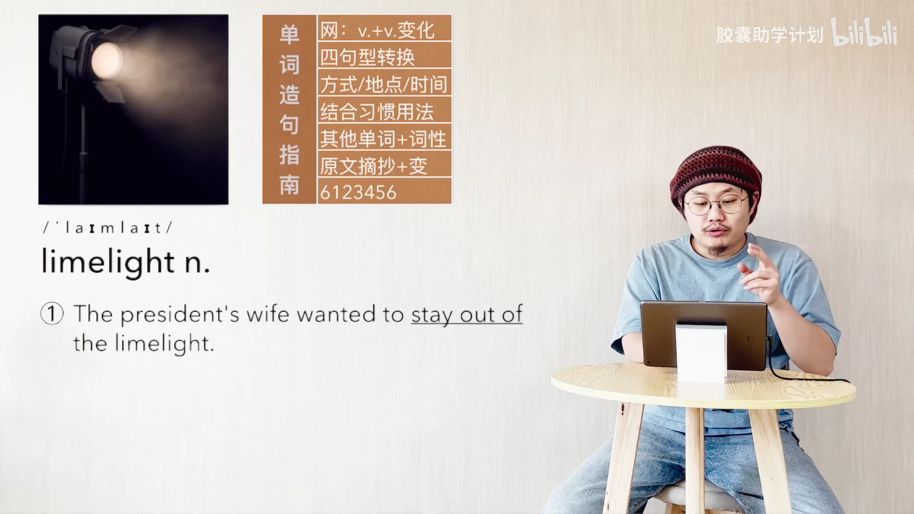

文字识别：单词造句指南 / 网：v.+v.变化 / 胶囊助学计划 / bilbili / 四句型转换 / 方式/地点/时间 / 结合习惯用法 / 其他单词+词性 / 原文摘抄+变 / 6123456 / / ' |aIm laIt / / limelight n. /  The president's wife wanted to stay out of / the limelight.

### 画面 00:00:55

文字识别：单词造句指南 / 网：v.+v.变化 / 胶囊助学计划 / bilbili / 四句型转换 / 方式/地点/时间 / 结合习惯用法 / 其他单词+词性 / 原文摘抄+变 / 6123456 / / ' laIm laIt / / limelight n. / ① The president's wife wanted to stay out of / the limelight.

### 画面 00:00:57

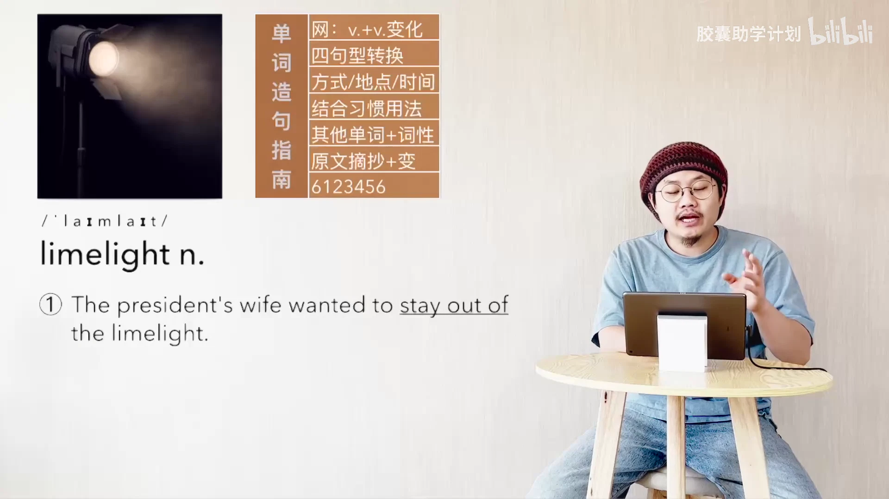

文字识别：单词造句指南 / 网：v.+v.变化 / 胶囊助学计划 / bilbil / 四句型转换 / 方式/地点/时间 / 结合习惯用法 / 其他单词+词性 / 原文摘抄+变 / 6123456 / /  |aIm laIt / / limelight n. / ① The president's wife wanted to stay out of / the limelight.

### 画面 00:00:59

文字识别：单词造句指南 / 网：v.+v.变化 / 胶囊助学计划 / bibili / 四句型转换 / 方式/地点/时间 / 结合习惯用法 / 其他单词+词性 / 原文摘抄+变 / 6123456 / /' laIm laIt / / limelight n. / ① The president's wife wanted to stay out of / the limelight.

## 00:01:00–00:01:30

说，哎，我躲的远离这个舞台的灯光啊。我们看一下什么意思啊？这个句子我造的叫做The president's wife wanted to stay out of the limelight。说总统的夫人啊，第一夫人，她希望可以想怎么样呢？远离聚光灯。哎，就换一句话来说，比如说这里面的内涵的意思就是，比如说我不去参加各种各样的这个节目啊，我不去接受记者的

### 画面 00:01:01

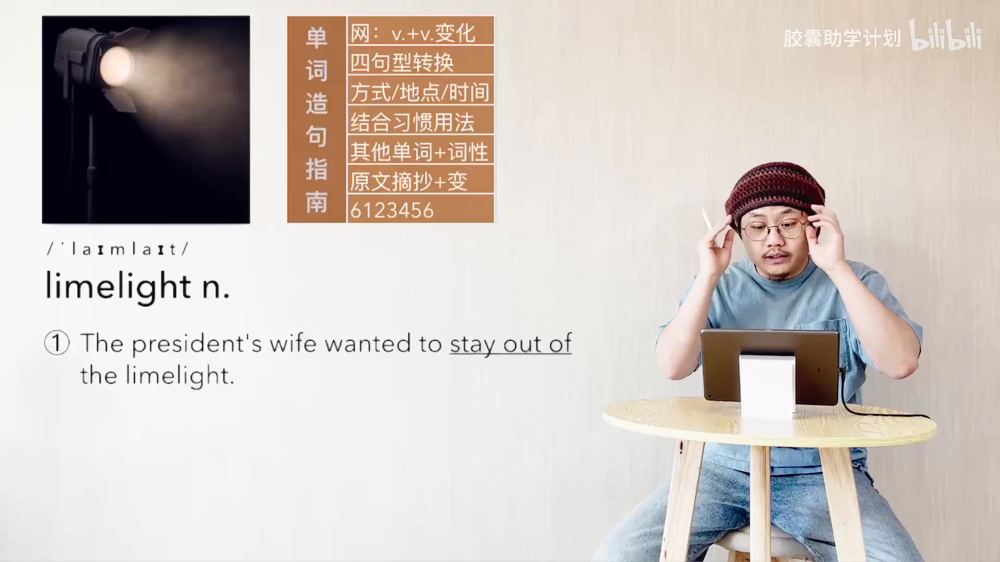

文字识别：单词造句指南 / 网：v.+v.变化 / 胶囊助学计划 / bilbil / 四句型转换 / 方式/地点/时间 / 结合习惯用法 / 其他单词+词性 / 原文摘抄+变 / 6123456 / /|aIm laIt/ / limelight n. / ① The president's wife wanted to stay out of / the limelight.

### 画面 00:01:05

文字识别：单词造句指南 / 网：v.+v.变化 / 胶囊助学计划 / bilibii / 四句型转换 / 方式/地点/时间 / 结合习惯用法 / 其他单词+词性 / 原文摘抄+变 / 6123456 / / |aIm laIt / / limelight n. / ① The president's wife wanted to stay out of / the limelight.

### 画面 00:01:20

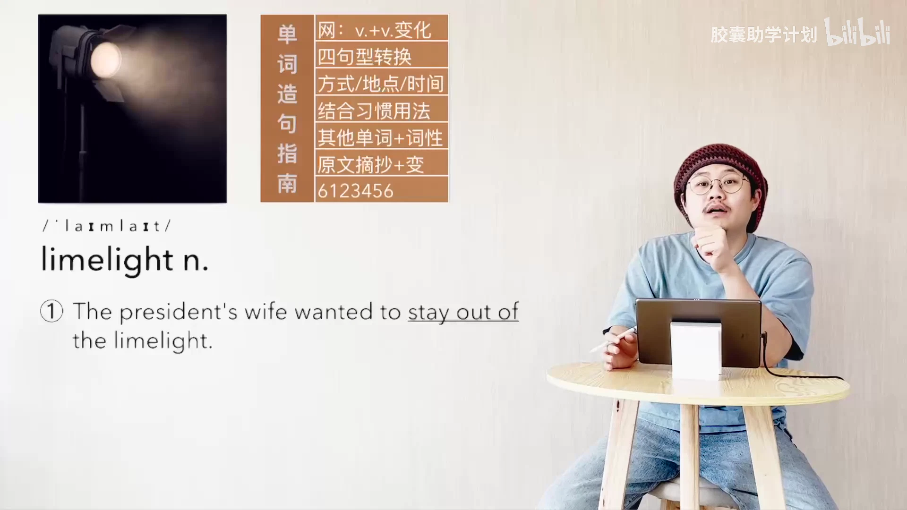

文字识别：单词造句指南 / 网：v.+v.变化 / 胶囊助学计划 / bilbili / 四句型转换 / 方式/地点/时间 / 结合习惯用法 / 其他单词+词性 / 原文摘抄+变 / 6123456 / /' |aIm laIt / / limelight n. / ① The president's wife wanted to stay out of / the limelight.

### 画面 00:01:25

文字识别：单词造句指南 / 网：v.+v.变化 / 胶囊助学计划 / bilbili / 四句型转换 / 方式/地点/时间 / 结合习惯用法 / 其他单词+词性 / 原文摘抄+变 / 6123456 / /'|aIm laIt / / limelight n. / ① The president's wife wanted to stay out of / the limelight.

### 画面 00:01:28

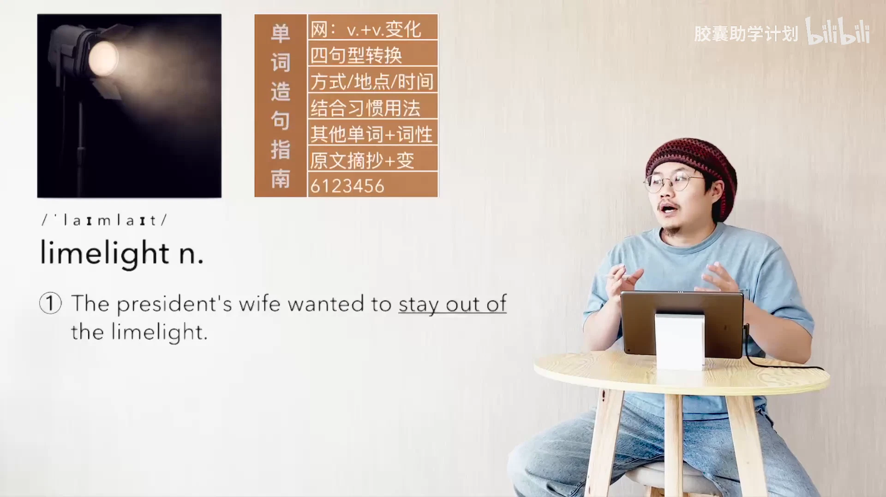

文字识别：单词造句指南 / 网：v.+v.变化 / 胶囊助学计划 / bilibii / 四句型转换 / 方式/地点/时间 / 结合习惯用法 / 其他单词+词性 / 原文摘抄+变 / 6123456 / /' |aIm laIt / / limelight n. / ① The president's wife wanted to stay out of / the limelight.

## 00:01:30–00:02:00

采访，我就过好我自己的生活，对吧？然后你记者狗仔队也别来拍我的生活啊！Stay out of the limelight. Okay, that continue.再来四句型转换，我们不多说。来一句话。For the past three years, Steven has stay out of the limelight.在过去的三年当中，他一直都怎么样呢？Stay out of the limelight，跟刚才是一样的，对吧？躲在呃在聚光灯之外待

### 画面 00:01:30

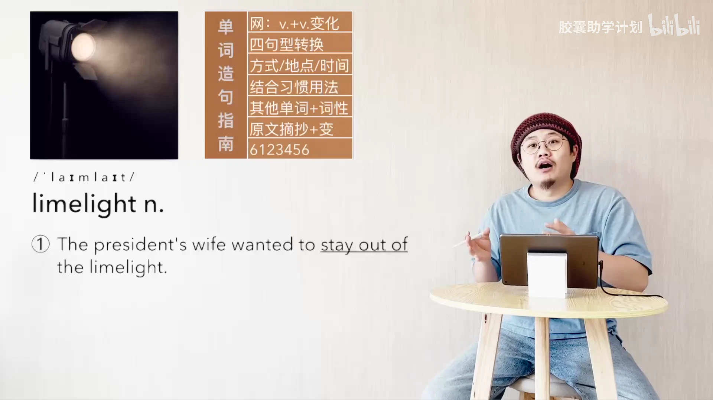

文字识别：单词造句指南 / 网：v.+v.变化 / 胶囊助学计划 / bilbili / 四句型转换 / 方式/地点/时间 / 结合习惯用法 / 其他单词+词性 / 原文摘抄+变 / 6123456 / / |aIm laIt / / limelight n. / ① The president's wife wanted to stay out of / the limelight.

### 画面 00:01:33

文字识别：单词造句指南 / 网：v.+v.变化 / 胶囊助学计划 / bilbili / 四句型转换 / 方式/地点/时间 / 结合习惯用法 / 其他单词+词性 / 原文摘抄+变 / 6123456 / /  |aIm laIt / / limelight n. / ① The president's wife wanted to stay out of / the limelight.

### 画面 00:01:36

文字识别：单词造句指南 / 网：v.+v.变化 / 胶囊助学计划 / bilbili / 四句型转换 / 方式/地点/时间 / 结合习惯用法 / 其他单词+词性 / 原文摘抄+变 / 6123456 / /' |aIm lait / / limelight n. / ① The president's wife wanted to stay out of / the limelight.

### 画面 00:01:38

文字识别：单词造句指南 / 网：v.+v.变化 / 胶囊助学计划 / bilbili / 四句型转换 / 方式/地点/时间 / 结合习惯用法 / 其他单词+词性 / 原文摘抄+变 / 6123456 / / ' |aIm laIt / / limelight n. / ① The president's wife wanted to stay out of / the limelight.

### 画面 00:01:41

文字识别：单词造句指南 / 网：v.+v.变化 / 胶囊助学计划 / bilbi / 四句型转换 / 方式/地点/时间 / 结合习惯用法 / 其他单词+词性 / 原文摘抄+变 / 6123456 / /  laIm lait / / limelight n. / ① The president's wife wanted to stay out of / the limelight. / did/who/why/what... / ) For the past three years, Stephen has stayed / 3 / out of the limelight.

### 画面 00:01:43

文字识别：单词造句指南 / 网：v.+v.变化 / 胶囊助学计划 / bilbili / 四句型转换 / 方式/地点/时间 / 结合习惯用法 / 其他单词+词性 / 原文摘抄+变 / 6123456 / /  laIm lait / / limelight n. / ① The president's wife wanted to stay out of / the limelight. / did/who/why/what... / ) For the past three years, Stephen has stayed / out of the limelight.

### 画面 00:01:45

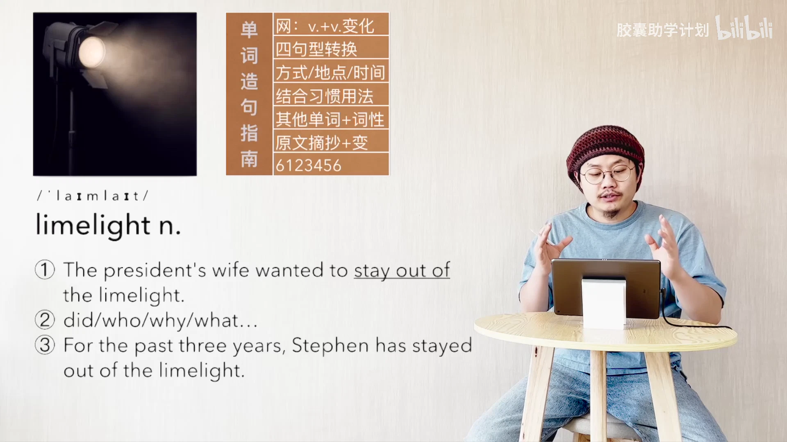

文字识别：单词造句指南 / 网：v.+v.变化 / 胶囊助学计划 / Bilbili / 四句型转换 / 方式/地点/时间 / 结合习惯用法 / 其他单词+词性 / 原文摘抄+变 / 6123456 / /' laIm lait / / limelight n. / ① The president's wife wanted to stay out of / the limelight. / did/who/why/what... / ③ For the past three years, Stephen has stayed / 3 / out of the limelight.

### 画面 00:01:47

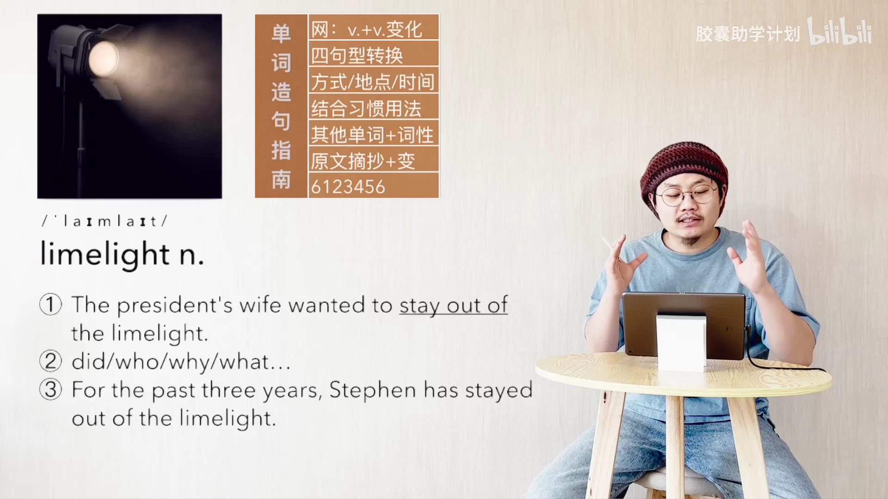

文字识别：单词造句指南 / 网：v.+v.变化 / 胶囊助学计划 / Bilbili / 四句型转换 / 方式/地点/时间 / 结合习惯用法 / 其他单词+词性 / 原文摘抄+变 / 6123456 / /  laIm lait / / limelight n. / ① The president's wife wanted to stay out of / the limelight. / did/who/why/what... / ) For the past three years, Stephen has stayed / 3 / out of the limelight.

### 画面 00:01:50

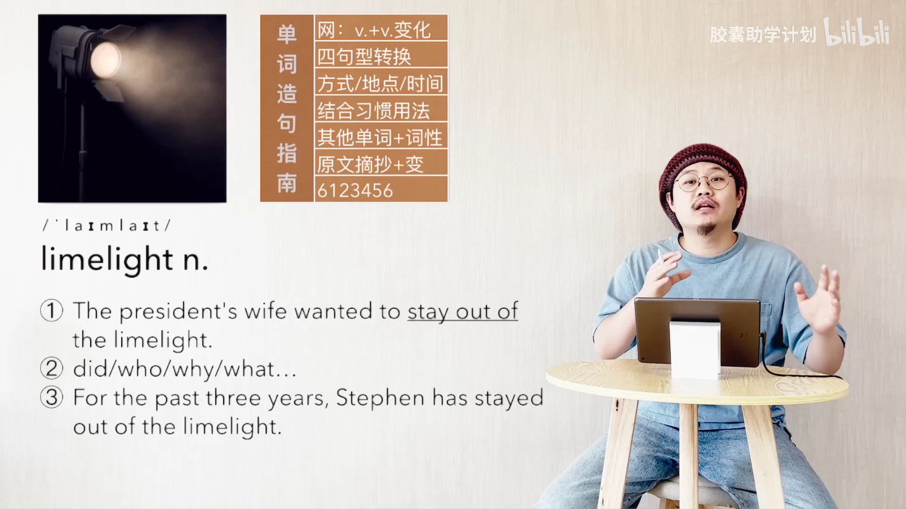

文字识别：单词造句指南 / 网：v.+v.变化 / 胶囊助学计划 / bilbii / 四句型转换 / 方式/地点/时间 / 结合习惯用法 / 其他单词+词性 / 原文摘抄+变 / 6123456 / /  laIm lait / / limelight n. / ① The president's wife wanted to stay out of / the limelight. / did/who/why/what... / ③ For the past three years, Stephen has stayed / 3 / out of the limelight.

### 画面 00:01:54

文字识别：单词造句指南 / 网：v.+v.变化 / 胶囊助学计划 / bilbili / 四句型转换 / 方式/地点/时间 / 结合习惯用法 / 其他单词+词性 / 原文摘抄+变 / 6123456 / /  laIm lait / / limelight n. / ① The president's wife wanted to stay out of / the limelight. / did/who/why/what... / ③ For the past three years, Stephen has stayed / 3 / out of the limelight.

### 画面 00:01:56

文字识别：胶囊助学计划bilbil / 单词造句指南 / 网：v.+v.变化 / 四句型转换 / 方式/地点/时间 / 结合习惯用法 / 其他单词+词性 / 原文摘抄+变 / 6123456 / /  laIm lait / / limelight n. / ① The president's wife wanted to stay out of / the limelight. / did/who/why/what... /  For the past three years, Stephen has stayed / 3 / out of the limelight.

## 00:02:00–00:02:30

着，I 不接受采访啊，我也不接受，比如说不参加任何的活动邀请，对吧？Stay out of the limelight. Continue. So I want to continue to stay out of the limelight. 没有什么可说的了，只是用到了一个习惯用法叫 continue to do something. Okay. 好，继续。那注意力集中，咱听一下这个电影片段。这个电影片段当中出现了之前我们学过的 prefer to do something. 然后他把 stay out of the limelight 换成了 remain

### 画面 00:02:00

文字识别：单词造句指南 / 网：v.+v.变化 / 胶囊助学计划 / bilbii / 四句型转换 / 方式/地点/时间 / 结合习惯用法 / 其他单词+词性 / 原文摘抄+变 / 6123456 / /  |aIm lait / / limelight n. / ① The president's wife wanted to stay out of / the limelight. / did/who/why/what... / ) For the past three years, Stephen has stayed / 3 / out of the limelight.

### 画面 00:02:05

文字识别：单词造句指南 / 网：v.+v.变化 / 胶囊助学计划 / bilbi / 四句型转换 / 方式/地点/时间 / 结合习惯用法 / 其他单词+词性 / 原文摘抄+变 / 6123456 / /  laIm lait / / limelight n. / ① The president's wife wanted to stay out of / the limelight. / did/who/why/what... / For the past three years, Stephen has stayed / 3 / out of the limelight.

### 画面 00:02:08

文字识别：胶囊助学计划bibil / 单词造句指南 / 网：v.+v.变化 / 四句型转换 / 方式/地点/时间 / 结合习惯用法 / 其他单词+词性 / 原文摘抄+变 / 6123456 / /  laIm lait / / limelight n. / ① The president's wife wanted to stay out of / the limelight. / did/who/why/what... / ③ For the past three years, Stephen has stayed / 3 / out of the limelight. / ) I want to continue to stay out of the / limelight. L69

### 画面 00:02:10

文字识别：单词造句指南 / 网：v.+v.变化 / 胶囊助学计划 / bibili / 四句型转换 / 方式/地点/时间 / 结合习惯用法 / 其他单词+词性 / 原文摘抄+变 / 6123456 / /  |aIm lait / / limelight n. / ① The president's wife wanted to stay out of / the limelight. / did/who/why/what... / ③ For the past three years, Stephen has stayed / out of the limelight. /  I want to continue to stay out of the / limelight. L69

### 画面 00:02:15

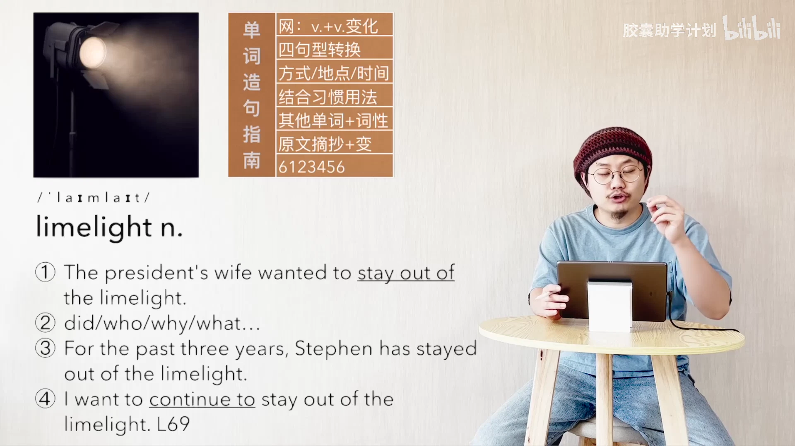

文字识别：单词造句指南 / 网：v.+v.变化 / 胶囊助学计划 / bilbili / 四句型转换 / 方式/地点/时间 / 结合习惯用法 / 其他单词+词性 / 原文摘抄+变 / 6123456 / /  laIm lait / / limelight n. / ① The president's wife wanted to stay out of / the limelight. / did/who/why/what... / ③ For the past three years, Stephen has stayed / out of the limelight. / ) I want to continue to stay out of the / limelight. L69

### 画面 00:02:17

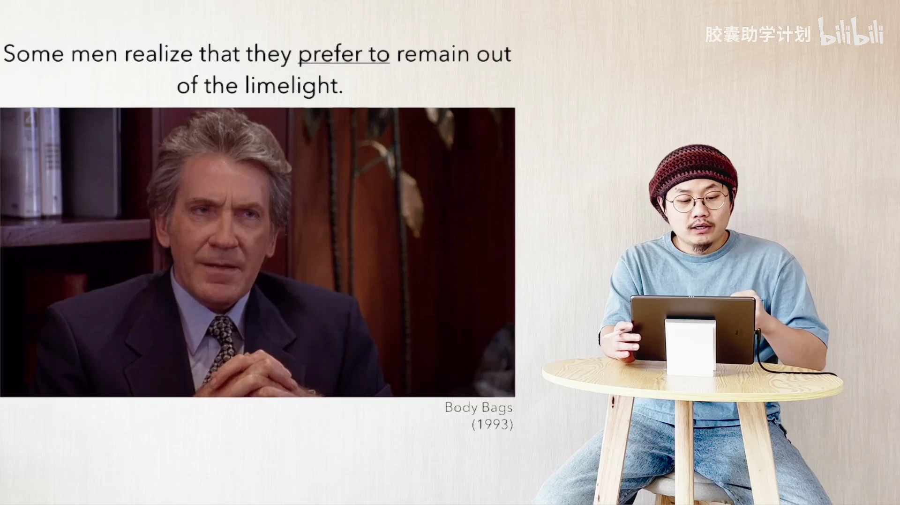

文字识别：bilbili / 胶囊助学计划 / Some men realize that they prefer to remain out / of the limelight. / Body Bags / (1993)

### 画面 00:02:20

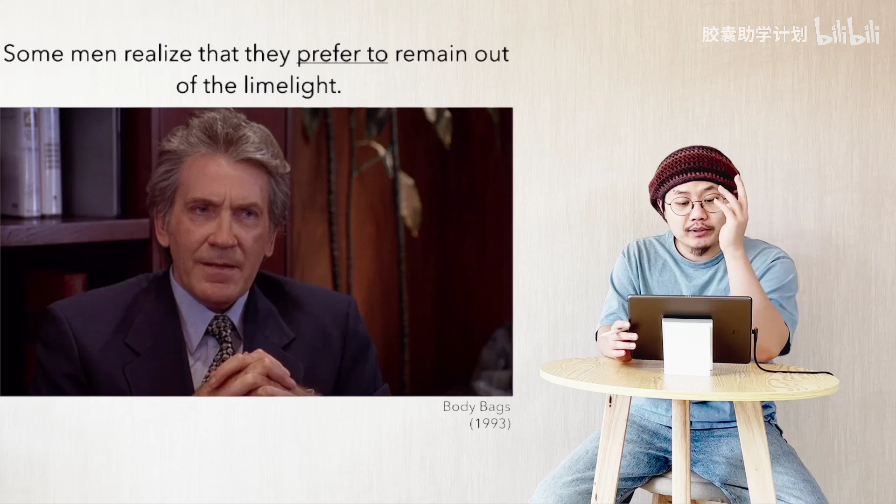

文字识别：bilbii / 胶囊助学计划 / Some men realize that they prefer to remain out / of the limelight. / Body Bags / (1993)

## 00:02:30–00:03:00

out of the limelight, 差别不大啊。我们注意力集中听一下。 Some men realize that they prefer to remain out of the limelight. Okay, next one, 下一个单词叫 precaution. Precaution, 啊，那我们疫情期间戴口罩这个动作，其实就是 precaution, 一些预防措施，对吧？比如我没得病的，但我为了不去得这个病啊，然后呢，那我就戴上口罩，这其实就是我们管它叫 take

### 画面 00:02:35

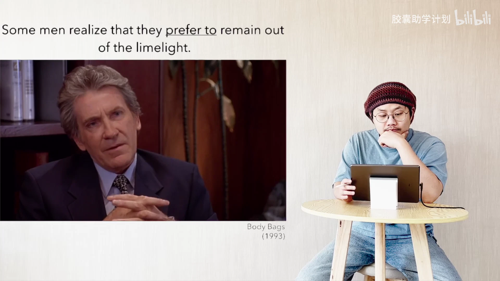

文字识别：biibili / 胶囊助学计划 / Some men realize that they prefer to remain out / of the limelight. / Body Bags / (1993)

### 画面 00:02:37

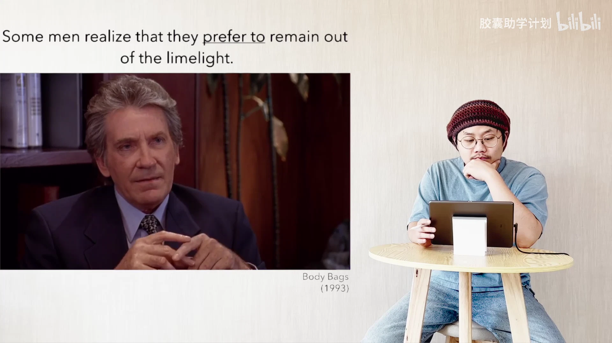

文字识别：biibili / 胶囊助学计划 / Some men realize that they prefer to remain out / of the limelight. / Body Bags / (1993)

### 画面 00:02:39

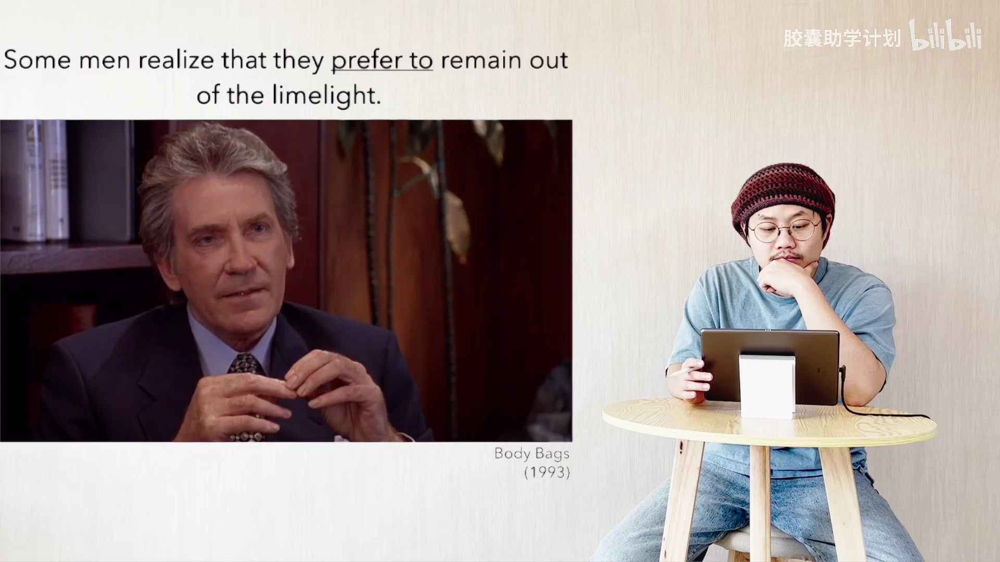

文字识别：bilbii / 胶囊助学计划 / Some men realize that they prefer to remain out / of the limelight. / Body Bags / (1993)

### 画面 00:02:41

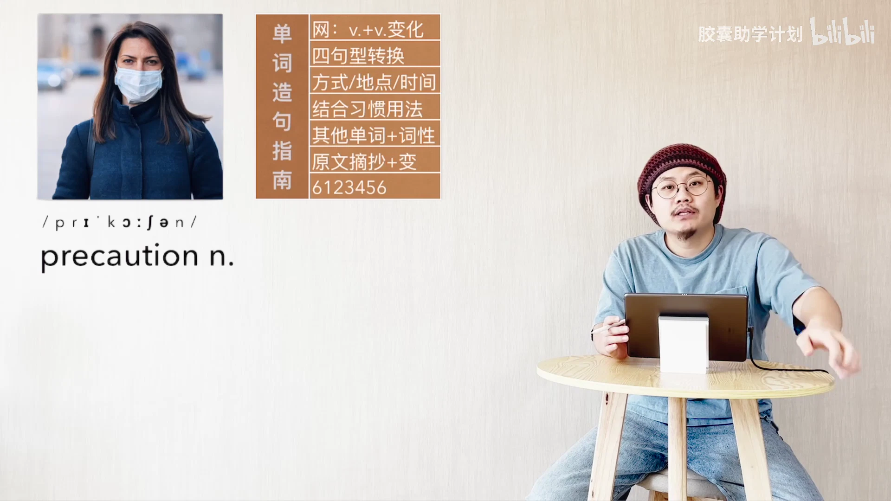

文字识别：单词造句指南 / 网：v.+v.变化 / 胶囊助学计划 / bilbili / 四句型转换 / 方式/地点/时间 / 结合习惯用法 / 其他单词+词性 / 原文摘抄+变 / 6123456 / /pri'ko:∫an/ / precaution n.

### 画面 00:02:43

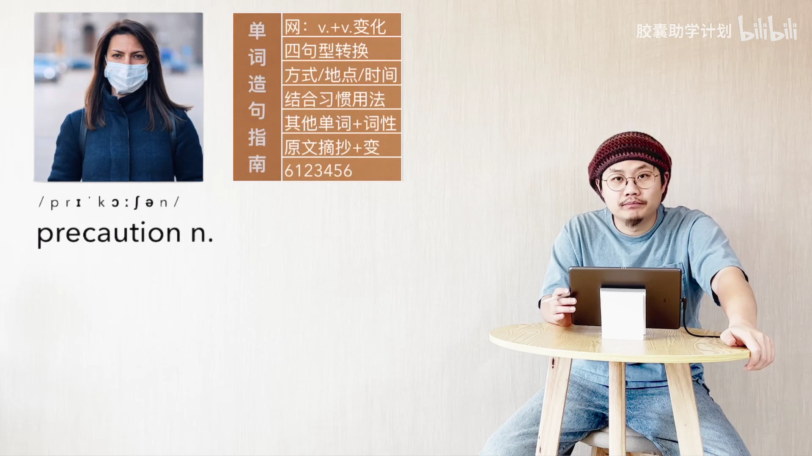

文字识别：单词造句指南 / 网：v.+v.变化 / 胶囊助学计划 / bilbili / 四句型转换 / 方式/地点/时间 / 结合习惯用法 / 其他单词+词性 / 原文摘抄+变 / 6123456 / /pri'ko:∫an/ / precaution n.

### 画面 00:02:45

文字识别：单词造句指南 / 网：v.+v.变化 / 胶囊助学计划 / bilbili / 四句型转换 / 方式/地点/时间 / 结合习惯用法 / 其他单词+词性 / 原文摘抄+变 / 6123456 / /prI'ko:∫an/ / precaution n.

### 画面 00:02:47

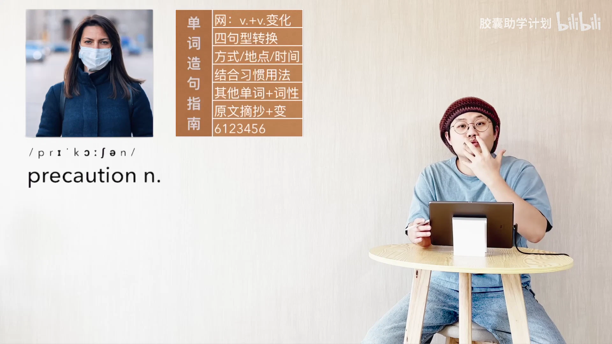

文字识别：单词造句指南 / 网：v.+v.变化 / 胶囊助学计划 / bilbii / 四句型转换 / 方式/地点/时间 / 结合习惯用法 / 其他单词+词性 / 原文摘抄+变 / 6123456 / /prI'ko:∫an/ / precaution n.

### 画面 00:02:51

文字识别：单词造句指南 / 网：v.+v.变化 / 胶囊助学计划 / bilbili / 四句型转换 / 方式/地点/时间 / 结合习惯用法 / 其他单词+词性 / 原文摘抄+变 / 6123456 / /ρri'ko:∫an/ / precaution n.

### 画面 00:02:55

文字识别：单词造句指南 / 网：v.+v.变化 / 胶囊助学计划 / bilbil / 四句型转换 / 方式/地点/时间 / 结合习惯用法 / 其他单词+词性 / 原文摘抄+变 / 6123456 / /ρrI'ko:∫an/ / precaution n.

## 00:03:00–00:03:30

啊，注意 precaution，呃，它是个名词。我们想造一个句子要有动词，这个动词承载的是用 take 去进行承载，叫 take precaution，采取一些预防的措施。造句子，比如说 we should have taken great air precaution，哎，我们本应该怎么怎么样？六十五课咱们学，但没做到。OK， next one，两片段。I am ordered to take every

### 画面 00:03:00

文字识别：单词造句指南 / 网：v.+v.变化 / 胶囊助学计划 / bilbili / 四句型转换 / 方式/地点/时间 / 结合习惯用法 / 其他单词+词性 / 原文摘抄+变 / 6123456 / /prI'ko:∫an/ / precaution n. / ① take precaution ..

### 画面 00:03:04

文字识别：单词造句指南 / 网：v.+v.变化 / 胶囊助学计划 / bilbili / 四句型转换 / 方式/地点/时间 / 结合习惯用法 / 其他单词+词性 / 原文摘抄+变 / 6123456 / /pri'ko:∫an/ / precaution n. / ① take precaution ..

### 画面 00:03:08

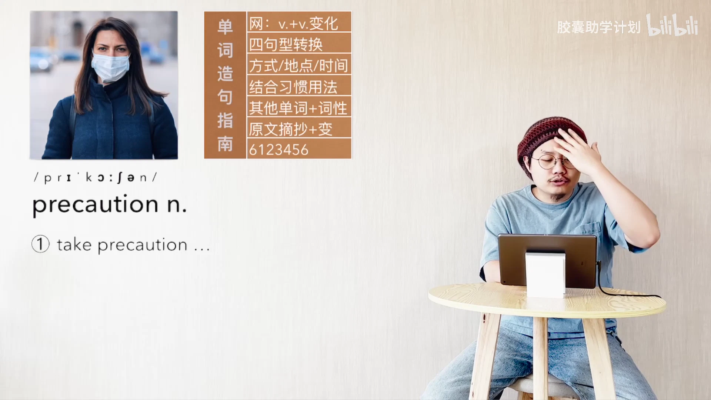

文字识别：单词造句指南 / 网：v.+v.变化 / 胶囊助学计划 / bilbili / 四句型转换 / 方式/地点/时间 / 结合习惯用法 / 其他单词+词性 / 原文摘抄+变 / 6123456 / /ρri'ko:∫an/ / precaution n. / ① take precaution ..

### 画面 00:03:11

文字识别：单词造句指南 / 网：v.+v.变化 / 胶囊助学计划 / bilbili / 四句型转换 / 方式/地点/时间 / 结合习惯用法 / 其他单词+词性 / 原文摘抄+变 / 6123456 / /pri'ko:∫an/ / precaution n. / ① take precaution ..

### 画面 00:03:13

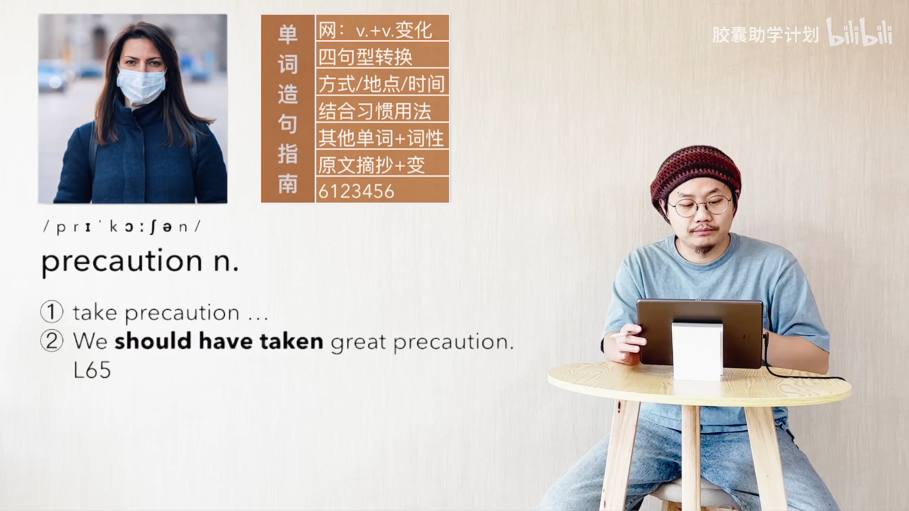

文字识别：单词造句指南 / 网：v.+v.变化 / 胶囊助学计划 / bilbili / 四句型转换 / 方式/地点/时间 / 结合习惯用法 / 其他单词+词性 / 原文摘抄+变 / 6123456 / /pri'ko:∫an/ / precaution n. / ① take precaution / We should have taken great precaution. / L65

### 画面 00:03:15

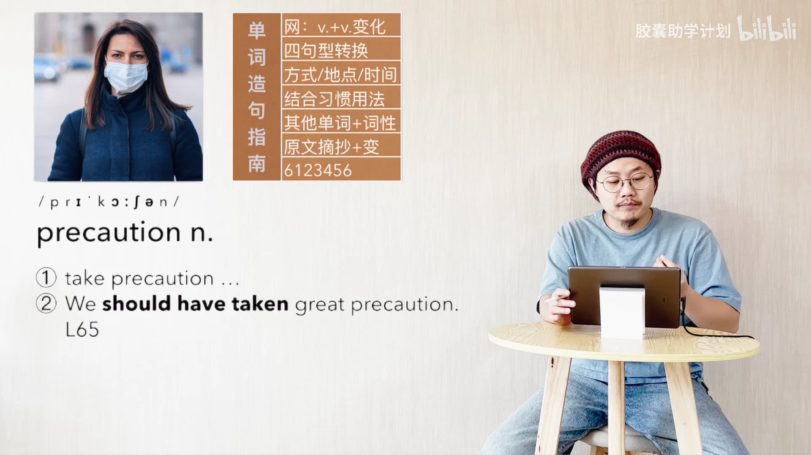

文字识别：单词造句指南 / 网：v.+v.变化 / 胶囊助学计划 / bilbili / 四句型转换 / 方式/地点/时间 / 结合习惯用法 / 其他单词+词性 / 原文摘抄+变 / 6123456 / /ρri'ko:∫an/ / precaution n. / ① t / take precaution / We should have taken great precaution. / L65

### 画面 00:03:18

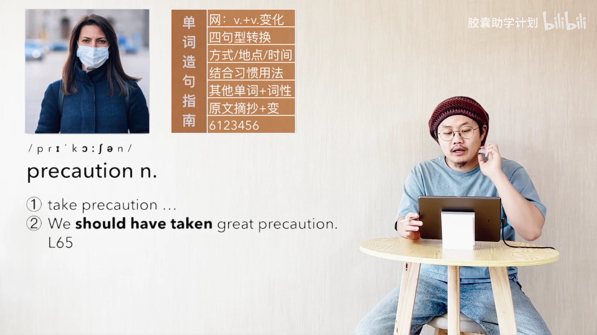

文字识别：单词造句指南 / 网：v.+v.变化 / 胶囊助学计划 / bilbili / 四句型转换 / 方式/地点/时间 / 结合习惯用法 / 其他单词+词性 / 原文摘抄+变 / 6123456 / /pri'ko:∫an/ / precaution n. / ① take precaution / We should have taken great precaution. / L65

### 画面 00:03:20

文字识别：单词造句指南 / 网：v.+v.变化 / 胶囊助学计划 / Bilbili / 四句型转换 / 方式/地点/时间 / 结合习惯用法 / 其他单词+词性 / 原文摘抄+变 / 6123456 / /prI'ko:∫an/ / precaution n. / ① take precaution / We should have taken great precaution. / L65

### 画面 00:03:25

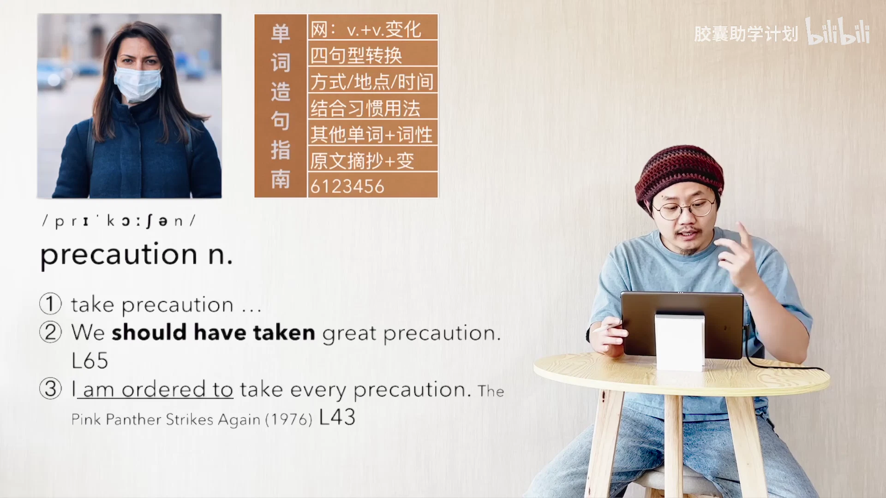

文字识别：单词造句指南 / 网：v.+v.变化 / 胶囊助学计划 / bilbii / 四句型转换 / 方式/地点/时间 / 结合习惯用法 / 其他单词+词性 / 原文摘抄+变 / 6123456 / /pri'ko:∫an/ / precaution n. / ① take precaution ... / We should have taken great precaution. / L65 / I am ordered to take every precaution. The / Pink Panther Strikes Again (1976) L43

### 画面 00:03:28

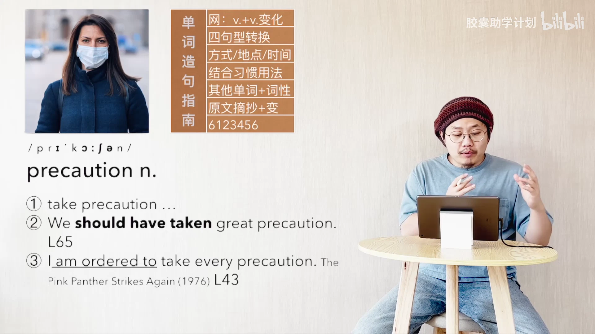

文字识别：单词造句指南 / 网：v.+v.变化 / 胶囊助学计划 / bibili / 四句型转换 / 方式/地点/时间 / 结合习惯用法 / 其他单词+词性 / 原文摘抄+变 / 6123456 / /priko:∫an/ / precaution n. / ① take precaution ... / We should have taken great precaution. / L65 / I am ordered to take every precaution. The / Pink Panther Strikes Again (1976) L43

## 00:03:30–00:04:00

precaution. Ah, I am ordered to take every precaution. You see, just now, if we only said take precaution, that means we take some preventive measures. Great, we take many measures. Every means we take all the measures we can. Right? For example, not only do I wear a mask, but I also wear a mask. Then I wear a mask.

### 画面 00:03:30

文字识别：单词造句指南 / 网：v.+v.变化 / 胶囊助学计划 / bibii / 四句型转换 / 方式/地点/时间 / 结合习惯用法 / 其他单词+词性 / 原文摘抄+变 / 6123456 / /pri'koi∫an/ / precaution n. / ① take precaution ... / We should have taken great precaution. / L65 / I am ordered to take every precaution. The / Pink Panther Strikes Again (1976) L43

### 画面 00:03:35

文字识别：单词造句指南 / 网：v.+v.变化 / 胶囊助学计划 / biibii / 四句型转换 / 方式/地点/时间 / 结合习惯用法 / 其他单词+词性 / 原文摘抄+变 / 6123456 / /prikoi∫an/ / precaution n. / ① take precaution ... / We should have taken great precaution. / L65 / I am ordered to take every precaution. The / Pink Panther Strikes Again (1976) L43

### 画面 00:03:38

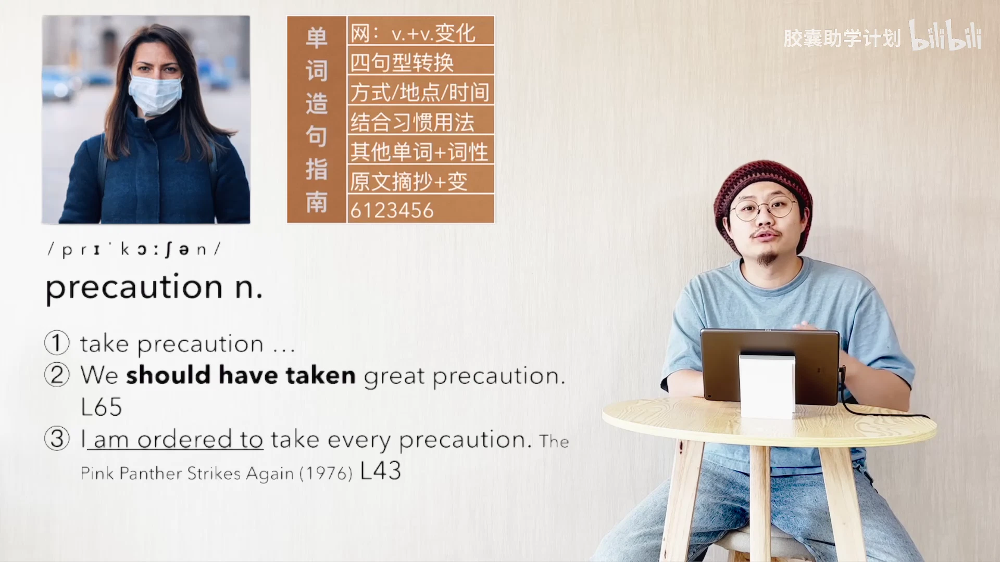

文字识别：单词造句指南 / 网：v.+v.变化 / 胶囊助学计划 / bilbii / 四句型转换 / 方式/地点/时间 / 结合习惯用法 / 其他单词+词性 / 原文摘抄+变 / 6123456 / /pri'ko:∫an/ / precaution n. / ① take precaution ... / We should have taken great precaution. / L65 / I am ordered to take every precaution. The / Pink Panther Strikes Again (1976) L43

### 画面 00:03:41

文字识别：单词造句指南 / 网：v.+v.变化 / 胶囊助学计划 / bibili / 四句型转换 / 方式/地点/时间 / 结合习惯用法 / 其他单词+词性 / 原文摘抄+变 / 6123456 / /ρrI'ko:∫an/ / precaution n. / ① take precaution ... / We should have taken great precaution. / L65 / I am Ordered to take every precaution. The / Pink Panther Strikes Again (1976) L43

### 画面 00:03:45

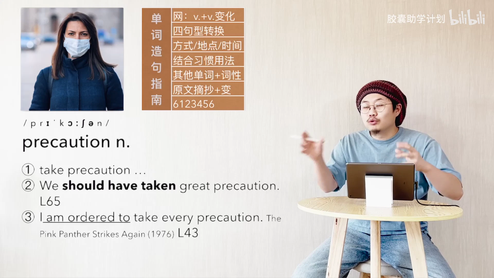

文字识别：单词造句指南 / 网：v.+v.变化 / 胶囊助学计划 / bilbil / 四句型转换 / 方式/地点/时间 / 结合习惯用法 / 其他单词+词性 / 原文摘抄+变 / 6123456 / /pri'ko:∫an/ / precaution n. / ① take precaution ... / We should have taken great precaution. / L65 / I am ordered to take every precaution. The / Pink Panther Strikes Again (1976) L43

### 画面 00:03:48

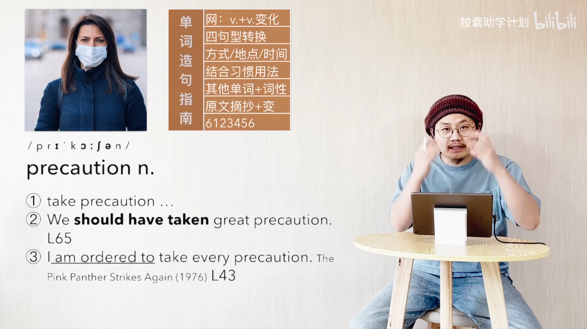

文字识别：单词造句指南 / 网：v.+v.变化 / 胶囊助学计划 / biibi / 四句型转换 / 方式/地点/时间 / 结合习惯用法 / 其他单词+词性 / 原文摘抄+变 / 6123456 / /ρri'ko:∫an/ / precaution n. / ① take precaution ... / We should have taken great precaution. / L65 / I am ordered to take every precaution. The / Pink Panther Strikes Again (1976) L43

### 画面 00:03:50

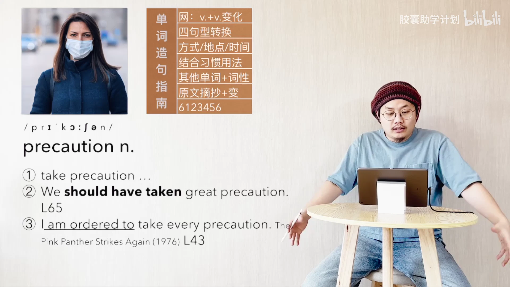

文字识别：单词造句指南 / 网：v.+v.变化 / 胶囊助学计划 / bilbii / 四句型转换 / 方式/地点/时间 / 结合习惯用法 / 其他单词+词性 / 原文摘抄+变 / 6123456 / /pri'ko:∫an/ / precaution n. / ① take precaution ... / We should have taken great precaution. / L65 / I am ordered to take every precaution. The / Pink Panther Strikes Again (1976) L43

### 画面 00:03:53

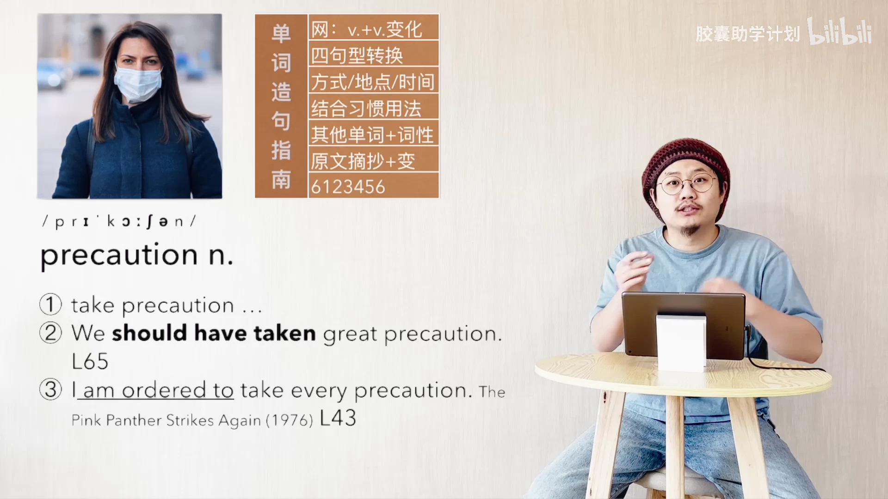

文字识别：单词造句指南 / 网：v.+v.变化 / 胶囊助学计划 / bilibii / 四句型转换 / 方式/地点/时间 / 结合习惯用法 / 其他单词+词性 / 原文摘抄+变 / 6123456 / /pri'ko:∫an/ / precaution n. / ① take precaution ... / We should have taken great precaution. / L65 / I am ordered to take every precaution. The / Pink Panther Strikes Again (1976) L43

### 画面 00:03:56

文字识别：单词造句指南 / 网：v.+v.变化 / 胶囊助学计划 / Bilbili / 四句型转换 / 方式/地点/时间 / 结合习惯用法 / 其他单词+词性 / 原文摘抄+变 / 6123456 / /pri'ko:∫an/ / precaution n. / ① take precaution ... / We should have taken great precaution. / 2 / L65 / I am ordered to take every precaution. The / Pink Panther Strikes Again (1976) L43 / Why did you forbid me to take precaution? / L51

## 00:04:00–00:04:30

me to take precaution? Forbid somebody to do something,禁止某人去做某件事情。哎，你为什么禁止我去做出一些预防措施呢？Okay,那注意力集中，咱们听一下电影片段。这个电影片段当中又出现了之前咱们学过的叫be instructed to do something，对吧？哎，叫被指令、被命令去做某件事儿。上来语音比较大，哎，小心一点，别吓到啊。They will be instructed to take every

### 画面 00:04:00

文字识别：单词造句指南 / 网：v.+v.变化 / 胶囊助学计划 / bilibii / 四句型转换 / 方式/地点/时间 / 结合习惯用法 / 其他单词+词性 / 原文摘抄+变 / 6123456 / /ρri'ko:∫an/ / precaution n. / ① take precaution ….. / We should have taken great precaution. / 2 / L65 / I am ordered to take every precaution. The / Pink Panther Strikes Again (1976) L43 / D Why did you forbid me to take precaution? / L51

### 画面 00:04:04

文字识别：单词造句指南 / 网：v.+v.变化 / 胶囊助学计划 / bilbili / 四句型转换 / 方式/地点/时间 / 结合习惯用法 / 其他单词+词性 / 原文摘抄+变 / 6123456 / /ρrikoi∫an/ / precaution n. / ① take precaution ... / We should have taken great precaution. / 2 / L65 / I am ordered to take every precaution. The / Pink Panther Strikes Again (1976) L43 / D Why did you forbid me to take precaution? / L51

### 画面 00:04:06

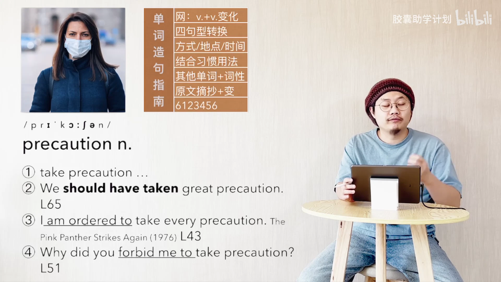

文字识别：单词造句指南 / 网：v.+v.变化 / 胶囊助学计划 / bilibili / 四句型转换 / 方式/地点/时间 / 结合习惯用法 / 其他单词+词性 / 原文摘抄+变 / 6123456 / /priko:∫an/ / precaution n. / ① take precaution ... / We should have taken great precaution. / 2 / L65 / I am ordered to take every precaution. The / Pink Panther Strikes Again (1976) L43 / Why did you forbid me to take precaution? / L51

### 画面 00:04:10

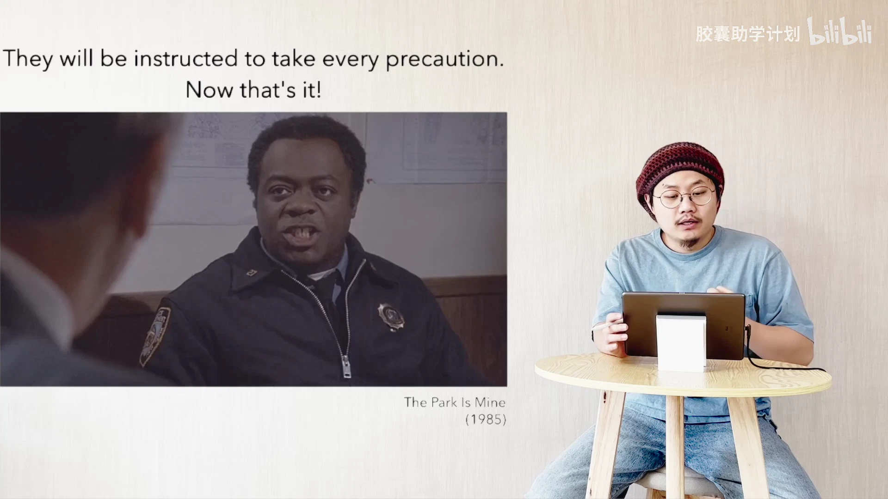

文字识别：biibili / 胶囊助学计划 / They will be instructed to take every precaution. / Now that's it! / The Park Is Mine / (1985)

### 画面 00:04:13

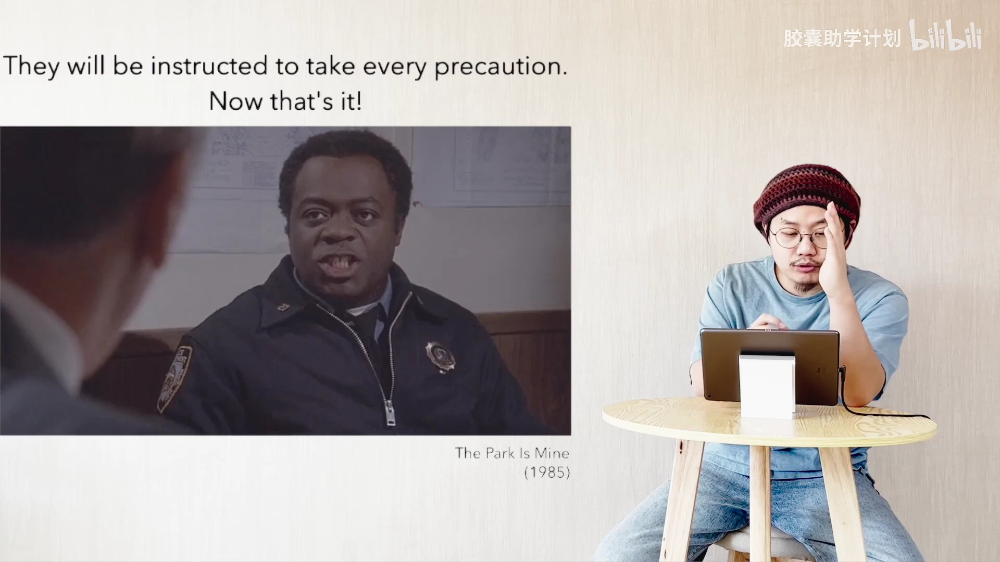

文字识别：biibili / 胶囊助学计划 / They will be instructed to take every precaution. / Now that's it! / The Park Is Mine / (1985)

### 画面 00:04:23

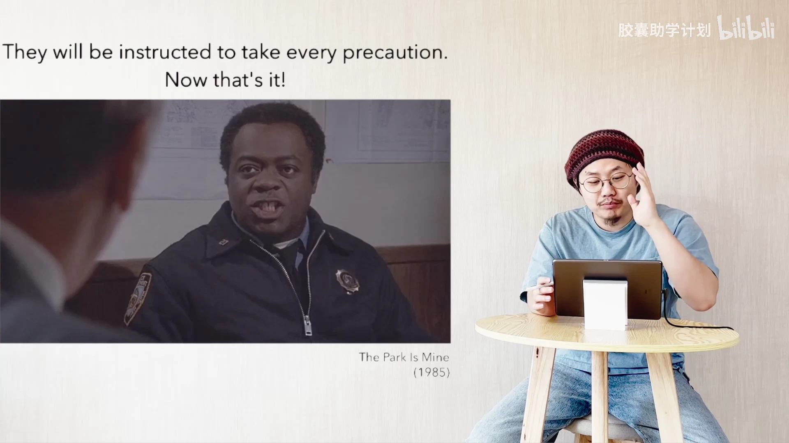

文字识别：biiii / 胶囊助学计划 / They will be instructed to take every precaution. / Now that's it! / The Park Is Mine / (1985)

### 画面 00:04:28

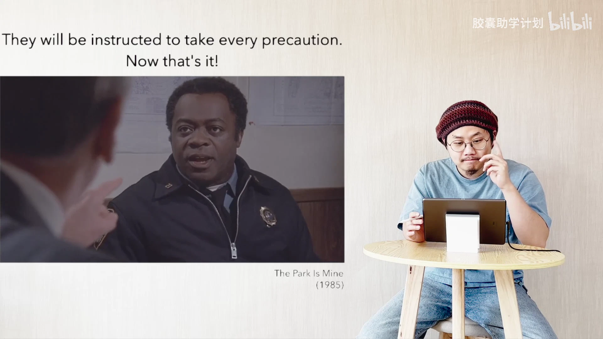

文字识别：bibili / 胶囊助学计划 / They will be instructed to take every precaution. / Now that's it! / The Park Is Mine / (1985)

## 00:04:30–00:05:00

precaution. Now that's it. Okay, ah, good. Next one,下一个单词叫fan。这个单词基本都变成汉语了，粉丝是吧？At fans. Okay, there you go.就粉丝直接就是fans音译过来的啊，就是什么什么的狂热爱好者。那我们在这儿呢，拿一个小的习惯用法叫做He's a big fan of yours. As such a big fan, a great fan,都可以啊. Somebody is a great fan of something

### 画面 00:04:30

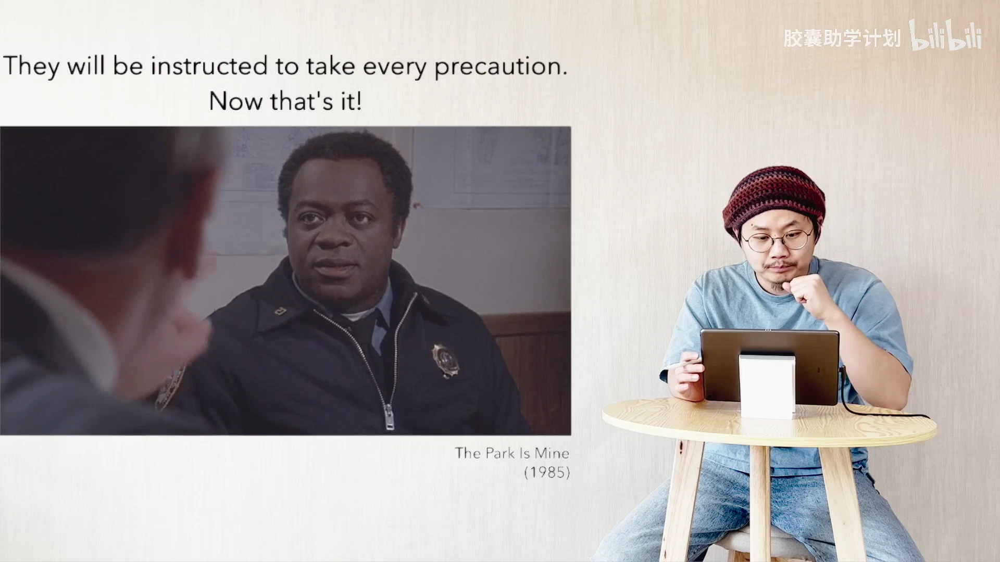

文字识别：bibili / 胶囊助学计划 / They will be instructed to take every precaution. / Now that's it! / The Park Is Mine / (1985)

### 画面 00:04:32

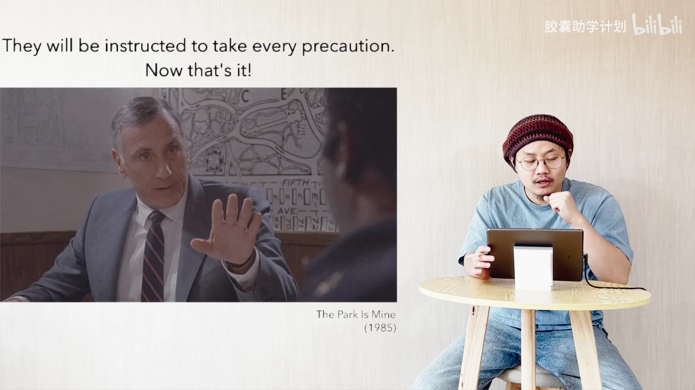

文字识别：bilbil / 胶囊助学计划 / They will be instructed to take every precaution. / Now that's it! / FIFTHT / AVE.- / The Park Is Mine / (1985)

### 画面 00:04:34

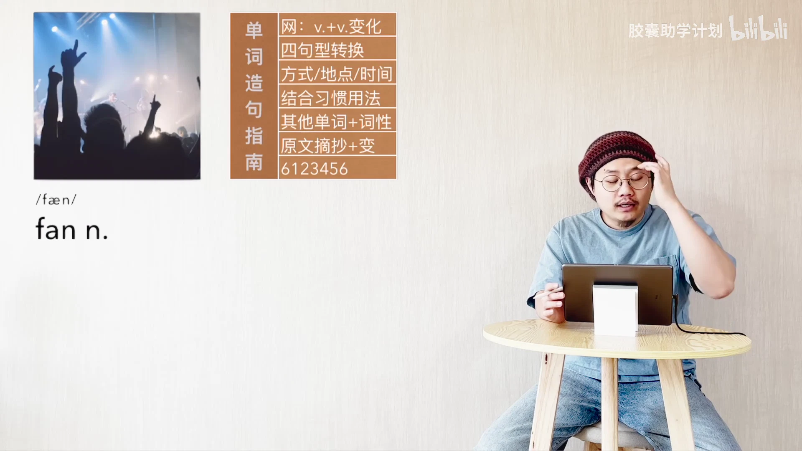

文字识别：单词造句指南 / 网：v.+v.变化 / 胶囊助学计划 / bilbii / 四句型转换 / 方式/地点/时间 / 结合习惯用法 / 其他单词+词性 / 原文摘抄+变 / 6123456 / /fæn/ / fan n.

### 画面 00:04:37

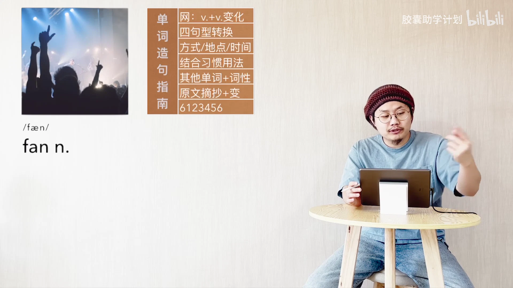

文字识别：单词造句指南 / 网：v.+v.变化 / 胶囊助学计划 / bilbii / 四句型转换 / 方式/地点/时间 / 结合习惯用法 / 其他单词+词性 / 原文摘抄+变 / 6123456 / /fæn/ / fan n.

### 画面 00:04:40

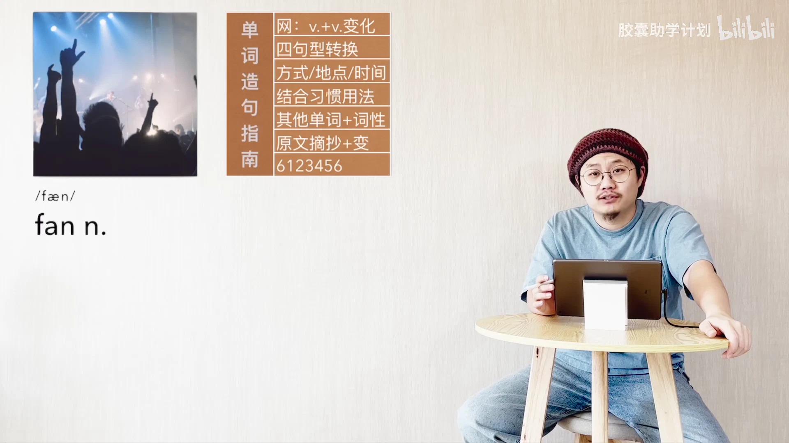

文字识别：单词造句指南 / 网：v.+v.变化 / 胶囊助学计划 / bilbii / 四句型转换 / 方式/地点/时间 / 结合习惯用法 / 其他单词+词性 / 原文摘抄+变 / 6123456 / /fæn/ / fan n.

### 画面 00:04:45

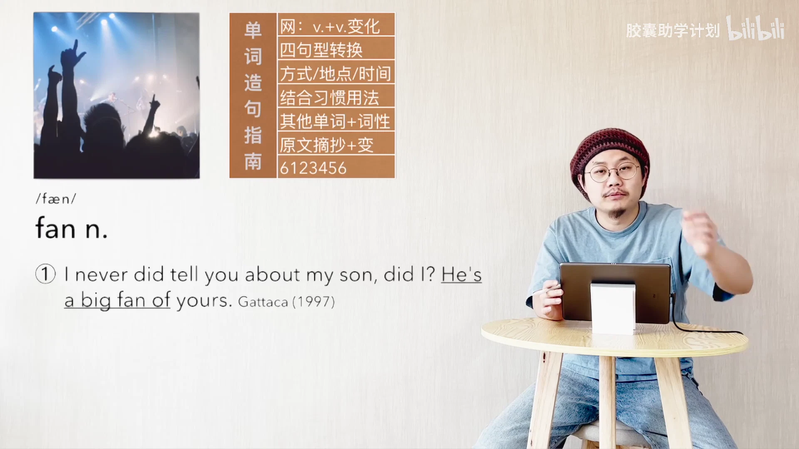

文字识别：单词造句指南 / 网：v.+v.变化 / 胶囊助学计划 / bilbili / 四句型转换 / 方式/地点/时间 / 结合习惯用法 / 其他单词+词性 / 原文摘抄+变 / 6123456 / /fæen/ / fan n. / ① I never did tell you about my son, did I? He's / a big fan of yours. Gattaca (1997)

### 画面 00:04:47

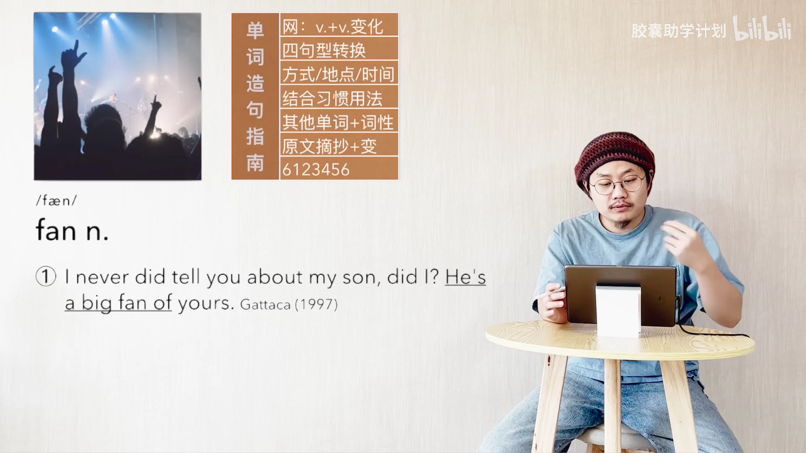

文字识别：单词造句指南 / 网：v.+v.变化 / 胶囊助学计划 / bilbili / 四句型转换 / 方式/地点/时间 / 结合习惯用法 / 其他单词+词性 / 原文摘抄+变 / 6123456 / /fæn/ / fan n. / ① I never did tellyou about my son, did I? He's / a big fan Of yours. Gattaca (1997)

### 画面 00:04:50

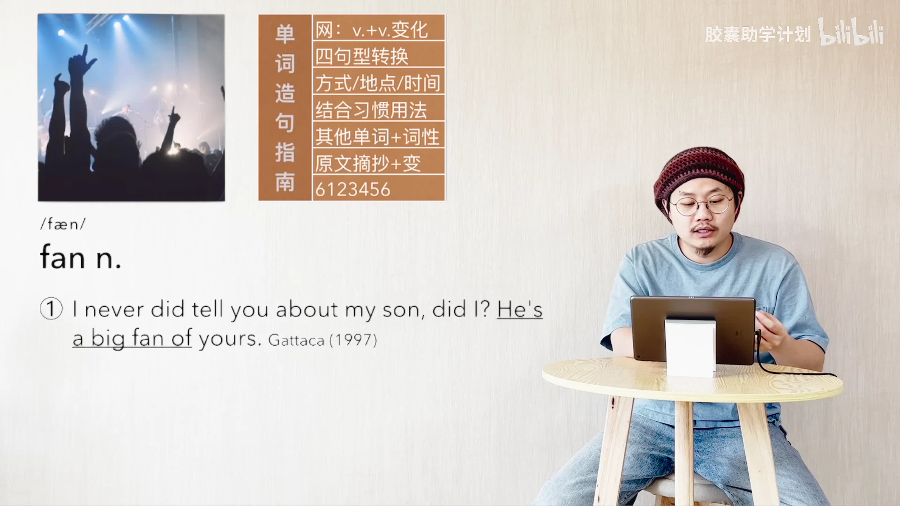

文字识别：单词造句指南 / 网：v.+v.变化 / 胶囊助学计划 / bibili / 四句型转换 / 方式/地点/时间 / 结合习惯用法 / 其他单词+词性 / 原文摘抄+变 / 6123456 / /fæen/ / fan n. / ① I never did tell you about my son, did I? He's / a big fan of yours. Gattaca(1997)

### 画面 00:04:55

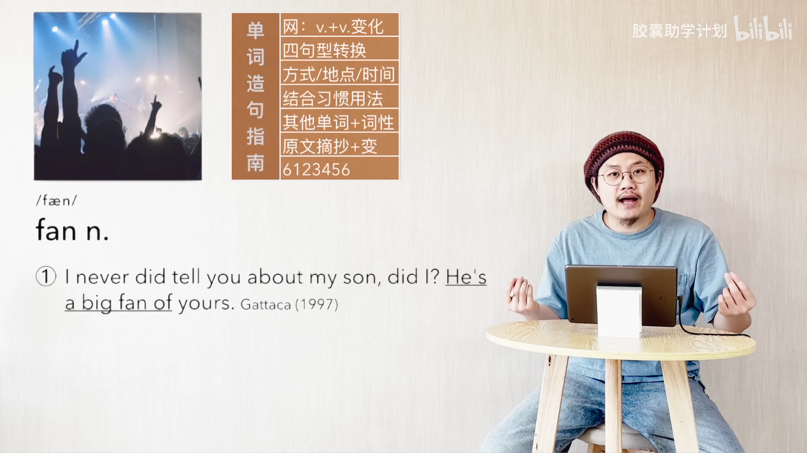

文字识别：单词造句指南 / 网：v.+v.变化 / 胶囊助学计划 / bibili / 四句型转换 / 方式/地点/时间 / 结合习惯用法 / 其他单词+词性 / 原文摘抄+变 / 6123456 / /fæen/ / fan n. / ① I never did tellyou about my son, did I? He's / a big fan of yours. Gattaca (1997)

## 00:05:00–00:05:30

or somebody. This is本课的一个习惯用法。说哎，我从来没有跟你聊关于我的儿子的事情，是吧？哎，他是你的一个头号粉丝啊。He is a big fan of yours. Okay,那你不一定非聊纸粉，你其实指我很喜欢某个东西也行。比如说，He is such a big fan of all sorts of music that哎，三十五课such点儿点儿that说他是如此大的一个对于各种各样的

### 画面 00:05:00

文字识别：单词造句指南 / 网：v.+v.变化 / 胶囊助学计划 / bilbili / 四句型转换 / 方式/地点/时间 / 结合习惯用法 / 其他单词+词性 / 原文摘抄+变 / 6123456 / /fæen/ / fan n. / ① I never did tellyou about my son, did I? He's / a big fan of yours. Gattaca (1997)

### 画面 00:05:05

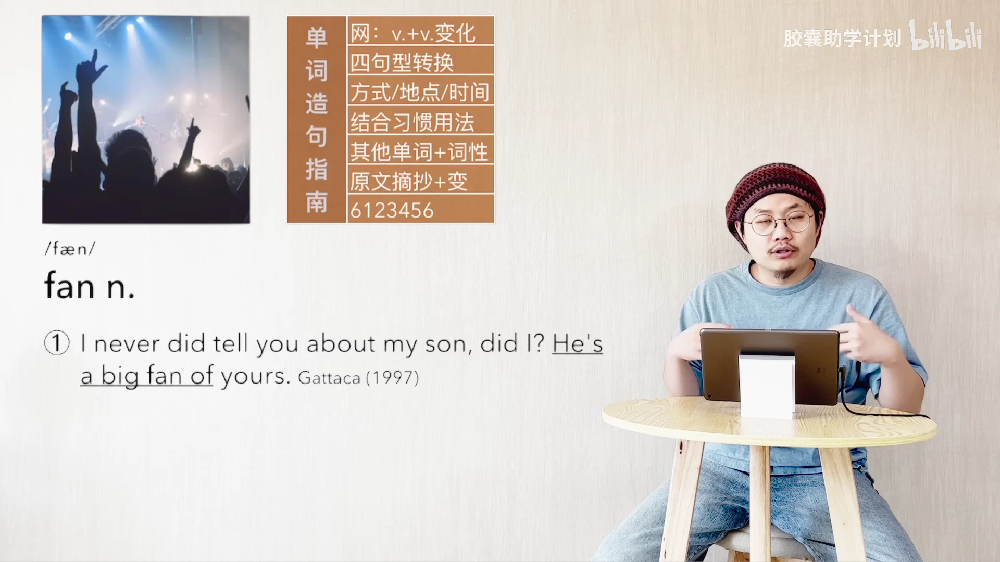

文字识别：单词造句指南 / 网：v.+v.变化 / 胶囊助学计划 / Bilbili / 四句型转换 / 方式/地点/时间 / 结合习惯用法 / 其他单词+词性 / 原文摘抄+变 / 6123456 / /fæn/ / fan n. / ① I never did tellyou about my son, did I? He's / a big fan of yours. Gattaca (1997)

### 画面 00:05:10

文字识别：单词造句指南 / 网：v.+v.变化 / 胶囊助学计划 / bibil / 四句型转换 / 方式/地点/时间 / 结合习惯用法 / 其他单词+词性 / 原文摘抄+变 / 6123456 / /fæen/ / fan n. / ① I never did tell you about my son, did I? He's / a big fan of yours. Gattaca (1997)

### 画面 00:05:13

文字识别：胶囊助学计划ilil / 单词造句指南 / 网：v.+v.变化 / 四句型转换 / 方式/地点/时间 / 结合习惯用法 / 其他单词+词性 / 原文摘抄+变 / 6123456 / /fæen/ / fan n. / ① I never did tell you about my son, did I? He's / a big fan of yours. Gattaca (1997) / He is such a big fan of all sorts of music that / ….. L35 L63

### 画面 00:05:16

文字识别：单词造句指南 / 网：v.+v.变化 / 胶囊助学计划 / bilbii / 四句型转换 / 方式/地点/时间 / 结合习惯用法 / 其他单词+词性 / 原文摘抄+变 / 6123456 / /fæen/ / fan n. / ① I never did tellyou about my son, did I? He's / a big fan of yours. Gattaca (1997) / He is such a big fan of all sorts of music that / ... L35 L63

### 画面 00:05:20

文字识别：单词造句指南 / 网：v.+v.变化 / 胶囊助学计划 / bibii / 四句型转换 / 方式/地点/时间 / 结合习惯用法 / 其他单词+词性 / 原文摘抄+变 / 6123456 / /fæen/ / fan n. / ① I never did tell you about my son, did I? He's / a big fan of yours. Gattaca (1997) / He is such a big fan of all sorts of music that / ….. L35 L63

### 画面 00:05:25

文字识别：单词造句指南 / 网：v.+v.变化 / 胶囊助学计划 / biibili / 四句型转换 / 方式/地点/时间 / 结合习惯用法 / 其他单词+词性 / 原文摘抄+变 / 6123456 / /fæen/ / fan n. / ① I never did tellyou about my son, did I? He's / a big fan of yours. Gattaca (1997) / He is such a big fan of all sorts of music that / .….. L35 L63

### 画面 00:05:29

文字识别：单词造句指南 / 网：v.+v.变化 / 胶囊助学计划 / bilbili / 四句型转换 / 方式/地点/时间 / 结合习惯用法 / 其他单词+词性 / 原文摘抄+变 / 6123456 / /fæen/ / fan n. / ① I never did tellyou about my son, did I? He's / a big fan of yours. Gattaca (1997) / He is such a big fan of all sorts of music that / ... L35 L63

## 00:05:30–00:06:00

音乐，哎，他是一个大粉丝，对吧？说以至于，哎，其实这儿你就不是翻译成大粉丝，就是他很喜欢，he he likes，对吧？All kinds of all sorts of music, OK. 然后以至于后边那句话，您自己去填啊。All sorts of六十三课咱们学的，类似于all kinds of各式各样的。那你看这句话什么意思？说我是钱的粉丝，Pinapolo，是吧？说I'm a big fan of the money，什么意思？啊，什么叫做我是钱的忠实粉丝啊？其实你汉

### 画面 00:05:31

文字识别：单词造句指南 / 网：v.+v.变化 / 胶囊助学计划 / biltbii / 四句型转换 / 方式/地点/时间 / 结合习惯用法 / 其他单词+词性 / 原文摘抄+变 / 6123456 / /fæen/ / fan n. / ① I never did tell you about my son, did I? He's / a big fan of yours. Gattaca (1997) / He is such a big fan of all sorts of music that / ….. L35 L63

### 画面 00:05:35

文字识别：单词造句指南 / 网：v.+v.变化 / 胶囊助学计划 / Bilbili / 四句型转换 / 方式/地点/时间 / 结合习惯用法 / 其他单词+词性 / 原文摘抄+变 / 6123456 / /fæen/ / fan n. / ① I never did tellyou about my son, did I? He's / a big fan of yours. Gattaca (1997) / He is such a big fan of all sorts of music that / ... L35 L63

### 画面 00:05:40

文字识别：单词造句指南 / 网：v.+v.变化 / 胶囊助学计划 / bibii / 四句型转换 / 方式/地点/时间 / 结合习惯用法 / 其他单词+词性 / 原文摘抄+变 / 6123456 / /fæen/ / fan n. / ① I never did tell you about my son, did I? He's / a big fan of yours. Gattaca (1997) / He is such a big fan of all sorts of music that / ... L35 L63

### 画面 00:05:45

文字识别：单词造句指南 / 网：v.+v.变化 / 胶囊助学计划 / biibii / 四句型转换 / 方式/地点/时间 / 结合习惯用法 / 其他单词+词性 / 原文摘抄+变 / 6123456 / /faæen/ / fan n. / ① I never did tell you about my son, did I? He's / a big fan of yours. Gattaca (1997) / He is such a big fan of all sorts of music that / ... L35 L63

### 画面 00:05:48

文字识别：单词造句指南 / 网：v.+v.变化 / 胶囊助学计划 / bilbili / 四句型转换 / 方式/地点/时间 / 结合习惯用法 / 其他单词+词性 / 原文摘抄+变 / 6123456 / /fæen/ / fan n. / ① I never did tell you about my son, did I? He's / a big fan of yours. Gattaca (1997) / He is such a big fan of all sorts of music that / ...L35 L63 / ③ I'm a big fan of the money. Penelope (2006)

### 画面 00:05:50

文字识别：单词造句指南 / 网：v.+v.变化 / 胶囊助学计划 / bilbii / 四句型转换 / 方式/地点/时间 / 结合习惯用法 / 其他单词+词性 / 原文摘抄+变 / 6123456 / /fæen/ / fan n. / ① I never did tell you about my son, did I? He's / a big fan of yours. Gattaca (1997) / He is such a big fan of all sorts of music that / ... L35 L63 / ③ I'm a big fan of the money. Penelope (2006)

### 画面 00:05:52

文字识别：胶囊助学计划biibil / 单词造句指南 / 网：v.+v.变化 / 四句型转换 / 方式/地点/时间 / 结合习惯用法 / 其他单词+词性 / 原文摘抄+变 / 6123456 / /fæen/ / fan n. / ① I never did tell you about my son, did I? He's / a big fan of yours. Gattaca (1997) / He is such a big fan of all sorts of music that / …..L35 L63 / ③ I'm a big fan of the money. Penelope (2006)

### 画面 00:05:54

文字识别：单词造句指南 / 网：v.+v.变化 / 胶囊助学计划 / Bilbili / 四句型转换 / 方式/地点/时间 / 结合习惯用法 / 其他单词+词性 / 原文摘抄+变 / 6123456 / /fæen/ / fan n. / ① I never did tell you about my son, did I? He's / a big fan of yours. Gattaca (1997) / He is such a big fan of all sorts of music that / ... L35 L63 / ③ I'm a big fan of the money. Penelope (2006)

### 画面 00:05:56

文字识别：胶囊助学计划bibil / 单词造句指南 / 网：v.+v.变化 / 四句型转换 / 方式/地点/时间 / 结合习惯用法 / 其他单词+词性 / 原文摘抄+变 / 6123456 / /fæn/ / fan n. / ① I never did tell you about my son, did I? He's / a big fan of yours. Gattaca (1997) / He is such a big fan of all sorts of music that / ... L35 L63 / ③ I'm a big fan of the money. Penelope (2006)

### 画面 00:05:59

文字识别：胶囊助学计划bibi / 单词造句指南 / 网：v.+v.变化 / 四句型转换 / 方式/地点/时间 / 结合习惯用法 / 其他单词+词性 / 原文摘抄+变 / 6123456 / /fæn/ / fan n. / ① I never did tell you about my son, did I? He's / a big fan of yours. Gattaca (1997) /  He is such a big fan of all sorts of music that / ... L35 L63 / ③ I'm a big fan of the money. Penelope (2006)

## 00:06:00–00:06:30

语这么聊，你也能懂，对吧？我就不做解释了啊，就是很爱钱嘛，对吧？那注意力集中，你看这里说 I'm a huge fan of your wine。你看还是那句话啊，它的句式没有变，只不过它这里的粉丝的意思其实就是一个狂热爱好者，或者说一个忠实的，这个很喜欢，其实就表达这样的意思啊。注意力集中，咱听一下。 I'm a huge fan of your wine. Okay, 下一个单词跟我们一起读一下，叫做 shady,

### 画面 00:06:01

文字识别：胶囊助学计划bibi / 单词造句指南 / 网：v.+v.变化 / 四句型转换 / 方式/地点/时间 / 结合习惯用法 / 其他单词+词性 / 原文摘抄+变 / 6123456 / /fæen/ / fan n. / ① I never did tell you about my son, did I? He's / a big fan of yours. Gattaca (1997) / He is such a big fan of all sorts of music that / ... L35 L63 / ③ I'm a big fan of the money. Penelope (2006)

### 画面 00:06:04

文字识别：bilbli / 胶囊助学计划 / And I'm a huge fan of your wine. / Evil Angel / (1985)

### 画面 00:06:23

文字识别：Bilbii / 胶囊助学计划 / And I'm a huge fan of your wine. / Evil Angel / (1985)

### 画面 00:06:25

文字识别：bilbii / 胶囊助学计划 / And I'm a huge fan of your wine. / Evil Angel / (1985)

### 画面 00:06:27

文字识别：单词造句指南 / 网：v.+v.变化 / 胶囊助学计划 / bilbi / 四句型转换 / 方式/地点/时间 / 结合习惯用法 / 其他单词+词性 / 原文摘抄+变 / 6123456 / /'Jeidi/ / shady adj.

## 00:06:30–00:07:00

shady，shady，shady 呢，指的是这个。我印象当中，我们应该是在新一百四十三课，呃，学过这个单词啊。但我这个印象可能错了，因为讲一百四十三课的时候，已经时间很久远了。那 shady 这个单词，它指的是树荫啊，那个阴凉叫做 shady。好，那原文给了我们这样一句话，首先你注意它是个形容词，那它可能跟名词连在一起

### 画面 00:06:30

文字识别：单词造句指南 / 网：v.+v.变化 / 胶囊助学计划 / bilbili / 四句型转换 / 方式/地点/时间 / 结合习惯用法 / 其他单词+词性 / 原文摘抄+变 / 6123456 / /'Jeidi/ / shady adj.

### 画面 00:06:35

文字识别：单词造句指南 / 网：v.+v.变化 / 胶囊助学计划 / bilbili / 四句型转换 / 方式/地点/时间 / 结合习惯用法 / 其他单词+词性 / 原文摘抄+变 / 6123456 / /'Jeidi/ / shady adj.

### 画面 00:06:41

文字识别：单词造句指南 / 网：v.+v.变化 / 胶囊助学计划 / bilbi / 四句型转换 / 方式/地点/时间 / 结合习惯用法 / 其他单词+词性 / 原文摘抄+变 / 6123456 / /'Jeidi/ / shady adj.

### 画面 00:06:49

文字识别：单词造句指南 / 网：v.+v.变化 / 胶囊助学计划 / bilbii / 四句型转换 / 方式/地点/时间 / 结合习惯用法 / 其他单词+词性 / 原文摘抄+变 / 6123456 / /'Jerdi/ / shady adj.

### 画面 00:06:51

文字识别：单词造句指南 / 网：v.+v.变化 / 胶囊助学计划 / bilbili / 四句型转换 / 方式/地点/时间 / 结合习惯用法 / 其他单词+词性 / 原文摘抄+变 / 6123456 / /'Jeidi/ / shady adj.

### 画面 00:06:53

文字识别：单词造句指南 / 网：v.+v.变化 / 胶囊助学计划 / bibili / 四句型转换 / 方式/地点/时间 / 结合习惯用法 / 其他单词+词性 / 原文摘抄+变 / 6123456 / /'Seidi/ / shady adj. / ① [Story]: ... a shady spot under some trees.

### 画面 00:06:57

文字识别：单词造句指南 / 网：v.+v.变化 / 胶囊助学计划 / biibii / 四句型转换 / 方式/地点/时间 / 结合习惯用法 / 其他单词+词性 / 原文摘抄+变 / 6123456 / /'Jeidi/ / shady adj. / ① [Story]: ... a shady spot under some trees.

## 00:07:00–00:07:30

连的这个单词是我印象很深的，一百四十三课新一咱们确实学过 spot，对吧？叫做 a shady spot，说一个阴凉地儿啊，under some trees，在一些树的底下阴凉地儿啊。 Okay，那它其实呢，我们就可以造句子了嘛，就是告诉你 shady 跟 spot 可以连起来。原文提供了这样一个小的语言片段，我们拿这个片段结合我们之前学的东西。好，这里首先注意应该是 has，

### 画面 00:07:01

文字识别：单词造句指南 / 网：v.+v.变化 / 胶囊助学计划 / biibii / 四句型转换 / 方式/地点/时间 / 结合习惯用法 / 其他单词+词性 / 原文摘抄+变 / 6123456 / /'Jeidi/ / shady adj. / ① [Story]: ... a shady spot under some trees.

### 画面 00:07:05

文字识别：单词造句指南 / 网：v.+v.变化 / 胶囊助学计划 / bibii / 四句型转换 / 方式/地点/时间 / 结合习惯用法 / 其他单词+词性 / 原文摘抄+变 / 6123456 / /'Jeidi/ / shady adj. / ① [Story]: ... a shady spot under some trees.

### 画面 00:07:11

文字识别：单词造句指南 / 网：v.+v.变化 / 胶囊助学计划 / bibii / 四句型转换 / 方式/地点/时间 / 结合习惯用法 / 其他单词+词性 / 原文摘抄+变 / 6123456 / /'Seidi/ / shady adj. / ① [Story]: ... a shady spot under some trees.

### 画面 00:07:13

文字识别：单词造句指南 / 网：v.+v.变化 / 胶囊助学计划 / bibii / 四句型转换 / 方式/地点/时间 / 结合习惯用法 / 其他单词+词性 / 原文摘抄+变 / 6123456 / /'Jeidi/ / shady adj. / ① [Story]: ... a shady spot under some trees.

### 画面 00:07:15

文字识别：胶囊助学计划biiil / 单词造句指南 / 网：v.+v.变化 / 四句型转换 / 方式/地点/时间 / 结合习惯用法 / 其他单词+词性 / 原文摘抄+变 / 6123456 / /'Jeidi/ / shady adj. / ① [Story]: ... a shady spot under some trees. /  He have been reading a book in that shady / spot for a long time. L52 have/ how long..

### 画面 00:07:20

文字识别：单词造句指南 / 网：v.+v.变化 / 胶囊助学计划 / bilibili / 四句型转换 / 方式/地点/时间 / 结合习惯用法 / 其他单词+词性 / 原文摘抄+变 / 6123456 / /'Jeidi/ / shady adj. / ① [Story]: ... a shady spot under some trees. / ② He have been reading a book in that shady / spot for a long time. L52 have/ how long..

### 画面 00:07:25

文字识别：单词造句指南 / 网：v.+v.变化 / 胶囊助学计划 / Bilbili / 四句型转换 / 方式/地点/时间 / 结合习惯用法 / 其他单词+词性 / 原文摘抄+变 / 6123456 / /'Seidi/ / shady adj. / ① [Story]: ... a shady spot under some trees. /  He have been reading a book in that shady / spot for a long time. L52 have/ how long..

### 画面 00:07:27

文字识别：单词造句指南 / 网：v.+v.变化 / 胶囊助学计划 / Bibli / 四句型转换 / 方式/地点/时间 / 结合习惯用法 / 其他单词+词性 / 原文摘抄+变 / 6123456 / /'Jeidi/ / shady adj. / ① [Story]: ... a shady spot under some trees. /  He have been reading a book in that shady / spot for a long time. L52 have/ how long..

### 画面 00:07:29

文字识别：单词造句指南 / 网：v.+v.变化 / 胶囊助学计划 / bibli / 四句型转换 / 方式/地点/时间 / 结合习惯用法 / 其他单词+词性 / 原文摘抄+变 / 6123456 / /'Jerdi/ / shady adj. / ① [Story]:.. a shady spot under some trees. /  He have been reading a book in that shady / spot for a long time. L52 have/ how long..

## 00:07:30–00:08:00

哎，这是一个 type。 He has been reading a book in that shady spot for a long time。好，说他已经读书，说在那个阴凉地儿很长很长时间了，对吧？为什么用 has 三单吧？然后呢，这个 has been reading 或 have been reading，我们给它换回原形是五十二课咱们学的，现在完成进行时。接下来四句型的转换就交给您自己了。多提一句， How long

### 画面 00:07:31

文字识别：单词造句指南 / 网：v.+v.变化 / 胶囊助学计划 / bibii / 四句型转换 / 方式/地点/时间 / 结合习惯用法 / 其他单词+词性 / 原文摘抄+变 / 6123456 / /'Jeidi/ / shady adj. / hert / ① [Story]: ... a shady spot under some trees. /  He have been reading a book in that shady / spot for a long time. L52 have/ how long..

### 画面 00:07:40

文字识别：单词造句指南 / 网：v.+v.变化 / 胶囊助学计划 / bilbii / 四句型转换 / 方式/地点/时间 / 结合习惯用法 / 其他单词+词性 / 原文摘抄+变 / 6123456 / /'Seidi/ / shady adj. / hers / ① [Story]: ... a shady spot under some trees. /  He have been reading a book in that shady / spot for a long time. L52 have/ how long..

### 画面 00:07:45

文字识别：单词造句指南 / 网：v.+v.变化 / 胶囊助学计划 / bibil / 四句型转换 / 方式/地点/时间 / 结合习惯用法 / 其他单词+词性 / 原文摘抄+变 / 6123456 / /'Jeidi/ / shady adj. / hs / ① [Story]:... a shady spot under some trees. /  He have been reading a book in that shady / spot for a long time. L52 have/ how long..

### 画面 00:07:50

文字识别：单词造句指南 / 网：v.+v.变化 / 胶囊助学计划 / bibli / 四句型转换 / 方式/地点/时间 / 结合习惯用法 / 其他单词+词性 / 原文摘抄+变 / 6123456 / /'Seidi/ / shady adj. / hrs / ① [Story]: ... a shady spot under some trees. /  He have been reading a book in that shady / spot for a long time. L52 have/ how long..

### 画面 00:07:55

文字识别：单词造句指南 / 网：v.+v.变化 / 胶囊助学计划 / bilbii / 四句型转换 / 方式/地点/时间 / 结合习惯用法 / 其他单词+词性 / 原文摘抄+变 / 6123456 / /'Jeidi/ / shady adj. / hers / ① [Story]:... a shady spot under some trees. / He have been reading a book in that shady / spot for a long time. L52 have/ how long..

### 画面 00:07:57

文字识别：单词造句指南 / 网：v.+v.变化 / 胶囊助学计划 / bibli / 四句型转换 / 方式/地点/时间 / 结合习惯用法 / 其他单词+词性 / 原文摘抄+变 / 6123456 / /'Jeidi/ / shady adj. / hers / ① [Story]: .. a shady spot under some trees. /  He have been reading a book in that shady / spot for a long time. L52 have/ how long..

## 00:08:00–00:08:30

是对For a long time提问啊，这种时型转换各位完全，因为我们是录屏课，各位完全可以暂停屏幕，然后开始做这个练习啊。Next one说It used to be a beautiful shady spot，说它过去是一个特别美丽，然后呢，哎，然后还是一个很阴凉的地方。OK啊，这是一个我在杂志当中找到的句子。首先它用到了我们学的单词，其次呢还用到了一个三十一课咱们学过的used to do。

### 画面 00:08:00

文字识别：单词造句指南 / 网：v.+v.变化 / 胶囊助学计划 / bibii / 四句型转换 / 方式/地点/时间 / 结合习惯用法 / 其他单词+词性 / 原文摘抄+变 / 6123456 / /'Jeidi/ / shady adj. / hers / ① [Story]: .. a shady spot under some trees. /  He have been reading a book in that shady / spot for a long time. L52 have/ how long..

### 画面 00:08:02

文字识别：单词造句指南 / 网：v.+v.变化 / 胶囊助学计划 / bilbii / 四句型转换 / 方式/地点/时间 / 结合习惯用法 / 其他单词+词性 / 原文摘抄+变 / 6123456 / /'feidi/ / shady adj. / hers / ① [Story]: ... a shady spot under some trees. /  Hehave been reading a book in that shady / spot for a long time. L52 have/ how long..

### 画面 00:08:04

文字识别：单词造句指南 / 网：v.+v.变化 / 胶囊助学计划 / bibii / 四句型转换 / 方式/地点/时间 / 结合习惯用法 / 其他单词+词性 / 原文摘抄+变 / 6123456 / /'Seidi/ / shady adj. / hes / ① [Story]:.. a shady spot under some trees. /  He have been reading a book in that shady / spot for a long time. L52 have/ how long..

### 画面 00:08:08

文字识别：单词造句指南 / 网：v.+v.变化 / 胶囊助学计划 / Libli / 四句型转换 / 方式/地点/时间 / 结合习惯用法 / 其他单词+词性 / 原文摘抄+变 / 6123456 / /'Jeidi/ / shady adj. / hes / ① [Story]: ...a shady spot under some trees. /  He have been reading a book in that shady / 2 / spot for a long time. L52 have/ how long.. / It used to be a beautiful, shady spot. The New / Yorker L31

### 画面 00:08:10

文字识别：单词造句指南 / 网：v.+v.变化 / 胶囊助学计划 / biltbii / 四句型转换 / 方式/地点/时间 / 结合习惯用法 / 其他单词+词性 / 原文摘抄+变 / 6123456 / /'Jeidi/ / shady adj. / het / ① [Story]: ...a shady spot under some trees. /  He have been reading a book in that shady / 2 / spot for a long time. L52 have/ how long.. / It used to be a beautiful, shady spot. The New / Yorker L31

### 画面 00:08:16

文字识别：单词造句指南 / 网：v.+v.变化 / 胶囊助学计划 / Bilbili / 四句型转换 / 方式/地点/时间 / 结合习惯用法 / 其他单词+词性 / 原文摘抄+变 / 6123456 / /'Jeidi/ / shady adj. / hers / ① [Storyj]: ...a shady spot under some trees. /  He have been reading a book in that shady / 2 / spot for a long time. L52 have/ how long.. / It used to be a beautiful, shady spot. The New / Yorker L31

### 画面 00:08:21

文字识别：单词造句指南 / 网：v.+v.变化 / 胶囊助学计划 / biltbii / 四句型转换 / 方式/地点/时间 / 结合习惯用法 / 其他单词+词性 / 原文摘抄+变 / 6123456 / /Seidi/ / shady adj. / heus / ① [Story]: ...a shady spot under some trees. / ② He have been reading a book in that shady / spot for a long time. L52 have/ how long.. / It used to be a beautiful, shady spot. The New / Yorker L31 /  We were able to/managed to find a shady / spot and have a picnic there. L43 L67

### 画面 00:08:24

文字识别：单词造句指南 / 网：v.+v.变化 / 胶囊助学计划 / bilbli / 四句型转换 / 方式/地点/时间 / 结合习惯用法 / 其他单词+词性 / 原文摘抄+变 / 6123456 / /'Seidi/ / shady adj. / hrs / ① [Story]: ...a shady spot under some trees. / ② He have been reading a book in that shady / spot for a long time. L52 have/ how long.. / It used to be a beautiful, shady spot. The New / Yorker L31 /  We were able to/managed to find a shady / spot and have a picnic there. L43 L67

### 画面 00:08:27

文字识别：单词造句指南 / 网：v.+v.变化 / 胶囊助学计划 / bibili / 四句型转换 / 方式/地点/时间 / 结合习惯用法 / 其他单词+词性 / 原文摘抄+变 / 6123456 / /'Seidi/ / shady adj. / hs / ① [Story]:... a shady spot under some trees. / ② He have been reading a book in that shady / spot for a long time. L52 have/ how long.. / It used to be a beautiful, shady spot. The New / Yorker L31 /  We were able to/managed to find a shady / spot and have a picnic there. L43 L67

## 00:08:30–00:09:00

我们自己造一个句子，or we were able to，或者是 manage to，好了，哎，成功的怎么样了呢？Find a shady spot and have a picnic there，然后在那里野餐了一下。Very good，再跟我读一遍这个单词 shady。Next one，下一个单词叫 sheriff。Sheriff 这个单词，他们叫警长，对吧？或者探长、警长啊，行政官员。好，

### 画面 00:08:32

文字识别：单词造句指南 / 网：v.+v.变化 / 胶囊助学计划 / Bilbili / 四句型转换 / 方式/地点/时间 / 结合习惯用法 / 其他单词+词性 / 原文摘抄+变 / 6123456 / /'Seidi/ / shady adj. / hrs / ① [Storyj]: ...a shady spot under some trees. / ② He have been reading a book in that shady / spot for a long time. L52 have/ how long.. / It used to be a beautiful, shady spot. The New / Yorker L31 /  We were able to/managed to find a shady / spot and have a picnic there. L43 L67

### 画面 00:08:35

文字识别：胶囊助学计划bilbil / 单词造句指南 / 网：v.+v.变化 / 四句型转换 / 方式/地点/时间 / 结合习惯用法 / 其他单词+词性 / 原文摘抄+变 / 6123456 / /Seidi/ / shady adj. / hert / ① [Story]: ...a shady spot under some trees. / ② He have been reading a book in that shady / spot for a long time. L52 have/ how long.. / It used to be a beautiful, shady spot. The New / Yorker L31 /  We were able to/managed to find a shady / spot and have a picnic there. L43 L67

### 画面 00:08:40

文字识别：胶囊助学计划biil / 单词造句指南 / 网：v.+v.变化 / 四句型转换 / 方式/地点/时间 / 结合习惯用法 / 其他单词+词性 / 原文摘抄+变 / 6123456 / /Seidi/ / shady adj. / hers / ① [Story]: ...a shady spot under some trees. / ② He have been reading a book in that shady / spot for a long time. L52 have/ how long.. / It used to be a beautiful, shady spot. The New / Yorker L31 /  We were able to/managed to find a shady / spot and have a picnic there. L43 L67

### 画面 00:08:48

文字识别：胶囊助学计划 bibil / 单词造句指南 / 网：v.+v.变化 / 四句型转换 / 方式/地点/时间 / 结合习惯用法 / 其他单词+词性 / 原文摘抄+变 / 6123456 / /'Seidi/ / shady adj. / hrt / ① [Story]: ...a shady spot under some trees. /  He have been reading a book in that shady / 2 / spot for a long time. L52 have/ how long.. / It used to be a beautiful, shady spot. The New / Yorker L31 /  We were able to/managed to find a shady / spot and have a picnic there. L43 L67

### 画面 00:08:50

文字识别：单词造句指南 / 网：v.+v.变化 / 胶囊助学计划 / bilbli / 四句型转换 / 方式/地点/时间 / 结合习惯用法 / 其他单词+词性 / 原文摘抄+变 / 6123456 / / '∫erif / / sheriff n.

### 画面 00:08:55

文字识别：单词造句指南 / 网：v.+v.变化 / 胶囊助学计划 / bilbili / 四句型转换 / 方式/地点/时间 / 结合习惯用法 / 其他单词+词性 / 原文摘抄+变 / 6123456 / / 'Serif / / sheriff n.

## 00:09:00–00:09:30

注意很多同学可能跟 police 这个单词会有一点混。首先，呃，在大多数情况下，其实基本上指的是一码事儿啊，只不过它有使用的场景。比如说，你这个电影是在纽约市里面，或者我们说在芝加哥市里面拍的啊，Los Angeles 啊，或者 Texas 德克萨斯啊，不是德克萨斯，就比如说休斯顿市啊，大城市里一般叫 police 会多一点。

### 画面 00:09:00

文字识别：单词造句指南 / 网：v.+v.变化 / 胶囊助学计划 / biibili / 四句型转换 / 方式/地点/时间 / 结合习惯用法 / 其他单词+词性 / 原文摘抄+变 / 6123456 / / 'Serif / / sheriff n.

### 画面 00:09:09

文字识别：单词造句指南 / 网：v.+v.变化 / 胶囊助学计划 / bibii / 四句型转换 / 方式/地点/时间 / 结合习惯用法 / 其他单词+词性 / 原文摘抄+变 / 6123456 / / 'Serif / / sheriff n.

### 画面 00:09:12

文字识别：单词造句指南 / 网：v.+v.变化 / 胶囊助学计划 / bilbili / 四句型转换 / 方式/地点/时间 / 结合习惯用法 / 其他单词+词性 / 原文摘抄+变 / 6123456 / / Serif / / sheriff n.

### 画面 00:09:18

文字识别：单词造句指南 / 网：v.+v.变化 / 胶囊助学计划 / bilbili / 四句型转换 / 方式/地点/时间 / 结合习惯用法 / 其他单词+词性 / 原文摘抄+变 / 6123456 / / '∫erif / / sheriff n.

### 画面 00:09:23

文字识别：单词造句指南 / 网：v.+v.变化 / 胶囊助学计划 / bilbili / 四句型转换 / 方式/地点/时间 / 结合习惯用法 / 其他单词+词性 / 原文摘抄+变 / 6123456 / / '∫erif / / sheriff n.

### 画面 00:09:29

文字识别：单词造句指南 / 网：v.+v.变化 / 胶囊助学计划 / bilbii / 四句型转换 / 方式/地点/时间 / 结合习惯用法 / 其他单词+词性 / 原文摘抄+变 / 6123456 / / 'Serif / / sheriff n.

## 00:09:30–00:10:00

然后这个 sheriff 呢，我只能这么跟你说，就是在我的语感当中，大多数都是县城啊，美国有很多的这个 town 对吧，little town 这个小城镇里面的这个 police 啊，本地人一般都管他们叫 sheriff，而不是叫这个 police 啊，OK，但只是其实就是 police 的意思啊，所以呢，造句子就很容易了，就我们结合之前学

### 画面 00:09:35

文字识别：单词造句指南 / 网：v.+v.变化 / 胶囊助学计划 / bilbili / 四句型转换 / 方式/地点/时间 / 结合习惯用法 / 其他单词+词性 / 原文摘抄+变 / 6123456 / / 'Serif / / sheriff n.

### 画面 00:09:53

文字识别：单词造句指南 / 网：v.+v.变化 / 胶囊助学计划 / bilbli / 四句型转换 / 方式/地点/时间 / 结合习惯用法 / 其他单词+词性 / 原文摘抄+变 / 6123456 / / '∫erif / / sheriff n.

### 画面 00:09:57

文字识别：单词造句指南 / 网：v.+v.变化 / 胶囊助学计划 / bilbili / 四句型转换 / 方式/地点/时间 / 结合习惯用法 / 其他单词+词性 / 原文摘抄+变 / 6123456 / / '∫erif/ / sheriff n. / ① The sheriff insisted on our/us leaving the / place.L68

### 画面 00:09:59

文字识别：单词造句指南 / 网：v.+v.变化 / 胶囊助学计划 / Bilbili / 四句型转换 / 方式/地点/时间 / 结合习惯用法 / 其他单词+词性 / 原文摘抄+变 / 6123456 / / '∫erif/ / sheriff n. / ① The sheriff insisted on our/us leaving the / place.L68

## 00:10:00–00:10:30

的习惯用法就OK了。比如说，the sheriff insisted on our或者us leaving the place。我们从比较正式的和考试的角度是our，都OK的角度是us，完全没有问题。之前跟各位说过啊，语法跟用法是不太一样的。那坚持我们离开这个地方。Next one说is no use pretending that you know our sheriff，就说假装你认识我们的这个探长没用啊，我们不搞那一套啊，腐败的关系不搞。

### 画面 00:10:01

文字识别：单词造句指南 / 网：v.+v.变化 / 胶囊助学计划 / bilbili / 四句型转换 / 方式/地点/时间 / 结合习惯用法 / 其他单词+词性 / 原文摘抄+变 / 6123456 / / Serif/ / sheriff n. / ① The sheriff insisted on our/us leaving the / place.L68

### 画面 00:10:03

文字识别：单词造句指南 / 网：v.+v.变化 / 胶囊助学计划 / bilbili / 四句型转换 / 方式/地点/时间 / 结合习惯用法 / 其他单词+词性 / 原文摘抄+变 / 6123456 / / '∫erif/ / sheriff n. / ① The sheriff insisted on our/us leaving the / place.L68

### 画面 00:10:07

文字识别：单词造句指南 / 网：v.+v.变化 / 胶囊助学计划 / bilbii / 四句型转换 / 方式/地点/时间 / 结合习惯用法 / 其他单词+词性 / 原文摘抄+变 / 6123456 / /'∫erif/ / sheriff n. / ① The sheriff insisted on our/us leaving the / place. L68

### 画面 00:10:15

文字识别：单词造句指南 / 网：v.+v.变化 / 胶囊助学计划 / bibili / 四句型转换 / 方式/地点/时间 / 结合习惯用法 / 其他单词+词性 / 原文摘抄+变 / 6123456 / / '∫erif/ / sheriff n. / ① The sheriff insisted on our/us leaving the / place.L68

### 画面 00:10:18

文字识别：单词造句指南 / 网：v.+v.变化 / 胶囊助学计划 / biibii / 四句型转换 / 方式/地点/时间 / 结合习惯用法 / 其他单词+词性 / 原文摘抄+变 / 6123456 / / '∫erif / / sheriff n. / ① The sheriff insisted on our/us leaving the / place. L68 / It's no use pretending that you know our / sheriff. L68

### 画面 00:10:20

文字识别：单词造句指南 / 网：v.+v.变化 / 胶囊助学计划 / bibii / 四句型转换 / 方式/地点/时间 / 结合习惯用法 / 其他单词+词性 / 原文摘抄+变 / 6123456 / /'∫erif/ / sheriff n. / ① The sheriff insisted on our/us leaving the / place. L68 / It's no use pretending that you know our / sheriff. L68

### 画面 00:10:26

文字识别：单词造句指南 / 网：v.+v.变化 / 胶囊助学计划 / bibii / 四句型转换 / 方式/地点/时间 / 结合习惯用法 / 其他单词+词性 / 原文摘抄+变 / 6123456 / /'∫erif/ / sheriff n. / ① The sheriff insisted on our/us leaving the / place. L68 / It's no use pretending that you know our / sheriff. L68

### 画面 00:10:28

文字识别：胶囊助学计划biibil / 单词造句指南 / 网：v.+v.变化 / 四句型转换 / 方式/地点/时间 / 结合习惯用法 / 其他单词+词性 / 原文摘抄+变 / 6123456 / /'∫erif/ / sheriff n. / ① The sheriff insisted on our/us leaving the / place. L68 / It's no use pretending that you know our / sheriff. L68 / In the meantime, the sheriff's son played / truant from school. L73

## 00:10:30–00:11:00

最后说，in the meantime，与此同时，the sheriff's son played truant from school。说这个探长的儿子怎么样了呢？还从学校逃学了。七十三课咱刚学的，不多说了。跟我读一遍这个单词，sheriff， very good。下一个单词，notice。notice这个单词对于各位来说，动词我们之前是学过的，早在六十七课叫 somebody notice that，叫某人注意

### 画面 00:10:30

文字识别：单词造句指南 / 网：v.+v.变化 / 胶囊助学计划ilbil / 四句型转换 / 方式/地点/时间 / 结合习惯用法 / 其他单词+词性 / 原文摘抄+变 / 6123456 / /'∫erif/ / sheriff n. / ① The sheriff insisted on our/us leaving the / place. L68 / It's no use pretending that you know our / sheriff. L68 / In the meantime, the sheriff's son played / truant from school. L73

### 画面 00:10:35

文字识别：单词造句指南 / 网：v.+v.变化 / 胶囊助学计划 / bilbili / 四句型转换 / 方式/地点/时间 / 结合习惯用法 / 其他单词+词性 / 原文摘抄+变 / 6123456 / /'∫erif/ / sheriff n. / ① The sheriff insisted on our/us leaving the / place. L68 / It's no use pretending that you know our / sheriff. L68 / In the meantime, the sheriff's son played / truant from school. L73

### 画面 00:10:38

文字识别：胶囊助学计划biibil / 单词造句指南 / 网：v.+v.变化 / 四句型转换 / 方式/地点/时间 / 结合习惯用法 / 其他单词+词性 / 原文摘抄+变 / 6123456 / /'∫erif/ / sheriff n. / ① The sheriff insisted on our/us leaving the / place. L68 / It's no use pretending that you know our / sheriff. L68 / In the meantime, the sheriff's son played / truant from school. L73

### 画面 00:10:40

文字识别：胶囊助学计划 biibil / 单词造句指南 / 网：v.+v.变化 / 四句型转换 / 方式/地点/时间 / 结合习惯用法 / 其他单词+词性 / 原文摘抄+变 / 6123456 / /'Serif/ / sheriff n. / ① The sheriff insisted on our/us leaving the / place. L68 / It's no use pretending that you know our / sheriff. L68 / In the meantime, the sheriff's son played / truant from school. L73

### 画面 00:10:43

文字识别：单词造句指南 / 网：v.+v.变化 / 胶囊助学计划 biibil / 四句型转换 / 方式/地点/时间 / 结合习惯用法 / 其他单词+词性 / 原文摘抄+变 / 6123456 / /'Serif/ / sheriff n. / ① The sheriff insisted on our/us leaving the / place. L68 / It's no use pretending that you know our / sheriff. L68 / In the meantime, the sheriff's son played / truant from school. L73

### 画面 00:10:46

文字识别：胶囊助学计划bilbi / 单词造句指南 / 网：v.+v.变化 / 四句型转换 / 方式/地点/时间 / 结合习惯用法 / 其他单词+词性 / 原文摘抄+变 / 6123456 / / '∫erif/ / sheriff n. / ① The sheriff insisted on our/us leaving the / place. L68 / It's no use pretending that you know our / sheriff. L68 / In the meantime, the sheriff's son played / truant from school. L73

### 画面 00:10:49

文字识别：单词造句指南 / 网：v.+v.变化 / 胶囊助学计划 / bilbili / 四句型转换 / 方式/地点/时间 / 结合习惯用法 / 其他单词+词性 / 原文摘抄+变 / 6123456 / /'nautis/ / notice n. v.

### 画面 00:10:51

文字识别：单词造句指南 / 网：v.+v.变化 / 胶囊助学计划 / bilbil / 四句型转换 / 方式/地点/时间 / 结合习惯用法 / 其他单词+词性 / 原文摘抄+变 / 6123456 / /'nautis/ / notice n. v.

### 画面 00:10:55

文字识别：单词造句指南 / 网：v.+v.变化 / 胶囊助学计划 / bilbili / 四句型转换 / 方式/地点/时间 / 结合习惯用法 / 其他单词+词性 / 原文摘抄+变 / 6123456 / /'nautis/ / notice n. v. / ①sb.noticed that +句子 L67

## 00:11:00–00:11:30

到后边加一句话，注意到一件事儿。然后本课呢，notice是一个名词，它是这种告示啊，就是贴在墙上的告示，说注意了啊，大家怎么怎么样啊，是这个告示啊，叫做notice。好，然后呢，很常见的一个短语，它还有一个通知的意思嘛，告示通知啊，上面写着两个大字注意啊，或者写着两个大字啊，这个通知啊，然后底下不拉不拉不拉啊，然后呢，这个东西就叫notice。那

### 画面 00:11:00

文字识别：单词造句指南 / 网：v.+v.变化 / 胶囊助学计划 / bilbili / 四句型转换 / 方式/地点/时间 / 结合习惯用法 / 其他单词+词性 / 原文摘抄+变 / 6123456 / /'nautis/ / notice n. v. / ① sb.noticed that +句子 L67

### 画面 00:11:02

文字识别：单词造句指南 / 网：v.+v.变化 / 胶囊助学计划 / bilbili / 四句型转换 / 方式/地点/时间 / 结合习惯用法 / 其他单词+词性 / 原文摘抄+变 / 6123456 / /'nautis/ / notice n. v. / ①sb.noticed that +句子 L67

### 画面 00:11:05

文字识别：单词造句指南 / 网：v.+v.变化 / 胶囊助学计划 / bilbili / 四句型转换 / 方式/地点/时间 / 结合习惯用法 / 其他单词+词性 / 原文摘抄+变 / 6123456 / /'nautis/ / notice n. v. / ① sb.noticed that +句子 L67

### 画面 00:11:07

文字识别：单词造句指南 / 网：v.+v.变化 / 胶囊助学计划 / bilbili / 四句型转换 / 方式/地点/时间 / 结合习惯用法 / 其他单词+词性 / 原文摘抄+变 / 6123456 / /'nautis/ / notice n. v. / ①sb.noticed that +句子 L67

### 画面 00:11:09

文字识别：单词造句指南 / 网：v.+v.变化 / 胶囊助学计划 / bibili / 四句型转换 / 方式/地点/时间 / 结合习惯用法 / 其他单词+词性 / 原文摘抄+变 / 6123456 / /'nautis/ / notice n. v. / ①sb.noticed that +句子 L67

### 画面 00:11:11

文字识别：单词造句指南 / 网：v.+v.变化 / 胶囊助学计划 / bilbili / 四句型转换 / 方式/地点/时间 / 结合习惯用法 / 其他单词+词性 / 原文摘抄+变 / 6123456 / /'nautis/ / notice n. v. / ①sb.noticed that +句子 L67

### 画面 00:11:13

文字识别：单词造句指南 / 网：v.+v.变化 / 胶囊助学计划 / Bilbili / 四句型转换 / 方式/地点/时间 / 结合习惯用法 / 其他单词+词性 / 原文摘抄+变 / 6123456 / /'nautis/ / notice n. V. / ① sb.noticed that +句子 L67 / on such short notice...

### 画面 00:11:15

文字识别：单词造句指南 / 网：v.+v.变化 / 胶囊助学计划 / bilbili / 四句型转换 / 方式/地点/时间 / 结合习惯用法 / 其他单词+词性 / 原文摘抄+变 / 6123456 / /'nautis/ / notice n. v. / ① sb.noticed that +句子 L67 / on such short notice...

### 画面 00:11:17

文字识别：单词造句指南 / 网：v.+v.变化 / 胶囊助学计划 / bilbili / 四句型转换 / 方式/地点/时间 / 结合习惯用法 / 其他单词+词性 / 原文摘抄+变 / 6123456 / /'nautis/ / notice n. v. / ① sb.noticed that +句子 L67 / on such short notice...

### 画面 00:11:19

文字识别：单词造句指南 / 网：v.+v.变化 / 胶囊助学计划 / bilbili / 四句型转换 / 方式/地点/时间 / 结合习惯用法 / 其他单词+词性 / 原文摘抄+变 / 6123456 / /'nautis/ / notice n. v. / ① sb. noticed that +句子 L67 / on such short notice...

### 画面 00:11:21

文字识别：单词造句指南 / 网：v.+v.变化 / 胶囊助学计划 / bibili / 四句型转换 / 方式/地点/时间 / 结合习惯用法 / 其他单词+词性 / 原文摘抄+变 / 6123456 / /'nautis/ / notice n. v. / ①sb.noticed that +句子 L67 / on such short notice...

### 画面 00:11:25

文字识别：单词造句指南 / 网：v.+v.变化 / 胶囊助学计划 / Bibili / 四句型转换 / 方式/地点/时间 / 结合习惯用法 / 其他单词+词性 / 原文摘抄+变 / 6123456 / /'nautis/ / notice n. v. / ① sb.noticed that +句子 L67 / on such short notice...

### 画面 00:11:27

文字识别：单词造句指南 / 网：v.+v.变化 / 胶囊助学计划 / bibii / 四句型转换 / 方式/地点/时间 / 结合习惯用法 / 其他单词+词性 / 原文摘抄+变 / 6123456 / /'nautis/ / notice n. v. / ①sb.noticed that +句子 L67 / on such short notice...

## 00:11:30–00:12:00

它引申出来很常用、很常用的一个短语叫 on such short notice。从字面意思来看，就是如此短暂的通知啊。其实它如果加到句子当中去，就表示的是，比如说看这句话叫 thank you for coming on such short notice。说感谢你来，在如此短暂的通知之下，什么意思呢？就是比如说，你

### 画面 00:11:30

文字识别：单词造句指南 / 网：v.+v.变化 / 胶囊助学计划 / bilbili / 四句型转换 / 方式/地点/时间 / 结合习惯用法 / 其他单词+词性 / 原文摘抄+变 / 6123456 / /'nautis/ / notice n. v. / ① / sb.noticed that +句子 L67 / n such short notice...

### 画面 00:11:32

文字识别：单词造句指南 / 网：v.+v.变化 / 胶囊助学计划 / bilbili / 四句型转换 / 方式/地点/时间 / 结合习惯用法 / 其他单词+词性 / 原文摘抄+变 / 6123456 / /'nautis/ / notice n. v. / ① sb. noticed that +句子 L67 / on such short notice...

### 画面 00:11:35

文字识别：单词造句指南 / 网：v.+v.变化 / 胶囊助学计划 / Bibili / 四句型转换 / 方式/地点/时间 / 结合习惯用法 / 其他单词+词性 / 原文摘抄+变 / 6123456 / /'nautis/ / notice n. v. / ① sb.noticed that +句子 L67 / on such short notice...

### 画面 00:11:40

文字识别：单词造句指南 / 网：v.+v.变化 / 胶囊助学计划 / biibii / 四句型转换 / 方式/地点/时间 / 结合习惯用法 / 其他单词+词性 / 原文摘抄+变 / 6123456 / /'nautis/ / notice n. V. / ① sb.noticed that +句子 L67 / on such short notice...

### 画面 00:11:43

文字识别：单词造句指南 / 网：v.+v.变化 / 胶囊助学计划 / biibii / 四句型转换 / 方式/地点/时间 / 结合习惯用法 / 其他单词+词性 / 原文摘抄+变 / 6123456 / /'nautis/ / notice n. v. / ① sb. noticed that +句子 L67 / on such short notice... / Thank you for coming on such short notice.

### 画面 00:11:45

文字识别：单词造句指南 / 网：v.+v.变化 / 胶囊助学计划 / bibii / 四句型转换 / 方式/地点/时间 / 结合习惯用法 / 其他单词+词性 / 原文摘抄+变 / 6123456 / /'nautis/ / notice n. v. / ① sb.noticed that +句子 L67 / on such short notice... / Thank you for coming on such short notice.

### 画面 00:11:50

文字识别：单词造句指南 / 网：v.+v.变化 / 胶囊助学计划 / bibii / 四句型转换 / 方式/地点/时间 / 结合习惯用法 / 其他单词+词性 / 原文摘抄+变 / 6123456 / /'nautis/ / notice n. v. / ① sb.noticed that +句子 L67 / on such short notice... / Thank you for coming on such short notice.

### 画面 00:11:55

文字识别：单词造句指南 / 网：v.+v.变化 / 胶囊助学计划 / bibili / 四句型转换 / 方式/地点/时间 / 结合习惯用法 / 其他单词+词性 / 原文摘抄+变 / 6123456 / /'nautis/ / notice n. v. / ①sb. noticed that +句子 L67 / on such short notice... / Thank you for coming on such short notice.

### 画面 00:11:58

文字识别：单词造句指南 / 网：v.+v.变化 / 胶囊助学计划 / bibili / 四句型转换 / 方式/地点/时间 / 结合习惯用法 / 其他单词+词性 / 原文摘抄+变 / 6123456 / /'nautis/ / notice n. v. / ① sb.noticed that +句子 L67 / on such short notice... / Thank you for coming on such short notice.

## 00:12:00–00:12:30

现在在纽约，我在北京，呃，我们有一个重大的项目，我今天下午对吧？这个六点通知了您，说，哎，您看什么时候能最近来一趟？有一个特别好的消息，尽快来。然后我发现明天上午九点，我一觉睡醒的时候，你已经站在我家门口了。On such short notice，飞过来也得十二个小时，对吧？哎，加上时差等等的，反正没想到你还真

### 画面 00:12:00

文字识别：单词造句指南 / 网：v.+v.变化 / 胶囊助学计划 / bibili / 四句型转换 / 方式/地点/时间 / 结合习惯用法 / 其他单词+词性 / 原文摘抄+变 / 6123456 / /'nautis/ / notice n. v. / ① sb. noticed that +句子 L67 / on such short notice... / Thank you for coming on such short notice.

### 画面 00:12:03

文字识别：单词造句指南 / 网：v.+v.变化 / 胶囊助学计划 / bibii / 四句型转换 / 方式/地点/时间 / 结合习惯用法 / 其他单词+词性 / 原文摘抄+变 / 6123456 / /'nautis/ / notice n. v. / ① sb.noticed that +句子 L67 / on such short notice... / Thank you for coming on such short notice.

### 画面 00:12:05

文字识别：单词造句指南 / 网：v.+v.变化 / 胶囊助学计划 / bibii / 四句型转换 / 方式/地点/时间 / 结合习惯用法 / 其他单词+词性 / 原文摘抄+变 / 6123456 / /'nautis/ / notice n. v. / ① sb. noticed that +句子 L67 / on such short notice... / Thank you for coming on such short notice.

### 画面 00:12:10

文字识别：单词造句指南 / 网：v.+v.变化 / 胶囊助学计划 / Bibili / 四句型转换 / 方式/地点/时间 / 结合习惯用法 / 其他单词+词性 / 原文摘抄+变 / 6123456 / /'nautis/ / notice n. V. / ① sb. noticed that +句子 L67 / on such short notice... / Thank you for coming on such short notice.

### 画面 00:12:15

文字识别：单词造句指南 / 网：v.+v.变化 / 胶囊助学计划 / biibii / 四句型转换 / 方式/地点/时间 / 结合习惯用法 / 其他单词+词性 / 原文摘抄+变 / 6123456 / /'nautis/ / notice n. v. / ① sb. noticed that +句子 L67 / on such short notice... / Thank you for coming on such short notice.

### 画面 00:12:20

文字识别：单词造句指南 / 网：v.+v.变化 / 胶囊助学计划 / biibii / 四句型转换 / 方式/地点/时间 / 结合习惯用法 / 其他单词+词性 / 原文摘抄+变 / 6123456 / /'nautis/ / notice n. v. / ① sb.noticed that +句子 L67 / on such short notice... / Thank you for coming on such short notice.

### 画面 00:12:23

文字识别：单词造句指南 / 网：v.+v.变化 / 胶囊助学计划 / biibii / 四句型转换 / 方式/地点/时间 / 结合习惯用法 / 其他单词+词性 / 原文摘抄+变 / 6123456 / /'nautis/ / notice n. v. / ① sb.noticed that +句子 L67 / on such short notice... / Thank you for coming on such short notice.

### 画面 00:12:25

文字识别：单词造句指南 / 网：v.+v.变化 / 胶囊助学计划 / biibii / 四句型转换 / 方式/地点/时间 / 结合习惯用法 / 其他单词+词性 / 原文摘抄+变 / 6123456 / /'nautis/ / notice n. V. / ① sb.noticed that +句子 L67 / on such short notice... / Thank you for coming on such short notice.

### 画面 00:12:29

文字识别：单词造句指南 / 网：v.+v.变化 / 胶囊助学计划 / biibii / 四句型转换 / 方式/地点/时间 / 结合习惯用法 / 其他单词+词性 / 原文摘抄+变 / 6123456 / /'nautis/ / notice n. v. / ① sb. noticed that +句子 L67 / on such short notice... / Thank you for coming on such short notice.

## 00:12:30–00:13:00

就这么快就到了，哎，如此快的，如此短暂的通知之下你都能到达。Next one, say there is a notice on the wall. 那这就是取自于它名词的意思了，墙上有一个告示，对吧？或者有一个通知，说 it was you who put the notice on the wall. 哎，咱们可以再加一句话，比如说 not Leo, ah, not Berlin, ah, 就是你啊，而不是别人把这个这个通知啊挂在墙上，贴到墙

### 画面 00:12:31

文字识别：单词造句指南 / 网：v.+v.变化 / 胶囊助学计划 / bibii / 四句型转换 / 方式/地点/时间 / 结合习惯用法 / 其他单词+词性 / 原文摘抄+变 / 6123456 / /'nautis/ / notice n. v. / ① sb.noticed that +句子 L67 / on such short notice... / Thank you for coming on such short notice.

### 画面 00:12:33

文字识别：单词造句指南 / 网：v.+v.变化 / 胶囊助学计划 / blibli / 四句型转换 / 方式/地点/时间 / 结合习惯用法 / 其他单词+词性 / 原文摘抄+变 / 6123456 / /'nautis/ / notice n. v. / ① sb.noticed that +句子 L67 / on such short notice... / Thank you for coming on such short notice.

### 画面 00:12:35

文字识别：单词造句指南 / 网：v.+v.变化 / 胶囊助学计划 / bibii / 四句型转换 / 方式/地点/时间 / 结合习惯用法 / 其他单词+词性 / 原文摘抄+变 / 6123456 / /'nautis/ / notice n. v. / ① sb.noticed that +句子 L67 / on such short notice... / Thank you for coming on such short notice.

### 画面 00:12:38

文字识别：单词造句指南 / 网：v.+v.变化 / 胶囊助学计划 / bibii / 四句型转换 / 方式/地点/时间 / 结合习惯用法 / 其他单词+词性 / 原文摘抄+变 / 6123456 / /'nautis/ / notice n. v. / ① sb.noticed that +句子 L67 / on such short notice... / Thank you for coming on such short notice. / There's a notice on the wall.

### 画面 00:12:40

文字识别：单词造句指南 / 网：v.+v.变化 / 胶囊助学计划 / bilibili / 四句型转换 / 方式/地点/时间 / 结合习惯用法 / 其他单词+词性 / 原文摘抄+变 / 6123456 / /'nautis/ / notice n. v. / ① sb. noticed that +句子 L67 / on such short notice... / Thank you for coming on such short notice. / There's a notice on the wall.

### 画面 00:12:45

文字识别：单词造句指南 / 网：v.+v.变化 / 胶囊助学计划 / Bilbili / 四句型转换 / 方式/地点/时间 / 结合习惯用法 / 其他单词+词性 / 原文摘抄+变 / 6123456 / /'nautis/ / notice n. v. / ① sb.noticed that + 句子 L67 / on such short notice... / 2 / Thank you for coming on such short notice. / There's a notice on the wall. / It was you who put the notice on the wall. / L58

### 画面 00:12:50

文字识别：胶囊助学计划 bibi / 单词造句指南 / 网：v.+v.变化 / 四句型转换 / 方式/地点/时间 / 结合习惯用法 / 其他单词+词性 / 原文摘抄+变 / 6123456 / /'nautis/ / notice n. v. / ① sb.noticed that + 句子 L67 / 2 / on such short notice... / Thank you for coming on such short notice. / There's a notice on the wall. / 5 / It was you who put the notice on the wall. / L58

### 画面 00:12:55

文字识别：胶囊助学计划bibil / 单词造句指南 / 网：v.+v.变化 / 四句型转换 / 方式/地点/时间 / 结合习惯用法 / 其他单词+词性 / 原文摘抄+变 / 6123456 / /'nautis/ / notice n. v. / ① sb.noticed that + 句子 L67 / 2 / on such short notice... / Thank you for coming on such short notice. / There's a notice on the wall. / 5 / It was you who put the notice on the wall. / L58

### 画面 00:12:57

文字识别：胶囊助学计划ii / 单词造句指南 / 网：v.+v.变化 / 四句型转换 / 方式/地点/时间 / 结合习惯用法 / 其他单词+词性 / 原文摘抄+变 / 6123456 / /'nautis/ / notice n. v. / ① sb.noticed that +句子 L67 / on such short notice... / 2 / Thank you for coming on such short notice. / There's a notice on the wall. / It was you who put the notice on the wall. / L58

## 00:13:00–00:13:30

上的，对吧？我知道就是你啊。再读一遍这个单词，notice。来一个，注意力集中，咱们听一下这个电影片段。 Doctor Angel Face, I just want to say thank you for meeting me on such short notice. Okay, next one，下一个单词，sneer，sneer，冷笑，嘲笑，sneer，名词、动词都可以。如果是名词，那就是 with a sneer，对吧？哎，冷笑了一下，嘲笑了一下。那如果是动词，就是

### 画面 00:13:00

文字识别：胶囊助学计划ilbil / 单词造句指南 / 网：v.+v.变化 / 四句型转换 / 方式/地点/时间 / 结合习惯用法 / 其他单词+词性 / 原文摘抄+变 / 6123456 / /'nautis/ / notice n. v. / ① sb.noticed that +句子 L67 / on such short notice... / 2 / Thank you for coming on such short notice. / There's a notice on the wall. / It was you who put the notice on the wall. / L58

### 画面 00:13:04

文字识别：bilbli / 胶囊助学计划 / Dr. Angel Face, I just wanted to say thank you.. / for meeting me on such short notice. / Step Brothers / (2008)

### 画面 00:13:06

文字识别：胶囊助学计划bibii / Dr. Angel Face, I just wanted to say thank you... / for meeting me on such short notice. / Step Brothers / (2008)

### 画面 00:13:08

文字识别：biibili / 胶囊助学计划 / Dr. Angel Face, I just wanted to say thank you.. / for meeting me on such short notice. / Step Brothers / (2008)

### 画面 00:13:10

文字识别：bilbili / 胶囊助学计划 / Dr. Angel Face, I just wanted to say thank you... / for meeting me on such short notice. / Step Brothers / (2008)

### 画面 00:13:15

文字识别：bilbii / 胶囊助学计划 / Dr. Angel Face, I just wanted to say thank you... / for meeting me on such short notice. / Step Brothers / (2008)

### 画面 00:13:17

文字识别：单词造句指南 / 网：v.+v.变化 / 胶囊助学计划 / bilbili / 四句型转换 / 方式/地点/时间 / 结合习惯用法 / 其他单词+词性 / 原文摘抄+变 / 6123456 / /snīa / / Sneer n. V. with a sneer/ sneer at sb.

### 画面 00:13:20

文字识别：单词造句指南 / 网：v.+v.变化 / 胶囊助学计划 / bilbii / 四句型转换 / 方式/地点/时间 / 结合习惯用法 / 其他单词+词性 / 原文摘抄+变 / 6123456 / / snīa / / Sneer n. V. with a sneer/ sneer at sb.

### 画面 00:13:25

文字识别：单词造句指南 / 网：v.+v.变化 / 胶囊助学计划 / bilbili / 四句型转换 / 方式/地点/时间 / 结合习惯用法 / 其他单词+词性 / 原文摘抄+变 / 6123456 / / snⅠa / / Sneer n. V. with a sneer/ sneer at sb.

## 00:13:30–00:14:00

sneer at somebody，类似于 laugh at somebody，对吧？好，那我们看这样一句话。You probably wouldn't understand, he said with a sneer.啊，你可能还是不懂啊，你可能也不不能理解。He sneered at me like everyone else.像所有其他人一样，他也对我冷嘲热讽的。Next one，四句型。然后呢，说Why do you sneer at people who write wonderful books？

### 画面 00:13:30

文字识别：单词造句指南 / 网：v.+v.变化 / 胶囊助学计划 / bibili / 四句型转换 / 方式/地点/时间 / 结合习惯用法 / 其他单词+词性 / 原文摘抄+变 / 6123456 / / snīa / / Sneer n. V. with a sneer/ sneer at sb.

### 画面 00:13:34

文字识别：单词造句指南 / 网：v.+v.变化 / 胶囊助学计划 / Bilbli / 四句型转换 / 方式/地点/时间 / 结合习惯用法 / 其他单词+词性 / 原文摘抄+变 / 6123456 / /snial / Sneer n. V. with a sneer/ sneer at sb. / ① 'You probably wouldn't understand,' he / said with a sneer.

### 画面 00:13:36

文字识别：单词造句指南 / 网：v.+v.变化 / 胶囊助学计划 / bilbili / 四句型转换 / 方式/地点/时间 / 结合习惯用法 / 其他单词+词性 / 原文摘抄+变 / 6123456 / /snīa/ / Sneer n. V. with a sneer/ sneer at sb. / ①'You probably wouldn't understand,' he / said with a sneer.

### 画面 00:13:40

文字识别：单词造句指南 / 网：v.+v.变化 / 胶囊助学计划 / Bibili / 四句型转换 / 方式/地点/时间 / 结合习惯用法 / 其他单词+词性 / 原文摘抄+变 / 6123456 / /snīal / Sneer n. V. with a sneer/ sneer at sb. / ① 'You probably wouldn't understand,' he / said with a sneer.

### 画面 00:13:45

文字识别：单词造句指南 / 网：v.+v.变化 / 胶囊助学计划 / biibii / 四句型转换 / 方式/地点/时间 / 结合习惯用法 / 其他单词+词性 / 原文摘抄+变 / 6123456 / /snīal / Sneer n. V. with a sneer/ sneer at sb. / ① 'You probably wouldn't understand,' he / said with a sneer. / He sneered at me like everyone else.

### 画面 00:13:50

文字识别：单词造句指南 / 网：v.+v.变化 / 胶囊助学计划 / Bilbi / 四句型转换 / 方式/地点/时间 / 结合习惯用法 / 其他单词+词性 / 原文摘抄+变 / 6123456 / /snīa/ / Sneer n. V. with a sneer/ sneer at sb. / ① 'You probably wouldn't understand,' he / said with a sneer. / He sneered at me like everyone else.

### 画面 00:13:53

文字识别：胶囊助学计划 biiil / 单词造句指南 / 网：v.+v.变化 / 四句型转换 / 方式/地点/时间 / 结合习惯用法 / 其他单词+词性 / 原文摘抄+变 / 6123456 / /snīal / Sneer n. V. with a sneer/ sneer at sb. / ① 'You probably wouldn't understand,' he / said with a sneer. / He sneered at me like everyone else. / did/why/who/when... / Why do you sneer at people who write / 4 / wonderful books? L28

### 画面 00:13:55

文字识别：胶囊助学计划bilbi / 单词造句指南 / 网：v.+v.变化 / 四句型转换 / 方式/地点/时间 / 结合习惯用法 / 其他单词+词性 / 原文摘抄+变 / 6123456 / /snīal / Sneer n. V. with a sneer/ sneer at sb. / ① 'You probably wouldn't understand,' he / said with a sneer. / He sneered at me like everyone else. / did/why/who/when... / Why do you sneer at people who write / 4 / wonderful books? L28

## 00:14:00–00:14:30

说那你为啥要嘲笑那些写非常好的书的人们呢？注意这个who后边是个定语从句，修饰的是嘲笑什么样的人，对吧？哪样的人呢？叫who write wonderful books的人啊。OK，再读一遍这个单词，sneer。好，那注意力集中，咱们听一个电影片段。I mean, why would I wanna say something so I could watch you sneer at me?

### 画面 00:14:00

文字识别：单词造句指南 / 网：v.+v.变化 / 胶囊助学计划ilbili / 四句型转换 / 方式/地点/时间 / 结合习惯用法 / 其他单词+词性 / 原文摘抄+变 / 6123456 / /snīa/ / Sneer n. V. with a sneer/ sneer at sb. / ① 'You probably wouldn't understand,' he / said with a sneer. / He sneered at me like everyone else. / did/why/who/when... / Why do you sneer at people who write / wonderful books? L28

### 画面 00:14:04

文字识别：胶囊助学计划bibii / 单词造句指南 / 网：v.+v.变化 / 四句型转换 / 方式/地点/时间 / 结合习惯用法 / 其他单词+词性 / 原文摘抄+变 / 6123456 / /snial / Sneer n. V. with a sneer/ sneer at sb. / ① 'You probably wouldn't understand,' he / said with a sneer. / He sneered at me like everyone else. / did/why/who/when... / Why do you sneer at people who write / 4) / wonderful books? L28

### 画面 00:14:06

文字识别：胶囊助学计划biibil / 单词造句指南 / 网：v.+v.变化 / 四句型转换 / 方式/地点/时间 / 结合习惯用法 / 其他单词+词性 / 原文摘抄+变 / 6123456 / /snīa/ / Sneer n. V. with a sneer/ sneer at sb. / ① 'You probably wouldn't understand,' he / said with a sneer. / He sneered at me like everyone else. / did/why/who/when... / Why do you sneer at people who write / wonderful books? L28

### 画面 00:14:11

文字识别：单词造句指南 / 网：v.+v.变化 / 胶囊助学计划 / bibil / 四句型转换 / 方式/地点/时间 / 结合习惯用法 / 其他单词+词性 / 原文摘抄+变 / 6123456 / /snīa/ / Sneer n. V. with a sneer/ sneer at sb. / ① 'You probably wouldn't understand,' he / said with a sneer. / He sneered at me like everyone else. / did/why/who/when... / Why do you sneer at people who write / 4 / wonderful books? L28

### 画面 00:14:15

文字识别：胶囊助学计划bilili / 单词造句指南 / 网：v.+v.变化 / 四句型转换 / 方式/地点/时间 / 结合习惯用法 / 其他单词+词性 / 原文摘抄+变 / 6123456 / /snīa/ / Sneer n. V. with a sneer/ sneer at sb. / ① 'You probably wouldn't understand,' he / said with a sneer. / He sneered at me like everyone else. / did/why/who/when... / Why do you sneer at people who write / 4 / wonderful books? L28

### 画面 00:14:17

文字识别：单词造句指南 / 网：v.+v.变化 / 胶囊助学计划 / bibl / 四句型转换 / 方式/地点/时间 / 结合习惯用法 / 其他单词+词性 / 原文摘抄+变 / 6123456 / /snīa/ / Sneer n. V. with a sneer/ sneer at sb. / ① 'You probably wouldn't understand,' he / said with a sneer. / He sneered at me like everyone else. / did/why/who/when... / Why do you sneer at people who write / 4 / wonderful books? L28

### 画面 00:14:20

文字识别：单词造句指南 / 网：v.+v.变化 / 胶囊助学计划 / bibii / 四句型转换 / 方式/地点/时间 / 结合习惯用法 / 其他单词+词性 / 原文摘抄+变 / 6123456 / /snia/ / Sneer n. V. with a sneer/ sneer at sb. / ① 'You probably wouldn't understand,' he / said with a sneer. / He sneered at me like everyone else. / did/why/who/when... / 3 / Why do you sneer at people who write / wonderful books? L28

### 画面 00:14:22

文字识别：biiili / 胶囊助学计划 / I mean, why would I wanna say something so I / can watch you sneer at me. / Hereditary / (2018)

### 画面 00:14:25

文字识别：bibili / 胶囊助学计划 / I mean, why would I wanna say something so I / Canwatch / n you sneer at me. / Hereditary / (2018)

### 画面 00:14:27

文字识别：biibili / 胶囊助学计划 / I mean, why would I wanna say something so I / can watch you sneer at me. / Hereditary / (2018)

### 画面 00:14:29

文字识别：bilbil / 胶囊助学计划 / I mean, why would I wanna say something so I / can watch you sneer at me. / Hereditary / (2018)

## 00:14:30–00:15:00

Okay, recap.除了 words重要以外，expression 都放到这个地方了啊。那咱们老习惯吧，造句，别忘了带着这些习惯用法啊。听说读写咱用得到。然后电影片段，然后置顶留言，找重复间隔的学习材料。那以上就是本期视频的全部内容了。如果各位喜欢我们的课程，欢迎各位关注、订阅，一键三连。本想给那些需要的朋友来帮助我们快速成长。See you next time.

### 画面 00:14:31

文字识别：bibil / 胶囊助学计划 / Recap / Words / stay / outof the / limelight / take / precaution / Expression / Sb. Is a big/huge fan of a. / on: / such / short notice / with / a sneer/ / sneer at sb.

### 画面 00:14:33

文字识别：biibii / 胶囊助学计划 / Recap / Words / stay / outof the / limelight / take / precaution / Expression / Sb. Is a big/huge fan of a. / ons / such / short notice / with / a sneer/ / sneer at sb.

### 画面 00:14:35

文字识别：biibii / 胶囊助学计划 / Recap / Words / stay / out of the / limelight / take / precaution / Expression / Sb. Is a / a big/huge fan of a. / on / such / short notice / with / a sneer/ / sneer at sb.

### 画面 00:14:37

文字识别：bibii / 胶囊助学计划 / 单词造句/对话 / 【单词造句指南】 / 每个5句

### 画面 00:14:40

文字识别：Bilbili / 胶囊助学计划 / 单词造句/对话 / 1. / 【单词造句指南】 / 每个5句

### 画面 00:14:42

文字识别：bilbil / 胶囊助学计划 / 单词造句/对话 / 【单词造句指南】 / 每个5句 / 反复听电影片段，直到能 / 听出关键短语/句子

### 画面 00:14:44

文字识别：bibili / 胶囊助学计划 / 单词造句/对话 / 【单词造句指南】 / 每个5句 / 反复听电影片段，直到能 / 听出关键短语/句子 / 3.重复间隔（置顶留言）

### 画面 00:14:46

文字识别：bibii / 胶囊助学计划 / 单词造句/对话 / 【单词造句指南】 / 每个5句 / 反复听电影片段，直到能 / 听出关键短语/句子 / 3.重复间隔（置顶留言）

### 画面 00:14:48

文字识别：胶囊助学计划blii / 不

### 画面 00:14:50

文字识别：bibili / 胶囊助学计划 / 不

### 画面 00:14:59

## 00:15:00–00:15:12

### 画面 00:15:01

文字识别：CAPSULEACADEMY / 胶囊助学计划 / 小红书 / Lecturer / □ / 口 / Leo

### 画面 00:15:04

文字识别：CAPSULEACADEMY / 胶囊助学计划 / 小红书 / OE

### 画面 00:15:07

文字识别：CAPSULEACADEMY / 胶囊助学计划 / 小红书 / Creator / □ / Leo & Berlin / OE

### 画面 00:15:09

文字识别：bilbili / 胶囊助学计划 / CAPSULEACADEMY / 胶囊助学计划 / 小红书 / OE

### 画面 00:15:11

文字识别：bilbili / 胶囊助学计划

